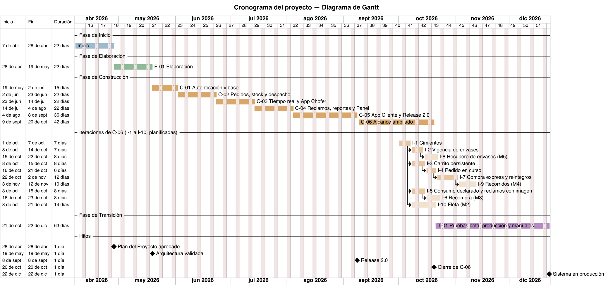
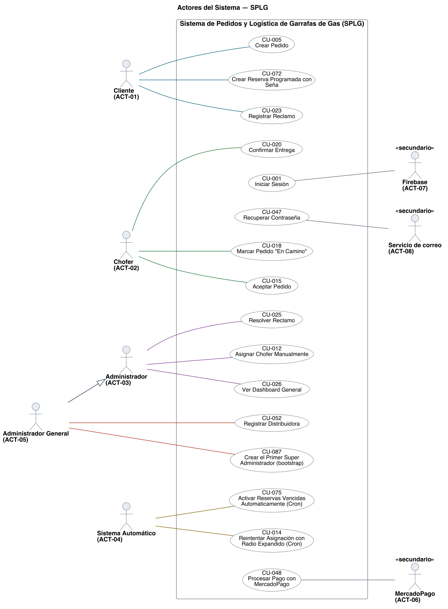
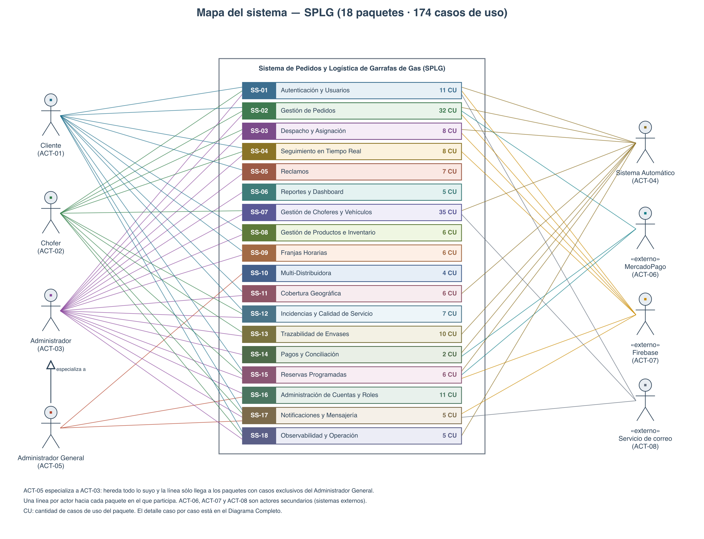

# Plan del Proyecto
**Proyecto:** SPLG – Sistema de Pedidos y Logística de Garrafas de Gas  
**Versión:** 1.7
**Fecha:** 2026-10-01
**Realizado por:** Nahuel Wagner  
**Realizado para:** Distribuidor de Gas Envasado (Cliente Real)  
**Institución:** FCEQyN – UNaM  
**Metodología:** Unified Process (UP)

---

## Índice de Figuras

- Figura 1 — Cronograma del proyecto: diagrama de Gantt
- Figura 2 — Actores del sistema y el canal por el que operan
- Figura 3 — Diagrama de Casos de Uso del Sistema
- Figura 4 — Mapa del sistema: paquetes y actores

---

## Lista de Cambios

| Nro | Fecha | Descripción | Autor |
|-----|-------|-------------|-------|
| 0 | 2026-04-16 | Versión inicial | Nahuel Wagner |
| 1 | 2026-04-16 | Se incorporan las 2 apps móviles y se ajustan iteraciones de Construcción a 5 | Nahuel Wagner |
| 2 | 2026-05-03 | Nombre corregido a SPLG, Gantt con fechas reales, tabla de actores ampliada, CUs de alto nivel completos, tabla de calificación completa | Nahuel Wagner |
| 3 | 2026-08-30 | Revisión de los casos de uso de alto nivel y de su calificación contra el sistema construido. | Nahuel Wagner |
| 4 | 2026-10-01 | Casos de uso de alto nivel CU-161 a CU-167: vehículo en uso por chofer y reclamos. | Nahuel Wagner |
| 5 | 2026-10-01 | Casos de uso de alto nivel CU-168 a CU-175: reintegro de pagos, historial de estados del pedido, configuración de procesos y de tareas programadas, y fotografía del reclamo. Estado y iteración de cada caso en el catálogo. Plan de construcción de los casos de uso planificados (I-1 a I-10) y decisiones de diseño incorporadas. | Nahuel Wagner |
| 6 | 2026-10-01 | Cronograma como diagrama de Gantt con las seis iteraciones de Construcción, las diez iteraciones de los casos planificados y los hitos; fechas de las fases alineadas con la Planificación de Iteraciones; despliegue en un servidor virtual con Docker Compose. | Nahuel Wagner |

| 7 | 2026-10-01 | Cierre de la documentación: los 174 casos de uso con sus cuatro artefactos, el catálogo de 195 operaciones del sistema y las cifras del plan coherentes con los Documentos 1, 2 y 3 y con el sistema construido. | Nahuel Wagner |
---

## 1. Componentes del Sistema

El sistema SPLG está compuesto por **4 componentes** que trabajan en conjunto:

| Componente | Tecnología | Descripción |
|------------|-----------|-------------|
| **Backend API** | NestJS (TypeScript) | Servidor principal. Gestiona toda la lógica de negocio, base de datos PostgreSQL, cache Redis, WebSockets y notificaciones push. |
| **App Cliente** | Flutter (iOS / Android) | App móvil para usuarios finales. Permite realizar pedidos, elegir franjas horarias, pagar y hacer seguimiento en tiempo real del repartidor en el mapa. |
| **App Chofer** | Flutter (Android) | App móvil para repartidores. Recibe pedidos cercanos mediante WebSocket, actualiza ubicación GPS, gestiona el estado de la entrega y confirma la recepción. |
| **Panel Administrativo** | React + Vite (Web) | Panel web para el operador del distribuidor. Gestiona choferes, vehículos, productos, stock, precios, franjas horarias, reclamos y reportes. |

---

## 2. Plan de las Fases

El desarrollo se lleva a cabo en fases, con una o más iteraciones en cada una. La tabla muestra la distribución de tiempos y el número de iteraciones de cada fase.

| Fase | Nro. Iteraciones | Duración | Período |
|------|:---------------:|:--------:|---------|
| Fase de Inicio | 0 | 3 semanas | 07/04/2026 – 28/04/2026 |
| Fase de Elaboración | 1 (E-01) | 3 semanas | 28/04/2026 – 19/05/2026 |
| Fase de Construcción | 6 (C-01 a C-06) | 22 semanas | 19/05/2026 – 20/10/2026 |
| Fase de Transición | 1 (T-01) | 9 semanas | 21/10/2026 – 22/12/2026 |

La iteración C-06 contiene el plan de construcción de los casos de uso planificados, que se reparte en diez iteraciones de trabajo, I-1 a I-10 (sección 4). La Fase de Construcción las absorbe: no agregan iteraciones al calendario de fases.

---

## 3. Hitos por Fase

Los hitos que marcan el final de cada fase se describen en la siguiente tabla.

| Fase | Descripción | Hito |
|------|-------------|------|
| Fase de Inicio | Identificación del escenario real (distribuidor de gas con operación telefónica y sin trazabilidad), relevamiento de necesidades con el cliente, identificación de actores y casos de uso principales, redacción de la Propuesta de Proyecto y presentación del Plan del Proyecto. | Plan del Proyecto aprobado por el docente (28/04/2026). |
| Fase de Elaboración | Análisis de los casos de uso arquitectónicamente más críticos (CU-001, CU-005, CU-013, CU-017, CU-020); definición y validación de la arquitectura técnica (NestJS, Flutter, React, PostgreSQL, Redis, Firebase Auth); Modelo Conceptual preliminar; prototipo de arquitectura que valida el despacho automático con Redis GEORADIUS. | Arquitectura validada con el cliente y prototipo funcional demostrado (19/05/2026). |
| Fase de Construcción | C-01: autenticación con Firebase Auth, roles y base del backend. C-02: pedidos con reserva atómica de stock y despacho automático por geolocalización. C-03: seguimiento GPS en tiempo real y App Chofer. C-04: reclamos, reportes, dashboard, vehículos, notificaciones y Panel Admin. C-05: App Cliente completa. C-06: alcance ampliado por la cátedra, con la construcción de los casos de uso planificados en las diez iteraciones I-1 a I-10: cimientos (I-1), vigencia de envases (I-2), carrito persistente (I-3), pedido en curso (I-4), consumo declarado y reclamos con imagen (I-5), recompra (I-6), compra express y reintegros (I-7), recupero de envases (I-8), recorridos (I-9) y flota (I-10). | Release 2.0 al cierre de C-05 (08/09/2026) y alcance ampliado construido al cierre de C-06 (20/10/2026); las iteraciones I-6, I-8, I-9 e I-10 se postergan primero si el tiempo no alcanza. |
| Fase de Transición | Pruebas de aceptación con usuarios reales (choferes y clientes del distribuidor), corrección de los defectos detectados, despliegue en producción (Docker Compose sobre un servidor virtual, VPS) y entrega de la documentación (manuales de usuario y guías de despliegue). | Sistema en producción, usuarios capacitados y documentación entregada (22/12/2026). |

---

## 4. Calendario del Proyecto — Diagrama de Gantt

El cronograma abarca **37 semanas**, desde el **07/04/2026** hasta el **22/12/2026**. Las fechas de cada fase y de cada iteración son las de la Planificación de Iteraciones (documento 0.1). Los días sábado y domingo no se cuentan como laborables.

### Cronograma (Diagrama de Gantt)

**Figura 1 — Cronograma del proyecto: diagrama de Gantt**

Las barras de color pleno son las fases e iteraciones del plan. Los rombos son los hitos de cierre: Plan del Proyecto aprobado (28/04/2026), arquitectura validada (19/05/2026), Release 2.0 (08/09/2026), cierre de C-06 (20/10/2026) y sistema en producción (22/12/2026). Las diez iteraciones I-1 a I-10 de la sección siguiente se dibujan dentro de C-06, en los cuatro carriles que se describen allí, con su duración estimada y a partir del 01/10/2026; las cuatro de tono claro (I-6, I-8, I-9 e I-10) son las que el orden de recorte posterga primero.

| Fase | Iteración | Desde | Hasta | Duración | Hito de cierre |
|------|:---------:|:-----:|:-----:|:--------:|----------------|
| Inicio | — | 07/04/2026 | 28/04/2026 | 3 semanas | Plan del Proyecto aprobado |
| Elaboración | E-01 | 28/04/2026 | 19/05/2026 | 3 semanas | Arquitectura validada y prototipo demostrado |
| Construcción | C-01 | 19/05/2026 | 02/06/2026 | 2 semanas | Autenticación, roles y base del backend |
| Construcción | C-02 | 02/06/2026 | 23/06/2026 | 3 semanas | Pedidos, stock atómico y despacho automático |
| Construcción | C-03 | 23/06/2026 | 14/07/2026 | 3 semanas | Seguimiento en tiempo real y App Chofer |
| Construcción | C-04 | 14/07/2026 | 04/08/2026 | 3 semanas | Reclamos, reportes, dashboard y Panel |
| Construcción | C-05 | 04/08/2026 | 08/09/2026 | 5 semanas | App Cliente y Release 2.0 |
| Construcción | C-06 | 09/09/2026 | 20/10/2026 | 6 semanas | Alcance ampliado construido |
| Transición | T-01 | 21/10/2026 | 22/12/2026 | 9 semanas | Sistema en producción y usuarios capacitados |

### Plan de construcción de los casos de uso planificados

El sistema construido no realiza treinta y dos casos de uso, que están especificados con sus
artefactos completos y figuran como «Planificado» en el catálogo de la sección 8: los veintitrés que la
documentación venía señalando como no construidos (CU-043, CU-105 a CU-108, CU-122 a CU-128, CU-132 a
CU-135, CU-143 a CU-148 y CU-151), el despacho de un pedido express a un chofer en moto (CU-149), que es
condición de la compra express, y ocho casos nuevos que formalizan funcionalidad que faltaba (CU-168 a
CU-175). Otros cuatro casos construidos tienen un tramo planificado asociado a una iteración (CU-008,
CU-010, CU-023 y CU-040). Cada caso muestra su iteración como «Planificado (I-n)» en el catálogo y en su
caso de uso expandido.

El plan agrupa los casos en diez iteraciones de construcción, I-1 a I-10, de acuerdo con el módulo del
sistema que tocan y con sus dependencias.

| Iteración | Casos de uso | Tamaño | Qué se puede mostrar al cerrarla |
|---|---|:---:|---|
| **I-1** Cimientos y huecos cortos | CU-043, CU-151, CU-171, CU-172, CU-173; CU-040 (reactivación) y CU-008 (cancelación desde la App Cliente) | M | La franja se edita sin darla de baja; una zona vencida se desactiva sola; los parámetros del despacho, de los procesos automáticos y de las tareas programadas se editan desde el panel; un producto dado de baja vuelve al catálogo; el cliente cancela su pedido desde la app. |
| **I-2** Vigencia de envases | CU-132, CU-133, CU-134, CU-135 | M | Un envase con la revisión vencida no puede asignarse a ningún pedido. |
| **I-3** Carrito persistente | CU-122, CU-123, CU-124, CU-125, CU-126 | L | El cliente arma el carrito, cierra la app, la vuelve a abrir y el carrito sigue ahí. |
| **I-4** Pedido en curso | CU-127, CU-128, CU-169, CU-170 | M | El cliente cambia la dirección de un pedido en curso y el chofer lo ve, con quién recibe; el cliente y el administrador ven el historial de estados del pedido. |
| **I-5** Consumo declarado y reclamos con imagen | CU-143, CU-144, CU-145, CU-146, CU-174, CU-175; CU-023 (fotografía) | M | El administrador ve qué clientes se quedan sin gas esta semana; el cliente adjunta una fotografía a su reclamo. |
| **I-6** Módulo M3: recompra | CU-106 | L | Un cliente recibe la invitación a reponer y, al aceptarla, el pedido entra al despacho. |
| **I-7** Compra express y reintegros | CU-148, CU-147, CU-149, CU-168; CU-008 y CU-010 (reintegro) | L | Un pedido express sale a un chofer en moto o se degrada a reparto común avisándole al cliente; el pago de un pedido cancelado se devuelve por la pasarela. |
| **I-8** Módulo M5: recupero de envases | CU-108 | L | Un envase retenido abre su caso, escala y el administrador lo resuelve. |
| **I-9** Módulo M4: agrupación por recorrido | CU-107 | L | Tres pedidos programados cercanos se ofrecen como un solo recorrido ordenado. |
| **I-10** Módulo M2: flota | CU-105 | L+ | El planificador propone una ventana de taller al chofer y escala si se agotan las alternativas. |

El tamaño es relativo, para una persona, e incluye el backend, el panel, las aplicaciones y la prueba
contra el sistema en funcionamiento: S hasta un día, M de dos a cuatro días, L de cuatro a siete días y
L+ más de siete.

**Piezas transversales.** La primera iteración construye cuatro piezas que reutilizan las siguientes.
La primera es la configuración de procesos por distribuidora: la tabla ya existe y falta el servicio
que la lee y la valida, con un esquema de validación por proceso; sin ella la compra express y los
cuatro módulos inteligentes quedarían con parámetros fijos en el código, que es lo que el criterio de
parametrización de la cátedra no admite. La segunda es el evento de dominio de pedido entregado, que
necesitan el recálculo de la recompra, el registro de uso de la flota y el recupero de envases. La
tercera es la plantilla del proceso temporal con cerrojo distribuido, que estrena la desactivación de
zonas vencidas (CU-151) con el caso más simple y repiten los módulos inteligentes; para los procesos
cuya frecuencia u hora es configurable por distribuidora, el decorador de la tarea es un tic fijo y
cada ejecución evalúa adentro, contra la configuración y la última corrida de cada distribuidora, a
quién le toca. La cuarta son los datos de demostración: cada iteración suma al juego de datos lo que su
caso necesita para verse.

**Dependencias y orden.** I-1 no depende de nada. I-8 depende de I-2, porque comparte el módulo y el
ciclo del envase. I-6 depende de I-5, por el consumo declarado y el aviso de recompra, y del evento de
pedido entregado de I-1. I-7 depende de I-3, porque la modalidad se elige dentro de la compra desde el
carrito, y del vehículo en uso del chofer (CU-161 a CU-165). I-9 e I-10 dependen del vehículo en uso,
para conocer la capacidad de carga y el kilometraje, y I-9 depende además de I-7, porque los pedidos
express no se agrupan. En el diseño de datos, los cambios que no están en la base se reparten
entre las iteraciones que los necesitan: la columna del recargo express y el tipo de vehículo
normalizado en I-7, la baja del envase y el pedido del aviso de recupero en I-8, y los dos valores
nuevos de la configuración de procesos en I-1.

**Carga estimada.** La suma de las diez iteraciones ronda las 58 a 64 jornadas de trabajo de una
persona (I-1, 5; I-2, de 4 a 5; I-3, de 5 a 6; I-4, 4; I-5, de 5 a 6; I-6, 6; I-7, de 7 a 8; I-8, 6;
I-9, de 7 a 8; I-10, de 9 a 10). Repartida en cuatro carriles que tocan módulos distintos del backend
—envases (I-2, I-8), pedido (I-3, I-4, I-7, I-9), cliente (I-5, I-6) y flota (I-10)—, no entra completa
en la iteración C-06, que cierra el 20/10/2026: las metas de C-06 cubren I-1 a I-5 y la compra express.
Si el tiempo no alcanza antes de la defensa, el orden de recorte, de lo primero que se posterga a lo
último, es: la negociación de ventana y el bloqueo del vehículo de I-10, I-9, I-8 y la captura de
kilómetros de I-10. No conviene postergar I-1, I-2 (tiene dos casos críticos), I-7 (la compra express es
un caso crítico) ni I-6, el módulo inteligente más barato de mostrar funcionando de punta a punta.

**Decisiones de diseño incorporadas.** Los casos planificados recogen las siguientes decisiones, que
quedaron escritas en sus casos de uso expandidos, diagramas y contratos.

| Decisión | Casos de uso |
|---|---|
| Si la capacidad nueva de una franja es menor que lo comprometido, se advierte la sobrecarga y no se bloquea. | CU-043 |
| El carrito no fija el precio: se cobra el precio vigente del catálogo y se avisa la diferencia antes de confirmar. | CU-122, CU-125, CU-126 |
| Si el pedido está pagado en línea y el recargo de la zona de la dirección nueva cambia, se rechaza el cambio de dirección; en efectivo se recalcula el total. | CU-127 |
| Los datos de quien recibe se conservan hasta que vence el plazo de reclamo y después se anulan; el documento queda fuera del registro de auditoría. | CU-128 |
| El envase lo elige una persona por número de serie y el sistema valida la elección; el bloqueo alcanza al despacho y no al llenado. | CU-132, CU-135 |
| Un envase rechazado en la revisión queda con el vencimiento en la fecha de la revisión. | CU-132 |
| La estimación de recompra vive en un módulo propio que depende de `customer`, para no crear un ciclo con `order`. | CU-143 a CU-146, CU-106 |
| Un cliente pertenece a una distribuidora desde su primera compra: aparece en el listado de recompras y recibe invitaciones desde entonces. | CU-146, CU-106 |
| La cobertura express es un radio máximo en la configuración del proceso, no una zona aparte; la modalidad se guarda al crear el pedido. | CU-147, CU-148 |
| Si el pedido express no consigue chofer en moto, pasa a reparto común: se descuenta el recargo express del total y, si ya se pagó en línea, se reintegra esa parte. | CU-149, CU-168 |
| Sólo se agrupan los pedidos programados con franja futura; los inmediatos los atiende M1. | CU-107 |
| El depósito de un envase no devuelto se registra con la decisión y el importe, y se cobra aparte, en el próximo pedido o en efectivo, sin pasarela. | CU-108 |
| La zona de un vehículo se deriva de las zonas donde entregó en los últimos días; el chofer acepta la ventana de taller y el administrador confirma el gasto. | CU-105 |

---

## 5. Actores del Sistema

| Código | Actor | Tipo | Descripción |
|--------|-------|:----:|-------------|
| ACT-01 | **Cliente** | Humano | Usuario final que instala la App Cliente (Flutter) en su celular. Realiza pedidos de garrafas, elige franja horaria, selecciona método de pago, sigue el pedido en tiempo real en el mapa y puede registrar reclamos post-entrega. |
| ACT-02 | **Chofer / Repartidor** | Humano | Repartidor del distribuidor que utiliza la App Chofer (Flutter) en su dispositivo Android. Recibe notificaciones de pedidos cercanos por WebSocket, acepta o rechaza pedidos, actualiza su posición GPS en tiempo real y confirma la entrega al cliente. |
| ACT-03 | **Administrador** | Humano | Operador interno de una distribuidora, con alcance acotado a su propia empresa. Accede al Panel Web (React/Vite) para gestionar choferes, vehículos, productos, stock, precios, franjas horarias, reclamos y visualizar reportes y el dashboard operativo. Tiene acceso total dentro del alcance de su distribuidora. |
| ACT-04 | **Sistema Automático** | Sistema | Procesos que el backend ejecuta por iniciativa propia, sin intervención humana y sin interfaz de usuario. Comprende la negociación secuencial de asignación de pedidos (CU-013), el vencimiento y re-oferta de las propuestas a los choferes (CU-014), la activación y expiración de las reservas programadas (CU-075 a CU-077), la reserva y restitución de stock, y los avisos automáticos. |
| ACT-05 | **Administrador General** | Humano | Operador de la plataforma, con alcance sobre todas las distribuidoras. Da de alta las empresas comercializadoras, designa a sus administradores y administra los roles del sistema. Es el único actor cuyo alcance no está acotado a una distribuidora: los demás operan siempre dentro de la suya. |
| ACT-06 | **MercadoPago** | Secundario (sistema externo) | Pasarela de cobro. El sistema le crea el checkout de cada pedido o seña que se paga por MercadoPago y recibe de ella el aviso de pago aprobado. No inicia ningún caso de uso. Participa en CU-005, CU-048, CU-072 y CU-147. |
| ACT-07 | **Firebase** | Secundario (sistema externo) | Identidad y mensajería. El sistema le pide crear y deshabilitar cuentas, verificar el token de sesión y generar el enlace de recuperación de contraseña, y le entrega las notificaciones push que llegan a los dispositivos. No inicia ningún caso de uso. Participa en CU-001, CU-004, CU-005, CU-013, CU-014, CU-016, CU-019, CU-021, CU-047, CU-072, CU-079, CU-082, CU-085, CU-091, CU-100, CU-101 y CU-147, y en el caso factorizado Notificar Cliente. |
| ACT-08 | **Servicio de correo** | Secundario (sistema externo) | Envía los correos transaccionales del sistema: bienvenida al cliente, recuperación de contraseña, prueba del servicio y aviso de vencimientos de la flota. No inicia ningún caso de uso. Participa en CU-002, CU-047, CU-102 y CU-142. |

**Figura 2 — Actores del sistema y el canal por el que operan**

> Los cuatro actores humanos (Cliente, Chofer, Administrador y Administrador General) operan
> siempre a través de una aplicación; ninguno accede directamente al backend. El Sistema
> Automático no tiene interfaz: son los procesos que el backend dispara por sí mismo, y es el
> actor principal de los casos de uso que la documentación marca como automáticos.
> MercadoPago, Firebase y el servicio de correo son sistemas externos que el backend invoca:
> participan como actores secundarios y no inician ningún caso de uso.

### Descripción Ampliada de Actores

**ACT-01 — Cliente:**
Persona que contrata el servicio de entrega de garrafas. Perfil tecnológico variado (usuarios con conocimientos básicos de smartphones). Accede al sistema únicamente desde la App Cliente Flutter. Sus principales necesidades son: realizar pedidos rápidamente, conocer el estado en tiempo real y poder reclamar si algo sale mal.

**ACT-02 — Chofer / Repartidor:**
Empleado del distribuidor que ejecuta las entregas físicas. Trabaja principalmente en horario de 9 a 21 hs. Maneja la App Chofer en un dispositivo Android provisto por el distribuidor. Su principal necesidad es recibir pedidos de forma ordenada, conocer la ruta y confirmar entregas de manera simple.

**ACT-03 — Administrador:**
Operador de oficina de una distribuidora. Su alcance está acotado a la empresa a la que pertenece: no ve ni gestiona datos de otras distribuidoras. Puede ser una o más personas. Accede al Panel Web desde una PC o notebook con conexión a internet. Sus principales necesidades son: visibilidad completa del estado operativo, control de inventario y reportes de ventas para la toma de decisiones.

**ACT-04 — Sistema Automático:**
No es un actor humano sino el conjunto de procesos que el backend ejecuta por iniciativa propia, sin intervención de nadie y sin interfaz. Son cinco los **procesos automatizados** del sistema, y este actor es el que los lleva adelante: la negociación secuencial de asignación de pedidos (M1), la planificación predictiva de mantenimiento y habilitaciones de flota (M2), la anticipación de recompra por consumo estimado (M3), la agrupación inteligente de pedidos por recorrido (M4) y la recuperación de envases no devueltos (M5). Su especificación completa está en el Documento 3, sección 6.

No hay que confundirlos con las tareas de mantenimiento del propio sistema, que también corren solas pero no deciden nada: vencer una oferta de despacho y devolver el pedido al circuito, activar una reserva que llegó a su fecha, liberar el stock de un pedido que caducó sin pagarse. Son la ejecución programada de los circuitos que los procesos automatizados gobiernan, no procesos en sí mismos. Los tres módulos que deciden por su cuenta —M2, M3 y M5— siempre proponen y nunca ejecutan: la contratación de un taller, el cobro de un depósito y la baja de un envase los confirma una persona.

**ACT-05 — Administrador General:**
Responsable de la plataforma, distinto del administrador de cada empresa. Da de alta las distribuidoras que operan en el sistema, designa a sus administradores y define los roles disponibles. Es el único actor que ve datos de más de una distribuidora; todos los demás quedan confinados a la suya. Accede por el mismo Panel Web, con un alcance ampliado.

---

## 6. Diagrama de Casos de Uso del Sistema

**Figura 3 — Diagrama de Casos de Uso del Sistema**

> Notación UML: actores fuera del límite del sistema (una sola vez cada uno) y casos de uso
> dentro, agrupados en paquetes, con las relaciones `«include»` y `«extend»`. El Administrador
> General especializa al Administrador. La lámina se genera con `generar-uml.py`; la versión
> vectorial es `diagramas/uml/CU_Sistema_Diagrama-Completo.svg`.

**Figura 4 — Mapa del sistema: paquetes y actores**

---

## 7. Casos de Uso de Alto Nivel

> Los casos de uso CU-001 a CU-051 corresponden al alcance relevado inicialmente. Los
> casos CU-052 a CU-104 se incorporaron al contrastar la documentación contra el sistema
> construido: son comportamientos que el sistema ya realiza y que el relevamiento original
> no había registrado. El catálogo consolidado, con la especificación expandida y los
> diagramas de secuencia de cada caso, figura en `Casos-de-Uso.md`.

---

**Código:** CU-001 | **Caso de Uso:** Iniciar Sesión  
**Actor/es:** Cliente (ACT-01), Chofer (ACT-02), Administrador (ACT-03)  
**Subsistema:** SS-01 Autenticación y Usuarios  
**Calificación:** Crítico  
**Descripción:** El usuario ingresa sus credenciales (email y contraseña) en la app correspondiente. El sistema verifica la identidad contra Firebase Auth y devuelve el token de identidad que Firebase emite, sin generar credencial propia. El rol del usuario no viaja en el token: se resuelve contra la base en cada solicitud. El ingreso no consulta la habilitación del chofer: se exige al ponerse en línea (CU-022).

---

**Código:** CU-002 | **Caso de Uso:** Registrarse como Cliente  
**Actor/es:** Cliente (ACT-01)  
**Subsistema:** SS-01 Autenticación y Usuarios  
**Calificación:** Crítico  
**Descripción:** Un nuevo usuario descarga la App Cliente y completa el formulario de registro con nombre completo, email, teléfono y contraseña. El sistema crea la cuenta en Firebase Auth y registra el perfil en la base de datos con rol cliente. El registro no deja al usuario con la sesión abierta: para empezar a operar tiene que iniciar sesión a continuación (CU-001). La creación de la cuenta la resuelve CU-082, que este caso incluye.

---

**Código:** CU-003 | **Caso de Uso:** Registrar Chofer  
**Actor/es:** Administrador (ACT-03)  
**Subsistema:** SS-01 Autenticación y Usuarios  
**Calificación:** Crítico  
**Descripción:** El administrador crea un nuevo usuario chofer desde el panel web, ingresando sus datos personales y de contacto y una contraseña temporal. La cuenta queda a la espera de que el administrador la marque como validada (CU-032), aunque esa marca no condiciona por sí sola que el chofer pueda operar: el control real sobre si puede recibir pedidos es su estado de actividad (CU-033). Es el mismo alta que CU-031, documentada acá desde el flujo de autenticación. Incluye CU-082.

---

**Código:** CU-004 | **Caso de Uso:** Gestionar Perfil de Usuario  
**Actor/es:** Cliente (ACT-01), Chofer (ACT-02)  
**Subsistema:** SS-01 Autenticación y Usuarios  
**Calificación:** Importante  
**Descripción:** El usuario actualiza su información personal desde la app: nombre completo y número de teléfono. Los cambios se persisten en la base de datos y se reflejan inmediatamente en las apps y en el panel del administrador.

---

**Código:** CU-005 | **Caso de Uso:** Crear Pedido  
**Actor/es:** Cliente (ACT-01)  
**Subsistema:** SS-02 Gestión de Pedidos  
**Calificación:** Crítico  
**Descripción:** El cliente selecciona uno o más productos del catálogo, la cantidad, una dirección de entrega y, opcionalmente, una fecha y franja horaria de entrega; también elige el método de pago (efectivo, MercadoPago o transferencia con recargo). El sistema comprueba que la dirección esté dentro de la zona de cobertura, reserva el stock y, si corresponde, el cupo de la franja de forma atómica, calcula el total con promociones y recargos, y registra el pedido. Salvo que el pago sea por MercadoPago o que el pedido sea una reserva a futuro, el sistema abre de inmediato la oferta al chofer más cercano disponible (CU-013).

---

**Código:** CU-006 | **Caso de Uso:** Consultar Detalle de Pedido  
**Actor/es:** Cliente (ACT-01), Chofer (ACT-02), Administrador (ACT-03)  
**Subsistema:** SS-02 Gestión de Pedidos  
**Calificación:** Crítico  
**Descripción:** El usuario accede al detalle completo de un pedido específico: ítems y cantidades, precios, descuentos aplicados, estado actual, datos del chofer asignado, dirección de entrega, franja horaria, método de pago y timestamps de cada cambio de estado (creado, aceptado, en camino, entregado/cancelado).

---

**Código:** CU-007 | **Caso de Uso:** Consultar Historial de Pedidos  
**Actor/es:** Cliente (ACT-01)  
**Subsistema:** SS-02 Gestión de Pedidos  
**Calificación:** Importante  
**Descripción:** El cliente accede al listado completo de sus pedidos anteriores, sin filtro por estado ni por fecha: la consulta trae siempre la totalidad del historial. Cada ítem del listado muestra el resumen del pedido (fecha, total, estado) con acceso al detalle completo.

---

**Código:** CU-169 | **Caso de Uso:** Registrar el Cambio de Estado de un Pedido  
**Actor/es:** Sistema Automático (ACT-04)  
**Subsistema:** SS-02 Gestión de Pedidos  
**Calificación:** Importante  
**Descripción:** Cada vez que un pedido cambia de estado, el sistema agrega una fila al historial de estados con el estado anterior, el estado nuevo, quién lo provocó, el motivo si lo hubo y el momento. El registro se hace dentro de la misma transacción que el cambio: nunca hay un cambio sin su fila ni una fila sin su cambio.

---

**Código:** CU-170 | **Caso de Uso:** Consultar el Historial de Estados de un Pedido  
**Actor/es:** Cliente (ACT-01), Administrador (ACT-03), Administrador General (ACT-05)  
**Subsistema:** SS-02 Gestión de Pedidos  
**Calificación:** Secundario  
**Descripción:** El cliente, desde el detalle de su pedido, y el administrador, desde el panel, ven la secuencia de estados por la que pasó el pedido, con el momento de cada cambio, el rol de quien lo provocó y el motivo cuando lo hubo. Endpoint: `GET /orders/:id/history`.

---

**Código:** CU-143 | **Caso de Uso:** Declarar el Consumo Promedio al Registrarse  
**Actor/es:** Cliente (ACT-01)  
**Subsistema:** SS-02 Gestión de Pedidos  
**Calificación:** Importante  
**Descripción:** Al crear su cuenta, el cliente declara cuántos kilos de gas consume por mes y qué tipo de garrafa usa habitualmente. Con ese dato el sistema puede estimar cuándo se le va a acabar y avisarle antes, sin esperar a tener historial de compras.

---

**Código:** CU-144 | **Caso de Uso:** Actualizar el Consumo Promedio Declarado  
**Actor/es:** Cliente (ACT-01)  
**Subsistema:** SS-02 Gestión de Pedidos  
**Calificación:** Importante  
**Descripción:** El cliente corrige cuánto gas consume por mes cuando su situación cambia: se mudó, sumó gente en la casa o cambió de estufa. El sistema recalcula la fecha estimada de la próxima recompra con el valor nuevo.

---

**Código:** CU-145 | **Caso de Uso:** Configurar los Días de Aviso Previo a la Recompra  
**Actor/es:** Cliente (ACT-01)  
**Subsistema:** SS-02 Gestión de Pedidos  
**Calificación:** Menor  
**Descripción:** El cliente elige con cuántos días de anticipación quiere que le avisen que se le está por acabar la garrafa, o desactiva el aviso. Sin esto, la anticipación sería la misma para todos y el aviso terminaría siendo ruido.

---

**Código:** CU-146 | **Caso de Uso:** Consultar la Fecha Estimada de Recompra  
**Actor/es:** Administrador (ACT-03)  
**Subsistema:** SS-02 Gestión de Pedidos  
**Calificación:** Importante  
**Descripción:** El administrador ve qué clientes están por quedarse sin gas dentro de una ventana de tiempo, con su consumo declarado y su última compra. Es lo que le permite anticipar la demanda de la semana y, si quiere, salir a ofrecer antes de que el cliente pida.

---

**Código:** CU-147 | **Caso de Uso:** Realizar una Compra Express  
**Actor/es:** Cliente (ACT-01)  
**Subsistema:** SS-02 Gestión de Pedidos  
**Calificación:** Crítico  
**Descripción:** El cliente que necesita una garrafa ya compra en un solo paso: una garrafa, su dirección predeterminada y listo, sin elegir franja horaria. El pedido sale a un chofer en moto y se entrega dentro de la hora. Es el segundo flujo de compra, en paralelo al que arma un pedido con franja (CU-005).

---

**Código:** CU-148 | **Caso de Uso:** Elegir la Modalidad de Entrega del Pedido  
**Actor/es:** Cliente (ACT-01)  
**Subsistema:** SS-02 Gestión de Pedidos  
**Calificación:** Importante  
**Descripción:** Antes de confirmar, el cliente elige cómo quiere recibir el pedido: programado, eligiendo una franja horaria, o express, dentro de la hora y con recargo. El sistema le muestra las dos con su precio y su tiempo estimado, y sólo ofrece la express si hay cobertura, horario y chofer.

---

**Código:** CU-008 | **Caso de Uso:** Cancelar Pedido (Cliente)  
**Actor/es:** Cliente (ACT-01)  
**Subsistema:** SS-02 Gestión de Pedidos  
**Calificación:** Importante  
**Descripción:** El cliente cancela un pedido propio que todavía no fue despachado (estado pendiente, reservado o aceptado). El sistema valida que sea posible cancelar, cambia el estado a cancelado, restituye el stock de cada ítem al inventario y avisa en tiempo real al chofer asignado, si lo había.

---

**Código:** CU-009 | **Caso de Uso:** Cancelar Pedido (Chofer)  
**Actor/es:** Chofer (ACT-02)  
**Subsistema:** SS-02 Gestión de Pedidos  
**Calificación:** Importante  
**Descripción:** El chofer que ya aceptó un pedido decide no poder realizarlo. El sistema cambia el estado del pedido de ACCEPTED de vuelta a PENDING (no cancela definitivamente) para que otro chofer pueda aceptarlo. El stock no se restituye porque el pedido sigue activo.

---

**Código:** CU-010 | **Caso de Uso:** Cancelar Pedido (Administrador)  
**Actor/es:** Administrador (ACT-03)  
**Subsistema:** SS-02 Gestión de Pedidos  
**Calificación:** Importante  
**Descripción:** El administrador puede cancelar cualquier pedido activo (en cualquier estado previo a DELIVERED) desde el panel web, indicando obligatoriamente un motivo. El sistema marca el pedido como CANCELLED, restituye el stock y notifica tanto al cliente como al chofer asignado.

---

**Código:** CU-011 | **Caso de Uso:** Listar Todos los Pedidos  
**Actor/es:** Administrador (ACT-03)  
**Subsistema:** SS-02 Gestión de Pedidos  
**Calificación:** Importante  
**Descripción:** El administrador visualiza en el panel web todos los pedidos del sistema, ordenados del más reciente al más antiguo, con paginación. El filtrado por estado, por fecha o por chofer asignado no es un parámetro de la consulta al servidor: si hace falta acotar el listado, eso se resuelve del lado del panel sobre la página ya traída. Cada registro muestra el resumen del pedido con acceso al detalle.

---

**Código:** CU-012 | **Caso de Uso:** Asignar Chofer Manualmente  
**Actor/es:** Administrador (ACT-03)  
**Subsistema:** SS-03 Despacho y Asignación  
**Calificación:** Secundario  
**Descripción:** Cuando el despacho automático agota los candidatos disponibles y el pedido queda pendiente sin que ningún chofer lo tome, el administrador puede intervenir desde el panel web y asignar manualmente un chofer activo al pedido.

---

**Código:** CU-149 | **Caso de Uso:** Despachar un Pedido Express a un Chofer en Moto  
**Actor/es:** Sistema Automático (ACT-04)  
**Subsistema:** SS-03 Despacho y Asignación  
**Calificación:** Crítico  
**Descripción:** El sistema ofrece el pedido express al chofer en moto más cercano y le da menos tiempo para aceptarlo que en el despacho normal, porque la promesa de entrega es dentro de la hora. Si nadie acepta, no expande el radio como en CU-014: cancela la modalidad express y pasa el pedido al flujo programado.

---

**Código:** CU-013 | **Caso de Uso:** Asignar Pedido Automáticamente por Proximidad  
**Actor/es:** Sistema (ACT-04)  
**Subsistema:** SS-03 Despacho y Asignación  
**Calificación:** Crítico  
**Descripción:** Al crearse un pedido, el sistema no lo ofrece a todos los choferes cercanos a la vez: abre una negociación secuencial, ofreciéndoselo a un solo chofer por vez —el más cercano al domicilio de entrega entre los que todavía no fueron contactados— con una ventana acotada para aceptar. Si acepta, el pedido queda asignado a él (CU-015); si no responde a tiempo o lo rechaza, la oferta pasa al siguiente candidato. La elegibilidad de un chofer depende de que esté presente en el radar de posiciones (con su disponibilidad encendida y su ubicación emitida) y de que pertenezca a la distribuidora del pedido; la habilitación que le otorga el administrador no interviene en esta selección.

---

**Código:** CU-014 | **Caso de Uso:** Reintentar Asignación con Radio Expandido (Cron)  
**Actor/es:** Sistema (ACT-04)  
**Subsistema:** SS-03 Despacho y Asignación  
**Calificación:** Crítico  
**Descripción:** Un proceso automático que corre cada quince segundos revisa las ofertas de pedido cuya ventana de aceptación venció: las cierra y, si el pedido sigue sin chofer, abre la oferta para el siguiente candidato disponible. El mismo proceso vuelve a poner en circulación los pedidos que quedaron sin ninguna oferta activa, por ejemplo porque al crearse no había ningún chofer cerca o porque el chofer que lo tenía lo liberó. Si se agotan los candidatos, el pedido no pasa a ningún estado especial ni genera una alerta automática: permanece pendiente hasta que el administrador lo asigne a mano (CU-012) o aparezca un chofer disponible.

---

**Código:** CU-171 | **Caso de Uso:** Configurar los Parámetros de Despacho de la Distribuidora  
**Actor/es:** Administrador (ACT-03), Administrador General (ACT-05)  
**Subsistema:** SS-03 Despacho y Asignación  
**Calificación:** Crítico  
**Descripción:** El administrador define para su distribuidora los pasos de radio con que el despacho busca choferes y la ventana de tiempo que cada chofer tiene para aceptar una oferta. Los valores vigentes del sistema (cuatro pasos de 5, 10, 15 y 20 km, y 30 segundos) quedan como valores por omisión. Endpoint: `PUT /module-config/dispatch`.

---

**Código:** CU-015 | **Caso de Uso:** Aceptar Pedido  
**Actor/es:** Chofer (ACT-02)  
**Subsistema:** SS-03 Despacho y Asignación  
**Calificación:** Crítico  
**Descripción:** El chofer recibe la oferta de un pedido y decide aceptarla. El sistema se la asigna, genera el código secreto de entrega, registra el timestamp de aceptación y avisa al cliente en tiempo real y por notificación push, con el mismo texto genérico de confirmación de pedido que usan el resto de los avisos del ciclo.

---

**Código:** CU-016 | **Caso de Uso:** Rechazar / Ignorar Pedido  
**Actor/es:** Chofer (ACT-02)  
**Subsistema:** SS-03 Despacho y Asignación  
**Calificación:** Importante  
**Descripción:** El chofer que recibió la oferta de un pedido decide no tomarlo, ya sea rechazándolo explícitamente o dejando vencer la ventana de aceptación. El sistema cierra esa oferta y la ofrece al siguiente chofer más cercano que todavía no haya sido contactado. El rechazo no afecta el estado del pedido ni el stock.

---

**Código:** CU-017 | **Caso de Uso:** Actualizar Ubicación GPS del Chofer  
**Actor/es:** Chofer (ACT-02)  
**Subsistema:** SS-04 Seguimiento en Tiempo Real  
**Calificación:** Crítico  
**Descripción:** La App Chofer envía periódicamente (cada vez que el GPS detecta un desplazamiento de 10 metros) la posición geográfica al servidor por WebSocket (evento `driver:update-location`). El sistema ejecuta GEOADD en Redis, manteniendo la ubicación disponible tanto para el algoritmo de asignación (CU-013) como para el mapa en tiempo real de la App Cliente.

---

**Código:** CU-018 | **Caso de Uso:** Marcar Pedido "En Camino"  
**Actor/es:** Chofer (ACT-02)  
**Subsistema:** SS-04 Seguimiento en Tiempo Real  
**Calificación:** Crítico  
**Descripción:** El chofer indica que salió hacia el domicilio del cliente. El sistema pasa el pedido a estado en camino, registra el timestamp del cambio, avisa al cliente en tiempo real y abre el seguimiento en vivo de su posición. La notificación push que recibe el cliente usa el mismo texto genérico de confirmación de pedido, no un mensaje propio de este estado.

---

**Código:** CU-019 | **Caso de Uso:** Avisar Llegada al Cliente  
**Actor/es:** Chofer (ACT-02)  
**Subsistema:** SS-04 Seguimiento en Tiempo Real  
**Calificación:** Importante  
**Descripción:** El chofer avisa, antes de confirmar la entrega, que llegó al domicilio del cliente, para que este esté preparado a recibirlo. El aviso viaja por la conexión en tiempo real y como notificación al dispositivo, de modo que llega aunque el cliente tenga la app cerrada. No queda registrado como un estado ni como una marca de tiempo del pedido.

---

**Código:** CU-020 | **Caso de Uso:** Confirmar Entrega  
**Actor/es:** Chofer (ACT-02)  
**Subsistema:** SS-04 Seguimiento en Tiempo Real  
**Calificación:** Crítico  
**Descripción:** El chofer entrega el producto y marca el pedido como entregado. El sistema cierra el ciclo del pedido, registra el timestamp de entrega, da por cobrado el pago si el método era efectivo y avisa al cliente en tiempo real y por notificación push, con el mismo texto genérico de confirmación de pedido y no uno de agradecimiento. Existe además una vía alternativa en la que es el propio cliente quien confirma la entrega escaneando el código que le muestra el chofer.

---

**Código:** CU-021 | **Caso de Uso:** Recibir Notificaciones en Tiempo Real  
**Actor/es:** Cliente (ACT-01)  
**Subsistema:** SS-04 Seguimiento en Tiempo Real  
**Calificación:** Crítico  
**Descripción:** El cliente recibe avisos automáticos ante los principales cambios de estado de su pedido: creación, asignación de chofer, salida hacia el domicilio y entrega. El sistema emite siempre los dos canales a la vez —aviso en tiempo real y notificación push al dispositivo—, sin elegir uno según si la app está abierta o cerrada; el aviso de llegada del repartidor y el de cancelación no generan notificación push, y el texto de la notificación push es el mismo para todos los estados que sí la tienen.

---

**Código:** CU-022 | **Caso de Uso:** Activar / Desactivar Disponibilidad (Chofer)  
**Actor/es:** Chofer (ACT-02)  
**Subsistema:** SS-04 Seguimiento en Tiempo Real  
**Calificación:** Crítico  
**Descripción:** El chofer activa o desactiva su disponibilidad para recibir pedidos mediante un interruptor en la app. Al desactivarse, el sistema lo retira del radar geográfico que usa el despacho para elegir candidatos. Al activarse, en cambio, no se lo reinserta de inmediato: recién vuelve a aparecer en el radar cuando su app emite una nueva posición.

---

**Código:** CU-023 | **Caso de Uso:** Registrar Reclamo  
**Actor/es:** Cliente (ACT-01)  
**Subsistema:** SS-05 Reclamos  
**Calificación:** Importante  
**Descripción:** El cliente registra un reclamo sobre un pedido propio indicando el motivo (por ejemplo, "Fuga de gas" o "Garrafa incorrecta"), una descripción detallada y, opcionalmente, una foto como evidencia. El sistema valida que el pedido le pertenezca y crea el reclamo con estado pendiente, sin exigir que esté entregado: también puede reclamarse uno pendiente, aceptado o incluso cancelado.

---

**Código:** CU-024 | **Caso de Uso:** Listar Reclamos  
**Actor/es:** Administrador (ACT-03)  
**Subsistema:** SS-05 Reclamos  
**Calificación:** Importante  
**Descripción:** El administrador visualiza en el panel web todos los reclamos de su distribuidora, ordenados del más reciente al más antiguo, sin filtro por estado ni por fecha: la consulta trae siempre la totalidad de los reclamos. Cada registro muestra el cliente, el pedido asociado, el motivo y el estado actual, que puede ser pendiente, en proceso, resuelto o rechazado.

---

**Código:** CU-025 | **Caso de Uso:** Resolver Reclamo  
**Actor/es:** Administrador (ACT-03)  
**Subsistema:** SS-05 Reclamos  
**Calificación:** Importante  
**Descripción:** El administrador revisa un reclamo pendiente o en proceso y define su resolución —dejándolo resuelto o rechazado— ingresando obligatoriamente una nota que explique la decisión tomada. La transición se valida contra una máquina de estados: un reclamo ya resuelto o rechazado no se "re-resuelve" sin reabrirlo antes (CU-167). El sistema no avisa al cliente del resultado: este no tiene forma de enterarse por el sistema si no vuelve a consultar el estado de su reclamo.

---

**Código:** CU-166 | **Caso de Uso:** Tomar un Reclamo Pendiente  
**Actor/es:** Administrador (ACT-03), Administrador General (ACT-05)  
**Subsistema:** SS-05 Reclamos  
**Calificación:** Importante  
**Descripción:** El administrador marca un reclamo pendiente como en proceso para que el resto del equipo sepa que ya lo está revisando. No exige nota: se la pide recién al resolverlo (CU-025). Endpoint: `PATCH /claims/:id/take`.

---

**Código:** CU-167 | **Caso de Uso:** Reabrir un Reclamo  
**Actor/es:** Administrador (ACT-03), Administrador General (ACT-05)  
**Subsistema:** SS-05 Reclamos  
**Calificación:** Importante  
**Descripción:** El administrador reabre un reclamo ya resuelto o rechazado, con un motivo obligatorio, y lo deja en proceso. Es el único camino para cambiar un cierre: un reclamo cerrado no se vuelve a resolver sin reabrirlo antes. Endpoint: `PATCH /claims/:id/reopen`.

---

**Código:** CU-174 | **Caso de Uso:** Adjuntar la Fotografía de un Reclamo  
**Actor/es:** Cliente (ACT-01), Administrador (ACT-03), Administrador General (ACT-05)  
**Subsistema:** SS-05 Reclamos  
**Calificación:** Importante  
**Descripción:** El cliente adjunta una fotografía como evidencia de su reclamo, al registrarlo o después. La imagen se guarda en el almacenamiento de archivos del sistema y el reclamo conserva su referencia. Endpoint: `POST /claims/:id/photo`, con la imagen en un formulario multipart.

---

**Código:** CU-175 | **Caso de Uso:** Consultar la Fotografía de un Reclamo  
**Actor/es:** Cliente (ACT-01), Administrador (ACT-03), Administrador General (ACT-05)  
**Subsistema:** SS-05 Reclamos  
**Calificación:** Secundario  
**Descripción:** El cliente y el administrador ven la fotografía que respalda un reclamo. El sistema la entrega por una URL firmada del proveedor de almacenamiento o, con el disco local, sirviendo el archivo. Endpoint: `GET /claims/:id/photo`.

---

**Código:** CU-026 | **Caso de Uso:** Ver Dashboard General  
**Actor/es:** Administrador (ACT-03)  
**Subsistema:** SS-06 Reportes y Dashboard  
**Calificación:** Importante  
**Descripción:** El administrador visualiza en el panel web el estado operativo en tiempo real: cantidad de pedidos por estado (PENDING, ACCEPTED, ON_THE_WAY, DELIVERED), total de ventas del día / semana / mes, cantidad de choferes activos en este momento, valor promedio de pedido y gráfico de ventas de los últimos 7 días.

---

**Código:** CU-027 | **Caso de Uso:** Ver Reporte de Ventas por Chofer  
**Actor/es:** Administrador (ACT-03)  
**Subsistema:** SS-06 Reportes y Dashboard  
**Calificación:** Importante  
**Descripción:** El administrador consulta el total de pedidos entregados y el monto vendido por cada chofer en un rango de fechas configurable. El reporte se puede ordenar por cantidad de pedidos o por monto total.

---

**Código:** CU-028 | **Caso de Uso:** Ver Reporte de Ventas por Producto  
**Actor/es:** Administrador (ACT-03)  
**Subsistema:** SS-06 Reportes y Dashboard  
**Calificación:** Importante  
**Descripción:** El administrador consulta la cantidad de unidades vendidas y el monto total por tipo de garrafa (10kg, 15kg, 45kg) en un rango de fechas configurable. Permite identificar qué producto tiene mayor demanda.

---

**Código:** CU-029 | **Caso de Uso:** Ver Reporte por Método de Pago  
**Actor/es:** Administrador (ACT-03)  
**Subsistema:** SS-06 Reportes y Dashboard  
**Calificación:** Secundario  
**Descripción:** El administrador consulta, para un rango de fechas, cómo se distribuyen los pedidos entregados y sus montos entre los métodos de pago (efectivo, MercadoPago y transferencia bancaria), para analizar el comportamiento de pago de sus clientes. El reporte mide entregas concretadas y no pedidos creados: uno pagado por MercadoPago y luego cancelado no queda reflejado en ninguna fila.

---

**Código:** CU-030 | **Caso de Uso:** Ver Gráfico de Ventas (últimos 7 días)  
**Actor/es:** Administrador (ACT-03)  
**Subsistema:** SS-06 Reportes y Dashboard  
**Calificación:** Secundario  
**Descripción:** Dentro del Dashboard, el administrador visualiza un gráfico de barras con el monto total de ventas de cada uno de los últimos 7 días. Los días sin ventas muestran barra en cero (no se omiten).

---

**Código:** CU-031 | **Caso de Uso:** Registrar Chofer  
**Actor/es:** Administrador (ACT-03)  
**Subsistema:** SS-07 Gestión de Choferes y Vehículos  
**Calificación:** Crítico  
**Descripción:** El administrador da de alta a un repartidor de su distribuidora, cargando sus datos personales y de contacto. El sistema crea la cuenta con el rol de chofer y el perfil operativo asociado, que queda a la espera de la habilitación. Es el mismo caso de uso que CU-003, visto desde el flujo de gestión de la flota; su especificación expandida es canónica bajo este código. Incluye CU-082.

---

**Código:** CU-032 | **Caso de Uso:** Validar / Invalidar Chofer  
**Actor/es:** Administrador (ACT-03)  
**Subsistema:** SS-07 Gestión de Choferes y Vehículos  
**Calificación:** Crítico  
**Descripción:** El administrador marca a un chofer como validado o le retira esa marca desde el panel web. Es un dato declarativo que queda registrado y alimenta el conteo de choferes habilitados del panel de control, pero no condiciona la operación real del chofer: invalidar a un chofer no le impide seguir apareciendo en el radar de asignación ni seguir aceptando pedidos. El único control que sí tiene efecto sobre si un chofer puede operar es su estado de actividad (CU-033).

---

**Código:** CU-033 | **Caso de Uso:** Activar / Desactivar Chofer (Admin)  
**Actor/es:** Administrador (ACT-03)  
**Subsistema:** SS-07 Gestión de Choferes y Vehículos  
**Calificación:** Importante  
**Descripción:** El administrador puede activar o desactivar un chofer desde el panel web independientemente de la disponibilidad que el chofer declare desde su app. Útil para suspender temporalmente a un chofer sin revocar su validación.

---

**Código:** CU-034 | **Caso de Uso:** Registrar Vehículo del Chofer  
**Actor/es:** Administrador (ACT-03)  
**Subsistema:** SS-07 Gestión de Choferes y Vehículos  
**Calificación:** Importante  
**Descripción:** El administrador registra el vehículo del chofer indicando tipo (auto, moto, camioneta), patente, marca, modelo, año, color y capacidad de carga. El vehículo queda asociado al usuario del chofer. Un chofer puede tener múltiples vehículos registrados.

---

**Código:** CU-035 | **Caso de Uso:** Consultar Listado de Choferes  
**Actor/es:** Administrador (ACT-03)  
**Subsistema:** SS-07 Gestión de Choferes y Vehículos  
**Calificación:** Importante  
**Descripción:** El administrador consulta el listado paginado de choferes de su distribuidora, con sus datos de contacto, su marca de validación, su estado de actividad y su calificación promedio. El listado no incluye el vehículo asignado a cada chofer: para conocerlo hay que consultarlo aparte, chofer por chofer (CU-051).

---

**Código:** CU-036 | **Caso de Uso:** Crear Producto (Garrafa)  
**Actor/es:** Administrador (ACT-03)  
**Subsistema:** SS-08 Gestión de Productos e Inventario  
**Calificación:** Crítico  
**Descripción:** El administrador registra un tipo de garrafa con tipo (ej: "10kg"), peso, precio de venta, stock inicial y descripción opcional. El producto queda activo y disponible en el catálogo de la App Cliente. Opcionalmente puede configurar promociones por volumen en el mismo formulario.

---

**Código:** CU-037 | **Caso de Uso:** Actualizar Precio de Producto  
**Actor/es:** Administrador (ACT-03)  
**Subsistema:** SS-08 Gestión de Productos e Inventario  
**Calificación:** Crítico  
**Descripción:** El administrador modifica el precio de venta de un producto. El cambio aplica únicamente a los pedidos futuros; los pedidos ya existentes mantienen el precio al que fueron creados (almacenado en `OrderItem.unitPrice`).

---

**Código:** CU-038 | **Caso de Uso:** Actualizar Stock de Producto  
**Actor/es:** Administrador (ACT-03)  
**Subsistema:** SS-08 Gestión de Productos e Inventario  
**Calificación:** Crítico  
**Descripción:** El administrador ajusta manualmente el stock de un producto para reflejar una reposición de inventario o una corrección. El valor que ingresa no reemplaza el stock existente sino que se suma a él: un valor positivo repone unidades y uno negativo las descuenta.

---

**Código:** CU-039 | **Caso de Uso:** Configurar Promociones por Cantidad  
**Actor/es:** Administrador (ACT-03)  
**Subsistema:** SS-08 Gestión de Productos e Inventario  
**Calificación:** Importante  
**Descripción:** El administrador define descuentos automáticos por volumen para un producto, indicando para cada regla la cantidad mínima de unidades y el porcentaje de descuento a aplicar. Cada regla se guarda como una promoción propia del producto, una por cantidad, con la cantidad mínima desde dos unidades y el descuento mayor que cero y hasta cien. Las reglas se aplican automáticamente al calcular el subtotal de cada ítem del pedido.

---

**Código:** CU-040 | **Caso de Uso:** Activar / Desactivar Producto  
**Actor/es:** Administrador (ACT-03)  
**Subsistema:** SS-08 Gestión de Productos e Inventario  
**Calificación:** Importante  
**Descripción:** El administrador puede dar de baja un producto del catálogo. El producto deja de aparecer en la App Cliente y no puede seleccionarse en nuevos pedidos, aunque el stock y el resto de sus datos se conservan intactos. La operación no tiene reversa: la reactivación de un producto dado de baja y la vista para localizarlo desde el panel están planificadas (I-1).

---

**Código:** CU-041 | **Caso de Uso:** Consultar Catálogo de Productos  
**Actor/es:** Cliente (ACT-01), Administrador (ACT-03)  
**Subsistema:** SS-08 Gestión de Productos e Inventario  
**Calificación:** Crítico  
**Descripción:** El cliente visualiza en la app el catálogo de garrafas de una distribuidora: el listado de productos activos y, aparte, el de productos disponibles, que exige stock y acompaña cada uno con los métodos de pago y su recargo. El administrador no cuenta con una vista de catálogo completo que incluya los productos dados de baja: el listado del panel filtra siempre por producto activo, igual que el de la app.

---

**Código:** CU-042 | **Caso de Uso:** Crear Franja Horaria  
**Actor/es:** Administrador (ACT-03)  
**Subsistema:** SS-09 Franjas Horarias  
**Calificación:** Importante  
**Descripción:** El administrador crea una franja horaria de entrega con nombre (ej: "Mañana"), hora de inicio (ej: 09:00), hora de fin (ej: 13:00) y capacidad máxima diaria de pedidos. La franja queda activa y disponible para selección al crear pedidos.

---

**Código:** CU-043 | **Caso de Uso:** Modificar Capacidad de Franja Horaria  
**Actor/es:** Administrador (ACT-03)  
**Subsistema:** SS-09 Franjas Horarias  
**Calificación:** Importante  
**Descripción:** El administrador necesita poder modificar la capacidad máxima diaria de una franja horaria ya creada, para ajustarla a la disponibilidad operativa real. Hoy esa operación no existe: la única forma de corregir la capacidad de una franja es darla de baja y crear una nueva, lo que desvincula el cupo corregido de los pedidos ya agendados en la franja original.

---

**Código:** CU-044 | **Caso de Uso:** Seleccionar Franja Horaria al Crear Pedido  
**Actor/es:** Cliente (ACT-01)  
**Subsistema:** SS-09 Franjas Horarias  
**Calificación:** Importante  
**Descripción:** Durante la creación de un pedido, el cliente puede elegir una fecha de entrega y una franja horaria; si no indica ninguna de las dos, el pedido se despacha de inmediato. Cuando sí las indica, el sistema controla el cupo disponible de esa franja para esa fecha antes de registrar el pedido, con un bloqueo que evita que se supere la capacidad bajo carga concurrente.

---

**Código:** CU-045 | **Caso de Uso:** Consultar Franjas Horarias Disponibles  
**Actor/es:** Cliente (ACT-01)  
**Subsistema:** SS-09 Franjas Horarias  
**Calificación:** Importante  
**Descripción:** El cliente puede consultar qué franjas horarias están disponibles para una fecha específica antes de confirmar su pedido. El sistema devuelve las franjas activas con capacidad remanente para esa fecha.

---

**Código:** CU-046 | **Caso de Uso:** Consultar Direcciones de Entrega del Cliente  
**Actor/es:** Cliente (ACT-01)  
**Subsistema:** SS-02 Gestión de Pedidos  
**Calificación:** Importante  
**Descripción:** El cliente abre su libreta de direcciones y ve todas las que tiene registradas, con la predeterminada primero y el resto ordenado de la más nueva a la más vieja. Es la consulta del listado: el alta, la edición, la baja y la marca de predeterminada son los casos CU-116 a CU-121. Endpoint: `GET /user-addres/user/:userId`.

---

**Código:** CU-116 | **Caso de Uso:** Registrar Dirección de Entrega  
**Actor/es:** Cliente (ACT-01)  
**Subsistema:** SS-02 Gestión de Pedidos  
**Calificación:** Importante  
**Descripción:** El cliente da de alta una dirección donde quiere recibir sus garrafas: calle, ciudad, código postal, coordenadas e indicaciones adicionales, y puede marcarla como predeterminada en el mismo acto. Es el alta del ABM de direcciones que hasta ahora estaba dentro de CU-046. Endpoint: `POST /user-addres`.

---

**Código:** CU-117 | **Caso de Uso:** Consultar Detalle de una Dirección de Entrega  
**Actor/es:** Cliente (ACT-01)  
**Subsistema:** SS-02 Gestión de Pedidos  
**Calificación:** Importante  
**Descripción:** El cliente abre una dirección puntual y ve todos sus datos. Es la lectura de la que dependen la edición, la baja y la marca de predeterminada, y la que aplica el control de pertenencia. Endpoint: `GET /user-addres/:id`.

---

**Código:** CU-118 | **Caso de Uso:** Editar Dirección de Entrega  
**Actor/es:** Cliente (ACT-01)  
**Subsistema:** SS-02 Gestión de Pedidos  
**Calificación:** Importante  
**Descripción:** El cliente corrige los datos de una dirección ya registrada: la calle, la ciudad, el código postal, las coordenadas o las indicaciones para el repartidor. Es la modificación del ABM de direcciones. Endpoint: `PATCH /user-addres/:id`.

---

**Código:** CU-119 | **Caso de Uso:** Eliminar Dirección de Entrega  
**Actor/es:** Cliente (ACT-01)  
**Subsistema:** SS-02 Gestión de Pedidos  
**Calificación:** Importante  
**Descripción:** El cliente da de baja una dirección que ya no usa. La baja es lógica: la dirección deja de aparecer, pero los pedidos que la usaron la siguen mostrando. Si la que da de baja era la predeterminada, el sistema promueve a predeterminada la más reciente de las que quedan, para que el cliente nunca se quede sin una. Endpoint: `DELETE /user-addres/:id`.

---

**Código:** CU-120 | **Caso de Uso:** Marcar una Dirección como Predeterminada  
**Actor/es:** Cliente (ACT-01)  
**Subsistema:** SS-02 Gestión de Pedidos  
**Calificación:** Importante  
**Descripción:** El cliente elige cuál de sus direcciones se propone sola al armar un pedido. El sistema marca esa y desmarca las demás, de modo que siempre hay exactamente una. Endpoint: `PATCH /user-addres/:id/set-default`.

---

**Código:** CU-121 | **Caso de Uso:** Consultar la Dirección Predeterminada  
**Actor/es:** Cliente (ACT-01)  
**Subsistema:** SS-02 Gestión de Pedidos  
**Calificación:** Importante  
**Descripción:** La aplicación recupera la dirección que el cliente dejó marcada, para proponerla sola cuando arranca un pedido. Es la lectura que evita que el cliente tenga que elegir dirección en cada compra. Endpoint: `GET /user-addres/user/:userId/default`.

---

**Código:** CU-122 | **Caso de Uso:** Agregar Ítem al Carrito  
**Actor/es:** Cliente (ACT-01)  
**Subsistema:** SS-02 Gestión de Pedidos  
**Calificación:** Importante  
**Descripción:** El cliente elige un tipo de garrafa del catálogo y lo suma a su carrito con una cantidad. El carrito sobrevive al cierre de la aplicación y al cambio de dispositivo, de modo que el cliente puede armar la compra en varios momentos. Es el primer paso del proceso de compra que termina en CU-005 Crear Pedido.

---

**Código:** CU-123 | **Caso de Uso:** Modificar la Cantidad de un Ítem del Carrito  
**Actor/es:** Cliente (ACT-01)  
**Subsistema:** SS-02 Gestión de Pedidos  
**Calificación:** Importante  
**Descripción:** El cliente cambia cuántas garrafas de un tipo quiere, sin tener que sacar el ítem y volver a agregarlo. Es la modificación dentro del proceso de compra.

---

**Código:** CU-124 | **Caso de Uso:** Quitar Ítem del Carrito  
**Actor/es:** Cliente (ACT-01)  
**Subsistema:** SS-02 Gestión de Pedidos  
**Calificación:** Importante  
**Descripción:** El cliente saca del carrito un tipo de garrafa que había agregado. Es la baja dentro del proceso de compra, la contracara de CU-122.

---

**Código:** CU-125 | **Caso de Uso:** Consultar el Carrito  
**Actor/es:** Cliente (ACT-01)  
**Subsistema:** SS-02 Gestión de Pedidos  
**Calificación:** Importante  
**Descripción:** El cliente ve lo que lleva armado: los tipos de garrafa, las cantidades, el precio unitario de cada uno y el total. Es la lectura que incluye CU-005 Crear Pedido para saber qué se está comprando.

---

**Código:** CU-126 | **Caso de Uso:** Vaciar el Carrito  
**Actor/es:** Cliente (ACT-01)  
**Subsistema:** SS-02 Gestión de Pedidos  
**Calificación:** Menor  
**Descripción:** El cliente descarta de una vez todo lo que había armado, en lugar de quitar los ítems de a uno. El sistema también vacía el carrito por su cuenta cuando la compra se confirma, para que el cliente no arranque la próxima con lo que ya compró.

---

**Código:** CU-127 | **Caso de Uso:** Cambiar la Dirección de Entrega del Pedido  
**Actor/es:** Cliente (ACT-01)  
**Subsistema:** SS-02 Gestión de Pedidos  
**Calificación:** Importante  
**Descripción:** El cliente cambia a dónde quiere que le lleven un pedido ya confirmado, mientras todavía no salió el repartidor. El sistema comprueba que la dirección nueva sea suya y esté dentro de la zona de cobertura, y guarda el cambio con su motivo para que el chofer y el administrador vean qué pasó.

---

**Código:** CU-128 | **Caso de Uso:** Indicar Quién Recibe el Pedido  
**Actor/es:** Cliente (ACT-01)  
**Subsistema:** SS-02 Gestión de Pedidos  
**Calificación:** Importante  
**Descripción:** El cliente aclara que la garrafa la va a recibir otra persona: un familiar, el encargado del edificio o un vecino. Registra su nombre, su documento y qué relación tiene con él, para que el chofer sepa a quién puede entregarle y quede asentado quién recibió.

---

**Código:** CU-047 | **Caso de Uso:** Recuperar Contraseña  
**Actor/es:** Cliente (ACT-01), Chofer (ACT-02), Administrador (ACT-03)  
**Subsistema:** SS-01 Autenticación y Usuarios  
**Calificación:** Importante  
**Descripción:** Un usuario que olvidó su contraseña solicita el restablecimiento ingresando su email. El sistema envía un correo (vía Resend) con las instrucciones de recuperación. El usuario define una nueva contraseña y recupera el acceso al sistema.

---

**Código:** CU-048 | **Caso de Uso:** Procesar Pago con MercadoPago  
**Actor/es:** Sistema Automático (ACT-04)  
**Subsistema:** SS-14 Pagos y Conciliación
**Calificación:** Crítico  
**Descripción:** Cuando un pedido se paga con MercadoPago, la pasarela notifica al backend mediante un webhook. El sistema consulta el estado real del pago contra MercadoPago, marca el pedido como pagado si corresponde y recién entonces dispara el despacho automático, de forma idempotente ante notificaciones repetidas. El camino de pago rechazado no está resuelto en este flujo: el pedido queda pendiente con su stock reservado hasta que un proceso automático posterior lo cancela por vencimiento y recién ahí libera el stock.

---

**Código:** CU-168 | **Caso de Uso:** Reintegrar el Pago de un Pedido  
**Actor/es:** Sistema Automático (ACT-04), Administrador (ACT-03)  
**Subsistema:** SS-14 Pagos y Conciliación  
**Calificación:** Importante  
**Descripción:** Cuando se cancela un pedido que el cliente ya pagó por una pasarela, o cuando un pedido express pasa al reparto común y deja de corresponder su recargo, el sistema le pide a la pasarela que devuelva el importe y deja constancia en el registro de pagos. Si la pasarela rechaza la devolución, avisa al panel y el administrador puede reintentarla. Se dispara desde la cancelación del cliente (CU-008) y del administrador (CU-010) y desde el despacho express (CU-149).

---

**Código:** CU-049 | **Caso de Uso:** Consultar Balance / Ganancias del Chofer  
**Actor/es:** Chofer (ACT-02), Administrador (ACT-03)  
**Subsistema:** SS-07 Gestión de Choferes y Vehículos  
**Calificación:** Importante  
**Descripción:** El chofer consulta desde su app el saldo acumulado de sus ganancias. El administrador consulta ese mismo saldo desde el panel y lo ajusta manualmente cuando corresponde liquidar o descontar. El saldo no se actualiza al confirmarse una entrega: la única forma de modificarlo es el ajuste manual del administrador, sin un cálculo automático de comisión por pedido entregado.

---

**Código:** CU-050 | **Caso de Uso:** Bloquear / Desbloquear Usuario  
**Actor/es:** Administrador (ACT-03)  
**Subsistema:** SS-01 Autenticación y Usuarios  
**Calificación:** Secundario  
**Descripción:** El administrador marca o desmarca a un usuario —cliente o chofer— como bloqueado desde el panel web, por motivos de moderación o seguridad. Hoy esa marca queda registrada pero no tiene ningún efecto real: un usuario bloqueado puede seguir iniciando sesión y operando con total normalidad, porque ningún control de acceso del sistema consulta ese campo.

---

**Código:** CU-051 | **Caso de Uso:** Consultar Listado de Vehículos  
**Actor/es:** Administrador (ACT-03)  
**Subsistema:** SS-07 Gestión de Choferes y Vehículos  
**Calificación:** Importante  
**Descripción:** Complementa a CU-034 (Registrar Vehículo). El administrador edita los datos de un vehículo, lo elimina, consulta el listado completo o busca un vehículo por patente. El sistema mantiene la relación vehículo–chofer.

---

**Código:** CU-052 | **Caso de Uso:** Registrar Distribuidora  
**Actor/es:** ACT-05 Administrador General  
**Subsistema:** SS-10 Multi-Distribuidora  
**Calificación:** Crítico  
**Descripción:** El sistema registra una nueva distribuidora tras validar su nombre y slug (tenant) por el administrador general.

---

**Código:** CU-053 | **Caso de Uso:** Consultar Distribuidoras  
**Actor/es:** ACT-05 Administrador General  
**Subsistema:** SS-10 Multi-Distribuidora  
**Calificación:** Crítico  
**Descripción:** El sistema lista todas las distribuidoras o el detalle de una específica a petición del administrador general.

---

**Código:** CU-054 | **Caso de Uso:** Modificar Datos de la Distribuidora  
**Actor/es:** ACT-05 Administrador General  
**Subsistema:** SS-10 Multi-Distribuidora  
**Calificación:** Crítico  
**Descripción:** El sistema actualiza los datos de la distribuidora y su estado o plan, con previa validación.

---

**Código:** CU-055 | **Caso de Uso:** Dar de Baja una Distribuidora  
**Actor/es:** ACT-05 Administrador General  
**Subsistema:** SS-10 Multi-Distribuidora  
**Calificación:** Importante  
**Descripción:** El sistema marca lógicamente como eliminada (soft delete) a una distribuidora en base de datos.

---

**Código:** CU-056 | **Caso de Uso:** Definir Zona de Cobertura  
**Actor/es:** ACT-03 Administrador, ACT-05 Administrador General  
**Subsistema:** SS-11 Cobertura Geográfica  
**Calificación:** Importante  
**Descripción:** El sistema registra un nuevo poligono de zona de cobertura vinculado a la distribuidora actual.

---

**Código:** CU-057 | **Caso de Uso:** Consultar Zonas de Cobertura  
**Actor/es:** ACT-03 Administrador, ACT-05 Administrador General  
**Subsistema:** SS-11 Cobertura Geográfica  
**Calificación:** Secundario  
**Descripción:** El sistema retorna el listado de las zonas de cobertura asociadas a la distribuidora.

---

**Código:** CU-058 | **Caso de Uso:** Validar Cobertura de una Dirección  
**Actor/es:** ACT-01 Cliente, ACT-03 Administrador, ACT-05 Administrador General  
**Subsistema:** SS-11 Cobertura Geográfica  
**Calificación:** Crítico  
**Descripción:** El sistema evalua coordenadas contra los poligonos de la distribuidora y devuelve estado de cobertura y recargo.

---

**Código:** CU-059 | **Caso de Uso:** Eliminar Zona de Cobertura  
**Actor/es:** ACT-03 Administrador, ACT-05 Administrador General  
**Subsistema:** SS-11 Cobertura Geográfica  
**Calificación:** Secundario  
**Descripción:** El administrador da de baja una zona de cobertura de su distribuidora. La baja es lógica: la zona se conserva, pero deja de aparecer y de contar para la validación de cobertura.

---

**Código:** CU-150 | **Caso de Uso:** Programar la Vigencia de una Zona de Cobertura  
**Actor/es:** ACT-03 Administrador, ACT-05 Administrador General  
**Subsistema:** SS-11 Cobertura Geográfica  
**Calificación:** Importante  
**Descripción:** El administrador le pone fecha de fin a una zona de cobertura, para que su recargo valga solo por un tiempo. Sirve para las situaciones que son transitorias por naturaleza: una calle cortada por obra, un barrio anegado después de una tormenta, un fin de semana largo. Sin esto, el administrador tiene que acordarse de volver a entrar al panel para desactivar la zona a mano, y mientras tanto se le sigue cobrando el recargo al cliente.

---

**Código:** CU-151 | **Caso de Uso:** Desactivar las Zonas de Cobertura Vencidas  
**Actor/es:** Sistema (ACT-04)  
**Subsistema:** SS-11 Cobertura Geográfica  
**Calificación:** Importante  
**Descripción:** Un proceso automático desactiva las zonas cuya fecha de fin ya pasó, de modo que su recargo deje de aplicarse sin que nadie tenga que intervenir. La zona no se borra: queda inactiva y con su historia intacta, porque los pedidos que ya se cobraron con ese recargo tienen que poder explicarse después.

---

**Código:** CU-060 | **Caso de Uso:** Registrar Incidencia de Entrega  
**Actor/es:** ACT-02 Chofer, ACT-03 Administrador, ACT-05 Administrador General  
**Subsistema:** SS-12 Incidencias y Calidad de Servicio  
**Calificación:** Crítico  
**Descripción:** El sistema registra un nuevo reporte de incidencia originado durante un reparto, enlazado al pedido actual.

---

**Código:** CU-061 | **Caso de Uso:** Listar Incidencias  
**Actor/es:** ACT-03 Administrador, ACT-05 Administrador General  
**Subsistema:** SS-12 Incidencias y Calidad de Servicio  
**Calificación:** Importante  
**Descripción:** El sistema devuelve el conjunto de incidencias registradas en la distribuidora en curso.

---

**Código:** CU-062 | **Caso de Uso:** Consultar Incidencias de un Pedido  
**Actor/es:** ACT-02 Chofer, ACT-03 Administrador, ACT-05 Administrador General  
**Subsistema:** SS-12 Incidencias y Calidad de Servicio  
**Calificación:** Secundario  
**Descripción:** El sistema consulta la base de datos y lista las incidencias ocurridas en un pedido específico de la distribuidora.

---

**Código:** CU-063 | **Caso de Uso:** Resolver Incidencia  
**Actor/es:** ACT-03 Administrador, ACT-05 Administrador General  
**Subsistema:** SS-12 Incidencias y Calidad de Servicio  
**Calificación:** Importante  
**Descripción:** El sistema actualiza el estado de la incidencia a resuelta tras recibir la solucion por parte del administrador.

---

**Código:** CU-064 | **Caso de Uso:** Calificar Pedido (cliente↔chofer)  
**Actor/es:** ACT-01 Cliente, ACT-02 Chofer  
**Subsistema:** SS-12 Incidencias y Calidad de Servicio  
**Calificación:** Crítico  
**Descripción:** El sistema almacena la valoracion cruzada de una entrega tras verificar que el pedido esta entregado y corresponde al emisor.

---

**Código:** CU-065 | **Caso de Uso:** Consultar Promedio de Calificaciones de un Usuario  
**Actor/es:** ACT-01 Cliente, ACT-02 Chofer, ACT-03 Administrador, ACT-05 Administrador General  
**Subsistema:** SS-12 Incidencias y Calidad de Servicio  
**Calificación:** Secundario  
**Descripción:** El sistema calcula y retorna el promedio de estrellas y la cantidad de votos de un usuario determinado.

---

**Código:** CU-066 | **Caso de Uso:** Consultar Historial de Calificaciones Recibidas  
**Actor/es:** ACT-03 Administrador, ACT-05 Administrador General  
**Subsistema:** SS-12 Incidencias y Calidad de Servicio  
**Calificación:** Secundario  
**Descripción:** El sistema extrae y lista las calificaciones textuales y puntuaciones recibidas por un usuario.

---

**Código:** CU-067 | **Caso de Uso:** Dar de Alta un Envase Físico  
**Actor/es:** ACT-03 Administrador, ACT-05 Administrador General  
**Subsistema:** SS-13 Trazabilidad de Envases  
**Calificación:** Importante  
**Descripción:** El sistema guarda un nuevo envase físico en estado inicial validando la unicidad del número de serie por distribuidora.

---

**Código:** CU-068 | **Caso de Uso:** Asignar Envases a un Pedido  
**Actor/es:** ACT-02 Chofer, ACT-03 Administrador, ACT-05 Administrador General  
**Subsistema:** SS-13 Trazabilidad de Envases  
**Calificación:** Crítico  
**Descripción:** El sistema vincula seriales de envases llenos a una orden, despachandolos, previo control de estado de los envases.

---

**Código:** CU-069 | **Caso de Uso:** Consultar el Parque de Envases  
**Actor/es:** ACT-03 Administrador, ACT-05 Administrador General  
**Subsistema:** SS-13 Trazabilidad de Envases  
**Calificación:** Importante  
**Descripción:** El sistema lista el inventario actual de envases de la distribuidora, opcionalmente filtrando por estado del cilindro.

---

**Código:** CU-070 | **Caso de Uso:** Registrar Movimiento de Envase (cambio de estado)  
**Actor/es:** ACT-02 Chofer, ACT-03 Administrador, ACT-05 Administrador General  
**Subsistema:** SS-13 Trazabilidad de Envases  
**Calificación:** Crítico  
**Descripción:** El sistema avanza el estado del envase validando las restricciones de la maquina de estados interna.

---

**Código:** CU-071 | **Caso de Uso:** Consultar Historial de Movimientos de un Envase  
**Actor/es:** ACT-03 Administrador, ACT-05 Administrador General  
**Subsistema:** SS-13 Trazabilidad de Envases  
**Calificación:** Importante  
**Descripción:** El sistema expone el historial de transferencias y estados por los cuales paso un determinado envase.

---

**Código:** CU-132 | **Caso de Uso:** Registrar la Revisión Periódica de un Envase  
**Actor/es:** Administrador (ACT-03)  
**Subsistema:** SS-13 Trazabilidad de Envases  
**Calificación:** Crítico  
**Descripción:** El administrador asienta la prueba hidráulica de un envase: la fecha en que se hizo, el resultado y cuándo vence. Las garrafas de gas licuado tienen una vida útil regulada y no se pueden llenar ni despachar una vez vencida la revisión, así que el sistema necesita saber la fecha de cada una.

---

**Código:** CU-133 | **Caso de Uso:** Consultar la Vigencia de un Envase  
**Actor/es:** Administrador (ACT-03)  
**Subsistema:** SS-13 Trazabilidad de Envases  
**Calificación:** Importante  
**Descripción:** El administrador consulta hasta cuándo puede circular un envase y cuándo fue su última revisión. Es la lectura que necesita antes de llenarlo, de despacharlo o de decidir si lo manda al taller.

---

**Código:** CU-134 | **Caso de Uso:** Consultar los Envases Próximos a Vencer  
**Actor/es:** Administrador (ACT-03)  
**Subsistema:** SS-13 Trazabilidad de Envases  
**Calificación:** Importante  
**Descripción:** El administrador ve qué envases de su parque vencen dentro de una ventana de tiempo, para mandarlos a revisar antes de que queden fuera de circulación. Es la vista que convierte el dato de vencimiento en una acción de mantenimiento.

---

**Código:** CU-135 | **Caso de Uso:** Bloquear el Despacho de un Envase Vencido  
**Actor/es:** Sistema Automático (ACT-04)  
**Subsistema:** SS-13 Trazabilidad de Envases  
**Calificación:** Crítico  
**Descripción:** El sistema impide que un envase con la revisión vencida se asigne a un pedido. Es el control que le da sentido a registrar las fechas: sin él, el dato existe pero no evita que salga a la calle un envase fuera de norma.

---

**Código:** CU-072 | **Caso de Uso:** Crear Reserva Programada con Seña  
**Actor/es:** ACT-01 Cliente, ACT-02 Chofer, ACT-03 Administrador  
**Subsistema:** SS-15 Reservas Programadas  
**Calificación:** Crítico  
**Descripción:** El cliente aparta garrafas para una fecha futura dejando una seña, indicando explícitamente que se trata de una reserva. El pedido nace en estado reservado y no se ofrece a ningún chofer: el stock se descuenta en el acto y la entrega espera al día agendado, cuando un proceso automático la devuelve al circuito normal. Lo que determina que el pedido nazca reservado es ese indicador explícito y no el solo hecho de traer una fecha futura: un pedido con fecha agendada pero sin ese indicador se despacha de inmediato como cualquier otro.

---

**Código:** CU-073 | **Caso de Uso:** Listar Reservas y Estado de la Seña  
**Actor/es:** ACT-03 Administrador, ACT-05 Administrador General  
**Subsistema:** SS-15 Reservas Programadas  
**Calificación:** Importante  
**Descripción:** El sistema retorna las reservas programadas indicando si el depósito previo fue abonado.

---

**Código:** CU-074 | **Caso de Uso:** Confirmar Seña Cobrada en Efectivo  
**Actor/es:** ACT-03 Administrador, ACT-05 Administrador General  
**Subsistema:** SS-15 Reservas Programadas  
**Calificación:** Crítico  
**Descripción:** El sistema marca la seña de una reserva como abonada (deposit_paid).

---

**Código:** CU-075 | **Caso de Uso:** Activar Reservas Vencidas Automaticamente (Cron)  
**Actor/es:** ACT-04 Sistema Automático  
**Subsistema:** SS-15 Reservas Programadas  
**Calificación:** Crítico  
**Descripción:** El sistema transforma las reservas programadas del día que estan pagadas en ordenes pendientes despachables de modo autonomo.

---

**Código:** CU-076 | **Caso de Uso:** Expirar Reservas sin Seña Pagada (Cron)  
**Actor/es:** ACT-04 Sistema Automático  
**Subsistema:** SS-15 Reservas Programadas  
**Calificación:** Importante  
**Descripción:** El sistema clausura reservas historicas cuya seña nunca fue depositada, restituyendo el stock inmovilizado atómicamente.

---

**Código:** CU-077 | **Caso de Uso:** Expirar Pedidos de MercadoPago sin Pagar (Cron)  
**Actor/es:** ACT-04 Sistema Automático  
**Subsistema:** SS-15 Reservas Programadas  
**Calificación:** Importante  
**Descripción:** El sistema anula pedidos varados por MercadoPago en espera larga, garantizando la devolución del stock al no recibir aprobacion.

---

**Código:** CU-078 | **Caso de Uso:** Obtener el Código de Entrega (QR del chofer)  
**Actor/es:** ACT-02 Chofer, ACT-03 Administrador, ACT-05 Administrador General  
**Subsistema:** SS-04 Seguimiento en Tiempo Real  
**Calificación:** Crítico  
**Descripción:** El chofer recupera el código secreto de entrega del pedido que está llevando, para mostrarlo como QR al cliente al llegar al domicilio. El código se genera cuando el pedido es aceptado y no cambia mientras el pedido conserve el mismo chofer; el sistema no verifica que quien lo solicita sea efectivamente el chofer asignado al pedido.

---

**Código:** CU-079 | **Caso de Uso:** Confirmar Entrega Escaneando el QR (cliente)  
**Actor/es:** ACT-01 Cliente, ACT-03 Administrador, ACT-05 Administrador General  
**Subsistema:** SS-04 Seguimiento en Tiempo Real  
**Calificación:** Crítico  
**Descripción:** El sistema registra la entrega del pedido previa comprobación entre el código secreto entregado por el cliente y el almacenado.

---

**Código:** CU-080 | **Caso de Uso:** Consultar el Pool de Pedidos Disponibles  
**Actor/es:** ACT-02 Chofer, ACT-03 Administrador, ACT-05 Administrador General  
**Subsistema:** SS-02 Gestión de Pedidos  
**Calificación:** Crítico  
**Descripción:** El sistema enlista pedidos en estado pendiente y limitados por la sucursal del chofer o administrador consultante.

---

**Código:** CU-081 | **Caso de Uso:** Consultar los Pedidos Asignados al Chofer  
**Actor/es:** ACT-02 Chofer, ACT-03 Administrador, ACT-05 Administrador General  
**Subsistema:** SS-02 Gestión de Pedidos  
**Calificación:** Crítico  
**Descripción:** El sistema lista los pedidos acotados por el identificador del repartidor y por distribuidora.

---

**Código:** CU-082 | **Caso de Uso:** Crear Usuario Base  
**Actor/es:** Ninguno directo: es un caso incluido, lo inician CU-002, CU-003, CU-031, CU-086 y CU-087  
**Subsistema:** SS-01 Autenticación y Usuarios  
**Calificación:** Importante  
**Descripción:** Es el alta común a todos los usuarios. Decide si quien pide puede crear ese rol, controla que el correo y el teléfono estén libres, crea la cuenta de acceso y guarda el usuario con el perfil de su rol en una sola operación. Si algo falla, deshace sólo lo que creó.

---

**Código:** CU-083 | **Caso de Uso:** Buscar / Listar Usuarios  
**Actor/es:** ACT-03 Administrador  
**Subsistema:** SS-01 Autenticación y Usuarios  
**Calificación:** Importante  
**Descripción:** El sistema busca usuarios globales aplicando filtros públicos como email o celular.

---

**Código:** CU-084 | **Caso de Uso:** Verificar Existencia de Usuario (pre-registro)  
**Actor/es:** ACT-01 Cliente, ACT-02 Chofer, ACT-03 Administrador, ACT-04 Sistema Automático  
**Subsistema:** SS-01 Autenticación y Usuarios  
**Calificación:** Importante  
**Descripción:** El sistema chequea pasivamente si un email determinado pertenece a un usuario existente sin requerir tokens.

---

**Código:** CU-085 | **Caso de Uso:** Eliminar Usuario (baja lógica)  
**Actor/es:** ACT-03 Administrador  
**Subsistema:** SS-01 Autenticación y Usuarios  
**Calificación:** Importante  
**Descripción:** El administrador da de baja la cuenta de un usuario. La baja es lógica: el usuario, su perfil de cliente o de chofer, y sus direcciones dejan de aparecer pero se conservan para el historial y la auditoría, y la cuenta del proveedor de identidad queda deshabilitada, no borrada. Los vehículos no se dan de baja: la flota es de la distribuidora. Si el usuario es un chofer, la baja se rechaza mientras tenga pedidos aceptados o en camino y, si no los tiene, libera el vehículo que tenía en uso.

---

**Código:** CU-086 | **Caso de Uso:** Registrar Administrador  
**Actor/es:** ACT-03 Administrador, ACT-05 Administrador General  
**Subsistema:** SS-16 Administración de Cuentas y Roles  
**Calificación:** Importante  
**Descripción:** Un administrador da de alta a otro administrador. Un administrador de empresa sólo puede crear administradores de su distribuidora; el Administrador General, en cualquier distribuidora, y también otros administradores generales. Incluye CU-082.

---

**Código:** CU-087 | **Caso de Uso:** Crear el Primer Super Administrador (bootstrap)  
**Actor/es:** ACT-05 Administrador General  
**Subsistema:** SS-16 Administración de Cuentas y Roles  
**Calificación:** Importante  
**Descripción:** En la puesta en marcha, el Administrador General crea la primera cuenta de administrador general ejecutando un comando en el servidor. No existe una operación pública para esto. Incluye CU-082.

---

**Código:** CU-088 | **Caso de Uso:** Consultar Administradores  
**Actor/es:** ACT-03 Administrador  
**Subsistema:** SS-16 Administración de Cuentas y Roles  
**Calificación:** Secundario  
**Descripción:** El sistema retorna el inventario de usuarios administrativos de una organizacion específica.

---

**Código:** CU-089 | **Caso de Uso:** Gestionar Roles del Sistema  
**Actor/es:** ACT-05 Administrador General  
**Subsistema:** SS-16 Administración de Cuentas y Roles  
**Calificación:** Importante  
**Descripción:** El sistema crea, edita, muestra o da de baja roles nativos de la plataforma mediante el ABM.

---

**Código:** CU-090 | **Caso de Uso:** Sembrar los Roles Iniciales  
**Actor/es:** ACT-05 Administrador General  
**Subsistema:** SS-16 Administración de Cuentas y Roles  
**Calificación:** Importante  
**Descripción:** El sistema inicializa la tabla de base de datos plantando los roles estaticos primarios por defecto.

---

**Código:** CU-091 | **Caso de Uso:** Validar Vigencia del Token de Sesión  
**Actor/es:** ACT-01 Cliente, ACT-02 Chofer, ACT-03 Administrador, ACT-05 Administrador General  
**Subsistema:** SS-01 Autenticación y Usuarios  
**Calificación:** Secundario  
**Descripción:** El sistema responde confirmando la vigencia criptografica o validez de un bearer token enviado.

---

**Código:** CU-092 | **Caso de Uso:** Consultar Listado de Clientes  
**Actor/es:** ACT-03 Administrador  
**Subsistema:** SS-16 Administración de Cuentas y Roles  
**Calificación:** Importante  
**Descripción:** El sistema devuelve el conjunto de todos los clientes empadronados para una consulta general.

---

**Código:** CU-094 | **Caso de Uso:** Actualizar Ubicación del Cliente  
**Actor/es:** ACT-03 Administrador  
**Subsistema:** SS-16 Administración de Cuentas y Roles  
**Calificación:** Secundario  
**Descripción:** El sistema aplica una modificación a las coordenadas de referencia del perfil del cliente.

---

**Código:** CU-095 | **Caso de Uso:** Eliminar Cliente (baja lógica)  
**Actor/es:** ACT-05 Administrador General  
**Subsistema:** SS-16 Administración de Cuentas y Roles  
**Calificación:** Importante  
**Descripción:** El Administrador General da de baja lógica el perfil de un cliente: deja de aparecer en las consultas, pero se conserva con su historial. Un administrador de empresa no puede hacerlo, porque un cliente puede comprarle a varias distribuidoras.

---

**Código:** CU-129 | **Caso de Uso:** Consultar Detalle del Cliente  
**Actor/es:** Administrador (ACT-03)  
**Subsistema:** SS-16 Administración de Cuentas y Roles  
**Calificación:** Importante  
**Descripción:** El administrador abre la ficha de un cliente y ve sus datos, su marca de validación y su última ubicación conocida. Es la lectura puntual que el listado (CU-092) no cubre y de la que dependen la edición, la validación y la baja. Endpoint: `GET /customers/:id`.

---

**Código:** CU-130 | **Caso de Uso:** Buscar Cliente por Usuario  
**Actor/es:** Administrador (ACT-03)  
**Subsistema:** SS-16 Administración de Cuentas y Roles  
**Calificación:** Importante  
**Descripción:** El administrador ubica la ficha de cliente a partir de la cuenta de usuario, que es el dato con el que llega desde el resto del panel: un pedido, un reclamo o una calificación. Es la búsqueda que incluyen las demás operaciones del ABM. Endpoint: `GET /customers/user/:userId`.

---

**Código:** CU-131 | **Caso de Uso:** Editar Datos del Cliente  
**Actor/es:** Administrador (ACT-03)  
**Subsistema:** SS-16 Administración de Cuentas y Roles  
**Calificación:** Importante  
**Descripción:** El administrador corrige los datos de la ficha de un cliente. Es la modificación del ABM de clientes, separada de la actualización de ubicación (CU-094) y de la baja (CU-095), que son operaciones distintas sobre la misma ficha. Endpoint: `PATCH /customers/:id`.

---

**Código:** CU-096 | **Caso de Uso:** Actualizar Perfil del Chofer  
**Actor/es:** ACT-03 Administrador  
**Subsistema:** SS-07 Gestión de Choferes y Vehículos  
**Calificación:** Importante  
**Descripción:** El sistema inyecta modificaciones parciales en los campos operativos de un perfil delivery.

---

**Código:** CU-097 | **Caso de Uso:** Eliminar Chofer (baja lógica)  
**Actor/es:** ACT-03 Administrador  
**Subsistema:** SS-07 Gestión de Choferes y Vehículos  
**Calificación:** Importante  
**Descripción:** El sistema descarta un perfil delivery aplicando eliminación lógica para prevenir fallos referenciales.

---

**Código:** CU-109 | **Caso de Uso:** Consultar Detalle del Chofer  
**Actor/es:** Administrador (ACT-03)  
**Subsistema:** SS-07 Gestión de Choferes y Vehículos  
**Calificación:** Importante  
**Descripción:** El administrador abre la ficha de un chofer y ve sus datos personales, su vehículo, su marca de validación, su estado de actividad y su calificación. Es la lectura puntual que el listado (CU-035) no cubre, y de la que dependen la edición y la baja. Endpoint: `GET /delivery/:id` (`src/delivery/delivery.controller.ts:59`).

---

**Código:** CU-110 | **Caso de Uso:** Buscar Chofer por Usuario  
**Actor/es:** Administrador (ACT-03)  
**Subsistema:** SS-07 Gestión de Choferes y Vehículos  
**Calificación:** Importante  
**Descripción:** El administrador ubica el perfil de chofer a partir de la cuenta de usuario, que es el dato con el que llega desde el resto del panel —un pedido, un reclamo, una calificación—. Es la búsqueda que incluyen las demás operaciones del ABM. Endpoint: `GET /delivery/user/:userId` (`src/delivery/delivery.controller.ts:68`).

---

**Código:** CU-111 | **Caso de Uso:** Editar Vehículo  
**Actor/es:** Administrador (ACT-03)  
**Subsistema:** SS-07 Gestión de Choferes y Vehículos  
**Calificación:** Importante  
**Descripción:** El administrador corrige los datos del vehículo de un chofer: tipo, patente, marca, modelo, año, color o capacidad de carga. Sale de CU-051, que agrupaba editar, eliminar y consultar en un solo caso. Endpoint: `PATCH /car/:id` (`src/car/car.controller.ts:85`).

---

**Código:** CU-112 | **Caso de Uso:** Eliminar Vehículo  
**Actor/es:** Administrador (ACT-03)  
**Subsistema:** SS-07 Gestión de Choferes y Vehículos  
**Calificación:** Importante  
**Descripción:** El administrador da de baja el vehículo de un chofer. Sale de CU-051. La baja es lógica: el vehículo deja de aparecer, se conserva para el historial y su patente puede volver a registrarse. Endpoint: `DELETE /car/:id`.

---

**Código:** CU-113 | **Caso de Uso:** Consultar Detalle del Vehículo  
**Actor/es:** Administrador (ACT-03)  
**Subsistema:** SS-07 Gestión de Choferes y Vehículos  
**Calificación:** Importante  
**Descripción:** El administrador abre la ficha de un vehículo y ve su tipo, patente, marca, modelo, año, color, capacidad de carga y el chofer al que pertenece. Sale de CU-051. Endpoint: `GET /car/:id` (`src/car/car.controller.ts:51`).

---

**Código:** CU-114 | **Caso de Uso:** Buscar Vehículo por Patente  
**Actor/es:** Administrador (ACT-03)  
**Subsistema:** SS-07 Gestión de Choferes y Vehículos  
**Calificación:** Importante  
**Descripción:** El administrador ubica un vehículo por su patente, que es el dato con el que se lo nombra en la operación diaria. Es la búsqueda que incluyen la edición y la baja. Endpoint: `GET /car/patent/:patent` (`src/car/car.controller.ts:74`).

---

**Código:** CU-115 | **Caso de Uso:** Consultar Vehículos de un Chofer  
**Actor/es:** Administrador (ACT-03), Chofer (ACT-02)  
**Subsistema:** SS-07 Gestión de Choferes y Vehículos  
**Calificación:** Importante  
**Descripción:** Se listan los vehículos registrados a nombre de un chofer. El administrador lo usa desde la ficha del chofer; el propio chofer, para ver los suyos. Sale de CU-051. Endpoint: `GET /car/user/:userId` (`src/car/car.controller.ts:63`).

---

**Código:** CU-136 | **Caso de Uso:** Registrar el Seguro del Vehículo  
**Actor/es:** Administrador (ACT-03)  
**Subsistema:** SS-07 Gestión de Choferes y Vehículos  
**Calificación:** Crítico  
**Descripción:** El administrador carga la compañía, el número de póliza y la fecha de vencimiento del seguro de un vehículo de la flota. Un vehículo sin seguro vigente no puede salir a repartir, así que el dato es una condición de habilitación, no un adjunto.

---

**Código:** CU-137 | **Caso de Uso:** Registrar la Verificación Técnica Vehicular  
**Actor/es:** Administrador (ACT-03)  
**Subsistema:** SS-07 Gestión de Choferes y Vehículos  
**Calificación:** Crítico  
**Descripción:** El administrador carga la fecha hasta la que vale la verificación técnica de un vehículo. Es obligatoria para circular y, en el transporte de gas licuado, es lo que habilita al vehículo a llevar la carga.

---

**Código:** CU-138 | **Caso de Uso:** Registrar la Licencia de Conducir del Chofer  
**Actor/es:** Administrador (ACT-03)  
**Subsistema:** SS-07 Gestión de Choferes y Vehículos  
**Calificación:** Crítico  
**Descripción:** El administrador carga el número, la categoría y el vencimiento de la licencia de conducir de un chofer. La categoría importa: no es la misma la que habilita una moto que la que habilita un camión de reparto.

---

**Código:** CU-139 | **Caso de Uso:** Consultar los Vencimientos de la Flota  
**Actor/es:** Administrador (ACT-03)  
**Subsistema:** SS-07 Gestión de Choferes y Vehículos  
**Calificación:** Importante  
**Descripción:** El administrador ve en una sola pantalla qué seguros, verificaciones técnicas y licencias vencen dentro de una ventana de tiempo, y cuáles ya vencieron. Es la vista de control de la flota, la contracara de CU-134 para los envases.

---

**Código:** CU-140 | **Caso de Uso:** Programar un Mantenimiento de Vehículo  
**Actor/es:** Administrador (ACT-03)  
**Subsistema:** SS-07 Gestión de Choferes y Vehículos  
**Calificación:** Importante  
**Descripción:** El administrador agenda un service, un cambio de cubiertas o una reparación para un vehículo, con la fecha prevista y el tipo de trabajo. El vehículo queda anotado como comprometido para ese día, para que el despacho no cuente con él.

---

**Código:** CU-141 | **Caso de Uso:** Registrar un Mantenimiento Realizado  
**Actor/es:** Administrador (ACT-03)  
**Subsistema:** SS-07 Gestión de Choferes y Vehículos  
**Calificación:** Importante  
**Descripción:** El administrador cierra un mantenimiento: anota cuándo se hizo, con cuántos kilómetros, cuánto costó y qué se hizo. Es lo que construye el historial del vehículo, del que sale el costo de mantenimiento por unidad y el intervalo real entre services.

---

**Código:** CU-142 | **Caso de Uso:** Avisar los Vencimientos Próximos de la Flota  
**Actor/es:** Sistema Automático (ACT-04)  
**Subsistema:** SS-07 Gestión de Choferes y Vehículos  
**Calificación:** Importante  
**Descripción:** El sistema revisa todos los días qué tareas de mantenimiento de la flota están por vencer o ya vencieron, con la anticipación propia de cada plan, y avisa por correo a los administradores de cada distribuidora. Es lo que convierte el tablero de CU-139 en algo que no depende de que alguien se acuerde de mirarlo.

---

**Código:** CU-155 | **Caso de Uso:** Adjuntar Archivo a una Tarea de Flota  
**Actor/es:** Administrador (ACT-03)  
**Subsistema:** SS-07 Gestión de Choferes y Vehículos  
**Calificación:** Importante  
**Descripción:** El administrador sube un archivo —la foto o el PDF de una póliza, una VTV o una licencia— como adjunto de una tarea de mantenimiento de la flota (CU-136 a CU-141).

---

**Código:** CU-156 | **Caso de Uso:** Consultar Adjuntos de una Tarea de Flota  
**Actor/es:** Administrador (ACT-03)  
**Subsistema:** SS-07 Gestión de Choferes y Vehículos  
**Calificación:** Secundario  
**Descripción:** El administrador lista los archivos adjuntos de una tarea de mantenimiento de la flota.

---

**Código:** CU-157 | **Caso de Uso:** Descargar un Adjunto de Flota  
**Actor/es:** Administrador (ACT-03)  
**Subsistema:** SS-07 Gestión de Choferes y Vehículos  
**Calificación:** Secundario  
**Descripción:** El administrador descarga un archivo adjunto de una tarea de mantenimiento de la flota.

---

**Código:** CU-158 | **Caso de Uso:** Eliminar un Adjunto de Flota  
**Actor/es:** Administrador (ACT-03)  
**Subsistema:** SS-07 Gestión de Choferes y Vehículos  
**Calificación:** Secundario  
**Descripción:** El administrador borra un archivo adjunto de una tarea de mantenimiento de la flota.

---

**Código:** CU-159 | **Caso de Uso:** Almacenar Archivo  
**Actor/es:** — (caso incluido)  
**Subsistema:** SS-07 Gestión de Choferes y Vehículos  
**Calificación:** Importante  
**Descripción:** Guarda el contenido de un archivo en el almacenamiento activo —disco local o Amazon S3, según la configuración— detrás de un puerto único. Lo incluye CU-155.

---

**Código:** CU-160 | **Caso de Uso:** Recuperar Archivo  
**Actor/es:** — (caso incluido)  
**Subsistema:** SS-07 Gestión de Choferes y Vehículos  
**Calificación:** Secundario  
**Descripción:** Resuelve cómo servir el contenido de un archivo ya guardado: una URL firmada si el almacenamiento la ofrece (S3), o un flujo de lectura servido por este backend si no (disco local). Lo incluye CU-157.

---

**Código:** CU-161 | **Caso de Uso:** Poner un Vehículo en Uso para un Chofer  
**Actor/es:** Administrador (ACT-03), Administrador General (ACT-05)  
**Subsistema:** SS-07 Gestión de Choferes y Vehículos  
**Calificación:** Importante  
**Descripción:** El administrador define qué vehículo de la flota de su distribuidora usa un chofer. La flota es de la distribuidora y cualquier chofer puede usar cualquiera de sus vehículos: el vehículo registrado a nombre del chofer (CU-034) queda como dato informativo y el que cuenta para el despacho es el que está en uso. La operación cierra la asignación abierta anterior del chofer y la del vehículo, y abre la nueva. Endpoint: `PUT /delivery/:id/vehicle`.

---

**Código:** CU-162 | **Caso de Uso:** Liberar el Vehículo en Uso de un Chofer  
**Actor/es:** Administrador (ACT-03), Administrador General (ACT-05)  
**Subsistema:** SS-07 Gestión de Choferes y Vehículos  
**Calificación:** Secundario  
**Descripción:** El administrador deja al chofer sin vehículo en uso. El vehículo queda libre para otro chofer y el período de uso se conserva en el historial. Endpoint: `DELETE /delivery/:id/vehicle`.

---

**Código:** CU-163 | **Caso de Uso:** Consultar el Vehículo en Uso de un Chofer  
**Actor/es:** Administrador (ACT-03), Administrador General (ACT-05), Chofer (ACT-02)  
**Subsistema:** SS-07 Gestión de Choferes y Vehículos  
**Calificación:** Secundario  
**Descripción:** Se consulta qué vehículo tiene en uso un chofer. El administrador lo usa desde la ficha del chofer; el propio chofer, para ver el suyo. La respuesta indica además si el vehículo está inhabilitado por documentación vencida. Endpoints: `GET /delivery/:id/vehicle` y `GET /delivery/me/vehicle`.

---

**Código:** CU-164 | **Caso de Uso:** Consultar el Historial de Vehículos de un Chofer  
**Actor/es:** Administrador (ACT-03), Administrador General (ACT-05)  
**Subsistema:** SS-07 Gestión de Choferes y Vehículos  
**Calificación:** Secundario  
**Descripción:** El administrador lista los vehículos que un chofer usó, del más reciente al más antiguo, con las fechas de asignación y liberación. Endpoint: `GET /delivery/:id/vehicle-history`, paginado.

---

**Código:** CU-165 | **Caso de Uso:** Consultar el Historial de Choferes de un Vehículo  
**Actor/es:** Administrador (ACT-03), Administrador General (ACT-05)  
**Subsistema:** SS-07 Gestión de Choferes y Vehículos  
**Calificación:** Secundario  
**Descripción:** El administrador lista los choferes que usaron un vehículo, del más reciente al más antiguo. Un vehículo dado de baja conserva su historial. Endpoint: `GET /car/:id/assignments`, paginado.

---

**Código:** CU-098 | **Caso de Uso:** Registrar el Token de Notificaciones del Dispositivo  
**Actor/es:** ACT-01 Cliente, ACT-02 Chofer, ACT-03 Administrador, ACT-05 Administrador General  
**Subsistema:** SS-17 Notificaciones y Mensajería  
**Calificación:** Crítico  
**Descripción:** El sistema ata el token de Firebase al usuario autenticado previniendo cruces entre cuentas.

---

**Código:** CU-099 | **Caso de Uso:** Consultar los Tokens de un Usuario  
**Actor/es:** ACT-05 Administrador General; ACT-01 Cliente, ACT-02 Chofer y ACT-03 Administrador, cada uno sobre su propio usuario  
**Subsistema:** SS-17 Notificaciones y Mensajería  
**Calificación:** Secundario  
**Descripción:** El Administrador General consulta el token de notificaciones push registrado para cualquier usuario, o cada usuario consulta el suyo, como herramienta de diagnóstico cuando no le llegan las notificaciones. La consulta solo revisa el perfil de cliente: para un chofer con token registrado, siempre devuelve vacío.

---

**Código:** CU-100 | **Caso de Uso:** Enviar Notificación de Prueba  
**Actor/es:** ACT-05 Administrador General  
**Subsistema:** SS-17 Notificaciones y Mensajería  
**Calificación:** Secundario  
**Descripción:** El Administrador General envía una notificación push de prueba a un token concreto, para verificar de punta a punta el canal de notificaciones.

---

**Código:** CU-101 | **Caso de Uso:** Reenviar Notificación de Confirmación de Pedido  
**Actor/es:** ACT-05 Administrador General  
**Subsistema:** SS-17 Notificaciones y Mensajería  
**Calificación:** Secundario  
**Descripción:** El Administrador General vuelve a enviarle a un cliente la notificación de confirmación de un pedido, cuando la original no llegó.

---

**Código:** CU-102 | **Caso de Uso:** Probar el Servicio de Correo  
**Actor/es:** ACT-05 Administrador General  
**Subsistema:** SS-17 Notificaciones y Mensajería  
**Calificación:** Secundario  
**Descripción:** El Administrador General le pide al sistema que mande un correo de prueba a una dirección, para verificar de punta a punta la configuración del servicio de correo.

---

**Código:** CU-103 | **Caso de Uso:** Eliminar Franja Horaria  
**Actor/es:** ACT-03 Administrador, ACT-05 Administrador General  
**Subsistema:** SS-09 Franjas Horarias  
**Calificación:** Importante  
**Descripción:** El administrador retira del uso una franja horaria de entrega. La operación es una desactivación, no un borrado: la franja queda inactiva y deja de ofrecerse al agendar pedidos nuevos, pero el registro se conserva para no romper los pedidos históricos que ya la referencian.

---

**Código:** CU-154 | **Caso de Uso:** Consultar Listado de Franjas Horarias  
**Actor/es:** ACT-03 Administrador, ACT-05 Administrador General  
**Subsistema:** SS-09 Franjas Horarias  
**Calificación:** Importante  
**Descripción:** El administrador consulta el listado completo de franjas horarias de su distribuidora, para seleccionar la que va a modificar o dar de baja. Es el caso propio de búsqueda del ABM de franjas, que la cátedra pidió separar: hasta ahora sólo existía la consulta de disponibilidad de cara al cliente (CU-045).

---

**Código:** CU-104 | **Caso de Uso:** Verificar la Salud del Sistema (liveness / readiness)  
**Actor/es:** Sistema Automático, Cliente, Chofer, Administrador  
**Subsistema:** SS-18 Observabilidad y Operación  
**Calificación:** Importante  
**Descripción:** El sistema verifica Redis, bases de datos y memoria, arrojando el informe Liveness/Readiness.

---

**Código:** CU-152 | **Caso de Uso:** Consultar el Registro de Auditoría  
**Actor/es:** ACT-03 Administrador, ACT-05 Administrador General  
**Subsistema:** SS-18 Observabilidad y Operación  
**Calificación:** Importante  
**Descripción:** El administrador consulta qué se hizo en el sistema: quién realizó cada operación que modificó datos, sobre qué, cuándo, desde qué aplicación y con qué resultado. Puede filtrar por persona, por tipo de recurso, por un recurso puntual, por período y por resultado. Es la respuesta a "¿quién canceló este pedido?" o "¿quién le cambió el precio a esta garrafa?". El administrador de una distribuidora ve sólo los asientos de ella; el Administrador General, los de todas o los de la distribuidora que elija.

---

**Código:** CU-153 | **Caso de Uso:** Registrar Toda Operación de Escritura  
**Actor/es:** Sistema (ACT-04)  
**Subsistema:** SS-18 Observabilidad y Operación  
**Calificación:** Crítico  
**Descripción:** El sistema deja constancia, por iniciativa propia y sin que nadie lo pida, de cada operación que modifica datos —alta, modificación o baja—, exitosa o rechazada: quién la hizo, sobre qué recurso, desde qué aplicación y con qué resultado. El registro no se puede modificar ni borrar, y la propia base de datos lo impide, porque un registro editable no prueba nada. Las credenciales nunca se guardan: de una operación de acceso queda que ocurrió y si fue exitosa, nunca la contraseña.

---

**Código:** CU-172 | **Caso de Uso:** Configurar los Parámetros de un Proceso Automático  
**Actor/es:** Administrador (ACT-03), Administrador General (ACT-05)  
**Subsistema:** SS-18 Observabilidad y Operación  
**Calificación:** Importante  
**Descripción:** El administrador consulta y modifica los parámetros de cada proceso automático de su distribuidora: el planificador de flota (CU-105), la anticipación de recompra (CU-106), la agrupación por recorrido (CU-107), la recuperación de envases (CU-108) y el despacho express (CU-148, CU-149). Cada proceso lleva sus propios parámetros —plazos, umbrales, vigencias y hora de ejecución— y todos se guardan en la configuración de la distribuidora. Endpoint: `PUT /module-config/:process`.

---

**Código:** CU-173 | **Caso de Uso:** Configurar la Frecuencia de las Tareas Programadas  
**Actor/es:** Administrador (ACT-03), Administrador General (ACT-05)  
**Subsistema:** SS-18 Observabilidad y Operación  
**Calificación:** Importante  
**Descripción:** El administrador define cada cuánto corre, para su distribuidora, cada tarea programada del sistema: el ciclo de reintentos del despacho, la activación y el vencimiento de reservas, el vencimiento de pedidos de MercadoPago sin pagar y el aviso diario de vencimientos de flota. Las frecuencias vigentes son constantes del programa. Endpoint: `PUT /module-config/scheduled_tasks`.

---

**Código:** CU-105 | **Caso de Uso:** Planificar el mantenimiento y las habilitaciones de la flota  
**Actor/es:** Sistema Automático (ACT-04), Administrador (ACT-03)  
**Subsistema:** SS-07 Gestión de Choferes y Vehículos  
**Calificación:** Importante  
**Descripción:** A partir del recorrido que el sistema ya registra en cada entrega, un proceso temporal estima el consumo diario de kilómetros de cada vehículo y proyecta cuándo vence cada mantenimiento por kilometraje y cada habilitación por fecha. Con la anticipación configurada para cada tipo, arma las ventanas de taller de menor impacto operativo —las de menor demanda histórica, y solo aquellas que no dejan la zona de cobertura por debajo del mínimo de vehículos activos— y se las propone al chofer asignado de a una por vez, con vigencia limitada. Agotadas las alternativas, escala el caso al administrador, que es quien confirma el gasto.

---

**Código:** CU-106 | **Caso de Uso:** Anticipar la recompra por consumo estimado  
**Actor/es:** Sistema Automático (ACT-04), Cliente (ACT-01)  
**Subsistema:** SS-02 Gestión de Pedidos  
**Calificación:** Importante  
**Descripción:** A partir del historial de compras de cada cliente, un proceso temporal diario estima su ritmo de consumo —los días que en promedio pasan entre pedidos, ponderados por el kilaje de cada compra y corregidos por estacionalidad— y proyecta la fecha en que se le agotaría el gas. Con la anticipación configurada, le manda una invitación a reponer con el pedido ya precargado y vigencia limitada. Si el cliente acepta, el pedido se crea e ingresa al circuito normal de despacho; si la vigencia pasa sin respuesta, la invitación caduca y el sistema respeta el intervalo mínimo configurado antes de volver a ofrecerle.

---

**Código:** CU-107 | **Caso de Uso:** Agrupar pedidos por recorrido  
**Actor/es:** Sistema Automático (ACT-04), Chofer (ACT-02)  
**Subsistema:** SS-03 Despacho y Asignación  
**Calificación:** Importante  
**Descripción:** En lugar de asignar cada pedido por separado, un proceso temporal evalúa los pedidos pendientes y programados y agrupa los compatibles —misma zona de cobertura, franjas horarias cercanas y capacidad de carga disponible del vehículo— en un único recorrido ordenado por secuencia de entrega. Ofrece el lote completo a un chofer por vez con vigencia limitada; si rechaza o no responde, pasa al siguiente disponible. Si ningún chofer toma el lote, se deshace y los pedidos vuelven al circuito de asignación individual de M1.

---

**Código:** CU-108 | **Caso de Uso:** Recuperar envases no devueltos  
**Actor/es:** Sistema Automático (ACT-04), Administrador (ACT-03)  
**Subsistema:** SS-13 Trazabilidad de Envases  
**Calificación:** Importante  
**Descripción:** Sobre el historial de movimientos del ciclo de envase, un proceso temporal detecta los botellones que siguen en poder de un cliente por encima del plazo de tolerancia configurado y abre para cada caso una secuencia escalonada de gestión: primero un recordatorio de devolución, después un aviso con el detalle del depósito comprometido, y en el medio la oferta de devolver el envase en la próxima entrega ya programada del cliente. Si al cabo de los plazos el envase sigue sin volver, el caso se escala al administrador con el legajo armado, y es él quien decide el cobro del depósito o la baja del envase.

---

## 8. Calificación de los Casos de Uso

| Caso de Uso | Subsistema | Actor Principal | Calificación | Estado |
|-------------|------------|-----------------|:------------:|-------------|
| CU-001 Iniciar Sesión | SS-01 | ACT-01, ACT-02, ACT-03 | Crítico | Implementado |
| CU-002 Registrarse como Cliente | SS-01 | ACT-01 | Crítico | Implementado |
| CU-003 Registrar Chofer | SS-01 | ACT-03 | Crítico | Implementado |
| CU-004 Gestionar Perfil de Usuario | SS-01 | ACT-01, ACT-02 | Importante | Implementado |
| CU-005 Crear Pedido | SS-02 | ACT-01 | Crítico | Implementado |
| CU-006 Consultar Detalle de Pedido | SS-02 | ACT-01, ACT-02, ACT-03 | Crítico | Implementado |
| CU-007 Consultar Historial de Pedidos | SS-02 | ACT-01 | Importante | Implementado |
| CU-169 Registrar el Cambio de Estado de un Pedido | SS-02 | ACT-04 | Importante | Planificado (I-4) |
| CU-170 Consultar el Historial de Estados de un Pedido | SS-02 | ACT-01, ACT-03, ACT-05 | Secundario | Planificado (I-4) |
| CU-143 Declarar el Consumo Promedio al Registrarse | SS-02 | ACT-01 | Importante | Planificado (I-5) |
| CU-144 Actualizar el Consumo Promedio Declarado | SS-02 | ACT-01 | Importante | Planificado (I-5) |
| CU-145 Configurar los Días de Aviso Previo a la Recompra | SS-02 | ACT-01 | Menor | Planificado (I-5) |
| CU-146 Consultar la Fecha Estimada de Recompra | SS-02 | ACT-03 | Importante | Planificado (I-5) |
| CU-147 Realizar una Compra Express | SS-02 | ACT-01 | Crítico | Planificado (I-7) |
| CU-148 Elegir la Modalidad de Entrega del Pedido | SS-02 | ACT-01 | Importante | Planificado (I-7) |
| CU-008 Cancelar Pedido (Cliente) | SS-02 | ACT-01 | Importante | Implementado, con funcionalidad planificada (I-1, I-7) |
| CU-009 Cancelar Pedido (Chofer) | SS-02 | ACT-02 | Importante | Implementado |
| CU-010 Cancelar Pedido (Administrador) | SS-02 | ACT-03 | Importante | Implementado, con funcionalidad planificada (I-7) |
| CU-011 Listar Todos los Pedidos | SS-02 | ACT-03 | Importante | Implementado |
| CU-012 Asignar Chofer Manualmente | SS-03 | ACT-03 | Secundario | Implementado |
| CU-149 Despachar un Pedido Express a un Chofer en Moto | SS-03 | ACT-04 | Crítico | Planificado (I-7) |
| CU-013 Asignar Pedido Automáticamente por Proximidad | SS-03 | ACT-04 | Crítico | Implementado, con funcionalidad planificada |
| CU-014 Reintentar Asignación con Radio Expandido (Cron) | SS-03 | ACT-04 | Crítico | Implementado |
| CU-171 Configurar los Parámetros de Despacho de la Distribuidora | SS-03 | ACT-03, ACT-05 | Crítico | Planificado (I-1) |
| CU-015 Aceptar Pedido | SS-03 | ACT-02 | Crítico | Implementado |
| CU-016 Rechazar / Ignorar Pedido | SS-03 | ACT-02 | Importante | Implementado |
| CU-017 Actualizar Ubicación GPS del Chofer | SS-04 | ACT-02 | Crítico | Implementado, con funcionalidad planificada |
| CU-018 Marcar Pedido "En Camino" | SS-04 | ACT-02 | Crítico | Implementado |
| CU-019 Avisar Llegada al Cliente | SS-04 | ACT-02 | Importante | Implementado |
| CU-020 Confirmar Entrega | SS-04 | ACT-02 | Crítico | Implementado |
| CU-021 Recibir Notificaciones en Tiempo Real | SS-04 | ACT-01 | Crítico | Implementado |
| CU-022 Activar / Desactivar Disponibilidad | SS-04 | ACT-02 | Crítico | Implementado |
| CU-023 Registrar Reclamo | SS-05 | ACT-01 | Importante | Implementado, con funcionalidad planificada (I-5) |
| CU-024 Listar Reclamos | SS-05 | ACT-03 | Importante | Implementado |
| CU-025 Resolver Reclamo | SS-05 | ACT-03 | Importante | Implementado |
| CU-026 Ver Dashboard General | SS-06 | ACT-03 | Importante | Implementado |
| CU-027 Ver Reporte de Ventas por Chofer | SS-06 | ACT-03 | Importante | Implementado |
| CU-028 Ver Reporte de Ventas por Producto | SS-06 | ACT-03 | Importante | Implementado |
| CU-029 Ver Reporte por Método de Pago | SS-06 | ACT-03 | Secundario | Implementado |
| CU-030 Ver Gráfico de Ventas (últimos 7 días) | SS-06 | ACT-03 | Secundario | Implementado |
| CU-031 Registrar Chofer | SS-07 | ACT-03 | Crítico | Implementado |
| CU-032 Validar / Invalidar Chofer | SS-07 | ACT-03 | Crítico | Implementado |
| CU-033 Activar / Desactivar Chofer (Admin) | SS-07 | ACT-03 | Importante | Implementado |
| CU-034 Registrar Vehículo del Chofer | SS-07 | ACT-03 | Importante | Implementado |
| CU-035 Consultar Listado de Choferes | SS-07 | ACT-03 | Importante | Implementado |
| CU-036 Crear Producto (Garrafa) | SS-08 | ACT-03 | Crítico | Implementado |
| CU-037 Actualizar Precio de Producto | SS-08 | ACT-03 | Crítico | Implementado |
| CU-038 Actualizar Stock de Producto | SS-08 | ACT-03 | Crítico | Implementado |
| CU-039 Configurar Promociones por Cantidad | SS-08 | ACT-03 | Importante | Implementado |
| CU-040 Activar / Desactivar Producto | SS-08 | ACT-03 | Importante | Implementado, con funcionalidad planificada (I-1) |
| CU-041 Consultar Catálogo de Productos | SS-08 | ACT-01, ACT-03 | Crítico | Implementado |
| CU-042 Crear Franja Horaria | SS-09 | ACT-03 | Importante | Implementado |
| CU-043 Modificar Capacidad de Franja Horaria | SS-09 | ACT-03 | Importante | Planificado (I-1) |
| CU-044 Seleccionar Franja Horaria al Crear Pedido | SS-09 | ACT-01 | Importante | Implementado |
| CU-045 Consultar Franjas Horarias Disponibles | SS-09 | ACT-01 | Importante | Implementado |
| CU-046 Consultar Direcciones de Entrega del Cliente | SS-02 | ACT-01 | Importante | Implementado |
| CU-116 Registrar Dirección de Entrega | SS-02 | ACT-01 | Importante | Implementado, con funcionalidad planificada |
| CU-117 Consultar Detalle de una Dirección de Entrega | SS-02 | ACT-01 | Importante | Implementado |
| CU-118 Editar Dirección de Entrega | SS-02 | ACT-01 | Importante | Implementado, con funcionalidad planificada |
| CU-119 Eliminar Dirección de Entrega | SS-02 | ACT-01 | Importante | Implementado |
| CU-120 Marcar una Dirección como Predeterminada | SS-02 | ACT-01 | Importante | Implementado |
| CU-121 Consultar la Dirección Predeterminada | SS-02 | ACT-01 | Importante | Implementado |
| CU-122 Agregar Ítem al Carrito | SS-02 | ACT-01 | Importante | Planificado (I-3) |
| CU-123 Modificar la Cantidad de un Ítem del Carrito | SS-02 | ACT-01 | Importante | Planificado (I-3) |
| CU-124 Quitar Ítem del Carrito | SS-02 | ACT-01 | Importante | Planificado (I-3) |
| CU-125 Consultar el Carrito | SS-02 | ACT-01 | Importante | Planificado (I-3) |
| CU-126 Vaciar el Carrito | SS-02 | ACT-01 | Menor | Planificado (I-3) |
| CU-127 Cambiar la Dirección de Entrega del Pedido | SS-02 | ACT-01 | Importante | Planificado (I-4) |
| CU-128 Indicar Quién Recibe el Pedido | SS-02 | ACT-01 | Importante | Planificado (I-4) |
| CU-047 Recuperar Contraseña | SS-01 | ACT-01, ACT-02, ACT-03 | Importante | Implementado |
| CU-048 Procesar Pago con MercadoPago | SS-14 | ACT-04 | Crítico | Implementado |
| CU-168 Reintegrar el Pago de un Pedido | SS-14 | ACT-04, ACT-03 | Importante | Planificado (I-7) |
| CU-049 Consultar Balance / Ganancias del Chofer | SS-07 | ACT-02, ACT-03 | Importante | Implementado |
| CU-050 Bloquear / Desbloquear Usuario | SS-01 | ACT-03 | Secundario | Implementado |
| CU-051 Consultar Listado de Vehículos | SS-07 | ACT-03 | Importante | Implementado |
| CU-052 Registrar Distribuidora | SS-10 | ACT-05 | Crítico | Implementado |
| CU-053 Consultar Distribuidoras | SS-10 | ACT-05 | Crítico | Implementado |
| CU-054 Modificar Datos de la Distribuidora | SS-10 | ACT-05 | Crítico | Implementado |
| CU-055 Dar de Baja una Distribuidora | SS-10 | ACT-05 | Importante | Implementado |
| CU-056 Definir Zona de Cobertura | SS-11 | ACT-03, ACT-05 | Importante | Implementado |
| CU-057 Consultar Zonas de Cobertura | SS-11 | ACT-03, ACT-05 | Secundario | Implementado |
| CU-058 Validar Cobertura de una Dirección | SS-11 | ACT-01, ACT-03, ACT-05 | Crítico | Implementado |
| CU-059 Eliminar Zona de Cobertura | SS-11 | ACT-03, ACT-05 | Secundario | Implementado |
| CU-150 Programar la Vigencia de una Zona de Cobertura | SS-11 | ACT-03, ACT-05 | Importante | Implementado |
| CU-151 Desactivar las Zonas de Cobertura Vencidas | SS-11 | ACT-04 | Importante | Planificado (I-1) |
| CU-060 Registrar Incidencia de Entrega | SS-12 | ACT-02, ACT-03, ACT-05 | Crítico | Implementado |
| CU-061 Listar Incidencias | SS-12 | ACT-03, ACT-05 | Importante | Implementado |
| CU-062 Consultar Incidencias de un Pedido | SS-12 | ACT-02, ACT-03, ACT-05 | Secundario | Implementado |
| CU-063 Resolver Incidencia | SS-12 | ACT-03, ACT-05 | Importante | Implementado |
| CU-064 Calificar Pedido (cliente↔chofer) | SS-12 | ACT-01, ACT-02 | Crítico | Implementado |
| CU-065 Consultar Promedio de Calificaciones de un Usuario | SS-12 | ACT-01, ACT-02, ACT-03, ACT-05 | Secundario | Implementado |
| CU-066 Consultar Historial de Calificaciones Recibidas | SS-12 | ACT-03, ACT-05 | Secundario | Implementado |
| CU-067 Dar de Alta un Envase Físico | SS-13 | ACT-03, ACT-05 | Importante | Implementado |
| CU-068 Asignar Envases a un Pedido | SS-13 | ACT-02, ACT-03, ACT-05 | Crítico | Implementado |
| CU-069 Consultar el Parque de Envases | SS-13 | ACT-03, ACT-05 | Importante | Implementado |
| CU-070 Registrar Movimiento de Envase (cambio de estado) | SS-13 | ACT-02, ACT-03, ACT-05 | Crítico | Implementado |
| CU-071 Consultar Historial de Movimientos de un Envase | SS-13 | ACT-03, ACT-05 | Importante | Implementado |
| CU-132 Registrar la Revisión Periódica de un Envase | SS-13 | ACT-03 | Crítico | Planificado (I-2) |
| CU-133 Consultar la Vigencia de un Envase | SS-13 | ACT-03 | Importante | Planificado (I-2) |
| CU-134 Consultar los Envases Próximos a Vencer | SS-13 | ACT-03 | Importante | Planificado (I-2) |
| CU-135 Bloquear el Despacho de un Envase Vencido | SS-13 | ACT-04 | Crítico | Planificado (I-2) |
| CU-072 Crear Reserva Programada con Seña | SS-15 | ACT-01, ACT-02, ACT-03 | Crítico | Implementado |
| CU-073 Listar Reservas y Estado de la Seña | SS-15 | ACT-03, ACT-05 | Importante | Implementado |
| CU-074 Confirmar Seña Cobrada en Efectivo | SS-15 | ACT-03, ACT-05 | Crítico | Implementado |
| CU-075 Activar Reservas Vencidas Automaticamente (Cron) | SS-15 | ACT-04 | Crítico | Implementado |
| CU-076 Expirar Reservas sin Seña Pagada (Cron) | SS-15 | ACT-04 | Importante | Implementado |
| CU-077 Expirar Pedidos de MercadoPago sin Pagar (Cron) | SS-15 | ACT-04 | Importante | Implementado |
| CU-078 Obtener el Código de Entrega (QR del chofer) | SS-04 | ACT-02, ACT-03, ACT-05 | Crítico | Implementado |
| CU-079 Confirmar Entrega Escaneando el QR (cliente) | SS-04 | ACT-01, ACT-03, ACT-05 | Crítico | Implementado |
| CU-080 Consultar el Pool de Pedidos Disponibles | SS-02 | ACT-02, ACT-03, ACT-05 | Crítico | Implementado |
| CU-081 Consultar los Pedidos Asignados al Chofer | SS-02 | ACT-02, ACT-03, ACT-05 | Crítico | Implementado |
| CU-082 Crear Usuario Base | SS-01 | ACT-01, ACT-02, ACT-03, ACT-04 | Importante | Implementado |
| CU-083 Buscar / Listar Usuarios | SS-01 | ACT-03 | Importante | Implementado |
| CU-084 Verificar Existencia de Usuario (pre-registro) | SS-01 | ACT-01, ACT-02, ACT-03, ACT-04 | Importante | Implementado |
| CU-085 Eliminar Usuario (baja lógica) | SS-01 | ACT-03 | Importante | Implementado |
| CU-086 Registrar Administrador | SS-16 | ACT-03 | Importante | Implementado |
| CU-087 Crear el Primer Super Administrador (bootstrap) | SS-16 | ACT-01, ACT-02, ACT-03, ACT-04 | Importante | Implementado |
| CU-088 Consultar Administradores | SS-16 | ACT-03 | Secundario | Implementado |
| CU-089 Gestionar Roles del Sistema | SS-16 | ACT-05 | Importante | Implementado |
| CU-090 Sembrar los Roles Iniciales | SS-16 | ACT-05 | Importante | Implementado |
| CU-091 Validar Vigencia del Token de Sesión | SS-01 | ACT-01, ACT-02, ACT-03, ACT-05 | Secundario | Implementado |
| CU-092 Consultar Listado de Clientes | SS-16 | ACT-03 | Importante | Implementado |
| CU-094 Actualizar Ubicación del Cliente | SS-16 | ACT-03 | Secundario | Implementado |
| CU-095 Eliminar Cliente (baja lógica) | SS-16 | ACT-05 | Importante | Implementado |
| CU-129 Consultar Detalle del Cliente | SS-16 | ACT-03 | Importante | Implementado |
| CU-130 Buscar Cliente por Usuario | SS-16 | ACT-03 | Importante | Implementado |
| CU-131 Editar Datos del Cliente | SS-16 | ACT-03 | Importante | Implementado |
| CU-096 Actualizar Perfil del Chofer | SS-07 | ACT-03 | Importante | Implementado |
| CU-097 Eliminar Chofer (baja lógica) | SS-07 | ACT-03 | Importante | Implementado |
| CU-109 Consultar Detalle del Chofer | SS-07 | ACT-03 | Importante | Implementado |
| CU-110 Buscar Chofer por Usuario | SS-07 | ACT-03 | Importante | Implementado |
| CU-111 Editar Vehículo | SS-07 | ACT-03 | Importante | Implementado |
| CU-112 Eliminar Vehículo | SS-07 | ACT-03 | Importante | Implementado |
| CU-113 Consultar Detalle del Vehículo | SS-07 | ACT-03 | Importante | Implementado |
| CU-114 Buscar Vehículo por Patente | SS-07 | ACT-03 | Importante | Implementado |
| CU-115 Consultar Vehículos de un Chofer | SS-07 | ACT-03, ACT-02 | Importante | Implementado |
| CU-136 Registrar el Seguro del Vehículo | SS-07 | ACT-03 | Crítico | Implementado |
| CU-137 Registrar la Verificación Técnica Vehicular | SS-07 | ACT-03 | Crítico | Implementado |
| CU-138 Registrar la Licencia de Conducir del Chofer | SS-07 | ACT-03 | Crítico | Implementado |
| CU-139 Consultar los Vencimientos de la Flota | SS-07 | ACT-03 | Importante | Implementado |
| CU-140 Programar un Mantenimiento de Vehículo | SS-07 | ACT-03 | Importante | Implementado |
| CU-141 Registrar un Mantenimiento Realizado | SS-07 | ACT-03 | Importante | Implementado |
| CU-142 Avisar los Vencimientos Próximos de la Flota | SS-07 | ACT-04 | Importante | Implementado |
| CU-098 Registrar el Token de Notificaciones del Dispositivo | SS-17 | ACT-01, ACT-02, ACT-03, ACT-05 | Crítico | Implementado |
| CU-099 Consultar los Tokens de un Usuario | SS-17 | ACT-05; ACT-01, ACT-02 y ACT-03 sobre sí mismos | Secundario | Implementado |
| CU-100 Enviar Notificación de Prueba | SS-17 | ACT-05 | Secundario | Implementado |
| CU-101 Reenviar Notificación de Confirmación de Pedido | SS-17 | ACT-05 | Secundario | Implementado |
| CU-102 Probar el Servicio de Correo | SS-17 | ACT-05 | Secundario | Implementado |
| CU-103 Eliminar Franja Horaria | SS-09 | ACT-03, ACT-05 | Importante | Implementado |
| CU-104 Verificar la Salud del Sistema (liveness / readiness) | SS-18 |  | Importante | Implementado |
| CU-152 Consultar el Registro de Auditoría | SS-18 | ACT-03, ACT-05 | Importante | Implementado |
| CU-153 Registrar Toda Operación de Escritura | SS-18 | ACT-04 | Crítico | Implementado |
| CU-172 Configurar los Parámetros de un Proceso Automático | SS-18 | ACT-03, ACT-05 | Importante | Planificado (I-1) |
| CU-173 Configurar la Frecuencia de las Tareas Programadas | SS-18 | ACT-03, ACT-05 | Importante | Planificado (I-1) |
| CU-105 Planificar el mantenimiento y las habilitaciones de la flota | SS-07 | ACT-04, ACT-03 | Importante | Planificado (I-10) |
| CU-106 Anticipar la recompra por consumo estimado | SS-02 | ACT-04, ACT-03 | Importante | Planificado (I-6) |
| CU-107 Agrupar pedidos por recorrido | SS-03 | ACT-04, ACT-03 | Importante | Planificado (I-9) |
| CU-108 Recuperar envases no devueltos | SS-13 | ACT-04, ACT-03 | Importante | Planificado (I-8) |
| CU-154 Consultar Listado de Franjas Horarias | SS-09 | ACT-03, ACT-05 | Importante | Implementado |
| CU-155 Adjuntar Archivo a una Tarea de Flota | SS-07 | ACT-03 | Importante | Implementado |
| CU-156 Consultar Adjuntos de una Tarea de Flota | SS-07 | ACT-03 | Secundario | Implementado |
| CU-157 Descargar un Adjunto de Flota | SS-07 | ACT-03 | Secundario | Implementado |
| CU-158 Eliminar un Adjunto de Flota | SS-07 | ACT-03 | Secundario | Implementado |
| CU-159 Almacenar Archivo | SS-07 | — | Importante | Implementado |
| CU-160 Recuperar Archivo | SS-07 | — | Secundario | Implementado |
| CU-161 Poner un Vehículo en Uso para un Chofer | SS-07 | ACT-03, ACT-05 | Importante | Implementado |
| CU-162 Liberar el Vehículo en Uso de un Chofer | SS-07 | ACT-03, ACT-05 | Secundario | Implementado |
| CU-163 Consultar el Vehículo en Uso de un Chofer | SS-07 | ACT-03, ACT-05, ACT-02 | Secundario | Implementado |
| CU-164 Consultar el Historial de Vehículos de un Chofer | SS-07 | ACT-03, ACT-05 | Secundario | Implementado |
| CU-165 Consultar el Historial de Choferes de un Vehículo | SS-07 | ACT-03, ACT-05 | Secundario | Implementado |
| CU-166 Tomar un Reclamo Pendiente | SS-05 | ACT-03, ACT-05 | Importante | Implementado |
| CU-167 Reabrir un Reclamo | SS-05 | ACT-03, ACT-05 | Importante | Implementado |
| CU-174 Adjuntar la Fotografía de un Reclamo | SS-05 | ACT-01, ACT-03, ACT-05 | Importante | Planificado (I-5) |
| CU-175 Consultar la Fotografía de un Reclamo | SS-05 | ACT-01, ACT-03, ACT-05 | Secundario | Planificado (I-5) |

### Resumen de Calificación

| Calificación | Cantidad | CU |
|:------------:|:--------:|-----|
| **Crítico** | 45 | CU-001, CU-002, CU-003, CU-005, CU-006, CU-013, CU-014, CU-015, CU-017, CU-018, CU-020, CU-021, CU-022, CU-031, CU-032, CU-036, CU-037, CU-038, CU-041, CU-048, CU-052, CU-053, CU-054, CU-058, CU-060, CU-064, CU-068, CU-070, CU-072, CU-074, CU-075, CU-078, CU-079, CU-080, CU-081, CU-098, CU-132, CU-135, CU-136, CU-137, CU-138, CU-147, CU-149, CU-153, CU-171 |
| **Importante** | 101 | CU-004, CU-007, CU-008, CU-009, CU-010, CU-011, CU-016, CU-019, CU-023, CU-024, CU-025, CU-026, CU-027, CU-028, CU-033, CU-034, CU-035, CU-039, CU-040, CU-042, CU-043, CU-044, CU-045, CU-046, CU-047, CU-049, CU-051, CU-055, CU-056, CU-061, CU-063, CU-067, CU-069, CU-071, CU-073, CU-076, CU-077, CU-082, CU-083, CU-084, CU-085, CU-086, CU-087, CU-089, CU-090, CU-092, CU-095, CU-096, CU-097, CU-103, CU-104, CU-105, CU-106, CU-107, CU-108, CU-109, CU-110, CU-111, CU-112, CU-113, CU-114, CU-115, CU-116, CU-117, CU-118, CU-119, CU-120, CU-121, CU-122, CU-123, CU-124, CU-125, CU-127, CU-128, CU-129, CU-130, CU-131, CU-133, CU-134, CU-139, CU-140, CU-141, CU-142, CU-143, CU-144, CU-146, CU-148, CU-150, CU-151, CU-152, CU-154, CU-155, CU-159, CU-161, CU-166, CU-167, CU-168, CU-169, CU-172, CU-173, CU-174 |
| **Secundario** | 26 | CU-012, CU-029, CU-030, CU-050, CU-057, CU-059, CU-062, CU-065, CU-066, CU-088, CU-091, CU-094, CU-099, CU-100, CU-101, CU-102, CU-156, CU-157, CU-158, CU-160, CU-162, CU-163, CU-164, CU-165, CU-170, CU-175 |
| **Menor** | 2 | CU-126, CU-145 |
| **Total** | **174** | CU-001 a CU-175, sin CU-093 |

> **CU-093 (Validar o Invalidar Cliente) se dio de baja el 26/09/2026.** Los clientes se registran y compran sin aprobación previa: la marca no condicionaba ningún pedido y sólo sumaba trabajo al administrador. El número queda reservado para no renumerar los demás casos. Los choferes siguen validándose (CU-032).

Los casos CU-001 a CU-051 provienen del relevamiento inicial. Los casos CU-052 a CU-104 se
incorporaron al contrastar la documentación contra el sistema construido: son
comportamientos que el sistema ya ejecuta y que el relevamiento no había registrado.

---
