# Documento de Requisitos del Sistema
**Proyecto:** SPLG – Sistema de Pedidos y Logística de Garrafas de Gas
**Versión:** 1.5
**Fecha:** 2026-10-03
**Realizado por:** Nahuel Wagner
**Realizado para:** Distribuidor de Gas Envasado (Cliente Real)
**Institución:** FCEQyN – UNaM
**Metodología:** Unified Process (UP)

---

## Índice de Figuras

- Figura 1 — Mapa de navegación del sistema (no es un diagrama UML)
- Figura 2 — Diagrama de contexto del sistema
- Figura 3 — Diagrama de casos de uso, lámina 1 de 6: Usuarios y pedidos
- Figura 4 — Diagrama de casos de uso, lámina 2 de 6: Despacho, entrega y posventa
- Figura 5 — Diagrama de casos de uso, lámina 3 de 6: Choferes y flota
- Figura 6 — Diagrama de casos de uso, lámina 4 de 6: Productos, envases y compras
- Figura 7 — Diagrama de casos de uso, lámina 5 de 6: Personal y caja
- Figura 8 — Diagrama de casos de uso, lámina 6 de 6: Administración y plataforma
- Figura 9 — Diagrama de Casos de Uso del Sistema
- Figura 10 — Diagrama de Subsistemas
- Figura 11 — SS-01 Autenticación y Usuarios: casos de uso
- Figura 12 — SS-02 Gestión de Pedidos: casos de uso
- Figura 13 — SS-03 Despacho y Asignación: casos de uso
- Figura 14 — SS-04 Seguimiento en Tiempo Real: casos de uso
- Figura 15 — SS-05 Reclamos: casos de uso
- Figura 16 — SS-06 Reportes y Dashboard: casos de uso
- Figura 17 — SS-07 Gestión de Choferes y Vehículos: casos de uso, choferes (lámina 1 de 3)
- Figura 18 — SS-07 Gestión de Choferes y Vehículos: casos de uso, vehículos y vencimientos (lámina 2 de 3)
- Figura 19 — SS-07 Gestión de Choferes y Vehículos: casos de uso, costos, siniestros y adjuntos de flota (lámina 3 de 3)
- Figura 20 — SS-08 Gestión de Productos e Inventario: casos de uso
- Figura 21 — SS-09 Franjas Horarias: casos de uso
- Figura 22 — SS-10 Multi-Distribuidora: casos de uso
- Figura 23 — SS-11 Cobertura Geográfica: casos de uso
- Figura 24 — SS-12 Incidencias y Calidad de Servicio: casos de uso
- Figura 25 — SS-13 Trazabilidad de Envases: casos de uso
- Figura 26 — SS-14 Pagos y Conciliación: casos de uso
- Figura 27 — SS-15 Reservas Programadas: casos de uso
- Figura 28 — SS-16 Administración de Cuentas y Roles: casos de uso
- Figura 29 — SS-17 Notificaciones y Mensajería: casos de uso
- Figura 30 — SS-18 Observabilidad y Operación: casos de uso
- Figura 31 — SS-19 Personal y Legajos: casos de uso
- Figura 32 — SS-20 Compras: casos de uso
- Figura 33 — SS-21 Caja, Rendiciones y Cuentas Corrientes: casos de uso
- Figura 34 — Actores del sistema y el canal por el que operan

---

## Leyenda de Prioridad

| Indicador | Prioridad | Significado |
|:---------:|-----------|-------------|
| C | **Crítico** | El sistema no puede funcionar sin este elemento. Debe implementarse en las primeras iteraciones. |
| I | **Importante** | Agrega valor significativo al sistema. Forma parte del MVP pero no bloquea la operación base. |
| S | **Secundario** | Deseable pero prescindible en Fase 1. Puede diferirse a iteraciones posteriores. |
| M | **Menor** | Mejora de bajo impacto, que puede quedar para el final sin afectar la operación. |

El indicador **A** (*automático*) no es una prioridad sino una marca: señala el proceso que el sistema ejecuta sin intervención humana y se combina con cualquiera de las prioridades anteriores (por ejemplo, «C, A»).

---

## Lista de Cambios

| Nro | Fecha | Descripción | Autor |
|-----|-------|-------------|-------|
| 0 | 2026-04-17 | Versión inicial | Nahuel Wagner |
| 1 | 2026-05-03 | Nombre corregido a SPLG. IRQ-08 agregado. CU expandidos: CU-003, CU-006, CU-007, CU-008, CU-009, CU-010, CU-011. NFR-07 y NFR-08 agregados. Matriz de rastreabilidad completa. Glosario ampliado. | Nahuel Wagner |
| 2 | 2026-08-30 | Verificación de la documentación contra el código. Se completaron los campos Rendimiento, Frecuencia, Comentarios y Excepciones que faltaban en los casos de uso expandidos. Se incorporaron los objetivos OBJ-09 a OBJ-15 y los requisitos de información IRQ-09 a IRQ-15, que cubren multi-distribuidora, cobertura, incidencias, calificaciones, envases, reservas y estado operativo. Se completaron los requisitos no funcionales con sus requisitos asociados y comentarios. Matriz de rastreabilidad regenerada. | Nahuel Wagner |
| 3 | 2026-09-25 | Requisito no funcional NFR-09 (aislamiento entre distribuidoras) agregado. CU-152 y CU-153 implementados: sus casos de uso expandidos describen lo construido. Los casos de los módulos inteligentes indican que su modelo de datos ya está en la base. | Nahuel Wagner |
| 4 | 2026-10-01 | Casos de uso CU-161 a CU-167 agregados: vehículo en uso por chofer (poner en uso, liberar, consultar el vehículo en uso y los dos historiales) y reclamos (tomar un reclamo pendiente y reabrir uno cerrado). IRQ-03 e IRQ-06 ampliados. | Nahuel Wagner |
| 5 | 2026-10-01 | Casos de uso expandidos CU-168 a CU-175. Estado uniforme «Planificado (I-n)» en los casos no construidos. Decisiones de diseño aplicadas a las secuencias, excepciones y comentarios de los casos planificados. Relaciones de CU-168, CU-170, CU-174 y CU-175 en la tabla maestra. IRQ-02, IRQ-06, IRQ-08, IRQ-09 e IRQ-15 ampliados. | Nahuel Wagner |
| 6 | 2026-10-01 | Cierre de la documentación: casos de uso expandidos coherentes con el código y con los contratos de operación (CU-022, CU-032, CU-033, CU-048, CU-084, CU-085, CU-089, CU-094, CU-096, CU-100, CU-102 y CU-111), limitaciones conocidas redactadas como tales y cabecera alineada con los demás documentos. | Nahuel Wagner |
| 7 | 2026-10-01 | Revisión final: diagrama de contexto en las fronteras del sistema, leyenda de prioridad con Menor, objetivos de la iteración reformulados, recargo del pago en línea, autenticación con el token de Firebase, actor ACT-09 y ajustes de CU-005, CU-012, CU-013, CU-048, CU-050, CU-104, CU-122, CU-126, CU-159 y CU-160. | Nahuel Wagner |
| 8 | 2026-10-03 | Versión 1.1 del sistema (versión del software, back y panel, distinta de la versión de este documento): CU-006 informa el precio unitario y el subtotal de cada renglón (los del momento de pedir) y la distribuidora del pedido; CU-011 aclara el filtro por fechas (hora argentina, `to` inclusivo, fecha de creación) y rechaza un rango invertido; CU-026 cuenta día, semana ISO y mes en hora argentina; CU-030 incorpora la evolución de ventas por rango y granularidad (con semana ISO) y el corte de los días en hora argentina; CU-027 a CU-029 definen el rango de fechas, rechazan un rango invertido y aclaran qué suma cada reporte. | Nahuel Wagner |
| 9 | 2026-10-03 | Casos de uso expandidos CU-176 a CU-194 y CU-246 (módulo de Personal, subsistema SS-19, iteración I-11), requisito de información IRQ-17, relaciones de la ficha del empleado en la tabla maestra y diagrama de casos de uso de SS-19. | Nahuel Wagner |
| 10 | 2026-10-03 | Casos de uso expandidos CU-195 a CU-206 y CU-247 con estado «Planificado (I-12)», relaciones «include» con CU-113, matriz de rastreabilidad y datos del vehículo, la carga, la multa, el siniestro y el neumático en IRQ-03. La póliza con su detalle y su vigencia se anota en CU-136. | Nahuel Wagner |
| 11 | 2026-10-03 | Casos de uso expandidos CU-207 a CU-224 y CU-248 a CU-250 (stock, compras y carga del camión, iteración I-13), subsistema SS-20 Compras, requisito de información IRQ-18 y sus filas en la matriz de rastreabilidad y en las relaciones entre casos de uso. | Nahuel Wagner |
| 12 | 2026-10-03 | Casos de uso expandidos CU-225 a CU-245 (módulo de caja y rendición, SS-21, iteración I-14), requisito de información IRQ-19 y los casos de uso hasta CU-250. CU-159 y CU-160 pasan a implementados con S3 probado contra MinIO. | Nahuel Wagner |
| 13 | 2026-10-06 | Amazon S3 como único proveedor de archivos (bucket privado y URL firmada; sin disco local ni elección de proveedor) en CU-155 a CU-160, CU-174, CU-175 y CU-186. Auditoría de datos —Auditoria, DetalleAuditoria y TipoAccionAuditoria— en CU-152 y CU-153. | Nahuel Wagner |
| 14 | 2026-10-07 | Casos de uso expandidos CU-251 a CU-272: cada operación de un ABM pasa a ser su propio caso de uso (perfil, roles, puestos, depósitos, proveedores, cajas, categorías, disponibilidad, estado y validación del chofer, productos inactivos, bloqueo y búsqueda de usuarios); los 13 casos que las agrupaban conservan su número y nombran la primera operación. Relaciones «include» de la modificación y de la baja con la consulta de la que parten, en la tabla maestra y en la matriz de rastreabilidad; 278 casos de uso. | Nahuel Wagner |
| 15 | 2026-10-07 | Personal construido en el backend: puestos de trabajo y legajos (CU-176 a CU-182, CU-186 y CU-255 a CU-257) pasan a «Implementado» —CU-178, CU-180 y CU-181 con funcionalidad planificada—, con sus diagramas, contratos y tablas verificados contra el código y la API; las jornadas, las licencias y el resto de SS-19 siguen planificados. | Nahuel Wagner |
| 16 | 2026-10-11 | Stock físico construido en el backend: casos de uso expandidos de CU-207 a CU-213, CU-220, CU-224, CU-250, CU-258 a CU-260 y CU-273 a CU-279 con el estado «Implementado» y su secuencia según la API; siete casos nuevos (CU-273 a CU-279); CU-020, CU-038 y CU-079 incluyen el descuento del stock físico, y el alta de producto (CU-036) y su edición (CU-037) cambian de efecto sobre el stock. | Nahuel Wagner |
| 17 | 2026-10-11 | Compras construidas en el backend: casos de uso expandidos de CU-214 a CU-217, CU-261 a CU-263 y CU-280 a CU-288 con el estado «Implementado» y su secuencia según la API; nueve casos nuevos (CU-280 a CU-288) que parten de CU-215 y CU-217 el envío, las consultas y la anulación; CU-217 y CU-280 incluyen CU-250; el catálogo llega a 287 casos de uso. | Nahuel Wagner |
| 18 | 2026-10-12 | Carga y rendición del camión construidas: casos de uso expandidos de CU-218, CU-219, CU-221 a CU-223, CU-248 y CU-249 con el estado «Implementado» y su secuencia según el sistema; casos nuevos CU-289 a CU-291; ajustes en CU-012, CU-013, CU-015, CU-080, CU-161 y CU-162 por la carga abierta; correcciones en CU-212, CU-220 y CU-273. | Nahuel Wagner |

---

## 1. Presentación General

El proyecto SPLG surge de la necesidad de digitalizar la operación de un distribuidor de gas envasado que actualmente gestiona todos sus procesos de forma analógica: los clientes realizan pedidos por teléfono, los choferes reciben instrucciones verbales y el stock se registra manualmente en planillas. Esta situación genera demoras en la atención, errores en los pedidos, imposibilidad de rastrear entregas y reclamos sin evidencia objetiva.

El sistema propuesto integra cuatro componentes: una **App Cliente** (Flutter) para realizar pedidos y hacer seguimiento en tiempo real, una **App Chofer** (Flutter) para gestionar las entregas con GPS, un **Panel Administrativo** (React/Vite) para la gestión operativa completa, y un **Backend API** (NestJS) que centraliza toda la lógica de negocio, la base de datos PostgreSQL, el cache Redis y las notificaciones Firebase.

### Participantes del Proyecto

| Rol | Nombre |
|-----|--------|
| Desarrollador / Analista | Nahuel Wagner |
| Cliente / Usuario Final | Distribuidor de Gas Envasado |
| Docente Supervisor | Lic. Sergio Daniel Caballero |
| Institución | FCEQyN – UNaM |

---

## 2. Objetivos del Sistema

| Código | Prioridad | Objetivo | Descripción | Estabilidad |
|--------|:---------:|----------|-------------|:-----------:|
| OBJ-01 | C | Digitalizar la gestión de pedidos | Reemplazar el flujo telefónico por una plataforma digital donde el cliente realice pedidos de forma autónoma desde la app móvil, sin intervención del operador para registrar el pedido. | Alta |
| OBJ-02 | C, A | Automatizar la asignación de pedidos | Asignar los pedidos sin intervención del operador, ofreciéndolos de a un chofer por vez —el más cercano al domicilio de entrega que aún no haya sido contactado— con una ventana de aceptación acotada y ampliación progresiva del radio de búsqueda. | Alta |
| OBJ-03 | C | Proveer seguimiento en tiempo real | Permitir al cliente ver la ubicación del chofer en un mapa mientras su pedido está en camino, mediante comunicación WebSocket bidireccional. | Alta |
| OBJ-04 | I | Garantizar trazabilidad de entregas | Registrar evidencia objetiva (foto opcional, timestamps de cada cambio de estado, GPS) de cada entrega para resolver reclamos de forma objetiva y sin disputa. | Alta |
| OBJ-05 | I | Centralizar el control operativo | Brindar al administrador una herramienta única (Panel Web) para gestionar choferes, vehículos, productos, stock, precios, franjas horarias, reclamos y visualizar reportes en tiempo real. | Alta |
| OBJ-06 | C, A | Sincronizar el inventario en tiempo real | Reservar automáticamente el stock al confirmar un pedido (transacción atómica PostgreSQL) y restituirlo automáticamente si el pedido se cancela, evitando ventas sin producto disponible. | Alta |
| OBJ-07 | I | Habilitar múltiples métodos de pago | Permitir al cliente pagar con efectivo, MercadoPago o transferencia bancaria, con aplicación automática, en el servidor, del recargo del 10 % cuando el pago es en línea (MercadoPago o transferencia). | Alta |
| OBJ-08 | I | Gestionar franjas horarias de entrega | Permitir al administrador configurar rangos horarios de entrega con capacidad máxima diaria para distribuir la carga de trabajo de los choferes de forma ordenada. | Media |
| OBJ-09 | C | Operar varias distribuidoras sobre una misma instancia | Atender desde un único sistema a varias empresas comercializadoras manteniendo los datos de cada una aislados de los del resto, de modo que toda operación de gestión quede acotada a la distribuidora del usuario que la invoca. | Alta |
| OBJ-10 | I | Delimitar el área de reparto | Permitir que cada distribuidora defina las zonas dentro de las cuales acepta pedidos, con el recargo que corresponde a cada una, y verificar que el domicilio de entrega caiga dentro de alguna de ellas antes de tomar el pedido. | Alta |
| OBJ-11 | I | Registrar los contratiempos del reparto | Dejar asentado el inconveniente ocurrido durante la entrega —cliente ausente, faltante de stock, producto dañado u otro— con su descripción y su evidencia fotográfica, y llevarlo hasta la resolución del administrador. | Alta |
| OBJ-12 | I | Medir la calidad del servicio | Permitir que el cliente y el chofer se califiquen mutuamente una vez entregado el pedido, con una sola calificación por pedido y por lado, y sostener con esas valoraciones el promedio que exhibe el perfil del chofer. | Alta |
| OBJ-13 | I | Rastrear el envase físico | Seguir cada botellón por su número de serie a lo largo de todo su ciclo —depósito, carga, despacho, poder del cliente y devolución vacío—, dejando asentado cada cambio de estado con el pedido y el responsable que lo produjo. | Alta |
| OBJ-14 | I | Habilitar reservas programadas con seña | Permitir al cliente apartar garrafas para una fecha futura dejando una seña en garantía, con el stock descontado desde el momento de la reserva y con la activación del pedido y la expiración de la reserva impaga resueltas por procesos automáticos. | Alta |
| OBJ-15 | I | Verificar el estado operativo del sistema | Informar el estado del backend y de las dependencias de las que depende —base de datos, cache, memoria y disco— y permitir probar los canales de aviso, para que el orquestador decida a qué instancia enviar tráfico y el administrador confirme que la mensajería funciona. | Media |

---

## 3. Diagrama de Casos de Uso del Sistema

Con 290 casos de uso, un único diagrama con todos ellos no se puede leer en una página. La
vista principal es por eso el **mapa del sistema** (Figura 1), seguido del **diagrama de
contexto** (Figura 2, en la sección 3.1). El diagrama con los casos de uso uno por uno
(Figura 3) se presenta como lámina anexa, y el detalle de cada subsistema está en la
sección 4.3.

**Figura 1 — Mapa de navegación del sistema (no es un diagrama UML)**

> Resumen de una página del sistema: los 21 paquetes con su cantidad de casos de uso y una
> línea por actor hacia cada paquete en el que participa. Los actores se dibujan fuera del
> límite del sistema, una sola vez cada uno. El Administrador General especializa al
> Administrador.

### 3.1 Fronteras del Sistema

El rectángulo del diagrama es el **límite del sistema**: lo que queda adentro es
responsabilidad de SPLG y lo que queda afuera no. Los actores se dibujan fuera de ese
límite porque interactúan con el sistema sin formar parte de él.

**Figura 2 — Diagrama de contexto del sistema**

**Queda dentro del límite**

| Pieza | Qué resuelve |
|---|---|
| App Cliente | El pedido, el seguimiento y el reclamo, desde el teléfono del cliente |
| App Chofer | La aceptación del pedido, la posición en el mapa y la confirmación de entrega |
| Panel de administración | La gestión de la distribuidora: catálogo, flota, franjas, reportes |
| Backend | Las reglas del negocio, la base de datos y los procesos programados |
| Procesos automáticos | El despacho por proximidad, las reservas y los avisos, sin intervención humana |

Los 21 subsistemas de la §4 son la división interna de ese límite.

**Queda fuera del límite**

| Fuera | Por qué |
|---|---|
| Firebase | Servicio de terceros: valida la identidad y entrega los avisos al dispositivo |
| MercadoPago | Servicio de terceros: procesa el cobro y avisa el resultado por webhook |
| Servicio de correo | Servicio de terceros: envía los correos transaccionales (bienvenida, recuperación de contraseña, prueba del servicio y aviso de vencimientos de la flota) |
| El traslado físico de la garrafa | Lo hace el chofer; el sistema lo registra, no lo ejecuta |
| La facturación fiscal | No está en el alcance de esta fase |
| La contabilidad de la distribuidora | Sistema aparte, sin integración prevista |

El sistema **no decide** por el chofer ni por el cliente: propone, registra y avisa. Toda
acción sobre el mundo físico queda del lado de las personas.

### 3.2 Diagrama completo de casos de uso (lámina anexa)

> El diagrama completo se presenta en 6 láminas legibles, con la misma notación UML: el límite del sistema, los subsistemas como paquetes, los actores fuera del límite (asociación sin punta) y las relaciones `«include»` y `«extend»`. Juntas son el diagrama completo; un caso de uso de otra lámina que se incluye o se extiende aparece en gris, como referencia, con el número de su lámina. Después de las láminas va la vista de conjunto, con todos los casos en una sola lámina.

**Figura 3 — Diagrama de casos de uso, lámina 1 de 6: Usuarios y pedidos**

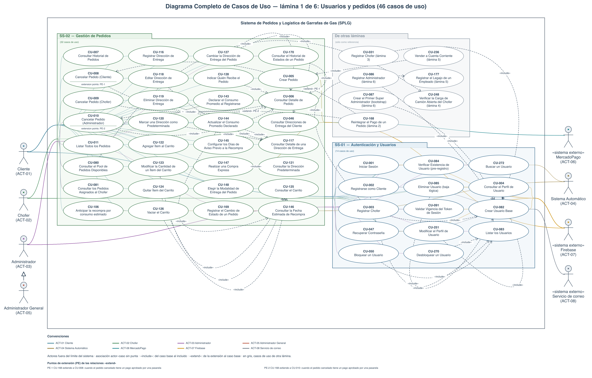

**Figura 4 — Diagrama de casos de uso, lámina 2 de 6: Despacho, entrega y posventa**

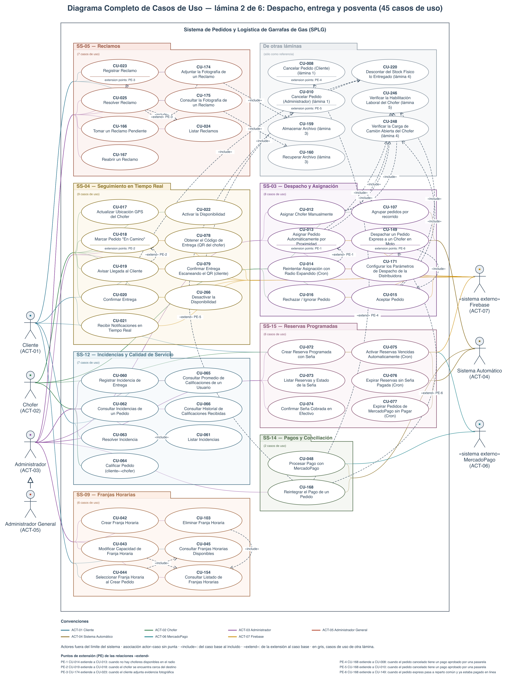

**Figura 5 — Diagrama de casos de uso, lámina 3 de 6: Choferes y flota**

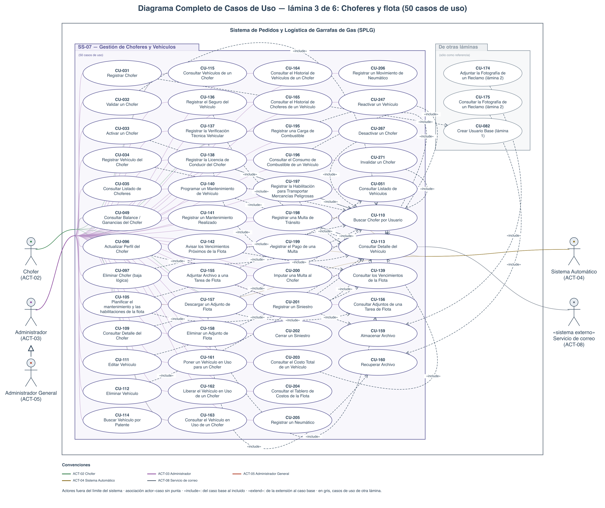

**Figura 6 — Diagrama de casos de uso, lámina 4 de 6: Productos, envases y compras**

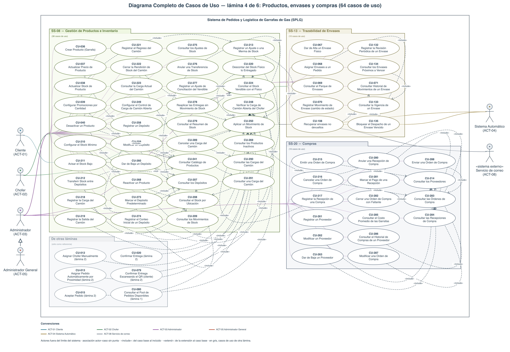

**Figura 7 — Diagrama de casos de uso, lámina 5 de 6: Personal y caja**

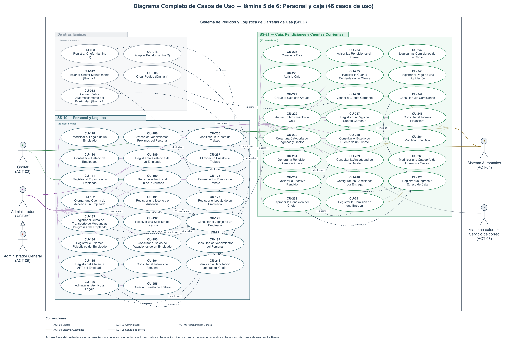

**Figura 8 — Diagrama de casos de uso, lámina 6 de 6: Administración y plataforma**

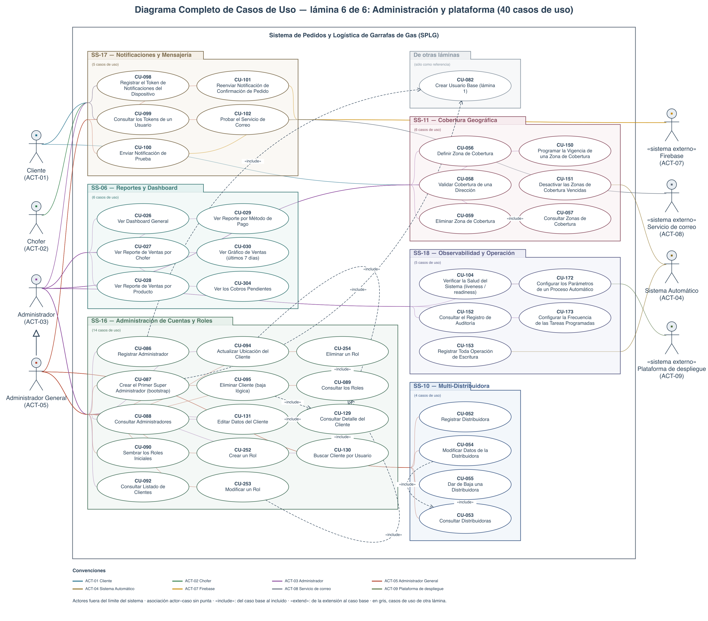

**Figura 9 — Diagrama de Casos de Uso del Sistema**

> Notación UML: actores fuera del límite del sistema (una sola vez cada uno) y los 290 casos
> de uso dentro, agrupados en paquetes, con las relaciones `«include»` y `«extend»` entre
> casos de la lista. El Administrador General especializa al Administrador. Por su tamaño se
> entrega también en formato vectorial, que permite ampliarla sin pérdida de legibilidad.

---

## 4. Subsistemas del Proyecto

El sistema opera bajo un modelo **multi-distribuidora**: una única instancia atiende a
varias empresas comercializadoras manteniendo sus datos aislados entre sí. Ese
aislamiento no es un subsistema más sino una **restricción arquitectónica transversal**:
todo caso de uso de gestión queda acotado a la distribuidora del usuario que lo invoca.

### 4.1 Subsistemas de negocio

| Código | Subsistema | Descripción |
|--------|------------|-------------|
| SS-01 | Autenticación y Usuarios | Registro, ingreso y control de acceso diferenciado por rol, delegado en el proveedor de identidad: el sistema verifica en cada solicitud el token de identidad de Firebase y resuelve el rol contra la base. |
| SS-02 | Gestión de Pedidos | Alta transaccional del pedido, ciclo de vida de sus estados y cancelación, con reserva y restitución de stock. |
| SS-03 | Despacho y Asignación | Negociación secuencial del pedido con los choferes disponibles: oferta con vigencia acotada, paso al siguiente candidato y ampliación progresiva del radio de búsqueda. |
| SS-04 | Seguimiento en Tiempo Real | Actualización de la posición del chofer y aviso de cada cambio de estado al cliente, por conexión persistente y por notificación al dispositivo. |
| SS-05 | Reclamos | Registro del reclamo posterior a la entrega por parte del cliente, y su gestión y resolución por el administrador. |
| SS-06 | Reportes y Dashboard | Estadísticas operativas y análisis de ventas para el administrador. |
| SS-07 | Gestión de Choferes y Vehículos | Alta, validación y administración de los repartidores y de las unidades de la flota. Con la ampliación planificada (I-12), también las cargas de combustible, las multas, los siniestros, los neumáticos y el costo de cada unidad. |
| SS-08 | Gestión de Productos e Inventario | Tipos de garrafa comercializados, con su precio, su stock y sus promociones por volumen; y el stock físico por depósito y por camión, sus movimientos, ajustes y umbrales, y la carga y rendición del camión. |
| SS-09 | Franjas Horarias | Configuración de los rangos horarios de entrega y de su capacidad máxima diaria. |
| **SS-11** | **Cobertura Geográfica** | Definición de las áreas dentro de las cuales la distribuidora acepta pedidos, con el recargo que corresponde a cada una, y validación de cobertura de un domicilio. |
| **SS-12** | **Incidencias y Calidad de Servicio** | Registro por el chofer de los contratiempos ocurridos durante el reparto, y calificación recíproca entre cliente y chofer al cerrar el pedido. |
| **SS-13** | **Trazabilidad de Envases** | Seguimiento del botellón físico individual por su número de serie a lo largo de todo su ciclo: depósito, carga, despacho, poder del cliente y devolución. |
| **SS-14** | **Pagos y Conciliación** | Cobro a través de pasarela, registro de cada transacción y procesamiento de los avisos que la pasarela devuelve. |
| **SS-15** | **Reservas Programadas** | Pedidos concertados para una fecha futura con una seña en garantía, con su activación y su expiración automáticas. |
| SS-19 | Personal y Legajos | Legajo de cada persona que trabaja en la distribuidora, con o sin cuenta de acceso; puestos; documentación con vencimiento; asistencia y licencias. Puestos, legajos, egreso y cuenta de acceso construidos; documentación con vencimiento, asistencia y licencias planificadas (I-11). |
| **SS-20** | **Compras** | Proveedores, órdenes de compra a las plantas de llenado y recepción de lo comprado, que es lo que hace entrar garrafas llenas al stock. |
| **SS-21** | **Caja, Rendiciones y Cuentas Corrientes** | Cajas con sesión y arqueo, libro de movimientos, rendición diaria del chofer, cuentas corrientes de clientes y comisiones por entrega con su liquidación. Planificado (I-14). |

### 4.2 Subsistemas de soporte

| Código | Subsistema | Descripción |
|--------|------------|-------------|
| **SS-10** | **Multi-Distribuidora** | Alta y administración de las empresas comercializadoras, y aislamiento de los datos de cada una. Es la dimensión transversal a la que quedan acotados los subsistemas de negocio. |
| **SS-16** | **Administración de Cuentas y Roles** | Designación de administradores, definición de los roles del sistema y gestión del padrón de clientes por parte del administrador. |
| **SS-17** | **Notificaciones y Mensajería** | Registro de los dispositivos de cada usuario y envío de los avisos, tanto al dispositivo como por correo. |
| **SS-18** | **Observabilidad y Operación** | Verificación del estado de los componentes de los que depende el sistema, registro de auditoría de toda operación de escritura y configuración de los procesos automáticos y de las tareas programadas de cada distribuidora. Es el subsistema que realiza los requisitos no funcionales de disponibilidad y escalabilidad. |

> **Sobre SS-08 y SS-13.** El sistema distingue dos conceptos que el lenguaje corriente
> confunde. SS-08 administra el **producto**: el tipo de garrafa que se vende, con su
> precio y su stock agregado. SS-13 administra el **envase**: el botellón físico
> individual, identificado por su número de serie, que se entrega y se espera recuperar.
> El cliente compra un producto pero recibe un envase, y es ese envase concreto el que
> hay que rastrear.

**Figura 10 — Diagrama de Subsistemas**

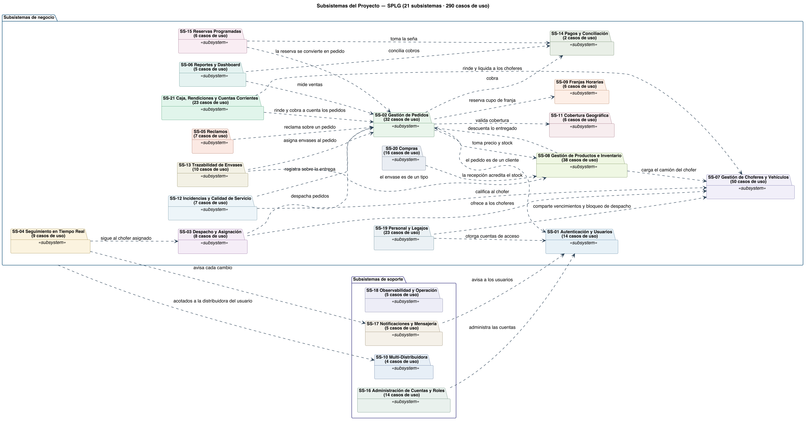

> Todo subsistema de negocio opera acotado a la distribuidora del usuario que lo invoca:
> SS-10 no es un subsistema más sino la restricción que los envuelve a todos.

### 4.3 Diagramas de Casos de Uso por Subsistema

Cada subsistema tiene su diagrama de casos de uso, en notación UML: los actores fuera del límite, los casos de uso dentro, las relaciones `«include»` y `«extend»` con sus puntos de extensión, y el Administrador General dibujado como especialización del Administrador. Por eso el Administrador General se asocia sólo a los casos que son exclusivos suyos: los demás los hereda. Los casos de otro subsistema que uno de éste incluye o extiende se dibujan fuera del límite, con el código de su subsistema.

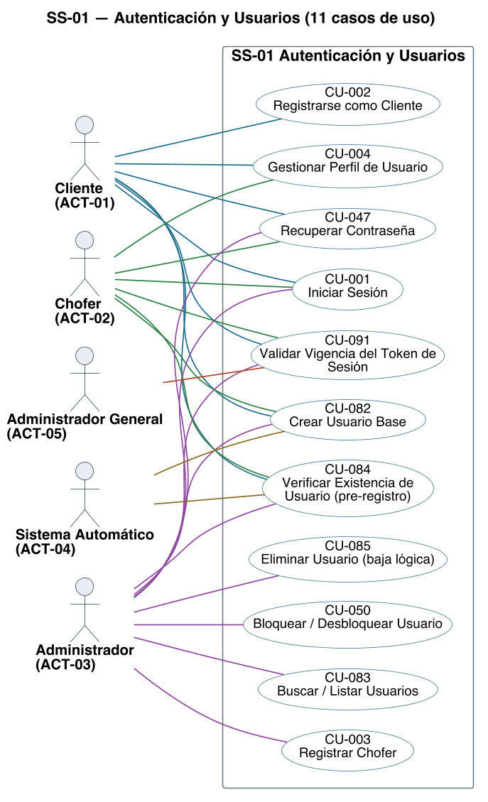

**Figura 11 — SS-01 Autenticación y Usuarios: casos de uso**

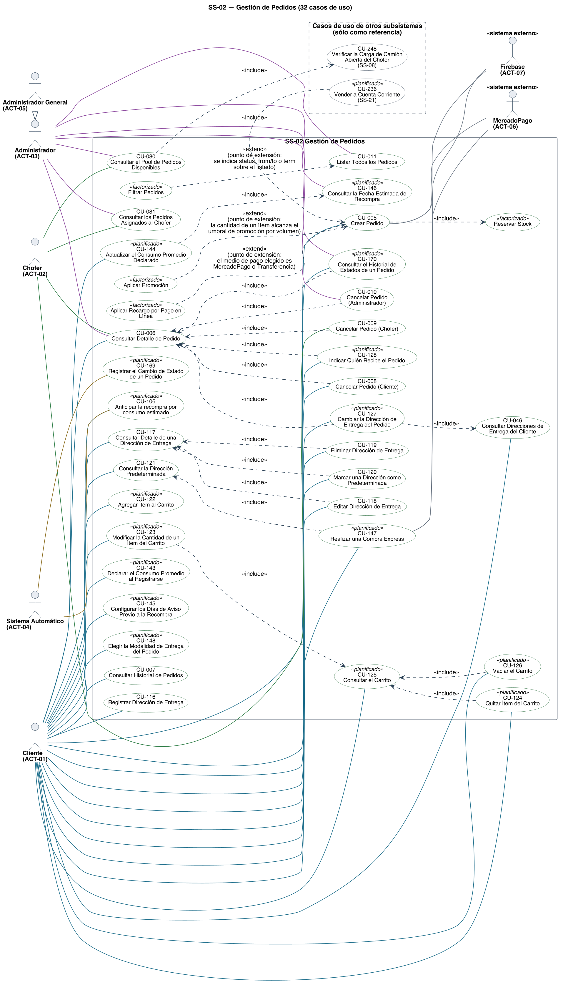

**Figura 12 — SS-02 Gestión de Pedidos: casos de uso**

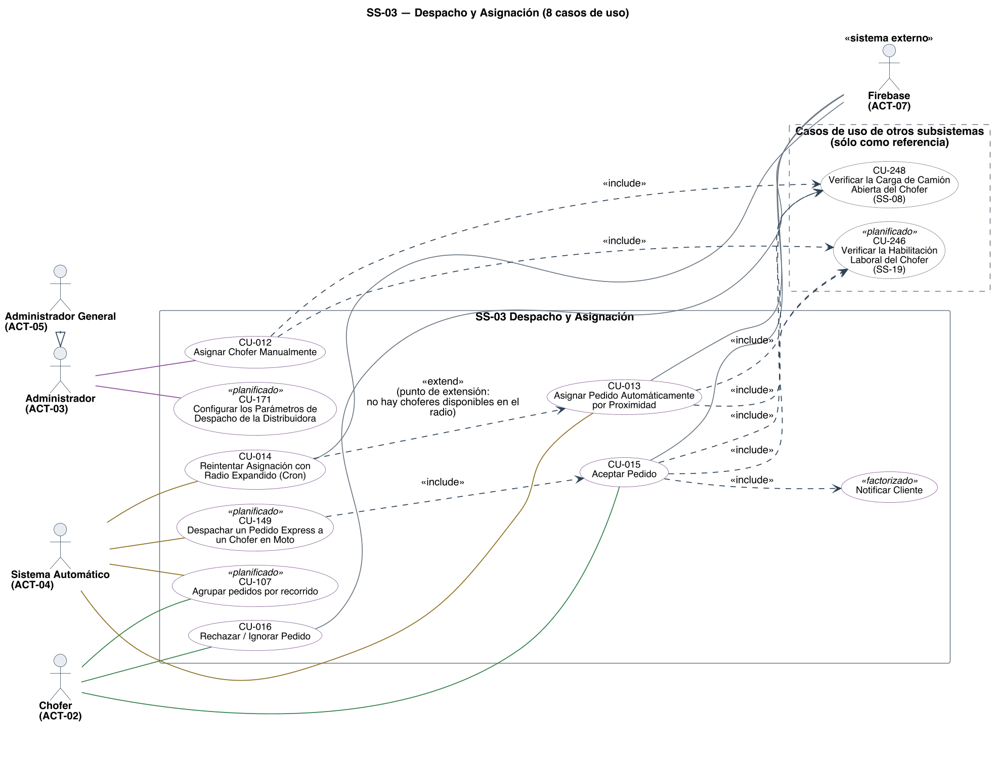

**Figura 13 — SS-03 Despacho y Asignación: casos de uso**

**Figura 14 — SS-04 Seguimiento en Tiempo Real: casos de uso**

**Figura 15 — SS-05 Reclamos: casos de uso**

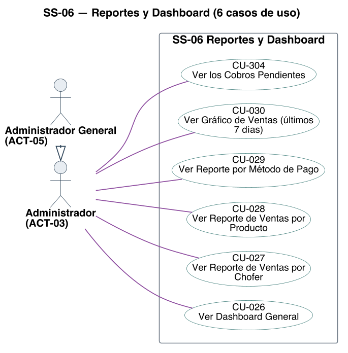

**Figura 16 — SS-06 Reportes y Dashboard: casos de uso**

**Figura 17 — SS-07 Gestión de Choferes y Vehículos: casos de uso, choferes (lámina 1 de 3)**

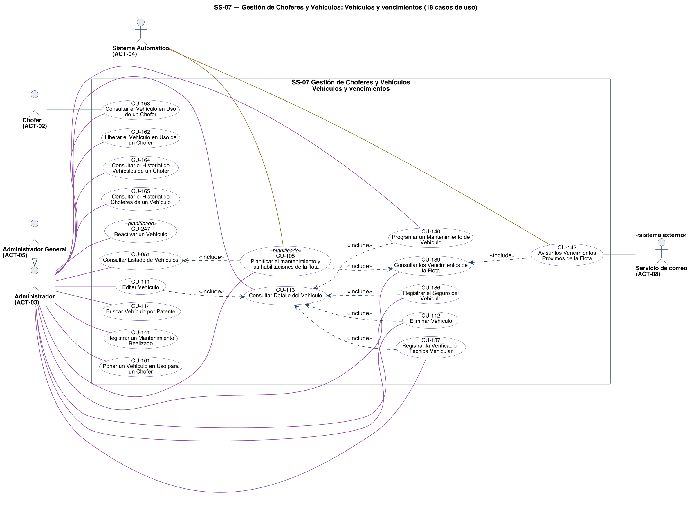

**Figura 18 — SS-07 Gestión de Choferes y Vehículos: casos de uso, vehículos y vencimientos (lámina 2 de 3)**

**Figura 19 — SS-07 Gestión de Choferes y Vehículos: casos de uso, costos, siniestros y adjuntos de flota (lámina 3 de 3)**

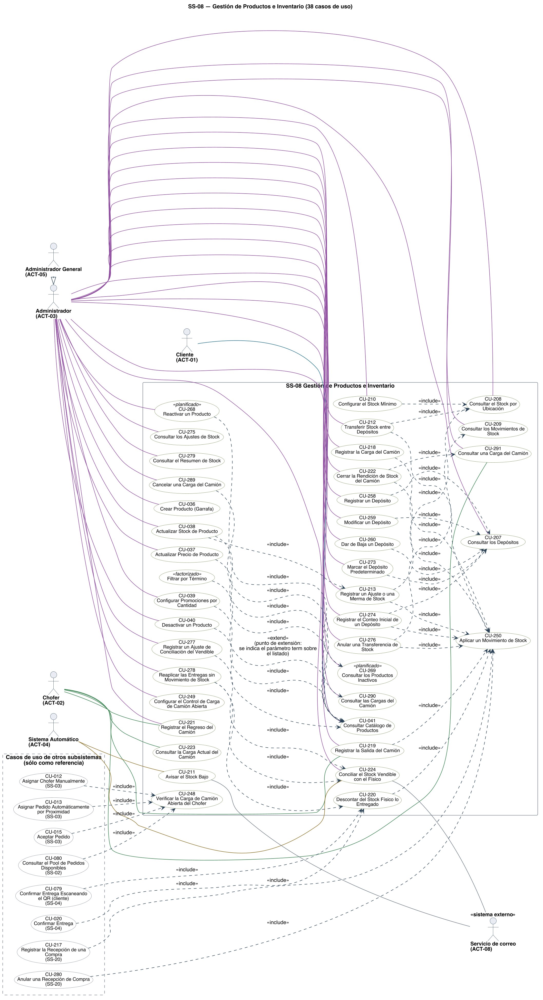

**Figura 20 — SS-08 Gestión de Productos e Inventario: casos de uso**

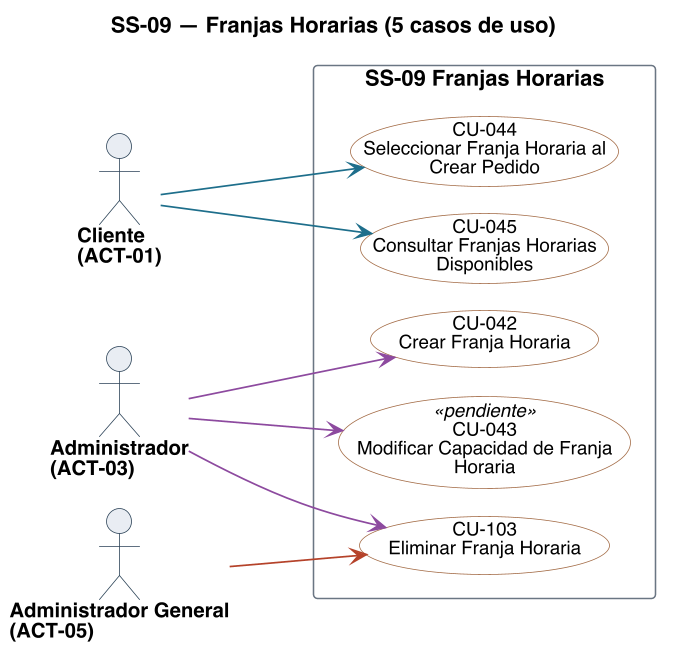

**Figura 21 — SS-09 Franjas Horarias: casos de uso**

**Figura 22 — SS-10 Multi-Distribuidora: casos de uso**

**Figura 23 — SS-11 Cobertura Geográfica: casos de uso**

**Figura 24 — SS-12 Incidencias y Calidad de Servicio: casos de uso**

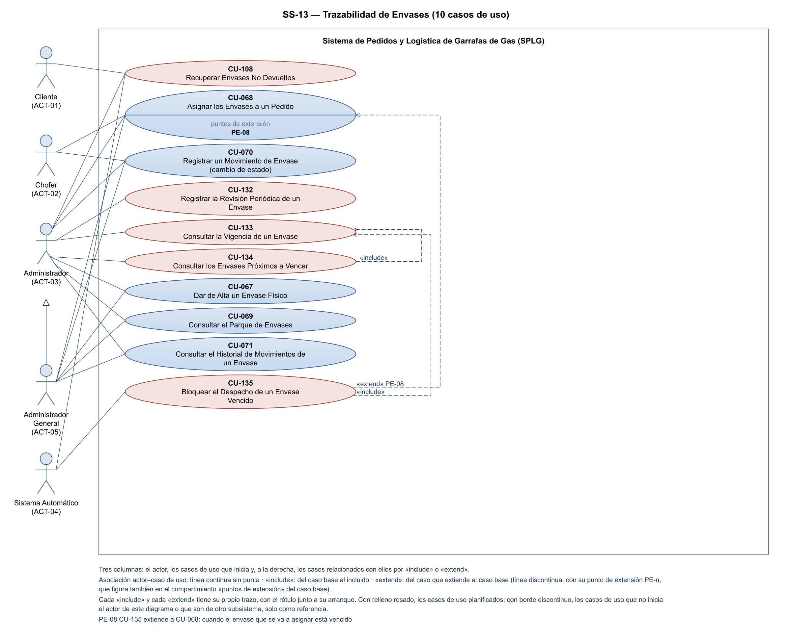

**Figura 25 — SS-13 Trazabilidad de Envases: casos de uso**

**Figura 26 — SS-14 Pagos y Conciliación: casos de uso**

**Figura 27 — SS-15 Reservas Programadas: casos de uso**

**Figura 28 — SS-16 Administración de Cuentas y Roles: casos de uso**

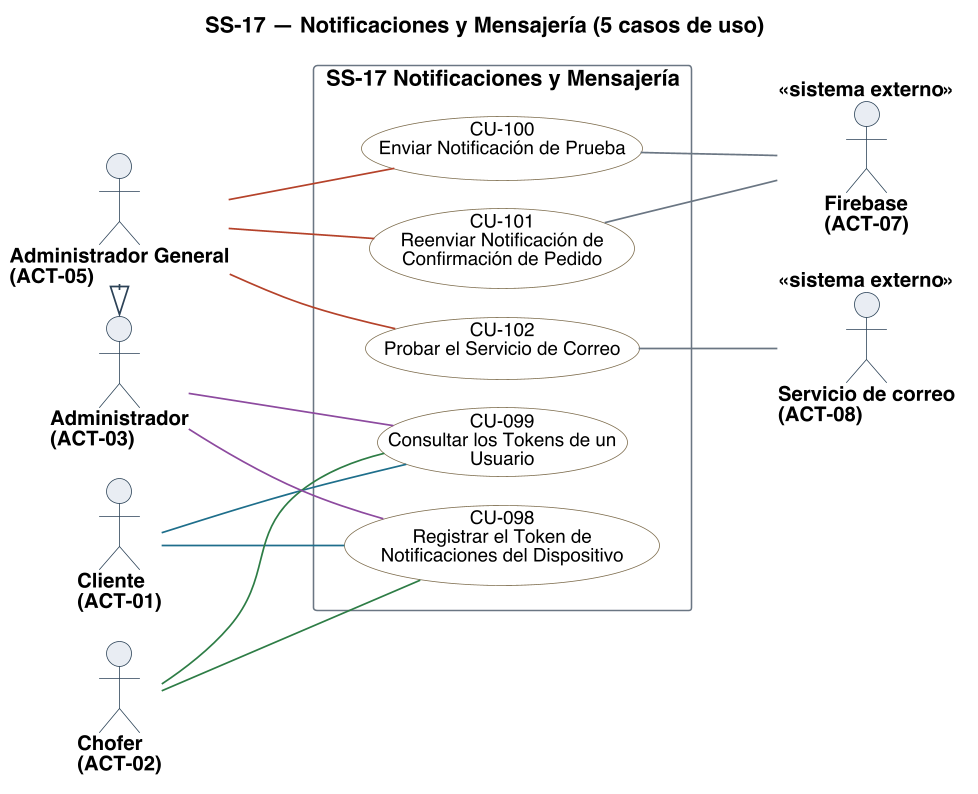

**Figura 29 — SS-17 Notificaciones y Mensajería: casos de uso**

**Figura 30 — SS-18 Observabilidad y Operación: casos de uso**

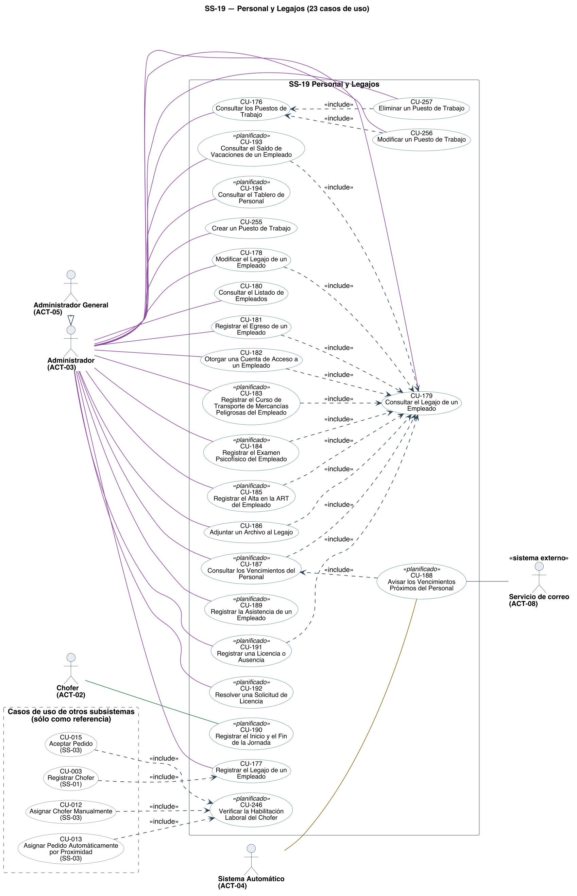

**Figura 31 — SS-19 Personal y Legajos: casos de uso**

**Figura 32 — SS-20 Compras: casos de uso**
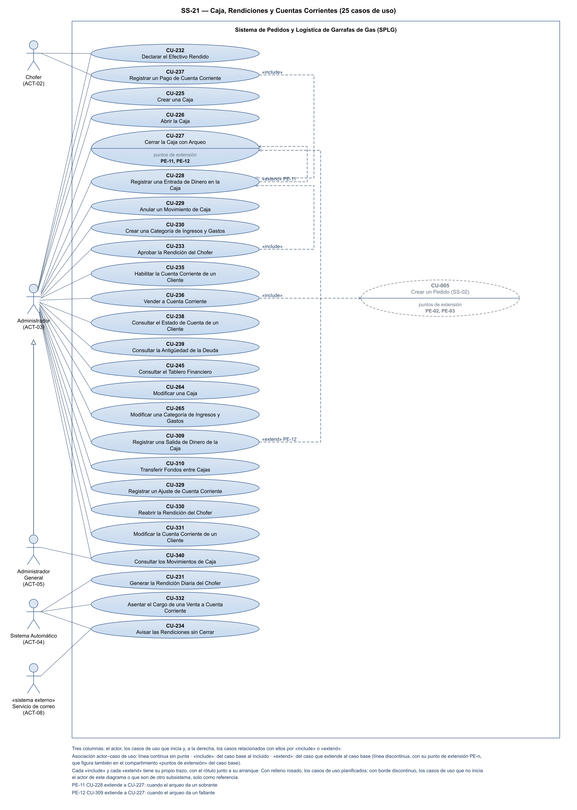

**Figura 33 — SS-21 Caja, Rendiciones y Cuentas Corrientes: casos de uso**

El mapa de una página, el diagrama de contexto y el diagrama completo están en la sección 3; los actores, en la sección 7.1.

---

## 5. Objetivos de la Iteración

La iteración en curso persigue los objetivos que siguen. Se derivan de los objetivos del
sistema de la sección 2 y acotan qué parte de cada uno se aborda en esta vuelta.

| Código | Objetivo | Descripción | Estabilidad |
|--------|----------|-------------|:-----------:|
| OBJ-I-01 | Completar la especificación de los casos de uso construidos | Documentar los casos de uso que el sistema ya ejecuta y que el relevamiento inicial no había registrado, de modo que la especificación y el sistema describan lo mismo. Comprende los casos CU-052 a CU-104. | Alta |
| OBJ-I-02 | Incorporar el alcance multi-distribuidora | Reflejar en la documentación que el sistema atiende a varias empresas comercializadoras con sus datos aislados, dimensión ausente de la especificación original. | Alta |
| OBJ-I-03 | Construir los casos de uso planificados | Realizar, en el orden de las iteraciones I-1 a I-10 del plan de construcción (Documento 0, sección 4), los casos de uso que están especificados y que el sistema todavía no ejecuta, y llevar a configuración por distribuidora los parámetros que son constantes del programa. | Alta |
| OBJ-I-04 | Incorporar los módulos inteligentes | Construir los procesos automatizados que deciden por su cuenta, se parametrizan por distribuidora y no ejecutan sin una persona lo que compromete dinero (M1 a M5). | Alta |
| OBJ-I-05 | Completar el modelo de datos | Documentar el diagrama entidad-relación con la totalidad de las entidades, sus atributos y sus relaciones. | Media |

---

## 6. Requisitos de Información

### IRQ-01 — Información sobre Usuarios

| Campo | Detalle |
|-------|---------|
| **Objetivos asociados** | OBJ-01, OBJ-05 |
| **Requisitos asociados** | CU-001, CU-002, CU-003, CU-004, CU-251 |
| **Descripción** | El sistema debe almacenar y gestionar la información de los tres tipos de usuario del sistema. |
| **Datos específicos** | Nombre completo, email (único), número de teléfono, rol (CLIENTE / CHOFER / ADMIN), fecha de registro, estado activo/inactivo, token de notificación FCM (para clientes), estado de validación (para choferes: `validated`). |
| **Estabilidad** | Alta |

### IRQ-02 — Información sobre Pedidos

| Campo | Detalle |
|-------|---------|
| **Objetivos asociados** | OBJ-01, OBJ-02, OBJ-06 |
| **Requisitos asociados** | CU-005, CU-006, CU-007, CU-008, CU-009, CU-010, CU-012, CU-122, CU-123, CU-124, CU-125, CU-126, CU-169, CU-170 |
| **Descripción** | El sistema debe almacenar el historial completo de cada pedido desde su creación hasta la entrega o cancelación, incluyendo todos los cambios de estado y sus timestamps. |
| **Datos específicos** | ID de pedido (UUID), referencia al cliente, referencia al chofer asignado (nullable), coordenadas de entrega (lat/lng), ítems y cantidades, precio unitario al momento de compra, subtotal por ítem, descuento aplicado (%), total del pedido, método de pago (CASH / MERCADOPAGO / TRANSFER), estado del pago (PENDING / PAID / FAILED), estado del pedido (PENDING / ACCEPTED / ON_THE_WAY / DELIVERED / CANCELLED), franja horaria seleccionada, fecha solicitada de entrega, ventana de entrega (inicio y fin), `dispatchAttempts`, motivo de cancelación (si aplica), timestamps: `createdAt`, `acceptedAt`, `onTheWayAt`, `deliveredAt`. De cada cambio de estado: estado anterior (vacío en la creación), estado nuevo, usuario que lo originó (vacío si fue un proceso programado), motivo y fecha. Del carrito del cliente, que precede al pedido: cliente, distribuidora, y por cada ítem el tipo de garrafa, la cantidad y el precio unitario vigente al agregarlo, como referencia. |
| **Estabilidad** | Alta |

### IRQ-03 — Información sobre Choferes y Vehículos

| Campo | Detalle |
|-------|---------|
| **Objetivos asociados** | OBJ-02, OBJ-05 |
| **Requisitos asociados** | CU-031, CU-032, CU-033, CU-267, CU-271, CU-034, CU-035, CU-161, CU-162, CU-163, CU-164, CU-165, CU-195, CU-196, CU-197, CU-198, CU-199, CU-200, CU-201, CU-202, CU-203, CU-204, CU-205, CU-206, CU-247 |
| **Descripción** | El sistema debe registrar los datos del repartidor, su estado operativo, el vehículo asociado y el vehículo que usa en cada momento, con el historial de quién usó cada vehículo. |
| **Datos específicos** | Datos del usuario (ver IRQ-01). Del perfil Delivery: calificación promedio, balance acumulado, estado de validación (`validated`), estado activo (`isActive`), ubicación GPS actual (almacenada en Redis, no en BD relacional). Del vehículo: tipo (auto / moto / camioneta), patente, marca, modelo, año, color, capacidad de carga. De cada asignación de vehículo: chofer, vehículo, fecha de asignación, fecha de liberación (vacía mientras está en uso), administrador que la hizo, administrador que la cerró y nota. **(Planificado, I-12)** Del vehículo, además: tipo de combustible y capacidad del tanque. De cada carga de combustible: fecha y hora, tipo de combustible, litros, precio por litro, importe, kilometraje, si se llenó el tanque, estación, medio de pago, comprobante y si es anómala. De cada multa de tránsito: fecha de la infracción, jurisdicción, número de acta, infracción, importe, importe con pago voluntario, vencimiento, estado, fecha e importe de pago y si se imputó al chofer. De cada siniestro: fecha, lugar, descripción, heridos, terceros, derrame de gas, denuncia policial, reclamo al seguro, estado, costos y cierre. De cada neumático: serie, marca, medida, costo, estado, posición y movimientos. |
| **Estabilidad** | Alta |

### IRQ-04 — Información sobre Productos (Garrafas)

| Campo | Detalle |
|-------|---------|
| **Objetivos asociados** | OBJ-06, OBJ-07 |
| **Requisitos asociados** | CU-036, CU-037, CU-038, CU-039, CU-040, CU-268, CU-269, CU-041 |
| **Descripción** | El sistema debe almacenar el catálogo de garrafas disponibles con su precio vigente y stock actual. |
| **Datos específicos** | Tipo de garrafa (ej: "10kg", "15kg", "45kg"), peso, precio de venta vigente, stock disponible, descripción opcional, estado activo/inactivo, promociones por volumen (almacenadas como JSONB: array de `{ quantity: number, discountPercentage: number }`). |
| **Estabilidad** | Alta |

### IRQ-05 — Información sobre Franjas Horarias

| Campo | Detalle |
|-------|---------|
| **Objetivos asociados** | OBJ-01, OBJ-08 |
| **Requisitos asociados** | CU-042, CU-043, CU-044, CU-045 |
| **Descripción** | El sistema debe almacenar las franjas horarias de entrega configuradas por el administrador y controlar su capacidad. |
| **Datos específicos** | Nombre de la franja (ej: "Mañana", "Tarde"), hora de inicio (HH:MM), hora de fin (HH:MM), capacidad máxima diaria de pedidos, estado activo/inactivo. |
| **Estabilidad** | Alta |

### IRQ-06 — Información sobre Reclamos

| Campo | Detalle |
|-------|---------|
| **Objetivos asociados** | OBJ-04, OBJ-05 |
| **Requisitos asociados** | CU-023, CU-024, CU-025, CU-166, CU-167, CU-174, CU-175 |
| **Descripción** | El sistema debe registrar los reclamos realizados por clientes sobre pedidos entregados, incluyendo la evidencia adjunta y la resolución del administrador. |
| **Datos específicos** | ID de reclamo (UUID), referencia al pedido asociado, referencia al cliente reclamante, motivo del reclamo (texto libre), descripción detallada, referencia de la foto de evidencia —clave del almacenamiento o dirección externa— (opcional), estado (PENDING / IN_PROCESS / RESOLVED / REJECTED), nota de resolución del administrador (obligatoria al resolver/rechazar), fecha de creación. |
| **Estabilidad** | Alta |

### IRQ-07 — Información sobre Direcciones de Entrega

| Campo | Detalle |
|-------|---------|
| **Objetivos asociados** | OBJ-01, OBJ-02 |
| **Requisitos asociados** | CU-005 |
| **Descripción** | El sistema debe almacenar las direcciones de entrega del cliente para agilizar la creación de futuros pedidos. |
| **Datos específicos** | Referencia al cliente propietario, calle y número, referencia adicional (ej: "departamento 3B, timbre roto"), latitud, longitud, alias de la dirección (ej: "Casa", "Trabajo"). |
| **Estabilidad** | Alta |

### IRQ-08 — Información sobre Pagos y Transacciones

| Campo | Detalle |
|-------|---------|
| **Objetivos asociados** | OBJ-07 |
| **Requisitos asociados** | CU-005, CU-029, CU-168 |
| **Descripción** | El sistema debe registrar la información del pago asociado a cada pedido, incluyendo el método, el estado y la referencia externa de MercadoPago cuando corresponda. |
| **Datos específicos** | Método de pago (CASH / MERCADOPAGO / TRANSFER), estado del pago (PENDING / PAID / FAILED), recargo aplicado (porcentaje y monto), ID de preferencia de MercadoPago (para pagos digitales), timestamp de confirmación de pago, estado reintegrado del pago cuando el importe se devolvió por la pasarela. |
| **Estabilidad** | Alta |

### IRQ-09 — Información sobre Distribuidoras

| Campo | Detalle |
|-------|---------|
| **Objetivos asociados** | OBJ-09 |
| **Requisitos asociados** | CU-052, CU-053, CU-054, CU-055, CU-171, CU-172 |
| **Descripción** | El sistema debe almacenar los datos de cada empresa comercializadora que opera en la plataforma, junto con el identificador al que queda acotada toda la información de gestión del resto de los subsistemas. |
| **Datos específicos** | Identificador de la distribuidora (UUID) — clave a la que se ata todo dato de gestión del sistema; Nombre comercial — denominación con la que se muestra la empresa; Nombre corto (slug) — identificador legible y único con el que se resuelve la distribuidora en la cabecera de la petición; Razón social — nombre legal de la empresa; Identificación fiscal (CUIT) — clave tributaria de la empresa; Email y teléfono de contacto — datos de contacto de la distribuidora; URL del logotipo — imagen que identifica a la empresa en las aplicaciones; Estado — activa o suspendida; Plan contratado — plan de servicio asignado a la empresa; Fecha de alta, fecha de última modificación y marca de baja lógica — la baja no borra el registro para no romper las referencias de sus pedidos; Configuración de procesos automáticos — por proceso, los parámetros de la distribuidora (pasos de radio y ventana de aceptación del despacho, parámetros de cada módulo inteligente, frecuencia de las tareas programadas), con el usuario que los modificó y la fecha. |
| **Estabilidad** | Alta |
| **Comentarios** | Es la dimensión transversal del sistema (SS-10): el identificador de la distribuidora se repite en las entidades de negocio y acota toda consulta de gestión. La búsqueda por nombre corto existe internamente y la usan los puntos de acceso públicos de catálogo (CU-041) y de franjas horarias (CU-045), pero no está expuesta como operación del Administrador General (CU-053). |

### IRQ-10 — Información sobre Zonas de Cobertura

| Campo | Detalle |
|-------|---------|
| **Objetivos asociados** | OBJ-10, OBJ-09 |
| **Requisitos asociados** | CU-005, CU-056, CU-057, CU-058, CU-059, CU-072 |
| **Descripción** | El sistema debe almacenar las áreas geográficas dentro de las cuales cada distribuidora acepta pedidos, con el recargo asociado a cada área, para poder resolver si un domicilio queda cubierto y con qué costo adicional. |
| **Datos específicos** | Identificador de la zona (UUID) — clave de la zona de cobertura; Distribuidora propietaria — empresa a la que pertenece la zona; las consultas se acotan siempre por este dato; Nombre de la zona — denominación con la que el administrador la identifica (ej.: "Centro", "Villa Cabello"); Polígono del área — vértices que delimitan la zona, en coordenadas geográficas, sobre los que se resuelve si un punto cae dentro; Recargo — tipo (monto fijo o porcentaje sobre el subtotal de ítems) y valor, que se suman al total del pedido entregado dentro de la zona; Estado activo/inactivo — indica si la zona se considera en la validación de cobertura; Fecha de alta y fecha de última modificación — momento en que se definió la zona y en que se la modificó por última vez. |
| **Estabilidad** | Alta |
| **Comentarios** | Si la distribuidora no definió ninguna zona, el sistema asume cobertura total con recargo cero: la ausencia de zonas no bloquea la operación. El resultado de la validación devuelve si el punto está cubierto, el nombre de la zona alcanzada y el recargo que le corresponde. |

### IRQ-11 — Información sobre Incidencias de Entrega

| Campo | Detalle |
|-------|---------|
| **Objetivos asociados** | OBJ-11, OBJ-04 |
| **Requisitos asociados** | CU-060, CU-061, CU-062, CU-063 |
| **Descripción** | El sistema debe registrar los contratiempos ocurridos durante el reparto de un pedido, con su evidencia y el usuario que los reportó, y conservar la resolución que el administrador les da. |
| **Datos específicos** | Identificador de la incidencia (UUID) — clave de la incidencia; Pedido afectado — pedido sobre el que se reporta el contratiempo; Distribuidora — se toma del pedido referenciado y no del usuario que reporta; Usuario que reporta — identificador del chofer o del administrador que deja asentada la incidencia; Tipo — producto dañado, faltante de stock, cliente ausente u otro; Descripción — relato de lo sucedido durante la entrega; URL de la foto — evidencia fotográfica opcional; Estado — abierta o resuelta; Nota de resolución — texto con el que el administrador cierra la incidencia; Fecha de creación y fecha de resolución — momento en que se reportó y en que se cerró. |
| **Estabilidad** | Alta |
| **Comentarios** | La incidencia no reemplaza al reclamo (IRQ-06): el reclamo lo levanta el cliente después de la entrega, la incidencia la deja el chofer durante el reparto. El alta toma la distribuidora del pedido y no la del contexto de la petición, limitación conocida del aislamiento entre distribuidoras. |

### IRQ-12 — Información sobre Calificaciones

| Campo | Detalle |
|-------|---------|
| **Objetivos asociados** | OBJ-12, OBJ-04 |
| **Requisitos asociados** | CU-064, CU-065, CU-066 |
| **Descripción** | El sistema debe registrar la valoración que el cliente y el chofer se dan mutuamente al cerrarse el pedido, y sostener con ella el promedio de calificación de cada usuario. |
| **Datos específicos** | Identificador de la calificación (UUID) — clave de la calificación; Pedido calificado — pedido entregado sobre el que se emite la valoración; Distribuidora — se toma del pedido, de modo que los promedios del panel quedan por empresa; Usuario emisor — quien califica; se resuelve desde el token de la sesión, nunca desde el cuerpo de la petición; Usuario calificado — el otro lado del pedido; se deriva del propio pedido; Lado emisor — cliente o chofer; junto con el pedido forma la restricción de unicidad que admite una sola calificación por lado; Puntaje — valoración de 1 a 5 estrellas; Comentario — observación escrita opcional de quien califica; Fecha de emisión — momento en que se registró la calificación. |
| **Estabilidad** | Alta |
| **Comentarios** | Cuando la calificación la emite el cliente, el sistema recalcula además el promedio del chofer y lo guarda en su perfil (IRQ-03). El promedio del cliente se calcula al consultarlo y no se persiste en su perfil. |

### IRQ-13 — Información sobre Envases Físicos y sus Movimientos

| Campo | Detalle |
|-------|---------|
| **Objetivos asociados** | OBJ-13, OBJ-04 |
| **Requisitos asociados** | CU-067, CU-068, CU-069, CU-070, CU-071 |
| **Descripción** | El sistema debe registrar cada botellón físico identificado por su número de serie, su situación actual y quién lo tiene, junto con la traza completa de los cambios de estado por los que pasó. |
| **Datos específicos** | Identificador del envase (UUID) — clave del botellón físico; Distribuidora propietaria — empresa dueña del envase; Número de serie — identificación grabada en el botellón; es única por distribuidora, no a nivel de toda la plataforma; Tipo de producto — formato de garrafa al que corresponde el envase (IRQ-04); Estado — en depósito, lleno, despachado, en poder del cliente o vacío devuelto; Cliente actual — usuario que tiene el envase en su poder; solo se completa mientras el envase está con el cliente; Pedido actual — pedido en el que el envase salió despachado; permite avanzarlo al confirmarse la entrega; Importe de garantía — monto en depósito que representa el envase; Fecha de alta y fecha de última modificación — momento en que se incorporó al parque y en que cambió por última vez; Movimiento: estado de origen y estado de destino — situación anterior y posterior; el estado de origen queda vacío en el movimiento que inaugura la trazabilidad; Movimiento: pedido asociado — pedido en cuyo contexto ocurrió la transición, si corresponde; Movimiento: usuario que lo ejecutó — chofer o administrador responsable del cambio de estado; Movimiento: nota y fecha — motivo del movimiento y momento en que se produjo. |
| **Estabilidad** | Alta |
| **Comentarios** | No confundir con IRQ-04: aquel describe el producto que se vende, con su precio y su stock agregado; este describe el envase concreto que se entrega y se espera recuperar. El historial de movimientos es de solo agregado: no se edita ni se borra, únicamente se lee para reconstruir el recorrido del envase. |

### IRQ-14 — Información sobre Reservas Programadas y su Seña

| Campo | Detalle |
|-------|---------|
| **Objetivos asociados** | OBJ-14, OBJ-06, OBJ-07 |
| **Requisitos asociados** | CU-072, CU-073, CU-074, CU-075, CU-076 |
| **Descripción** | El sistema debe registrar los pedidos apartados para una fecha futura y el estado de la seña que los garantiza, para poder activarlos el día agendado o expirarlos cuando la seña no se cobra. |
| **Datos específicos** | Indicador de reserva — dato del cuerpo del pedido que hace que este nazca en estado reservado; la fecha agendada por sí sola no lo convierte en reserva; Estado reservado — situación en la que el pedido no se ofrece a ningún chofer y el stock ya quedó descontado; Fecha de entrega agendada — día para el que el cliente apartó la mercadería; es obligatoria en toda reserva; Monto de la seña — importe que el cliente deja en garantía al reservar; Seña cobrada — indica si la seña se acreditó; arranca siempre en falso y la marca el aviso de la pasarela o la confirmación manual del administrador; Enlace de pago de la seña — preferencia generada solo por el importe de la seña cuando el medio elegido es MercadoPago (IRQ-08); Saldo restante — diferencia entre el total del pedido y la seña, calculada al momento de listar las reservas y no almacenada; Motivo de cancelación — texto con el que queda cancelada la reserva que expiró sin seña cobrada; Plazo de gracia de la seña — cantidad de horas configurable tras las cuales la reserva impaga se cancela y el stock se restituye. |
| **Estabilidad** | Alta |
| **Comentarios** | La reserva se apoya sobre los mismos datos del pedido (IRQ-02) y sobre el stock del producto (IRQ-04): el descuento se hace al reservar y la restitución, al expirar. Los procesos automáticos que activan y expiran reservas no se acotan por distribuidora, por ser procesos de plataforma. |

### IRQ-15 — Información sobre el Estado Operativo del Sistema

| Campo | Detalle |
|-------|---------|
| **Objetivos asociados** | OBJ-15, OBJ-05 |
| **Requisitos asociados** | CU-100, CU-102, CU-104, CU-173 |
| **Descripción** | El sistema debe reunir e informar el estado de sus componentes y el resultado de las pruebas de sus canales de aviso, de modo que el orquestador sepa si la instancia puede recibir tráfico y el administrador pueda diagnosticar la mensajería. |
| **Datos específicos** | Estado de la sonda de vida — indicación de que el proceso responde, acompañada de su marca temporal; Estado de la base de datos — resultado de la verificación de conexión con PostgreSQL; Estado del cache — resultado de la verificación de conexión con Redis, del que dependen el despacho por proximidad y el seguimiento en vivo; Memoria residente del proceso — consumo medido contra el umbral de 300 MB; Ocupación de disco — margen libre medido contra el umbral del 90 %; Diagnóstico de notificaciones: token de destino, título y cuerpo — datos con los que se arma el mensaje de prueba; Diagnóstico de notificaciones: identificador del mensaje o error devuelto — resultado que entrega el proveedor de mensajería; Diagnóstico de correo: dirección de destino y resultado del envío — dirección probada y estado devuelto por el proveedor; Diagnóstico de correo: comportamiento de la caché de enlaces — indica si los dos enlaces de recuperación generados seguidos resultaron iguales. |
| **Estabilidad** | Media |
| **Comentarios** | Estos datos no se persisten: se calculan en el momento de la consulta y solo quedan en el registro de eventos. Es el requisito de información que sostiene a NFR-03 (Disponibilidad) y NFR-04 (Escalabilidad). La prueba del servicio de correo es una operación de diagnóstico exclusiva del Administrador General (CU-102). |

### IRQ-16 — Información sobre el Registro de Auditoría

| Campo | Detalle |
|-------|---------|
| **Objetivos asociados** | OBJ-04, OBJ-05 |
| **Requisitos asociados** | CU-152, CU-153 |
| **Descripción** | El sistema debe dejar constancia de toda operación que modifique datos, de modo que se pueda reconstruir después quién hizo qué, sobre qué y cuándo. Es lo que permite resolver una disputa con evidencia en lugar de con la palabra de cada parte. |
| **Datos específicos** | Identificador del asiento (UUID); autor — referencia al usuario que originó la operación, con su rol al momento de hacerla, porque el rol puede cambiar después; distribuidora a la que corresponde la operación, que es lo que permite mostrarle a cada administrador lo suyo; operación realizada (alta, modificación, baja) y ruta que la atendió; tipo de recurso afectado e identificador del recurso, para poder buscar todo lo que le pasó a un pedido o a un usuario; marca temporal con zona horaria; aplicación de origen (panel, aplicación del cliente, aplicación del chofer); dirección de red desde la que se originó; resultado — si la operación fue exitosa o rechazada, con el código de respuesta y, si fue rechazada, el motivo; detalle de lo que cambió, **con las credenciales depuradas**: de una operación de acceso queda que ocurrió y si fue exitosa, nunca la contraseña. |
| **Estabilidad** | Alta |
| **Comentarios** | El registro es de **sólo escritura**: el sistema no expone ninguna operación de modificación ni de baja sobre él, para ningún rol, porque un registro editable no prueba nada, y la base de datos rechaza con un trigger toda modificación y todo borrado de un asiento. La depuración por antigüedad, si llega a hacer falta por volumen, es una tarea programada del sistema y nunca una operación disponible para un usuario. Este requisito sostiene a OBJ-04 (trazabilidad) más allá de la entrega: OBJ-04 pedía evidencia objetiva de **una entrega** —timestamps, GPS, foto— y esto la extiende a toda operación del sistema. Conviene notar que las contraseñas no forman parte del sistema: las valida Firebase y la base no tiene columna para ellas, de modo que la depuración protege el cuerpo de la petición en tránsito, que es el único lugar donde una credencial aparece. |

### IRQ-17 — Información sobre el Personal y sus Legajos

| Campo | Detalle |
|-------|---------|
| **Objetivos asociados** | OBJ-05, OBJ-09 |
| **Requisitos asociados** | CU-176, CU-177, CU-178, CU-179, CU-180, CU-181, CU-182, CU-183, CU-184, CU-185, CU-186, CU-187, CU-188, CU-189, CU-190, CU-191, CU-192, CU-193, CU-194, CU-246, CU-255, CU-256, CU-257 |
| **Descripción** | El sistema debe llevar el legajo de cada persona que trabaja en la distribuidora, tenga o no cuenta de acceso, y su asistencia, sus licencias y la documentación con vencimiento que se le exige según su puesto, para que la distribuidora sepa quién trabaja, quién está presente y quién no está en regla. |
| **Datos específicos** | Puesto (nombre y categoría); legajo (número, nombre, apellido, tipo y número de documento, CUIL, fecha de nacimiento, domicilio, teléfono, correo personal, contacto de emergencia, fecha de ingreso, modalidad de contratación, estado, fecha y motivo de egreso); cuenta de acceso, si la tiene; jornada (día, ingreso, egreso, origen, nota); licencia (tipo, período, días, estado, motivo, quién y cuándo la resolvió); documentación con vencimiento, como tarea de un plan con dueño empleado; archivos adjuntos con su etiqueta. |
| **Estabilidad** | Media |
| **Comentarios** | Puestos y legajos construidos; documentación con vencimiento, asistencia y licencias planificadas (I-11). El documento, el CUIL, el domicilio y el contacto de emergencia son datos personales (Ley 25.326): sólo salen en la ficha y no en los listados. La baja del empleado es el egreso, que conserva el legajo. Una persona que no es chofer ni administrador no tiene cuenta: el sistema no define roles para ella. |

### IRQ-18 — Información sobre Stock, Compras y Carga del Camión

| Campo | Detalle |
|-------|---------|
| **Objetivos asociados** | OBJ-05, OBJ-06 |
| **Requisitos asociados** | CU-207, CU-208, CU-209, CU-210, CU-211, CU-212, CU-213, CU-214, CU-215, CU-216, CU-217, CU-218, CU-219, CU-220, CU-221, CU-222, CU-223, CU-224, CU-289, CU-290, CU-291, CU-248, CU-249, CU-250, CU-258, CU-259, CU-260, CU-261, CU-262, CU-263, CU-273, CU-274, CU-275, CU-276, CU-277, CU-278, CU-279, CU-280, CU-281, CU-282, CU-283, CU-284, CU-285, CU-286, CU-287, CU-288, CU-038, CU-020 |
| **Descripción** | El sistema debe llevar el stock físico de garrafas por ubicación (depósitos y camiones) y por condición, con el libro de cada movimiento, y reconciliarlo con el stock vendible del catálogo; registrar a los proveedores, las órdenes de compra y las recepciones de lo comprado; y registrar la hoja de carga de cada camión, desde que se carga hasta que se rinde. |
| **Datos específicos** | De cada depósito: nombre, código (único entre los vigentes de la distribuidora), tipo (depósito o sucursal), dirección, si es el predeterminado y su estado. De cada ubicación de stock: si es un depósito o un vehículo. De cada saldo: tipo de garrafa, condición (llena, vacía o defectuosa) y cantidad, nunca negativa. De cada movimiento, de sólo agregado: tipo de garrafa, cantidad, ubicación y condición de origen y de destino, motivo, documento que lo originó, autor y momento. De cada umbral: depósito, tipo de garrafa, mínimo de llenas y momento del último aviso. De cada ajuste: número correlativo, ubicación, motivo, nota obligatoria y renglones con la diferencia por tipo de garrafa y condición. De cada proveedor: razón social, CUIT (único entre los vigentes), tipo, contacto y plazo de pago. De cada orden de compra: número, proveedor, depósito destino, estado (borrador, enviada, parcialmente recibida, recibida, cerrada con faltante o cancelada), fecha de emisión y fecha esperada, total, motivos de cancelación y de cierre, y renglones con cantidad, costo unitario, vacíos a canjear y cantidad recibida. De cada recepción: número interno, tipo y número del comprobante del proveedor (único por proveedor y tipo), depósito, fecha de recepción, renglones con las llenas recibidas, los vacíos entregados, el costo y el promedio y la existencia previos, estado de pago y estado, y motivo y fecha de anulación. De cada carga de camión: número, vehículo, chofer, ayudante, depósito de salida, día, estado, instantes de apertura, salida, regreso y cierre, renglones con lo cargado, repuesto, declarado, entregado, esperado y la diferencia, y la nota de la diferencia. Del tipo de garrafa: el costo promedio ponderado. |
| **Estabilidad** | Media |
| **Comentarios** | Es un modelo cuantitativo, por cantidad y tipo, y no reemplaza al envase con número de serie (IRQ-13), que sigue siendo la trazabilidad individual. El stock vendible de IRQ-04 es lo que ya se reserva al crear un pedido; el físico se mantiene aparte y una invariante, que verifica un proceso nocturno, los relaciona: vendible igual a lo lleno en depósitos y camiones menos lo reservado por pedidos abiertos. El saldo de un camión es cero al cerrar su rendición. Construidos: el stock físico y las compras. Planificada (iteración I-13): la carga del camión, cuyas dos tablas no existen todavía en la base. |

### IRQ-19 — Información sobre Caja, Rendiciones, Cuentas Corrientes y Comisiones

| Campo | Detalle |
|-------|---------|
| **Objetivos asociados** | OBJ-05, OBJ-07 |
| **Requisitos asociados** | CU-225 a CU-245, CU-264, CU-265 |
| **Descripción** | El sistema debe llevar el dinero de la distribuidora: las cajas con su saldo y su libro de movimientos, la rendición diaria de lo que cobra cada chofer, las cuentas corrientes de los clientes con crédito y las comisiones que ganan los choferes por entrega, con su liquidación. |
| **Datos específicos** | Caja — nombre, tipo (efectivo, banco o billetera), saldo y si exige sesión; sesión de caja — apertura, cierre, monto inicial, esperado, contado y diferencia; movimiento de caja — sentido, importe, categoría, medio y origen, de sólo agregar; categoría de caja — ingreso o egreso, de sistema o propia; rendición del chofer — día, pedidos en efectivo, cobros en la calle, gastos, efectivo esperado y declarado, diferencia y su resolución; cuenta corriente — razón social, CUIT, condición fiscal, límite de crédito, plazo de pago, estado y saldo; asiento de cuenta corriente — cargo, pago, nota de crédito o de débito, con su vencimiento; imputación — qué pago cubre qué cargo; regla de comisión — base, valor, alcance y vigencia; asiento de comisión — comisión o deducción, con una copia de la regla; liquidación — período, bruto, deducciones, neto y estado. |
| **Estabilidad** | Alta |
| **Comentarios** | Los importes se guardan con precisión decimal fija y se calculan con aritmética decimal. Los tres libros (caja, cuenta corriente y comisiones) son de sólo agregar: se corrigen con un asiento de sentido contrario y la base rechaza toda modificación o borrado. El saldo de una caja y el de una cuenta son copias del libro que se concilian todas las noches. Con el módulo de personal, el chofer de una regla, un asiento o una liquidación pasa a ser el empleado. |

---

## 7. Requisitos Funcionales — Casos de Uso

Los casos de uso se documentan en dos niveles de detalle. La **descripción de alto
nivel** de los 290 casos está en el Documento 0 · §7; acá van los **casos de uso
expandidos**, con la secuencia normal, las excepciones y el resto de los campos. El
diagrama de secuencia del sistema de cada caso está en el Documento 2 y su diagrama de
interacción de diseño, en el Documento 3.

### 7.1 Definición de Actores

| Código | Actor | Tipo | Descripción |
|--------|-------|:----:|-------------|
| ACT-01 | Cliente | Humano | Usuario final que realiza pedidos de garrafas mediante la App Cliente (Flutter). |
| ACT-02 | Chofer | Humano | Repartidor que gestiona entregas mediante la App Chofer (Flutter). |
| ACT-03 | Administrador | Humano | Operador del distribuidor que accede al Panel Web (React/Vite). |
| ACT-04 | Sistema Automático | Automático | Procesos que el backend ejecuta por iniciativa propia, sin que ningún usuario los solicite y sin interfaz. Es el actor de los cinco procesos automatizados del sistema: la negociación secuencial de asignación de pedidos (M1), la planificación predictiva de mantenimiento y habilitaciones de flota (M2), la anticipación de recompra por consumo estimado (M3), la agrupación inteligente de pedidos por recorrido (M4) y la recuperación de envases no devueltos (M5). Las tareas de mantenimiento del propio sistema —vencer una oferta, activar una reserva que llegó a su fecha, liberar el stock de un pedido caducado— no son procesos automatizados: son la ejecución programada de esos circuitos. Es un actor interno de disparo temporal —el equivalente al actor «Tiempo» de Larman—: representa el reloj y los eventos internos que inician casos de uso sin que los inicie una persona ni un sistema externo. |
| ACT-05 | Administrador General | Humano | Operador de la plataforma, con alcance sobre todas las distribuidoras. Da de alta las empresas comercializadoras y designa a sus administradores. Es el único actor cuyo alcance no está limitado a una distribuidora. |
| ACT-06 | MercadoPago | Secundario (sistema externo) | Pasarela de cobro. El sistema le crea el checkout de cada pedido o seña que se paga por MercadoPago y recibe de ella el aviso de pago aprobado. No inicia ningún caso de uso. Participa en CU-005, CU-048, CU-072 y CU-147. |
| ACT-07 | Firebase | Secundario (sistema externo) | Identidad y mensajería. El sistema le pide crear y deshabilitar cuentas, verificar el token de identidad y generar el enlace de recuperación de contraseña, y le entrega las notificaciones push que llegan a los dispositivos. No inicia ningún caso de uso. Participa en CU-001, CU-004, CU-005, CU-013, CU-014, CU-015, CU-016, CU-018, CU-019, CU-020, CU-021, CU-047, CU-072, CU-079, CU-082, CU-085, CU-091, CU-100, CU-101 y CU-147. |
| ACT-08 | Servicio de correo | Secundario (sistema externo) | Envía los correos transaccionales del sistema: bienvenida al cliente, recuperación de contraseña, prueba del servicio y aviso de vencimientos de la flota. No inicia ningún caso de uso. Participa en CU-002, CU-047, CU-102, CU-142, CU-211 y CU-224. |
| ACT-09 | Plataforma de despliegue | Primario (sistema externo) | Orquestador de contenedores, balanceador de carga o servicio de monitoreo que sondea el estado del backend para decidir si le envía tráfico o si reinicia la instancia. Es quien inicia CU-104. |

**Figura 34 — Actores del sistema y el canal por el que operan**

> Los cuatro actores humanos (Cliente, Chofer, Administrador y Administrador General) operan
> siempre a través de una aplicación; ninguno accede directamente al backend. El Sistema
> Automático no tiene interfaz: son los procesos que el backend dispara por sí mismo, y es el
> actor principal de los casos de uso que la documentación marca como automáticos.
> MercadoPago, Firebase y el servicio de correo son sistemas externos que el backend invoca:
> participan como actores secundarios y no inician ningún caso de uso. La plataforma de
> despliegue es un sistema externo que, al revés, es quien consulta el estado del backend.

> **Generalización.** El Administrador General (ACT-05) es una especialización del Administrador (ACT-03): hace todo lo que hace éste y además lo que es exclusivo de la plataforma. Por eso, en los diagramas, ACT-05 se asocia sólo a los casos de uso que son exclusivos suyos; los demás los hereda. ACT-06, ACT-07 y ACT-08 son actores secundarios: el sistema los invoca para completar un caso que inició otro actor.

---

### 7.2 Casos de Uso Expandidos — Núcleo del sistema

> Esta sección reúne los casos de uso críticos del relevamiento inicial y los que más directamente dependen de ellos. Las secciones 7.2 a 7.6 agrupan los casos por su origen y no por su prioridad: todos, críticos o no, se documentan con el mismo formato expandido (precondición, secuencia normal, postcondición, excepciones), y la prioridad de cada uno figura en su encabezado.

---

#### Crítico CU-001 — Iniciar Sesión

| Campo | Detalle |
|-------|---------|
| **Objetivos asociados** | OBJ-01, OBJ-02, OBJ-05 |
| **Requisitos asociados** | IRQ-01 |
| **Descripción** | El usuario ingresa sus credenciales en la app correspondiente. El sistema verifica la identidad contra Firebase Auth y le devuelve el token de identidad que Firebase emite. Ese token es la única credencial de sesión del sistema: no se genera ninguna credencial propia, y el rol del usuario no viaja dentro del token sino que se resuelve contra la base en cada solicitud. |
| **Precondición** | El usuario está registrado en el sistema y tiene conexión a internet. |
| **Estado** | Implementado |

**Secuencia Normal**

| Paso | Acción |
|------|--------|
| 1 | El usuario abre la app que le corresponde —Cliente, Chofer o Panel Web— e ingresa email y contraseña. |
| 2 | El sistema envía las credenciales a Firebase Auth para que verifique la identidad. |
| 3 | Firebase confirma la identidad y devuelve el token de identidad del usuario. |
| 4 | El sistema devuelve ese token a la aplicación sin transformarlo ni firmar nada propio. |
| 5 | En el ingreso al Panel Web, el sistema verifica además que el email corresponda a un administrador registrado y deja el token en una cookie de sesión de una hora, marcada como no accesible desde el navegador. |
| 6 | En cada solicitud posterior la app envía el token junto con un encabezado que identifica de qué aplicación proviene. El sistema valida el token contra Firebase, resuelve el usuario local por su email, comprueba que el rol de ese usuario corresponda a la aplicación que envía la solicitud y adjunta a la solicitud su identificador, su rol y su distribuidora. |
| 7 | El usuario accede a las funcionalidades habilitadas para su rol. |

**Postcondición:** El usuario tiene en su poder un token de identidad de Firebase válido y opera con las funcionalidades de su rol. El sistema no conserva una sesión propia: cada solicitud se valida de nuevo contra Firebase.

**Excepciones**

| Paso | Acción |
|------|--------|
| 2 | Si las credenciales son incorrectas, Firebase rechaza la verificación y el sistema responde con un error de solicitud incorrecta que transporta el mensaje devuelto por Firebase. El caso de uso termina sin efecto. |
| 2 | El sistema admite como máximo ocho intentos de ingreso por minuto y por origen; superado ese límite, rechaza los siguientes. |
| 5 | Si el email con el que se ingresa al Panel Web no corresponde a un administrador registrado, el sistema deniega el acceso. |
| 6 | Si falta el encabezado que identifica la aplicación de origen, o si el rol del usuario no corresponde a esa aplicación —un cliente entrando por la app de choferes, por ejemplo—, el sistema deniega la solicitud. |
| 6 | Si el token de Firebase expiró o fue revocado, el sistema deniega la solicitud y la app debe pedir un nuevo inicio de sesión. |
| — | Si hay error de red, el sistema informa "Sin conexión a internet. Verificá tu conexión e intentá de nuevo." |

| Campo | Detalle |
|-------|---------|
| **Rendimiento** | El inicio de sesión se completa en menos de 3 segundos en condiciones normales de red. |
| **Frecuencia** | Múltiples veces por día por usuario. Varía según la duración de la sesión. |
| **Estabilidad** | Alta |
| **Comentarios** | El sistema no emite una credencial propia con el rol adentro: la validación del token y la resolución del rol se hacen contra Firebase y contra la base en cada solicitud, lo que ata la disponibilidad del sistema a la de Firebase. El sistema no impide el ingreso del chofer no habilitado: la marca de validación que otorga el administrador (CU-032) y la habilitación (CU-033) no se consultan en el inicio de sesión sino cuando el chofer quiere ponerse en línea (CU-022) y al elegirlo como candidato en el despacho. |

---
#### Crítico CU-002 — Registrarse como Cliente

| Campo | Detalle |
|-------|---------|
| **Objetivos asociados** | OBJ-01 |
| **Requisitos asociados** | IRQ-01 |
| **Descripción** | Un nuevo usuario se registra como Cliente desde la App Cliente ingresando sus datos personales. Es la única alta que no requiere sesión: la puerta pública siempre crea un cliente y nunca otro rol. La creación de la identidad la resuelve el caso incluido CU-082. El registro no abre sesión: para operar, el usuario inicia sesión a continuación. Endpoint: `POST /auth/registro`. |
| **Precondición** | El usuario no tiene cuenta con el mismo correo ni con el mismo teléfono, tampoco una dada de baja. Tiene conexión a internet. |
| **Estado** | Implementado |

**Secuencia Normal**

| Paso | Acción |
|------|--------|
| 1 | El usuario abre la App Cliente y selecciona "Registrarse". |
| 2 | Ingresa nombre completo, correo, teléfono y contraseña. La app puede acompañar el envío con el token de notificaciones del dispositivo y la ubicación del usuario. |
| 3 | El sistema controla el cupo de altas del origen: hasta diez por minuto. |
| 4 | El sistema valida los datos: correo con formato de correo, contraseña de al menos seis caracteres, nombre de al menos dos y teléfono en formato internacional (`+549…`). Rechaza cualquier dato que no forme parte del registro de un cliente, como un rol o una distribuidora. |
| 5 | **Incluye CU-082 Crear Usuario Base** con rol cliente: el sistema controla que el correo y el teléfono estén libres, crea la cuenta de acceso y guarda el usuario junto con su perfil de cliente, sin validar, en una sola transacción. |
| 6 | El sistema devuelve los datos del usuario creado con su rol y su perfil. No emite ninguna credencial. |
| 7 | El sistema envía el correo de bienvenida. Si el envío falla, el registro queda hecho igual y sólo se deja rastro del fallo. |

**Postcondición:** Existe un nuevo usuario con rol CLIENTE, su cuenta de acceso y su perfil de cliente. El usuario todavía no tiene sesión: para realizar pedidos debe iniciar sesión con las mismas credenciales (CU-001).

**Excepciones**

| Paso | Acción |
|------|--------|
| 3 | Si el origen superó el cupo de altas, el sistema responde 429 y pide reintentar más tarde. |
| 4 | Si algún campo falta, no tiene el formato esperado o sobra, el sistema responde 400 indicando el campo. |
| 5 | Si el correo o el teléfono ya están en uso, el sistema responde 409 "Email o teléfono ya en uso" e invita a iniciar sesión. La cuenta existente no se modifica. |
| 5 | Si el proveedor de identidad rechaza la cuenta, el sistema responde 400 con el motivo y no crea nada. |
| 5 | Si falla la persistencia, el sistema revierte la transacción y elimina sólo la cuenta de acceso que creó en este mismo registro. |

| Campo | Detalle |
|-------|---------|
| **Rendimiento** | El registro se completa en menos de 5 segundos, tiempo dominado por la creación de la cuenta en el proveedor de identidad. |
| **Frecuencia** | Una vez por cliente, en el alta. A nivel del sistema, varias veces por día según el ritmo de registros nuevos. |
| **Estabilidad** | Alta |
| **Comentarios** | El sistema no autentica automáticamente al usuario recién registrado: la app encadena el inicio de sesión por su cuenta. La ruta anterior `POST /users/customer-registration` sigue respondiendo igual para las versiones ya publicadas de la app y se retira cuando la versión nueva esté en las tiendas. |

---

#### Crítico CU-003 — Registrar Chofer *(ver CU-031)*

> **Nota de consolidación:** El alta de un chofer la realiza siempre el Administrador y pertenece al subsistema **SS-07 (Gestión de Choferes y Vehículos)**. Para evitar duplicación, su especificación expandida es **canónica en [CU-031 — Registrar Chofer](#-cu-031--registrar-chofer)**. Este código (CU-003) se conserva por las referencias cruzadas existentes en SS-01 y en la matriz de rastreabilidad, pero **no se expande aquí**: es el mismo caso de uso visto desde el flujo de gestión de usuarios.

| Campo | Detalle |
|-------|---------|
| **Estabilidad** | Alta |
| **Comentarios** | Este caso de uso no se expande acá. El alta de un chofer la realiza siempre el Administrador y pertenece al subsistema SS-07, por lo que su especificación expandida es canónica en CU-031. El código CU-003 se conserva porque las referencias cruzadas de SS-01 y la matriz de rastreabilidad lo citan. El alta de un chofer **incluye CU-177 Registrar el Legajo de un Empleado**: crea el legajo en la misma transacción, o vincula el existente si el pedido trae `employeeId`. |
| **Objetivos asociados** | OBJ-02, OBJ-05 |
| **Requisitos asociados** | IRQ-01, IRQ-03 |
| **Especificación expandida** | Idéntica a **CU-031**, que **incluye CU-082 Crear Usuario Base** en su paso 6. |
| **Estado** | Implementado. Ver el estado y la especificación completa en CU-031. |

---

#### Crítico CU-005 — Crear Pedido

| Campo | Detalle |
|-------|---------|
| **Objetivos asociados** | OBJ-01, OBJ-02, OBJ-06, OBJ-07 |
| **Requisitos asociados** | IRQ-02, IRQ-04, IRQ-05, IRQ-07, IRQ-08 |
| **Descripción** | El cliente selecciona productos, cantidad, dirección de entrega y franja horaria. El sistema verifica la cobertura de la dirección, reserva el stock y el cupo de la franja de forma atómica, calcula el total con promociones y recargos, registra el pedido y —salvo que el pago sea por MercadoPago o el pedido sea una pre-reserva— abre la oferta a un chofer. |
| **Precondición** | El cliente está autenticado. Existe al menos un producto activo con stock disponible en la distribuidora elegida. El cliente tiene al menos una dirección de entrega registrada. |
| **Estado** | Implementado |

**Secuencia Normal**

| Paso | Acción |
|------|--------|
| 1 | El cliente accede al catálogo de productos de la distribuidora en la App Cliente. |
| 2 | Selecciona uno o más productos e indica la cantidad de cada uno. La app muestra el subtotal con los descuentos por volumen aplicados. |
| 3 | Selecciona la dirección de entrega desde su lista guardada. |
| 4 | Selecciona la fecha de entrega y una franja horaria disponible para esa fecha, o bien marca el pedido como pre-reserva a futuro indicando la fecha agendada y el monto de la seña. |
| 5 | Selecciona el método de pago: EFECTIVO, MERCADOPAGO o TRANSFERENCIA. Con MERCADOPAGO o TRANSFERENCIA el sistema aplica un recargo del 10 % sobre el total; el pago en efectivo no tiene recargo. |
| 6 | Revisa el resumen —ítems, descuentos, subtotal, recargos y total— y confirma el pedido. La app acompaña el envío con una clave de idempotencia, de modo que un reintento por corte de red no genere un segundo pedido. |
| 7 | El sistema comprueba que el pedido se cree a nombre del propio cliente autenticado. Un administrador o un chofer sí pueden cargarlo a nombre de un cliente. |
| 8 | El sistema abre una transacción y, dentro de ella: comprueba que el cliente exista y que la dirección elegida sea suya; verifica que la dirección caiga dentro de alguna zona de cobertura de la distribuidora y toma el recargo por zona que esa zona tenga definido; reserva con bloqueo el cupo de la franja horaria elegida para esa fecha; y, por cada ítem, bloquea la garrafa, comprueba que alcance el stock y lo descuenta, lee sus promociones, comprueba que pertenezca a la distribuidora del pedido, aplica los descuentos por volumen configurados, redondea el precio unitario a centavos y calcula el subtotal como cantidad por ese precio, tomando el precio de la base y nunca el que envía el cliente. |
| 9 | Suma al total el recargo por zona de cobertura y, si el pago es online, el recargo del 10 %. |
| 10 | Persiste el pedido y sus ítems con estado PENDING —o con estado RESERVED si es una pre-reserva— y confirma la transacción. |
| 11 | Si el pago es en efectivo o por transferencia, abre la oferta del pedido a un único chofer (CU-013). Si el pago es por MercadoPago, genera el enlace de cobro y **no ofrece el pedido a nadie**: el despacho lo dispara la confirmación del cobro. Si el pedido es una pre-reserva, tampoco se ofrece: lo activa el proceso temporal el día agendado, y si la seña es por MercadoPago se genera un cobro solo por ese monto. |
| 12 | Envía al cliente una notificación al dispositivo confirmando la creación del pedido y avisa del alta al panel de administración. |
| 13 | La app navega a la pantalla de seguimiento del pedido. |

**Postcondición:** Existe un pedido con estado PENDING, o RESERVED si es una pre-reserva. El stock de cada ítem y el cupo de la franja fueron descontados dentro de la misma transacción. Salvo en pago con MercadoPago y en pre-reserva, existe además una oferta abierta a un único chofer.

**Excepciones**

| Paso | Acción |
|------|--------|
| 6 | Si el pedido se marca como pre-reserva sin indicar la fecha agendada, el sistema lo rechaza antes de abrir la transacción. |
| 7 | Si un cliente intenta crear un pedido a nombre de otro cliente, el sistema deniega la operación. |
| 8 | Si el cliente no existe, el sistema revierte e informa "Cliente no encontrado" (404). |
| 8 | Si la dirección no existe o no es del cliente, el sistema revierte e informa "Dirección no encontrada" (404). |
| 8 | Si la dirección cae fuera de todas las zonas de cobertura de la distribuidora, el sistema rechaza el pedido antes de tocar el stock. |
| 8 | Si la franja horaria elegida no tiene cupo para esa fecha, el sistema revierte y rechaza el pedido. |
| 8 | Si algún producto del pedido no existe, el sistema revierte por completo e informa "Garrafa no encontrada", con el identificador del producto (404). |
| 8 | Si el stock de cualquier ítem es menor que la cantidad pedida, el sistema revierte por completo e informa "Stock insuficiente para <producto>" (400). El pedido no se crea y el inventario no se altera. |
| 8 | Si alguna garrafa no pertenece a la distribuidora del pedido, el sistema revierte y rechaza el pedido. |
| 8 | Ante un choque de bloqueos entre dos pedidos concurrentes sobre las mismas garrafas, el sistema revierte y reintenta la operación completa antes de dar error. |
| 8 | Ante cualquier otro error durante la transacción, el sistema revierte por completo e informa "Error al crear el pedido" (500). |
| 11 | Si no hay ningún chofer elegible en ninguno de los pasos de radio, el pedido queda pendiente sin oferta y lo retoma el proceso temporal de CU-014. |
| 12 | Si el envío de la notificación falla, el pedido queda creado igual. |

| Campo | Detalle |
|-------|---------|
| **Rendimiento** | La creación del pedido se completa en menos de 5 segundos. |
| **Frecuencia** | Variable según la demanda del distribuidor (estimado: 10–50 pedidos/día en Fase 1). |
| **Estabilidad** | Alta |
| **Comentarios** | La precisión del cálculo de totales se garantiza con aritmética decimal. Las promociones por volumen se aplican según la cantidad mínima configurada en el producto. El sistema no le avisa al cliente cuando no encontró repartidor: si ningún chofer resulta elegible, el pedido queda pendiente en silencio y el cliente no ve ninguna diferencia. El sistema no restringe la creación de pedidos a los clientes: el punto de entrada no declara rol, de modo que cualquier usuario autenticado puede crear un pedido, aunque un cliente solo puede hacerlo para sí mismo. El proceso de compra con carrito persistente (CU-122 a CU-126, I-3) y la elección explícita de modalidad (CU-148, frente a la express de CU-147, I-7) están planificados; este caso no los usa, porque la app resuelve ítems y dirección de antemano y los envía ya armados en un único `POST /orders`. Por eso no incluye a CU-125 ni a CU-148. Tampoco incluye CU-121: el endpoint `GET /user-address/user/:userId/default` existe y funciona, pero ninguna app lo invoca; el cliente elige la dirección de una lista completa que ya trae marcada la predeterminada. |

---

#### Crítico CU-006 — Consultar Detalle de Pedido

| Campo | Detalle |
|-------|---------|
| **Objetivos asociados** | OBJ-01, OBJ-03, OBJ-04 |
| **Requisitos asociados** | IRQ-02, IRQ-03 |
| **Descripción** | El usuario accede al detalle completo de un pedido. Cada rol ve la misma información con acciones distintas. El acceso está acotado por distribuidora y, para el cliente, además por propiedad del pedido. |
| **Precondición** | El usuario está autenticado. El pedido existe. Si es Cliente, el pedido le pertenece. |
| **Estado** | Implementado |

**Secuencia Normal**

| Paso | Acción |
|------|--------|
| 1 | El usuario selecciona un pedido desde su listado —historial del cliente o listado del panel—. |
| 2 | El sistema recupera el pedido con todos sus datos: ítems —cada uno con el precio unitario y el subtotal que quedaron guardados en su renglón al crear el pedido—, total, estado, distribuidora a la que pertenece (`distributor_id`), chofer asignado si lo hay, dirección de entrega, franja horaria, método y estado del pago, y las marcas de tiempo de cada transición. |
| 3 | Si hay una distribuidora en el contexto de la solicitud, el sistema comprueba que el pedido pertenezca a esa distribuidora. Si quien consulta es un cliente, comprueba además que el pedido sea suyo. |
| 4 | El sistema devuelve la vista detallada del pedido. |
| 5 | La app muestra las acciones disponibles según el rol: el cliente puede cancelar mientras el pedido esté pendiente o aceptado; el administrador puede cancelar o asignar chofer manualmente. |

**Postcondición:** El usuario visualizó el detalle completo del pedido. No se modifica ningún dato.

**Excepciones**

| Paso | Acción |
|------|--------|
| 3 | Si el pedido no existe, si pertenece a otra distribuidora o si es de otro cliente, el sistema responde exactamente lo mismo en los tres casos —que el pedido no existe— para no revelar la existencia del recurso. |

| Campo | Detalle |
|-------|---------|
| **Rendimiento** | La consulta del detalle se completa en menos de 1 segundo. |
| **Frecuencia** | Alta: se ejecuta cada vez que el usuario abre un pedido desde su listado, varias veces por pedido activo. |
| **Estabilidad** | Alta |
| **Comentarios** | La vista de detalle no incorpora las incidencias ni las calificaciones asociadas al pedido: para consultarlas hace falta recurrir por separado a CU-062 y a CU-065/CU-066. El precio unitario y el subtotal de cada ítem son los del momento de pedir, con las promociones por volumen ya aplicadas, y no el precio vigente del catálogo: si el administrador cambia el precio después, el detalle y el remito impreso del pedido siguen mostrando lo que se cobró. La respuesta informa además `distributor_id`, la distribuidora dueña del pedido, que el Administrador General usa para operar sobre el pedido sin elegir una distribuidora con «Ver como» (por ejemplo, CU-012). |

---
#### Crítico · automático CU-013 — Asignar Pedido Automáticamente por Proximidad

| Campo | Detalle |
|-------|---------|
| **Objetivos asociados** | OBJ-02 |
| **Requisitos asociados** | IRQ-02, IRQ-03 |
| **Descripción** | Al crearse un pedido, el sistema abre un proceso de negociación con los choferes disponibles en lugar de avisarles a todos a la vez. Ofrece el pedido **a un solo chofer**, el más cercano al domicilio de entrega que todavía no haya sido contactado, y le otorga una ventana de aceptación acotada. La oferta se registra de forma durable, de modo que sobrevive a un reinicio del servidor y queda auditable. |
| **Precondición** | Existe un pedido en estado PENDING sin chofer asignado, con sus coordenadas de entrega cargadas. Al menos un chofer de la misma distribuidora tiene su posición registrada en el radar. |
| **Estado** | Implementado, con funcionalidad planificada (I-11): admitir como candidatos a los choferes que están por terminar su entrega (paso 3.a) y verificar la situación laboral del chofer (CU-246). La verificación de la carga de camión (CU-248) está implementada. |

**Secuencia Normal**

| Paso | Acción |
|------|--------|
| 1 | El sistema recibe el aviso de que se creó un pedido, una vez confirmada la transacción del alta. |
| 2 | Recupera el conjunto de choferes a los que ya se le ofreció este pedido, para no volver a contactarlos. |
| 3 | Busca el siguiente candidato recorriendo los pasos de radio de menor a mayor —5, 10, 15 y 20 km—: en cada paso obtiene los choferes presentes en el radar ordenados por cercanía, los restringe a los de la distribuidora dueña del pedido y descarta los ya contactados y a los que no tienen un vehículo en uso o tienen vencida la licencia o la documentación del vehículo en uso (CU-161, CU-136 a CU-138), y —**incluye CU-248 Verificar la Carga de Camión Abierta del Chofer**— a los que no pueden recibir pedidos según su carga de camión. Se queda con el primero que aparece y corta la búsqueda. |
| 3.a | *(Planificado, todavía sin iteración asignada en el plan de construcción.)* Entre los candidatos admite tanto a los choferes libres como a los que están por terminar su entrega en curso, pero descarta a los que tienen una entrega en pleno recorrido. Así un chofer que está entregando la última garrafa puede recibir el pedido siguiente sin que quede un hueco muerto entre uno y otro. |
| 4 | Registra la oferta a nombre de ese chofer, con su momento de vencimiento fijado en la ventana de aceptación, que es de 30 segundos. |
| 5 | Le avisa al chofer por la conexión en tiempo real, con el detalle del pedido y la hora en que la oferta pierde vigencia. |
| 6 | Le envía además una notificación al dispositivo, para el caso de que tenga la aplicación cerrada. El envío no bloquea el proceso. |

**Postcondición:** Existe una oferta vigente a nombre de un único chofer. El pedido permanece en estado PENDING hasta que ese chofer la acepte, la rechace o la deje vencer.

**Excepciones**

| Paso | Acción |
|------|--------|
| 3 | Si ningún paso de radio arroja un candidato nuevo, el sistema no emite oferta alguna y el pedido queda a la espera. El proceso temporal de CU-014 lo reintentará cuando aparezcan choferes disponibles. |
| 3 | Si los únicos choferes cercanos pertenecen a otra distribuidora, quedan descartados: un chofer nunca recibe ofertas de una empresa que no es la suya. |
| 3 | Si el chofer no tiene un vehículo en uso, o su licencia o ese vehículo tienen documentación vencida, queda descartado como candidato y la oferta pasa al siguiente. |
| 3 | Si el chofer tiene una carga de camión que no está en ruta, o su vehículo en uso no es el de la carga, o no tiene carga y la distribuidora exige tenerla (CU-249), queda descartado como candidato y la oferta pasa al siguiente. |
| 6 | Si el envío de la notificación al dispositivo falla, el proceso continúa: la oferta ya fue registrada y el aviso en tiempo real ya se emitió. |

| Campo | Detalle |
|-------|---------|
| **Rendimiento** | La búsqueda del candidato se completa en menos de 500 ms. |
| **Frecuencia** | Una vez por cada pedido creado, y nuevamente por cada rechazo o vencimiento. |
| **Estabilidad** | Alta |
| **Comentarios** | La elegibilidad del chofer (`choferesElegibles`) exige que esté presente en el radar de posiciones, que pertenezca a la distribuidora dueña del pedido, que esté habilitado por el administrador (`isEnabled`) y validado (`validated`), y que pase la regla de flota: sin vehículo en uso (CU-161), o con la licencia o la documentación del vehículo vencida, no se recibe ninguna oferta. La habilitación que otorga el administrador en CU-032 y CU-033 (y que retira en CU-271 y CU-267) tiene así efecto sobre el despacho. Un chofer entra al radar al emitir su posición y sale al apagar su disponibilidad o al desconectarse. La oferta a un único chofer por vez —en lugar de la difusión a todos— es el núcleo del módulo inteligente M1 y lo que permite que el pedido recorra la lista de candidatos de forma ordenada. Estar presente en el radar significa tener la aplicación abierta y reportando posición, no estar libre. Un chofer "por terminar" es el que ya avisó su llegada al domicilio y sólo le falta la confirmación; considerarlo elegible es deliberado, porque esperar a que confirme deja al pedido siguiente esperando sin motivo. **Planificado (I-11):** incluye **CU-246 Verificar la Habilitación Laboral del Chofer**: un chofer con el legajo egresado, con una licencia aprobada que cubre hoy o con documentación bloqueante vencida no recibe la oferta. **Carga del camión (I-13, implementado):** antes de ofrecerle el pedido, el sistema verifica —**incluye CU-248 Verificar la Carga de Camión Abierta del Chofer**— que el chofer pueda recibir pedidos según su carga: con una carga abierta sólo en ruta y con el camión de la carga; sin carga, siempre que la distribuidora no exija tenerla (CU-249; viene apagado). El chofer que no puede se saltea y la oferta pasa al siguiente candidato. |

---

#### Crítico · automático CU-014 — Vencer la Oferta y Ofrecer al Siguiente Chofer

| Campo | Detalle |
|-------|---------|
| **Objetivos asociados** | OBJ-02 |
| **Requisitos asociados** | IRQ-02, IRQ-03 |
| **Descripción** | Un proceso temporal revisa periódicamente las ofertas cuya ventana de aceptación ya pasó. Las da por vencidas y, si el pedido sigue sin chofer, lo ofrece al siguiente candidato. El mismo proceso reingresa al circuito los pedidos que quedaron sin ninguna oferta activa, por ejemplo porque al crearse no había ningún chofer cerca o porque el chofer que lo tenía lo liberó. |
| **Precondición** | Existe al menos una oferta vencida, o un pedido en estado PENDING sin oferta vigente. |
| **Estado** | Implementado |

**Secuencia Normal**

| Paso | Acción |
|------|--------|
| 1 | El proceso temporal se ejecuta automáticamente cada 15 segundos. |
| 2 | Toma un cerrojo distribuido antes de empezar; si otra instancia ya lo tiene, esta ejecución se saltea sin hacer nada. |
| 3 | Obtiene las ofertas cuya vigencia ya expiró y todavía figuran como ofrecidas, y marca cada una como vencida. |
| 4 | Vuelve a leer el pedido desde la base, porque pudo haber sido aceptado o cancelado por otra vía mientras la oferta corría. |
| 5 | Si el pedido sigue en estado PENDING y sin chofer asignado, ejecuta CU-013 para ofrecerlo al siguiente candidato. |
| 6 | Recorre además hasta **50** pedidos pendientes sin oferta vigente **y con más de 60 segundos de antigüedad** —los recién creados ya fueron ofrecidos al crearse— y les abre una oferta sin pisar las que estén en curso. |

**Postcondición:** Ninguna oferta vencida permanece abierta. Cada pedido pendiente tiene a lo sumo una oferta vigente.

**Excepciones**

| Paso | Acción |
|------|--------|
| 4 | Si el pedido ya fue aceptado o cancelado, no se re-ofrece y el ciclo continúa con la oferta siguiente. |
| 5 | Si no quedan candidatos nuevos en ningún paso de radio, el pedido queda a la espera hasta la próxima ejecución. |
| — | Si la ejecución falla, el error se registra y el cerrojo se libera igual, de modo que la ejecución siguiente pueda tomarlo. |

| Campo | Detalle |
|-------|---------|
| **Rendimiento** | Cada ejecución del barrido, acotada a 50 pedidos, se completa en menos de 3 segundos. |
| **Frecuencia** | Automático, cada 15 segundos. |
| **Estabilidad** | Alta |
| **Comentarios** | El cerrojo distribuido vence a los 12 segundos, es decir antes del siguiente ciclo, para que una instancia que caiga sin liberarlo no bloquee el proceso. Con varias instancias del backend corriendo, solo una procesa cada ciclo. El barrido de pendientes está acotado a 50 pedidos por ciclo: con una cola mayor, la cola se drena de a 50 cada 15 segundos. El rechazo explícito del chofer no espera a este proceso: cierra la oferta y dispara la siguiente de inmediato. El sistema **no** escala al administrador cuando se agotan los candidatos; el pedido simplemente permanece pendiente. Los pasos de radio y la ventana de aceptación son constantes del programa (`RADIUS_STEPS_KM` y `OFFER_TTL_SECONDS`): llevarlos a configuración por distribuidora es un pendiente registrado en el Documento 3. |

---
#### Crítico CU-171 — Configurar los Parámetros de Despacho de la Distribuidora

| Campo | Detalle |
|-------|---------|
| **Objetivos asociados** | OBJ-02, OBJ-05 |
| **Requisitos asociados** | IRQ-09 |
| **Descripción** | El administrador consulta y modifica los parámetros del módulo inteligente M1 de su distribuidora: la lista de pasos de radio, en kilómetros, con que se amplía la búsqueda de choferes (CU-013, CU-014), y la ventana de aceptación de cada oferta, en segundos. Los valores se guardan por distribuidora. Endpoints: `GET /module-config/dispatch` y `PUT /module-config/dispatch`. |
| **Precondición** | El solicitante está autenticado con rol Administrador (ACT-03) o Administrador General (ACT-05); el Administrador General indica la distribuidora con el encabezado `X-Distributor` y, sin ella, el sistema responde 400 "Falta la distribuidora: enviá el header X-Distributor (slug o id)". |
| **Estado** | Planificado (I-1). Registrado en el Documento 0, plan de construcción de los casos de uso planificados. |

**Secuencia Normal**

| Paso | Acción |
|------|--------|
| 1 | El administrador abre la sección de parámetros del despacho; el panel consulta los valores vigentes con `GET /module-config/dispatch`, que devuelve los de la distribuidora o, si no configuró ninguno, los valores por omisión. |
| 2 | El administrador modifica la lista de pasos de radio y la ventana de aceptación y confirma. |
| 3 | El panel envía `PUT /module-config/dispatch` con `radiusStepsKm` y `offerTtlSeconds`. |
| 4 | El sistema valida los valores: de uno a ocho pasos, cada uno entre 1 y 100 km y estrictamente mayor que el anterior; una ventana entre 10 y 300 segundos. |
| 5 | El sistema guarda los parámetros de la distribuidora con el usuario que los modificó y descarta la copia en memoria de esa distribuidora. |
| 6 | El sistema devuelve la configuración guardada. |

**Postcondición:** La distribuidora tiene configurados sus pasos de radio y su ventana de aceptación. Las ofertas que se creen a partir de ese momento los usan; las ofertas ya enviadas conservan su vencimiento original.

**Excepciones**

| Paso | Acción |
|------|--------|
| 3 | Si el Administrador General no indica la distribuidora con `X-Distributor`, el sistema responde 400 "Falta la distribuidora: enviá el header X-Distributor (slug o id)". |
| 4 | Si la lista está vacía, tiene más de ocho pasos, repite o desordena valores, o algún valor está fuera de rango, el sistema responde 400 con el detalle del campo. |
| 4 | Si la ventana de aceptación está fuera del rango permitido, el sistema responde 400 con el detalle del campo. |

| Campo | Detalle |
|-------|---------|
| **Rendimiento** | Una lectura y una escritura. Responde en menos de 1 segundo. |
| **Frecuencia** | Muy baja: al incorporar la distribuidora y cuando ajusta su cobertura. |
| **Estabilidad** | Media |
| **Comentarios** | Cumple el criterio de parametrización del proyecto para el módulo M1 (Documento 3, §6.1): los pasos de radio y la ventana de aceptación, que hasta ahora son constantes del programa (`RADIUS_STEPS_KM` y `OFFER_TTL_SECONDS` de `DispatchOrchestratorService`), pasan a ser configurables por distribuidora. Se guardan en `module_config`, en la fila de la distribuidora para el proceso `dispatch`, un valor que se agrega a `configurable_process_enum` (los cinco actuales corresponden a CU-105 a CU-108 y CU-149). Los valores por omisión son los de las constantes actuales, de modo que una distribuidora que no configura nada se comporta igual. El orquestador lee la configuración en cada oferta, con una copia en memoria de un minuto por distribuidora para no consultar la base en cada ciclo de 15 segundos: un cambio rige, como máximo, un minuto después de guardado en las demás instancias. La asignación manual (CU-012) usa la misma ventana. Los límites de validación son una propuesta de diseño. La frecuencia con que corre el ciclo de reintentos es otro parámetro, que se configura en CU-173. |

---

#### Crítico CU-015 — Aceptar Pedido

| Campo | Detalle |
|-------|---------|
| **Objetivos asociados** | OBJ-02, OBJ-03 |
| **Requisitos asociados** | IRQ-02, IRQ-03 |
| **Descripción** | El chofer recibe la oferta de un pedido y la acepta. El sistema se lo asigna, genera el código secreto de entrega, cierra la oferta y avisa al cliente. |
| **Precondición** | El chofer está autenticado y conectado. El pedido está en estado PENDING. El chofer está habilitado por el administrador y validado, tiene un vehículo en uso (CU-161), y ni su licencia ni ese vehículo tienen documentación vencida (CU-136 a CU-138). |
| **Estado** | Implementado, con funcionalidad planificada (I-11): antes de aceptar el pedido, el sistema verificará la situación laboral del chofer (CU-246). La verificación de la carga de camión (CU-248) está implementada. |

**Secuencia Normal**

| Paso | Acción |
|------|--------|
| 1 | El chofer recibe en su app la oferta del pedido y presiona "Aceptar". |
| 2 | La app pide el paso del pedido a estado ACCEPTED. La identidad del chofer sale de su token: cualquier identificador de repartidor que venga en el cuerpo de la solicitud se ignora. Un administrador sí puede indicar a qué chofer asignarlo. |
| 3 | Si quien acepta es un chofer y el pedido ya tiene un chofer asignado, el sistema comprueba que sea él mismo. Luego comprueba que la transición desde el estado actual sea legal, es decir que el pedido siga pendiente. |
| 4 | Busca el perfil de repartidor de quien acepta y comprueba que exista, que sea de la misma distribuidora que el pedido, que esté habilitado y validado y que tenga un vehículo en uso habilitado (CU-161). Comprueba además —**incluye CU-248 Verificar la Carga de Camión Abierta del Chofer**— que la carga de camión del chofer que queda con el pedido lo habilite a recibir pedidos; es el que acepta o, si acepta un administrador, el que indica con `deliveryId`. Sólo se saltea cuando el mismo chofer repite una aceptación que ya era suya. |
| 5 | Le asigna el pedido, lo pasa a estado ACCEPTED, registra el momento de la aceptación, guarda en el pedido una copia de la patente, la marca y el modelo del vehículo en uso del chofer y genera el código secreto de entrega que se usará en la confirmación por código QR (CU-020). |
| 6 | Cierra como aceptada la oferta de despacho que ese chofer tenía abierta sobre el pedido. |
| 7 | Avisa al cliente en tiempo real de la aceptación, con el nombre y el teléfono del chofer, y avisa también al panel de administración. |
| 8 | Envía al cliente una notificación al dispositivo. El texto es el genérico de confirmación de pedido y no menciona ni la aceptación ni al chofer. |

**Postcondición:** El pedido tiene estado ACCEPTED con el chofer asignado y con su código de entrega generado.

**Excepciones**

| Paso | Acción |
|------|--------|
| 2 | Si el pedido no existe, el sistema informa que no lo encontró. |
| 2 | Si el pedido pertenece a otra distribuidora que la de quien acepta, el sistema informa que no lo encontró, sin revelar que existe. |
| 3 | Si el pedido está en un estado desde el que no se puede aceptar —entregado o cancelado—, el sistema rechaza la operación por transición no permitida. |
| 3 | Si el pedido ya tiene asignado a otro chofer, el sistema rechaza la aceptación con "Este pedido no está asignado a tu usuario" (403), antes de mirar la transición: una aceptación tardía no desplaza al chofer que ya lo tomó. Este control no alcanza al administrador, que puede reasignar el pedido indicando otro chofer. |
| 3 | Si el mismo chofer que ya tiene el pedido vuelve a aceptarlo, la operación no falla y no cambia nada: reaplicar el mismo estado es idempotente y conserva el código de entrega y el momento de aceptación que ya tenía. |
| 4 | Si quien acepta no tiene perfil de repartidor, o el repartidor es de otra distribuidora que la del pedido, el sistema informa que no encontró al repartidor. |
| 4 | Si el repartidor está deshabilitado, el sistema responde 400 "El repartidor está deshabilitado"; si no está validado, 400 "El repartidor no está validado". |
| 4 | Si el chofer no tiene un vehículo en uso, o su licencia o ese vehículo tienen documentación vencida, el sistema rechaza la aceptación con 400 "No se puede asignar: …" (por ejemplo, "no tiene un vehículo asignado"). Un chofer sin vehículo en uso tampoco recibe la oferta (CU-013). |
| 4 | Si el chofer no puede recibir pedidos por su carga de camión, el sistema rechaza la aceptación con 400 y el motivo, por ejemplo "Tu distribuidora exige una carga de camión abierta para trabajar: pedile al administrador que abra tu carga del día" o "La carga N° n ya volvió: no se reciben pedidos hasta cerrar su rendición". |

| Campo | Detalle |
|-------|---------|
| **Rendimiento** | La aceptación se completa en menos de 1 segundo. |
| **Frecuencia** | Alta por chofer: se repite cada vez que le llega una oferta, varias veces por jornada. |
| **Estabilidad** | Alta |
| **Comentarios** | La copia del vehículo (patente, marca y modelo) queda en el pedido aunque el vehículo se reasigne después, de modo que el historial no cambia; si el pedido vuelve a pendiente —el chofer lo libera o un administrador lo destraba—, la copia se borra junto con el chofer asignado. La aceptación de un pedido que ya tiene chofer se rechaza cuando la intenta otro chofer, de modo que un segundo chofer no puede quedarse con un pedido ajeno. El sistema no envía un texto de notificación propio de cada estado: el mensaje específico por estado está escrito pero no se usa en ninguna parte, y al cliente le llega siempre el de creación de pedido. **Planificado (I-11):** incluye **CU-246 Verificar la Habilitación Laboral del Chofer**: la aceptación repite la comprobación de la situación laboral del chofer. **Carga del camión (I-13, implementado):** antes de aceptarle el pedido, el sistema verifica —**incluye CU-248 Verificar la Carga de Camión Abierta del Chofer**— que el chofer pueda recibir pedidos según su carga: con una carga abierta sólo en ruta y con el camión de la carga; sin carga, siempre que la distribuidora no exija tenerla (CU-249; viene apagado). Repetir una aceptación que ya era del mismo chofer no se vuelve a controlar. |

---

#### Crítico · automático CU-017 — Actualizar Ubicación GPS del Chofer

| Campo | Detalle |
|-------|---------|
| **Objetivos asociados** | OBJ-02, OBJ-03 |
| **Requisitos asociados** | IRQ-03 |
| **Descripción** | Mientras el chofer está en línea, su app envía periódicamente la posición del dispositivo por la conexión en tiempo real. El sistema la escribe en el radar geográfico que usa el despacho y, si el chofer está entregando un pedido, la reenvía al cliente de ese pedido y al panel. |
| **Precondición** | El chofer está autenticado y conectado por la conexión en tiempo real de choferes. El dispositivo tiene el GPS activo y los permisos de ubicación concedidos. |
| **Estado** | Implementado, con funcionalidad planificada: el cálculo del tiempo estimado de llegada (pasos 6 y 7). |

**Secuencia Normal**

| Paso | Acción |
|------|--------|
| 1 | La app del chofer detecta un desplazamiento de al menos 10 metros y emite una nueva posición. |
| 2 | La app envía por la conexión en tiempo real el identificador del chofer junto con la latitud y la longitud. |
| 3 | El sistema recibe el mensaje y guarda el identificador del chofer en la conexión, para poder retirarlo del radar cuando se desconecte. |
| 4 | Escribe la posición en el radar geográfico de choferes, que es la fuente que consulta el despacho (CU-013). |
| 5 | Consulta si ese chofer tiene un pedido en curso. El vínculo entre chofer y pedido se registra al pasar el pedido a en camino y se borra al confirmarse la entrega. |
| 6 | Si lo tiene, calcula cuánto falta para llegar al domicilio —distancia restante y tiempo estimado— y reenvía la posición junto con ese dato al cliente de ese pedido, para que actualice el mapa de seguimiento, y también al panel de administración. |
| 7 | El tiempo estimado no se recalcula en cada posición: se reutiliza el último calculado mientras siga vigente, y se rehace sólo cuando pasó un intervalo o el chofer se movió lo suficiente. |

**Postcondición:** La posición del chofer en el radar está actualizada y el despacho puede encontrarlo. Si el chofer está entregando, el cliente y el panel ven la posición nueva y cuánto falta para que llegue.

**Excepciones**

| Paso | Acción |
|------|--------|
| 2 | Si falta el identificador del chofer o alguna de las dos coordenadas es nula, el sistema registra el error y descarta el mensaje. Las coordenadas de valor cero son válidas y no se descartan. |
| 2 | Si la conexión en tiempo real se interrumpe, la app reintenta la reconexión automáticamente. |
| 5 | Si el chofer no tiene ningún pedido en curso, la posición se guarda igual en el radar pero no se reenvía a nadie. |
| 6 | Si el tiempo estimado no se puede calcular, la posición se reenvía igual, sin ese dato: el cliente sigue viendo el mapa moverse. El seguimiento nunca se interrumpe por no poder estimar. |

| Campo | Detalle |
|-------|---------|
| **Rendimiento** | La actualización en el radar se completa en menos de 100 ms. |
| **Frecuencia** | Cada vez que el GPS detecta un desplazamiento de 10 metros o más mientras el chofer está en línea. |
| **Estabilidad** | Alta |
| **Comentarios** | La posición se almacena solo en el almacén en memoria y no en la base relacional, para maximizar la velocidad de la búsqueda por cercanía; como contrapartida, no queda histórico de recorridos. De quién es la posición lo decide el token de la conexión, no el mensaje: un identificador de otro chofer dentro del mensaje se ignora (la posición queda a nombre de quien emite). El sistema no valida que las coordenadas estén dentro de rango: el almacén en memoria rechaza un par imposible y no escribe nada, pero el error llega sin mensaje propio y el chofer no se entera. | El tiempo estimado se agrega al aviso que ya existía y no es un caso de uso aparte: el cliente no lo pide, lo recibe junto con la posición. Se calcula del lado del servidor y se reutiliza a propósito, porque rehacerlo en cada posición significaría una consulta externa por cada movimiento del GPS y por cada chofer en la calle, que es un costo que crece con la operación y no aporta precisión: entre dos posiciones separadas por diez metros el tiempo estimado es el mismo.

---

#### Crítico CU-018 — Marcar Pedido "En Camino"

| Campo | Detalle |
|-------|---------|
| **Objetivos asociados** | OBJ-03 |
| **Requisitos asociados** | IRQ-02 |
| **Descripción** | El chofer indica que salió hacia el domicilio del cliente. El sistema pasa el pedido a en camino, abre el seguimiento en vivo de la posición del chofer y avisa al cliente. |
| **Precondición** | El pedido tiene estado ACCEPTED. Si quien lo mueve es un chofer, es el asignado al pedido. |
| **Estado** | Implementado |

**Secuencia Normal**

| Paso | Acción |
|------|--------|
| 1 | El chofer presiona "En camino" en su app. |
| 2 | La app pide el paso del pedido a estado ON_THE_WAY. |
| 3 | Si quien lo mueve es un chofer, el sistema comprueba que el pedido esté asignado a él. Después comprueba que la transición sea legal, pasa el pedido a ON_THE_WAY y registra el momento de la salida. |
| 4 | Recupera el chofer **asignado al pedido** —no el que dispara la operación— y abre el seguimiento en vivo: a partir de ese momento, cada posición que emita ese chofer se reenvía al cliente del pedido (CU-017). |
| 5 | Avisa al cliente en tiempo real del cambio de estado y avisa también al panel de administración. |
| 6 | Envía al cliente una notificación al dispositivo con el texto genérico de confirmación de pedido. |

**Postcondición:** El pedido tiene estado ON_THE_WAY con la marca de la salida registrada. El seguimiento en vivo está abierto.

**Excepciones**

| Paso | Acción |
|------|--------|
| 2 | Si el pedido no existe, el sistema informa que no lo encontró. |
| 2 | Si el pedido pertenece a otra distribuidora que la de quien lo mueve, el sistema informa que no lo encontró, sin revelar que existe. |
| 3 | Si quien lo mueve es un chofer y el pedido está asignado a otro, el sistema rechaza la operación con "Este pedido no está asignado a tu usuario" (403), antes de mirar la transición. |
| 3 | Si el pedido no está en estado ACCEPTED, el sistema rechaza la operación por transición no permitida. |
| 4 | Si el pedido no tiene chofer asignado, el estado cambia igual pero no se abre ningún seguimiento. |

| Campo | Detalle |
|-------|---------|
| **Rendimiento** | La transición a en camino se completa en menos de 1 segundo. |
| **Frecuencia** | Alta por chofer: una vez por cada pedido aceptado, varias veces por jornada. |
| **Estabilidad** | Alta |
| **Comentarios** | El sistema verifica que el chofer que marca la salida sea el asignado al pedido: un chofer no puede poner en camino el pedido de otro. El control no alcanza al administrador, que puede mover cualquier pedido de su distribuidora. El sistema no envía un texto de notificación propio de este estado: al cliente le llega el mensaje de creación de pedido y no "tu pedido está en camino". |

---

#### Crítico CU-020 — Confirmar Entrega

| Campo | Detalle |
|-------|---------|
| **Objetivos asociados** | OBJ-03, OBJ-04 |
| **Requisitos asociados** | IRQ-02, IRQ-08 |
| **Descripción** | El chofer entrega la mercadería y marca el pedido como entregado. El sistema cierra el ciclo del pedido, da por cobrado el pago en efectivo, corta el seguimiento en vivo, avanza los envases al cliente y avisa. Existe además una segunda vía en la que quien confirma es el cliente, leyendo un código. |
| **Precondición** | El pedido tiene estado ON_THE_WAY. Si lo confirma un chofer, es el asignado al pedido. |
| **Estado** | Implementado |

**Secuencia Normal**

| Paso | Acción |
|------|--------|
| 1 | El chofer presiona "Confirmar entrega" en su app. |
| 2 | La app pide el paso del pedido a estado DELIVERED. La solicitud lleva una clave de idempotencia, de modo que un reintento por corte de red no vuelve a procesar la entrega. |
| 3 | Si quien confirma es un chofer, el sistema comprueba que el pedido esté asignado a él. Después comprueba que la transición sea legal, pasa el pedido a DELIVERED y registra el momento de la entrega. |
| 4 | Si el método de pago es efectivo, marca el pago como cobrado. |
| 5 | Corta el seguimiento en vivo del chofer asignado al pedido. |
| 6 | Avanza los envases despachados en el pedido al estado "con el cliente". Si ese paso falla, se registra la advertencia y la entrega no se revierte. |
| 7 | El sistema descuenta del stock físico lo entregado y acredita los envases vacíos recolectados —**incluye CU-220 Descontar del Stock Físico lo Entregado**—, dentro de la misma transacción y sin que un fallo la revierta. |
| 8 | Avisa al cliente en tiempo real del cierre del pedido y avisa también al panel de administración. |
| 9 | Envía al cliente una notificación al dispositivo con el texto genérico de confirmación de pedido. |

**Postcondición:** El pedido tiene estado DELIVERED con la marca de la entrega. Si el pago era en efectivo, queda cobrado. Los envases del pedido figuran en poder del cliente y el seguimiento en vivo está cerrado. Las llenas entregadas salieron del camión del pedido o del depósito predeterminado y los vacíos recolectados entraron en el mismo lugar (CU-220).

**Excepciones**

| Paso | Acción |
|------|--------|
| 2 | Si el pedido no existe, el sistema informa que no lo encontró. |
| 2 | Si el pedido pertenece a otra distribuidora que la de quien lo mueve, el sistema informa que no lo encontró, sin revelar que existe. |
| 3 | Si quien confirma es un chofer y el pedido está asignado a otro, el sistema rechaza la operación con "Este pedido no está asignado a tu usuario" (403), antes de mirar la transición. |
| 3 | Si el pedido está cancelado, o si está en un estado desde el que no se puede entregar, el sistema rechaza la operación por transición no permitida. |
| 3 | Reconfirmar un pedido ya entregado no falla: la reaplicación del mismo estado se considera idempotente y vuelve a registrar el momento de la entrega. |
| 6 | Si la distribuidora no trabaja con envases retornables, el avance de envases no hace nada y la entrega se completa igual. |
| 7 | Si ni el camión ni el depósito tienen llenas suficientes, la entrega igual se completa y lo pendiente queda para la conciliación (CU-224); se resuelve con CU-278. |

**Secuencia Alternativa — Confirmación verificada por código (anti-fraude)**

El sistema ofrece un segundo camino para cerrar la entrega, en el que **la confirmación
no la hace el chofer sino el cliente**. Se incorporó para que el cierre del pedido tenga
una prueba de que el cliente efectivamente recibió la mercadería.

| Paso | Acción |
|------|--------|
| 1 | Al aceptarse el pedido, el sistema genera un código secreto de entrega y lo guarda asociado al pedido. |
| 2 | Al llegar al domicilio, el chofer solicita ese código y su aplicación lo muestra en pantalla como código QR (CU-078). |
| 3 | El cliente escanea el código con su propia aplicación. |
| 4 | La aplicación del cliente envía el código leído (CU-079). |
| 5 | El sistema verifica que el código coincida con el del pedido y que el pedido esté en camino. |
| 6 | Si coincide, marca el pedido como entregado y sigue el circuito de cierre descripto en la secuencia normal, desde el paso 3. |

**Postcondición de la secuencia alternativa:** El pedido queda entregado, y el cierre está
respaldado por la lectura del código en poder del cliente.

**Excepciones de la secuencia alternativa**

| Paso | Acción |
|------|--------|
| 2 | Si el pedido todavía no fue aceptado, no existe código y el sistema rechaza el pedido de código. |
| 2 | Si el chofer solicita el código de un pedido que no le fue asignado, el sistema deniega el acceso. |
| 5 | Si el código no coincide, o el pedido no está en camino, el sistema rechaza la confirmación. |
| 5 | Si quien confirma no es el cliente dueño del pedido, el sistema deniega la operación. |
| — | La operación es idempotente: un reintento por corte de red no vuelve a procesar la entrega. |

> **Nota sobre el actor.** Esta variante **invierte el actor** respecto de la secuencia
> normal: allí el chofer declara la entrega, acá el cliente la constata. Las dos vías
> conviven en el sistema; la del código es la que aporta la prueba.

| Campo | Detalle |
|-------|---------|
| **Rendimiento** | La confirmación se procesa en menos de 3 segundos. |
| **Frecuencia** | Alta por chofer: una vez por cada pedido entregado, en el pico de cada franja horaria de reparto. |
| **Estabilidad** | Alta |
| **Comentarios** | En la secuencia normal, el sistema verifica que el chofer que confirma la entrega sea el asignado al pedido: un chofer no puede cerrar el pedido de otro ni, si el pago es en efectivo, darlo por cobrado. El control no alcanza al administrador. La secuencia alternativa agrega una prueba más fuerte, porque la confirmación la hace el cliente dueño del pedido. El sistema no envía un texto de notificación propio de este estado: al cliente le llega el mensaje de creación de pedido y no el de entrega. Un pedido asignado manualmente por el administrador no tiene código de entrega (CU-012), de modo que sobre él la secuencia alternativa no es posible. Después de confirmada la transición a entregado, y dentro de la misma transacción, el sistema descuenta del stock físico lo entregado (CU-220, **incluido** en este caso); si no puede, la entrega igual queda confirmada y lo pendiente se ve en la conciliación (CU-224). No cambia la respuesta al chofer. |

---

#### Crítico CU-022 — Activar la Disponibilidad

| Campo | Detalle |
|-------|---------|
| **Objetivos asociados** | OBJ-02 |
| **Requisitos asociados** | IRQ-03 |
| **Descripción** | El chofer indica que está disponible para recibir pedidos. El sistema asigna el valor recibido a su indicador de actividad, tras comprobar que esté habilitado y validado. Es la misma operación que desactivarla (CU-266), con el valor de disponibilidad en verdadero. |
| **Precondición** | El usuario está autenticado con rol de chofer o de administrador y el chofer indicado tiene perfil de repartidor. Un chofer sólo cambia su propia disponibilidad; un administrador, la de los choferes de su distribuidora. Para ponerse disponible, el chofer tiene que estar habilitado por el administrador (CU-033) y validado (CU-032). |
| **Estado** | Implementado |

**Secuencia Normal**

| Paso | Acción |
|------|--------|
| 1 | El chofer enciende su disponibilidad desde la pantalla principal de su app. |
| 2 | La app envía el valor deseado —disponible— junto con el identificador del usuario chofer. No se pide alternar el valor actual: se envía el valor que debe quedar. |
| 3 | El sistema busca el perfil de repartidor de ese usuario. |
| 4 | El sistema comprueba que el chofer esté habilitado y validado, asigna a su indicador de actividad el valor recibido y lo guarda. |
| 5 | El sistema no hace nada sobre el radar geográfico: el chofer reingresa recién cuando su app emite la siguiente posición (CU-017). |
| 6 | Devuelve el nuevo estado de disponibilidad para que la app lo refleje. |

**Postcondición:** El indicador de actividad del chofer quedó en disponible. Empieza a recibir ofertas de pedidos recién cuando su app emite su primera posición.

**Excepciones**

| Paso | Acción |
|------|--------|
| 2 | Si quien pide es otro chofer, el sistema responde 403 "No podés cambiar la disponibilidad de otro chofer"; si es un cliente, el guard de roles responde 403. |
| 3 | Si el usuario indicado no tiene perfil de repartidor, o es de otra distribuidora que la del administrador, el sistema informa "Perfil de repartidor no encontrado para este usuario". |
| 4 | Si el chofer está deshabilitado o sin validar, el sistema responde 403 y no cambia nada. |

| Campo | Detalle |
|-------|---------|
| **Rendimiento** | El cambio de disponibilidad se completa en menos de 1 segundo. |
| **Frecuencia** | Alta por chofer: al empezar el turno o al volver de una pausa. |
| **Estabilidad** | Alta |
| **Comentarios** | La operación es del propio chofer, o del administrador sobre los choferes de su distribuidora: el controlador compara el usuario autenticado con el chofer indicado, de modo que un chofer no puede cambiar la disponibilidad de otro. Ponerse en línea exige habilitación y validación. Poner el indicador en disponible no reinserta al chofer en el radar: reingresa con la siguiente posición que emita su app (CU-017), y hasta entonces no recibe ofertas. |

---

#### Crítico CU-266 — Desactivar la Disponibilidad

| Campo | Detalle |
|-------|---------|
| **Objetivos asociados** | OBJ-02 |
| **Requisitos asociados** | IRQ-03 |
| **Descripción** | El chofer indica que no está disponible para recibir pedidos. El sistema asigna el valor recibido a su indicador de actividad y lo retira del radar geográfico para que el despacho deje de considerarlo. Es la misma operación que activarla (CU-022), con el valor de disponibilidad en falso. |
| **Precondición** | El usuario está autenticado con rol de chofer o de administrador y el chofer indicado tiene perfil de repartidor. Un chofer sólo cambia su propia disponibilidad; un administrador, la de los choferes de su distribuidora. |
| **Estado** | Implementado |

**Secuencia Normal**

| Paso | Acción |
|------|--------|
| 1 | El chofer apaga su disponibilidad desde la pantalla principal de su app. |
| 2 | La app envía el valor deseado —no disponible— junto con el identificador del usuario chofer. No se pide alternar el valor actual: se envía el valor que debe quedar. |
| 3 | El sistema busca el perfil de repartidor de ese usuario. |
| 4 | El sistema asigna a su indicador de actividad el valor recibido y lo guarda; desconectarse se permite siempre, esté habilitado o no. |
| 5 | El sistema elimina al chofer del radar geográfico por su identificador de usuario, con lo que deja de aparecer en la búsqueda de candidatos del despacho. |
| 6 | Devuelve el nuevo estado de disponibilidad para que la app lo refleje. |

**Postcondición:** El indicador de actividad del chofer quedó en no disponible y ya no recibe ofertas de pedidos.

**Excepciones**

| Paso | Acción |
|------|--------|
| 2 | Si quien pide es otro chofer, el sistema responde 403 "No podés cambiar la disponibilidad de otro chofer"; si es un cliente, el guard de roles responde 403. |
| 3 | Si el usuario indicado no tiene perfil de repartidor, o es de otra distribuidora que la del administrador, el sistema informa "Perfil de repartidor no encontrado para este usuario". |

| Campo | Detalle |
|-------|---------|
| **Rendimiento** | El cambio de disponibilidad se completa en menos de 1 segundo. |
| **Frecuencia** | Alta por chofer: al terminar el turno o al hacer una pausa. |
| **Estabilidad** | Alta |
| **Comentarios** | La operación es del propio chofer, o del administrador sobre los choferes de su distribuidora: el controlador compara el usuario autenticado con el chofer indicado, de modo que un chofer no puede sacar a otro del radar. Ponerse fuera de línea tiene dos efectos que se mantienen sincronizados: el indicador en la base y la salida del radar geográfico; si sólo se hiciera lo primero, el chofer desconectado seguiría recibiendo ofertas del despacho. |

---
#### Crítico CU-021 — Recibir Notificaciones en Tiempo Real

| Campo | Detalle |
|-------|---------|
| **Objetivos asociados** | OBJ-01, OBJ-03 |
| **Requisitos asociados** | IRQ-02 |
| **Descripción** | El cliente recibe automáticamente aviso de cada cambio de estado de su pedido activo. El sistema emite siempre los dos canales a la vez —el aviso en tiempo real y la notificación al dispositivo—; cuál de los dos ve el usuario lo resuelve el dispositivo, no el backend. |
| **Precondición** | El cliente está autenticado. Existe un pedido activo asociado al cliente. El dispositivo tiene los permisos de notificación concedidos y el cliente tiene su token de notificaciones registrado. |
| **Estado** | Implementado |

**Secuencia Normal**

| Paso | Acción |
|------|--------|
| 1 | Ocurre un evento sobre el pedido activo del cliente: la creación del pedido, la aceptación por un chofer, la salida hacia el domicilio, el aviso de llegada, la confirmación de la entrega, la cancelación o la aprobación del pago (evento `order:payment-approved`, que se emite una sola vez, en la primera confirmación del pago). |
| 2 | En cada cambio de estado el sistema emite el aviso a la sala en tiempo real del cliente y, acto seguido, envía la notificación al dispositivo. Los dos canales son incondicionales y simultáneos: el sistema no consulta ni puede saber si la app está abierta. |
| 3 | Si la app está abierta y conectada, recibe el aviso y actualiza la pantalla de seguimiento sin recargar. |
| 4 | Si la app está cerrada o en segundo plano, el dispositivo muestra la notificación recibida. |
| 5 | En la creación del pedido el cliente recibe **solo** la notificación al dispositivo: el aviso en tiempo real del alta va al panel de administración, no al cliente. |
| 6 | El cliente lee la notificación y puede tocarla para ir directamente al seguimiento del pedido. |

**Postcondición:** El cliente está informado del estado actual de su pedido y la pantalla de seguimiento refleja el último estado recibido.

**Excepciones**

| Paso | Acción |
|------|--------|
| 2 | Si el envío del aviso en tiempo real falla, el cambio de estado del pedido queda hecho igual y solo se registra la advertencia. |
| 2 | Si el cliente no tiene token de notificaciones registrado, el envío al dispositivo se descarta y queda registrado. |
| 3 | Si la conexión en tiempo real se interrumpe, la app reintenta la reconexión automáticamente. |
| 4 | Si el token de notificaciones es inválido o expiró, el envío falla en silencio. El cliente puede reiniciar la app para regenerarlo. |
| — | Si el cliente no concedió permisos de notificación, las notificaciones no se entregan. El canal en tiempo real sigue funcionando mientras la app esté abierta. |
| — | La cancelación y el aviso de llegada viajan solo por el canal en tiempo real: en esos dos eventos no hay notificación al dispositivo. |

| Campo | Detalle |
|-------|---------|
| **Rendimiento** | El aviso en tiempo real llega al cliente en menos de 500 ms desde que ocurre el cambio de estado. |
| **Frecuencia** | Por cada cambio de estado del pedido activo (estimado 4–5 eventos por pedido). |
| **Estabilidad** | Alta |
| **Comentarios** | El texto de todas las notificaciones al dispositivo es el mismo, el de confirmación de creación del pedido: el sistema no envía un mensaje propio de cada estado, de modo que el cliente recibe "tu pedido ha sido creado" también cuando el pedido fue aceptado, salió o se entregó. Tampoco elige el canal según el estado de la aplicación —duplica siempre los dos— ni cubre con notificación al dispositivo los eventos de llegada y de cancelación. Son limitaciones conocidas del sistema (§10 del Documento 3). |

---
#### Crítico CU-031 — Registrar Chofer

| Campo | Detalle |
|-------|---------|
| **Objetivos asociados** | OBJ-05 |
| **Requisitos asociados** | IRQ-01, IRQ-03 |
| **Descripción** | El administrador da de alta un chofer desde el Panel Web. El chofer queda asociado a una distribuidora, que decide la política de alta según quién registra. La creación de la identidad la resuelve el caso incluido CU-082. El alta admite fijar en el mismo momento la marca de validación y el estado de actividad. Endpoint: `POST /users` con rol `delivery`. |
| **Precondición** | El administrador está autenticado. Si no es Administrador General, su usuario tiene una distribuidora asociada. El correo y el teléfono no están en uso. |
| **Estado** | Implementado |

**Secuencia Normal**

| Paso | Acción |
|------|--------|
| 1 | El administrador accede a la sección "Choferes" del Panel Web y elige dar de alta uno nuevo. |
| 2 | Completa nombre completo, teléfono, correo y contraseña inicial. De manera opcional indica el estado de validación y el estado de actividad; el Administrador General, además, la distribuidora. |
| 3 | El sistema valida el formato de lo recibido, como en CU-002. |
| 4 | El sistema resuelve la distribuidora: un administrador de empresa da de alta siempre en la suya; el Administrador General, en la que indique o en la que tenga en contexto. |
| 5 | El sistema controla que la distribuidora exista y esté activa. |
| 6 | **Incluye CU-082 Crear Usuario Base** con rol chofer: el perfil de reparto se crea con la marca de validación en falso y el estado de actividad en verdadero salvo que el alta indique otra cosa, calificación y balance en cero. |
| 7 | El sistema devuelve el usuario creado junto con su rol y su perfil de reparto. |

**Postcondición:** Existe un usuario con rol chofer y su perfil de reparto, asociado a la distribuidora que corresponde. Con el estado de actividad en verdadero, el chofer puede ponerse en línea y entrar al radar de asignación sin que medie otra validación.

**Excepciones**

| Paso | Acción |
|------|--------|
| 3 | Si falta un campo obligatorio, el formato es inválido o se envía un dato que no forma parte del alta, el sistema responde 400 indicando el campo. |
| 4 | Si un administrador de empresa no tiene distribuidora asociada, o indica una distribuidora que no es la suya, el sistema responde 403. |
| 4 | Si el Administrador General no indica distribuidora ni tiene una en contexto, el sistema responde 400 "Falta la distribuidora". |
| 5 | Si la distribuidora no existe, está dada de baja o no está activa, el sistema responde 404. |
| 6 | Si el correo o el teléfono ya están en uso, el sistema responde 409. Las demás fallas del alta se tratan como en CU-082. |

| Campo | Detalle |
|-------|---------|
| **Rendimiento** | El alta se completa en menos de 5 segundos, tiempo dominado por la creación de la cuenta en el proveedor de identidad. |
| **Frecuencia** | Baja: al incorporar un chofer a la flota. |
| **Estabilidad** | Alta |
| **Comentarios** | No existe el auto-registro de choferes: el alta la hace siempre un administrador. CU-003 describe el mismo caso visto desde la gestión de usuarios. El alta de un chofer crea también su legajo (CU-177), en la misma transacción, o vincula el existente si el pedido trae `employeeId`. |

---
#### Crítico CU-032 — Validar un Chofer

| Campo | Detalle |
|-------|---------|
| **Objetivos asociados** | OBJ-02, OBJ-05 |
| **Requisitos asociados** | IRQ-03 |
| **Descripción** | El administrador marca a un chofer como validado desde una operación dedicada del Panel Web. La marca deja registrada la habilitación administrativa del chofer y alimenta el contador de choferes habilitados del panel de control. **Es un dato declarativo: no condiciona la operación del chofer.** |
| **Precondición** | El administrador está autenticado. El chofer existe en el sistema y, si hay una distribuidora en contexto, pertenece a ella. |
| **Estado** | Implementado |

**Secuencia Normal**

| Paso | Acción |
|------|--------|
| 1 | El administrador accede a "Choferes" en el Panel Web y selecciona el chofer a habilitar: **incluye CU-110 Buscar Chofer por Usuario**. |
| 2 | Presiona "Validar". |
| 3 | Si hay una distribuidora en contexto, el sistema comprueba primero que el chofer sea de ella. Después busca el perfil de reparto por su identificador y trae al usuario y su rol. |
| 4 | El sistema fija la marca de validación en verdadero. |
| 5 | El sistema persiste el cambio y devuelve el perfil actualizado. |

**Postcondición:** La marca de validación del chofer quedó en verdadero y suma al contador de choferes habilitados del panel de control. **No cambia lo que el chofer puede hacer:** la validación se exige cuando quiere ponerse en línea (CU-022) y al elegir candidatos en el despacho.

**Excepciones**

| Paso | Acción |
|------|--------|
| 3 | Si el identificador no es un identificador único válido, el sistema responde 400 antes de llegar al servicio. |
| 3 | Si no existe un chofer con ese identificador, el sistema responde 404. |
| 3 | Si el chofer pertenece a otra distribuidora que la del administrador, el sistema responde 404, sin revelar que existe. |

| Campo | Detalle |
|-------|---------|
| **Rendimiento** | Una lectura y una escritura sobre la tabla de choferes; se resuelve en menos de un segundo. |
| **Frecuencia** | Baja. Se ejecuta al incorporar un chofer. |
| **Estabilidad** | Alta |
| **Comentarios** | Operación distinta de CU-022 (disponibilidad que el propio chofer controla desde su app) y de CU-033 (activación administrativa). Además de la operación dedicada, la actualización general del perfil de chofer (`PATCH /delivery/:id`, CU-096) también cambia la marca de validación, con las mismas reglas: exige rol administrador, el de empresa sólo llega a los choferes de su distribuidora, y el cuerpo no admite otros campos que la validación. |

---

#### Crítico CU-271 — Invalidar un Chofer

| Campo | Detalle |
|-------|---------|
| **Objetivos asociados** | OBJ-02, OBJ-05 |
| **Requisitos asociados** | IRQ-03 |
| **Descripción** | El administrador retira a un chofer la marca de validado desde una operación dedicada del Panel Web. La marca deja registrada la habilitación administrativa del chofer y alimenta el contador de choferes habilitados del panel de control. **Es un dato declarativo: no condiciona la operación del chofer.** |
| **Precondición** | El administrador está autenticado. El chofer existe en el sistema y, si hay una distribuidora en contexto, pertenece a ella. |
| **Estado** | Implementado |

**Secuencia Normal**

| Paso | Acción |
|------|--------|
| 1 | El administrador accede a "Choferes" en el Panel Web y selecciona el chofer a deshabilitar: **incluye CU-110 Buscar Chofer por Usuario**. |
| 2 | Presiona "Invalidar". |
| 3 | Si hay una distribuidora en contexto, el sistema comprueba primero que el chofer sea de ella. Después busca el perfil de reparto por su identificador y trae al usuario y su rol. |
| 4 | El sistema fija la marca de validación en falso. |
| 5 | El sistema persiste el cambio y devuelve el perfil actualizado. |

**Postcondición:** La marca de validación del chofer quedó en falso y deja de sumar al contador de choferes habilitados del panel de control. **En ningún caso cambia lo que el chofer puede hacer:** si estaba en línea sigue en el radar de asignación, sigue recibiendo ofertas y sigue pudiendo aceptar pedidos.

**Excepciones**

| Paso | Acción |
|------|--------|
| 3 | Si el identificador no es un identificador único válido, el sistema responde 400 antes de llegar al servicio. |
| 3 | Si no existe un chofer con ese identificador, el sistema responde 404. |
| 3 | Si el chofer pertenece a otra distribuidora que la del administrador, el sistema responde 404, sin revelar que existe. |

| Campo | Detalle |
|-------|---------|
| **Rendimiento** | Una lectura y una escritura sobre la tabla de choferes; se resuelve en menos de un segundo. |
| **Frecuencia** | Baja. Se ejecuta de manera excepcional, al suspender a un chofer. |
| **Estabilidad** | Alta |
| **Comentarios** | Operación distinta de CU-022 (disponibilidad que el propio chofer controla desde su app) y de CU-267 (desactivación administrativa). Limitaciones registradas: (a) la marca de validación se exige cuando el chofer quiere ponerse en línea (CU-022) y al elegir candidatos en el despacho, pero no al aceptar un pedido, así que invalidar a un chofer que ya está en línea no interrumpe lo que ya tiene en curso; (b) al invalidar, el sistema no lo saca del conjunto geoespacial que alimenta el radar, de modo que el chofer invalidado permanece ahí hasta que él mismo se ponga fuera de línea; (c) el sistema no verifica si el chofer tiene una entrega en curso antes de invalidarlo; (d) además de la operación dedicada, la actualización general del perfil de chofer (`PATCH /delivery/:id`, CU-096) también cambia la marca de validación, con las mismas reglas: exige rol administrador, el de empresa sólo llega a los choferes de su distribuidora, y el cuerpo no admite otros campos que la validación. |

---

#### Crítico CU-036 — Crear Producto (Garrafa)

| Campo | Detalle |
|-------|---------|
| **Objetivos asociados** | OBJ-05, OBJ-06 |
| **Requisitos asociados** | IRQ-04 |
| **Descripción** | El administrador registra un nuevo tipo de garrafa en el catálogo de su distribuidora indicando tipo, peso en kilogramos y precio de venta, y opcionalmente stock inicial, descripción y promociones por cantidad. El producto nace activo y se publica en el catálogo de la App Cliente. |
| **Precondición** | El administrador está autenticado y tiene una distribuidora en contexto. |
| **Estado** | Implementado |

**Secuencia Normal**

| Paso | Acción |
|------|--------|
| 1 | El administrador accede a "Productos" en el Panel Web y elige dar de alta uno nuevo. |
| 2 | Completa el tipo (por ejemplo "10kg", "15kg", "45kg"), el peso en kilogramos y el precio de venta, que son obligatorios, y opcionalmente el stock inicial, la descripción y las promociones por cantidad. |
| 3 | El sistema valida que el tipo sea un texto no vacío de hasta 50 caracteres, y que el peso y el precio sean números mayores que cero. Si vienen, valida que el stock sea un entero no negativo y que las promociones sean una lista de reglas válidas (CU-039), sin dos reglas para la misma cantidad. |
| 4 | El sistema toma la distribuidora del contexto y verifica que no exista ya un producto de ese mismo tipo en esa distribuidora. |
| 5 | El sistema crea el producto asociado a la distribuidora. Queda activo por el valor por omisión de ese atributo. |
| 6 | Si el stock es mayor a cero, el producto aparece de inmediato en el listado de productos disponibles de la App Cliente. |
| 7 | El sistema devuelve el producto creado. |

**Postcondición:** Existe un nuevo producto activo en el catálogo de la distribuidora. La unicidad del tipo es por distribuidora: dos empresas distintas pueden tener cada una su "10kg".

**Excepciones**

| Paso | Acción |
|------|--------|
| 3 | Si falta el tipo, el peso o el precio, o alguno no es del tipo esperado, el sistema responde 400 detallando el campo. Enviar una propiedad no declarada también produce 400. |
| 4 | Si el administrador no tiene distribuidora en contexto, el sistema responde 400 pidiendo que se indique la distribuidora. |
| 4 | Si ya existe un producto de ese tipo en la distribuidora —esté activo o dado de baja—, el sistema responde 400 con el mensaje "Ya existe una garrafa con este tipo en tu distribuidora". |
| 5 | Si dos altas simultáneas del mismo tipo pasan ese control, la base rechaza la segunda, porque el tipo es único por distribuidora, y el sistema responde 409 "Ya existe un registro con esos datos (productos)". |

| Campo | Detalle |
|-------|---------|
| **Rendimiento** | Una lectura de unicidad y una escritura; se resuelve en menos de un segundo. |
| **Frecuencia** | Muy baja. El catálogo de tipos de garrafa es estable en el tiempo. |
| **Estabilidad** | Alta |
| **Comentarios** | El stock inicial se registra como stock físico —llenas del depósito predeterminado, con su ajuste— en la misma transacción del alta (CU-213, CU-274): si ese registro falla, el producto no se crea. El control de tipo duplicado no distingue producto activo de producto dado de baja; como CU-040 no ofrece reactivación (CU-268, planificada en I-1), dar de baja un producto deja ese nombre de tipo bloqueado de forma permanente para la distribuidora. |

---

#### Crítico CU-037 — Actualizar Precio de Producto

| Campo | Detalle |
|-------|---------|
| **Objetivos asociados** | OBJ-05, OBJ-07 |
| **Requisitos asociados** | IRQ-04 |
| **Descripción** | El administrador modifica el precio de venta vigente de un producto de su distribuidora. El cambio rige solo para los pedidos futuros: los pedidos ya registrados conservan el precio con el que se compraron, porque cada ítem del pedido guarda su propio precio unitario al momento de la compra. |
| **Precondición** | El administrador está autenticado, tiene una distribuidora en contexto y el producto pertenece a esa distribuidora. |
| **Estado** | Implementado |

**Secuencia Normal**

| Paso | Acción |
|------|--------|
| 1 | El administrador accede a "Productos" en el Panel Web y selecciona el producto a modificar: **incluye CU-041 Consultar Catálogo de Productos**, el listado del que sale. |
| 2 | Edita el precio e ingresa el nuevo valor. |
| 3 | El sistema valida que el precio recibido sea un número mayor que cero. |
| 4 | El sistema verifica que el producto exista y pertenezca a la distribuidora del administrador. |
| 5 | El sistema precarga el producto con los valores nuevos y persiste el cambio. |
| 6 | El nuevo precio queda vigente en el catálogo para los pedidos que se creen a partir de ese momento. |
| 7 | El sistema devuelve el producto actualizado. |

**Postcondición:** El precio del producto quedó actualizado. Todos los pedidos futuros usan el nuevo precio. Los pedidos ya registrados no se modifican.

**Excepciones**

| Paso | Acción |
|------|--------|
| 3 | Si el precio no es un número mayor que cero, o se envía una propiedad no declarada, el sistema responde 400. |
| 4 | Si el administrador no tiene distribuidora en contexto, el sistema responde 400 pidiendo que se indique la distribuidora. |
| 4 | Si el producto no existe, o existe pero pertenece a otra distribuidora, el sistema responde 404 sin distinguir entre ambos casos. |
| 5 | Si en la misma edición se cambia el tipo al de otro producto de la distribuidora, la base lo rechaza, porque el tipo es único por distribuidora, y el sistema responde 409 "Ya existe un registro con esos datos (productos)". |

| Campo | Detalle |
|-------|---------|
| **Rendimiento** | Una verificación de pertenencia, una precarga y una escritura; se resuelve en menos de un segundo. |
| **Frecuencia** | Media. El precio del gas envasado se actualiza con regularidad. |
| **Estabilidad** | Alta |
| **Comentarios** | La inmutabilidad del precio en pedidos existentes se sostiene porque cada ítem del pedido guarda el precio unitario al momento de la compra, independiente del precio actual del producto. Como la operación es una actualización parcial del producto, esta misma llamada permite modificar también el tipo, el peso, la descripción y las promociones; el tipo sigue siendo único por distribuidora. El stock ya no se cambia por acá: enviar `stock` responde 400 y se cambia con un ajuste (CU-038, CU-213). |

---

#### Crítico CU-038 — Actualizar Stock de Producto

| Campo | Detalle |
|-------|---------|
| **Objetivos asociados** | OBJ-05, OBJ-06 |
| **Requisitos asociados** | IRQ-04 |
| **Descripción** | El administrador ajusta el stock de un producto para reflejar una reposición de inventario o una corrección. **El valor que ingresa es una variación, no el stock final.** El sistema la registra como un ajuste de recuento de unidades llenas en el depósito predeterminado, de modo que mueve juntos el stock físico y el vendible. Endpoint: `PATCH /gascylinder/:id/stock`, con `Idempotency-Key`. |
| **Precondición** | El administrador está autenticado, tiene una distribuidora en contexto y el producto pertenece a esa distribuidora. |
| **Estado** | Implementado |

**Secuencia Normal**

| Paso | Acción |
|------|--------|
| 1 | El administrador accede a "Productos" en el Panel Web y selecciona el producto: **incluye CU-041 Consultar Catálogo de Productos**, el listado del que sale. |
| 2 | Ingresa la **cantidad a ajustar**: las unidades que se suman al stock actual. Un valor negativo descuenta. **No es el stock total resultante.** |
| 3 | El sistema valida que la cantidad sea un número entero entre -100.000 y 100.000, sin otras propiedades, y verifica que el producto exista y pertenezca a la distribuidora del administrador. |
| 4 | El sistema registra un ajuste de recuento de llenas en el depósito predeterminado, con la nota «Ajuste manual de stock desde el catálogo de productos» —**incluye CU-213 Registrar un Ajuste o una Merma de Stock**—, que mueve el stock físico y el vendible. |
| 5 | El sistema comprueba que ni las llenas del depósito predeterminado ni el stock vendible queden por debajo de cero. |
| 6 | El sistema devuelve el producto actualizado. |
| 7 | Si el stock pasó de cero a un valor positivo, el producto vuelve a aparecer en el listado de productos disponibles de la App Cliente. |

**Postcondición:** Las llenas del depósito predeterminado y el stock vendible del producto quedaron incrementados, o decrementados, en la cantidad indicada, y un ajuste numerado lo registra. Si correspondía, el producto volvió a estar disponible en el catálogo.

**Excepciones**

| Paso | Acción |
|------|--------|
| 3 | Si la cantidad falta, no es un número entero o está fuera de rango, o se envía una propiedad no declarada, el sistema responde 400 (por ejemplo "quantity fuera de rango") sin tocar el stock. |
| 3 | Si el administrador no tiene distribuidora en contexto, el sistema responde 400 pidiendo que se indique la distribuidora. |
| 3 | Si el producto no existe, o pertenece a otra distribuidora, el sistema responde 404 sin distinguir entre ambos casos. |
| 5 | Si el ajuste dejaría el stock vendible por debajo de cero, el sistema responde 400 "El stock vendible de Garrafa 10kg quedaría negativo: …" y no persiste el cambio. |
| 5 | Si al restar no alcanzan las llenas del depósito predeterminado, el sistema responde 400 con un mensaje que dice cuántas llenas hay en camiones y en otros depósitos, y cómo ajustarlas ahí. |
| 2 | Si el `Idempotency-Key` ya fue usado, el sistema devuelve el resultado de la primera ejecución sin repetir el ajuste. |

| Campo | Detalle |
|-------|---------|
| **Rendimiento** | Una verificación de pertenencia y un ajuste con sus bloqueos y escrituras, en una transacción; se resuelve en menos de un segundo. |
| **Frecuencia** | Alta. Cada reposición física de inventario pasa por esta operación. |
| **Estabilidad** | Alta |
| **Comentarios** | Este caso de uso cubre únicamente el ajuste manual desde el catálogo. El descuento automático al crear un pedido lo resuelve CU-005 dentro de la transacción del pedido. El ajuste es incremental: el valor enviado se suma al stock actual, de modo que una pantalla que lo trate como el nuevo valor absoluto corrompe el inventario. La ruta y el contrato no cambian, pero el efecto sí: el valor ya no se escribe en el catálogo, se registra como un ajuste de recuento (CU-213) en el depósito predeterminado, con su rastro en el libro de movimientos, y se hace bajo bloqueo, así que dos ajustes simultáneos no se pisan. Editar un producto ya no admite `stock` (CU-037): responde 400 y el stock se cambia por este caso o por CU-213. |

---

#### Crítico CU-041 — Consultar Catálogo de Productos

| Campo | Detalle |
|-------|---------|
| **Objetivos asociados** | OBJ-01, OBJ-05, OBJ-06 |
| **Requisitos asociados** | IRQ-04 |
| **Descripción** | El sistema publica el catálogo de garrafas de una distribuidora. La consulta es abierta: no requiere autenticación ni rol, y la distribuidora se indica por su nombre corto o su identificador. Hay dos lecturas distintas: el listado paginado de productos activos y el listado de productos disponibles, que además exige stock y acompaña los métodos de pago con su recargo. |
| **Precondición** | Ninguna. La consulta es pública. |
| **Punto de extensión** | *Filtrar por Término*: el listado paginado admite el parámetro `term` (`GET /gascylinder?term=`), y filtra por tipo de producto. |
| **Estado** | Implementado |

**Secuencia Normal — Actor: Cliente (ACT-01)**

| Paso | Acción |
|------|--------|
| 1 | El cliente abre la App Cliente y accede a la pantalla de catálogo. |
| 2 | La app consulta el listado de productos disponibles indicando la distribuidora elegida. |
| 3 | El sistema resuelve la distribuidora a partir del nombre corto o del identificador recibido; si no se indica ninguna, cae en la distribuidora por omisión del sistema. |
| 4 | El sistema devuelve los productos activos y con stock mayor a cero de esa distribuidora, ordenados por tipo, junto con los métodos de pago disponibles y el recargo de cada uno. |
| 5 | Cada producto llega con su tipo, peso, precio vigente, stock, descripción y sus promociones por cantidad. |
| 6 | El cliente selecciona productos y ajusta cantidades. La app muestra el descuento por volumen aplicado al alcanzar la cantidad mínima de cada promoción. |
| 7 | El cliente accede al carrito para proceder al checkout (CU-005). |

**Secuencia Normal — Actor: Administrador (ACT-03)**

| Paso | Acción |
|------|--------|
| 1 | El administrador accede a la sección "Productos" del Panel Web. |
| 2 | El panel consulta el listado paginado del catálogo indicando la distribuidora, con límite y desplazamiento, y opcionalmente un término de búsqueda (`term`) que filtra por tipo de producto: **«extend» Filtrar por Término**. |
| 3 | El sistema devuelve **solo los productos activos** de esa distribuidora, ordenados por tipo, junto con el total de registros, el límite y el desplazamiento aplicados. A diferencia del listado del cliente, este no filtra por stock: incluye los productos activos con stock cero. |
| 4 | Cada producto muestra tipo, precio actual y stock actual. |
| 5 | Desde el listado, el administrador accede al detalle para editar precio (CU-037), ajustar stock (CU-038), configurar promociones (CU-039) o darlo de baja (CU-040). |

**Postcondición:** El usuario visualizó el catálogo. No se producen modificaciones de datos.

**Excepciones**

| Paso | Acción |
|------|--------|
| 3 | Si el nombre corto o el identificador de distribuidora indicado no corresponde a ninguna distribuidora activa, el sistema responde con el error de la resolución de distribuidora. |
| 3 | En el listado paginado, si la consulta incluye un parámetro no declarado, o el límite no es un número positivo o supera cien, el sistema responde 400. |
| 4 | Si no hay productos que cumplan las condiciones, el sistema devuelve una lista vacía y la app informa que no hay productos disponibles en este momento. |

| Campo | Detalle |
|-------|---------|
| **Rendimiento** | La carga del catálogo se completa en menos de dos segundos. |
| **Frecuencia** | Muy alta. Es la primera pantalla de la App Cliente. |
| **Estabilidad** | Alta |
| **Comentarios** | Al ser una consulta abierta, el catálogo, los precios y el stock de cualquier distribuidora son legibles sin credenciales por quien conozca su nombre corto; es una decisión deliberada para que la app muestre productos antes del registro, pero conviene dejarla asentada. La vista de catálogo completo del administrador, que incluye los productos dados de baja, está planificada junto con la reactivación (CU-040, I-1). El único listado disponible filtra siempre por producto activo, de modo que el panel no puede ver ni recuperar un producto dado de baja; el único acceso a un producto inactivo es la consulta por identificador, conociéndolo de antemano. Esa vista y la reactivación de CU-040 son la misma pieza pendiente. La consulta por identificador, además, no exige rol ni acota por distribuidora, así que cualquier usuario autenticado que conozca el identificador puede leer un producto de otra distribuidora. |

---

### 7.3 Casos de Uso Expandidos — Importantes y Secundarios, y compra express (CU-147 y CU-149)

> Esta sección contiene **todos los CUs no Críticos** del sistema (Importantes y Secundarios) en **formato Expandido completo** (Objetivos asociados, Requisitos asociados, Descripción, Precondición, Secuencia normal numerada, Postcondición, Excepciones y Estabilidad). El mismo formato se aplica a todos los casos, sin distinguir su prioridad, para garantizar trazabilidad uniforme y facilitar la fase de Análisis y Diseño.

---

#### Importante CU-007 — Consultar Historial de Pedidos

| Campo | Detalle |
|-------|---------|
| **Objetivos asociados** | OBJ-01, OBJ-04 |
| **Requisitos asociados** | IRQ-02 |
| **Descripción** | El cliente accede al listado de todos sus pedidos anteriores con posibilidad de filtrado y acceso al detalle. |
| **Precondición** | El cliente está autenticado. |
| **Estado** | Implementado |

**Secuencia Normal**

| Paso | Acción |
|------|--------|
| 1 | El cliente accede a la sección "Mis Pedidos" en la App Cliente. |
| 2 | El sistema consulta todos los pedidos donde `customer_id = clienteAutenticado`, ordenados por `createdAt` descendente. |
| 3 | Retorna la lista con datos resumidos: fecha, ítems, total, estado. |
| 4 | El cliente puede tocar cualquier pedido para ver el detalle completo (CU-006). |

**Postcondición:** El cliente visualizó su historial de pedidos.

**Excepciones**

| Paso | Acción |
|------|--------|
| 2 | Si el cliente todavía no registró ningún pedido, el sistema devuelve una lista vacía sin que se considere un error. |
| — | Si el token de sesión venció o hay un error de red, la solicitud se rechaza por el mismo circuito de autenticación que gobierna el resto de las operaciones (CU-001), y la app debe pedir un nuevo inicio de sesión o reintentar. |

| Campo | Detalle |
|-------|---------|
| **Rendimiento** | El listado se completa en menos de 2 segundos. |
| **Frecuencia** | Varias veces por semana por cliente, según la frecuencia con la que hace pedidos. |
| **Estabilidad** | Alta |
| **Comentarios** | El listado no admite paginación ni filtro por estado o por rango de fechas: trae siempre la totalidad de los pedidos del cliente en una sola consulta, lo que puede volverse costoso para un cliente con historial extenso. |

---

#### Importante · automático CU-169 — Registrar el Cambio de Estado de un Pedido

| Campo | Detalle |
|-------|---------|
| **Objetivos asociados** | OBJ-04 |
| **Requisitos asociados** | IRQ-02 |
| **Descripción** | El sistema asienta en el historial de estados del pedido cada transición: la creación, la aceptación, el paso a en camino, la entrega, la cancelación, la liberación por parte del chofer, la activación de una reserva y el vencimiento de un pedido sin pagar. La fila lleva el estado anterior (vacío en la creación), el estado nuevo, el usuario que originó el cambio, el motivo y la marca de tiempo. |
| **Precondición** | El pedido está cambiando de estado por la creación (CU-005), la aceptación (CU-015), el paso a en camino (CU-018), la entrega (CU-020), la cancelación o liberación (CU-008, CU-009, CU-010), la activación de una reserva (CU-075) o el vencimiento de un pedido sin pagar (CU-077). |
| **Estado** | Planificado (I-4). Registrado en el Documento 0, plan de construcción de los casos de uso planificados. |

**Secuencia Normal**

| Paso | Acción |
|------|--------|
| 1 | Una operación del sistema cambia el estado de un pedido aplicando la máquina de estados del pedido. |
| 2 | Dentro de la misma transacción, el sistema registra en el historial el estado anterior, el estado nuevo, el usuario que originó el cambio y el motivo, si la operación lo trae (por ejemplo, el motivo de una cancelación). |
| 3 | El sistema confirma la transacción: el pedido con su nuevo estado y la fila del historial se guardan juntos. |

**Postcondición:** El historial del pedido tiene una fila más, con la marca de tiempo del cambio. Las filas ya escritas no se modifican ni se borran.

**Excepciones**

| Paso | Acción |
|------|--------|
| 2 | Si el cambio lo origina un proceso programado (CU-075, CU-077), no hay usuario: el sistema registra el cambio sin autor. |
| 2 | En la creación del pedido el estado anterior queda vacío: es la primera fila del historial. |
| 3 | Si no se puede escribir la fila del historial, la transacción completa se revierte y el estado del pedido no cambia. |

| Campo | Detalle |
|-------|---------|
| **Rendimiento** | Una inserción dentro de la transacción que ya existe: no agrega una conexión ni un viaje a la base. |
| **Frecuencia** | Alta: entre tres y seis filas por pedido (creación, aceptación, en camino y entrega, o cancelación). |
| **Estabilidad** | Alta |
| **Comentarios** | La tabla `order_status_history` existe en la base, con sus claves foráneas, y ningún servicio la escribe. El resultado esperado es reconstruir el instante de cada cambio de estado que pide OBJ-04: el pedido guarda sólo las marcas de tiempo de tres estados (`acceptedAt`, `onTheWayAt` y `deliveredAt`) y pierde las reasignaciones y las liberaciones, que devuelven el pedido a pendiente. Se escribe desde cada punto que aplica una transición y no desde un disparador de base de datos, para poder registrar el autor y el motivo, que la base no conoce. El registro de auditoría (CU-153) cubre otra cosa: guarda cada petición que escribe, sin el estado anterior, y su consulta es administrativa; el historial de estados es un dato del pedido que ve también el cliente (CU-170). |

---

#### Secundario CU-170 — Consultar el Historial de Estados de un Pedido

| Campo | Detalle |
|-------|---------|
| **Objetivos asociados** | OBJ-04, OBJ-05 |
| **Requisitos asociados** | IRQ-02 |
| **Descripción** | El usuario ve la línea de tiempo de un pedido: cada cambio de estado con el estado anterior, el nuevo, el momento, el rol de quien lo provocó (cliente, chofer, administrador o sistema) y el motivo. Es el dato que permite explicar un reclamo sin reconstruirlo a mano. Endpoint: `GET /orders/:id/history`. |
| **Precondición** | El solicitante está autenticado como cliente (sólo sus pedidos), Administrador o Administrador General (los de su distribuidora). El pedido existe. |
| **Estado** | Planificado (I-4). Registrado en el Documento 0, plan de construcción de los casos de uso planificados. |

**Secuencia Normal**

| Paso | Acción |
|------|--------|
| 1 | El usuario abre el detalle del pedido —**incluye CU-006 Consultar Detalle de Pedido**— y elige ver el historial. |
| 2 | La aplicación envía `GET /orders/:id/history`. |
| 3 | El sistema comprueba que el pedido exista y que el solicitante pueda verlo: un cliente sólo ve los suyos; el personal sólo los de su distribuidora. |
| 4 | El sistema lee las filas del historial del pedido, ordenadas de la más antigua a la más reciente. |
| 5 | El sistema devuelve, por cada fila, el estado anterior, el estado nuevo, el momento, el rol de quien provocó el cambio y el motivo. |

**Postcondición:** Ninguna: es una consulta de sólo lectura. El solicitante ve la línea de tiempo del pedido.

**Excepciones**

| Paso | Acción |
|------|--------|
| 3 | Si el pedido no existe, es de otro cliente o es de otra distribuidora, el sistema responde 404 sin distinguir los casos. |
| 4 | Si el pedido es anterior al registro del historial (CU-169) y no tiene filas, el sistema devuelve una lista vacía. |

| Campo | Detalle |
|-------|---------|
| **Rendimiento** | Una lectura del pedido y una del historial, ambas por índice. Responde en menos de 1 segundo. |
| **Frecuencia** | Media: el cliente la consulta mientras espera la entrega y el administrador ante un reclamo. |
| **Estabilidad** | Alta |
| **Comentarios** | La respuesta no expone la identidad del autor del cambio, sólo su rol: el cliente no tiene por qué saber qué empleado canceló o reasignó su pedido. El administrador que necesite el nombre lo encuentra en el registro de auditoría (CU-152). Los pedidos creados antes de que el historial se registrara no tienen filas. |

---

#### Importante CU-143 — Declarar el Consumo Promedio al Registrarse

| Campo | Detalle |
|-------|---------|
| **Objetivos asociados** | OBJ-01 |
| **Requisitos asociados** | IRQ-01 |
| **Descripción** | Al crear su cuenta, el cliente declara cuántos kilos de gas consume por mes y qué tipo de garrafa usa habitualmente. Con ese dato el sistema puede estimar cuándo se le va a acabar y avisarle antes, sin esperar a tener historial de compras. |
| **Precondición** | El cliente está completando su registro (CU-002). |
| **Estado** | Planificado (I-5). Registrado en el Documento 0, plan de construcción de los casos de uso planificados. |

**Secuencia Normal**

| Paso | Acción |
|------|--------|
| 1 | Durante el registro, el cliente elige su tipo de garrafa habitual y declara cuántas consume por mes. |
| 2 | El sistema convierte la declaración a kilos por mes usando el peso del tipo de garrafa elegido. |
| 3 | El sistema comprueba que el valor esté dentro de un rango razonable. |
| 4 | El sistema guarda el consumo declarado y el tipo de garrafa habitual en la ficha del cliente. |
| 5 | El sistema calcula la fecha estimada de la primera recompra, suponiendo como fecha de inicio la del registro con la garrafa llena, y la guarda. |

**Postcondición:** La ficha del cliente tiene su consumo declarado y una fecha estimada de recompra.

**Excepciones**

| Paso | Acción |
|------|--------|
| 1 | Si el cliente prefiere no declararlo, el sistema continúa el registro y deja el campo vacío: el aviso de recompra queda inactivo hasta que haya historial. |
| 3 | Si el valor declarado está fuera de rango, el sistema lo rechaza con un código propio (422) y pide confirmación; si la solicitud vuelve con la confirmación, lo acepta. |

| Campo | Detalle |
|-------|---------|
| **Rendimiento** | Una escritura, dentro de la transacción del registro. |
| **Frecuencia** | Una vez por cliente. |
| **Estabilidad** | Media |
| **Comentarios** | El consumo promedio se declara en el registro para poder avisar la recompra. El módulo inteligente M3 (CU-106) ya anticipa la recompra, pero lo hace sobre el historial de pedidos: hasta la tercera o cuarta compra no tiene con qué estimar. El dato declarado cubre justamente esa ventana inicial. Los campos del consumo existen en `customer` desde el 25/09/2026; faltan el servicio y el paso del registro. El tipo de garrafa habitual pertenece al catálogo de una distribuidora, pero el cliente se registra sin distribuidora y los clientes se comparten entre distribuidoras: la app ofrece los tipos de la distribuidora en contexto y el cálculo usa el peso. |

---

#### Importante CU-144 — Actualizar el Consumo Promedio Declarado

| Campo | Detalle |
|-------|---------|
| **Objetivos asociados** | OBJ-01 |
| **Requisitos asociados** | IRQ-01 |
| **Descripción** | El cliente corrige cuánto gas consume por mes cuando su situación cambia: se mudó, sumó gente en la casa o cambió de estufa. El sistema recalcula la fecha estimada de la próxima recompra con el valor nuevo. |
| **Precondición** | El cliente está autenticado. |
| **Estado** | Planificado (I-5). Registrado en el Documento 0, plan de construcción de los casos de uso planificados. |

**Secuencia Normal**

| Paso | Acción |
|------|--------|
| 1 | El cliente abre su perfil y edita su consumo declarado. |
| 2 | El sistema comprueba que el valor esté dentro de un rango razonable. |
| 3 | El sistema guarda el consumo nuevo. |
| 4 | El sistema recalcula la fecha estimada de la próxima recompra a partir de la última compra y del consumo nuevo —**incluye CU-146 Consultar la Fecha Estimada de Recompra**, en el cálculo que comparten, no en la pantalla administrativa—. |

**Postcondición:** El cliente tiene su consumo actualizado y la estimación de recompra recalculada.

**Excepciones**

| Paso | Acción |
|------|--------|
| 2 | Si el valor está fuera de rango, el sistema lo rechaza y pide confirmación. |
| 4 | Si el cliente nunca compró, el sistema estima desde la fecha de la declaración. |

| Campo | Detalle |
|-------|---------|
| **Rendimiento** | Una lectura y una escritura. |
| **Frecuencia** | Baja: se cambia cuando el cliente lo nota. |
| **Estabilidad** | Alta |
| **Comentarios** | Se separa del alta porque son dos momentos distintos: uno es parte del registro y el otro es una corrección posterior, que además obliga a recalcular la estimación. |

---

#### Menor CU-145 — Configurar los Días de Aviso Previo a la Recompra

| Campo | Detalle |
|-------|---------|
| **Objetivos asociados** | OBJ-01 |
| **Requisitos asociados** | IRQ-01 |
| **Descripción** | El cliente elige con cuántos días de anticipación quiere que le avisen que se le está por acabar la garrafa, o desactiva el aviso. Sin esto, la anticipación sería la misma para todos y el aviso terminaría siendo ruido. |
| **Precondición** | El cliente está autenticado. |
| **Estado** | Planificado (I-5). Registrado en el Documento 0, plan de construcción de los casos de uso planificados. |

**Secuencia Normal**

| Paso | Acción |
|------|--------|
| 1 | El cliente abre sus preferencias de aviso. |
| 2 | El cliente elige los días de anticipación, o desactiva el aviso. |
| 3 | El sistema comprueba que el valor esté entre uno y treinta días. |
| 4 | El sistema guarda la preferencia. |

**Postcondición:** El cliente recibe el aviso de recompra con la anticipación que eligió, o no lo recibe.

**Excepciones**

| Paso | Acción |
|------|--------|
| 3 | Si el valor está fuera del rango permitido, el sistema lo rechaza. |

| Campo | Detalle |
|-------|---------|
| **Rendimiento** | Una escritura. |
| **Frecuencia** | Muy baja. |
| **Estabilidad** | Alta |
| **Comentarios** | Un valor nulo en la ficha significa que el cliente no eligió y rige el valor de la distribuidora, que se guarda en la configuración del proceso de recompra (CU-172). El valor por omisión son tres días, que es el tiempo que tarda una entrega en el peor caso más un margen. Desactivar el aviso no borra la estimación: el administrador sigue viéndola en sus reportes. |

---

#### Importante CU-146 — Consultar la Fecha Estimada de Recompra

| Campo | Detalle |
|-------|---------|
| **Objetivos asociados** | OBJ-04 |
| **Requisitos asociados** | IRQ-06 |
| **Descripción** | El administrador ve qué clientes están por quedarse sin gas dentro de una ventana de tiempo, con su consumo declarado y su última compra. Es lo que le permite anticipar la demanda de la semana y, si quiere, salir a ofrecer antes de que el cliente pida. |
| **Precondición** | El administrador está autenticado. |
| **Estado** | Planificado (I-5). Registrado en el Documento 0, plan de construcción de los casos de uso planificados. |

**Secuencia Normal**

| Paso | Acción |
|------|--------|
| 1 | El administrador abre el listado de recompras estimadas y elige una ventana de días. |
| 2 | El sistema busca los clientes de su distribuidora cuya fecha estimada cae en esa ventana. |
| 3 | El sistema arma el listado con el consumo declarado, la última compra y la estimación. |
| 4 | El sistema devuelve el listado ordenado por fecha estimada. |

**Postcondición:** El administrador sabe qué demanda esperar y a qué clientes conviene contactar.

**Excepciones**

| Paso | Acción |
|------|--------|
| 2 | Los clientes sin consumo declarado y sin historial suficiente no aparecen: no hay con qué estimarlos. |
| 2 | Los clientes que declararon su consumo pero nunca le compraron a la distribuidora tampoco aparecen: un cliente pertenece a una distribuidora desde su primera compra. |

| Campo | Detalle |
|-------|---------|
| **Rendimiento** | Una lectura por rango sobre la fecha estimada. |
| **Frecuencia** | Media: semanal. |
| **Estabilidad** | Media |
| **Comentarios** | Es la cara operativa del módulo inteligente M3 (CU-106), que avisa al cliente. El consumo promedio sirve para notificar la recompra; este caso es el que lo pone también del lado del negocio. |

---

#### Crítico CU-147 — Realizar una Compra Express

| Campo | Detalle |
|-------|---------|
| **Objetivos asociados** | OBJ-02 |
| **Requisitos asociados** | IRQ-01 |
| **Descripción** | El cliente que necesita una garrafa ya compra en un solo paso: una garrafa, su dirección predeterminada y listo, sin elegir franja horaria. El pedido sale a un chofer en moto y se entrega dentro de la hora. Es el segundo flujo de compra, en paralelo al que arma un pedido con franja (CU-005). |
| **Precondición** | El cliente está autenticado y tiene una dirección predeterminada dentro de la zona de cobertura. |
| **Estado** | Planificado (I-7). Registrado en el Documento 0, plan de construcción de los casos de uso planificados. |

**Secuencia Normal**

| Paso | Acción |
|------|--------|
| 1 | El cliente elige la compra express desde la pantalla principal. |
| 2 | **Incluye CU-121 Consultar la Dirección Predeterminada** y recupera el tipo de garrafa habitual del cliente. |
| 3 | El sistema comprueba que la dirección esté dentro de la zona de cobertura de la distribuidora y que sea horario de servicio. |
| 4 | El sistema comprueba que haya al menos un chofer en moto disponible, con habilitación vigente y dentro del radio express. |
| 5 | El sistema muestra el precio final, incluido el recargo express, y pide confirmación. |
| 6 | El cliente confirma y elige el medio de pago. |
| 7 | El sistema crea el pedido con modalidad express y sin franja horaria. |
| 8 | El sistema despacha el pedido al chofer en moto más cercano (CU-149). |

**Postcondición:** El pedido queda creado en modalidad express y en camino a un chofer en moto, o convertido en un pedido de reparto común sin el recargo express.

**Excepciones**

| Paso | Acción |
|------|--------|
| 2 | Si el cliente no tiene dirección predeterminada, el sistema lo lleva a elegir una. |
| 3 | Si no hay cobertura express o está fuera de horario, el sistema ofrece el flujo con franja horaria. |
| 4 | Si no hay ningún chofer en moto disponible, el sistema ofrece el flujo con franja horaria. |
| 5 | Si el cliente no confirma, no se crea ningún pedido. |
| 8 | Si ningún chofer en moto acepta, el pedido pasa a reparto común: el sistema descuenta el recargo express del total, avisa al cliente en ese momento y, si el cliente ya pagó en línea, reintegra esa parte (CU-168). |

| Campo | Detalle |
|-------|---------|
| **Rendimiento** | Cuatro lecturas antes de mostrar el precio; el cliente espera esa respuesta. |
| **Frecuencia** | Media, con picos en los días de frío. |
| **Estabilidad** | Media |
| **Comentarios** | El sistema incorpora un segundo flujo de compra, directo y por moto. Se documenta como caso aparte y no como una variante de CU-005 porque cambian los pasos, los controles y el actor que lo atiende. Requiere la modalidad de entrega en el pedido y el recargo express en la configuración de la distribuidora. La modalidad (`delivery_mode`) existe en `order` desde el 25/09/2026; falta el servicio. El recargo express se calcula en el servidor y se guarda en el pedido (columna `express_surcharge_amount`, planificada en I-7) para poder explicar el total después; no repite el patrón del recargo por pago en línea, que el servidor suma al total sin guardarlo aparte. La cobertura express no es una zona aparte: es un radio máximo en la configuración del proceso `express_dispatch` (CU-172). Entre la comprobación de disponibilidad y el pago el último chofer puede ocuparse: la degradación con aviso es el camino previsto y no un caso raro. Este caso no incluye CU-148: el cliente elige la compra express desde la pantalla principal (paso 1), sin pasar por el paso donde CU-148 ofrece a elegir entre programada y express. |

---

#### Importante CU-148 — Elegir la Modalidad de Entrega del Pedido

| Campo | Detalle |
|-------|---------|
| **Objetivos asociados** | OBJ-02 |
| **Requisitos asociados** | IRQ-01 |
| **Descripción** | Antes de confirmar, el cliente elige cómo quiere recibir el pedido: programado, eligiendo una franja horaria, o express, dentro de la hora y con recargo. El sistema le muestra las dos con su precio y su tiempo estimado, y sólo ofrece la express si hay cobertura, horario y chofer. |
| **Precondición** | El cliente está armando un pedido y tiene una dirección elegida. |
| **Estado** | Planificado (I-7). Registrado en el Documento 0, plan de construcción de los casos de uso planificados. |

**Secuencia Normal**

| Paso | Acción |
|------|--------|
| 1 | El cliente llega al paso de elegir cómo recibir el pedido. |
| 2 | El sistema evalúa si la dirección tiene cobertura express y si es horario de servicio. |
| 3 | El sistema evalúa si hay choferes en moto disponibles. |
| 4 | El sistema muestra la modalidad programada siempre, y la express sólo si las dos condiciones se cumplen. |
| 5 | El sistema muestra el precio y el tiempo estimado de cada una. |
| 6 | El cliente elige una. La modalidad no se guarda al mostrar las opciones —el pedido todavía no existe—: se persiste al crear el pedido (CU-005), que vuelve a evaluar la disponibilidad. |

**Postcondición:** El cliente conoce las modalidades disponibles con su precio y su tiempo estimado; el pedido que crea a continuación queda con la modalidad elegida y con el precio que corresponde.

**Excepciones**

| Paso | Acción |
|------|--------|
| 4 | Si no se cumple alguna condición, el sistema muestra sólo la modalidad programada y explica por qué. |
| 6 | Si el cliente cambia de dirección después de elegir, el sistema vuelve a evaluar las condiciones. |

| Campo | Detalle |
|-------|---------|
| **Rendimiento** | Dos lecturas, dentro del armado del pedido. |
| **Frecuencia** | Alta: se ejecuta en cada compra. |
| **Estabilidad** | Media |
| **Comentarios** | Consultar las opciones no escribe nada: la modalidad se guarda al crear el pedido, y la disponibilidad express se vuelve a evaluar en ese momento, porque entre una cosa y la otra el último chofer pudo ocuparse. La express se decide por tres condiciones: dirección dentro de la zona de cobertura, horario de servicio y un chofer en moto dentro del radio express; el radio, el recargo, el horario y el tiempo estimado son parámetros del proceso `express_dispatch` (CU-172). Para reconocer una moto, `Car.typeCar` —texto libre— pasa a un tipo enumerado (columna `vehicle_type`, con relleno desde `type_car`, planificada en I-7). Es el punto donde los dos flujos de compra se encuentran. Documentarlo aparte evita que la modalidad quede escondida como una bandera dentro del alta del pedido, que es justamente lo que se evita en los casos que agrupaban varias operaciones. |

---

#### Importante CU-008 — Cancelar Pedido (Cliente)

| Campo | Detalle |
|-------|---------|
| **Objetivos asociados** | OBJ-01, OBJ-06 |
| **Requisitos asociados** | IRQ-02, IRQ-04 |
| **Descripción** | El cliente cancela un pedido propio que todavía no salió hacia su domicilio. El sistema marca el pedido como cancelado y restituye el stock de todos sus ítems al inventario. |
| **Precondición** | El cliente está autenticado. El pedido le pertenece y su estado es RESERVED, PENDING o ACCEPTED. |
| **Estado** | Implementado, con funcionalidad planificada (I-1, I-7): la App Cliente invoca `PATCH /orders/:id/status`, ruta reservada al chofer y al administrador que responde 403 a un cliente, en lugar de `PATCH /orders/:id/cancel`; y el reintegro del pago aprobado por la pasarela (CU-168). |

**Secuencia Normal**

| Paso | Acción |
|------|--------|
| 1 | El cliente accede al detalle del pedido —**incluye CU-006 Consultar Detalle de Pedido**— y selecciona "Cancelar pedido". |
| 2 | Puede ingresar un motivo de cancelación. La solicitud (`PATCH /orders/:id/cancel`) lleva una clave de idempotencia, de modo que un reintento no vuelve a procesar la cancelación. **(Planificado, I-1)** La App Cliente invoca `PATCH /orders/:id/status` con `cancelled`, ruta que el sistema reserva al chofer y al administrador y que responde 403 a un cliente: tiene que pasar a `/cancel`, que admite al cliente. |
| 3 | El sistema verifica, en este orden: que el pedido le pertenezca al cliente que lo solicita, que no esté ya entregado ni cancelado y que no esté en camino. |
| 4 | Marca el pedido como CANCELLED con el motivo recibido; si el cliente no indicó ninguno, registra que lo canceló el cliente. |
| 5 | Dentro de la misma transacción y bloqueando cada garrafa, devuelve al inventario la cantidad de cada ítem del pedido. |
| 6 | Persiste el pedido cancelado y confirma la transacción: la lectura con bloqueo del pedido, el cambio de estado, la restitución del stock y el guardado se confirman juntos. |
| 7 | Avisa al cliente en tiempo real de la cancelación, avisa al panel de administración y, si había chofer asignado, le avisa también a él que ya no hace falta ir. |
| 8 | **(Planificado, I-7)** Si el pedido tenía un pago aprobado por una pasarela, el sistema lo reintegra: **CU-168 Reintegrar el Pago de un Pedido extiende este caso**. |

**Postcondición:** El pedido tiene estado CANCELLED con su motivo. El stock de todos los ítems fue restituido al inventario con bloqueo sobre cada garrafa. Ambos efectos se confirmaron en una única transacción con bloqueo del pedido: dos cancelaciones simultáneas no devuelven el stock dos veces. **(Planificado, I-7)** Si el pedido estaba pagado por una pasarela, el pago fue reintegrado (CU-168).

**Excepciones**

| Paso | Acción |
|------|--------|
| 3 | Si el pedido no existe, el sistema informa que no lo encontró. |
| 3 | Si el pedido no pertenece al cliente autenticado, o es de una distribuidora distinta de la que el cliente tiene elegida, el sistema informa que no lo encontró, sin revelar que existe. Este control se hace antes de mirar el estado del pedido. |
| 3 | Si el pedido ya está entregado o cancelado, el sistema informa "No se puede cancelar un pedido finalizado". |
| 3 | Si el pedido ya está en camino, el sistema informa "El pedido ya está en camino. Contacte al soporte." |

| Campo | Detalle |
|-------|---------|
| **Rendimiento** | La cancelación, con su transacción de restitución de stock, se completa en menos de 3 segundos. |
| **Frecuencia** | Baja: solo cuando el cliente necesita cancelar un pedido excepcionalmente, se estima menos de una vez cada varios pedidos por cliente. |
| **Estabilidad** | Alta |
| **Comentarios** | La cancelación del cliente es una de las tres vías de cancelación (CU-008, CU-009 y CU-010) que comparten el mismo caso de uso del servidor; lo que cambia es el actor, que sale siempre del token. El sistema no envía notificación al dispositivo en la cancelación: el aviso viaja sólo por la conexión en tiempo real, con lo que un chofer con la app cerrada puede no enterarse. La App Cliente cancela por una ruta que el servidor no le permite (`/status`, que exige rol de chofer o administrador) y no por `/cancel`, de modo que el cliente ve el error "No se pudo cancelar"; corregirlo es un cambio de la app, no del servidor (I-1). |

---

#### Importante CU-009 — Cancelar Pedido (Chofer)

| Campo | Detalle |
|-------|---------|
| **Objetivos asociados** | OBJ-02 |
| **Requisitos asociados** | IRQ-02 |
| **Descripción** | El chofer que tomó un pedido decide que no puede realizarlo. El pedido vuelve a estado pendiente y sin chofer para que otro lo tome. El stock no se restituye, porque el pedido sigue vivo. |
| **Precondición** | El chofer está autenticado. El pedido es de la distribuidora del chofer, está asignado a él y su estado es ACCEPTED u ON_THE_WAY. |
| **Estado** | Implementado |

**Secuencia Normal**

| Paso | Acción |
|------|--------|
| 1 | El chofer accede al detalle del pedido —**incluye CU-006 Consultar Detalle de Pedido**— y selecciona "No puedo realizarlo". |
| 2 | Puede ingresar un motivo. Para este actor el motivo **no se persiste**: el pedido vuelve al circuito sin razón registrada. |
| 3 | El sistema verifica que el pedido esté asignado al chofer que lo libera, que no esté ya entregado ni cancelado, y que su estado admita la vuelta a pendiente. |
| 4 | Devuelve el pedido a estado PENDING, le quita el chofer asignado y borra las marcas de aceptación y de salida. |
| 5 | No restituye stock: el pedido sigue vigente y sus unidades siguen comprometidas. |
| 6 | Avisa al cliente en tiempo real de que se está buscando un nuevo repartidor. |
| 7 | El pedido queda pendiente y sin ninguna oferta abierta. |

**Postcondición:** El pedido tiene estado PENDING sin chofer asignado y sin oferta vigente. El stock no varía. El re-despacho no es inmediato: lo retoma el proceso temporal de CU-014 en su siguiente ejecución, que además solo considera pedidos con más de sesenta segundos de antigüedad.

**Excepciones**

| Paso | Acción |
|------|--------|
| 3 | Si el pedido no existe, el sistema informa que no lo encontró. |
| 3 | Si el pedido pertenece a otra distribuidora que la del chofer, el sistema informa que no lo encontró, sin revelar que existe. |
| 3 | Si el pedido no está asignado al chofer que lo libera, el sistema rechaza la operación: sólo el chofer asignado puede liberarlo. |
| 3 | Si el pedido ya está entregado o cancelado, el sistema informa "No se puede cancelar un pedido finalizado". |
| 3 | Si el estado del pedido no admite la vuelta a pendiente, el sistema rechaza la operación por transición no permitida. |

| Campo | Detalle |
|-------|---------|
| **Rendimiento** | La liberación del pedido se completa en menos de 1 segundo, al no abrir transacción ni restituir stock. |
| **Frecuencia** | Baja por chofer: solo cuando no puede completar un reparto ya aceptado. |
| **Estabilidad** | Alta |
| **Comentarios** | El sistema no guarda el motivo por el que el chofer libera el pedido, con lo que se pierde la información que permitiría medir la calidad del servicio. El sistema no dispara un re-despacho inmediato al liberarse el pedido: el cliente puede quedar hasta un minuto y medio sin que se ofrezca su pedido a nadie. |

---

#### Importante CU-010 — Cancelar Pedido (Administrador)

| Campo | Detalle |
|-------|---------|
| **Objetivos asociados** | OBJ-05, OBJ-06 |
| **Requisitos asociados** | IRQ-02, IRQ-04 |
| **Descripción** | El administrador cancela cualquier pedido activo de su distribuidora. El sistema restituye el stock de todos sus ítems y avisa al cliente y al chofer si lo había. |
| **Precondición** | El administrador está autenticado. El pedido existe y su estado es RESERVED, PENDING, ACCEPTED u ON_THE_WAY. |
| **Estado** | Implementado, con funcionalidad planificada (I-7): el reintegro del pago aprobado por la pasarela (CU-168). |

**Secuencia Normal**

| Paso | Acción |
|------|--------|
| 1 | El administrador accede al detalle del pedido en el Panel Web —**incluye CU-006 Consultar Detalle de Pedido**— y selecciona cancelarlo. |
| 2 | Puede ingresar el motivo de cancelación. Si lo omite, el sistema registra que fue cancelado por el administrador. |
| 3 | El sistema verifica que el pedido no esté ya entregado ni cancelado. |
| 4 | Marca el pedido como CANCELLED con el motivo. |
| 5 | Dentro de la misma transacción y bloqueando cada garrafa, devuelve al inventario la cantidad de cada ítem del pedido. |
| 6 | Persiste el pedido cancelado y confirma la transacción: la lectura con bloqueo del pedido, el cambio de estado, la restitución del stock y el guardado se confirman juntos. |
| 7 | Avisa al cliente en tiempo real de la cancelación con el motivo, avisa al panel de administración y, si había chofer asignado, le avisa a él que no es necesario ir. |
| 8 | **(Planificado, I-7)** Si el pedido tenía un pago aprobado por una pasarela, el sistema lo reintegra: **CU-168 Reintegrar el Pago de un Pedido extiende este caso**. |

**Postcondición:** El pedido tiene estado CANCELLED con su motivo. El stock fue restituido en la misma transacción. **(Planificado, I-7)** Si el pedido estaba pagado por una pasarela, el pago fue reintegrado (CU-168).

**Excepciones**

| Paso | Acción |
|------|--------|
| 3 | Si el pedido no existe, el sistema informa que no lo encontró. |
| 3 | Si el pedido pertenece a otra distribuidora que la del administrador, el sistema informa que no lo encontró, sin revelar que existe. |
| 3 | Si el pedido ya está entregado o cancelado, el sistema informa "No se puede cancelar un pedido finalizado". |

| Campo | Detalle |
|-------|---------|
| **Rendimiento** | La cancelación, con su transacción de restitución de stock, se completa en menos de 3 segundos. |
| **Frecuencia** | Baja: a demanda del administrador, ante reclamos o pedidos que no se pueden cumplir. |
| **Estabilidad** | Alta |
| **Comentarios** | El panel dispone de dos vías equivalentes para cancelar: la cancelación con motivo y una cancelación forzada que no lo pide. El sistema no envía notificación al dispositivo del cliente al cancelar: el aviso viaja sólo por la conexión en tiempo real, de modo que un cliente con la app cerrada no se entera hasta abrirla. La restitución del stock y el guardado del pedido se ejecutan en una única transacción con bloqueo, igual que en CU-008. |

---

#### Importante CU-011 — Listar Todos los Pedidos

| Campo | Detalle |
|-------|---------|
| **Objetivos asociados** | OBJ-05 |
| **Requisitos asociados** | IRQ-02 |
| **Descripción** | El administrador visualiza los pedidos de su distribuidora con paginación, ordenados del más reciente al más antiguo. Admite filtrar por estado, por rango de fechas y por un término de búsqueda. |
| **Precondición** | El administrador está autenticado. |
| **Punto de extensión** | *Filtrar por Estado*, *Filtrar por Fecha* y *Buscar por Término*: el listado admite los parámetros `status`, `from`/`to` (formato `YYYY-MM-DD`, días en hora argentina y `to` inclusivo) y `term` (`GET /orders?status=&from=&to=&term=`). |
| **Estado** | Implementado |

**Secuencia Normal**

| Paso | Acción |
|------|--------|
| 1 | El administrador accede a la sección "Pedidos" del Panel Web. |
| 2 | El sistema devuelve los pedidos de su distribuidora ordenados por fecha de creación descendente, recortados por los parámetros de paginación —cantidad y desplazamiento, con diez y cero por omisión— y, opcionalmente, por estado (`status`), por rango de fechas (`from`/`to`) y por un término de búsqueda (`term`): **«extend» Filtrar por Estado, Filtrar por Fecha, Buscar por Término**. |
| 3 | Cada ítem del listado muestra la fecha, el cliente, el total, el estado y el chofer asignado. |
| 4 | El administrador puede acceder al detalle de cualquier pedido (CU-006). |

**Postcondición:** El administrador visualizó la página solicitada del listado de pedidos. No se modifica ningún dato.

**Excepciones**

| Paso | Acción |
|------|--------|
| 2 | Si el administrador de la plataforma consulta sin indicar distribuidora, el listado abarca los pedidos de todas las distribuidoras. |
| 2 | Si `status` no es uno de los estados válidos del pedido, el sistema responde 400 "status debe ser un estado de pedido válido". |
| 2 | Si `from` o `to` no respetan el formato `YYYY-MM-DD` o no son una fecha que exista, el sistema responde 400. |
| 2 | Los días `from` y `to` se interpretan en hora argentina (America/Argentina/Buenos_Aires) y `to` es inclusivo: el filtro toma los pedidos creados desde el inicio de `from` hasta el inicio del día siguiente a `to`. Filtra por la fecha de creación del pedido, a diferencia de los reportes de ventas (CU-027 a CU-030), que cuentan por la fecha de entrega. Si `from` es posterior a `to`, el sistema responde 400 «from no puede ser posterior a to», igual que los reportes. |
| 2 | El listado no admite un parámetro que filtre por cliente o por chofer asignado. |

| Campo | Detalle |
|-------|---------|
| **Rendimiento** | El listado paginado se completa en menos de 2 segundos. |
| **Frecuencia** | Alta: es la pantalla principal de gestión de pedidos del administrador, se consulta varias veces por día. |
| **Estabilidad** | Alta |
| **Comentarios** | El listado admite filtrar por estado (`status`), por rango de fechas (`from`/`to`) y por término de búsqueda (`term`), además de la paginación. No ofrece un filtro por chofer asignado. |

---
#### Importante CU-023 — Registrar Reclamo

| Campo | Detalle |
|-------|---------|
| **Objetivos asociados** | OBJ-04 |
| **Requisitos asociados** | IRQ-06 |
| **Descripción** | El cliente registra un reclamo sobre un pedido propio, indicando el motivo, una descripción y opcionalmente una foto. El reclamo nace pendiente y hereda la distribuidora del pedido reclamado. |
| **Precondición** | El cliente está autenticado. El pedido existe y le pertenece. Si el reclamo lo registra un administrador con distribuidora en contexto, el pedido es de ella. El sistema no exige que el pedido esté entregado. |
| **Estado** | Implementado |

**Secuencia Normal**

| Paso | Acción |
|------|--------|
| 1 | El cliente accede a su historial de pedidos y selecciona uno. |
| 2 | Selecciona "Registrar reclamo". |
| 3 | Ingresa el motivo, una descripción detallada y, si quiere, adjunta una foto. La imagen se sube con **CU-174 Adjuntar la Fotografía de un Reclamo, que extiende este caso**; el alta recibe sólo una dirección de imagen como texto. |
| 4 | Confirma el envío. |
| 5 | El sistema fuerza como reclamante al cliente autenticado, ignorando cualquier identificador que venga en la solicitud. Un administrador sí puede registrar el reclamo a nombre de un cliente, para soporte. |
| 6 | Si quien registra es un administrador con distribuidora en contexto, comprueba primero que el pedido sea de ella. Después comprueba que el pedido exista y que pertenezca al cliente indicado. |
| 7 | Crea el reclamo en estado PENDING y le asigna la distribuidora tomada del pedido reclamado, no del contexto de la solicitud. |

**Postcondición:** Existe un reclamo con estado PENDING asociado al pedido, al cliente y a la distribuidora del pedido. El administrador no fue notificado: lo descubre al consultar el listado (CU-024).

**Excepciones**

| Paso | Acción |
|------|--------|
| 6 | Si el pedido no existe, el sistema informa "Order with ID: … not found" (404). |
| 6 | Si quien registra es un administrador y el pedido pertenece a otra distribuidora que la suya, el sistema informa que no lo encontró, sin revelar que existe. |
| 6 | Si el pedido no pertenece al cliente indicado, el sistema informa "Esta orden no pertenece al cliente indicado" con un error de solicitud incorrecta, no de acceso denegado. |

| Campo | Detalle |
|-------|---------|
| **Rendimiento** | El alta del reclamo se completa en menos de 1 segundo. |
| **Frecuencia** | Baja por cliente: esporádica, solo ante un problema con un pedido. |
| **Estabilidad** | Alta |
| **Comentarios** | El sistema no exige que el pedido esté entregado para admitir un reclamo: se puede reclamar un pedido pendiente, aceptado o incluso cancelado, con lo que la regla de negocio que daba sentido al caso de uso no está implementada. El sistema no avisa al administrador de que entró un reclamo nuevo, de modo que el vínculo entre este caso de uso y CU-024 depende de que alguien mire el listado. La carga de la fotografía y su consulta (CU-174 y CU-175) están planificadas (I-5): el reclamo guarda la columna de la imagen, pero no existe un camino para subirla. |

---

#### Importante CU-019 — Avisar Llegada al Cliente

| Campo | Detalle |
|-------|---------|
| **Objetivos asociados** | OBJ-03 |
| **Requisitos asociados** | IRQ-02 |
| **Descripción** | El chofer avisa que llegó al domicilio, antes de confirmar la entrega, para que el cliente esté preparado. El aviso viaja en tiempo real y como notificación al dispositivo del cliente: no es un estado del pedido ni deja registro. |
| **Precondición** | El pedido está en estado ON_THE_WAY. Si quien avisa es un chofer, es el asignado al pedido. |
| **Estado** | Implementado |

**Secuencia Normal**

| Paso | Acción |
|------|--------|
| 1 | El chofer llega al domicilio y presiona "Llegué" en su app. |
| 2 | El sistema recupera el pedido; si quien avisa es un chofer, comprueba que el pedido esté asignado a él, y después comprueba que esté en camino. |
| 3 | Avisa al cliente en tiempo real de que el repartidor está afuera, con el nombre del repartidor, y le envía además una notificación al dispositivo, "¡Tu pedido llegó!", para que el aviso le llegue aunque tenga la aplicación cerrada. |
| 4 | El pedido no cambia de estado ni registra ninguna marca de tiempo: la llegada no queda asentada en ninguna parte. |

**Postcondición:** El cliente fue avisado de la llegada. El pedido sigue en estado ON_THE_WAY y no queda constancia del aviso.

**Excepciones**

| Paso | Acción |
|------|--------|
| 2 | Si el pedido no existe, el sistema informa que no lo encontró. |
| 2 | Si el pedido pertenece a otra distribuidora que la de quien avisa, el sistema informa que no lo encontró, sin revelar que existe. |
| 2 | Si quien avisa es un chofer y el pedido está asignado a otro, el sistema rechaza la operación con "Este pedido no está asignado a tu usuario" (403). |
| 2 | Si el pedido no está en camino, el sistema informa "El pedido debe estar en camino para avisar llegada". |
| 3 | Si el cliente no está conectado en ese momento, el aviso en tiempo real no le llega, pero sí la notificación al dispositivo. |
| 3 | Si el cliente no registró un dispositivo, o el envío de la notificación falla, el sistema lo registra en el log y el aviso se da por hecho igual: el chofer recibe la confirmación. |

| Campo | Detalle |
|-------|---------|
| **Rendimiento** | El aviso se completa en menos de 1 segundo: no escribe ningún dato persistente, y la notificación al dispositivo es una sola llamada al servicio de mensajería. |
| **Frecuencia** | Alta por chofer: una vez por cada pedido en camino, varias veces por jornada. |
| **Estabilidad** | Alta |
| **Comentarios** | El sistema no tiene un estado ARRIVED ni un campo con la hora de llegada: el ciclo de vida del pedido tiene cinco estados operativos y no seis, y el tiempo entre la llegada y la entrega no es medible. Incorporar ese estado con su marca de tiempo es un pendiente registrado en el Documento 3. El sistema verifica que el chofer que avisa la llegada sea el asignado al pedido; la operación además está habilitada para el administrador, sobre el que no se aplica ese control. |

---

#### Importante CU-004 — Consultar el Perfil de Usuario

| Campo | Detalle |
|-------|---------|
| **Objetivos asociados** | OBJ-01, OBJ-02 |
| **Requisitos asociados** | IRQ-01 |
| **Descripción** | El usuario consulta los datos de su perfil —nombre completo, correo, número de teléfono, foto, rol y, si es cliente, su ficha de cliente con sus direcciones— desde la sección "Mi Perfil" de su app. Quien no es administrador sólo accede a lo suyo; un administrador accede a los usuarios de su distribuidora. Endpoints: `GET /users/:id` y `GET /customers/user/:userId`. |
| **Precondición** | El usuario está autenticado en la app que le corresponde. |
| **Estado** | Implementado |

**Secuencia Normal**

| Paso | Acción |
|------|--------|
| 1 | El usuario accede a "Mi Perfil" desde el menú principal de su app. |
| 2 | La app envía `GET /users/:id` con el identificador del propio usuario. |
| 3 | El sistema comprueba que el identificador indicado sea el del usuario autenticado. Un administrador puede consultar a los usuarios de su distribuidora; el resto, solo a sí mismo. |
| 4 | El sistema busca al usuario con su rol, su perfil de cliente o de chofer, sus vehículos y sus direcciones, y devuelve sus datos. |
| 5 | Si el usuario es cliente, la app envía además `GET /customers/user/:userId` y el sistema devuelve la ficha del cliente con su usuario y sus direcciones. |
| 6 | La app muestra el perfil. |

**Postcondición:** La app muestra los datos vigentes del usuario. No hay cambios de estado.

**Excepciones**

| Paso | Acción |
|------|--------|
| 3 | Si el identificador indicado no es el del usuario autenticado y este no es administrador, el sistema deniega la consulta con "No podés ver a otro usuario" (error 403). |
| 3 | Si el identificador no es un UUID válido, el sistema retorna error 400. |
| 4 | Si el usuario no existe, o es de otra distribuidora que la del administrador, el sistema retorna error 404. |
| 5 | Si la cuenta no tiene ficha de cliente, el sistema retorna error 404 "Customer for user ID: … not found"; si la ficha es de otro cliente, error 403. |

| Campo | Detalle |
|-------|---------|
| **Rendimiento** | La consulta del perfil se completa en menos de 1 segundo. |
| **Frecuencia** | Media: cada vez que el usuario abre "Mi Perfil". |
| **Estabilidad** | Alta |
| **Comentarios** | El perfil está partido en dos agregados: los datos de identidad viven en `User` y los datos de cliente en `Customer`, y los dos lados aplican la misma política anti-IDOR. Es la consulta de la que parte la modificación del perfil (CU-251). |

---

#### Importante CU-251 — Modificar el Perfil de Usuario

| Campo | Detalle |
|-------|---------|
| **Objetivos asociados** | OBJ-01, OBJ-02 |
| **Requisitos asociados** | IRQ-01 |
| **Descripción** | El usuario actualiza datos de su perfil —nombre completo, número de teléfono y foto— desde la sección "Mi Perfil" de su app. El sistema comprueba que solo se modifique a sí mismo y descarta cualquier campo fuera de esos tres. Los cambios se persisten de inmediato. Endpoint: `PATCH /users/:id`. |
| **Precondición** | El usuario está autenticado en la app que le corresponde. |
| **Estado** | Implementado |

**Secuencia Normal**

| Paso | Acción |
|------|--------|
| 1 | El usuario accede a "Mi Perfil" desde el menú principal de su app: **incluye CU-004 Consultar el Perfil de Usuario**, la consulta de la que parte la edición. |
| 2 | Edita su nombre completo, su número de teléfono o su foto de perfil. |
| 3 | Presiona "Guardar cambios". |
| 4 | La app envía la modificación indicando el identificador del propio usuario junto con los campos editados. |
| 5 | El sistema comprueba que el identificador indicado sea el del usuario autenticado. Un administrador puede modificar a cualquier usuario; el resto, solo a sí mismo. |
| 6 | Si quien edita no es administrador, el sistema conserva únicamente nombre completo, teléfono y foto, y descarta el resto de los campos recibidos: email, rol, bloqueo, marcas de verificación e identificador de Firebase quedan reservados al administrador. |
| 7 | Actualiza el registro del usuario y devuelve los datos actualizados. |
| 8 | La app muestra el perfil actualizado. |

**Postcondición:** El perfil del usuario quedó actualizado con los nuevos datos de contacto.

**Excepciones**

| Paso | Acción |
|------|--------|
| 5 | Si el identificador indicado no es el del usuario autenticado y este no es administrador, el sistema deniega la operación con "No podés modificar a otro usuario". |
| 7 | Si el usuario indicado no existe, el sistema informa que no lo encontró. |

| Campo | Detalle |
|-------|---------|
| **Rendimiento** | La actualización del perfil se completa en menos de 1 segundo. |
| **Frecuencia** | Esporádica: el usuario la usa solo cuando necesita corregir su nombre, su teléfono o su foto. |
| **Estabilidad** | Alta |
| **Comentarios** | El sistema no valida el contenido de los campos del perfil: un nombre vacío se acepta y se guarda, y el teléfono se admite con cualquier formato. Las dos comprobaciones que la especificación original prometía —nombre no vacío y formato de teléfono— quedan pendientes. |

---
#### Secundario CU-012 — Asignar Chofer Manualmente

| Campo | Detalle |
|-------|---------|
| **Objetivos asociados** | OBJ-02, OBJ-05 |
| **Requisitos asociados** | IRQ-02, IRQ-03 |
| **Descripción** | El administrador asigna a mano un chofer habilitado y validado a un pedido pendiente, o reasigna a otro chofer un pedido que ya había aceptado uno. Es la salida cuando el despacho automático no encontró candidatos o cuando la logística exige una asignación específica. |
| **Precondición** | El administrador está autenticado. El pedido existe y está pendiente, o aceptado por otro chofer. El chofer está habilitado por el administrador y validado, tiene un vehículo en uso (CU-161) y ni su licencia ni ese vehículo tienen documentación vencida (CU-136 a CU-138). |
| **Estado** | Implementado, con funcionalidad planificada (I-11): antes de asignar el pedido, el sistema verificará la situación laboral del chofer (CU-246). La verificación de la carga de camión (CU-248) está implementada. |

**Secuencia Normal**

| Paso | Acción |
|------|--------|
| 1 | El administrador accede a "Pedidos" en el Panel Web y selecciona el pedido sin asignar. |
| 2 | Elige asignar un chofer manualmente. |
| 3 | El panel muestra el listado de choferes de la distribuidora (CU-035). |
| 4 | El administrador selecciona uno y confirma. El chofer se identifica por su perfil de repartidor. |
| 5 | Dentro de una transacción con bloqueo del pedido, el sistema verifica que el repartidor exista, que sea de la misma distribuidora que el pedido, que esté habilitado y validado y que tenga un vehículo en uso habilitado (CU-161), y —**incluye CU-248 Verificar la Carga de Camión Abierta del Chofer**— que su carga de camión lo habilite a recibir pedidos: con una carga abierta, que esté en ruta con ese vehículo; sin carga, que la distribuidora no exija tenerla (CU-249). Es el mismo control que en la aceptación y corre siempre, también al reasignar. |
| 6 | Le asigna el pedido, lo pasa a estado ACCEPTED, registra el momento de la aceptación, guarda en el pedido una copia de la patente, la marca y el modelo del vehículo en uso del chofer y genera un código de entrega nuevo, que deja sin efecto el anterior cuando se trata de una reasignación. |
| 7 | Cierra las ofertas de despacho que hubiera en curso sobre el pedido. |
| 8 | Avisa al chofer nuevo, que recibe el pedido con el mismo evento que una oferta; al chofer anterior, si lo hubo, que el pedido se reasignó y se le corta el seguimiento; y al panel de administración. |

**Postcondición:** El pedido tiene estado ACCEPTED con el chofer seleccionado y con un código de entrega propio. Las ofertas de despacho en curso quedaron cerradas. Si el pedido tenía otro chofer, ese chofer quedó sin seguimiento.

**Excepciones**

| Paso | Acción |
|------|--------|
| 4 | Si el pedido pertenece a otra distribuidora que la del administrador, el sistema informa que no lo encontró, sin revelar que existe. |
| 5 | Si el repartidor indicado no existe o es de otra distribuidora que la del pedido, el sistema informa "Repartidor no encontrado". |
| 5 | Si el repartidor fue deshabilitado entre la consulta del listado y la confirmación, el sistema responde 400 "El repartidor está deshabilitado"; si no está validado, 400 "El repartidor no está validado". |
| 5 | Si el chofer no tiene un vehículo en uso, o su licencia o ese vehículo tienen documentación vencida, el sistema rechaza la asignación con 400 "No se puede asignar: …" (por ejemplo, "no tiene un vehículo asignado"). |
| 5 | Si el chofer no puede recibir pedidos por su carga de camión, el sistema rechaza la asignación con 400 y el motivo, por ejemplo "El chofer no tiene la carga del día abierta" o "La carga N° n todavía no salió: confirmá la salida del camión para recibir pedidos". |
| 6 | Si el pedido cambió de estado —por ejemplo, si ya fue cancelado, está en camino o fue entregado— y ya no admite la transición a aceptado, el sistema rechaza la asignación por transición no permitida (400). Un pedido aceptado por otro chofer no es un error: se reasigna. |

| Campo | Detalle |
|-------|---------|
| **Rendimiento** | La asignación manual se completa en menos de 1 segundo. |
| **Frecuencia** | Baja: es la vía de excepción cuando el despacho automático no encontró candidatos. |
| **Estabilidad** | Alta |
| **Comentarios** | La asignación manual tiene los mismos efectos que la aceptación del chofer (CU-015): genera el código de entrega, cierra las ofertas de despacho abiertas, guarda la copia del vehículo y avisa. Un pedido aceptado se puede reasignar a otro chofer: el código nuevo deja sin efecto el del anterior y el anterior se entera por la conexión en tiempo real. El chofer nuevo recibe el pedido con el mismo evento de una oferta y puede "aceptarla", sin efecto porque ya está asignado; si la rechaza o deja vencer el aviso, el pedido no se libera: queda asignado y se avisa al panel para que un administrador decida. El cliente no recibe un aviso de la asignación manual. Al asignar, el sistema aplica la misma regla de flota que al aceptar (CU-015): un chofer sin vehículo en uso no recibe pedidos, ni siquiera por asignación manual. **Planificado (I-11):** incluye **CU-246 Verificar la Habilitación Laboral del Chofer**: la asignación manual comprueba además el legajo y las licencias del chofer. **Carga del camión (I-13, implementado):** antes de asignarle el pedido, el sistema verifica —**incluye CU-248 Verificar la Carga de Camión Abierta del Chofer**— que el chofer pueda recibir pedidos según su carga: con una carga abierta sólo en ruta y con el camión de la carga; sin carga, siempre que la distribuidora no exija tenerla (CU-249; viene apagado). |

---

#### Crítico CU-149 — Despachar un Pedido Express a un Chofer en Moto

| Campo | Detalle |
|-------|---------|
| **Objetivos asociados** | OBJ-03 |
| **Requisitos asociados** | IRQ-02 |
| **Descripción** | El sistema ofrece el pedido express al chofer en moto más cercano y le da menos tiempo para aceptarlo que en el despacho normal, porque la promesa de entrega es dentro de la hora. Si nadie acepta, no expande el radio como en CU-014: cancela la modalidad express y pasa el pedido al flujo programado. |
| **Precondición** | Existe un pedido en modalidad express sin chofer asignado. |
| **Estado** | Planificado (I-7). Registrado en el Documento 0, plan de construcción de los casos de uso planificados. |

**Secuencia Normal**

| Paso | Acción |
|------|--------|
| 1 | El sistema toma el pedido express recién creado. |
| 2 | El sistema busca los choferes en moto disponibles, habilitados y dentro del radio express. |
| 3 | El sistema los ordena por distancia a la dirección de entrega. |
| 4 | El sistema le ofrece el pedido al más cercano, con una ventana de aceptación más corta que la del despacho normal. |
| 5 | Si acepta, el sistema repite la aceptación de CU-015 Aceptar Pedido —**incluye CU-015**—: le asigna el pedido, genera el código de entrega y avisa al cliente. |
| 6 | Si rechaza o se vence la ventana, el sistema le ofrece al siguiente. |
| 7 | Si se agota la lista, el sistema cancela la modalidad express, descuenta el recargo express del total del pedido, avisa al cliente en ese momento y pasa el pedido al flujo de reparto común. |
| 8 | Si el cliente ya había pagado en línea, el sistema reintegra la parte del recargo express (**CU-168 Reintegrar el Pago de un Pedido extiende este caso**). |

**Postcondición:** El pedido express queda asignado a un chofer en moto, o convertido en un pedido de reparto común, con el recargo express descontado del total y reintegrado si ya estaba pagado en línea.

**Excepciones**

| Paso | Acción |
|------|--------|
| 2 | Si ningún chofer en moto tiene la licencia vigente, el sistema no ofrece el pedido y va directo al paso 7. |
| 7 | Si el cliente ya pagó en línea, el sistema reintegra por la pasarela sólo la parte del recargo express, con el circuito de CU-168; si paga en efectivo, basta con descontarlo del total. |

| Campo | Detalle |
|-------|---------|
| **Rendimiento** | Una consulta espacial por ciclo de oferta, con la ventana más corta que el despacho normal. |
| **Frecuencia** | Alta durante el horario express. |
| **Estabilidad** | Media |
| **Comentarios** | Se separa de CU-013 porque la política es distinta: el despacho normal expande el radio y reintenta (CU-014), y acá expandir el radio rompería la promesa de la hora. Lo que corresponde no es buscar más lejos sino bajar la promesa. |

---
#### Importante CU-016 — Rechazar / Ignorar Pedido

| Campo | Detalle |
|-------|---------|
| **Objetivos asociados** | OBJ-02 |
| **Requisitos asociados** | IRQ-02, IRQ-04 |
| **Descripción** | El chofer decide no tomar el pedido que le fue ofrecido. Puede rechazarlo explícitamente o dejar vencer la ventana de aceptación. El sistema cierra su oferta y ofrece el pedido al siguiente chofer más cercano que no haya sido contactado. |
| **Precondición** | El chofer recibió la oferta del pedido por la conexión en tiempo real, o la notificación complementaria en su dispositivo. El pedido está en estado PENDING. |
| **Estado** | Implementado |

**Secuencia Normal**

| Paso | Acción |
|------|--------|
| 1 | El chofer recibe la oferta con los datos del pedido y el momento en que pierde vigencia. |
| 2 | Presiona "Rechazar", o deja vencer la ventana de 30 segundos. |
| 3 | Ante el rechazo explícito, la app avisa al sistema. La solicitud **no lleva contenido**: el chofer se identifica por su token y el pedido, por el identificador de la solicitud. |
| 4 | El sistema cierra como rechazada la oferta que ese chofer tenía abierta sobre el pedido. El registro de ofertas es lo que impide volver a ofrecerle el mismo pedido: no existe una lista de rechazos guardada en el pedido. |
| 5 | El pedido continúa en estado PENDING. |
| 6 | Si el pedido sigue pendiente y sin chofer asignado, el sistema busca de inmediato al siguiente chofer más cercano, descartando a todos los que ya tienen una oferta registrada para ese pedido (CU-013). |
| 7 | Si el chofer deja vencer la ventana en lugar de rechazar, la app no avisa nada: el vencimiento lo detecta el proceso temporal de CU-014. |

**Postcondición:** El pedido permanece en estado PENDING. Ese chofer queda excluido de futuras ofertas de ese pedido, porque ya figura en el registro de ofertas.

**Excepciones**

| Paso | Acción |
|------|--------|
| 3 | Si el pedido no existe, el sistema responde que no hubo rechazo y no hace nada más. |
| 3 | Si el pedido pertenece a otra distribuidora que la del chofer, el sistema informa que no lo encontró, sin revelar que existe. |
| 6 | Si el pedido ya fue aceptado por otro chofer o ya fue cancelado, la operación termina bien y en silencio: la oferta se cierra y el pedido no se re-ofrece. El sistema no distingue esos casos con un error propio. |
| 6 | Si no aparece ningún candidato nuevo en ningún paso de radio, el pedido queda a la espera y lo retoma el proceso temporal de CU-014. |

| Campo | Detalle |
|-------|---------|
| **Rendimiento** | El rechazo, incluida la búsqueda inmediata del siguiente candidato, se completa en menos de 1 segundo. |
| **Frecuencia** | Media por chofer: ocurre cada vez que recibe una oferta que no puede o no quiere tomar. |
| **Estabilidad** | Alta |
| **Comentarios** | El sistema no acepta ni guarda un motivo de rechazo: la solicitud no admite cuerpo, con lo que se pierde la información sobre por qué los choferes rechazan pedidos. La exclusión del chofer ya contactado se sostiene únicamente en la tabla de ofertas de despacho; el pedido no guarda ninguna lista de choferes rechazados. |

---

#### Importante CU-024 — Listar Reclamos

| Campo | Detalle |
|-------|---------|
| **Objetivos asociados** | OBJ-04, OBJ-05 |
| **Requisitos asociados** | IRQ-06 |
| **Descripción** | El administrador visualiza los reclamos de su distribuidora, ordenados del más reciente al más antiguo, y accede al detalle de cualquiera para resolverlo (CU-025). |
| **Precondición** | El administrador está autenticado en el Panel Web. |
| **Estado** | Implementado |

**Secuencia Normal**

| Paso | Acción |
|------|--------|
| 1 | El administrador accede a la sección "Reclamos" del Panel Web. |
| 2 | El sistema devuelve **el listado completo** de los reclamos de su distribuidora, ordenado por fecha de creación descendente, con el pedido y el cliente asociados. La consulta no admite ningún parámetro. |
| 3 | Cada ítem del listado muestra el cliente, el pedido, el motivo, el estado y la fecha de creación. |
| 4 | El administrador abre el detalle de un reclamo para ver la descripción y la foto adjunta, y desde ahí puede resolverlo (CU-025). |

**Postcondición:** El administrador visualizó los reclamos de su distribuidora. No se modifica ningún dato.

**Excepciones**

| Paso | Acción |
|------|--------|
| 2 | Si el administrador de la plataforma consulta sin indicar distribuidora, el listado abarca los reclamos de todas. |

| Campo | Detalle |
|-------|---------|
| **Rendimiento** | El listado se completa en menos de 2 segundos en operación normal; al no estar paginado, el tiempo crece con el volumen histórico de reclamos de la distribuidora. |
| **Frecuencia** | Media: el administrador la consulta varias veces por semana, según el volumen de reclamos que recibe. |
| **Estabilidad** | Alta |
| **Comentarios** | Los estados posibles de un reclamo son PENDING, IN_PROCESS, RESOLVED y REJECTED; la especificación original mencionaba solo tres. El sistema no pagina el listado ni permite filtrar por estado o por rango de fechas: trae todos los reclamos de la distribuidora en una sola consulta y el recorte se resuelve en el panel. Además de ser la funcionalidad que este caso de uso describía, es un problema de escala: la consulta crece sin límite con la antigüedad de la distribuidora. |

---
#### Importante CU-025 — Resolver Reclamo

| Campo | Detalle |
|-------|---------|
| **Objetivos asociados** | OBJ-04, OBJ-05 |
| **Requisitos asociados** | IRQ-06 |
| **Descripción** | El administrador revisa un reclamo pendiente o en proceso y define su resolución, dejándolo resuelto o rechazado, con una nota de resolución obligatoria. La transición se valida contra la máquina de estados del reclamo: un reclamo ya resuelto o rechazado no admite esta operación sin reabrirlo antes (CU-167 Reabrir un Reclamo). |
| **Precondición** | El solicitante está autenticado con rol Administrador (ACT-03) o Administrador General (ACT-05); el Administrador General indica la distribuidora con el encabezado `X-Distributor` y, sin ella, el sistema responde 400 "Falta la distribuidora: enviá el header X-Distributor (slug o id)". El reclamo existe y pertenece a su distribuidora, y su estado actual admite la transición pedida (pendiente o en proceso → resuelto o rechazado). |
| **Estado** | Implementado |

**Secuencia Normal**

| Paso | Acción |
|------|--------|
| 1 | El administrador accede al detalle del reclamo desde la sección "Reclamos": **incluye CU-024 Listar Reclamos**. Si ya lo tomó antes, el reclamo está en proceso (CU-166 Tomar un Reclamo Pendiente); también puede resolver uno todavía pendiente sin tomarlo primero. |
| 2 | Lee el motivo, la descripción y la foto adjunta si la hay. |
| 3 | Elige el estado de cierre —resuelto o rechazado— e ingresa la nota de resolución. |
| 4 | Confirma la acción. |
| 5 | El sistema comprueba que el reclamo exista y pertenezca a su distribuidora, que la nota de resolución no esté vacía, y que la transición de su estado actual al elegido sea válida según la máquina de estados del reclamo, que no admite repetir el estado actual. |
| 6 | Guarda el nuevo estado y la nota de resolución. |

**Postcondición:** El reclamo quedó con el estado elegido y su nota de resolución registrada. No queda constancia de cuándo se resolvió ni de quién lo resolvió, y el cliente no fue notificado.

**Excepciones**

| Paso | Acción |
|------|--------|
| 5 | Si la nota de resolución falta, está vacía o está hecha sólo de espacios, el sistema responde 400 por dato obligatorio. |
| 3 | Si el estado indicado no es resuelto ni rechazado —por ejemplo en proceso o pendiente—, el sistema responde 400 "status debe ser uno de: resolved, rejected". Pasar un reclamo a en proceso es CU-166 y ningún camino lo devuelve a pendiente. |
| 5 | Si el reclamo no existe, o pertenece a otra distribuidora, el sistema informa "Reclamo no encontrado", sin distinguir ambos casos. |
| 5 | Si el reclamo ya está resuelto o rechazado, el sistema rechaza la transición con el detalle (por ejemplo, "Transición de reclamo inválida: resolved → rejected") y no pisa la nota anterior; hay que reabrirlo primero (CU-167). Repetir el mismo estado también se rechaza. |

| Campo | Detalle |
|-------|---------|
| **Rendimiento** | La resolución se completa en menos de 1 segundo. |
| **Frecuencia** | Media: acompaña la frecuencia de ingreso de reclamos nuevos. |
| **Estabilidad** | Alta |
| **Comentarios** | La transición se valida contra una máquina de estados explícita (`claim-status.machine.ts`, CU-025, CU-166 y CU-167): pendiente y en proceso admiten resolución directa (sólo a resuelto o rechazado); resuelto y rechazado sólo se modifican reabriéndolos antes; la transición al mismo estado y de en proceso a pendiente se rechazan con 400. El servicio lee el reclamo con bloqueo de la fila, de modo que dos resoluciones simultáneas se serializan y la segunda se valida contra el estado que dejó la primera. El sistema no registra la fecha de la resolución ni el administrador que la firmó: el modelo del reclamo no tiene esos campos, con lo que el circuito de reclamos no es auditable por sí mismo (el registro de auditoría, CU-153, conserva la operación). El sistema no notifica al cliente el resultado de su reclamo, de modo que el cliente no tiene forma de enterarse si no vuelve a preguntar. |

---
#### Importante CU-166 — Tomar un Reclamo Pendiente

| Campo | Detalle |
|-------|---------|
| **Objetivos asociados** | OBJ-04, OBJ-05 |
| **Requisitos asociados** | IRQ-06 |
| **Descripción** | El administrador toma un reclamo que está pendiente y lo pasa a en proceso, sin ingresar ninguna nota. Sólo señala que alguien ya lo está mirando; la decisión y su nota quedan para CU-025. Endpoint: `PATCH /claims/:id/take`. |
| **Precondición** | El solicitante está autenticado con rol Administrador (ACT-03) o Administrador General (ACT-05); el Administrador General indica la distribuidora con el encabezado `X-Distributor` y, sin ella, el sistema responde 400 "Falta la distribuidora: enviá el header X-Distributor (slug o id)". El reclamo existe, pertenece a su distribuidora y está pendiente. |
| **Estado** | Implementado |

**Secuencia Normal**

| Paso | Acción |
|------|--------|
| 1 | El administrador abre el detalle de un reclamo pendiente desde la sección "Reclamos" (CU-024) y elige tomarlo. |
| 2 | El panel envía `PATCH /claims/:id/take`. |
| 3 | El sistema comprueba que el reclamo exista y pertenezca a la distribuidora del administrador. |
| 4 | El sistema comprueba que el reclamo esté pendiente y que la máquina de estados admita pasarlo a en proceso. |
| 5 | El sistema guarda el estado en proceso. |
| 6 | El sistema devuelve el reclamo actualizado. |

**Postcondición:** El reclamo quedó en proceso. No se registró quién lo tomó ni cuándo, y el cliente no fue notificado.

**Excepciones**

| Paso | Acción |
|------|--------|
| 3 | Si el reclamo no existe, o pertenece a otra distribuidora, el sistema responde 404 "Reclamo no encontrado", sin distinguir los dos casos. |
| 4 | Si el reclamo ya está en proceso, resuelto o rechazado, el sistema responde 400 "Sólo se puede tomar un reclamo pendiente". |

| Campo | Detalle |
|-------|---------|
| **Rendimiento** | Una lectura y una escritura. Responde en menos de 1 segundo. |
| **Frecuencia** | Media: acompaña la frecuencia de ingreso de reclamos nuevos. |
| **Estabilidad** | Alta |
| **Comentarios** | **Máquina de estados del reclamo** (`claim-status.machine.ts`): pendiente pasa a en proceso, resuelto o rechazado; en proceso pasa a resuelto o rechazado; resuelto y rechazado sólo pasan a en proceso, reabriéndolos (CU-167). Ningún camino vuelve a pendiente: es el estado de alta (CU-023). El modelo del reclamo no guarda quién lo tomó ni cuándo, de modo que el circuito sigue sin ser auditable por sí mismo; el registro de auditoría (CU-153) conserva la operación. |

---

#### Importante CU-167 — Reabrir un Reclamo

| Campo | Detalle |
|-------|---------|
| **Objetivos asociados** | OBJ-04, OBJ-05 |
| **Requisitos asociados** | IRQ-06 |
| **Descripción** | El administrador reabre un reclamo resuelto o rechazado cuando el cierre fue un error o el cliente aportó datos nuevos. El reclamo vuelve a en proceso, nunca a pendiente, y el motivo de la reapertura reemplaza la nota de resolución anterior. Endpoint: `PATCH /claims/:id/reopen`, con `reason` en el cuerpo. |
| **Precondición** | El solicitante está autenticado con rol Administrador (ACT-03) o Administrador General (ACT-05); el Administrador General indica la distribuidora con el encabezado `X-Distributor` y, sin ella, el sistema responde 400 "Falta la distribuidora: enviá el header X-Distributor (slug o id)". El reclamo existe, pertenece a su distribuidora y está resuelto o rechazado. |
| **Estado** | Implementado |

**Secuencia Normal**

| Paso | Acción |
|------|--------|
| 1 | El administrador abre el detalle de un reclamo resuelto o rechazado (CU-024) y elige reabrirlo. |
| 2 | El administrador ingresa el motivo de la reapertura y confirma. |
| 3 | El panel envía `PATCH /claims/:id/reopen` con el motivo. |
| 4 | El sistema comprueba que el reclamo exista y pertenezca a la distribuidora del administrador. |
| 5 | El sistema comprueba que el reclamo esté resuelto o rechazado y que la máquina de estados admita pasarlo a en proceso. |
| 6 | El sistema guarda el estado en proceso y el motivo en lugar de la nota de resolución. |
| 7 | El sistema devuelve el reclamo actualizado. |

**Postcondición:** El reclamo quedó en proceso, con el motivo de la reapertura como nota. La nota de resolución anterior ya no figura en el reclamo. No se registró quién lo reabrió ni cuándo, y el cliente no fue notificado.

**Excepciones**

| Paso | Acción |
|------|--------|
| 3 | Si el motivo falta, está vacío o está hecho sólo de espacios, el sistema responde 400 por dato obligatorio. |
| 4 | Si el reclamo no existe, o pertenece a otra distribuidora, el sistema responde 404 "Reclamo no encontrado", sin distinguir los dos casos. |
| 5 | Si el reclamo está pendiente o ya en proceso, el sistema responde 400 "Sólo se puede reabrir un reclamo resuelto o rechazado". |

| Campo | Detalle |
|-------|---------|
| **Rendimiento** | Una lectura y una escritura. Responde en menos de 1 segundo. |
| **Frecuencia** | Baja: sólo ante un cierre equivocado o un dato nuevo del cliente. |
| **Estabilidad** | Alta |
| **Comentarios** | La nota de resolución anterior se pisa: el reclamo no guarda el historial de sus notas. La nota anterior sólo queda en el registro de auditoría (CU-153), con los textos recortados a 500 caracteres. El modelo del reclamo no guarda quién reabrió ni cuándo, y el cliente no es notificado. |

---

#### Importante CU-174 — Adjuntar la Fotografía de un Reclamo

| Campo | Detalle |
|-------|---------|
| **Objetivos asociados** | OBJ-04 |
| **Requisitos asociados** | IRQ-06 |
| **Descripción** | El cliente sube una imagen JPG, PNG o WEBP de hasta 10 MB que respalda su reclamo; el tipo se valida por el contenido del archivo y no por lo que declara el cliente. El sistema la guarda en Amazon S3, en un bucket privado, igual que los adjuntos de flota, y deja la referencia en el reclamo. El reclamo tiene una única fotografía: subir otra reemplaza la anterior, y sólo se puede subir o reemplazar mientras el reclamo no esté resuelto ni rechazado. El personal puede adjuntarla en nombre del cliente, para soporte. |
| **Precondición** | El solicitante está autenticado como cliente, Administrador o Administrador General. El reclamo existe; si lo adjunta un cliente, es suyo; si lo adjunta personal, pertenece a su distribuidora, y el Administrador General la indica con el encabezado `X-Distributor`. |
| **Estado** | Implementado |

**Secuencia Normal**

| Paso | Acción |
|------|--------|
| 1 | El cliente, al registrar el reclamo (CU-023) o desde el detalle de un reclamo suyo, elige una imagen del dispositivo o la toma con la cámara. |
| 2 | La App Cliente envía `POST /claims/:id/photo` con el archivo en un formulario multipart. |
| 3 | El sistema comprueba que el reclamo exista y que el solicitante pueda modificarlo. |
| 4 | El sistema comprueba que venga un archivo, que sea una imagen JPG, PNG o WEBP —según su contenido— y que no supere 10 MB, y que el reclamo no esté resuelto ni rechazado. |
| 5 | El sistema reserva la clave de la imagen y la sube a S3 —**incluye CU-159 Almacenar Archivo**— bajo una clave que incluye la distribuidora y el reclamo, no el nombre original. |
| 6 | El sistema guarda la clave en el reclamo y, si ya tenía una fotografía, anota la anterior para borrarla de S3 en segundo plano. |
| 7 | El sistema devuelve el reclamo actualizado. |

**Postcondición:** El reclamo tiene una única fotografía, cuya referencia es la clave guardada. La fotografía anterior, si la había, queda anotada para borrarse de S3.

**Excepciones**

| Paso | Acción |
|------|--------|
| 3 | Si el reclamo no existe, es de otro cliente o es de otra distribuidora, el sistema responde 404 "Reclamo no encontrado", sin distinguir los casos. |
| 4 | Si no viene ningún archivo, el sistema responde 400 "Falta el archivo". |
| 4 | Si el tipo del archivo no es JPG, PNG ni WEBP, o su contenido no coincide con el tipo declarado, el sistema responde 415. |
| 4 | Si el archivo supera 10 MB, el sistema responde 413. |
| 4 | Si el reclamo está resuelto o rechazado, el sistema responde 409: hay que reabrirlo antes. |
| 6 | Si falla guardar la referencia en la base, el sistema borra de S3 la imagen recién subida: no queda un archivo sin reclamo. |

| Campo | Detalle |
|-------|---------|
| **Rendimiento** | Una lectura, una escritura a S3 y una a la base. Depende del tamaño de la imagen. |
| **Frecuencia** | Media: acompaña la frecuencia de los reclamos que llevan evidencia. |
| **Estabilidad** | Media |
| **Comentarios** | El alta del reclamo (CU-023) recibe la fotografía como una dirección de texto (`photoUrl`); este caso es el camino para subir la imagen. Al subirla, el reclamo guarda la clave del objeto en S3 (`photo_key`) y deja `photoUrl` vacío; la consulta (CU-175) la resuelve. Si el reclamo ya tenía fotografía, la anterior se anota en la cola de archivos pendientes de borrar (`storage_orphan`) en la misma transacción y se borra en segundo plano; una subida abandonada la limpia una tarea horaria. El reclamo admite una sola fotografía, como el modelo. El límite de 10 MB y los tres formatos son los del sistema; el adjunto de flota (CU-155) admite también PDF. |

---

#### Secundario CU-175 — Consultar la Fotografía de un Reclamo

| Campo | Detalle |
|-------|---------|
| **Objetivos asociados** | OBJ-04 |
| **Requisitos asociados** | IRQ-06 |
| **Descripción** | El usuario abre la fotografía de un reclamo desde su detalle. El sistema comprueba que pueda verlo, la recupera de S3: redirige a una URL firmada de corta duración, con la que el archivo se baja directo del bucket privado, con su tipo original. |
| **Precondición** | El solicitante está autenticado como cliente (sólo sus reclamos), Administrador o Administrador General (los de su distribuidora). El reclamo existe; puede estar abierto o cerrado. |
| **Estado** | Implementado |

**Secuencia Normal**

| Paso | Acción |
|------|--------|
| 1 | El usuario abre el detalle del reclamo —el administrador desde **CU-024 Listar Reclamos**— y elige ver la fotografía. |
| 2 | La aplicación envía `GET /claims/:id/photo`. |
| 3 | El sistema comprueba que el reclamo exista y que el solicitante pueda verlo. |
| 4 | El sistema determina de dónde sale la fotografía: la que el reclamo tiene guardada en S3 o, si sólo tiene la dirección externa del alta, esa dirección. |
| 5 | El sistema obtiene la URL firmada de la imagen —**incluye CU-160 Recuperar Archivo**—. |
| 6 | Por omisión, el sistema redirige (302) a la URL firmada de corta duración; si el reclamo sólo tiene la dirección externa del alta, redirige a esa dirección. Con `?modo=url` responde 200 con `{ url, expiresAt, requiresAuth }`: la URL firmada si el reclamo tiene fotografía propia, la dirección externa si sólo tiene esa, o `url: null` si no tiene ninguna. |

**Postcondición:** Ninguna: es una consulta de sólo lectura. El solicitante ve la fotografía.

**Excepciones**

| Paso | Acción |
|------|--------|
| 3 | Si el reclamo no existe, es de otro cliente o es de otra distribuidora, el sistema responde 404 "Reclamo no encontrado", sin distinguir los casos. |
| 4 | Con `?modo=url`, si el reclamo no tiene fotografía el sistema responde 200 con `url: null`; sólo responde 404 si el reclamo no existe. Sin `?modo=url`, si el reclamo no tiene ninguna fotografía, responde 404. |
| 5 | Si la fotografía es una dirección externa registrada con el alta (CU-023), el sistema la entrega tal cual, sin pasar por S3. |

| Campo | Detalle |
|-------|---------|
| **Rendimiento** | Una lectura del reclamo y la firma de la URL, que no consulta a S3. El archivo no pasa por el servidor: lo baja el cliente directo de S3. |
| **Frecuencia** | Media: cada vez que se revisa un reclamo con evidencia. |
| **Estabilidad** | Media |
| **Comentarios** | Es la contracara de CU-174 y sigue el mismo diseño que la descarga de adjuntos de flota (CU-157): la referencia guardada en el reclamo es una clave, no una dirección, de modo que la dirección que ve el usuario es temporal y no se puede compartir indefinidamente. Los reclamos registrados con una dirección de imagen en texto, desde el alta, devuelven esa dirección tal cual. El detalle del reclamo trae además `photoUrl` con la URL firmada vigente cuando la fotografía está guardada en S3. |

---

#### Importante CU-026 — Ver Dashboard General

| Campo | Detalle |
|-------|---------|
| **Objetivos asociados** | OBJ-05, OBJ-07 |
| **Requisitos asociados** | IRQ-07 |
| **Descripción** | El administrador accede al panel de control con los indicadores principales de su distribuidora: pedidos por estado, entregas del día, ventas del día, la semana, el mes y acumuladas, choferes en línea y la evolución de los últimos siete días. Los valores se calculan en el momento de la consulta con agregados sobre la base. |
| **Precondición** | El administrador está autenticado en el Panel Web. |
| **Estado** | Implementado |

**Secuencia Normal**

| Paso | Acción |
|------|--------|
| 1 | El administrador accede al panel de control. |
| 2 | El panel pide en paralelo el resumen de indicadores y la serie de ventas de los últimos siete días (CU-030). |
| 3 | El sistema calcula el resumen con consultas agregadas, acotado a la distribuidora del administrador: cantidad de pedidos pendientes, aceptados y en camino; pedidos entregados en el día; ventas del día, de la semana, del mes y acumuladas —el día, la semana y el mes se cuentan en hora argentina, y la semana es la ISO, de lunes a domingo, no los últimos siete días—; cantidad de choferes activos **y habilitados**; valor promedio del pedido entregado en el día; y el reparto entre efectivo y MercadoPago de los pedidos entregados del mes. |
| 4 | Devuelve el resumen y, en la segunda consulta, la serie de siete días. |
| 5 | El panel dibuja las tarjetas de indicadores y el gráfico de evolución. |
| 6 | Los datos se refrescan volviendo a pedirlos. |

**Postcondición:** El administrador visualizó el resumen operativo de su distribuidora. No se modifica ningún dato.

**Excepciones**

| Paso | Acción |
|------|--------|
| 3 | Si no hubo entregas en el día, el valor promedio del pedido se informa como cero en lugar de quedar indefinido. |
| 3 | Si el administrador de la plataforma consulta sin indicar distribuidora, los indicadores consolidan todas las distribuidoras. |

| Campo | Detalle |
|-------|---------|
| **Rendimiento** | La carga del panel de control se completa en menos de 3 segundos. |
| **Frecuencia** | Alta: cada vez que el administrador entra al Panel Web. |
| **Estabilidad** | Alta |
| **Comentarios** | El conteo de choferes en línea es más estricto que el resto del circuito: exige que el chofer esté activo **y** habilitado por el administrador, condición que ni el despacho ni la aceptación de pedidos comprueban (CU-013, CU-015). El panel puede así mostrar menos choferes de los que efectivamente están recibiendo pedidos. El sistema no calcula un ranking de productos más vendidos para el panel de control: ese dato se obtiene por separado del reporte por producto (CU-028). |

---
#### Importante CU-027 — Ver Reporte de Ventas por Chofer

| Campo | Detalle |
|-------|---------|
| **Objetivos asociados** | OBJ-05, OBJ-07 |
| **Requisitos asociados** | IRQ-07 |
| **Descripción** | El administrador genera, para un rango de fechas, la cantidad de pedidos entregados y el monto vendido por cada chofer de su distribuidora. |
| **Precondición** | El administrador está autenticado. Existen pedidos entregados en el rango de fechas. |
| **Estado** | Implementado |

**Secuencia Normal**

| Paso | Acción |
|------|--------|
| 1 | El administrador accede a "Reportes" y elige el reporte por chofer. |
| 2 | Configura el rango de fechas. Las fechas son días `YYYY-MM-DD` en hora argentina (America/Argentina/Buenos_Aires) y la de fin es inclusiva: el rango va desde el inicio del día de inicio hasta el inicio del día siguiente al de fin. Si indica una sola, el rango es ese día; si no indica ninguna, el reporte cubre **el día en curso**. |
| 3 | Solicita la generación del reporte. |
| 4 | El sistema toma los pedidos entregados de su distribuidora cuya fecha de entrega cae dentro del rango, los agrupa por chofer y, con aritmética decimal, cuenta los pedidos y suma los importes. |
| 5 | Devuelve, por cada chofer, su identificador, su nombre, la cantidad de pedidos entregados y el monto total vendido. |
| 6 | El panel arma la tabla, ordenada por monto vendido, y ofrece exportarla. |

**Postcondición:** El administrador visualizó las entregas y el monto vendido por chofer en el período seleccionado. No se modifica ningún dato.

**Excepciones**

| Paso | Acción |
|------|--------|
| 3 | Si alguna de las dos fechas no se puede interpretar, el sistema la rechaza indicando el formato esperado. |
| 4 | Si no hay pedidos entregados en el rango, el sistema devuelve una lista vacía y el panel muestra que no hay datos. |
| 3 | Si el rango está invertido —la fecha de inicio es posterior a la de fin—, el sistema responde 400 «from no puede ser posterior a to». |
| 4 | Los pedidos entregados por un chofer que ya no tenga perfil de repartidor o usuario asociado quedan fuera del reporte. |

| Campo | Detalle |
|-------|---------|
| **Rendimiento** | El reporte, con su agregación por chofer, se completa en menos de 2 segundos. |
| **Frecuencia** | Baja: el administrador lo consulta esporádicamente, por lo general al cierre de un período. |
| **Estabilidad** | Alta |
| **Comentarios** | El sistema no calcula la calificación promedio ni el tiempo promedio de entrega por chofer, que son las dos métricas que convertirían este listado en un reporte de rendimiento; tal como está, informa volumen y facturación pero no desempeño. El reporte cuenta los pedidos por su fecha de entrega y no por la de creación, y suma el total del pedido, con los recargos incluidos. |

---
#### Importante CU-028 — Ver Reporte de Ventas por Producto

| Campo | Detalle |
|-------|---------|
| **Objetivos asociados** | OBJ-05, OBJ-07 |
| **Requisitos asociados** | IRQ-07 |
| **Descripción** | El administrador genera, para un rango de fechas, las unidades vendidas y el monto facturado agrupados por tipo de garrafa. |
| **Precondición** | El administrador está autenticado. Existen pedidos entregados en el rango. |
| **Estado** | Implementado |

**Secuencia Normal**

| Paso | Acción |
|------|--------|
| 1 | El administrador accede a "Reportes" y elige el reporte por producto. |
| 2 | Configura el rango de fechas y solicita el reporte. Las fechas son días `YYYY-MM-DD` en hora argentina y la de fin es inclusiva; si indica una sola, el rango es ese día, y si no indica rango, cubre el día en curso. |
| 3 | El sistema toma los ítems de los pedidos entregados de su distribuidora cuya fecha de entrega cae dentro del rango. |
| 4 | Los agrupa **por tipo y descripción de la garrafa** —no por el identificador del producto— y suma las cantidades y los subtotales. |
| 5 | Devuelve, por cada agrupación, el tipo, la descripción, las unidades vendidas y el monto total. |
| 6 | El panel arma la tabla y el gráfico de participación, calculando por su cuenta los porcentajes sobre el total. |

**Postcondición:** El administrador visualizó las ventas por tipo de garrafa en el período seleccionado. No se modifica ningún dato.

**Excepciones**

| Paso | Acción |
|------|--------|
| 2 | Si alguna de las dos fechas no se puede interpretar, el sistema la rechaza indicando el formato esperado. |
| 2 | Si la fecha de inicio es posterior a la de fin, el sistema responde 400 «from no puede ser posterior a to». |
| 3 | Si no hay pedidos entregados en el rango, el sistema devuelve una lista vacía y el panel muestra que no hay datos. |

| Campo | Detalle |
|-------|---------|
| **Rendimiento** | El reporte, con su agregación por producto, se completa en menos de 2 segundos. |
| **Frecuencia** | Baja: esporádica, por lo general al cierre de un período o al analizar el mix de ventas. |
| **Estabilidad** | Alta |
| **Comentarios** | El sistema no informa el monto de los descuentos aplicados, y con el modelo de datos actual **no puede**: el descuento por volumen se absorbe al calcular el precio unitario del ítem y el importe descontado no se guarda en ninguna parte. Informarlo exige primero un cambio en el modelo, y así conviene declararlo en la tesis. El sistema no calcula el porcentaje de participación de cada producto sobre el total: ese cálculo queda del lado del panel. La agrupación por tipo y descripción reúne bajo una misma fila productos distintos que compartan ambos valores, y no permite volver desde el reporte al producto concreto. El monto se arma con los subtotales guardados en los renglones, sin el recargo de zona ni el del método de pago: por eso el total de este reporte puede ser menor que el de los reportes por chofer y por método de pago, que suman el total del pedido. |

---
#### Secundario CU-029 — Ver Reporte por Método de Pago

| Campo | Detalle |
|-------|---------|
| **Objetivos asociados** | OBJ-05, OBJ-07 |
| **Requisitos asociados** | IRQ-07 |
| **Descripción** | El administrador visualiza cómo se reparten los **pedidos entregados** y sus montos entre los métodos de pago —efectivo, MercadoPago y transferencia— en un rango de fechas, para analizar las preferencias de sus clientes. |
| **Precondición** | El administrador está autenticado. Existen pedidos **entregados** en el rango de fechas. |
| **Estado** | Implementado |

**Secuencia Normal**

| Paso | Acción |
|------|--------|
| 1 | El administrador accede a "Reportes" y elige el reporte por método de pago. |
| 2 | Configura el rango de fechas y solicita el reporte. Las fechas son días `YYYY-MM-DD` en hora argentina y la de fin es inclusiva; si indica una sola, el rango es ese día, y si no indica rango, cubre el día en curso. |
| 3 | El sistema toma los pedidos **entregados** de su distribuidora cuya fecha de entrega cae dentro del rango. |
| 4 | Los agrupa por método de pago y suma la cantidad de pedidos y el importe total de cada grupo. |
| 5 | Devuelve, por cada método, su nombre, la cantidad de pedidos y el monto total. |
| 6 | El panel arma la tabla y el gráfico de torta, calculando por su cuenta los porcentajes sobre el total. |

**Postcondición:** El administrador visualizó el reparto de las entregas por método de pago en el período. No se modifica ningún dato.

**Excepciones**

| Paso | Acción |
|------|--------|
| 2 | Si alguna de las dos fechas no se puede interpretar, el sistema la rechaza indicando el formato esperado. |
| 2 | Si la fecha de inicio es posterior a la de fin, el sistema responde 400 «from no puede ser posterior a to». |
| 3 | Si no hay pedidos entregados en el rango, el sistema devuelve una lista vacía y el panel muestra que no hay datos. |

| Campo | Detalle |
|-------|---------|
| **Rendimiento** | El reporte se completa en menos de 2 segundos. |
| **Frecuencia** | Baja: esporádica, a demanda del administrador. |
| **Estabilidad** | Alta |
| **Comentarios** | El reporte mide entregas y no pedidos: un pedido pagado por MercadoPago y luego cancelado no aparece en ninguna fila, de modo que el reporte no sirve para conciliar cobros. El sistema no calcula el porcentaje de cada método sobre el total: ese cálculo queda del lado del panel. El importe de cada método es la suma del total de los pedidos, con los recargos incluidos. |

---
#### Secundario CU-030 — Ver Gráfico de Ventas (últimos 7 días)

| Campo | Detalle |
|-------|---------|
| **Objetivos asociados** | OBJ-05, OBJ-07 |
| **Requisitos asociados** | IRQ-07 |
| **Descripción** | El panel de control muestra automáticamente la evolución de las ventas diarias de los últimos siete días de la distribuidora, para identificar tendencias de demanda y picos recientes. Además, desde la sección de reportes el administrador pide la evolución de las ventas para un rango de fechas y una granularidad —día, semana o mes—. |
| **Precondición** | El administrador está autenticado y accedió al panel de control. |
| **Estado** | Implementado |

**Secuencia Normal**

| Paso | Acción |
|------|--------|
| 1 | El administrador accede al panel de control (CU-026). |
| 2 | El panel pide automáticamente la serie de ventas. La ventana de siete días está fija en el sistema y no se puede parametrizar. |
| 3 | El sistema suma, en una única consulta agregada, el importe de los pedidos entregados de su distribuidora agrupados por día de entrega, desde el comienzo del día de hace seis jornadas hasta el final del día en curso, en hora argentina. |
| 4 | Rellena con cero los días sin ventas y devuelve, por cada uno de los siete días, el nombre abreviado del día de la semana en español, la fecha y el monto vendido. |
| 5 | El panel dibuja el gráfico de evolución diaria. |
| 6 | Desde "Reportes", el administrador elige un rango de fechas y una granularidad —día, semana ISO (de lunes a domingo) o mes— y pide la evolución de ventas. Sin granularidad, el sistema agrupa por día. |
| 7 | El sistema toma los pedidos entregados de su distribuidora cuya fecha de entrega cae dentro del rango (días `YYYY-MM-DD` en hora argentina, fecha de fin inclusiva, y el día en curso si no se indica rango), los agrupa por período en hora argentina y devuelve, en orden cronológico, el instante en que arranca cada período, la cantidad de pedidos y el monto vendido, que es el total del pedido con los recargos incluidos. |

**Postcondición:** El administrador visualizó la serie de ventas de los últimos siete días. No se modifica ningún dato.

**Excepciones**

| Paso | Acción |
|------|--------|
| 3 | Si no hubo entregas en toda la ventana, el sistema devuelve igual los siete días, todos en cero: la serie nunca vuelve vacía. |
| 3 | Si el administrador de la plataforma consulta sin indicar distribuidora, la serie consolida todas. |
| 7 | Si una fecha no se puede interpretar, si la de inicio es posterior a la de fin o si la granularidad no es `day`, `week` o `month`, el sistema responde 400. |
| 7 | Los períodos sin entregas no aparecen en la serie de la evolución por rango: a diferencia de la serie fija de siete días, no se rellenan con cero. |

| Campo | Detalle |
|-------|---------|
| **Rendimiento** | La serie de siete días se completa en menos de 2 segundos. |
| **Frecuencia** | Alta: se recalcula cada vez que el administrador entra al panel de control, junto con CU-026. |
| **Estabilidad** | Alta |
| **Comentarios** | El sistema no informa la cantidad de pedidos por día: la serie trae únicamente el importe vendido, con lo que no se puede distinguir un día de pocas ventas grandes de uno de muchas ventas chicas. El sistema no permite elegir la cantidad de días de la ventana. El corte de los días se hace en hora argentina (America/Argentina/Buenos_Aires) tanto en el agrupamiento que resuelve la base sobre la fecha de entrega como en el relleno de los días sin ventas, de modo que los bordes de cada día coinciden sin importar la zona horaria del servidor. |

---
#### Importante CU-033 — Activar un Chofer

| Campo | Detalle |
|-------|---------|
| **Objetivos asociados** | OBJ-02, OBJ-05 |
| **Requisitos asociados** | IRQ-03 |
| **Descripción** | El administrador fija desde el Panel Web el estado de actividad de un chofer en verdadero. Es la única marca del chofer que el sistema consulta efectivamente: un chofer inactivo no puede aceptar un pedido. La operación es independiente del interruptor de disponibilidad que el propio chofer maneja desde su app (CU-022) y es la misma que desactivarlo (CU-267), con el valor en verdadero. |
| **Precondición** | El administrador está autenticado. El chofer existe en el sistema y, si hay una distribuidora en contexto, pertenece a ella. |
| **Estado** | Implementado |

**Secuencia Normal**

| Paso | Acción |
|------|--------|
| 1 | El administrador accede a "Choferes" en el Panel Web y selecciona el chofer: **incluye CU-110 Buscar Chofer por Usuario**. |
| 2 | Elige activarlo. |
| 3 | El panel envía el valor verdadero del estado de actividad. El cuerpo se valida con `ToggleDeliveryStatusDto`, que exige un valor sí/no. |
| 4 | Si hay una distribuidora en contexto, el sistema comprueba que el chofer sea de ella. Después busca el perfil de reparto y le **asigna** el valor recibido. No invierte el estado anterior. |
| 5 | El sistema persiste el cambio y devuelve el perfil actualizado. |

**Postcondición:** La habilitación del chofer quedó en verdadero: puede aceptar pedidos y ponerse en línea desde su app (CU-022). Su disponibilidad no cambia: reingresa al radar de asignación recién cuando él mismo se ponga en línea.

**Excepciones**

| Paso | Acción |
|------|--------|
| 3 | Si el identificador del chofer no es un identificador único válido, el sistema responde 400. |
| 3 | Si el estado de actividad falta o no es verdadero o falso, el sistema responde 400 "isEnabled tiene que ser true o false"; si se envía una propiedad no declarada, también responde 400. En los dos casos el perfil no se toca. |
| 4 | Si no existe un chofer con ese identificador, el sistema responde 404. |
| 4 | Si el chofer pertenece a otra distribuidora que la del administrador, el sistema responde 404, sin revelar que existe. |

| Campo | Detalle |
|-------|---------|
| **Rendimiento** | Una lectura y una escritura sobre la tabla de choferes; se resuelve en menos de un segundo. |
| **Frecuencia** | Baja. Suspensiones operativas puntuales y su levantamiento. |
| **Estabilidad** | Alta |
| **Comentarios** | Este estado se cambia únicamente por esta operación y por su inversa (CU-267): la actualización general del perfil de chofer (CU-096) sólo admite la marca de validación. |

---

#### Importante CU-267 — Desactivar un Chofer

| Campo | Detalle |
|-------|---------|
| **Objetivos asociados** | OBJ-02, OBJ-05 |
| **Requisitos asociados** | IRQ-03 |
| **Descripción** | El administrador fija desde el Panel Web el estado de actividad de un chofer en falso. Es la única marca del chofer que el sistema consulta efectivamente: un chofer inactivo no puede aceptar un pedido. La operación es independiente del interruptor de disponibilidad que el propio chofer maneja desde su app (CU-022) y es la misma que activarlo (CU-033), con el valor en falso. |
| **Precondición** | El administrador está autenticado. El chofer existe en el sistema y, si hay una distribuidora en contexto, pertenece a ella. |
| **Estado** | Implementado |

**Secuencia Normal**

| Paso | Acción |
|------|--------|
| 1 | El administrador accede a "Choferes" en el Panel Web y selecciona el chofer: **incluye CU-110 Buscar Chofer por Usuario**. |
| 2 | Elige desactivarlo. |
| 3 | El panel envía el valor falso del estado de actividad. El cuerpo se valida con `ToggleDeliveryStatusDto`, que exige un valor sí/no. |
| 4 | Si hay una distribuidora en contexto, el sistema comprueba que el chofer sea de ella. Después busca el perfil de reparto y le **asigna** el valor recibido. No invierte el estado anterior. Como el valor es falso, también lo deja fuera de línea y lo saca del radar de despacho. |
| 5 | El sistema persiste el cambio y devuelve el perfil actualizado. |

**Postcondición:** La habilitación del chofer quedó en falso. Deshabilitado, el chofer ya no puede aceptar pedidos: la aceptación se rechaza con "El repartidor está deshabilitado". Además queda fuera de línea y sale del radar de asignación, de modo que el despacho deja de ofrecerle pedidos.

**Excepciones**

| Paso | Acción |
|------|--------|
| 3 | Si el identificador del chofer no es un identificador único válido, el sistema responde 400. |
| 3 | Si el estado de actividad falta o no es verdadero o falso, el sistema responde 400 "isEnabled tiene que ser true o false"; si se envía una propiedad no declarada, también responde 400. En los dos casos el perfil no se toca. |
| 4 | Si no existe un chofer con ese identificador, el sistema responde 404. |
| 4 | Si el chofer pertenece a otra distribuidora que la del administrador, el sistema responde 404, sin revelar que existe. |

| Campo | Detalle |
|-------|---------|
| **Rendimiento** | Una lectura y una escritura sobre la tabla de choferes; se resuelve en menos de un segundo. |
| **Frecuencia** | Baja. Suspensiones operativas puntuales. |
| **Estabilidad** | Alta |
| **Comentarios** | Al desactivar, el sistema deja al chofer fuera de línea y lo saca del radar de despacho, de modo que deja de recibir ofertas; no puede volver a ponerse en línea desde su app hasta que un administrador lo active (CU-033). Limitación registrada: el sistema no verifica si el chofer tiene una entrega en curso antes de desactivarlo, de modo que un pedido aceptado puede quedar en manos de un chofer que ya no puede operar. |

---

#### Importante CU-034 — Registrar Vehículo del Chofer

| Campo | Detalle |
|-------|---------|
| **Objetivos asociados** | OBJ-02, OBJ-05 |
| **Requisitos asociados** | IRQ-03 |
| **Descripción** | El administrador registra el vehículo operativo de un chofer. El único dato obligatorio es el chofer al que pertenece; el tipo, la patente, la marca, el modelo, el año, el color y la capacidad de carga son todos opcionales. El vehículo queda asociado al usuario del chofer y a la distribuidora del administrador que lo carga. |
| **Precondición** | El administrador está autenticado y tiene una distribuidora en contexto. El chofer existe en el sistema. |
| **Estado** | Implementado |

**Secuencia Normal**

| Paso | Acción |
|------|--------|
| 1 | El administrador accede a "Choferes" en el Panel Web, selecciona el chofer y elige registrar un vehículo: **incluye CU-110 Buscar Chofer por Usuario**, la búsqueda de la que sale el chofer. |
| 2 | Completa el formulario. El identificador del chofer es obligatorio; el tipo de vehículo, la patente, la marca, el modelo, el año, el color y la capacidad de carga son opcionales. El tipo, si viene, tiene al menos dos caracteres, y la patente, si viene, al menos cuatro. |
| 3 | El sistema toma la distribuidora del contexto de la petición y exige que haya una. |
| 4 | El sistema verifica que el usuario indicado exista. |
| 5 | Si el alta trae patente, el sistema verifica que ninguna otra unidad —de ninguna distribuidora— la tenga registrada. |
| 6 | El sistema crea el vehículo asociándolo al usuario del chofer y a la distribuidora del contexto, y lo devuelve. |

**Postcondición:** El vehículo queda registrado, asociado al chofer indicado y acotado a la distribuidora del administrador que lo cargó.

**Excepciones**

| Paso | Acción |
|------|--------|
| 2 | Si falta el identificador del chofer, no es un identificador único válido, o se envía una propiedad no declarada, el sistema responde 400 detallando el campo. La ausencia de cualquiera de los datos opcionales no produce error. |
| 3 | Si el administrador no tiene distribuidora en contexto, el sistema responde 400 pidiendo que se indique la distribuidora. |
| 4 | Si el usuario indicado no existe, el sistema responde 404. |
| 5 | Si la patente ya está registrada, el sistema responde **400** con el mensaje "La patente del vehículo ya está registrada". |

| Campo | Detalle |
|-------|---------|
| **Rendimiento** | Dos lecturas de verificación y una escritura; se resuelve en menos de un segundo. |
| **Frecuencia** | Baja. Se ejecuta al incorporar un chofer o al cambiar su unidad. |
| **Estabilidad** | Alta |
| **Comentarios** | La unicidad de la patente es global al sistema, no por distribuidora: dos empresas no pueden registrar la misma patente, y el mensaje de conflicto revela indirectamente que esa patente existe en otro tenant. El sistema no exige ninguno de los datos descriptivos del vehículo, de modo que es posible registrar una unidad sin patente, sin tipo y sin capacidad; si el negocio requiere esos datos, la restricción está pendiente de implementación. El conflicto de patente se informa como error de petición inválida y no como conflicto de recurso. |

---
#### Importante CU-035 — Consultar Listado de Choferes

| Campo | Detalle |
|-------|---------|
| **Objetivos asociados** | OBJ-02, OBJ-05 |
| **Requisitos asociados** | IRQ-03 |
| **Descripción** | El administrador consulta el listado de choferes de su distribuidora con sus datos de contacto, su marca de validación, su estado de actividad y su calificación promedio. La consulta admite paginación por límite y desplazamiento, y un término de búsqueda que filtra por nombre o correo. |
| **Precondición** | El administrador está autenticado en el Panel Web. |
| **Punto de extensión** | *Filtrar por Término*: el listado admite el parámetro `term` (`GET /delivery?term=`), y filtra por nombre o correo del chofer. |
| **Estado** | Implementado |

**Secuencia Normal**

| Paso | Acción |
|------|--------|
| 1 | El administrador accede a la sección "Choferes" del Panel Web. |
| 2 | El panel pide el listado indicando, si quiere, el límite de resultados —hasta cien—, el desplazamiento y un término de búsqueda (`term`) que filtra por nombre o correo: **«extend» Filtrar por Término**. |
| 3 | El sistema acota la consulta a la distribuidora del administrador y devuelve los perfiles de reparto con su usuario y el rol de ese usuario. |
| 4 | El sistema devuelve la página de choferes junto con el total de registros en el encabezado `X-Total-Count`. |
| 5 | El panel muestra por cada chofer su nombre, correo, teléfono, marca de validación, estado de actividad y calificación promedio. |
| 6 | Desde el listado, el administrador accede al detalle de un chofer para gestionarlo (CU-032, CU-033, CU-034). |

**Postcondición:** El administrador visualizó el listado de choferes de su distribuidora. No se producen modificaciones de datos.

**Excepciones**

| Paso | Acción |
|------|--------|
| 2 | Si la consulta incluye un parámetro que no forma parte de los datos declarados —por ejemplo, un filtro por validación o por estado de actividad—, la validación global rechaza la petición con **400**. |
| 2 | Si el límite no es un número positivo o supera cien, el sistema responde 400. |
| 3 | Si el administrador no tiene distribuidora en contexto, la consulta no se acota y devuelve los choferes de todas las distribuidoras. |

| Campo | Detalle |
|-------|---------|
| **Rendimiento** | Una consulta paginada con dos relaciones; se resuelve en menos de un segundo para el volumen esperado. |
| **Frecuencia** | Alta. Es la pantalla de entrada a la gestión de choferes. |
| **Estabilidad** | Alta |
| **Comentarios** | Limitaciones registradas. El sistema no ofrece filtros por marca de validación ni por estado de actividad: enviarlos como parámetros produce un error, así que ese filtrado debe resolverse en el cliente sobre el listado ya recibido. El sistema no incluye el vehículo asignado en esta respuesta; el panel debe consultarlo aparte por chofer (CU-051). El listado admite el parámetro `term` y devuelve el total de registros en el encabezado `X-Total-Count`. |

---
#### Importante CU-039 — Configurar Promociones por Cantidad

| Campo | Detalle |
|-------|---------|
| **Objetivos asociados** | OBJ-05, OBJ-06 |
| **Requisitos asociados** | IRQ-04 |
| **Descripción** | El administrador define descuentos por volumen sobre un producto de su distribuidora, indicando para cada regla la cantidad mínima de unidades y el porcentaje de descuento. Cada regla se guarda como una promoción propia del producto, en su propia tabla, con una sola promoción por cantidad; el motor de precios aplica la mejor regla alcanzable al calcular el subtotal de cada ítem del pedido. |
| **Precondición** | El administrador está autenticado, tiene una distribuidora en contexto y el producto pertenece a esa distribuidora. |
| **Estado** | Implementado |

**Secuencia Normal**

| Paso | Acción |
|------|--------|
| 1 | El administrador accede a "Productos" en el Panel Web, selecciona un producto y abre la configuración de promociones: **incluye CU-041 Consultar Catálogo de Productos**, el listado del que sale. |
| 2 | Define las reglas de descuento por cantidad, por ejemplo tres unidades con cinco por ciento y diez unidades con diez por ciento. |
| 3 | Confirma el cambio como una actualización parcial del producto que incluye la lista de promociones. |
| 4 | El sistema valida cada regla de la lista: la cantidad mínima es un entero desde 2 y el descuento es mayor que 0 y no supera 100. Comprueba además que no haya dos reglas para la misma cantidad. |
| 5 | El sistema verifica que el producto exista y pertenezca a la distribuidora del administrador y guarda el producto con sus promociones: la lista recibida reemplaza a las promociones anteriores, y las que no vienen en ella se borran. |
| 6 | Al crear un pedido, las promociones del producto se leen después de bloquear su stock, dentro de la transacción del pedido (CU-005). Al calcular el precio de un ítem, el motor de precios busca la mejor regla aplicable a la cantidad pedida y descuenta ese porcentaje del precio unitario. |

**Postcondición:** Las promociones quedan vigentes para el producto. Los pedidos siguientes aplican el descuento en cuanto la cantidad pedida alcanza la cantidad mínima de alguna regla.

**Excepciones**

| Paso | Acción |
|------|--------|
| 4 | Si lo recibido no es una lista, alguna regla tiene una cantidad menor que 2 o no entera, un descuento que no es mayor que 0 o que supera 100, o se envía una propiedad no declarada, el sistema responde 400. |
| 4 | Si hay dos reglas para la misma cantidad de unidades, el sistema responde 400 "Hay dos promociones para la misma cantidad de unidades". |
| 5 | Si el administrador no tiene distribuidora en contexto, el sistema responde 400 pidiendo que se indique la distribuidora. |
| 5 | Si el producto no existe, o pertenece a otra distribuidora, el sistema responde 404 sin distinguir entre ambos casos. |

| Campo | Detalle |
|-------|---------|
| **Rendimiento** | Una verificación de pertenencia y una escritura; se resuelve en menos de un segundo. |
| **Frecuencia** | Baja. Las campañas de descuento por volumen se configuran de manera esporádica. |
| **Estabilidad** | Media. La regla es una estructura declarada: un cambio de forma lo rechaza la validación, y la base repite los controles de rango y de unicidad. |
| **Comentarios** | El sistema no ofrece una operación para agregar o quitar una sola promoción: la configuración se hace siempre enviando la lista completa, que reemplaza a la anterior. El sistema no acota el descuento por debajo del 100 %: una promoción del 100 % se acepta y deja en cero el precio del ítem. |

---

#### Importante CU-040 — Desactivar un Producto

| Campo | Detalle |
|-------|---------|
| **Objetivos asociados** | OBJ-05, OBJ-06 |
| **Requisitos asociados** | IRQ-04 |
| **Descripción** | El administrador retira un producto del catálogo de su distribuidora mediante una baja lógica. El producto deja de figurar en el listado de catálogo y en el de productos disponibles, y por lo tanto no puede seleccionarse en nuevos pedidos. El stock y el resto de los datos se conservan intactos. Endpoint: `DELETE /gascylinder/:id`. |
| **Precondición** | El administrador está autenticado, tiene una distribuidora en contexto y el producto pertenece a esa distribuidora. |
| **Estado** | Implementado |

**Secuencia Normal**

| Paso | Acción |
|------|--------|
| 1 | El administrador accede a "Productos" en el Panel Web y selecciona el producto que quiere retirar: **incluye CU-041 Consultar Catálogo de Productos**, el listado del que sale. |
| 2 | Confirma la baja del producto del catálogo. |
| 3 | El sistema verifica que el producto exista y pertenezca a la distribuidora del administrador. |
| 4 | El sistema **asigna** el estado inactivo al producto. No invierte el estado anterior: siempre lo deja inactivo. |
| 5 | El sistema persiste el cambio y devuelve la confirmación de la desactivación con el identificador del producto. |
| 6 | El catálogo de la App Cliente deja de incluir el producto en su siguiente consulta. |

**Postcondición:** El producto quedó inactivo y no es visible en el catálogo del cliente ni seleccionable en nuevos pedidos. El stock y el historial se conservan. Los pedidos ya creados con ese producto no se ven afectados.

**Excepciones**

| Paso | Acción |
|------|--------|
| 3 | Si el administrador no tiene distribuidora en contexto, el sistema responde 400 pidiendo que se indique la distribuidora. |
| 3 | Si el producto no existe, o pertenece a otra distribuidora, el sistema responde 404 sin distinguir entre ambos casos. |

| Campo | Detalle |
|-------|---------|
| **Rendimiento** | Una verificación de pertenencia y una escritura; se resuelve en menos de un segundo. |
| **Frecuencia** | Muy baja. |
| **Estabilidad** | Alta |
| **Comentarios** | El atributo `isActive` no forma parte de los datos que aceptan el alta ni la modificación y la validación global rechaza toda propiedad no declarada, de modo que un producto desactivado no vuelve al catálogo sin la reactivación (CU-268), que está planificada (I-1). El listado administrativo filtra siempre por producto activo (CU-041), así que mientras no exista el listado de inactivos (CU-269) el administrador no puede ni ubicarlo, y como el control de tipo duplicado (CU-036) no distingue activo de inactivo, el nombre de tipo del producto dado de baja queda bloqueado para esa distribuidora hasta que se lo reactive. |

---

#### Importante CU-268 — Reactivar un Producto

| Campo | Detalle |
|-------|---------|
| **Objetivos asociados** | OBJ-05, OBJ-06 |
| **Requisitos asociados** | IRQ-04 |
| **Descripción** | El administrador devuelve al catálogo de su distribuidora un producto que había dado de baja (CU-040). La reactivación es una operación propia y no un campo de la modificación, para que dar de baja y reactivar sean dos intenciones distintas y explícitas. Endpoint: `PATCH /gascylinder/:id/activate`. |
| **Precondición** | El administrador está autenticado, tiene una distribuidora en contexto y el producto dado de baja pertenece a esa distribuidora. |
| **Estado** | Planificado (I-1). Registrado en el Documento 0, plan de construcción de los casos de uso planificados. |

**Secuencia Normal**

| Paso | Acción |
|------|--------|
| 1 | El administrador accede a "Productos" en el Panel Web, activa el filtro de productos dados de baja y selecciona el producto: **incluye CU-269 Consultar los Productos Inactivos**, el listado del que sale. |
| 2 | Confirma la reactivación (`PATCH /gascylinder/:id/activate`). |
| 3 | El sistema verifica que el producto exista y pertenezca a la distribuidora del administrador. |
| 4 | El sistema **asigna** el estado activo al producto: no invierte el estado anterior, siempre lo deja activo. |
| 5 | El catálogo de la App Cliente vuelve a incluir el producto en su siguiente consulta. |

**Postcondición:** El producto vuelve a ser visible y seleccionable, con su stock y sus promociones intactos.

**Excepciones**

| Paso | Acción |
|------|--------|
| 3 | Si el administrador no tiene distribuidora en contexto, el sistema responde 400 pidiendo que se indique la distribuidora. |
| 3 | Si el producto no existe o es de otra distribuidora, el sistema responde 404 sin distinguir entre ambos casos; si ya estaba activo, responde igual con el producto sin cambios. |

| Campo | Detalle |
|-------|---------|
| **Rendimiento** | Una verificación de pertenencia y una escritura; se resuelve en menos de un segundo. |
| **Frecuencia** | Muy baja. |
| **Estabilidad** | Alta |
| **Comentarios** | `isActive` no está expuesto en el alta ni en la modificación del producto y el `ValidationPipe` global corre con `whitelist` y `forbidNonWhitelisted`, de modo que mandar `isActive` en el `PATCH` de modificación devuelve 400: por eso la reactivación es una operación propia. La búsqueda por identificador no filtra por activo, de modo que la reactivación encuentra el producto dado de baja. |

---

#### Importante CU-269 — Consultar los Productos Inactivos

| Campo | Detalle |
|-------|---------|
| **Objetivos asociados** | OBJ-05, OBJ-06 |
| **Requisitos asociados** | IRQ-04 |
| **Descripción** | El administrador lista los productos de su distribuidora que fueron dados de baja (CU-040), que el listado del catálogo (CU-041) no muestra porque filtra siempre por producto activo. Endpoint: `GET /gascylinder/inactive`. |
| **Precondición** | El administrador está autenticado y tiene una distribuidora en contexto. |
| **Estado** | Planificado (I-1). Registrado en el Documento 0, plan de construcción de los casos de uso planificados. |

**Secuencia Normal**

| Paso | Acción |
|------|--------|
| 1 | El administrador accede a "Productos" en el Panel Web y activa el filtro de productos dados de baja. |
| 2 | El panel envía `GET /gascylinder/inactive`. |
| 3 | El sistema devuelve los productos inactivos de la distribuidora del administrador. |

**Postcondición:** El administrador ve los productos dados de baja de su distribuidora. No hay cambios de estado.

**Excepciones**

| Paso | Acción |
|------|--------|
| 2 | Si el administrador no tiene distribuidora en contexto, el sistema responde 400 pidiendo que se indique la distribuidora. |

| Campo | Detalle |
|-------|---------|
| **Rendimiento** | Una lectura filtrada por distribuidora y por producto inactivo; se resuelve en menos de un segundo. |
| **Frecuencia** | Muy baja. |
| **Estabilidad** | Alta |
| **Comentarios** | Es el listado del que parte la reactivación (CU-268): sin él el administrador no tiene cómo conocer el identificador de un producto dado de baja. |

---
#### Importante CU-042 — Crear Franja Horaria

| Campo | Detalle |
|-------|---------|
| **Objetivos asociados** | OBJ-04, OBJ-05 |
| **Requisitos asociados** | IRQ-05 |
| **Descripción** | El administrador crea una franja horaria de entrega para su distribuidora indicando un nombre descriptivo, la hora de inicio, la hora de fin y, opcionalmente, la capacidad máxima de pedidos por día. Las franjas activas con cupo remanente son las que el cliente puede elegir al agendar un pedido. |
| **Precondición** | El administrador está autenticado y tiene una distribuidora en contexto. |
| **Estado** | Implementado |

**Secuencia Normal**

| Paso | Acción |
|------|--------|
| 1 | El administrador accede a "Franjas Horarias" en el Panel Web y elige crear una nueva. |
| 2 | Completa el nombre —por ejemplo "Mañana 9 a 13"—, la hora de inicio y la hora de fin. La capacidad es opcional: si se omite, la franja toma la capacidad por omisión de cincuenta pedidos diarios. |
| 3 | El sistema valida que el nombre no esté vacío, que ambas horas respeten el formato de horas y minutos de veinticuatro horas, y que la capacidad, si viene, sea un número entero. |
| 4 | El sistema toma la distribuidora del contexto y exige que haya una. |
| 5 | El sistema crea la franja asociada a esa distribuidora. Queda activa por el valor por omisión de ese atributo. |
| 6 | El sistema devuelve la franja creada. |

**Postcondición:** La franja horaria queda activa y disponible para que los clientes la elijan al agendar un pedido, y para que el sistema controle su cupo diario.

**Excepciones**

| Paso | Acción |
|------|--------|
| 3 | Si el nombre viene vacío, si alguna de las horas no respeta el formato de horas y minutos, si la capacidad no es un número entero, o si se envía una propiedad no declarada, el sistema responde 400 detallando el campo. |
| 4 | Si el administrador no tiene distribuidora en contexto, el sistema responde 400 pidiendo que se indique la distribuidora. |

| Campo | Detalle |
|-------|---------|
| **Rendimiento** | Una única escritura; se resuelve en menos de un segundo. |
| **Frecuencia** | Muy baja. Las franjas se definen una vez y se ajustan de manera excepcional. |
| **Estabilidad** | Alta |
| **Comentarios** | Limitaciones registradas sobre una entidad que gobierna la capacidad diaria de entrega. El sistema no valida que la hora de fin sea posterior a la de inicio: una franja invertida se persiste sin error y se ofrece al cliente como cualquier otra. El sistema no valida que la capacidad sea mayor a cero: una franja con capacidad cero o negativa se persiste y queda permanentemente sin cupo, apareciendo en la consulta de disponibilidad con cero lugares libres sin que nada explique por qué. Ambas validaciones quedan pendientes de implementación. Se agrava por CU-043: como no existe forma de modificar una franja, una franja mal creada solo se corrige dándola de baja y creando otra. |

---
#### Importante CU-043 — Modificar Capacidad de Franja Horaria

| Campo | Detalle |
|-------|---------|
| **Objetivos asociados** | OBJ-04, OBJ-05 |
| **Requisitos asociados** | IRQ-05 |
| **Descripción** | El administrador actualiza la capacidad máxima de pedidos por día de una franja horaria existente, para ajustarla a la disponibilidad operativa real: sumar cupo al incorporar choferes, o recortarlo cuando baja la capacidad logística. |
| **Precondición** | El administrador está autenticado, tiene una distribuidora en contexto y la franja pertenece a esa distribuidora. |
| **Estado** | Planificado (I-1). Registrado en el Documento 0, plan de construcción de los casos de uso planificados. |

**Secuencia Normal**

| Paso | Acción |
|------|--------|
| 1 | El administrador accede a "Franjas Horarias" en el Panel Web y selecciona una franja: **incluye CU-154 Consultar Listado de Franjas Horarias**, el listado administrativo del que sale. |
| 2 | Edita la capacidad e ingresa el nuevo valor. |
| 3 | Confirma el cambio. |
| 4 | El sistema valida que la capacidad sea un número entero mayor a cero. |
| 5 | El sistema verifica que la franja exista y pertenezca a la distribuidora del administrador. |
| 6 | El sistema actualiza la capacidad de la franja y persiste el cambio. |
| 7 | Las consultas de disponibilidad posteriores (CU-045) y el control de cupo al agendar un pedido (CU-044) usan el nuevo límite. |

**Postcondición:** La capacidad de la franja quedó actualizada. Los pedidos que se agenden a partir de ese momento se validan contra el nuevo límite. Los pedidos ya agendados se conservan, aun cuando superen la capacidad recién fijada.

**Excepciones**

| Paso | Acción |
|------|--------|
| 4 | Si la capacidad no es un número entero mayor a cero, el sistema responde 400 indicando que la capacidad debe ser mayor a cero. |
| 5 | Si el administrador no tiene distribuidora en contexto, el sistema responde 400 pidiendo que se indique la distribuidora. |
| 5 | Si la franja no existe, o pertenece a otra distribuidora, el sistema responde 404 sin distinguir entre ambos casos. |
| 6 | Si para alguna fecha próxima la franja ya tiene más pedidos agendados que la nueva capacidad, el sistema guarda igual el cambio y devuelve, junto con la franja, las fechas sobrecargadas y la cantidad de pedidos de cada una: advierte la sobrecarga y no bloquea la operación. |

| Campo | Detalle |
|-------|---------|
| **Rendimiento** | Una verificación de pertenencia y una escritura; se espera resolución en menos de un segundo. |
| **Frecuencia** | Baja. Ajustes estacionales o por cambios en la flota. |
| **Estabilidad** | Alta |
| **Comentarios** | La entidad `TimeSlot` no expone una operación de actualización: la capacidad se fija en el alta y se lee para controlar el cupo diario (`assertSlotAvailableTx` y `getAvailability`). Sin esta operación, la única forma de cambiar la capacidad de una franja es darla de baja y crear otra, lo que arrastra los pedidos ya agendados en la franja original y desacopla el cupo del histórico. La validación de capacidad mayor a cero del paso 4 no existe en el alta (CU-042): conviene construir ambas juntas y compartir la regla. **Decisión de diseño:** cuando la capacidad nueva es menor que lo ya comprometido, el sistema advierte y no bloquea, porque bloquear obligaría al administrador a cancelar pedidos para poder recortar cupo; los pedidos ya agendados se conservan y es el administrador quien decide qué hacer con las fechas sobrecargadas. |

---
#### Importante CU-044 — Seleccionar Franja Horaria al Crear Pedido

| Campo | Detalle |
|-------|---------|
| **Objetivos asociados** | OBJ-01, OBJ-04 |
| **Requisitos asociados** | IRQ-05 |
| **Descripción** | Durante el checkout, el cliente **puede** elegir una fecha de entrega y una franja horaria. Omitir ambas produce un pedido de entrega inmediata; indicar las dos agenda el pedido y hace que el sistema controle el cupo de esa franja para ese día antes de registrarlo. |
| **Precondición** | El cliente está autenticado y se encuentra en el checkout con ítems en el carrito. |
| **Estado** | Implementado |

**Secuencia Normal**

| Paso | Acción |
|------|--------|
| 1 | El cliente accede al checkout y, si quiere agendar la entrega, selecciona una fecha. |
| 2 | La app consulta la disponibilidad de franjas para esa fecha (CU-045). |
| 3 | La app muestra las franjas con cupo remanente mayor a cero. |
| 4 | El cliente elige una franja. |
| 5 | La app incorpora al pedido la fecha agendada y la franja elegida. |
| 6 | Al confirmar el pedido (CU-005), y solo si vienen la fecha y la franja, el sistema toma la fila de la franja con bloqueo exclusivo dentro de la misma transacción que inserta el pedido, verifica que la franja exista, esté activa y pertenezca a la distribuidora, que la fecha no sea pasada, y que los pedidos no cancelados ya agendados a esa franja y fecha sean menos que su capacidad. |
| 7 | Superado el control, el pedido queda registrado con su franja y su fecha agendada. |

**Postcondición:** El pedido quedó asociado a la franja y a la fecha elegidas, y el cupo remanente de esa franja para ese día disminuyó en uno. Si el cliente no eligió fecha ni franja, el pedido es de entrega inmediata y no consume cupo de ninguna franja.

**Excepciones**

| Paso | Acción |
|------|--------|
| 5 | Si la franja indicada no es un identificador único válido, o la fecha no tiene formato de fecha, el sistema responde 400. |
| 6 | Si la franja no existe, está inactiva o pertenece a otra distribuidora, el sistema responde 400 con "Franja horaria inválida o inactiva". |
| 6 | Si la fecha agendada es anterior a hoy, el sistema responde 400 con "No se puede agendar en una fecha pasada". El mismo día se admite. |
| 6 | Si entre el paso 4 y el 6 la franja se llenó, el sistema responde **400** con el mensaje "La franja «nombre» del «fecha» está completa". La carrera está resuelta: el bloqueo exclusivo sobre la fila de la franja serializa las reservas concurrentes de la misma franja y fecha, de modo que el conteo de la segunda transacción ya ve el pedido insertado por la primera. |

| Campo | Detalle |
|-------|---------|
| **Rendimiento** | El control de cupo agrega una lectura con bloqueo y un conteo dentro de la transacción del pedido; el impacto está por debajo de los doscientos milisegundos. |
| **Frecuencia** | Media. Depende de qué proporción de los pedidos se agende en lugar de pedirse para entrega inmediata. |
| **Estabilidad** | Alta |
| **Comentarios** | El control de concurrencia es la parte sólida de este caso: el bloqueo pesimista sobre la fila de la franja se sostiene hasta el commit de la transacción que inserta el pedido, así que la capacidad no se supera bajo carga. Limitaciones registradas. El sistema no exige la franja: es un dato opcional, de modo que la promesa de que "el cliente debe elegir una franja" no rige. El control de cupo se dispara **solo si vienen la fecha y la franja juntas**: un pedido que trae la franja sin fecha agendada guarda igual la referencia a la franja pero no pasa por ninguna verificación de capacidad, lo que deja la franja asociada a un pedido que no cuenta contra su cupo. El conflicto de cupo se informa como error de petición inválida y no como conflicto de recurso, de modo que el frontend no puede distinguirlo por código de un dato mal formado y debe leer el mensaje. |

---
#### Importante CU-045 — Consultar Franjas Horarias Disponibles

| Campo | Detalle |
|-------|---------|
| **Objetivos asociados** | OBJ-01, OBJ-04 |
| **Requisitos asociados** | IRQ-05 |
| **Descripción** | El sistema informa, para una fecha dada, cuántos lugares quedan en cada franja horaria activa de una distribuidora. Es la consulta que alimenta la elección de franja en el checkout. Es abierta: no requiere autenticación ni rol, y la distribuidora se indica por su nombre corto o su identificador. |
| **Precondición** | Ninguna. La consulta es pública. |
| **Estado** | Implementado |

**Secuencia Normal**

| Paso | Acción |
|------|--------|
| 1 | El cliente selecciona una fecha de entrega en el checkout. |
| 2 | La app consulta la disponibilidad de franjas indicando la fecha, en formato año, mes y día, y la distribuidora. |
| 3 | El sistema resuelve la distribuidora a partir del nombre corto o del identificador recibido y obtiene sus franjas activas, ordenadas por hora de inicio. |
| 4 | Para cada franja, el sistema cuenta los pedidos no cancelados agendados a esa franja y esa fecha. |
| 5 | Para cada franja, el sistema calcula los lugares libres como la capacidad menos los reservados, sin bajar de cero. |
| 6 | El sistema devuelve, por franja, su identificador, su nombre, su hora de inicio, su hora de fin, su capacidad, los reservados y los lugares libres. |
| 7 | El frontend muestra únicamente las franjas con lugares libres mayores a cero. |

**Postcondición:** El cliente visualizó las opciones de franja para la fecha elegida. No se producen modificaciones de datos.

**Excepciones**

| Paso | Acción |
|------|--------|
| 3 | Si el nombre corto o el identificador de distribuidora no corresponde a ninguna distribuidora activa, el sistema responde con el error de la resolución de distribuidora. |
| 7 | Si todas las franjas están completas, el sistema devuelve la lista con cero lugares libres en cada una y la app informa que no hay franjas disponibles para esa fecha. |

| Campo | Detalle |
|-------|---------|
| **Rendimiento** | El cálculo emite un conteo por franja; con el número esperado de franjas se resuelve en menos de un segundo. |
| **Frecuencia** | Alta. Se consulta en cada checkout que agenda entrega, y en cada cambio de fecha dentro del mismo checkout. |
| **Estabilidad** | Alta |
| **Comentarios** | La consulta es una foto del momento y no reserva nada: el cupo se confirma recién al crear el pedido, con bloqueo, según CU-044. Limitaciones registradas. El sistema no valida la fecha recibida: ni su formato ni que sea igual o posterior a hoy. Una fecha pasada devuelve el conteo histórico con normalidad, y una fecha mal formada produce conteos vacíos en lugar de un error; el rechazo de fechas pasadas ocurre recién al crear el pedido. Si la consulta se hace sin indicar distribuidora, el sistema no cae en una distribuidora por omisión —a diferencia del catálogo de CU-041—, sino que devuelve las franjas de **todas** las distribuidoras mezcladas, contando sus reservas sin acotar por tenant. Ambas validaciones quedan pendientes de implementación. |

---

### 7.4 Casos de Uso Expandidos — Funcionalidad Complementaria (CU-046 a CU-051, CU-116 a CU-128 y CU-168)

Los seis casos que siguen figuraban en el catálogo desde el relevamiento inicial pero no
habían sido expandidos. Corresponden a funcionalidad que el sistema ya ejecuta.

#### Importante CU-046 — Consultar Direcciones de Entrega del Cliente

| Campo | Detalle |
|-------|---------|
| **Objetivos asociados** | OBJ-01, OBJ-02 |
| **Requisitos asociados** | IRQ-01, IRQ-07 |
| **Descripción** | El cliente abre su libreta de direcciones y ve todas las que tiene registradas, con la predeterminada primero y el resto ordenado de la más nueva a la más vieja. Es la consulta del listado: el alta, la edición, la baja y la marca de predeterminada son los casos CU-116 a CU-121. Endpoint: `GET /user-address/user/:userId`. Un administrador con distribuidora en contexto sólo llega a las direcciones de los usuarios de su distribuidora. El sistema acota la consulta a las direcciones del propio cliente: si quien pide no es administrador ni Administrador General, el identificador de usuario que venga en la petición se ignora y se usa el de la sesión. |
| **Precondición** | El cliente está autenticado. |
| **Estado** | Implementado |

**Secuencia Normal**

| Paso | Acción |
|------|--------|
| 1 | El cliente abre la sección de direcciones en la aplicación. |
| 2 | La aplicación envía `GET /user-address/user/:userId`. |
| 3 | El sistema valida el formato del identificador de usuario. |
| 4 | El sistema determina el alcance: si quien pide no es administrador, comprueba que el usuario pedido sea el de la sesión. Si es un administrador con distribuidora en contexto, comprueba que el usuario sea de ella: chofer o administrador de ella, o cliente que le compró alguna vez. |
| 5 | El sistema recupera las direcciones de ese usuario, ordenadas con la predeterminada primero y luego por fecha de alta descendente. |
| 6 | El sistema devuelve el listado. |

**Postcondición:** El cliente tiene a la vista todas sus direcciones y sabe cuál es la predeterminada.

**Excepciones**

| Paso | Acción |
|------|--------|
| 3 | Si el identificador no es un UUID válido, el sistema retorna error 400 antes de llegar al servicio. |
| 4 | Si un cliente pide las direcciones de otro usuario, el sistema rechaza la solicitud con error 403 "No autorizado a acceder a direcciones de otro usuario". |
| 4 | Si quien pide es un administrador con distribuidora en contexto y el usuario no es de ella, el sistema retorna error 404 "Dirección no encontrada", sin revelar que existe. |
| 5 | Si el cliente no tiene ninguna dirección, el sistema devuelve un listado vacío, no un error. |

| Campo | Detalle |
|-------|---------|
| **Rendimiento** | Una lectura por índice sobre el identificador de usuario. |
| **Frecuencia** | Muy alta: se ejecuta cada vez que el cliente arma un pedido y cada vez que abre su libreta. |
| **Estabilidad** | Alta |
| **Comentarios** | Este caso agrupaba siete operaciones distintas sobre la libreta de direcciones. Cada operación de un ABM figura como caso de uso propio, de modo que quedó acotado a la consulta del listado y las otras seis pasaron a ser CU-116, CU-117, CU-118, CU-119, CU-120 y CU-121. Es el mismo criterio que se aplicó en CU-051 con el listado de vehículos. |

---

#### Importante CU-116 — Registrar Dirección de Entrega

| Campo | Detalle |
|-------|---------|
| **Objetivos asociados** | OBJ-02 |
| **Requisitos asociados** | IRQ-01 |
| **Descripción** | El cliente da de alta una dirección donde quiere recibir sus garrafas: calle, altura, piso y departamento, ciudad, código postal, coordenadas e indicaciones adicionales, y puede marcarla como predeterminada en el mismo acto. El sistema resuelve la dirección contra el servicio de mapas para quedarse con el mejor punto disponible, sin bloquear el alta. Es el alta del ABM de direcciones que hasta ahora estaba dentro de CU-046. Endpoint: `POST /user-address`. |
| **Precondición** | El cliente está autenticado. La cuenta de usuario existe. Si quien opera es un administrador, es el Administrador General: un administrador de empresa no modifica direcciones. |
| **Estado** | Implementado, con funcionalidad planificada: la resolución automática de la dirección contra el servicio de mapas. |

**Secuencia Normal**

| Paso | Acción |
|------|--------|
| 1 | El cliente completa el formulario de dirección en la aplicación, incluyendo piso y departamento si corresponde. |
| 2 | La aplicación envía `POST /user-address` con los datos de la dirección: calle, ciudad, latitud y longitud obligatorias, y opcionalmente código postal, piso, departamento, identificador del lugar en el mapa, precisión, dirección normalizada e indicaciones. |
| 3 | El sistema fuerza el titular de la dirección al usuario de la sesión, sin tomar el que venga en el cuerpo del mensaje. Si quien opera es un administrador con distribuidora en contexto, el sistema comprueba primero que el titular indicado sea de ella y, si el administrador es de empresa, rechaza la operación. |
| 4 | El sistema comprueba que la cuenta de usuario exista. |
| 5 | El sistema consulta al servicio de mapas la dirección escrita y guarda, junto con el punto, la dirección normalizada que le devuelve y el identificador estable del lugar. |
| 6 | El sistema registra con qué precisión quedó resuelta: exacta, aproximada a la cuadra, o sin resolver. |
| 7 | Si la dirección viene marcada como predeterminada, el sistema quita esa marca de las demás direcciones del cliente. |
| 8 | El sistema guarda la dirección y la devuelve con su identificador y la precisión con que quedó. |

**Postcondición:** El cliente tiene una dirección más disponible para elegir al armar un pedido, con el mejor punto que se haya podido resolver y con constancia de cuán preciso es.

**Excepciones**

| Paso | Acción |
|------|--------|
| 3 | Si quien opera es un administrador con distribuidora en contexto y el titular indicado no es de ella, el sistema retorna error 404 "Dirección no encontrada", sin revelar que existe. |
| 3 | Si quien opera es un administrador de empresa y el titular es de su distribuidora, el sistema retorna error 403 "Las direcciones de un usuario las administra el administrador general": las direcciones las administra el cliente o el Administrador General. |
| 2 | Si falta la latitud o la longitud, o alguna no es una coordenada válida, el sistema retorna error 400; lo mismo si la precisión no es exacta, aproximada o sin resolver. |
| 4 | Si la cuenta de usuario no existe, el sistema retorna error 404 "User with ID: … not found". |
| 5 | Si el servicio de mapas no responde, o responde con un error, el alta **continúa igual** con las coordenadas que mandó la aplicación, y la dirección queda registrada como sin resolver. El fallo se registra en el log; el cliente no ve ningún error. |
| 5 | Si el servicio de mapas ubica la calle pero no la altura exacta, el alta **continúa** con el punto aproximado y queda registrada como aproximada. |
| 6 | En ningún caso el sistema rechaza el alta porque la dirección escrita y el punto no coincidan: guarda lo mejor que tenga y deja constancia. Rechazarla dejaría al cliente sin poder pedir, que es peor que una entrega con una llamada de por medio. |
| 8 | Si la base rechaza el registro por duplicado o por integridad referencial, el sistema retorna error 400. |

| Campo | Detalle |
|-------|---------|
| **Rendimiento** | Una escritura, más una actualización si la dirección entra como predeterminada, más una consulta al servicio de mapas. Esa consulta tiene un tiempo máximo de espera corto: si se agota, el alta sigue sin resolver. |
| **Frecuencia** | Media: una o dos por cliente, y alguna más cuando se muda o pide para un tercero. |
| **Estabilidad** | Alta |
| **Comentarios** | El paso 3 es el que impide que un cliente cree direcciones a nombre de otro. El Administrador General, en cambio, puede indicar el titular; un administrador de empresa no da de alta direcciones. La resolución contra el mapa es **best-effort y nunca bloqueante**, como hacen las aplicaciones de reparto conocidas: la dirección aproximada sirve, y el chofer termina de resolverla con las indicaciones adicionales o llamando. La precisión registrada es lo que después permite priorizar cuáles direcciones conviene revisar. Piso y departamento son campos propios y no texto libre dentro de la calle, porque son datos operativos que el chofer necesita leer aparte. La dirección guarda la latitud y la longitud como un único punto geográfico, y ya tiene los campos del identificador del lugar y de la precisión, que nace como sin resolver si no se indica otra. La consulta al servicio de mapas está planificada: los pasos 5 y 6 no se ejecutan, de modo que el punto es el que manda la aplicación y la precisión es la que ella indique. |

---

#### Importante CU-117 — Consultar Detalle de una Dirección de Entrega

| Campo | Detalle |
|-------|---------|
| **Objetivos asociados** | OBJ-02 |
| **Requisitos asociados** | IRQ-01 |
| **Descripción** | El cliente abre una dirección puntual y ve todos sus datos. Es la lectura de la que dependen la edición, la baja y la marca de predeterminada, y la que aplica el control de pertenencia. Endpoint: `GET /user-address/:id`. |
| **Precondición** | El cliente está autenticado. La dirección existe. |
| **Estado** | Implementado |

**Secuencia Normal**

| Paso | Acción |
|------|--------|
| 1 | El cliente elige una dirección de su listado. |
| 2 | La aplicación envía `GET /user-address/:id`. |
| 3 | El sistema valida el formato del identificador. Si quien pide es un administrador con distribuidora en contexto, comprueba que el titular de la dirección sea de ella: chofer o administrador de ella, o cliente que le compró alguna vez. |
| 4 | El sistema recupera la dirección junto con su titular. |
| 5 | El sistema comprueba que la dirección pertenezca a quien la pide. |
| 6 | El sistema devuelve la dirección completa. |

**Postcondición:** El cliente tiene a la vista los datos de la dirección.

**Excepciones**

| Paso | Acción |
|------|--------|
| 3 | Si el identificador no es un UUID válido, el sistema retorna error 400. |
| 3 | Si quien pide es un administrador con distribuidora en contexto y el titular de la dirección no es de ella, el sistema retorna error 404 "Dirección no encontrada", sin revelar que existe. |
| 4 | Si la dirección no existe, el sistema retorna error 404 "Address with ID: … not found". |
| 5 | Si la dirección es de otro cliente, el sistema rechaza la operación. |

| Campo | Detalle |
|-------|---------|
| **Rendimiento** | Una lectura con una relación. |
| **Frecuencia** | Alta: es el paso previo de las otras tres operaciones. |
| **Estabilidad** | Alta |
| **Comentarios** | Este caso estaba implícito dentro de CU-046. Es además el punto donde vive el control que impide leer la dirección de otro cliente. |

---

#### Importante CU-118 — Editar Dirección de Entrega

| Campo | Detalle |
|-------|---------|
| **Objetivos asociados** | OBJ-02 |
| **Requisitos asociados** | IRQ-01 |
| **Descripción** | El cliente corrige los datos de una dirección ya registrada: la calle, la altura, el piso y departamento, la ciudad, el código postal, las coordenadas o las indicaciones para el repartidor. Si cambia algo que afecta la ubicación, el sistema vuelve a resolverla contra el servicio de mapas. Es la modificación del ABM de direcciones. Endpoint: `PATCH /user-address/:id`. |
| **Precondición** | El cliente está autenticado. La dirección existe y le pertenece. Si quien opera es un administrador, es el Administrador General: un administrador de empresa no modifica direcciones. |
| **Estado** | Implementado, con funcionalidad planificada: la resolución automática de la dirección contra el servicio de mapas. |

**Secuencia Normal**

| Paso | Acción |
|------|--------|
| 1 | El cliente edita los campos que quiere cambiar. |
| 2 | La aplicación envía `PATCH /user-address/:id` con los campos modificados. |
| 3 | Si quien opera es un administrador con distribuidora en contexto, el sistema comprueba primero que el titular sea de ella y, si el administrador es de empresa, rechaza la operación. Después recupera la dirección y comprueba que sea del cliente (CU-117). |
| 4 | El sistema arma la dirección con los campos nuevos sobre los existentes. La latitud y la longitud forman un único punto, de modo que se cambian juntas. |
| 5 | Si cambió algún dato que afecta la ubicación —calle, altura, ciudad, código postal o coordenadas—, el sistema la resuelve de nuevo contra el servicio de mapas y actualiza el punto, la dirección normalizada y la precisión. Si sólo cambiaron el piso, el departamento o las indicaciones, no vuelve a consultar. |
| 6 | Si la dirección pasa a ser la predeterminada, el sistema quita esa marca de las demás. |
| 7 | El sistema guarda los cambios y devuelve la dirección actualizada. |

**Postcondición:** La dirección queda con los datos corregidos y, si cambió su ubicación, con el mejor punto que se haya podido resolver.

**Excepciones**

| Paso | Acción |
|------|--------|
| 3 | Si quien opera es un administrador con distribuidora en contexto y el titular de la dirección no es de ella, el sistema retorna error 404 "Dirección no encontrada", sin revelar que existe. |
| 3 | Si quien opera es un administrador de empresa y el titular es de su distribuidora, el sistema retorna error 403 "Las direcciones de un usuario las administra el administrador general": las direcciones las administra el cliente o el Administrador General. |
| 3 | Si la dirección no existe o es de otro cliente, el sistema rechaza la operación. |
| 4 | Si viene la latitud sin la longitud, o al revés, el sistema retorna error 400 "latitude y longitude se cambian juntas". |
| 4 | Si la dirección desapareció entre la lectura y la escritura, el sistema retorna error 404. |
| 5 | Si el servicio de mapas no responde o no ubica la dirección nueva, la edición **continúa igual** con las coordenadas que haya, y la precisión pasa a aproximada o sin resolver. La edición nunca se rechaza por esto, por la misma razón que en CU-116. |

| Campo | Detalle |
|-------|---------|
| **Rendimiento** | Una lectura y una escritura, más una actualización si cambia la predeterminada. |
| **Frecuencia** | Baja: se edita cuando el cliente detecta un error o cambia una indicación. |
| **Estabilidad** | Alta |
| **Comentarios** | El caso incluye a CU-117 porque necesita saber de qué dirección se habla y de quién es antes de escribir. El piso, el departamento, el identificador del lugar y la precisión ya son campos editables de la dirección. La nueva consulta al servicio de mapas está planificada: el paso 5 no se ejecuta, de modo que el punto es el que manda la aplicación y la precisión es la que ella indique. |

---

#### Importante CU-119 — Eliminar Dirección de Entrega

| Campo | Detalle |
|-------|---------|
| **Objetivos asociados** | OBJ-02 |
| **Requisitos asociados** | IRQ-01 |
| **Descripción** | El cliente da de baja una dirección que ya no usa. La baja es lógica: la dirección deja de aparecer, pero se conserva, y los pedidos que la usaron la siguen mostrando. Si la que da de baja era la predeterminada, el sistema promueve a predeterminada la más reciente de las que quedan, para que el cliente nunca se quede sin una. Endpoint: `DELETE /user-address/:id`. |
| **Precondición** | El cliente está autenticado. La dirección existe y le pertenece. Si quien opera es un administrador, es el Administrador General: un administrador de empresa no modifica direcciones. |
| **Estado** | Implementado |

**Secuencia Normal**

| Paso | Acción |
|------|--------|
| 1 | El cliente pide dar de baja una dirección. |
| 2 | La aplicación envía `DELETE /user-address/:id`. |
| 3 | Si quien opera es un administrador con distribuidora en contexto, el sistema comprueba primero que el titular sea de ella y, si el administrador es de empresa, rechaza la operación. Después recupera la dirección y comprueba que sea del cliente (CU-117). |
| 4 | Si la dirección era la predeterminada, el sistema busca las demás direcciones del cliente y marca como predeterminada a la más reciente. |
| 5 | El sistema da de baja lógica la dirección: registra la fecha de baja y la fila se conserva. |
| 6 | El sistema confirma la baja. |

**Postcondición:** La dirección está dada de baja: no aparece entre las direcciones del cliente ni puede elegirse para un pedido nuevo, pero sigue en la base, y los pedidos que la usaron la siguen mostrando. El cliente conserva una dirección predeterminada si tenía otras.

**Excepciones**

| Paso | Acción |
|------|--------|
| 3 | Si quien opera es un administrador con distribuidora en contexto y el titular de la dirección no es de ella, el sistema retorna error 404 "Dirección no encontrada", sin revelar que existe. |
| 3 | Si quien opera es un administrador de empresa y el titular es de su distribuidora, el sistema retorna error 403 "Las direcciones de un usuario las administra el administrador general": las direcciones las administra el cliente o el Administrador General. |
| 3 | Si la dirección no existe o es de otro cliente, el sistema rechaza la operación. |

| Campo | Detalle |
|-------|---------|
| **Rendimiento** | Una lectura, una escritura que marca la baja y, en el peor caso, una consulta y una escritura más. |
| **Frecuencia** | Baja. |
| **Estabilidad** | Media |
| **Comentarios** | El sistema no ofrece una operación para revertir la baja de una dirección: para volver a usarla el cliente la registra de nuevo (CU-116). |

---

#### Importante CU-120 — Marcar una Dirección como Predeterminada

| Campo | Detalle |
|-------|---------|
| **Objetivos asociados** | OBJ-02 |
| **Requisitos asociados** | IRQ-01 |
| **Descripción** | El cliente elige cuál de sus direcciones se propone sola al armar un pedido. El sistema marca esa y desmarca las demás, de modo que siempre hay exactamente una. Endpoint: `PATCH /user-address/:id/set-default`. |
| **Precondición** | El cliente está autenticado. La dirección existe y le pertenece. Si quien opera es un administrador, es el Administrador General: un administrador de empresa no modifica direcciones. |
| **Estado** | Implementado |

**Secuencia Normal**

| Paso | Acción |
|------|--------|
| 1 | El cliente elige una dirección de su listado y la marca como predeterminada. |
| 2 | La aplicación envía `PATCH /user-address/:id/set-default`. |
| 3 | Si quien opera es un administrador con distribuidora en contexto, el sistema comprueba primero que el titular sea de ella y, si el administrador es de empresa, rechaza la operación. Después recupera la dirección y comprueba que sea del cliente (CU-117). |
| 4 | El sistema quita la marca de predeterminada de las demás direcciones del cliente. |
| 5 | El sistema marca la dirección elegida y la devuelve. |

**Postcondición:** El cliente tiene una única dirección predeterminada, la que eligió.

**Excepciones**

| Paso | Acción |
|------|--------|
| 3 | Si quien opera es un administrador con distribuidora en contexto y el titular de la dirección no es de ella, el sistema retorna error 404 "Dirección no encontrada", sin revelar que existe. |
| 3 | Si quien opera es un administrador de empresa y el titular es de su distribuidora, el sistema retorna error 403 "Las direcciones de un usuario las administra el administrador general": las direcciones las administra el cliente o el Administrador General. |
| 3 | Si la dirección no existe o es de otro cliente, el sistema rechaza la operación. |

| Campo | Detalle |
|-------|---------|
| **Rendimiento** | Una lectura y dos escrituras. |
| **Frecuencia** | Baja: se cambia cuando el cliente se muda o cambia su dirección habitual. |
| **Estabilidad** | Alta |
| **Comentarios** | Esta operación estaba dentro de CU-046 y no se distinguía de la edición, aunque no cambia ningún dato de la dirección sino su papel entre las demás. |

---

#### Importante CU-121 — Consultar la Dirección Predeterminada

| Campo | Detalle |
|-------|---------|
| **Objetivos asociados** | OBJ-02 |
| **Requisitos asociados** | IRQ-01 |
| **Descripción** | La aplicación recupera la dirección que el cliente dejó marcada, para proponerla sola cuando arranca un pedido. Es la lectura que evita que el cliente tenga que elegir dirección en cada compra. Endpoint: `GET /user-address/user/:userId/default`. |
| **Precondición** | El cliente está autenticado. |
| **Estado** | Implementado |

**Secuencia Normal**

| Paso | Acción |
|------|--------|
| 1 | El cliente abre la pantalla de armado del pedido. |
| 2 | La aplicación envía `GET /user-address/user/:userId/default`. |
| 3 | El sistema valida el formato del identificador de usuario. Si quien pide es un administrador con distribuidora en contexto, comprueba que el usuario sea de ella: chofer o administrador de ella, o cliente que le compró alguna vez. |
| 4 | El sistema busca la dirección del cliente que tenga la marca de predeterminada. |
| 5 | El sistema devuelve la dirección encontrada. |

**Postcondición:** La aplicación tiene la dirección con la que va a proponer la entrega.

**Excepciones**

| Paso | Acción |
|------|--------|
| 3 | Si el identificador no es un UUID válido, el sistema retorna error 400. |
| 3 | Si quien pide es un administrador con distribuidora en contexto y el usuario no es de ella, el sistema retorna error 404 "Dirección no encontrada", sin revelar que existe. |
| 4 | Si el cliente no tiene ninguna dirección, el sistema retorna error 404 "No addresses found for user: …". |

| Campo | Detalle |
|-------|---------|
| **Rendimiento** | Una lectura por índice. |
| **Frecuencia** | Muy alta: se ejecuta al inicio de cada compra. |
| **Estabilidad** | Alta |
| **Comentarios** | El mensaje de error no distingue entre un cliente sin direcciones y uno que tiene direcciones pero ninguna marcada; en los dos casos dice que no encontró direcciones. El endpoint está implementado y responde correctamente, pero ninguna app lo consume (ver CU-005 y CU-147): queda disponible para cuando el proceso de compra lo adopte. |

---

#### Importante CU-122 — Agregar Ítem al Carrito

| Campo | Detalle |
|-------|---------|
| **Objetivos asociados** | OBJ-01 |
| **Requisitos asociados** | IRQ-02 |
| **Descripción** | El cliente elige un tipo de garrafa del catálogo y lo suma a su carrito con una cantidad. El carrito sobrevive al cierre de la aplicación y al cambio de dispositivo, de modo que el cliente puede armar la compra en varios momentos. Es el primer paso del proceso de compra que termina en CU-005 Crear Pedido. |
| **Precondición** | El cliente está autenticado. El tipo de garrafa existe, está activo y pertenece a la distribuidora. |
| **Estado** | Planificado (I-3). Registrado en el Documento 0, plan de construcción de los casos de uso planificados. |

**Secuencia Normal**

| Paso | Acción |
|------|--------|
| 1 | El cliente elige un tipo de garrafa del catálogo y una cantidad. |
| 2 | La aplicación envía la petición de alta del ítem. |
| 3 | El sistema recupera el carrito abierto del cliente o crea uno vacío si no lo tiene. |
| 4 | El sistema comprueba que el tipo de garrafa exista, esté activo y sea de la distribuidora del carrito. |
| 5 | Si el tipo de garrafa ya está en el carrito, el sistema suma la cantidad al ítem existente; si no, agrega un ítem nuevo. |
| 6 | El sistema guarda en el ítem el precio unitario vigente en el catálogo, como referencia del precio que vio el cliente. |
| 7 | El sistema devuelve el carrito con su total recalculado. |

**Postcondición:** El carrito del cliente contiene el tipo de garrafa y el total actualizado: con la cantidad pedida si el tipo de garrafa no estaba, o con la cantidad que ya tenía más la pedida si estaba.

**Excepciones**

| Paso | Acción |
|------|--------|
| 4 | Si el tipo de garrafa no existe o está dado de baja, el sistema rechaza la operación. |
| 4 | Si el tipo de garrafa es de otra distribuidora, el sistema rechaza la operación. |
| 5 | Si la cantidad pedida no es un entero positivo, el sistema rechaza la operación. |

| Campo | Detalle |
|-------|---------|
| **Rendimiento** | Una lectura del carrito y una escritura del ítem. |
| **Frecuencia** | Muy alta: es la operación más repetida del proceso de compra. |
| **Estabilidad** | Alta |
| **Comentarios** | El carrito vive en memoria de la aplicación del cliente y no se guarda en el servidor: si el cliente cierra la aplicación, pierde lo que había armado. Agregar y quitar ítems son casos de uso del proceso de compra, y eso supone persistir el carrito. Las tablas `cart` y `cart_item` existen desde el 25/09/2026, con una restricción única por cliente y distribuidora y otra por carrito y tipo de garrafa; faltan el servicio y los endpoints. **Decisión de diseño sobre el precio:** el pedido se cobra al precio vigente del catálogo en el momento de confirmar, no al guardado en el carrito, y el sistema le avisa al cliente la diferencia antes de confirmar (CU-125). El precio guardado en el ítem sirve para detectar el cambio y no para fijarlo: respetar el del carrito permitiría comprar indefinidamente con un precio viejo. El carrito no reserva stock: el stock se sigue controlando al crear el pedido, con el bloqueo que ya existe. |

---

#### Importante CU-123 — Modificar la Cantidad de un Ítem del Carrito

| Campo | Detalle |
|-------|---------|
| **Objetivos asociados** | OBJ-01 |
| **Requisitos asociados** | IRQ-02 |
| **Descripción** | El cliente cambia cuántas garrafas de un tipo quiere, sin tener que sacar el ítem y volver a agregarlo. Es la modificación dentro del proceso de compra. |
| **Precondición** | El cliente está autenticado y el ítem está en su carrito. |
| **Estado** | Planificado (I-3). Registrado en el Documento 0, plan de construcción de los casos de uso planificados. |

**Secuencia Normal**

| Paso | Acción |
|------|--------|
| 1 | El cliente cambia la cantidad de un ítem del carrito. |
| 2 | La aplicación envía la petición de modificación. |
| 3 | El sistema recupera el carrito del cliente —**incluye CU-125 Consultar el Carrito**— y comprueba que el ítem le pertenezca. |
| 4 | El sistema valida que la cantidad nueva sea un entero positivo. |
| 5 | El sistema guarda la cantidad y devuelve el carrito con el total recalculado. |

**Postcondición:** El ítem queda con la cantidad pedida y el total del carrito refleja el cambio.

**Excepciones**

| Paso | Acción |
|------|--------|
| 3 | Si el ítem no está en el carrito del cliente, el sistema rechaza la operación. |
| 4 | Si la cantidad es cero o negativa, el sistema rechaza la operación e indica que para dejarlo en cero hay que quitar el ítem (CU-124). |

| Campo | Detalle |
|-------|---------|
| **Rendimiento** | Una lectura y una escritura. |
| **Frecuencia** | Alta. |
| **Estabilidad** | Alta |
| **Comentarios** | Se separa de la baja a propósito: poner la cantidad en cero y quitar el ítem son dos intenciones distintas del cliente y conviene que el sistema no las confunda. |

---

#### Importante CU-124 — Quitar Ítem del Carrito

| Campo | Detalle |
|-------|---------|
| **Objetivos asociados** | OBJ-01 |
| **Requisitos asociados** | IRQ-02 |
| **Descripción** | El cliente saca del carrito un tipo de garrafa que había agregado. Es la baja dentro del proceso de compra, la contracara de CU-122. |
| **Precondición** | El cliente está autenticado y el ítem está en su carrito. |
| **Estado** | Planificado (I-3). Registrado en el Documento 0, plan de construcción de los casos de uso planificados. |

**Secuencia Normal**

| Paso | Acción |
|------|--------|
| 1 | El cliente pide quitar un ítem del carrito. |
| 2 | La aplicación envía la petición de baja del ítem. |
| 3 | El sistema recupera el carrito del cliente —**incluye CU-125 Consultar el Carrito**— y comprueba que el ítem le pertenezca. |
| 4 | El sistema borra el ítem. |
| 5 | El sistema devuelve el carrito con el total recalculado. |

**Postcondición:** El ítem ya no está en el carrito y el total refleja la baja.

**Excepciones**

| Paso | Acción |
|------|--------|
| 3 | Si el ítem no está en el carrito del cliente, el sistema rechaza la operación. |

| Campo | Detalle |
|-------|---------|
| **Rendimiento** | Una lectura y un borrado. |
| **Frecuencia** | Media. |
| **Estabilidad** | Alta |
| **Comentarios** | El ítem se borra físicamente: un carrito no es un documento contable y no hay nada que auditar en lo que el cliente descartó antes de comprar. |

---

#### Importante CU-125 — Consultar el Carrito

| Campo | Detalle |
|-------|---------|
| **Objetivos asociados** | OBJ-01 |
| **Requisitos asociados** | IRQ-02 |
| **Descripción** | El cliente ve lo que lleva armado: los tipos de garrafa, las cantidades, el precio unitario de cada uno y el total. Es la lectura de la que dependen las otras operaciones del carrito (CU-123, CU-124, CU-126) para saber sobre qué ítem actúan. |
| **Precondición** | El cliente está autenticado. |
| **Estado** | Planificado (I-3). Registrado en el Documento 0, plan de construcción de los casos de uso planificados. |

**Secuencia Normal**

| Paso | Acción |
|------|--------|
| 1 | El cliente abre el carrito. |
| 2 | La aplicación pide el carrito abierto del cliente. |
| 3 | El sistema recupera el carrito con sus ítems y el tipo de garrafa de cada uno. |
| 4 | El sistema calcula el total sobre los precios vigentes del catálogo y, por cada ítem cuyo precio guardado difiere del vigente, informa la diferencia. |
| 5 | El sistema devuelve el carrito. |

**Postcondición:** El cliente tiene a la vista el detalle y el total de lo que va a comprar.

**Excepciones**

| Paso | Acción |
|------|--------|
| 3 | Si el cliente no tiene carrito, el sistema devuelve un carrito vacío en vez de un error. |
| 4 | Si el tipo de garrafa de un ítem se dio de baja después de agregarlo, el sistema devuelve el ítem marcado como no disponible en lugar de ocultarlo. |

| Campo | Detalle |
|-------|---------|
| **Rendimiento** | Una lectura con dos relaciones. |
| **Frecuencia** | Muy alta. |
| **Estabilidad** | Alta |
| **Comentarios** | Devolver un carrito vacío y no un error simplifica la aplicación del cliente, que no tiene que distinguir entre no tener carrito y tenerlo sin ítems. Es el punto donde el cliente se entera de una diferencia de precio antes de confirmar el pedido (CU-005), que se cobra al precio vigente. |

---

#### Menor CU-126 — Vaciar el Carrito

| Campo | Detalle |
|-------|---------|
| **Objetivos asociados** | OBJ-01 |
| **Requisitos asociados** | IRQ-02 |
| **Descripción** | El cliente descarta de una vez todo lo que había armado, en lugar de quitar los ítems de a uno. El sistema también vacía el carrito por su cuenta cuando la compra se confirma, para que el cliente no arranque la próxima con lo que ya compró. |
| **Precondición** | El cliente está autenticado y tiene un carrito con ítems. |
| **Estado** | Planificado (I-3). Registrado en el Documento 0, plan de construcción de los casos de uso planificados. |

**Secuencia Normal**

| Paso | Acción |
|------|--------|
| 1 | El cliente pide vaciar el carrito. |
| 2 | La aplicación envía la petición. |
| 3 | El sistema recupera el carrito del cliente —**incluye CU-125 Consultar el Carrito**—. |
| 4 | El sistema borra todos sus ítems. |
| 5 | El sistema devuelve el carrito vacío. |

**Postcondición:** El carrito del cliente queda sin ítems y con total en cero.

**Excepciones**

| Paso | Acción |
|------|--------|
| 3 | Si el cliente no tiene carrito, el sistema devuelve un carrito vacío sin hacer nada. |

| Campo | Detalle |
|-------|---------|
| **Rendimiento** | Un borrado por lote. |
| **Frecuencia** | Baja como acción del cliente; alta como paso final de cada compra confirmada. |
| **Estabilidad** | Alta |
| **Comentarios** | El actor principal es el cliente, pero el caso también lo dispara CU-005 Crear Pedido una vez que el pedido quedó registrado. Cuando se construya el carrito (I-3), la creación del pedido desde el carrito (`CreateOrderUseCase`) deberá leer los ítems del carrito dentro de la transacción del pedido, cobrar el precio vigente del catálogo y vaciar el carrito en la misma transacción; hasta entonces, `CreateOrderUseCase` no lee ningún carrito. |

---

#### Importante CU-127 — Cambiar la Dirección de Entrega del Pedido

| Campo | Detalle |
|-------|---------|
| **Objetivos asociados** | OBJ-01 |
| **Requisitos asociados** | IRQ-02 |
| **Descripción** | El cliente cambia a dónde quiere que le lleven un pedido ya confirmado, mientras todavía no salió el repartidor. El sistema comprueba que la dirección nueva sea suya y esté dentro de la zona de cobertura, y guarda el cambio con su motivo para que el chofer y el administrador vean qué pasó. |
| **Precondición** | El cliente está autenticado, el pedido es suyo y está en estado pendiente o aceptado. |
| **Estado** | Planificado (I-4). Registrado en el Documento 0, plan de construcción de los casos de uso planificados. |

**Secuencia Normal**

| Paso | Acción |
|------|--------|
| 1 | El cliente abre un pedido en curso —**incluye CU-006 Consultar Detalle de Pedido**— y pide cambiar la dirección de entrega. |
| 2 | El cliente elige otra de sus direcciones registradas —**incluye CU-046 Consultar Direcciones de Entrega del Cliente**—. |
| 3 | El sistema comprueba que el pedido sea del cliente y esté en un estado que admita el cambio. |
| 4 | El sistema comprueba que la dirección nueva sea del cliente. |
| 5 | El sistema comprueba que la dirección nueva caiga dentro de una zona de cobertura de la distribuidora del pedido. |
| 6 | El sistema calcula el recargo de la zona de la dirección nueva y lo compara con el del pedido. Si el pedido está pagado en línea y el recargo cambia, rechaza el cambio; si se paga en efectivo, recalcula el total del pedido con el recargo nuevo. |
| 7 | El sistema guarda la dirección nueva y su punto de entrega en el pedido y registra el cambio con la dirección anterior, quién lo hizo y el motivo. |
| 8 | El sistema avisa al chofer asignado, si ya lo hay, y al panel. |

**Postcondición:** El pedido queda con la dirección nueva y con el cambio asentado en su historial. Si se paga en efectivo y el recargo cambió, el total del pedido quedó recalculado; el pedido pagado en línea conserva su total.

**Excepciones**

| Paso | Acción |
|------|--------|
| 3 | Si el pedido ya está en camino o entregado, el sistema rechaza el cambio. |
| 4 | Si la dirección es de otro cliente, el sistema rechaza la operación. |
| 5 | Si la dirección queda fuera de la zona de cobertura, el sistema rechaza el cambio e indica el motivo. |
| 6 | Si el pedido está pagado en línea y el recargo de la zona nueva es distinto del de la zona original, el sistema rechaza el cambio e indica que el cliente debe cancelar el pedido y hacerlo de nuevo con la dirección que quiere. |

| Campo | Detalle |
|-------|---------|
| **Rendimiento** | Tres lecturas y dos escrituras. |
| **Frecuencia** | Baja, pero de mucho impacto operativo cuando ocurre. |
| **Estabilidad** | Media |
| **Comentarios** | La dirección se fija al crear el pedido y no hay ninguna operación que la cambie: el cliente tiene que cancelar y volver a pedir. El caso se documenta como parte del flujo del proceso de compra. La tabla `order_address_change` existe desde el 25/09/2026; faltan el caso de uso y su endpoint. **Decisión de diseño sobre el dinero:** el recargo de zona depende de la dirección. En un pedido pagado en línea el importe ya lo cobró la pasarela: si el recargo de la zona nueva es distinto, el sistema rechaza el cambio en lugar de cobrar de más o devolver una parte; en efectivo, donde no se cobró nada, recalcula el total. El punto de entrega (`deliveryPoint`) del pedido se actualiza con la dirección nueva, porque es contra el que se compara la llegada del chofer. |

---

#### Importante CU-128 — Indicar Quién Recibe el Pedido

| Campo | Detalle |
|-------|---------|
| **Objetivos asociados** | OBJ-01, OBJ-04 |
| **Requisitos asociados** | IRQ-02 |
| **Descripción** | El cliente aclara que la garrafa la va a recibir otra persona: un familiar, el encargado del edificio o un vecino. Registra su nombre, su documento y qué relación tiene con él, para que el chofer sepa a quién puede entregarle y quede asentado quién recibió. |
| **Precondición** | El cliente está autenticado, el pedido es suyo y todavía no fue entregado. |
| **Estado** | Planificado (I-4). Registrado en el Documento 0, plan de construcción de los casos de uso planificados. |

**Secuencia Normal**

| Paso | Acción |
|------|--------|
| 1 | El cliente indica, al armar el pedido o después, que lo va a recibir otra persona; si lo indica después, lo hace desde el detalle del pedido ya creado —**incluye CU-006 Consultar Detalle de Pedido**—. |
| 2 | El cliente carga el nombre, el documento y la relación de quien recibe. |
| 3 | El sistema comprueba que el pedido sea del cliente y no esté entregado. |
| 4 | El sistema guarda los datos de quien recibe en el pedido. |
| 5 | El sistema muestra esos datos al chofer en la pantalla del pedido. |
| 6 | Vencido el plazo de reclamo del pedido, un proceso diario anula el nombre, el documento y la relación de quien recibió. |

**Postcondición:** El pedido dice quién está autorizado a recibirlo y el chofer lo tiene a la vista. Los datos se conservan hasta que vence el plazo de reclamo del pedido y después quedan anulados.

**Excepciones**

| Paso | Acción |
|------|--------|
| 3 | Si el pedido ya fue entregado, el sistema rechaza la operación. |
| 4 | Si el documento no tiene un formato válido, el sistema rechaza la operación. |

| Campo | Detalle |
|-------|---------|
| **Rendimiento** | Una lectura y una escritura. |
| **Frecuencia** | Media: es frecuente en horario laboral, cuando el titular no está en su casa. |
| **Estabilidad** | Media |
| **Comentarios** | La entrega se confirma escaneando un código que el chofer muestra (CU-020). Ese control asegura que la entrega ocurrió, pero no dice quién la recibió. Este caso completa esa información. Los campos `receiver_name`, `receiver_document` y `receiver_relationship` existen en `order` desde el 25/09/2026; faltan el servicio, el endpoint (`PATCH /orders/:id/receiver`) y la exposición en las respuestas. **Datos personales de un tercero:** (1) se conservan hasta que vence el plazo de reclamo del pedido, porque un reclamo posterior necesita saber quién recibió, y después se anulan con un proceso diario, que es una tarea de mantenimiento del sistema; (2) el documento se excluye del registro de auditoría (CU-153), que es inmutable por un disparador de la base: se agrega `receiverdocument` a la lista de campos sensibles que se depuran antes de guardar el asiento (`SENSIBLES`, en `depurarCambios`), en el mismo cambio que expone el endpoint; (3) la respuesta del pedido los expone sólo al cliente dueño, al chofer asignado y al administrador de la distribuidora. |

---
#### Importante CU-047 — Recuperar Contraseña

| Campo | Detalle |
|-------|---------|
| **Objetivos asociados** | OBJ-01 |
| **Requisitos asociados** | IRQ-01 |
| **Descripción** | Un usuario que olvidó su contraseña solicita restablecerla ingresando su email. El sistema genera un enlace de restablecimiento contra Firebase Authentication y se lo envía por correo. El usuario define la nueva contraseña siguiendo ese enlace y recupera el acceso. El caso contempla también la variante de cambio de email del usuario autenticado. |
| **Precondición** | El usuario conoce el email con el que se registró. El proveedor de correo y las credenciales de Firebase están configurados. |
| **Estado** | Implementado |

**Secuencia Normal**

| Paso | Acción |
|------|--------|
| 1 | El usuario toca "Olvidé mi contraseña" en la App Cliente, la App Chofer o el Panel Web e ingresa su email. |
| 2 | La aplicación invoca el endpoint público de restablecimiento; no hace falta sesión ni token. |
| 3 | El sistema aplica un límite de solicitudes compartido entre instancias, almacenado en Redis por combinación de email y operación: hasta 10 pedidos por hora. |
| 4 | El sistema verifica que exista un usuario registrado con ese email. |
| 5 | El sistema pide a Firebase Authentication un enlace de restablecimiento y lo guarda en Redis por 30 minutos, de modo que las solicitudes repetidas del mismo usuario reutilicen el enlace en vez de volver a golpear a Firebase. |
| 6 | El sistema renderiza la plantilla de correo de restablecimiento y la envía a través del proveedor de correo. |
| 7 | El sistema responde confirmando el envío. |
| 8 | El usuario abre el correo, sigue el enlace y define su nueva contraseña en el formulario de Firebase. |
| 9 | El usuario inicia sesión con la contraseña nueva (CU-001). |
| 10 | **Variante — cambio de email:** el usuario autenticado envía su email actual, el nuevo y su token de identidad de Firebase. |
| 11 | El sistema verifica el token contra Firebase, comprueba que el email del token coincida con el email actual declarado y que el email nuevo no esté ya registrado. |
| 12 | El sistema actualiza el email en Firebase Authentication y en la base local, y marca el correo como no verificado. |
| 13 | El sistema envía dos correos: uno de verificación a la dirección nueva y un aviso de cambio a la anterior. |

**Postcondición:** El usuario recibió en su casilla el enlace para definir una contraseña nueva. La contraseña no cambia hasta que el usuario completa el formulario de Firebase: el sistema no almacena ni modifica contraseñas. En la variante de cambio de email, la cuenta queda asociada a la dirección nueva, pendiente de verificación.

**Excepciones**

| Paso | Acción |
|------|--------|
| 3 | Si se superan las 10 solicitudes en la ventana de una hora, el sistema retorna error 400 con el mensaje "Too many password_reset attempts. Please try again later." |
| 4 | Si el email no corresponde a ningún usuario, el sistema responde igualmente con éxito y el mensaje genérico "If the email exists, a password reset link has been sent", para no revelar qué direcciones están registradas. |
| 5 | Si Firebase rechaza la generación del enlace por exceso de intentos y no hay ninguno en caché, el sistema retorna error 400 pidiendo reintentar en unos minutos. |
| 6 | Si el envío del correo falla, el sistema registra una advertencia en el log y **no** interrumpe el flujo: el usuario recibe una respuesta exitosa aunque el correo no haya salido. |
| 11 | Si el token de identidad es inválido o expiró, el sistema retorna error 400 con el mensaje "Invalid token". |
| 11 | Si el email del token no coincide con el email actual declarado, el sistema retorna error 400. |
| 11 | Si el email nuevo ya pertenece a otra cuenta, el sistema retorna error 400 con el mensaje "New email already exists". |

| Campo | Detalle |
|-------|---------|
| **Rendimiento** | La respuesta depende de Firebase y del proveedor de correo; se espera menos de 3 segundos. El correo llega a la casilla en el orden de los segundos. |
| **Frecuencia** | Baja y esporádica: unos pocos pedidos por semana sobre el total de usuarios. |
| **Estabilidad** | Alta |
| **Comentarios** | Las credenciales viven en Firebase Authentication, no en la base del sistema: el backend solo dispara el correo y nunca ve la contraseña, ni la vieja ni la nueva. El límite de solicitudes y la caché del enlace se guardan en Redis y no en memoria del proceso, para que sigan valiendo con más de una instancia del backend corriendo. El envío es best-effort por diseño —un fallo del proveedor de correo no tumba el flujo que lo dispara—, pero eso implica que el usuario no se entera de que el correo no salió. El enlace de restablecimiento se genera con una URL de continuación que sale de `APP_URL` o, si falta, del dominio del proyecto de Firebase; y el endpoint de diagnóstico del servicio de correo exige rol de Administrador General y no forma parte de este caso de uso. |

---

#### Crítico CU-048 — Procesar Pago con MercadoPago

| Campo | Detalle |
|-------|---------|
| **Objetivos asociados** | OBJ-02, OBJ-07 |
| **Requisitos asociados** | IRQ-02, IRQ-08 |
| **Descripción** | Cuando un pedido se paga con MercadoPago, la pasarela notifica al backend mediante un webhook. El sistema valida la firma de la notificación, consulta el estado real del pago en MercadoPago —sin confiar nunca en el contenido recibido—, actualiza el registro de pagos, marca el pedido como pagado y recién entonces dispara el despacho automático. Todo el procesamiento es idempotente: la misma notificación repetida no produce efectos nuevos. Complementa a CU-005, donde el cliente solo elige el método de pago. |
| **Precondición** | Existe un pedido con método de pago MERCADOPAGO y un intento de cobro registrado en estado pendiente, cuya referencia externa es el identificador del pedido. La clave secreta del webhook y la URL de notificación están configuradas y apuntan al endpoint del backend. |
| **Estado** | Implementado |

**Secuencia Normal**

| Paso | Acción |
|------|--------|
| 1 | El cliente completa el pago en la pantalla de Checkout Pro de MercadoPago. |
| 2 | MercadoPago envía una notificación al endpoint público del backend con el tipo de evento y el identificador del pago como parámetros de consulta, más las cabeceras de firma y de identificación de la solicitud. El endpoint está exento del límite global de peticiones, porque la pasarela puede notificar en ráfaga. |
| 3 | El sistema tolera los dos formatos que usa MercadoPago para nombrar esos parámetros y normaliza el identificador del pago y el tipo de evento. |
| 4 | El sistema valida la firma HMAC de la notificación con la clave secreta configurada. |
| 5 | El sistema descarta toda notificación cuyo tipo no sea de pago o que llegue sin identificador de pago. |
| 6 | El sistema consulta el pago real en la API de MercadoPago; el cliente HTTP tiene un tiempo máximo de espera de 5 segundos para no retener conexiones. |
| 7 | El sistema actualiza su registro de pagos: busca el intento por el identificador de pago de la pasarela y, si es la primera notificación, toma el intento pendiente más reciente de esa misma referencia externa que aún no tenga identificador asignado. Le graba el identificador y traduce el estado crudo de la pasarela a aprobado, rechazado, cancelado, reintegrado o pendiente. |
| 8 | El sistema recupera el pedido usando la referencia externa del pago. |
| 9 | Si el estado del pago es aprobado, el sistema abre una transacción y vuelve a leer el pedido con bloqueo pesimista, para que dos notificaciones simultáneas del mismo pago no atraviesen ambas el control de idempotencia. |
| 10 | Si el pedido está en un estado terminal, o ya tiene grabado un identificador de pago, o su estado de pago ya es PAGADO, el sistema confirma la transacción sin modificar nada y termina. |
| 11 | Si el pedido está en estado RESERVADO, el pago corresponde a la seña de una reserva: el sistema marca la seña como pagada, graba el identificador del pago, confirma la transacción y **no** despacha, porque la reserva la activa el proceso programado el día agendado. |
| 12 | En el caso general, el sistema marca el estado de pago del pedido como PAGADO, graba el identificador del pago de la pasarela y confirma la transacción. |
| 13 | Recién después del commit, y fuera de la transacción, el sistema le avisa al Cliente que su pago fue aprobado, por tiempo real (evento `order:payment-approved`) y por notificación push, en modo best-effort. El aviso sale sólo en la primera confirmación del pago: los reintentos de la misma notificación no lo repiten. |
| 14 | Si el pedido no es una reserva, el sistema dispara el despacho del pedido al siguiente chofer candidato (CU-013) en modo best-effort. |
| 15 | El sistema responde 200 a MercadoPago acusando recibo. |

**Postcondición:** El registro de pagos refleja el estado real informado por la pasarela. Si el pago fue aprobado, el pedido quedó con estado de pago PAGADO y con el identificador del pago de la pasarela grabado —o con la seña marcada como pagada, si era una reserva— y el despacho se disparó exactamente una vez. Repetir la misma notificación no vuelve a marcar el pedido, ni a notificar al Cliente, ni a despacharlo.

**Excepciones**

| Paso | Acción |
|------|--------|
| 4 | Si la firma es inválida, falta, o la clave secreta del webhook no está configurada, el sistema registra la advertencia, **no** procesa la notificación y responde 200 de todas formas, para no revelar si el pago o el pedido existen. |
| 6 | Si la consulta del pago a MercadoPago falla o supera el tiempo de espera, el sistema registra el error y aborta el procesamiento sin tocar el pedido. |
| 6 | Si el pago devuelto por la pasarela no trae referencia externa, el sistema registra la advertencia y lo ignora. |
| 7 | Si no se encuentra ningún intento de cobro asociado a ese pago, el sistema registra la advertencia y **continúa igual** con la confirmación del pedido: el registro de pagos queda incompleto pero el pedido sí se actualiza. |
| 8 | Si la referencia externa no corresponde a ningún pedido, el sistema registra la advertencia y aborta. |
| 9 | Si el pedido desaparece entre la consulta inicial y la toma del bloqueo, el sistema confirma la transacción, registra la advertencia y aborta. |
| 9–12 | Ante cualquier error dentro de la transacción, el sistema hace rollback y propaga el error; el controlador lo captura, lo registra y responde 200 igualmente, para que MercadoPago no reintente en bucle contra una respuesta de error. |
| 13 | Si el aviso al Cliente falla, el sistema registra el error y sigue: el pago no se revierte ni se detiene el despacho. |
| 14 | Si el despacho falla, el sistema registra el error y el pedido queda pagado a la espera del proceso de reintento de despacho: el pago **no** se revierte. |
| 12 | Si el pago llega en estado rechazado o cancelado, el sistema únicamente lo registra en el log, no realiza ninguna acción sobre el pedido y no le avisa al Cliente (ver Comentarios). |
| 12 | Si el pago llega en un estado no definitivo, el sistema lo registra como tal y no actúa. |

| Campo | Detalle |
|-------|---------|
| **Rendimiento** | El procesamiento completo de una notificación se resuelve en menos de 3 segundos; la consulta a MercadoPago está acotada a 5 segundos de espera máxima. |
| **Frecuencia** | Una o más notificaciones por cada pedido pagado con MercadoPago. La pasarela reintenta la misma notificación ante cualquier respuesta que no sea exitosa, y a veces incluso cuando lo es. |
| **Estabilidad** | Alta |
| **Comentarios** | La idempotencia no descansa en un solo mecanismo sino en tres, encadenados: un índice único parcial sobre el identificador de pago en el registro de pagos, un índice análogo sobre el identificador de pago del pedido, y el bloqueo pesimista sobre el pedido dentro de la transacción, que serializa dos notificaciones concurrentes del mismo pago. La validación de la firma vive en el controlador y no en el caso de uso, para poder registrar el intento inválido sin exponer detalles del dominio. **Limitación conocida:** el camino de pago rechazado o cancelado **no está implementado**; en el código figura como un pendiente marcado explícitamente. El sistema solo lo deja registrado en el log: no le avisa al Cliente, no libera el stock reservado ni cancela el pedido, que queda pendiente con su pago pendiente. Quien termina resolviendo esa situación es un proceso temporal que corre cada 30 minutos y cancela los pedidos de MercadoPago sin pago confirmado más antiguos que el plazo configurado, restituyendo el stock recién en ese momento. Es decir, entre el rechazo del pago y el paso de ese proceso, el stock permanece reservado sin necesidad. Ese proceso, además, vuelve a tomar el pedido con bloqueo pesimista y solo lo cancela si sigue pendiente y sin identificador de pago, de modo que la carrera entre el pago tardío y la expiración está resuelta en ambas direcciones. El reembolso por cancelación está planificado (CU-168, I-7); el contracargo no se contempla: el registro de pagos sabe traducir ese estado, pero el pedido no reacciona a él. Por último, si la pasarela está caída al crear el pedido, este queda sin URL de pago y no existe un endpoint para regenerar el checkout. La creación del enlace de pago (`crearCheckoutDePago`) no tiene endpoint propio: la invoca la creación del pedido (CU-005) cuando el medio de pago es MercadoPago, y la creación de la reserva (CU-072) para su seña. Rechaza con 409 el pedido que ya está pago, cancelado o entregado, y con 404 el que no existe. |

---

#### Importante · automático CU-168 — Reintegrar el Pago de un Pedido

| Campo | Detalle |
|-------|---------|
| **Objetivos asociados** | OBJ-07 |
| **Requisitos asociados** | IRQ-08 |
| **Descripción** | El sistema devuelve por la misma pasarela el importe que el cliente pagó: completo cuando el pedido se cancela (CU-008, CU-010) y sólo el recargo express cuando el pedido pasa a reparto común (CU-149). Deja constancia en el registro de pagos y avisa al panel y al cliente. Si la devolución falla, el administrador puede reintentarla desde el detalle del pedido con `POST /orders/:id/refund`. |
| **Precondición** | El pedido está cancelado, o es un pedido express pasado a reparto común, y tiene en el registro de pagos al menos un pago aprobado por una pasarela, con su identificador de la pasarela. Para el reintento manual, el administrador está autenticado y el pedido es de su distribuidora. |
| **Estado** | Planificado (I-7). Registrado en el Documento 0, plan de construcción de los casos de uso planificados. |

**Secuencia Normal**

| Paso | Acción |
|------|--------|
| 1 | Al confirmarse la cancelación de un pedido (CU-008 o CU-010), y una vez cerrada la transacción de la cancelación, el sistema publica el evento de pedido cancelado. En el caso del pedido express degradado (CU-149) el sistema invoca la devolución con el importe del recargo. |
| 2 | El sistema busca en el registro de pagos los pagos del pedido que estén aprobados y hayan pasado por una pasarela. |
| 3 | Si no hay ninguno —pago en efectivo, por transferencia o que nunca se aprobó—, el proceso termina sin hacer nada. |
| 4 | Por cada pago aprobado, el sistema le pide a la pasarela la devolución del importe que corresponde (el total, o el del recargo express). Usa el identificador del pago como clave de idempotencia, de modo que repetir la solicitud no devuelva el dinero dos veces. |
| 5 | Si la pasarela acepta la devolución, el sistema marca el pago como reintegrado en el registro de pagos. |
| 6 | El sistema avisa al panel de administración y al cliente, en tiempo real, que el pago fue reintegrado. |

**Postcondición:** Cada pago aprobado alcanzado por la cancelación quedó reintegrado en la pasarela y marcado como reintegrado en el registro de pagos. El estado del pago del pedido no se modifica: sigue indicando que el pedido se cobró.

**Excepciones**

| Paso | Acción |
|------|--------|
| 4 | Si la pasarela rechaza la devolución o no responde, el pago queda aprobado, el sistema registra el error y avisa al panel con el evento de devolución fallida. El pedido sigue cancelado y con su stock restituido: la devolución es un efecto posterior que no revierte la cancelación. |
| 4 | Si la pasarela informa que el pago ya había sido devuelto, el sistema lo marca como reintegrado sin repetir la solicitud. |
| — | El administrador puede reintentar una devolución fallida con `POST /orders/:id/refund`: el sistema repite desde el paso 2, responde 404 si el pedido no existe o es de otra distribuidora y 409 si el pedido no está cancelado. |

| Campo | Detalle |
|-------|---------|
| **Rendimiento** | Una consulta al registro de pagos y una llamada a la pasarela por cada pago. La cancelación no espera la devolución: responde antes. |
| **Frecuencia** | Baja: sólo los pedidos pagados en línea que se cancelan o que pierden la modalidad express. |
| **Estabilidad** | Media |
| **Comentarios** | La devolución es una consecuencia posterior a la cancelación y no forma parte de su transacción: llamar a una pasarela dentro de una transacción de base de datos la mantendría abierta mientras se espera a un tercero, y un fallo de la pasarela no debe impedir que el cliente cancele; por eso existe el reintento manual. La pasarela se abstrae detrás de `PaymentGatewayPort`, que implementa MercadoPago; incorporar otra (por ejemplo Stripe) sólo agrega un adaptador con su propia operación de devolución. El registro de pagos ya admite el estado reintegrado; el identificador de la devolución no se guarda, porque se recupera de la pasarela con el del pago. La seña de una reserva pagada en línea figura en el registro como un pago más y se reintegra de la misma manera; si la distribuidora quisiera retenerla ante una cancelación tardía, es una política que este caso no define. El cobro del depósito de un envase no devuelto (CU-108) no usa este circuito: se registra y se cobra aparte, sin pasarela. |

---

#### Importante CU-049 — Consultar Balance / Ganancias del Chofer

| Campo | Detalle |
|-------|---------|
| **Objetivos asociados** | OBJ-05 |
| **Requisitos asociados** | IRQ-03 |
| **Descripción** | El chofer consulta desde su app el saldo acumulado de sus ganancias. El administrador consulta ese mismo saldo desde el Panel Web y lo ajusta cuando corresponde liquidar o descontar. El saldo se almacena en el perfil del chofer. |
| **Precondición** | El chofer o el administrador está autenticado. Existe un perfil de chofer asociado al usuario consultado. Para ajustar el saldo, el solicitante tiene rol ADMIN o SUPER_ADMIN. |
| **Estado** | Implementado |

**Secuencia Normal**

| Paso | Acción |
|------|--------|
| 1 | El chofer abre la sección de ganancias en la App Chofer. |
| 2 | La aplicación consulta el perfil de chofer asociado a su usuario. |
| 3 | El sistema comprueba que el perfil consultado sea el del propio chofer y devuelve el perfil del chofer con los datos de usuario y rol, armado por el mapeador de respuestas; el saldo viaja incluido en esa respuesta. |
| 4 | La aplicación muestra el saldo acumulado. |
| 5 | El administrador, desde el Panel Web, consulta el listado de choferes de su distribuidora o el detalle de uno en particular, y ve el mismo saldo en cada perfil. |
| 6 | Cuando corresponde liquidar o ajustar, el administrador envía el monto del ajuste sobre el perfil del chofer. |
| 7 | Si hay una distribuidora en contexto, el sistema comprueba que el chofer sea de ella. Después recupera el perfil, **suma** el monto recibido al saldo existente —un monto negativo descuenta— y persiste el resultado. |
| 8 | El sistema devuelve el perfil con el saldo actualizado y el panel refresca la vista. |

**Postcondición:** El saldo del chofer refleja el ajuste aplicado por el administrador. La consulta por sí sola no modifica ningún dato.

**Excepciones**

| Paso | Acción |
|------|--------|
| 2 | Si el identificador recibido no es un UUID válido, el sistema retorna error 400. |
| 2 | Si no existe perfil de chofer para ese usuario, el sistema retorna error 404. |
| 3 | Si quien consulta es un chofer y el perfil es de otro chofer, el sistema retorna error 403 "No podés operar sobre otro chofer". |
| 3 | Si quien consulta es un administrador con distribuidora en contexto y el chofer es de otra, el sistema retorna error 404, sin revelar que existe. |
| 6 | Si el solicitante no tiene rol ADMIN ni SUPER_ADMIN, el sistema retorna error 403. |
| 6 | Si el perfil de chofer indicado no existe, el sistema retorna error 404. |
| 7 | Si el chofer pertenece a otra distribuidora que la del administrador, el sistema retorna el mismo error 404, sin revelar que existe. |
| 6 | El cuerpo del ajuste se valida con `UpdateDeliveryBalanceDto`: si el monto falta, no es un número con hasta dos decimales o está fuera del rango de ±1.000.000, o si se envía una propiedad no declarada, el sistema retorna error 400 sin tocar el saldo. |

| Campo | Detalle |
|-------|---------|
| **Rendimiento** | Tanto la consulta como el ajuste son accesos directos por clave y se resuelven en menos de 1 segundo. |
| **Frecuencia** | El chofer consulta su saldo varias veces por semana. El ajuste del administrador es esporádico y sigue el ciclo de liquidación acordado con cada chofer. |
| **Estabilidad** | Media |
| **Comentarios** | **Limitación importante:** el saldo **no se actualiza automáticamente al confirmar una entrega**. La única escritura del campo es el ajuste manual del administrador; ni el flujo de confirmación de entrega ni ningún otro punto del backend lo modifican, y no existe cálculo de comisión por pedido. En términos prácticos, es un saldo que el administrador lleva a mano, no una liquidación derivada de las entregas realizadas, a diferencia de lo que sugiere la descripción de alto nivel. Tampoco hay endpoint dedicado de consulta —el chofer lo lee dentro de su perfil— ni historial de movimientos: solo se conoce el saldo acumulado actual, sin trazabilidad de cómo se llegó a ese número, lo que impide auditar una liquidación discutida. Las consultas de perfil de chofer, tanto por identificador de chofer como por identificador de usuario, están restringidas a los roles de chofer y de administrador, y controlan el alcance: un chofer sólo lee su propio perfil y un administrador sólo los choferes de su distribuidora. |

---

#### Secundario CU-050 — Bloquear un Usuario

| Campo | Detalle |
|-------|---------|
| **Objetivos asociados** | OBJ-05 |
| **Requisitos asociados** | IRQ-01 |
| **Descripción** | El administrador marca a un usuario —cliente o chofer— como bloqueado desde el Panel Web, por motivos de moderación o seguridad. La llamada es la misma que la de desbloquearlo (CU-270): bloquea o desbloquea según el valor enviado, que acá es verdadero. |
| **Precondición** | El administrador está autenticado con rol ADMIN o SUPER_ADMIN. El usuario destino existe. |
| **Estado** | Implementado |

**Secuencia Normal**

| Paso | Acción |
|------|--------|
| 1 | El administrador abre el listado de usuarios en el Panel Web y selecciona un cliente o un chofer: **incluye CU-083 Listar los Usuarios**, el listado del que sale el usuario objetivo. |
| 2 | Elige la acción "Bloquear". |
| 3 | El panel envía la solicitud sobre el usuario indicado con el valor booleano verdadero. |
| 4 | El sistema verifica el rol del solicitante y busca el usuario por su identificador. |
| 5 | El sistema escribe el campo de bloqueo con el valor recibido y persiste el usuario. |
| 6 | El sistema devuelve el identificador, el email, el estado de bloqueo resultante y un mensaje de confirmación. |
| 7 | El panel refresca el listado mostrando el nuevo estado. |

**Postcondición:** El campo de bloqueo del usuario quedó en verdadero. La operación es reversible con CU-270.

**Excepciones**

| Paso | Acción |
|------|--------|
| 3 | Si el identificador del usuario no es un UUID válido, el sistema retorna error 400. |
| 4 | Si el solicitante no tiene rol ADMIN ni SUPER_ADMIN, el sistema retorna error 403. |
| 4 | Si el usuario no existe, el sistema retorna error 404 con el mensaje "Usuario no encontrado". |

| Campo | Detalle |
|-------|---------|
| **Rendimiento** | Es una lectura y una escritura por clave primaria; se resuelve en menos de 1 segundo. |
| **Frecuencia** | Excepcional. Solo ante un episodio de moderación o una sospecha de seguridad. |
| **Estabilidad** | Media |
| **Comentarios** | El bloqueo tiene efecto real sobre el acceso. La guardia de autenticación (`AuthGuard`), por la que pasan el panel y las dos aplicaciones en cada solicitud, rechaza con 401 «La cuenta está bloqueada. Comuníquese con la distribuidora.» a toda cuenta marcada, y también la rechazan el inicio de sesión (`POST /auth`) y la conexión por WebSocket. El bloqueo no deshabilita la cuenta en Firebase Authentication: el usuario puede seguir obteniendo tokens de Firebase, pero ninguno le sirve para operar con el sistema. El campo no guarda quién ejecutó el bloqueo ni por qué motivo; la operación queda en el registro de auditoría (CU-153), que registra quién la hizo y cuándo. Es la alternativa reversible a CU-085. |

---

#### Secundario CU-270 — Desbloquear un Usuario

| Campo | Detalle |
|-------|---------|
| **Objetivos asociados** | OBJ-05 |
| **Requisitos asociados** | IRQ-01 |
| **Descripción** | El administrador levanta el bloqueo de un usuario —cliente o chofer— desde el Panel Web. La llamada es la misma que la de bloquearlo (CU-050): bloquea o desbloquea según el valor enviado, que acá es falso. |
| **Precondición** | El administrador está autenticado con rol ADMIN o SUPER_ADMIN. El usuario destino existe. |
| **Estado** | Implementado |

**Secuencia Normal**

| Paso | Acción |
|------|--------|
| 1 | El administrador abre el listado de usuarios en el Panel Web y selecciona un cliente o un chofer bloqueado: **incluye CU-083 Listar los Usuarios**, el listado del que sale el usuario objetivo. |
| 2 | Elige la acción "Desbloquear". |
| 3 | El panel envía la solicitud sobre el usuario indicado con el valor booleano falso. |
| 4 | El sistema verifica el rol del solicitante y busca el usuario por su identificador. |
| 5 | El sistema escribe el campo de bloqueo con el valor recibido y persiste el usuario. |
| 6 | El sistema devuelve el identificador, el email, el estado de bloqueo resultante y un mensaje de confirmación. |
| 7 | El panel refresca el listado mostrando el nuevo estado. |

**Postcondición:** El campo de bloqueo del usuario quedó en falso: la guardia de autenticación deja de rechazar sus solicitudes. La operación es reversible con CU-050.

**Excepciones**

| Paso | Acción |
|------|--------|
| 3 | Si el identificador del usuario no es un UUID válido, el sistema retorna error 400. |
| 4 | Si el solicitante no tiene rol ADMIN ni SUPER_ADMIN, el sistema retorna error 403. |
| 4 | Si el usuario no existe, el sistema retorna error 404 con el mensaje "Usuario no encontrado". |

| Campo | Detalle |
|-------|---------|
| **Rendimiento** | Es una lectura y una escritura por clave primaria; se resuelve en menos de 1 segundo. |
| **Frecuencia** | Excepcional. Solo cuando se levanta una medida de moderación o de seguridad. |
| **Estabilidad** | Media |
| **Comentarios** | El bloqueo no deshabilita la cuenta en Firebase Authentication, de modo que al desbloquear no hay nada que reactivar allí: el usuario vuelve a operar con los tokens que ya obtiene. La operación queda en el registro de auditoría (CU-153), que registra quién la hizo y cuándo. |

---

#### Importante CU-051 — Consultar Listado de Vehículos

| Campo | Detalle |
|-------|---------|
| **Objetivos asociados** | OBJ-02, OBJ-05 |
| **Requisitos asociados** | IRQ-03 |
| **Descripción** | El administrador consulta el listado de vehículos de su distribuidora, con el tipo, la patente y el chofer al que pertenece cada uno. Endpoint: `GET /car`. Este caso agrupaba antes seis operaciones distintas; cada una quedó como caso propio: el detalle en CU-113, la edición en CU-111, la baja en CU-112, la búsqueda por patente en CU-114 y los vehículos de un chofer en CU-115. |
| **Precondición** | El administrador está autenticado y tiene una distribuidora en contexto. |
| **Estado** | Implementado |

**Secuencia Normal**

| Paso | Acción |
|------|--------|
| 1 | El administrador accede a la sección de vehículos del Panel Web. |
| 2 | El sistema devuelve los vehículos de su distribuidora —derivada de su propio perfil, nunca de un parámetro enviado por el cliente— junto con el chofer asignado y el perfil de ese chofer. |
| 3 | Para ver el detalle de una unidad, el administrador la selecciona; el sistema la recupera exigiendo además que pertenezca a la distribuidora en contexto. |
| 4 | Para localizar una unidad por patente, el administrador ingresa la patente y el sistema la busca dentro de su distribuidora. |
| 5 | Para ver la flota asignada a un chofer, el administrador consulta los vehículos de ese usuario, también acotados a la distribuidora. |
| 6 | Para modificar una unidad, el administrador edita tipo, capacidad de carga, patente, marca, modelo, año o color. |
| 7 | El sistema verifica primero que el vehículo pertenezca a su distribuidora, precarga la entidad con los valores nuevos y, si la patente cambió, comprueba que ninguna otra unidad la tenga registrada. |
| 8 | El sistema persiste los cambios y devuelve el vehículo actualizado. |
| 9 | Para dar de baja una unidad, el administrador la elimina; el sistema verifica la pertenencia a la distribuidora, borra el registro y devuelve un mensaje de confirmación. |

**Postcondición:** Los datos del vehículo quedaron actualizados, o el vehículo fue eliminado de la base. La relación entre el vehículo y su chofer se mantiene a través del identificador de usuario del vehículo.

**Excepciones**

| Paso | Acción |
|------|--------|
| 2 | Si el solicitante no tiene rol ADMIN ni SUPER_ADMIN, el sistema retorna error 403. |
| 3 | Si el identificador del vehículo no es un UUID válido, el sistema retorna error 400. |
| 3 | Si el vehículo no existe, o existe pero pertenece a otra distribuidora, el sistema retorna el mismo error 404 en ambos casos, sin distinguirlos, para no revelar la existencia de unidades de otro comercio. |
| 4 | Si ninguna unidad tiene esa patente, el sistema responde con éxito y contenido vacío en lugar de un error 404 (ver Comentarios). |
| 7 | Si la patente nueva ya está registrada en otro vehículo, el sistema retorna error 400 con el mensaje "La patente del vehículo ya está registrada". |
| 7, 9 | Si el administrador no tiene ninguna distribuidora en contexto —caso del administrador general sin la cabecera de distribuidora—, el sistema retorna error 400 pidiendo indicarla. |

| Campo | Detalle |
|-------|---------|
| **Rendimiento** | Todas las operaciones son accesos directos sobre la tabla de vehículos y se resuelven en menos de 1 segundo. |
| **Frecuencia** | Baja. Solo al incorporar, reemplazar o dar de baja una unidad de la flota. |
| **Estabilidad** | Alta |
| **Comentarios** | El aislamiento entre distribuidoras es consistente en todo el módulo: las lecturas filtran por la distribuidora en contexto y las escrituras la exigen, de modo que un administrador no puede leer ni tocar la flota de otro comercio; el administrador general es el único que opera sin ese filtro. La unicidad de la patente está garantizada en dos niveles —una consulta previa en la aplicación que devuelve un mensaje entendible, y una restricción única en la base, sólo entre los vehículos vigentes, que cubre las escrituras concurrentes—. La baja de un vehículo es lógica, como la de un chofer (CU-112): la unidad se conserva con su historial y su patente puede volver a registrarse. Una asimetría vale la pena señalar: la búsqueda por patente devuelve contenido vacío cuando no encuentra nada, en lugar del error 404 que devuelven las demás consultas, así que el panel debe contemplar ese caso en particular. |

---

---

### 7.5 Casos de Uso Expandidos — Ampliación del Alcance (CU-052 a CU-104, CU-109 a CU-115, CU-129 a CU-142, CU-150 a CU-165, CU-172, CU-173, CU-195 a CU-206 y CU-247)

Los casos de uso que siguen no formaban parte del relevamiento inicial. Se incorporaron al
contrastar la documentación contra el sistema efectivamente construido: describen
comportamientos que el sistema **ya ejecuta** y que la especificación original no había
registrado. Se presentan agrupados por el subsistema al que pertenecen.

#### SS-10 — Multi-Distribuidora

#### Crítico CU-052 — Registrar Distribuidora

| Campo | Detalle |
|-------|---------|
| **Objetivos asociados** | OBJ-09 |
| **Requisitos asociados** | IRQ-09 |
| **Descripción** | El sistema registra una nueva distribuidora (tenant) validando sus campos de entrada, particularmente que el slug sea único. |
| **Precondición** | El usuario debe ser un Administrador General (SUPER_ADMIN) autenticado. |
| **Estado** | Implementado |

**Secuencia Normal**

| Paso | Acción |
|------|--------|
| 1 | El usuario envia una petición con los datos de la distribuidora (nombre, slug, email, tax_id, teléfono, status). |
| 2 | El sistema valida el formato de los datos mediante el DTO (ej. slug alfanumérico con guiones). |
| 3 | El sistema comprueba si ya existe otra distribuidora registrada con el mismo slug. |
| 4 | El sistema guarda la nueva distribuidora y responde con código 201. |

**Postcondición:** La distribuidora se registra en el sistema y se encuentra lista para operar.

**Excepciones**

| Paso | Acción |
|------|--------|
| 2 | Si los parámetros ingresados no cumplen con el formato, el sistema responde con error 400 Bad Request. |
| 3 | Si el slug ingresado ya existe, el sistema lanza una excepción y responde 409 Conflict. |

| Campo | Detalle |
|-------|---------|
| **Rendimiento** | Inmediato. |
| **Frecuencia** | Muy baja. |
| **Estabilidad** | Alta |
| **Comentarios** | El alta no envía ningún aviso ni credencial inicial a la distribuidora registrada: la puesta en marcha operativa (usuarios, catálogo, franjas horarias) corre por fuera de este caso de uso y depende de pasos posteriores a cargo del Administrador General. |

---

#### Crítico CU-053 — Consultar Distribuidoras

| Campo | Detalle |
|-------|---------|
| **Objetivos asociados** | OBJ-09 |
| **Requisitos asociados** | IRQ-09 |
| **Descripción** | El Administrador General lista todas las distribuidoras del sistema, ordenadas por fecha de creación ascendente, o consulta una en particular a partir de su identificador. |
| **Precondición** | El usuario tiene rol Administrador General y se encuentra autenticado. |
| **Estado** | Implementado |

**Secuencia Normal**

| Paso | Acción |
|------|--------|
| 1 | El usuario solicita el listado completo de distribuidoras, o bien el detalle de una indicando su identificador. |
| 2 | El sistema recupera de la base la totalidad de las distribuidoras, ordenadas por fecha de creación de la más antigua a la más reciente, o bien la solicitada. |
| 3 | El sistema devuelve lo encontrado. |

**Postcondición:** Se devuelve el listado de distribuidoras o el detalle de la solicitada. No se producen modificaciones de datos.

**Excepciones**

| Paso | Acción |
|------|--------|
| 1 | Si el identificador recibido no es un identificador único válido, el sistema responde 400 antes de llegar al servicio. |
| 2 | Si se pide una distribuidora en particular y no existe, el sistema responde 404 con un mensaje propio. |
| — | Si el usuario no tiene rol Administrador General, el sistema responde 403: la restricción está declarada a nivel de todo el módulo de distribuidoras. |

| Campo | Detalle |
|-------|---------|
| **Rendimiento** | Inmediato. |
| **Frecuencia** | Baja. |
| **Estabilidad** | Alta |
| **Comentarios** | La búsqueda de una distribuidora por su nombre corto existe internamente y la usan los resolvedores de tenant de los endpoints públicos de catálogo (CU-041) y de disponibilidad de franjas (CU-045) para interpretar el parámetro de distribuidora. Limitación registrada: el sistema no expone esa búsqueda como operación del Administrador General, de modo que desde el panel una distribuidora solo se consulta por su identificador. Conocer el nombre corto de una distribuidora no alcanza para llegar a su ficha desde la administración. |

---
#### Crítico CU-054 — Modificar Datos de la Distribuidora

| Campo | Detalle |
|-------|---------|
| **Objetivos asociados** | OBJ-09 |
| **Requisitos asociados** | IRQ-09 |
| **Descripción** | El sistema actualiza parcialmente la información o configuración (status, plan, etc.) de una distribuidora. |
| **Precondición** | El usuario tiene rol Administrador General (SUPER_ADMIN) y esta autenticado. La distribuidora debe existir. |
| **Estado** | Implementado |

**Secuencia Normal**

| Paso | Acción |
|------|--------|
| 1 | El usuario solicita actualizar una distribuidora, enviando su ID y los campos modificados: **incluye CU-053 Consultar Distribuidoras**, la consulta por identificador de la que sale la distribuidora. |
| 2 | El sistema comprueba la existencia de la distribuidora según ID. |
| 3 | El sistema aplica los cambios en el objeto y lo guarda en base de datos. |
| 4 | El sistema devuelve la entidad distribuidora actualizada. |

**Postcondición:** La distribuidora queda modificada permanentemente en el sistema.

**Excepciones**

| Paso | Acción |
|------|--------|
| 2 | Si la distribuidora no existe en los registros, el sistema responde 404 Not Found. |

| Campo | Detalle |
|-------|---------|
| **Rendimiento** | Inmediato. |
| **Frecuencia** | Baja. |
| **Estabilidad** | Alta |
| **Comentarios** | El sistema no valida qué combinación de campos resulta coherente entre sí -por ejemplo, un cambio de plan sin ajustar el status- ni registra quién hizo el cambio ni cuándo, con lo que la operación no queda auditable. |

---

#### Importante CU-055 — Dar de Baja una Distribuidora

| Campo | Detalle |
|-------|---------|
| **Objetivos asociados** | OBJ-09 |
| **Requisitos asociados** | IRQ-09 |
| **Descripción** | El sistema ejecuta una baja lógica (soft remove) sobre una distribuidora evitando su borrado físico. |
| **Precondición** | El usuario posee rol Administrador General (SUPER_ADMIN) y esta autenticado. La distribuidora referida debe existir. |
| **Estado** | Implementado |

**Secuencia Normal**

| Paso | Acción |
|------|--------|
| 1 | El usuario manda la solicitud de eliminación de una distribuidora enviando su ID: **incluye CU-053 Consultar Distribuidoras**, la consulta por identificador de la que sale la distribuidora. |
| 2 | El sistema comprueba que la distribuidora este presente en la plataforma. |
| 3 | El sistema efectua una remocion suave o lógica del registro en la base de datos. |
| 4 | El sistema procesa de forma exitosa y responde. |

**Postcondición:** El registro de la distribuidora se oculta logicamente para evitar conflictos referenciales.

**Excepciones**

| Paso | Acción |
|------|--------|
| 2 | Si el identificador apunta a una entidad inexistente, el sistema responde 404 Not Found. |

| Campo | Detalle |
|-------|---------|
| **Rendimiento** | Inmediato. |
| **Frecuencia** | Muy baja. |
| **Estabilidad** | Alta |
| **Comentarios** | La baja lógica no desactiva en cascada a los usuarios, choferes ni pedidos de la distribuidora: quedan con su estado tal cual estaban, de modo que la baja no interrumpe por sí sola la actividad de la empresa dada de baja. |

---

#### SS-11 — Cobertura Geográfica

#### Importante CU-056 — Definir Zona de Cobertura

| Campo | Detalle |
|-------|---------|
| **Objetivos asociados** | OBJ-10 |
| **Requisitos asociados** | IRQ-09, IRQ-10 |
| **Descripción** | El sistema registra una nueva zona de cobertura delimitada, asociandola al tenant activo en el encabezado de la petición. El recargo de la zona puede expresarse como un monto fijo o como un porcentaje del pedido. |
| **Precondición** | El usuario tiene rol Administrador o Administrador General. Posee el encabezado con distribuidora actual. |
| **Estado** | Implementado |

**Secuencia Normal**

| Paso | Acción |
|------|--------|
| 1 | El usuario remite información para crear una zona: polígono, nombre, recargo —fijo o porcentual— y, si quiere, una etiqueta y un color para distinguirla en el mapa del panel. |
| 2 | El sistema intercepta el identificador de la distribuidora en el decorador (@CurrentDistributor). |
| 3 | El sistema guarda la entidad enlazando la zona a dicha distribuidora. |
| 4 | El sistema confirma respondiendo con 201. |

**Postcondición:** Una nueva demarcacion de cobertura se hace activa para la distribuidora.

**Excepciones**

| Paso | Acción |
|------|--------|
| 1 | Si falla la validación DTO de coordenadas o campos, el sistema lanza 400 Bad Request. |
| 2 | Si no se provee la distribuidora en el contexto obligatorio, el sistema lanza una excepción de contexto (403 o 400). |

| Campo | Detalle |
|-------|---------|
| **Rendimiento** | Inmediato. |
| **Frecuencia** | Muy baja. |
| **Estabilidad** | Alta |
| **Comentarios** | El sistema no valida que el polígono ingresado sea geométricamente correcto -por ejemplo, que no se autointersecte- más allá del formato de sus coordenadas, ni comprueba superposición con zonas ya existentes de la misma distribuidora. El recargo admite las dos formas porque un monto fijo se desactualiza con la inflación y obliga a reeditar zona por zona, mientras que un porcentaje acompaña al precio del producto; una zona usa una u otra, nunca las dos a la vez. La etiqueta y el color son datos de presentación: los define quien conoce las zonas y los usa el panel para pintarlas, en vez de que el front invente una paleta que nadie eligió. La fecha de fin de vigencia de la zona se programa aparte, en CU-150. |

---

#### Secundario CU-057 — Consultar Zonas de Cobertura

| Campo | Detalle |
|-------|---------|
| **Objetivos asociados** | OBJ-10 |
| **Requisitos asociados** | IRQ-09, IRQ-10 |
| **Descripción** | El sistema filtra y devuelve exclusivamente el inventario de zonas de cobertura correspondientes a la distribuidora activa. |
| **Precondición** | El usuario posee rol Administrador o Administrador General y esta autenticado. Tiene distribuidora asignada. |
| **Estado** | Implementado |

**Secuencia Normal**

| Paso | Acción |
|------|--------|
| 1 | El usuario peticiona las zonas de cobertura. |
| 2 | El sistema obtiene el identificador del tenant activo mediante el decorador CurrentDistributor. |
| 3 | El sistema realiza la query restringida al tenant. |
| 4 | El sistema responde entregando los resultados correspondientes. |

**Postcondición:** El administrador obtiene las regiones validas donde distribuye.

**Excepciones**

| Paso | Acción |
|------|--------|
| 2 | Si la distribuidora requerida en el contexto falla, se bloquea la consulta. |

| Campo | Detalle |
|-------|---------|
| **Rendimiento** | Inmediato. |
| **Frecuencia** | Baja. |
| **Estabilidad** | Alta |
| **Comentarios** | El listado no pagina ni admite filtro alguno: devuelve siempre todas las zonas de la distribuidora en una sola consulta, lo cual es razonable dado que el número de zonas por distribuidora es naturalmente acotado. |

---

#### Crítico CU-058 — Validar Cobertura de una Dirección

| Campo | Detalle |
|-------|---------|
| **Objetivos asociados** | OBJ-02 |
| **Requisitos asociados** | IRQ-07, IRQ-10 |
| **Descripción** | El sistema computa un test geo-espacial para corroborar si unas coordenadas dadas recaen dentro del area operable de una distribuidora, reportando recargo. |
| **Precondición** | Cualquier rol aplicable (Cliente, Administrador, Administrador General) y distribuidora cargada en encabezado. |
| **Estado** | Implementado |

**Secuencia Normal**

| Paso | Acción |
|------|--------|
| 1 | El usuario solicita validación pasandole latitud y longitud por parámetro. |
| 2 | El sistema recaba el ID de distribuidora del contexto. |
| 3 | El sistema computa si el punto se halla en algún polígono de la distribuidora, considerando sólo las zonas activas y no dadas de baja (CU-059): una zona dada de baja no cubre ningún punto. |
| 4 | Si la empresa no tiene ninguna zona activa y vigente, asume total cobertura con 0 recargo. |
| 5 | El sistema responde indicando boolean de cobertura, nombre zona y plus de precio. |

**Postcondición:** El usuario tiene un veredicto seguro para poder iniciar o vetar el pedido según alcance geográfico.

**Excepciones**

| Paso | Acción |
|------|--------|
| 3 | Si el punto cae fuera del mapa trazado (y existen zonas), el sistema informa covered=false pacíficamente sin error HTTP. |

| Campo | Detalle |
|-------|---------|
| **Rendimiento** | Inmediato. |
| **Frecuencia** | Alta. |
| **Estabilidad** | Alta |
| **Comentarios** | Cuando la distribuidora no configuró ninguna zona, el sistema asume cobertura total sin recargo: es un valor por omisión permisivo que conviene tener presente al dar de alta una distribuidora nueva, porque hasta que no defina sus zonas admite pedidos en cualquier punto. |

---

#### Secundario CU-059 — Eliminar Zona de Cobertura

| Campo | Detalle |
|-------|---------|
| **Objetivos asociados** | OBJ-10 |
| **Requisitos asociados** | IRQ-09, IRQ-10 |
| **Descripción** | El administrador da de baja una zona de cobertura de su distribuidora. La baja es lógica: la zona queda con fecha de baja, deja de contar para la validación de cobertura y se conserva para el historial. |
| **Precondición** | El usuario es Administrador o Administrador General. Zona existe y le pertenece al tenant en curso. |
| **Estado** | Implementado |

**Secuencia Normal**

| Paso | Acción |
|------|--------|
| 1 | El administrador demanda la eliminación pasando el UUID de la zona: **incluye CU-057 Consultar Zonas de Cobertura**, el listado del que sale. |
| 2 | El sistema autentica que la zona en cuestion efectivamente milite bajo el ID de su distribuidora. |
| 3 | El sistema da de baja lógica la zona: registra la fecha de baja y la fila se conserva. |
| 4 | El sistema devuelve la confirmación de la baja. |

**Postcondición:** La zona está dada de baja: no aparece en las consultas y la validación de cobertura (CU-058) la ignora, pero sigue en la base. Si era la última zona vigente de la distribuidora, la validación vuelve a considerar cubierta cualquier dirección, sin recargo.

**Excepciones**

| Paso | Acción |
|------|--------|
| 2 | Si la zona referida no pertenece a esa distribuidora (o es inexistente), el sistema lanza excepción NotFound 404. |

| Campo | Detalle |
|-------|---------|
| **Rendimiento** | Inmediato. |
| **Frecuencia** | Muy baja. |
| **Estabilidad** | Alta |
| **Comentarios** | El sistema no ofrece una operación para revertir la baja de una zona. El pedido guarda sólo su total, con el recargo de zona incluido, y no la zona que lo originó: la baja lógica conserva la zona, pero ningún pedido queda vinculado a ella. |

---

#### Importante CU-150 — Programar la Vigencia de una Zona de Cobertura

| Campo | Detalle |
|-------|---------|
| **Objetivos asociados** | OBJ-10 |
| **Requisitos asociados** | IRQ-09, IRQ-10 |
| **Descripción** | El administrador le fija a una zona de cobertura la fecha y hora en que debe dejar de aplicarse. Desde ese momento la zona deja de sumar su recargo, sin que nadie tenga que entrar al panel a desactivarla. Está pensado para los recargos transitorios: una calle cortada por obra, un barrio anegado, un fin de semana largo. |
| **Precondición** | El usuario tiene rol Administrador o Administrador General y la zona pertenece a su distribuidora. |
| **Estado** | Implementado |

**Secuencia Normal**

| Paso | Acción |
|------|--------|
| 1 | El administrador elige una zona de cobertura de su distribuidora e indica hasta cuándo debe regir y, si quiere, desde cuándo. |
| 2 | El panel envía `PATCH /coverage-zones/:id` con `validUntil` (y `validFrom`, opcional). |
| 3 | El sistema comprueba que la zona pertenezca a la distribuidora del administrador. |
| 4 | El sistema comprueba que la fecha de fin sea posterior a la de inicio, cuando hay de las dos. |
| 5 | El sistema guarda las fechas en la zona y confirma la operación. |

**Postcondición:** La zona rige entre las fechas indicadas: el cálculo de cobertura (`checkCoverage`) sólo la considera dentro de ese período. Cuando la fecha de fin pasa, la zona deja de aplicarse sin intervención; su desactivación efectiva, con `isActive` en falso, es el barrido de CU-151.

**Excepciones**

| Paso | Acción |
|------|--------|
| 3 | Si la zona no existe o es de otra distribuidora, el sistema responde 404. |
| 4 | Si la fecha de fin no es posterior a la de inicio, el sistema responde 400 "validUntil tiene que ser posterior a validFrom". |
| 5 | Si el administrador envía `null` en una de las fechas, la zona deja de tener ese límite: sin fecha de fin rige hasta que se la desactive a mano. Es la manera de dar marcha atrás. |

| Campo | Detalle |
|-------|---------|
| **Rendimiento** | Inmediato. |
| **Frecuencia** | Baja: solo cuando aparece una situación transitoria. |
| **Estabilidad** | Alta |
| **Comentarios** | La vigencia no cambia cómo se calcula el recargo, solo hasta cuándo se aplica: mientras la zona esté vigente se comporta igual que cualquier otra. El comienzo de la vigencia (`validFrom`) se programa con el mismo endpoint, de modo que se puede dejar cargada de antemano una zona que va a regir recién el fin de semana. El caso no rechaza una fecha de fin pasada: la zona simplemente deja de aplicarse. |

---

#### Importante · automático CU-151 — Desactivar las Zonas de Cobertura Vencidas

| Campo | Detalle |
|-------|---------|
| **Objetivos asociados** | OBJ-10 |
| **Requisitos asociados** | IRQ-09, IRQ-10 |
| **Descripción** | Un proceso temporal busca las zonas de cobertura cuya fecha de fin ya pasó y las deja inactivas, para que su recargo deje de aplicarse a los pedidos nuevos. |
| **Precondición** | Existe al menos una zona activa con fecha de fin anterior al momento actual. |
| **Estado** | Planificado (I-1). Registrado en el Documento 0, plan de construcción de los casos de uso planificados. |

**Secuencia Normal**

| Paso | Acción |
|------|--------|
| 1 | El proceso temporal se ejecuta automáticamente cada cinco minutos. |
| 2 | Toma un cerrojo distribuido antes de empezar; si otra instancia ya lo tiene, esta ejecución se saltea sin hacer nada. |
| 3 | Obtiene las zonas que siguen activas y cuya fecha de fin ya pasó, de todas las distribuidoras. |
| 4 | Marca cada una como inactiva, sin borrarla ni tocar su polígono ni su recargo. |
| 5 | Deja registro de cuáles desactivó. |

**Postcondición:** Ninguna zona vencida sigue activa. Los pedidos que se creen a partir de ese momento no reciben su recargo. Los pedidos ya cobrados no se modifican.

**Excepciones**

| Paso | Acción |
|------|--------|
| 3 | Si no hay ninguna zona vencida, la ejecución termina sin hacer nada. Es el caso habitual. |
| — | Si la ejecución falla, el error se registra y el cerrojo se libera igual, de modo que la ejecución siguiente pueda tomarlo. |

| Campo | Detalle |
|-------|---------|
| **Rendimiento** | Cada ejecución se completa en menos de un segundo: son pocas zonas y la consulta va por índice. |
| **Frecuencia** | Automático, cada cinco minutos. |
| **Estabilidad** | Alta |
| **Comentarios** | El intervalo de cinco minutos es deliberado: una zona que se apaga hasta cinco minutos tarde no perjudica a nadie —a lo sumo un pedido paga un recargo que ya no correspondía—, y revisar más seguido sería consultar la base sin necesidad. La zona se desactiva y **no** se borra, porque los pedidos que se cobraron con ese recargo tienen que poder explicarse después; es la misma razón por la que CU-059 (borrado físico) quedó señalado como un problema de auditoría. El proceso es de mantenimiento del sistema, no uno de los cinco procesos automatizados de la tesis. Es un único barrido sobre todas las distribuidoras, con frecuencia fija: no figura entre las tareas cuya frecuencia se configura por distribuidora (CU-173). La edición de una zona rechaza reactivarla con una fecha de fin ya vencida, para que el barrido no la apague de nuevo. |

---

#### SS-12 — Incidencias y Calidad de Servicio

#### Crítico CU-060 — Registrar Incidencia de Entrega

| Campo | Detalle |
|-------|---------|
| **Objetivos asociados** | OBJ-04 |
| **Requisitos asociados** | IRQ-02, IRQ-11 |
| **Descripción** | El chofer, o un administrador, deja asentada una incidencia sobre un pedido: una demora, un siniestro o cualquier inconveniente surgido durante el reparto. La incidencia queda abierta, con el pedido afectado, el tipo, la descripción, una foto opcional y el usuario que la reporta, a la espera de resolución (CU-062). |
| **Precondición** | El usuario está autenticado con rol Chofer, Administrador o Administrador General. El pedido sobre el que se reporta existe y, si hay una distribuidora en contexto, es de ella. Si reporta un chofer, el pedido está asignado a él. |
| **Estado** | Implementado |

**Secuencia Normal**

| Paso | Acción |
|------|--------|
| 1 | El usuario indica el pedido afectado, el tipo de incidencia, una descripción y, opcionalmente, una foto. |
| 2 | El sistema toma el identificador del usuario que reporta desde el token de la sesión, y la distribuidora del contexto de la petición, que sólo sirve para acotar la búsqueda del pedido. |
| 3 | El sistema verifica que el pedido exista y, si hay una distribuidora en contexto, que sea de ella. Si quien reporta es un chofer, verifica además que el pedido esté asignado a él. |
| 4 | El sistema crea la incidencia en estado abierto, tomando la distribuidora del propio pedido referenciado y no de quien la reporta. |
| 5 | El sistema devuelve la incidencia creada con estado 201. |

**Postcondición:** La incidencia queda registrada en estado abierto, asociada al pedido, a la distribuidora de ese pedido y al usuario que la reportó. Aparece en el listado de incidencias de esa distribuidora (CU-061) a la espera de resolución.

**Excepciones**

| Paso | Acción |
|------|--------|
| 1 | Si el pedido no es un identificador único válido, si el tipo no es uno de los tipos previstos, si falta la descripción, o si se envía una propiedad no declarada, el sistema responde 400. |
| 3 | Si el pedido no existe, el sistema responde 404 con el mensaje "Pedido no encontrado". |
| 3 | Si el pedido pertenece a otra distribuidora que la de quien reporta, el sistema responde el mismo 404, sin revelar que existe. |
| 3 | Si quien reporta es un chofer y el pedido no está asignado a él, el sistema responde 403 "Este pedido no está asignado a tu usuario". |
| — | Si el usuario no tiene rol Chofer, Administrador ni Administrador General, el sistema responde 403. |

| Campo | Detalle |
|-------|---------|
| **Rendimiento** | Inmediato: una lectura del pedido y una escritura. |
| **Frecuencia** | Media. Depende de la conflictividad del reparto. |
| **Estabilidad** | Alta |
| **Comentarios** | La distribuidora de la incidencia sale siempre del pedido referenciado y no de quien la reporta: la del contexto de la petición sólo acota la búsqueda del pedido, de modo que un pedido de otra distribuidora no existe para quien reporta y la incidencia nunca queda asentada bajo una distribuidora ajena. Un chofer sólo reporta sobre el pedido que tiene asignado. El Administrador General sin distribuidora en contexto puede reportar sobre cualquier pedido. |

---

#### Importante CU-061 — Listar Incidencias

| Campo | Detalle |
|-------|---------|
| **Objetivos asociados** | OBJ-05, OBJ-11 |
| **Requisitos asociados** | IRQ-02, IRQ-11 |
| **Descripción** | El administrador consulta la grilla completa de incidencias de entrega reportadas por los choferes, con el pedido afectado y su cliente, para atenderlas desde el panel de back-office. |
| **Precondición** | El usuario está autenticado con rol de Administrador o de Administrador General. |
| **Estado** | Implementado |

**Secuencia Normal**

| Paso | Acción |
|------|--------|
| 1 | El administrador solicita el listado de incidencias. |
| 2 | El sistema resuelve la distribuidora del contexto de la petición: para un Administrador es la propia, derivada de su perfil; para un Administrador General es la que llega en la cabecera de distribuidora, que puede venir vacía. |
| 3 | El sistema consulta las incidencias filtrando por esa distribuidora cuando hay una en contexto, y trae junto a cada incidencia el pedido afectado y el cliente de ese pedido, para que el panel muestre a quién perjudica cada una sin consultas adicionales. |
| 4 | El sistema devuelve el listado ordenado de la incidencia más reciente a la más antigua. |

**Postcondición:** El panel muestra las incidencias de la distribuidora activa, ordenadas de la más reciente a la más antigua. Si quien consulta es un Administrador General que no indicó distribuidora, la consulta no se acota y devuelve las incidencias de todas las distribuidoras.

**Excepciones**

| Paso | Acción |
|------|--------|
| 1 | Sin credencial válida el sistema responde 401 Unauthorized; con un rol distinto de Administrador o Administrador General, 403 Forbidden. |
| 4 | Si no hay incidencias que cumplan el criterio, el sistema devuelve una lista vacía con estado 200: la ausencia de resultados no es un error. |

| Campo | Detalle |
|-------|---------|
| **Rendimiento** | Inmediato. |
| **Frecuencia** | Baja. |
| **Estabilidad** | Alta. |
| **Comentarios** | La lectura sin acotar del Administrador General es deliberada y coincide con la de otros listados globales del panel; queda documentada acá para que no se lea como una fuga de aislamiento accidental. Limitación: el listado no admite paginación, filtro por estado ni rango de fechas, de modo que devuelve la tabla entera en cada llamada; conviene incorporarlos antes de que el volumen histórico crezca. |

---
#### Secundario CU-062 — Consultar Incidencias de un Pedido

| Campo | Detalle |
|-------|---------|
| **Objetivos asociados** | OBJ-04 |
| **Requisitos asociados** | IRQ-02, IRQ-11 |
| **Descripción** | El sistema recupera estrictamente aquellos partes de novedad atados a un identificador de orden particular. |
| **Precondición** | Rol apto (Chofer, Administrador, Administrador General). Pedido pertenece a la distribuidora del sesionante. |
| **Estado** | Implementado |

**Secuencia Normal**

| Paso | Acción |
|------|--------|
| 1 | El usuario pide listar los incidentes pasando el ID de la orden. |
| 2 | El sistema toma el scope del tenant (CurrentDistributor). |
| 3 | El sistema comprueba que el pedido exista y, si hay una distribuidora en contexto, que sea de ella. Después efectúa la selección contra la base de datos limitando por orden y tenant. |
| 4 | El sistema envia el paquete de respuestas conteniendo las incidencias puntuales. |

**Postcondición:** Se obtiene la traza de obstaculos referentes a un envio individual.

**Excepciones**

| Paso | Acción |
|------|--------|
| 3 | Si el pedido no existe, o pertenece a otra distribuidora que la del solicitante, el sistema retorna el mismo error 404 "Pedido no encontrado", sin revelar que existe. |
| 3 | Si el pedido existe pero no tiene incidencias registradas, el sistema devuelve una lista vacía, no un error. |

| Campo | Detalle |
|-------|---------|
| **Rendimiento** | Inmediato. |
| **Frecuencia** | Baja. |
| **Estabilidad** | Alta |
| **Comentarios** | Un pedido inexistente y uno de otra distribuidora responden el mismo 404: una lista vacía para uno y un error para el otro revelaría que el ajeno existe. |

---

#### Importante CU-063 — Resolver Incidencia

| Campo | Detalle |
|-------|---------|
| **Objetivos asociados** | OBJ-05, OBJ-11 |
| **Requisitos asociados** | IRQ-11 |
| **Descripción** | El administrador cierra una incidencia de entrega dejando asentada la nota de resolución y el momento en que la resolvió, para que deje de figurar entre las pendientes del panel. |
| **Precondición** | El usuario está autenticado con rol de Administrador o de Administrador General, y la incidencia existe en la distribuidora del contexto. |
| **Estado** | Implementado |

**Secuencia Normal**

| Paso | Acción |
|------|--------|
| 1 | El administrador ordena resolver la incidencia indicando su identificador y la nota de resolución, que es obligatoria y se valida como texto: **incluye CU-061 Listar Incidencias**, la grilla de la que sale. |
| 2 | El sistema exige una distribuidora en el contexto de la petición y rechaza la operación si no la hay. |
| 3 | El sistema busca la incidencia acotando la consulta a esa distribuidora. |
| 4 | El sistema fija el estado de la incidencia en resuelta, graba la nota de resolución y sella la fecha y hora de resolución con el instante de la operación. |
| 5 | El sistema persiste el registro y lo devuelve ya actualizado. |

**Postcondición:** La incidencia queda cerrada con su nota y su marca temporal de resolución, y deja de sumar al contador de incidencias abiertas del panel.

**Excepciones**

| Paso | Acción |
|------|--------|
| 1 | Si falta la nota de resolución o no es texto, el sistema responde 400 Bad Request con el detalle de validación. |
| 2 | Si no hay distribuidora en el contexto —caso típico del Administrador General que no envía la cabecera de distribuidora—, el sistema responde 400 Bad Request con el mensaje «Falta la distribuidora: enviá el header X-Distributor (slug o id)». |
| 3 | Si la incidencia no existe o pertenece a otra distribuidora, el sistema responde 404 Not Found con el mensaje «Incidencia no encontrada». |

| Campo | Detalle |
|-------|---------|
| **Rendimiento** | Inmediato. |
| **Frecuencia** | Baja. |
| **Estabilidad** | Alta. |
| **Comentarios** | El sellado de la fecha de resolución es un efecto real de la operación y forma parte de la postcondición: es el dato con el que después se mide el tiempo de atención de las incidencias. Limitación: la operación no registra qué administrador resolvió la incidencia, de modo que la trazabilidad de la resolución queda incompleta; convendría guardar el identificador del usuario que la cerró. Tampoco es reversible: no existe una operación para reabrir una incidencia cerrada por error. |

---
#### Crítico CU-064 — Calificar Pedido (cliente↔chofer)

| Campo | Detalle |
|-------|---------|
| **Objetivos asociados** | OBJ-04 |
| **Requisitos asociados** | IRQ-02, IRQ-03, IRQ-12 |
| **Descripción** | El cliente y el chofer se califican mutuamente una vez que el pedido quedó entregado. El emisor sale siempre del token y el destinatario se deriva del pedido, de modo que nadie puede calificar en nombre de otro. Se admite una calificación por pedido y por lado. |
| **Precondición** | El usuario está autenticado con rol de Cliente o de Chofer, y el pedido que quiere calificar está en estado entregado. |
| **Estado** | Implementado |

**Secuencia Normal**

| Paso | Acción |
|------|--------|
| 1 | El cliente o el chofer envía el identificador del pedido, la puntuación en estrellas y, si quiere, un comentario. |
| 2 | El sistema toma la identidad y el rol del emisor del token de la sesión, y nunca del cuerpo del mensaje, para impedir suplantaciones. |
| 3 | El sistema recupera el pedido junto con su entrega, de la que obtiene el chofer que la realizó. |
| 4 | El sistema comprueba que el pedido esté efectivamente entregado. |
| 5 | Si quien califica es el cliente, el sistema verifica que el pedido sea suyo y que tenga un chofer asociado, y dirige la calificación hacia ese chofer. Si quien califica es el chofer, verifica que haya sido él quien entregó el pedido y dirige la calificación hacia el cliente. |
| 6 | El sistema arma la calificación con el emisor, el destinatario, el lado que la emite y la distribuidora heredada del pedido, e intenta persistirla. La unicidad queda delegada en el índice único de la base sobre pedido y lado emisor: si la escritura lo viola, el sistema la traduce en un conflicto. |
| 7 | Si la calificación la emitió el cliente, el sistema recalcula el promedio de estrellas del chofer y lo guarda en su perfil, para que las lecturas del panel no tengan que recalcularlo. |
| 8 | El sistema responde 201 con la calificación registrada. |

**Postcondición:** El pedido queda con la calificación de ese lado registrada y, cuando la emitió el cliente, el promedio del chofer queda actualizado en su perfil.

**Excepciones**

| Paso | Acción |
|------|--------|
| 1 | Si la puntuación falta o cae fuera del rango admitido, el sistema responde 400 Bad Request con el detalle de validación. |
| 3 | Si el pedido no existe, el sistema responde 404 Not Found con el mensaje «Pedido no encontrado». |
| 4 | Si el pedido no está entregado —porque sigue en curso o fue cancelado—, el sistema responde 400 Bad Request con el mensaje «Solo se puede calificar un pedido entregado». |
| 5 | Si el cliente intenta calificar un pedido que no es suyo, el sistema responde 403 Forbidden con el mensaje «No podés calificar un pedido de otro cliente». Si el pedido no tiene chofer asociado, responde 400 Bad Request con el mensaje «El pedido no tiene chofer para calificar»; este control existe solo en la rama del cliente. Si el chofer intenta calificar un pedido que no entregó él, responde 403 Forbidden con el mensaje «No podés calificar un pedido que no entregaste». Si el rol no es ni cliente ni chofer, responde 403 Forbidden con el mensaje «Solo cliente o chofer pueden calificar». |
| 6 | Si ya existe una calificación de ese mismo lado para ese pedido, el sistema responde 409 Conflict con el mensaje «Ya calificaste este pedido». |

| Campo | Detalle |
|-------|---------|
| **Rendimiento** | Inmediato. |
| **Frecuencia** | Alta. |
| **Estabilidad** | Alta. |
| **Comentarios** | El control de duplicados es optimista: no hay consulta previa, el sistema intenta escribir y traduce la violación del índice único al conflicto. Es la estrategia correcta frente a dos envíos simultáneos, porque una verificación previa dejaría una ventana de carrera entre la lectura y la escritura. El rechazo del paso 5 por rol distinto de cliente o chofer es una defensa en profundidad: el filtro de roles del endpoint ya bloquea antes a los administradores. El alta no se acota por distribuidora, sino que hereda la del pedido; el aislamiento efectivo lo dan los controles de pertenencia. Limitación: el promedio se recalcula únicamente cuando califica el cliente, así que el chofer acumula calificaciones del cliente sin que exista un promedio equivalente del lado del cliente. |

---
#### Secundario CU-065 — Consultar Promedio de Calificaciones de un Usuario

| Campo | Detalle |
|-------|---------|
| **Objetivos asociados** | OBJ-12 |
| **Requisitos asociados** | IRQ-03, IRQ-12 |
| **Descripción** | El sistema expone las metricas sintetizadas de calidad de un individuo calculando sus puntuaciones totales. |
| **Precondición** | El solicitante esta enrolado con un token valido y remite la petición. |
| **Estado** | Implementado |

**Secuencia Normal**

| Paso | Acción |
|------|--------|
| 1 | El usuario invoca el endpoint entregando el ID del target de escrutinio. |
| 2 | El sistema busca en el dominio de las revisiones además de aplicar filtro multi-tenant. |
| 3 | El sistema realiza un agregado o busca en el record pre-calculado del perfil. |
| 4 | El sistema emite resultado (rating global, count). |

**Postcondición:** El front-end dibuja las estrellas resultantes que reflejan la fiabilidad.

**Excepciones**

| Paso | Acción |
|------|--------|
| 2 | Si el cliente o el chofer no tiene calificaciones, el sistema responde un promedio en cero y una cantidad en cero: no es un error. |

| Campo | Detalle |
|-------|---------|
| **Rendimiento** | Inmediato. |
| **Frecuencia** | Alta. |
| **Estabilidad** | Alta |
| **Comentarios** | Conviene confirmar si el promedio devuelto surge de un campo precalculado en el perfil del chofer -que CU-064 actualiza solo cuando califica el cliente- o de un cálculo agregado en el momento de la consulta, para no dar por sentada una consistencia entre ambos caminos que el código no garantice. |

---

#### Secundario CU-066 — Consultar Historial de Calificaciones Recibidas

| Campo | Detalle |
|-------|---------|
| **Objetivos asociados** | OBJ-05, OBJ-12 |
| **Requisitos asociados** | IRQ-12 |
| **Descripción** | El sistema compendia a modo de lectura directa todas las sentencias (reviews) hechas en torno a una ID puntual. |
| **Precondición** | Rol jerarquico (Administrador, Administrador General). |
| **Estado** | Implementado |

**Secuencia Normal**

| Paso | Acción |
|------|--------|
| 1 | El administrador insta a revisar el background de criticas de un perfil. |
| 2 | El sistema localiza los objetos en el esquema acotando las fronteras con su CurrentDistributor. |
| 3 | El sistema despliega todos los registros text-rating recuperados. |

**Postcondición:** Se conforma visual de auditoria interna para performance laboral o trato.

**Excepciones**

| Paso | Acción |
|------|--------|
| 2 | Si el usuario no recibió calificaciones, el sistema devuelve un listado vacío: no es un error. |

| Campo | Detalle |
|-------|---------|
| **Rendimiento** | Inmediato. |
| **Frecuencia** | Baja. |
| **Estabilidad** | Alta |
| **Comentarios** | El listado no está acotado por rango de fechas ni pagina sus resultados: trae siempre el historial completo de calificaciones recibidas por el usuario consultado. |

---

#### SS-13 — Trazabilidad de Envases

#### Importante CU-067 — Dar de Alta un Envase Físico

| Campo | Detalle |
|-------|---------|
| **Objetivos asociados** | OBJ-04 |
| **Requisitos asociados** | IRQ-04, IRQ-13 |
| **Descripción** | El administrador incorpora al inventario un envase físico identificado por su número de serie, que nace en depósito y con su primer movimiento asentado, para poder seguirlo a lo largo de todo su ciclo de vida. |
| **Precondición** | El usuario está autenticado con rol de Administrador o de Administrador General y hay una distribuidora en el contexto de la petición. |
| **Estado** | Implementado |

**Secuencia Normal**

| Paso | Acción |
|------|--------|
| 1 | El administrador ingresa el número de serie del envase y, si corresponde, el producto de catálogo al que pertenece y el importe del depósito en garantía. |
| 2 | El sistema exige una distribuidora en el contexto y rechaza la operación si no la hay. |
| 3 | El sistema valida que el serial sea una cadena de texto y, cuando vienen informados, que el producto sea un identificador con formato válido y que el depósito sea un número no negativo. |
| 4 | El sistema arma el envase a nombre de la distribuidora del contexto, con depósito en cero si no se informó, y le asigna el estado inicial de en depósito. |
| 5 | El sistema lo persiste. La unicidad del serial dentro de la distribuidora la garantiza el índice único compuesto de la base sobre distribuidora y serial: no hay consulta previa, y si la escritura viola ese índice el sistema la traduce en un conflicto. |
| 6 | El sistema asienta en el historial del envase el movimiento inicial, sin estado de origen y con destino en depósito. |
| 7 | El sistema responde 201 con el envase creado. |

**Postcondición:** La distribuidora suma un envase físico trazable, en estado de depósito y con su primer movimiento registrado en el historial.

**Excepciones**

| Paso | Acción |
|------|--------|
| 2 | Si no hay distribuidora en el contexto —Administrador General que no envía la cabecera de distribuidora—, el sistema responde 400 Bad Request con el mensaje «Falta la distribuidora: enviá el header X-Distributor (slug o id)». |
| 3 | Si el serial no es una cadena, o el producto o el depósito informados no cumplen su formato, el sistema responde 400 Bad Request con el detalle de validación. |
| 5 | Si el serial ya está en uso dentro de la misma distribuidora, el sistema responde 409 Conflict con el mensaje «El serial ya existe en tu distribuidora». Un serial repetido en otra distribuidora es válido y no genera conflicto. |

| Campo | Detalle |
|-------|---------|
| **Rendimiento** | Inmediato. |
| **Frecuencia** | Media. |
| **Estabilidad** | Alta. |
| **Comentarios** | El sistema no impone ningún formato al serial más allá de que sea texto: no valida longitud, patrón ni que no esté vacío, de modo que admite cadenas sin sentido. Si el negocio exige un formato de grabado, hay que incorporarlo a la validación. La unicidad se resuelve de forma optimista contra el índice, lo cual es correcto frente a altas concurrentes. Limitación: el alta del envase y su movimiento inicial son dos escrituras sucesivas sin transacción que las abarque; si la segunda falla, el envase queda creado sin su primer movimiento y el historial arranca incompleto. Convendría envolver ambas en una única transacción. |

---
#### Crítico CU-068 — Asignar Envases a un Pedido

| Campo | Detalle |
|-------|---------|
| **Objetivos asociados** | OBJ-04 |
| **Requisitos asociados** | IRQ-02, IRQ-13 |
| **Descripción** | El administrador o el chofer ata al pedido los envases llenos que salen a repartir y los despacha uno por uno, dejando cada movimiento asentado con la firma de quien lo ejecutó. El vínculo queda registrado en el envase para que, al confirmar la entrega, el sistema los avance solo hacia el cliente. |
| **Precondición** | El usuario está autenticado con rol de Administrador, Administrador General o Chofer, hay una distribuidora en el contexto de la petición y el pedido destino existe. |
| **Estado** | Implementado |

**Secuencia Normal**

| Paso | Acción |
|------|--------|
| 1 | El operario, el administrador o el chofer envía el identificador del pedido destino y la lista de seriales de los envases que carga en el camión para ese pedido. La lista se valida como un arreglo de textos no vacío. |
| 2 | El sistema exige una distribuidora en el contexto y toma del token la identidad de quien ejecuta la operación, para firmar los movimientos. |
| 3 | El sistema recupera el pedido únicamente por su identificador, sin acotarlo a la distribuidora del solicitante. |
| 4 | El sistema recorre los seriales de a uno. Por cada serial busca el envase dentro de la distribuidora del solicitante, le anota el pedido destino, consulta la máquina de estados del envase para confirmar que la transición a despachado sea admisible desde su estado actual —solo lo es desde lleno—, guarda el envase con su nuevo estado y asienta el movimiento en el historial con el estado previo, el pedido, la firma del ejecutor y una nota que deja constancia de la asignación. Recién entonces pasa al serial siguiente. |
| 5 | El sistema responde 201 con la lista de envases asignados y despachados. |

**Postcondición:** Los envases recorridos quedan atados al pedido, en estado despachado y con su movimiento asentado en el historial. Si el recorrido se interrumpe a mitad de camino, los envases ya procesados conservan esa marca: nada se revierte y el inventario queda parcialmente modificado.

**Excepciones**

| Paso | Acción |
|------|--------|
| 1 | Si el identificador del pedido no tiene formato válido o la lista de seriales viene vacía, el sistema responde 400 Bad Request con el detalle de validación. |
| 2 | Si no hay distribuidora en el contexto, el sistema responde 400 Bad Request con el mensaje «Falta la distribuidora: enviá el header X-Distributor (slug o id)». |
| 3 | Si el pedido no existe, el sistema responde 404 Not Found con el mensaje «Pedido no encontrado». |
| 4 | Si un serial no corresponde a ningún envase de la distribuidora del solicitante, el sistema responde 404 Not Found con el mensaje «Envase no encontrado». Si un envase no está lleno, la máquina de estados rechaza la transición y el sistema responde 400 Bad Request indicando el paso inválido. En ambos casos la interrupción es parcial: los envases anteriores de la lista ya quedaron guardados como despachados, atados al pedido y con su movimiento registrado, porque el recorrido no corre dentro de una transacción. |

| Campo | Detalle |
|-------|---------|
| **Rendimiento** | Inmediato. |
| **Frecuencia** | Alta. |
| **Estabilidad** | Alta. |
| **Comentarios** | El pedido se busca dentro de la distribuidora del solicitante, igual que los envases: un pedido de otra distribuidora responde 404 y no se puede asignar un envase propio a un pedido ajeno. La operación tampoco es atómica: el recorrido escribe envase por envase fuera de toda transacción, de modo que la promesa de abortar el tramo completo ante un envase inválido no se cumple. Corresponde envolver el recorrido en una única transacción para que un serial fallido revierta los ya procesados, o bien validar los estados de todos los envases antes de escribir el primero. Mientras eso no ocurra, la respuesta 400 puede convivir con envases ya despachados, y un reintento de la misma lista fallará porque esos envases ya no están llenos. El control de vigencia que especifica CU-135 Bloquear el Despacho de un Envase Vencido está planificado (I-2): el paso 4 de este caso no descarta un envase por tener la revisión vencida, porque toda la trazabilidad de vencimientos (CU-132 a CU-135) sigue sin construirse. |

---
#### Importante CU-069 — Consultar el Parque de Envases

| Campo | Detalle |
|-------|---------|
| **Objetivos asociados** | OBJ-05, OBJ-13 |
| **Requisitos asociados** | IRQ-13 |
| **Descripción** | El sistema despliega el total de garrafas inventariadas con capacidad facultativa de filtro estadual. |
| **Precondición** | Administrador empadronado al mando. |
| **Estado** | Implementado |

**Secuencia Normal**

| Paso | Acción |
|------|--------|
| 1 | El solicitante dispara el Get incluyendo posible parámetro del enum state. |
| 2 | El sistema asocia el request al tenant ID (CurrentDistributor). |
| 3 | El sistema empaqueta los cilindros compatibles hallados. |
| 4 | El sistema finaliza la ejecución satisfactoriamente. |

**Postcondición:** La administracion revisa la metrica global de estado (vacias, llenas, en clientes).

**Excepciones**

| Paso | Acción |
|------|--------|
| 2 | Si no hay envases que cumplan el filtro, el sistema devuelve un listado vacío: no es un error. |

| Campo | Detalle |
|-------|---------|
| **Rendimiento** | Inmediato. |
| **Frecuencia** | Media. |
| **Estabilidad** | Alta |
| **Comentarios** | El listado no pagina sus resultados: trae siempre el parque completo de envases de la distribuidora, filtrado únicamente por estado cuando se lo indica, lo que puede volverse costoso a medida que crece la flota de envases. |

---

#### Crítico CU-070 — Registrar Movimiento de Envase (cambio de estado)

| Campo | Detalle |
|-------|---------|
| **Objetivos asociados** | OBJ-04 |
| **Requisitos asociados** | IRQ-02, IRQ-13 |
| **Descripción** | El administrador o el chofer hace avanzar un envase por su ciclo de vida físico —de depósito a lleno, de lleno a despachado, de despachado al cliente, del cliente a vacío devuelto y de vuelta a depósito—, con la máquina de estados decidiendo si el paso es admisible y con la titularidad del envase ajustada en consecuencia. |
| **Precondición** | El usuario está autenticado con rol de Administrador, Administrador General o Chofer, hay una distribuidora en el contexto y el envase existe dentro de ella. |
| **Estado** | Implementado |

**Secuencia Normal**

| Paso | Acción |
|------|--------|
| 1 | El solicitante indica el envase y el estado al que quiere llevarlo y, si corresponde, el pedido en cuyo contexto ocurre el movimiento y una nota aclaratoria. |
| 2 | El sistema exige una distribuidora en el contexto y toma del token la identidad de quien ejecuta el movimiento. |
| 3 | El sistema recupera el envase acotando la búsqueda a esa distribuidora. |
| 4 | Si el estado destino es con el cliente y se informó un pedido, el sistema recupera ese pedido para saber a nombre de qué cliente queda el envase. |
| 5 | El sistema consulta la máquina de estados para determinar si el paso desde el estado actual al destino está entre los admisibles. |
| 6 | Si lo está, ajusta la titularidad del envase: le asigna el cliente al pasar a con el cliente, y la limpia al volver a vacío devuelto o a depósito. Luego guarda el envase con su nuevo estado. |
| 7 | El sistema asienta el movimiento en el historial, que solo admite altas, con el estado de origen, el destino, el pedido asociado, la firma del ejecutor y la nota. |
| 8 | El sistema devuelve el envase ya actualizado. |

**Postcondición:** El envase queda en su nuevo estadio logístico —en planta, en el camión, en poder del cliente, devuelto vacío o reingresado a depósito—, con su titularidad ajustada al estadio y con el movimiento asentado en el historial.

**Excepciones**

| Paso | Acción |
|------|--------|
| 1 | Si el estado destino no pertenece al conjunto conocido, o el pedido informado no tiene formato válido, el sistema responde 400 Bad Request con el detalle de validación. |
| 2 | Si no hay distribuidora en el contexto, el sistema responde 400 Bad Request con el mensaje «Falta la distribuidora: enviá el header X-Distributor (slug o id)». |
| 3 | Si el envase no existe o pertenece a otra distribuidora, el sistema responde 404 Not Found con el mensaje «Envase no encontrado». |
| 4 | Si el pedido informado no existe, el sistema no interrumpe la operación: deja la titularidad del envase sin cliente y continúa con la transición. Es un comportamiento silencioso que queda por definir con el negocio. |
| 5 | Si la transición no figura entre las admisibles desde el estado actual, el sistema responde 400 Bad Request indicando el paso rechazado. |

| Campo | Detalle |
|-------|---------|
| **Rendimiento** | Inmediato. |
| **Frecuencia** | Alta. |
| **Estabilidad** | Alta. |
| **Comentarios** | El ajuste de la titularidad del envase es un efecto real de la transición y forma parte de la postcondición: es lo que permite saber en cualquier momento qué cliente tiene en su poder cada envase de la flota, dato del que depende el control de los depósitos en garantía. Limitación: el pedido informado no se valida contra la distribuidora del contexto ni contra el envase que se está moviendo, de modo que es posible atar un movimiento a un pedido ajeno; conviene acotarlo y rechazar el caso. Limitación: el guardado del envase y el asiento del movimiento son dos escrituras sin transacción común, así que una falla entre ambas deja el estado cambiado sin rastro en el historial, justamente en la tabla que sostiene la trazabilidad. |

---
#### Importante CU-071 — Consultar Historial de Movimientos de un Envase

| Campo | Detalle |
|-------|---------|
| **Objetivos asociados** | OBJ-04 |
| **Requisitos asociados** | IRQ-13 |
| **Descripción** | El sistema exhibe la linea de tiempo y transición cronologica para inspeccionar incidencias o retrasos del bien físico. |
| **Precondición** | El usuario detenta privilegios gerenciales y token autentico. |
| **Estado** | Implementado |

**Secuencia Normal**

| Paso | Acción |
|------|--------|
| 1 | El administrador requiere la auditoria pasando UUID de la garrafa. |
| 2 | El sistema verifica el activo contra el límite jurisdiccional (CurrentDistributor). |
| 3 | El sistema ordena y extrae la matriz de historiales guardada al transicionar. |
| 4 | El sistema emite la cascada de transacciones historicas. |

**Postcondición:** El manager recibe trazabilidad absoluta en la palma de su mano.

**Excepciones**

| Paso | Acción |
|------|--------|
| 2 | De mediar error UUID o choque de tenant, se interrumpe y levanta error NotFoundException. |

| Campo | Detalle |
|-------|---------|
| **Rendimiento** | Inmediato. |
| **Frecuencia** | Media. |
| **Estabilidad** | Alta |
| **Comentarios** | El historial de movimientos solo admite altas y nunca se corrige ni se borra, por lo que crece de forma indefinida con la vida útil del envase; el listado tampoco pagina ni filtra por rango de fechas. |

---

#### Crítico CU-132 — Registrar la Revisión Periódica de un Envase

| Campo | Detalle |
|-------|---------|
| **Objetivos asociados** | OBJ-06 |
| **Requisitos asociados** | IRQ-05 |
| **Descripción** | El administrador asienta la prueba hidráulica de un envase: la fecha en que se hizo, el resultado y cuándo vence. Las garrafas de gas licuado tienen una vida útil regulada y no se pueden llenar ni despachar una vez vencida la revisión, así que el sistema necesita saber la fecha de cada una. |
| **Precondición** | El administrador está autenticado. El envase existe y es de su distribuidora. |
| **Estado** | Planificado (I-2). Registrado en el Documento 0, plan de construcción de los casos de uso planificados. |

**Secuencia Normal**

| Paso | Acción |
|------|--------|
| 1 | El administrador abre la ficha del envase y registra una revisión. |
| 2 | El administrador carga la fecha de la revisión, el resultado y la fecha del próximo vencimiento, obligatoria salvo que el resultado sea de rechazo. |
| 3 | El sistema comprueba que el envase exista y sea de la distribuidora del administrador. |
| 4 | El sistema comprueba que la fecha de la revisión no sea futura y que el vencimiento sea posterior a ella. |
| 5 | El sistema guarda la revisión en el historial del envase. |
| 6 | El sistema copia la fecha de la última revisión y la del vencimiento en la ficha del envase. |
| 7 | Si el resultado es de rechazo, el sistema fija el vencimiento del envase en la fecha de la revisión: así queda alcanzado por el bloqueo de CU-135 sin otra regla. |

**Postcondición:** El envase queda con su revisión asentada y con la fecha hasta la que puede circular.

**Excepciones**

| Paso | Acción |
|------|--------|
| 3 | Si el envase no existe o es de otra distribuidora, el sistema rechaza la operación. |
| 4 | Si la fecha de revisión es futura o el vencimiento es anterior a ella, el sistema rechaza la operación. |
| 7 | Si el envase está en poder de un cliente al momento del rechazo, el sistema lo marca para retirarlo y no lo saca de circulación hasta que vuelva. |

| Campo | Detalle |
|-------|---------|
| **Rendimiento** | Una lectura y dos escrituras. |
| **Frecuencia** | Baja por envase: la revisión es periódica y se hace por lote en el taller. |
| **Estabilidad** | Alta |
| **Comentarios** | El sistema debe conocer las fechas de vencimiento de las garrafas. La tabla `cylinder_inspection` y las columnas `manufactured_at`, `last_inspection_at` y `expires_at` de `cylinder` existen desde el 25/09/2026; faltan el servicio, los endpoints (`POST /cylinders/:id/inspections` y `GET /cylinders/:id/inspections`) y la exposición de `expires_at` en la respuesta del envase. **Decisión de diseño (envase rechazado):** el modelo no dice qué pasa con un envase rechazado en la revisión; se fija su vencimiento en la fecha de la revisión para que el control de despacho lo alcance sin una regla aparte. **Alcance:** la descripción del caso dice que un envase vencido tampoco se puede llenar, pero CU-135 bloquea sólo el despacho; bloquear también la transición a lleno queda fuera del alcance y se anota sin ampliarlo. La periodicidad legal de la prueba hidráulica no está fijada en la documentación: la fecha de vencimiento la carga el administrador. |

---

#### Importante CU-133 — Consultar la Vigencia de un Envase

| Campo | Detalle |
|-------|---------|
| **Objetivos asociados** | OBJ-06 |
| **Requisitos asociados** | IRQ-05 |
| **Descripción** | El administrador consulta hasta cuándo puede circular un envase y cuándo fue su última revisión. Es la lectura que necesita antes de llenarlo, de despacharlo o de decidir si lo manda al taller. |
| **Precondición** | El administrador está autenticado. El envase existe. |
| **Estado** | Planificado (I-2). Registrado en el Documento 0, plan de construcción de los casos de uso planificados. |

**Secuencia Normal**

| Paso | Acción |
|------|--------|
| 1 | El administrador escanea o busca el envase por su número de serie. |
| 2 | El sistema recupera el envase con su fecha de fabricación, su última revisión y su vencimiento. |
| 3 | El sistema calcula cuántos días faltan para el vencimiento. |
| 4 | El sistema devuelve la vigencia junto con el historial de revisiones. |

**Postcondición:** El administrador sabe si el envase está en condiciones de circular y por cuánto tiempo más.

**Excepciones**

| Paso | Acción |
|------|--------|
| 2 | Si el envase no existe, el sistema retorna error 404. |
| 2 | Si el envase no tiene ninguna revisión registrada, el sistema lo informa como sin vigencia acreditada. |

| Campo | Detalle |
|-------|---------|
| **Rendimiento** | Una lectura con una relación. |
| **Frecuencia** | Alta: se consulta en cada llenado y en cada despacho. |
| **Estabilidad** | Alta |
| **Comentarios** | El envase sin revisión registrada no es lo mismo que el envase vencido: el primero puede estar en regla y sin cargar el dato. El sistema los distingue para no bloquear el parque entero el día que se active el control. |

---

#### Importante CU-134 — Consultar los Envases Próximos a Vencer

| Campo | Detalle |
|-------|---------|
| **Objetivos asociados** | OBJ-06 |
| **Requisitos asociados** | IRQ-05 |
| **Descripción** | El administrador ve qué envases de su parque vencen dentro de una ventana de tiempo, para mandarlos a revisar antes de que queden fuera de circulación. Es la vista que convierte el dato de vencimiento en una acción de mantenimiento. |
| **Precondición** | El administrador está autenticado. |
| **Estado** | Planificado (I-2). Registrado en el Documento 0, plan de construcción de los casos de uso planificados. |

**Secuencia Normal**

| Paso | Acción |
|------|--------|
| 1 | El administrador abre el listado de vencimientos y elige una ventana de días. |
| 2 | El sistema busca los envases de su distribuidora cuyo vencimiento cae dentro de esa ventana. |
| 3 | El sistema separa los ya vencidos de los que están por vencer, con el mismo cálculo de vigencia que CU-133 Consultar la Vigencia de un Envase aplica a un envase individual —**incluye CU-133**, en el cálculo—. |
| 4 | El sistema devuelve el listado ordenado por fecha de vencimiento, del más urgente al menos. |

**Postcondición:** El administrador tiene la lista de envases a revisar, ordenada por urgencia.

**Excepciones**

| Paso | Acción |
|------|--------|
| 2 | Si ningún envase cae en la ventana, el sistema devuelve un listado vacío. |
| 2 | Los envases sin revisión registrada se listan aparte, porque no tienen fecha con la cual comparar. |

| Campo | Detalle |
|-------|---------|
| **Rendimiento** | Una lectura por rango sobre la fecha de vencimiento, que conviene indexar. |
| **Frecuencia** | Media: semanal, como parte de la rutina de mantenimiento del parque. |
| **Estabilidad** | Alta |
| **Comentarios** | La ventana la elige el administrador y no está fija en el código, para que cada distribuidora se maneje con la anticipación que le sirve. |

---

#### Crítico CU-135 — Bloquear el Despacho de un Envase Vencido

| Campo | Detalle |
|-------|---------|
| **Objetivos asociados** | OBJ-06 |
| **Requisitos asociados** | IRQ-05 |
| **Descripción** | El sistema impide que un envase con la revisión vencida se asigne a un pedido. El envase lo elige una persona —el chofer al entregar o el administrador desde el panel— por su número de serie; el control del sistema rechaza la asignación completa si alguno de los envases elegidos está vencido. Es lo que le da sentido a registrar las fechas: sin él, el dato existe pero no evita que salga a la calle un envase fuera de norma. |
| **Precondición** | Una persona está asignando envases, por número de serie, a un pedido de su distribuidora (CU-068). |
| **Estado** | Planificado (I-2). Registrado en el Documento 0, plan de construcción de los casos de uso planificados. |

**Secuencia Normal**

| Paso | Acción |
|------|--------|
| 1 | Una persona asigna envases a un pedido por número de serie (CU-068), desde la App Chofer o desde el panel. |
| 2 | El sistema carga todos los envases pedidos y consulta la vigencia de cada uno (CU-133). |
| 3 | Si alguno tiene la fecha de vencimiento pasada, el sistema rechaza la operación completa, informa la lista de series vencidas y no asigna ninguno. |
| 4 | El sistema avisa al administrador por el canal de notificaciones del panel. |
| 5 | La persona elige otros envases: el listado de envases admite filtrar por tipo y por vigentes, para buscar uno que reemplace al vencido. |
| 6 | Si todos están vigentes o sin fecha cargada, el sistema los asigna en una sola transacción y sigue el flujo normal. |

**Postcondición:** Ningún pedido sale con un envase cuya revisión está vencida. Una asignación rechazada no deja envases asignados a medias.

**Excepciones**

| Paso | Acción |
|------|--------|
| 2 | Si un envase no tiene revisión registrada, el sistema lo deja pasar y lo anota, para no bloquear la operación cuando el dato no está cargado. |
| 2 | Si el pedido o algún envase no existe o es de otra distribuidora, el sistema responde 404. |
| 6 | Si no hay envases vigentes del tipo pedido, el pedido no se cancela: queda a la espera de que el administrador resuelva. |

| Campo | Detalle |
|-------|---------|
| **Rendimiento** | Una lectura más por envase candidato. |
| **Frecuencia** | Muy alta: se ejecuta en cada asignación de envases. |
| **Estabilidad** | Media |
| **Comentarios** | La excepción de los envases sin fecha es deliberada: si el control bloqueara también los envases sin fecha cargada, el día que se active quedaría todo el parque frenado hasta terminar de cargar las revisiones. **Decisión de diseño (selección manual):** el sistema no elige el envase, lo elige una persona por número de serie; por eso el control es una validación de la asignación y no una búsqueda de reemplazo. La asignación actual recorre las series de a una y, si la tercera falla, las dos primeras ya quedaron despachadas: el caso la vuelve transaccional. El contrato de error de `POST /cylinders/assign` cambia: el rechazo informa la lista de series vencidas. Bloquear también la transición a lleno de un envase vencido queda fuera de este caso (CU-132, Comentarios). |

---

#### SS-15 — Reservas Programadas

#### Crítico CU-072 — Crear Reserva Programada con Seña

| Campo | Detalle |
|-------|---------|
| **Objetivos asociados** | OBJ-01, OBJ-06 |
| **Requisitos asociados** | IRQ-02, IRQ-08 |
| **Descripción** | El cliente aparta garrafas para una fecha futura dejando una seña. El pedido nace reservado y no se ofrece a ningún chofer: el stock queda descontado en el acto y la entrega espera al día agendado, cuando el proceso automático lo devuelve al circuito normal. El alta es idempotente y descuenta el stock dentro de una transacción con bloqueo pesimista. |
| **Precondición** | El solicitante está autenticado. El alta de pedidos no declara restricción de roles, de modo que la pueden invocar tanto un cliente como un administrador o un chofer autenticado; un cliente solo puede crear pedidos a su propio nombre. El cuerpo trae el indicador de reserva, la fecha agendada y el monto de la seña. |
| **Estado** | Implementado |

**Secuencia Normal**

| Paso | Acción |
|------|--------|
| 1 | El solicitante envía el pedido con el indicador de reserva, la fecha agendada, el monto de la seña, los ítems, la dirección, el método de pago y, si corresponde, la franja horaria. |
| 2 | El sistema toma el rol y la identidad del solicitante del token y, si es un cliente, verifica que el pedido sea a su propio nombre. |
| 3 | El sistema resuelve la idempotencia por la clave que llega en la cabecera: si esa clave ya se resolvió, devuelve la respuesta guardada sin volver a crear nada. |
| 4 | El sistema comprueba que la reserva traiga fecha agendada, antes de abrir ninguna transacción. |
| 5 | El sistema resuelve la distribuidora a la que se ata el pedido: la del contexto de la petición o, si no llega ninguna, la distribuidora por defecto. |
| 6 | El sistema abre la transacción y recupera al cliente y la dirección de entrega, que debe pertenecerle. |
| 7 | El sistema verifica que la dirección caiga dentro de alguna zona de cobertura de la distribuidora y toma el recargo por lejanía de esa zona. Si la distribuidora no definió zonas, el control no se aplica. |
| 8 | Si el pedido trae fecha y franja horaria, el sistema bloquea la franja dentro de la misma transacción y valida que quede cupo para ese día. |
| 9 | Por cada ítem, el sistema bloquea la garrafa con un bloqueo pesimista, descuenta el stock, comprueba que la garrafa pertenezca exactamente a la distribuidora del pedido y calcula el precio con la lista y las promociones por volumen leídas de esa misma fila bloqueada, nunca de lo que envió el cliente. |
| 10 | El sistema suma el recargo de zona y luego el recargo por método de pago. |
| 11 | El sistema crea el pedido en estado reservado, porque el cuerpo trae el indicador de reserva, con el monto de la seña registrado, la seña marcada como no cobrada y la fecha agendada guardada. Sin ese indicador el pedido nace pendiente aunque traiga fecha agendada. |
| 12 | El sistema confirma la transacción. |
| 13 | Fuera de la transacción y sin ofrecer el pedido a ningún chofer, si la seña es por MercadoPago y tiene monto, el sistema genera un enlace de pago solo por el importe de la seña, que el webhook usará para marcarla cobrada. Si la seña es en efectivo, queda pendiente de confirmación manual por parte de un administrador. |
| 14 | El sistema envía la confirmación al cliente, avisa al panel en vivo del nuevo pedido y responde 201 con el pedido y, cuando corresponde, el enlace de pago de la seña. |

**Postcondición:** El stock queda descontado y el pedido en estado reservado, con su seña registrada como no cobrada y su fecha de entrega agendada. El pedido no se ofrece a ningún chofer hasta que el proceso automático de activación lo devuelva al circuito, el día agendado y con la seña cobrada.

**Excepciones**

| Paso | Acción |
|------|--------|
| 2 | Si un cliente intenta crear el pedido a nombre de otro, el sistema responde 403 Forbidden con el mensaje «No autorizado a crear pedidos para otro cliente». |
| 3 | Si la clave de idempotencia no tiene el formato exigido, el sistema responde 400 Bad Request. Si otra petición con la misma clave todavía está en curso, responde 409 Conflict pidiendo reintentar más tarde. |
| 4 | Si el pedido se declara reserva pero no trae fecha agendada, el sistema responde 400 Bad Request con el mensaje «Una reserva requiere scheduledDate (fecha de entrega agendada)». |
| 6 | Si el cliente no existe o no tiene perfil de cliente, el sistema responde 404 Not Found. Si la dirección no existe o no le pertenece, responde 404 Not Found. |
| 7 | Si la dirección queda fuera de toda zona de cobertura, el sistema revierte la transacción y responde 400 Bad Request. |
| 9 | Si la garrafa pedida pertenece a otra distribuidora, el sistema revierte y responde 400 Bad Request. Si no queda stock suficiente, el dominio levanta un error de stock insuficiente que no lleva código HTTP asociado; el manejador del alta solo repropaga los errores que ya traen 404 o 400, así que ese error termina convertido en 500 Internal Server Error con el mensaje genérico «Error al crear el pedido» y el cliente nunca se entera del motivo real. Lo mismo ocurre cuando la garrafa pedida no existe, caso que debería resolverse como 404. |
| 12 | Si dos altas concurrentes toman los bloqueos en distinto orden y la base detecta un bloqueo cruzado, el sistema revierte y reintenta la operación completa; agotados los reintentos, la respuesta también termina siendo 500 Internal Server Error. |

| Campo | Detalle |
|-------|---------|
| **Rendimiento** | Medio: la operación abre una transacción con bloqueos pesimistas sobre las garrafas y, si hay agenda, sobre la franja horaria. |
| **Frecuencia** | Media. |
| **Estabilidad** | Alta. |
| **Comentarios** | Lo que decide que el pedido nazca reservado es el indicador de reserva del cuerpo, no la presencia de una fecha agendada: un pedido con fecha futura y sin ese indicador nace pendiente y se despacha en el acto, con lo cual la fecha agendada queda registrada pero sin efecto sobre el circuito. La relación es la inversa: la reserva exige fecha, pero la fecha no implica reserva. La seña arranca siempre marcada como no cobrada, nunca sin valor. El mapeo de los errores de dominio se pierde en el camino: el filtro global de excepciones traduciría el error de stock insuficiente a 400 y el de garrafa inexistente a 404, pero el manejador del alta los convierte en 500 antes de que lleguen a él. Corresponde corregirlo dejando pasar los errores de dominio hacia el filtro, para que la falta de stock vuelva a ser un 400 con mensaje de negocio. Limitación: ningún test cubre el camino de stock insuficiente, que es justamente el que devuelve mal el código. Limitación: el alta de pedidos no declara restricción de roles, de modo que un chofer autenticado también puede crear la reserva; el único control es el que impide a un cliente pedir a nombre de otro. Conviene declarar los roles admitidos en el endpoint. |

---
#### Importante CU-073 — Listar Reservas y Estado de la Seña

| Campo | Detalle |
|-------|---------|
| **Objetivos asociados** | OBJ-05, OBJ-14 |
| **Requisitos asociados** | IRQ-02 |
| **Descripción** | El sistema proporciona un panel listando todos los apartados o reservas indicando sus fechas de vencimiento y liquidez. |
| **Precondición** | Rol valido superior (Administrador, Administrador General). |
| **Estado** | Implementado |

**Secuencia Normal**

| Paso | Acción |
|------|--------|
| 1 | El administrador manda a llamar los pedidos suspendidos en RESERVED. |
| 2 | El sistema procesa select de BD y ordena los pedidos por próximo cronograma. |
| 3 | El sistema compila y recalcula en memoria saldo restante a cancelar por el cliente e items implicados. |
| 4 | El sistema entrega listado json pre-formateado. |

**Postcondición:** El manager visualiza que día reanudaran actividad ciertos repartos pre-pagos.

**Excepciones**

| Paso | Acción |
|------|--------|
| 2 | Si no hay reservas, el sistema devuelve un listado vacío: no es un error. |

| Campo | Detalle |
|-------|---------|
| **Rendimiento** | Inmediato. |
| **Frecuencia** | Media. |
| **Estabilidad** | Alta |
| **Comentarios** | El saldo pendiente de cada reserva se recalcula en memoria en cada consulta a partir de los ítems del pedido, en lugar de leerse de un campo persistido, con lo que cualquier cambio futuro en la lógica de precios debe revisarse también acá para no desalinear lo mostrado. |

---

#### Crítico CU-074 — Confirmar Seña Cobrada en Efectivo

| Campo | Detalle |
|-------|---------|
| **Objetivos asociados** | OBJ-07 |
| **Requisitos asociados** | IRQ-08 |
| **Descripción** | El sistema registra contablemente por autoridad de un admin que la seña fue abonada off-line. |
| **Precondición** | Usuario jerarquico logueado. Pedido reserva existente. |
| **Estado** | Implementado |

**Secuencia Normal**

| Paso | Acción |
|------|--------|
| 1 | El administrador indica la UUID via PATCH para dar el alta de confirmación. |
| 2 | El sistema valida la reserva frente a la jurisdiccion de su tenant. |
| 3 | El sistema verifica la salud (que su status siga siendo RESERVED). |
| 4 | El sistema altera el flag interno deposit_paid a true y guarda. |
| 5 | El sistema retorna el echo final al admin. |

**Postcondición:** El pedido queda legitimado para su futura promocion en crontab.

**Excepciones**

| Paso | Acción |
|------|--------|
| 2 | Un UUID trunco o desasociado reporta 404 Not Found. |
| 3 | Si el pedido no clasifica (no es una reserva pendiente) expulsa Bad Request 400. |

| Campo | Detalle |
|-------|---------|
| **Rendimiento** | Inmediato. |
| **Frecuencia** | Baja. |
| **Estabilidad** | Alta |
| **Comentarios** | La operación no deja registro de qué administrador confirmó el cobro de la seña ni la marca de tiempo de esa confirmación, con lo que ese tramo del circuito de reservas con seña en efectivo no queda auditable. |

---

#### Crítico CU-075 — Activar Reservas Vencidas Automáticamente (Cron)

| Campo | Detalle |
|-------|---------|
| **Objetivos asociados** | OBJ-02 |
| **Requisitos asociados** | IRQ-02, IRQ-14 |
| **Descripción** | Un proceso automático vigila las reservas cuyo día de entrega llegó y que ya tienen la seña cobrada, las devuelve al circuito normal como pedidos pendientes y las ofrece al chofer más cercano, sin ninguna intervención humana. |
| **Precondición** | Existen pedidos en estado reservado, con la seña cobrada y con fecha agendada anterior o igual a la del día en curso. |
| **Estado** | Implementado |

**Secuencia Normal**

| Paso | Acción |
|------|--------|
| 1 | El proceso automático se ejecuta cada cinco minutos en segundo plano. |
| 2 | El sistema busca hasta cincuenta pedidos en estado reservado que tengan la seña cobrada y una fecha agendada anterior o igual a la de hoy, sin acotar la búsqueda por distribuidora. |
| 3 | Si no encuentra ninguno, el proceso termina sin hacer nada. Si encuentra, deja registrado en el log cuántas reservas va a activar. |
| 4 | Por cada reserva, y de forma secuencial, el sistema valida contra la máquina de estados del pedido el paso de reservado a pendiente, guarda el pedido, recupera su versión completa con coordenadas e ítems y se la entrega al orquestador de despacho para que la ofrezca al chofer más cercano. El ofrecimiento se hace en modo best-effort: si falla, no interrumpe nada. |
| 5 | El sistema deja constancia en el log de cada reserva activada. |

**Postcondición:** Las reservas cuyo día llegó vuelven al flujo normal como pedidos pendientes y quedan ofrecidas a los choferes. Las que excedan las cincuenta de la vuelta esperan la corrida siguiente, cinco minutos después.

**Excepciones**

| Paso | Acción |
|------|--------|
| 4 | Si la activación de una reserva falla —por ejemplo porque su estado ya no admite el paso a pendiente—, el sistema captura el error, lo registra en el log y continúa con la reserva siguiente: la falla de una no interrumpe el barrido ni deja el proceso caído. |
| 4 | Si falla el ofrecimiento al chofer, el sistema lo descarta en silencio y el pedido queda igualmente en pendiente, disponible para que lo tome un chofer por su cuenta o para que lo levante el proceso de reoferta. |

| Campo | Detalle |
|-------|---------|
| **Rendimiento** | En diferido y automático, sin usuario esperando la respuesta. |
| **Frecuencia** | Cada cinco minutos (proceso automático). |
| **Estabilidad** | Alta. |
| **Comentarios** | El barrido no se acota por distribuidora, y es correcto que así sea: es un proceso de plataforma que atiende a todas las empresas por igual. El despacho ocurre dentro del mismo recorrido secuencial, una reserva después de otra, y no en paralelo. Limitación: el tope de cincuenta reservas por vuelta está fijo en el código y no es configurable; en una instalación con más de cincuenta reservas vencidas simultáneas la activación de las restantes se difiere a las corridas siguientes, a razón de cincuenta cada cinco minutos. Limitación: el fallo del ofrecimiento al chofer se descarta sin dejar rastro en el log, con lo cual una caída sostenida del orquestador de despacho pasaría inadvertida en este proceso. Limitación: el barrido no distingue una reserva vencida hace horas de una vencida hace días, de modo que no hay priorización por antigüedad cuando el tope se satura. |

---
#### Importante CU-076 — Expirar Reservas sin Seña Pagada (Cron)

| Campo | Detalle |
|-------|---------|
| **Objetivos asociados** | OBJ-06 |
| **Requisitos asociados** | IRQ-02, IRQ-04, IRQ-14 |
| **Descripción** | El sistema aborta a modo barredora las ordenes inescrupulosas que nunca depositaron dinero superando el TTL de gracia. |
| **Precondición** | Reservas RESERVED impagas (deposit_paid = false) que han sido generadas pre-umbral max. |
| **Estado** | Implementado |

**Secuencia Normal**

| Paso | Acción |
|------|--------|
| 1 | El daemon @Cron ejecuta el barrido del servicio. |
| 2 | El sistema busca hasta cincuenta reservas con la seña sin pagar creadas antes del plazo configurado. El plazo en horas lo lee de la configuración al arrancar (`RESERVATION_DEPOSIT_TTL_HOURS`, 48 horas por defecto). |
| 3 | Por cada reserva, abre una transacción y pasa el pedido a CANCELLED. |
| 4 | Dentro de la misma transacción, el servicio de productos devuelve al inventario la cantidad de cada ítem, bloqueando cada producto; un producto que ya no existe se ignora. |
| 5 | El sistema confirma la transacción, de modo que la cancelación y la devolución del stock quedan hechas juntas o no quedan. |

**Postcondición:** La orden muere logicamente, impidiendo que el cliente acapare mercaderia que no pagará jamas.

**Excepciones**

| Paso | Acción |
|------|--------|
| 3 | Si falla la expiración de una reserva, el sistema revierte su transacción, registra el error en el log y sigue con la siguiente: el pedido y el stock de esa reserva quedan como estaban. |

| Campo | Detalle |
|-------|---------|
| **Rendimiento** | En diferido, Automático. |
| **Frecuencia** | Hora a hora (cron). |
| **Estabilidad** | Alta |
| **Comentarios** | El vencimiento por TTL configurado corre dentro de una transacción propia que revierte el pedido y restituye el stock de forma atómica, a diferencia de la cancelación manual de CU-008 y CU-010, que no comparten esa garantía. |

---

#### Importante CU-077 — Expirar Pedidos de MercadoPago sin Pagar (Cron)

| Campo | Detalle |
|-------|---------|
| **Objetivos asociados** | OBJ-06 |
| **Requisitos asociados** | IRQ-02, IRQ-04, IRQ-08 |
| **Descripción** | El sistema desestima ordenes standard (checkout online) que caducaron su espera de notificación de pasarela IPN. |
| **Precondición** | Ordenes PENDING cuyo motor de pago era MERCADOPAGO sin acreditacion (gatewayPaymentId en null) transcurrido su TTL veloz. |
| **Estado** | Implementado |

**Secuencia Normal**

| Paso | Acción |
|------|--------|
| 1 | El background task es gatillado iterativamente cada media hora. |
| 2 | El sistema busca hasta cincuenta pedidos pendientes, pagados con MercadoPago y sin pago acreditado, creados antes del plazo configurado. El plazo en minutos lo lee de la configuración al arrancar (`ORDER_MERCADOPAGO_PENDING_TTL_MINUTES`, 60 minutos por defecto). |
| 3 | El sistema asegura con lock DB (pessimistic_write) el pedido para bloquear concurrencia fortuita (un ping del webhook IPN ingresando identico microsegundo). |
| 4 | El sistema re-chequea condición, transiciona la petición a un CANCELLED irrecuperable con reason. |
| 5 | Dentro de la misma transacción, el servicio de productos devuelve al inventario la cantidad de cada ítem, bloqueando cada producto, y el sistema confirma la transacción. |

**Postcondición:** El capital inventariado recobra vida eximiendo perdidas por caidas en gateways externos.

**Excepciones**

| Paso | Acción |
|------|--------|
| 4 | Si el registro lockeado ya mutó (acaba de entrar el pago), el sistema aborta de inmediato perdonandolo sin rollback agresivo. |
| 4 | Si falla la expiración de un pedido, el sistema revierte su transacción, registra el error en el log y sigue con el siguiente. |

| Campo | Detalle |
|-------|---------|
| **Rendimiento** | En diferido, Automático. |
| **Frecuencia** | Cada 30 min (cron). |
| **Estabilidad** | Alta |
| **Comentarios** | El bloqueo pesimista sobre el pedido antes de cancelarlo es lo que evita la carrera con un webhook de MercadoPago que confirme el pago casi al mismo tiempo que el proceso decide expirarlo; si el pago llega primero, el proceso descarta la cancelación de ese pedido sin reintentarla. |

---

#### SS-04 — Seguimiento en Tiempo Real (entrega verificada)

#### Crítico CU-078 — Obtener el Código de Entrega

| Campo | Detalle |
|-------|---------|
| **Objetivos asociados** | OBJ-04 |
| **Requisitos asociados** | IRQ-02 |
| **Descripción** | El chofer (ACT-02) recupera el código secreto de entrega del pedido que está llevando, para renderizarlo como QR en su app y mostrárselo al cliente al llegar al domicilio. El código se genera cuando el pedido es aceptado y es la mitad emisora del mecanismo anti-fraude que se completa en CU-079. Endpoint: `GET /orders/:id/delivery-code`. |
| **Precondición** | El chofer está autenticado con rol DELIVERY (o el solicitante es ADMIN / SUPER_ADMIN). El pedido existe y ya fue aceptado, por lo que tiene `deliveryCode` cargado. El chofer solicitante es el asignado al pedido. |
| **Estado** | Implementado |

**Secuencia Normal**

| Paso | Acción |
|------|--------|
| 1 | El chofer abre en su app el detalle del pedido que está por entregar y pide el QR de entrega. |
| 2 | La app envía `GET /orders/:id/delivery-code` con el token de sesión. |
| 3 | El sistema valida el formato UUID del identificador del pedido y recupera el pedido. |
| 4 | Si el solicitante tiene rol DELIVERY, el sistema resuelve su perfil de chofer por `user_id` y verifica que `order.delivery_id` coincida con ese perfil. |
| 5 | El sistema verifica que el pedido tenga `deliveryCode` cargado. |
| 6 | El sistema devuelve `{ orderId, deliveryCode }`. |
| 7 | La app del chofer renderiza el código como QR en pantalla. |

**Postcondición:** El chofer dispone del código secreto de diez caracteres hexadecimales del pedido y lo muestra como QR. El estado del pedido no cambia: la operación es de solo lectura.

**Excepciones**

| Paso | Acción |
|------|--------|
| 3 | Si el identificador no es un UUID válido, el sistema retorna error 400 por el `ParseUUIDPipe`. |
| 3 | Si el pedido no existe, el sistema retorna error 404 "Order with ID: … not found". |
| 3 | Si el pedido pertenece a otra distribuidora que la del solicitante, el sistema retorna el mismo error 404, sin revelar que existe. |
| 4 | Si el chofer no tiene perfil de repartidor o el pedido no está asignado a él, el sistema retorna error 403 "Este pedido no está asignado a tu usuario". |
| 5 | Si el pedido todavía no fue aceptado y por lo tanto no tiene código, el sistema retorna error 400 "El pedido todavía no tiene código de entrega (debe estar aceptado)". |
| 2 | Si el solicitante tiene rol CUSTOMER, el guard de roles rechaza la petición con error 403: el cliente nunca conoce el código por API, solo escaneando el QR físico. |

| Campo | Detalle |
|-------|---------|
| **Rendimiento** | Una única lectura del pedido por clave primaria, sin escrituras ni llamadas externas. |
| **Frecuencia** | Una vez por cada pedido que llega al domicilio; el chofer puede repetirla si la pantalla se cierra. |
| **Estabilidad** | Alta |
| **Comentarios** | El código de entrega no se regenera si el chofer lo solicita varias veces: siempre es el mismo mientras el pedido no cambie de chofer, lo cual es intencional para que el QR mostrado en pantalla sea estable durante todo el trayecto. |

---

#### Crítico CU-079 — Confirmar Entrega Escaneando el QR

| Campo | Detalle |
|-------|---------|
| **Objetivos asociados** | OBJ-03, OBJ-04, OBJ-07 |
| **Requisitos asociados** | IRQ-02, IRQ-08 |
| **Descripción** | El **cliente** (ACT-01) escanea con su app el QR que le muestra el chofer y envía el código leído; si coincide con el guardado en el pedido, el sistema da la entrega por realizada. Es un mecanismo anti-fraude que **invierte el actor de CU-020**: allí el chofer se autodeclara entregado, acá la entrega la confirma quien recibe. Como el cliente solo puede conocer el código habiendo visto el QR en la mano del chofer, la confirmación prueba que el chofer estuvo presente. Endpoint: `POST /orders/:id/confirm-delivery`. |
| **Precondición** | El cliente está autenticado y es el titular del pedido. El pedido está en estado ON_THE_WAY y tiene `deliveryCode` generado desde su aceptación. El chofer está en el domicilio mostrando el QR. |
| **Estado** | Implementado |

**Secuencia Normal**

| Paso | Acción |
|------|--------|
| 1 | El chofer llega al domicilio y muestra en su app el QR obtenido en CU-078. |
| 2 | El cliente lo escanea con su app, que extrae el código de diez caracteres. |
| 3 | La app envía `POST /orders/:id/confirm-delivery` con `{ code }` y la cabecera `Idempotency-Key`. |
| 4 | El sistema recupera el pedido completo y valida la pertenencia: si el rol es CUSTOMER, `order.customer_id` tiene que ser el usuario autenticado. |
| 5 | El sistema verifica que el pedido esté en estado ON_THE_WAY. |
| 6 | El sistema compara el código recibido contra `order.deliveryCode` con una comparación de tiempo constante que evita ataques de temporización. |
| 7 | Con el código válido, el sistema delega en el mismo caso de uso de cambio de estado que usa el chofer, y el pedido pasa a DELIVERED con `deliveredAt = now()`. |
| 8 | Si el método de pago es efectivo, el sistema marca `paymentStatus = PAID`. |
| 9 | El sistema corta el seguimiento GPS en vivo del chofer que entregó (`stopTracking`). |
| 10 | El sistema avanza a WITH_CUSTOMER los envases despachados en ese pedido, en modo best-effort: si falla, la entrega igual se completa. |
| 11 | El sistema descuenta del stock físico lo entregado y acredita los envases vacíos recolectados —**incluye CU-220 Descontar del Stock Físico lo Entregado**—, dentro de la misma transacción y sin que un fallo la revierta. |
| 12 | El sistema emite el evento de tiempo real del nuevo estado al cliente, avisa a los administradores y dispara la notificación push, todo best-effort. |

**Postcondición:** El pedido queda en estado DELIVERED con evidencia de que el cliente validó la entrega. Si el pago era en efectivo, queda registrado como pagado. El chofer sale del seguimiento en vivo y los envases del pedido figuran en poder del cliente. Las llenas entregadas salieron del camión del pedido o del depósito predeterminado y los vacíos recolectados entraron en el mismo lugar (CU-220).

**Excepciones**

| Paso | Acción |
|------|--------|
| 3 | Si el cuerpo no trae `code` o viene vacío, la validación del DTO retorna error 400. |
| 4 | Si el pedido no existe, el sistema retorna error 404 "Order with ID: … not found". |
| 4 | Si el pedido pertenece a una distribuidora distinta de la que está en contexto —la del administrador que confirma una entrega asistida, o la que eligió el cliente—, el sistema retorna el mismo error 404, sin revelar que existe. |
| 4 | Si el pedido pertenece a otro cliente, el sistema retorna error 403 "No autorizado a confirmar la entrega de otro cliente". |
| 5 | Si el pedido ya está en DELIVERED, el sistema **no** lo trata como error: devuelve el pedido tal cual, sin reprocesar ni volver a exigir el código, para tolerar el doble escaneo y el reintento de red. |
| 5 | Si el pedido está en cualquier otro estado que no sea ON_THE_WAY, el sistema retorna error 400 "El pedido no está en camino, no se puede confirmar la entrega". |
| 6 | Si el código no coincide, o el pedido no tiene código cargado, o los largos difieren, el sistema retorna error 400 "Código de entrega inválido". |
| 11 | Si ni el camión ni el depósito tienen llenas suficientes, la entrega igual se completa y lo pendiente queda para la conciliación (CU-224); se resuelve con CU-278. |

| Campo | Detalle |
|-------|---------|
| **Rendimiento** | La validación del código es local y de costo despreciable; el peso está en la transición de estado y en sus efectos, que ya son los de CU-020. Los efectos de tiempo real y notificación son best-effort y no bloquean la respuesta. |
| **Frecuencia** | Una vez por pedido entregado, en el pico de la franja horaria de entrega. |
| **Estabilidad** | Alta |
| **Comentarios** | El espacio del código es de 16^10 combinaciones y solo es válido mientras el pedido está en camino, por lo que adivinarlo a fuerza bruta es inviable. Los roles ADMIN y SUPER_ADMIN también pueden confirmar, para entregas asistidas telefónicamente desde soporte. Después de confirmada la transición a entregado, y dentro de la misma transacción, el sistema descuenta del stock físico lo entregado (CU-220, **incluido** en este caso); si no puede, la entrega igual queda confirmada y lo pendiente se ve en la conciliación (CU-224). No cambia la respuesta al chofer. |

---

#### SS-02 — Gestión de Pedidos (vistas operativas)

#### Crítico CU-080 — Consultar el Pool de Pedidos Disponibles

| Campo | Detalle |
|-------|---------|
| **Objetivos asociados** | OBJ-02, OBJ-01 |
| **Requisitos asociados** | IRQ-02 |
| **Descripción** | El chofer (ACT-02) consulta la bolsa de pedidos pendientes que todavía no tienen repartidor asignado dentro de su distribuidora, para tomar trabajo por su cuenta cuando el despacho automático no lo alcanzó. La misma consulta alimenta el arranque del cron de despacho, que recorre este pool para ofrecer los pedidos sin oferta activa. Si el chofer no puede recibir pedidos por su carga de camión (CU-248), la lista viene vacía con el aviso. Endpoint: `GET /orders/available`. |
| **Precondición** | El solicitante está autenticado con rol DELIVERY, ADMIN o SUPER_ADMIN. |
| **Estado** | Implementado |

**Secuencia Normal**

| Paso | Acción |
|------|--------|
| 1 | El chofer abre la pantalla de pedidos disponibles en su app. |
| 2 | La app envía `GET /orders/available` con los parámetros de paginación `limit` y `offset`. |
| 3 | El sistema resuelve la distribuidora efectiva del solicitante a partir de su perfil autenticado. |
| 4 | Si el solicitante es un chofer, el sistema verifica su carga de camión —**incluye CU-248 Verificar la Carga de Camión Abierta del Chofer**—; si no puede recibir pedidos, devuelve la lista vacía con `openLoadRequired` en verdadero y el motivo, y termina. Si puede, busca los pedidos con estado PENDING y `delivery_id` nulo, acotados a esa distribuidora. |
| 5 | El sistema ordena el resultado por fecha de creación ascendente, de modo que el pedido más antiguo aparece primero. |
| 6 | El sistema devuelve los pedidos con cliente, ítems, producto, dirección y franja horaria, junto con el total, el límite y el desplazamiento, y `openLoadRequired` en falso. |

**Postcondición:** El chofer ve la lista paginada de pedidos sin asignar de su distribuidora, ordenada del más viejo al más nuevo. No hay cambios de estado.

**Excepciones**

| Paso | Acción |
|------|--------|
| 2 | Si el solicitante tiene rol CUSTOMER, el guard de roles rechaza la petición con error 403. |
| 2 | Si `limit` u `offset` no son números válidos, la validación del DTO de paginación retorna error 400. |
| 4 | Si el chofer no puede recibir pedidos por su carga de camión, el sistema responde 200 con la lista vacía, `openLoadRequired` en verdadero y el motivo (por ejemplo "Abrí tu carga para recibir pedidos"): no es un error. |
| 3 | Si el chofer no tiene distribuidora resuelta en el contexto de la petición, el pool no se acota por empresa: ve los pedidos de todas. El aislamiento multi-empresa depende de que el perfil tenga distribuidora asociada. |

| Campo | Detalle |
|-------|---------|
| **Rendimiento** | Consulta paginada con conteo total y seis relaciones cargadas; el cron la ejecuta con un límite de 50 registros por vuelta. |
| **Frecuencia** | Alta: cada vez que el chofer abre o refresca la pantalla, más una vez por cada tick del cron de despacho. |
| **Estabilidad** | Alta |
| **Comentarios** | Cuando el perfil del chofer no tiene distribuidora resuelta, la consulta no queda acotada por empresa y el aislamiento multiempresa depende enteramente de que el perfil tenga la distribuidora bien cargada; conviene verificar que esa carga sea siempre obligatoria en el alta del chofer. |

---

#### Crítico CU-081 — Consultar los Pedidos Asignados al Chofer

| Campo | Detalle |
|-------|---------|
| **Objetivos asociados** | OBJ-02, OBJ-05 |
| **Requisitos asociados** | IRQ-02, IRQ-03 |
| **Descripción** | El chofer (ACT-02) consulta el listado de pedidos que tiene asignados, y el administrador (ACT-03) usa el mismo endpoint para auditar la carga de trabajo de un repartidor. Es la vista operativa de la jornada del chofer. Endpoint: `GET /orders/delivery/:deliveryId`. |
| **Precondición** | El solicitante está autenticado con rol DELIVERY, ADMIN o SUPER_ADMIN. El identificador de repartidor existe. |
| **Estado** | Implementado |

**Secuencia Normal**

| Paso | Acción |
|------|--------|
| 1 | El chofer abre la pantalla de "mis pedidos", o el administrador abre la ficha del repartidor en el panel. |
| 2 | La app o el panel envían `GET /orders/delivery/:deliveryId` con paginación. |
| 3 | El sistema valida el formato UUID del identificador del repartidor. Si el solicitante es un chofer, verifica además que ese identificador sea el de su propio perfil, ya sea el identificador de repartidor o el de usuario. |
| 4 | El sistema busca los pedidos con ese `delivery_id`, acotados a la distribuidora del solicitante. |
| 5 | El sistema ordena por fecha de creación descendente y carga cliente, ítems, producto, dirección y franja horaria. |
| 6 | El sistema devuelve la página de pedidos junto con el total. |

**Postcondición:** El solicitante ve los pedidos del repartidor, del más reciente al más antiguo, sin salir de su distribuidora. No hay cambios de estado.

**Excepciones**

| Paso | Acción |
|------|--------|
| 3 | Si el identificador no es un UUID válido, el sistema retorna error 400 por el `ParseUUIDPipe`. |
| 2 | Si el solicitante tiene rol CUSTOMER, el guard de roles rechaza la petición con error 403. |
| 4 | Si el repartidor no tiene pedidos, o pertenece a otra distribuidora, el sistema devuelve una lista vacía con total cero: no retorna 404. |
| 3 | Si el solicitante es un chofer y el identificador no corresponde a su propio perfil, el sistema retorna error 403 "Sólo podés ver tus propios pedidos": un chofer sólo consulta sus propios pedidos. |

| Campo | Detalle |
|-------|---------|
| **Rendimiento** | Consulta paginada con conteo total y seis relaciones cargadas. |
| **Frecuencia** | Alta durante la jornada: es la pantalla principal del chofer. |
| **Estabilidad** | Alta |
| **Comentarios** | Para el administrador, un repartidor de otra distribuidora y uno sin pedidos dan el mismo resultado: una lista vacía con total cero. |

---

#### SS-01 — Autenticación y Usuarios

#### Importante CU-082 — Crear Usuario Base

| Campo | Detalle |
|-------|---------|
| **Objetivos asociados** | OBJ-01 |
| **Requisitos asociados** | IRQ-01 |
| **Descripción** | Caso de uso **incluido** (`«include»`) por todas las altas de usuarios: CU-002, CU-003, CU-031, CU-086 y CU-087. Decide si quien pide puede crear ese rol, controla que el correo y el teléfono estén libres, crea la cuenta de acceso en el proveedor de identidad y guarda, en una sola transacción, el usuario con su rol y el perfil que corresponde a ese rol. No lo inicia un actor por sí solo: siempre llega desde uno de los casos que lo incluyen. |
| **Precondición** | El caso que lo incluye ya validó el formato de los datos y trae el rol pedido y quién lo pide. |
| **Estado** | Implementado |

**Quién puede crear qué**

| Solicitante | Roles que puede crear | Distribuidora del perfil |
|---|---|---|
| Sin sesión (App Cliente) | Cliente | Ninguna |
| Administrador de empresa | Cliente, Chofer, Administrador | La suya; no puede indicar otra |
| Administrador General | Cualquiera | La que indique; ninguna para un Administrador General |
| Herramientas del servidor (arranque, carga inicial) | Cualquiera | La que indiquen |

Cliente y Administrador General no pertenecen a ninguna distribuidora; Chofer y Administrador, siempre a una.

**Secuencia Normal**

| Paso | Acción |
|------|--------|
| 1 | El sistema aplica la tabla anterior al solicitante y al rol pedido, y resuelve la distribuidora del perfil. |
| 2 | Si el perfil pertenece a una distribuidora, el sistema controla que exista y esté activa. |
| 3 | El sistema controla que el correo y el teléfono no estén en uso por ningún usuario, tampoco por uno dado de baja. |
| 4 | El sistema crea la cuenta de acceso en el proveedor de identidad. |
| 5 | En una sola transacción, el sistema guarda el usuario con su rol y el identificador de la cuenta, y crea su perfil: de cliente, de chofer o de administrador. |
| 6 | Confirmada la transacción, el sistema avisa que se registró un usuario nuevo, para lo que tenga que ocurrir después (el correo de bienvenida de CU-002). |
| 7 | El sistema devuelve el usuario con su rol y su perfil, sin el identificador de la cuenta de acceso. |

**Postcondición:** Existe un usuario con cuenta de acceso, rol y perfil. Nunca queda un usuario sin perfil ni una cuenta de acceso sin usuario.

**Excepciones**

| Paso | Acción |
|------|--------|
| 1 | Si el solicitante no puede crear ese rol, o pide una distribuidora que no le corresponde, el sistema responde 403. |
| 1 | Si el rol necesita distribuidora y no se indicó ninguna, el sistema responde 400. |
| 2 | Si la distribuidora no existe, está dada de baja o no está activa, el sistema responde 404. |
| 3 | Si el correo o el teléfono ya están en uso, el sistema responde 409 "Email o teléfono ya en uso" sin crear nada. |
| 4 | Si el proveedor de identidad rechaza la cuenta —correo ya usado allí, contraseña débil, teléfono inválido—, el sistema responde 400 con el motivo sin crear nada. |
| 5 | Si falla el guardado del usuario o del perfil, el sistema revierte la transacción y elimina la cuenta de acceso creada en el paso 4. Nunca elimina una cuenta que no haya creado esta misma alta. |

| Campo | Detalle |
|-------|---------|
| **Rendimiento** | Dos lecturas de control, una llamada al proveedor de identidad y una transacción con dos escrituras. |
| **Frecuencia** | La suma de las altas de los casos que lo incluyen. |
| **Estabilidad** | Alta |
| **Comentarios** | Unifica en una sola operación los caminos de alta, con las mismas reglas y compensaciones: un alta repetida nunca borra la cuenta del usuario existente. Los usuarios creados antes de esta unificación pueden no tener cuenta de acceso. |

---

#### Importante CU-083 — Listar los Usuarios

| Campo | Detalle |
|-------|---------|
| **Objetivos asociados** | OBJ-05 |
| **Requisitos asociados** | IRQ-01 |
| **Descripción** | El administrador (ACT-03) lista los usuarios del sistema con paginación y búsqueda por texto libre. Es la base de las pantallas de gestión de cuentas del panel. Endpoint: `GET /users`. |
| **Precondición** | El solicitante está autenticado con rol ADMIN o SUPER_ADMIN. |
| **Estado** | Implementado |

**Secuencia Normal**

| Paso | Acción |
|------|--------|
| 1 | El administrador abre la pantalla de usuarios del panel y opcionalmente escribe un texto de búsqueda. |
| 2 | El panel envía `GET /users` con `limit`, `offset` y el parámetro `term`. |
| 3 | El sistema arma la consulta con las relaciones de rol, perfil de cliente y perfil de chofer. |
| 4 | Si hay término de búsqueda, el sistema filtra por coincidencia parcial e insensible a mayúsculas sobre correo, nombre completo y teléfono. |
| 5 | El sistema devuelve los usuarios de la página junto con el total bajo la clave `maxUsers`. |

**Postcondición:** El administrador obtiene el listado. No hay cambios de estado.

**Excepciones**

| Paso | Acción |
|------|--------|
| 2 | Si el solicitante no es administrador, el guard de roles rechaza el listado con error 403. |

| Campo | Detalle |
|-------|---------|
| **Rendimiento** | El listado usa un constructor de consultas con paginación y tres relaciones; la búsqueda por texto aplica tres `ILIKE` con comodín inicial, que no aprovechan índice. |
| **Frecuencia** | Media: cada vez que el administrador abre o filtra la pantalla de usuarios. |
| **Estabilidad** | Alta |
| **Comentarios** | Es el listado del que parten el bloqueo (CU-050), el desbloqueo (CU-270) y la baja de un usuario (CU-085). Un administrador de empresa ve sólo a su personal y a los clientes que le compraron. |

---

#### Importante CU-272 — Buscar un Usuario

| Campo | Detalle |
|-------|---------|
| **Objetivos asociados** | OBJ-05 |
| **Requisitos asociados** | IRQ-01 |
| **Descripción** | El administrador (ACT-03) consulta un usuario puntual por correo o por teléfono. Es la base de las pantallas de gestión de cuentas del panel. Endpoints: `GET /users/email/:email` (`:55`) y `GET /users/phone/:phoneNumber` (`:139`). |
| **Precondición** | El solicitante está autenticado. La búsqueda por correo exige sesión: quien no es administrador sólo consulta su propia cuenta; la búsqueda por teléfono exige rol ADMIN o SUPER_ADMIN. |
| **Estado** | Implementado |

**Secuencia Normal**

| Paso | Acción |
|------|--------|
| 1 | El administrador escribe el correo o el teléfono del usuario que busca. |
| 2 | El panel envía `GET /users/email/:email` o `GET /users/phone/:phoneNumber`. |
| 3 | El sistema busca al usuario por correo, sin distinguir mayúsculas, o por teléfono, y comprueba que sea de la distribuidora del administrador. |
| 4 | El sistema devuelve el usuario con rol, perfiles, vehículos y direcciones. |

**Postcondición:** El administrador obtiene el usuario buscado. No hay cambios de estado.

**Excepciones**

| Paso | Acción |
|------|--------|
| 3 | Si quien busca por correo no es administrador y el correo no es el suyo, el sistema responde 403 "No podés ver a otro usuario". |
| 3 | Si la búsqueda por correo no encuentra nada, el sistema retorna error 404 "User with email: … not found". |
| 2 | Si el teléfono no está en formato E.164 (por ejemplo `+5493764…`), el sistema responde 400 "phoneNumber tiene que estar en formato E.164". |
| 3 | Si la búsqueda por teléfono no encuentra nada, el sistema devuelve `null` con estado 200: la asimetría con la búsqueda por correo es real y está en el código. |
| 3 | Si el usuario es de otra distribuidora que la del administrador, el sistema responde 404, como si no existiera. |

| Campo | Detalle |
|-------|---------|
| **Rendimiento** | Una lectura por clave de búsqueda; se resuelve en menos de 1 segundo. |
| **Frecuencia** | Media: cada vez que el administrador ubica a un usuario puntual. |
| **Estabilidad** | Alta |
| **Comentarios** | La asimetría es deliberada del código: `findOneByEmail` lanza 404 si no encuentra (lo usa el `AuthGuard`, que necesita el fallo), mientras que `findOneByPhone` devuelve `null`. Para saber si un correo ya está en uso existe `POST /users/check-exists`, que contesta sólo booleanos. |

---

#### Importante CU-084 — Verificar Existencia de Usuario

| Campo | Detalle |
|-------|---------|
| **Objetivos asociados** | OBJ-01 |
| **Requisitos asociados** | IRQ-01 |
| **Descripción** | Antes de completar el formulario de registro, la app consulta si un correo o un teléfono ya están tomados, para avisarle al usuario en el momento en lugar de fallar al enviar el alta. Endpoint: `POST /users/check-exists`. |
| **Precondición** | Ninguna: el endpoint está marcado `@Public()` porque se usa durante el registro, cuando todavía no hay sesión. |
| **Estado** | Implementado |

**Secuencia Normal**

| Paso | Acción |
|------|--------|
| 1 | El usuario completa el campo de correo o el de teléfono en la pantalla de registro. |
| 2 | La app envía `POST /users/check-exists` con `{ email }`, `{ phoneNumber }` o ambos. El cuerpo se valida con `CheckUserExistsDto`: hace falta al menos uno de los dos, el correo con formato de correo y el teléfono en formato E.164. |
| 3 | El sistema consulta por separado si el correo está en uso y si el teléfono está en uso; un dato que no vino se informa como no usado. |
| 4 | Las dos consultas corren en paralelo y cada una mira sólo su propia columna, incluidas las cuentas dadas de baja: la regla es la misma que aplica el alta, de modo que un dato que el alta rechazaría se informa como usado. |
| 5 | El sistema devuelve `{ exists, email, phoneNumber }`: `email` indica si el correo está en uso, `phoneNumber` si lo está el teléfono, y `exists` si lo está alguno de los dos. |
| 6 | La app muestra el aviso correspondiente y habilita o bloquea el envío del formulario. |

**Postcondición:** La app sabe si el correo o el teléfono están disponibles para el alta, con el mismo criterio que ésta. No hay cambios de estado.

**Excepciones**

| Paso | Acción |
|------|--------|
| 2 | Si el cuerpo no trae ni correo ni teléfono, o el correo o el teléfono que trae no tienen un formato válido, el sistema responde 400 sin consultar la base. |

| Campo | Detalle |
|-------|---------|
| **Rendimiento** | Hasta dos lecturas de existencia en paralelo, cada una sobre una columna con índice único. |
| **Frecuencia** | Alta durante el registro: la app la invoca por cada intento de alta. |
| **Estabilidad** | Alta |
| **Comentarios** | Al ser público, permite sondear si un correo o un teléfono están registrados. Lo alcanza sólo el límite global de solicitudes por IP: no tiene un límite propio más estricto, como el del inicio de sesión (limitación conocida). |

---

#### Importante CU-085 — Eliminar Usuario

| Campo | Detalle |
|-------|---------|
| **Objetivos asociados** | OBJ-05 |
| **Requisitos asociados** | IRQ-01 |
| **Descripción** | El administrador (ACT-03) da de baja una cuenta de usuario. La baja es lógica: el usuario, su perfil de cliente o de chofer y sus direcciones quedan con fecha de baja, dejan de aparecer y se conservan para el historial y la auditoría. Sus vehículos no se dan de baja: la flota es de la distribuidora, no del usuario. Si es un chofer, la baja se rechaza mientras tenga pedidos aceptados o en camino y, si no los tiene, libera en la misma transacción el vehículo que tenía en uso (CU-162). La cuenta del proveedor de identidad se deshabilita, no se borra. Endpoint: `DELETE /users/:id`. |
| **Precondición** | El solicitante está autenticado con rol ADMIN o SUPER_ADMIN. El usuario existe y, si hay una distribuidora en contexto, pertenece a ella. Un administrador de empresa sólo da de baja a su personal: la cuenta de un cliente la da de baja el Administrador General. |
| **Estado** | Implementado |

**Secuencia Normal**

| Paso | Acción |
|------|--------|
| 1 | El administrador elige eliminar un usuario desde el panel: **incluye CU-083 Listar los Usuarios**, la búsqueda de la que sale el usuario objetivo. |
| 2 | El panel envía `DELETE /users/:id`. |
| 3 | El sistema valida el formato UUID. Si hay una distribuidora en contexto, comprueba que el usuario sea de ella; si quien da de baja es un administrador de empresa, comprueba además que la cuenta no sea la de un cliente. |
| 4 | El sistema recupera el usuario con su perfil de cliente o de chofer y sus direcciones. |
| 5 | En una sola transacción, el sistema comprueba —si el usuario es un chofer— que no tenga pedidos aceptados o en camino, da de baja lógica al usuario y, en cascada, a su perfil de cliente o de chofer y a sus direcciones —no a sus vehículos— y, si es un chofer, libera el vehículo que tenía en uso: los registros dados de baja quedan con fecha de baja y dejan de aparecer. Los pedidos, pagos, calificaciones y demás registros que lo referencian se conservan. |
| 6 | Confirmada la transacción, si el usuario es un chofer, el sistema lo saca del radar de despacho: deja de recibir ofertas de pedidos. |
| 7 | Si el usuario tiene cuenta de acceso, el sistema la deshabilita en el proveedor de identidad, sin borrarla. |
| 8 | El sistema devuelve el mensaje "Usuario dado de baja". |

**Postcondición:** El usuario, su perfil de cliente o de chofer y sus direcciones están dados de baja lógica: no aparecen en las consultas, pero siguen en la base y los historiales que los referencian los siguen mostrando. Los vehículos siguen vigentes y, si el usuario era un chofer, el que tenía en uso quedó libre y el chofer salió del radar de despacho. La cuenta del proveedor de identidad está deshabilitada: un ingreso posterior con esas credenciales responde "La cuenta no está habilitada" (401), y el correo sigue ocupado, de modo que no puede registrarse otra cuenta con él.

**Excepciones**

| Paso | Acción |
|------|--------|
| 3 | Si el identificador no es un UUID válido, el sistema retorna error 400 por el `ParseUUIDPipe`. |
| 3 | Si el usuario no existe, o si hay una distribuidora en contexto y el usuario no es de ella, el sistema retorna error 404 "User with ID: … not found", sin revelar que existe. |
| 3 | Si quien da de baja es un administrador de empresa y la cuenta es la de un cliente, el sistema rechaza la operación con "La cuenta de un cliente la administra el administrador general" (403). |
| 5 | Si el usuario es un chofer con pedidos aceptados o en camino, el sistema responde 409 "El chofer tiene N pedido(s) en curso: cancelalos o reasignalos antes de darlo de baja" y no da de baja nada. Si liberar el vehículo en uso falla, la baja completa se revierte. |
| 7 | Si deshabilitar la cuenta en el proveedor de identidad falla, el sistema reintenta unas veces y, si persiste, la baja lógica igual queda hecha: registra en el log qué cuenta hay que deshabilitar a mano y no la revierte. El ingreso de ese usuario ya queda rechazado por el sistema, porque la cuenta dada de baja no aparece. |
| 2 | Si el solicitante no es administrador, el guard de roles rechaza la petición con error 403. |

| Campo | Detalle |
|-------|---------|
| **Rendimiento** | Una escritura en base, que marca la baja del usuario y de lo que depende de él, más una llamada de red al proveedor de identidad. |
| **Frecuencia** | Baja: es una operación excepcional de mantenimiento de cuentas. |
| **Estabilidad** | Media |
| **Comentarios** | El sistema no ofrece una operación para revertir la baja: reactivar una cuenta dada de baja requiere intervenir la base y el proveedor de identidad. |

---

#### Secundario CU-091 — Validar Vigencia del Token de Sesión

| Campo | Detalle |
|-------|---------|
| **Objetivos asociados** | OBJ-01 |
| **Requisitos asociados** | IRQ-01 |
| **Descripción** | Una aplicación cliente comprueba si su token de sesión sigue siendo válido antes de dejar entrar al usuario a la pantalla principal. La validación real la hace el guard de autenticación al resolver la petición: si el token no sirve, la llamada no llega siquiera al controlador. Endpoint: `POST /auth`. |
| **Precondición** | La aplicación tiene guardado un token de sesión de una autenticación previa. |
| **Estado** | Implementado |

**Secuencia Normal**

| Paso | Acción |
|------|--------|
| 1 | La aplicación arranca y recupera el token guardado en el dispositivo. |
| 2 | La aplicación envía `POST /auth` con ese token. |
| 3 | El guard de autenticación verifica el token y resuelve el usuario y su distribuidora. |
| 4 | El controlador responde el mensaje "token valid". |
| 5 | La aplicación mantiene la sesión y navega a la pantalla principal. |

**Postcondición:** La aplicación sabe si puede seguir usando el token o si tiene que pedir credenciales otra vez. No hay cambios de estado.

**Excepciones**

| Paso | Acción |
|------|--------|
| 3 | Si el token falta, venció o es inválido, el guard de autenticación rechaza la petición con error 401 y la aplicación vuelve al inicio de sesión. |

| Campo | Detalle |
|-------|---------|
| **Rendimiento** | Sin acceso a base propio: todo el costo está en la verificación del token que hace el guard. |
| **Frecuencia** | Alta: cada arranque de cada aplicación. |
| **Estabilidad** | Alta |
| **Comentarios** | La validación real ocurre en el guard de autenticación antes de llegar al controlador: si el token no es válido, la petición nunca alcanza esta operación y el rechazo lo entrega el propio mecanismo de autenticación, no un chequeo explícito de este caso de uso. |

---

#### SS-16 — Administración de Cuentas y Roles

#### Importante CU-086 — Registrar Administrador

| Campo | Detalle |
|-------|---------|
| **Objetivos asociados** | OBJ-05 |
| **Requisitos asociados** | IRQ-01 |
| **Descripción** | Se da de alta un administrador de empresa o un Administrador General desde el Panel Web. Las reglas dependen de quién registra: el Administrador General (ACT-05) crea administradores en cualquier distribuidora y también otros administradores generales; un administrador de empresa (ACT-03) sólo crea administradores de su propia distribuidora y nunca administradores generales. La creación de la identidad la resuelve el caso incluido CU-082. Endpoint: `POST /users` con rol `admin` o `super_admin`. |
| **Precondición** | El solicitante está autenticado con rol de administrador. Si es administrador de empresa, su usuario tiene distribuidora asociada. El correo y el teléfono no están en uso. |
| **Estado** | Implementado |

**Secuencia Normal**

| Paso | Acción |
|------|--------|
| 1 | El administrador completa en el panel los datos del nuevo administrador: nombre, correo, teléfono, contraseña y rol (administrador o, sólo para el Administrador General, administrador general). |
| 2 | Si quien registra es el Administrador General, indica la distribuidora del nuevo administrador. |
| 3 | El sistema valida el formato de los datos, como en CU-002. |
| 4 | El sistema resuelve el alcance: un administrador de empresa sólo da de alta en su distribuidora; un administrador general nuevo no pertenece a ninguna. |
| 5 | **Incluye CU-082 Crear Usuario Base** con el rol pedido: el perfil de administrador queda con ese rol y esa distribuidora. |
| 6 | El sistema devuelve el usuario creado con su rol. |

**Postcondición:** Existe un administrador con cuenta de acceso y perfil, asociado a la distribuidora que corresponde según quién lo creó. Un administrador de empresa siempre tiene distribuidora: sin ella no podría operar.

**Excepciones**

| Paso | Acción |
|------|--------|
| 3 | Si falta un dato o su formato es inválido, el sistema responde 400. |
| 4 | Si un administrador de empresa intenta crear un administrador general, el sistema responde 403 "No podés crear un super administrador". |
| 4 | Si un administrador de empresa indica otra distribuidora, o no tiene una asociada, el sistema responde 403. |
| 4 | Si el Administrador General pide un administrador de empresa sin indicar distribuidora, el sistema responde 400. |
| 5 | Si el correo o el teléfono ya están en uso, el sistema responde 409. Las demás fallas se tratan como en CU-082. |
| — | Si el solicitante no tiene rol de administrador, el sistema responde 403 antes de evaluar el alta. |

**Secuencia Alternativa — Alta directa del perfil sobre un usuario existente**

El Administrador General puede crear sólo el perfil de administrador de un usuario que ya existe, sin pasar por CU-082. Endpoint: `POST /admin`.

| Paso | Acción |
|------|--------|
| 1 | El Administrador General indica el usuario y, si se trata de un administrador de empresa, su distribuidora. La solicitud no lleva rol. |
| 2 | El sistema busca el usuario y su rol: el rol del perfil es el del usuario. |
| 3 | El sistema verifica que el usuario tenga rol admin o super_admin, que la distribuidora venga sólo si es un administrador de empresa, y que el usuario no tenga ya un perfil de administrador. |
| 4 | El sistema crea el perfil de administrador y lo devuelve. |

**Excepciones de la secuencia alternativa**

| Paso | Acción |
|------|--------|
| 1 | Si el solicitante no es el Administrador General, el sistema responde 403. |
| 2 | Si el usuario no existe, el sistema responde 404. |
| 3 | Si el usuario no tiene rol admin ni super_admin, el sistema responde 400 "Sólo un usuario con rol admin o super_admin tiene perfil de administrador". |
| 3 | Si falta la distribuidora para un administrador de empresa, o viene para un administrador general, el sistema responde 400 "Un admin de empresa lleva distribuidora y el super administrador no". |
| 3 | Si el usuario ya tiene perfil de administrador, el sistema responde 409 "El usuario ya tiene perfil de administrador". |

| Campo | Detalle |
|-------|---------|
| **Rendimiento** | El de CU-082. |
| **Frecuencia** | Baja: sólo al incorporar personal administrativo. |
| **Estabilidad** | Alta |
| **Comentarios** | Antes de la unificación, el Administrador General podía crear un administrador de empresa sin distribuidora, que después no podía entrar: el acceso rechaza a un administrador sin distribuidora. El alta directa de un perfil de administrador sobre un usuario existente (`POST /admin`) la hace sólo el Administrador General y se describe en la secuencia alternativa. |

---

#### Importante CU-087 — Crear el Primer Administrador General

| Campo | Detalle |
|-------|---------|
| **Objetivos asociados** | OBJ-05 |
| **Requisitos asociados** | IRQ-01 |
| **Descripción** | Puesta en marcha del sistema: el Administrador General crea la primera cuenta de administrador general ejecutando un comando en el servidor. No hay una operación pública para esto: sólo puede hacerlo quien tiene acceso a la máquina donde corre el sistema. La creación de la identidad la resuelve el caso incluido CU-082. Comando: `npm run crear-superadmin`. |
| **Precondición** | No existe ningún administrador general. Quien lo ejecuta tiene acceso al servidor. |
| **Estado** | Implementado |

**Secuencia Normal**

| Paso | Acción |
|------|--------|
| 1 | El Administrador General ejecuta el comando con correo, nombre y teléfono. |
| 2 | El comando toma la contraseña de una variable de entorno o la pide por teclado sin mostrarla, para que no quede en el historial de la terminal. |
| 3 | El sistema verifica que no exista ningún administrador general. |
| 4 | **Incluye CU-082 Crear Usuario Base** con rol administrador general y sin distribuidora. |
| 5 | El comando informa el correo y el identificador del administrador creado. |

**Postcondición:** El sistema tiene su primer administrador general, que ya puede entrar al Panel Web y crear el resto de las cuentas (CU-086).

**Excepciones**

| Paso | Acción |
|------|--------|
| 1 | Si falta algún dato, el comando lo indica y termina sin crear nada. |
| 3 | Si ya existe un administrador general, el comando lo avisa y termina con error sin crear nada. |
| 4 | Si el correo o el teléfono ya están en uso, o el proveedor de identidad rechaza la cuenta, el comando informa el motivo. Las demás fallas se tratan como en CU-082. |

| Campo | Detalle |
|-------|---------|
| **Rendimiento** | El de CU-082 más una consulta de conteo. |
| **Frecuencia** | Una única vez en la vida de la instalación. |
| **Estabilidad** | Alta |
| **Comentarios** | Reemplaza al endpoint público `POST /admin/first-superadmin`, que quedaba expuesto en internet durante toda la vida del sistema aunque sólo sirviera una vez. |

---

#### Secundario CU-088 — Consultar Administradores

| Campo | Detalle |
|-------|---------|
| **Objetivos asociados** | OBJ-05 |
| **Requisitos asociados** | IRQ-01 |
| **Descripción** | El administrador (ACT-03) lista las cuentas administrativas de su distribuidora, o busca una puntual por identificador o correo. El Administrador General (ACT-05) sin empresa en contexto ve las de todas las distribuidoras. Endpoints: `GET /admin` y `GET /admin/term/:term`. |
| **Precondición** | El solicitante está autenticado con rol ADMIN o SUPER_ADMIN. |
| **Estado** | Implementado |

**Secuencia Normal**

| Paso | Acción |
|------|--------|
| 1 | El administrador abre la pantalla de cuentas administrativas del panel. |
| 2 | El panel envía `GET /admin`. |
| 3 | El sistema resuelve la distribuidora del solicitante. |
| 4 | Si hay distribuidora en contexto, el sistema filtra por ella; si no la hay, devuelve todas las cuentas. |
| 5 | El sistema devuelve cada administrador con su usuario, su rol y su distribuidora. |
| 6 | Para una búsqueda puntual, el panel envía `GET /admin/term/:term`: si el término es un UUID el sistema busca por identificador de administrador y, si no, por correo del usuario. Si hay una distribuidora en contexto, sólo da por encontrado a un administrador de ella. |
| 7 | El sistema devuelve un objeto reducido con identificador, correo, nombre y rol; no incluye el identificador del proveedor de identidad. |

**Postcondición:** El administrador obtiene el listado o la ficha buscada. No hay cambios de estado.

**Excepciones**

| Paso | Acción |
|------|--------|
| 6 | Si la búsqueda no encuentra nada, el sistema retorna error 404 "Admin with … not found". |
| 6 | Si el administrador encontrado es de otra distribuidora que la del solicitante, el sistema retorna el mismo error 404, sin revelar que existe. |
| 2 | Si el solicitante no tiene rol administrativo, el guard de roles rechaza la petición con error 403. |

| Campo | Detalle |
|-------|---------|
| **Rendimiento** | Listado sin paginación con tres relaciones cargadas: el volumen esperado de cuentas administrativas es bajo. |
| **Frecuencia** | Baja: solo al gestionar el personal administrativo. |
| **Estabilidad** | Alta |
| **Comentarios** | La búsqueda por término está acotada por distribuidora igual que el listado: un administrador de empresa no recupera la ficha de un administrador de otra empresa aunque conozca su correo o su identificador. El Administrador General sin distribuidora en contexto encuentra a cualquiera. |

---

#### Importante CU-089 — Consultar los Roles

| Campo | Detalle |
|-------|---------|
| **Objetivos asociados** | OBJ-05 |
| **Requisitos asociados** | IRQ-01 |
| **Descripción** | El Administrador General (ACT-05) consulta el catálogo de roles que gobierna toda la autorización del sistema: los lista y consulta uno puntual. Todo el controlador es exclusivo de SUPER_ADMIN. Endpoints: `GET /role` (`:28`) y `GET /role/:id` (`:33`). |
| **Precondición** | El solicitante está autenticado con rol SUPER_ADMIN. |
| **Estado** | Implementado |

**Secuencia Normal**

| Paso | Acción |
|------|--------|
| 1 | El Administrador General abre la pantalla de roles. |
| 2 | El panel envía `GET /role` y el sistema devuelve el catálogo completo. |
| 3 | Para consultar uno puntual, el panel envía `GET /role/:id` con el identificador validado como UUID. |
| 4 | El sistema devuelve el rol o la lista de roles. |

**Postcondición:** El Administrador General ve los roles vigentes del catálogo; los dados de baja no se listan. No hay cambios de estado.

**Excepciones**

| Paso | Acción |
|------|--------|
| 3 | Si el identificador no es un UUID válido, el sistema retorna error 400 por el `ParseUUIDPipe`. |
| 3 | Si el rol no existe, el sistema retorna error 404 "Role with ID: … not found". |
| 2 | Si el solicitante no es Administrador General, el guard de roles rechaza la petición con error 403. |

| Campo | Detalle |
|-------|---------|
| **Rendimiento** | Lectura puntual sobre una tabla de cardinalidad mínima. |
| **Frecuencia** | Muy baja: los cuatro roles se definen al instalar y prácticamente no cambian. |
| **Estabilidad** | Alta |
| **Comentarios** | Es el listado del que parten la modificación (CU-253) y la baja (CU-254) de un rol. Los cuatro roles del sistema (cliente, chofer, administrador y administrador general) se siembran con CU-090. |

---

#### Importante CU-252 — Crear un Rol

| Campo | Detalle |
|-------|---------|
| **Objetivos asociados** | OBJ-05 |
| **Requisitos asociados** | IRQ-01 |
| **Descripción** | El Administrador General (ACT-05) da de alta un rol en el catálogo que gobierna toda la autorización del sistema. Todo el controlador es exclusivo de SUPER_ADMIN. Endpoint: `POST /role` (`:23`). |
| **Precondición** | El solicitante está autenticado con rol SUPER_ADMIN. |
| **Estado** | Implementado |

**Secuencia Normal**

| Paso | Acción |
|------|--------|
| 1 | El Administrador General abre la pantalla de roles y elige dar de alta un rol. |
| 2 | El panel envía `POST /role` con el tipo del rol y el sistema lo persiste. |
| 3 | El sistema devuelve el rol creado. |

**Postcondición:** El catálogo de roles contiene el rol nuevo. Como el rol determina los permisos de cada cuenta, recién incide en la autorización de las cuentas a las que se lo asigne.

**Excepciones**

| Paso | Acción |
|------|--------|
| 2 | Si el tipo falta o no es una cadena, el sistema retorna error 400. |
| 2 | Si ya existe un rol con ese tipo, la restricción de unicidad lo rechaza y el sistema responde 409 "Ya existe un registro con esos datos (roles)". |
| 2 | Si el solicitante no es Administrador General, el guard de roles rechaza la petición con error 403. |

| Campo | Detalle |
|-------|---------|
| **Rendimiento** | Una escritura sobre una tabla de cardinalidad mínima. |
| **Frecuencia** | Muy baja: los cuatro roles se definen al instalar y prácticamente no cambian. |
| **Estabilidad** | Alta |
| **Comentarios** | El tipo del rol es único en el catálogo. Los cuatro roles que el código busca por su nombre se siembran con CU-090. |

---

#### Importante CU-253 — Modificar un Rol

| Campo | Detalle |
|-------|---------|
| **Objetivos asociados** | OBJ-05 |
| **Requisitos asociados** | IRQ-01 |
| **Descripción** | El Administrador General (ACT-05) modifica un rol del catálogo que gobierna toda la autorización del sistema. Todo el controlador es exclusivo de SUPER_ADMIN. Endpoint: `PATCH /role/:id` (`:39`). |
| **Precondición** | El solicitante está autenticado con rol SUPER_ADMIN. |
| **Estado** | Implementado |

**Secuencia Normal**

| Paso | Acción |
|------|--------|
| 1 | El Administrador General abre la pantalla de roles y selecciona el rol: **incluye CU-089 Consultar los Roles**, el listado del que sale. |
| 2 | El panel envía `PATCH /role/:id` con los cambios; el sistema recupera el rol y comprueba que no sea uno de los del sistema. |
| 3 | El sistema precarga la entidad con los cambios y la guarda. |
| 4 | El sistema devuelve el rol modificado. |

**Postcondición:** El rol quedó con los datos nuevos. Como el rol determina los permisos de cada cuenta, el cambio impacta de inmediato en la autorización de los usuarios que lo tienen asignado.

**Excepciones**

| Paso | Acción |
|------|--------|
| 2 | Si el rol a modificar no existe, el sistema retorna error 404 "Role with ID: … not found". |
| 2 | Si el rol es uno de los del sistema (cliente, chofer, administrador, administrador general), el sistema responde 409 con el motivo y no lo modifica. |
| 2 | Si el solicitante no es Administrador General, el guard de roles rechaza la petición con error 403. |

| Campo | Detalle |
|-------|---------|
| **Rendimiento** | Una lectura y una escritura sobre una tabla de cardinalidad mínima. |
| **Frecuencia** | Muy baja: los cuatro roles se definen al instalar y prácticamente no cambian. |
| **Estabilidad** | Alta |
| **Comentarios** | Los cuatro roles del sistema no se pueden modificar: el código los busca por su nombre y renombrarlos dejaría sin funcionar el registro de usuarios. |

---

#### Importante CU-254 — Eliminar un Rol

| Campo | Detalle |
|-------|---------|
| **Objetivos asociados** | OBJ-05 |
| **Requisitos asociados** | IRQ-01 |
| **Descripción** | El Administrador General (ACT-05) elimina un rol del catálogo con una baja lógica: deja de listarse y de consultarse, pero la fila se conserva. Todo el controlador es exclusivo de SUPER_ADMIN. Endpoint: `DELETE /role/:id` (`:47`). |
| **Precondición** | El solicitante está autenticado con rol SUPER_ADMIN. |
| **Estado** | Implementado |

**Secuencia Normal**

| Paso | Acción |
|------|--------|
| 1 | El Administrador General abre la pantalla de roles y selecciona el rol: **incluye CU-089 Consultar los Roles**, el listado del que sale. |
| 2 | El panel envía `DELETE /role/:id`; el sistema recupera el rol, comprueba que no sea un rol del sistema ni tenga usuarios (aun dados de baja) y lo da de baja lógica. |
| 3 | El sistema devuelve el mensaje "Role deleted successfully". |

**Postcondición:** El rol dejó de listarse y de consultarse; la fila se conserva. Ningún usuario quedó sin rol.

**Excepciones**

| Paso | Acción |
|------|--------|
| 2 | Si el rol no existe, el sistema retorna error 404 "Role with ID: … not found". |
| 2 | Si el rol es uno de los del sistema (cliente, chofer, administrador, administrador general), o tiene usuarios asignados, el sistema responde 409 con el motivo y no lo da de baja. |
| 2 | Si el solicitante no es Administrador General, el guard de roles rechaza la petición con error 403. |

| Campo | Detalle |
|-------|---------|
| **Rendimiento** | Una lectura, un conteo y una escritura sobre tablas de cardinalidad mínima. |
| **Frecuencia** | Muy baja: los cuatro roles se definen al instalar y prácticamente no cambian. |
| **Estabilidad** | Alta |
| **Comentarios** | La baja es lógica porque la clave foránea ya no frena el borrado de un rol con usuarios: el conteo de usuarios, que incluye a los dados de baja, se comprueba a mano antes de darlo de baja. |

---

#### Importante CU-090 — Sembrar los Roles Iniciales

| Campo | Detalle |
|-------|---------|
| **Objetivos asociados** | OBJ-05 |
| **Requisitos asociados** | IRQ-01 |
| **Descripción** | El Administrador General (ACT-05) inicializa el catálogo de roles del sistema con los cuatro roles que la autorización necesita: cliente, chofer, administrador y administrador general. La operación es repetible sin efectos secundarios: los roles que ya existen no se duplican. Endpoint: `POST /role/seed`. |
| **Precondición** | El solicitante está autenticado con rol SUPER_ADMIN. |
| **Estado** | Implementado |

**Secuencia Normal**

| Paso | Acción |
|------|--------|
| 1 | El Administrador General ejecuta la siembra de roles al poner en marcha la instalación. |
| 2 | El panel envía `POST /role/seed`. |
| 3 | El sistema recorre la lista fija `customer`, `delivery`, `admin`, `super_admin`. |
| 4 | Para cada tipo, el sistema busca si ya existe un rol con ese nombre. |
| 5 | Si no existe, lo crea; si existe, lo saltea. |
| 6 | El sistema devuelve el mensaje "Roles seeded successfully". |

**Postcondición:** El catálogo contiene los cuatro roles del sistema. Ejecutar la siembra otra vez deja el catálogo igual.

**Excepciones**

| Paso | Acción |
|------|--------|
| 2 | Si el solicitante no es Administrador General, el guard de roles rechaza la petición con error 403. |
| 5 | Si la escritura de algún rol falla, el error de base sube sin mapear y el sistema responde con error 500; los roles creados antes de la falla quedan persistidos, porque el recorrido no es transaccional. |

| Campo | Detalle |
|-------|---------|
| **Rendimiento** | Cuatro lecturas y, como máximo, cuatro escrituras. |
| **Frecuencia** | Una vez por instalación, más los reintentos de puesta en marcha. |
| **Estabilidad** | Alta |
| **Comentarios** | Hay un huevo y una gallina entre este caso y CU-087: el alta del primer administrador exige que el rol exista —si falta, el sistema responde con un error que pide correr la siembra—, así que los roles tienen que sembrarse antes de crear el primer Administrador General con el comando de arranque (CU-087). |

---

#### Importante CU-092 — Consultar Listado de Clientes

| Campo | Detalle |
|-------|---------|
| **Objetivos asociados** | OBJ-05 |
| **Requisitos asociados** | IRQ-01 |
| **Descripción** | El administrador (ACT-03) consulta la cartera de clientes de su distribuidora. El recorte multi-empresa no se hace por un campo del cliente sino por su actividad: un cliente aparece si tiene al menos un pedido hecho a esa distribuidora. Es el equivalente para clientes del CU-035 de choferes, que la documentación sí tenía. Endpoint: `GET /customers`. |
| **Precondición** | El solicitante está autenticado con rol ADMIN o SUPER_ADMIN. |
| **Punto de extensión** | *Filtrar por Término*: el listado admite el parámetro `term` (`GET /customers?term=`), y filtra por nombre o correo del cliente. |
| **Estado** | Implementado |

**Secuencia Normal**

| Paso | Acción |
|------|--------|
| 1 | El administrador abre la pantalla de clientes del panel. |
| 2 | El panel envía `GET /customers` con `limit` y `offset`, y opcionalmente un término de búsqueda (`term`) que filtra por nombre o correo: **«extend» Filtrar por Término**. |
| 3 | El sistema arma la consulta con las relaciones de usuario, rol y direcciones. |
| 4 | Si hay distribuidora en contexto, el sistema agrega una condición de existencia sobre pedidos de ese cliente a esa distribuidora. |
| 5 | El sistema devuelve la página de clientes junto con el total de registros en el encabezado `X-Total-Count`. |

**Postcondición:** El administrador ve los clientes que le pidieron a su distribuidora. No hay cambios de estado.

**Excepciones**

| Paso | Acción |
|------|--------|
| 2 | Si el solicitante no es administrador, el guard de roles rechaza la petición con error 403. |
| 4 | Si el solicitante es Administrador General sin empresa en contexto, la consulta no se acota y devuelve los clientes de todas las distribuidoras. |

| Campo | Detalle |
|-------|---------|
| **Rendimiento** | Consulta paginada con tres relaciones y una subconsulta de existencia sobre pedidos por cada cliente. |
| **Frecuencia** | Media: cada vez que el administrador abre la pantalla de clientes. |
| **Estabilidad** | Alta |
| **Comentarios** | Un cliente que se registró pero nunca pidió no aparece en el listado de ninguna distribuidora. |

---

#### Secundario CU-094 — Actualizar Ubicación del Cliente

| Campo | Detalle |
|-------|---------|
| **Objetivos asociados** | OBJ-01, OBJ-02 |
| **Requisitos asociados** | IRQ-01, IRQ-07 |
| **Descripción** | Se actualiza la coordenada de referencia guardada en el perfil del cliente. El cliente (ACT-01) puede actualizar la propia y el administrador (ACT-03) la de los clientes que le compraron a su distribuidora; la pertenencia se controla en el servicio. Endpoint: `PATCH /customers/:id/location`. |
| **Precondición** | El solicitante está autenticado. Si no es administrador, el cliente indicado es el suyo. Si es un administrador con distribuidora en contexto, el cliente le compró alguna vez a ella. |
| **Estado** | Implementado |

**Secuencia Normal**

| Paso | Acción |
|------|--------|
| 1 | El cliente ajusta su ubicación en el mapa de la app, o el administrador la corrige desde el panel: en ese caso, **incluye CU-129 Consultar Detalle del Cliente**, la ficha desde la que actúa. |
| 2 | La app envía `PATCH /customers/:id/location` con `{ latLng }`, un texto "latitud,longitud". El cuerpo se valida con `UpdateCustomerLocationDto`, que exige un par de coordenadas válido. |
| 3 | El sistema valida el formato UUID y determina el alcance: un administrador con distribuidora en contexto sólo llega a los clientes que le compraron a ella, y el resto de los usuarios queda atado a su propio identificador de usuario. |
| 4 | El sistema recupera el cliente y verifica la pertenencia. |
| 5 | El sistema convierte el texto en un punto geográfico y lo guarda como la ubicación del cliente. |
| 6 | El sistema devuelve el cliente actualizado. |

**Postcondición:** El perfil del cliente tiene la coordenada de referencia actualizada.

**Excepciones**

| Paso | Acción |
|------|--------|
| 3 | Si el identificador no es un UUID válido, el sistema retorna error 400 por el `ParseUUIDPipe`. |
| 3 | Si quien pide es un administrador y el cliente nunca le compró a su distribuidora, el sistema retorna error 404 "Customer with ID: … not found", sin revelar que existe. |
| 4 | Si el cliente no existe, el sistema retorna error 404 "Customer with ID: … not found". |
| 4 | Si un no administrador intenta modificar el perfil de otro cliente, el sistema retorna error 403 "No autorizado a acceder a datos de otro cliente". |
| 2 | Si `latLng` no es un par "latitud,longitud" válido, el sistema rechaza la solicitud con error 400, con el mensaje: latLng debe ser "latitud,longitud", por ejemplo -27.3671,-55.8961; también rechaza un cuerpo con campos que el DTO no declara. |

| Campo | Detalle |
|-------|---------|
| **Rendimiento** | Una lectura con tres relaciones y una escritura. |
| **Frecuencia** | Baja: solo cuando el cliente corrige su ubicación de referencia. |
| **Estabilidad** | Media |
| **Comentarios** | Esta coordenada del perfil es distinta de la dirección de entrega de cada pedido (IRQ-07), que vive en la entidad de direcciones. |

---

#### Importante CU-095 — Eliminar Cliente

| Campo | Detalle |
|-------|---------|
| **Objetivos asociados** | OBJ-05 |
| **Requisitos asociados** | IRQ-01 |
| **Descripción** | El Administrador General da de baja lógica el perfil de un cliente. Un administrador de empresa no puede hacerlo: un cliente puede comprarle a varias distribuidoras, y darlo de baja lo saca de todas. El registro se marca como borrado y deja de aparecer en las consultas, pero se conserva en la base junto con su historial. Endpoint: `DELETE /customers/:id`. |
| **Precondición** | El solicitante está autenticado como Administrador General. El cliente existe y, si hay una distribuidora en contexto, le compró alguna vez a ella. |
| **Estado** | Implementado |

**Secuencia Normal**

| Paso | Acción |
|------|--------|
| 1 | El Administrador General elige eliminar un cliente desde el panel: **incluye CU-129 Consultar Detalle del Cliente**, la ficha desde la que se dispara la baja. |
| 2 | El panel envía `DELETE /customers/:id`. |
| 3 | El sistema valida el formato UUID. Si hay una distribuidora en contexto, comprueba que el cliente le haya comprado alguna vez a ella; después comprueba que quien pide sea el Administrador General y recupera el cliente para confirmar que existe. |
| 4 | El sistema da de baja lógica el perfil de cliente: registra la fecha de baja y la fila se conserva. |
| 5 | El sistema responde 200 con el mensaje "Customer deleted successfully". |

**Postcondición:** El perfil del cliente queda marcado como borrado y no aparece en las consultas. El usuario base y los pedidos históricos se conservan.

**Excepciones**

| Paso | Acción |
|------|--------|
| 3 | Si el identificador no es un UUID válido, el sistema retorna error 400 por el `ParseUUIDPipe`. |
| 3 | Si el cliente no existe, el sistema retorna error 404 "Customer with ID: … not found". |
| 3 | Si el cliente nunca le compró a la distribuidora en contexto, el sistema retorna el mismo error 404, sin revelar que existe. Este control se hace antes que el de rol. |
| 3 | Si quien pide es un administrador de empresa, el sistema retorna error 403 "La cuenta de un cliente la administra el administrador general". |
| 2 | Si el solicitante no tiene rol administrativo, el guard de roles rechaza la petición con error 403. |

| Campo | Detalle |
|-------|---------|
| **Rendimiento** | Una lectura, un conteo de pedidos en curso y una transacción corta de bajas, más una llamada de red al proveedor de identidad. |
| **Frecuencia** | Baja: es una operación excepcional de mantenimiento. |
| **Estabilidad** | Alta |
| **Comentarios** | La baja alcanza al perfil de cliente, no al usuario base: la cuenta sigue existiendo y puede seguir autenticándose. Para impedir el acceso se da de baja al usuario (CU-085), que además da de baja el perfil en cascada, o se lo bloquea (CU-050). |

---

#### Importante CU-129 — Consultar Detalle del Cliente

| Campo | Detalle |
|-------|---------|
| **Objetivos asociados** | OBJ-05 |
| **Requisitos asociados** | IRQ-03 |
| **Descripción** | El administrador abre la ficha de un cliente y ve sus datos, su marca de validación y su última ubicación conocida. Es la lectura puntual que el listado (CU-092) no cubre y de la que dependen la edición, la validación y la baja. Endpoint: `GET /customers/:id`. |
| **Precondición** | El solicitante está autenticado. El cliente existe y, si quien pide es un administrador con distribuidora en contexto, le compró alguna vez a ella. |
| **Estado** | Implementado |

**Secuencia Normal**

| Paso | Acción |
|------|--------|
| 1 | El administrador elige un cliente del listado, o llega desde otra pantalla con la cuenta de usuario del cliente: en ese segundo caso, **incluye CU-130 Buscar Cliente por Usuario** para resolver la ficha a partir de la cuenta. |
| 2 | El panel envía `GET /customers/:id`. |
| 3 | El sistema valida el formato del identificador. Si quien pide es un administrador con distribuidora en contexto, comprueba que el cliente le haya comprado alguna vez a ella. |
| 4 | El sistema recupera el cliente con su cuenta de usuario. |
| 5 | El sistema comprueba que quien pide tenga alcance sobre ese cliente. |
| 6 | El sistema devuelve la ficha completa. |

**Postcondición:** El administrador tiene a la vista los datos del cliente.

**Excepciones**

| Paso | Acción |
|------|--------|
| 3 | Si el identificador no es un UUID válido, el sistema retorna error 400. |
| 3 | Si el cliente nunca le compró a la distribuidora del administrador, el sistema retorna el mismo error 404, sin revelar que existe. |
| 4 | Si el cliente no existe, el sistema retorna error 404 "Customer with ID: … not found". |

| Campo | Detalle |
|-------|---------|
| **Rendimiento** | Una lectura con una relación. |
| **Frecuencia** | Alta: es la puerta de entrada a validar, editar y dar de baja. |
| **Estabilidad** | Alta |
| **Comentarios** | Este caso estaba implícito dentro de la gestión del cliente. Cada operación del ABM figura por separado, y ésta es la lectura puntual, la contracara de CU-109 para el chofer. |

---

#### Importante CU-130 — Buscar Cliente por Usuario

| Campo | Detalle |
|-------|---------|
| **Objetivos asociados** | OBJ-05 |
| **Requisitos asociados** | IRQ-03 |
| **Descripción** | El administrador ubica la ficha de cliente a partir de la cuenta de usuario, que es el dato con el que llega desde el resto del panel: un pedido, un reclamo o una calificación. Es la búsqueda que incluyen las demás operaciones del ABM. Endpoint: `GET /customers/user/:userId`. |
| **Precondición** | El solicitante está autenticado. La cuenta de usuario existe y, si quien pide es un administrador con distribuidora en contexto, su cliente le compró alguna vez a ella. |
| **Estado** | Implementado |

**Secuencia Normal**

| Paso | Acción |
|------|--------|
| 1 | El administrador llega con el identificador de usuario desde otra pantalla. |
| 2 | El panel envía `GET /customers/user/:userId`. |
| 3 | El sistema valida el formato del identificador. Si quien pide es un administrador con distribuidora en contexto, comprueba que el cliente de esa cuenta le haya comprado alguna vez a ella. |
| 4 | El sistema busca la ficha de cliente asociada a esa cuenta. |
| 5 | El sistema devuelve la ficha encontrada. |

**Postcondición:** El administrador tiene la ficha de cliente que corresponde a esa cuenta.

**Excepciones**

| Paso | Acción |
|------|--------|
| 3 | Si el identificador no es un UUID válido, el sistema retorna error 400. |
| 3 | Si el cliente de esa cuenta nunca le compró a la distribuidora del administrador, el sistema retorna error 404, sin revelar que existe. |
| 4 | Si la cuenta no tiene ficha de cliente, el sistema retorna error 404 "Customer for user ID: … not found". |

| Campo | Detalle |
|-------|---------|
| **Rendimiento** | Una lectura por índice. |
| **Frecuencia** | Alta: es el salto habitual desde un pedido o un reclamo a la ficha del cliente. |
| **Estabilidad** | Alta |
| **Comentarios** | Es la búsqueda del ABM de clientes: la que figura como caso propio y que las demás operaciones incluyen con `«include»`. |

---

#### Importante CU-131 — Editar Datos del Cliente

| Campo | Detalle |
|-------|---------|
| **Objetivos asociados** | OBJ-05 |
| **Requisitos asociados** | IRQ-03 |
| **Descripción** | El administrador corrige los datos de la ficha de un cliente. Es la modificación del ABM de clientes, separada de la actualización de ubicación (CU-094) y de la baja (CU-095), que son operaciones distintas sobre la misma ficha. Endpoint: `PATCH /customers/:id`. |
| **Precondición** | El solicitante está autenticado. El cliente existe y, si quien pide es un administrador con distribuidora en contexto, le compró alguna vez a ella. |
| **Estado** | Implementado |

**Secuencia Normal**

| Paso | Acción |
|------|--------|
| 1 | El administrador edita los campos de la ficha: **incluye CU-129 Consultar Detalle del Cliente**, que es la que trajo esos campos. |
| 2 | El panel envía `PATCH /customers/:id` con los campos modificados. |
| 3 | El sistema valida el formato del identificador y de los campos. Si quien pide es un administrador con distribuidora en contexto, comprueba que el cliente le haya comprado alguna vez a ella. |
| 4 | El sistema arma la ficha con los campos nuevos sobre los existentes. |
| 5 | El sistema guarda los cambios y devuelve la ficha actualizada. |

**Postcondición:** La ficha del cliente queda con los datos corregidos.

**Excepciones**

| Paso | Acción |
|------|--------|
| 3 | Si el identificador no es un UUID válido, el sistema retorna error 400. |
| 3 | Si el cliente nunca le compró a la distribuidora del administrador, el sistema retorna el mismo error 404, sin revelar que existe. |
| 4 | Si el cliente no existe, el sistema retorna error 404 "Customer with ID: … not found". |
| 5 | Si la validación de entrada encuentra un campo no declarado, el sistema retorna error 400. |

| Campo | Detalle |
|-------|---------|
| **Rendimiento** | Una lectura de fusión y una escritura. |
| **Frecuencia** | Baja: se edita cuando el cliente informa un cambio o se detecta un error de carga. |
| **Estabilidad** | Alta |
| **Comentarios** | La edición usa `preload`, que trae la ficha y le superpone los cambios en un solo paso: si el cliente no existe, devuelve vacío y de ahí sale el error 404. |

---

#### SS-07 — Gestión de Choferes y Vehículos

#### Importante CU-096 — Actualizar Perfil del Chofer

| Campo | Detalle |
|-------|---------|
| **Objetivos asociados** | OBJ-05, OBJ-02 |
| **Requisitos asociados** | IRQ-03 |
| **Descripción** | El administrador (ACT-03) cambia desde el panel la marca de validación del perfil de un chofer. Es el único campo que la operación acepta: los datos de la persona —nombre, correo, contraseña— se cambian por `PATCH /users/:id`, y la ubicación, el saldo, la disponibilidad y el estado de actividad tienen cada uno su propia operación (este último, `cambiarEstadoDelChofer`, CU-033). Endpoint: `PATCH /delivery/:id`. |
| **Precondición** | El solicitante está autenticado con rol ADMIN o SUPER_ADMIN. El chofer existe y, si hay una distribuidora en contexto, pertenece a ella. |
| **Estado** | Implementado |

**Secuencia Normal**

| Paso | Acción |
|------|--------|
| 1 | El administrador abre la ficha del chofer y cambia su validación: **incluye CU-110 Buscar Chofer por Usuario**, la búsqueda de la que sale el perfil. |
| 2 | El panel envía `PATCH /delivery/:id` con `validated`. |
| 3 | El sistema valida el formato UUID del identificador y el cuerpo: sólo admite el campo `validated`, que tiene que ser verdadero o falso. |
| 4 | Si hay una distribuidora en contexto, el sistema comprueba que el chofer sea de ella. Después precarga la entidad del chofer con los cambios recibidos. |
| 5 | El sistema guarda la entidad. |
| 6 | El sistema devuelve el chofer recargado con sus relaciones. |

**Postcondición:** La validación del chofer queda en el valor enviado. Ningún otro dato del perfil cambia, incluido el estado de actividad.

**Excepciones**

| Paso | Acción |
|------|--------|
| 3 | Si el identificador no es un UUID válido, el sistema retorna error 400 por el `ParseUUIDPipe`. |
| 3 | Si el cuerpo trae cualquier otro campo —correo, contraseña, nombre, calificación, distribuidora o estado de actividad—, el sistema retorna error 400 y no modifica nada. |
| 3 | Si `validated` no es verdadero o falso, el sistema retorna error 400. |
| 4 | Si el chofer no existe, el sistema retorna error 404 "Delivery with ID: … not found". |
| 4 | Si el chofer pertenece a otra distribuidora que la del administrador, el sistema retorna el mismo error 404, sin revelar que existe. |
| 2 | Si el solicitante no es administrador, el guard de roles rechaza la petición con error 403. |

| Campo | Detalle |
|-------|---------|
| **Rendimiento** | Una precarga, una escritura y una lectura de relectura con relaciones. |
| **Frecuencia** | Baja: corrección puntual de datos del repartidor. |
| **Estabilidad** | Media |
| **Comentarios** | La operación cambia el mismo dato que CU-032 cambia por su operación dedicada, con las mismas reglas de rol y de distribuidora. El estado de actividad se cambia únicamente por CU-033 y CU-267, que además saca al chofer del radar al deshabilitarlo: por eso este caso no lo acepta. Un campo distinto de la validación se rechaza en lugar de descartarse en silencio, para que el panel no dé por cambiado un dato que no cambió. |

---

#### Importante CU-097 — Eliminar Chofer

| Campo | Detalle |
|-------|---------|
| **Objetivos asociados** | OBJ-05 |
| **Requisitos asociados** | IRQ-03 |
| **Descripción** | El administrador (ACT-03) da de baja a un chofer: su perfil y su cuenta de usuario se marcan como borrados y salen de las consultas, pero se conservan con su historial de entregas. Se rechaza mientras tenga pedidos aceptados o en camino; si no los tiene, el chofer sale del radar de posiciones y se libera el vehículo que tenía en uso. Endpoint: `DELETE /delivery/:id`. |
| **Precondición** | El solicitante está autenticado con rol ADMIN o SUPER_ADMIN. El chofer existe y, si hay una distribuidora en contexto, pertenece a ella. |
| **Estado** | Implementado |

**Secuencia Normal**

| Paso | Acción |
|------|--------|
| 1 | El administrador elige eliminar un chofer desde el panel: **incluye CU-110 Buscar Chofer por Usuario**, la búsqueda de la que sale el perfil. |
| 2 | El panel envía `DELETE /delivery/:id`. |
| 3 | El sistema valida el formato UUID y recupera el chofer para confirmar que existe. Si hay una distribuidora en contexto, comprueba además que el chofer sea de ella. |
| 4 | El sistema comprueba que el chofer no tenga pedidos aceptados o en camino y da de baja su cuenta de usuario (CU-085): en una sola transacción el usuario, el perfil de chofer y las direcciones quedan con fecha de baja y se libera el vehículo que tenía en uso (CU-162). Confirmada la baja, el sistema deshabilita la cuenta del proveedor de identidad y retira al chofer del radar de posiciones; ninguno de esos dos pasos forma parte de la transacción. |
| 5 | El sistema responde 200 con el mensaje "Delivery deleted successfully". |

**Postcondición:** El perfil del chofer y su cuenta de usuario quedan marcados como borrados y no aparecen en las consultas. Sus pedidos históricos se conservan. El chofer ya no figura en el radar de posiciones y no tiene vehículo en uso; el vehículo sigue vigente y puede asignarse a otro chofer.

**Excepciones**

| Paso | Acción |
|------|--------|
| 3 | Si el identificador no es un UUID válido, el sistema retorna error 400 por el `ParseUUIDPipe`. |
| 3 | Si el chofer no existe, el sistema retorna error 404 "Delivery with ID: … not found". |
| 3 | Si el chofer pertenece a otra distribuidora que la del administrador, el sistema retorna el mismo error 404, sin revelar que existe. |
| 2 | Si el solicitante no es administrador, el guard de roles rechaza la petición con error 403. |
| 4 | Si el proveedor de identidad o el radar de posiciones fallan después de confirmada la baja, la baja queda hecha: el sistema registra el error y no la revierte. |
| 4 | Si el chofer tiene pedidos aceptados o en camino, el sistema responde 409 "El chofer tiene N pedido(s) en curso: cancelalos o reasignalos antes de darlo de baja" y no da de baja nada: esos pedidos quedarían sin quien los entregue. |

| Campo | Detalle |
|-------|---------|
| **Rendimiento** | Una lectura, un conteo de pedidos en curso y una transacción corta de bajas, más una llamada de red al proveedor de identidad. |
| **Frecuencia** | Baja: es una operación excepcional de mantenimiento de la flota. |
| **Estabilidad** | Alta |
| **Comentarios** | Un chofer es de una sola distribuidora, así que darlo de baja es dar de baja su cuenta: borrar sólo el perfil dejaba al usuario vivo y sin rol utilizable. Sus vehículos no se dan de baja (la flota es de la distribuidora); sólo se libera el que tenía en uso. |

---

#### Importante CU-109 — Consultar Detalle del Chofer

| Campo | Detalle |
|-------|---------|
| **Objetivos asociados** | OBJ-05 |
| **Requisitos asociados** | IRQ-03 |
| **Descripción** | El administrador abre la ficha de un chofer y ve sus datos personales, su vehículo, su marca de validación, su estado de actividad y su calificación. Es la lectura puntual que el listado (CU-035) no cubre, y de la que dependen la edición y la baja. Endpoint: `GET /delivery/:id`. |
| **Precondición** | El solicitante está autenticado. El chofer existe. |
| **Estado** | Implementado |

**Secuencia Normal**

| Paso | Acción |
|------|--------|
| 1 | El administrador elige un chofer del listado, o llega desde otra pantalla con la cuenta de usuario del chofer: en ese segundo caso, **incluye CU-110 Buscar Chofer por Usuario** para resolver el perfil a partir de la cuenta. |
| 2 | El panel envía `GET /delivery/:id`. |
| 3 | El sistema valida el formato UUID del identificador. |
| 4 | El sistema recupera el chofer con sus relaciones `user` y `user.role`. |
| 5 | El sistema devuelve la ficha completa del chofer. |

**Postcondición:** El administrador tiene a la vista los datos del chofer.

**Excepciones**

| Paso | Acción |
|------|--------|
| 3 | Si el identificador no es un UUID válido, el sistema retorna error 400 por el `ParseUUIDPipe`. |
| 4 | Si el chofer no existe, el sistema retorna error 404 "Delivery with ID: … not found". |

| Campo | Detalle |
|-------|---------|
| **Rendimiento** | Una lectura con dos relaciones. |
| **Frecuencia** | Alta: es la puerta de entrada a editar y a dar de baja. |
| **Estabilidad** | Alta |
| **Comentarios** | Este caso estaba implícito dentro de la gestión del chofer. Cada operación del ABM figura por separado, y ésta es la lectura puntual. |

---

#### Importante CU-110 — Buscar Chofer por Usuario

| Campo | Detalle |
|-------|---------|
| **Objetivos asociados** | OBJ-05 |
| **Requisitos asociados** | IRQ-03 |
| **Descripción** | El administrador ubica el perfil de chofer a partir de la cuenta de usuario, que es el dato con el que llega desde el resto del panel —un pedido, un reclamo, una calificación—. Es la búsqueda que incluyen las demás operaciones del ABM. Endpoint: `GET /delivery/user/:userId`. |
| **Precondición** | El solicitante está autenticado. La cuenta de usuario existe. |
| **Estado** | Implementado |

**Secuencia Normal**

| Paso | Acción |
|------|--------|
| 1 | El administrador llega con el identificador de usuario desde otra pantalla. |
| 2 | El panel envía `GET /delivery/user/:userId`. |
| 3 | El sistema valida el formato UUID del identificador. |
| 4 | El sistema busca el perfil de chofer asociado a esa cuenta. |
| 5 | El sistema devuelve el perfil encontrado. |

**Postcondición:** El administrador tiene el perfil de chofer que corresponde a esa cuenta.

**Excepciones**

| Paso | Acción |
|------|--------|
| 3 | Si el identificador no es un UUID válido, el sistema retorna error 400 por el `ParseUUIDPipe`. |
| 4 | Si la cuenta no tiene perfil de chofer, el sistema retorna error 404. |

| Campo | Detalle |
|-------|---------|
| **Rendimiento** | Una lectura por clave foránea. |
| **Frecuencia** | Alta: la usan las pantallas que parten del usuario. |
| **Estabilidad** | Alta |
| **Comentarios** | Es el caso incluido por editar, eliminar, validar y activar: todas necesitan primero resolver de qué chofer se está hablando. |

---

#### Importante CU-111 — Editar Vehículo

| Campo | Detalle |
|-------|---------|
| **Objetivos asociados** | OBJ-05 |
| **Requisitos asociados** | IRQ-03 |
| **Descripción** | El administrador corrige los datos del vehículo de un chofer: tipo, patente, marca, modelo, año, color o capacidad de carga. Sale de CU-051, que agrupaba editar, eliminar y consultar en un solo caso. Endpoint: `PATCH /car/:id`. |
| **Precondición** | El solicitante está autenticado y opera sobre una distribuidora. El vehículo existe. Para cambiar su patente o su tipo, ningún chofer lo tiene en uso. |
| **Estado** | Implementado |

**Secuencia Normal**

| Paso | Acción |
|------|--------|
| 1 | El administrador abre la ficha del vehículo y edita los campos: **incluye CU-113 Consultar Detalle del Vehículo**, la ficha desde la que actúa. |
| 2 | El panel envía `PATCH /car/:id` con los campos a cambiar. |
| 3 | El sistema comprueba que el vehículo exista y pertenezca a la distribuidora. |
| 4 | El sistema precarga la entidad con los cambios recibidos. |
| 5 | Si cambió la patente, el sistema comprueba que no esté usada por otro vehículo. |
| 6 | Si cambió la patente o el tipo, el sistema comprueba que ningún chofer tenga el vehículo en uso. |
| 7 | El sistema guarda el vehículo y lo devuelve. |

**Postcondición:** El vehículo refleja los cambios enviados y su patente sigue siendo única.

**Excepciones**

| Paso | Acción |
|------|--------|
| 3 | Si el identificador no es un UUID válido, el sistema retorna error 400 por el `ParseUUIDPipe`. |
| 3 | Si el vehículo no existe o es de otra distribuidora, el sistema retorna error 404 "Car with ID: … not found". |
| 5 | Si la patente nueva ya pertenece a otro vehículo, el sistema rechaza el cambio. |
| 6 | Si cambia la patente o el tipo de un vehículo que un chofer tiene en uso, el sistema responde 409 "El vehículo está en uso: liberalo primero" y no modifica nada. |

| Campo | Detalle |
|-------|---------|
| **Rendimiento** | Una lectura de control, una precarga y una escritura. |
| **Frecuencia** | Baja: corrección puntual de los datos del vehículo. |
| **Estabilidad** | Media |
| **Comentarios** | La comprobación de patente repetida es la misma que hace el alta (CU-034): la patente identifica al vehículo y no puede duplicarse dentro de la distribuidora. La restricción por uso es la misma que aplica la baja (CU-112), pero sólo a los datos que identifican al vehículo —patente y tipo—: marca, modelo, año, color y capacidad de carga se corrigen aunque el vehículo esté asignado. |

---

#### Importante CU-112 — Eliminar Vehículo

| Campo | Detalle |
|-------|---------|
| **Objetivos asociados** | OBJ-05 |
| **Requisitos asociados** | IRQ-03 |
| **Descripción** | El administrador da de baja un vehículo de la flota. Sale de CU-051. La baja es lógica: el vehículo queda con fecha de baja, deja de aparecer y se conserva para el historial. Un vehículo que algún chofer tiene en uso no se puede dar de baja: primero hay que liberarlo (CU-162). Endpoint: `DELETE /car/:id`. |
| **Precondición** | El solicitante está autenticado y opera sobre una distribuidora. El vehículo existe y ningún chofer lo tiene en uso. |
| **Estado** | Implementado |

**Secuencia Normal**

| Paso | Acción |
|------|--------|
| 1 | El administrador elige eliminar un vehículo: **incluye CU-113 Consultar Detalle del Vehículo**, la ficha desde la que se dispara la baja. |
| 2 | El panel envía `DELETE /car/:id`. |
| 3 | El sistema abre una transacción, bloquea la fila del vehículo y comprueba que exista y pertenezca a la distribuidora. |
| 4 | Con la fila bloqueada, el sistema comprueba que ningún chofer tenga el vehículo en uso. |
| 5 | El sistema da de baja lógica el vehículo: registra la fecha de baja y la fila se conserva. |
| 6 | El sistema confirma la transacción y la baja. |

**Postcondición:** El vehículo está dado de baja: no aparece en las consultas, pero sigue en la base y los registros que lo referencian lo siguen mostrando. Su patente queda libre: la unicidad de la patente se exige sólo entre los vehículos vigentes, de modo que puede volver a registrarse en un vehículo nuevo.

**Excepciones**

| Paso | Acción |
|------|--------|
| 3 | Si el identificador no es un UUID válido, el sistema retorna error 400 por el `ParseUUIDPipe`. |
| 3 | Si el vehículo no existe o es de otra distribuidora, el sistema retorna error 404. |
| 4 | Si algún chofer tiene el vehículo en uso, el sistema responde 409 "El vehículo está en uso: liberalo primero" y no lo da de baja. |

| Campo | Detalle |
|-------|---------|
| **Rendimiento** | Dos lecturas de control y una escritura que marca la baja. |
| **Frecuencia** | Baja. |
| **Estabilidad** | Media |
| **Comentarios** | La comprobación y la baja se hacen en una sola transacción, con el mismo bloqueo de la fila del vehículo que toma CU-161: un pedido de poner el vehículo en uso que llegue a la vez espera, y si la baja gana no encuentra el vehículo (404), mientras que si gana el pedido de uso la baja ve el vehículo en uso y responde 409. El sistema no ofrece una operación para revertir la baja de un vehículo: para volver a usarlo se registra uno nuevo con la misma patente. |

---

#### Importante CU-113 — Consultar Detalle del Vehículo

| Campo | Detalle |
|-------|---------|
| **Objetivos asociados** | OBJ-05 |
| **Requisitos asociados** | IRQ-03 |
| **Descripción** | El administrador abre la ficha de un vehículo y ve su tipo, patente, marca, modelo, año, color, capacidad de carga y el chofer al que pertenece. Sale de CU-051. Endpoint: `GET /car/:id`. |
| **Precondición** | El solicitante está autenticado. El vehículo existe. |
| **Estado** | Implementado |

**Secuencia Normal**

| Paso | Acción |
|------|--------|
| 1 | El administrador elige un vehículo del listado. |
| 2 | El panel envía `GET /car/:id`. |
| 3 | El sistema valida el formato UUID y acota la lectura a la distribuidora. |
| 4 | El sistema devuelve el vehículo con su usuario asociado. |

**Postcondición:** El administrador tiene a la vista los datos del vehículo.

**Excepciones**

| Paso | Acción |
|------|--------|
| 3 | Si el identificador no es un UUID válido, el sistema retorna error 400 por el `ParseUUIDPipe`. |
| 4 | Si el vehículo no existe o es de otra distribuidora, el sistema retorna error 404 "Car with ID: … not found". |

| Campo | Detalle |
|-------|---------|
| **Rendimiento** | Una lectura con una relación. |
| **Frecuencia** | Media. |
| **Estabilidad** | Alta |
| **Comentarios** | Es la lectura que la edición y la baja hacen primero para acotar la escritura a la distribuidora. |

---

#### Importante CU-114 — Buscar Vehículo por Patente

| Campo | Detalle |
|-------|---------|
| **Objetivos asociados** | OBJ-05 |
| **Requisitos asociados** | IRQ-03 |
| **Descripción** | El administrador ubica un vehículo por su patente, que es el dato con el que se lo nombra en la operación diaria. Es una vía alternativa de búsqueda, independiente del listado (CU-051) y del detalle por identificador (CU-113): la edición (CU-111) y la baja (CU-112) incluyen CU-113, no este caso. Endpoint: `GET /car/patent/:patent`. |
| **Precondición** | El solicitante está autenticado. |
| **Estado** | Implementado |

**Secuencia Normal**

| Paso | Acción |
|------|--------|
| 1 | El administrador escribe la patente, como forma alternativa de ubicar el vehículo sin pasar por el listado. |
| 2 | El panel envía `GET /car/patent/:patent`. |
| 3 | El sistema busca el vehículo por patente dentro de la distribuidora. |
| 4 | El sistema devuelve el vehículo encontrado. |

**Postcondición:** El administrador tiene el vehículo que corresponde a esa patente.

**Excepciones**

| Paso | Acción |
|------|--------|
| 4 | Si ninguna patente coincide dentro de la distribuidora, el sistema retorna error 404. |

| Campo | Detalle |
|-------|---------|
| **Rendimiento** | Una lectura por columna indexada. |
| **Frecuencia** | Alta: es la forma natural de nombrar un vehículo. |
| **Estabilidad** | Alta |
| **Comentarios** | La patente es única dentro de la distribuidora, y esa unicidad la sostienen el alta (CU-034) y la edición (CU-111). |

---

#### Importante CU-115 — Consultar Vehículos de un Chofer

| Campo | Detalle |
|-------|---------|
| **Objetivos asociados** | OBJ-05 |
| **Requisitos asociados** | IRQ-03 |
| **Descripción** | Se listan los vehículos registrados a nombre de un chofer. El administrador lo usa desde la ficha del chofer; el propio chofer, para ver los suyos. Sale de CU-051. Endpoint: `GET /car/user/:userId`. |
| **Precondición** | El solicitante está autenticado. La cuenta de usuario existe. |
| **Estado** | Implementado |

**Secuencia Normal**

| Paso | Acción |
|------|--------|
| 1 | Se abre la ficha del chofer, o el chofer entra a sus vehículos. |
| 2 | La aplicación envía `GET /car/user/:userId`. |
| 3 | El sistema valida el formato UUID y acota la consulta a la distribuidora. |
| 4 | El sistema devuelve los vehículos de esa cuenta. |

**Postcondición:** Quien consulta tiene la lista de vehículos del chofer.

**Excepciones**

| Paso | Acción |
|------|--------|
| 3 | Si el identificador no es un UUID válido, el sistema retorna error 400 por el `ParseUUIDPipe`. |
| 4 | Si la cuenta no tiene vehículos, el sistema devuelve una lista vacía, no un error. |

| Campo | Detalle |
|-------|---------|
| **Rendimiento** | Una lectura por clave foránea. |
| **Frecuencia** | Media. |
| **Estabilidad** | Alta |
| **Comentarios** | Un chofer puede tener más de un vehículo, como ya lo declara el alta (CU-034); por eso esta consulta devuelve una lista y no una ficha. |

---

#### Crítico CU-136 — Registrar el Seguro del Vehículo

| Campo | Detalle |
|-------|---------|
| **Objetivos asociados** | OBJ-05 |
| **Requisitos asociados** | IRQ-03 |
| **Descripción** | El administrador registra el seguro de un vehículo de la flota como una tarea de mantenimiento contra el plan "Seguro del vehículo" (bloqueante, con treinta días de anticipación): carga la aseguradora, el número de póliza y la fecha de vencimiento. Un vehículo con el seguro vencido queda inhabilitado, tal como pedía la especificación original, pero por el mecanismo genérico de planes y tareas (CU-105) y no por campos propios en la ficha del vehículo. Endpoint: `POST /fleet/tasks` con el `planId` del plan "Seguro del vehículo" y `carId`. |
| **Precondición** | El administrador está autenticado. El vehículo existe y es de su distribuidora. El plan "Seguro del vehículo" existe y está activo: toda distribuidora lo tiene sembrado de alta. |
| **Punto de extensión** | Ninguno propio; comparte el mecanismo con CU-137 y CU-138, que son la misma operación contra otro plan. |
| **Estado** | Implementado |

**Secuencia Normal**

| Paso | Acción |
|------|--------|
| 1 | El administrador abre la ficha del vehículo y carga los datos del seguro: **incluye CU-113 Consultar Detalle del Vehículo**. |
| 2 | El panel envía `POST /fleet/tasks` con el `planId` del plan "Seguro del vehículo", el `carId`, la fecha de vencimiento (`dueAt`), la aseguradora (`provider`) y el número de póliza (`referenceNumber`). |
| 3 | El sistema busca el plan por su identificador dentro de la distribuidora y comprueba que su `subject` sea `vehicle`. |
| 4 | El sistema comprueba que el vehículo exista y sea de la distribuidora, y que el pedido no traiga además un `deliveryId`. |
| 5 | El sistema crea la tarea en estado `scheduled`, asociada al vehículo y al plan. |
| 6 | El sistema devuelve la tarea creada, con su estado de vencimiento (`current`, `due_soon` o `expired`) y si bloquea (`blocks`) calculados a partir de la fecha, la anticipación del plan y su criticidad. |

**Postcondición:** El vehículo tiene una tarea de seguro con su vencimiento asentado. Si la fecha ya venció, la tarea queda creada igual y el vehículo aparece inhabilitado en CU-139 y en la ficha de documentación del vehículo (`GET /cars/:carId/documents`).

**Excepciones**

| Paso | Acción |
|------|--------|
| 3 | Si el plan no existe o pertenece a otra distribuidora, el sistema responde 404 "Plan … no encontrado". |
| 4 | Si el vehículo no existe o es de otra distribuidora, el sistema responde 404. |
| 4 | Si el plan es de vehículo y no se envía `carId`, o se envía además `deliveryId`, el sistema responde 400 "Un plan de vehículo necesita carId (y no deliveryId)". |

| Campo | Detalle |
|-------|---------|
| **Rendimiento** | Dos lecturas de verificación y una escritura; se resuelve en menos de un segundo. |
| **Frecuencia** | Baja: una vez por año por vehículo, más las renovaciones. |
| **Estabilidad** | Alta |
| **Comentarios** | El seguro, la verificación técnica y la licencia se modelan con una abstracción general: planes de mantenimiento (`MaintenancePlan`) y tareas (`MaintenanceTask`), en el subsistema `fleet`, con una sola operación parametrizada por plan; la compañía, la póliza y el vencimiento no son campos propios de la ficha del vehículo. El estado de habilitación no se persiste: se deriva en cada consulta a partir de la fecha límite, la anticipación del plan (`leadTimeDays`) y su criticidad (`blocking`/`non_blocking`). El despacho consulta ese estado: un chofer con la licencia vencida, o cuyo vehículo en uso tenga el seguro o la verificación técnica vencidos, no recibe ofertas ni puede aceptar pedidos (CU-013, CU-015). Planificado (I-12): la póliza guardará además el inicio de su vigencia y un detalle (cobertura, franquicia y cantidad de cuotas), que el costo total del vehículo (CU-203) usa para prorratear la prima; el seguro sigue registrándose por este mismo caso. |

---

#### Crítico CU-137 — Registrar la Verificación Técnica Vehicular

| Campo | Detalle |
|-------|---------|
| **Objetivos asociados** | OBJ-05 |
| **Requisitos asociados** | IRQ-03 |
| **Descripción** | El administrador registra la verificación técnica vehicular (VTV) de un vehículo como una tarea contra el plan "VTV" (bloqueante, con treinta días de anticipación), la misma operación genérica de CU-136 aplicada a otro plan. Endpoint: `POST /fleet/tasks` con el `planId` del plan "VTV" y `carId`. |
| **Precondición** | El administrador está autenticado. El vehículo existe y es de su distribuidora. El plan "VTV" existe y está activo. |
| **Estado** | Implementado |

**Secuencia Normal**

| Paso | Acción |
|------|--------|
| 1 | El administrador abre la ficha del vehículo y carga la fecha de vencimiento de la verificación: **incluye CU-113 Consultar Detalle del Vehículo**. |
| 2 | El panel envía `POST /fleet/tasks` con el `planId` del plan "VTV", el `carId` y la fecha de vencimiento (`dueAt`). |
| 3 | El sistema busca el plan y comprueba que su `subject` sea `vehicle`. |
| 4 | El sistema comprueba que el vehículo exista y sea de la distribuidora. |
| 5 | El sistema crea la tarea en estado `scheduled`. |
| 6 | El sistema devuelve la tarea con su estado de vencimiento y si bloquea, calculados igual que en CU-136. |

**Postcondición:** El vehículo tiene una tarea de VTV con su vencimiento asentado.

**Excepciones**

| Paso | Acción |
|------|--------|
| 3 | Si el plan no existe o pertenece a otra distribuidora, el sistema responde 404. |
| 4 | Si el vehículo no existe o es de otra distribuidora, el sistema responde 404. |

| Campo | Detalle |
|-------|---------|
| **Rendimiento** | Dos lecturas de verificación y una escritura. |
| **Frecuencia** | Baja: una vez por año por vehículo. |
| **Estabilidad** | Alta |
| **Comentarios** | Se separa del seguro (CU-136) por el plan que usa, no por una operación propia: es el mismo endpoint genérico de tareas de flota. Comparte con CU-136 y CU-138 el mismo cálculo de habilitación. |

---

#### Crítico CU-138 — Registrar la Licencia de Conducir del Chofer

| Campo | Detalle |
|-------|---------|
| **Objetivos asociados** | OBJ-05 |
| **Requisitos asociados** | IRQ-03 |
| **Descripción** | El administrador registra la licencia de conducir de un chofer como una tarea contra el plan "Licencia de conducir" (bloqueante, con treinta días de anticipación), la misma operación genérica de CU-136 y CU-137 aplicada al chofer en lugar del vehículo. La categoría de la licencia viaja en el campo `category` de la tarea. Endpoint: `POST /fleet/tasks` con el `planId` del plan "Licencia de conducir" y `deliveryId`. |
| **Precondición** | El administrador está autenticado. El chofer existe y es de su distribuidora. El plan "Licencia de conducir" existe y está activo. |
| **Estado** | Implementado |

**Secuencia Normal**

| Paso | Acción |
|------|--------|
| 1 | El administrador abre la ficha del chofer y carga los datos de la licencia: **incluye CU-110 Buscar Chofer por Usuario**. |
| 2 | El panel envía `POST /fleet/tasks` con el `planId` del plan "Licencia de conducir", el `deliveryId`, el número de licencia (`referenceNumber`), la categoría (`category`) y la fecha de vencimiento (`dueAt`). |
| 3 | El sistema busca el plan y comprueba que su `subject` sea `driver`. |
| 4 | El sistema comprueba que el chofer exista y sea de la distribuidora, y que el pedido no traiga además un `carId`. |
| 5 | El sistema crea la tarea en estado `scheduled`. |
| 6 | El sistema devuelve la tarea con su estado de vencimiento y si bloquea, calculados igual que en CU-136. |

**Postcondición:** El chofer tiene una tarea de licencia con su vencimiento asentado.

**Excepciones**

| Paso | Acción |
|------|--------|
| 3 | Si el plan no existe o pertenece a otra distribuidora, el sistema responde 404. |
| 4 | Si el chofer no existe o es de otra distribuidora, el sistema responde 404. |
| 4 | Si el plan es de chofer y no se envía `deliveryId`, o se envía además `carId`, el sistema responde 400 "Un plan de chofer necesita deliveryId (y no carId)". |

| Campo | Detalle |
|-------|---------|
| **Rendimiento** | Dos lecturas de verificación y una escritura. |
| **Frecuencia** | Baja: cada varios años por chofer, más las renovaciones. |
| **Estabilidad** | Alta |
| **Comentarios** | La categoría se guarda como texto libre en la tarea (`category`, hasta diez caracteres); el sistema no verifica que la categoría alcance para el tipo de vehículo asignado al chofer: no existe una tabla de equivalencias entre categoría y tipo de vehículo, y esa compatibilidad no está implementada. Planificado (I-11): la documentación personal del chofer pasa a colgar de su legajo (CU-183 a CU-185, con el empleado como dueño de la tarea); el chofer queda como dueño sólo de lo existente, y la migración traslada las tareas de licencia al empleado. |

---

#### Importante CU-139 — Consultar los Vencimientos de la Flota

| Campo | Detalle |
|-------|---------|
| **Objetivos asociados** | OBJ-05 |
| **Requisitos asociados** | IRQ-03 |
| **Descripción** | El administrador ve en una sola pantalla qué tareas de mantenimiento —seguros, VTV, licencias y services— vencen dentro de una ventana de días, agrupadas por vehículo y por chofer, con la marca de si cada uno queda inhabilitado. Es la vista de control de la flota, la contracara de CU-134 para los envases. Endpoint: `GET /fleet/expirations`. |
| **Precondición** | El administrador está autenticado. |
| **Estado** | Implementado |

**Secuencia Normal**

| Paso | Acción |
|------|--------|
| 1 | El administrador abre el tablero de la flota y elige una ventana de días (`withinDays`). |
| 2 | El panel envía `GET /fleet/expirations?withinDays=` con la ventana elegida. |
| 3 | El sistema busca, dentro de su distribuidora, las tareas abiertas (no hechas ni canceladas) con fecha límite dentro de esa ventana o ya vencida. |
| 4 | El sistema agrupa las tareas por vehículo y por chofer, calculando para cada tarea su estado de vencimiento (`current`, `due_soon`, `expired`) y, para cada vehículo y cada chofer, si queda inhabilitado por tener alguna tarea bloqueante vencida. |
| 5 | El sistema devuelve dos listas —vehículos y choferes—, cada una con sus tareas ordenadas de la más urgente a la menos. |

**Postcondición:** El administrador sabe qué habilitaciones tiene que renovar, con cuánta urgencia y quién queda inhabilitado.

**Excepciones**

| Paso | Acción |
|------|--------|
| 3 | Las tareas sin fecha límite (`dueAt` nulo, típicamente un service por kilometraje sin fecha estimada) no entran en el listado: no hay fecha con la cual compararlas contra la ventana. |
| 3 | Si no hay ninguna tarea que cumpla el criterio, el sistema devuelve las dos listas vacías. |

| Campo | Detalle |
|-------|---------|
| **Rendimiento** | Una consulta con tres relaciones (plan, vehículo, chofer); se resuelve en menos de un segundo con el volumen esperado. |
| **Frecuencia** | Media: semanal. |
| **Estabilidad** | Alta |
| **Comentarios** | El sistema hace una sola consulta sobre las tareas de mantenimiento y las agrupa después por vehículo y por chofer; no hay dos consultas separadas sobre columnas propias de cada ficha. La agrupación es la misma sobre la que trabajará el módulo inteligente M2 (CU-105), planificado (I-10). Planificado (I-11): el listado de personal (CU-187) es el mismo cálculo con el empleado como dueño; las tareas que hoy cuelgan del chofer pasan al empleado, de modo que cada documento tiene un solo dueño. |

---

#### Importante CU-140 — Programar un Mantenimiento de Vehículo

| Campo | Detalle |
|-------|---------|
| **Objetivos asociados** | OBJ-05 |
| **Requisitos asociados** | IRQ-03 |
| **Descripción** | El administrador agenda un service (u otro trabajo no bloqueante) para un vehículo, contra un plan de mantenimiento propio de la distribuidora —el que viene sembrado de fábrica es "Service / cambio de aceite", cada 10.000 km—, indicando el turno previsto (`scheduledAt`) o el kilometraje al que corresponde (`dueKm`). Es la misma operación genérica de crear una tarea que usan CU-136 a CU-138, aplicada a un plan no bloqueante. Endpoint: `POST /fleet/tasks` con el `planId` del plan de service y `carId`. |
| **Precondición** | El administrador está autenticado. El vehículo existe y es de su distribuidora. Existe un plan de mantenimiento sobre vehículo en su distribuidora. |
| **Estado** | Implementado |

**Secuencia Normal**

| Paso | Acción |
|------|--------|
| 1 | El administrador elige un vehículo y agenda un mantenimiento: **incluye CU-113 Consultar Detalle del Vehículo**. |
| 2 | El administrador indica el plan (por ejemplo, "Service / cambio de aceite"), el turno previsto o el kilometraje al que corresponde, el proveedor y una observación. |
| 3 | El panel envía `POST /fleet/tasks` con el `planId`, el `carId`, `scheduledAt` y/o `dueKm`, `provider` y `notes`. |
| 4 | El sistema comprueba que el plan exista, sea de la distribuidora y su `subject` sea `vehicle`. |
| 5 | El sistema comprueba que el vehículo exista y sea de la distribuidora. |
| 6 | El sistema crea la tarea en estado `scheduled`. |
| 7 | El sistema devuelve la tarea creada. |

**Postcondición:** El mantenimiento queda agendado sobre el vehículo, en estado `scheduled`.

**Excepciones**

| Paso | Acción |
|------|--------|
| 4 | Si el plan no existe o pertenece a otra distribuidora, el sistema responde 404. |
| 5 | Si el vehículo no existe o es de otra distribuidora, el sistema responde 404. |

| Campo | Detalle |
|-------|---------|
| **Rendimiento** | Dos lecturas de verificación y una escritura. |
| **Frecuencia** | Media: mensual por vehículo. |
| **Estabilidad** | Media |
| **Comentarios** | El sistema no valida que la fecha prevista sea posterior a hoy, ni excluye al vehículo del despacho mientras el mantenimiento está agendado, ni avisa al chofer asignado: la exclusión y el aviso quedan para el planificador de flota (CU-105), planificado (I-10). Programar (esta operación, estado `scheduled`) y registrar (CU-141, estado `done`) son la misma entidad `MaintenanceTask` en dos momentos de su ciclo de vida, no dos mecanismos distintos. |

---

#### Importante CU-141 — Registrar un Mantenimiento Realizado

| Campo | Detalle |
|-------|---------|
| **Objetivos asociados** | OBJ-05 |
| **Requisitos asociados** | IRQ-03 |
| **Descripción** | El administrador cierra una tarea de mantenimiento agendada (CU-136 a CU-140): anota cuándo se hizo, el kilometraje, el costo y el proveedor. Es lo que construye el historial del vehículo o del chofer. Endpoint: `PATCH /fleet/tasks/:id/close`. |
| **Precondición** | El administrador está autenticado. La tarea existe, es de su distribuidora y está abierta (no está hecha ni cancelada). |
| **Estado** | Implementado |

**Secuencia Normal**

| Paso | Acción |
|------|--------|
| 1 | El administrador abre una tarea agendada. |
| 2 | Carga la fecha de realización (`performedAt`), y opcionalmente el kilometraje (`odometerKm`), el costo (`cost`), el proveedor (`provider`) y observaciones (`notes`). |
| 3 | El panel envía `PATCH /fleet/tasks/:id/close`. |
| 4 | El sistema comprueba que la tarea exista, sea de la distribuidora y esté abierta. |
| 5 | El sistema guarda los datos recibidos y pasa la tarea a estado `done`. |
| 6 | El sistema devuelve la tarea cerrada. |

**Postcondición:** La tarea queda cerrada (`done`) con la fecha de realización y los datos cargados. Deja de aparecer entre las habilitaciones vencidas o por vencer de CU-139.

**Excepciones**

| Paso | Acción |
|------|--------|
| 4 | Si la tarea no existe o es de otra distribuidora, el sistema responde 404 "Tarea … no encontrada". |
| 4 | Si la tarea ya estaba hecha o cancelada, el sistema responde 400 "La tarea ya está hecha o cancelada". |

| Campo | Detalle |
|-------|---------|
| **Rendimiento** | Una lectura y una escritura. |
| **Frecuencia** | Media: acompaña la frecuencia de cada tipo de habilitación o mantenimiento. |
| **Estabilidad** | Media |
| **Comentarios** | El sistema no controla que el kilometraje cargado sea mayor al del último mantenimiento del vehículo, ni actualiza el kilometraje del vehículo en su ficha (`Car`): el dato queda sólo en la tarea cerrada. El control de kilometraje regresivo y la actualización del odómetro no están implementados. |

---

#### Importante CU-142 — Avisar los Vencimientos Próximos de la Flota

| Campo | Detalle |
|-------|---------|
| **Objetivos asociados** | OBJ-05 |
| **Requisitos asociados** | IRQ-03 |
| **Descripción** | El sistema revisa todos los días a las 8 de la mañana qué tareas de mantenimiento abiertas están por vencer o ya vencieron, con la anticipación propia de cada plan (`leadTimeDays`), y avisa por correo a los administradores de cada distribuidora. Es lo que convierte el tablero de CU-139 en algo que no depende de que alguien se acuerde de mirarlo. Implementado en `FleetAlertsCron`. |
| **Precondición** | Ninguna: el proceso corre por iniciativa del sistema. |
| **Estado** | Implementado |

**Secuencia Normal**

| Paso | Acción |
|------|--------|
| 1 | El proceso temporal se dispara una vez por día, a las 8 de la mañana hora del servidor. |
| 2 | El sistema busca, en todas las distribuidoras, las tareas abiertas (no hechas ni canceladas), con fecha límite, que todavía no fueron avisadas (`alertedAt` nulo). |
| 3 | Para cada una, calcula su estado de vencimiento con la anticipación de su propio plan y descarta las que todavía están en estado "vigente". |
| 4 | El sistema agrupa las tareas restantes por distribuidora. |
| 5 | Para cada distribuidora, busca los administradores con correo cargado y les envía un único correo con el detalle de lo que vence o venció. |
| 6 | El sistema marca cada tarea avisada (`alertedAt` con el instante del envío), para no repetir el aviso al día siguiente. |

**Postcondición:** Cada administrador con correo cargado recibe, una sola vez, el aviso de cada tarea que entró en "por vencer" o "vencida".

**Excepciones**

| Paso | Acción |
|------|--------|
| 5 | Si el envío falla para una distribuidora, el sistema no marca sus tareas como avisadas y las reintenta en el ciclo siguiente. |
| 5 | Si una distribuidora no tiene ningún administrador con correo cargado, el sistema marca las tareas como avisadas igual: no hay a quién reintentarle. |

| Campo | Detalle |
|-------|---------|
| **Rendimiento** | Una consulta de tareas y, por cada distribuidora con tareas pendientes, una consulta de administradores y el envío de los correos; corre una vez al día, fuera del horario de mayor uso. |
| **Frecuencia** | Diaria. |
| **Estabilidad** | Media |
| **Comentarios** | La anticipación es `leadTimeDays`, un atributo de cada plan: no hay una configuración a nivel de distribuidora, y la frecuencia del `@Cron` está fija en el código (su configuración es CU-173, planificado en I-1). El envío es por correo (`EmailSenderPort`), no una notificación push ni en tiempo real. Planificado (I-11): el mismo proceso avisa también los vencimientos del personal y los documentos faltantes (CU-188), con la misma operación del sistema. |

---

#### Importante CU-155 — Adjuntar Archivo a una Tarea de Flota

| Campo | Detalle |
|-------|---------|
| **Objetivos asociados** | OBJ-05 |
| **Requisitos asociados** | IRQ-03 |
| **Descripción** | El administrador sube un archivo —la foto o el PDF de una póliza, una VTV, una licencia o un comprobante— como adjunto de una tarea de mantenimiento de la flota (CU-136 a CU-141). El sistema acepta PDF, JPG, PNG o WEBP, de hasta diez megabytes. Endpoint: `POST /fleet/tasks/:id/attachments`, con el archivo como `multipart/form-data`. |
| **Precondición** | El administrador está autenticado. La tarea existe y es de su distribuidora. |
| **Estado** | Implementado |

**Secuencia Normal**

| Paso | Acción |
|------|--------|
| 1 | El administrador abre una tarea de mantenimiento y elige adjuntar un archivo. |
| 2 | El panel envía `POST /fleet/tasks/:id/attachments` con el archivo. |
| 3 | El sistema comprueba que la tarea exista y sea de la distribuidora. |
| 4 | El sistema comprueba que se haya enviado un archivo, que su tipo sea uno de los permitidos (PDF, JPG, PNG, WEBP) y que su tamaño no supere el máximo. |
| 5 | El sistema genera una clave única para el archivo, dentro de una carpeta propia de la distribuidora y de la tarea: **incluye CU-159 Almacenar Archivo**. |
| 6 | El sistema guarda la referencia del adjunto: la clave, el nombre original, el tipo, el tamaño y quién lo subió. |
| 7 | El sistema devuelve el adjunto creado. |

**Postcondición:** La tarea tiene un adjunto más, con su contenido guardado en S3 y su referencia en la base.

**Excepciones**

| Paso | Acción |
|------|--------|
| 3 | Si la tarea no existe o es de otra distribuidora, el sistema responde 404 "Tarea … no encontrada". |
| 4 | Si no se envía ningún archivo, el sistema responde 400 "Falta el archivo". |
| 4 | Si el tipo de archivo no es uno de los permitidos, el sistema responde 415, con el tipo recibido en el mensaje. |
| 4 | Si el archivo supera los diez megabytes, el sistema responde 413. |
| 6 | Si guardar la referencia en la base falla después de subir el archivo, el sistema borra de S3 el archivo ya subido, en segundo plano y con reintentos, para no dejarlo huérfano. |

| Campo | Detalle |
|-------|---------|
| **Rendimiento** | Una lectura de verificación, una escritura a S3 y una escritura en la base; depende del tamaño del archivo y de la latencia de red hacia S3. |
| **Frecuencia** | Baja: acompaña la carga de cada habilitación o mantenimiento. |
| **Estabilidad** | Alta |
| **Comentarios** | El adjunto se sube, se lista, se descarga y se da de baja; un archivo `image/gif` se rechaza con 415. El límite de Multer es el doble del límite de negocio (veinte megabytes): es un techo técnico contra abuso, y el que rechaza con 413 es el control de tamaño de esta operación. |

---

#### Secundario CU-156 — Consultar Adjuntos de una Tarea de Flota

| Campo | Detalle |
|-------|---------|
| **Objetivos asociados** | OBJ-05 |
| **Requisitos asociados** | IRQ-03 |
| **Descripción** | El administrador lista los adjuntos de una tarea de mantenimiento, ordenados del más reciente al más antiguo. Endpoint: `GET /fleet/tasks/:id/attachments`. |
| **Precondición** | El administrador está autenticado. La tarea existe y es de su distribuidora. |
| **Estado** | Implementado |

**Secuencia Normal**

| Paso | Acción |
|------|--------|
| 1 | El administrador abre una tarea de mantenimiento: **incluye CU-141 Registrar un Mantenimiento Realizado** o cualquiera de CU-136 a CU-140, según de qué tarea se trate. |
| 2 | El panel envía `GET /fleet/tasks/:id/attachments`. |
| 3 | El sistema comprueba que la tarea exista y sea de la distribuidora. |
| 4 | El sistema devuelve los adjuntos de la tarea, del más reciente al más antiguo. |

**Postcondición:** El administrador ve los adjuntos de la tarea. No se producen modificaciones de datos.

**Excepciones**

| Paso | Acción |
|------|--------|
| 3 | Si la tarea no existe o es de otra distribuidora, el sistema responde 404. |
| 4 | Si la tarea no tiene adjuntos, el sistema devuelve una lista vacía, no un error. |

| Campo | Detalle |
|-------|---------|
| **Rendimiento** | Una lectura de verificación y una lectura de la lista. |
| **Frecuencia** | Media: se consulta cada vez que se abre el detalle de una tarea. |
| **Estabilidad** | Alta |
| **Comentarios** | El detalle de una tarea (`GET /fleet/tasks/:id`) ya trae sus adjuntos incluidos, así que el panel normalmente no necesita llamar a este endpoint por separado; queda disponible para refrescar sólo la lista de adjuntos sin releer la tarea completa. |

---

#### Secundario CU-157 — Descargar un Adjunto de Flota

| Campo | Detalle |
|-------|---------|
| **Objetivos asociados** | OBJ-05 |
| **Requisitos asociados** | IRQ-03 |
| **Descripción** | El administrador descarga el contenido de un adjunto de una tarea de mantenimiento. El archivo no pasa por el backend: el sistema entrega una URL firmada de S3, de corta vigencia. Endpoint: `GET /fleet/tasks/:id/attachments/:attachmentId/download`. |
| **Precondición** | El administrador está autenticado. La tarea y el adjunto existen y son de su distribuidora. |
| **Estado** | Implementado |

**Secuencia Normal**

| Paso | Acción |
|------|--------|
| 1 | El administrador elige descargar un adjunto: **incluye CU-156 Consultar Adjuntos de una Tarea de Flota**, el listado del que sale. |
| 2 | El panel envía `GET /fleet/tasks/:id/attachments/:attachmentId/download`. |
| 3 | El sistema comprueba que la tarea y el adjunto existan y sean de la distribuidora. |
| 4 | El sistema resuelve cómo servir el archivo: **incluye CU-160 Recuperar Archivo**. |
| 5 | El sistema redirige (302) a la URL firmada de S3, que sirve el archivo con su tipo de contenido y su nombre original. Con `?modo=url` responde 200 con `{ url, expiresAt, requiresAuth }` en lugar de redirigir: es lo que usa el panel, porque una redirección entre orígenes pierde el token. |

**Postcondición:** El administrador recibe la URL firmada, por redirección o en el JSON, y con ella baja el archivo directo de S3.

**Excepciones**

| Paso | Acción |
|------|--------|
| 3 | Si la tarea o el adjunto no existen, o son de otra distribuidora, el sistema responde 404. |

| Campo | Detalle |
|-------|---------|
| **Rendimiento** | Una lectura de verificación y la firma de la URL, que se calcula sin consultar a S3. |
| **Frecuencia** | Baja: sólo cuando alguien necesita ver o reenviar el documento. |
| **Estabilidad** | Alta |
| **Comentarios** | El bucket es privado: la descarga se hace con una URL firmada que vence a los cinco minutos por omisión (`AWS_S3_SIGNED_URL_TTL_SECONDS`) y que lleva el `Content-Type` original y un `Content-Disposition` de adjunto con el nombre original. En la base se guarda la clave del objeto, nunca una URL. Si el archivo ya no está en S3, la URL firmada responde 404 de parte de S3 (el permiso `s3:ListBucket` del usuario IAM hace que sea 404 y no 403). Probado contra MinIO en las pruebas de integración (`s3.e2e-spec.ts`); falta probarlo contra el bucket real de AWS. |

---

#### Secundario CU-158 — Eliminar un Adjunto de Flota

| Campo | Detalle |
|-------|---------|
| **Objetivos asociados** | OBJ-05 |
| **Requisitos asociados** | IRQ-03 |
| **Descripción** | El administrador borra un adjunto de una tarea de mantenimiento, por ejemplo si lo subió equivocado. Endpoint: `DELETE /fleet/tasks/:id/attachments/:attachmentId`. |
| **Precondición** | El administrador está autenticado. La tarea y el adjunto existen y son de su distribuidora. |
| **Estado** | Implementado |

**Secuencia Normal**

| Paso | Acción |
|------|--------|
| 1 | El administrador elige borrar un adjunto: **incluye CU-156 Consultar Adjuntos de una Tarea de Flota**, el listado del que sale. |
| 2 | El panel envía `DELETE /fleet/tasks/:id/attachments/:attachmentId`. |
| 3 | El sistema comprueba que la tarea y el adjunto existan y sean de la distribuidora. |
| 4 | El sistema da de baja lógica el adjunto: le registra la fecha de baja y deja de listarlo y de permitir su descarga. |
| 5 | El archivo se conserva en S3 como respaldo; no se borra del bucket. |
| 6 | El sistema responde sin contenido (204). |

**Postcondición:** El adjunto queda dado de baja: no aparece en el listado ni se puede descargar (404), y su archivo sigue en S3 como respaldo.

**Excepciones**

| Paso | Acción |
|------|--------|
| 3 | Si la tarea o el adjunto no existen, o son de otra distribuidora, el sistema responde 404. |

| Campo | Detalle |
|-------|---------|
| **Rendimiento** | Una lectura de verificación y una escritura en la base; no hay llamada a S3. |
| **Frecuencia** | Baja: corrección puntual de un adjunto cargado por error. |
| **Estabilidad** | Alta |
| **Comentarios** | La baja responde 204 y el adjunto deja de listarse. La baja es lógica, como en el resto del sistema: el adjunto queda con fecha de baja, deja de listarse y su descarga responde 404, y el archivo se conserva en S3 como respaldo. La baja queda registrada en la auditoría de datos. |

---

#### Importante CU-159 — Almacenar Archivo

| Campo | Detalle |
|-------|---------|
| **Objetivos asociados** | OBJ-05 |
| **Requisitos asociados** | IRQ-03 |
| **Descripción** | **Caso de uso incluido** (`«include»`) por CU-155 y CU-174, y por la subida de adjuntos del personal (CU-186, planificado). Guarda el contenido de un archivo en Amazon S3, el único proveedor de archivos del sistema, a través de `S3Service`: bucket privado y objetos cifrados en reposo (SSE-S3). No hay disco local ni un segundo proveedor. |
| **Precondición** | El archivo ya pasó los controles de tipo y tamaño de quien lo incluye. |
| **Estado** | Implementado. Ver `docs/S3.md` del backend: Amazon S3 es el único proveedor; el entorno de la tesis usa el bucket `splg-tesis` (sa-east-1) y las pruebas de integración, MinIO, que habla la misma API. |

**Secuencia Normal**

| Paso | Acción |
|------|--------|
| 1 | Quien incluye este caso arma una clave única para el archivo, con la distribuidora, la tarea y un identificador aleatorio, y la extensión que corresponde al tipo de archivo. |
| 2 | El sistema sube el archivo al bucket configurado (`AWS_S3_BUCKET`), con esa misma clave, su tipo de contenido y el cifrado en reposo (SSE-S3). |
| 3 | El sistema devuelve el éxito de la operación a quien la incluyó, que recién ahí guarda la referencia (la clave) en la base. |

**Postcondición:** El contenido del archivo existe en el bucket, bajo la clave generada. El bucket sigue siendo privado: sólo se llega al objeto con una URL firmada (CU-160).

**Excepciones**

| Paso | Acción |
|------|--------|
| 2 | Si S3 rechaza la subida —credenciales inválidas, bucket inexistente—, la excepción sube sin traducir a quien incluyó el caso. |

| Campo | Detalle |
|-------|---------|
| **Rendimiento** | Una escritura, de duración variable según el tamaño del archivo y la latencia de red hacia S3. |
| **Frecuencia** | Igual que CU-155 y CU-174, que son los casos que lo incluyen. |
| **Estabilidad** | Alta |
| **Comentarios** | Antes de subir, quien incluye el caso reserva la clave en una cola de reintento (la tabla `storage_orphan`, una tabla técnica del almacenamiento) y la confirma en la misma transacción que guarda la referencia: si el proceso cae entre la subida y la confirmación, una tarea horaria borra el objeto sin dueño pasada la hora de gracia. Lo mismo vale para el borrado y el reemplazo de un archivo, que se reintentan con espera creciente. El módulo `src/s3` (`S3Service`) lo usan los adjuntos de flota, los adjuntos genéricos de la distribuidora y la fotografía del reclamo. Sin `AWS_S3_BUCKET` y sin `AWS_REGION` la aplicación no arranca y avisa cuál falta. |

---

#### Secundario CU-160 — Recuperar Archivo

| Campo | Detalle |
|-------|---------|
| **Objetivos asociados** | OBJ-05 |
| **Requisitos asociados** | IRQ-03 |
| **Descripción** | **Caso de uso incluido** (`«include»`) por CU-157 y CU-175. Resuelve cómo entregar el contenido de un archivo ya guardado: una URL firmada de S3, de corta vigencia, para que el archivo se baje directo del bucket privado. |
| **Precondición** | El archivo existe en S3, bajo la clave que guarda el adjunto. |
| **Estado** | Implementado. Ver `docs/S3.md` del backend: el archivo no pasa por el backend, se entrega con una URL firmada de S3 (bucket `splg-tesis`, sa-east-1); las pruebas de integración usan MinIO. |

**Secuencia Normal**

| Paso | Acción |
|------|--------|
| 1 | Quien incluye este caso pide recuperar el archivo de una clave. |
| 2 | El sistema firma una URL de descarga del objeto, con una vigencia corta —cinco minutos por omisión, o menos si vencen antes las credenciales temporales— y con el nombre de descarga si se pidió, para que quien la reciba descargue el archivo directo del bucket, sin pasar por este backend. |
| 3 | El sistema le devuelve a quien incluyó el caso la URL y su vencimiento, para que redirija o la entregue en el JSON del enlace de descarga. |

**Postcondición:** Quien incluyó el caso tiene la URL firmada y su vencimiento; el solicitante baja el archivo directo de S3.

**Excepciones**

| Paso | Acción |
|------|--------|
| 2 | Si la clave no corresponde a ningún archivo, la URL se firma igual —firmar no consulta a S3— y al abrirla S3 responde 404. |

| Campo | Detalle |
|-------|---------|
| **Rendimiento** | Inmediato: firmar la URL no llama a S3. |
| **Frecuencia** | Igual que CU-157 y CU-175, que son los casos que lo incluyen. |
| **Estabilidad** | Alta |
| **Comentarios** | La firma de la URL se probó contra MinIO en las pruebas de integración; falta probarla contra el bucket de AWS. El enlace que recibe el cliente trae la URL, su vencimiento y `requiresAuth` en falso: la URL firmada se abre sin token. La clave de la base nunca se muestra. |

---

#### Importante CU-161 — Poner un Vehículo en Uso para un Chofer

| Campo | Detalle |
|-------|---------|
| **Objetivos asociados** | OBJ-02, OBJ-05 |
| **Requisitos asociados** | IRQ-03 |
| **Descripción** | El administrador elige qué vehículo de la flota de su distribuidora pasa a usar un chofer, con una nota opcional. El sistema cierra la asignación abierta anterior del chofer (si usaba otro vehículo) y la del vehículo (si lo usaba otro chofer), y abre la nueva, de modo que cada chofer tenga a lo sumo un vehículo en uso y cada vehículo a lo sumo un chofer. Endpoint: `PUT /delivery/:id/vehicle`, con `carId` y `note` en el cuerpo. |
| **Precondición** | El solicitante está autenticado con rol Administrador (ACT-03) o Administrador General (ACT-05); el Administrador General indica la distribuidora con el encabezado `X-Distributor` y, sin ella, el sistema responde 400 "Falta la distribuidora: enviá el header X-Distributor (slug o id)". El chofer y el vehículo existen y son de esa distribuidora. El vehículo no está inhabilitado por documentación vencida (CU-136 y CU-137). |
| **Estado** | Implementado |

**Secuencia Normal**

| Paso | Acción |
|------|--------|
| 1 | El administrador abre la ficha del chofer y elige el vehículo que va a usar, con una nota opcional. |
| 2 | El panel envía `PUT /delivery/:id/vehicle` con el identificador del vehículo y la nota. |
| 3 | El sistema comprueba que el chofer exista y sea de la distribuidora del administrador. |
| 4 | El sistema comprueba que el vehículo exista, sea de la distribuidora y no esté inhabilitado por documentación vencida (seguro o verificación técnica). |
| 5 | Si el chofer ya tiene en uso ese mismo vehículo, el sistema no cierra ni abre nada: devuelve la asignación abierta y el historial no cambia. |
| 6 | El sistema comprueba que el chofer no tenga un pedido aceptado o en camino y que, si otro chofer usa ese vehículo en ese momento, tampoco lo tenga. Comprueba además que ni esos choferes ni el vehículo tengan una carga de camión abierta. |
| 7 | En una sola transacción, el sistema cierra la asignación abierta del chofer y la del vehículo, con la fecha y el administrador que la cerró, y abre la nueva con el administrador que la hizo y la nota. |
| 8 | El sistema devuelve el vehículo en uso del chofer: patente, marca, modelo, tipo, si está inhabilitado, desde cuándo lo usa y la nota. |

**Postcondición:** El chofer tiene exactamente un vehículo en uso y ese vehículo no lo usa ningún otro chofer; repetir la operación con el mismo vehículo no agrega historial. Las asignaciones que quedaron cerradas conservan su fecha de cierre y el administrador que las cerró, y siguen en el historial.

**Excepciones**

| Paso | Acción |
|------|--------|
| 3 | Si el chofer no existe o es de otra distribuidora, el sistema responde 404 con el mismo mensaje en castellano ("Chofer … no encontrado"), sin distinguir los dos casos. |
| 4 | Si el vehículo no existe o es de otra distribuidora, el sistema responde 404 "Vehículo … no encontrado"; lo mismo si desaparece entre la comprobación del paso 4 y el bloqueo del paso 7. |
| 4 | Si el vehículo está inhabilitado por documentación vencida, el controlador responde 400 "No se puede asignar: …", con el motivo de cada vencimiento (la comprobación la hace `FleetTaskService`, no el servicio de asignaciones). |
| 4 | Si el identificador del vehículo no tiene formato de UUID o falta, el sistema responde 400 por dato inválido. |
| 6 | Si el chofer, o el que usa el vehículo en ese momento, tiene un pedido aceptado o en camino, el sistema responde 409 "No se puede modificar el vehículo de un chofer con un pedido en curso (aceptado o en camino)". |
| 6 | Si alguno de los choferes, o el vehículo, tiene una carga de camión abierta (en carga, en ruta o devuelta), el sistema responde 409 "No se puede cambiar el vehículo mientras haya una carga de camión abierta (carga N° n): cerrala o cancelala antes". |
| 7 | Si dos pedidos simultáneos chocan por el mismo vehículo o el mismo chofer y la base rechaza la inserción por unicidad (23505), el sistema responde 409 de inmediato: dos índices únicos parciales garantizan que no queden dos asignaciones abiertas. Si el choque es un deadlock, reintenta la transacción (dos reintentos, tres intentos en total) y, si persiste, responde 409 "Dos operaciones chocaron al mismo tiempo". |

| Campo | Detalle |
|-------|---------|
| **Rendimiento** | Una transacción corta: una actualización y una inserción. Responde en menos de 1 segundo. |
| **Frecuencia** | Baja: al incorporar un chofer a la flota o cuando cambia de vehículo. |
| **Estabilidad** | Alta |
| **Comentarios** | **Reglas que introduce el vehículo en uso:** (1) un chofer sin vehículo en uso, con la licencia vencida o con el vehículo en uso inhabilitado no recibe ofertas ni puede aceptar pedidos (CU-013, CU-015, CU-138); el sistema le informa "no tiene un vehículo asignado" como motivo. (2) Al aceptar un pedido, el sistema guarda en el pedido una copia de la patente, la marca y el modelo del vehículo en uso, de modo que el historial del pedido no cambia si el vehículo se reasigna después. (3) Al dar de baja a un chofer el sistema libera su vehículo en uso (CU-162). (4) Un vehículo en uso no puede darse de baja: primero hay que liberarlo. El respaldo inicial es la migración `BackfillVehiculoEnUsoInicial`, que abrió una asignación inicial para cada chofer vigente que tenía exactamente un vehículo a su nombre; los demás quedan sin vehículo en uso hasta que un administrador lo defina. (5) Mientras haya una carga de camión abierta no se cambia el vehículo del chofer ni se pone en uso el camión de esa carga para otro: el stock cargado quedaría en un camión que el chofer ya no usa (CU-218). |

---

#### Secundario CU-162 — Liberar el Vehículo en Uso de un Chofer

| Campo | Detalle |
|-------|---------|
| **Objetivos asociados** | OBJ-02, OBJ-05 |
| **Requisitos asociados** | IRQ-03 |
| **Descripción** | El administrador libera el vehículo que un chofer tiene en uso. La asignación no se borra: se cierra con la fecha y el administrador que la liberó, y el período queda en el historial (CU-164 y CU-165). Mientras el chofer no tenga otro vehículo en uso, no recibe ofertas ni puede aceptar pedidos. Endpoint: `DELETE /delivery/:id/vehicle`. |
| **Precondición** | El solicitante está autenticado con rol Administrador (ACT-03) o Administrador General (ACT-05); el Administrador General indica la distribuidora con el encabezado `X-Distributor` y, sin ella, el sistema responde 400 "Falta la distribuidora: enviá el header X-Distributor (slug o id)". El chofer existe, es de esa distribuidora y tiene un vehículo en uso. |
| **Estado** | Implementado |

**Secuencia Normal**

| Paso | Acción |
|------|--------|
| 1 | El administrador abre la ficha del chofer y elige liberar su vehículo en uso. |
| 2 | El panel envía `DELETE /delivery/:id/vehicle`. |
| 3 | El sistema comprueba que el chofer exista y sea de la distribuidora del administrador. |
| 4 | El sistema comprueba que el chofer no tenga un pedido aceptado o en camino ni una carga de camión abierta. |
| 5 | El sistema busca la asignación abierta del chofer. |
| 6 | El sistema la cierra, registrando la fecha y el administrador que la liberó. |
| 7 | El sistema responde "Vehículo liberado". |

**Postcondición:** El chofer no tiene vehículo en uso. El vehículo quedó libre y el período de uso cerrado figura en el historial.

**Excepciones**

| Paso | Acción |
|------|--------|
| 3 | Si el chofer no existe o es de otra distribuidora, el sistema responde 404 con el mismo mensaje en castellano ("Chofer … no encontrado"). |
| 4 | Si el chofer tiene un pedido aceptado o en camino, el sistema responde 409 "No se puede modificar el vehículo de un chofer con un pedido en curso (aceptado o en camino)". |
| 4 | Si el chofer tiene una carga de camión abierta (en carga, en ruta o devuelta), el sistema responde 409 "No se puede cambiar el vehículo mientras haya una carga de camión abierta (carga N° n): cerrala o cancelala antes". |
| 5 | Si el chofer no tiene un vehículo en uso, el sistema responde 404 "El chofer no tiene un vehículo en uso". |

| Campo | Detalle |
|-------|---------|
| **Rendimiento** | Una lectura y una escritura. Responde en menos de 1 segundo. |
| **Frecuencia** | Baja: cuando un chofer deja de usar un vehículo sin que otro lo reemplace. |
| **Estabilidad** | Alta |
| **Comentarios** | **Liberación automática:** cuando se da de baja a un chofer, el sistema emite un evento y libera su vehículo en uso sin intervención del administrador; en ese caso la asignación cierra con la nota "Liberado automáticamente: el chofer fue dado de baja" y sin administrador responsable, porque nadie la liberó a mano. Por la misma regla, un vehículo en uso no puede darse de baja: el sistema responde 409 "El vehículo está en uso: liberalo primero". Poner en uso otro vehículo (CU-161) libera el anterior sin pasar por este caso. La regla aplica a la liberación manual del administrador: con una carga de camión abierta primero se la cierra o se la cancela (CU-221, CU-222, CU-289). La liberación automática por la baja del chofer o el egreso del empleado (`liberarSiTieneUno`) no consulta las cargas de camión. |

---

#### Secundario CU-163 — Consultar el Vehículo en Uso de un Chofer

| Campo | Detalle |
|-------|---------|
| **Objetivos asociados** | OBJ-02, OBJ-05 |
| **Requisitos asociados** | IRQ-03 |
| **Descripción** | Se consulta el vehículo que un chofer tiene en uso: patente, marca, modelo, tipo, desde cuándo lo usa, la nota de la asignación y si el vehículo está inhabilitado por documentación vencida (CU-136 y CU-137). El administrador consulta el de cualquier chofer de su distribuidora; el chofer, el propio. Endpoints: `GET /delivery/:id/vehicle` (administrador) y `GET /delivery/me/vehicle` (chofer). |
| **Precondición** | El solicitante está autenticado: un Administrador (ACT-03) o un Administrador General (ACT-05) —éste indica la distribuidora con el encabezado `X-Distributor` y, sin ella, el sistema responde 400 "Falta la distribuidora: enviá el header X-Distributor (slug o id)"—, o un chofer (ACT-02). Si consulta un administrador, el chofer existe y es de su distribuidora. |
| **Estado** | Implementado |

**Secuencia Normal**

| Paso | Acción |
|------|--------|
| 1 | El administrador abre la ficha de un chofer, o el chofer abre su perfil en la aplicación. |
| 2 | La aplicación envía `GET /delivery/:id/vehicle`, o `GET /delivery/me/vehicle` si es el chofer. |
| 3 | Si es el chofer, el sistema resuelve su perfil a partir de su usuario autenticado. |
| 4 | El sistema comprueba que el chofer exista y sea de la distribuidora. |
| 5 | El sistema busca la asignación abierta del chofer, con los datos de su vehículo. |
| 6 | El sistema calcula si el vehículo está inhabilitado por documentación vencida. |
| 7 | El sistema devuelve el vehículo en uso, o una respuesta sin cuerpo si el chofer no tiene ninguno. |

**Postcondición:** No se modificó nada. El solicitante conoce el vehículo en uso del chofer y si está inhabilitado, o sabe que no tiene.

**Excepciones**

| Paso | Acción |
|------|--------|
| 3 | Si quien consulta es un chofer y su usuario no tiene perfil de chofer, el sistema responde 404. |
| 4 | Si el chofer no existe o es de otra distribuidora, el sistema responde 404 con el mismo mensaje en castellano ("Chofer … no encontrado"). |
| 7 | Si el chofer no tiene un vehículo en uso, el sistema responde 200 sin cuerpo: no es un error. |

| Campo | Detalle |
|-------|---------|
| **Rendimiento** | Dos lecturas, más el cálculo de vencimientos. Responde en menos de 1 segundo. |
| **Frecuencia** | Media: cada vez que se abre la ficha del chofer o el perfil de la aplicación. |
| **Estabilidad** | Alta |
| **Comentarios** | El administrador sólo accede a choferes de su distribuidora: uno de otra responde 404, sin revelar que existe. La respuesta sin cuerpo cuando no hay vehículo en uso es un contrato que el panel y la aplicación tienen que contemplar. |

---

#### Secundario CU-164 — Consultar el Historial de Vehículos de un Chofer

| Campo | Detalle |
|-------|---------|
| **Objetivos asociados** | OBJ-02, OBJ-05 |
| **Requisitos asociados** | IRQ-03 |
| **Descripción** | El administrador consulta todos los períodos en que un chofer usó un vehículo: patente, marca, modelo, fecha de asignación, fecha de liberación (vacía si sigue en uso) y la nota. El listado va del más reciente al más antiguo y es paginado; el total sin paginar viaja en la cabecera `X-Total-Count`. Endpoint: `GET /delivery/:id/vehicle-history`. |
| **Precondición** | El solicitante está autenticado con rol Administrador (ACT-03) o Administrador General (ACT-05); el Administrador General indica la distribuidora con el encabezado `X-Distributor` y, sin ella, el sistema responde 400 "Falta la distribuidora: enviá el header X-Distributor (slug o id)". El chofer existe y es de esa distribuidora. |
| **Estado** | Implementado |

**Secuencia Normal**

| Paso | Acción |
|------|--------|
| 1 | El administrador abre la ficha de un chofer y elige ver el historial de vehículos. |
| 2 | El panel envía `GET /delivery/:id/vehicle-history`, con el límite y el desplazamiento de la página. |
| 3 | El sistema comprueba que el chofer exista y sea de la distribuidora. |
| 4 | El sistema lee las asignaciones del chofer, abiertas y cerradas, con los datos del vehículo, ordenadas de la más reciente a la más antigua. |
| 5 | El sistema devuelve la página y el total en la cabecera `X-Total-Count`. |

**Postcondición:** No se modificó nada. El administrador conoce los vehículos que usó el chofer y cuándo.

**Excepciones**

| Paso | Acción |
|------|--------|
| 3 | Si el chofer no existe o es de otra distribuidora, el sistema responde 404 con el mismo mensaje en castellano ("Chofer … no encontrado"). |
| 2 | Si el límite o el desplazamiento no son números enteros válidos, el sistema responde 400 por dato inválido. |

| Campo | Detalle |
|-------|---------|
| **Rendimiento** | Una lectura paginada: diez filas por omisión. Responde en menos de 1 segundo. |
| **Frecuencia** | Baja: se consulta para revisar el uso de la flota o ante un siniestro. |
| **Estabilidad** | Alta |
| **Comentarios** | La paginación es de diez filas por omisión. El historial conserva los datos aunque el vehículo esté dado de baja: se leen con la baja lógica incluida. Las asignaciones del respaldo inicial de la migración figuran con la nota "Asignación inicial (backfill de vehículo en uso)". |

---

#### Secundario CU-165 — Consultar el Historial de Choferes de un Vehículo

| Campo | Detalle |
|-------|---------|
| **Objetivos asociados** | OBJ-05 |
| **Requisitos asociados** | IRQ-03 |
| **Descripción** | El administrador consulta todos los períodos en que un vehículo fue usado por un chofer: nombre del chofer, fecha de asignación, fecha de liberación y nota. El listado va del más reciente al más antiguo y es paginado, con el total en la cabecera `X-Total-Count`. Un vehículo dado de baja sigue siendo consultable. Endpoint: `GET /car/:id/assignments`. |
| **Precondición** | El solicitante está autenticado con rol Administrador (ACT-03) o Administrador General (ACT-05); el Administrador General indica la distribuidora con el encabezado `X-Distributor` y, sin ella, el sistema responde 400 "Falta la distribuidora: enviá el header X-Distributor (slug o id)". El vehículo existe, o existió, y es de esa distribuidora. |
| **Estado** | Implementado |

**Secuencia Normal**

| Paso | Acción |
|------|--------|
| 1 | El administrador abre la ficha de un vehículo y elige ver quién lo usó. |
| 2 | El panel envía `GET /car/:id/assignments`, con el límite y el desplazamiento de la página. |
| 3 | El sistema comprueba que el vehículo sea de la distribuidora, aunque esté dado de baja. |
| 4 | El sistema lee las asignaciones del vehículo, con el chofer y su nombre, ordenadas de la más reciente a la más antigua. |
| 5 | El sistema devuelve la página y el total en la cabecera `X-Total-Count`. |

**Postcondición:** No se modificó nada. El administrador conoce los choferes que usaron el vehículo y cuándo.

**Excepciones**

| Paso | Acción |
|------|--------|
| 3 | Si el vehículo no existe o es de otra distribuidora, el sistema responde 404 "Vehículo … no encontrado". |
| 2 | Si el identificador no tiene formato de UUID o el límite o el desplazamiento no son válidos, el sistema responde 400. |

| Campo | Detalle |
|-------|---------|
| **Rendimiento** | Una lectura paginada: diez filas por omisión. Responde en menos de 1 segundo. |
| **Frecuencia** | Baja: se consulta ante un siniestro, una multa o una auditoría de la flota. |
| **Estabilidad** | Alta |
| **Comentarios** | Un vehículo en uso no puede darse de baja, pero uno ya liberado sí, y su historial sigue siendo consultable: la búsqueda incluye los vehículos dados de baja. El historial conserva también el nombre del chofer aunque éste haya sido dado de baja. |

---

#### Importante CU-195 — Registrar una Carga de Combustible

| Campo | Detalle |
|-------|---------|
| **Objetivos asociados** | OBJ-05 |
| **Requisitos asociados** | IRQ-03 |
| **Descripción** | El administrador registra una carga de combustible de un vehículo de la flota; el chofer puede registrar la de su propio vehículo en uso desde la aplicación. La carga guarda cuándo se hizo, el tipo de combustible, los litros, el precio por litro, el importe, el kilometraje del tablero, si se llenó el tanque, la estación, el medio de pago (caja, efectivo del chofer, tarjeta o cuenta corriente de combustible), el comprobante y las observaciones. Con cada carga el kilometraje del vehículo se mantiene al día, lo que alimenta los planes de mantenimiento por kilometraje (CU-105), y el sistema evalúa si el consumo del tramo se aparta del habitual. El administrador puede además modificar una carga, anularla y consultar las cargas por vehículo, chofer, rango de fechas y anomalía. Endpoints: `POST /fleet/fuel-loads` (administrador), `POST /fleet/fuel-loads/mine` (chofer), `PATCH /fleet/fuel-loads/:id`, `DELETE /fleet/fuel-loads/:id` y `GET /fleet/fuel-loads`. |
| **Precondición** | El solicitante está autenticado con rol Administrador (ACT-03) o Administrador General (ACT-05), o con rol Chofer (ACT-02). El vehículo existe y es de su distribuidora; si quien carga es un chofer, el vehículo es el que tiene en uso (CU-163). El Administrador General indica la distribuidora con `X-Distributor`. |
| **Estado** | Planificado (I-12). Registrado en el Documento 0, plan de construcción de los casos de uso planificados. |

**Secuencia Normal**

| Paso | Acción |
|------|--------|
| 1 | El administrador abre la ficha del vehículo y elige cargar combustible: **incluye CU-113 Consultar Detalle del Vehículo**. El chofer parte del vehículo que tiene en uso. |
| 2 | El panel, o la aplicación del chofer, sugiere el kilometraje de la última carga y envía `POST /fleet/fuel-loads` —o `POST /fleet/fuel-loads/mine`, donde el vehículo es el que el chofer tiene en uso— con los datos de la carga. |
| 3 | El sistema comprueba que el importe coincida con los litros por el precio por litro, con una tolerancia del 1 %, y que los litros no superen en más de un 5 % la capacidad del tanque, si está cargada. |
| 4 | El sistema comprueba que el kilometraje no sea menor que el de la última carga vigente del vehículo. |
| 5 | El sistema crea la carga, con el tipo de combustible del vehículo si no se indicó otro, y actualiza el kilometraje del vehículo al mayor entre el que tenía y el de la carga. |
| 6 | El sistema calcula el consumo del tramo desde la carga de tanque lleno anterior y lo compara con el promedio de las últimas cinco cargas; si se aparta más de un 25 %, marca la carga como anómala y avisa por correo a los administradores de la distribuidora. |
| 7 | El sistema devuelve la carga creada. |

**Postcondición:** El vehículo tiene la carga registrada y su kilometraje no es menor que el de la carga. Si el consumo del tramo es anómalo, la carga queda marcada y los administradores de la distribuidora fueron avisados.

**Excepciones**

| Paso | Acción |
|------|--------|
| 2 | Si el vehículo no existe o es de otra distribuidora, el sistema responde 404 "Vehículo … no encontrado". |
| 2 | Si quien registra es un chofer y no tiene un vehículo en uso, el sistema responde 409 "No tenés un vehículo en uso". |
| 3 | Si el importe no coincide con los litros por el precio por litro, o los litros superan la capacidad del tanque, el sistema responde 400 con el detalle del campo. |
| 4 | Si el kilometraje es menor que el de la última carga, el sistema responde 400 "El kilometraje es menor que el de la última carga". Sólo el administrador puede corregirlo con `odometerCorrection` y una nota. |

| Campo | Detalle |
|-------|---------|
| **Rendimiento** | Una lectura de las últimas cargas del vehículo y dos escrituras —la carga y el kilometraje del vehículo— dentro de una transacción que bloquea el vehículo. Responde en menos de 1 segundo. |
| **Frecuencia** | Alta: una carga por vehículo cada pocos días. |
| **Estabilidad** | Media |
| **Comentarios** | La carga no es un campo del vehículo sino un registro propio, de modo que cada carga conserva su fecha, su precio y su kilometraje y se pueden calcular consumos y costos por tramo. El kilometraje del vehículo se actualiza desde un único punto, que toma el mayor entre el valor vigente y el de la carga: así lo comparten la carga de combustible y el cierre de las tareas de mantenimiento, sin que uno pise al otro. El consumo se calcula con el método del tanque lleno: entre dos cargas de tanque lleno, los kilómetros recorridos sobre los litros cargados en el tramo; la carga es anómala si el tramo se aparta más de un 25 % del promedio de las últimas cinco. **Modificar** una carga (`PATCH`) revalida las mismas reglas; **anular** una carga (`DELETE`) es una baja lógica que la deja fuera de los cálculos y recalcula el kilometraje del vehículo si era la última; **consultar** (`GET`, por vehículo, chofer, fechas y anomalía) devuelve las cargas vigentes y el total, y la lectura por identificador es el mismo caso con un solo resultado. El vehículo gana dos datos, el tipo de combustible y la capacidad del tanque, que se cargan con el alta y la edición del vehículo (CU-034, CU-111). La referencia al movimiento de caja se completa cuando exista el módulo de caja. Las cargas llevan comprobantes por el mecanismo de adjuntos genéricos. Módulo planificado: `fleet-expense`. |

---

#### Importante CU-196 — Consultar el Consumo de Combustible de un Vehículo

| Campo | Detalle |
|-------|---------|
| **Objetivos asociados** | OBJ-05 |
| **Requisitos asociados** | IRQ-03 |
| **Descripción** | El administrador consulta el rendimiento de combustible de un vehículo entre dos fechas. El sistema arma los tramos entre cargas de tanque lleno y devuelve, por tramo y en total, los kilómetros recorridos, los litros, el rendimiento en kilómetros por litro, el costo por kilómetro y las cargas marcadas como anómalas. Endpoint: `GET /cars/:carId/fuel-efficiency?from&to`. |
| **Precondición** | El solicitante está autenticado con rol Administrador (ACT-03) o Administrador General (ACT-05); el Administrador General indica la distribuidora con el encabezado `X-Distributor` y, sin ella, el sistema responde 400 "Falta la distribuidora: enviá el header X-Distributor (slug o id)". El vehículo existe y es de esa distribuidora. |
| **Estado** | Planificado (I-12). Registrado en el Documento 0, plan de construcción de los casos de uso planificados. |

**Secuencia Normal**

| Paso | Acción |
|------|--------|
| 1 | El administrador abre la ficha del vehículo y elige la pestaña de combustible: **incluye CU-113 Consultar Detalle del Vehículo**. |
| 2 | El panel envía `GET /cars/:carId/fuel-efficiency` con el rango de fechas. |
| 3 | El sistema comprueba que el vehículo sea de la distribuidora y que `from` no sea posterior a `to`. |
| 4 | El sistema lee las cargas vigentes del vehículo en el rango —las anuladas no cuentan— ordenadas por kilometraje. |
| 5 | El sistema arma los tramos entre cargas de tanque lleno consecutivas y calcula, por tramo, los kilómetros sobre los litros y el importe sobre los kilómetros. |
| 6 | El sistema devuelve los tramos, los totales del período y las anomalías. |

**Postcondición:** No se modificó nada. El administrador conoce el rendimiento y el costo por kilómetro del vehículo en el período.

**Excepciones**

| Paso | Acción |
|------|--------|
| 3 | Si el vehículo no existe o es de otra distribuidora, el sistema responde 404 "Vehículo … no encontrado". |
| 3 | Si `from` es posterior a `to` o alguna de las fechas no es válida, el sistema responde 400. |

| Campo | Detalle |
|-------|---------|
| **Rendimiento** | Una lectura de las cargas del vehículo en el rango y un cálculo en memoria. Responde en menos de 1 segundo. |
| **Frecuencia** | Media: se consulta al revisar la flota, y con más frecuencia cuando una carga se marca como anómala. |
| **Estabilidad** | Media |
| **Comentarios** | Si en el rango hay menos de dos cargas de tanque lleno no hay tramos que medir: el sistema devuelve la lista vacía y los totales en cero, no un error. El cálculo es una función pura del módulo `fleet-expense`, sin acceso a la base, y es el mismo que usa CU-195 para decidir si una carga es anómala. El rendimiento se mide entre cargas de tanque lleno porque es lo único que permite saber cuánto combustible se gastó realmente entre dos lecturas del tablero. |

---

#### Crítico CU-197 — Registrar la Habilitación para Transportar Mercancías Peligrosas

| Campo | Detalle |
|-------|---------|
| **Objetivos asociados** | OBJ-05 |
| **Requisitos asociados** | IRQ-03 |
| **Descripción** | El administrador registra la habilitación de un vehículo para transportar mercancías peligrosas. Se modela, igual que el seguro y la verificación técnica, como una tarea de mantenimiento contra el plan "Habilitación para transporte de mercancías peligrosas" (de vehículo, de fecha fija, con treinta días de anticipación y bloqueante): carga el número de habilitación, la autoridad que la otorga, el inicio de la vigencia y el vencimiento. Un vehículo con la habilitación vencida queda inhabilitado y deja de recibir ofertas de pedidos. Endpoint: `POST /fleet/tasks` con el `planId` del plan y el `carId`. |
| **Precondición** | El solicitante está autenticado con rol Administrador (ACT-03) o Administrador General (ACT-05); el Administrador General indica la distribuidora con el encabezado `X-Distributor` y, sin ella, el sistema responde 400 "Falta la distribuidora: enviá el header X-Distributor (slug o id)". El vehículo existe y es de esa distribuidora. El plan de habilitación para transportar mercancías peligrosas existe y está activo: toda distribuidora lo tiene sembrado. |
| **Punto de extensión** | Ninguno propio; comparte el mecanismo con CU-136, CU-137 y CU-138, que son la misma operación contra otro plan. |
| **Estado** | Planificado (I-12). Registrado en el Documento 0, plan de construcción de los casos de uso planificados. |

**Secuencia Normal**

| Paso | Acción |
|------|--------|
| 1 | El administrador abre la ficha del vehículo y carga los datos de la habilitación: **incluye CU-113 Consultar Detalle del Vehículo**. |
| 2 | El panel envía `POST /fleet/tasks` con el `planId` del plan de mercancías peligrosas, el `carId`, el inicio de la vigencia (`validFrom`), el vencimiento (`dueAt`), la autoridad que la otorga (`provider`) y el número de habilitación (`referenceNumber`). |
| 3 | El sistema busca el plan dentro de la distribuidora y comprueba que su sujeto sea un vehículo. |
| 4 | El sistema comprueba que el vehículo exista y sea de la distribuidora. |
| 5 | El sistema crea la tarea en estado `scheduled`, asociada al vehículo y al plan, con el detalle de la habilitación. |
| 6 | El sistema devuelve la tarea, con su estado de vencimiento (`current`, `due_soon` o `expired`) y si bloquea (`blocks`), calculados a partir del vencimiento, la anticipación del plan y su criticidad. |

**Postcondición:** El vehículo tiene una tarea de habilitación para transportar mercancías peligrosas con su vigencia asentada. Si el vencimiento ya pasó, la tarea queda creada igual y el vehículo aparece inhabilitado en CU-139 y en la ficha de documentación del vehículo.

**Excepciones**

| Paso | Acción |
|------|--------|
| 3 | Si el plan no existe o es de otra distribuidora, el sistema responde 404 "Plan … no encontrado". |
| 4 | Si el vehículo no existe o es de otra distribuidora, el sistema responde 404. |
| 2 | Si falta el vencimiento, o el inicio de la vigencia es posterior al vencimiento, el sistema responde 400 con el detalle del campo. |

| Campo | Detalle |
|-------|---------|
| **Rendimiento** | Dos lecturas de verificación y una escritura; se resuelve en menos de un segundo. |
| **Frecuencia** | Baja: una vez por año por vehículo, más las renovaciones. |
| **Estabilidad** | Alta |
| **Comentarios** | Es obligatoria para todo vehículo que transporta gas licuado, por eso el caso es crítico: sin ella el vehículo no puede repartir. El plan es un plan base nuevo, que se siembra al crear una distribuidora y mediante una migración para las que ya existen. Se registra con `crearTareaDeFlota`, la misma operación de CU-136, CU-137 y CU-138: cambia el plan y el detalle, no el flujo. El inicio de la vigencia y el detalle de la tarea son columnas que agrega el módulo de personal (iteración I-11) a las tareas de mantenimiento; este caso las usa. La habilitación del vehículo entra sola en el aviso diario de vencimientos de CU-142, sin cambios, porque es una tarea más. |

---

#### Importante · automático CU-198 — Registrar una Multa de Tránsito

| Campo | Detalle |
|-------|---------|
| **Objetivos asociados** | OBJ-05 |
| **Requisitos asociados** | IRQ-03 |
| **Descripción** | El administrador registra una multa de tránsito de un vehículo: cuándo ocurrió la infracción, la jurisdicción que la labró, el número de acta, la infracción, el importe, el importe con pago voluntario —el descuento por pagar antes— y la fecha de vencimiento. El sistema propone como responsable al chofer que tenía el vehículo en uso en el instante de la infracción, y el administrador puede cambiarlo. La multa nace pendiente. El administrador puede modificarla, anularla y consultar las multas por vehículo, chofer, estado y fechas; además, el sistema avisa cada día a los administradores de las multas pendientes que vencen en siete días o menos, o ya vencidas. Endpoints: `POST /fleet/fines`, `PATCH /fleet/fines/:id`, `PATCH /fleet/fines/:id/void`, `GET /fleet/fines` y `GET /fleet/fines/:id`. |
| **Precondición** | El solicitante está autenticado con rol Administrador (ACT-03) o Administrador General (ACT-05); el Administrador General indica la distribuidora con el encabezado `X-Distributor` y, sin ella, el sistema responde 400 "Falta la distribuidora: enviá el header X-Distributor (slug o id)". El vehículo existe y es de esa distribuidora. |
| **Estado** | Planificado (I-12). Registrado en el Documento 0, plan de construcción de los casos de uso planificados. |

**Secuencia Normal**

| Paso | Acción |
|------|--------|
| 1 | El administrador abre la ficha del vehículo y elige cargar una multa: **incluye CU-113 Consultar Detalle del Vehículo**. |
| 2 | El panel envía `POST /fleet/fines` con el vehículo y los datos de la multa. |
| 3 | El sistema comprueba que no exista otra multa de la distribuidora con la misma jurisdicción y el mismo número de acta. |
| 4 | Si no se indicó el chofer, el sistema lo deduce de la asignación de vehículo abierta en el instante de la infracción. |
| 5 | El sistema crea la multa en estado `pending`, asociada al vehículo y, si se lo identificó, al chofer. |
| 6 | El sistema devuelve la multa creada. |

**Postcondición:** El vehículo tiene la multa registrada, pendiente de pago y, si se identificó al conductor, asociada a él. El acta de la multa es única dentro de la distribuidora y la jurisdicción.

**Excepciones**

| Paso | Acción |
|------|--------|
| 2 | Si el vehículo no existe o es de otra distribuidora, el sistema responde 404 "Vehículo … no encontrado". |
| 3 | Si ya existe una multa con esa jurisdicción y ese número de acta, el sistema responde 409 "La multa ya está registrada". |
| 2 | Si falta un dato obligatorio o el importe no es positivo, el sistema responde 400 con el detalle del campo. |
| 2 | Al anular, si no se indica el motivo, el sistema responde 400. |

| Campo | Detalle |
|-------|---------|
| **Rendimiento** | Una lectura de verificación del acta, una de la asignación de vehículo y una escritura; se resuelve en menos de un segundo. El aviso diario recorre las multas pendientes con vencimiento próximo. |
| **Frecuencia** | Media: unas pocas multas por mes; el aviso corre una vez por día. |
| **Estabilidad** | Media |
| **Comentarios** | El ciclo de la multa es `pending` → `appealed` → `paid` o `voided`; una multa pagada o anulada no vuelve atrás. **Modificar** (`PATCH`) corrige los datos o la pasa a apelada; **anular** (`PATCH …/void`) la da de baja sin borrarla y exige un motivo, que queda guardado; **consultar** (`GET`) devuelve las multas con filtros y el total. El **aviso diario** (`FleetExpenseAlertsCron`, 08:00 hora argentina) envía por correo a los administradores de cada distribuidora las multas pendientes con vencimiento en siete días o menos, o vencidas, que aún no fueron avisadas, y marca cada una para no repetir el aviso, igual que el aviso de vencimientos de la flota (CU-142). Registrar el pago es CU-199 y descontar la multa al chofer es CU-200. Los adjuntos de la multa —la copia del acta— usan el mecanismo de adjuntos genéricos. El chofer es un legajo del módulo de personal (iteración I-11): una multa puede asociarse a un empleado sin cuenta de acceso. Módulo planificado: `fleet-expense`. |

---

#### Secundario CU-199 — Registrar el Pago de una Multa

| Campo | Detalle |
|-------|---------|
| **Objetivos asociados** | OBJ-05 |
| **Requisitos asociados** | IRQ-03 |
| **Descripción** | El administrador registra el pago de una multa de tránsito con la fecha en que se pagó y el importe efectivamente pagado, que puede ser el del pago voluntario con descuento o el importe completo. La multa pasa a estado pagada. Endpoint: `PATCH /fleet/fines/:id/pay`. |
| **Precondición** | El solicitante está autenticado con rol Administrador (ACT-03) o Administrador General (ACT-05); el Administrador General indica la distribuidora con el encabezado `X-Distributor` y, sin ella, el sistema responde 400 "Falta la distribuidora: enviá el header X-Distributor (slug o id)". La multa existe, es de esa distribuidora y está pendiente o apelada. |
| **Estado** | Planificado (I-12). Registrado en el Documento 0, plan de construcción de los casos de uso planificados. |

**Secuencia Normal**

| Paso | Acción |
|------|--------|
| 1 | El administrador abre la multa desde el listado de multas (CU-198) y elige registrar el pago. |
| 2 | El panel envía `PATCH /fleet/fines/:id/pay` con la fecha de pago y el importe pagado. |
| 3 | El sistema busca la multa dentro de la distribuidora y comprueba que su estado permita el pago. |
| 4 | El sistema pasa la multa a `paid` y asienta la fecha de pago y el importe pagado. |
| 5 | El sistema devuelve la multa. |

**Postcondición:** La multa está pagada, con su fecha de pago y su importe pagado asentados. Deja de figurar entre las que vencen.

**Excepciones**

| Paso | Acción |
|------|--------|
| 3 | Si la multa no existe o es de otra distribuidora, el sistema responde 404 "Multa … no encontrada". |
| 3 | Si la multa ya está pagada o anulada, el sistema responde 400 "La multa no admite el pago". |
| 2 | Si la fecha de pago es posterior a hoy o el importe no es positivo, el sistema responde 400 con el detalle del campo. |

| Campo | Detalle |
|-------|---------|
| **Rendimiento** | Una lectura y una escritura; se resuelve en menos de un segundo. |
| **Frecuencia** | Media: una vez por multa. |
| **Estabilidad** | Media |
| **Comentarios** | El importe pagado se guarda aparte del importe de la multa porque suele ser menor: es el del pago voluntario. El movimiento de caja que corresponde al pago se vincula cuando exista el módulo de caja. El costo de la multa entra en el costo total del vehículo (CU-203) sólo cuando está pagada y no se imputó al chofer. |

---

#### Secundario CU-200 — Imputar una Multa al Chofer

| Campo | Detalle |
|-------|---------|
| **Objetivos asociados** | OBJ-05 |
| **Requisitos asociados** | IRQ-03 |
| **Descripción** | El administrador decide que la multa la asume el chofer y no la distribuidora: elige el empleado responsable —por omisión, el chofer deducido al registrarla— y la multa queda marcada como imputada. La imputación es la base de un descuento en la liquidación del empleado, que se arma con el módulo de caja. Endpoint: `PATCH /fleet/fines/:id/charge-to-employee`. |
| **Precondición** | El solicitante está autenticado con rol Administrador (ACT-03) o Administrador General (ACT-05); el Administrador General indica la distribuidora con el encabezado `X-Distributor` y, sin ella, el sistema responde 400 "Falta la distribuidora: enviá el header X-Distributor (slug o id)". La multa existe, es de esa distribuidora y no está anulada: una multa pagada también se imputa, porque la distribuidora la paga y se la cobra al chofer. El empleado existe y es de la distribuidora. |
| **Estado** | Planificado (I-12). Registrado en el Documento 0, plan de construcción de los casos de uso planificados. |

**Secuencia Normal**

| Paso | Acción |
|------|--------|
| 1 | El administrador abre la multa desde el listado de multas (CU-198) y elige imputarla al chofer. |
| 2 | El panel envía `PATCH /fleet/fines/:id/charge-to-employee` con el empleado responsable. |
| 3 | El sistema busca la multa y el empleado dentro de la distribuidora. |
| 4 | El sistema asocia la multa al empleado y la marca como imputada. |
| 5 | El sistema devuelve la multa. |

**Postcondición:** La multa está asociada al empleado responsable y marcada como imputada: no se cuenta como costo de la distribuidora.

**Excepciones**

| Paso | Acción |
|------|--------|
| 3 | Si la multa o el empleado no existen o son de otra distribuidora, el sistema responde 404. |
| 3 | Si la multa está anulada, el sistema responde 400 "La multa anulada no se puede imputar". |

| Campo | Detalle |
|-------|---------|
| **Rendimiento** | Dos lecturas y una escritura; se resuelve en menos de un segundo. |
| **Frecuencia** | Baja: sólo para las multas que se le cargan al chofer. |
| **Estabilidad** | Media |
| **Comentarios** | Mientras no exista el módulo de caja, la imputación es sólo una marca en la multa: no genera ningún descuento. Cuando exista, la imputación crea el asiento de deducción en el libro de comisiones del empleado. Una multa imputada, pagada o no, no suma al costo del vehículo de CU-203. |

---

#### Importante CU-201 — Registrar un Siniestro

| Campo | Detalle |
|-------|---------|
| **Objetivos asociados** | OBJ-05 |
| **Requisitos asociados** | IRQ-03 |
| **Descripción** | El administrador o el chofer registran un siniestro de un vehículo: cuándo y dónde ocurrió —con el punto en el mapa—, qué pasó, si hubo heridos, si hubo terceros involucrados, si hubo fuga o derrame de gas, el número de denuncia policial y el de reclamo al seguro. El siniestro nace denunciado. Si el vehículo quedó inutilizable, el sistema lo pasa a fuera de servicio y deja de recibir pedidos; si hubo derrame de gas, avisa de inmediato a los administradores. El administrador puede modificar el siniestro, que avanza de denunciado a en revisión y a en reparación, y consultar los siniestros por vehículo, estado y fechas. Endpoints: `POST /fleet/accidents` (administrador), `POST /fleet/accidents/mine` (chofer), `PATCH /fleet/accidents/:id`, `GET /fleet/accidents` y `GET /fleet/accidents/:id`. |
| **Precondición** | El solicitante está autenticado con rol Administrador (ACT-03) o Administrador General (ACT-05), o con rol Chofer (ACT-02). El vehículo existe y es de su distribuidora; si quien registra es un chofer, el vehículo es el que tiene en uso (CU-163). El Administrador General indica la distribuidora con `X-Distributor`. |
| **Estado** | Planificado (I-12). Registrado en el Documento 0, plan de construcción de los casos de uso planificados. |

**Secuencia Normal**

| Paso | Acción |
|------|--------|
| 1 | El administrador abre la ficha del vehículo y elige registrar un siniestro: **incluye CU-113 Consultar Detalle del Vehículo**. El chofer parte del vehículo que tiene en uso. |
| 2 | El panel, o la aplicación del chofer, envía `POST /fleet/accidents` —o `POST /fleet/accidents/mine`— con los datos del siniestro. |
| 3 | El sistema crea el siniestro en estado `reported`, asociado al vehículo y al empleado que conducía, si se lo identifica. |
| 4 | Si el vehículo quedó inutilizable, el sistema lo pasa a fuera de servicio (`grounded`) y, si lo tenía en uso un chofer, lo libera de su asignación. |
| 5 | Si hubo derrame de gas, el sistema avisa por correo a los administradores de la distribuidora. |
| 6 | El sistema devuelve el siniestro creado. |

**Postcondición:** El vehículo tiene el siniestro registrado y denunciado. Si quedó inutilizable, está fuera de servicio, la asignación abierta de su chofer se cerró y no recibe ofertas de pedidos; si hubo derrame de gas, los administradores fueron avisados.

**Excepciones**

| Paso | Acción |
|------|--------|
| 2 | Si el vehículo no existe o es de otra distribuidora, el sistema responde 404 "Vehículo … no encontrado". |
| 2 | Si quien registra es un chofer y no tiene un vehículo en uso, el sistema responde 409 "No tenés un vehículo en uso". |
| 2 | Si falta la fecha o la descripción, o el punto no es una coordenada válida, el sistema responde 400 con el detalle del campo. |

| Campo | Detalle |
|-------|---------|
| **Rendimiento** | Dos escrituras —el siniestro y, si corresponde, el estado del vehículo— en una transacción; se resuelve en menos de un segundo. |
| **Frecuencia** | Baja: unos pocos siniestros por año en toda la flota. |
| **Estabilidad** | Media |
| **Comentarios** | El siniestro no se mezcla con la incidencia, que es el contratiempo de calidad de un pedido (CU-060): es un hecho del vehículo. El ciclo es `reported` → `under_review` → `repairing` → `closed`. **Modificar** (`PATCH`) corrige los datos y hace avanzar el estado de denunciado a en revisión y a en reparación; el cierre es CU-202. **Consultar** (`GET`) devuelve los siniestros con filtros y el total. La fuga o derrame de gas obliga a avisar: es un incidente de seguridad, no sólo un costo. Un vehículo inutilizable pasa a fuera de servicio por el mismo estado que usa la flota (`fleet_status`), y el despacho ya excluye a los choferes sin vehículo habilitado. El vehículo no vuelve solo al servicio al cerrar el siniestro, y se lo devuelve a la flota activa con CU-247 Reactivar un Vehículo, que exige la documentación en regla. Los adjuntos —fotos, denuncia— usan el mecanismo de adjuntos genéricos. Módulo planificado: `fleet-expense`. |

---

#### Secundario CU-202 — Cerrar un Siniestro

| Campo | Detalle |
|-------|---------|
| **Objetivos asociados** | OBJ-05 |
| **Requisitos asociados** | IRQ-03 |
| **Descripción** | El administrador cierra un siniestro con el costo de la reparación, lo que reintegró el seguro y la franquicia que pagó la distribuidora. El siniestro pasa a cerrado y su costo neto entra en el costo total del vehículo (CU-203). Endpoint: `PATCH /fleet/accidents/:id/close`. |
| **Precondición** | El solicitante está autenticado con rol Administrador (ACT-03) o Administrador General (ACT-05); el Administrador General indica la distribuidora con el encabezado `X-Distributor` y, sin ella, el sistema responde 400 "Falta la distribuidora: enviá el header X-Distributor (slug o id)". El siniestro existe, es de esa distribuidora y no está cerrado. |
| **Estado** | Planificado (I-12). Registrado en el Documento 0, plan de construcción de los casos de uso planificados. |

**Secuencia Normal**

| Paso | Acción |
|------|--------|
| 1 | El administrador abre el siniestro desde el listado (CU-201) y elige cerrarlo. |
| 2 | El panel envía `PATCH /fleet/accidents/:id/close` con el costo de la reparación, el reintegro del seguro y la franquicia. |
| 3 | El sistema busca el siniestro dentro de la distribuidora y comprueba que no esté cerrado. |
| 4 | El sistema pasa el siniestro a `closed` y asienta los importes y la fecha de cierre. |
| 5 | El sistema devuelve el siniestro. |

**Postcondición:** El siniestro está cerrado, con el costo de reparación, el reintegro del seguro, la franquicia y la fecha de cierre asentados.

**Excepciones**

| Paso | Acción |
|------|--------|
| 3 | Si el siniestro no existe o es de otra distribuidora, el sistema responde 404 "Siniestro … no encontrado". |
| 3 | Si el siniestro ya está cerrado, el sistema responde 400 "El siniestro ya está cerrado". |
| 2 | Si algún importe es negativo, el sistema responde 400 con el detalle del campo. |

| Campo | Detalle |
|-------|---------|
| **Rendimiento** | Una lectura y una escritura; se resuelve en menos de un segundo. |
| **Frecuencia** | Baja: una vez por siniestro. |
| **Estabilidad** | Media |
| **Comentarios** | El costo neto del siniestro es el costo de reparación menos el reintegro del seguro. Cerrar el siniestro no reactiva el vehículo: si estaba fuera de servicio, sigue así hasta que se lo devuelva a la flota activa con CU-247 Reactivar un Vehículo. |

---

#### Importante CU-203 — Consultar el Costo Total de un Vehículo

| Campo | Detalle |
|-------|---------|
| **Objetivos asociados** | OBJ-05 |
| **Requisitos asociados** | IRQ-03 |
| **Descripción** | El administrador consulta el costo total de un vehículo entre dos fechas. El sistema suma cinco rubros: el mantenimiento (tareas hechas con su costo), los seguros (la prima prorrateada por los días del período), el combustible, las multas pagadas que no se imputaron a un chofer y los siniestros (costo de reparación menos reintegro del seguro). Devuelve los rubros, los kilómetros recorridos, el costo por kilómetro y la evolución mensual. Endpoint: `GET /cars/:carId/costs?from&to`. |
| **Precondición** | El solicitante está autenticado con rol Administrador (ACT-03) o Administrador General (ACT-05); el Administrador General indica la distribuidora con el encabezado `X-Distributor` y, sin ella, el sistema responde 400 "Falta la distribuidora: enviá el header X-Distributor (slug o id)". El vehículo existe y es de esa distribuidora. |
| **Estado** | Planificado (I-12). Registrado en el Documento 0, plan de construcción de los casos de uso planificados. |

**Secuencia Normal**

| Paso | Acción |
|------|--------|
| 1 | El administrador abre la ficha del vehículo y elige la pestaña de costos: **incluye CU-113 Consultar Detalle del Vehículo**. |
| 2 | El panel envía `GET /cars/:carId/costs` con el rango de fechas. |
| 3 | El sistema comprueba que el vehículo sea de la distribuidora y que el rango sea válido. |
| 4 | El sistema suma el costo de las tareas de mantenimiento hechas en el rango, sin contar los seguros. |
| 5 | El sistema prorratea la prima de cada seguro por los días en que su vigencia se solapa con el rango. |
| 6 | El sistema suma el importe de las cargas de combustible vigentes, las multas pagadas no imputadas y el costo neto de los siniestros del rango. |
| 7 | El sistema obtiene los kilómetros del rango y calcula el costo por kilómetro. |
| 8 | El sistema devuelve los rubros, los kilómetros, el costo por kilómetro y la evolución mensual. |

**Postcondición:** No se modificó nada. El administrador conoce el costo del vehículo en el período, por rubro y por kilómetro.

**Excepciones**

| Paso | Acción |
|------|--------|
| 3 | Si el vehículo no existe o es de otra distribuidora, el sistema responde 404 "Vehículo … no encontrado". |
| 3 | Si `from` es posterior a `to` o alguna de las fechas no es válida, el sistema responde 400. |

| Campo | Detalle |
|-------|---------|
| **Rendimiento** | Lecturas de las tareas, cargas, multas y siniestros del vehículo en el rango, agregadas en memoria. Responde en menos de 2 segundos para un año de datos. |
| **Frecuencia** | Media: se consulta al revisar la flota y al decidir la baja o el reemplazo de una unidad. |
| **Estabilidad** | Media |
| **Comentarios** | Es un modelo de lectura: no tiene tabla propia, se calcula en cada consulta desde los registros de cada rubro. Los kilómetros del rango salen del registro de uso diario del vehículo (CU-105) y, si no hay, de la diferencia de kilometraje entre las cargas de combustible. Una póliza sin inicio de vigencia —las anteriores a que se registrara— se prorratea con un año hacia atrás desde su vencimiento, y la respuesta lo indica como estimado. Una multa imputada al chofer no es un costo de la distribuidora y no se suma. |

---

#### Importante CU-204 — Consultar el Tablero de Costos de la Flota

| Campo | Detalle |
|-------|---------|
| **Objetivos asociados** | OBJ-05 |
| **Requisitos asociados** | IRQ-03 |
| **Descripción** | El administrador consulta el tablero de costos de la flota entre dos fechas: un renglón por vehículo con los mismos rubros de CU-203, los kilómetros y el costo por kilómetro, ordenado de mayor a menor costo por kilómetro para ver qué unidades conviene revisar. Endpoint: `GET /fleet/costs?from&to`. |
| **Precondición** | El solicitante está autenticado con rol Administrador (ACT-03) o Administrador General (ACT-05); el Administrador General indica la distribuidora con el encabezado `X-Distributor` y, sin ella, el sistema responde 400 "Falta la distribuidora: enviá el header X-Distributor (slug o id)". |
| **Estado** | Planificado (I-12). Registrado en el Documento 0, plan de construcción de los casos de uso planificados. |

**Secuencia Normal**

| Paso | Acción |
|------|--------|
| 1 | El administrador abre el tablero de costos de la flota desde el menú de flota. |
| 2 | El panel envía `GET /fleet/costs` con el rango de fechas. |
| 3 | El sistema comprueba que el rango sea válido. |
| 4 | El sistema recorre los vehículos activos de la distribuidora y calcula el costo de cada uno como en CU-203. |
| 5 | El sistema ordena los vehículos por costo por kilómetro, de mayor a menor. |
| 6 | El sistema devuelve un renglón por vehículo. |

**Postcondición:** No se modificó nada. El administrador conoce el costo de cada vehículo de la flota en el período.

**Excepciones**

| Paso | Acción |
|------|--------|
| 3 | Si `from` es posterior a `to` o alguna de las fechas no es válida, el sistema responde 400. |

| Campo | Detalle |
|-------|---------|
| **Rendimiento** | Agrega el costo de cada vehículo activo; con una flota de unas decenas de unidades responde en menos de 3 segundos. |
| **Frecuencia** | Media: una vez por mes, al cierre. |
| **Estabilidad** | Media |
| **Comentarios** | Un vehículo sin kilómetros en el período aparece con el costo total y sin costo por kilómetro, y va al final del orden. El cálculo de cada vehículo es el de CU-203: el tablero no tiene reglas propias. |

---

#### Secundario CU-205 — Registrar un Neumático

| Campo | Detalle |
|-------|---------|
| **Objetivos asociados** | OBJ-05 |
| **Requisitos asociados** | IRQ-03 |
| **Descripción** | El administrador registra un neumático nuevo con su número de serie, marca, medida y costo. El neumático nace en depósito, sin vehículo ni posición. Es una funcionalidad opcional del módulo de flota ampliada, que se puede construir aparte. Endpoint: `POST /fleet/tires`. |
| **Precondición** | El solicitante está autenticado con rol Administrador (ACT-03) o Administrador General (ACT-05); el Administrador General indica la distribuidora con el encabezado `X-Distributor` y, sin ella, el sistema responde 400 "Falta la distribuidora: enviá el header X-Distributor (slug o id)". |
| **Estado** | Planificado (I-12). Registrado en el Documento 0, plan de construcción de los casos de uso planificados. |

**Secuencia Normal**

| Paso | Acción |
|------|--------|
| 1 | El administrador abre el listado de neumáticos y elige agregar uno. |
| 2 | El panel envía `POST /fleet/tires` con el número de serie, la marca, la medida y el costo. |
| 3 | El sistema comprueba que no exista un neumático de la distribuidora con el mismo número de serie. |
| 4 | El sistema crea el neumático en estado `in_stock`. |
| 5 | El sistema devuelve el neumático creado. |

**Postcondición:** La distribuidora tiene un neumático nuevo, en depósito, que se puede montar en un vehículo con CU-206.

**Excepciones**

| Paso | Acción |
|------|--------|
| 3 | Si ya existe un neumático con ese número de serie, el sistema responde 409 "El neumático ya está registrado". |
| 2 | Si falta un dato obligatorio o el costo es negativo, el sistema responde 400 con el detalle del campo. |

| Campo | Detalle |
|-------|---------|
| **Rendimiento** | Una lectura de verificación y una escritura; se resuelve en menos de un segundo. |
| **Frecuencia** | Baja: cuando se compran neumáticos. |
| **Estabilidad** | Baja |
| **Comentarios** | Funcionalidad opcional, que se puede cortar sin afectar al resto del módulo. El número de serie es único por distribuidora. El neumático guarda el kilometraje del vehículo en el montaje para calcular después los kilómetros que recorrió. |

---

#### Secundario CU-206 — Registrar un Movimiento de Neumático

| Campo | Detalle |
|-------|---------|
| **Objetivos asociados** | OBJ-05 |
| **Requisitos asociados** | IRQ-03 |
| **Descripción** | El administrador registra un movimiento de un neumático: montaje en un vehículo y una posición, desmontaje, rotación a otra posición, recapado o baja definitiva, siempre con el kilometraje del vehículo. El movimiento es un asiento que no se modifica, y deja al neumático en el estado que corresponde: en depósito, montado o dado de baja. Es una funcionalidad opcional. Endpoint: `POST /fleet/tires/:id/events`. |
| **Precondición** | El solicitante está autenticado con rol Administrador (ACT-03) o Administrador General (ACT-05); el Administrador General indica la distribuidora con el encabezado `X-Distributor` y, sin ella, el sistema responde 400 "Falta la distribuidora: enviá el header X-Distributor (slug o id)". El neumático existe, es de esa distribuidora y su estado admite el movimiento. Si es un montaje, el vehículo existe y es de la distribuidora. |
| **Estado** | Planificado (I-12). Registrado en el Documento 0, plan de construcción de los casos de uso planificados. |

**Secuencia Normal**

| Paso | Acción |
|------|--------|
| 1 | El administrador abre el neumático, o la ficha del vehículo, y elige registrar un movimiento. |
| 2 | El panel envía `POST /fleet/tires/:id/events` con el tipo de movimiento, el kilometraje y, si es un montaje, el vehículo y la posición. |
| 3 | El sistema busca el neumático dentro de la distribuidora y, si es un montaje, el vehículo. |
| 4 | El sistema comprueba que el movimiento sea válido para el estado del neumático: sólo se monta uno en depósito, y sólo se desmonta o rota uno montado. |
| 5 | El sistema crea el movimiento y pasa el neumático al estado que corresponde. |
| 6 | El sistema devuelve el movimiento creado. |

**Postcondición:** El neumático tiene el movimiento asentado y su estado, su vehículo y su posición reflejan el movimiento. El asiento no se modifica después.

**Excepciones**

| Paso | Acción |
|------|--------|
| 3 | Si el neumático o el vehículo no existen o son de otra distribuidora, el sistema responde 404. |
| 4 | Si el movimiento no es válido para el estado del neumático, por ejemplo montar uno ya montado, el sistema responde 400 "Movimiento inválido para el estado del neumático". |
| 2 | Si falta el kilometraje o, en un montaje, el vehículo o la posición, el sistema responde 400 con el detalle del campo. |

| Campo | Detalle |
|-------|---------|
| **Rendimiento** | Dos lecturas y dos escrituras en una transacción; se resuelve en menos de un segundo. |
| **Frecuencia** | Baja: unas pocas veces por neumático. |
| **Estabilidad** | Baja |
| **Comentarios** | Funcionalidad opcional. Los movimientos son `mount`, `unmount`, `rotate`, `retread` y `retire`; la baja es definitiva. La posición del neumático en el vehículo se expresa con un código corto (por ejemplo, delantero izquierdo). El historial de movimientos permite saber cuántos kilómetros recorrió cada neumático y en qué vehículos. |

---

#### Importante CU-247 — Reactivar un Vehículo

| Campo | Detalle |
|-------|---------|
| **Objetivos asociados** | OBJ-05 |
| **Requisitos asociados** | IRQ-03 |
| **Descripción** | El administrador pasa un vehículo fuera de servicio (`grounded`) al estado activo. Antes de hacerlo el sistema comprueba la documentación del vehículo con el mismo control que usa al asignarlo a un chofer: si el seguro, la verificación técnica o la habilitación para transportar mercancías peligrosas están vencidos, rechaza la reactivación e indica cuál. Es la operación que cierra el ciclo de un siniestro que dejó al vehículo inutilizable (CU-201 y CU-202). Endpoint: `PATCH /car/:id/reactivate`. |
| **Precondición** | El solicitante está autenticado con rol Administrador (ACT-03) o Administrador General (ACT-05); el Administrador General indica la distribuidora con el encabezado `X-Distributor` y, sin ella, el sistema responde 400 "Falta la distribuidora: enviá el header X-Distributor (slug o id)". El vehículo existe, es de esa distribuidora y está fuera de servicio. |
| **Estado** | Planificado (I-12). Registrado en el Documento 0, plan de construcción de los casos de uso planificados. |

**Secuencia Normal**

| Paso | Acción |
|------|--------|
| 1 | El administrador abre la ficha del vehículo y elige reactivarlo: **incluye CU-113 Consultar Detalle del Vehículo**. |
| 2 | El panel envía `PATCH /car/:id/reactivate`. |
| 3 | El sistema busca el vehículo dentro de la distribuidora y comprueba que esté fuera de servicio. |
| 4 | El sistema comprueba que el vehículo no tenga una tarea bloqueante vencida: seguro, verificación técnica o habilitación para transportar mercancías peligrosas. |
| 5 | El sistema pasa el vehículo al estado activo. |
| 6 | El sistema devuelve el vehículo. |

**Postcondición:** El vehículo está activo y vuelve a poder asignarse a un chofer y recibir ofertas de pedidos.

**Excepciones**

| Paso | Acción |
|------|--------|
| 3 | Si el vehículo no existe o es de otra distribuidora, el sistema responde 404 "Vehículo … no encontrado". |
| 3 | Si el vehículo no está fuera de servicio, el sistema responde 400 "El vehículo no está fuera de servicio". |
| 4 | Si alguna documentación bloqueante está vencida, el sistema responde 400 con el documento vencido y no reactiva el vehículo. |

| Campo | Detalle |
|-------|---------|
| **Rendimiento** | Una lectura del vehículo, una de sus tareas y una escritura; se resuelve en menos de un segundo. |
| **Frecuencia** | Baja: una vez por cada vehículo que quedó fuera de servicio. |
| **Estabilidad** | Media |
| **Comentarios** | Comparte con CU-161 el control de documentación del vehículo (`FleetTaskService.assertVehiculoHabilitado`): no hay dos reglas de habilitación. El vehículo puede quedar fuera de servicio por un siniestro (CU-201) o, planificado, por el planificador de flota (CU-105); este caso es el camino de vuelta de los dos. Reactivar no asigna el vehículo a ningún chofer: eso es CU-161. |

---

#### SS-17 — Notificaciones y Mensajería

#### Crítico CU-098 — Registrar el Token de Notificaciones del Dispositivo

| Campo | Detalle |
|-------|---------|
| **Objetivos asociados** | OBJ-03, OBJ-01 |
| **Requisitos asociados** | IRQ-01, IRQ-03 |
| **Descripción** | La app del cliente (ACT-01) o la del chofer (ACT-02) registran el token de notificaciones push del dispositivo contra el perfil del usuario. Es la **precondición técnica de CU-021**: sin token registrado, ninguna notificación push del sistema llega. El mismo endpoint sirve a las dos apps, porque el sistema busca al usuario primero como cliente y después como chofer. Endpoint: `POST /notifications/token`. |
| **Precondición** | El usuario está autenticado y su dispositivo le concedió permiso de notificaciones a la app. |
| **Estado** | Implementado |

**Secuencia Normal**

| Paso | Acción |
|------|--------|
| 1 | La app obtiene del servicio de mensajería el token del dispositivo al iniciar sesión o al rotarse el token. |
| 2 | La app envía `POST /notifications/token` con el token, la plataforma y el identificador de usuario. |
| 3 | El sistema aplica el control anti-secuestro: si el solicitante no es administrador, ignora el identificador del cuerpo y usa el de su propia sesión. |
| 4 | El sistema busca un perfil de cliente con ese identificador de usuario; si lo encuentra, guarda ahí el token y responde `{ success: true }`. |
| 5 | Si no hay perfil de cliente, el sistema busca un perfil de chofer y guarda el token en él. |
| 6 | El sistema registra la operación en el log indicando si el token quedó en un cliente o en un chofer, y la plataforma. |

**Postcondición:** El perfil del usuario tiene guardado el token del dispositivo, y a partir de ese momento puede recibir las notificaciones push del sistema. Cada perfil guarda un único token: registrar uno nuevo reemplaza al anterior.

**Excepciones**

| Paso | Acción |
|------|--------|
| 5 | Si el identificador no corresponde ni a un cliente ni a un chofer, el sistema responde `{ success: false, error: 'User not found' }` con estado 201: no lanza excepción HTTP. |
| 5 | Ante cualquier error de base, el sistema lo registra y responde `{ success: false, error }`, también sin error HTTP. |
| 2 | Si el token está vacío, el sistema responde 400 por dato inválido ("token no puede estar vacío"). |

| Campo | Detalle |
|-------|---------|
| **Rendimiento** | Una o dos lecturas y una escritura. |
| **Frecuencia** | Alta: en cada inicio de sesión y cada vez que el servicio de mensajería rota el token del dispositivo. |
| **Estabilidad** | Alta |
| **Comentarios** | Al guardarse un solo token por perfil, un usuario con dos dispositivos solo recibe las notificaciones en el último que registró. |

---

#### Secundario CU-099 — Consultar los Tokens de un Usuario

| Campo | Detalle |
|-------|---------|
| **Objetivos asociados** | OBJ-05 |
| **Requisitos asociados** | IRQ-01 |
| **Descripción** | El Administrador General (ACT-05) consulta el token de notificaciones registrado para cualquier usuario, o cada usuario consulta el suyo, para diagnosticar por qué no le llegan las notificaciones. Un administrador de empresa sólo consulta el propio: no tiene por qué leer los de usuarios de otra distribuidora. Endpoint: `GET /notifications/user/:userId`. |
| **Precondición** | El solicitante está autenticado. Si no es el Administrador General, consulta su propio identificador. |
| **Estado** | Implementado |

**Secuencia Normal**

| Paso | Acción |
|------|--------|
| 1 | El Administrador General abre el diagnóstico de notificaciones de un usuario, o la app consulta su propio registro. |
| 2 | Se envía `GET /notifications/user/:userId`. |
| 3 | El sistema verifica que el solicitante sea el Administrador General o que el identificador pedido sea el suyo. |
| 4 | El sistema busca el perfil de cliente de ese usuario y devuelve `{ tokens: [...] }` con el token guardado, o una lista vacía si no tiene. |

**Postcondición:** El solicitante sabe si el usuario tiene token registrado. No hay cambios de estado.

**Excepciones**

| Paso | Acción |
|------|--------|
| 3 | Si quien pide no es el Administrador General —incluido un administrador de empresa— y el identificador es de otro usuario, el sistema retorna error 403 "No autorizado a ver tokens de otro usuario". |
| 4 | Si no existe perfil de cliente para ese identificador, el sistema devuelve `{ tokens: [] }` sin error. |
| 4 | La consulta mira **solo** el perfil de cliente, mientras que CU-098 guarda el token también en el perfil de chofer: para un chofer con token registrado, este caso devuelve siempre una lista vacía: es una asimetría entre el alta y la consulta. |
| 4 | Ante un error de base, el sistema lo registra y devuelve `{ tokens: [] }`, sin distinguir la falla de la ausencia de token. |

| Campo | Detalle |
|-------|---------|
| **Rendimiento** | Una única lectura del perfil de cliente. |
| **Frecuencia** | Baja: solo en diagnóstico. |
| **Estabilidad** | Media |
| **Comentarios** | La consulta mira únicamente el perfil de cliente, mientras que el alta de CU-098 guarda el token también en el perfil de chofer: para un chofer con token registrado, esta consulta siempre devuelve una lista vacía, lo que le resta utilidad como herramienta de diagnóstico para ese rol. |

---

#### Secundario CU-100 — Enviar Notificación de Prueba

| Campo | Detalle |
|-------|---------|
| **Objetivos asociados** | OBJ-05, OBJ-03 |
| **Requisitos asociados** | IRQ-01, IRQ-15 |
| **Descripción** | El Administrador General (ACT-05) envía una notificación push arbitraria a un token concreto para verificar que el canal de notificaciones funciona de punta a punta. Es una herramienta de diagnóstico, no tráfico de usuario final: las notificaciones reales las dispara el propio flujo del pedido. Endpoint: `POST /notifications/send-test`. Es exclusiva del Administrador General: el envío usa el proyecto de mensajería de la plataforma y alcanza a cualquier dispositivo. |
| **Precondición** | El solicitante está autenticado con rol SUPER_ADMIN y conoce el token del dispositivo de destino. |
| **Estado** | Implementado |

**Secuencia Normal**

| Paso | Acción |
|------|--------|
| 1 | El Administrador General ingresa el token de destino, un título y un cuerpo de mensaje. |
| 2 | El panel envía `POST /notifications/send-test` con esos tres datos. El cuerpo se valida con `SendTestNotificationDto`: token, título y cuerpo son textos no vacíos, el título de hasta 100 caracteres y el cuerpo de hasta 500. |
| 3 | El sistema arma el mensaje con la marca de tipo `TEST` y una marca temporal. |
| 4 | El sistema lo envía al proveedor de mensajería contra ese token. |
| 5 | El sistema registra el envío en el log y responde `{ success: true, messageId }`. |

**Postcondición:** El dispositivo del token indicado recibió la notificación de prueba y el administrador tiene el identificador del mensaje para rastrearlo.

**Excepciones**

| Paso | Acción |
|------|--------|
| 4 | Si el token es inválido o el proveedor rechaza el envío, el sistema registra el error y responde `{ success: false, error }` con estado 201: nunca lanza un error HTTP. |
| 2 | Si el solicitante no es el Administrador General —incluido un administrador de empresa—, el guard de roles rechaza la petición con error 403. |
| 2 | Si falta el token, el título o el cuerpo, alguno está vacío o supera su largo máximo, o se envía una propiedad no declarada, el sistema responde 400 sin enviar nada. |

| Campo | Detalle |
|-------|---------|
| **Rendimiento** | Sin acceso a base: una única llamada de red al proveedor de mensajería. |
| **Frecuencia** | Esporádica, solo durante el diagnóstico del canal de notificaciones. |
| **Estabilidad** | Media |
| **Comentarios** | El envío nunca devuelve un error HTTP aunque el proveedor rechace la notificación: el resultado se informa siempre con estado 201 y un indicador de éxito en el cuerpo, de modo que el panel debe leer ese indicador y no el código de estado para saber si la prueba funcionó. |

---

#### Secundario CU-101 — Reenviar Notificación de Confirmación de Pedido

| Campo | Detalle |
|-------|---------|
| **Objetivos asociados** | OBJ-01, OBJ-05 |
| **Requisitos asociados** | IRQ-02 |
| **Descripción** | El Administrador General (ACT-05) vuelve a enviarle a un cliente la notificación de confirmación de un pedido, cuando la original no llegó. El envío automático de esa notificación ya lo hace el flujo de creación y de cambio de estado del pedido; este endpoint es el reenvío manual de soporte. Endpoint: `POST /notifications/order-confirmation`. Es exclusiva del Administrador General: recibe un cliente y un pedido cualquiera, de cualquier distribuidora. |
| **Precondición** | El solicitante está autenticado con rol SUPER_ADMIN. El pedido y el cliente existen y el cliente tiene token de notificaciones registrado (CU-098). |
| **Estado** | Implementado |

**Secuencia Normal**

| Paso | Acción |
|------|--------|
| 1 | El Administrador General identifica el pedido cuya confirmación no le llegó al cliente. |
| 2 | El panel envía `POST /notifications/order-confirmation` con el identificador del cliente, el del pedido y, opcionalmente, un token puntual. |
| 3 | El sistema busca el perfil de cliente por identificador de usuario, con su usuario asociado. |
| 4 | El sistema toma el token enviado en el cuerpo o, si no vino, el guardado en el perfil del cliente. |
| 5 | El sistema arma la notificación "¡Pedido Confirmado!" con los primeros ocho caracteres del identificador del pedido en el cuerpo. |
| 6 | El sistema la envía al proveedor de mensajería y responde `{ success: true, messageId }`. |

**Postcondición:** El cliente recibió otra vez la notificación de confirmación del pedido.

**Excepciones**

| Paso | Acción |
|------|--------|
| 3 | Si el cliente no existe, el sistema registra la advertencia y responde `{ success: false, error: 'Customer not found' }` sin error HTTP. |
| 4 | Si el cliente no tiene token y no se envió uno en el cuerpo, el sistema responde `{ success: false, error: 'No notification token' }`. |
| 6 | Si el proveedor rechaza el envío, el sistema registra el error y responde `{ success: false, error }`. |
| 2 | Si el solicitante no es el Administrador General —incluido un administrador de empresa—, el guard de roles rechaza la petición con error 403. |

| Campo | Detalle |
|-------|---------|
| **Rendimiento** | Una lectura del perfil de cliente y una llamada de red al proveedor de mensajería. |
| **Frecuencia** | Baja: solo ante un reclamo puntual por notificación no recibida. |
| **Estabilidad** | Media |
| **Comentarios** | El sistema no verifica que el pedido indicado exista ni que pertenezca a ese cliente: envía la notificación con el identificador que reciba. |

---

#### Secundario CU-102 — Probar el Servicio de Correo

| Campo | Detalle |
|-------|---------|
| **Objetivos asociados** | OBJ-05 |
| **Requisitos asociados** | IRQ-01, IRQ-15 |
| **Descripción** | Se ejecuta una prueba de punta a punta del servicio de correo contra una dirección dada: el sistema genera dos enlaces de recuperación de contraseña para comprobar el comportamiento de la caché, envía un correo de plantilla y devuelve un diagnóstico con el resultado de cada parte. Endpoint: `POST /email/test`, exclusivo del Administrador General (ACT-05). |
| **Precondición** | El solicitante está autenticado con rol SUPER_ADMIN. |
| **Estado** | Implementado |

**Secuencia Normal**

| Paso | Acción |
|------|--------|
| 1 | El Administrador General envía `POST /email/test` con `{ email }`. |
| 2 | El sistema valida que la dirección tenga formato de correo. |
| 3 | El sistema genera dos enlaces de recuperación de contraseña seguidos para la misma dirección. |
| 4 | El sistema envía un correo con la plantilla de verificación y el asunto "Test Email from Yeni Gass". |
| 5 | El sistema devuelve `{ success: true, message, emailSent, resendStatus, cacheStats }`, donde `cacheStats` indica si los dos enlaces generados resultaron iguales, es decir, si la caché respondió. |

**Postcondición:** La dirección indicada recibió un correo de prueba y el Administrador General tiene el resultado del envío y del comportamiento de la caché de enlaces.

**Excepciones**

| Paso | Acción |
|------|--------|
| 2 | Si la dirección no tiene formato de correo, la validación del DTO retorna error 400 "email debe ser un correo válido". |
| 4 | Si el envío falla, el sistema no interrumpe: devuelve `emailSent: false` y `resendStatus: 'failed: …'` con el detalle del error, y la respuesta sigue siendo exitosa. |
| 1 | Si el solicitante no está autenticado, el sistema responde 401; si no es el Administrador General —incluido un administrador de empresa—, el guard de roles responde 403 y no envía nada. |
| 3 | Si falla la generación de los enlaces de recuperación, el sistema devuelve `{ success: false, message: 'Email service test failed: …' }` con estado 201, sin lanzar error HTTP. |

| Campo | Detalle |
|-------|---------|
| **Rendimiento** | Dos generaciones de enlace contra el proveedor de identidad más un envío de correo: es la operación de diagnóstico más costosa del sistema en llamadas externas. |
| **Frecuencia** | Esporádica, solo durante el diagnóstico del servicio de correo. |
| **Estabilidad** | Baja |
| **Comentarios** | Es una herramienta de diagnóstico: manda un correo real a la dirección que se le indica, por eso exige sesión y es exclusiva del Administrador General. A diferencia del envío de recuperación de contraseña, esta operación no pasa por el límite de pedidos por dirección. |

---

#### SS-09 — Franjas Horarias

#### Importante CU-103 — Eliminar Franja Horaria

| Campo | Detalle |
|-------|---------|
| **Objetivos asociados** | OBJ-08, OBJ-05 |
| **Requisitos asociados** | IRQ-05 |
| **Descripción** | El administrador (ACT-03) retira del uso una franja horaria de entrega de su distribuidora. La operación es una desactivación: la franja queda inactiva y deja de ofrecerse al agendar pedidos, pero el registro se conserva para no romper los pedidos históricos que la referencian. Endpoint: `DELETE /time-slot/:id`. |
| **Precondición** | El solicitante está autenticado con rol ADMIN o SUPER_ADMIN y tiene distribuidora resuelta en el contexto de la petición. La franja existe y pertenece a esa distribuidora. |
| **Estado** | Implementado |

**Secuencia Normal**

| Paso | Acción |
|------|--------|
| 1 | El administrador elige eliminar una franja horaria desde el panel: **incluye CU-154 Consultar Listado de Franjas Horarias**, el listado administrativo del que sale. |
| 2 | El panel envía `DELETE /time-slot/:id`. |
| 3 | El sistema valida el formato UUID y exige que haya distribuidora en el contexto. |
| 4 | El sistema recupera la franja acotando la búsqueda a esa distribuidora, lo que impide operar sobre franjas de otra empresa. |
| 5 | El sistema fija `isActive = false` y guarda. |
| 6 | El sistema devuelve la franja desactivada. |

**Postcondición:** La franja queda inactiva y desaparece del listado y de la consulta de disponibilidad, que solo consideran franjas activas. Los pedidos ya agendados a esa franja conservan su referencia.

**Excepciones**

| Paso | Acción |
|------|--------|
| 3 | Si el identificador no es un UUID válido, el sistema retorna error 400 por el `ParseUUIDPipe`. |
| 3 | Si no hay distribuidora en el contexto, el sistema retorna error 400 "Falta la distribuidora: enviá el header X-Distributor (slug o id)". |
| 4 | Si la franja no existe o pertenece a otra distribuidora, el sistema retorna error 404 "Time slot not found". |
| 2 | Si el solicitante no es administrador, el guard de roles rechaza la petición con error 403. |
| 5 | La desactivación no comprueba si hay pedidos futuros ya agendados a esa franja: esos pedidos conservan su franja, ahora inactiva, y la franja deja de ofrecerse para agendar. |

| Campo | Detalle |
|-------|---------|
| **Rendimiento** | Una lectura acotada por tenant y una escritura. |
| **Frecuencia** | Baja: solo al reorganizar los horarios de entrega. |
| **Estabilidad** | Alta |
| **Comentarios** | Persiste la asimetría señalada en `docs/TRAZABILIDAD-CU-CODIGO.md` §3.14: el código permite crear y desactivar una franja, pero no modificarla, que es justamente el CU-043 documentado y no implementado. |

---

#### Importante CU-154 — Consultar Listado de Franjas Horarias

| Campo | Detalle |
|-------|---------|
| **Objetivos asociados** | OBJ-04, OBJ-05 |
| **Requisitos asociados** | IRQ-05 |
| **Descripción** | El administrador consulta el listado completo de las franjas horarias de su distribuidora, para seleccionar la que va a modificar (CU-043) o dar de baja (CU-103). Es el caso propio de búsqueda del ABM de franjas: hasta ahora sólo existía la consulta de disponibilidad de cara al cliente (CU-045), que resuelve otra cosa —cupo restante por fecha— y no sirve para elegir la franja a editar. Endpoint: `GET /time-slot`. |
| **Precondición** | El solicitante está autenticado. |
| **Estado** | Implementado |

**Secuencia Normal**

| Paso | Acción |
|------|--------|
| 1 | El administrador accede a "Franjas Horarias" en el Panel Web. |
| 2 | El panel envía `GET /time-slot`. |
| 3 | El sistema devuelve el listado de franjas horarias. |
| 4 | Cada franja muestra su nombre, su hora de inicio, su hora de fin, su capacidad y si está activa. |
| 5 | Desde el listado, el administrador selecciona una franja para modificar su capacidad (CU-043) o darla de baja (CU-103). |

**Postcondición:** El administrador visualizó el listado de franjas horarias. No se producen modificaciones de datos.

**Excepciones**

| Paso | Acción |
|------|--------|
| 2 | Si el solicitante no está autenticado, el sistema retorna error 401. |
| 2 | Si la consulta incluye un parámetro no declarado, el sistema responde 400: el endpoint no admite paginación ni filtros (`limit`, `offset` y `term` responden "should not exist"). |

| Campo | Detalle |
|-------|---------|
| **Rendimiento** | Una lectura sin paginar; se resuelve en menos de un segundo con el volumen esperado de franjas por distribuidora. |
| **Frecuencia** | Baja: se consulta al entrar a la sección de franjas horarias. |
| **Estabilidad** | Alta |
| **Comentarios** | El endpoint `GET /time-slot` es el listado administrativo del que parten CU-043 y CU-103: sin él no hay franja que modificar o eliminar. El listado incluye sólo las franjas vigentes (`isActive`), no pagina ni admite término de búsqueda, razonable dado que el número de franjas por distribuidora es naturalmente acotado, igual que las zonas de cobertura (CU-057). |

---

#### SS-18 — Observabilidad y Operación

#### Importante CU-104 — Verificar la Salud del Sistema

| Campo | Detalle |
|-------|---------|
| **Objetivos asociados** | OBJ-15 |
| **Requisitos asociados** | IRQ-15 |
| **Descripción** | La plataforma de despliegue (ACT-09) —balanceador de carga, orquestador de contenedores o monitoreo externo— consulta el estado de salud del backend y de sus dependencias para decidir si le manda tráfico o si reinicia la instancia. Es el caso de uso que realiza los requisitos no funcionales de disponibilidad y escalabilidad, que ningún otro caso materializa. Endpoints: `GET /health`, `GET /health/live` y `GET /health/ready`. |
| **Precondición** | El proceso del backend está corriendo y aceptando conexiones. Los tres endpoints son públicos y están exceptuados del límite global de peticiones, porque el tráfico de sondeo no es tráfico de usuario. |
| **Estado** | Implementado |

**Secuencia Normal**

| Paso | Acción |
|------|--------|
| 1 | El balanceador o el orquestador consulta `GET /health/live` para saber si el proceso responde; el sistema devuelve `{ status: 'ok', timestamp }` sin tocar ninguna dependencia. |
| 2 | Antes de enviarle tráfico a la instancia, consulta `GET /health/ready`. |
| 3 | El sistema verifica la conexión con PostgreSQL y con Redis, que son las dependencias críticas. |
| 4 | Si ambas responden, el sistema devuelve estado 200 con el detalle por componente y la instancia entra en rotación. |
| 5 | El monitoreo externo consulta `GET /health`, que además de PostgreSQL y Redis verifica que la memoria residente del proceso esté por debajo de 300 MB y que el disco tenga margen libre. |
| 6 | El sistema devuelve el detalle de los cuatro indicadores. |

**Postcondición:** El orquestador sabe si la instancia está viva y si puede recibir tráfico. No hay cambios de estado en el sistema.

**Excepciones**

| Paso | Acción |
|------|--------|
| 3 | Si PostgreSQL no responde al ping, el sistema retorna error 503 con el detalle del componente que falló y la instancia sale de rotación. |
| 3 | Si Redis no responde, el sistema retorna error 503: sin Redis no hay despacho por proximidad ni seguimiento en vivo, así que la instancia no se considera lista. |
| 5 | Si la memoria residente supera los 300 MB o el disco supera el 90 % de ocupación, `GET /health` retorna error 503, mientras que `GET /health/ready` sigue devolviendo 200: la sobrecarga de recursos avisa al monitoreo sin sacar la instancia de rotación. |
| 1 | Si el proceso está caído o bloqueado, la sonda de vida no responde y el orquestador reinicia la instancia. |

| Campo | Detalle |
|-------|---------|
| **Rendimiento** | La sonda de vida no accede a ninguna dependencia; la de disponibilidad hace dos pings de red; la completa agrega la medición de memoria y de disco del proceso. |
| **Frecuencia** | Muy alta y periódica, pero la fija el orquestador o el balanceador, no el código: el intervalo lo configura el despliegue. |
| **Estabilidad** | Alta |
| **Comentarios** | Es el caso de soporte a NFR-03 (Disponibilidad) y NFR-04 (Escalabilidad). La separación entre sonda de vida y sonda de disponibilidad es lo que permite escalar en varias instancias sin que un reinicio deje al sistema sin servicio. |

---

#### Importante CU-152 — Consultar el Registro de Auditoría

| Campo | Detalle |
|-------|---------|
| **Objetivos asociados** | OBJ-04, OBJ-05 |
| **Requisitos asociados** | IRQ-16, NFR-09 |
| **Descripción** | El administrador consulta qué se hizo en el sistema y quién lo hizo. Puede acotar la búsqueda por persona, por tipo de recurso, por un recurso puntual, por período y por resultado. Cada asiento trae, además, el cuerpo de la operación con las credenciales depuradas. Endpoint: `GET /audit`. Además, el administrador consulta la **auditoría de datos**: qué registro de qué entidad cambió, con qué acción y, por cada campo, el valor anterior y el nuevo. Endpoints: `GET /audit/entries`, `GET /audit/entries/:id` y `GET /audit/action-types`. |
| **Precondición** | El solicitante está autenticado con rol ADMIN (Administrador) o SUPER_ADMIN (Administrador General). |
| **Estado** | Implementado |

**Secuencia Normal**

| Paso | Acción |
|------|--------|
| 1 | El administrador indica, si quiere, los filtros: quién hizo la operación (`actorUserId`), qué tipo de recurso (`resource`, por ejemplo `orders`), qué recurso puntual (`resourceId`), desde y hasta qué fecha (`desde`, `hasta`) y con qué resultado (`result`: `success` o `failure`). |
| 2 | Se envía `GET /audit` con los filtros y la página: `limit`, entre 1 y 200, 50 por defecto, y `offset`, 0 por defecto. |
| 3 | El sistema valida los filtros. Si hay una distribuidora en contexto —la del administrador de empresa, o la que eligió el Administrador General con "ver como"—, restringe la consulta a los asientos de esa distribuidora. El Administrador General sin distribuidora elegida ve los de todas. |
| 4 | El sistema devuelve los asientos que coinciden, del más reciente al más antiguo, junto con la cantidad total de coincidencias (`items` y `total`). |
| 5 | Por cada asiento informa quién lo originó y con qué rol, a qué distribuidora corresponde, qué operación fue (método y ruta), sobre qué recurso e identificador, cuándo, desde qué aplicación y desde qué dirección de red, con qué resultado y código de respuesta, el motivo si fue rechazada y el cuerpo depurado de la operación. |
| 6 | **Auditoría de datos.** El administrador indica, si quiere, los filtros: la entidad afectada (`entity`, por ejemplo `Order`), el registro (`recordId`), quién hizo el cambio (`userId`), el tipo de acción (`actionType`: 1 Alta, 2 Modificación, 3 Baja lógica, 4 Reactivación, 5 Baja física) y desde y hasta qué fecha (`from`, `to`). |
| 7 | Se envía `GET /audit/entries` con los filtros y la página: `page`, desde 1, y `limit`, entre 1 y 200, 50 por defecto. |
| 8 | El sistema aplica la misma restricción por distribuidora que en la bitácora. Los registros que no pertenecen a ninguna distribuidora —los de la persona o globales, como las cuentas de usuario, los clientes y los roles— sólo los ve el Administrador General. |
| 9 | El sistema devuelve las auditorías que coinciden, de la más reciente a la más antigua, junto con el total (`data` y `total`). Cada una trae el tipo de acción, el usuario (nombre y correo, aunque después se lo haya dado de baja; vacío si el cambio lo hizo el sistema), la distribuidora, la entidad afectada, el identificador del registro, la dirección de red, la fecha y hora y sus detalles: por cada campo que cambió, el campo, el valor anterior y el valor nuevo. |
| 10 | Con `GET /audit/entries/:id` el administrador ve una sola auditoría con todos sus detalles y con `GET /audit/action-types`, el catálogo de acciones. |

**Postcondición:** Ninguna: la consulta no modifica nada. La propia consulta **no** genera un asiento, porque leer no es una operación de escritura.

**Excepciones**

| Paso | Acción |
|------|--------|
| 2 | Si el solicitante es un cliente o un chofer, el guard de roles rechaza la petición con error 403. |
| 3 | Si un filtro no tiene el formato esperado —un autor que no es UUID, un resultado distinto de `success` o `failure`, una fecha inválida, un `limit` fuera del rango de 1 a 200 o un parámetro no declarado—, el sistema responde error 400. |
| 3 | Si la fecha `desde` es posterior a `hasta`, el sistema no lo rechaza: ningún asiento cae en ese período y la respuesta es una lista vacía. |
| 4 | Si ningún asiento coincide con los filtros, el sistema devuelve una lista vacía con total 0. No es un error. |
| 7 | Si un filtro de la auditoría de datos no tiene el formato esperado —un `userId` que no es UUID, un `actionType` fuera de 1 a 5, una fecha inválida, un `limit` fuera del rango de 1 a 200 o un parámetro no declarado—, el sistema responde error 400. |
| 7 | Si el solicitante es un cliente o un chofer, el guard de roles rechaza la petición con error 403, también en `/audit/entries`. |
| 10 | Si la auditoría pedida con `GET /audit/entries/:id` no existe o es de otra distribuidora, el sistema responde 404 "Auditoría no encontrada", sin distinguir los casos. |
| — | El sistema no expone ninguna operación de modificación ni de borrado sobre la bitácora ni sobre la auditoría de datos, para ningún rol. Ver CU-153. |

| Campo | Detalle |
|-------|---------|
| **Rendimiento** | Una sola lectura paginada con su conteo, apoyada en los índices por fecha, por autor y por distribuidora de la tabla `audit_log`: sin ellos, la tabla crece hasta volver inusable la consulta. La auditoría de datos se apoya en los índices de `audit` por entidad y registro, por usuario y por distribuidora con fecha, y trae los detalles de la página con una sola lectura más. La meta es responder en menos de 3 segundos. |
| **Frecuencia** | Baja: se consulta ante una disputa o una sospecha, no a diario. |
| **Estabilidad** | Alta |
| **Comentarios** | El registro se consulta pero no se administra: no hay alta, modificación ni baja. El Panel de Administración ofrece la pantalla de consulta, en la sección de auditoría, sobre la misma API. La depuración por antigüedad no está construida; si llega a hacer falta, será una tarea programada del sistema y no una operación del administrador, justamente para que nadie pueda borrar el asiento que lo incrimina. La bitácora y la auditoría de datos son dos registros distintos: la primera guarda cada petición de escritura, exitosa o rechazada, con el cuerpo depurado; la segunda guarda el dato, qué registro y qué campos cambiaron, y sólo existe si el cambio se confirmó. La auditoría de datos arranca con su migración: no hay historia previa. No se auditan el carrito y sus renglones, los tres historiales que ya sólo se agregan (estados del pedido, movimientos de envases y uso de vehículos), las ofertas de despacho, la secuencia de documentos, la cola de archivos pendientes, la posición del chofer ni la marca interna de avisos de mantenimiento. Los campos secretos (contraseñas, claves, tokens, el código de entrega) se registran como `[oculto]`; el DNI, el CUIL y el CBU sí se auditan. |

---

#### Crítico · automático CU-153 — Registrar Toda Operación de Escritura

| Campo | Detalle |
|-------|---------|
| **Objetivos asociados** | OBJ-04, OBJ-05 |
| **Requisitos asociados** | IRQ-16 |
| **Descripción** | El sistema deja constancia de cada operación que modifica datos —toda petición `POST`, `PUT`, `PATCH` o `DELETE` de la API—, exitosa o rechazada, sin que ningún usuario lo solicite y sin que ninguna funcionalidad tenga que acordarse de hacerlo: lo hace un interceptor global. Es lo que sostiene la trazabilidad: sin este registro, una operación hecha y deshecha no deja rastro. |
| **Precondición** | La petición modifica datos y pasó la autenticación y la autorización. Lo que un guard rechaza —sin credencial válida, sin el rol requerido, fuera del cupo de peticiones— no llegó a ser una operación y no se registra. |
| **Estado** | Implementado |

**Secuencia Normal**

| Paso | Acción |
|------|--------|
| 1 | Una petición `POST`, `PUT`, `PATCH` o `DELETE` pasa la autenticación y la autorización. Las peticiones de sólo lectura siguen su curso sin registrarse. |
| 2 | El sistema toma quién la origina —usuario y rol— y la distribuidora en contexto de lo que resolvió la autenticación a partir de la credencial: nunca de lo que venga en el cuerpo del mensaje. |
| 3 | Deja pasar la operación y espera su resultado. |
| 4 | Arma el asiento: distribuidora, autor y rol, método, recurso (el primer segmento de la ruta después de `/api`, por ejemplo `orders`), identificador del recurso (el parámetro `:id` de la ruta o, si no lo tiene, el primero de sus parámetros), la ruta como patrón (`/api/users/email/:email`, de modo que un correo o un teléfono no quedan escritos en la ruta), la aplicación de origen (encabezado `X-Client-Source`), la dirección de red, el resultado (`success` o `failure`) y el código HTTP. |
| 5 | **Depura el cuerpo antes de guardarlo**: los valores de las claves `password`, `newPassword`, `currentPassword`, `token`, `idToken`, `accessToken`, `refreshToken`, `notification_token`, `code`, `deliveryCode` y `secret` se reemplazan por `"[depurado]"`, en cualquier nivel del cuerpo y sin distinguir mayúsculas de minúsculas; los textos de más de 500 caracteres se recortan y lo anidado a más de cuatro niveles queda como `"[recortado]"`. De una operación de acceso queda que ocurrió y si fue exitosa, nunca la clave. |
| 6 | Guarda el asiento en la tabla `audit_log` sin demorar la respuesta al usuario. |
| 7 | **Auditoría de datos.** Mientras la operación escribe, la capa de datos anuncia cada alta, modificación, baja lógica y reactivación de un registro de una entidad de negocio. Por cada uno el sistema crea una Auditoria —tipo de acción, usuario, distribuidora, entidad afectada, identificador del registro y dirección de red— y un DetalleAuditoria por cada campo que cambió, con su valor anterior y el nuevo. |
| 8 | El usuario, la dirección de red y la distribuidora salen del contexto de la petición —los resuelve la autenticación, nunca el cuerpo—. Fuera de una petición (tareas programadas, siembras, notificaciones sin usuario) el usuario queda vacío. |
| 9 | Escribe la auditoría con la misma transacción del cambio: si el cambio se deshace, la auditoría también. |

**Postcondición:** Queda un asiento por cada operación de escritura que pasó la autenticación y la autorización, exitosa o rechazada, y una auditoría con sus detalles por cada registro de negocio que el cambio dio de alta, modificó, dio de baja o reactivó. Las operaciones de sólo lectura no generan asiento. El asiento no puede modificarse ni borrarse: la base de datos rechaza todo `UPDATE` y `DELETE` sobre `audit_log` con el trigger `audit_log_inmutable`. La única modificación que admite es la que hace la propia base cuando se borra el usuario autor o la distribuidora (`ON DELETE SET NULL`): vacía esa referencia sin tocar el resto del asiento. Las dos tablas de la auditoría de datos (`audit` y `audit_detail`) son de sólo escritura de la misma manera: un disparador rechaza todo `UPDATE` y todo `DELETE`, salvo ese vaciado.

**Excepciones**

| Paso | Acción |
|------|--------|
| 1 | Si un guard rechaza la petición (401, 403 o 429), no se registra: no llegó a ser una operación. |
| 3 | Si la operación es rechazada —por la validación de los datos, por una regla del negocio o por un error—, **igual se registra**, con resultado `failure`, el código HTTP con el que responde el sistema y el motivo del rechazo; el error llega al usuario sin cambios. Un intento fallido de modificar algo ajeno es justamente lo que interesa ver. |
| 6 | Si la base no acepta el asiento, la operación del usuario **no se interrumpe** ni se deshace: el asiento completo queda en el registro de eventos del sistema, con los datos necesarios para reconstruirlo. Que la auditoría falle no puede impedir que se trabaje. |
| 7 | Si el guardado no cambió ningún campo, no se escribe ninguna auditoría. Si un insert llega sin identificador de registro, no se escribe una auditoría vacía: se deja un aviso en el registro de eventos. |
| 9 | Si la transacción se deshace, no queda auditoría de datos: sólo la bitácora, con el rechazo. A diferencia del asiento, la auditoría de datos es parte de la transacción del cambio. |
| — | Las operaciones públicas —el ingreso, el registro de una cuenta, las notificaciones del proveedor de pagos— también se registran; si la petición no trae credencial, el asiento queda sin autor. Las verificaciones de estado del sistema son de sólo lectura y no generan asiento. |

| Campo | Detalle |
|-------|---------|
| **Rendimiento** | La respuesta al usuario no espera la escritura del asiento: la operación sólo suma armarlo y depurar el cuerpo, en memoria. La tabla lleva índices por fecha, por autor y por distribuidora para la consulta de CU-152. La auditoría de datos escribe la cabecera y todos los detalles de un registro con una sola sentencia, dentro de la transacción del cambio. |
| **Frecuencia** | Automático, una vez por cada operación de escritura del sistema. |
| **Estabilidad** | Alta |
| **Comentarios** | Alcanza a **toda** escritura y no a una lista de operaciones elegidas: una lista se desactualiza apenas alguien agrega una funcionalidad y se olvida de incluirla, y el agujero no se nota hasta que hace falta el registro. Por eso se resuelve en el camino común de las peticiones y no en cada funcionalidad. La contracara es el volumen: la tabla crece con el uso y el plazo de conservación no está definido. La depuración por antigüedad no está construida; cuando exista será un proceso del sistema, nunca una operación disponible para un usuario, y tendrá que contemplar el trigger que impide borrar asientos. |

---

#### Importante CU-172 — Configurar los Parámetros de un Proceso Automático

| Campo | Detalle |
|-------|---------|
| **Objetivos asociados** | OBJ-05, OBJ-02 |
| **Requisitos asociados** | IRQ-09 |
| **Descripción** | El administrador elige uno de los cinco procesos automáticos configurables, ve sus parámetros vigentes (los propios o, si no configuró ninguno, los valores por omisión) y los modifica. Cada proceso valida sus parámetros con su propio esquema. Endpoints: `GET /module-config`, `GET /module-config/:process` y `PUT /module-config/:process`. |
| **Precondición** | El solicitante está autenticado con rol Administrador (ACT-03) o Administrador General (ACT-05); el Administrador General indica la distribuidora con el encabezado `X-Distributor` y, sin ella, el sistema responde 400 "Falta la distribuidora: enviá el header X-Distributor (slug o id)". |
| **Estado** | Planificado (I-1). Registrado en el Documento 0, plan de construcción de los casos de uso planificados. |

**Secuencia Normal**

| Paso | Acción |
|------|--------|
| 1 | El administrador abre la sección "Procesos automáticos" de la configuración; el panel consulta la lista con `GET /module-config` y elige un proceso. |
| 2 | El panel muestra los parámetros vigentes del proceso, con `GET /module-config/:process`. |
| 3 | El administrador modifica los parámetros y confirma. |
| 4 | El panel envía `PUT /module-config/:process` con el cuerpo que corresponde al proceso. |
| 5 | El sistema comprueba que el proceso sea uno de los cinco configurables y valida los parámetros contra el esquema de ese proceso. |
| 6 | El sistema guarda los parámetros de la distribuidora para ese proceso, con el usuario que los modificó. |
| 7 | El sistema devuelve la configuración guardada. |

**Postcondición:** La distribuidora tiene guardados los parámetros del proceso. La siguiente ejecución del proceso los lee; las ejecuciones en curso no se interrumpen.

**Excepciones**

| Paso | Acción |
|------|--------|
| 4 | Si el Administrador General no indica la distribuidora con `X-Distributor`, el sistema responde 400 "Falta la distribuidora: enviá el header X-Distributor (slug o id)". |
| 5 | Si el proceso indicado no es uno de los cinco configurables, el sistema responde 404. |
| 5 | Si algún parámetro falta, sobra o está fuera de rango para ese proceso, el sistema responde 400 con el detalle del campo. |

| Campo | Detalle |
|-------|---------|
| **Rendimiento** | Una lectura y una escritura. Responde en menos de 1 segundo. |
| **Frecuencia** | Muy baja: al poner en marcha cada proceso y cuando la distribuidora ajusta su operación. |
| **Estabilidad** | Media |
| **Comentarios** | Es el medio por el que los cuatro módulos inteligentes y la compra express cumplen el criterio de parametrización del proyecto: ningún parámetro de negocio nace como constante del programa. La tabla `module_config` ya existe, con una fila por distribuidora y proceso y los parámetros en un campo JSON; como el JSON no se valida solo, cada proceso trae su propio esquema de validación y un parámetro mal escrito se rechaza en vez de guardarse. Los parámetros de cada proceso están en la tabla de parámetros de su módulo, en el Documento 3, §6: el planificador de flota lleva la hora de ejecución, la vigencia de la propuesta, la cantidad de ventanas alternativas, el mínimo de vehículos por zona, los días mínimos de historial, el peso de las semanas recientes y los factores estacionales; la recompra, el mínimo de pedidos, la anticipación, la vigencia, el intervalo mínimo entre invitaciones, los coeficientes por mes y la hora; la agrupación por recorrido, el tamaño máximo del lote, el radio, la tolerancia de franja, la vigencia y la frecuencia; la recuperación de envases, la tolerancia, el plazo de cada escalón, el umbral de importe, la vigencia de la oferta de retiro y la hora; y el despacho express, el recargo, el radio, el horario de servicio, el tiempo estimado y la vigencia de la oferta. Los parámetros del despacho normal (CU-171) y la frecuencia de las tareas programadas (CU-173) se configuran con sus propios casos. |

---

#### Importante CU-173 — Configurar la Frecuencia de las Tareas Programadas

| Campo | Detalle |
|-------|---------|
| **Objetivos asociados** | OBJ-05, OBJ-15 |
| **Requisitos asociados** | IRQ-15 |
| **Descripción** | El administrador consulta y modifica la frecuencia de las tareas programadas de su distribuidora: los intervalos de las que corren cada pocos segundos o minutos y la hora de la que corre una vez por día. Los valores se guardan por distribuidora; cada tarea corre con un ciclo de base fijo y, en cada ciclo, atiende sólo a las distribuidoras cuyo intervalo se cumplió. |
| **Precondición** | El solicitante está autenticado con rol Administrador (ACT-03) o Administrador General (ACT-05); el Administrador General indica la distribuidora con el encabezado `X-Distributor` y, sin ella, el sistema responde 400 "Falta la distribuidora: enviá el header X-Distributor (slug o id)". |
| **Estado** | Planificado (I-1). Registrado en el Documento 0, plan de construcción de los casos de uso planificados. |

**Secuencia Normal**

| Paso | Acción |
|------|--------|
| 1 | El administrador abre la sección de tareas programadas; el panel consulta los valores vigentes con `GET /module-config/scheduled_tasks`, que devuelve los de la distribuidora o los valores por omisión. |
| 2 | El administrador modifica uno o más intervalos, o la hora del aviso de flota, y confirma. |
| 3 | El panel envía `PUT /module-config/scheduled_tasks` con el intervalo de cada tarea. |
| 4 | El sistema valida cada valor: un múltiplo entero del ciclo de base de su tarea, de hasta 24 horas, y una hora entre 0 y 23 para el aviso de flota. |
| 5 | El sistema guarda los parámetros de la distribuidora, con el usuario que los modificó. |
| 6 | El sistema borra las marcas de última ejecución de esa distribuidora, para que los intervalos nuevos rijan desde el ciclo siguiente. |
| 7 | El sistema devuelve la configuración guardada. |

**Postcondición:** La distribuidora tiene configurada la frecuencia de cada tarea. Desde el ciclo siguiente, cada tarea corre para esa distribuidora con el intervalo nuevo.

**Excepciones**

| Paso | Acción |
|------|--------|
| 3 | Si el Administrador General no indica la distribuidora con `X-Distributor`, el sistema responde 400 "Falta la distribuidora: enviá el header X-Distributor (slug o id)". |
| 4 | Si un intervalo no es múltiplo del ciclo de base de su tarea, supera las 24 horas o la hora está fuera de 0 a 23, el sistema responde 400 con el detalle del campo. |

| Campo | Detalle |
|-------|---------|
| **Rendimiento** | Una lectura, una escritura y el borrado de unas pocas claves. Responde en menos de 1 segundo. |
| **Frecuencia** | Muy baja: al poner en marcha la distribuidora. |
| **Estabilidad** | Media |
| **Comentarios** | Las frecuencias de las tareas están escritas en el código con el decorador `@Cron`, que no admite una expresión distinta por distribuidora: el ciclo de reintentos del despacho (15 segundos), la activación de reservas (5 minutos), el vencimiento de reservas sin seña (cada hora), el vencimiento de pedidos de MercadoPago sin pagar (30 minutos) y el aviso de vencimientos de flota (diario, a las 8). Para hacerlas configurables, cada tarea conserva su ciclo de base como tic fijo y, dentro de cada ciclo, consulta la configuración de cada distribuidora y la marca de su última ejecución, que se guarda en Redis con una expiración igual al intervalo; los intervalos son múltiplos del ciclo de base. Son tareas de mantenimiento del sistema y no procesos automatizados: avisan o aplican reglas, no deciden. Los parámetros de los procesos automatizados, incluida su hora de ejecución, se configuran con CU-172. El valor se agrega a `configurable_process_enum` como `scheduled_tasks`. Los valores por omisión son los vigentes. |

---

### 7.6 Casos de Uso Expandidos — Módulos Inteligentes (CU-105 a CU-108)

Los cuatro casos que siguen corresponden a los módulos inteligentes diseñados, planificados
en las iteraciones I-6, I-8, I-9 e I-10. Se documentan completos para que su implementación
posterior parta de una especificación ya validada. Las tablas que necesitan están en la base
de datos desde el 25/09/2026; lo que falta construir son los servicios que las usan.

#### Importante · automático CU-105 — Planificar el mantenimiento y las habilitaciones de la flota

| Campo | Detalle |
|-------|---------|
| **Objetivos asociados** | OBJ-02, OBJ-05 |
| **Requisitos asociados** | IRQ-02, IRQ-03 |
| **Descripción** | El sistema proyecta el vencimiento de cada tarea de mantenimiento y de cada habilitación de la flota, y planifica la ventana de taller que menos perjudica a la operación. La ventana no se impone: se negocia con el chofer asignado, ofreciéndole una alternativa por vez con vigencia acotada. Cuando ninguna alternativa prospera, el caso queda a resolución del administrador con el cuadro completo a la vista. En paralelo, el vehículo cuya habilitación bloqueante está vencida deja de recibir ofertas de pedidos: el módulo alimenta al despacho automático de M1. |
| **Precondición** | El vehículo existe y pertenece a una distribuidora activa. Tiene al menos una regla de mantenimiento o de habilitación aplicable. Hay historial de uso suficiente para estimar el consumo, o bien está disponible el promedio de la flota del mismo tipo de vehículo como respaldo. |
| **Estado** | Planificado (I-10). Registrado en el Documento 0, plan de construcción de los casos de uso planificados. |

**Secuencia Normal**

| Paso | Acción |
|------|--------|
| 1 | El proceso temporal se ejecuta a la hora que fija la configuración de la distribuidora, una vez por día. |
| 2 | Recorre la flota activa —**incluye CU-051 Consultar Listado de Vehículos**— y, para cada vehículo, recupera el historial de uso de los últimos días y estima el consumo diario de kilómetros con una media ponderada que da más peso a las semanas recientes y corrige el resultado por el coeficiente estacional del mes en curso. Si el historial no alcanza la muestra mínima configurada, toma el promedio de la flota del mismo tipo. |
| 3 | Proyecta la fecha de vencimiento de cada tarea sobre la misma agrupación por vehículo y por chofer que expone CU-139 Consultar los Vencimientos de la Flota —**incluye CU-139**—: las de kilometraje, cruzando los kilómetros que faltan contra el consumo estimado; las de fecha fija —revisión técnica, seguro, matafuegos, licencia del chofer—, directamente contra su fecha. |
| 4 | Selecciona las tareas cuya fecha proyectada entra dentro de la ventana de anticipación que la configuración define para ese tipo, en días o en kilómetros según corresponda. |
| 5 | Para cada tarea seleccionada, enumera las ventanas de taller posibles entre hoy y la fecha proyectada, y descarta las que dejarían la zona de cobertura del vehículo por debajo del mínimo de unidades activas configurado. La zona del vehículo no es un dato del vehículo: se deriva de las zonas donde entregó en los últimos días. |
| 6 | Ordena las ventanas factibles por demanda histórica proyectada de menor a mayor y se queda con las mejores, en la cantidad que fija la configuración. |
| 7 | Propone la primera ventana al chofer asignado al vehículo, con el momento de vencimiento fijado en la vigencia de propuesta configurada, y le avisa por notificación al dispositivo y por correo. |
| 8 | Espera la respuesta. Si el chofer acepta, la tarea queda pendiente de confirmación del administrador, que confirma el gasto del taller (paso 11); recién entonces el sistema bloquea la agenda del vehículo para esa fecha y da la tarea por programada. |
| 9 | Si el chofer rechaza, o si la vigencia pasa sin respuesta, la propuesta se cierra y el proceso ofrece la ventana siguiente de la lista, repitiendo el paso 7. |
| 10 | Agotadas las alternativas sin acuerdo, el sistema arma el cuadro con la tarea, el vehículo, todas las ventanas evaluadas y el motivo de descarte de cada una, y lo escala al administrador. |
| 11 | El administrador revisa el cuadro, elige una ventana o define otra por su cuenta, y confirma la contratación del taller. El sistema registra la tarea como programada con esa ventana. |
| 12 | Al detectar una habilitación bloqueante vencida, el sistema deja el vehículo fuera de servicio y lo excluye del conjunto de candidatos del despacho automático, sin esperar ninguna confirmación. |

**Postcondición:** Toda tarea dentro de la ventana de anticipación tiene su fecha de vencimiento proyectada. Cada tarea alertada queda con una ventana acordada con el chofer y confirmada por el administrador, programada con la ventana que resolvió el administrador, o pendiente de su decisión. Ningún vehículo con una habilitación bloqueante vencida recibe ofertas de pedidos.

**Excepciones**

| Paso | Acción |
|------|--------|
| 2 | Si el vehículo no tiene historial de uso ni existe promedio de flota para su tipo, la proyección por kilometraje no se calcula: la tarea queda en observación y solo se evalúan sus habilitaciones por fecha fija. |
| 5 | Si ninguna ventana resulta factible porque toda opción deja la zona bajo el mínimo, el proceso salta la negociación con el chofer y escala directamente al administrador, indicando que la restricción de cobertura es la que impide programar. |
| 7 | Si el vehículo no tiene chofer asignado, no hay con quién negociar: el caso se escala al administrador desde el primer momento. |
| 8 | Si la tarea llega a su fecha proyectada sin ventana acordada, el sistema la marca vencida. Si es bloqueante, deja el vehículo fuera de servicio. |
| 11 | Si el administrador no resuelve antes del vencimiento proyectado, el caso permanece abierto y se reitera en cada ejecución del proceso, sin que el sistema contrate nada por su cuenta. |

| Campo | Detalle |
|-------|---------|
| **Rendimiento** | La planificación de la flota completa de una distribuidora se resuelve en una sola ejecución nocturna, fuera del horario de operación. |
| **Frecuencia** | Automático, una vez por día a la hora configurada. La acumulación de kilómetros por vehículo se actualiza además con cada entrega confirmada. |
| **Estabilidad** | Media |
| **Comentarios** | **Módulo planificado (I-10).** La especificación completa está en el Documento 3 §6.2. El módulo `fleet` ya tiene las reglas y las tareas de mantenimiento (CU-136 a CU-142), las tablas `maintenance_window_proposal` y `vehicle_usage_log` existen desde el 25/09/2026 y `Car` lleva el kilometraje (`odometer_km`) y el estado de flota (`fleet_status`); faltan los servicios, los endpoints y el proceso. Ningún proceso calcula la distancia recorrida: la fuente de kilómetros es la distancia acumulada entre los pings de ubicación del chofer durante cada entrega, por vehículo en uso y por día, con la lectura manual del odómetro como ancla. **Decisiones de diseño:** el chofer acepta la ventana y el administrador confirma el gasto, de modo que la aceptación deja la tarea pendiente de confirmación; la zona del vehículo se deriva de las entregas de los últimos días. La decisión que compromete dinero —la contratación del taller— queda siempre en manos del administrador: el sistema arma el cuadro de opciones y lo presenta, nunca contrata. Todos los plazos, la anticipación por tipo, el mínimo de vehículos por zona, la vigencia de la propuesta y la cantidad de ventanas alternativas se leen de la configuración de la distribuidora. |

---

#### Importante · automático CU-106 — Anticipar la recompra por consumo estimado

| Campo | Detalle |
|-------|---------|
| **Objetivos asociados** | OBJ-01 |
| **Requisitos asociados** | IRQ-01, IRQ-02, IRQ-04 |
| **Descripción** | El sistema recorre el padrón de clientes con historial suficiente, estima para cada uno cuándo se le termina el gas y le acerca la reposición antes de que la necesite, con el pedido armado y una vigencia acotada. El destinatario de la oferta es el propio cliente y la decisión es suya: el sistema no crea ningún pedido hasta que él acepta. La caducidad y el período de enfriamiento evitan que la invitación se convierta en insistencia. |
| **Precondición** | El cliente tiene al menos la cantidad mínima configurada de pedidos entregados en su historial, no tiene un pedido activo, y no recibió una invitación dentro del intervalo mínimo de reiteración. |
| **Estado** | Planificado (I-6). Registrado en el Documento 0, plan de construcción de los casos de uso planificados. |

**Secuencia Normal**

| Paso | Acción |
|------|--------|
| 1 | El proceso temporal se ejecuta una vez por día, a la hora que fija la configuración de la distribuidora. |
| 2 | Recorre los clientes que alcanzan el mínimo de pedidos configurado y arma para cada uno la serie de fechas de compra con el kilaje entregado en cada una. |
| 3 | Calcula el intervalo medio entre compras ponderado por kilaje: una carga de 45 kg dura más que una de 10 kg y pesa distinto en el promedio. |
| 4 | Corrige el intervalo con el coeficiente de estacionalidad del mes en curso, porque el consumo de gas del invierno no es el del verano. |
| 5 | Proyecta la fecha de agotamiento sumando el intervalo corregido a la última entrega registrada. |
| 6 | Se queda con los clientes cuya fecha proyectada cae dentro de la ventana de anticipación configurada. |
| 7 | Descarta a los que tienen un pedido activo sin entregar, a los que recibieron una entrega reciente y a los que ya fueron invitados dentro del intervalo mínimo de reiteración. |
| 8 | Para cada cliente que queda, arma el pedido precargado con los productos y las cantidades que su historial sugiere y sobre su última dirección de entrega, y emite la invitación con el momento de vencimiento fijado en la vigencia configurada. |
| 9 | Le avisa al cliente por notificación al dispositivo y, de forma complementaria, por correo. |
| 10 | Si el cliente acepta dentro de la vigencia, el sistema crea el pedido con los datos precargados, reserva el stock y lo entrega al circuito normal de despacho automático, que lo ofrece al chofer más cercano (CU-013). |
| 11 | Si el cliente rechaza la invitación, el sistema la cierra y registra el rechazo para no reiterarla antes del intervalo mínimo. |
| 12 | Si la vigencia pasa sin respuesta, el sistema da la invitación por caducada y guarda la fecha, que es la que gobierna cuándo puede volver a invitar al mismo cliente. |

**Postcondición:** Cada cliente dentro de la ventana de anticipación tiene a lo sumo una invitación vigente. Los pedidos que nacieron de una invitación aceptada están en estado pendiente dentro del circuito de despacho. Ninguna invitación caducada o rechazada se reitera antes del intervalo mínimo configurado.

**Excepciones**

| Paso | Acción |
|------|--------|
| 2 | Si el cliente no llega al mínimo de pedidos configurado, queda fuera de la evaluación: sin serie no hay estimación posible. |
| 5 | Si la serie de compras es demasiado irregular como para que el intervalo estimado tenga sentido, el cliente queda fuera de la invitación de esa corrida. |
| 8 | Si al momento de armar la invitación no hay stock del producto que el historial sugiere, la invitación no se emite y el cliente se reevalúa en la corrida siguiente. |
| 10 | Si al aceptar el cliente el stock ya no alcanza, el pedido no se crea: el sistema le avisa y la invitación se cierra sin efecto. |
| 10 | Si el precio del producto cambió entre la emisión y la aceptación, la invitación se muestra con el precio vigente al aceptar, y el cliente confirma sobre ese importe. |
| 12 | Si el cliente compró por su cuenta mientras la invitación corría, la invitación se cierra sin efecto y el conteo del intervalo se reinicia con esa compra. |

| Campo | Detalle |
|-------|---------|
| **Rendimiento** | La evaluación del padrón completo de una distribuidora se resuelve en una sola ejecución diaria, fuera del horario de mayor demanda. |
| **Frecuencia** | Automático, una vez por día. |
| **Estabilidad** | Media |
| **Comentarios** | **Módulo planificado (I-6).** La especificación completa está en el Documento 3 §6.3. Es el único de los cuatro que no reserva ninguna decisión al administrador: el destinatario de la oferta es el cliente y la decisión de comprar es suya. El sistema no crea el pedido hasta que él acepta. El mínimo de pedidos para estimar, la anticipación, la vigencia de la invitación, el intervalo mínimo de reiteración y los coeficientes de estacionalidad se leen de la configuración de la distribuidora (CU-172). La tabla `repurchase_invitation` existe desde el 25/09/2026, con los ítems sugeridos en un campo JSON; faltan los servicios, los endpoints y el proceso. El proceso vive en el módulo `repurchase`, que depende de `customer` y de la consulta de pedidos: `order` ya depende de `customer` y la dependencia inversa crearía un ciclo. Un cliente pertenece a una distribuidora desde su primera compra: la invitación se emite a nombre de la distribuidora de la última compra y un cliente sin compras no recibe invitación, aunque haya declarado su consumo (CU-146). |

---

#### Importante · automático CU-107 — Agrupar pedidos por recorrido

| Campo | Detalle |
|-------|---------|
| **Objetivos asociados** | OBJ-02, OBJ-08 |
| **Requisitos asociados** | IRQ-02, IRQ-03, IRQ-05 |
| **Descripción** | El sistema arma lotes de pedidos que se pueden entregar en un mismo viaje sin incumplir el compromiso horario de ninguno ni exceder la capacidad del vehículo, y los negocia con los choferes de a uno por vez, igual que M1 negocia un pedido suelto. La diferencia está en el objeto de la oferta: no es un pedido, es un recorrido con sus paradas ya ordenadas. El lote nunca se impone; ante el silencio o el rechazo generalizado, los pedidos siguen su camino individual y ninguno queda retenido por la agrupación. |
| **Precondición** | Hay al menos dos pedidos programados con franja futura, de la misma distribuidora, dentro del radio de agrupación configurado y con franjas horarias compatibles, y hay al menos un chofer activo con capacidad de carga disponible. |
| **Estado** | Planificado (I-9). Registrado en el Documento 0, plan de construcción de los casos de uso planificados. |

**Secuencia Normal**

| Paso | Acción |
|------|--------|
| 1 | El proceso temporal se ejecuta con la frecuencia que fija la configuración de la distribuidora. |
| 2 | Recupera los pedidos programados con franja futura que no tienen chofer asignado, acotados a la distribuidora y a su zona de cobertura. |
| 3 | Agrupa los candidatos por proximidad geográfica, sin superar el radio de agrupación configurado entre paradas del mismo lote. |
| 4 | Dentro de cada grupo, descarta las combinaciones cuyas franjas horarias comprometidas difieren más que la tolerancia configurada: el lote no puede hacer que un cliente reciba fuera de la franja que eligió. |
| 5 | Arma los lotes candidatos respetando el tamaño máximo configurado y la capacidad de carga del vehículo en uso del chofer al que se le va a ofrecer (CU-161). |
| 6 | Ordena las paradas de cada lote por secuencia de entrega, de manera que el recorrido cumpla las franjas comprometidas y minimice la distancia entre paradas. |
| 7 | Ofrece el lote completo al primer chofer candidato —el más cercano al punto de partida del recorrido que no fue contactado por este lote—, con el detalle de las paradas, el peso total y la vigencia configurada para la oferta. |
| 8 | Si el chofer acepta dentro de la vigencia, el sistema le asigna los pedidos del lote en el orden establecido y cada uno sigue su ciclo de entrega normal. |
| 9 | Si el chofer rechaza, la oferta se cierra y el lote pasa de inmediato al siguiente candidato, sin esperar el vencimiento. |
| 10 | Si la vigencia pasa sin respuesta, la oferta se da por vencida y el lote pasa al siguiente candidato. |
| 11 | Agotados los candidatos, el sistema deshace el lote y devuelve los pedidos al circuito de asignación individual, donde cada uno se ofrece por separado (CU-013). |

**Postcondición:** Cada lote armado está asignado a un único chofer con sus paradas ordenadas, o fue deshecho y sus pedidos volvieron al circuito individual. Ningún pedido queda retenido por la agrupación ni asignado dos veces.

**Excepciones**

| Paso | Acción |
|------|--------|
| 2 | Si no hay pedidos suficientes para armar un lote, el proceso no hace nada y los pedidos siguen su curso individual. |
| 5 | Si ningún vehículo disponible tiene capacidad para el peso total del lote candidato, el lote se recorta hasta que entre, o se descarta si con dos paradas ya excede la capacidad. |
| 7 | Si un pedido del lote es aceptado o cancelado por otra vía mientras la oferta corre, el sistema recalcula el lote antes de ofrecerlo al candidato siguiente. |
| 8 | Si al aceptar el chofer alguno de los pedidos ya no está disponible, se le asigna el resto del lote y el faltante se descuenta del recorrido. |
| 11 | Si al deshacer el lote los pedidos ya superaron su franja comprometida, vuelven al circuito individual con la prioridad que corresponde a su demora. |

| Campo | Detalle |
|-------|---------|
| **Rendimiento** | El armado de los lotes de una distribuidora se resuelve dentro del intervalo de ejecución configurado, sin retrasar el despacho individual de los pedidos que no entran en ningún lote. |
| **Frecuencia** | Automático, con la periodicidad configurada por la distribuidora. |
| **Estabilidad** | Media |
| **Comentarios** | **Módulo planificado (I-9).** La especificación completa está en el Documento 3 §6.4. No reserva ninguna decisión al administrador: el destinatario de la oferta es el chofer, que acepta o rechaza el recorrido. Convive con M1 sin reemplazarlo —el lote que nadie toma se disuelve y sus pedidos vuelven a la asignación individual—, de modo que la agrupación optimiza el costo por entrega pero nunca es condición para que un pedido salga. El tamaño máximo de lote, el radio de agrupación, la tolerancia de franja horaria, la vigencia de la oferta y la frecuencia de evaluación se leen de la configuración de la distribuidora. Las tablas `route_batch`, `route_batch_stop` y `route_batch_offer` existen desde el 25/09/2026; faltan los servicios, los endpoints y el proceso. **Decisión de diseño:** se agrupan sólo los pedidos programados con franja futura y los inmediatos quedan a cargo de M1, porque un pedido pendiente se ofrece individualmente apenas se crea, antes de que el agrupador lo vea (carrera con M1); la única modificación al núcleo del despacho es la guarda de no ofrecer por separado un pedido que está dentro de un lote con oferta activa. |

---

#### Importante · automático CU-108 — Recuperar envases no devueltos

| Campo | Detalle |
|-------|---------|
| **Objetivos asociados** | OBJ-04, OBJ-05 |
| **Requisitos asociados** | IRQ-01, IRQ-02 |
| **Descripción** | Detectar el envase retenido es una consulta; lo que este caso de uso especifica es la secuencia de gestión que se abre después. Cada escalón tiene su propio plazo, el caso se reevalúa antes de cada paso —el envase puede haber vuelto mientras tanto— y el sistema aprovecha cualquier entrega ya planificada al mismo cliente como oportunidad de recupero sin costo adicional. Agotada la secuencia, el legajo completo queda a resolución del administrador: el sistema nunca cobra un depósito por su cuenta. |
| **Precondición** | Existe al menos un envase cuyo último movimiento registrado lo deja en poder de un cliente, con antigüedad mayor al plazo de tolerancia de devolución configurado. |
| **Estado** | Planificado (I-8). Registrado en el Documento 0, plan de construcción de los casos de uso planificados. |

**Secuencia Normal**

| Paso | Acción |
|------|--------|
| 1 | El proceso temporal se ejecuta con la frecuencia que fija la configuración de la distribuidora. |
| 2 | Recorre el historial de movimientos de envases —el mismo que expone CU-071 Consultar Historial de Movimientos de un Envase, **incluye CU-071**— y selecciona los que permanecen en poder de un cliente por encima del plazo de tolerancia configurado. |
| 3 | Para cada envase retenido, abre un caso de recupero con el cliente, el envase, la fecha de entrega y el importe del depósito comprometido, o retoma el caso abierto si ya existe. |
| 4 | Antes de cada escalón, vuelve a leer el estado del envase: si registró su devolución mientras el caso corría, lo cierra sin más gestión. |
| 5 | Primer escalón: le envía al cliente un recordatorio de devolución, con la vigencia que corresponde a ese escalón. |
| 6 | Si el cliente tiene una entrega programada dentro de la ventana del caso, le ofrece devolver el envase en ese mismo viaje, aprovechando un recorrido ya planificado, con la vigencia de oferta de retiro configurada. |
| 7 | Cumplido el plazo del escalón sin devolución, pasa al siguiente: un aviso con el detalle del depósito comprometido y las consecuencias de no devolver. |
| 8 | Si el cliente acepta la devolución en la próxima entrega, el sistema la suma al recorrido del chofer y espera la confirmación del movimiento de retorno. |
| 9 | Confirmado el retorno del envase, el caso se cierra y el depósito queda liberado. |
| 10 | Agotados los escalones sin devolución, y si el importe en juego supera el umbral configurado para escalar, el sistema arma el legajo con el cliente, el historial completo del envase, los avisos enviados y el importe, y lo escala al administrador. |
| 11 | El administrador revisa el legajo y decide: cobrar el depósito, dar el envase de baja del inventario o cerrar el caso sin cargo. El sistema registra la decisión y el importe; el cobro del depósito se hace aparte, en el próximo pedido o en efectivo, sin pasarela. |

**Postcondición:** Cada envase retenido tiene un caso de recupero abierto en algún escalón, cerrado por devolución, o escalado al administrador con el legajo completo. Ningún depósito se cobra ni ningún envase se da de baja sin una decisión registrada del administrador.

**Excepciones**

| Paso | Acción |
|------|--------|
| 2 | Si el último movimiento del envase no permite determinar en poder de quién está, el envase queda marcado para revisión manual y no ingresa a la secuencia. |
| 4 | Si el envase vuelve en cualquier punto de la secuencia, el caso se cierra de inmediato y los escalones pendientes no se ejecutan. |
| 6 | Si el cliente no tiene ninguna entrega programada, el escalón de oferta de retiro se saltea y la secuencia continúa con el escalón siguiente. |
| 8 | Si el chofer no logra retirar el envase en la entrega acordada, el caso vuelve al escalón en el que estaba y la secuencia continúa. |
| 10 | Si el importe en juego no supera el umbral de escalamiento configurado, el caso no se eleva: queda registrado como envase perdido con su historial, y se informa en el reporte de la distribuidora. |
| 11 | Si el administrador no resuelve, el caso permanece abierto y se reitera en el reporte, sin que el sistema ejecute cobro alguno. |

| Campo | Detalle |
|-------|---------|
| **Rendimiento** | La revisión del parque de envases de una distribuidora se resuelve en una sola ejecución, fuera del horario de operación. |
| **Frecuencia** | Automático, con la periodicidad configurada por la distribuidora. |
| **Estabilidad** | Media |
| **Comentarios** | **Módulo planificado (I-8).** La especificación completa está en el Documento 3 §6.5. El plazo de tolerancia de devolución, el plazo de cada escalón, el umbral de importe para escalar y la vigencia de la oferta de retiro se leen de la configuración de la distribuidora. La decisión que compromete dinero —cobrar el depósito o dar el envase de baja— la asume siempre el administrador: el sistema prepara el legajo, nunca ejecuta el cobro. **Decisión de diseño sobre el depósito:** cobrar el depósito significa registrar la decisión del administrador y el importe, y el cobro se hace aparte, en el próximo pedido del cliente o en efectivo, sin pasarela de pago. Las tablas `cylinder_recovery_case` y `cylinder_recovery_notice` existen desde el 25/09/2026; faltan los servicios, los endpoints y el proceso. El modelo necesita además tres cambios planificados: el aviso de recupero guarda el pedido al que se ató la oferta de retiro (`cylinder_recovery_notice.order_id`), un único caso abierto o escalado por envase, y una baja lógica del envase (`cylinder.decommissioned_at`), porque `CylinderState` no tiene un estado de baja. El módulo sólo sirve si el chofer registra el envase vacío que retira en cada entrega: con el canje de envase por envase como práctica habitual, sin ese registro todos los clientes figuran reteniendo uno; conviene medirlo sobre los datos antes de construirlo. El ciclo del envase no tiene un requisito de información propio en el Documento 1: se documenta como subsistema SS-13 y en el modelo de datos del Documento 3 §7.4. |

---

### 7.6.1 Casos de Uso Expandidos — Stock, compras y carga del camión (CU-207 a CU-224, CU-258 a CU-263 y CU-273 a CU-291, I-13)

#### Importante CU-207 — Consultar los Depósitos

| Campo | Detalle |
|-------|---------|
| **Objetivos asociados** | OBJ-05, OBJ-06 |
| **Requisitos asociados** | IRQ-18 |
| **Descripción** | El administrador consulta los depósitos y sucursales de su distribuidora, que son los lugares donde se guarda el stock físico: el listado (con los inactivos si lo pide) y el detalle de uno con lo que hay en él. Endpoints: `GET /warehouses` y `GET /warehouses/:id`. |
| **Precondición** | El solicitante está autenticado con rol Administrador (ACT-03) o Administrador General (ACT-05); el Administrador General indica la distribuidora con el encabezado `X-Distributor`. |
| **Estado** | Implementado |

**Secuencia Normal**

| Paso | Acción |
|------|--------|
| 1 | El administrador abre «Stock → Depósitos». |
| 2 | El panel envía `GET /warehouses`, con `includeInactive=true` si el administrador pide ver también los inactivos. |
| 3 | El sistema busca los depósitos de la distribuidora, con el predeterminado primero y luego por nombre, y los devuelve con su ubicación de stock. |
| 4 | Si el administrador elige un depósito, el panel envía `GET /warehouses/:id` y el sistema devuelve el depósito con sus saldos por tipo de garrafa y condición. |

**Postcondición:** El administrador ve los depósitos de su distribuidora y, del que elige, lo que hay en él. No se modifica ningún dato.

**Excepciones**

| Paso | Acción |
|------|--------|
| 4 | Si el depósito no existe, está dado de baja o es de otra distribuidora, el sistema responde 404 "Depósito … no encontrado". |
| 2 | Si el Administrador General no indica la distribuidora con `X-Distributor`, el sistema responde 400 "Falta la distribuidora: enviá el header X-Distributor (slug o id)". |

| Campo | Detalle |
|-------|---------|
| **Rendimiento** | Una consulta de depósitos con su ubicación y, en el detalle, una de saldos. Responde en menos de 1 segundo. |
| **Frecuencia** | Media: cada vez que se abre el tablero de stock. |
| **Estabilidad** | Alta |
| **Comentarios** | `includeInactive` muestra los depósitos desactivados (`isActive = false`), no los dados de baja: la baja es lógica y el depósito deja de listarse. Un depósito inactivo no recibe stock nuevo pero puede entregar el que le queda. Cada depósito tiene una sola ubicación de stock (`locationId`), que es la que usan los demás casos para nombrarlo. |

---

#### Importante CU-258 — Registrar un Depósito

| Campo | Detalle |
|-------|---------|
| **Objetivos asociados** | OBJ-05, OBJ-06 |
| **Requisitos asociados** | IRQ-18 |
| **Descripción** | El administrador da de alta un depósito o sucursal de su distribuidora con su nombre, su código, su tipo (depósito o sucursal) y, si quiere, su dirección. El sistema crea junto con él su ubicación de stock, que empieza sin saldo. Si la distribuidora no tenía ningún depósito predeterminado, el nuevo lo es. Endpoint: `POST /warehouses`. |
| **Precondición** | El solicitante está autenticado con rol Administrador (ACT-03) o Administrador General (ACT-05); el Administrador General indica la distribuidora con el encabezado `X-Distributor`. |
| **Estado** | Implementado |

**Secuencia Normal**

| Paso | Acción |
|------|--------|
| 1 | El administrador abre «Stock → Depósitos» —**incluye CU-207 Consultar los Depósitos**— y elige «Nuevo depósito». |
| 2 | Completa el nombre, el código (hasta 12 letras, dígitos, guion o guion bajo), el tipo y, si quiere, la dirección y si el depósito es el predeterminado. |
| 3 | El panel envía `POST /warehouses`. |
| 4 | El sistema comprueba que el código no lo use otro depósito vigente de la distribuidora y lo guarda en mayúsculas. |
| 5 | El sistema crea el depósito y su ubicación de stock, sin saldo. Si la distribuidora no tenía depósito predeterminado, o el pedido lo indica, el nuevo pasa a serlo y el anterior deja de serlo. |
| 6 | El sistema devuelve el depósito con 201. |

**Postcondición:** Existe un depósito nuevo, activo, con su ubicación de stock sin saldo. La distribuidora tiene un solo depósito predeterminado.

**Excepciones**

| Paso | Acción |
|------|--------|
| 2 | Si falta el nombre o el código, o el código tiene caracteres no permitidos o más de 12, el sistema responde 400 con el detalle de cada campo. |
| 4 | Si otro depósito vigente de la distribuidora ya tiene ese código, el sistema responde 409 "Ya existe un depósito vigente con ese código". |
| 5 | Si otro alta o cambio del predeterminado se hace al mismo tiempo, el sistema responde 409 pidiendo probar de nuevo, sin dejar dos predeterminados. |
| 3 | Si el Administrador General no indica la distribuidora con `X-Distributor`, el sistema responde 400 "Falta la distribuidora: enviá el header X-Distributor (slug o id)". |

| Campo | Detalle |
|-------|---------|
| **Rendimiento** | Una transacción con tres escrituras: el depósito, su ubicación y, si cambia, la marca del anterior. Responde en menos de 1 segundo. |
| **Frecuencia** | Muy baja: al abrir una sucursal. |
| **Estabilidad** | Alta |
| **Comentarios** | Toda distribuidora nace con un «Depósito central» predeterminado (código `CENTRAL`): el sistema lo crea al dar de alta la distribuidora y la migración lo creó para las que ya existían. El código es único sólo entre los depósitos vigentes: el de uno dado de baja puede reutilizarse. Que el primer depósito sea el predeterminado y que haya uno solo es una regla del sistema que sostiene un índice único parcial en la base. Un depósito nuevo no tiene saldo: su stock inicial se carga con el conteo inicial (CU-274). |

---

#### Importante CU-259 — Modificar un Depósito

| Campo | Detalle |
|-------|---------|
| **Objetivos asociados** | OBJ-05, OBJ-06 |
| **Requisitos asociados** | IRQ-18 |
| **Descripción** | El administrador modifica el nombre, el código, el tipo o la dirección de un depósito de su distribuidora, o lo desactiva (deja de recibir stock) o lo reactiva. Sólo cambian los campos enviados. Endpoint: `PATCH /warehouses/:id`. |
| **Precondición** | El solicitante está autenticado con rol Administrador (ACT-03) o Administrador General (ACT-05); el Administrador General indica la distribuidora con el encabezado `X-Distributor`. |
| **Estado** | Implementado |

**Secuencia Normal**

| Paso | Acción |
|------|--------|
| 1 | El administrador abre «Stock → Depósitos» y selecciona el depósito: **incluye CU-207 Consultar los Depósitos**, el listado del que sale. |
| 2 | Cambia los datos que necesita, o lo desactiva o lo reactiva. |
| 3 | El panel envía `PATCH /warehouses/:id` con los campos que cambian. |
| 4 | El sistema comprueba que el depósito sea de la distribuidora y que el código nuevo no lo use otro depósito vigente. |
| 5 | El sistema guarda los campos recibidos y devuelve el depósito modificado. |

**Postcondición:** El depósito tiene los valores nuevos. Los demás campos, su ubicación de stock y sus saldos no cambian.

**Excepciones**

| Paso | Acción |
|------|--------|
| 4 | Si el depósito no existe, está dado de baja o es de otra distribuidora, el sistema responde 404. |
| 4 | Si otro depósito vigente ya tiene el código, el sistema responde 409 "Ya existe un depósito vigente con ese código". |
| 4 | Si se intenta desactivar el depósito predeterminado, el sistema responde 409 "No se puede desactivar el depósito predeterminado: elegí otro primero". |
| 3 | Si el código tiene caracteres no permitidos o más de 12, el sistema responde 400. |
| 3 | Si el Administrador General no indica la distribuidora con `X-Distributor`, el sistema responde 400 "Falta la distribuidora: enviá el header X-Distributor (slug o id)". |

| Campo | Detalle |
|-------|---------|
| **Rendimiento** | Una lectura y una escritura de la fila del depósito. Responde en menos de 1 segundo. |
| **Frecuencia** | Muy baja: al corregir un dato o cerrar temporalmente un depósito. |
| **Estabilidad** | Alta |
| **Comentarios** | El mismo `PATCH` sirve para cambiar el depósito predeterminado (`isDefault: true`), pero eso es otro caso de uso por tener reglas y efectos propios (CU-273); acá `isDefault: false` sobre el predeterminado se rechaza con 409. Un depósito inactivo sigue existiendo, conserva su saldo y puede entregarlo, pero ninguna operación de stock le agrega unidades. |

---

#### Importante CU-260 — Dar de Baja un Depósito

| Campo | Detalle |
|-------|---------|
| **Objetivos asociados** | OBJ-05, OBJ-06 |
| **Requisitos asociados** | IRQ-18 |
| **Descripción** | El administrador da de baja un depósito o sucursal de su distribuidora. La baja es lógica y sólo se admite cuando el depósito no tiene garrafas, de ninguna condición, y no es el predeterminado. Endpoint: `DELETE /warehouses/:id`. |
| **Precondición** | El solicitante está autenticado con rol Administrador (ACT-03) o Administrador General (ACT-05); el Administrador General indica la distribuidora con el encabezado `X-Distributor`. |
| **Estado** | Implementado |

**Secuencia Normal**

| Paso | Acción |
|------|--------|
| 1 | El administrador abre «Stock → Depósitos» y selecciona el depósito: **incluye CU-207 Consultar los Depósitos**, el listado del que sale. |
| 2 | El panel envía `DELETE /warehouses/:id`. |
| 3 | El sistema bloquea el depósito, comprueba que no sea el predeterminado y que la suma de sus saldos sea cero. |
| 4 | El sistema borra los mínimos configurados del depósito (CU-210) y lo marca como dado de baja. |
| 5 | El sistema devuelve la confirmación «Depósito dado de baja». |

**Postcondición:** El depósito quedó dado de baja y dejó de listarse; su ubicación de stock y sus movimientos se conservan para explicar su historial. Sus mínimos configurados ya no existen.

**Excepciones**

| Paso | Acción |
|------|--------|
| 3 | Si el depósito tiene alguna garrafa, el sistema responde 409 "El depósito todavía tiene N garrafa(s): transferilas o ajustalas antes de darlo de baja". |
| 3 | Si el depósito es el predeterminado, el sistema responde 409 "No se puede dar de baja el depósito predeterminado: elegí otro primero". |
| 3 | Si el depósito no existe, ya está dado de baja o es de otra distribuidora, el sistema responde 404. |
| 2 | Si el Administrador General no indica la distribuidora con `X-Distributor`, el sistema responde 400 "Falta la distribuidora: enviá el header X-Distributor (slug o id)". |

| Campo | Detalle |
|-------|---------|
| **Rendimiento** | Un bloqueo de la fila, una suma de saldos y dos escrituras. Responde en menos de 1 segundo. |
| **Frecuencia** | Muy baja: al cerrar un depósito. |
| **Estabilidad** | Alta |
| **Comentarios** | El bloqueo exclusivo del depósito frena a cualquier operación de stock que lo esté usando (transferencia, ajuste, entrega): esa operación toma el depósito en modo compartido, así que la baja espera a que termine y, al entrar, ve el saldo final. Un saldo distinto de cero se resuelve antes con una transferencia (CU-212) o un ajuste (CU-213). |

---

#### Importante CU-273 — Marcar el Depósito Predeterminado

| Campo | Detalle |
|-------|---------|
| **Objetivos asociados** | OBJ-05, OBJ-06 |
| **Requisitos asociados** | IRQ-18 |
| **Descripción** | El administrador elige cuál de los depósitos de su distribuidora es el predeterminado: el que usan por omisión la entrega de un pedido sin camión con saldo y el ajuste de stock del catálogo. La distribuidora tiene siempre uno solo. Endpoint: `PATCH /warehouses/:id` con `isDefault: true`. |
| **Precondición** | El solicitante está autenticado con rol Administrador (ACT-03) o Administrador General (ACT-05); el Administrador General indica la distribuidora con el encabezado `X-Distributor`. |
| **Estado** | Implementado |

**Secuencia Normal**

| Paso | Acción |
|------|--------|
| 1 | El administrador abre «Stock → Depósitos» —**incluye CU-207 Consultar los Depósitos**— y elige «Marcar como predeterminado» en un depósito. |
| 2 | El panel envía `PATCH /warehouses/:id` con `isDefault: true`. |
| 3 | El sistema bloquea juntos el depósito predeterminado actual y el elegido, ordenados por identificador. |
| 4 | El sistema le saca la marca al anterior y se la pone al elegido, en la misma transacción. |
| 5 | El sistema devuelve el depósito elegido, ya predeterminado. |

**Postcondición:** El depósito elegido es el predeterminado y el anterior dejó de serlo. La distribuidora no queda nunca sin predeterminado ni con dos.

**Excepciones**

| Paso | Acción |
|------|--------|
| 3 | Si el depósito no existe, está dado de baja o es de otra distribuidora, el sistema responde 404. |
| 4 | Si otro cambio del predeterminado se hace al mismo tiempo, el sistema responde 409 "Otro cambio del depósito predeterminado se hizo al mismo tiempo: probá de nuevo"; queda uno solo. |
| 3 | Si el depósito está inactivo, o se lo marca como predeterminado junto con `isActive: false`, el sistema responde 400 "El depósito predeterminado no puede estar inactivo: activalo o elegí otro como predeterminado". |
| 2 | Si se envía `isDefault: false` sobre el predeterminado, el sistema responde 409 "Es el depósito predeterminado: elegí otro como predeterminado en lugar de sacarle la marca a este". |
| 2 | Si el Administrador General no indica la distribuidora con `X-Distributor`, el sistema responde 400 "Falta la distribuidora: enviá el header X-Distributor (slug o id)". |

| Campo | Detalle |
|-------|---------|
| **Rendimiento** | Dos filas bloqueadas y dos actualizadas. Responde en menos de 1 segundo. |
| **Frecuencia** | Muy baja: al reorganizar los depósitos. |
| **Estabilidad** | Alta |
| **Comentarios** | El bloqueo ordenado de las dos filas evita que dos cambios simultáneos en sentidos opuestos se crucen, y un índice único parcial en la base impide dos predeterminados vigentes aunque fallara el bloqueo. El predeterminado no puede darse de baja ni desactivarse mientras lo sea (CU-260, CU-259): primero se elige otro. Y un depósito inactivo no puede ser el predeterminado: la entrega acredita ahí la vacía de canje y un depósito inactivo no recibe stock, con lo cual omitiría todo el pedido. |

---

#### Importante CU-274 — Registrar el Conteo Inicial de un Depósito

| Campo | Detalle |
|-------|---------|
| **Objetivos asociados** | OBJ-05, OBJ-06 |
| **Requisitos asociados** | IRQ-18 |
| **Descripción** | El administrador carga lo que hay físicamente en un depósito —llenas, vacías y defectuosas de cada tipo de garrafa—. El sistema registra las diferencias contra el saldo actual como un ajuste numerado de motivo «conteo inicial», que además mueve el stock vendible de las llenas. Sólo se admite una vez por depósito; después se corrige con ajustes (CU-213). Endpoint: `POST /stock/initial-counts`, con `Idempotency-Key`. |
| **Precondición** | El solicitante está autenticado con rol Administrador (ACT-03) o Administrador General (ACT-05); el Administrador General indica la distribuidora con el encabezado `X-Distributor`. |
| **Estado** | Implementado |

**Secuencia Normal**

| Paso | Acción |
|------|--------|
| 1 | El administrador abre «Stock → Depósitos» —**incluye CU-207 Consultar los Depósitos**— y elige «Conteo inicial» en el depósito. |
| 2 | Carga, por cada tipo de garrafa, las llenas, las vacías y las defectuosas contadas y, si quiere, una nota. |
| 3 | El panel envía `POST /stock/initial-counts`. |
| 4 | El sistema bloquea las garrafas contadas y el depósito en modo exclusivo y comprueba que no tenga ya un conteo inicial. |
| 5 | El sistema compara lo contado con el saldo actual y arma un renglón por cada diferencia. |
| 6 | El sistema asienta las diferencias en el libro de movimientos y mueve los saldos —**incluye CU-250 Aplicar un Movimiento de Stock**— y el stock vendible de las llenas. |
| 7 | El sistema numera el ajuste, lo guarda con sus renglones y lo devuelve con 201. |

**Postcondición:** El saldo del depósito es el contado. Existe un ajuste de motivo «conteo inicial» con su número y sus renglones, y el stock vendible de cada tipo cambió en la diferencia de llenas.

**Excepciones**

| Paso | Acción |
|------|--------|
| 4 | Si el depósito ya tiene su conteo inicial, el sistema responde 409 "Este depósito ya tiene su conteo inicial: corregilo con un ajuste". |
| 5 | Si lo contado coincide con el saldo actual, el sistema responde 400 "El conteo coincide con el saldo actual: no hay nada que registrar". |
| 5 | Si dos renglones nombran la misma garrafa, el sistema responde 400. |
| 6 | Si la corrección de las llenas dejaría el stock vendible negativo (porque hay más reservado por pedidos abiertos que llenas contadas), el sistema responde 400 y no registra nada. |
| 4 | Si el depósito no existe, está dado de baja o es de otra distribuidora, el sistema responde 404. |
| 6 | Si el depósito está inactivo y el conteo le agrega unidades, el sistema responde 400 "… está inactivo: no recibe stock". |
| 3 | Si el `Idempotency-Key` ya fue usado, el sistema devuelve el resultado de la primera ejecución sin repetir el conteo; si no es un UUID v4, responde 400. |
| 3 | Si el Administrador General no indica la distribuidora con `X-Distributor`, el sistema responde 400 "Falta la distribuidora: enviá el header X-Distributor (slug o id)". |

| Campo | Detalle |
|-------|---------|
| **Rendimiento** | Un bloqueo de las garrafas y del depósito, la lectura de sus saldos, los movimientos y el ajuste con sus renglones, todo en una transacción. Responde en menos de 1 segundo. |
| **Frecuencia** | Muy baja: una vez por depósito. |
| **Estabilidad** | Media |
| **Comentarios** | Los depósitos que ya existían cuando se construyó el módulo arrancaron con un saldo inicial que dejó la migración (las llenas son el vendible más los pedidos abiertos; las vacías, cero), pero no tienen un conteo inicial registrado: se les puede hacer uno. El conteo no es una foto aparte: es un ajuste con motivo `initial_count` y por eso aparece también en CU-275. Por ser un ajuste, no se contraasienta: se corrige con otro ajuste. |

---

#### Crítico CU-208 — Consultar el Stock por Ubicación

| Campo | Detalle |
|-------|---------|
| **Objetivos asociados** | OBJ-05, OBJ-06 |
| **Requisitos asociados** | IRQ-18 |
| **Descripción** | El administrador consulta cuántas garrafas llenas, vacías y defectuosas de cada tipo hay en cada depósito y en cada camión, con filtros por ubicación y por tipo de garrafa, y la lista de las ubicaciones con sus nombres. Endpoints: `GET /stock` y `GET /stock/locations`. |
| **Precondición** | El solicitante está autenticado con rol Administrador (ACT-03) o Administrador General (ACT-05); el Administrador General indica la distribuidora con el encabezado `X-Distributor`. |
| **Estado** | Implementado |

**Secuencia Normal**

| Paso | Acción |
|------|--------|
| 1 | El administrador abre el tablero «Stock». |
| 2 | El panel envía `GET /stock/locations` para armar los filtros y `GET /stock`, con `locationId`, `warehouseId`, `carId` o `gasCylinderId` si el administrador filtra, y `includeZero=true` si quiere ver también los saldos en cero. |
| 3 | El sistema lee los saldos de la distribuidora, sin los depósitos dados de baja, y los devuelve ordenados por ubicación, tipo de garrafa y condición, con el nombre de la ubicación. |

**Postcondición:** El administrador ve el saldo de cada ubicación por tipo de garrafa y condición. No se modifica ningún dato.

**Excepciones**

| Paso | Acción |
|------|--------|
| 2 | Si un identificador de filtro no es un UUID, el sistema responde 400. |
| 2 | Si el Administrador General no indica la distribuidora con `X-Distributor`, el sistema responde 400 "Falta la distribuidora: enviá el header X-Distributor (slug o id)". |

| Campo | Detalle |
|-------|---------|
| **Rendimiento** | Una consulta sobre los saldos de la distribuidora. Responde en menos de 1 segundo. |
| **Frecuencia** | Alta: es el tablero de trabajo del stock. |
| **Estabilidad** | Alta |
| **Comentarios** | Por omisión no se devuelven los saldos en cero. Un camión aparece cuando recibió stock alguna vez —su ubicación se crea la primera vez que se la nombra— y se nombra «Vehículo» con su patente. Este caso es el origen de las operaciones de stock: ajustar (CU-213), transferir (CU-212) y configurar mínimos (CU-210) parten de ver lo que hay. |

---

#### Importante CU-279 — Consultar el Resumen de Stock

| Campo | Detalle |
|-------|---------|
| **Objetivos asociados** | OBJ-05, OBJ-06 |
| **Requisitos asociados** | IRQ-18 |
| **Descripción** | El administrador compara, por tipo de garrafa, lo que hay en el galpón (los depósitos) con lo que hay en los camiones —llenas, vacías y defectuosas—, y ve lo reservado por pedidos abiertos, lo vendible y la suma de los mínimos configurados. Endpoint: `GET /stock/summary`. |
| **Precondición** | El solicitante está autenticado con rol Administrador (ACT-03) o Administrador General (ACT-05); el Administrador General indica la distribuidora con el encabezado `X-Distributor`. |
| **Estado** | Implementado |

**Secuencia Normal**

| Paso | Acción |
|------|--------|
| 1 | El administrador abre el tablero «Stock». |
| 2 | El panel envía `GET /stock/summary`. |
| 3 | El sistema suma los saldos por tipo de garrafa y condición, separando depósitos de vehículos, y cuenta lo reservado por los pedidos abiertos. |
| 4 | El sistema devuelve, por tipo de garrafa, las llenas, vacías y defectuosas en depósitos y en vehículos, las llenas físicas, lo reservado, lo vendible y el mínimo total (vacío si no hay ninguno). |

**Postcondición:** El administrador ve de un vistazo cuánto hay en el galpón y cuánto en la calle de cada tipo de garrafa, y cuánto puede venderse. No se modifica ningún dato.

**Excepciones**

| Paso | Acción |
|------|--------|
| 2 | Si el Administrador General no indica la distribuidora con `X-Distributor`, el sistema responde 400 "Falta la distribuidora: enviá el header X-Distributor (slug o id)". |

| Campo | Detalle |
|-------|---------|
| **Rendimiento** | Cuatro consultas en paralelo (garrafas, saldos, mínimos y reservado). Responde en menos de 1 segundo. |
| **Frecuencia** | Alta: es la cabecera del tablero de stock. |
| **Estabilidad** | Alta |
| **Comentarios** | Lo vendible (`sellable`) es el stock del catálogo; lo reservado, las unidades de los pedidos reservados, pendientes, aceptados o en camino. Entre las tres cifras debe cumplirse que lo vendible es igual a las llenas físicas menos lo reservado: si no, el desvío se ve en CU-224. El resumen cuenta como mínimo la suma de los mínimos mayores que cero de los depósitos vigentes. |

---

#### Importante CU-209 — Consultar los Movimientos de Stock

| Campo | Detalle |
|-------|---------|
| **Objetivos asociados** | OBJ-05, OBJ-06 |
| **Requisitos asociados** | IRQ-18 |
| **Descripción** | El administrador consulta el libro de movimientos de stock (kardex), paginado, con filtros por tipo de garrafa, ubicación, motivo, tipo de documento de origen, lote y rango de fechas. Cada movimiento dice de dónde sale y adónde entra, en qué condición, por qué motivo y quién lo hizo. Endpoint: `GET /stock/movements`. |
| **Precondición** | El solicitante está autenticado con rol Administrador (ACT-03) o Administrador General (ACT-05); el Administrador General indica la distribuidora con el encabezado `X-Distributor`. |
| **Estado** | Implementado |

**Secuencia Normal**

| Paso | Acción |
|------|--------|
| 1 | El administrador abre «Stock → Movimientos». |
| 2 | Elige, si quiere, el tipo de garrafa, la ubicación, el motivo, el tipo de documento, el lote o las fechas. |
| 3 | El panel envía `GET /stock/movements` con los filtros, `page` y `limit`. |
| 4 | El sistema valida las fechas como días argentinos (`to` inclusivo), lee la página pedida del libro y cuenta el total. |
| 5 | El sistema devuelve `{ data, total }` con los movimientos más recientes primero. |

**Postcondición:** El administrador ve los movimientos que cumplen el filtro. No se modifica ningún dato.

**Excepciones**

| Paso | Acción |
|------|--------|
| 4 | Si una fecha no tiene el formato `AAAA-MM-DD`, o `from` es posterior a `to`, el sistema responde 400 ""from" no puede ser posterior a "to"". |
| 3 | Si un identificador de filtro no es un UUID o el motivo no existe, el sistema responde 400. |
| 3 | Si el Administrador General no indica la distribuidora con `X-Distributor`, el sistema responde 400 "Falta la distribuidora: enviá el header X-Distributor (slug o id)". |

| Campo | Detalle |
|-------|---------|
| **Rendimiento** | Una consulta paginada sobre el libro, con un conteo. Responde en menos de 1 segundo. |
| **Frecuencia** | Media: al auditar un faltante o seguir una operación. |
| **Estabilidad** | Alta |
| **Comentarios** | El libro es de sólo agregado: un disparador de la base impide modificar o borrar un movimiento, y un error se corrige con un contraasiento (CU-276), que es un movimiento más de motivo `reversal` que apunta al original. Un movimiento sin ubicación de origen es una entrada desde afuera (conteo, hallazgo, vacío recolectado) y sin destino, una salida (entrega, merma). El kardex es el respaldo de cualquier número del resumen (CU-279). |

---

#### Secundario CU-210 — Configurar el Stock Mínimo

| Campo | Detalle |
|-------|---------|
| **Objetivos asociados** | OBJ-05, OBJ-06 |
| **Requisitos asociados** | IRQ-18 |
| **Descripción** | El administrador define, para cada depósito y tipo de garrafa, el mínimo de unidades llenas por debajo del cual el sistema avisa (CU-211), y consulta los mínimos vigentes junto con las llenas que hay hoy. Endpoints: `GET /stock/thresholds` y `PUT /stock/thresholds`. |
| **Precondición** | El solicitante está autenticado con rol Administrador (ACT-03) o Administrador General (ACT-05); el Administrador General indica la distribuidora con el encabezado `X-Distributor`. |
| **Estado** | Implementado |

**Secuencia Normal**

| Paso | Acción |
|------|--------|
| 1 | El administrador abre «Stock → Mínimos» —**incluye CU-208 Consultar el Stock por Ubicación**, de donde parte para ver el stock de cada depósito—. |
| 2 | El panel envía `GET /stock/thresholds`, que ya trae por depósito y tipo de garrafa el mínimo, las llenas actuales (`currentFull`) y si ya se avisó. |
| 3 | El administrador escribe los mínimos que quiere cambiar. |
| 4 | El panel envía `PUT /stock/thresholds` con la lista `{ warehouseId, gasCylinderId, minFull }`. |
| 5 | El sistema comprueba que los depósitos y las garrafas sean de la distribuidora y guarda cada mínimo: lo crea si no existía y lo actualiza si ya estaba. |
| 6 | Si el mínimo de un par cambió, el sistema borra su aviso emitido, para evaluarlo de nuevo con el valor nuevo. Devuelve los mínimos vigentes. |

**Postcondición:** Cada par depósito–garrafa indicado tiene el mínimo pedido. Hay un solo mínimo por par.

**Excepciones**

| Paso | Acción |
|------|--------|
| 5 | Si algún depósito no existe, está dado de baja o es de otra distribuidora, o alguna garrafa no es de la distribuidora, el sistema responde 404 y no guarda ninguno. |
| 4 | Si un mínimo es negativo o no es entero, el sistema responde 400 con el detalle del campo. |
| 4 | Si la lista está vacía o tiene más de 100 renglones, o un mínimo supera 100.000, el sistema responde 400. |
| 4 | Si la lista repite un mismo depósito y tipo de garrafa, vale el último renglón. |
| 4 | Si el Administrador General no indica la distribuidora con `X-Distributor`, el sistema responde 400 "Falta la distribuidora: enviá el header X-Distributor (slug o id)". |

| Campo | Detalle |
|-------|---------|
| **Rendimiento** | Una validación y un `INSERT … ON CONFLICT` por lote, en una transacción. Responde en menos de 1 segundo. |
| **Frecuencia** | Baja: al ajustar la política de reposición. |
| **Estabilidad** | Media |
| **Comentarios** | Un mínimo en cero equivale a no controlar ese par: el aviso diario (CU-211) lo ignora. Al borrar un depósito (CU-260) se borran sus mínimos. Los mínimos controlan sólo las llenas: las vacías y las defectuosas no tienen umbral. |

---

#### Importante CU-211 — Avisar el Stock Bajo

| Campo | Detalle |
|-------|---------|
| **Objetivos asociados** | OBJ-05, OBJ-06 |
| **Requisitos asociados** | IRQ-18 |
| **Descripción** | Cada día a las 08:00, hora argentina, el sistema compara las unidades llenas de cada depósito con el mínimo que el administrador configuró (CU-210). Si un depósito está por debajo y todavía no se avisó, envía un correo a los administradores de la distribuidora y marca el aviso. Cuando el depósito se recupera, el sistema limpia la marca, de modo que vuelve a avisar si baja otra vez. |
| **Precondición** | Ninguna: el proceso corre por iniciativa del sistema. |
| **Estado** | Implementado |

**Secuencia Normal**

| Paso | Acción |
|------|--------|
| 1 | El proceso temporal se dispara todos los días a las 08:00, en la zona `America/Argentina/Buenos_Aires`. |
| 2 | El sistema lee todos los mínimos de depósitos vigentes con las llenas que tiene cada uno. |
| 3 | Por cada mínimo mayor que cero, el sistema decide si el depósito está bajo (llenas menores que el mínimo) y si ya tiene el aviso emitido. |
| 4 | Los mínimos cuyo depósito se recuperó y tenían aviso emitido se limpian. |
| 5 | Por cada distribuidora con mínimos nuevos por debajo, el sistema envía un solo correo a sus administradores con el detalle, por depósito y tipo de garrafa —**el servicio de correo (ACT-08) lo entrega**—. |
| 6 | El sistema marca cada mínimo avisado con el instante del aviso, para no repetirlo mañana. |

**Postcondición:** Cada administrador con correo cargado recibe, una sola vez, el aviso de cada depósito y tipo de garrafa que bajó de su mínimo, y cada mínimo avisado queda marcado.

**Excepciones**

| Paso | Acción |
|------|--------|
| 5 | Si el envío falla, el sistema registra el error, no marca los mínimos y reintenta al día siguiente. |
| 5 | Si la distribuidora no tiene ningún administrador con correo cargado, el sistema marca los mínimos igual: no hay a quién reintentarle. |

| Campo | Detalle |
|-------|---------|
| **Rendimiento** | Una consulta con todos los mínimos y, por cada distribuidora con faltantes, un envío de correo y una actualización. Corre una vez por día. |
| **Frecuencia** | Diaria, a las 08:00. |
| **Estabilidad** | Media |
| **Comentarios** | Es la contraparte de CU-142 para el stock y usa el mismo envío de correo. Un depósito dado de baja no se evalúa. El aviso es por mínimo, no por llenas: si el depósito sigue bajo al día siguiente no se repite; si el administrador cambia el mínimo (CU-210), el aviso se limpia y se vuelve a evaluar. El proceso no corrige nada: sólo avisa. El diseño inicial preveía una pasada por hora; el sistema corre una por día. |

---

#### Secundario CU-212 — Transferir Stock entre Depósitos

| Campo | Detalle |
|-------|---------|
| **Objetivos asociados** | OBJ-05, OBJ-06 |
| **Requisitos asociados** | IRQ-18 |
| **Descripción** | El administrador traslada unidades de uno o más tipos de garrafa, en una condición (llena, vacía o defectuosa), de un depósito a otro de su distribuidora, o devuelve a un depósito lo que un camión tiene suelto. Un camión no recibe stock por una transferencia: se carga con su hoja de carga (CU-218, CU-219). La transferencia no cambia lo vendible: las unidades siguen siendo de la distribuidora. Endpoint: `POST /stock/transfers`, con `Idempotency-Key`. |
| **Precondición** | El solicitante está autenticado con rol Administrador (ACT-03) o Administrador General (ACT-05); el Administrador General indica la distribuidora con el encabezado `X-Distributor`. |
| **Estado** | Implementado |

**Secuencia Normal**

| Paso | Acción |
|------|--------|
| 1 | El administrador abre el tablero «Stock» —**incluye CU-208 Consultar el Stock por Ubicación**— y elige «Transferir» desde un depósito o desde un camión sin carga abierta. |
| 2 | Elige el destino —otro depósito—, los tipos de garrafa, la condición (llena por omisión), la cantidad de cada uno y, si quiere, una nota. |
| 3 | El panel envía `POST /stock/transfers` con el origen, el destino y los renglones. |
| 4 | El sistema resuelve las dos ubicaciones dentro de la distribuidora —la de un camión se crea la primera vez que se la nombra— y comprueba que sean distintas y que no sean dos camiones. |
| 5 | El sistema asienta un movimiento de motivo «traslado» por renglón, todos con el mismo lote, y mueve los saldos de origen y destino —**incluye CU-250 Aplicar un Movimiento de Stock**— en la misma transacción. |
| 6 | El sistema devuelve el identificador del lote y los movimientos con 201. |

**Postcondición:** El origen tiene menos unidades y el destino más, en lo indicado en cada renglón, con los movimientos asentados bajo un mismo lote. El stock vendible no cambia.

**Excepciones**

| Paso | Acción |
|------|--------|
| 4 | Si el origen y el destino son la misma ubicación, el sistema responde 400 "El origen y el destino son la misma ubicación". |
| 4 | Si el destino es un camión, el sistema responde 400 "El camión se carga y se rinde desde la carga del día". |
| 4 | Si el origen es un camión con una carga abierta, el sistema responde 409; si no la tiene, la transferencia regulariza lo que el camión tiene suelto y la nota es obligatoria. |
| 5 | Si el origen no tiene la cantidad de algún renglón, el sistema responde 400 "Stock insuficiente: Garrafa 10kg llenas en Galpón Norte (hay 50, se necesitan 99999)" y no registra ningún renglón. |
| 5 | Si el destino es un depósito inactivo o un camión dado de baja, el sistema responde 400: no recibe stock. |
| 4 | Si una ubicación o una garrafa no existe o es de otra distribuidora, el sistema responde 404. |
| 4 | Si dos renglones nombran la misma garrafa y condición, el sistema responde 400. |
| 3 | Si el `Idempotency-Key` ya fue usado, el sistema devuelve el resultado de la primera ejecución con el mismo lote, sin repetir los movimientos; si no es un UUID v4, responde 400. |
| 3 | Si el Administrador General no indica la distribuidora con `X-Distributor`, el sistema responde 400 "Falta la distribuidora: enviá el header X-Distributor (slug o id)". |

| Campo | Detalle |
|-------|---------|
| **Rendimiento** | Los saldos de las filas involucradas bloqueados y un movimiento insertado por renglón, en una transacción. Responde en menos de 1 segundo. |
| **Frecuencia** | Baja: al reordenar el stock entre sucursales o al regularizar lo que un camión tiene suelto. |
| **Estabilidad** | Media |
| **Comentarios** | La transferencia no tiene tabla propia: es un grupo de movimientos con el mismo `batchId`, motivo `transfer` y origen y destino. Los bloqueos siguen un orden fijo, el mismo de todas las operaciones de stock —garrafas, depósitos y saldos ordenados—, de modo que dos transferencias cruzadas (A hacia B y B hacia A) no se traban. Si el administrador se equivoca, la corrige con CU-276 Anular una Transferencia de Stock. La carga del camión con su hoja (motivo `truck_load`) es otro caso de uso (CU-218, CU-219). |

---

#### Secundario CU-276 — Anular una Transferencia de Stock

| Campo | Detalle |
|-------|---------|
| **Objetivos asociados** | OBJ-05, OBJ-06 |
| **Requisitos asociados** | IRQ-18 |
| **Descripción** | El administrador corrige una transferencia hecha por error: el sistema asienta, en el libro de movimientos, los movimientos inversos que la deshacen (un contraasiento) y no modifica los originales. Sólo se anulan transferencias. Endpoint: `POST /stock/movements/batches/:batchId/reverse`, con `Idempotency-Key`. |
| **Precondición** | El solicitante está autenticado con rol Administrador (ACT-03) o Administrador General (ACT-05); el Administrador General indica la distribuidora con el encabezado `X-Distributor`. |
| **Estado** | Implementado |

**Secuencia Normal**

| Paso | Acción |
|------|--------|
| 1 | El administrador abre «Stock → Movimientos» —**incluye CU-209 Consultar los Movimientos de Stock**— y elige la transferencia que quiere deshacer. |
| 2 | Escribe, si quiere, una nota con el motivo. |
| 3 | El panel envía `POST /stock/movements/batches/:batchId/reverse`. |
| 4 | El sistema lee los movimientos del lote dentro de la distribuidora y comprueba que sean de una transferencia y que no se hayan contraasentado antes. |
| 5 | El sistema asienta un movimiento inverso por cada original, con motivo «contraasiento» y una referencia al movimiento que corrige, y mueve los saldos —**incluye CU-250 Aplicar un Movimiento de Stock**—. |
| 6 | El sistema devuelve el lote del contraasiento con 201. |

**Postcondición:** El stock volvió a donde estaba antes de la transferencia. Los movimientos originales siguen en el libro, cada uno con su contraasiento, y no pueden anularse otra vez.

**Excepciones**

| Paso | Acción |
|------|--------|
| 3 | Si el identificador del lote no es un UUID, el sistema responde 400 "Validation failed (uuid is expected)". |
| 4 | Si el lote no existe o es de otra distribuidora, el sistema responde 404 "Lote de movimientos no encontrado: <id>". |
| 4 | Si el lote es de otra cosa que una transferencia (por ejemplo un ajuste), el sistema responde 400 "Sólo se contraasientan transferencias; un ajuste se corrige con otro ajuste". |
| 4 | Si el lote ya fue contraasentado, el sistema responde 409 "Ese lote ya fue contraasentado". |
| 5 | Si las garrafas ya no están donde estaban (el saldo del destino original quedaría negativo), el sistema responde 409 "No se puede contraasentar: las garrafas ya no están donde estaban" y no registra nada. |
| 3 | Si el `Idempotency-Key` ya fue usado, el sistema devuelve el resultado de la primera ejecución sin repetir el contraasiento. |
| 3 | Si el Administrador General no indica la distribuidora con `X-Distributor`, el sistema responde 400 "Falta la distribuidora: enviá el header X-Distributor (slug o id)". |

| Campo | Detalle |
|-------|---------|
| **Rendimiento** | Los movimientos del lote, la comprobación de contraasientos previos y un movimiento inverso por renglón, en una transacción. Responde en menos de 1 segundo. |
| **Frecuencia** | Muy baja: al corregir una transferencia equivocada. |
| **Estabilidad** | Media |
| **Comentarios** | El libro nunca se edita: un disparador de la base lo impide. El contraasiento es un grupo de movimientos con origen y destino invertidos y la referencia `reversedMovementId` al original, que es única: un movimiento se anula una sola vez. Un contraasiento no se vuelve a contraasentar: para repetir la transferencia se hace otra (CU-212). Un ajuste no se anula por acá, se corrige con otro ajuste (CU-213). La anulación de una compra es otro caso (CU-280); la de una carga de camión tendrá el suyo cuando se construya. |

---

#### Importante CU-213 — Registrar un Ajuste o una Merma de Stock

| Campo | Detalle |
|-------|---------|
| **Objetivos asociados** | OBJ-05, OBJ-06 |
| **Requisitos asociados** | IRQ-18 |
| **Descripción** | El administrador corrige el stock físico de un depósito o de un camión por un recuento, una merma, una fuga, una rotura, una pérdida o un hallazgo, con una nota obligatoria. El ajuste queda como un documento numerado por distribuidora, con un renglón por tipo de garrafa y condición. Endpoint: `POST /stock/adjustments`, con `Idempotency-Key`. |
| **Precondición** | El solicitante está autenticado con rol Administrador (ACT-03) o Administrador General (ACT-05); el Administrador General indica la distribuidora con el encabezado `X-Distributor`. |
| **Estado** | Implementado |

**Secuencia Normal**

| Paso | Acción |
|------|--------|
| 1 | El administrador abre el tablero «Stock» —**incluye CU-208 Consultar el Stock por Ubicación**— y elige «Ajustar» en un depósito o un camión. |
| 2 | Elige el motivo —corrección de recuento, merma, fuga, rotura, pérdida o hallazgo—, escribe la nota obligatoria y carga los renglones: tipo de garrafa, condición y diferencia. |
| 3 | El panel envía `POST /stock/adjustments`. |
| 4 | El sistema comprueba que la diferencia de cada renglón tenga el signo que pide el motivo y que no haya dos renglones iguales. |
| 5 | El sistema resuelve la ubicación dentro de la distribuidora y asienta un movimiento por renglón, y mueve los saldos —**incluye CU-250 Aplicar un Movimiento de Stock**—; si el renglón es de unidades llenas, el stock vendible cambia lo mismo. |
| 6 | El sistema toma el número siguiente del ajuste, guarda el ajuste con sus renglones y lo devuelve con 201. |

**Postcondición:** El saldo de la ubicación cambió en la diferencia de cada renglón y el stock vendible acompañó a las llenas. Existe un ajuste numerado con su motivo, su nota y sus renglones, y un movimiento por renglón.

**Excepciones**

| Paso | Acción |
|------|--------|
| 4 | Si la nota está vacía o en blanco, el sistema responde 400 "notes should not be empty". |
| 4 | Si el signo de la diferencia no corresponde al motivo (una merma, fuga, pérdida o rotura positiva), el sistema responde 400 "Con el motivo shrinkage la variación tiene que ser negativa". |
| 5 | Si el saldo de la ubicación quedaría negativo, el sistema responde 400 "Stock insuficiente: …" con lo que hay y lo que se necesita, y no registra nada. |
| 5 | Si el stock vendible quedaría negativo, el sistema responde 400 "El stock vendible de Garrafa 10kg quedaría negativo: hay 281 vendibles y el resto está reservado por pedidos abiertos". |
| 5 | Si la ubicación o una garrafa no existe o es de otra distribuidora, el sistema responde 404. |
| 3 | Si el `Idempotency-Key` ya fue usado, el sistema devuelve el resultado de la primera ejecución con el mismo ajuste; si no es un UUID v4, responde 400. |
| 3 | Si el Administrador General no indica la distribuidora con `X-Distributor`, el sistema responde 400 "Falta la distribuidora: enviá el header X-Distributor (slug o id)". |

| Campo | Detalle |
|-------|---------|
| **Rendimiento** | Las garrafas y los saldos involucrados bloqueados, un movimiento por renglón, el número del ajuste y su guardado, en una transacción. Responde en menos de 1 segundo. |
| **Frecuencia** | Baja: ante un faltante, una rotura o un hallazgo. |
| **Estabilidad** | Media |
| **Comentarios** | Los motivos son `count_correction` (la diferencia puede ser positiva o negativa), `shrinkage`, `leak`, `lost` (siempre negativa), `found` (siempre positiva) y `damaged`, que pasa llenas a defectuosas dentro de la misma ubicación. El orden de bloqueos es el del libro de stock: garrafas por identificador, depósitos, saldos ordenados y, al final, el contador de numeración, de modo que dos ajustes simultáneos sobre el mismo saldo se serializan y el segundo ve el resultado del primero; los números de documento no tienen huecos. Un ajuste no se anula: se corrige con otro ajuste. Actualizar el stock de un producto del catálogo (CU-038) es un ajuste de recuento sobre el depósito predeterminado. |

---

#### Importante CU-275 — Consultar los Ajustes de Stock

| Campo | Detalle |
|-------|---------|
| **Objetivos asociados** | OBJ-05, OBJ-06 |
| **Requisitos asociados** | IRQ-18 |
| **Descripción** | El administrador consulta los ajustes de stock registrados —incluidos los conteos iniciales y los ajustes de conciliación—, paginados, con filtros por motivo y fechas, y el detalle de uno con sus renglones. Endpoints: `GET /stock/adjustments` y `GET /stock/adjustments/:id`. |
| **Precondición** | El solicitante está autenticado con rol Administrador (ACT-03) o Administrador General (ACT-05); el Administrador General indica la distribuidora con el encabezado `X-Distributor`. |
| **Estado** | Implementado |

**Secuencia Normal**

| Paso | Acción |
|------|--------|
| 1 | El administrador abre «Stock → Ajustes». |
| 2 | El panel envía `GET /stock/adjustments` con `reason`, `from`, `to`, `page` y `limit` según los filtros. |
| 3 | El sistema valida las fechas como días argentinos, lee la página pedida con sus renglones y cuenta el total. |
| 4 | El sistema devuelve `{ data, total }` con los ajustes, el más reciente primero. |
| 5 | Si el administrador abre un ajuste, el panel envía `GET /stock/adjustments/:id` y el sistema devuelve su detalle con la ubicación, el motivo, la nota, quién lo registró y los renglones. |

**Postcondición:** El administrador ve los ajustes que cumplen el filtro y, del que elige, todo su detalle. No se modifica ningún dato.

**Excepciones**

| Paso | Acción |
|------|--------|
| 3 | Si una fecha no tiene el formato `AAAA-MM-DD`, o `from` es posterior a `to`, el sistema responde 400. |
| 5 | Si el ajuste no existe o es de otra distribuidora, el sistema responde 404 "Ajuste … no encontrado". |
| 2 | Si el Administrador General no indica la distribuidora con `X-Distributor`, el sistema responde 400 "Falta la distribuidora: enviá el header X-Distributor (slug o id)". |

| Campo | Detalle |
|-------|---------|
| **Rendimiento** | Dos consultas por página (cabeceras y renglones). Responde en menos de 1 segundo. |
| **Frecuencia** | Baja: al auditar una corrección. |
| **Estabilidad** | Alta |
| **Comentarios** | Los ajustes numerados son también el rastro de las correcciones del catálogo (CU-038), de los conteos iniciales (CU-274) y de los ajustes de conciliación (CU-277). El ajuste de conciliación no tiene movimientos en el libro: no cambió el físico. |

---

#### Crítico CU-218 — Registrar la Carga del Camión

| Campo | Detalle |
|-------|---------|
| **Objetivos asociados** | OBJ-05, OBJ-06 |
| **Requisitos asociados** | IRQ-18 |
| **Descripción** | El administrador abre la hoja de carga del día de un camión: elige el vehículo, el chofer que lo tiene en uso, el depósito de salida (el predeterminado si no indica otro), el ayudante, si lo hay, y por tipo de garrafa las llenas y los vacíos para canje que se cargan. Abrir la carga no mueve stock: la hoja queda «en carga» y las garrafas pasan del depósito al camión recién al confirmar la salida (CU-219). Mientras está en carga, el administrador puede corregir los renglones; con el camión en ruta puede reponer más llenas del depósito. Un vehículo y un chofer tienen una sola carga abierta a la vez. Endpoints: `POST /truck-loads`, `PUT /truck-loads/:id/items` y `PATCH /truck-loads/:id/reload`. |
| **Precondición** | El solicitante está autenticado con rol Administrador (ACT-03) o Administrador General (ACT-05); el Administrador General indica la distribuidora con el encabezado `X-Distributor`. El vehículo está en uso por el chofer indicado (CU-161). |
| **Estado** | Implementado |

**Secuencia Normal**

| Paso | Acción |
|------|--------|
| 1 | El administrador abre «Reparto → Cargas de camión» y elige «Nueva carga». |
| 2 | Elige el chofer —el camión es el que tiene en uso—, el depósito de salida, el ayudante, si lo hay, y las garrafas llenas y los vacíos que se cargan por tipo. |
| 3 | El panel envía `POST /truck-loads`. |
| 4 | El sistema comprueba que no haya renglones repetidos ni cantidades negativas, que el vehículo, el chofer, el ayudante, el depósito y las garrafas existan en la distribuidora y que el chofer tenga ese vehículo en uso. |
| 5 | El sistema comprueba que ni el vehículo ni el chofer tengan otra carga abierta (en carga, en ruta o devuelta). |
| 6 | El sistema toma el número correlativo de la distribuidora y guarda la hoja de carga en estado «en carga», con el día de negocio y sus renglones. No mueve stock. |
| 7 | El sistema devuelve la carga. Mientras no haya salido, el panel puede reemplazar los renglones con `PUT /truck-loads/:id/items`. |
| 8 | Con el camión en ruta, para sumar mercadería el panel envía `PATCH /truck-loads/:id/reload` con las llenas adicionales y una clave de idempotencia; el sistema comprueba que la carga esté en ruta, traslada esas llenas del depósito de origen al camión —**incluye CU-250 Aplicar un Movimiento de Stock**— y las suma al renglón de reposición del tipo de garrafa, que crea si la garrafa no estaba en la carga. |

**Postcondición:** La hoja de carga está abierta en estado «en carga», con su número y sus renglones, y todavía no se movió ninguna garrafa. Si se repuso, el camión tiene en su ubicación las llenas repuestas, que el depósito dejó de tener, y el renglón registra la reposición.

**Excepciones**

| Paso | Acción |
|------|--------|
| 3 | Si el Administrador General no indica la distribuidora con `X-Distributor`, el sistema responde 400 "Falta la distribuidora: enviá el header X-Distributor (slug o id)". |
| 4 | Si un renglón repite la garrafa o trae una cantidad negativa o no entera, el sistema responde 400. |
| 4 | Si el vehículo, el chofer, el ayudante, el depósito o una garrafa no existen o son de otra distribuidora, el sistema responde 404. |
| 4 | Si el vehículo no está en uso por ese chofer, el sistema responde 400 "El vehículo … no está en uso por ese chofer: asignáselo antes de abrir la carga". |
| 5 | Si el vehículo o el chofer ya tienen una carga abierta, el sistema responde 409 e indica el número de esa carga. Si dos aperturas compiten a la vez, la que pierde la carrera responde 409 sin número ("El camión ya tiene una carga abierta" o "El chofer ya tiene una carga abierta"). |
| 7 | Si la carga ya salió, el reemplazo de renglones responde 400: sólo se corrigen mientras está en carga. |
| 8 | Si la carga no está en ruta, la reposición responde 400; si falta la clave de idempotencia, responde 400, porque repetirla sumaría otra vez. |
| 8 | Si el depósito de origen no tiene las llenas pedidas, el sistema responde 400 con el detalle del saldo y no mueve nada. |

| Campo | Detalle |
|-------|---------|
| **Rendimiento** | Una transacción con el número, la hoja y los renglones; la reposición agrega bloqueos de las filas de saldo en el orden global del libro. Responde en menos de 2 segundos. |
| **Frecuencia** | Alta: una vez por camión y por jornada, más las reposiciones. |
| **Estabilidad** | Media |
| **Comentarios** | La carga es el turno del camión: abarca desde que se abre hasta que se rinde (CU-222). Dos índices únicos parciales, uno por vehículo y otro por chofer (`UQ_truck_load_camion_abierta` y `UQ_truck_load_chofer_abierta`), impiden dos cargas abiertas aun ante dos pedidos simultáneos. El stock del camión sólo entra y sale por la carga: transferir stock a un vehículo con `POST /stock/transfers` responde 400. El ayudante es un legajo del módulo de personal, sin cuenta de usuario. El control que exige la carga abierta para recibir pedidos lo aplica CU-248 y lo configura CU-249; viene apagado. |

---

#### Importante CU-289 — Cancelar una Carga del Camión

| Campo | Detalle |
|-------|---------|
| **Objetivos asociados** | OBJ-05, OBJ-06 |
| **Requisitos asociados** | IRQ-18 |
| **Descripción** | El administrador cancela una carga que todavía está «en carga» e indica el motivo. Como nada salió del depósito, la cancelación no mueve stock: sólo libera al camión y al chofer para abrir otra carga. Endpoint: `PATCH /truck-loads/:id/cancel`. |
| **Precondición** | El solicitante está autenticado con rol Administrador (ACT-03) o Administrador General (ACT-05); el Administrador General indica la distribuidora con el encabezado `X-Distributor`. La carga está «en carga». |
| **Estado** | Implementado |

**Secuencia Normal**

| Paso | Acción |
|------|--------|
| 1 | El administrador elige la carga en el listado de «Reparto → Cargas de camión» —**incluye CU-290 Consultar las Cargas del Camión**— y elige «Cancelar». |
| 2 | Escribe el motivo y confirma. |
| 3 | El panel envía `PATCH /truck-loads/:id/cancel` con el motivo. |
| 4 | El sistema bloquea la carga y comprueba que esté «en carga». |
| 5 | El sistema pasa la carga a «cancelada», guarda el motivo, el instante y el usuario, y la devuelve. |

**Postcondición:** La carga está cancelada. No se movió ninguna garrafa, y el vehículo y el chofer pueden abrir otra carga.

**Excepciones**

| Paso | Acción |
|------|--------|
| 3 | Si el Administrador General no indica la distribuidora con `X-Distributor`, el sistema responde 400 "Falta la distribuidora: enviá el header X-Distributor (slug o id)". |
| 3 | Si falta el motivo o supera los 300 caracteres, el sistema responde 400 con el detalle del campo. |
| 4 | Si la carga no existe o es de otra distribuidora, el sistema responde 404. |
| 4 | Si la carga ya salió o está cerrada o cancelada, el sistema responde 400: sólo se cancela una carga que todavía no salió. |

| Campo | Detalle |
|-------|---------|
| **Rendimiento** | Una lectura con bloqueo y una escritura. Responde en menos de 1 segundo. |
| **Frecuencia** | Baja. |
| **Estabilidad** | Media |
| **Comentarios** | Una carga que ya salió no se cancela: se cierra con el regreso (CU-221) y la rendición (CU-222), que devuelven al depósito lo que el camión lleva. Cancelar no pasa por el libro de stock porque en estado «en carga» todavía no se movió nada. |
---

#### Importante CU-219 — Registrar la Salida del Camión

| Campo | Detalle |
|-------|---------|
| **Objetivos asociados** | OBJ-05, OBJ-06 |
| **Requisitos asociados** | IRQ-18 |
| **Descripción** | El chofer o el administrador confirman la salida del camión: el sistema traslada del depósito de origen al camión las llenas y los vacíos de cada renglón de la hoja —**incluye CU-250 Aplicar un Movimiento de Stock**—, pasa la carga de «en carga» a «en ruta» y registra el instante. El camión sale vacío: desde la salida, lo que se entrega descuenta del camión. Endpoint: `PATCH /truck-loads/:id/depart`. |
| **Precondición** | El solicitante está autenticado como Chofer (ACT-02), sólo de su propia carga, o como Administrador (ACT-03) o Administrador General (ACT-05) de la distribuidora; el Administrador General la indica con el encabezado `X-Distributor`. La carga está «en carga», lleva al menos una garrafa y el depósito de origen tiene las unidades. |
| **Estado** | Implementado |

**Secuencia Normal**

| Paso | Acción |
|------|--------|
| 1 | El chofer abre su carga en la aplicación (CU-223) y elige «Salgo». |
| 2 | La aplicación envía `PATCH /truck-loads/:id/depart`. |
| 3 | El sistema bloquea la carga y comprueba que sea del chofer, o de la distribuidora si la inicia el administrador, y que esté «en carga». |
| 4 | El sistema comprueba que la carga lleve al menos una garrafa y que el camión no tenga garrafas en su stock. |
| 5 | El sistema traslada del depósito de origen al camión las llenas y los vacíos de cada renglón, en una sola operación del libro —**incluye CU-250 Aplicar un Movimiento de Stock**. |
| 6 | El sistema pasa la carga a «en ruta», guarda el instante de la salida y la devuelve. |

**Postcondición:** La hoja de carga está en ruta y tiene el instante de salida. El camión tiene en su ubicación lo cargado, que el depósito dejó de tener.

**Excepciones**

| Paso | Acción |
|------|--------|
| 2 | Si el Administrador General no indica la distribuidora con `X-Distributor`, el sistema responde 400 "Falta la distribuidora: enviá el header X-Distributor (slug o id)". |
| 3 | Si la carga no está «en carga», el sistema responde 400 con su estado actual; repetir la salida no mueve el stock otra vez. |
| 3 | Si la carga es de otro chofer o de otra distribuidora, el sistema responde 404 sin distinguir los casos. |
| 4 | Si la carga no lleva ninguna garrafa, el sistema responde 400. |
| 4 | Si el camión todavía tiene garrafas en el stock, el sistema responde 400: hay que devolverlas al depósito con una transferencia de vehículo a depósito antes de confirmar la salida. |
| 5 | Si el depósito no tiene las unidades, el sistema responde 400 con el detalle del saldo y no sale nada. |

| Campo | Detalle |
|-------|---------|
| **Rendimiento** | Una transacción con el bloqueo de la carga y los saldos en el orden global del libro. Responde en menos de 2 segundos. |
| **Frecuencia** | Alta: una vez por camión y por jornada. |
| **Estabilidad** | Media |
| **Comentarios** | Es el mismo endpoint para las dos aplicaciones, con guardas distintas por rol. Es el momento en que el stock se mueve: abrir la carga (CU-218) sólo reserva el renglón. Si el depósito no alcanza, no sale nada, ni siquiera lo que sí alcanzaba. Mientras la carga no esté en ruta el chofer no recibe ni acepta pedidos (CU-248). |
---

#### Crítico CU-220 — Descontar del Stock Físico lo Entregado

| Campo | Detalle |
|-------|---------|
| **Objetivos asociados** | OBJ-05, OBJ-06 |
| **Requisitos asociados** | IRQ-18 |
| **Descripción** | Cuando un pedido pasa a entregado, el sistema descuenta del stock físico las garrafas llenas entregadas y acredita los envases vacíos recolectados, uno por uno. Las llenas salen del camión del pedido si tiene saldo; si no, del depósito predeterminado. Nunca bloquea la entrega: lo que no puede descontar queda para la conciliación (CU-224). |
| **Precondición** | Lo invoca otro caso de uso, dentro de su transacción: CU-020 o CU-079 al confirmarse la entrega, o CU-278 al reaplicarla. |
| **Estado** | Implementado |

**Secuencia Normal**

| Paso | Acción |
|------|--------|
| 1 | El caso que lo incluye entrega el pedido entregado, con la garrafa y la cantidad de cada ítem y el vehículo con el que se aceptó. |
| 2 | Dentro de la misma transacción de la entrega y en un punto de control propio, el sistema busca qué garrafas del pedido ya tienen su movimiento de entrega. |
| 3 | Por cada garrafa pendiente, ordenadas por identificador, el sistema elige el origen: el camión del pedido —el de la carga abierta del chofer, porque con una carga abierta no cambia de vehículo (CU-161)— si tiene llenas suficientes y, si no, el depósito predeterminado; la garrafa que no tiene origen en ninguno de los dos se descarta y las demás siguen. |
| 4 | El sistema asienta, por cada garrafa, una salida de llenas hacia el cliente y una entrada de vacías al mismo lugar —**incluye CU-250 Aplicar un Movimiento de Stock**— sin tocar el stock vendible, que ya se descontó al reservar. |

**Postcondición:** Por cada garrafa entregada, las llenas del origen bajaron y sus vacías subieron en la cantidad entregada, con el pedido como documento de origen. El stock vendible no cambió.

**Excepciones**

| Paso | Acción |
|------|--------|
| 3 | Si ni el camión ni el depósito tienen llenas suficientes de una garrafa, el sistema no registra esa garrafa, deja el aviso en el registro y la entrega sigue: queda para CU-224 y se resuelve con CU-278. |
| 2 | Si el pedido ya tiene el movimiento de entrega de una garrafa, el sistema no la repite. |
| 4 | Si el descuento falla por un bloqueo cruzado (`40P01`) o porque otra operación vació un saldo entre la lectura y el libro, el sistema lo reintenta, 3 intentos en total, y en cada reintento relee los saldos: descuenta las garrafas que alcanzan y omite sólo la que no. Si el tercer intento también falla, la entrega igual queda confirmada y ninguna garrafa del pedido se descuenta: queda para la conciliación (CU-224). |

| Campo | Detalle |
|-------|---------|
| **Rendimiento** | Una lectura de saldos y, si descuenta, un movimiento por renglón, todo dentro de la transacción de la entrega. No agrega esperas visibles al chofer. |
| **Frecuencia** | Alta: una vez por pedido entregado. |
| **Estabilidad** | Alta |
| **Comentarios** | El descuento corre por el mismo gestor de la transacción del pedido, en un punto de control propio: si falla, no aborta la entrega. Es idempotente por pedido y garrafa (revisión previa e índice único del libro). La vacía entra en el mismo lugar de donde salió la llena, en relación uno a uno, y se corrige al rendir el camión. Un depósito inactivo o un camión dado de baja pueden entregar el stock que les queda, no recibirlo. Cualquier cambio de estado de un pedido a entregado dispara el caso, también el que hace un administrador. El diseño inicial lo hacía escuchando un evento después de la transacción; se resolvió dentro de ella para que no se pierda si el proceso cae. Las lecturas de saldo son sin bloqueo a propósito; la validación firme la hace el libro. Mientras haya una carga de camión abierta el chofer no cambia de vehículo (CU-161), así que lo que sale del camión del pedido es lo que la rendición espera encontrar (CU-222). |

---

#### Importante CU-221 — Registrar el Regreso del Camión

| Campo | Detalle |
|-------|---------|
| **Objetivos asociados** | OBJ-05, OBJ-06 |
| **Requisitos asociados** | IRQ-18 |
| **Descripción** | El chofer o el administrador declaran, por tipo de garrafa, cuántas llenas y cuántas vacías trae el camión de vuelta. La carga pasa de «en ruta» a «devuelta» y el sistema muestra lo declarado frente a lo esperado: las llenas cargadas y repuestas menos las entregadas, y las vacías cargadas más las recolectadas. No mueve stock: eso ocurre al cerrar la rendición (CU-222). Se puede volver a declarar mientras la rendición no se cerró. Endpoint: `PATCH /truck-loads/:id/return`. |
| **Precondición** | El solicitante está autenticado como Chofer (ACT-02), sólo de su propia carga, o como Administrador (ACT-03) o Administrador General (ACT-05) de la distribuidora; el Administrador General la indica con el encabezado `X-Distributor`. La carga está «en ruta» o «devuelta» y el chofer no tiene pedidos en curso. |
| **Estado** | Implementado |

**Secuencia Normal**

| Paso | Acción |
|------|--------|
| 1 | El chofer abre su carga en la aplicación (CU-223) y elige «Regresé». |
| 2 | Declara, por tipo de garrafa de la carga, las llenas y las vacías que trae; la aplicación envía `PATCH /truck-loads/:id/return`. |
| 3 | El sistema bloquea la carga y comprueba que sea del chofer, o de la distribuidora si la inicia el administrador, y que esté «en ruta» o «devuelta». |
| 4 | El sistema comprueba que el chofer no tenga pedidos aceptados o en camino. |
| 5 | El sistema comprueba que la declaración cubra todos los renglones de la carga, sin repetidos ni garrafas ajenas, y que las cantidades sean enteras de cero o más. |
| 6 | El sistema guarda lo declarado en cada renglón y pasa la carga a «devuelta» con el instante del regreso, tomado del reloj de la base. |
| 7 | El sistema devuelve la carga con lo declarado, lo esperado y la diferencia por renglón. |

**Postcondición:** La carga está «devuelta», con lo declarado en cada renglón y su instante de regreso. Todavía no se movió ningún stock.

**Excepciones**

| Paso | Acción |
|------|--------|
| 2 | Si el Administrador General no indica la distribuidora con `X-Distributor`, el sistema responde 400 "Falta la distribuidora: enviá el header X-Distributor (slug o id)". |
| 3 | Si la carga no está «en ruta» ni «devuelta», el sistema responde 400 con su estado actual. |
| 3 | Si la carga es de otro chofer o de otra distribuidora, el sistema responde 404 sin distinguir los casos. |
| 4 | Si el chofer tiene pedidos en curso, el sistema responde 409 "Tenés N pedidos en curso: entregalos o liberalos antes de volver". |
| 5 | Si una garrafa declarada no es de la carga, falta un renglón, hay una garrafa repetida o una cantidad es negativa, el sistema responde 400 con el detalle. |

| Campo | Detalle |
|-------|---------|
| **Rendimiento** | Una lectura y una escritura de la carga y sus renglones. Responde en menos de 1 segundo. |
| **Frecuencia** | Alta: una vez por camión y por jornada. |
| **Estabilidad** | Media |
| **Comentarios** | El regreso sólo declara: lo que vuelve al depósito se mueve al cerrar la rendición (CU-222). Así el chofer no puede inflar ni vaciar el stock desde la aplicación. Si después de declarar se asienta una entrega del camión, el cierre responde 409 y el chofer vuelve a declarar lo que trae; no se recalcula en silencio contra un conteo que el chofer no hizo. Con la carga «devuelta» el chofer ya no recibe pedidos (CU-248). |
---

#### Crítico CU-222 — Cerrar la Rendición de Stock del Camión

| Campo | Detalle |
|-------|---------|
| **Objetivos asociados** | OBJ-05, OBJ-06 |
| **Requisitos asociados** | IRQ-18 |
| **Descripción** | El administrador cierra la rendición de un camión que volvió: lo declarado regresa del camión al depósito de origen, el faltante se asienta como merma y el sobrante como ajuste, ambos con la carga como documento de origen, y las defectuosas que hubiera vuelven tal cual. La carga queda cerrada, con diferencia o sin ella, y el saldo del camión queda en cero en todas las condiciones. Endpoint: `PATCH /truck-loads/:id/close`. |
| **Precondición** | El solicitante está autenticado con rol Administrador (ACT-03) o Administrador General (ACT-05); el Administrador General indica la distribuidora con el encabezado `X-Distributor`. La carga está «devuelta». |
| **Estado** | Implementado |

**Secuencia Normal**

| Paso | Acción |
|------|--------|
| 1 | El administrador abre la carga desde «Reparto → Cargas de camión» —**incluye CU-291 Consultar una Carga del Camión**— y ve la pantalla de rendición: lo declarado frente a lo esperado, con la diferencia resaltada. |
| 2 | Si hay diferencia, escribe la nota que la explica; confirma el cierre. |
| 3 | El panel envía `PATCH /truck-loads/:id/close` con la nota. |
| 4 | El sistema bloquea la carga y comprueba que esté «devuelta». |
| 5 | El sistema bloquea las garrafas, el depósito y los saldos en el orden del libro, lee del libro lo que el camión entregó y recolectó desde que se abrió la carga y comprueba que no haya entregas posteriores a la declaración del chofer. |
| 6 | El sistema calcula por tipo de garrafa lo esperado —llenas: cargadas más repuestas menos entregadas; vacías: cargadas más recolectadas— y la diferencia contra lo declarado. Lo que el camión tenga y la carga no liste se rinde con un renglón propio declarado en cero. |
| 7 | Si hay diferencia, el sistema comprueba que la nota no esté vacía. |
| 8 | El sistema devuelve lo declarado del camión al depósito, asienta el faltante como merma y el sobrante como ajuste, y devuelve las defectuosas tal cual, todo en una operación del libro —**incluye CU-250 Aplicar un Movimiento de Stock**. El stock vendible baja con la merma y sube con el sobrante. |
| 9 | El sistema congela en cada renglón lo entregado, lo recolectado, lo esperado y la diferencia, pasa la carga a «cerrada» o a «cerrada con diferencia», guarda el instante, el usuario y la nota, y la devuelve. |

**Postcondición:** La carga está cerrada, el saldo del camión es cero, lo declarado volvió al depósito y la diferencia, si la hubo, quedó asentada con su nota.

**Excepciones**

| Paso | Acción |
|------|--------|
| 3 | Si el Administrador General no indica la distribuidora con `X-Distributor`, el sistema responde 400 "Falta la distribuidora: enviá el header X-Distributor (slug o id)". |
| 4 | Si la carga no está «devuelta», el sistema responde 400 con su estado actual: el chofer tiene que declarar la vuelta primero. |
| 5 | Si el camión entregó garrafas después de que el chofer declaró la vuelta, el sistema responde 409: el chofer tiene que volver a declarar lo que trae antes de cerrar. |
| 7 | Si hay diferencia y la nota está vacía, el sistema responde 400, antes de tocar el libro: toda diferencia tiene que poder explicarse. |
| 8 | Si el libro no puede asentar el movimiento, por ejemplo porque dejaría un saldo negativo, el sistema responde 400 y la carga sigue «devuelta». |

| Campo | Detalle |
|-------|---------|
| **Rendimiento** | Bloqueos de las filas de tipo de garrafa y de saldo en el orden global y una transacción con la carga, los renglones y los movimientos. Responde en menos de 2 segundos. |
| **Frecuencia** | Alta: una vez por camión y por jornada. |
| **Estabilidad** | Media |
| **Comentarios** | Los ajustes se calculan contra el saldo real del camión bajo bloqueo, que coincide con lo esperado salvo que alguien lo haya movido a mano, y cualquier ajuste del libro cuenta como diferencia. La invariante que cierra el caso (saldo del camión en cero) es la que permite confiar en el stock por ubicación. El detalle de la carga trae además el efectivo de la jornada —cobrado, impago y pendiente de confirmar de los pedidos que el chofer entregó con ese camión—, solo informativo: la caja todavía no existe y una diferencia no genera ningún cargo al chofer. |
---

#### Secundario CU-223 — Consultar la Carga Actual del Camión

| Campo | Detalle |
|-------|---------|
| **Objetivos asociados** | OBJ-05, OBJ-06 |
| **Requisitos asociados** | IRQ-18 |
| **Descripción** | El chofer ve su carga abierta («Mi carga»): el estado, lo cargado por tipo de garrafa, lo repuesto, lo entregado hasta ahora y lo que debería quedarle, y si su distribuidora exige tener la carga abierta para recibir pedidos. Si no tiene ninguna carga abierta (en carga, en ruta o devuelta), la carga viene vacía. Endpoint: `GET /truck-loads/mine`. |
| **Precondición** | El solicitante está autenticado como Chofer (ACT-02). |
| **Estado** | Implementado |

**Secuencia Normal**

| Paso | Acción |
|------|--------|
| 1 | El chofer abre la pantalla «Mi carga» de la aplicación. |
| 2 | La aplicación envía `GET /truck-loads/mine`. |
| 3 | El sistema busca la carga abierta del chofer y lee si su distribuidora exige tenerla. |
| 4 | El sistema devuelve la carga con sus renglones y lo esperado en vivo, junto con la exigencia de la distribuidora; si no hay carga abierta, la carga viene vacía. |

**Postcondición:** Ninguna: es una consulta de sólo lectura.

**Excepciones**

| Paso | Acción |
|------|--------|
| 3 | Si el chofer no tiene una carga abierta, el sistema responde con la carga vacía: no es un error. |

| Campo | Detalle |
|-------|---------|
| **Rendimiento** | Dos lecturas por índice. Responde en menos de 1 segundo. |
| **Frecuencia** | Alta: varias veces durante la jornada. |
| **Estabilidad** | Media |
| **Comentarios** | Es la única consulta de stock a la que accede el chofer: no ve saldos de depósito ni de otros camiones. Es el punto de partida de CU-219 y CU-221 en la aplicación, y la forma en que la app sabe por qué no recibe pedidos (CU-248). |

---

#### Importante CU-290 — Consultar las Cargas del Camión

| Campo | Detalle |
|-------|---------|
| **Objetivos asociados** | OBJ-05, OBJ-06 |
| **Requisitos asociados** | IRQ-18 |
| **Descripción** | El administrador consulta las cargas de camión de su distribuidora, con filtros por estado, día de negocio, rango de días, vehículo y chofer, de la más reciente a la más antigua. Cada fila trae el número, el estado, el vehículo, el chofer, el ayudante, el depósito de origen y los instantes de apertura, salida, regreso y cierre. Endpoint: `GET /truck-loads`. |
| **Precondición** | El solicitante está autenticado con rol Administrador (ACT-03) o Administrador General (ACT-05); el Administrador General indica la distribuidora con el encabezado `X-Distributor`. |
| **Estado** | Implementado |

**Secuencia Normal**

| Paso | Acción |
|------|--------|
| 1 | El administrador abre «Reparto → Cargas de camión». |
| 2 | Elige los filtros que necesita. |
| 3 | El panel envía `GET /truck-loads` con los filtros y la página. |
| 4 | El sistema comprueba que las fechas tengan el formato AAAA-MM-DD y que el desde no sea posterior al hasta. Con sólo `from` o sólo `to` trae ese único día; con los dos, el rango. |
| 5 | El sistema devuelve la página, ordenada por día de negocio y número de carga descendentes, con el total. |

**Postcondición:** Ninguna: es una consulta de sólo lectura.

**Excepciones**

| Paso | Acción |
|------|--------|
| 3 | Si el Administrador General no indica la distribuidora con `X-Distributor`, el sistema responde 400 "Falta la distribuidora: enviá el header X-Distributor (slug o id)". |
| 4 | Si una fecha no tiene el formato AAAA-MM-DD, o el desde es posterior al hasta, el sistema responde 400. |

| Campo | Detalle |
|-------|---------|
| **Rendimiento** | Un conteo y una página por índice. Responde en menos de 1 segundo. |
| **Frecuencia** | Alta. |
| **Estabilidad** | Alta |
| **Comentarios** | El chofer no usa este listado (recibe 403): ve la suya con CU-223 y, por su identificador, con CU-291. Es el punto de partida de la apertura de una carga (CU-218), de su cancelación (CU-289) y de su rendición (CU-222). Los filtros por día son `date` (un día) y `from`/`to` (rango); si se manda sólo uno de los dos extremos, el rango es ese único día. |

---

#### Importante CU-291 — Consultar una Carga del Camión

| Campo | Detalle |
|-------|---------|
| **Objetivos asociados** | OBJ-05, OBJ-06 |
| **Requisitos asociados** | IRQ-18 |
| **Descripción** | El administrador, o el chofer sólo de su propia carga, consulta el detalle de una carga: por tipo de garrafa lo cargado, repuesto, entregado, recolectado, esperado, declarado y la diferencia, más lo que hay hoy en el camión; los pedidos que el chofer entregó con ese camión durante la carga, el efectivo de la jornada —cobrado, impago y pendiente de confirmar, solo informativo— y los movimientos de stock de la carga. Mientras la carga está abierta, lo esperado se calcula en vivo contra el libro; al cerrar quedan las cifras congeladas. Endpoint: `GET /truck-loads/:id`. |
| **Precondición** | El solicitante está autenticado como Administrador (ACT-03) o Administrador General (ACT-05), que indica la distribuidora con `X-Distributor`, o como Chofer (ACT-02). |
| **Estado** | Implementado |

**Secuencia Normal**

| Paso | Acción |
|------|--------|
| 1 | El administrador abre una carga del listado de cargas (CU-290); el chofer abre la suya desde la aplicación (CU-223). |
| 2 | El cliente envía `GET /truck-loads/:id`. |
| 3 | El sistema resuelve el alcance: el administrador ve las cargas de su distribuidora; el chofer, sólo las suyas. |
| 4 | El sistema lee la carga con sus renglones y calcula lo entregado, lo recolectado y lo esperado contra el libro de stock. |
| 5 | El sistema lee los pedidos entregados con ese camión durante la carga, el efectivo de la jornada y los movimientos de stock de la carga. |
| 6 | El sistema devuelve el detalle. |

**Postcondición:** Ninguna: es una consulta de sólo lectura.

**Excepciones**

| Paso | Acción |
|------|--------|
| 3 | Si la carga no existe, es de otra distribuidora o, para un chofer, es de otro chofer, el sistema responde 404 sin distinguir los casos. |

| Campo | Detalle |
|-------|---------|
| **Rendimiento** | Lecturas por índice de la carga, el libro y los pedidos. Responde en menos de 2 segundos. |
| **Frecuencia** | Alta. |
| **Estabilidad** | Media |
| **Comentarios** | Es la pantalla de rendición de CU-222: la diferencia que ve el administrador es la que el cierre congela. La misma pantalla muestra el stock actual de un camión, que se consulta con `GET /truck-loads/cars/:carId/stock`: llenas, vacías y defectuosas por tipo de garrafa. Un pedido entregado con otro vehículo no cuenta en el stock ni en el efectivo de la carga. |
---

#### Importante CU-224 — Conciliar el Stock Vendible con el Físico

| Campo | Detalle |
|-------|---------|
| **Objetivos asociados** | OBJ-05, OBJ-06 |
| **Requisitos asociados** | IRQ-18 |
| **Descripción** | Cada noche, a las 03:00 hora argentina, el sistema compara, por tipo de garrafa, el stock vendible con las llenas físicas menos lo reservado por pedidos abiertos, y busca las entregas que quedaron sin descontar el físico. Si hay una diferencia nueva, avisa por correo a los administradores. El administrador puede consultar la conciliación cuando quiera. El caso no corrige nada: la salida de un desvío es CU-277 y la de una entrega sin descuento, CU-278. Endpoint: `GET /stock/reconciliation`. |
| **Precondición** | Para consultar la conciliación, el solicitante está autenticado con rol Administrador (ACT-03) o Administrador General (ACT-05); el Administrador General indica la distribuidora con el encabezado `X-Distributor`. El proceso nocturno corre por iniciativa del sistema. |
| **Estado** | Implementado |

**Secuencia Normal**

| Paso | Acción |
|------|--------|
| 1 | El proceso temporal se dispara todos los días a las 03:00, en la zona `America/Argentina/Buenos_Aires`, para cada distribuidora que tenga depósitos y no esté dada de baja. |
| 2 | El sistema calcula, en una lectura consistente, por tipo de garrafa: el vendible, las llenas físicas, lo reservado, lo esperado (llenas menos reservado) y la diferencia; y las entregas posteriores al arranque del módulo que no tienen movimiento de descuento. |
| 3 | Si todo cierra, el sistema borra el aviso previo de la distribuidora y termina. |
| 4 | Si hay diferencias, el sistema calcula la firma de las diferencias y la compara con la del último aviso; si es la misma, no repite el aviso. |
| 5 | Si es una diferencia nueva, el sistema envía un correo a los administradores con el detalle —**el servicio de correo (ACT-08) lo entrega**— y guarda la firma con el instante del aviso. |
| 6 | Para consultarla a mano, el administrador abre «Stock → Conciliación» y el panel envía `GET /stock/reconciliation`; el sistema devuelve el mismo cálculo, con la corrección sugerida por tipo de garrafa. |

**Postcondición:** El administrador conoce la diferencia entre el vendible y el físico, y las entregas pendientes de descuento. Una diferencia nueva se avisa una sola vez; si desaparece, el próximo desvío vuelve a avisar.

**Excepciones**

| Paso | Acción |
|------|--------|
| 5 | Si el envío falla, el sistema registra el error y no guarda la firma: reintenta la noche siguiente. |
| 2 | Si la conciliación de una distribuidora falla, el sistema registra el error y sigue con las demás. |
| 6 | Si el Administrador General no indica la distribuidora con `X-Distributor`, el sistema responde 400 "Falta la distribuidora: enviá el header X-Distributor (slug o id)". |

| Campo | Detalle |
|-------|---------|
| **Rendimiento** | Una lectura en `REPEATABLE READ` de garrafas, saldos, reservado y entregas, y un `INSERT … ON CONFLICT` de la firma si hay aviso. Responde en menos de 1 segundo. |
| **Frecuencia** | Diaria, a las 03:00; la consulta, baja. |
| **Estabilidad** | Media |
| **Comentarios** | La conciliación sólo cuenta las entregas posteriores al primer movimiento del libro: las anteriores no tenían físico que descontar. `consistent` es verdadero cuando todas las diferencias son cero y no hay entregas sin movimiento. El diseño inicial preveía que el barrido nocturno reaplicara las entregas pendientes; el sistema decidió lo contrario: la reaplicación es una acción explícita del administrador (CU-278), una vez corregida la causa (por ejemplo, transferir llenas al depósito). |

---

#### Importante CU-277 — Registrar un Ajuste de Conciliación del Vendible

| Campo | Detalle |
|-------|---------|
| **Objetivos asociados** | OBJ-05, OBJ-06 |
| **Requisitos asociados** | IRQ-18 |
| **Descripción** | Cuando la conciliación (CU-224) muestra que el stock vendible de un tipo de garrafa se desvió del físico menos lo reservado, el administrador lo corrige con una nota obligatoria. El sistema ajusta sólo el stock vendible del catálogo y deja un documento numerado de motivo «conciliación» que lo respalda; el físico no cambia, así que no genera movimientos. Endpoint: `POST /stock/reconciliation/adjustments`, con `Idempotency-Key`. |
| **Precondición** | El solicitante está autenticado con rol Administrador (ACT-03) o Administrador General (ACT-05); el Administrador General indica la distribuidora con el encabezado `X-Distributor`. |
| **Estado** | Implementado |

**Secuencia Normal**

| Paso | Acción |
|------|--------|
| 1 | El administrador abre «Stock → Conciliación» —**incluye CU-224 Conciliar el Stock Vendible con el Físico**— y elige «Corregir» en el tipo de garrafa con diferencia. |
| 2 | Escribe la nota obligatoria. El panel puede enviar la diferencia que vio (`expectedDifference`). |
| 3 | El panel envía `POST /stock/reconciliation/adjustments` con el tipo de garrafa y la nota. |
| 4 | El sistema bloquea la garrafa del catálogo y recalcula la diferencia con las llenas físicas y lo reservado. |
| 5 | El sistema corrige el stock vendible hasta el valor esperado. |
| 6 | El sistema toma el número siguiente, guarda el ajuste de motivo «conciliación» sobre el depósito predeterminado con un renglón de llenas que dice cuánto se corrigió, y lo devuelve con 201. |

**Postcondición:** El stock vendible del tipo de garrafa es igual a las llenas físicas menos lo reservado. Existe un ajuste numerado de motivo «conciliación» con su nota y su renglón. Ningún saldo físico ni ningún movimiento cambió.

**Excepciones**

| Paso | Acción |
|------|--------|
| 4 | Si el tipo de garrafa no existe o es de otra distribuidora, el sistema responde 400 "Garrafa no encontrada". |
| 4 | Si no hay diferencia, el sistema responde 400 "Garrafa 10kg no tiene diferencia: el vendible ya coincide con el físico menos lo reservado". |
| 4 | Si la diferencia que el panel vio ya cambió, el sistema responde 409 "La diferencia cambió: ahora es N y se esperaba M. Revisá la conciliación de nuevo". |
| 4 | Si las llenas físicas son menos que lo reservado, el sistema responde 400: primero se corrige el físico con un ajuste o una transferencia. |
| 2 | Si la nota está vacía, el sistema responde 400. |
| 3 | Si el `Idempotency-Key` ya fue usado, el sistema devuelve el resultado de la primera ejecución con el mismo ajuste. |
| 3 | Si el Administrador General no indica la distribuidora con `X-Distributor`, el sistema responde 400 "Falta la distribuidora: enviá el header X-Distributor (slug o id)". |

| Campo | Detalle |
|-------|---------|
| **Rendimiento** | Un bloqueo de la garrafa, tres lecturas, el número y dos escrituras, en una transacción. Responde en menos de 1 segundo. |
| **Frecuencia** | Muy baja: sólo ante un desvío. |
| **Estabilidad** | Media |
| **Comentarios** | Se hizo así y no con un ajuste de recuento (CU-213) porque el físico no cambió: corregir con un ajuste de llenas habría movido el físico y duplicado el error. Mientras corre, la garrafa del catálogo está bloqueada con el mismo cerrojo que usa un pedido nuevo al reservar, de modo que los pedidos esperan y la cuenta no se mueve. El renglón guarda la variación aplicada al vendible. No es un movimiento del libro, por lo que no se contraasienta. |

---

#### Importante CU-278 — Reaplicar las Entregas sin Movimiento de Stock

| Campo | Detalle |
|-------|---------|
| **Objetivos asociados** | OBJ-05, OBJ-06 |
| **Requisitos asociados** | IRQ-18 |
| **Descripción** | El administrador vuelve a descontar el stock físico de las entregas que no pudieron hacerlo cuando se confirmaron —por ejemplo, porque el camión y el depósito no tenían llenas— una vez corregida la causa. Es una acción explícita, no la hace sola la conciliación. Endpoint: `POST /stock/reconciliation/reapply-deliveries`, con `Idempotency-Key`. |
| **Precondición** | El solicitante está autenticado con rol Administrador (ACT-03) o Administrador General (ACT-05); el Administrador General indica la distribuidora con el encabezado `X-Distributor`. |
| **Estado** | Implementado |

**Secuencia Normal**

| Paso | Acción |
|------|--------|
| 1 | El administrador abre «Stock → Conciliación» —**incluye CU-224 Conciliar el Stock Vendible con el Físico**—, ve las entregas sin movimiento y corrige la causa (por ejemplo, transfiere llenas al depósito). |
| 2 | Elige «Reaplicar entregas». El panel envía `POST /stock/reconciliation/reapply-deliveries`. |
| 3 | El sistema busca los pedidos entregados desde el primer movimiento del libro y agrupa sus renglones por pedido. |
| 4 | Por cada pedido, el sistema vuelve a ejecutar el descuento de la entrega —**incluye CU-220 Descontar del Stock Físico lo Entregado**— dentro de su propia transacción. |
| 5 | El sistema devuelve cuántos pedidos revisó, cuántos reaplicó y cuántos siguen pendientes. |

**Postcondición:** Las entregas que ahora tienen saldo quedaron descontadas. Las que siguen sin saldo quedan pendientes y se ven en la conciliación.

**Excepciones**

| Paso | Acción |
|------|--------|
| 4 | Si una entrega sigue sin llenas suficientes, el sistema no registra nada de ese pedido y lo cuenta como pendiente; las demás se reaplican igual. |
| 3 | Si no hay ningún movimiento en el libro, el sistema responde 0 revisados, 0 reaplicados y 0 pendientes. |
| 2 | Si el `Idempotency-Key` ya fue usado, el sistema devuelve el resultado de la primera ejecución. |
| 2 | Si el Administrador General no indica la distribuidora con `X-Distributor`, el sistema responde 400 "Falta la distribuidora: enviá el header X-Distributor (slug o id)". |

| Campo | Detalle |
|-------|---------|
| **Rendimiento** | Una consulta de entregas y, por pedido pendiente, una transacción con el descuento. Responde en menos de 1 segundo por cada pedido pendiente. |
| **Frecuencia** | Muy baja: sólo ante entregas sin descuento. |
| **Estabilidad** | Media |
| **Comentarios** | Es idempotente por pedido y garrafa: reaplicar dos veces no descuenta dos veces, porque el libro tiene un índice único por pedido, garrafa y motivo «entrega» y el descuento revisa primero lo ya asentado. Un pedido que no tiene nada para hacer no entra en la cuenta de revisados. |

---

#### Importante CU-248 — Verificar la Carga de Camión Abierta del Chofer

| Campo | Detalle |
|-------|---------|
| **Objetivos asociados** | OBJ-05, OBJ-06 |
| **Requisitos asociados** | IRQ-18 |
| **Descripción** | Antes de ofrecerle un pedido a un chofer, dejarle aceptarlo, asignárselo a mano o mostrarle el pool de pedidos disponibles, el sistema evalúa su carga de camión. Con una carga abierta sólo recibe pedidos si la carga está en ruta —«en carga» todavía no salió el stock y «devuelta» ya declaró la vuelta, así que lo que entregara después sería stock fantasma en la rendición— y si su vehículo en uso es el camión de la carga; esto rige con o sin el control de la distribuidora. Sin carga abierta recibe como siempre, salvo que la distribuidora haya prendido el control (CU-249) y exija tenerla. |
| **Precondición** | El despacho del pedido está en curso, o el chofer consulta el pool, y el chofer pertenece a la distribuidora. |
| **Estado** | Implementado |

**Secuencia Normal**

| Paso | Acción |
|------|--------|
| 1 | El caso base (CU-012, CU-013, CU-015 o CU-080) le pide al sistema que verifique al chofer. |
| 2 | El sistema lee el parámetro del control de carga de la distribuidora. |
| 3 | El sistema busca la carga abierta del chofer (en carga, en ruta o devuelta) y el vehículo que tiene en uso. |
| 4 | Si hay carga abierta y no está en ruta, o el vehículo en uso no es el camión de la carga, el chofer queda rechazado. |
| 5 | Si hay carga abierta, está en ruta y el vehículo es el de la carga, el chofer queda habilitado. |
| 6 | Si no hay carga abierta, el chofer queda habilitado salvo que el parámetro esté prendido, en cuyo caso queda rechazado. |

**Postcondición:** El chofer queda habilitado para recibir el pedido o rechazado, y el caso base sigue o se detiene según corresponda.

**Excepciones**

| Paso | Acción |
|------|--------|
| 4 | Si el despacho automático rechaza al chofer, lo saltea y pasa al siguiente candidato. |
| 4 | Si el chofer rechazado intenta aceptar, el sistema responde 400 con el motivo, por ejemplo "Tu distribuidora exige una carga de camión abierta para trabajar: pedile al administrador que abra tu carga del día" o "La carga N° n todavía no salió: confirmá la salida del camión para recibir pedidos". |
| 4 | Si el administrador intenta asignarle el pedido a mano, el sistema responde 400 con el motivo, por ejemplo "El chofer no tiene la carga del día abierta". |
| 4 | Si el chofer consulta el pool, recibe la lista vacía con `openLoadRequired` en verdadero y el motivo, por ejemplo "Abrí tu carga para recibir pedidos". |

| Campo | Detalle |
|-------|---------|
| **Rendimiento** | Una consulta por índice que une la carga y la asignación de vehículo, y una lectura del parámetro. No agrega esperas visibles. |
| **Frecuencia** | Cada vez que se ofrece, se acepta o se asigna un pedido, y cada vez que un chofer consulta el pool. |
| **Estabilidad** | Media |
| **Comentarios** | Es un caso incluido: ningún actor lo inicia. Comparte el punto de enganche con la verificación de la habilitación laboral del chofer. Repetir una aceptación que ya era del mismo chofer no se vuelve a controlar. El parámetro viene apagado para no romper el despacho de las distribuidoras que todavía no usan la carga del camión (CU-218); se prende con CU-249. |
---

#### Secundario CU-249 — Configurar el Control de Carga de Camión Abierta

| Campo | Detalle |
|-------|---------|
| **Objetivos asociados** | OBJ-05, OBJ-06 |
| **Requisitos asociados** | IRQ-18 |
| **Descripción** | El administrador consulta y define si su distribuidora exige que un chofer tenga una carga de camión abierta para recibir, aceptar o que se le asigne un pedido (parámetro `requireOpenTruckLoad`, que el análisis nombra `exigirCargaDeCamionAbierta`). Viene apagado. El valor se guarda en la configuración del proceso `stock_control` de la distribuidora. Endpoints: `GET /truck-loads/settings` y `PUT /truck-loads/settings`. |
| **Precondición** | El solicitante está autenticado con rol Administrador (ACT-03) o Administrador General (ACT-05); el Administrador General indica la distribuidora con el encabezado `X-Distributor`. |
| **Estado** | Implementado |

**Secuencia Normal**

| Paso | Acción |
|------|--------|
| 1 | El administrador abre la sección de control de carga de la configuración; el panel consulta `GET /truck-loads/settings`. |
| 2 | Prende o apaga la exigencia de carga abierta y confirma. |
| 3 | El panel envía `PUT /truck-loads/settings` con `requireOpenTruckLoad`. |
| 4 | El sistema guarda el valor para la distribuidora, con el usuario que lo modificó. |
| 5 | El sistema devuelve la configuración guardada. |

**Postcondición:** La distribuidora tiene configurado el control. Desde ese momento, CU-248 lo aplica al despachar.

**Excepciones**

| Paso | Acción |
|------|--------|
| 1 | Si el Administrador General no indica la distribuidora con `X-Distributor`, el sistema responde 400 "Falta la distribuidora: enviá el header X-Distributor (slug o id)". |
| 3 | Si el valor no es booleano, el sistema responde 400 con el detalle del campo. |

| Campo | Detalle |
|-------|---------|
| **Rendimiento** | Una lectura y una escritura. Responde en menos de 1 segundo. |
| **Frecuencia** | Muy baja. |
| **Estabilidad** | Media |
| **Comentarios** | Es un caso de la familia de CU-171 a CU-173: usa la misma tabla de configuración por distribuidora. Sin configuración rige el valor apagado. Los pedidos ya asignados no se revisan al prender el control. La regla de que con una carga abierta sólo se recibe en ruta no depende de este parámetro. |
---

#### Crítico CU-250 — Aplicar un Movimiento de Stock

| Campo | Detalle |
|-------|---------|
| **Objetivos asociados** | OBJ-05, OBJ-06 |
| **Requisitos asociados** | IRQ-18 |
| **Descripción** | Comportamiento común a todo cambio de stock físico: el sistema valida las ubicaciones y las garrafas, bloquea en un orden fijo, comprueba que ningún saldo quede negativo, mueve los saldos de cada ubicación, asienta los movimientos en el libro y, cuando cambian las llenas, acompaña con el stock vendible. También deshace un lote ya asentado con un contraasiento. |
| **Precondición** | Lo invoca otro caso de uso, dentro de su transacción. |
| **Estado** | Implementado |

**Secuencia Normal**

| Paso | Acción |
|------|--------|
| 1 | El caso que lo incluye entrega la operación: la distribuidora, el documento de origen, quién la hizo y los movimientos —cada uno con su garrafa, cantidad, origen, destino y motivo—. |
| 2 | El sistema comprueba que cada movimiento tenga cantidad positiva y al menos un extremo, y que origen y destino no coincidan. |
| 3 | El sistema carga las ubicaciones y las garrafas dentro de la distribuidora, y bloquea las garrafas del catálogo por identificador (`FOR UPDATE` si el vendible acompaña al físico, `FOR KEY SHARE` si no) y los depósitos involucrados en modo compartido. |
| 4 | El sistema asegura las filas de saldo que van a recibir, las bloquea ordenadas por ubicación, garrafa y condición, y comprueba que ningún saldo quede negativo. |
| 5 | El sistema actualiza los saldos de cada ubicación y asienta los movimientos con un mismo lote. |
| 6 | Si lo que se pide es deshacer un lote, el sistema genera los movimientos inversos con la referencia al original y los aplica por este mismo camino. |

**Postcondición:** Los saldos reflejan los movimientos, ninguno es negativo y el libro tiene un movimiento por cada renglón, con el lote de la operación.

**Excepciones**

| Paso | Acción |
|------|--------|
| 1 | Si la operación no tiene movimientos, o un movimiento es inválido, el sistema rechaza con 400. |
| 3 | Si una ubicación o una garrafa no es de la distribuidora, el sistema responde 404. |
| 3 | Si el destino es un depósito inactivo o un vehículo dado de baja, el sistema responde 400: no recibe stock. |
| 4 | Si algún saldo quedaría negativo, el sistema responde 400 con el detalle de cada faltante (ubicación, garrafa, condición, lo que hay y lo que se pedía) y no cambia nada. |
| 6 | Si el lote ya fue contraasentado, o las garrafas ya no están donde estaban, el sistema responde 409. |

| Campo | Detalle |
|-------|---------|
| **Rendimiento** | Bloqueos ordenados y dos escrituras en lote (saldos y movimientos). Responde en menos de 1 segundo. |
| **Frecuencia** | Alta: lo ejecuta todo cambio de stock físico. |
| **Estabilidad** | Alta |
| **Comentarios** | Es el único punto de escritura del stock físico (`StockLedgerPort`): nadie más toca los saldos ni el libro. El libro toma sus bloqueos en este orden, que es lo que evita los deadlocks entre ajustes, transferencias y entregas: 1) las garrafas del catálogo, por identificador; 2) los depósitos, en modo compartido (frena la baja de un depósito en uso); 3) los saldos, ordenados por ubicación, tipo y condición; 4) el contador de numeración, al final, si el caso numera un documento (el conteo inicial toma los depósitos en modo exclusivo y no compartido, para que nadie los mueva mientras se cuenta). `FOR KEY SHARE` alcanza para las entregas y las transferencias porque no cambian el vendible: sólo espera a quien tenga `FOR UPDATE`. Cuatro garantías sostiene además la base: el saldo no es negativo (restricción), el libro no se modifica (disparador), un movimiento se contraasienta una sola vez (índice único parcial) y el descuento de una entrega es idempotente (índice único parcial). La recepción de una compra (CU-217) y su anulación (CU-280) lo usan; la carga, la salida y la rendición del camión (CU-218, CU-219, CU-222) lo usan. |

---

#### Importante CU-214 — Consultar los Proveedores

| Campo | Detalle |
|-------|---------|
| **Objetivos asociados** | OBJ-05, OBJ-06 |
| **Requisitos asociados** | IRQ-18 |
| **Descripción** | El administrador consulta el padrón de proveedores de la distribuidora —razón social, CUIT, tipo (planta de llenado u otro), contacto y plazo de pago— con búsqueda por término, filtro por tipo y paginación, o abre la ficha de uno. Por omisión sólo ve los proveedores activos; puede pedir también los inactivos. Endpoints: `GET /suppliers` y `GET /suppliers/:id`. |
| **Precondición** | El solicitante está autenticado con rol Administrador (ACT-03) o Administrador General (ACT-05); el Administrador General indica la distribuidora con el encabezado `X-Distributor`. |
| **Estado** | Implementado |

**Secuencia Normal**

| Paso | Acción |
|------|--------|
| 1 | El administrador abre «Compras → Proveedores»; el panel envía `GET /suppliers`, con o sin `term` (razón social o CUIT), `kind`, `includeInactive`, `page` y `limit`. |
| 2 | El sistema arma la consulta acotada a la distribuidora, la ordena por razón social y devuelve la página con el total. |
| 3 | Para ver un proveedor, el administrador lo elige y el panel envía `GET /suppliers/:id`. |
| 4 | El sistema devuelve la ficha del proveedor. |

**Postcondición:** El administrador ve los proveedores de su distribuidora o la ficha de uno. No hay cambios de estado.

**Excepciones**

| Paso | Acción |
|------|--------|
| 1 | Si `kind` no es `filling_plant` ni `other`, o `page` o `limit` no son números positivos, o `limit` pasa de 100, el sistema responde 400 con el detalle del campo (por ejemplo "limit must not be greater than 100"). |
| 3 | Si el identificador no es un UUID, el sistema responde 400 "Validation failed (uuid is expected)". |
| 3 | Si el proveedor no existe o es de otra distribuidora, el sistema responde 404 "Proveedor no encontrado: <id>". |
| 1 | Si el Administrador General no indica la distribuidora con `X-Distributor`, el sistema responde 400 "Falta la distribuidora: enviá el header X-Distributor (slug o id)". |

| Campo | Detalle |
|-------|---------|
| **Rendimiento** | Una consulta con su total por listado y una por ficha. Responde en menos de 1 segundo. |
| **Frecuencia** | Media: al armar una orden de compra y al administrar el padrón. |
| **Estabilidad** | Alta |
| **Comentarios** | Es el listado del que parten la emisión de una orden (CU-215), la modificación (CU-262) y la baja (CU-263) de un proveedor y su historial de compras (CU-286). La búsqueda por término mira la razón social, sin distinguir mayúsculas, y el CUIT, con o sin guiones. El listado devuelve 10 proveedores por página si no se indica `limit`. |

---

#### Importante CU-261 — Registrar un Proveedor

| Campo | Detalle |
|-------|---------|
| **Objetivos asociados** | OBJ-05, OBJ-06 |
| **Requisitos asociados** | IRQ-18 |
| **Descripción** | El administrador da de alta a un proveedor de la distribuidora, con su razón social, CUIT, tipo (planta de llenado u otro), datos de contacto y plazo de pago. El CUIT se valida con su dígito verificador y es único entre los proveedores vigentes de la distribuidora. Endpoint: `POST /suppliers`, con `Idempotency-Key`. |
| **Precondición** | El solicitante está autenticado con rol Administrador (ACT-03) o Administrador General (ACT-05); el Administrador General indica la distribuidora con el encabezado `X-Distributor`. |
| **Estado** | Implementado |

**Secuencia Normal**

| Paso | Acción |
|------|--------|
| 1 | El administrador abre «Compras → Proveedores» y elige agregar uno; ingresa razón social, CUIT, tipo, contacto y plazo de pago. |
| 2 | El panel envía `POST /suppliers`. |
| 3 | El sistema valida los datos y comprueba que el CUIT no pertenezca a otro proveedor vigente de la distribuidora. |
| 4 | El sistema crea el proveedor, activo, y lo devuelve con 201. |

**Postcondición:** La distribuidora tiene el proveedor dado de alta, activo y con su CUIT guardado sin guiones.

**Excepciones**

| Paso | Acción |
|------|--------|
| 3 | Si el CUIT no tiene 11 dígitos o su dígito verificador no cierra, el sistema responde 400 "cuit: no es un CUIT válido (11 dígitos y dígito verificador)". |
| 3 | Si falta la razón social o el tipo, o un campo pasa de su largo máximo, el sistema responde 400 con el detalle del campo. |
| 3 | Si el CUIT ya pertenece a otro proveedor vigente de la distribuidora, el sistema responde 409 "Ya hay un proveedor vigente con el CUIT <cuit>: <razón social>". |
| 2 | Si el `Idempotency-Key` ya fue usado, el sistema devuelve el resultado de la primera ejecución sin repetir la operación. |
| 1 | Si el Administrador General no indica la distribuidora con `X-Distributor`, el sistema responde 400 "Falta la distribuidora: enviá el header X-Distributor (slug o id)". |

| Campo | Detalle |
|-------|---------|
| **Rendimiento** | Una lectura para comprobar el CUIT y una escritura. Responde en menos de 1 segundo. |
| **Frecuencia** | Baja: al empezar a comprar a un proveedor nuevo. |
| **Estabilidad** | Alta |
| **Comentarios** | El CUIT acepta guiones al escribirlo y se guarda sin ellos. La unicidad se sostiene con un índice único parcial sobre `(distribuidora, CUIT)` de los proveedores no dados de baja: un proveedor dado de baja libera su CUIT. El plazo de pago va de 0 a 365 días y sólo informa; el sistema no calcula vencimientos con él. |

---

#### Importante CU-262 — Modificar un Proveedor

| Campo | Detalle |
|-------|---------|
| **Objetivos asociados** | OBJ-05, OBJ-06 |
| **Requisitos asociados** | IRQ-18 |
| **Descripción** | El administrador modifica un proveedor de la distribuidora: razón social, CUIT, tipo, datos de contacto, plazo de pago, o su condición de activo. Un proveedor inactivo sigue en el padrón pero no admite órdenes ni recepciones nuevas. Endpoint: `PATCH /suppliers/:id`. |
| **Precondición** | El solicitante está autenticado con rol Administrador (ACT-03) o Administrador General (ACT-05); el Administrador General indica la distribuidora con el encabezado `X-Distributor`. |
| **Estado** | Implementado |

**Secuencia Normal**

| Paso | Acción |
|------|--------|
| 1 | El administrador abre «Compras → Proveedores» y selecciona el proveedor: **incluye CU-214 Consultar los Proveedores**, el listado del que sale. |
| 2 | Cambia los campos que correspondan y el panel envía `PATCH /suppliers/:id` con los campos que cambian. |
| 3 | Si el CUIT cambia, el sistema comprueba que no pertenezca a otro proveedor vigente. |
| 4 | El sistema aplica el cambio y devuelve el proveedor actualizado. |

**Postcondición:** El proveedor quedó con los datos nuevos. Las órdenes de compra y las recepciones ya registradas conservan su vínculo con él.

**Excepciones**

| Paso | Acción |
|------|--------|
| 2 | Si el identificador no es un UUID, el sistema responde 400 "Validation failed (uuid is expected)". |
| 2 | Si el proveedor no existe o es de otra distribuidora, el sistema responde 404 "Proveedor no encontrado: <id>". |
| 3 | Si el CUIT nuevo no es válido, el sistema responde 400; si ya pertenece a otro proveedor vigente, responde 409 "Ya hay un proveedor vigente con el CUIT <cuit>: <razón social>". |
| 1 | Si el Administrador General no indica la distribuidora con `X-Distributor`, el sistema responde 400 "Falta la distribuidora: enviá el header X-Distributor (slug o id)". |

| Campo | Detalle |
|-------|---------|
| **Rendimiento** | Una lectura y una escritura por cambio. Responde en menos de 1 segundo. |
| **Frecuencia** | Baja: al corregir un dato o dejar de comprarle a un proveedor sin darlo de baja. |
| **Estabilidad** | Alta |
| **Comentarios** | Sólo cambian los campos enviados. Desactivar a un proveedor (`isActive: false`) no es darlo de baja (CU-263): sigue en el listado de inactivos y el administrador lo vuelve a activar cuando quiera; mientras tanto, emitir una orden o recibir una compra a su nombre responde 400 "El proveedor está inactivo: activalo para comprarle". |

---

#### Importante CU-263 — Dar de Baja un Proveedor

| Campo | Detalle |
|-------|---------|
| **Objetivos asociados** | OBJ-05, OBJ-06 |
| **Requisitos asociados** | IRQ-18 |
| **Descripción** | El administrador da de baja a un proveedor de la distribuidora. La baja es lógica y sólo procede si el proveedor no tiene órdenes de compra abiertas (en borrador, enviadas o parcialmente recibidas). Endpoint: `DELETE /suppliers/:id`. |
| **Precondición** | El solicitante está autenticado con rol Administrador (ACT-03) o Administrador General (ACT-05); el Administrador General indica la distribuidora con el encabezado `X-Distributor`. |
| **Estado** | Implementado |

**Secuencia Normal**

| Paso | Acción |
|------|--------|
| 1 | El administrador abre «Compras → Proveedores» y selecciona el proveedor: **incluye CU-214 Consultar los Proveedores**, el listado del que sale. |
| 2 | El panel envía `DELETE /suppliers/:id`. |
| 3 | El sistema bloquea el proveedor y cuenta sus órdenes de compra abiertas. |
| 4 | Sin órdenes abiertas, el sistema lo marca como dado de baja con la fecha y confirma. |

**Postcondición:** El proveedor quedó dado de baja y dejó de listarse; su CUIT queda libre. Las órdenes de compra y las recepciones ya registradas conservan su vínculo con él y su historial se sigue consultando.

**Excepciones**

| Paso | Acción |
|------|--------|
| 2 | Si el identificador no es un UUID, el sistema responde 400 "Validation failed (uuid is expected)". |
| 3 | Si el proveedor no existe o es de otra distribuidora, el sistema responde 404 "Proveedor no encontrado: <id>". |
| 3 | Si el proveedor tiene órdenes abiertas, el sistema responde 409 "El proveedor tiene <n> orden(es) de compra abierta(s): cancelalas o recibilas antes de darlo de baja". |
| 1 | Si el Administrador General no indica la distribuidora con `X-Distributor`, el sistema responde 400 "Falta la distribuidora: enviá el header X-Distributor (slug o id)". |

| Campo | Detalle |
|-------|---------|
| **Rendimiento** | Un bloqueo del proveedor, una cuenta de órdenes y una escritura, en una transacción. Responde en menos de 1 segundo. |
| **Frecuencia** | Muy baja: al dejar de comprar a un proveedor. |
| **Estabilidad** | Alta |
| **Comentarios** | Una orden cerrada con faltante (CU-282), cancelada o recibida ya no cuenta como abierta y no impide la baja. La baja lógica conserva el historial de compras: una recepción de hace un año sigue mostrando a qué proveedor se le compró (CU-286). El bloqueo del proveedor espera a la orden que se esté armando en ese momento, así que la cuenta la incluye. |

---

#### Importante CU-286 — Consultar el Historial de Compras de un Proveedor

| Campo | Detalle |
|-------|---------|
| **Objetivos asociados** | OBJ-05, OBJ-06 |
| **Requisitos asociados** | IRQ-18 |
| **Descripción** | El administrador consulta el historial de compras de un proveedor, también si está dado de baja: la cantidad de recepciones confirmadas, las garrafas llenas recibidas y el monto total, y la página de recepciones del proveedor —confirmadas y anuladas— en un rango de fechas. Endpoint: `GET /suppliers/:id/purchase-history`. |
| **Precondición** | El solicitante está autenticado con rol Administrador (ACT-03) o Administrador General (ACT-05); el Administrador General indica la distribuidora con el encabezado `X-Distributor`. |
| **Estado** | Implementado |

**Secuencia Normal**

| Paso | Acción |
|------|--------|
| 1 | El administrador abre la ficha del proveedor: **incluye CU-214 Consultar los Proveedores**, el listado del que sale. |
| 2 | Elige «Historial de compras», con o sin un rango de fechas, y el panel envía `GET /suppliers/:id/purchase-history` con `from`, `to`, `page` y `limit`. |
| 3 | El sistema suma las recepciones confirmadas del proveedor en el rango: cantidad, garrafas llenas y monto. |
| 4 | El sistema devuelve los totales y la página de recepciones, de la más reciente a la más antigua. |

**Postcondición:** El administrador ve los totales y los remitos de un proveedor. No hay cambios de estado.

**Excepciones**

| Paso | Acción |
|------|--------|
| 2 | Si el identificador no es un UUID, el sistema responde 400 "Validation failed (uuid is expected)". |
| 2 | Si el proveedor no existe o es de otra distribuidora, el sistema responde 404 "Proveedor no encontrado: <id>". |
| 2 | Si `from` es posterior a `to`, el sistema responde 400 '"from" no puede ser posterior a "to"'; si una fecha no tiene el formato AAAA-MM-DD, responde 400. |
| 1 | Si el Administrador General no indica la distribuidora con `X-Distributor`, el sistema responde 400 "Falta la distribuidora: enviá el header X-Distributor (slug o id)". |

| Campo | Detalle |
|-------|---------|
| **Rendimiento** | Una cuenta de totales y una página de recepciones. Responde en menos de 1 segundo. |
| **Frecuencia** | Baja: al negociar con el proveedor o conciliar un resumen de cuenta. |
| **Estabilidad** | Alta |
| **Comentarios** | Los totales cuentan sólo las recepciones confirmadas; la página las lista todas, anuladas incluidas, cada una con su estado. Las fechas son días argentinos completos; si se manda sólo `from` o sólo `to`, el rango es ese día. Un proveedor dado de baja se puede consultar: el historial no se pierde. |

---

#### Importante CU-215 — Emitir una Orden de Compra

| Campo | Detalle |
|-------|---------|
| **Objetivos asociados** | OBJ-05, OBJ-06 |
| **Requisitos asociados** | IRQ-18 |
| **Descripción** | El administrador emite una orden de compra a un proveedor para un depósito destino: por cada tipo de garrafa indica la cantidad, el costo unitario esperado y cuántos envases vacíos entrega a la planta en canje. La orden nace en borrador, con un número correlativo por distribuidora y su total calculado; sin depósito destino usa el predeterminado. Endpoint: `POST /purchase-orders`, con `Idempotency-Key`. |
| **Precondición** | El solicitante está autenticado con rol Administrador (ACT-03) o Administrador General (ACT-05); el Administrador General indica la distribuidora con el encabezado `X-Distributor`. |
| **Estado** | Implementado |

**Secuencia Normal**

| Paso | Acción |
|------|--------|
| 1 | El administrador abre «Compras → Órdenes de compra» y elige «Nueva orden»: **incluye CU-214 Consultar los Proveedores**, de donde elige al proveedor. |
| 2 | Elige el depósito destino y la fecha esperada y, por cada tipo de garrafa, la cantidad, el costo unitario y los vacíos a canjear; puede agregar notas. |
| 3 | El panel envía `POST /purchase-orders`. |
| 4 | El sistema comprueba que el proveedor esté activo y que el depósito y las garrafas existan en la distribuidora. |
| 5 | El sistema toma el número correlativo, crea la orden en borrador con sus renglones y calcula el total como la suma de cantidad por costo unitario. |
| 6 | El sistema devuelve la orden con 201. |

**Postcondición:** La orden de compra está registrada en borrador, con su número, sus renglones y su total. No se movió stock.

**Excepciones**

| Paso | Acción |
|------|--------|
| 4 | Si el proveedor, el depósito o una garrafa no existen o son de otra distribuidora, el sistema responde 404 ("Proveedor no encontrado: <id>", "Depósito <id> no encontrado", "Garrafa no encontrada: <id>"). |
| 4 | Si el proveedor está inactivo, el sistema responde 400 "El proveedor está inactivo: activalo para comprarle". |
| 3 | Si la orden no tiene renglones, si una cantidad es menor que 1, un costo es negativo, o hay más de 20 renglones, más de 5.000 unidades o más de $90.000 por garrafa, el sistema responde 400 con el detalle del campo (por ejemplo "items.0.quantity must not be greater than 5000"). |
| 4 | Si una garrafa aparece en dos renglones, el sistema responde 400 "Una garrafa aparece dos veces en la orden: juntá las cantidades en un solo renglón". |
| 3 | Si el `Idempotency-Key` ya fue usado, el sistema devuelve el resultado de la primera ejecución sin repetir la operación. |
| 1 | Si el Administrador General no indica la distribuidora con `X-Distributor`, el sistema responde 400 "Falta la distribuidora: enviá el header X-Distributor (slug o id)". |

| Campo | Detalle |
|-------|---------|
| **Rendimiento** | Un bloqueo del proveedor y de las garrafas, el número correlativo, la orden y sus renglones, en una transacción. Responde en menos de 1 segundo. |
| **Frecuencia** | Media: en cada reposición a la planta de llenado. |
| **Estabilidad** | Media |
| **Comentarios** | El costo unitario de la orden es el que se espera pagar; el real queda en la recepción (CU-217), que lo toma de la orden si no se indica otro. Los topes de renglones, unidades y costo existen para que ningún total desborde la columna `numeric(12,2)`. El número sale de la secuencia por distribuidora y documento, que se bloquea al final del orden de bloqueos: no deja huecos salvo que la transacción se revierta. Enviar la orden al proveedor es otro caso (CU-288); el sistema no avisa al proveedor por ningún canal. |

---

#### Secundario CU-287 — Modificar una Orden de Compra

| Campo | Detalle |
|-------|---------|
| **Objetivos asociados** | OBJ-05, OBJ-06 |
| **Requisitos asociados** | IRQ-18 |
| **Descripción** | El administrador modifica una orden de compra mientras está en borrador: el proveedor, el depósito destino, la fecha esperada, las notas o los renglones. Si trae renglones, reemplazan a todos los anteriores y el total se recalcula. Endpoint: `PATCH /purchase-orders/:id`. |
| **Precondición** | El solicitante está autenticado con rol Administrador (ACT-03) o Administrador General (ACT-05); el Administrador General indica la distribuidora con el encabezado `X-Distributor`. |
| **Estado** | Implementado |

**Secuencia Normal**

| Paso | Acción |
|------|--------|
| 1 | El administrador abre la orden desde «Compras → Órdenes de compra» —**incluye CU-283 Consultar las Órdenes de Compra**— y elige «Editar». |
| 2 | Cambia los campos que correspondan y el panel envía `PATCH /purchase-orders/:id` con los campos que cambian. |
| 3 | El sistema bloquea la orden y comprueba que siga en borrador. |
| 4 | El sistema aplica los cambios; si trae renglones, borra los anteriores, inserta los nuevos y recalcula el total. |
| 5 | El sistema devuelve la orden. |

**Postcondición:** La orden quedó con los datos nuevos, siempre en borrador. Si se cambiaron los renglones, el total es la suma de cantidad por costo unitario de los nuevos.

**Excepciones**

| Paso | Acción |
|------|--------|
| 2 | Si el identificador no es un UUID, el sistema responde 400 "Validation failed (uuid is expected)". |
| 3 | Si la orden no existe o es de otra distribuidora, el sistema responde 404 "Orden de compra no encontrada: <id>". |
| 3 | Si la orden ya no está en borrador, el sistema responde 400 "Sólo se edita una orden en borrador; esta está <estado>". |
| 4 | Si el proveedor, el depósito o una garrafa nuevos no existen o son de otra distribuidora, responde 404; si el proveedor está inactivo o una garrafa se repite, responde 400. |
| 2 | Si un renglón o un tope (20 renglones, 5.000 unidades, $90.000 por garrafa) no se cumple, el sistema responde 400 con el detalle del campo. |
| 1 | Si el Administrador General no indica la distribuidora con `X-Distributor`, el sistema responde 400 "Falta la distribuidora: enviá el header X-Distributor (slug o id)". |

| Campo | Detalle |
|-------|---------|
| **Rendimiento** | Un bloqueo de la orden, el de las garrafas nuevas, el reemplazo de los renglones y una escritura. Responde en menos de 1 segundo. |
| **Frecuencia** | Baja: al corregir una orden antes de enviarla. |
| **Estabilidad** | Media |
| **Comentarios** | Sólo se edita en borrador: una vez enviada, la orden es lo que se le pidió al proveedor y no cambia; si no se va a cumplir se cancela (CU-216) o se cierra con faltante (CU-282). Reemplazar los renglones es todo o nada: no hay edición de un renglón suelto. |

---

#### Importante CU-288 — Enviar una Orden de Compra

| Campo | Detalle |
|-------|---------|
| **Objetivos asociados** | OBJ-05, OBJ-06 |
| **Requisitos asociados** | IRQ-18 |
| **Descripción** | El administrador confirma una orden de compra que estaba en borrador: pasa a enviada, registra el instante de emisión y desde entonces admite recepciones. Endpoint: `PATCH /purchase-orders/:id/send`. |
| **Precondición** | El solicitante está autenticado con rol Administrador (ACT-03) o Administrador General (ACT-05); el Administrador General indica la distribuidora con el encabezado `X-Distributor`. |
| **Estado** | Implementado |

**Secuencia Normal**

| Paso | Acción |
|------|--------|
| 1 | El administrador abre la orden desde «Compras → Órdenes de compra» —**incluye CU-283 Consultar las Órdenes de Compra**— y elige «Enviar». |
| 2 | El panel envía `PATCH /purchase-orders/:id/send`. |
| 3 | El sistema bloquea la orden y comprueba que esté en borrador. |
| 4 | El sistema la pasa a enviada con el instante de emisión y la devuelve. |

**Postcondición:** La orden está enviada, con su fecha de emisión, y admite recepciones.

**Excepciones**

| Paso | Acción |
|------|--------|
| 2 | Si el identificador no es un UUID, el sistema responde 400 "Validation failed (uuid is expected)". |
| 3 | Si la orden no existe o es de otra distribuidora, el sistema responde 404 "Orden de compra no encontrada: <id>". |
| 3 | Si la orden no está en borrador, el sistema responde 400 "La orden de compra está <estado>: no puede pasar a enviada". |
| 1 | Si el Administrador General no indica la distribuidora con `X-Distributor`, el sistema responde 400 "Falta la distribuidora: enviá el header X-Distributor (slug o id)". |

| Campo | Detalle |
|-------|---------|
| **Rendimiento** | Un bloqueo de la orden y una escritura. Responde en menos de 1 segundo. |
| **Frecuencia** | Media: en cada reposición a la planta de llenado. |
| **Estabilidad** | Alta |
| **Comentarios** | Enviar no avisa al proveedor por ningún canal: la orden se imprime o se manda por fuera del sistema. Una orden enviada no se edita; la recepción (CU-217) sólo acepta órdenes enviadas o parcialmente recibidas. |

---

#### Secundario CU-216 — Cancelar una Orden de Compra

| Campo | Detalle |
|-------|---------|
| **Objetivos asociados** | OBJ-05, OBJ-06 |
| **Requisitos asociados** | IRQ-18 |
| **Descripción** | El administrador cancela una orden de compra en borrador o enviada, con el motivo. Cancelada significa que no se compró nada: una orden con recepciones confirmadas, aunque sean sólo de vacíos, no se cancela. Endpoint: `PATCH /purchase-orders/:id/cancel`. |
| **Precondición** | El solicitante está autenticado con rol Administrador (ACT-03) o Administrador General (ACT-05); el Administrador General indica la distribuidora con el encabezado `X-Distributor`. |
| **Estado** | Implementado |

**Secuencia Normal**

| Paso | Acción |
|------|--------|
| 1 | El administrador abre la orden desde «Compras → Órdenes de compra» —**incluye CU-283 Consultar las Órdenes de Compra**— y elige «Cancelar». |
| 2 | Escribe el motivo y confirma; el panel envía `PATCH /purchase-orders/:id/cancel`. |
| 3 | El sistema bloquea la orden y comprueba que no tenga recepciones confirmadas. |
| 4 | El sistema comprueba que la orden esté en borrador o enviada. |
| 5 | El sistema la marca como cancelada con el motivo y la devuelve. |

**Postcondición:** La orden está cancelada, con su motivo, y ya no admite recepciones ni cambios. No se movió stock.

**Excepciones**

| Paso | Acción |
|------|--------|
| 2 | Si el identificador no es un UUID, el sistema responde 400 "Validation failed (uuid is expected)". |
| 2 | Si falta el motivo, el sistema responde 400 "reason: el motivo es obligatorio". |
| 3 | Si la orden no existe o es de otra distribuidora, el sistema responde 404 "Orden de compra no encontrada: <id>". |
| 3 | Si la orden tiene recepciones confirmadas, el sistema responde 409 "La orden de compra N° <n> tiene <k> recepción(es) confirmada(s): anulalas antes de cancelarla" y, si está parcialmente recibida, agrega ", o cerrala con faltante". Con todas las recepciones anuladas se puede cancelar. |
| 4 | Si la orden no está en borrador ni enviada, el sistema responde 400 "La orden de compra está <estado>: no puede pasar a cancelada". |
| 1 | Si el Administrador General no indica la distribuidora con `X-Distributor`, el sistema responde 400 "Falta la distribuidora: enviá el header X-Distributor (slug o id)". |

| Campo | Detalle |
|-------|---------|
| **Rendimiento** | Un bloqueo de la orden, una cuenta de recepciones y una escritura. Responde en menos de 1 segundo. |
| **Frecuencia** | Muy baja. |
| **Estabilidad** | Media |
| **Comentarios** | La comprobación de las recepciones va antes que la del estado: una orden cerrada con faltante que tiene recepciones responde 409 y no 400. Una orden parcialmente recibida no se cancela: lo que no llega se cierra con faltante (CU-282). La cancelación no mueve stock, porque una orden sin recepciones confirmadas no movió ninguno. |

---

#### Importante CU-282 — Cerrar una Orden de Compra con Faltante

| Campo | Detalle |
|-------|---------|
| **Objetivos asociados** | OBJ-05, OBJ-06 |
| **Requisitos asociados** | IRQ-18 |
| **Descripción** | El administrador cierra con faltante una orden parcialmente recibida, con el motivo: lo que falta ya no llega. La orden queda en un estado propio, distinto de cancelada porque sí recibió mercadería. Endpoint: `PATCH /purchase-orders/:id/close-short`. |
| **Precondición** | El solicitante está autenticado con rol Administrador (ACT-03) o Administrador General (ACT-05); el Administrador General indica la distribuidora con el encabezado `X-Distributor`. |
| **Estado** | Implementado |

**Secuencia Normal**

| Paso | Acción |
|------|--------|
| 1 | El administrador abre la orden parcialmente recibida desde «Compras → Órdenes de compra» —**incluye CU-283 Consultar las Órdenes de Compra**— y elige «Cerrar con faltante». |
| 2 | Escribe el motivo y confirma; el panel envía `PATCH /purchase-orders/:id/close-short`. |
| 3 | El sistema bloquea la orden y comprueba que esté parcialmente recibida. |
| 4 | El sistema la pasa a cerrada con faltante, con el motivo, y la devuelve. |

**Postcondición:** La orden está cerrada con faltante, con su motivo. Conserva lo recibido, ya no espera más mercadería (lo pendiente pasa a 0) y deja de impedir la baja del proveedor.

**Excepciones**

| Paso | Acción |
|------|--------|
| 2 | Si el identificador no es un UUID, el sistema responde 400 "Validation failed (uuid is expected)". |
| 2 | Si falta el motivo, el sistema responde 400 "reason: el motivo es obligatorio". |
| 3 | Si la orden no existe o es de otra distribuidora, el sistema responde 404 "Orden de compra no encontrada: <id>". |
| 3 | Si la orden no está parcialmente recibida, el sistema responde 400 "La orden de compra está <estado>: no puede pasar a cerrada con faltante". |
| 1 | Si el Administrador General no indica la distribuidora con `X-Distributor`, el sistema responde 400 "Falta la distribuidora: enviá el header X-Distributor (slug o id)". |

| Campo | Detalle |
|-------|---------|
| **Rendimiento** | Un bloqueo de la orden y una escritura. Responde en menos de 1 segundo. |
| **Frecuencia** | Baja: cuando la planta no repone el resto de una compra. |
| **Estabilidad** | Media |
| **Comentarios** | Se eligió un estado propio y no «cancelada» porque cancelada significa «no se compró nada»; mezclar los dos casos falsearía los reportes de compras. Las recepciones de una orden cerrada con faltante se siguen pudiendo anular (CU-280) y la orden conserva el estado; ya no se recibe contra ella. El cierre no mueve stock. |

---

#### Importante CU-283 — Consultar las Órdenes de Compra

| Campo | Detalle |
|-------|---------|
| **Objetivos asociados** | OBJ-05, OBJ-06 |
| **Requisitos asociados** | IRQ-18 |
| **Descripción** | El administrador consulta las órdenes de compra de la distribuidora, filtradas por estado, proveedor y fechas; abre una con sus renglones —pedido, recibido y pendiente— y las recepciones que la cumplen; o ve lo que falta recibir de cada garrafa. Endpoints: `GET /purchase-orders`, `GET /purchase-orders/:id` y `GET /purchase-orders/:id/pending`. |
| **Precondición** | El solicitante está autenticado con rol Administrador (ACT-03) o Administrador General (ACT-05); el Administrador General indica la distribuidora con el encabezado `X-Distributor`. |
| **Estado** | Implementado |

**Secuencia Normal**

| Paso | Acción |
|------|--------|
| 1 | El administrador abre «Compras → Órdenes de compra»; el panel envía `GET /purchase-orders`, con o sin `status`, `supplierId`, `from`, `to`, `page` y `limit`. |
| 2 | El sistema devuelve la página de órdenes, de la más nueva a la más vieja, con lo pedido, lo recibido y lo pendiente de cada una. |
| 3 | Para ver una orden, el administrador la elige y el panel envía `GET /purchase-orders/:id`. |
| 4 | El sistema devuelve la orden con sus renglones y las recepciones que la cumplen. |
| 5 | Para ver lo que falta, el panel envía `GET /purchase-orders/:id/pending`. |
| 6 | El sistema devuelve, por garrafa, lo pedido, lo recibido, lo pendiente y los vacíos a canjear, y el total pendiente. |

**Postcondición:** El administrador ve las órdenes, una con su detalle o lo que le falta recibir. No hay cambios de estado.

**Excepciones**

| Paso | Acción |
|------|--------|
| 1 | Si `status` no es un estado válido, `supplierId` no es un UUID, o las fechas no tienen el formato AAAA-MM-DD, el sistema responde 400 con el detalle del campo. |
| 1 | Si `from` es posterior a `to`, el sistema responde 400 '"from" no puede ser posterior a "to"'. |
| 3 | Si el identificador no es un UUID, el sistema responde 400 "Validation failed (uuid is expected)". |
| 3 | Si la orden no existe o es de otra distribuidora, el sistema responde 404 "Orden de compra no encontrada: <id>". |
| 1 | Si el Administrador General no indica la distribuidora con `X-Distributor`, el sistema responde 400 "Falta la distribuidora: enviá el header X-Distributor (slug o id)". |

| Campo | Detalle |
|-------|---------|
| **Rendimiento** | Una cuenta y una página por listado; una orden con sus renglones y recepciones por detalle. Responde en menos de 1 segundo. |
| **Frecuencia** | Alta: es la pantalla de trabajo de las compras. |
| **Estabilidad** | Alta |
| **Comentarios** | Es el listado del que parten la modificación (CU-287), el envío (CU-288), la cancelación (CU-216) y el cierre con faltante (CU-282) de una orden. Las fechas filtran por el día de alta de la orden, en días argentinos completos; si se manda sólo una, el rango es ese día. Una orden cancelada o cerrada con faltante no espera nada: su pendiente es 0 aunque no haya recibido todo. |

---

#### Crítico CU-217 — Registrar la Recepción de una Compra

| Campo | Detalle |
|-------|---------|
| **Objetivos asociados** | OBJ-05, OBJ-06 |
| **Requisitos asociados** | IRQ-18 |
| **Descripción** | El administrador registra la recepción de una compra —el remito de ingreso—, con o sin orden de compra: por cada tipo de garrafa, las unidades llenas recibidas, los vacíos que se lleva la planta y el costo unitario, con el comprobante del proveedor. En una sola transacción las llenas entran al depósito destino y suben el stock vendible, los vacíos canjeados salen del depósito, el costo promedio de cada garrafa se recalcula y, si hay orden, esta acumula lo recibido y pasa a parcialmente recibida o recibida. Endpoint: `POST /purchase-receipts`, con `Idempotency-Key`. |
| **Precondición** | El solicitante está autenticado con rol Administrador (ACT-03) o Administrador General (ACT-05); el Administrador General indica la distribuidora con el encabezado `X-Distributor`. |
| **Estado** | Implementado |

**Secuencia Normal**

| Paso | Acción |
|------|--------|
| 1 | El administrador abre «Compras → Recepciones» y elige «Recibir», desde una orden enviada o parcialmente recibida —el panel precarga lo pendiente con `GET /purchase-orders/:id/pending`— o sin orden. |
| 2 | Completa el tipo (remito o factura) y el número del comprobante del proveedor, la fecha de recepción y, por cada tipo de garrafa, las llenas recibidas, los vacíos que se lleva la planta y, si no hay orden, el costo unitario. |
| 3 | El panel envía `POST /purchase-receipts`. |
| 4 | Si hay orden, el sistema la bloquea y comprueba que esté enviada o parcialmente recibida, que las garrafas sean las de la orden y que ningún renglón pase de lo pendiente. |
| 5 | El sistema comprueba que el proveedor esté activo y que su comprobante, por tipo y número, no esté registrado. |
| 6 | El sistema asienta en el libro de stock, en el depósito destino, la entrada de las llenas y la salida de los vacíos que se lleva la planta —**incluye CU-250 Aplicar un Movimiento de Stock**—; las llenas suben también el stock vendible. |
| 7 | El sistema recalcula el costo promedio ponderado de cada garrafa con llenas y, si hay orden, acumula lo recibido en sus renglones y actualiza su estado. |
| 8 | El sistema toma el número interno correlativo, guarda el remito con sus renglones, impago, y lo devuelve con 201. |

**Postcondición:** La recepción está confirmada e impaga. El depósito tiene las llenas recibidas y menos los vacíos entregados, el stock vendible aumentó en lo recibido, el costo promedio de cada garrafa está al día y la orden, si la hay, refleja lo recibido.

**Excepciones**

| Paso | Acción |
|------|--------|
| 3 | Si falta el comprobante, no hay renglones, un renglón no recibe llenas ni entrega vacíos, una garrafa se repite, o se pasan los topes (20 renglones, 5.000 unidades, $90.000 por garrafa), el sistema responde 400 con el detalle (por ejemplo "Cada renglón tiene que recibir llenas o entregar vacías"). |
| 3 | Si la fecha de recepción es futura (se toleran 5 minutos de reloj desfasado), el sistema responde 400 "La fecha de recepción no puede ser futura". |
| 4 | Si la orden no existe o es de otra distribuidora, el sistema responde 404 "Orden de compra no encontrada: <id>". |
| 4 | Si la orden no está enviada ni parcialmente recibida, el sistema responde 400 "La orden de compra N° <n> está <estado>: sólo se recibe una orden enviada o parcialmente recibida". |
| 4 | Si una garrafa no está en la orden, el sistema responde 400 "<tipo> no está en la orden de compra N° <n>: recibila como compra directa o agregala a otra orden"; si un renglón pasa de lo pendiente, responde 400 "La recepción se pasa de lo pedido en la orden N° <n>. <tipo>: llegan <x> y sólo quedan <y> por recibir". |
| 4 | Si el proveedor indicado no es el de la orden, el sistema responde 400; sin orden, si falta el proveedor responde 400 "Una compra sin orden necesita el proveedor (supplierId)" y si falta el costo de un renglón, 400 "Una compra sin orden necesita el costo unitario (unitCost) de cada renglón". |
| 5 | Si el proveedor, el depósito o una garrafa no existen o son de otra distribuidora, el sistema responde 404; si el proveedor está inactivo, 400. |
| 5 | Si ya hay una recepción de ese proveedor con el mismo tipo de comprobante y número, anulada o no, el sistema responde 409 "Ya hay una recepción de este proveedor con el mismo tipo de documento y número <n>". |
| 6 | Si los vacíos que se lleva la planta dejarían negativo el saldo de vacíos del depósito, el sistema responde 400 "No alcanzan las vacías que se lleva la planta: el depósito no puede quedar en negativo. Stock insuficiente: <tipo> vacías en <depósito> (hay <h>, se necesitan <n>)" y no registra nada. |
| 3 | Si el `Idempotency-Key` ya fue usado, el sistema devuelve el resultado de la primera ejecución sin repetir la operación. |
| 1 | Si el Administrador General no indica la distribuidora con `X-Distributor`, el sistema responde 400 "Falta la distribuidora: enviá el header X-Distributor (slug o id)". |

| Campo | Detalle |
|-------|---------|
| **Rendimiento** | Bloqueos de la orden, del proveedor, de las garrafas, de los depósitos y de los saldos, el libro, los costos, la orden y el remito, en una transacción. Responde en menos de 2 segundos. |
| **Frecuencia** | Media: en cada llegada de gas. |
| **Estabilidad** | Media |
| **Comentarios** | Es el camino por el que entran al sistema las garrafas llenas compradas. Sin orden, el depósito es el indicado o el predeterminado y el costo de cada renglón es obligatorio; con orden, el proveedor y el depósito son los de la orden y el costo es el de la orden si no se indica otro. El costo promedio es (existencia previa × costo previo + llenas × costo nuevo) / (existencia previa + llenas), redondeado a 2 decimales; la existencia son las llenas de depósitos y camiones antes de la recepción y, sin existencia o sin costo previo, el promedio es el costo nuevo. Cada renglón guarda el promedio y la existencia previos, que la anulación (CU-280) necesita. Los bloqueos se toman en un orden fijo: la orden, el proveedor en modo compartido, las garrafas del catálogo —en modo exclusivo si suben las llenas—, los depósitos en modo compartido, los saldos y, al final, el contador de numeración; dos recepciones simultáneas de la misma orden se serializan en el bloqueo de la orden, y la segunda ve lo que recibió la primera. Remito y factura numeran aparte. Este caso no mueve dinero: el pago es una marca (CU-281). Adjuntar el remito escaneado no está construido. |

---

#### Importante CU-280 — Anular una Recepción de Compra

| Campo | Detalle |
|-------|---------|
| **Objetivos asociados** | OBJ-05, OBJ-06 |
| **Requisitos asociados** | IRQ-18 |
| **Descripción** | El administrador anula una recepción confirmada, con el motivo. El sistema deshace los movimientos del libro con un contraasiento —las llenas salen del depósito donde entraron y los vacíos que se llevó la planta vuelven—, recalcula el costo promedio de las garrafas, devuelve lo recibido a la orden y deja la recepción anulada; no borra nada. Endpoint: `PATCH /purchase-receipts/:id/void`, con `Idempotency-Key`. |
| **Precondición** | El solicitante está autenticado con rol Administrador (ACT-03) o Administrador General (ACT-05); el Administrador General indica la distribuidora con el encabezado `X-Distributor`. |
| **Estado** | Implementado |

**Secuencia Normal**

| Paso | Acción |
|------|--------|
| 1 | El administrador abre «Compras → Recepciones» —**incluye CU-284 Consultar las Recepciones de Compra**— y elige la recepción que quiere anular. |
| 2 | Escribe el motivo y confirma; el panel envía `PATCH /purchase-receipts/:id/void`. |
| 3 | El sistema bloquea la orden de la recepción, si tiene, y después la recepción, y comprueba que esté confirmada y que no figure como pagada. |
| 4 | El sistema contraasienta el lote de la recepción en el libro de stock —**incluye CU-250 Aplicar un Movimiento de Stock**—: las llenas salen del depósito y los vacíos vuelven. |
| 5 | El sistema recalcula el costo promedio de cada garrafa con llenas. |
| 6 | Si la recepción cumplía una orden, el sistema le devuelve lo recibido y, si la orden estaba enviada, parcialmente recibida o recibida, recalcula su estado. |
| 7 | El sistema marca la recepción como anulada, con el motivo, la fecha y el usuario, y la devuelve. |

**Postcondición:** La recepción está anulada. El stock volvió a donde estaba antes de recibirla: el depósito tiene menos llenas y más vacíos, el stock vendible bajó en lo recibido, el costo promedio de cada garrafa se recalculó y la orden, si la hay, vuelve a tener pendiente lo anulado. Los movimientos originales siguen en el libro, cada uno con su contraasiento.

**Excepciones**

| Paso | Acción |
|------|--------|
| 2 | Si el identificador no es un UUID, el sistema responde 400 "Validation failed (uuid is expected)". |
| 2 | Si falta el motivo, el sistema responde 400 "reason: el motivo es obligatorio". |
| 3 | Si la recepción no existe o es de otra distribuidora, el sistema responde 404 "Recepción no encontrada: <id>". |
| 3 | Si la recepción ya está anulada, el sistema responde 409 "La recepción N° <n> ya está anulada". |
| 3 | Si la recepción figura como pagada, el sistema responde 400 "La recepción N° <n> figura como pagada: marcala como impaga antes de anularla". |
| 4 | Si el depósito ya no tiene las llenas que la recepción trajo (se vendieron, se cargaron a un camión o se transfirieron) y el contraasiento dejaría negativo su saldo, el sistema responde 409 "No se puede anular la recepción N° <n>: las garrafas que trajo ya no están en el depósito donde entraron…", con el detalle de dónde está hoy cada garrafa y la indicación de devolverlas, y no registra nada. |
| 2 | Si el `Idempotency-Key` ya fue usado, el sistema devuelve el resultado de la primera ejecución sin repetir la operación. |
| 1 | Si el Administrador General no indica la distribuidora con `X-Distributor`, el sistema responde 400 "Falta la distribuidora: enviá el header X-Distributor (slug o id)". |

| Campo | Detalle |
|-------|---------|
| **Rendimiento** | Bloqueos de la orden, la recepción, las garrafas, los depósitos y los saldos, el contraasiento, los costos y la orden, en una transacción. Responde en menos de 2 segundos. |
| **Frecuencia** | Muy baja: al corregir un remito cargado por error. |
| **Estabilidad** | Media |
| **Comentarios** | El libro nunca se edita: la anulación es un contraasiento y las dos filas quedan a la vista. La recepción anulada no se reactiva: se registra otra, y el comprobante del proveedor anulado sigue ocupado, de modo que la nueva lleva otro número o tipo. Anular una recepción de una orden cancelada o cerrada con faltante deja a la orden en su estado. Costo promedio al anular: las ventas, mermas y ajustes no lo cambian, sólo lo cambia una compra, así que si no queda otra recepción confirmada de esa garrafa el costo vuelve a vacío; si la anulada es la última compra, vuelve exactamente al promedio que había antes; y si hubo compras posteriores se resta del promedio de hoy lo que esta compra lo había movido, con piso en cero, que es una aproximación porque las compras posteriores lo diluyeron. Los bloqueos siguen el orden: orden, recepción, garrafas, depósitos y saldos. |

---

#### Secundario CU-281 — Marcar el Pago de una Recepción

| Campo | Detalle |
|-------|---------|
| **Objetivos asociados** | OBJ-05, OBJ-06 |
| **Requisitos asociados** | IRQ-18 |
| **Descripción** | El administrador marca una recepción de compra como pagada o como impaga. Es sólo una marca para saber qué remitos se deben: no mueve dinero ni genera un egreso de caja, que corresponde al módulo de caja (iteración I-14). Endpoint: `PATCH /purchase-receipts/:id/payment-status`. |
| **Precondición** | El solicitante está autenticado con rol Administrador (ACT-03) o Administrador General (ACT-05); el Administrador General indica la distribuidora con el encabezado `X-Distributor`. |
| **Estado** | Implementado |

**Secuencia Normal**

| Paso | Acción |
|------|--------|
| 1 | El administrador abre «Compras → Recepciones» —**incluye CU-284 Consultar las Recepciones de Compra**— y elige la recepción. |
| 2 | Elige «Marcar como pagada» o «Marcar como impaga»; el panel envía `PATCH /purchase-receipts/:id/payment-status` con `paymentStatus`. |
| 3 | El sistema bloquea la recepción y comprueba que no esté anulada. |
| 4 | El sistema guarda la marca y devuelve la recepción. |

**Postcondición:** La recepción quedó marcada como pagada o como impaga. El movimiento de caja asociado sigue vacío.

**Excepciones**

| Paso | Acción |
|------|--------|
| 2 | Si el identificador no es un UUID, el sistema responde 400 "Validation failed (uuid is expected)". |
| 2 | Si `paymentStatus` no es `unpaid` ni `paid`, el sistema responde 400 "paymentStatus must be one of the following values: unpaid, paid". |
| 3 | Si la recepción no existe o es de otra distribuidora, el sistema responde 404 "Recepción no encontrada: <id>". |
| 3 | Si la recepción está anulada, el sistema responde 400 "La recepción N° <n> está anulada: no se le cambia el estado de pago". |
| 1 | Si el Administrador General no indica la distribuidora con `X-Distributor`, el sistema responde 400 "Falta la distribuidora: enviá el header X-Distributor (slug o id)". |

| Campo | Detalle |
|-------|---------|
| **Rendimiento** | Un bloqueo de la recepción y una escritura. Responde en menos de 1 segundo. |
| **Frecuencia** | Media: cuando se paga un remito a la planta. |
| **Estabilidad** | Media |
| **Comentarios** | Una recepción pagada no se puede anular (CU-280): hay que marcarla impaga antes. Cuando exista el módulo de caja, marcar el pago generará el egreso y completará el movimiento de caja asociado (`cashMovementId`), que hoy queda en vacío y sin clave foránea. |

---

#### Importante CU-284 — Consultar las Recepciones de Compra

| Campo | Detalle |
|-------|---------|
| **Objetivos asociados** | OBJ-05, OBJ-06 |
| **Requisitos asociados** | IRQ-18 |
| **Descripción** | El administrador consulta las recepciones de compra de la distribuidora, filtradas por proveedor, orden, estado de pago, estado y fechas, o abre una con sus renglones —llenas, vacíos, costo y subtotal—, su motivo de anulación y los lotes del libro de stock. Endpoints: `GET /purchase-receipts` y `GET /purchase-receipts/:id`. |
| **Precondición** | El solicitante está autenticado con rol Administrador (ACT-03) o Administrador General (ACT-05); el Administrador General indica la distribuidora con el encabezado `X-Distributor`. |
| **Estado** | Implementado |

**Secuencia Normal**

| Paso | Acción |
|------|--------|
| 1 | El administrador abre «Compras → Recepciones»; el panel envía `GET /purchase-receipts`, con o sin `supplierId`, `purchaseOrderId`, `paymentStatus`, `status`, `from`, `to`, `page` y `limit`. |
| 2 | El sistema devuelve la página de recepciones, de la más reciente a la más antigua, con el proveedor, la orden, el depósito, el comprobante, el total, el pago y el estado. |
| 3 | Para ver una recepción, el administrador la elige y el panel envía `GET /purchase-receipts/:id`. |
| 4 | El sistema devuelve la recepción con sus renglones, el motivo de anulación si lo tiene, el lote del libro y el del contraasiento, y el movimiento de caja asociado (vacío hasta que exista la caja). |

**Postcondición:** El administrador ve las recepciones o una con su detalle. No hay cambios de estado.

**Excepciones**

| Paso | Acción |
|------|--------|
| 1 | Si `paymentStatus` o `status` no son valores válidos, `supplierId` o `purchaseOrderId` no son UUID, o las fechas no tienen el formato AAAA-MM-DD, el sistema responde 400 con el detalle del campo. |
| 1 | Si `from` es posterior a `to`, el sistema responde 400 '"from" no puede ser posterior a "to"'. |
| 3 | Si el identificador no es un UUID, el sistema responde 400 "Validation failed (uuid is expected)". |
| 3 | Si la recepción no existe o es de otra distribuidora, el sistema responde 404 "Recepción no encontrada: <id>". |
| 1 | Si el Administrador General no indica la distribuidora con `X-Distributor`, el sistema responde 400 "Falta la distribuidora: enviá el header X-Distributor (slug o id)". |

| Campo | Detalle |
|-------|---------|
| **Rendimiento** | Una cuenta y una página por listado; una recepción con sus renglones por detalle. Responde en menos de 1 segundo. |
| **Frecuencia** | Alta: es la pantalla de trabajo del ingreso de mercadería. |
| **Estabilidad** | Alta |
| **Comentarios** | Es el listado del que parten la anulación (CU-280) y el pago (CU-281). El filtro por estado de pago es el que muestra qué remitos están impagos. Las fechas filtran por el día de recepción, en días argentinos completos; si se manda sólo una, el rango es ese día. |

---

#### Importante CU-285 — Consultar el Costo Promedio de las Garrafas

| Campo | Detalle |
|-------|---------|
| **Objetivos asociados** | OBJ-05, OBJ-06 |
| **Requisitos asociados** | IRQ-18 |
| **Descripción** | El administrador consulta, para cada tipo de garrafa de la distribuidora, el costo promedio ponderado de las llenas compradas, el costo de la última compra, cuándo se recibió y cuántas llenas hay hoy en depósitos y camiones. Endpoint: `GET /purchase-receipts/average-costs`. |
| **Precondición** | El solicitante está autenticado con rol Administrador (ACT-03) o Administrador General (ACT-05); el Administrador General indica la distribuidora con el encabezado `X-Distributor`. |
| **Estado** | Implementado |

**Secuencia Normal**

| Paso | Acción |
|------|--------|
| 1 | El administrador abre «Compras → Costos»; el panel envía `GET /purchase-receipts/average-costs`. |
| 2 | El sistema devuelve, por tipo de garrafa, ordenado por tipo: el costo promedio, el costo de la última compra, la fecha de esa recepción y las llenas existentes. |

**Postcondición:** El administrador ve el costo de cada tipo de garrafa. No hay cambios de estado.

**Excepciones**

| Paso | Acción |
|------|--------|
| 1 | Si el Administrador General no indica la distribuidora con `X-Distributor`, el sistema responde 400 "Falta la distribuidora: enviá el header X-Distributor (slug o id)". |

| Campo | Detalle |
|-------|---------|
| **Rendimiento** | Una consulta con la última compra y las llenas de cada garrafa. Responde en menos de 1 segundo. |
| **Frecuencia** | Media: al fijar precios y revisar márgenes. |
| **Estabilidad** | Alta |
| **Comentarios** | El costo promedio y el último costo quedan vacíos mientras la garrafa nunca se compró. Sólo una compra cambia el promedio; las ventas, las mermas y los ajustes no. El último costo sale de la última recepción confirmada con llenas, así que anular una recepción lo corre a la anterior. |

---

### 7.7 Relaciones entre Casos de Uso (`«include»` / `«extend»`)

Las dependencias entre casos de uso se formalizan con notación UML. La representación gráfica está en el **Diagrama de Casos de Uso del Sistema** (§3) y en los diagramas por subsistema; el código fuente PlantUML está en `diagramas/uml/`.

**Relaciones `«include»` (comportamiento obligatorio, siempre se ejecuta):**

| Caso de Uso base | `«include»` | Caso de Uso incluido | Justificación |
|------------------|:-----------:|----------------------|---------------|
| CU-005 Crear Pedido | → | Reservar Stock | Toda creación de pedido reserva stock dentro de la transacción PostgreSQL (`SELECT … FOR UPDATE`). |
| CU-005 Crear Pedido | → | CU-013 Asignar Pedido Automáticamente por Proximidad | Al confirmar el pedido se dispara siempre el algoritmo de despacho por proximidad. |
| CU-044 Seleccionar Franja Horaria | → | CU-045 Consultar Franjas Disponibles | Para seleccionar una franja, el sistema siempre consulta primero las disponibles con cupo. |
| CU-015 Aceptar Pedido | → | Notificar Cliente | La aceptación dispara siempre la notificación al cliente (WebSocket + FCM). |
| CU-018 Marcar En Camino | → | Notificar Cliente | El cambio a "en camino" notifica siempre al cliente. |
| CU-020 Confirmar Entrega | → | Notificar Cliente | La confirmación de entrega notifica siempre al cliente. |
| CU-002 Registrarse como Cliente | → | CU-082 Crear Usuario Base | Toda alta crea la cuenta de acceso, el usuario y su perfil por el mismo camino, con la misma regla de quién puede crear qué. |
| CU-003 Registrar Chofer | → | CU-082 Crear Usuario Base | Ídem: el perfil que se crea es el de chofer. |
| CU-031 Registrar Chofer | → | CU-082 Crear Usuario Base | Ídem, desde la gestión de la flota (SS-07). |
| CU-086 Registrar Administrador | → | CU-082 Crear Usuario Base | Ídem: el perfil que se crea es el de administrador. |
| CU-087 Crear el Primer Administrador General | → | CU-082 Crear Usuario Base | Ídem, invocado desde el comando de arranque en el servidor. |
| CU-050 Bloquear un Usuario | → | CU-083 Listar los Usuarios | Toda operación sobre un usuario existente resuelve antes cuál es, desde el listado o la búsqueda. |
| CU-085 Eliminar Usuario | → | CU-083 Listar los Usuarios | Ídem: la baja parte de localizar la cuenta. |
| CU-270 Desbloquear un Usuario | → | CU-083 Listar los Usuarios | Ídem: el desbloqueo parte de ubicar la cuenta en el listado. |
| CU-251 Modificar el Perfil de Usuario | → | CU-004 Consultar el Perfil de Usuario | La edición parte de la pantalla «Mi Perfil», que ya trajo los datos del usuario. |
| CU-094 Actualizar Ubicación del Cliente | → | CU-129 Consultar Detalle del Cliente | La corrección de ubicación parte de la ficha del cliente. |
| CU-095 Eliminar Cliente | → | CU-129 Consultar Detalle del Cliente | La baja parte de la ficha del cliente. |
| CU-131 Editar Datos del Cliente | → | CU-129 Consultar Detalle del Cliente | La edición parte de la ficha del cliente. |
| CU-129 Consultar Detalle del Cliente | → | CU-130 Buscar Cliente por Usuario | La ficha se resuelve, cuando se llega desde un pedido, un reclamo o una calificación, ubicando antes al cliente por su cuenta de usuario. |
| CU-096 Actualizar Perfil del Chofer | → | CU-110 Buscar Chofer por Usuario | Toda operación del ABM de choferes resuelve antes el perfil a partir de la cuenta de usuario. |
| CU-097 Eliminar Chofer | → | CU-110 Buscar Chofer por Usuario | Ídem: la baja parte de resolver el perfil. |
| CU-109 Consultar Detalle del Chofer | → | CU-110 Buscar Chofer por Usuario | La ficha también se alcanza resolviendo el perfil por cuenta de usuario. |
| CU-032 Validar un Chofer | → | CU-110 Buscar Chofer por Usuario | La validación resuelve antes de qué chofer se trata. |
| CU-033 Activar un Chofer | → | CU-110 Buscar Chofer por Usuario | Ídem. |
| CU-267 Desactivar un Chofer | → | CU-110 Buscar Chofer por Usuario | Ídem. |
| CU-271 Invalidar un Chofer | → | CU-110 Buscar Chofer por Usuario | Ídem, para retirar la validación. |
| CU-034 Registrar Vehículo del Chofer | → | CU-110 Buscar Chofer por Usuario | El alta del vehículo resuelve primero a qué chofer pertenece. |
| CU-111 Editar Vehículo | → | CU-113 Consultar Detalle del Vehículo | La edición parte de la ficha del vehículo, que ya lo trajo por identificador. |
| CU-112 Eliminar Vehículo | → | CU-113 Consultar Detalle del Vehículo | La baja parte de la misma ficha. |
| CU-037 Actualizar Precio de Producto | → | CU-041 Consultar Catálogo de Productos | El administrador selecciona el producto desde el listado del catálogo antes de editarlo. |
| CU-038 Actualizar Stock de Producto | → | CU-041 Consultar Catálogo de Productos | Ídem. |
| CU-039 Configurar Promociones por Cantidad | → | CU-041 Consultar Catálogo de Productos | Ídem. |
| CU-040 Desactivar un Producto | → | CU-041 Consultar Catálogo de Productos | Ídem. |
| CU-268 Reactivar un Producto | → | CU-269 Consultar los Productos Inactivos | La reactivación parte de ubicar el producto entre los dados de baja. |
| CU-253 Modificar un Rol | → | CU-089 Consultar los Roles | La modificación selecciona el rol desde el listado de roles. |
| CU-254 Eliminar un Rol | → | CU-089 Consultar los Roles | La baja parte del mismo listado. |
| CU-256 Modificar un Puesto de Trabajo | → | CU-176 Consultar los Puestos de Trabajo | La modificación selecciona el puesto desde el listado de puestos. |
| CU-257 Eliminar un Puesto de Trabajo | → | CU-176 Consultar los Puestos de Trabajo | La baja parte del mismo listado. |
| CU-259 Modificar un Depósito | → | CU-207 Consultar los Depósitos | La modificación selecciona el depósito desde el listado. |
| CU-260 Dar de Baja un Depósito | → | CU-207 Consultar los Depósitos | La baja parte del mismo listado. |
| CU-262 Modificar un Proveedor | → | CU-214 Consultar los Proveedores | La modificación selecciona el proveedor desde el listado. |
| CU-263 Dar de Baja un Proveedor | → | CU-214 Consultar los Proveedores | La baja parte del mismo listado. |
| CU-215 Emitir una Orden de Compra | → | CU-214 Consultar los Proveedores | El proveedor de la orden se elige del listado. |
| CU-286 Consultar el Historial de Compras de un Proveedor | → | CU-214 Consultar los Proveedores | El historial parte de la ficha del proveedor. |
| CU-287 Modificar una Orden de Compra | → | CU-283 Consultar las Órdenes de Compra | La modificación selecciona la orden desde el listado. |
| CU-288 Enviar una Orden de Compra | → | CU-283 Consultar las Órdenes de Compra | El envío parte del mismo listado. |
| CU-216 Cancelar una Orden de Compra | → | CU-283 Consultar las Órdenes de Compra | La cancelación parte del mismo listado. |
| CU-282 Cerrar una Orden de Compra con Faltante | → | CU-283 Consultar las Órdenes de Compra | El cierre parte del mismo listado. |
| CU-280 Anular una Recepción de Compra | → | CU-284 Consultar las Recepciones de Compra | La anulación selecciona la recepción desde el listado. |
| CU-281 Marcar el Pago de una Recepción | → | CU-284 Consultar las Recepciones de Compra | La marca de pago parte del mismo listado. |
| CU-059 Eliminar Zona de Cobertura | → | CU-057 Consultar Zonas de Cobertura | La baja parte de seleccionar la zona en el listado. |
| CU-025 Resolver Reclamo | → | CU-024 Listar Reclamos | La resolución parte de abrir el detalle desde el listado. |
| CU-063 Resolver Incidencia | → | CU-061 Listar Incidencias | Ídem, desde la grilla de incidencias. |
| CU-054 Modificar Datos de la Distribuidora | → | CU-053 Consultar Distribuidoras | La modificación selecciona la distribuidora desde la consulta por identificador. |
| CU-055 Dar de Baja una Distribuidora | → | CU-053 Consultar Distribuidoras | Ídem. |
| CU-043 Modificar Capacidad de Franja Horaria | → | CU-154 Consultar Listado de Franjas Horarias | La modificación selecciona la franja desde el listado administrativo. |
| CU-103 Eliminar Franja Horaria | → | CU-154 Consultar Listado de Franjas Horarias | La baja parte del mismo listado. |
| CU-136 Registrar el Seguro del Vehículo | → | CU-113 Consultar Detalle del Vehículo | La tarea se crea desde la ficha del vehículo. |
| CU-137 Registrar la Verificación Técnica Vehicular | → | CU-113 Consultar Detalle del Vehículo | Ídem. |
| CU-140 Programar un Mantenimiento de Vehículo | → | CU-113 Consultar Detalle del Vehículo | Ídem. |
| CU-195 Registrar una Carga de Combustible | → | CU-113 Consultar Detalle del Vehículo | La carga se registra desde la ficha del vehículo. |
| CU-196 Consultar el Consumo de Combustible de un Vehículo | → | CU-113 Consultar Detalle del Vehículo | El consumo se consulta desde la ficha del vehículo. |
| CU-197 Registrar la Habilitación para Transportar Mercancías Peligrosas | → | CU-113 Consultar Detalle del Vehículo | La tarea se crea desde la ficha del vehículo. |
| CU-198 Registrar una Multa de Tránsito | → | CU-113 Consultar Detalle del Vehículo | La multa se registra desde la ficha del vehículo. |
| CU-201 Registrar un Siniestro | → | CU-113 Consultar Detalle del Vehículo | El siniestro se registra desde la ficha del vehículo. |
| CU-203 Consultar el Costo Total de un Vehículo | → | CU-113 Consultar Detalle del Vehículo | El costo se consulta desde la ficha del vehículo. |
| CU-247 Reactivar un Vehículo | → | CU-113 Consultar Detalle del Vehículo | La reactivación parte de la ficha del vehículo. |
| CU-138 Registrar la Licencia de Conducir del Chofer | → | CU-110 Buscar Chofer por Usuario | La tarea se crea resolviendo antes el perfil del chofer. |
| CU-155 Adjuntar Archivo a una Tarea de Flota | → | CU-159 Almacenar Archivo | Toda subida guarda el contenido en S3 por el mismo servicio. |
| CU-157 Descargar un Adjunto de Flota | → | CU-156 Consultar Adjuntos de una Tarea de Flota | La descarga parte del listado de adjuntos. |
| CU-157 Descargar un Adjunto de Flota | → | CU-160 Recuperar Archivo | Toda descarga entrega el contenido con una URL firmada de S3. |
| CU-158 Eliminar un Adjunto de Flota | → | CU-156 Consultar Adjuntos de una Tarea de Flota | La baja parte del mismo listado. |
| CU-008 Cancelar Pedido (Cliente) | → | CU-006 Consultar Detalle de Pedido | La cancelación parte de abrir el detalle del pedido. |
| CU-009 Cancelar Pedido (Chofer) | → | CU-006 Consultar Detalle de Pedido | Ídem, desde la vista del chofer. |
| CU-010 Cancelar Pedido (Administrador) | → | CU-006 Consultar Detalle de Pedido | Ídem, desde el panel. |
| CU-118 Editar Dirección de Entrega | → | CU-117 Consultar Detalle de una Dirección de Entrega | La edición resuelve antes la dirección y comprueba de quién es. |
| CU-119 Eliminar Dirección de Entrega | → | CU-117 Consultar Detalle de una Dirección de Entrega | La baja resuelve lo mismo antes de escribir. |
| CU-120 Marcar una Dirección como Predeterminada | → | CU-117 Consultar Detalle de una Dirección de Entrega | Ídem. |
| CU-123 Modificar la Cantidad de un Ítem del Carrito | → | CU-125 Consultar el Carrito | La modificación parte de tener el carrito del cliente a la vista. |
| CU-124 Quitar Ítem del Carrito | → | CU-125 Consultar el Carrito | Ídem. |
| CU-126 Vaciar el Carrito | → | CU-125 Consultar el Carrito | Ídem. |
| CU-127 Cambiar la Dirección de Entrega del Pedido | → | CU-006 Consultar Detalle de Pedido | El cambio parte de abrir el pedido en curso. |
| CU-127 Cambiar la Dirección de Entrega del Pedido | → | CU-046 Consultar Direcciones de Entrega del Cliente | La dirección nueva se elige del listado del cliente. |
| CU-128 Indicar Quién Recibe el Pedido | → | CU-006 Consultar Detalle de Pedido | Cuando se indica después de creado, parte del detalle del pedido. |
| CU-134 Consultar los Envases Próximos a Vencer | → | CU-133 Consultar la Vigencia de un Envase | Comparten el cálculo de vigencia por envase. |
| CU-135 Bloquear el Despacho de un Envase Vencido | → | CU-133 Consultar la Vigencia de un Envase | El bloqueo consulta la vigencia del envase antes de descartarlo. |
| CU-068 Asignar Envases a un Pedido | → | CU-135 Bloquear el Despacho de un Envase Vencido | Toda asignación debería descartar primero los envases vencidos; control planificado (CU-135, I-2; ver CU-068, Comentarios). |
| CU-142 Avisar los Vencimientos Próximos de la Flota | → | CU-139 Consultar los Vencimientos de la Flota | El aviso recorre la misma agrupación por vehículo y por chofer que expone el listado. |
| CU-105 Planificar el mantenimiento y las habilitaciones de la flota | → | CU-051 Consultar Listado de Vehículos | La planificación recorre la flota activa del listado. |
| CU-105 Planificar el mantenimiento y las habilitaciones de la flota | → | CU-139 Consultar los Vencimientos de la Flota | La planificación proyecta sobre la misma agrupación que alimenta el listado. |
| CU-108 Recuperar envases no devueltos | → | CU-071 Consultar Historial de Movimientos de un Envase | La detección recorre el mismo historial de movimientos. |
| CU-144 Actualizar el Consumo Promedio Declarado | → | CU-146 Consultar la Fecha Estimada de Recompra | Comparten la fórmula de fecha estimada de recompra. |
| CU-147 Realizar una Compra Express | → | CU-121 Consultar la Dirección Predeterminada | La compra express recupera primero la dirección predeterminada del cliente. |
| CU-149 Despachar un Pedido Express a un Chofer en Moto | → | CU-015 Aceptar Pedido | La aceptación del chofer en moto reutiliza la misma operación que el despacho normal. |
| CU-170 Consultar el Historial de Estados de un Pedido | → | CU-006 Consultar Detalle de Pedido | El historial se abre desde el detalle del pedido. |
| CU-174 Adjuntar la Fotografía de un Reclamo | → | CU-159 Almacenar Archivo | Toda imagen se guarda en S3 por el mismo servicio que los adjuntos de flota. |
| CU-175 Consultar la Fotografía de un Reclamo | → | CU-160 Recuperar Archivo | Toda descarga entrega el contenido con una URL firmada de S3. |
| CU-178 Modificar el Legajo de un Empleado | → | CU-179 Consultar el Legajo de un Empleado | La modificación parte de la ficha del empleado. |
| CU-181 Registrar el Egreso de un Empleado | → | CU-179 Consultar el Legajo de un Empleado | El egreso parte de la ficha del empleado. |
| CU-182 Otorgar una Cuenta de Acceso a un Empleado | → | CU-179 Consultar el Legajo de un Empleado | Otorgar el acceso parte de la ficha del empleado. |
| CU-183 Registrar el Curso de Transporte de Mercancías Peligrosas del Empleado | → | CU-179 Consultar el Legajo de un Empleado | El curso se carga desde la pestaña de documentación de la ficha. |
| CU-184 Registrar el Examen Psicofísico del Empleado | → | CU-179 Consultar el Legajo de un Empleado | Ídem: el examen se carga desde la ficha. |
| CU-185 Registrar el Alta en la ART del Empleado | → | CU-179 Consultar el Legajo de un Empleado | Ídem: el alta en la ART se carga desde la ficha. |
| CU-186 Adjuntar un Archivo al Legajo | → | CU-179 Consultar el Legajo de un Empleado | Los archivos se adjuntan desde la pestaña de archivos de la ficha. |
| CU-191 Registrar una Licencia o Ausencia | → | CU-179 Consultar el Legajo de un Empleado | Las licencias se cargan desde la pestaña de licencias de la ficha. |
| CU-193 Consultar el Saldo de Vacaciones de un Empleado | → | CU-179 Consultar el Legajo de un Empleado | El saldo se consulta desde la pestaña de licencias de la ficha. |
| CU-187 Consultar los Vencimientos del Personal | → | CU-179 Consultar el Legajo de un Empleado | La documentación de una persona se consulta desde su ficha. |
| CU-188 Avisar los Vencimientos Próximos del Personal | → | CU-187 Consultar los Vencimientos del Personal | El aviso diario calcula los estados de vencimiento con la misma consulta. |
| CU-003 Registrar Chofer | → | CU-177 Registrar el Legajo de un Empleado | El alta de un chofer crea su legajo en la misma transacción, o vincula el existente. |
| CU-012 Asignar Chofer Manualmente | → | CU-246 Verificar la Habilitación Laboral del Chofer | Planificado (I-11): la asignación comprueba la situación laboral del chofer. |
| CU-013 Asignar Pedido Automáticamente por Proximidad | → | CU-246 Verificar la Habilitación Laboral del Chofer | Planificado (I-11): la oferta sólo llega a un chofer habilitado laboralmente. |
| CU-015 Aceptar Pedido | → | CU-246 Verificar la Habilitación Laboral del Chofer | Planificado (I-11): la aceptación repite la comprobación. |
| CU-210 Configurar el Stock Mínimo | → | CU-208 Consultar el Stock por Ubicación | La configuración del mínimo parte de ver el stock y los umbrales vigentes del depósito. |
| CU-212 Transferir Stock entre Depósitos | → | CU-208 Consultar el Stock por Ubicación | La transferencia parte de ver lo que hay en el origen. |
| CU-213 Registrar un Ajuste o una Merma de Stock | → | CU-208 Consultar el Stock por Ubicación | El ajuste parte de ver el saldo que se corrige. |
| CU-258 Registrar un Depósito | → | CU-207 Consultar los Depósitos | El alta parte del listado de depósitos. |
| CU-273 Marcar el Depósito Predeterminado | → | CU-207 Consultar los Depósitos | El cambio parte del listado de depósitos. |
| CU-274 Registrar el Conteo Inicial de un Depósito | → | CU-207 Consultar los Depósitos | El conteo parte del depósito que se elige en el listado. |
| CU-276 Anular una Transferencia de Stock | → | CU-209 Consultar los Movimientos de Stock | La anulación parte de la transferencia que se ve en el libro de movimientos. |
| CU-277 Registrar un Ajuste de Conciliación del Vendible | → | CU-224 Conciliar el Stock Vendible con el Físico | La corrección parte de la diferencia que muestra la conciliación. |
| CU-278 Reaplicar las Entregas sin Movimiento de Stock | → | CU-224 Conciliar el Stock Vendible con el Físico | La reaplicación parte de las entregas sin movimiento que muestra la conciliación. |
| CU-278 Reaplicar las Entregas sin Movimiento de Stock | → | CU-220 Descontar del Stock Físico lo Entregado | Vuelve a ejecutar el mismo descuento de la entrega, pedido por pedido. |
| CU-020 Confirmar Entrega | → | CU-220 Descontar del Stock Físico lo Entregado | Toda entrega confirmada descuenta el físico en la misma transacción. |
| CU-079 Confirmar Entrega Escaneando el QR (cliente) | → | CU-220 Descontar del Stock Físico lo Entregado | Ídem: la entrega confirmada por el cliente descuenta el físico en la misma transacción. |
| CU-038 Actualizar Stock de Producto | → | CU-213 Registrar un Ajuste o una Merma de Stock | El ajuste manual del catálogo se registra como un ajuste de recuento en el depósito predeterminado. |
| CU-212 Transferir Stock entre Depósitos | → | CU-250 Aplicar un Movimiento de Stock | Todo cambio de stock físico pasa por el mismo punto de escritura de saldos y movimientos. |
| CU-213 Registrar un Ajuste o una Merma de Stock | → | CU-250 Aplicar un Movimiento de Stock | Ídem: cada renglón del ajuste es un movimiento. |
| CU-274 Registrar el Conteo Inicial de un Depósito | → | CU-250 Aplicar un Movimiento de Stock | Ídem: cada diferencia del conteo es un movimiento. |
| CU-276 Anular una Transferencia de Stock | → | CU-250 Aplicar un Movimiento de Stock | Ídem: el contraasiento se aplica por el mismo punto de escritura. |
| CU-217 Registrar la Recepción de una Compra | → | CU-250 Aplicar un Movimiento de Stock | Ídem: las llenas entran y los vacíos canjeados salen del depósito. |
| CU-280 Anular una Recepción de Compra | → | CU-250 Aplicar un Movimiento de Stock | Ídem: el contraasiento se aplica por el mismo punto de escritura. |
| CU-218 Registrar la Carga del Camión | → | CU-250 Aplicar un Movimiento de Stock | Ídem: la reposición en ruta pasa llenas del depósito al camión. |
| CU-219 Registrar la Salida del Camión | → | CU-250 Aplicar un Movimiento de Stock | Ídem: lo cargado pasa del depósito al camión al confirmar la salida. |
| CU-222 Cerrar la Rendición de Stock del Camión | → | CU-291 Consultar una Carga del Camión | La rendición parte del detalle de la carga: lo declarado frente a lo esperado. |
| CU-289 Cancelar una Carga del Camión | → | CU-290 Consultar las Cargas del Camión | La cancelación parte de la carga que se elige en el listado. |
| CU-220 Descontar del Stock Físico lo Entregado | → | CU-250 Aplicar un Movimiento de Stock | Ídem: la entrega descuenta las llenas y acredita las vacías. |
| CU-222 Cerrar la Rendición de Stock del Camión | → | CU-250 Aplicar un Movimiento de Stock | Ídem: lo declarado vuelve al depósito y la diferencia se asienta. |
| CU-012 Asignar Chofer Manualmente | → | CU-248 Verificar la Carga de Camión Abierta del Chofer | Antes de asignar un pedido se comprueba que el chofer pueda recibirlo según su carga: con una carga abierta, sólo en ruta; sin carga, salvo que la distribuidora exija tenerla. |
| CU-013 Asignar Pedido Automáticamente por Proximidad | → | CU-248 Verificar la Carga de Camión Abierta del Chofer | Ídem, al ofrecer el pedido a cada candidato. |
| CU-015 Aceptar Pedido | → | CU-248 Verificar la Carga de Camión Abierta del Chofer | Ídem, al aceptar el pedido. |
| CU-080 Consultar el Pool de Pedidos Disponibles | → | CU-248 Verificar la Carga de Camión Abierta del Chofer | Ídem: sin poder recibir pedidos por su carga, el chofer ve el pool vacío. |
| CU-227 Cerrar la Caja con Arqueo | → | CU-228 Registrar un Ingreso o Egreso de Caja | El ajuste por la diferencia del arqueo se asienta siempre por el libro de movimientos. |
| CU-233 Aprobar la Rendición del Chofer | → | CU-228 Registrar un Ingreso o Egreso de Caja | El ingreso del efectivo rendido se asienta siempre por el libro de movimientos. |
| CU-237 Registrar un Pago de Cuenta Corriente | → | CU-228 Registrar un Ingreso o Egreso de Caja | El ingreso a caja de un cobro del administrador se asienta siempre por el libro de movimientos. |
| CU-243 Registrar el Pago de una Liquidación | → | CU-228 Registrar un Ingreso o Egreso de Caja | El egreso del neto se asienta siempre por el libro de movimientos. |
| CU-236 Vender a Cuenta Corriente | → | CU-005 Crear Pedido | La venta a crédito crea el pedido con las mismas reglas que cualquier alta de pedido. |

> *Reservar Stock* y *Notificar Cliente* son casos de uso **factorizados**: representan comportamiento común reutilizado por varios CU, por eso se modelan como CU incluidos sin código CU-XXX propio.

**Relaciones `«extend»` (comportamiento opcional/condicional, en un punto de extensión):**

| Caso de Uso que extiende | `«extend»` | Caso de Uso base | Punto de extensión (condición) |
|--------------------------|:----------:|------------------|-------------------------------|
| CU-014 Vencer la Oferta y Ofrecer al Siguiente Chofer | → | CU-013 Asignar Pedido Automáticamente por Proximidad | *No hay choferes disponibles en el radio.* |
| CU-168 Reintegrar el Pago de un Pedido | → | CU-008 Cancelar Pedido (Cliente) | *El pedido cancelado tiene un pago aprobado por una pasarela.* |
| CU-168 Reintegrar el Pago de un Pedido | → | CU-010 Cancelar Pedido (Administrador) | *El pedido cancelado tiene un pago aprobado por una pasarela.* |
| CU-168 Reintegrar el Pago de un Pedido | → | CU-149 Despachar un Pedido Express a un Chofer en Moto | *El pedido express pasa a reparto común y el cliente ya había pagado en línea.* |
| Aplicar Promoción | → | CU-005 Crear Pedido | *La cantidad de un ítem alcanza el umbral de promoción por volumen.* |
| Aplicar Recargo por Pago en Línea | → | CU-005 Crear Pedido | *El método de pago seleccionado es MercadoPago o Transferencia.* |
| CU-019 Avisar Llegada | → | CU-018 Marcar En Camino | *El chofer se encuentra cerca del destino.* |
| CU-174 Adjuntar la Fotografía de un Reclamo | → | CU-023 Registrar Reclamo | *El cliente adjunta evidencia fotográfica del reclamo.* |
| Filtrar por Término | → | CU-092 Consultar Listado de Clientes | *Se indica el parámetro `term`: filtra por nombre o correo (`GET /customers?term=`).* |
| Filtrar por Término | → | CU-035 Consultar Listado de Choferes | *Se indica el parámetro `term`: filtra por nombre o correo (`GET /delivery?term=`).* |
| Filtrar por Término | → | CU-041 Consultar Catálogo de Productos | *Se indica el parámetro `term`: filtra por tipo de producto (`GET /gascylinder?term=`).* |
| Filtrar por Estado | → | CU-011 Listar Todos los Pedidos | *Se indica el parámetro `status`: acota por estado del pedido (`GET /orders?status=`).* |
| Filtrar por Fecha | → | CU-011 Listar Todos los Pedidos | *Se indican `from` y/o `to`: acota por rango de fecha, formato `YYYY-MM-DD` (`GET /orders?from=&to=`).* |
| Buscar por Término | → | CU-011 Listar Todos los Pedidos | *Se indica el parámetro `term`: busca sobre el pedido (`GET /orders?term=`).* |

> La flecha de `«extend»` siempre va **desde** el caso opcional **hacia** el caso base, e indica que el comportamiento se agrega solo si se cumple la condición del punto de extensión. Las filas de filtrado y búsqueda no llevan código CU-XXX propio: son parámetros de la API que acotan el listado base.

---

### 7.8 Casos de Uso Expandidos — Personal y Legajos (CU-176 a CU-194 y CU-255 a CU-257)

Módulo de la iteración I-11, construido en parte: los puestos, los legajos, el egreso y la cuenta de acceso están implementados (CU-176 a CU-182, CU-186 y CU-255 a CU-257); la documentación con vencimiento del personal, la asistencia y las licencias siguen planificadas y se documentan completas para que la construcción posterior tenga contra qué hacerse.

#### Importante CU-176 — Consultar los Puestos de Trabajo

| Campo | Detalle |
|-------|---------|
| **Objetivos asociados** | OBJ-05 |
| **Requisitos asociados** | IRQ-17 |
| **Descripción** | El administrador consulta los puestos de su distribuidora. Cada puesto tiene un nombre y una categoría (`driver`, `helper`, `warehouse`, `administration`, `sales`, `management` u `other`): la categoría, y no el nombre, decide a qué rol de acceso puede aspirar quien lo ocupa. Cada distribuidora nace con cinco puestos sembrados (Chofer, Ayudante, Depósito, Administración y Vendedor). La lista incluye los puestos inactivos, con su marca de activo. Endpoint: `GET /job-positions`. |
| **Precondición** | El administrador está autenticado y su usuario tiene una distribuidora asociada. |
| **Estado** | Implementado |

**Secuencia Normal**

| Paso | Acción |
|------|--------|
| 1 | El administrador abre «Empresa · Personal · Puestos» y el panel envía `GET /job-positions`. |
| 2 | El sistema devuelve los puestos de su distribuidora, ordenados por nombre, con su categoría, su marca de activo y la cantidad de empleados activos que tiene cada uno. |

**Postcondición:** El administrador ve los puestos vigentes de su distribuidora. No hay cambios de estado.

**Excepciones**

| Paso | Acción |
|------|--------|
| 1 | Si la petición no trae un token válido, el sistema responde 401. |
| 1 | Si el solicitante no es administrador, el guard de roles rechaza la petición con error 403. |

| Campo | Detalle |
|-------|---------|
| **Rendimiento** | Dos consultas: los puestos de la distribuidora y el conteo de empleados activos agrupado por puesto. |
| **Frecuencia** | Baja: cuando el administrador abre la pantalla de puestos. |
| **Estabilidad** | Alta |
| **Comentarios** | Es el listado del que parten la modificación (CU-256) y la baja (CU-257) de un puesto. La cantidad de empleados activos de cada puesto es lo primero que decide si se lo puede dar de baja (CU-257). Los cinco puestos iniciales se siembran al crear la distribuidora, con un escuchador del evento de alta, y para las distribuidoras que ya existían con la migración `SembrarPuestosDeTrabajo`. |

---

#### Importante CU-255 — Crear un Puesto de Trabajo

| Campo | Detalle |
|-------|---------|
| **Objetivos asociados** | OBJ-05 |
| **Requisitos asociados** | IRQ-17 |
| **Descripción** | El administrador crea un puesto de trabajo en su distribuidora, con un nombre y una categoría (`driver`, `helper`, `warehouse`, `administration`, `sales`, `management` u `other`): la categoría, y no el nombre, decide a qué rol de acceso puede aspirar quien lo ocupa. El puesto nace activo, salvo que se indique lo contrario. Endpoint: `POST /job-positions`. |
| **Precondición** | El administrador está autenticado y su usuario tiene una distribuidora asociada. |
| **Estado** | Implementado |

**Secuencia Normal**

| Paso | Acción |
|------|--------|
| 1 | El administrador abre «Empresa · Personal · Puestos» y elige crear un puesto. |
| 2 | Indica el nombre y la categoría y el panel envía `POST /job-positions`. |
| 3 | El sistema comprueba que la distribuidora no tenga otro puesto vigente con el mismo nombre, sin distinguir mayúsculas de minúsculas. |
| 4 | El sistema crea el puesto, activo salvo que se indique lo contrario, y lo devuelve con cero empleados activos. |

**Postcondición:** El catálogo de puestos de la distribuidora cuenta con el puesto nuevo, activo.

**Excepciones**

| Paso | Acción |
|------|--------|
| 2 | Si falta el nombre, tiene menos de 2 o más de 80 caracteres, o la categoría no es una de las admitidas, el sistema responde 400 con el detalle del campo. |
| 3 | Si ya existe un puesto vigente con ese nombre en la distribuidora, el sistema responde 409. |

| Campo | Detalle |
|-------|---------|
| **Rendimiento** | Una lectura de control y una escritura. |
| **Frecuencia** | Baja: los cinco puestos iniciales se siembran al crear la distribuidora y casi no se tocan. |
| **Estabilidad** | Alta |
| **Comentarios** | Los cinco puestos iniciales se siembran con el mismo mecanismo que los planes base de la flota (un escuchador del alta de la distribuidora) y, para las distribuidoras que ya existen, por migración. El nombre es único por distribuidora entre los puestos vigentes, sin distinguir mayúsculas, y la base lo refuerza con un índice único funcional. |

---

#### Importante CU-256 — Modificar un Puesto de Trabajo

| Campo | Detalle |
|-------|---------|
| **Objetivos asociados** | OBJ-05 |
| **Requisitos asociados** | IRQ-17 |
| **Descripción** | El administrador modifica un puesto de trabajo de su distribuidora: su nombre, su categoría o la marca de activo. Endpoint: `PATCH /job-positions/:id`. |
| **Precondición** | El administrador está autenticado y su usuario tiene una distribuidora asociada. |
| **Estado** | Implementado |

**Secuencia Normal**

| Paso | Acción |
|------|--------|
| 1 | El administrador abre «Empresa · Personal · Puestos» y selecciona el puesto: **incluye CU-176 Consultar los Puestos de Trabajo**, el listado del que sale. |
| 2 | Cambia el nombre, la categoría o la marca de activo y el panel envía `PATCH /job-positions/:id`. |
| 3 | El sistema repite el control de nombre: que la distribuidora no tenga otro puesto vigente con el mismo nombre, sin distinguir mayúsculas de minúsculas. |
| 4 | Si cambió la categoría, el sistema comprueba que los empleados con cuenta que ocupan el puesto sigan teniendo un rol de acceso que corresponda a la categoría nueva. |
| 5 | Si el puesto es de categoría `driver` o `administration` y se lo desactiva o se le cambia la categoría, el sistema comprueba que quede otro puesto activo de esa categoría. |
| 6 | El sistema guarda los cambios y devuelve el puesto actualizado, con su cantidad de empleados activos. |

**Postcondición:** El puesto quedó con los datos nuevos. Los legajos de quienes lo ocupan lo siguen teniendo asignado.

**Excepciones**

| Paso | Acción |
|------|--------|
| 3 | Si ya existe otro puesto vigente con ese nombre en la distribuidora, el sistema responde 409. |
| 2 | Si el puesto no existe o es de otra distribuidora, el sistema responde 404; si el identificador no es un UUID, responde 400. |
| 4 | Si algún empleado con cuenta del puesto tiene un rol que no corresponde a la categoría nueva, el sistema responde 409 con la cantidad de empleados afectados. |
| 5 | Si el puesto es el último activo de su categoría `driver` o `administration`, el sistema responde 409: hay que crear otro antes de desactivarlo o recategorizarlo. |

| Campo | Detalle |
|-------|---------|
| **Rendimiento** | Una lectura de control y una escritura. |
| **Frecuencia** | Baja: los cinco puestos iniciales se siembran al crear la distribuidora y casi no se tocan. |
| **Estabilidad** | Alta |
| **Comentarios** | Sólo cambian los campos enviados. La categoría, y no el nombre, es lo que decide las reglas que se le aplican al personal que ocupa el puesto. Un puesto inactivo deja de ofrecerse para los legajos nuevos (asignarlo responde 409), pero quienes lo ocupan lo conservan. Las dos reglas de los pasos 4 y 5 protegen el alta de personal con cuenta: un chofer o un administrativo siempre tiene dónde ubicarse. |

---

#### Importante CU-257 — Eliminar un Puesto de Trabajo

| Campo | Detalle |
|-------|---------|
| **Objetivos asociados** | OBJ-05 |
| **Requisitos asociados** | IRQ-17 |
| **Descripción** | El administrador da de baja un puesto de trabajo de su distribuidora. La baja es lógica y sólo se admite cuando ningún legajo lo ocupa, ni activo ni egresado: un puesto que ya se usó se desactiva con CU-256 en vez de eliminarse. Endpoint: `DELETE /job-positions/:id`. |
| **Precondición** | El administrador está autenticado y su usuario tiene una distribuidora asociada. |
| **Estado** | Implementado |

**Secuencia Normal**

| Paso | Acción |
|------|--------|
| 1 | El administrador abre «Empresa · Personal · Puestos» y selecciona el puesto: **incluye CU-176 Consultar los Puestos de Trabajo**, el listado del que sale. |
| 2 | El panel envía `DELETE /job-positions/:id`. |
| 3 | El sistema comprueba que el puesto no tenga empleados activos ni figure en ningún legajo, y que no sea el último puesto activo de su categoría `driver` o `administration`. |
| 4 | El sistema da de baja el puesto y devuelve la confirmación. |

**Postcondición:** El puesto dejó de ofrecerse y de listarse, y ningún legajo quedó sin puesto.

**Excepciones**

| Paso | Acción |
|------|--------|
| 2 | Si el puesto no existe o es de otra distribuidora, el sistema responde 404. |
| 3 | Si el puesto tiene empleados activos, el sistema responde 409 con la cantidad de empleados que lo ocupan; hay que reasignarlos antes. |
| 3 | Si el puesto figura en legajos de empleados egresados, el sistema responde 409 con la cantidad de legajos y sugiere desactivarlo en vez de eliminarlo. |
| 3 | Si es el último puesto activo de su categoría `driver` o `administration`, el sistema responde 409. |

| Campo | Detalle |
|-------|---------|
| **Rendimiento** | Dos conteos de legajos del puesto, el de puestos activos de la categoría y una escritura, en una transacción que bloquea los puestos de la distribuidora de esas categorías. |
| **Frecuencia** | Baja: los cinco puestos iniciales se siembran al crear la distribuidora y casi no se tocan. |
| **Estabilidad** | Alta |
| **Comentarios** | La baja es lógica: el registro del puesto se conserva con su fecha de baja, y el nombre queda libre para un puesto nuevo. Como no se admite mientras algún legajo lo ocupe, ningún legajo, ni siquiera un egresado, queda sin puesto. |

---

#### Crítico CU-177 — Registrar el Legajo de un Empleado

| Campo | Detalle |
|-------|---------|
| **Objetivos asociados** | OBJ-05, OBJ-09 |
| **Requisitos asociados** | IRQ-17 |
| **Descripción** | El administrador registra el legajo de un empleado con su número de legajo (si no lo indica, el siguiente correlativo de la distribuidora), sus datos personales (nombre, apellido, tipo y número de documento, CUIL, fecha de nacimiento, domicilio, teléfono, correo personal, contacto de emergencia y CBU), su puesto, su fecha de ingreso y su modalidad de contratación (`permanent`, `fixed_term`, `part_time` o `contractor`). El legajo no implica una cuenta de acceso: ayudantes, personal de depósito y vendedores son legajos sin cuenta, y el acceso se otorga después con CU-182. Endpoint: `POST /employees`. |
| **Precondición** | El administrador está autenticado y su usuario tiene una distribuidora asociada. El puesto elegido existe y está activo en su distribuidora. |
| **Estado** | Implementado |

**Secuencia Normal**

| Paso | Acción |
|------|--------|
| 1 | El administrador abre «Empresa · Personal» y elige dar de alta un empleado. |
| 2 | Completa nombre, apellido, tipo y número de documento, CUIL, fecha de nacimiento, domicilio, teléfono, contacto de emergencia, puesto, fecha de ingreso y modalidad de contratación, y el panel envía `POST /employees`. |
| 3 | El sistema valida el formato de lo recibido y, si trae CUIL, comprueba su dígito verificador. |
| 4 | El sistema comprueba que el puesto exista, sea de la distribuidora y esté activo. |
| 5 | El sistema comprueba que el documento, el CUIL y el número de legajo (si vino en el pedido) no pertenezcan a otro empleado vigente de la distribuidora. |
| 6 | Si el pedido no trae número de legajo, el sistema asigna el siguiente de la distribuidora, de cuatro dígitos; crea el empleado en estado `active` y lo devuelve. |

**Postcondición:** Existe un empleado activo en la distribuidora, con su puesto y su número de legajo, sin cuenta de acceso.

**Excepciones**

| Paso | Acción |
|------|--------|
| 3 | Si falta un dato obligatorio, el formato es inválido o el CUIL no tiene un dígito verificador correcto, el sistema responde 400 indicando el campo. |
| 4 | Si el puesto no existe o es de otra distribuidora, el sistema responde 404. |
| 4 | Si el puesto está inactivo, el sistema responde 409. |
| 5 | Si el documento, el CUIL o el número de legajo ya pertenecen a otro empleado vigente de la distribuidora, el sistema responde 409. |

| Campo | Detalle |
|-------|---------|
| **Rendimiento** | Una transacción con la lectura del puesto (con bloqueo compartido), las verificaciones de unicidad y una escritura; el número de legajo se toma con bloqueo de la secuencia para no repetirlo, y la transacción se reintenta ante un conflicto de serialización. |
| **Frecuencia** | Baja: al incorporar a cada persona. |
| **Estabilidad** | Alta |
| **Comentarios** | El alta de un chofer por `POST /users` (CU-031, CU-003) crea el legajo en la misma transacción (`EmployeeService.crearParaUsuario`), o vincula el legajo existente si el pedido trae su identificador `employeeId`: un chofer es un empleado con cuenta y perfil de reparto. Sin datos de legajo, queda con el puesto activo más antiguo de categoría chofer, ingreso hoy y documento `PENDIENTE-<legajo>`. Los datos personales (documento, CUIL, domicilio y contacto de emergencia) sólo salen en la ficha (CU-179) y no en el listado (CU-180), por la Ley 25.326. El legajo que la migración genera para los choferes y administradores ya existentes, y el que genera el alta de un chofer sin datos de legajo, lleva el documento marcado como pendiente y una observación para que el administrador lo complete. |

---

#### Importante CU-178 — Modificar el Legajo de un Empleado

| Campo | Detalle |
|-------|---------|
| **Objetivos asociados** | OBJ-05 |
| **Requisitos asociados** | IRQ-17 |
| **Descripción** | El administrador abre la ficha de un empleado y modifica sus datos, o elimina el legajo cuando fue un alta errónea: mientras no tenga cuenta de acceso y, cuando existan, jornadas o documentación cargadas. Endpoints: `PATCH /employees/:id` y `DELETE /employees/:id`. |
| **Precondición** | El administrador está autenticado. El empleado existe y es de su distribuidora. |
| **Estado** | Implementado, con funcionalidad planificada (I-11): impedir la baja de un legajo que ya tiene jornadas o documentación cargadas, que se construye con esos módulos. |

**Secuencia Normal**

| Paso | Acción |
|------|--------|
| 1 | El administrador abre la ficha del empleado: **incluye CU-179 Consultar el Legajo de un Empleado**. |
| 2 | Para modificar, edita los datos y el panel envía `PATCH /employees/:id` con los campos cambiados. |
| 3 | El sistema valida el formato de lo recibido y, si cambió el CUIL, su dígito verificador. |
| 4 | Si cambió el puesto, el sistema comprueba que exista, sea de la distribuidora y esté activo, y que, si el empleado tiene cuenta, el rol de su usuario corresponda a la categoría del puesto nuevo. |
| 5 | El sistema comprueba que la fecha de ingreso no sea posterior a la de egreso y que el documento, el CUIL y el número de legajo nuevos no pertenezcan a otro empleado vigente, y guarda los cambios. |
| 6 | Para eliminar, el panel envía `DELETE /employees/:id`; el sistema comprueba que el legajo no tenga cuenta de acceso y lo da de baja. Planificado (I-11): comprueba además que no tenga jornadas ni tareas de documentación. |

**Postcondición:** El legajo tiene los datos corregidos, o quedó dado de baja si era un alta errónea.

**Excepciones**

| Paso | Acción |
|------|--------|
| 2 | Si el empleado no existe o es de otra distribuidora, el sistema responde 404, tanto al modificar como al eliminar. |
| 3 | Si el formato es inválido, el CUIL no tiene un dígito verificador correcto, se envía en blanco un dato obligatorio o se intenta cambiar el estado, el sistema responde 400 indicando el campo. |
| 4 | Si el puesto no existe o es de otra distribuidora, el sistema responde 404; si está inactivo o su categoría no corresponde al rol de la cuenta del empleado, responde 409. |
| 5 | Si la fecha de ingreso es posterior a la de egreso, el sistema responde 400. |
| 5 | Si el documento, el CUIL o el número de legajo ya pertenecen a otro empleado vigente de la distribuidora, el sistema responde 409. |
| 6 | Si el legajo tiene una cuenta de acceso, el sistema responde 409: ya no es un alta errónea y corresponde registrar el egreso (CU-181). Planificado (I-11): lo mismo si tiene jornadas o tareas de documentación. |

| Campo | Detalle |
|-------|---------|
| **Rendimiento** | Una transacción con el bloqueo de la fila del legajo, las verificaciones de unicidad y una escritura. |
| **Frecuencia** | Baja: una modificación cada tanto por empleado. |
| **Estabilidad** | Alta |
| **Comentarios** | El estado del empleado, su fecha y su motivo de egreso no se editan por esta vía: sólo cambian con el egreso y el reingreso (CU-181): enviarlos responde 400. La baja lógica queda reservada a las altas erróneas, aunque hoy el sistema sólo exige que el legajo no tenga cuenta (un legajo egresado sin cuenta también puede eliminarse); el historial de lo que se modificó queda en el registro de auditoría (CU-153), que sólo ven los administradores. |

---

#### Importante CU-179 — Consultar el Legajo de un Empleado

| Campo | Detalle |
|-------|---------|
| **Objetivos asociados** | OBJ-05 |
| **Requisitos asociados** | IRQ-17 |
| **Descripción** | El administrador consulta el legajo completo de un empleado, con sus datos personales, su puesto, su estado, el identificador de su cuenta de acceso si la tiene y el del perfil de reparto si es chofer. Es la pantalla de la que parten las demás operaciones sobre un empleado. Endpoint: `GET /employees/:id`. |
| **Precondición** | El administrador está autenticado. El empleado existe y es de su distribuidora. |
| **Estado** | Implementado |

**Secuencia Normal**

| Paso | Acción |
|------|--------|
| 1 | El administrador elige un empleado del listado (CU-180) y el panel envía `GET /employees/:id`. |
| 2 | El sistema busca el legajo dentro de la distribuidora del administrador. |
| 3 | El sistema arma la ficha con los datos personales, el puesto y el estado. |
| 4 | Si el empleado tiene cuenta de acceso, agrega el identificador de su usuario y, si esa cuenta tiene perfil de reparto, el de su ficha de chofer. |
| 5 | El sistema devuelve el legajo. |

**Postcondición:** El administrador ve el legajo completo del empleado. No cambió ningún dato.

**Excepciones**

| Paso | Acción |
|------|--------|
| 1 | Si el identificador no es un UUID, el sistema responde 400. |
| 2 | Si el empleado no existe o es de otra distribuidora, el sistema responde 404. |

| Campo | Detalle |
|-------|---------|
| **Rendimiento** | Una lectura del legajo con su puesto y su cuenta; se resuelve en menos de un segundo. |
| **Frecuencia** | Alta: es el punto de entrada a toda la gestión del personal. |
| **Estabilidad** | Alta |
| **Comentarios** | El Administrador General, que especializa al Administrador, puede abrir el legajo de cualquier distribuidora con la función «ver como». Es el único lugar donde salen el documento, el CUIL, el domicilio y el contacto de emergencia: el listado no los trae. Para un chofer, la ficha enlaza con `/deliveries/details/:id`, y desde allí se vuelve al legajo. |

---

#### Importante CU-180 — Consultar el Listado de Empleados

| Campo | Detalle |
|-------|---------|
| **Objetivos asociados** | OBJ-05 |
| **Requisitos asociados** | IRQ-17 |
| **Descripción** | El administrador lista los empleados de su distribuidora, paginados (diez por página si no indica otra cosa, hasta cien), y los filtra por texto (nombre, apellido o legajo), puesto, categoría de puesto, estado (`active` o `terminated`) y si tienen cuenta de acceso. Cada fila trae el nombre, el legajo, el puesto, el estado, la fecha de ingreso y si tiene cuenta. Planificado (I-11): el filtro por el estado de la documentación y, en cada fila, el peor vencimiento de la documentación del empleado. Endpoint: `GET /employees`. |
| **Precondición** | El administrador está autenticado y su usuario tiene una distribuidora asociada. |
| **Estado** | Implementado, con funcionalidad planificada (I-11): el estado de la documentación del empleado, su peor vencimiento en cada fila y el filtro por ese estado, que dependen de los documentos del personal. |

**Secuencia Normal**

| Paso | Acción |
|------|--------|
| 1 | El administrador abre «Empresa · Personal» y, si quiere, elige filtros. |
| 2 | El panel envía `GET /employees` con los filtros, la página y el límite. |
| 3 | El sistema busca los empleados de la distribuidora que cumplen los filtros, ordenados por apellido y nombre. |
| 4 | El sistema devuelve la página y el total, sin los datos personales sensibles. |
| 5 | Planificado (I-11): para cada empleado de la página, calcula el peor estado de vencimiento de su documentación (vigente, por vencer, vencido o faltante). |

**Postcondición:** El administrador ve la página de empleados que pidió. No cambió ningún dato.

**Excepciones**

| Paso | Acción |
|------|--------|
| 2 | Si un filtro tiene un valor inválido, o la página o el límite están fuera de rango, el sistema responde 400 indicando el filtro. |
| 3 | Si ningún empleado cumple los filtros, el sistema devuelve la página vacía. |

| Campo | Detalle |
|-------|---------|
| **Rendimiento** | Una consulta paginada con el puesto y el total. Planificado (I-11): el estado de la documentación se resolverá para los empleados de la página, no para todos. |
| **Frecuencia** | Alta: diaria. |
| **Estabilidad** | Alta |
| **Comentarios** | El listado no incluye documento, CUIL, domicilio ni contacto de emergencia (Ley 25.326): para verlos hay que abrir el legajo (CU-179). Planificado (I-11): el filtro por estado de la documentación reutilizará el mismo cálculo de vencimientos que la flota (CU-139); hasta entonces el parámetro `documentStatus` se acepta y se ignora. |

---

#### Crítico CU-181 — Registrar el Egreso de un Empleado

| Campo | Detalle |
|-------|---------|
| **Objetivos asociados** | OBJ-02, OBJ-05 |
| **Requisitos asociados** | IRQ-17 |
| **Descripción** | El administrador registra el egreso de un empleado: el legajo pasa a `terminated` con su fecha y su motivo (`resignation`, `dismissal`, `end_of_contract`, `retirement` u `other`). En la misma transacción, si el empleado tiene cuenta de acceso se la bloquea y, si es chofer, se lo deshabilita y se libera el vehículo que tenía en uso, por el mismo camino con que se libera un vehículo cuando se da de baja a un chofer. El administrador puede reingresar al empleado, lo que limpia el egreso y fija una fecha de ingreso nueva (hoy, si no indica otra). Endpoints: `POST /employees/:id/termination` y `POST /employees/:id/reinstatement`. |
| **Precondición** | El administrador está autenticado. El empleado existe, es de su distribuidora y, para el egreso, está activo; para el reingreso, está egresado. |
| **Estado** | Implementado, con funcionalidad planificada (I-13): impedir el egreso del chofer que tiene una carga de camión abierta o una rendición pendiente, que se construyen con esos módulos. |

**Secuencia Normal**

| Paso | Acción |
|------|--------|
| 1 | El administrador abre la ficha del empleado: **incluye CU-179 Consultar el Legajo de un Empleado**. |
| 2 | Elige «Registrar egreso» e indica la fecha de egreso y el motivo; el panel envía `POST /employees/:id/termination`. |
| 3 | El sistema comprueba que el empleado esté activo y que la fecha no sea anterior a la de ingreso. |
| 4 | Si la cuenta tiene perfil de reparto, el sistema comprueba que el chofer no tenga pedidos en curso (aceptados o en camino). Planificado (I-13): comprueba además que no tenga una carga de camión abierta ni una rendición pendiente. |
| 5 | El sistema pasa el legajo a `terminated` con la fecha y el motivo. |
| 6 | Si el empleado tiene cuenta de acceso, el sistema bloquea al usuario. |
| 7 | Si la cuenta tiene perfil de reparto, el sistema deshabilita al chofer y libera el vehículo que tenía en uso; con el egreso confirmado, lo saca del radar de despacho. |
| 8 | Para reingresar a un empleado egresado, el panel envía `POST /employees/:id/reinstatement` con la fecha de ingreso nueva; el sistema pasa el legajo a `active` y limpia la fecha y el motivo de egreso. |

**Postcondición:** El legajo quedó egresado con su fecha y su motivo, la cuenta de acceso bloqueada y, si era chofer, deshabilitado y sin vehículo en uso. En el reingreso, el legajo quedó activo con la fecha de ingreso nueva.

**Excepciones**

| Paso | Acción |
|------|--------|
| 2 | Si el empleado no existe o es de otra distribuidora, el sistema responde 404, tanto en el egreso como en el reingreso; si el motivo no es uno de los admitidos o la fecha no es una fecha real, responde 400. |
| 3 | Si el empleado ya está egresado, el sistema responde 409; si la fecha de egreso es anterior a la de ingreso, responde 400. |
| 4 | Si el chofer tiene pedidos en curso, el sistema responde 409 con la cantidad: hay que cancelarlos o reasignarlos antes. |
| 4 | Planificado (I-13): si el chofer tiene una carga de camión abierta o una rendición pendiente, el sistema responderá 409 con el detalle. |
| 8 | Si el empleado no está egresado, el sistema responde 409; si la fecha de ingreso nueva es anterior a la de egreso, responde 400. |

| Campo | Detalle |
|-------|---------|
| **Rendimiento** | Una transacción con el legajo, el usuario, el chofer y su asignación de vehículo; toma los bloqueos en el mismo orden que la baja de un usuario (primero el usuario y el chofer, después el legajo) para no generar interbloqueos. |
| **Frecuencia** | Baja: al terminar la relación laboral de cada persona. |
| **Estabilidad** | Alta |
| **Comentarios** | El reingreso no desbloquea la cuenta de acceso: la reactivación de la cuenta es una decisión aparte del administrador (CU-270). Un chofer egresado sale del despacho (CU-013) porque su legajo no está activo, además de por tener la cuenta bloqueada. Los datos del empleado egresado se conservan: es una baja del vínculo laboral, no del legajo. La baja de un usuario con legajo (chofer o administrador, `DELETE /users/:id`, CU-097) egresa su legajo en la misma transacción con motivo `other`, deja constancia en las notas y suelta la cuenta (`userId` queda vacío); si el egreso tuviera un impedimento, la baja falla con 409 y se revierte todo. |

---

#### Importante CU-182 — Otorgar una Cuenta de Acceso a un Empleado

| Campo | Detalle |
|-------|---------|
| **Objetivos asociados** | OBJ-05 |
| **Requisitos asociados** | IRQ-17 |
| **Descripción** | El administrador otorga una cuenta de acceso a un empleado que no la tiene. El sistema delega el alta de la cuenta en el servicio de registro (el mismo camino de CU-082) con el rol que corresponde a la categoría del puesto y vincula el usuario creado al legajo. Hoy sólo el puesto de categoría `driver` admite cuenta, con el rol chofer y su perfil de reparto: los administrativos (`administration` y `management`) reciben su cuenta de administrador con el alta del usuario (CU-082), que crea o vincula el legajo, y las demás categorías no admiten cuenta, porque el sistema no define roles para ellas. Endpoint: `POST /employees/:id/account`. |
| **Precondición** | El administrador está autenticado. El empleado existe, es de su distribuidora, está activo y no tiene cuenta de acceso. |
| **Estado** | Implementado |

**Secuencia Normal**

| Paso | Acción |
|------|--------|
| 1 | El administrador abre la ficha del empleado: **incluye CU-179 Consultar el Legajo de un Empleado**. |
| 2 | Elige «Otorgar acceso» e indica el correo y la contraseña inicial de la cuenta, y el teléfono si el legajo no lo tiene; el panel envía `POST /employees/:id/account`. |
| 3 | El sistema comprueba que el empleado esté activo y que no tenga ya una cuenta. |
| 4 | El sistema resuelve el rol de acceso a partir de la categoría del puesto del empleado y comprueba que la admita. |
| 5 | El sistema comprueba que haya un teléfono en formato internacional (E.164), el del pedido o el del legajo. |
| 6 | El sistema crea la cuenta con ese rol, en la distribuidora del empleado y con el nombre del legajo, por el mismo camino de CU-082, que también vincula el usuario creado al legajo. |
| 7 | El sistema devuelve el empleado con su cuenta y, si es chofer, con su perfil de reparto. |

**Postcondición:** El empleado tiene una cuenta de acceso con el rol que corresponde a su puesto, vinculada a su legajo; si es un chofer, tiene además su perfil de reparto.

**Excepciones**

| Paso | Acción |
|------|--------|
| 2 | Si el empleado no existe o es de otra distribuidora, el sistema responde 404; si el correo no es válido o la contraseña tiene menos de seis caracteres, responde 400. |
| 3 | Si el empleado ya tiene cuenta o está egresado, el sistema responde 409. |
| 4 | Si la categoría del puesto no admite cuenta de acceso, el sistema responde 400 y nombra el puesto y su categoría. |
| 5 | Si falta un teléfono en formato E.164, el sistema responde 400. |
| 6 | Si el correo o el teléfono ya están en uso, el sistema responde 409 «Email o teléfono ya en uso». Las demás fallas del alta se tratan como en CU-082. |

| Campo | Detalle |
|-------|---------|
| **Rendimiento** | Una lectura del legajo y el alta de la cuenta con el vínculo al legajo en una transacción, dominada por el proveedor de identidad. |
| **Frecuencia** | Baja: al dar acceso a cada persona que lo necesita. |
| **Estabilidad** | Media |
| **Comentarios** | El sistema mantiene sus cuatro roles: no hay roles de depósito, de caja ni de ventas. El personal administrativo que entra al panel es un administrador (su cuenta nace con el alta del usuario, que crea o vincula el legajo, CU-003 y CU-031), y ayudantes, personal de depósito y vendedores son legajos sin cuenta. Si más adelante la distribuidora necesita permisos más finos, es una evolución que implica una matriz de autorización nueva en el sistema entero y queda fuera de este módulo. |

---

#### Crítico CU-183 — Registrar el Curso de Transporte de Mercancías Peligrosas del Empleado

| Campo | Detalle |
|-------|---------|
| **Objetivos asociados** | OBJ-02, OBJ-05 |
| **Requisitos asociados** | IRQ-17 |
| **Descripción** | El administrador carga, contra el plan «Curso de transporte de mercancías peligrosas (GLP)», el certificado de un chofer y su vencimiento. Es una tarea de mantenimiento cuyo dueño es el empleado, la misma operación genérica que usan CU-136 a CU-138 aplicada a una persona: el plan es de fecha fija, bloqueante, con sesenta días de anticipación y aplica sólo a los puestos de categoría chofer. El número de certificado y el emisor viajan en el detalle de la tarea. Endpoint: `POST /fleet/tasks` con el `planId` y el `employeeId`. |
| **Precondición** | El administrador está autenticado. El empleado existe, es de su distribuidora y está activo. El plan «Curso de transporte de mercancías peligrosas (GLP)» existe en su distribuidora, está activo y aplica a la categoría del puesto del empleado. |
| **Estado** | Planificado (I-11). Registrado en el Documento 0, plan de construcción de los casos de uso planificados. |

**Secuencia Normal**

| Paso | Acción |
|------|--------|
| 1 | El administrador abre la ficha del empleado: **incluye CU-179 Consultar el Legajo de un Empleado**. |
| 2 | En la pestaña «Documentación» elige la tarjeta «Curso de transporte de mercancías peligrosas (GLP)» y carga el número de certificado, el emisor y la fecha de vencimiento. |
| 3 | El panel envía `POST /fleet/tasks` con el `planId` del plan, el `employeeId` y los datos cargados. |
| 4 | El sistema busca el plan y comprueba que su sujeto sea `employee` y que aplique a la categoría del puesto del empleado. |
| 5 | El sistema comprueba que el empleado exista, sea de la distribuidora y esté activo. |
| 6 | El sistema crea la tarea en estado `scheduled`, con su vencimiento y su detalle, y la devuelve con su estado de vencimiento y si bloquea. |

**Postcondición:** El empleado tiene una tarea de «Curso de transporte de mercancías peligrosas (GLP)» con su vencimiento asentado.

**Excepciones**

| Paso | Acción |
|------|--------|
| 4 | Si el plan no existe, es de otra distribuidora o no aplica a la categoría del puesto del empleado, el sistema responde 404 en el primer caso y 400 en el segundo. |
| 5 | Si el empleado no existe o es de otra distribuidora, el sistema responde 404; si está egresado, responde 409. |
| 3 | Si el detalle no tiene la forma que exige este tipo de documento, el sistema responde 400 indicando el campo. |

| Campo | Detalle |
|-------|---------|
| **Rendimiento** | Dos lecturas de verificación y una escritura. |
| **Frecuencia** | Baja: cada dos años por chofer, más las renovaciones. |
| **Estabilidad** | Alta |
| **Comentarios** | Un chofer con este curso vencido queda inhabilitado para el despacho: el filtro que hoy sólo mira la licencia de conducir pasa a mirar toda tarea bloqueante vencida cuyo dueño es su empleado. El plan se siembra para las distribuidoras que ya existen por migración. No hay tabla de equivalencias con el tipo de vehículo, igual que con la licencia (CU-138). |

---

#### Crítico CU-184 — Registrar el Examen Psicofísico del Empleado

| Campo | Detalle |
|-------|---------|
| **Objetivos asociados** | OBJ-02, OBJ-05 |
| **Requisitos asociados** | IRQ-17 |
| **Descripción** | El administrador carga, contra el plan «Examen psicofísico», el resultado vigente del examen de un chofer y su vencimiento. Es una tarea de mantenimiento con dueño empleado: plan de fecha fija, bloqueante, con treinta días de anticipación, que aplica sólo a los puestos de categoría chofer. Endpoint: `POST /fleet/tasks` con el `planId` y el `employeeId`. |
| **Precondición** | El administrador está autenticado. El empleado existe, es de su distribuidora y está activo. El plan «Examen psicofísico» existe en su distribuidora, está activo y aplica a la categoría del puesto del empleado. |
| **Estado** | Planificado (I-11). Registrado en el Documento 0, plan de construcción de los casos de uso planificados. |

**Secuencia Normal**

| Paso | Acción |
|------|--------|
| 1 | El administrador abre la ficha del empleado: **incluye CU-179 Consultar el Legajo de un Empleado**. |
| 2 | En la pestaña «Documentación» elige la tarjeta «Examen psicofísico» y carga la fecha del examen y su fecha de vencimiento. |
| 3 | El panel envía `POST /fleet/tasks` con el `planId` del plan, el `employeeId` y los datos cargados. |
| 4 | El sistema busca el plan y comprueba que su sujeto sea `employee` y que aplique a la categoría del puesto del empleado. |
| 5 | El sistema comprueba que el empleado exista, sea de la distribuidora y esté activo. |
| 6 | El sistema crea la tarea en estado `scheduled`, con su vencimiento y su detalle, y la devuelve con su estado de vencimiento y si bloquea. |

**Postcondición:** El empleado tiene una tarea de «Examen psicofísico» con su vencimiento asentado.

**Excepciones**

| Paso | Acción |
|------|--------|
| 4 | Si el plan no existe, es de otra distribuidora o no aplica a la categoría del puesto del empleado, el sistema responde 404 en el primer caso y 400 en el segundo. |
| 5 | Si el empleado no existe o es de otra distribuidora, el sistema responde 404; si está egresado, responde 409. |
| 3 | Si el detalle no tiene la forma que exige este tipo de documento, el sistema responde 400 indicando el campo. |

| Campo | Detalle |
|-------|---------|
| **Rendimiento** | Dos lecturas de verificación y una escritura. |
| **Frecuencia** | Baja: anual por chofer. |
| **Estabilidad** | Alta |
| **Comentarios** | Es la misma operación que CU-183 y que la licencia de conducir (CU-138) apuntada a otro plan: no hay una entidad ni un endpoint propio del examen. Como el curso de mercancías peligrosas, bloquea el despacho al vencer. El plan se siembra por migración para las distribuidoras existentes. |

---

#### Importante CU-185 — Registrar el Alta en la ART del Empleado

| Campo | Detalle |
|-------|---------|
| **Objetivos asociados** | OBJ-05 |
| **Requisitos asociados** | IRQ-17 |
| **Descripción** | El administrador carga, contra el plan «Alta en ART», la cobertura de un empleado de cualquier categoría con la aseguradora, el número de póliza y el vencimiento. Es una tarea de mantenimiento con dueño empleado: plan de fecha fija, no bloqueante, con treinta días de anticipación, que aplica a todas las categorías de puesto. Endpoint: `POST /fleet/tasks` con el `planId` y el `employeeId`. |
| **Precondición** | El administrador está autenticado. El empleado existe, es de su distribuidora y está activo. El plan «Alta en ART» existe en su distribuidora, está activo y aplica a la categoría del puesto del empleado. |
| **Estado** | Planificado (I-11). Registrado en el Documento 0, plan de construcción de los casos de uso planificados. |

**Secuencia Normal**

| Paso | Acción |
|------|--------|
| 1 | El administrador abre la ficha del empleado: **incluye CU-179 Consultar el Legajo de un Empleado**. |
| 2 | En la pestaña «Documentación» elige la tarjeta «Alta en ART» y carga la aseguradora, el número de póliza y la fecha de vencimiento. |
| 3 | El panel envía `POST /fleet/tasks` con el `planId` del plan, el `employeeId` y los datos cargados. |
| 4 | El sistema busca el plan y comprueba que su sujeto sea `employee` y que aplique a la categoría del puesto del empleado. |
| 5 | El sistema comprueba que el empleado exista, sea de la distribuidora y esté activo. |
| 6 | El sistema crea la tarea en estado `scheduled`, con su vencimiento y su detalle, y la devuelve con su estado de vencimiento y si bloquea. |

**Postcondición:** El empleado tiene una tarea de «Alta en ART» con su vencimiento asentado.

**Excepciones**

| Paso | Acción |
|------|--------|
| 4 | Si el plan no existe, es de otra distribuidora o no aplica a la categoría del puesto del empleado, el sistema responde 404 en el primer caso y 400 en el segundo. |
| 5 | Si el empleado no existe o es de otra distribuidora, el sistema responde 404; si está egresado, responde 409. |
| 3 | Si el detalle no tiene la forma que exige este tipo de documento, el sistema responde 400 indicando el campo. |

| Campo | Detalle |
|-------|---------|
| **Rendimiento** | Dos lecturas de verificación y una escritura. |
| **Frecuencia** | Baja: una por empleado, más las renovaciones de la póliza. |
| **Estabilidad** | Alta |
| **Comentarios** | No bloquea el despacho, pero entra en el tablero de vencimientos (CU-187) y en el aviso diario (CU-188): una cobertura vencida es un riesgo legal de la distribuidora, no una inhabilitación operativa. Es la misma operación genérica de CU-183 y CU-184. |

---

#### Secundario CU-186 — Adjuntar un Archivo al Legajo

| Campo | Detalle |
|-------|---------|
| **Objetivos asociados** | OBJ-05 |
| **Requisitos asociados** | IRQ-17 |
| **Descripción** | El administrador sube un archivo (PDF, JPG, PNG o WEBP, de hasta 10 MB) al legajo de un empleado y le pone una etiqueta («DNI frente», «Contrato 2026»). El archivo se guarda en S3, en el bucket privado del sistema, y su referencia queda asociada al legajo. Endpoint: `POST /attachments/employee/:employeeId`. |
| **Precondición** | El administrador está autenticado. El empleado existe y es de su distribuidora. |
| **Estado** | Implementado |

**Secuencia Normal**

| Paso | Acción |
|------|--------|
| 1 | El administrador abre la pestaña «Archivos» de la ficha del empleado: **incluye CU-179 Consultar el Legajo de un Empleado**. |
| 2 | Elige el archivo, escribe la etiqueta y el panel envía `POST /attachments/employee/:employeeId` con el contenido. |
| 3 | El sistema comprueba que el empleado exista y sea de la distribuidora, y que el archivo no esté vacío, que su tipo y su tamaño estén permitidos y que su contenido coincida con el tipo declarado. |
| 4 | El sistema reserva una clave que incluye la distribuidora, el tipo de dueño y el empleado, y guarda el contenido en S3. |
| 5 | El sistema registra el adjunto en el legajo con su nombre original, su tipo, su etiqueta y su fecha de carga, y lo devuelve. |

**Postcondición:** El legajo tiene un adjunto más, cuyo contenido está guardado en S3.

**Excepciones**

| Paso | Acción |
|------|--------|
| 3 | Si el empleado no existe o es de otra distribuidora, el sistema responde 404. |
| 3 | Si falta el archivo o está vacío, el sistema responde 400. |
| 3 | Si el tipo del archivo no es PDF, JPG, PNG ni WEBP, o su contenido no coincide con el tipo declarado, el sistema responde 415. |
| 3 | Si el archivo supera los 10 MB, el sistema responde 413. |

| Campo | Detalle |
|-------|---------|
| **Rendimiento** | Una lectura del legajo, la escritura del archivo y una escritura de la referencia. |
| **Frecuencia** | Baja: unos pocos archivos por empleado. |
| **Estabilidad** | Media |
| **Comentarios** | Los adjuntos del personal usan una tabla genérica de adjuntos con dueño (`owner_type`, `owner_id`) que otros módulos reutilizan; el dueño se valida por un puerto que registra cada módulo, y la referencia guardada es una clave de almacenamiento, no una dirección, igual que en CU-155. Guarda el contenido por el mismo puerto de almacenamiento que el caso incluido CU-159, pero no lo incluye formalmente: el alta del adjunto del legajo la hace un servicio propio del módulo de adjuntos. Si falla el guardado de la referencia, el archivo se borra de S3 en segundo plano. El listado (`GET /attachments/employee/:employeeId`), la descarga con enlace firmado (`GET /attachments/:attachmentId/download?modo=url`) y la baja lógica del adjunto (`DELETE /attachments/:attachmentId`, que deja el archivo en S3 como respaldo) usan los mismos endpoints genéricos y no figuran como casos de uso propios. |

---

#### Importante CU-187 — Consultar los Vencimientos del Personal

| Campo | Detalle |
|-------|---------|
| **Objetivos asociados** | OBJ-02, OBJ-05 |
| **Requisitos asociados** | IRQ-17 |
| **Descripción** | El administrador consulta en una sola pantalla las tareas de documentación del personal que vencen dentro de una ventana de días, filtradas por categoría de puesto y ordenadas de la más urgente a la menos, con la marca de si cada empleado queda inhabilitado. Desde la ficha de un empleado ve además sus propias tarjetas de documentación: vigentes, por vencer, vencidas y faltantes, es decir, los planes que le aplican y no tiene cargados. Endpoints: `GET /fleet/expirations?subject=employee` y `GET /employees/:id/documents`. |
| **Precondición** | El administrador está autenticado. |
| **Estado** | Planificado (I-11). Registrado en el Documento 0, plan de construcción de los casos de uso planificados. |

**Secuencia Normal**

| Paso | Acción |
|------|--------|
| 1 | El administrador abre `/fleet/expirations`, elige el filtro «Personal» y una ventana de días; el panel envía `GET /fleet/expirations?subject=employee` con la ventana y, si quiere, la categoría de puesto. |
| 2 | El sistema busca las tareas abiertas de empleados de la distribuidora con fecha límite dentro de la ventana o ya vencidas. |
| 3 | Para cada tarea calcula su estado de vencimiento (`current`, `due_soon` o `expired`) y, para cada empleado, si queda inhabilitado por tener una tarea bloqueante vencida. |
| 4 | El sistema devuelve las tareas agrupadas por empleado, con su nombre, ordenadas de la más urgente a la menos. |
| 5 | Para ver la documentación de una persona, el administrador abre su ficha: **incluye CU-179 Consultar el Legajo de un Empleado**. |
| 6 | El panel envía `GET /employees/:id/documents`; el sistema devuelve las tareas del empleado con su estado de vencimiento, si está inhabilitado y los planes que le aplican y no tiene cargados. |

**Postcondición:** El administrador sabe qué documentación del personal tiene que renovar, con cuánta urgencia, qué le falta a cada empleado y quién queda inhabilitado. No cambió ningún dato.

**Excepciones**

| Paso | Acción |
|------|--------|
| 2 | Las tareas sin fecha límite no entran en el listado de la ventana: no hay fecha con la cual compararlas. |
| 2 | Si ninguna tarea cumple el criterio, el sistema devuelve la lista vacía. |
| 6 | Si el empleado no existe o es de otra distribuidora, el sistema responde 404. |

| Campo | Detalle |
|-------|---------|
| **Rendimiento** | Una consulta con tres relaciones (plan, empleado, puesto); se resuelve en menos de un segundo con el volumen esperado. |
| **Frecuencia** | Media: semanal. |
| **Estabilidad** | Alta |
| **Comentarios** | Es la contracara de CU-139 para el personal: usa la misma consulta y el mismo cálculo de estados de vencimiento, con el empleado como dueño de la tarea. Los «planes faltantes» son los planes activos que aplican a la categoría de su puesto y para los que el empleado no tiene ninguna tarea abierta; son los que alimentan el aviso diario (CU-188). |

---

#### Importante · automático CU-188 — Avisar los Vencimientos Próximos del Personal

| Campo | Detalle |
|-------|---------|
| **Objetivos asociados** | OBJ-05 |
| **Requisitos asociados** | IRQ-17 |
| **Descripción** | El sistema revisa todos los días qué tareas de documentación de empleados están por vencer o ya vencieron, con la anticipación propia de cada plan, y qué empleados activos de categoría chofer no tienen cargado un documento bloqueante que les aplica, y avisa por correo a los administradores de cada distribuidora. No es un cron nuevo: es el aviso de vencimientos de la flota (CU-142), `FleetAlertsCron`, generalizado a «vencimientos de flota y personal». |
| **Precondición** | Ninguna: el proceso corre por iniciativa del sistema. |
| **Estado** | Planificado (I-11). Registrado en el Documento 0, plan de construcción de los casos de uso planificados. |

**Secuencia Normal**

| Paso | Acción |
|------|--------|
| 1 | El proceso temporal del aviso de vencimientos se dispara una vez por día. |
| 2 | El sistema busca, en todas las distribuidoras, las tareas abiertas de empleados, con fecha límite, que todavía no fueron avisadas: **incluye CU-187 Consultar los Vencimientos del Personal** para calcular su estado. |
| 3 | Para cada una calcula su estado de vencimiento con la anticipación de su plan y descarta las que todavía están vigentes. |
| 4 | Para cada empleado activo de categoría chofer, calcula los planes bloqueantes que le aplican y no tiene cargados. |
| 5 | El sistema agrupa lo que encontró por distribuidora. |
| 6 | Para cada distribuidora, busca los administradores con correo cargado y les envía un único correo con el detalle, que nombra al empleado. |
| 7 | El sistema marca cada tarea avisada para no repetir el aviso al día siguiente. |

**Postcondición:** Cada administrador con correo cargado recibe, una sola vez, el aviso de cada documento del personal que entró en «por vencer» o «vencida», junto con la lista de los documentos que faltan.

**Excepciones**

| Paso | Acción |
|------|--------|
| 6 | Si el envío falla para una distribuidora, el sistema no marca sus tareas como avisadas y las reintenta en el ciclo siguiente. |
| 6 | Si una distribuidora no tiene ningún administrador con correo cargado, el sistema marca las tareas como avisadas igual: no hay a quién reintentarle. |

| Campo | Detalle |
|-------|---------|
| **Rendimiento** | Una consulta de tareas de empleados y, por cada distribuidora con pendientes, una consulta de administradores y un correo; corre una vez al día. |
| **Frecuencia** | Diaria. |
| **Estabilidad** | Media |
| **Comentarios** | Los documentos faltantes entran en el mismo correo que los vencimientos y no se marcan como avisados: se repiten cada día hasta que se carguen. Una segunda tarea programada, a las 7 de la mañana hora de Argentina, le avisa por correo a los administradores las jornadas que quedaron abiertas el día anterior (CU-189); no las cierra sola. Es la misma operación del sistema que CU-142, `avisarVencimientosPendientes`, con el alcance ampliado: el aviso de flota existente pasa a leer también las tareas cuyo dueño es un empleado y a informar los documentos faltantes. |

---

#### Importante CU-189 — Registrar la Asistencia de un Empleado

| Campo | Detalle |
|-------|---------|
| **Objetivos asociados** | OBJ-05 |
| **Requisitos asociados** | IRQ-17 |
| **Descripción** | El administrador registra la jornada de un empleado con su ingreso y, si ya terminó, su egreso, de origen `panel`; corrige una jornada ya cargada, lo que exige una nota; y consulta las jornadas por día, por período o por empleado, incluidas las que siguen abiertas. Hay una sola jornada abierta por empleado a la vez. Endpoints: `POST /employees/:id/attendance`, `PATCH /attendance/:id` y `GET /attendance`. |
| **Precondición** | El administrador está autenticado. Para registrar, el empleado existe, es de su distribuidora y está activo. |
| **Estado** | Planificado (I-11). Registrado en el Documento 0, plan de construcción de los casos de uso planificados. |

**Secuencia Normal**

| Paso | Acción |
|------|--------|
| 1 | El administrador abre `/attendance`, la grilla del día, y consulta las jornadas: el panel envía `GET /attendance` con la fecha o el período y, si quiere, el empleado o el filtro de jornadas abiertas. |
| 2 | Para cargar una jornada, el administrador elige al empleado e indica el ingreso y, opcionalmente, el egreso; el panel envía `POST /employees/:id/attendance`. |
| 3 | El sistema comprueba que el empleado esté activo, que el egreso sea posterior al ingreso y que no tenga otra jornada abierta. |
| 4 | El sistema crea la jornada con el día argentino del ingreso y origen `panel`, y la devuelve. |
| 5 | Para corregir una jornada, el administrador cambia el ingreso o el egreso y escribe una nota; el panel envía `PATCH /attendance/:id`. |
| 6 | El sistema comprueba que la nota exista y que el egreso siga siendo posterior al ingreso, guarda los cambios y devuelve la jornada. |

**Postcondición:** La jornada quedó registrada o corregida, con su nota si se corrigió. El administrador ve la asistencia del período pedido.

**Excepciones**

| Paso | Acción |
|------|--------|
| 3 | Si el empleado no existe o es de otra distribuidora, el sistema responde 404; si está egresado, 409. |
| 3 | Si el egreso no es posterior al ingreso, el sistema responde 400; si el empleado ya tiene una jornada abierta, responde 409. |
| 6 | Si falta la nota de la corrección, el sistema responde 400; si la jornada no existe o es de otra distribuidora, 404. |

| Campo | Detalle |
|-------|---------|
| **Rendimiento** | Una lectura y una escritura por jornada; la grilla del día es una consulta indexada por distribuidora y día. |
| **Frecuencia** | Alta: diaria. |
| **Estabilidad** | Media |
| **Comentarios** | El tablero de personal (CU-194) cuenta como «presentes hoy» los empleados con una jornada abierta. Una tarea programada a las 7 de la mañana hora de Argentina le avisa a los administradores las jornadas del día anterior que quedaron sin cerrar; el sistema no las cierra solo, porque no sabe a qué hora terminó la persona. La asistencia es un registro de presencia: no calcula horas extra ni liquidación de sueldos, que quedan fuera del alcance. |

---

#### Secundario CU-190 — Registrar el Inicio y el Fin de la Jornada

| Campo | Detalle |
|-------|---------|
| **Objetivos asociados** | OBJ-05 |
| **Requisitos asociados** | IRQ-17 |
| **Descripción** | El chofer marca el inicio de su jornada al comenzar el reparto y el fin al terminarlo, desde la App Chofer. La marca queda como una jornada de origen `driver_app` en el legajo del empleado que corresponde a su cuenta. Endpoints: `POST /attendance/mine/check-in` y `POST /attendance/mine/check-out`. |
| **Precondición** | El chofer está autenticado y su cuenta está vinculada a un legajo activo. |
| **Estado** | Planificado (I-11). Registrado en el Documento 0, plan de construcción de los casos de uso planificados. |

**Secuencia Normal**

| Paso | Acción |
|------|--------|
| 1 | El chofer elige «Iniciar jornada» en la App Chofer y la app envía `POST /attendance/mine/check-in`. |
| 2 | El sistema busca el legajo vinculado a la cuenta del chofer y comprueba que esté activo y que no tenga una jornada abierta. |
| 3 | El sistema crea la jornada con el instante actual como ingreso y origen `driver_app`, y la devuelve. |
| 4 | Al terminar, el chofer elige «Finalizar jornada» y la app envía `POST /attendance/mine/check-out`. |
| 5 | El sistema busca la jornada abierta del legajo, le asigna el instante actual como egreso y la devuelve. |

**Postcondición:** El legajo del chofer tiene una jornada abierta (al iniciar) o cerrada (al finalizar) con la hora de la marca.

**Excepciones**

| Paso | Acción |
|------|--------|
| 2 | Si la cuenta no está vinculada a un legajo, o el legajo está egresado, el sistema responde 409. |
| 2 | Si el chofer ya tiene una jornada abierta, el sistema responde 409. |
| 5 | Si el chofer no tiene ninguna jornada abierta, el sistema responde 409. |

| Campo | Detalle |
|-------|---------|
| **Rendimiento** | Una lectura del legajo y una escritura. |
| **Frecuencia** | Alta: dos marcas por chofer y por día. |
| **Estabilidad** | Media |
| **Comentarios** | La marca no condiciona la disponibilidad para el despacho: ponerse en línea (CU-022) y abrir la jornada son acciones independientes. Una jornada olvidada sin cerrar se detecta por el aviso del día siguiente (CU-189) y la corrige el administrador. La App Chofer necesita dos pantallas nuevas; el contrato `/attendance/mine/*` queda definido para cuando se construya. |

---

#### Importante CU-191 — Registrar una Licencia o Ausencia

| Campo | Detalle |
|-------|---------|
| **Objetivos asociados** | OBJ-05 |
| **Requisitos asociados** | IRQ-17 |
| **Descripción** | El administrador carga una licencia o ausencia de un empleado con su tipo, su período (desde y hasta, inclusive) y, si corresponde, un motivo. Nace solicitada; los días se calculan como días corridos. Mientras está solicitada se puede modificar, y mientras no haya terminado se puede cancelar. El sistema no admite dos licencias del mismo empleado que se superpongan, ni siquiera por una condición de carrera, porque lo impide una restricción de la base. Endpoints: `POST /employees/:id/leaves`, `PATCH /leaves/:id` y `PATCH /leaves/:id/cancel`. |
| **Precondición** | El administrador está autenticado. Para registrar, el empleado existe, es de su distribuidora y está activo. |
| **Estado** | Planificado (I-11). Registrado en el Documento 0, plan de construcción de los casos de uso planificados. |

**Secuencia Normal**

| Paso | Acción |
|------|--------|
| 1 | El administrador abre la pestaña «Licencias» de la ficha del empleado: **incluye CU-179 Consultar el Legajo de un Empleado**. |
| 2 | Elige «Registrar licencia», indica el tipo, el período y el motivo; el panel muestra antes de enviar si el período se superpone con otra licencia y envía `POST /employees/:id/leaves`. |
| 3 | El sistema comprueba que el empleado esté activo, que la fecha de fin no sea anterior a la de inicio y que el período no se superponga con otra licencia solicitada o aprobada del mismo empleado. |
| 4 | El sistema calcula los días corridos, crea la licencia en estado `requested` y la devuelve. |
| 5 | Para modificarla, el panel envía `PATCH /leaves/:id` con el tipo, el período o el motivo; el sistema comprueba que siga solicitada, repite el control de superposición y la devuelve. |
| 6 | Para cancelarla, el panel envía `PATCH /leaves/:id/cancel`; el sistema comprueba que no haya terminado y la pasa a `cancelled`. |

**Postcondición:** El empleado tiene la licencia registrada, modificada o cancelada que pidió el administrador, sin superposición con otra vigente.

**Excepciones**

| Paso | Acción |
|------|--------|
| 3 | Si el empleado no existe o es de otra distribuidora, el sistema responde 404; si está egresado, 409. |
| 3 | Si la fecha de fin es anterior a la de inicio, el sistema responde 400; si el período se superpone con otra licencia solicitada o aprobada, responde 409 indicando cuál. |
| 5 | Si la licencia no está solicitada, el sistema responde 409. |
| 6 | Si la licencia ya estaba rechazada o cancelada, o ya terminó, el sistema responde 409. |

| Campo | Detalle |
|-------|---------|
| **Rendimiento** | Una lectura del legajo y una escritura; el control de superposición lo resuelve un índice de exclusión de la base. |
| **Frecuencia** | Media: varias por empleado por año. |
| **Estabilidad** | Media |
| **Comentarios** | Una licencia aprobada que cubre el día de hoy inhabilita al chofer para el despacho: el empleado figura «de licencia» en el tablero (CU-194) y no recibe pedidos. Las vacaciones se computan como días corridos, según el artículo 150 de la Ley de Contrato de Trabajo; el saldo se calcula (CU-193) y no se guarda. Registrar una licencia no la aprueba: la decisión es de CU-192, incluso cuando la carga el mismo administrador. |

---

#### Importante CU-192 — Resolver una Solicitud de Licencia

| Campo | Detalle |
|-------|---------|
| **Objetivos asociados** | OBJ-05 |
| **Requisitos asociados** | IRQ-17 |
| **Descripción** | El administrador consulta las licencias por período, estado, tipo o empleado, abre la bandeja de las solicitadas y resuelve cada una: la aprueba, o la rechaza indicando el motivo, que es obligatorio. La decisión deja asentado quién la tomó y cuándo. Endpoints: `GET /leaves`, `PATCH /leaves/:id/approve` y `PATCH /leaves/:id/reject`. |
| **Precondición** | El administrador está autenticado. Para resolver, la licencia existe, es de su distribuidora y está solicitada. |
| **Estado** | Planificado (I-11). Registrado en el Documento 0, plan de construcción de los casos de uso planificados. |

**Secuencia Normal**

| Paso | Acción |
|------|--------|
| 1 | El administrador abre `/leaves`, la bandeja de las licencias pendientes, y el panel envía `GET /leaves` con el estado, el período, el tipo o el empleado. |
| 2 | El sistema devuelve las licencias de la distribuidora que cumplen los filtros, con el nombre del empleado. |
| 3 | Para aprobar, el administrador elige una licencia y el panel envía `PATCH /leaves/:id/approve`. |
| 4 | El sistema comprueba que la licencia esté solicitada, la pasa a `approved` y asienta quién la aprobó y cuándo. |
| 5 | Para rechazar, el administrador indica el motivo y el panel envía `PATCH /leaves/:id/reject`. |
| 6 | El sistema comprueba que el motivo exista y que la licencia esté solicitada, la pasa a `rejected` con el motivo y asienta quién la rechazó y cuándo. |

**Postcondición:** La licencia quedó aprobada o rechazada con su autor, su fecha y, si se rechazó, su motivo.

**Excepciones**

| Paso | Acción |
|------|--------|
| 1 | Si un filtro tiene un valor inválido, el sistema responde 400 indicando el filtro. |
| 4 | Si la licencia no existe o es de otra distribuidora, el sistema responde 404; si no está solicitada, responde 409. |
| 6 | Si el motivo falta o está vacío, el sistema responde 400. |

| Campo | Detalle |
|-------|---------|
| **Rendimiento** | Una consulta paginada para la bandeja; una lectura y una escritura para resolver. |
| **Frecuencia** | Media: acompaña la frecuencia de CU-191. |
| **Estabilidad** | Media |
| **Comentarios** | Una licencia aprobada no se puede volver a solicitar: si cambia el plan, se cancela (CU-191) y se registra otra. La licencia aprobada que cubre el día de hoy inhabilita al chofer para el despacho. La decisión se asienta como una transición del ciclo de vida de la licencia y el administrador que la toma queda en el registro de auditoría (CU-153). |

---

#### Secundario CU-193 — Consultar el Saldo de Vacaciones de un Empleado

| Campo | Detalle |
|-------|---------|
| **Objetivos asociados** | OBJ-05 |
| **Requisitos asociados** | IRQ-17 |
| **Descripción** | El administrador consulta el saldo de vacaciones de un empleado para un año: los días que le corresponden por antigüedad al 31 de diciembre (14, 21, 28 o 35 días corridos, según el artículo 150 de la Ley de Contrato de Trabajo), los que tomó —las licencias de vacaciones aprobadas del año— y la diferencia. El saldo se calcula en cada consulta y no se guarda. Endpoint: `GET /employees/:id/vacation-balance?year`. |
| **Precondición** | El administrador está autenticado. El empleado existe y es de su distribuidora. |
| **Estado** | Planificado (I-11). Registrado en el Documento 0, plan de construcción de los casos de uso planificados. |

**Secuencia Normal**

| Paso | Acción |
|------|--------|
| 1 | El administrador abre la pestaña «Licencias» de la ficha del empleado: **incluye CU-179 Consultar el Legajo de un Empleado**. |
| 2 | El panel envía `GET /employees/:id/vacation-balance` con el año (el actual, por omisión). |
| 3 | El sistema calcula los días que corresponden según la antigüedad del empleado al 31 de diciembre de ese año. |
| 4 | El sistema suma los días de las licencias de vacaciones aprobadas del año. |
| 5 | El sistema devuelve los días que corresponden, los tomados y el saldo. |

**Postcondición:** El administrador conoce el saldo de vacaciones del empleado en el año pedido. No cambió ningún dato.

**Excepciones**

| Paso | Acción |
|------|--------|
| 2 | Si el empleado no existe o es de otra distribuidora, el sistema responde 404; si el año es inválido, 400. |

| Campo | Detalle |
|-------|---------|
| **Rendimiento** | Una lectura del legajo y una suma sobre sus licencias del año. |
| **Frecuencia** | Baja: al aprobar vacaciones. |
| **Estabilidad** | Media |
| **Comentarios** | La regla de los días por antigüedad es una función pura del sistema, sin base: se prueba aislada. El cálculo no considera los períodos de licencia sin goce ni las ausencias en la antigüedad ni el proporcional de quien ingresó en el año, que la ley trata aparte; es una referencia para el administrador y no una liquidación. |

---

#### Secundario CU-194 — Consultar el Tablero de Personal

| Campo | Detalle |
|-------|---------|
| **Objetivos asociados** | OBJ-05 |
| **Requisitos asociados** | IRQ-17 |
| **Descripción** | El administrador consulta el tablero de personal de su distribuidora: los empleados activos por puesto, los presentes hoy (con jornada abierta), los que están de licencia hoy (con una licencia aprobada que cubre la fecha) y la cantidad de documentos por estado de vencimiento. Alimenta la tarjeta «Personal hoy» de la pantalla de inicio. Endpoint: `GET /employees/dashboard`. |
| **Precondición** | El administrador está autenticado y su usuario tiene una distribuidora asociada. |
| **Estado** | Planificado (I-11). Registrado en el Documento 0, plan de construcción de los casos de uso planificados. |

**Secuencia Normal**

| Paso | Acción |
|------|--------|
| 1 | El administrador abre la pantalla de inicio y el panel envía `GET /employees/dashboard`. |
| 2 | El sistema cuenta los empleados activos de la distribuidora por puesto. |
| 3 | El sistema cuenta los empleados con una jornada abierta. |
| 4 | El sistema cuenta los empleados con una licencia aprobada que cubre el día de hoy, según el día argentino. |
| 5 | El sistema cuenta las tareas de documentación abiertas por estado de vencimiento. |
| 6 | El sistema devuelve las cuatro cifras. |

**Postcondición:** El administrador ve el estado del personal de su distribuidora en el momento de la consulta. No cambió ningún dato.

**Excepciones**

| Paso | Acción |
|------|--------|
| 2 | Si la distribuidora no tiene empleados, el sistema devuelve las cifras en cero. |

| Campo | Detalle |
|-------|---------|
| **Rendimiento** | Cuatro consultas de conteo sobre tablas indexadas por distribuidora; se resuelve en menos de un segundo. |
| **Frecuencia** | Alta: cada vez que se abre el panel. |
| **Estabilidad** | Media |
| **Comentarios** | El día de hoy se calcula siempre en la zona horaria de Argentina, no en la del servidor. El tablero cuenta; no lista: para ver quiénes son, el administrador entra a la grilla de asistencia (CU-189), a la bandeja de licencias (CU-192) o al tablero de vencimientos (CU-187). |

---

#### Importante CU-246 — Verificar la Habilitación Laboral del Chofer

| Campo | Detalle |
|-------|---------|
| **Objetivos asociados** | OBJ-02, OBJ-05 |
| **Requisitos asociados** | IRQ-17 |
| **Descripción** | Caso de uso incluido por la asignación manual (CU-012), por la oferta automática (CU-013) y por la aceptación del chofer (CU-015). Amplía el bloqueo de despacho de la flota: además de las tareas vencidas del chofer y de su vehículo, resuelve si el legajo de su empleado está activo, si una licencia aprobada cubre el día de hoy y si una tarea bloqueante de su empleado está vencida. No lo inicia ningún actor y no tiene operación del sistema propia. |
| **Precondición** | El chofer tiene un legajo, o conserva el comportamiento vigente si no lo tiene. |
| **Estado** | Planificado (I-11). Registrado en el Documento 0, plan de construcción de los casos de uso planificados. |

**Secuencia Normal**

| Paso | Acción |
|------|--------|
| 1 | El caso base entrega el chofer candidato. |
| 2 | El sistema busca el legajo del empleado vinculado a la cuenta del chofer. |
| 3 | Comprueba que el legajo esté activo. |
| 4 | Comprueba que ninguna de sus licencias aprobadas cubra el día de hoy, según el día argentino. |
| 5 | Comprueba que no tenga una tarea abierta vencida de un plan bloqueante cuyo dueño sea su empleado. |
| 6 | El sistema devuelve al caso base si el chofer está habilitado. |

**Postcondición:** El caso base sabe si el chofer puede recibir el pedido; no cambió ningún dato.

**Excepciones**

| Paso | Acción |
|------|--------|
| 3 | Si el legajo está egresado, el chofer queda inhabilitado. |
| 4 | Si una licencia aprobada cubre hoy, el chofer queda inhabilitado. |
| 5 | Si hay una tarea bloqueante vencida, el chofer queda inhabilitado. |

| Campo | Detalle |
|-------|---------|
| **Rendimiento** | Una consulta en lote por ronda de despacho, con un `JOIN` al legajo y un `EXISTS` sobre las licencias; no una consulta por chofer. |
| **Frecuencia** | Muy alta: en cada ronda del despacho, cada 15 segundos. |
| **Estabilidad** | Media |
| **Comentarios** | Planificado (I-11). Es el gate de despacho de la flota (`FleetDispatchLockService`) ampliado: sigue siendo una consulta en lote, con una prueba de integración con cincuenta candidatos. No reescribe los casos base, que siguen describiendo lo construido. |

---

### 7.9 Casos de Uso Expandidos — Caja, Rendiciones y Cuentas Corrientes (CU-225 a CU-245, CU-264 y CU-265)

Subsistema SS-21, planificado en la iteración I-14. Los casos son los del módulo de caja y rendición; sus diagramas de secuencia están en el Documento 2 y sus diagramas de interacción en el Documento 3.

#### Importante CU-225 — Crear una Caja

| Campo | Detalle |
|-------|---------|
| **Objetivos asociados** | OBJ-05, OBJ-07 |
| **Requisitos asociados** | IRQ-19, IRQ-08 |
| **Descripción** | El administrador crea una caja de la distribuidora: indica el nombre, el tipo —efectivo, banco o billetera— y si exige sesión. Una caja es una cuenta de fondos con un saldo; no se borra, se desactiva. Endpoint: `POST /cash-boxes`. |
| **Precondición** | El solicitante está autenticado como Administrador o Administrador General. El Administrador General indica la distribuidora con `X-Distributor`. |
| **Estado** | Planificado (I-14). Registrado en el Documento 0, plan de construcción de los casos de uso planificados. |

**Secuencia Normal**

| Paso | Acción |
|------|--------|
| 1 | El administrador abre «Finanzas · Cajas» en el panel y ve las cajas de la distribuidora con su saldo: `GET /cash-boxes`. |
| 2 | Elige crear una caja e indica el nombre, el tipo —efectivo, banco o billetera— y si exige sesión. |
| 3 | El panel envía `POST /cash-boxes`. |
| 4 | El sistema valida que ninguna otra caja vigente de la distribuidora use el nombre. |
| 5 | El sistema crea la caja con saldo cero y activa, y la devuelve. |

**Postcondición:** La distribuidora cuenta con una caja nueva, de saldo cero. El saldo de ninguna caja existente cambia.

**Excepciones**

| Paso | Acción |
|------|--------|
| 4 | Si ya existe una caja vigente con ese nombre, el sistema responde 409. |
| 4 | Si el tipo no es efectivo, banco ni billetera, el sistema responde 400. |

| Campo | Detalle |
|-------|---------|
| **Rendimiento** | Una lectura y una escritura. Responde en menos de 1 segundo. |
| **Frecuencia** | Muy baja: al poner en marcha la distribuidora y cuando se suma una cuenta de fondos. |
| **Estabilidad** | Alta |
| **Comentarios** | Cada distribuidora tiene sembrada una «Caja central». Una caja de banco o de billetera no exige sesión por omisión, porque no tiene arqueo físico. Una restricción de la base impide que una caja de efectivo tenga saldo negativo. La asociación opcional de la caja con un depósito del módulo de stock se resuelve al integrar los dos módulos. |

---

#### Importante CU-264 — Modificar una Caja

| Campo | Detalle |
|-------|---------|
| **Objetivos asociados** | OBJ-05, OBJ-07 |
| **Requisitos asociados** | IRQ-19, IRQ-08 |
| **Descripción** | El administrador cambia el nombre de una caja de la distribuidora o su exigencia de sesión, o la desactiva. Una caja no se borra, se desactiva; su tipo no se puede cambiar. Endpoint: `PATCH /cash-boxes/:id`. |
| **Precondición** | El solicitante está autenticado como Administrador o Administrador General. El Administrador General indica la distribuidora con `X-Distributor`. |
| **Estado** | Planificado (I-14). Registrado en el Documento 0, plan de construcción de los casos de uso planificados. |

**Secuencia Normal**

| Paso | Acción |
|------|--------|
| 1 | El administrador abre «Finanzas · Cajas» en el panel y ve las cajas de la distribuidora con su saldo: `GET /cash-boxes`. |
| 2 | Elige una caja y cambia su nombre, su exigencia de sesión o la desactiva. |
| 3 | El panel envía `PATCH /cash-boxes/:id`. |
| 4 | El sistema valida el cambio y devuelve la caja actualizada. |

**Postcondición:** La caja quedó con los datos nuevos. El saldo de ninguna caja cambia.

**Excepciones**

| Paso | Acción |
|------|--------|
| 3 | Si la caja no existe o es de otra distribuidora, el sistema responde 404. |
| 4 | Si se desactiva una caja con una sesión abierta, el sistema responde 409. |

| Campo | Detalle |
|-------|---------|
| **Rendimiento** | Una lectura y una escritura. Responde en menos de 1 segundo. |
| **Frecuencia** | Muy baja: al poner en marcha la distribuidora y cuando se suma una cuenta de fondos. |
| **Estabilidad** | Alta |
| **Comentarios** | Una caja no se borra: tiene movimientos en el libro, y borrarla borraría la historia. La desactivación de una caja con sesión abierta se rechaza porque dejar una sesión sin caja activa volvería imposible el arqueo. El tipo no se puede cambiar: convertir una caja de efectivo en una de banco rompería el sentido de los arqueos ya cerrados. |

---

#### Importante CU-226 — Abrir la Caja

| Campo | Detalle |
|-------|---------|
| **Objetivos asociados** | OBJ-05, OBJ-07 |
| **Requisitos asociados** | IRQ-19 |
| **Descripción** | El administrador abre la sesión de trabajo de una caja con el monto inicial que hay en ella. Mientras la caja no tenga una sesión abierta, no admite movimientos. |
| **Precondición** | El administrador está autenticado. La caja pertenece a su distribuidora, está activa, exige sesión y no tiene una sesión abierta. |
| **Estado** | Planificado (I-14). Registrado en el Documento 0, plan de construcción de los casos de uso planificados. |

**Secuencia Normal**

| Paso | Acción |
|------|--------|
| 1 | El administrador abre la ficha de la caja y elige «Abrir caja». |
| 2 | Indica el monto inicial, que por lo general es lo contado en el cierre anterior. |
| 3 | El panel envía `POST /cash-boxes/:id/sessions`. |
| 4 | El sistema verifica que la caja pueda abrirse: que exija sesión y que no tenga otra abierta. |
| 5 | El sistema crea la sesión en estado abierta, con el monto inicial y el administrador que la abre. |
| 6 | Si el monto inicial no coincide con el saldo que el libro le da a la caja, el sistema asienta un ajuste de apertura, por el libro de movimientos (CU-228), para que el saldo sea el monto inicial. |
| 7 | El sistema devuelve la sesión. |

**Postcondición:** La caja tiene una sesión abierta, con un saldo igual al monto inicial, y admite movimientos hasta que se cierre.

**Excepciones**

| Paso | Acción |
|------|--------|
| 3 | Si la caja no existe o es de otra distribuidora, el sistema responde 404. |
| 4 | Si la caja ya tiene una sesión abierta, el sistema responde 409. |
| 4 | Si la caja no exige sesión, el sistema responde 400. |
| 2 | Si el monto inicial es negativo, el sistema responde 400. |

| Campo | Detalle |
|-------|---------|
| **Rendimiento** | Una lectura y una escritura. Responde en menos de 1 segundo. |
| **Frecuencia** | Media: una vez por turno de caja. |
| **Estabilidad** | Alta |
| **Comentarios** | Una caja tiene a lo sumo una sesión abierta: un índice único parcial sobre la caja con `WHERE status = 'open'` hace que dos aperturas simultáneas no puedan convivir. El monto inicial es lo que el administrador cuenta al abrir; si difiere del saldo del libro, la diferencia queda como un ajuste de apertura y la sesión arranca consistente. Un proceso diario de apoyo avisa de las sesiones abiertas hace más de 24 horas. |

---

#### Crítico CU-227 — Cerrar la Caja con Arqueo

| Campo | Detalle |
|-------|---------|
| **Objetivos asociados** | OBJ-05, OBJ-07 |
| **Requisitos asociados** | IRQ-19 |
| **Descripción** | El administrador cierra la sesión de la caja con un arqueo: cuenta el efectivo, lo compara con el monto esperado según el libro y deja asentada la diferencia, de modo que el saldo del sistema coincida con lo que hay. |
| **Precondición** | El administrador está autenticado. La sesión pertenece a su distribuidora y está abierta. |
| **Estado** | Planificado (I-14). Registrado en el Documento 0, plan de construcción de los casos de uso planificados. |

**Secuencia Normal**

| Paso | Acción |
|------|--------|
| 1 | El administrador abre la sesión actual de la caja y elige «Cerrar caja»: `GET /cash-sessions/:id` le muestra el monto inicial, los movimientos y el saldo. |
| 2 | Cuenta el efectivo e ingresa el monto contado. |
| 3 | El panel envía `PATCH /cash-sessions/:id/close`. |
| 4 | El sistema obtiene el saldo teórico de la caja, que es el monto esperado: el saldo que el libro le da al momento de cerrar. |
| 5 | El sistema calcula la diferencia: el monto contado menos el saldo teórico. |
| 6 | Si la diferencia no es cero, el sistema asienta primero un movimiento de ajuste con la categoría de sistema «diferencia de caja» —**incluye CU-228 Registrar un Ingreso o Egreso de Caja**—, para que el saldo quede igual a lo contado. |
| 7 | El sistema pasa la sesión a cerrada con el monto esperado, el contado y la diferencia, y la devuelve. |

**Postcondición:** La sesión queda cerrada con su arqueo. El saldo de la caja es igual al monto contado y la diferencia, si la hubo, queda registrada como un movimiento más del libro, anterior al cierre.

**Excepciones**

| Paso | Acción |
|------|--------|
| 3 | Si la sesión no existe o es de otra distribuidora, el sistema responde 404. |
| 3 | Si la sesión ya está cerrada, el sistema responde 409. |
| 2 | Si el monto contado es negativo, el sistema responde 400. |

| Campo | Detalle |
|-------|---------|
| **Rendimiento** | Una lectura, una suma sobre los movimientos de la sesión y dos escrituras. Responde en menos de 1 segundo. |
| **Frecuencia** | Media: una vez por turno de caja. |
| **Estabilidad** | Alta |
| **Comentarios** | El ajuste no es una excepción al libro sino un movimiento más, de modo que `saldo = Σ ingresos − Σ egresos` sigue siendo cierto después del cierre y la verificación nocturna del saldo no lo marca. Un faltante no se carga a nadie desde acá: si corresponde descontárselo a un chofer, se hace al aprobar su rendición (CU-233), donde está la persona responsable. La suma se hace con `decimal.js` y `numeric` en la base, nunca con punto flotante. |

---

#### Crítico CU-228 — Registrar un Ingreso o Egreso de Caja

| Campo | Detalle |
|-------|---------|
| **Objetivos asociados** | OBJ-05, OBJ-07 |
| **Requisitos asociados** | IRQ-19, IRQ-08 |
| **Descripción** | El administrador registra una entrada o una salida de plata en una caja —un gasto de la distribuidora, un aporte, un retiro— o una transferencia entre dos cajas. Cada movimiento queda en el libro con su categoría, y el saldo de la caja se actualiza en el mismo acto. |
| **Precondición** | El administrador está autenticado. La caja y la categoría pertenecen a su distribuidora, la caja está activa y, si exige sesión, tiene una abierta. |
| **Estado** | Planificado (I-14). Registrado en el Documento 0, plan de construcción de los casos de uso planificados. |

**Secuencia Normal**

| Paso | Acción |
|------|--------|
| 1 | El administrador abre «Finanzas · Movimientos» y elige «Nuevo movimiento». |
| 2 | Indica la caja, el sentido —ingreso o egreso—, el importe, la categoría, el medio y una descripción. |
| 3 | El panel envía `POST /cash-movements` con una clave de idempotencia. |
| 4 | El sistema bloquea la caja, verifica que la sesión esté abierta si la caja la exige y, en un egreso de efectivo, que el saldo alcance. |
| 5 | El sistema asienta el movimiento y actualiza el saldo de la caja en la misma transacción. |
| 6 | El sistema devuelve el movimiento. |
| 7 | Para mover fondos entre cajas, el administrador elige «Transferir»; el panel envía `POST /cash-movements/transfer` y el sistema asienta un egreso en la caja de origen y un ingreso en la de destino, con la categoría de sistema «transferencia entre cajas», en una sola transacción. |

**Postcondición:** El movimiento queda en el libro y el saldo de la caja refleja el importe. En una transferencia, el saldo de las dos cajas se actualiza, o ninguno.

**Excepciones**

| Paso | Acción |
|------|--------|
| 4 | Si la caja exige sesión y no la tiene abierta, el sistema responde 409. |
| 4 | Si el egreso de una caja de efectivo supera su saldo, el sistema responde 409. |
| 3 | Si el sentido de la categoría no es el del movimiento, el sistema responde 400. |
| 3 | Si el importe no es mayor que cero, el sistema responde 400. |
| 3 | Si la caja o la categoría no existen o son de otra distribuidora, el sistema responde 404. |
| 7 | Si la caja de origen y la de destino son la misma, el sistema responde 400. |

| Campo | Detalle |
|-------|---------|
| **Rendimiento** | Una escritura al libro y una al saldo, con bloqueo de la fila de la caja. Responde en menos de 1 segundo. |
| **Frecuencia** | Alta: varias veces por día, además de los movimientos que generan otros casos de uso. |
| **Estabilidad** | Alta |
| **Comentarios** | Es el punto único del dinero: la rendición de un chofer (CU-233), el pago de una cuenta corriente (CU-237) y el pago de una liquidación (CU-243) asientan sus movimientos por esta misma operación, en vez de escribir cada una su propio asiento. El libro es de sólo agregar: un disparador de la base rechaza todo `UPDATE` y todo `DELETE` sobre los movimientos, y una corrección es otro movimiento (CU-229). La clave de idempotencia evita que un reintento de la app por un corte de red duplique el asiento. En una transferencia, las dos cajas se bloquean en orden de identificador para que dos transferencias opuestas no se traben. El comprobante de un movimiento se adjunta por separado con el módulo de adjuntos genéricos. |

---

#### Importante CU-229 — Anular un Movimiento de Caja

| Campo | Detalle |
|-------|---------|
| **Objetivos asociados** | OBJ-05, OBJ-07 |
| **Requisitos asociados** | IRQ-19 |
| **Descripción** | El administrador anula un movimiento que se cargó mal. Como el libro no se edita, la anulación es un contraasiento: un movimiento de sentido contrario, que apunta al original y deja el saldo como si el original no hubiera ocurrido. |
| **Precondición** | El administrador está autenticado. El movimiento pertenece a su distribuidora, no fue anulado y no es a su vez una anulación. |
| **Estado** | Planificado (I-14). Registrado en el Documento 0, plan de construcción de los casos de uso planificados. |

**Secuencia Normal**

| Paso | Acción |
|------|--------|
| 1 | El administrador abre el movimiento en «Finanzas · Movimientos» y elige «Anular». |
| 2 | Indica el motivo. |
| 3 | El panel envía `POST /cash-movements/:id/reverse` con una clave de idempotencia. |
| 4 | El sistema verifica que el movimiento sea anulable. |
| 5 | El sistema bloquea la caja y asienta el contraasiento, con el sentido inverso y el motivo, asociado al original. |
| 6 | El sistema actualiza el saldo de la caja y devuelve el contraasiento. |

**Postcondición:** El libro conserva el movimiento original y suma el contraasiento; el saldo de la caja queda corregido. El movimiento original sigue en el libro y figura como anulado por su contraasiento.

**Excepciones**

| Paso | Acción |
|------|--------|
| 4 | Si el movimiento ya fue anulado o es a su vez una anulación, el sistema responde 409. |
| 5 | Si el contraasiento dejaría una caja de efectivo en saldo negativo, el sistema responde 409. |
| 2 | Si no se indica el motivo, el sistema responde 400. |
| 3 | Si el movimiento no existe o es de otra distribuidora, el sistema responde 404. |

| Campo | Detalle |
|-------|---------|
| **Rendimiento** | Dos lecturas y dos escrituras, con bloqueo de la caja. Responde en menos de 1 segundo. |
| **Frecuencia** | Baja: sólo cuando se detecta un error de carga. |
| **Estabilidad** | Alta |
| **Comentarios** | La unicidad de la anulación es de la base: el campo que apunta al movimiento original es único, de modo que dos anulaciones simultáneas no pueden convivir. Anular un movimiento que nació de otro caso de uso —una rendición aprobada, el pago de una liquidación— corrige el libro de caja pero no la entidad de origen: corregir la rendición o la liquidación es una decisión aparte, que se toma con el contraasiento a la vista. |

---

#### Secundario CU-230 — Crear una Categoría de Ingresos y Gastos

| Campo | Detalle |
|-------|---------|
| **Objetivos asociados** | OBJ-05, OBJ-07 |
| **Requisitos asociados** | IRQ-19 |
| **Descripción** | El administrador define una categoría de ingreso o de gasto de su distribuidora —alquiler, sueldos, insumos— para clasificar los movimientos y poder analizarlos. Las categorías que el sistema usa por su cuenta (rendiciones, cobros, combustible, multas, comisiones, diferencias y transferencias) vienen sembradas y no se tocan. Endpoint: `POST /cash-categories`. |
| **Precondición** | El solicitante está autenticado como Administrador o Administrador General. |
| **Estado** | Planificado (I-14). Registrado en el Documento 0, plan de construcción de los casos de uso planificados. |

**Secuencia Normal**

| Paso | Acción |
|------|--------|
| 1 | El administrador abre «Finanzas · Categorías» y ve las categorías, con las de sistema marcadas. |
| 2 | Elige crear una e indica el nombre y el sentido, ingreso o egreso. |
| 3 | El panel envía `POST /cash-categories`. |
| 4 | El sistema valida que no exista otra con el mismo nombre y sentido, y crea la categoría activa, sin código de sistema. |

**Postcondición:** La distribuidora cuenta con una categoría nueva, activa. Los movimientos ya asentados conservan su categoría.

**Excepciones**

| Paso | Acción |
|------|--------|
| 4 | Si ya existe una categoría con ese nombre y sentido, el sistema responde 409. |

| Campo | Detalle |
|-------|---------|
| **Rendimiento** | Una lectura y una escritura. Responde en menos de 1 segundo. |
| **Frecuencia** | Muy baja: al poner en marcha la distribuidora. |
| **Estabilidad** | Media |
| **Comentarios** | Las categorías de sistema las busca el código por su código y no por su nombre, y por eso no se renombran ni se desactivan. |

---

#### Secundario CU-265 — Modificar una Categoría de Ingresos y Gastos

| Campo | Detalle |
|-------|---------|
| **Objetivos asociados** | OBJ-05, OBJ-07 |
| **Requisitos asociados** | IRQ-19 |
| **Descripción** | El administrador renombra o desactiva una categoría de ingreso o de gasto de su distribuidora. Las categorías de sistema (rendiciones, cobros, combustible, multas, comisiones, diferencias y transferencias) no se pueden modificar. Endpoints: `PATCH /cash-categories/:id` y `DELETE /cash-categories/:id`. |
| **Precondición** | El solicitante está autenticado como Administrador o Administrador General. |
| **Estado** | Planificado (I-14). Registrado en el Documento 0, plan de construcción de los casos de uso planificados. |

**Secuencia Normal**

| Paso | Acción |
|------|--------|
| 1 | El administrador abre «Finanzas · Categorías» y ve las categorías, con las de sistema marcadas. |
| 2 | Para renombrar o desactivar una categoría, la edita y el panel envía `PATCH /cash-categories/:id` o `DELETE /cash-categories/:id`. |
| 3 | El sistema valida que no sea de sistema y devuelve la categoría actualizada. |

**Postcondición:** La categoría quedó renombrada o desactivada. Los movimientos ya asentados conservan su categoría.

**Excepciones**

| Paso | Acción |
|------|--------|
| 3 | Si la categoría es de sistema, el sistema responde 409. |
| 3 | Si la categoría no existe o es de otra distribuidora, el sistema responde 404. |

| Campo | Detalle |
|-------|---------|
| **Rendimiento** | Una lectura y una escritura. Responde en menos de 1 segundo. |
| **Frecuencia** | Muy baja: al poner en marcha la distribuidora. |
| **Estabilidad** | Media |
| **Comentarios** | Desactivar no borra: la categoría deja de ofrecerse para movimientos nuevos y los anteriores siguen explicándose con ella. La baja que ofrece el panel con `DELETE` es una desactivación, la misma operación que `PATCH` con la categoría inactiva. |

---

#### Importante · automático CU-231 — Generar la Rendición Diaria del Chofer

| Campo | Detalle |
|-------|---------|
| **Objetivos asociados** | OBJ-05, OBJ-07 |
| **Requisitos asociados** | IRQ-19, IRQ-02, IRQ-03 |
| **Descripción** | Un proceso temporal arma, cada noche, la rendición de cada chofer con lo que debe entregar: los pedidos que entregó y cobró en efectivo ese día y lo que cobró de cuentas corrientes en la calle (CU-237). Es el punto de partida de la conciliación de la plata que anda por la calle. |
| **Precondición** | Existe al menos un chofer con pedidos entregados en efectivo en el día, o con cobros de cuenta corriente hechos en la calle, que todavía no integran ninguna rendición. |
| **Estado** | Planificado (I-14). Registrado en el Documento 0, plan de construcción de los casos de uso planificados. |

**Secuencia Normal**

| Paso | Acción |
|------|--------|
| 1 | El proceso temporal se ejecuta automáticamente todos los días a las 23:30, hora de Argentina. |
| 2 | Toma un bloqueo distribuido antes de empezar; si otra instancia ya lo tiene, esta ejecución se saltea. |
| 3 | Obtiene los choferes con pedidos entregados en efectivo en el día argentino, o con cobros de cuenta corriente hechos en la calle, que no figuran en ninguna rendición. |
| 4 | Por cada chofer abre una rendición con el día de negocio y un número correlativo de la distribuidora, o toma la que ya tiene abierta. |
| 5 | Agrega a la rendición cada pedido en efectivo sin rendir y cada cobro de cuenta corriente que el chofer hizo en la calle. |
| 6 | Calcula el efectivo esperado: la suma de los importes de esos pedidos y de esos cobros. |

**Postcondición:** Cada chofer con efectivo o cobros sin rendir tiene una rendición abierta, con sus pedidos, sus cobros y su efectivo esperado. Ningún pedido ni cobro figura en más de una rendición.

**Excepciones**

| Paso | Acción |
|------|--------|
| 3 | Si ningún chofer tiene efectivo ni cobros sin rendir, la ejecución termina sin hacer nada. Es el caso habitual en un día sin entregas. |
| 4 | Si el chofer ya tiene una rendición abierta, el sistema la completa con lo nuevo y no abre otra. |
| — | Si la ejecución falla, el error se registra y el bloqueo se libera, de modo que la ejecución siguiente pueda tomarlo. |

| Campo | Detalle |
|-------|---------|
| **Rendimiento** | Cada ejecución recorre los pedidos en efectivo del día. Se completa en pocos segundos. |
| **Frecuencia** | Automático, una vez por día, a las 23:30. |
| **Estabilidad** | Alta |
| **Comentarios** | El día de negocio es el día argentino de la entrega, calculado con la zona horaria de Argentina y no con la del servidor: un pedido entregado a las 23:50 pertenece a su día aunque el proceso corra después de la medianoche. Un pedido se rinde una sola vez: el campo que lo identifica en la rendición es único, y un pedido entregado después de presentada la rendición cae en la del día siguiente. Con el módulo de stock, la rendición se ata al turno del camión. Queda por verificar contra el cálculo del total del pedido si éste incluye la seña pagada en línea: la rendición tiene que esperar lo que el chofer efectivamente cobra. La conciliación nocturna de las 03:30 revisa, entre otras cosas, que ningún pedido en efectivo entregado haya quedado fuera de una rendición. |

---

#### Crítico CU-232 — Declarar el Efectivo Rendido

| Campo | Detalle |
|-------|---------|
| **Objetivos asociados** | OBJ-05, OBJ-07 |
| **Requisitos asociados** | IRQ-19, IRQ-03 |
| **Descripción** | El chofer entrega la cobranza del día y la declara: cuánto efectivo entrega y qué gastos pagó con esa plata —combustible, peaje—. El sistema compara lo declarado con lo que debería haber y registra la diferencia. |
| **Precondición** | El solicitante está autenticado como Chofer o como Administrador. La rendición está abierta; si la presenta un chofer, es la suya. |
| **Estado** | Planificado (I-14). Registrado en el Documento 0, plan de construcción de los casos de uso planificados. |

**Secuencia Normal**

| Paso | Acción |
|------|--------|
| 1 | El chofer abre «Mi rendición» en la App Chofer y ve los pedidos en efectivo del día, los cobros de cuenta corriente y el efectivo esperado: `GET /driver-settlements/mine`. |
| 2 | Ingresa el efectivo que entrega y, si los hubo, los gastos pagados con la cobranza, cada uno con su categoría, su importe y su comprobante. |
| 3 | La aplicación envía `POST /driver-settlements/:id/submit`. |
| 4 | El sistema bloquea la rendición y recalcula el efectivo esperado, para incluir lo entregado desde que se abrió. |
| 5 | El sistema registra los gastos y calcula la diferencia: lo declarado más los gastos, menos lo esperado. |
| 6 | El sistema pasa la rendición a presentada y la devuelve con el esperado, la diferencia y los gastos. |

**Postcondición:** La rendición queda presentada, con lo declarado, los gastos y la diferencia. No se puede editar hasta que el administrador la apruebe o la reabra.

**Excepciones**

| Paso | Acción |
|------|--------|
| 4 | Si la rendición no existe, es de otra distribuidora o, para un chofer, es de otro chofer, el sistema responde 404. |
| 4 | Si la rendición no está abierta, el sistema responde 409. |
| 2 | Si el efectivo declarado o algún gasto es negativo, el sistema responde 400. |
| 2 | Si un gasto no tiene una categoría de egreso, el sistema responde 400. |

| Campo | Detalle |
|-------|---------|
| **Rendimiento** | Una lectura, una suma y varias escrituras en una transacción. Responde en menos de 1 segundo. |
| **Frecuencia** | Alta: una vez por día y por chofer. |
| **Estabilidad** | Alta |
| **Comentarios** | La diferencia es `declarado + gastos − esperado`: negativa es faltante y positiva, sobrante. Los gastos entran sumando porque el chofer los pagó con plata que debía entregar. El recálculo del esperado al presentar evita comparar contra una cifra vieja si entró una entrega mientras tanto. Un gasto de combustible puede enlazarse con la carga registrada en el módulo de flota. El mismo caso lo atienden la App Chofer, para la rendición propia, y el panel, para la de cualquier chofer; lo único que cambia es la comprobación de pertenencia. |

---

#### Crítico CU-233 — Aprobar la Rendición del Chofer

| Campo | Detalle |
|-------|---------|
| **Objetivos asociados** | OBJ-05, OBJ-07 |
| **Requisitos asociados** | IRQ-19, IRQ-03 |
| **Descripción** | El administrador controla lo que el chofer rindió. Si cierra, aprueba la rendición, el efectivo declarado entra a una caja y la diferencia, si la hay, se resuelve: la absorbe la distribuidora o se descuenta al chofer. |
| **Precondición** | El administrador está autenticado. La rendición pertenece a su distribuidora y está presentada. La caja de destino está activa y, si exige sesión, la tiene abierta. |
| **Estado** | Planificado (I-14). Registrado en el Documento 0, plan de construcción de los casos de uso planificados. |

**Secuencia Normal**

| Paso | Acción |
|------|--------|
| 1 | El administrador abre «Rendiciones» y ve el tablero del día por chofer: esperado, declarado, diferencia y estado. |
| 2 | Abre una rendición presentada y revisa los pedidos en efectivo, los cobros en la calle y los gastos con su comprobante. |
| 3 | Elige la caja destino y, si hay diferencia, cómo se resuelve: absorbida por la distribuidora o a cargo del chofer. |
| 4 | El panel envía `PATCH /driver-settlements/:id/approve`. |
| 5 | El sistema verifica que la rendición esté presentada y asienta el ingreso del efectivo declarado, que incluye los cobros de cuenta corriente de la calle, en la caja destino, con la categoría de sistema «rendición de chofer» —**incluye CU-228 Registrar un Ingreso o Egreso de Caja**—. |
| 6 | Si la diferencia es un faltante a cargo del chofer, el sistema asienta un descuento negativo en el libro de comisiones de su empleado; si la absorbe la distribuidora, no asienta nada más. |
| 7 | El sistema pasa la rendición a aprobada con la resolución y la devuelve. |
| 8 | Si la rendición está mal, el administrador elige «Reabrir»; el panel envía `PATCH /driver-settlements/:id/reopen` y la rendición vuelve a estar abierta. |

**Postcondición:** La rendición queda aprobada, el efectivo declarado forma parte del saldo de la caja y la diferencia está resuelta. Una rendición reabierta vuelve a abierta para que el chofer la corrija.

**Excepciones**

| Paso | Acción |
|------|--------|
| 4 | Si la rendición no está presentada, el sistema responde 409. |
| 3 | Si hay diferencia y no se indica cómo se resuelve, el sistema responde 400. |
| 5 | Si la caja exige sesión y no la tiene abierta, el sistema responde 409. |
| 5 | Si la rendición está atada a un turno cuya carga no está cerrada, el sistema responde 409. |
| 4 | Si la rendición o la caja no existen o son de otra distribuidora, el sistema responde 404. |
| 8 | Si la rendición no está presentada, el sistema responde 409 y no la reabre. |

| Campo | Detalle |
|-------|---------|
| **Rendimiento** | Dos lecturas y varias escrituras en una transacción, con bloqueo de la rendición y de la caja. Responde en menos de 1 segundo. |
| **Frecuencia** | Alta: una por chofer y por día. |
| **Estabilidad** | Alta |
| **Comentarios** | El efectivo que entra es el declarado y no el esperado: lo que no llegó a la caja no se registra como ingreso. La resolución de la diferencia es una decisión humana: el sistema no descuenta nada al chofer por su cuenta, y el faltante a cargo del chofer lo resta la próxima liquidación (CU-242). En el orden global de bloqueos la rendición va antes que la caja. Una rendición aprobada no se reabre: si se aprobó mal, se anula el movimiento de caja (CU-229) y se corrige la deducción con un ajuste. La rendición de un chofer que entregó con un camión del módulo de stock se atiene a la carga cerrada. |

---

#### Importante · automático CU-234 — Avisar las Rendiciones sin Cerrar

| Campo | Detalle |
|-------|---------|
| **Objetivos asociados** | OBJ-05, OBJ-07 |
| **Requisitos asociados** | IRQ-19 |
| **Descripción** | Un proceso temporal le recuerda al administrador la plata que anda sin cerrar: las rendiciones de días anteriores que todavía no se aprobaron. El aviso se repite cada día hasta que se resuelven. |
| **Precondición** | Existe al menos una rendición de un día anterior abierta o presentada que todavía no fue avisada. |
| **Estado** | Planificado (I-14). Registrado en el Documento 0, plan de construcción de los casos de uso planificados. |

**Secuencia Normal**

| Paso | Acción |
|------|--------|
| 1 | El proceso temporal se ejecuta automáticamente todos los días a las 08:00, hora de Argentina. |
| 2 | Toma un bloqueo distribuido antes de empezar; si otra instancia ya lo tiene, esta ejecución se saltea. |
| 3 | Obtiene las rendiciones de días anteriores abiertas o presentadas. |
| 4 | Por cada distribuidora con rendiciones atrasadas, obtiene sus administradores y les envía un correo con la lista. |
| 5 | Marca cada rendición incluida como avisada. |

**Postcondición:** Los administradores de cada distribuidora con rendiciones atrasadas recibieron un correo con la lista, y cada una de esas rendiciones quedó marcada como avisada.

**Excepciones**

| Paso | Acción |
|------|--------|
| 3 | Si no hay rendiciones atrasadas, la ejecución termina sin hacer nada. |
| 4 | Si el correo no sale, el error se registra y la rendición queda sin marcar, de modo que se avisa al día siguiente. |
| — | Si la ejecución falla, el error se registra y el bloqueo se libera. |

| Campo | Detalle |
|-------|---------|
| **Rendimiento** | Una consulta y un correo por distribuidora. Se completa en pocos segundos. |
| **Frecuencia** | Automático, una vez por día, a las 08:00. |
| **Estabilidad** | Media |
| **Comentarios** | El aviso existe para que el administrador reclame la plata, no sólo para informar. La marca de aviso se pone después de enviar el correo, con el mismo criterio que el aviso de vencimientos de la flota, y el correo agrupa por distribuidora: un administrador recibe un solo mensaje con la lista. El correo sale por el puerto de envío y no por un cliente concreto. |

---

#### Importante CU-235 — Habilitar la Cuenta Corriente de un Cliente

| Campo | Detalle |
|-------|---------|
| **Objetivos asociados** | OBJ-05, OBJ-07 |
| **Requisitos asociados** | IRQ-19, IRQ-01 |
| **Descripción** | El administrador le da crédito a un cliente habitual, por lo general un comercio: abre su cuenta corriente con un límite y un plazo, para venderle y cobrarle después. También cambia esos términos y bloquea o cierra la cuenta. |
| **Precondición** | El administrador está autenticado. El cliente existe y no tiene una cuenta vigente en la distribuidora. |
| **Estado** | Planificado (I-14). Registrado en el Documento 0, plan de construcción de los casos de uso planificados. |

**Secuencia Normal**

| Paso | Acción |
|------|--------|
| 1 | El administrador abre la ficha del cliente en `/customers/details/:id` y elige «Habilitar cuenta corriente». |
| 2 | Indica la razón social, el CUIT, la condición fiscal, el límite de crédito y el plazo de pago en días. |
| 3 | El panel envía `POST /customer-accounts`. |
| 4 | El sistema verifica que el cliente no tenga una cuenta vigente en la distribuidora y que el CUIT sea válido. |
| 5 | El sistema crea la cuenta activa, con saldo cero, y la devuelve. |
| 6 | Para cambiar los términos o el estado, el administrador edita la cuenta y el panel envía `PATCH /customer-accounts/:id`; el sistema valida el cambio y devuelve la cuenta. |

**Postcondición:** El cliente tiene una cuenta corriente activa en la distribuidora, con saldo cero. Una cuenta modificada conserva su saldo y sus asientos.

**Excepciones**

| Paso | Acción |
|------|--------|
| 4 | Si el cliente ya tiene una cuenta vigente en la distribuidora, el sistema responde 409. |
| 4 | Si el CUIT no tiene once dígitos o su dígito verificador es inválido, el sistema responde 400. |
| 3 | Si el cliente no existe, el sistema responde 404. |
| 6 | Si se cierra una cuenta con saldo distinto de cero, el sistema responde 409. |
| 6 | Si el límite es negativo o el plazo no es un entero positivo, el sistema responde 400. |

| Campo | Detalle |
|-------|---------|
| **Rendimiento** | Una lectura y una escritura. Responde en menos de 1 segundo. |
| **Frecuencia** | Baja: cuando un cliente pasa a comprar a crédito. |
| **Estabilidad** | Media |
| **Comentarios** | La cuenta es de la distribuidora y no del cliente: el cliente de SPLG es una persona compartida entre distribuidoras, y la deuda, el límite y el plazo son de cada relación comercial; por eso la unicidad es por distribuidora y cliente, entre las cuentas vigentes. Bloquear impide las ventas nuevas a cuenta pero no los cobros ni los ajustes, y es reversible; cerrar exige saldo cero. La razón social y el CUIT son datos comerciales de esta relación y no del perfil del cliente. |

---

#### Crítico CU-236 — Vender a Cuenta Corriente

| Campo | Detalle |
|-------|---------|
| **Objetivos asociados** | OBJ-05, OBJ-07 |
| **Requisitos asociados** | IRQ-19, IRQ-02 |
| **Descripción** | El administrador vende a crédito: carga un pedido de un cliente con cuenta corriente, el sistema verifica que el total entre en el crédito disponible y, cuando el pedido se entrega, la venta pasa a ser deuda del cliente con su vencimiento. |
| **Precondición** | El administrador está autenticado. El cliente tiene una cuenta corriente activa en la distribuidora, y el pedido cumple las condiciones de CU-005. |
| **Estado** | Planificado (I-14). Registrado en el Documento 0, plan de construcción de los casos de uso planificados. |

**Secuencia Normal**

| Paso | Acción |
|------|--------|
| 1 | El administrador abre `/orders/new`, elige al cliente y los productos, y elige el medio de pago «Cuenta corriente»; el panel muestra el crédito disponible. |
| 2 | El panel envía `POST /orders` con el medio de pago `account`. |
| 3 | El sistema crea el pedido —**incluye CU-005 Crear Pedido**— y, en la misma transacción, bloquea la cuenta y verifica que esté activa y que el total no supere el crédito disponible. |
| 4 | El sistema devuelve el pedido, que entra al circuito de despacho como cualquier otro. |
| 5 | Cuando el pedido se entrega, un oyente del evento «pedido entregado» asienta el cargo de la venta en la cuenta, con vencimiento a la fecha de entrega más el plazo de pago, y actualiza el saldo. |

**Postcondición:** El pedido existe con el medio de pago «cuenta corriente» y ocupa crédito. Al entregarse, la cuenta tiene un cargo por su total, con su vencimiento, y su saldo aumentó en ese total.

**Excepciones**

| Paso | Acción |
|------|--------|
| 3 | Si el cliente no tiene cuenta corriente, o está bloqueada o cerrada, el sistema responde 409. |
| 3 | Si el total supera el crédito disponible, el sistema responde 409 e informa el disponible. |
| 3 | Si el pedido no cumple las condiciones de CU-005 (dirección, cobertura, stock), se aplican las excepciones de ese caso. |
| 5 | Si el cargo no se pudo asentar al entregar, el error se registra y el proceso de conciliación nocturno lo genera. |

| Campo | Detalle |
|-------|---------|
| **Rendimiento** | La creación del pedido, más una lectura y un bloqueo de la cuenta. Responde en menos de 1 segundo. El cargo se asienta de forma asíncrona. |
| **Frecuencia** | Alta, en las distribuidoras que venden a comercios. |
| **Estabilidad** | Alta |
| **Comentarios** | El medio de pago «cuenta corriente» sólo lo puede elegir el administrador desde el panel; la app del cliente no lo ofrece. La verificación de crédito corre en la misma transacción que la creación del pedido y bloquea la cuenta, para que dos pedidos simultáneos no superen el límite entre los dos. El crédito disponible resta los pedidos a cuenta todavía no entregados, porque su cargo aún no está en el saldo. El pedido no pasa por «pagado» al entregarse: es una venta a crédito y los reportes lo muestran «a cuenta». El valor se agrega a las dos enumeraciones del pedido en migraciones separadas. Los reportes de ventas por medio de pago suman el nuevo medio. |

---

#### Crítico CU-237 — Registrar un Pago de Cuenta Corriente

| Campo | Detalle |
|-------|---------|
| **Objetivos asociados** | OBJ-05, OBJ-07 |
| **Requisitos asociados** | IRQ-19, IRQ-08 |
| **Descripción** | El cliente paga lo que debe. El sistema registra el cobro, lo aplica a los cargos más viejos y, si el cobro entró a una caja, asienta el ingreso. Si lo cobró el chofer en la calle, la plata entra por su rendición. |
| **Precondición** | El solicitante está autenticado como Administrador o como Chofer. La cuenta pertenece a la distribuidora y no está cerrada. Si lo registra el administrador, la caja pertenece a su distribuidora. |
| **Estado** | Planificado (I-14). Registrado en el Documento 0, plan de construcción de los casos de uso planificados. |

**Secuencia Normal**

| Paso | Acción |
|------|--------|
| 1 | El administrador abre la ficha de la cuenta en «Cuentas corrientes» y elige «Registrar pago»; el chofer lo hace desde la App Chofer al cobrar. |
| 2 | Indica el importe, el medio y, el administrador, la caja en la que entra. |
| 3 | La aplicación envía `POST /customer-accounts/:id/payments` con una clave de idempotencia. |
| 4 | Si lo registra el administrador, el sistema asienta el ingreso en la caja, con la categoría de sistema «cobro de cuenta corriente» —**incluye CU-228 Registrar un Ingreso o Egreso de Caja**—. Si lo registra el chofer, no hay caja: el sistema toma la rendición abierta del chofer. |
| 5 | El sistema asienta el pago en la cuenta y actualiza el saldo. |
| 6 | El sistema aplica el pago a los cargos impagos, del más antiguo al más nuevo. |
| 7 | Si lo registró el chofer, el sistema vincula el asiento a su rendición abierta, que suma el cobro al efectivo esperado; la plata entra a la caja cuando el administrador aprueba la rendición (CU-233). El sistema devuelve el asiento del pago. |
| 8 | Para corregir el saldo, el administrador elige «Nota de crédito» o «Nota de débito»; el panel envía `POST /customer-accounts/:id/adjustments` y el sistema asienta el ajuste, con el motivo, y actualiza el saldo. |

**Postcondición:** El saldo de la cuenta disminuyó en el importe cobrado, y el pago quedó aplicado a los cargos más antiguos. Si el cobro entró a una caja, el saldo de la caja aumentó; si lo cobró el chofer, el cobro integra su rendición abierta y llega a la caja cuando se aprueba. Un ajuste queda como un asiento más del libro.

**Excepciones**

| Paso | Acción |
|------|--------|
| 4 | Si la caja exige sesión y no la tiene abierta, o el administrador no indica caja, el sistema responde 409. |
| 3 | Si lo registra un chofer e indica una caja, el sistema responde 400; si no tiene una rendición abierta, 409. |
| 2 | Si el importe no es mayor que cero, el sistema responde 400. |
| 3 | Si la cuenta no existe o es de otra distribuidora, el sistema responde 404. |
| 8 | Si el tipo del ajuste no es crédito ni débito, o falta el motivo, el sistema responde 400. |

| Campo | Detalle |
|-------|---------|
| **Rendimiento** | Una lectura, bloqueos de la caja y de la cuenta y varias escrituras en una transacción. Responde en menos de 1 segundo. |
| **Frecuencia** | Alta: varios cobros por día. |
| **Estabilidad** | Alta |
| **Comentarios** | Hay una sola puerta para la plata de la calle: un cobro de cuenta corriente que hace el chofer no genera movimiento de caja al registrarse, queda vinculado a su rendición abierta (CU-231) y entra a la caja al aprobarla (CU-233); si entrara dos veces, la misma plata se contaría dos veces. La imputación es automática y por orden de antigüedad, y alimenta la antigüedad de la deuda (CU-239) y la lista de comprobantes impagos. Se bloquean primero la caja y después la cuenta, que es el orden global del módulo. Un pago mayor que la deuda deja el saldo a favor del cliente y se aplica al cargo siguiente. El ajuste es la única forma de corregir un asiento, porque el libro no se edita. |

---

#### Importante CU-238 — Consultar el Estado de Cuenta de un Cliente

| Campo | Detalle |
|-------|---------|
| **Objetivos asociados** | OBJ-05, OBJ-07 |
| **Requisitos asociados** | IRQ-19 |
| **Descripción** | El administrador revisa la cuenta corriente de un cliente: qué se le vendió, qué pagó y cuánto debe, con el saldo después de cada asiento. Es lo que se muestra al cliente cuando discute una deuda. |
| **Precondición** | El administrador está autenticado. La cuenta pertenece a su distribuidora. |
| **Estado** | Planificado (I-14). Registrado en el Documento 0, plan de construcción de los casos de uso planificados. |

**Secuencia Normal**

| Paso | Acción |
|------|--------|
| 1 | El administrador abre «Cuentas corrientes» y ve el listado con el saldo, el crédito disponible y lo vencido de cada cuenta: `GET /customer-accounts`. |
| 2 | Abre la ficha de una cuenta e indica el período. |
| 3 | El panel envía `GET /customer-accounts/:id/entries?from&to`. |
| 4 | El sistema obtiene los asientos del período y calcula el saldo al comienzo. |
| 5 | El sistema devuelve los asientos con el saldo corrido de cada uno y el saldo inicial. |

**Postcondición:** Ninguna: es una consulta de sólo lectura. El administrador ve los asientos del período y el saldo.

**Excepciones**

| Paso | Acción |
|------|--------|
| 3 | Si la cuenta no existe o es de otra distribuidora, el sistema responde 404, sin distinguir los casos. |
| 4 | Si el período no tiene asientos, el sistema devuelve la lista vacía y el saldo inicial. |

| Campo | Detalle |
|-------|---------|
| **Rendimiento** | Una lectura de los asientos del período, acotada por la distribuidora y por la cuenta. Responde en menos de 1 segundo. |
| **Frecuencia** | Alta: cada vez que se revisa una deuda. |
| **Estabilidad** | Alta |
| **Comentarios** | El saldo inicial más los asientos del período da el saldo final, y el administrador lo puede comprobar a mano contra el saldo de la cuenta. Cada cargo trae el pedido que lo originó y cada pago, los cargos que cubrió. La ficha reúne además el crédito disponible y la antigüedad de la deuda de esa cuenta (CU-239). |

---

#### Secundario CU-239 — Consultar la Antigüedad de la Deuda

| Campo | Detalle |
|-------|---------|
| **Objetivos asociados** | OBJ-05, OBJ-07 |
| **Requisitos asociados** | IRQ-19 |
| **Descripción** | El administrador mira cuánto se le debe y qué tan atrasado está, para decidir a quién reclamarle y a quién cortarle el crédito. |
| **Precondición** | El administrador está autenticado. |
| **Estado** | Planificado (I-14). Registrado en el Documento 0, plan de construcción de los casos de uso planificados. |

**Secuencia Normal**

| Paso | Acción |
|------|--------|
| 1 | El administrador abre «Cuentas corrientes» y elige «Antigüedad de la deuda». |
| 2 | El panel envía `GET /customer-accounts/aging`. |
| 3 | El sistema obtiene las cuentas con saldo de la distribuidora. |
| 4 | Por cada cuenta, reparte su deuda por tramos de antigüedad, contados desde el vencimiento de cada cargo impago. |
| 5 | El sistema devuelve la deuda por cuenta y por tramo, y los totales. |

**Postcondición:** Ninguna: es una consulta de sólo lectura.

**Excepciones**

| Paso | Acción |
|------|--------|
| 3 | Si ninguna cuenta tiene saldo, el sistema devuelve los tramos en cero. |

| Campo | Detalle |
|-------|---------|
| **Rendimiento** | Una lectura de las cuentas con saldo y de sus cargos impagos. Responde en menos de 1 segundo con los volúmenes previstos. |
| **Frecuencia** | Baja: una o dos veces por semana. |
| **Estabilidad** | Media |
| **Comentarios** | Los tramos se calculan sobre las imputaciones y no sobre el saldo: un pago parcial reduce el cargo más viejo y no el más nuevo. Un cargo cubierto sale del tramo en el que estaba. Es de sólo lectura y no bloquea nada. |

---

#### Importante CU-240 — Configurar las Comisiones por Entrega

| Campo | Detalle |
|-------|---------|
| **Objetivos asociados** | OBJ-05, OBJ-07 |
| **Requisitos asociados** | IRQ-19, IRQ-03 |
| **Descripción** | El administrador fija las reglas de comisión de su distribuidora. Cada entrega devenga la comisión de la regla más específica que rige en el momento de entregar. |
| **Precondición** | El administrador está autenticado. Si la regla es de un empleado o de un producto, ambos pertenecen a su distribuidora. |
| **Estado** | Planificado (I-14). Registrado en el Documento 0, plan de construcción de los casos de uso planificados. |

**Secuencia Normal**

| Paso | Acción |
|------|--------|
| 1 | El administrador abre «Comisiones · Reglas» y ve las reglas vigentes. |
| 2 | Elige crear una e indica la base —por unidad, por pedido o porcentaje del total—, el valor, la vigencia y, si corresponde, el empleado y el producto. |
| 3 | El panel envía `POST /commission-rules`. |
| 4 | El sistema valida que la regla no se solape con otra vigente del mismo alcance y la crea activa. |
| 5 | Para cambiar una regla, el administrador la edita y el panel envía `PATCH /commission-rules/:id`; el sistema valida el cambio y la devuelve. |

**Postcondición:** La distribuidora cuenta con una regla de comisión nueva o modificada. Las comisiones ya devengadas no cambian.

**Excepciones**

| Paso | Acción |
|------|--------|
| 4 | Si la regla se solapa con otra vigente del mismo alcance, el sistema responde 409. |
| 2 | Si la base no es una de las tres, el valor es negativo o el porcentaje supera 100, el sistema responde 400. |
| 4 | Si el empleado o el producto no existen o son de otra distribuidora, el sistema responde 404. |
| 5 | Si la regla no existe o es de otra distribuidora, el sistema responde 404. |

| Campo | Detalle |
|-------|---------|
| **Rendimiento** | Una lectura y una escritura. Responde en menos de 1 segundo. |
| **Frecuencia** | Baja: cuando cambia el esquema de comisiones. |
| **Estabilidad** | Media |
| **Comentarios** | La precedencia es: chofer y producto, después chofer, después producto y por último la regla general. El solapamiento se valida en el dominio y en la base con una restricción de exclusión sobre el rango de fechas por alcance. Cada asiento devengado guarda una copia de la regla con que se calculó, de modo que modificar una regla no recalcula nada: para cambiar el valor hacia adelante conviene cerrar la regla vigente y crear otra. Las reglas y los libros de comisiones cuelgan del empleado (legajo del módulo de personal, I-11): un chofer cobra comisión como empleado. El saldo que hoy lleva el chofer en `delivery.balance` pasa a ser la suma de los asientos de este libro; la migración carga un asiento de «saldo heredado» por cada chofer con saldo distinto de cero. |

---

#### Importante · automático CU-241 — Registrar la Comisión de una Entrega

| Campo | Detalle |
|-------|---------|
| **Objetivos asociados** | OBJ-05, OBJ-07 |
| **Requisitos asociados** | IRQ-19, IRQ-02, IRQ-03 |
| **Descripción** | Cada entrega le devenga una comisión al chofer. El sistema la calcula con la regla más específica vigente al entregar y la asienta en el libro de comisiones del chofer, con una copia de la regla. |
| **Precondición** | Existe un pedido entregado por un chofer, con una regla de comisión aplicable a su fecha de entrega, que todavía no devengó comisión. |
| **Estado** | Planificado (I-14). Registrado en el Documento 0, plan de construcción de los casos de uso planificados. |

**Secuencia Normal**

| Paso | Acción |
|------|--------|
| 1 | El sistema recibe el evento «pedido entregado» y, de noche, el proceso de conciliación recorre los pedidos entregados sin comisión. |
| 2 | Obtiene el pedido, el chofer que lo entregó y su empleado. |
| 3 | Busca la regla aplicable a la fecha de entrega, por precedencia: chofer y producto, chofer, producto, general. |
| 4 | Verifica que el pedido no haya devengado ya su comisión. |
| 5 | Calcula el importe con la base y el valor de la regla. |
| 6 | Asienta la comisión en el libro del empleado, con el pedido, la regla y una copia de ella. |

**Postcondición:** El chofer tiene un asiento de comisión por la entrega, calculado con la regla vigente. Un pedido devenga una sola comisión.

**Excepciones**

| Paso | Acción |
|------|--------|
| 2 | Si el pedido no tiene chofer, se ignora. |
| 4 | Si el pedido ya devengó su comisión, la ejecución termina sin hacer nada. |
| 3 | Si no hay una regla vigente aplicable, no se asienta nada y se deja constancia. |

| Campo | Detalle |
|-------|---------|
| **Rendimiento** | Una consulta de reglas por pedido y una escritura. Se completa en pocos milisegundos. |
| **Frecuencia** | Automático, una vez por entrega. |
| **Estabilidad** | Alta |
| **Comentarios** | La idempotencia es de la base: el asiento de comisión por entrega es único por pedido. El importe de un porcentaje se calcula con `decimal.js` y se redondea a dos decimales; la suma de mil asientos tiene que coincidir con la de los importes redondeados. La fecha que cuenta es la de entrega y no la del momento en que corre el proceso. Las multas imputadas al chofer (módulo de flota) y los faltantes de rendición entran como asientos negativos de este mismo libro; este caso sólo genera las comisiones positivas. |

---

#### Importante CU-242 — Liquidar las Comisiones de un Chofer

| Campo | Detalle |
|-------|---------|
| **Objetivos asociados** | OBJ-05, OBJ-07 |
| **Requisitos asociados** | IRQ-19, IRQ-03 |
| **Descripción** | El administrador cierra el período de un chofer: junta lo que ganó por sus entregas y lo que se le descuenta, y obtiene el neto a pagar. La liquidación pasa por un borrador que se revisa antes de aprobarse. |
| **Precondición** | El administrador está autenticado. El empleado pertenece a su distribuidora y tiene asientos sin liquidar en el período. |
| **Estado** | Planificado (I-14). Registrado en el Documento 0, plan de construcción de los casos de uso planificados. |

**Secuencia Normal**

| Paso | Acción |
|------|--------|
| 1 | El administrador abre «Comisiones · Liquidaciones» y elige «Nueva liquidación». |
| 2 | Elige al empleado que reparte y el período. |
| 3 | El panel envía `POST /driver-liquidations`. |
| 4 | El sistema toma, bajo bloqueo, los asientos del empleado en el período que no pertenecen a otra liquidación y los asigna a la nueva. |
| 5 | El sistema calcula el bruto —las comisiones—, las deducciones —los asientos negativos— y el neto, y crea la liquidación en borrador, con un número correlativo. |
| 6 | El administrador revisa los asientos y elige «Aprobar»; el panel envía `PATCH /driver-liquidations/:id/approve`. Si el neto es mayor que cero, el sistema la pasa a aprobada; si es cero, la cierra sin pago; si es negativo, la cierra sin pago y asienta un arrastre por el saldo deudor, que resta en la liquidación siguiente. |
| 7 | Si la liquidación está mal, elige «Anular»; el panel envía `PATCH /driver-liquidations/:id/void` y el sistema la anula y libera sus asientos. |

**Postcondición:** La liquidación queda en borrador, aprobada, cerrada sin pago o anulada. Una liquidación aprobada o cerrada congela sus asientos; una anulada los libera para otra liquidación; un neto negativo deja un arrastre para la siguiente.

**Excepciones**

| Paso | Acción |
|------|--------|
| 4 | Si no hay asientos para liquidar en el período, el sistema responde 409. |
| 2 | Si el período no es válido —la fecha inicial es posterior a la final—, el sistema responde 400. |
| 3 | Si el empleado no existe o es de otra distribuidora, el sistema responde 404. |
| 6 | Si la liquidación no está en borrador, el sistema responde 409 y no la aprueba. |
| 7 | Si la liquidación ya está pagada o anulada, el sistema responde 409. |

| Campo | Detalle |
|-------|---------|
| **Rendimiento** | Una consulta de asientos y varias escrituras en una transacción, con bloqueo de los asientos. Responde en menos de 1 segundo. |
| **Frecuencia** | Baja: una vez por período de pago de cada chofer. |
| **Estabilidad** | Media |
| **Comentarios** | Dos liquidaciones simultáneas del mismo chofer no pueden tomar el mismo asiento: los asientos se toman con bloqueo. El número correlativo sale de la numeración por distribuidora, que se bloquea al final del orden global de bloqueos para que no haya huecos. El neto puede ser cero o negativo si las deducciones igualan o superan las comisiones: en ese caso no hay pago, la liquidación se cierra al aprobarla y el saldo deudor pasa a la liquidación siguiente como un asiento de arrastre. Una liquidación pagada no se anula desde acá, porque el pago ya sacó plata de una caja: se corrige anulando antes el movimiento de caja (CU-229). |

---

#### Importante CU-243 — Registrar el Pago de una Liquidación

| Campo | Detalle |
|-------|---------|
| **Objetivos asociados** | OBJ-05, OBJ-07 |
| **Requisitos asociados** | IRQ-19 |
| **Descripción** | El administrador le paga al chofer lo que le corresponde. El neto de la liquidación sale de una caja y queda asentado en el libro con la categoría «pago de comisiones». |
| **Precondición** | El administrador está autenticado. La liquidación pertenece a su distribuidora y está aprobada. La caja está activa y, si exige sesión, la tiene abierta. |
| **Estado** | Planificado (I-14). Registrado en el Documento 0, plan de construcción de los casos de uso planificados. |

**Secuencia Normal**

| Paso | Acción |
|------|--------|
| 1 | El administrador abre la liquidación aprobada y elige «Pagar». |
| 2 | Elige la caja de la que sale el dinero. |
| 3 | El panel envía `PATCH /driver-liquidations/:id/pay`. |
| 4 | El sistema verifica que la liquidación esté aprobada. |
| 5 | El sistema asienta el egreso del neto en la caja, con la categoría de sistema «pago de comisiones» —**incluye CU-228 Registrar un Ingreso o Egreso de Caja**—. |
| 6 | El sistema pasa la liquidación a pagada, con el momento del pago y el movimiento asociado, y la devuelve. |

**Postcondición:** La liquidación queda pagada y el saldo de la caja disminuyó en el neto.

**Excepciones**

| Paso | Acción |
|------|--------|
| 4 | Si la liquidación no está aprobada, el sistema responde 409. |
| 5 | Si la caja es de efectivo y su saldo no alcanza, o exige sesión y no la tiene abierta, el sistema responde 409. |
| 3 | Si la liquidación o la caja no existen o son de otra distribuidora, el sistema responde 404. |

| Campo | Detalle |
|-------|---------|
| **Rendimiento** | Dos lecturas y varias escrituras en una transacción, con bloqueo de la liquidación y de la caja. Responde en menos de 1 segundo. |
| **Frecuencia** | Baja: una vez por período de pago de cada chofer. |
| **Estabilidad** | Media |
| **Comentarios** | El pago reutiliza el punto único del libro: ni la liquidación ni el servicio escriben un saldo. Si la caja de efectivo no alcanza, el egreso falla y la liquidación sigue aprobada, sin pagar. Una liquidación se paga una sola vez. |

---

#### Secundario CU-244 — Consultar Mis Comisiones

| Campo | Detalle |
|-------|---------|
| **Objetivos asociados** | OBJ-05, OBJ-07 |
| **Requisitos asociados** | IRQ-19, IRQ-03 |
| **Descripción** | El chofer ve cuánto ganó por sus entregas, qué se le descontó y cuánto tiene todavía sin liquidar, sin tener que preguntarle al administrador. |
| **Precondición** | El chofer está autenticado. |
| **Estado** | Planificado (I-14). Registrado en el Documento 0, plan de construcción de los casos de uso planificados. |

**Secuencia Normal**

| Paso | Acción |
|------|--------|
| 1 | El chofer abre «Mis comisiones» en la App Chofer e indica el período. |
| 2 | La aplicación envía `GET /commissions/mine?from&to`. |
| 3 | El sistema resuelve al empleado por el usuario de la sesión. |
| 4 | El sistema obtiene los asientos del chofer en el período y calcula lo que tiene sin liquidar. |
| 5 | El sistema devuelve los asientos y el saldo sin liquidar. |

**Postcondición:** Ninguna: es una consulta de sólo lectura.

**Excepciones**

| Paso | Acción |
|------|--------|
| 3 | Si el usuario de la sesión no tiene perfil de chofer, el sistema responde 404. |
| 4 | Si el período no tiene asientos, el sistema devuelve la lista vacía y el saldo sin liquidar. |

| Campo | Detalle |
|-------|---------|
| **Rendimiento** | Una lectura de los asientos del chofer. Responde en menos de 1 segundo. |
| **Frecuencia** | Media: algunas veces por semana. |
| **Estabilidad** | Media |
| **Comentarios** | El chofer se resuelve por el usuario de la sesión y no por un identificador del cuerpo, de modo que no puede consultar el libro de otro. Las comisiones aparecen con su pedido, y las deducciones con su motivo —faltante de una rendición, multa—, para que entienda su saldo. La pestaña de saldo del detalle del chofer en el panel pasa a mostrar este mismo libro. |

---

#### Importante CU-245 — Consultar el Tablero Financiero

| Campo | Detalle |
|-------|---------|
| **Objetivos asociados** | OBJ-05, OBJ-07 |
| **Requisitos asociados** | IRQ-19 |
| **Descripción** | El administrador mira cada mañana cómo está la plata: cuánto hay en cada caja, qué rendiciones faltan cerrar, cuánto le deben los clientes y cuánto de eso está vencido, y qué comisiones están sin liquidar. |
| **Precondición** | El administrador está autenticado. |
| **Estado** | Planificado (I-14). Registrado en el Documento 0, plan de construcción de los casos de uso planificados. |

**Secuencia Normal**

| Paso | Acción |
|------|--------|
| 1 | El administrador abre «Finanzas · Tablero». |
| 2 | El panel envía `GET /finance/dashboard?date`. |
| 3 | El sistema obtiene las cajas activas con su saldo. |
| 4 | El sistema obtiene las rendiciones pendientes del día y de días anteriores. |
| 5 | El sistema obtiene las cuentas con saldo, con la deuda total y la vencida. |
| 6 | El sistema obtiene las comisiones sin liquidar y devuelve el tablero. |

**Postcondición:** Ninguna: es una consulta de sólo lectura.

**Excepciones**

| Paso | Acción |
|------|--------|
| 2 | Si la fecha no es válida, el sistema responde 400. |

| Campo | Detalle |
|-------|---------|
| **Rendimiento** | Cuatro lecturas acotadas por la distribuidora. Responde en menos de 1 segundo. |
| **Frecuencia** | Alta: varias veces por día. |
| **Estabilidad** | Media |
| **Comentarios** | El tablero es sólo lectura sobre los saldos guardados y no recalcula el libro. Si el proceso de conciliación nocturno detecta que el saldo de una caja o de una cuenta difiere de la suma de su libro, lo avisa por correo y no lo corrige en silencio. |

---

## 8. Requisitos No Funcionales

### Crítico NFR-01 — Seguridad

| Campo | Detalle |
|-------|---------|
| **Objetivos asociados** | OBJ-01, OBJ-05 |
| **Requisitos asociados** | IRQ-01, IRQ-09, CU-001, CU-091 |
| **Descripción** | El sistema debe garantizar que cada usuario solo acceda a las funcionalidades y datos correspondientes a su rol. Toda comunicación HTTP y WebSocket debe estar autenticada. |
| **Especificación** | Autenticación delegada en Firebase Authentication: el sistema no emite credencial propia y valida el token de identidad de Firebase en cada solicitud, resolviendo el rol contra la base. Roles diferenciados: CLIENTE, CHOFER, ADMIN. Guardas NestJS registradas globalmente: `AuthGuard` y `RolesGuard`. Las conexiones WebSocket requieren el token de identidad de Firebase, válido, en el handshake. Las contraseñas se gestionan exclusivamente a través de Firebase Auth. La sesión del Panel Web usa cookie `httpOnly` para prevenir ataques XSS. |
| **Estabilidad** | Alta |
| **Comentarios** | Las limitaciones conocidas respecto de este requisito se registran en el campo Comentarios de los casos de uso afectados. El requisito describe la meta; su cumplimiento efectivo es parcial. |

### Crítico NFR-02 — Rendimiento

| Campo | Detalle |
|-------|---------|
| **Objetivos asociados** | OBJ-01, OBJ-03 |
| **Requisitos asociados** | IRQ-02, CU-005, CU-013, CU-017 |
| **Descripción** | El sistema debe responder con tiempos aceptables para no degradar la experiencia del usuario. |
| **Especificación** | Login: < 3 segundos. Creación de pedido: < 5 segundos. Consulta de choferes cercanos en Redis: < 500ms. Actualización de ubicación GPS en Redis: < 100ms. Carga del catálogo de productos: < 2 segundos. Consulta del dashboard: < 3 segundos. |
| **Estabilidad** | Alta |
| **Comentarios** | Las cotas de tiempo se declaran caso por caso en el campo Rendimiento de cada caso de uso expandido. Son estimaciones de diseño: no se realizó una campaña de medición formal sobre el sistema desplegado. |

### Importante NFR-03 — Disponibilidad

| Campo | Detalle |
|-------|---------|
| **Objetivos asociados** | OBJ-01, OBJ-02 |
| **Requisitos asociados** | IRQ-15, CU-104 |
| **Descripción** | El sistema debe estar disponible durante el horario operativo del distribuidor (estimado 8:00 – 21:00 hs). |
| **Especificación** | El sistema se despliega con Docker Compose con la política `restart: always` en todos los contenedores, lo que permite reinicio automático ante caídas. El servidor virtual (VPS) debe contar con conectividad a internet estable. Se acepta mantenimiento programado fuera del horario operativo. |
| **Estabilidad** | Alta |
| **Comentarios** | El sistema expone sondas de vida y de disponibilidad que verifican base de datos, cache, memoria y disco (CU-104). No hay redundancia de instancias ni conmutación automática ante falla, de modo que la disponibilidad depende de un único nodo. |

### Importante NFR-04 — Escalabilidad

| Campo | Detalle |
|-------|---------|
| **Objetivos asociados** | OBJ-05 |
| **Requisitos asociados** | IRQ-09, IRQ-15, CU-104 |
| **Descripción** | La arquitectura debe soportar crecimiento en la cantidad de usuarios y pedidos en futuras fases sin rediseño. |
| **Especificación** | El backend usa el adaptador Redis para Socket.IO (`redis-io.adapter`) que permite correr múltiples instancias del servidor NestJS sin pérdida de eventos WebSocket. La containerización con Docker facilita el escalado horizontal. PostgreSQL y Redis son desplegables en nodos separados si el volumen lo requiere. |
| **Estabilidad** | Alta |
| **Comentarios** | La arquitectura es un monolito modular sin estado en el proceso: la sesión se valida contra el proveedor de identidad y el estado compartido vive en la base y en el cache. Eso habilita agregar instancias detrás de un balanceador sin rediseño, aunque se ejecuta una sola. |

### Importante NFR-05 — Portabilidad

| Campo | Detalle |
|-------|---------|
| **Objetivos asociados** | OBJ-01 |
| **Requisitos asociados** | CU-002, CU-005 |
| **Descripción** | Las apps móviles deben funcionar en los sistemas operativos móviles más usados por el mercado objetivo. |
| **Especificación** | Las apps (Cliente y Chofer) se desarrollan con Flutter, compilando nativamente para Android (versión 8.0 / API 26+) e iOS (versión 14+) desde una única base de código Dart. |
| **Estabilidad** | Alta |
| **Comentarios** | Las dos aplicaciones móviles se construyen con Flutter desde una única base de código, lo que da soporte simultáneo a Android e iOS. El panel de administración es una aplicación web y queda fuera del alcance de este requisito. |

### Importante NFR-06 — Usabilidad

| Campo | Detalle |
|-------|---------|
| **Objetivos asociados** | OBJ-01 |
| **Requisitos asociados** | CU-005, CU-044, CU-046 |
| **Descripción** | Las interfaces deben ser intuitivas para usuarios con conocimientos tecnológicos básicos (perfil típico de cliente de distribuidora de gas). |
| **Especificación** | El flujo de creación de pedido no debe requerir más de 5 pasos. Las notificaciones deben usar lenguaje claro, en español argentino. Los estados del pedido deben ser visualmente distinguibles con iconos y colores. La App Chofer debe permitir gestionar una entrega completa con no más de 3 toques de pantalla por acción. |
| **Estabilidad** | Alta |
| **Comentarios** | Los wireframes de las pantallas están en el documento de diseño. No se realizaron pruebas de usabilidad con usuarios reales: el requisito se sostiene por criterio de diseño y no por evidencia empírica. |

### Importante NFR-07 — Mantenibilidad

| Campo | Detalle |
|-------|---------|
| **Objetivos asociados** | OBJ-05 |
| **Requisitos asociados** | CU-104 |
| **Descripción** | El código fuente debe ser comprensible, modular y fácil de modificar para agregar nuevas funcionalidades en fases posteriores. |
| **Especificación** | El backend NestJS está organizado en módulos independientes por dominio (auth, order, dispatch, delivery, etc.) siguiendo principios SOLID. Las apps Flutter usan arquitectura MVVM con Stacked, separando la UI de la lógica de negocio. El Panel Admin React usa componentes reutilizables con Material UI. Todas las entidades están mapeadas con TypeORM para facilitar la evolución del esquema de base de datos. |
| **Estabilidad** | Alta |
| **Comentarios** | El núcleo de pedidos sigue una separación en dominio, aplicación e infraestructura; el resto de los módulos mantiene una estructura de servicio y controlador más directa. La suite de pruebas del backend cubre el comportamiento de los casos críticos. |

### Importante NFR-08 — Confiabilidad

| Campo | Detalle |
|-------|---------|
| **Objetivos asociados** | OBJ-06, OBJ-04 |
| **Requisitos asociados** | IRQ-02, IRQ-04, CU-005, CU-008 |
| **Descripción** | El sistema debe garantizar la integridad de los datos críticos (stock y pedidos) incluso ante fallas parciales. |
| **Especificación** | La reserva de stock al crear el pedido se resuelve dentro de una transacción explícita con bloqueo de fila. La restitución al cancelar corre en la misma transacción que el guardado del pedido, con bloqueo de la fila. No puede existir stock comprometido sin pedido válido. El sistema usa lock pesimista (`SELECT FOR UPDATE`) para prevenir condiciones de carrera. Los totales monetarios se calculan con `decimal.js` para garantizar precisión decimal exacta. |
| **Estabilidad** | Alta |
| **Comentarios** | La reserva de stock al crear el pedido se resuelve en una transacción con bloqueo de fila. La cancelación del pedido corre en una única transacción. La asignación de envases recorre las series de a una y no es atómica; el caso de uso CU-135 (planificado, I-2) la vuelve transaccional. |

### Crítico NFR-09 — Aislamiento entre Distribuidoras

| Campo | Detalle |
|-------|---------|
| **Objetivos asociados** | OBJ-09, OBJ-05 |
| **Requisitos asociados** | IRQ-01, IRQ-02, IRQ-03, IRQ-07, IRQ-09, NFR-01; los casos de uso de gestión que operan sobre pedidos, choferes, vehículos, clientes, direcciones de entrega, reclamos, incidencias, notificaciones y administradores |
| **Descripción** | Con una distribuidora en contexto, el sistema debe comportarse como si los datos de las demás distribuidoras no existieran: quien opera para una empresa no puede leer ni modificar lo que pertenece a otra, ni enterarse de que existe. |
| **Especificación** | La distribuidora en contexto es la del perfil del administrador de empresa o del chofer, o la que eligió el Administrador General con "ver como" (encabezado `X-Distributor`); el Administrador General sin distribuidora elegida opera sobre todas. Un recurso de otra distribuidora responde "no encontrado" (404), igual que uno inexistente, sin revelar que existe. El control se hace en el controlador, antes de operar, con un método del servicio dueño del recurso. El cliente no pertenece a ninguna distribuidora, porque puede comprarle a varias: para una distribuidora, sus clientes son los que le compraron al menos una vez, y sólo sobre ellos opera su administrador. La cuenta del cliente —su baja y sus direcciones de entrega— la administran el propio cliente o el Administrador General, no el administrador de una empresa. Sobre sus propios recursos, el cliente no se acota por distribuidora: su control es que el recurso sea suyo. La pertenencia de un usuario a una distribuidora se define en un único lugar del código, `common/tenancy/pertenencia.ts`, y la usan todos los módulos que acotan por distribuidora. |
| **Estabilidad** | Alta |
| **Comentarios** | El requisito se verifica con una batería automática de 205 casos contra la API corriendo (`scripts/alineacion/aislamiento` del backend): siembra datos en una segunda distribuidora y comprueba, operación por operación, que el administrador, el chofer y el cliente de la primera, y el Administrador General con "ver como" sobre ella, no los alcanzan. La corrida del 25/09/2026 terminó con los 205 casos en verde. Cada caso de uso afectado describe su control en sus precondiciones y excepciones. |

---

## 9. Matriz de Rastreabilidad Objetivos / Requisitos

La matriz relaciona cada requisito de información y cada caso de uso con los objetivos del
sistema que contribuye a alcanzar. Las marcas de los casos de uso se derivan del campo
**Objetivos asociados** que cada uno declara en la sección 7.

Comprende los 19 requisitos de información, los 9 requisitos no funcionales y los 290 casos de uso
que declaran al menos un objetivo: todos lo hacen. 

|  | OBJ-01 | OBJ-02 | OBJ-03 | OBJ-04 | OBJ-05 | OBJ-06 | OBJ-07 | OBJ-08 | OBJ-09 | OBJ-10 | OBJ-11 | OBJ-12 | OBJ-13 | OBJ-14 | OBJ-15 |
|--|:------:|:------:|:------:|:------:|:------:|:------:|:------:|:------:|:------:|:------:|:------:|:------:|:------:|:------:|:------:|
| **IRQ-01** | ● |  |  |  | ● |  |  |  |  |  |  |  |  |  |  |
| **IRQ-02** | ● | ● |  |  |  | ● |  |  |  |  |  |  |  |  |  |
| **IRQ-03** |  | ● |  |  | ● |  |  |  |  |  |  |  |  |  |  |
| **IRQ-04** |  |  |  |  |  | ● | ● |  |  |  |  |  |  |  |  |
| **IRQ-05** | ● |  |  |  |  |  |  | ● |  |  |  |  |  |  |  |
| **IRQ-06** |  |  |  | ● | ● |  |  |  |  |  |  |  |  |  |  |
| **IRQ-07** | ● | ● |  |  |  |  |  |  |  |  |  |  |  |  |  |
| **IRQ-08** |  |  |  |  |  |  | ● |  |  |  |  |  |  |  |  |
| **IRQ-09** |  |  |  |  |  |  |  |  | ● |  |  |  |  |  |  |
| **IRQ-10** |  |  |  |  |  |  |  |  | ● | ● |  |  |  |  |  |
| **IRQ-11** |  |  |  | ● |  |  |  |  |  |  | ● |  |  |  |  |
| **IRQ-12** |  |  |  | ● |  |  |  |  |  |  |  | ● |  |  |  |
| **IRQ-13** |  |  |  | ● |  |  |  |  |  |  |  |  | ● |  |  |
| **IRQ-14** |  |  |  |  |  | ● | ● |  |  |  |  |  |  | ● |  |
| **IRQ-15** |  |  |  |  | ● |  |  |  |  |  |  |  |  |  | ● |
| **IRQ-16** |  |  |  | ● | ● |  |  |  |  |  |  |  |  |  |  |
| **IRQ-17** |  |  |  |  | ● |  |  |  | ● |  |  |  |  |  |  |
| **IRQ-18** |  |  |  |  | ● | ● |  |  |  |  |  |  |  |  |  |
| **IRQ-19** |  |  |  |  | ● |  | ● |  |  |  |  |  |  |  |  |
| **NFR-01** | ● |  |  |  | ● |  |  |  |  |  |  |  |  |  |  |
| **NFR-02** | ● |  | ● |  |  |  |  |  |  |  |  |  |  |  |  |
| **NFR-03** | ● | ● |  |  |  |  |  |  |  |  |  |  |  |  |  |
| **NFR-04** |  |  |  |  | ● |  |  |  |  |  |  |  |  |  |  |
| **NFR-05** | ● |  |  |  |  |  |  |  |  |  |  |  |  |  |  |
| **NFR-06** | ● |  |  |  |  |  |  |  |  |  |  |  |  |  |  |
| **NFR-07** |  |  |  |  | ● |  |  |  |  |  |  |  |  |  |  |
| **NFR-08** |  |  |  | ● |  | ● |  |  |  |  |  |  |  |  |  |
| **NFR-09** |  |  |  |  | ● |  |  |  | ● |  |  |  |  |  |  |
| **CU-001** | ● | ● |  |  | ● |  |  |  |  |  |  |  |  |  |  |
| **CU-002** | ● |  |  |  |  |  |  |  |  |  |  |  |  |  |  |
| **CU-003** |  | ● |  |  | ● |  |  |  |  |  |  |  |  |  |  |
| **CU-004** | ● | ● |  |  |  |  |  |  |  |  |  |  |  |  |  |
| **CU-005** | ● | ● |  |  |  | ● | ● |  |  |  |  |  |  |  |  |
| **CU-006** | ● |  | ● | ● |  |  |  |  |  |  |  |  |  |  |  |
| **CU-007** | ● |  |  | ● |  |  |  |  |  |  |  |  |  |  |  |
| **CU-008** | ● |  |  |  |  | ● |  |  |  |  |  |  |  |  |  |
| **CU-009** |  | ● |  |  |  |  |  |  |  |  |  |  |  |  |  |
| **CU-010** |  |  |  |  | ● | ● |  |  |  |  |  |  |  |  |  |
| **CU-011** |  |  |  |  | ● |  |  |  |  |  |  |  |  |  |  |
| **CU-012** |  | ● |  |  | ● |  |  |  |  |  |  |  |  |  |  |
| **CU-013** |  | ● |  |  |  |  |  |  |  |  |  |  |  |  |  |
| **CU-014** |  | ● |  |  |  |  |  |  |  |  |  |  |  |  |  |
| **CU-015** |  | ● | ● |  |  |  |  |  |  |  |  |  |  |  |  |
| **CU-016** |  | ● |  |  |  |  |  |  |  |  |  |  |  |  |  |
| **CU-017** |  | ● | ● |  |  |  |  |  |  |  |  |  |  |  |  |
| **CU-018** |  |  | ● |  |  |  |  |  |  |  |  |  |  |  |  |
| **CU-019** |  |  | ● |  |  |  |  |  |  |  |  |  |  |  |  |
| **CU-020** |  |  | ● | ● |  |  |  |  |  |  |  |  |  |  |  |
| **CU-021** | ● |  | ● |  |  |  |  |  |  |  |  |  |  |  |  |
| **CU-022** |  | ● |  |  |  |  |  |  |  |  |  |  |  |  |  |
| **CU-023** |  |  |  | ● |  |  |  |  |  |  |  |  |  |  |  |
| **CU-024** |  |  |  | ● | ● |  |  |  |  |  |  |  |  |  |  |
| **CU-025** |  |  |  | ● | ● |  |  |  |  |  |  |  |  |  |  |
| **CU-026** |  |  |  |  | ● |  | ● |  |  |  |  |  |  |  |  |
| **CU-027** |  |  |  |  | ● |  | ● |  |  |  |  |  |  |  |  |
| **CU-028** |  |  |  |  | ● |  | ● |  |  |  |  |  |  |  |  |
| **CU-029** |  |  |  |  | ● |  | ● |  |  |  |  |  |  |  |  |
| **CU-030** |  |  |  |  | ● |  | ● |  |  |  |  |  |  |  |  |
| **CU-031** |  |  |  |  | ● |  |  |  |  |  |  |  |  |  |  |
| **CU-032** |  | ● |  |  | ● |  |  |  |  |  |  |  |  |  |  |
| **CU-033** |  | ● |  |  | ● |  |  |  |  |  |  |  |  |  |  |
| **CU-034** |  | ● |  |  | ● |  |  |  |  |  |  |  |  |  |  |
| **CU-035** |  | ● |  |  | ● |  |  |  |  |  |  |  |  |  |  |
| **CU-036** |  |  |  |  | ● | ● |  |  |  |  |  |  |  |  |  |
| **CU-037** |  |  |  |  | ● |  | ● |  |  |  |  |  |  |  |  |
| **CU-038** |  |  |  |  | ● | ● |  |  |  |  |  |  |  |  |  |
| **CU-039** |  |  |  |  | ● | ● |  |  |  |  |  |  |  |  |  |
| **CU-040** |  |  |  |  | ● | ● |  |  |  |  |  |  |  |  |  |
| **CU-041** | ● |  |  |  | ● | ● |  |  |  |  |  |  |  |  |  |
| **CU-042** |  |  |  | ● | ● |  |  |  |  |  |  |  |  |  |  |
| **CU-043** |  |  |  | ● | ● |  |  |  |  |  |  |  |  |  |  |
| **CU-044** | ● |  |  | ● |  |  |  |  |  |  |  |  |  |  |  |
| **CU-045** | ● |  |  | ● |  |  |  |  |  |  |  |  |  |  |  |
| **CU-046** | ● | ● |  |  |  |  |  |  |  |  |  |  |  |  |  |
| **CU-047** | ● |  |  |  |  |  |  |  |  |  |  |  |  |  |  |
| **CU-048** |  | ● |  |  |  |  | ● |  |  |  |  |  |  |  |  |
| **CU-049** |  |  |  |  | ● |  |  |  |  |  |  |  |  |  |  |
| **CU-050** |  |  |  |  | ● |  |  |  |  |  |  |  |  |  |  |
| **CU-051** |  | ● |  |  | ● |  |  |  |  |  |  |  |  |  |  |
| **CU-052** |  |  |  |  |  |  |  |  | ● |  |  |  |  |  |  |
| **CU-053** |  |  |  |  |  |  |  |  | ● |  |  |  |  |  |  |
| **CU-054** |  |  |  |  |  |  |  |  | ● |  |  |  |  |  |  |
| **CU-055** |  |  |  |  |  |  |  |  | ● |  |  |  |  |  |  |
| **CU-056** |  |  |  |  |  |  |  |  |  | ● |  |  |  |  |  |
| **CU-057** |  |  |  |  |  |  |  |  |  | ● |  |  |  |  |  |
| **CU-058** |  | ● |  |  |  |  |  |  |  |  |  |  |  |  |  |
| **CU-059** |  |  |  |  |  |  |  |  |  | ● |  |  |  |  |  |
| **CU-060** |  |  |  | ● |  |  |  |  |  |  |  |  |  |  |  |
| **CU-061** |  |  |  |  | ● |  |  |  |  |  | ● |  |  |  |  |
| **CU-062** |  |  |  | ● |  |  |  |  |  |  |  |  |  |  |  |
| **CU-063** |  |  |  |  | ● |  |  |  |  |  | ● |  |  |  |  |
| **CU-064** |  |  |  | ● |  |  |  |  |  |  |  |  |  |  |  |
| **CU-065** |  |  |  |  |  |  |  |  |  |  |  | ● |  |  |  |
| **CU-066** |  |  |  |  | ● |  |  |  |  |  |  | ● |  |  |  |
| **CU-067** |  |  |  | ● |  |  |  |  |  |  |  |  |  |  |  |
| **CU-068** |  |  |  | ● |  |  |  |  |  |  |  |  |  |  |  |
| **CU-069** |  |  |  |  | ● |  |  |  |  |  |  |  | ● |  |  |
| **CU-070** |  |  |  | ● |  |  |  |  |  |  |  |  |  |  |  |
| **CU-071** |  |  |  | ● |  |  |  |  |  |  |  |  |  |  |  |
| **CU-072** | ● |  |  |  |  | ● |  |  |  |  |  |  |  |  |  |
| **CU-073** |  |  |  |  | ● |  |  |  |  |  |  |  |  | ● |  |
| **CU-074** |  |  |  |  |  |  | ● |  |  |  |  |  |  |  |  |
| **CU-075** |  | ● |  |  |  |  |  |  |  |  |  |  |  |  |  |
| **CU-076** |  |  |  |  |  | ● |  |  |  |  |  |  |  |  |  |
| **CU-077** |  |  |  |  |  | ● |  |  |  |  |  |  |  |  |  |
| **CU-078** |  |  |  | ● |  |  |  |  |  |  |  |  |  |  |  |
| **CU-079** |  |  | ● | ● |  |  | ● |  |  |  |  |  |  |  |  |
| **CU-080** | ● | ● |  |  |  |  |  |  |  |  |  |  |  |  |  |
| **CU-081** |  | ● |  |  | ● |  |  |  |  |  |  |  |  |  |  |
| **CU-082** | ● |  |  |  |  |  |  |  |  |  |  |  |  |  |  |
| **CU-083** |  |  |  |  | ● |  |  |  |  |  |  |  |  |  |  |
| **CU-084** | ● |  |  |  |  |  |  |  |  |  |  |  |  |  |  |
| **CU-085** |  |  |  |  | ● |  |  |  |  |  |  |  |  |  |  |
| **CU-086** |  |  |  |  | ● |  |  |  |  |  |  |  |  |  |  |
| **CU-087** |  |  |  |  | ● |  |  |  |  |  |  |  |  |  |  |
| **CU-088** |  |  |  |  | ● |  |  |  |  |  |  |  |  |  |  |
| **CU-089** |  |  |  |  | ● |  |  |  |  |  |  |  |  |  |  |
| **CU-090** |  |  |  |  | ● |  |  |  |  |  |  |  |  |  |  |
| **CU-091** | ● |  |  |  |  |  |  |  |  |  |  |  |  |  |  |
| **CU-092** |  |  |  |  | ● |  |  |  |  |  |  |  |  |  |  |
| **CU-094** | ● | ● |  |  |  |  |  |  |  |  |  |  |  |  |  |
| **CU-095** |  |  |  |  | ● |  |  |  |  |  |  |  |  |  |  |
| **CU-096** |  | ● |  |  | ● |  |  |  |  |  |  |  |  |  |  |
| **CU-097** |  |  |  |  | ● |  |  |  |  |  |  |  |  |  |  |
| **CU-098** | ● |  | ● |  |  |  |  |  |  |  |  |  |  |  |  |
| **CU-099** |  |  |  |  | ● |  |  |  |  |  |  |  |  |  |  |
| **CU-100** |  |  | ● |  | ● |  |  |  |  |  |  |  |  |  |  |
| **CU-101** | ● |  |  |  | ● |  |  |  |  |  |  |  |  |  |  |
| **CU-102** |  |  |  |  | ● |  |  |  |  |  |  |  |  |  |  |
| **CU-103** |  |  |  |  | ● |  |  | ● |  |  |  |  |  |  |  |
| **CU-104** |  |  |  |  |  |  |  |  |  |  |  |  |  |  | ● |
| **CU-105** |  | ● |  |  | ● |  |  |  |  |  |  |  |  |  |  |
| **CU-106** | ● |  |  |  |  |  |  |  |  |  |  |  |  |  |  |
| **CU-107** |  | ● |  |  |  |  |  | ● |  |  |  |  |  |  |  |
| **CU-108** |  |  |  | ● | ● |  |  |  |  |  |  |  |  |  |  |
| **CU-109** |  |  |  |  | ● |  |  |  |  |  |  |  |  |  |  |
| **CU-110** |  |  |  |  | ● |  |  |  |  |  |  |  |  |  |  |
| **CU-111** |  |  |  |  | ● |  |  |  |  |  |  |  |  |  |  |
| **CU-112** |  |  |  |  | ● |  |  |  |  |  |  |  |  |  |  |
| **CU-113** |  |  |  |  | ● |  |  |  |  |  |  |  |  |  |  |
| **CU-114** |  |  |  |  | ● |  |  |  |  |  |  |  |  |  |  |
| **CU-115** |  |  |  |  | ● |  |  |  |  |  |  |  |  |  |  |
| **CU-116** |  | ● |  |  |  |  |  |  |  |  |  |  |  |  |  |
| **CU-117** |  | ● |  |  |  |  |  |  |  |  |  |  |  |  |  |
| **CU-118** |  | ● |  |  |  |  |  |  |  |  |  |  |  |  |  |
| **CU-119** |  | ● |  |  |  |  |  |  |  |  |  |  |  |  |  |
| **CU-120** |  | ● |  |  |  |  |  |  |  |  |  |  |  |  |  |
| **CU-121** |  | ● |  |  |  |  |  |  |  |  |  |  |  |  |  |
| **CU-122** | ● |  |  |  |  |  |  |  |  |  |  |  |  |  |  |
| **CU-123** | ● |  |  |  |  |  |  |  |  |  |  |  |  |  |  |
| **CU-124** | ● |  |  |  |  |  |  |  |  |  |  |  |  |  |  |
| **CU-125** | ● |  |  |  |  |  |  |  |  |  |  |  |  |  |  |
| **CU-126** | ● |  |  |  |  |  |  |  |  |  |  |  |  |  |  |
| **CU-127** | ● |  |  |  |  |  |  |  |  |  |  |  |  |  |  |
| **CU-128** | ● |  |  | ● |  |  |  |  |  |  |  |  |  |  |  |
| **CU-129** |  |  |  |  | ● |  |  |  |  |  |  |  |  |  |  |
| **CU-130** |  |  |  |  | ● |  |  |  |  |  |  |  |  |  |  |
| **CU-131** |  |  |  |  | ● |  |  |  |  |  |  |  |  |  |  |
| **CU-132** |  |  |  |  |  | ● |  |  |  |  |  |  |  |  |  |
| **CU-133** |  |  |  |  |  | ● |  |  |  |  |  |  |  |  |  |
| **CU-134** |  |  |  |  |  | ● |  |  |  |  |  |  |  |  |  |
| **CU-135** |  |  |  |  |  | ● |  |  |  |  |  |  |  |  |  |
| **CU-136** |  |  |  |  | ● |  |  |  |  |  |  |  |  |  |  |
| **CU-137** |  |  |  |  | ● |  |  |  |  |  |  |  |  |  |  |
| **CU-138** |  |  |  |  | ● |  |  |  |  |  |  |  |  |  |  |
| **CU-139** |  |  |  |  | ● |  |  |  |  |  |  |  |  |  |  |
| **CU-140** |  |  |  |  | ● |  |  |  |  |  |  |  |  |  |  |
| **CU-141** |  |  |  |  | ● |  |  |  |  |  |  |  |  |  |  |
| **CU-142** |  |  |  |  | ● |  |  |  |  |  |  |  |  |  |  |
| **CU-143** | ● |  |  |  |  |  |  |  |  |  |  |  |  |  |  |
| **CU-144** | ● |  |  |  |  |  |  |  |  |  |  |  |  |  |  |
| **CU-145** | ● |  |  |  |  |  |  |  |  |  |  |  |  |  |  |
| **CU-146** |  |  |  | ● |  |  |  |  |  |  |  |  |  |  |  |
| **CU-147** |  | ● |  |  |  |  |  |  |  |  |  |  |  |  |  |
| **CU-148** |  | ● |  |  |  |  |  |  |  |  |  |  |  |  |  |
| **CU-149** |  |  | ● |  |  |  |  |  |  |  |  |  |  |  |  |
| **CU-150** |  |  |  |  |  |  |  |  |  | ● |  |  |  |  |  |
| **CU-151** |  |  |  |  |  |  |  |  |  | ● |  |  |  |  |  |
| **CU-152** |  |  |  | ● | ● |  |  |  |  |  |  |  |  |  |  |
| **CU-153** |  |  |  | ● | ● |  |  |  |  |  |  |  |  |  |  |
| **CU-154** |  |  |  | ● | ● |  |  |  |  |  |  |  |  |  |  |
| **CU-155** |  |  |  |  | ● |  |  |  |  |  |  |  |  |  |  |
| **CU-156** |  |  |  |  | ● |  |  |  |  |  |  |  |  |  |  |
| **CU-157** |  |  |  |  | ● |  |  |  |  |  |  |  |  |  |  |
| **CU-158** |  |  |  |  | ● |  |  |  |  |  |  |  |  |  |  |
| **CU-159** |  |  |  |  | ● |  |  |  |  |  |  |  |  |  |  |
| **CU-160** |  |  |  |  | ● |  |  |  |  |  |  |  |  |  |  |
| **CU-161** |  | ● |  |  | ● |  |  |  |  |  |  |  |  |  |  |
| **CU-162** |  | ● |  |  | ● |  |  |  |  |  |  |  |  |  |  |
| **CU-163** |  | ● |  |  | ● |  |  |  |  |  |  |  |  |  |  |
| **CU-164** |  | ● |  |  | ● |  |  |  |  |  |  |  |  |  |  |
| **CU-165** |  |  |  |  | ● |  |  |  |  |  |  |  |  |  |  |
| **CU-166** |  |  |  | ● | ● |  |  |  |  |  |  |  |  |  |  |
| **CU-167** |  |  |  | ● | ● |  |  |  |  |  |  |  |  |  |  |
| **CU-168** |  |  |  |  |  |  | ● |  |  |  |  |  |  |  |  |
| **CU-169** |  |  |  | ● |  |  |  |  |  |  |  |  |  |  |  |
| **CU-170** |  |  |  | ● | ● |  |  |  |  |  |  |  |  |  |  |
| **CU-171** |  | ● |  |  | ● |  |  |  |  |  |  |  |  |  |  |
| **CU-172** |  | ● |  |  | ● |  |  |  |  |  |  |  |  |  |  |
| **CU-173** |  |  |  |  | ● |  |  |  |  |  |  |  |  |  | ● |
| **CU-174** |  |  |  | ● |  |  |  |  |  |  |  |  |  |  |  |
| **CU-175** |  |  |  | ● |  |  |  |  |  |  |  |  |  |  |  |
| **CU-176** |  |  |  |  | ● |  |  |  |  |  |  |  |  |  |  |
| **CU-177** |  |  |  |  | ● |  |  |  | ● |  |  |  |  |  |  |
| **CU-178** |  |  |  |  | ● |  |  |  |  |  |  |  |  |  |  |
| **CU-179** |  |  |  |  | ● |  |  |  |  |  |  |  |  |  |  |
| **CU-180** |  |  |  |  | ● |  |  |  |  |  |  |  |  |  |  |
| **CU-181** |  | ● |  |  | ● |  |  |  |  |  |  |  |  |  |  |
| **CU-182** |  |  |  |  | ● |  |  |  |  |  |  |  |  |  |  |
| **CU-183** |  | ● |  |  | ● |  |  |  |  |  |  |  |  |  |  |
| **CU-184** |  | ● |  |  | ● |  |  |  |  |  |  |  |  |  |  |
| **CU-185** |  |  |  |  | ● |  |  |  |  |  |  |  |  |  |  |
| **CU-186** |  |  |  |  | ● |  |  |  |  |  |  |  |  |  |  |
| **CU-187** |  | ● |  |  | ● |  |  |  |  |  |  |  |  |  |  |
| **CU-188** |  |  |  |  | ● |  |  |  |  |  |  |  |  |  |  |
| **CU-189** |  |  |  |  | ● |  |  |  |  |  |  |  |  |  |  |
| **CU-190** |  |  |  |  | ● |  |  |  |  |  |  |  |  |  |  |
| **CU-191** |  |  |  |  | ● |  |  |  |  |  |  |  |  |  |  |
| **CU-192** |  |  |  |  | ● |  |  |  |  |  |  |  |  |  |  |
| **CU-193** |  |  |  |  | ● |  |  |  |  |  |  |  |  |  |  |
| **CU-194** |  |  |  |  | ● |  |  |  |  |  |  |  |  |  |  |
| **CU-195** |  |  |  |  | ● |  |  |  |  |  |  |  |  |  |  |
| **CU-196** |  |  |  |  | ● |  |  |  |  |  |  |  |  |  |  |
| **CU-197** |  |  |  |  | ● |  |  |  |  |  |  |  |  |  |  |
| **CU-198** |  |  |  |  | ● |  |  |  |  |  |  |  |  |  |  |
| **CU-199** |  |  |  |  | ● |  |  |  |  |  |  |  |  |  |  |
| **CU-200** |  |  |  |  | ● |  |  |  |  |  |  |  |  |  |  |
| **CU-201** |  |  |  |  | ● |  |  |  |  |  |  |  |  |  |  |
| **CU-202** |  |  |  |  | ● |  |  |  |  |  |  |  |  |  |  |
| **CU-203** |  |  |  |  | ● |  |  |  |  |  |  |  |  |  |  |
| **CU-204** |  |  |  |  | ● |  |  |  |  |  |  |  |  |  |  |
| **CU-205** |  |  |  |  | ● |  |  |  |  |  |  |  |  |  |  |
| **CU-206** |  |  |  |  | ● |  |  |  |  |  |  |  |  |  |  |
| **CU-207** |  |  |  |  | ● | ● |  |  |  |  |  |  |  |  |  |
| **CU-208** |  |  |  |  | ● | ● |  |  |  |  |  |  |  |  |  |
| **CU-209** |  |  |  |  | ● | ● |  |  |  |  |  |  |  |  |  |
| **CU-210** |  |  |  |  | ● | ● |  |  |  |  |  |  |  |  |  |
| **CU-211** |  |  |  |  | ● | ● |  |  |  |  |  |  |  |  |  |
| **CU-212** |  |  |  |  | ● | ● |  |  |  |  |  |  |  |  |  |
| **CU-213** |  |  |  |  | ● | ● |  |  |  |  |  |  |  |  |  |
| **CU-214** |  |  |  |  | ● | ● |  |  |  |  |  |  |  |  |  |
| **CU-215** |  |  |  |  | ● | ● |  |  |  |  |  |  |  |  |  |
| **CU-216** |  |  |  |  | ● | ● |  |  |  |  |  |  |  |  |  |
| **CU-217** |  |  |  |  | ● | ● |  |  |  |  |  |  |  |  |  |
| **CU-218** |  |  |  |  | ● | ● |  |  |  |  |  |  |  |  |  |
| **CU-219** |  |  |  |  | ● | ● |  |  |  |  |  |  |  |  |  |
| **CU-220** |  |  |  |  | ● | ● |  |  |  |  |  |  |  |  |  |
| **CU-221** |  |  |  |  | ● | ● |  |  |  |  |  |  |  |  |  |
| **CU-222** |  |  |  |  | ● | ● |  |  |  |  |  |  |  |  |  |
| **CU-223** |  |  |  |  | ● | ● |  |  |  |  |  |  |  |  |  |
| **CU-224** |  |  |  |  | ● | ● |  |  |  |  |  |  |  |  |  |
| **CU-225** |  |  |  |  | ● |  | ● |  |  |  |  |  |  |  |  |
| **CU-226** |  |  |  |  | ● |  | ● |  |  |  |  |  |  |  |  |
| **CU-227** |  |  |  |  | ● |  | ● |  |  |  |  |  |  |  |  |
| **CU-228** |  |  |  |  | ● |  | ● |  |  |  |  |  |  |  |  |
| **CU-229** |  |  |  |  | ● |  | ● |  |  |  |  |  |  |  |  |
| **CU-230** |  |  |  |  | ● |  | ● |  |  |  |  |  |  |  |  |
| **CU-231** |  |  |  |  | ● |  | ● |  |  |  |  |  |  |  |  |
| **CU-232** |  |  |  |  | ● |  | ● |  |  |  |  |  |  |  |  |
| **CU-233** |  |  |  |  | ● |  | ● |  |  |  |  |  |  |  |  |
| **CU-234** |  |  |  |  | ● |  | ● |  |  |  |  |  |  |  |  |
| **CU-235** |  |  |  |  | ● |  | ● |  |  |  |  |  |  |  |  |
| **CU-236** |  |  |  |  | ● |  | ● |  |  |  |  |  |  |  |  |
| **CU-237** |  |  |  |  | ● |  | ● |  |  |  |  |  |  |  |  |
| **CU-238** |  |  |  |  | ● |  | ● |  |  |  |  |  |  |  |  |
| **CU-239** |  |  |  |  | ● |  | ● |  |  |  |  |  |  |  |  |
| **CU-240** |  |  |  |  | ● |  | ● |  |  |  |  |  |  |  |  |
| **CU-241** |  |  |  |  | ● |  | ● |  |  |  |  |  |  |  |  |
| **CU-242** |  |  |  |  | ● |  | ● |  |  |  |  |  |  |  |  |
| **CU-243** |  |  |  |  | ● |  | ● |  |  |  |  |  |  |  |  |
| **CU-244** |  |  |  |  | ● |  | ● |  |  |  |  |  |  |  |  |
| **CU-245** |  |  |  |  | ● |  | ● |  |  |  |  |  |  |  |  |
| **CU-246** |  | ● |  |  | ● |  |  |  |  |  |  |  |  |  |  |
| **CU-247** |  |  |  |  | ● |  |  |  |  |  |  |  |  |  |  |
| **CU-248** |  |  |  |  | ● | ● |  |  |  |  |  |  |  |  |  |
| **CU-249** |  |  |  |  | ● | ● |  |  |  |  |  |  |  |  |  |
| **CU-250** |  |  |  |  | ● | ● |  |  |  |  |  |  |  |  |  |
| **CU-251** | ● | ● |  |  |  |  |  |  |  |  |  |  |  |  |  |
| **CU-252** |  |  |  |  | ● |  |  |  |  |  |  |  |  |  |  |
| **CU-253** |  |  |  |  | ● |  |  |  |  |  |  |  |  |  |  |
| **CU-254** |  |  |  |  | ● |  |  |  |  |  |  |  |  |  |  |
| **CU-255** |  |  |  |  | ● |  |  |  |  |  |  |  |  |  |  |
| **CU-256** |  |  |  |  | ● |  |  |  |  |  |  |  |  |  |  |
| **CU-257** |  |  |  |  | ● |  |  |  |  |  |  |  |  |  |  |
| **CU-258** |  |  |  |  | ● | ● |  |  |  |  |  |  |  |  |  |
| **CU-259** |  |  |  |  | ● | ● |  |  |  |  |  |  |  |  |  |
| **CU-260** |  |  |  |  | ● | ● |  |  |  |  |  |  |  |  |  |
| **CU-261** |  |  |  |  | ● | ● |  |  |  |  |  |  |  |  |  |
| **CU-262** |  |  |  |  | ● | ● |  |  |  |  |  |  |  |  |  |
| **CU-263** |  |  |  |  | ● | ● |  |  |  |  |  |  |  |  |  |
| **CU-264** |  |  |  |  | ● |  | ● |  |  |  |  |  |  |  |  |
| **CU-265** |  |  |  |  | ● |  | ● |  |  |  |  |  |  |  |  |
| **CU-266** |  | ● |  |  |  |  |  |  |  |  |  |  |  |  |  |
| **CU-267** |  | ● |  |  | ● |  |  |  |  |  |  |  |  |  |  |
| **CU-268** |  |  |  |  | ● | ● |  |  |  |  |  |  |  |  |  |
| **CU-269** |  |  |  |  | ● | ● |  |  |  |  |  |  |  |  |  |
| **CU-270** |  |  |  |  | ● |  |  |  |  |  |  |  |  |  |  |
| **CU-271** |  | ● |  |  | ● |  |  |  |  |  |  |  |  |  |  |
| **CU-272** |  |  |  |  | ● |  |  |  |  |  |  |  |  |  |  |
| **CU-273** |  |  |  |  | ● | ● |  |  |  |  |  |  |  |  |  |
| **CU-274** |  |  |  |  | ● | ● |  |  |  |  |  |  |  |  |  |
| **CU-275** |  |  |  |  | ● | ● |  |  |  |  |  |  |  |  |  |
| **CU-276** |  |  |  |  | ● | ● |  |  |  |  |  |  |  |  |  |
| **CU-277** |  |  |  |  | ● | ● |  |  |  |  |  |  |  |  |  |
| **CU-278** |  |  |  |  | ● | ● |  |  |  |  |  |  |  |  |  |
| **CU-279** |  |  |  |  | ● | ● |  |  |  |  |  |  |  |  |  |
| **CU-280** |  |  |  |  | ● | ● |  |  |  |  |  |  |  |  |  |
| **CU-281** |  |  |  |  | ● | ● |  |  |  |  |  |  |  |  |  |
| **CU-282** |  |  |  |  | ● | ● |  |  |  |  |  |  |  |  |  |
| **CU-283** |  |  |  |  | ● | ● |  |  |  |  |  |  |  |  |  |
| **CU-284** |  |  |  |  | ● | ● |  |  |  |  |  |  |  |  |  |
| **CU-285** |  |  |  |  | ● | ● |  |  |  |  |  |  |  |  |  |
| **CU-286** |  |  |  |  | ● | ● |  |  |  |  |  |  |  |  |  |
| **CU-287** |  |  |  |  | ● | ● |  |  |  |  |  |  |  |  |  |
| **CU-288** |  |  |  |  | ● | ● |  |  |  |  |  |  |  |  |  |
| **CU-289** |  |  |  |  | ● | ● |  |  |  |  |  |  |  |  |  |
| **CU-290** |  |  |  |  | ● | ● |  |  |  |  |  |  |  |  |  |
| **CU-291** |  |  |  |  | ● | ● |  |  |  |  |  |  |  |  |  |

El símbolo ● indica que el requisito o el caso de uso contribuye al objetivo de esa columna.

---

## 10. Glosario de Términos

| Término | Categoría | Descripción |
|---------|-----------|-------------|
| Garrafa | Dominio | Recipiente metálico presurizado que contiene Gas Licuado de Petróleo (GLP). Se comercializa por peso: 10 kg, 15 kg y 45 kg. Producto principal del sistema. |
| Chofer / Repartidor | Actor | Empleado del distribuidor encargado de transportar y entregar garrafas en el domicilio del cliente usando la App Chofer. |
| Distribuidor | Dominio | Empresa que comercializa y reparte garrafas de gas. Cliente del sistema SPLG. Opera con una flota propia de choferes. |
| Franja horaria | Dominio | Rango de horas del día habilitado para recepcionar y efectuar entregas (ej: Mañana 9–13 hs). Tiene una capacidad máxima de pedidos por día. |
| Despacho automático | Proceso | Algoritmo que detecta y notifica automáticamente al chofer elegible más cercano cuando se crea un pedido. Implementado con Redis GEORADIUS. |
| Radar de choferes | Proceso | Estructura de datos en Redis (Sorted Set GEO) que almacena la posición GPS de los choferes activos. Permite consultas de proximidad en tiempo real con GEORADIUS. |
| Redis | Tecnología | Base de datos en memoria (in-memory) usada para almacenar ubicaciones GPS de choferes y gestionar el radar de proximidad. Latencia típica < 1ms. |
| GEORADIUS | Tecnología | Comando Redis que retorna los miembros de un Sorted Set GEO dentro de un radio especificado, opcionalmente ordenados por distancia. |
| GEOADD | Tecnología | Comando Redis que agrega o actualiza la posición geoespacial de un miembro en un Sorted Set GEO. |
| ZREM | Tecnología | Comando Redis que elimina un miembro de un Sorted Set. Usado para quitar al chofer del radar cuando se desactiva. |
| WebSocket | Tecnología | Protocolo de comunicación bidireccional y persistente que permite notificaciones en tiempo real entre el servidor y las apps sin polling. Implementado con Socket.IO. |
| Token de identidad | Tecnología | Credencial que emite Firebase Authentication al verificar al usuario. Es la única credencial de sesión del sistema. No transporta el rol: este se resuelve contra la base en cada solicitud. |
| FCM | Tecnología | Firebase Cloud Messaging. Servicio de Google para el envío de notificaciones push a dispositivos móviles. Funciona incluso con la app cerrada. |
| Firebase Auth | Tecnología | Servicio de autenticación de Google que gestiona usuarios y contraseñas. El sistema delega completamente la verificación de credenciales a Firebase. |
| Flutter | Tecnología | Framework de Google para desarrollar apps nativas compiladas para Android, iOS y web desde una única base de código Dart. |
| NestJS | Tecnología | Framework Node.js con TypeScript para construir APIs REST escalables, con inyección de dependencias y arquitectura modular. |
| TypeORM | Tecnología | ORM para TypeScript/Node.js que mapea entidades a tablas PostgreSQL y facilita queries, relaciones y migraciones. |
| QueryRunner | Tecnología | Mecanismo de TypeORM para ejecutar múltiples operaciones de base de datos dentro de una misma transacción con control explícito de BEGIN/COMMIT/ROLLBACK. |
| docker-compose | Tecnología | Herramienta para definir y ejecutar aplicaciones multi-contenedor Docker. Permite desplegar backend + PostgreSQL + Redis en un solo comando. |
| decimal.js | Tecnología | Librería JavaScript para aritmética decimal de precisión arbitraria. Usada para cálculos monetarios y evitar errores de punto flotante (`0.1 + 0.2 ≠ 0.3` en JS nativo). |
| Stock | Dominio | Cantidad de garrafas físicamente disponibles en el depósito del distribuidor para ser vendidas. La reserva al crear un pedido se resuelve en una transacción con bloqueo de fila. |
| Reclamo | Dominio | Queja formal del cliente sobre un pedido recibido. Puede incluir una foto URL como evidencia. Gestionado por el administrador. |
| VPS | Infraestructura | Servidor virtual privado alquilado a un proveedor, donde corren los contenedores del sistema (backend, base de datos y caché) con Docker Compose. |
| PENDING | Estado | Estado inicial de un pedido recién creado. Sin chofer asignado, esperando asignación automática. |
| ACCEPTED | Estado | El chofer aceptó el pedido. En preparación, aún no salió. |
| ON_THE_WAY | Estado | El chofer está en camino al domicilio del cliente. El cliente puede verlo en el mapa. |
| DELIVERED | Estado | El pedido fue entregado exitosamente. Fin del ciclo de entrega. |
| CANCELLED | Estado | El pedido fue cancelado. El stock fue restituido (si canceló Cliente o Admin). |
| Race condition | Técnico | Condición de carrera: situación donde dos procesos simultáneos acceden y modifican el mismo recurso (ej: stock) causando inconsistencias. Se previene con lock pesimista. |
| httpOnly cookie | Técnico | Cookie que el navegador no puede leer con JavaScript, protegiéndola contra ataques XSS (Cross-Site Scripting). Usada para la sesión del Panel Web. |
| Stacked MVVM | Arquitectura | Patrón Model-View-ViewModel implementado con el paquete `stacked` en Flutter. Separa la lógica de negocio (ViewModel) de la interfaz (View) con inyección de dependencias via `get_it`. |
| Webhook | Integración | Endpoint HTTP del backend que recibe notificaciones automáticas de MercadoPago cuando el estado de un pago cambia (aprobado, rechazado, expirado). |
