# Documento de Análisis — Fase II
**Proyecto:** SPLG – Sistema de Pedidos y Logística de Garrafas de Gas
**Versión:** 1.1
**Fecha:** 2026-08-30
**Realizado por:** Nahuel Wagner

---


## Índice de Figuras

- Figura 1 — Diagrama Conceptual
- Figura 2 — DSS CU-001: Iniciar Sesión
- Figura 3 — DSS CU-005: Crear Pedido
- Figura 4 — DSS CU-013: Ofrecer el Pedido al Chofer Más Cercano
- Figura 5 — DSS CU-014: Vencer la Oferta y Ofrecer al Siguiente Chofer
- Figura 6 — DSS CU-015: Aceptar Pedido
- Figura 7 — DSS CU-017: Actualizar Ubicación GPS del Chofer
- Figura 8 — DSS CU-020: Confirmar Entrega
- Figura 9 — DSS CU-020: Confirmar Entrega — DSS Reserva y Restitución de Stock (proceso interno)
- Figura 10 — DSS CU-023: Registrar Reclamo
- Figura 11 — DSS CU-002: Registrarse como Cliente
- Figura 12 — DSS CU-003: Registrarse como Chofer
- Figura 13 — DSS CU-004: Gestionar Perfil de Usuario
- Figura 14 — DSS CU-047: Recuperar Contraseña
- Figura 15 — DSS CU-050: Bloquear / Desbloquear Usuario
- Figura 16 — DSS CU-082: Crear Usuario Base
- Figura 17 — DSS CU-083: Buscar / Listar Usuarios
- Figura 18 — DSS CU-084: Verificar Existencia de Usuario (pre-registro)
- Figura 19 — DSS CU-085: Eliminar Usuario (baja lógica)
- Figura 20 — DSS CU-091: Validar Vigencia del Token de Sesión
- Figura 21 — DSS CU-006: Consultar Detalle de Pedido
- Figura 22 — DSS CU-007: Consultar Historial de Pedidos
- Figura 23 — DSS CU-143: Declarar el Consumo Promedio al Registrarse
- Figura 24 — DSS CU-144: Actualizar el Consumo Promedio Declarado
- Figura 25 — DSS CU-145: Configurar los Días de Aviso Previo a la Recompra
- Figura 26 — DSS CU-146: Consultar la Fecha Estimada de Recompra
- Figura 27 — DSS CU-147: Realizar una Compra Express
- Figura 28 — DSS CU-148: Elegir la Modalidad de Entrega del Pedido
- Figura 29 — DSS CU-008: Cancelar Pedido (Cliente)
- Figura 30 — DSS CU-009: Cancelar Pedido (Chofer)
- Figura 31 — DSS CU-010: Cancelar Pedido (Administrador)
- Figura 32 — DSS CU-011: Listar Todos los Pedidos
- Figura 33 — DSS CU-012: Asignar Chofer Manualmente
- Figura 34 — DSS CU-149: Despachar un Pedido Express a un Chofer en Moto
- Figura 35 — DSS CU-046: Consultar Direcciones de Entrega del Cliente
- Figura 36 — DSS CU-116: Registrar Dirección de Entrega
- Figura 37 — DSS CU-117: Consultar Detalle de una Dirección de Entrega
- Figura 38 — DSS CU-118: Editar Dirección de Entrega
- Figura 39 — DSS CU-119: Eliminar Dirección de Entrega
- Figura 40 — DSS CU-120: Marcar una Dirección como Predeterminada
- Figura 41 — DSS CU-121: Consultar la Dirección Predeterminada
- Figura 42 — DSS CU-122: Agregar Ítem al Carrito
- Figura 43 — DSS CU-123: Modificar la Cantidad de un Ítem del Carrito
- Figura 44 — DSS CU-124: Quitar Ítem del Carrito
- Figura 45 — DSS CU-125: Consultar el Carrito
- Figura 46 — DSS CU-126: Vaciar el Carrito
- Figura 47 — DSS CU-127: Cambiar la Dirección de Entrega del Pedido
- Figura 48 — DSS CU-128: Indicar Quién Recibe el Pedido
- Figura 49 — DSS CU-080: Consultar el Pool de Pedidos Disponibles
- Figura 50 — DSS CU-081: Consultar los Pedidos Asignados al Chofer
- Figura 51 — DSS CU-016: Rechazar / Ignorar Pedido
- Figura 52 — DSS CU-018: Marcar Pedido "En Camino"
- Figura 53 — DSS CU-019: Avisar Llegada al Cliente
- Figura 54 — DSS CU-021: Recibir Notificaciones en Tiempo Real
- Figura 55 — DSS CU-022: Activar / Desactivar Disponibilidad
- Figura 56 — DSS CU-078: Obtener el Código de Entrega (QR del chofer)
- Figura 57 — DSS CU-079: Confirmar Entrega Escaneando el QR (cliente)
- Figura 58 — DSS CU-024: Listar Reclamos
- Figura 59 — DSS CU-025: Resolver Reclamo
- Figura 60 — DSS CU-026: Ver Dashboard General
- Figura 61 — DSS CU-027: Ver Reporte de Ventas por Chofer
- Figura 62 — DSS CU-028: Ver Reporte de Ventas por Producto
- Figura 63 — DSS CU-029: Ver Reporte por Método de Pago
- Figura 64 — DSS CU-030: Ver Gráfico de Evolución de Ventas
- Figura 65 — DSS CU-031: Registrar Chofer
- Figura 66 — DSS CU-032: Validar / Invalidar Chofer
- Figura 67 — DSS CU-033: Activar / Desactivar Chofer (Administrador)
- Figura 68 — DSS CU-034: Registrar Vehículo del Chofer
- Figura 69 — DSS CU-035: Consultar Listado de Choferes
- Figura 70 — DSS CU-049: Consultar Balance / Ganancias del Chofer
- Figura 71 — DSS CU-051: Consultar Listado de Vehículos
- Figura 72 — DSS CU-096: Actualizar Perfil del Chofer
- Figura 73 — DSS CU-097: Eliminar Chofer (baja lógica)
- Figura 74 — DSS CU-109: Consultar Detalle del Chofer
- Figura 75 — DSS CU-110: Buscar Chofer por Usuario
- Figura 76 — DSS CU-111: Editar Vehículo
- Figura 77 — DSS CU-112: Eliminar Vehículo
- Figura 78 — DSS CU-113: Consultar Detalle del Vehículo
- Figura 79 — DSS CU-114: Buscar Vehículo por Patente
- Figura 80 — DSS CU-115: Consultar Vehículos de un Chofer
- Figura 81 — DSS CU-136: Registrar el Seguro del Vehículo
- Figura 82 — DSS CU-137: Registrar la Verificación Técnica Vehicular
- Figura 83 — DSS CU-138: Registrar la Licencia de Conducir del Chofer
- Figura 84 — DSS CU-139: Consultar los Vencimientos de la Flota
- Figura 85 — DSS CU-140: Programar un Mantenimiento de Vehículo
- Figura 86 — DSS CU-141: Registrar un Mantenimiento Realizado
- Figura 87 — DSS CU-142: Avisar los Vencimientos Próximos de la Flota
- Figura 88 — DSS CU-036: Crear Producto (Garrafa)
- Figura 89 — DSS CU-037: Actualizar Precio de Producto
- Figura 90 — DSS CU-038: Actualizar Stock de Producto
- Figura 91 — DSS CU-039: Configurar Promociones por Cantidad
- Figura 92 — DSS CU-040: Activar / Desactivar Producto
- Figura 93 — DSS CU-041: Consultar Catálogo de Productos
- Figura 94 — DSS CU-042: Crear Franja Horaria
- Figura 95 — DSS CU-044: Seleccionar Franja Horaria al Crear Pedido
- Figura 96 — DSS CU-045: Consultar Franjas Horarias Disponibles
- Figura 97 — DSS CU-103: Eliminar Franja Horaria
- Figura 98 — DSS CU-052: Registrar Distribuidora
- Figura 99 — DSS CU-053: Consultar Distribuidoras
- Figura 100 — DSS CU-054: Modificar Datos de la Distribuidora
- Figura 101 — DSS CU-055: Dar de Baja una Distribuidora
- Figura 102 — DSS CU-056: Definir Zona de Cobertura
- Figura 103 — DSS CU-057: Consultar Zonas de Cobertura
- Figura 104 — DSS CU-058: Validar Cobertura de una Dirección
- Figura 105 — DSS CU-059: Eliminar Zona de Cobertura
- Figura 106 — DSS CU-150: Programar la Vigencia de una Zona de Cobertura
- Figura 107 — DSS CU-151: Desactivar las Zonas de Cobertura Vencidas
- Figura 108 — DSS CU-060: Registrar Incidencia de Entrega
- Figura 109 — DSS CU-061: Listar Incidencias
- Figura 110 — DSS CU-062: Consultar Incidencias de un Pedido
- Figura 111 — DSS CU-063: Resolver Incidencia
- Figura 112 — DSS CU-064: Calificar Pedido
- Figura 113 — DSS CU-065: Consultar Promedio de Calificaciones de un Usuario
- Figura 114 — DSS CU-066: Consultar Historial de Calificaciones Recibidas
- Figura 115 — DSS CU-067: Dar de Alta un Envase Físico
- Figura 116 — DSS CU-068: Asignar Envases a un Pedido
- Figura 117 — DSS CU-069: Consultar el Parque de Envases
- Figura 118 — DSS CU-070: Registrar Movimiento de Envase
- Figura 119 — DSS CU-071: Consultar Historial de Movimientos de un Envase
- Figura 120 — DSS CU-132: Registrar la Revisión Periódica de un Envase
- Figura 121 — DSS CU-133: Consultar la Vigencia de un Envase
- Figura 122 — DSS CU-134: Consultar los Envases Próximos a Vencer
- Figura 123 — DSS CU-135: Bloquear el Despacho de un Envase Vencido
- Figura 124 — DSS CU-048: Procesar Pago con MercadoPago
- Figura 125 — DSS CU-072: Crear Reserva Programada con Seña
- Figura 126 — DSS CU-073: Listar Reservas y Estado de la Seña
- Figura 127 — DSS CU-074: Confirmar Seña Cobrada en Efectivo
- Figura 128 — DSS CU-075: Activar Reservas Vencidas Automáticamente
- Figura 129 — DSS CU-076: Expirar Reservas sin Seña Pagada
- Figura 130 — DSS CU-077: Expirar Pedidos de MercadoPago sin Pagar
- Figura 131 — DSS CU-086: Registrar Administrador
- Figura 132 — DSS CU-087: Crear el Primer Super Administrador
- Figura 133 — DSS CU-088: Consultar Administradores
- Figura 134 — DSS CU-089: Gestionar Roles del Sistema
- Figura 135 — DSS CU-090: Sembrar los Roles Iniciales
- Figura 136 — DSS CU-092: Consultar Listado de Clientes
- Figura 137 — DSS CU-093: Validar / Invalidar Cliente
- Figura 138 — DSS CU-094: Actualizar Ubicación del Cliente
- Figura 139 — DSS CU-095: Eliminar Cliente (baja lógica)
- Figura 140 — DSS CU-129: Consultar Detalle del Cliente
- Figura 141 — DSS CU-130: Buscar Cliente por Usuario
- Figura 142 — DSS CU-131: Editar Datos del Cliente
- Figura 143 — DSS CU-098: Registrar el Token de Notificaciones del Dispositivo
- Figura 144 — DSS CU-099: Consultar los Tokens de un Usuario
- Figura 145 — DSS CU-100: Enviar Notificación de Prueba
- Figura 146 — DSS CU-101: Reenviar Notificación de Confirmación de Pedido
- Figura 147 — DSS CU-102: Probar el Servicio de Correo
- Figura 148 — DSS CU-104: Verificar la Salud del Sistema
- Figura 149 — DSS CU-152: Consultar el Registro de Auditoría
- Figura 150 — DSS CU-153: Registrar Toda Operación de Escritura
- Figura 151 — DSS CU-105: Planificar el mantenimiento y las habilitaciones de la flota
- Figura 152 — DSS CU-106: Anticipar la recompra por consumo estimado
- Figura 153 — DSS CU-107: Agrupar pedidos por recorrido
- Figura 154 — DSS CU-108: Recuperar envases no devueltos
- Figura 155 — DSS CU-043: Modificar Capacidad de Franja Horaria

---

## Lista de Cambios

| Nro | Fecha | Descripción | Autor |
|-----|-------|-------------|-------|
| 0 | 2026-04-17 | Versión inicial | Nahuel Wagner |

---

## Leyenda

| Indicador | Significado |
|:---------:|-------------|
| 🔴 | Concepto / operación crítica |
| 🟡 | Concepto / operación importante |
| 🤖 | Proceso automático sin intervención humana |
| 1 | 2026-08-30 | Verificación de la documentación contra el código. Contratos de operación completados con los campos Notas y Salida que exige la plantilla. | Nahuel Wagner |

---

## 1. Modelo Conceptual

### 1.1 Lista de Conceptos Candidatos

| Categoría | Ejemplos identificados |
|-----------|----------------------|
| Personas / Roles | Usuario, Cliente, Chofer, Administrador |
| Objetos físicos | Garrafa, Vehículo |
| Transacciones / Eventos | Pedido, ItemPedido, Reclamo, Entrega |
| Contenedores de información | Catálogo, Stock, Reporte |
| Configuración | FranjaHoraria, Promocion |
| Ubicaciones | DireccionEntrega, UbicacionGPS |

---

### 1.2 Lista de Conceptos Idóneos

El sistema opera bajo un modelo **multi-distribuidora**: una única instancia atiende a
varias empresas comercializadoras manteniendo sus datos aislados entre sí. Por eso el
concepto **Distribuidora** encabeza el modelo y actúa como unidad de aislamiento de la
mayoría de los demás conceptos.

Los conceptos se organizan en **ocho contextos**, que son las áreas del negocio que los
definen y los modifican. Los marcados con † se incorporaron el 24/09/2026 para que el
modelo contenga los 153 casos de uso, incluidos los que todavía no están implementados.

| # | Concepto | Símbolo | Intención | Extensión | Contexto |
|---|----------|---------|-----------|-----------|----------|
| 1 | **Distribuidora** | Distribuidora | Empresa comercializadora de garrafas que opera dentro del sistema. Unidad de aislamiento de los datos. | Cada empresa dada de alta en la plataforma. | Organización y acceso |
| 2 | **Usuario** | Usuario | Persona registrada en el sistema con un rol asignado. | Todos los clientes, choferes y administradores. | Organización y acceso |
| 3 | **Rol** | Rol | Conjunto de permisos que determina qué puede hacer un usuario. | Cliente, chofer, administrador y administrador general. | Organización y acceso |
| 4 | **Administrador** | Admin | Perfil extendido de un Usuario que gestiona la operación. | Operadores internos con acceso al Panel Web. | Organización y acceso |
| 5 | **ConfiguracionModulo** † | ConfiguracionModulo | Parámetros con que una distribuidora ajusta un proceso automático. | Una por módulo inteligente y distribuidora. | Organización y acceso |
| 6 | **AsientoAuditoria** † | AsientoAuditoria | Constancia inmutable de una operación que modificó datos: quién, qué, cuándo, desde dónde y con qué resultado. | Cada alta, modificación o baja, exitosa o fallida. | Organización y acceso |
| 7 | **Cliente** | Cliente | Perfil extendido de un Usuario que realiza pedidos. | Toda persona que se registra en la App Cliente. | Clientes |
| 8 | **DireccionEntrega** | Direccion | Domicilio del cliente guardado para futuras entregas, resuelto contra el mapa. | Cada dirección registrada por un cliente. | Clientes |
| 9 | **InvitacionRecompra** † | InvitacionRecompra | Oferta de reposición que el sistema le hace a un cliente antes de que se le acabe el gas, con el pedido armado. | Cada invitación emitida por el módulo de recompra. | Clientes |
| 10 | **Producto** | Producto | Tipo de garrafa comercializado, con precio, stock y promociones. | Los formatos ofrecidos: 10 kg, 15 kg, 45 kg. | Catálogo e inventario |
| 11 | **Promocion** | Promocion | Descuento por volumen aplicable a un producto al superar una cantidad mínima. | Cada regla de descuento configurada. | Catálogo e inventario |
| 12 | **Envase** | Envase | Garrafa **física** individual, identificable y rastreable por su número de serie. | Cada botellón que la distribuidora posee o tiene en poder de un cliente. | Catálogo e inventario |
| 13 | **MovimientoEnvase** | MovimientoEnvase | Registro inmutable de cada cambio de estado de un envase físico. | La traza completa del ciclo de vida de cada envase. | Catálogo e inventario |
| 14 | **RevisionEnvase** † | RevisionEnvase | Prueba técnica periódica que renueva la vigencia de un envase. | Cada revisión asentada. | Catálogo e inventario |
| 15 | **CasoRecupero** † | CasoRecupero | Gestión escalonada de un envase que un cliente retiene por encima del plazo. | Cada envase retenido en gestión. | Catálogo e inventario |
| 16 | **AvisoRecupero** † | AvisoRecupero | Recordatorio, oferta de retiro o aviso de depósito enviado dentro de un caso de recupero. | Cada aviso emitido. | Catálogo e inventario |
| 17 | **Carrito** † | Carrito | Pedido en armado que el cliente deja guardado antes de confirmarlo. | Uno por cliente y distribuidora. | Venta y pedidos |
| 18 | **ItemCarrito** † | ItemCarrito | Producto cargado en el carrito, con su cantidad. | Cada línea del carrito. | Venta y pedidos |
| 19 | **Pedido** | Pedido | Solicitud formal de compra realizada por un cliente. Tiene un ciclo de vida de estados. | Cada transacción de compra registrada. | Venta y pedidos |
| 20 | **ItemPedido** | ItemPedido | Línea individual dentro de un pedido: un producto y su cantidad. | Cada garrafa solicitada dentro de un pedido. | Venta y pedidos |
| 21 | **CambioEstadoPedido** † | CambioEstadoPedido | Transición del pedido de un estado a otro, con su autor y su motivo. | Cada cambio de estado de cada pedido. | Venta y pedidos |
| 22 | **CambioDireccion** † | CambioDireccion | Cambio de la dirección de entrega de un pedido ya hecho. | Cada cambio registrado. | Venta y pedidos |
| 23 | **ZonaCobertura** | ZonaCobertura | Área geográfica dentro de la cual una distribuidora acepta pedidos, con su recargo y su vigencia. | Los polígonos de cobertura definidos por cada distribuidora. | Venta y pedidos |
| 24 | **FranjaHoraria** | FranjaHoraria | Rango de horas del día habilitado para entregas, con capacidad máxima. | Franjas configuradas por cada distribuidora. | Venta y pedidos |
| 25 | **Pago** | Pago | Transacción económica asociada a un pedido, ejecutada por una pasarela. | Cada cobro intentado o concretado. | Pagos |
| 26 | **PropuestaConVigencia** † | PropuestaConVigencia | Algo que el sistema le propone a alguien por un tiempo acotado y que puede ser aceptado, rechazado o vencer. Concepto abstracto. | Se realiza en las cinco propuestas concretas. | Despacho y logística |
| 27 | **OfertaDespacho** | OfertaDespacho | Propuesta de un pedido a un chofer determinado, con vigencia limitada. | Cada intento de asignación del proceso de despacho. | Despacho y logística |
| 28 | **LoteRecorrido** † | LoteRecorrido | Grupo de pedidos que se entregan en un mismo viaje. | Cada lote armado por el módulo de agrupación. | Despacho y logística |
| 29 | **ParadaLote** † | ParadaLote | Pedido dentro de un lote, en su orden de entrega. | Cada parada de cada lote. | Despacho y logística |
| 30 | **OfertaLote** † | OfertaLote | Propuesta de un lote completo a un chofer. | Cada intento de asignación de un lote. | Despacho y logística |
| 31 | **Chofer** | Chofer | Perfil extendido de un Usuario que ejecuta las entregas. | Repartidores habilitados por una distribuidora. | Flota y choferes |
| 32 | **Vehiculo** | Vehiculo | Medio de transporte asignado a un chofer. | Cada unidad de la flota de una distribuidora. | Flota y choferes |
| 33 | **UbicacionGPS** | UbicacionGPS | Coordenadas del chofer en un momento dado. Se mantiene en memoria, no se persiste. | La posición actual de cada chofer conectado. | Flota y choferes |
| 34 | **PlanMantenimiento** † | PlanMantenimiento | Regla que dice qué se controla de un vehículo o chofer, cada cuánto y si inhabilita al vencer. | Seguro, verificación técnica, licencia, services. | Flota y choferes |
| 35 | **TareaMantenimiento** † | TareaMantenimiento | Vencimiento concreto que genera un plan: una póliza, una verificación, un service. | Cada vencimiento proyectado, programado o cumplido. | Flota y choferes |
| 36 | **PropuestaVentanaTaller** † | PropuestaVentanaTaller | Ventana de taller ofrecida al chofer para cumplir una tarea. | Cada ventana ofrecida. | Flota y choferes |
| 37 | **RegistroUsoVehiculo** † | RegistroUsoVehiculo | Uso diario de un vehículo: kilómetros, pedidos y horas en ruta. | Un registro por vehículo y día. | Flota y choferes |
| 38 | **Reclamo** | Reclamo | Queja formal del cliente sobre un pedido entregado, con evidencia opcional. | Cada reclamo registrado. | Posventa |
| 39 | **Incidencia** | Incidencia | Evento que interrumpe o altera el curso normal de una entrega. | Cada contratiempo reportado durante el reparto. | Posventa |
| 40 | **Calificacion** | Calificacion | Valoración que un cliente asigna al servicio recibido en un pedido. | Cada puntuación emitida tras una entrega. | Posventa |

**La propuesta con vigencia.** Cinco conceptos comparten un mismo comportamiento: el
sistema le propone algo a alguien por un tiempo acotado —un pedido, un lote, una ventana
de taller, una reposición, el retiro de un envase— y espera que lo acepte, lo rechace o lo
deje vencer; si no prospera, pasa a la alternativa siguiente. Se modelan como
especializaciones de **PropuestaConVigencia**. Es el mecanismo que el despacho automático
ya usaba con la OfertaDespacho y sobre el que se construyen los módulos inteligentes.

---

### 1.3 Relaciones entre Conceptos

| Relación | Concepto A | Concepto B | Tipo | Multiplicidad |
|----------|-----------|-----------|------|---------------|
| Es un tipo de | Cliente | Usuario | Especialización | — |
| Es un tipo de | Chofer | Usuario | Especialización | — |
| Es un tipo de | Administrador | Usuario | Especialización | — |
| Tiene asignado | Usuario | Rol | Asociación | N a 1 |
| Es un tipo de | OfertaDespacho | PropuestaConVigencia | Especialización | — |
| Es un tipo de | OfertaLote | PropuestaConVigencia | Especialización | — |
| Es un tipo de | PropuestaVentanaTaller | PropuestaConVigencia | Especialización | — |
| Es un tipo de | InvitacionRecompra | PropuestaConVigencia | Especialización | — |
| Es un tipo de | AvisoRecupero | PropuestaConVigencia | Especialización | — |
| Emplea | Distribuidora | Chofer | Asociación | 1 a N |
| Emplea | Distribuidora | Administrador | Asociación | 1 a N |
| Comercializa | Distribuidora | Producto | Asociación | 1 a N |
| Posee | Distribuidora | Envase | Asociación | 1 a N |
| Gestiona | Distribuidora | Pedido | Asociación | 1 a N |
| Define | Distribuidora | ZonaCobertura | Composición | 1 a N |
| Define | Distribuidora | FranjaHoraria | Composición | 1 a N |
| Parametriza | Distribuidora | ConfiguracionModulo | Composición | 1 a N |
| Registra la acción de | AsientoAuditoria | Usuario | Asociación | N a 0..1 |
| Registra | Cliente | DireccionEntrega | Composición | 1 a N |
| Realiza | Cliente | Pedido | Asociación | 1 a N |
| Arma | Cliente | Carrito | Composición | 1 a 0..1 |
| Recibe | Cliente | InvitacionRecompra | Asociación | 1 a N |
| Usa habitualmente | Cliente | Producto | Asociación | N a 0..1 |
| Se convierte en | InvitacionRecompra | Pedido | Asociación | 0..1 a 0..1 |
| Contiene | Carrito | ItemCarrito | Composición | 1 a N |
| Referencia | ItemCarrito | Producto | Asociación | N a 1 |
| Contiene | Pedido | ItemPedido | Composición | 1 a N |
| Referencia | ItemPedido | Producto | Asociación | N a 1 |
| Se entrega en | Pedido | DireccionEntrega | Asociación | N a 1 |
| Se programa en | Pedido | FranjaHoraria | Asociación | N a 0..1 |
| Registra | Pedido | CambioEstadoPedido | Composición | 1 a N |
| Registra | Pedido | CambioDireccion | Composición | 1 a N |
| Es entregado por | Pedido | Chofer | Asociación | N a 0..1 |
| Se salda con | Pedido | Pago | Asociación | 1 a N |
| Se ofrece mediante | Pedido | OfertaDespacho | Composición | 1 a N |
| Se dirige a | OfertaDespacho | Chofer | Asociación | N a 1 |
| Se compone de | LoteRecorrido | ParadaLote | Composición | 1 a N |
| Entrega | ParadaLote | Pedido | Asociación | N a 1 |
| Se ofrece mediante | LoteRecorrido | OfertaLote | Composición | 1 a N |
| Se dirige a | OfertaLote | Chofer | Asociación | N a 1 |
| Conduce | Chofer | Vehiculo | Asociación | 1 a N |
| Se ubica en | Chofer | UbicacionGPS | Asociación | 1 a 1 |
| Opera en | Chofer | ZonaCobertura | Asociación | N a N |
| Genera | PlanMantenimiento | TareaMantenimiento | Asociación | 1 a N |
| Habilita | TareaMantenimiento | Vehiculo | Asociación | N a 0..1 |
| Habilita | TareaMantenimiento | Chofer | Asociación | N a 0..1 |
| Se negocia mediante | TareaMantenimiento | PropuestaVentanaTaller | Composición | 1 a N |
| Se dirige a | PropuestaVentanaTaller | Chofer | Asociación | N a 1 |
| Acumula | Vehiculo | RegistroUsoVehiculo | Composición | 1 a N |
| Ofrece | Producto | Promocion | Composición | 1 a N |
| Materializa | Envase | Producto | Asociación | N a 1 |
| Registra | Envase | MovimientoEnvase | Composición | 1 a N |
| Se revisa en | Envase | RevisionEnvase | Composición | 1 a N |
| Se origina en | MovimientoEnvase | Pedido | Asociación | N a 0..1 |
| Es ejecutado por | MovimientoEnvase | Usuario | Asociación | N a 0..1 |
| Se reclama en | Envase | CasoRecupero | Asociación | 1 a N |
| Se abre con | CasoRecupero | Cliente | Asociación | N a 1 |
| Escala mediante | CasoRecupero | AvisoRecupero | Composición | 1 a N |
| Origina | Pedido | Reclamo | Asociación | 1 a N |
| Origina | Pedido | Incidencia | Asociación | 1 a N |
| Recibe | Pedido | Calificacion | Asociación | 1 a 0..1 |

**Nota sobre Producto y Envase.** El modelo distingue deliberadamente dos conceptos que
en el lenguaje corriente se confunden. **Producto** es el *tipo* de garrafa que se
comercializa —"garrafa de 10 kg", con su precio y su stock agregado—; **Envase** es el
*botellón físico* individual, con número de serie, que la distribuidora entrega y espera
recuperar. El cliente compra un Producto pero recibe un Envase, y es ese envase concreto
—no el tipo— el que hay que rastrear y recuperar.

**Nota sobre el mantenimiento de la flota.** El seguro, la verificación técnica, la
licencia del chofer y los services no son conceptos distintos: son **PlanMantenimiento**
con distinto disparo y distinta criticidad, y cada vencimiento concreto es una
**TareaMantenimiento**. La licencia es del chofer y no del vehículo, por eso la tarea se
asocia a uno o al otro.

---

### 1.4 Descripción de Atributos

| Concepto | Atributo | Descripción |
|----------|----------|-------------|
| **Distribuidora** | razon_social | Nombre legal de la empresa comercializadora. |
| **Distribuidora** | cuit | Clave única de identificación tributaria. |
| **Distribuidora** | estado | Si la distribuidora puede operar en la plataforma o está suspendida. |
| **Usuario** | nombre | Nombre completo. |
| **Usuario** | correo | Correo único. Identifica al usuario en la autenticación. |
| **Usuario** | telefono | Teléfono de contacto. |
| **Rol** | tipo | Cliente, chofer, administrador o administrador general. |
| **ConfiguracionModulo** | modulo | Proceso automático al que corresponden los parámetros. |
| **ConfiguracionModulo** | parametros | Valores con que la distribuidora ajusta el proceso. |
| **AsientoAuditoria** | operacion | Alta, modificación o baja. |
| **AsientoAuditoria** | recurso | Sobre qué tipo de dato se operó. |
| **AsientoAuditoria** | aplicacion | Desde qué aplicación: panel, app de cliente o app de chofer. |
| **AsientoAuditoria** | resultado | Si la operación fue exitosa o fallida. |
| **AsientoAuditoria** | cambios | Qué cambió, con las credenciales depuradas. |
| **AsientoAuditoria** | fecha | Cuándo ocurrió. |
| **Cliente** | validado | Si el administrador validó al cliente. |
| **Cliente** | consumo_mensual_declarado | Kilos de gas por mes que el cliente declara consumir. |
| **Cliente** | dias_de_aviso | Con cuántos días de anticipación quiere que se le avise la recompra. |
| **DireccionEntrega** | calle_y_altura | Domicilio de entrega. |
| **DireccionEntrega** | piso_y_departamento | Unidad dentro del edificio, si corresponde. |
| **DireccionEntrega** | punto | Ubicación geográfica resuelta contra el servicio de mapas. |
| **DireccionEntrega** | precision | Con qué exactitud quedó resuelto el punto: exacta, aproximada o sin resolver. |
| **DireccionEntrega** | predeterminada | Si es la que se propone por defecto al armar un pedido. |
| **InvitacionRecompra** | agotamiento_estimado | Cuándo se estima que al cliente se le termina el gas. |
| **InvitacionRecompra** | pedido_sugerido | Productos y cantidades que sugiere su historial. |
| **Producto** | tipo | Formato comercializado: 10 kg, 15 kg o 45 kg. |
| **Producto** | peso_kg | Kilos de gas del formato. |
| **Producto** | precio | Precio de venta vigente. |
| **Producto** | stock | Unidades disponibles en el depósito. |
| **Promocion** | cantidad | Cantidad mínima a partir de la cual se aplica el descuento. |
| **Promocion** | descuento | Porcentaje que se descuenta al alcanzar esa cantidad. |
| **Envase** | numero_de_serie | Número grabado en el botellón. Lo identifica unívocamente. |
| **Envase** | estado | Situación actual: en depósito, lleno, despachado, en poder del cliente o devuelto vacío. |
| **Envase** | deposito | Importe en garantía que representa el envase. |
| **Envase** | vencimiento | Fecha hasta la que el envase puede despacharse, según su última revisión. |
| **MovimientoEnvase** | desde / hacia | Situación anterior y posterior del envase. |
| **MovimientoEnvase** | fecha | Momento en que se produjo el movimiento. |
| **RevisionEnvase** | fecha | Cuándo se hizo la revisión. |
| **RevisionEnvase** | resultado | Apta, apta con salvedades o rechazada. |
| **RevisionEnvase** | proxima_revision | Hasta cuándo vale esta revisión. |
| **CasoRecupero** | escalon | Paso de la gestión en que está el caso. |
| **CasoRecupero** | deposito_comprometido | Importe en juego. |
| **CasoRecupero** | estado | Abierto, devuelto, escalado, depósito cobrado, dado de baja o cerrado sin cargo. |
| **CasoRecupero** | resolucion | Lo que decidió el administrador, si llegó a él. |
| **AvisoRecupero** | escalon | Paso de la gestión al que pertenece. |
| **AvisoRecupero** | tipo | Recordatorio, oferta de retiro o aviso de depósito. |
| **AvisoRecupero** | vence | Plazo del escalón. |
| **Carrito** | ultima_modificacion | Cuándo se tocó por última vez. |
| **ItemCarrito** | cantidad | Unidades cargadas. |
| **ItemCarrito** | precio_unitario | Precio vigente al momento de agregarlo. |
| **Pedido** | estado | Ciclo de vida: reservado, pendiente, aceptado, en camino, entregado, cancelado. |
| **Pedido** | total | Monto total, ya calculadas las promociones y los recargos. |
| **Pedido** | modalidad_de_entrega | Reparto programado o express. |
| **Pedido** | fecha_agendada | Fecha para la que el cliente programó la entrega. |
| **Pedido** | quien_recibe | Persona que recibe si no es el cliente, con su documento y vínculo. |
| **ItemPedido** | cantidad | Unidades solicitadas. |
| **ItemPedido** | precio_unitario | Precio vigente al momento de la compra. |
| **CambioEstadoPedido** | desde / hacia | Estado anterior y nuevo. |
| **CambioEstadoPedido** | motivo | Por qué, cuando la transición lo pide. |
| **CambioEstadoPedido** | fecha | Cuándo. |
| **CambioDireccion** | motivo | Motivo declarado del cambio. |
| **CambioDireccion** | fecha | Cuándo se cambió. |
| **ZonaCobertura** | nombre | Denominación de la zona. |
| **ZonaCobertura** | area | Polígono que delimita el área de cobertura. |
| **ZonaCobertura** | recargo | Valor adicional que se aplica a las entregas dentro de la zona. |
| **ZonaCobertura** | tipo_de_recargo | Si el recargo es un monto fijo o un porcentaje del pedido. |
| **ZonaCobertura** | vigente_hasta | Momento en que la zona deja de aplicarse. Vacío, sin vencimiento. |
| **FranjaHoraria** | desde / hasta | Rango horario que abarca la franja. |
| **FranjaHoraria** | cupo | Máximo de pedidos que la franja acepta por día. |
| **Pago** | importe | Importe de la transacción. |
| **Pago** | pasarela | Pasarela que procesa la transacción. |
| **Pago** | estado | Situación del cobro ante la pasarela. |
| **PropuestaConVigencia** | estado | Pendiente, aceptada, rechazada o vencida. |
| **PropuestaConVigencia** | vence | Momento en que la propuesta pierde vigencia. |
| **LoteRecorrido** | estado | En armado, ofrecido, asignado, deshecho o completado. |
| **LoteRecorrido** | peso_total | Suma del peso de los pedidos del lote. |
| **ParadaLote** | orden | Posición del pedido en el recorrido. |
| **Chofer** | disponible | Si está disponible para recibir ofertas en este momento. |
| **Chofer** | posicion | Última posición conocida. |
| **Chofer** | calificacion | Promedio de las valoraciones de los clientes. |
| **Vehiculo** | patente | Dominio del vehículo. |
| **Vehiculo** | tipo | Moto, utilitario o camión. |
| **Vehiculo** | carga_maxima | Kilos que puede llevar, descontada la tara. |
| **Vehiculo** | kilometraje | Última lectura del odómetro. Base de la proyección de mantenimiento. |
| **Vehiculo** | estado_en_la_flota | Activo, en taller o inhabilitado. |
| **UbicacionGPS** | latitud / longitud | Coordenadas actuales del chofer. Se mantienen en memoria y no se persisten. |
| **PlanMantenimiento** | nombre | Seguro, verificación técnica, licencia, cambio de aceite... |
| **PlanMantenimiento** | disparo | Por kilómetros, por tiempo o por fecha fija. |
| **PlanMantenimiento** | intervalo | Cada cuántos kilómetros o meses se repite. |
| **PlanMantenimiento** | anticipacion | Con cuánta anticipación se empieza a planificar. |
| **PlanMantenimiento** | criticidad | Si al vencer inhabilita al vehículo o al chofer. |
| **TareaMantenimiento** | estado | Proyectada, programada, en curso, hecha, vencida o cancelada. |
| **TareaMantenimiento** | vence | Fecha o kilometraje de vencimiento. |
| **TareaMantenimiento** | vencimiento_proyectado | Fecha estimada por el planificador. |
| **TareaMantenimiento** | prestador | Aseguradora, taller o ente emisor. |
| **TareaMantenimiento** | numero | Póliza, número de licencia u oblea. |
| **TareaMantenimiento** | costo | Importe del trabajo. |
| **PropuestaVentanaTaller** | desde / hasta | Ventana de taller ofrecida. |
| **RegistroUsoVehiculo** | dia | Día registrado. |
| **RegistroUsoVehiculo** | kilometros | Kilómetros recorridos ese día. |
| **RegistroUsoVehiculo** | pedidos | Pedidos entregados ese día. |
| **Reclamo** | motivo | Motivo del reclamo. |
| **Reclamo** | estado | Pendiente, en proceso, resuelto o rechazado. |
| **Incidencia** | tipo | Naturaleza del contratiempo. |
| **Incidencia** | momento | Si ocurrió antes, durante o después de la entrega. |
| **Incidencia** | estado | Abierta o resuelta. |
| **Calificacion** | puntaje | Valoración numérica asignada al servicio. |
| **Calificacion** | comentario | Observación escrita del cliente, si la dejó. |

---

### 1.5 Diagrama Conceptual

El siguiente código produce el diagrama conceptual. Es un **modelo del dominio**: los
conceptos llevan atributos pero **no métodos**, y no se representan claves foráneas ni
detalles de implementación —eso corresponde al modelo de datos del Doc 3 y al DER—.
Cada contexto es un espacio de nombres y los conceptos incorporados el 24/09/2026 llevan
el estereotipo «propuesto». Toda entidad pertenece a una distribuidora; para no cruzar el
diagrama de líneas, sólo se dibujan las relaciones de la distribuidora que forman parte del
negocio.

```mermaid
classDiagram
    direction TB

    namespace OrganizacionYAcceso {
        class Distribuidora {
            razon_social
            cuit
            estado
        }
        class Usuario {
            nombre
            correo
            telefono
        }
        class Rol {
            tipo
        }
        class Administrador
        class ConfiguracionModulo {
            <<propuesto>>
            modulo
            parametros
        }
        class AsientoAuditoria {
            <<propuesto>>
            operacion
            recurso
            aplicacion
            resultado
            cambios
            fecha
        }
    }

    namespace Clientes {
        class Cliente {
            validado
            consumo_mensual_declarado
            dias_de_aviso
        }
        class DireccionEntrega {
            calle_y_altura
            piso_y_departamento
            punto
            precision
            predeterminada
        }
        class InvitacionRecompra {
            <<propuesto>>
            agotamiento_estimado
            pedido_sugerido
        }
    }

    namespace CatalogoEInventario {
        class Producto {
            tipo
            peso_kg
            precio
            stock
        }
        class Envase {
            numero_de_serie
            estado
            deposito
            vencimiento
        }
        class Promocion {
            cantidad
            descuento
        }
        class MovimientoEnvase {
            desde
            hacia
            fecha
        }
        class RevisionEnvase {
            <<propuesto>>
            fecha
            resultado
            proxima_revision
        }
        class CasoRecupero {
            <<propuesto>>
            escalon
            deposito_comprometido
            estado
            resolucion
        }
        class AvisoRecupero {
            <<propuesto>>
            escalon
            tipo
            vence
        }
    }

    namespace VentaYPedidos {
        class Carrito {
            <<propuesto>>
            ultima_modificacion
        }
        class ItemCarrito {
            <<propuesto>>
            cantidad
            precio_unitario
        }
        class Pedido {
            estado
            total
            modalidad_de_entrega
            fecha_agendada
            quien_recibe
        }
        class ItemPedido {
            cantidad
            precio_unitario
        }
        class CambioEstadoPedido {
            <<propuesto>>
            desde
            hacia
            motivo
            fecha
        }
        class CambioDireccion {
            <<propuesto>>
            motivo
            fecha
        }
        class ZonaCobertura {
            nombre
            area
            recargo
            tipo_de_recargo
            vigente_hasta
        }
        class FranjaHoraria {
            desde
            hasta
            cupo
        }
    }

    namespace Pagos {
        class Pago {
            importe
            pasarela
            estado
        }
    }

    namespace DespachoYLogistica {
        class PropuestaConVigencia {
            <<abstract>>
            estado
            vence
        }
        class OfertaDespacho
        class LoteRecorrido {
            <<propuesto>>
            estado
            peso_total
        }
        class ParadaLote {
            <<propuesto>>
            orden
        }
        class OfertaLote {
            <<propuesto>>
        }
    }

    namespace FlotaYChoferes {
        class Chofer {
            disponible
            posicion
            calificacion
        }
        class Vehiculo {
            patente
            tipo
            carga_maxima
            kilometraje
            estado_en_la_flota
        }
        class PlanMantenimiento {
            <<propuesto>>
            nombre
            disparo
            intervalo
            anticipacion
            criticidad
        }
        class TareaMantenimiento {
            <<propuesto>>
            estado
            vence
            vencimiento_proyectado
            prestador
            numero
            costo
        }
        class PropuestaVentanaTaller {
            <<propuesto>>
            desde
            hasta
        }
        class UbicacionGPS {
            latitud
            longitud
        }
        class RegistroUsoVehiculo {
            <<propuesto>>
            dia
            kilometros
            pedidos
        }
    }

    namespace Posventa {
        class Reclamo {
            motivo
            estado
        }
        class Incidencia {
            tipo
            momento
            estado
        }
        class Calificacion {
            puntaje
            comentario
        }
    }

    Usuario <|-- Cliente : es un
    Usuario <|-- Chofer : es un
    Usuario <|-- Administrador : es un
    Usuario "N" -- "1" Rol : tiene asignado

    PropuestaConVigencia <|-- OfertaDespacho : es una
    PropuestaConVigencia <|-- OfertaLote : es una
    PropuestaConVigencia <|-- PropuestaVentanaTaller : es una
    PropuestaConVigencia <|-- InvitacionRecompra : es una
    PropuestaConVigencia <|-- AvisoRecupero : es una

    Distribuidora "1" -- "N" Chofer : emplea
    Distribuidora "1" -- "N" Administrador : emplea
    Distribuidora "1" -- "N" Producto : comercializa
    Distribuidora "1" -- "N" Envase : posee
    Distribuidora "1" -- "N" Pedido : gestiona
    Distribuidora "1" *-- "N" ZonaCobertura : define
    Distribuidora "1" *-- "N" FranjaHoraria : define
    Distribuidora "1" *-- "N" ConfiguracionModulo : parametriza
    AsientoAuditoria "N" -- "0..1" Usuario : registra la acción de

    Cliente "1" *-- "N" DireccionEntrega : registra
    Cliente "1" -- "N" Pedido : realiza
    Cliente "1" *-- "0..1" Carrito : arma
    Cliente "1" -- "N" InvitacionRecompra : recibe
    Cliente "N" -- "0..1" Producto : usa habitualmente
    InvitacionRecompra "0..1" -- "0..1" Pedido : se convierte en

    Carrito "1" *-- "N" ItemCarrito : contiene
    ItemCarrito "N" -- "1" Producto : referencia
    Pedido "1" *-- "N" ItemPedido : contiene
    ItemPedido "N" -- "1" Producto : referencia
    Pedido "N" -- "1" DireccionEntrega : se entrega en
    Pedido "N" -- "0..1" FranjaHoraria : se programa en
    Pedido "1" *-- "N" CambioEstadoPedido : registra
    Pedido "1" *-- "N" CambioDireccion : registra
    Pedido "N" -- "0..1" Chofer : es entregado por
    Pedido "1" -- "N" Pago : se salda con

    Pedido "1" *-- "N" OfertaDespacho : se ofrece mediante
    OfertaDespacho "N" -- "1" Chofer : se dirige a
    LoteRecorrido "1" *-- "N" ParadaLote : se compone de
    ParadaLote "N" -- "1" Pedido : entrega
    LoteRecorrido "1" *-- "N" OfertaLote : se ofrece mediante
    OfertaLote "N" -- "1" Chofer : se dirige a

    Chofer "1" -- "N" Vehiculo : conduce
    Chofer "1" -- "1" UbicacionGPS : se ubica en
    Chofer "N" -- "N" ZonaCobertura : opera en
    PlanMantenimiento "1" -- "N" TareaMantenimiento : genera
    TareaMantenimiento "N" -- "0..1" Vehiculo : habilita
    TareaMantenimiento "N" -- "0..1" Chofer : habilita
    TareaMantenimiento "1" *-- "N" PropuestaVentanaTaller : se negocia mediante
    PropuestaVentanaTaller "N" -- "1" Chofer : se dirige a
    Vehiculo "1" *-- "N" RegistroUsoVehiculo : acumula

    Producto "1" *-- "N" Promocion : ofrece
    Envase "N" -- "1" Producto : materializa
    Envase "1" *-- "N" MovimientoEnvase : registra
    Envase "1" *-- "N" RevisionEnvase : se revisa en
    MovimientoEnvase "N" -- "0..1" Pedido : se origina en
    MovimientoEnvase "N" -- "0..1" Usuario : es ejecutado por
    Envase "1" -- "N" CasoRecupero : se reclama en
    CasoRecupero "N" -- "1" Cliente : se abre con
    CasoRecupero "1" *-- "N" AvisoRecupero : escala mediante

    Pedido "1" -- "N" Reclamo : origina
    Pedido "1" -- "N" Incidencia : origina
    Pedido "1" -- "0..1" Calificacion : recibe
```

**Figura 1 — Diagrama Conceptual**

**Para llevarlo a Lucidchart.** `generar-lucidchart.py` emite
`lucidchart/SPLG-modelo-conceptual.xml`, que se importa desde *Archivo → Importar* con las
cajas ya acomodadas. La fuente es `diagramas/lucidchart/SPLG-modelo-conceptual.mmd`, la
misma de esta figura.

---

## 2. Comportamiento del Sistema

### 2.1 Diagramas de Secuencia a Nivel de Sistema

Los diagramas de secuencia muestran la interacción entre el **actor** y el **sistema tratado como caja negra**. Solo se muestran los mensajes de entrada y salida, sin detallar la implementación interna.

---

#### Crítico DSS — CU-001: Iniciar Sesión

**Actor:** Cliente, Chofer o Administrador
**Operaciones del sistema:** `iniciarSesion(correo, contrasenia)`

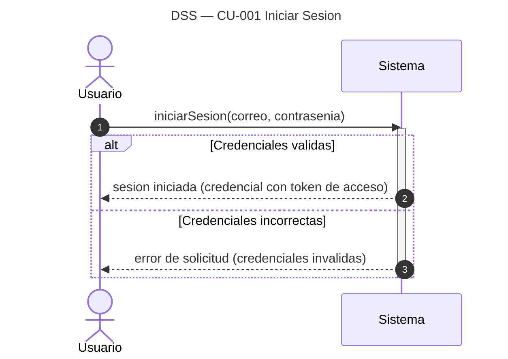

**Figura 2 — DSS CU-001: Iniciar Sesión**

---

#### Crítico DSS — CU-005: Crear Pedido

**Actor:** Cliente
**Operaciones del sistema:** `crearPedido(items, direccion, franjaHoraria, metodoPago)`

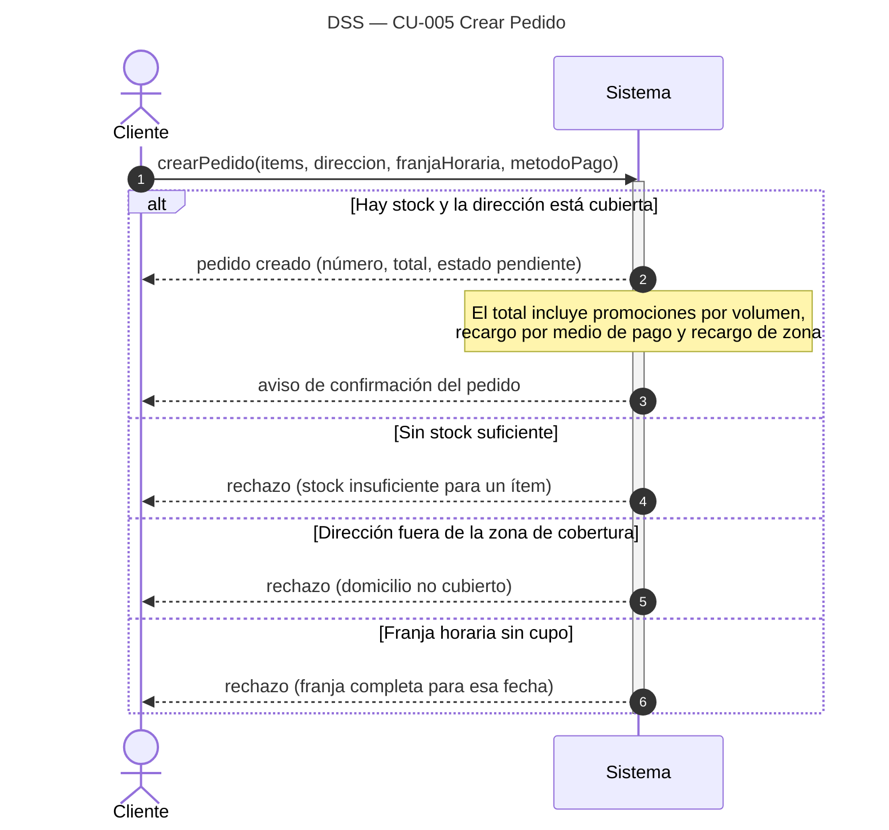

**Figura 3 — DSS CU-005: Crear Pedido**

---

#### Crítico · automático DSS — CU-013: Ofrecer el Pedido al Chofer Más Cercano

**Actor:** Sistema Automático (se dispara al crearse el pedido)
**Operaciones del sistema:** `ofrecerAlSiguienteChofer(pedido)`

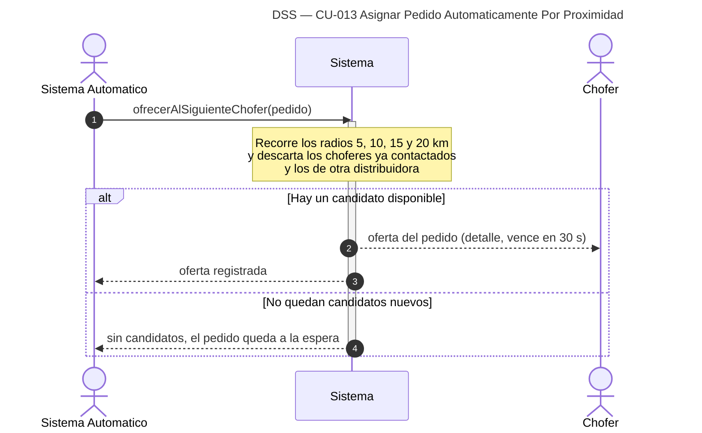

**Figura 4 — DSS CU-013: Ofrecer el Pedido al Chofer Más Cercano**

---

#### Crítico · automático DSS — CU-014: Vencer la Oferta y Ofrecer al Siguiente Chofer

**Actor:** Sistema Automático (proceso temporal, cada 15 segundos)
**Operaciones del sistema:** `vencerOfertasExpiradas()`

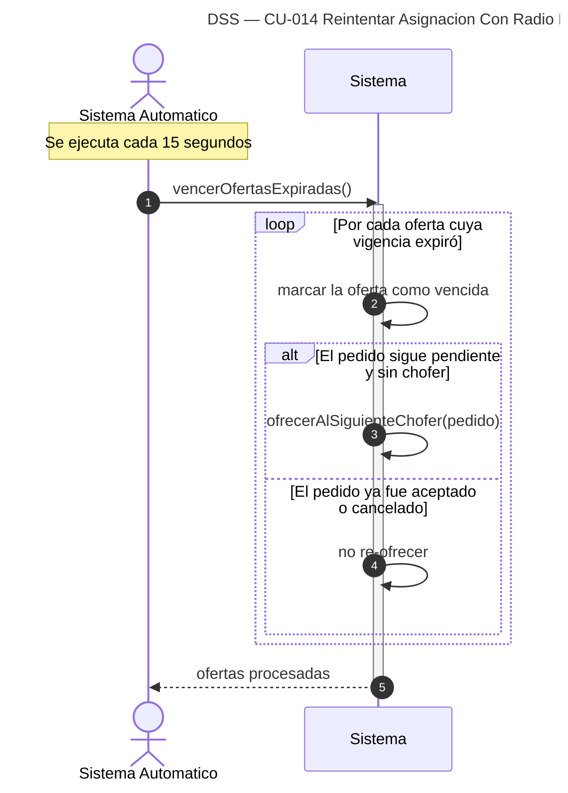

**Figura 5 — DSS CU-014: Vencer la Oferta y Ofrecer al Siguiente Chofer**

---

#### Crítico DSS — CU-015: Aceptar Pedido

**Actor:** Chofer
**Operaciones del sistema:** `aceptarPedido(pedido)`

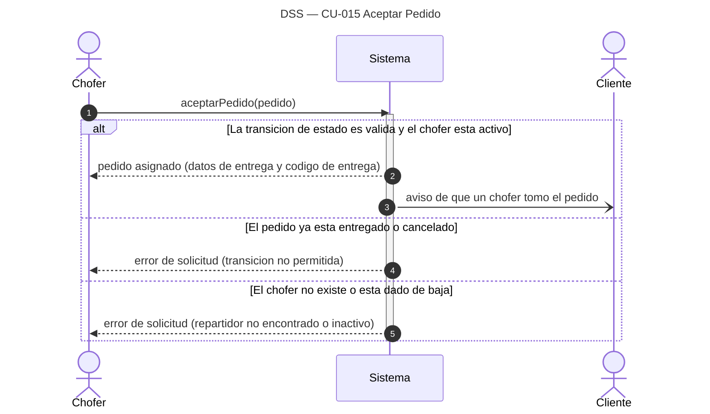

**Figura 6 — DSS CU-015: Aceptar Pedido**

---

#### Crítico · automático DSS — CU-017: Actualizar Ubicación GPS del Chofer

**Actor:** Chofer
**Operaciones del sistema:** `actualizarUbicacion(latitud, longitud)`

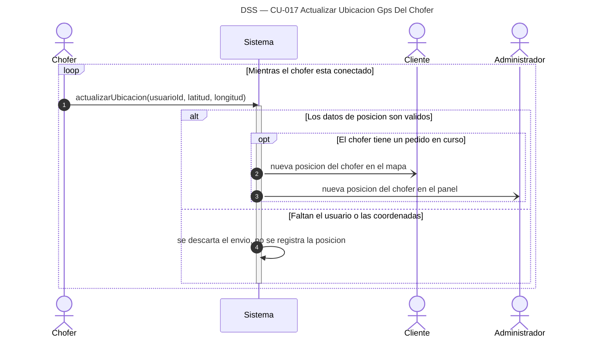

**Figura 7 — DSS CU-017: Actualizar Ubicación GPS del Chofer**

---

#### Crítico DSS — CU-020: Confirmar Entrega

**Actor:** Chofer (secuencia normal) · Cliente (secuencia alternativa por código)
**Operaciones del sistema:** `confirmarEntrega(pedido)`, `confirmarEntregaConCodigo(pedido, codigo)`

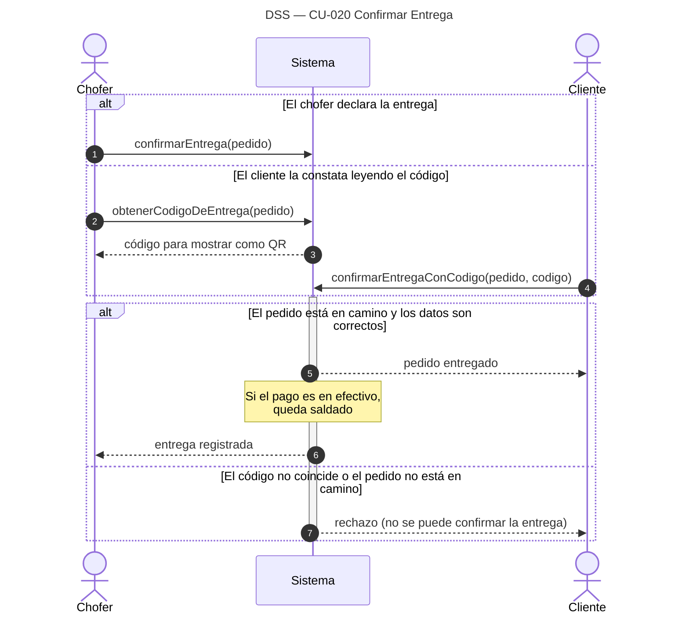

**Figura 8 — DSS CU-020: Confirmar Entrega**

---

#### Crítico · automático DSS — Reserva y Restitución de Stock (proceso interno)

**Actor:** Sistema Automático (se dispara al confirmarse o cancelarse un pedido)
**Operaciones del sistema:** `reservarStock(items)`, `restituirStock(pedido)`

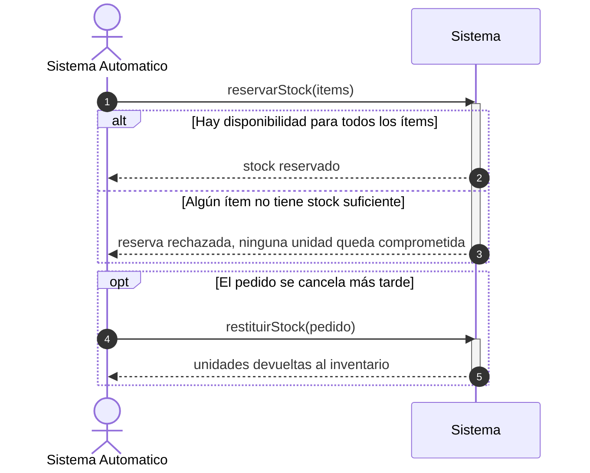

**Figura 9 — DSS CU-020: Confirmar Entrega — DSS Reserva y Restitución de Stock (proceso interno)**

---

#### Importante DSS — CU-023: Registrar Reclamo

**Actor:** Cliente
**Operaciones del sistema:** `registrarReclamo(pedido, motivo, evidencia)`

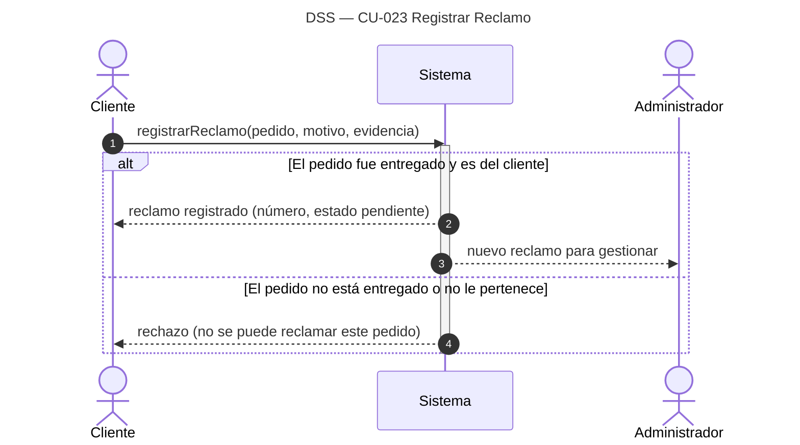

**Figura 10 — DSS CU-023: Registrar Reclamo**

---


---

#### Ampliación — DSS de los casos de uso incorporados

Los 95 diagramas que siguen completan la cobertura del comportamiento del sistema.
Se agrupan por subsistema y respetan la misma convención de caja negra: solo intervienen
el actor y el sistema, sin detalle interno.

#### DSS — CU-002: Registrarse como Cliente

**Actor:** Cliente
**Operaciones del sistema:** `registrarCliente(nombreCompleto, correo, telefono, contrasena, datosDelCliente)`

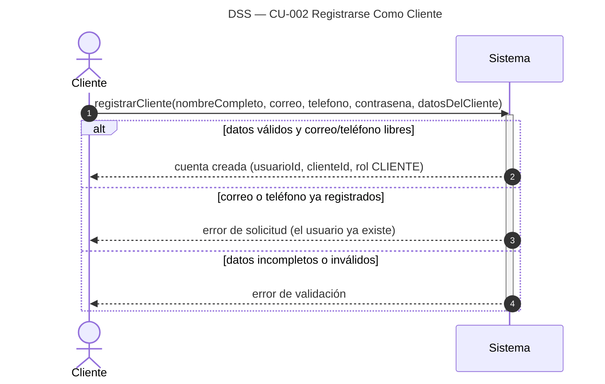

**Figura 11 — DSS CU-002: Registrarse como Cliente**

---

#### DSS — CU-003: Registrarse como Chofer

**Actor:** Administrador
**Operaciones del sistema:** `registrarChofer(datosPersonales, datosDelChofer, distribuidoraId)`

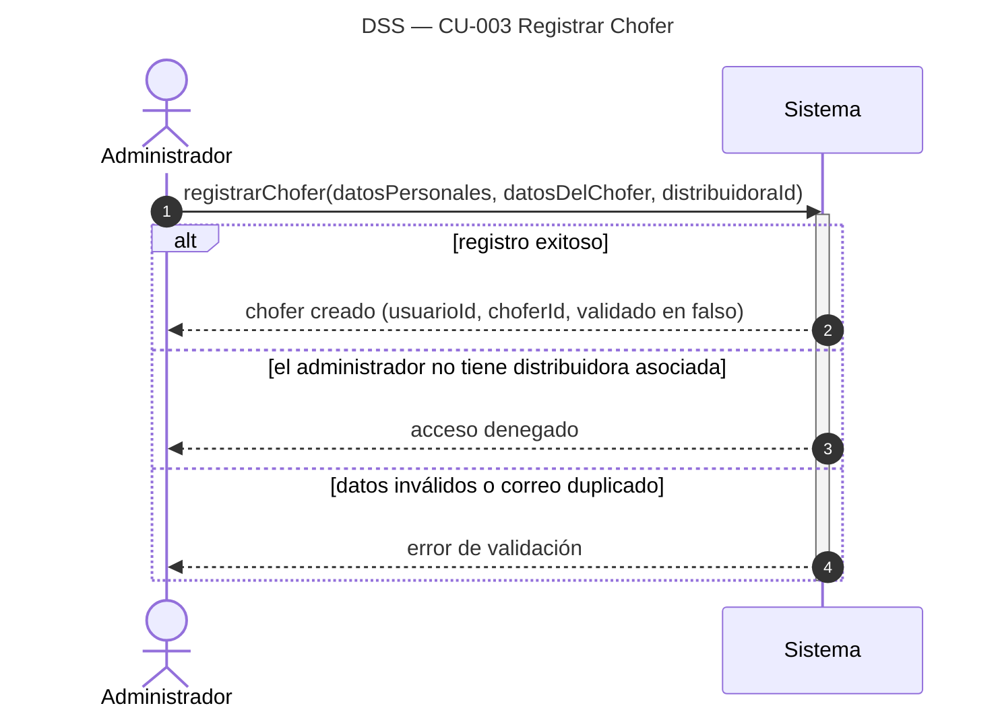

**Figura 12 — DSS CU-003: Registrarse como Chofer**

> El chofer nace **no validado**: para poder operar necesita CU-032.

---

#### DSS — CU-004: Gestionar Perfil de Usuario

**Actor:** Usuario autenticado (Cliente, Chofer o Administrador)
**Operaciones del sistema:** `consultarPerfil(usuarioId)`, `actualizarPerfil(usuarioId, datos)`, `consultarPerfilCliente(usuarioId)`, `actualizarPerfilCliente(clienteId, datos)`

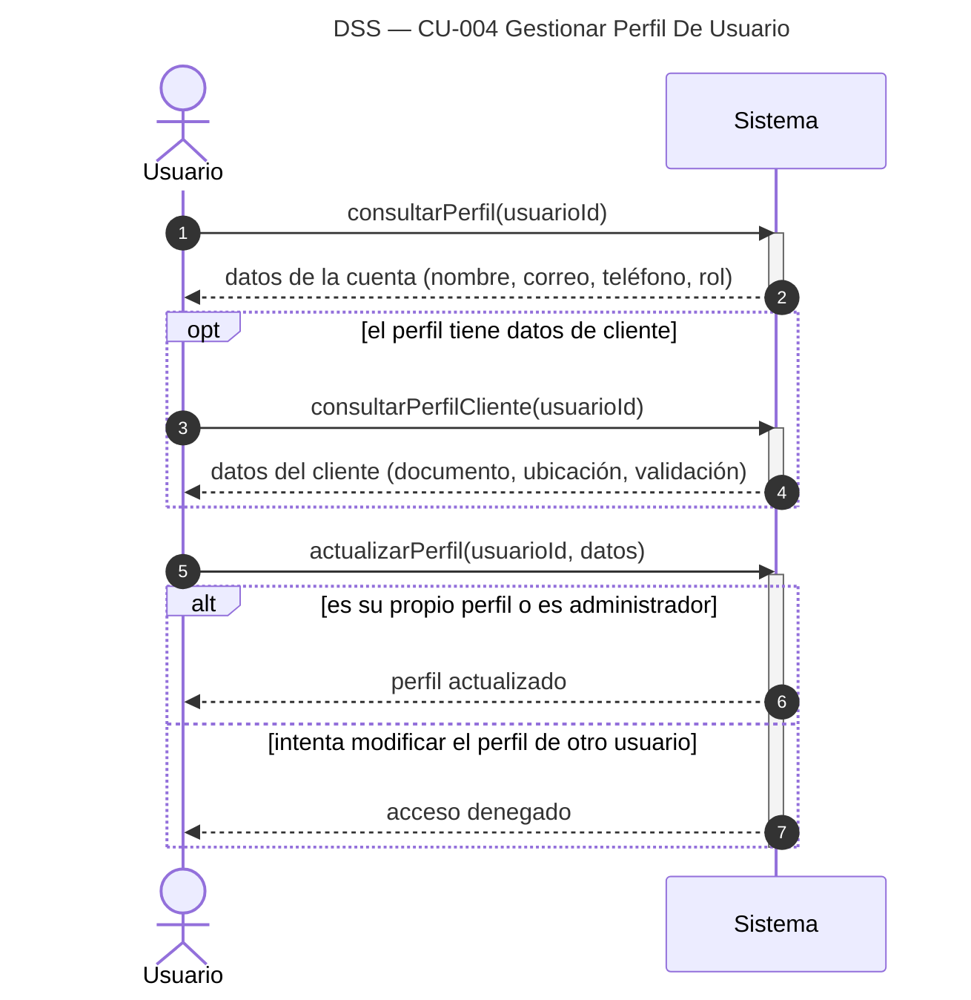

**Figura 13 — DSS CU-004: Gestionar Perfil de Usuario**

---

#### DSS — CU-047: Recuperar Contraseña

**Actor:** Usuario
**Operaciones del sistema:** `solicitarRecuperacionDeClave(correo)`, `cambiarCorreo(correoActual, correoNuevo)`

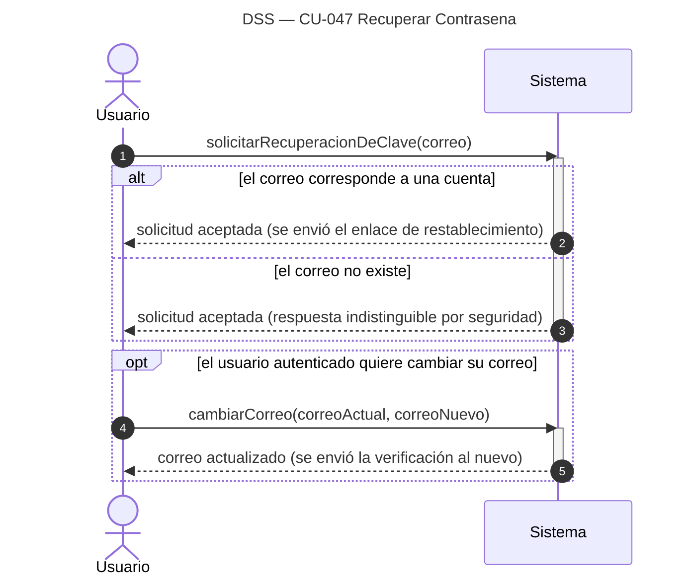

**Figura 14 — DSS CU-047: Recuperar Contraseña**

---

#### DSS — CU-050: Bloquear / Desbloquear Usuario

**Actor:** Administrador
**Operaciones del sistema:** `bloquearUsuario(usuarioId, bloquear)`

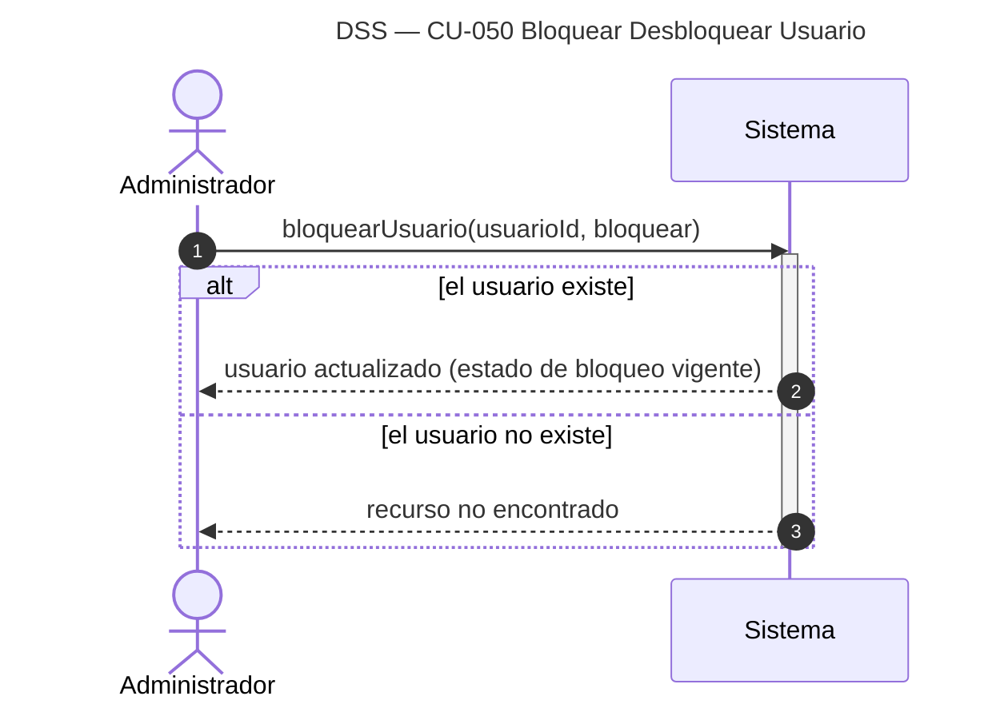

**Figura 15 — DSS CU-050: Bloquear / Desbloquear Usuario**

> Es un interruptor bidireccional: el mismo mensaje bloquea y desbloquea según el parámetro `bloquear`.

---

#### DSS — CU-082: Crear Usuario Base

**Actor:** Cliente (aplicación, sin sesión iniciada)
**Operaciones del sistema:** `crearUsuario(nombreCompleto, correo, telefono, contrasena, rolId)`

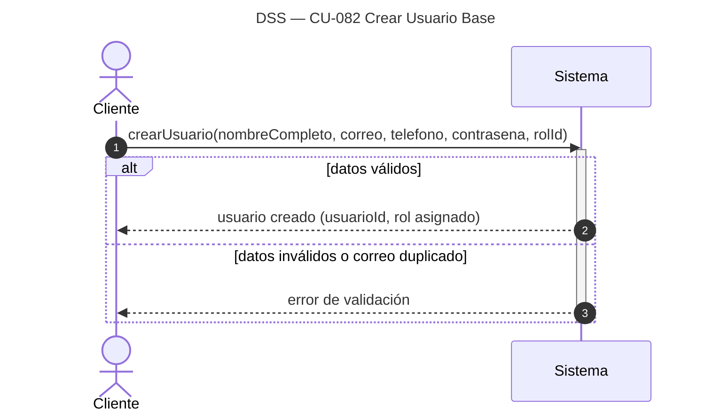

**Figura 16 — DSS CU-082: Crear Usuario Base**

> Es el alta "cruda" de la cuenta, sin perfil asociado. El alta completa del cliente es CU-002.

---

#### DSS — CU-083: Buscar / Listar Usuarios

**Actor:** Administrador
**Operaciones del sistema:** `listarUsuarios(pagina, limite, textoDeBusqueda)`, `buscarUsuarioPorCorreo(correo)`, `buscarUsuarioPorTelefono(telefono)`

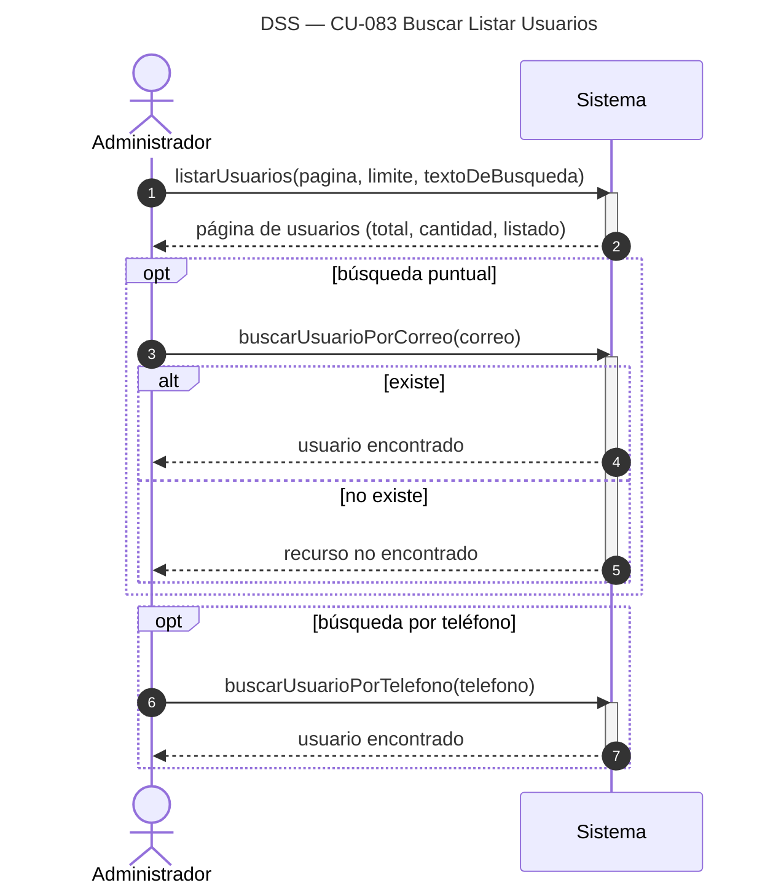

**Figura 17 — DSS CU-083: Buscar / Listar Usuarios**

---

#### DSS — CU-084: Verificar Existencia de Usuario (pre-registro)

**Actor:** Cliente (aplicación, sin sesión iniciada)
**Operaciones del sistema:** `verificarExistenciaDeUsuario(correo, telefono)`

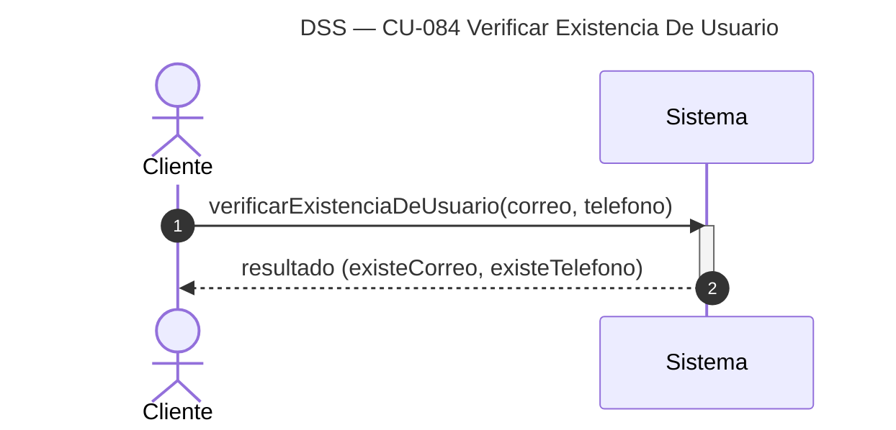

**Figura 18 — DSS CU-084: Verificar Existencia de Usuario (pre-registro)**

> Se invoca **antes** de CU-002 para que la aplicación avise el conflicto sin llegar a intentar el alta.

---

#### DSS — CU-085: Eliminar Usuario (baja lógica)

**Actor:** Administrador
**Operaciones del sistema:** `eliminarUsuario(usuarioId)`

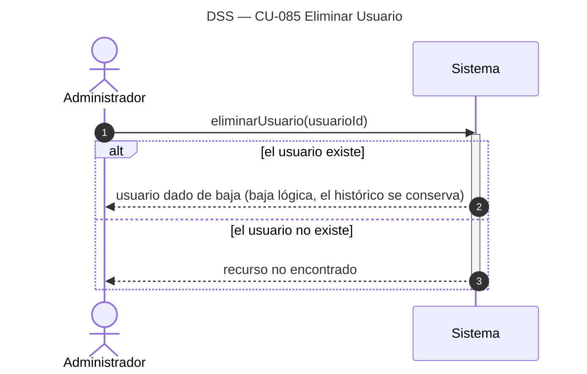

**Figura 19 — DSS CU-085: Eliminar Usuario (baja lógica)**

---

#### DSS — CU-091: Validar Vigencia del Token de Sesión

**Actor:** Usuario autenticado
**Operaciones del sistema:** `validarSesion()`

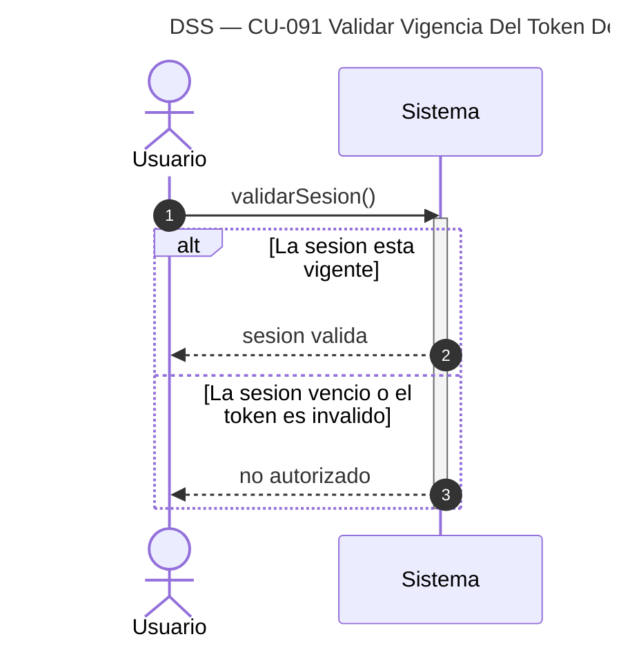

**Figura 20 — DSS CU-091: Validar Vigencia del Token de Sesión**

---

### SS-02 — Gestión de Pedidos

#### DSS — CU-006: Consultar Detalle de Pedido

**Actor:** Cliente (también Chofer y Administrador)
**Operaciones del sistema:** `consultarPedido(pedidoId)`

```mermaid
sequenceDiagram
    title DSS — CU-006 Consultar Detalle De Pedido
    autonumber
    actor CLI as Cliente
    participant SIS as Sistema

    CLI->>SIS: consultarPedido(pedidoId)
    activate SIS
    alt el pedido existe y le pertenece al solicitante
        SIS-->>CLI: detalle del pedido (ítems, total, estado, dirección, chofer)
    else el pedido es de otro cliente
        SIS-->>CLI: acceso denegado
    else el pedido no existe
        SIS-->>CLI: recurso no encontrado
    end
    deactivate SIS
```

**Figura 21 — DSS CU-006: Consultar Detalle de Pedido**

---

#### DSS — CU-007: Consultar Historial de Pedidos

**Actor:** Cliente
**Operaciones del sistema:** `consultarHistorialDePedidos(clienteId, pagina, limite)`

```mermaid
sequenceDiagram
    title DSS — CU-007 Consultar Historial De Pedidos
    autonumber
    actor CLI as Cliente
    participant SIS as Sistema

    CLI->>SIS: consultarHistorialDePedidos(clienteId, pagina, limite)
    activate SIS
    alt consulta su propio historial
        SIS-->>CLI: página de pedidos (total, cantidad, listado)
    else consulta el historial de otro cliente
        SIS-->>CLI: acceso denegado
    end
    deactivate SIS
```

**Figura 22 — DSS CU-007: Consultar Historial de Pedidos**

> El cliente ve **todo** su historial aunque haya comprado a varias distribuidoras; el personal solo ve los pedidos de la suya.

---

#### DSS — CU-143: Declarar el Consumo Promedio al Registrarse

**Actor:** Cliente
**Operaciones del sistema:** `declararConsumoPromedio(tipoGarrafa, cantidadPorMes)`

```mermaid
sequenceDiagram
    title DSS — CU-143 Declarar el Consumo Promedio al Registrarse
    autonumber
    actor CLI as Cliente
    participant SIS as Sistema

    CLI->>SIS: declararConsumoPromedio(tipoGarrafa, cantidadPorMes)
    activate SIS
    alt el valor es razonable
        SIS-->>CLI: consumo declarado y recompra estimada
    else el cliente no lo declara
        SIS-->>CLI: registro sin consumo declarado
    else el valor está fuera de rango
        SIS-->>CLI: se pide confirmación
    end
    deactivate SIS
```

**Figura 23 — DSS CU-143: Declarar el Consumo Promedio al Registrarse**

---

#### DSS — CU-144: Actualizar el Consumo Promedio Declarado

**Actor:** Cliente
**Operaciones del sistema:** `actualizarConsumoPromedio(cantidadPorMes)`

```mermaid
sequenceDiagram
    title DSS — CU-144 Actualizar el Consumo Promedio Declarado
    autonumber
    actor CLI as Cliente
    participant SIS as Sistema

    CLI->>SIS: actualizarConsumoPromedio(cantidadPorMes)
    activate SIS
    alt el valor es razonable
        SIS-->>CLI: consumo actualizado y recompra recalculada
    else el valor está fuera de rango
        SIS-->>CLI: se pide confirmación
    end
    deactivate SIS
```

**Figura 24 — DSS CU-144: Actualizar el Consumo Promedio Declarado**

---

#### DSS — CU-145: Configurar los Días de Aviso Previo a la Recompra

**Actor:** Cliente
**Operaciones del sistema:** `configurarDiasDeAviso(dias)`

```mermaid
sequenceDiagram
    title DSS — CU-145 Configurar los Dias de Aviso Previo a la Recompra
    autonumber
    actor CLI as Cliente
    participant SIS as Sistema

    CLI->>SIS: configurarDiasDeAviso(dias)
    activate SIS
    alt el valor está dentro del rango
        SIS-->>CLI: preferencia guardada
    else el valor está fuera del rango
        SIS-->>CLI: operación rechazada
    end
    deactivate SIS
```

**Figura 25 — DSS CU-145: Configurar los Días de Aviso Previo a la Recompra**

---

#### DSS — CU-146: Consultar la Fecha Estimada de Recompra

**Actor:** Administrador
**Operaciones del sistema:** `consultarRecomprasEstimadas(dias)`

```mermaid
sequenceDiagram
    title DSS — CU-146 Consultar la Fecha Estimada de Recompra
    autonumber
    actor ADM as Administrador
    participant SIS as Sistema

    ADM->>SIS: consultarRecomprasEstimadas(dias)
    activate SIS
    alt hay clientes en la ventana
        SIS-->>ADM: listado ordenado por fecha estimada
    else no hay ninguno
        SIS-->>ADM: listado vacío
    end
    deactivate SIS
```

**Figura 26 — DSS CU-146: Consultar la Fecha Estimada de Recompra**

---

#### DSS — CU-147: Realizar una Compra Express

**Actor:** Cliente
**Operaciones del sistema:** `realizarCompraExpress(tipoGarrafa, medioDePago)`

```mermaid
sequenceDiagram
    title DSS — CU-147 Realizar una Compra Express
    autonumber
    actor CLI as Cliente
    participant SIS as Sistema

    CLI->>SIS: realizarCompraExpress(tipoGarrafa, medioDePago)
    activate SIS
    alt hay cobertura, horario y chofer
        SIS-->>CLI: pedido express creado y despachado
    else no hay cobertura express o está fuera de horario
        SIS-->>CLI: se ofrece el flujo con franja horaria
    else no hay chofer en moto disponible
        SIS-->>CLI: se ofrece el flujo con franja horaria
    end
    deactivate SIS
```

**Figura 27 — DSS CU-147: Realizar una Compra Express**

---

#### DSS — CU-148: Elegir la Modalidad de Entrega del Pedido

**Actor:** Cliente
**Operaciones del sistema:** `elegirModalidadDeEntrega(pedidoId, modalidad)`

```mermaid
sequenceDiagram
    title DSS — CU-148 Elegir la Modalidad de Entrega del Pedido
    autonumber
    actor CLI as Cliente
    participant SIS as Sistema

    CLI->>SIS: elegirModalidadDeEntrega(pedidoId, modalidad)
    activate SIS
    alt las dos modalidades están disponibles
        SIS-->>CLI: opciones con precio y tiempo estimado
    else sólo la programada está disponible
        SIS-->>CLI: opción programada con el motivo
    end
    deactivate SIS
```

**Figura 28 — DSS CU-148: Elegir la Modalidad de Entrega del Pedido**

---

#### DSS — CU-008: Cancelar Pedido (Cliente)

**Actor:** Cliente
**Operaciones del sistema:** `cancelarPedido(pedidoId, motivo)`

```mermaid
sequenceDiagram
    title DSS — CU-008 Cancelar Pedido
    autonumber
    actor CLI as Cliente
    participant SIS as Sistema
    actor CHO as Chofer
    actor ADM as Administrador

    CLI->>SIS: cancelarPedido(pedidoId, motivo)
    activate SIS
    alt El pedido es del cliente y todavia no salio en camino
        SIS-->>CLI: pedido cancelado (estado CANCELADO, stock restituido)
        opt El pedido ya tenia chofer asignado
            SIS-)CHO: aviso de pedido cancelado por el cliente
        end
        SIS-)ADM: aviso de cancelacion en el panel
    else El pedido ya esta entregado o cancelado
        SIS-->>CLI: error de solicitud (no se puede cancelar un pedido finalizado)
    else El pedido ya esta en camino
        SIS-->>CLI: error de solicitud (contactar al soporte)
    else El pedido es de otro cliente
        SIS-->>CLI: error de solicitud (no autorizado)
    end
    deactivate SIS
```

**Figura 29 — DSS CU-008: Cancelar Pedido (Cliente)**

> La identidad y el rol del cancelador salen **siempre** de la sesión, nunca del cuerpo del mensaje.

---

#### DSS — CU-009: Cancelar Pedido (Chofer)

**Actor:** Chofer
**Operaciones del sistema:** `cancelarPedido(pedidoId, motivo)`

```mermaid
sequenceDiagram
    title DSS — CU-009 Cancelar Pedido
    autonumber
    actor CHO as Chofer
    participant SIS as Sistema
    actor CLI as Cliente

    CHO->>SIS: liberarPedido(pedidoId, motivo)
    activate SIS
    alt El pedido no esta finalizado
        SIS-->>CHO: pedido liberado (vuelve a PENDIENTE y queda sin chofer)
        SIS-)CLI: aviso de que se esta buscando otro chofer
    else El pedido ya esta entregado o cancelado
        SIS-->>CHO: error de solicitud (no se puede cancelar un pedido finalizado)
    end
    deactivate SIS
```

**Figura 30 — DSS CU-009: Cancelar Pedido (Chofer)**

---

#### DSS — CU-010: Cancelar Pedido (Administrador)

**Actor:** Administrador
**Operaciones del sistema:** `cancelarPedido(pedidoId, motivo)`, `cancelarPedidoForzado(pedidoId)`

```mermaid
sequenceDiagram
    title DSS — CU-010 Cancelar Pedido
    autonumber
    actor ADM as Administrador
    participant SIS as Sistema

    alt cancelación ordinaria
        ADM->>SIS: cancelarPedido(pedidoId, motivo)
        activate SIS
        SIS-->>ADM: pedido cancelado (motivo registrado, stock restituido)
        deactivate SIS
    else cancelación forzada
        ADM->>SIS: cancelarPedidoForzado(pedidoId)
        activate SIS
        SIS-->>ADM: pedido cancelado por decisión administrativa
        deactivate SIS
    end
```

**Figura 31 — DSS CU-010: Cancelar Pedido (Administrador)**

> El sistema ofrece **dos** vías para el administrador. La documentación previa describía una sola.

---

#### DSS — CU-011: Listar Todos los Pedidos

**Actor:** Administrador
**Operaciones del sistema:** `listarPedidos(pagina, limite)`

```mermaid
sequenceDiagram
    title DSS — CU-011 Listar Todos Los Pedidos
    autonumber
    actor ADM as Administrador
    participant SIS as Sistema

    ADM->>SIS: listarPedidos(pagina, limite)
    activate SIS
    alt es administrador de una distribuidora
        SIS-->>ADM: página de pedidos de su distribuidora
    else es super administrador sin distribuidora seleccionada
        SIS-->>ADM: página de pedidos de todas las distribuidoras
    end
    deactivate SIS
```

**Figura 32 — DSS CU-011: Listar Todos los Pedidos**

---

#### DSS — CU-012: Asignar Chofer Manualmente

**Actor:** Administrador
**Operaciones del sistema:** `asignarChoferAPedido(pedidoId, choferId)`

```mermaid
sequenceDiagram
    title DSS — CU-012 Asignar Chofer Manualmente
    autonumber
    actor ADM as Administrador
    participant SIS as Sistema

    ADM->>SIS: asignarChoferAPedido(pedidoId, choferId)
    activate SIS
    alt el pedido y el chofer existen y son compatibles
        SIS-->>ADM: pedido asignado (estado ACEPTADO, chofer vinculado)
    else el pedido o el chofer no existen
        SIS-->>ADM: recurso no encontrado
    end
    deactivate SIS
```

**Figura 33 — DSS CU-012: Asignar Chofer Manualmente**

---

#### DSS — CU-149: Despachar un Pedido Express a un Chofer en Moto

**Actor:** Sistema Automático
**Operaciones del sistema:** `despacharPedidoExpress(pedidoId)`

```mermaid
sequenceDiagram
    title DSS — CU-149 Despachar un Pedido Express a un Chofer en Moto
    autonumber
    actor SIS as Sistema Automático
    participant SIS as Sistema

    SIS->>SIS: despacharPedidoExpress(pedidoId)
    activate SIS
    alt un chofer en moto acepta
        SIS-->>SIS: pedido asignado y cliente avisado
    else ninguno acepta
        SIS-->>SIS: modalidad express cancelada y recargo devuelto
    end
    deactivate SIS
```

**Figura 34 — DSS CU-149: Despachar un Pedido Express a un Chofer en Moto**

---

#### DSS — CU-046: Consultar Direcciones de Entrega del Cliente

**Actor:** Cliente
**Operaciones del sistema:** `consultarDireccionesDeEntrega(usuarioId)`

```mermaid
sequenceDiagram
    title DSS — CU-046 Consultar Direcciones De Entrega Del Cliente
    autonumber
    actor CLI as Cliente
    participant SIS as Sistema

    CLI->>SIS: crearDireccion(calle, ciudad, codigoPostal, latitud, longitud, indicaciones, esPredeterminada)
    activate SIS
    SIS-->>CLI: dirección creada (direccionId)
    deactivate SIS

    CLI->>SIS: listarDireccionesDelUsuario(usuarioId)
    activate SIS
    SIS-->>CLI: listado de direcciones
    deactivate SIS

    opt el cliente cambia su dirección habitual
        CLI->>SIS: marcarDireccionPredeterminada(direccionId)
        activate SIS
        SIS-->>CLI: dirección predeterminada actualizada (las demás dejan de serlo)
        deactivate SIS
    end

    opt corrección de datos
        CLI->>SIS: actualizarDireccion(direccionId, datos)
        activate SIS
        SIS-->>CLI: dirección actualizada
        deactivate SIS
    end

    opt baja de una dirección
        CLI->>SIS: eliminarDireccion(direccionId)
        activate SIS
        alt la dirección existe y es del cliente
            SIS-->>CLI: dirección eliminada
        else la dirección no existe
            SIS-->>CLI: recurso no encontrado
        end
        deactivate SIS
    end
```

**Figura 35 — DSS CU-046: Consultar Direcciones de Entrega del Cliente**

---

#### DSS — CU-116: Registrar Dirección de Entrega

**Actor:** Cliente
**Operaciones del sistema:** `registrarDireccionDeEntrega(datos)`

```mermaid
sequenceDiagram
    title DSS — CU-116 Registrar Direccion de Entrega
    autonumber
    actor CLI as Cliente
    participant SIS as Sistema

    CLI->>SIS: registrarDireccionDeEntrega(datos)
    activate SIS
    alt los datos son válidos
        SIS-->>CLI: dirección registrada
    else la cuenta de usuario no existe
        SIS-->>CLI: recurso no encontrado
    end
    deactivate SIS
```

**Figura 36 — DSS CU-116: Registrar Dirección de Entrega**

---

#### DSS — CU-117: Consultar Detalle de una Dirección de Entrega

**Actor:** Cliente
**Operaciones del sistema:** `consultarDireccionDeEntrega(direccionId)`

```mermaid
sequenceDiagram
    title DSS — CU-117 Consultar Detalle de una Direccion de Entrega
    autonumber
    actor CLI as Cliente
    participant SIS as Sistema

    CLI->>SIS: consultarDireccionDeEntrega(direccionId)
    activate SIS
    alt la dirección existe y es del cliente
        SIS-->>CLI: datos de la dirección
    else la dirección no existe
        SIS-->>CLI: recurso no encontrado
    else la dirección es de otro cliente
        SIS-->>CLI: acceso denegado
    end
    deactivate SIS
```

**Figura 37 — DSS CU-117: Consultar Detalle de una Dirección de Entrega**

---

#### DSS — CU-118: Editar Dirección de Entrega

**Actor:** Cliente
**Operaciones del sistema:** `editarDireccionDeEntrega(direccionId, cambios)`

```mermaid
sequenceDiagram
    title DSS — CU-118 Editar Direccion de Entrega
    autonumber
    actor CLI as Cliente
    participant SIS as Sistema

    CLI->>SIS: editarDireccionDeEntrega(direccionId, cambios)
    activate SIS
    alt la dirección existe y es del cliente
        SIS-->>CLI: dirección actualizada
    else la dirección no existe o es de otro
        SIS-->>CLI: operación rechazada
    end
    deactivate SIS
```

**Figura 38 — DSS CU-118: Editar Dirección de Entrega**

---

#### DSS — CU-119: Eliminar Dirección de Entrega

**Actor:** Cliente
**Operaciones del sistema:** `eliminarDireccionDeEntrega(direccionId)`

```mermaid
sequenceDiagram
    title DSS — CU-119 Eliminar Direccion de Entrega
    autonumber
    actor CLI as Cliente
    participant SIS as Sistema

    CLI->>SIS: eliminarDireccionDeEntrega(direccionId)
    activate SIS
    alt la dirección existe y es del cliente
        SIS-->>CLI: baja confirmada
    else la dirección no existe o es de otro
        SIS-->>CLI: operación rechazada
    end
    deactivate SIS
```

**Figura 39 — DSS CU-119: Eliminar Dirección de Entrega**

---

#### DSS — CU-120: Marcar una Dirección como Predeterminada

**Actor:** Cliente
**Operaciones del sistema:** `marcarDireccionPredeterminada(direccionId)`

```mermaid
sequenceDiagram
    title DSS — CU-120 Marcar una Direccion como Predeterminada
    autonumber
    actor CLI as Cliente
    participant SIS as Sistema

    CLI->>SIS: marcarDireccionPredeterminada(direccionId)
    activate SIS
    alt la dirección existe y es del cliente
        SIS-->>CLI: dirección marcada como predeterminada
    else la dirección no existe o es de otro
        SIS-->>CLI: operación rechazada
    end
    deactivate SIS
```

**Figura 40 — DSS CU-120: Marcar una Dirección como Predeterminada**

---

#### DSS — CU-121: Consultar la Dirección Predeterminada

**Actor:** Cliente
**Operaciones del sistema:** `consultarDireccionPredeterminada(usuarioId)`

```mermaid
sequenceDiagram
    title DSS — CU-121 Consultar la Direccion Predeterminada
    autonumber
    actor CLI as Cliente
    participant SIS as Sistema

    CLI->>SIS: consultarDireccionPredeterminada(usuarioId)
    activate SIS
    alt el cliente tiene una dirección predeterminada
        SIS-->>CLI: datos de la dirección
    else el cliente no tiene ninguna
        SIS-->>CLI: recurso no encontrado
    end
    deactivate SIS
```

**Figura 41 — DSS CU-121: Consultar la Dirección Predeterminada**

---

#### DSS — CU-122: Agregar Ítem al Carrito

**Actor:** Cliente
**Operaciones del sistema:** `agregarItemAlCarrito(garrafaId, cantidad)`

```mermaid
sequenceDiagram
    title DSS — CU-122 Agregar Item al Carrito
    autonumber
    actor CLI as Cliente
    participant SIS as Sistema

    CLI->>SIS: agregarItemAlCarrito(garrafaId, cantidad)
    activate SIS
    alt el tipo de garrafa es válido
        SIS-->>CLI: carrito con el ítem agregado y el total
    else el tipo de garrafa no existe o está de baja
        SIS-->>CLI: operación rechazada
    end
    deactivate SIS
```

**Figura 42 — DSS CU-122: Agregar Ítem al Carrito**

---

#### DSS — CU-123: Modificar la Cantidad de un Ítem del Carrito

**Actor:** Cliente
**Operaciones del sistema:** `modificarCantidadDelItem(itemId, cantidad)`

```mermaid
sequenceDiagram
    title DSS — CU-123 Modificar la Cantidad de un Item del Carrito
    autonumber
    actor CLI as Cliente
    participant SIS as Sistema

    CLI->>SIS: modificarCantidadDelItem(itemId, cantidad)
    activate SIS
    alt el ítem es del carrito del cliente
        SIS-->>CLI: carrito con la cantidad actualizada
    else el ítem no es del carrito del cliente
        SIS-->>CLI: operación rechazada
    end
    deactivate SIS
```

**Figura 43 — DSS CU-123: Modificar la Cantidad de un Ítem del Carrito**

---

#### DSS — CU-124: Quitar Ítem del Carrito

**Actor:** Cliente
**Operaciones del sistema:** `quitarItemDelCarrito(itemId)`

```mermaid
sequenceDiagram
    title DSS — CU-124 Quitar Item del Carrito
    autonumber
    actor CLI as Cliente
    participant SIS as Sistema

    CLI->>SIS: quitarItemDelCarrito(itemId)
    activate SIS
    alt el ítem es del carrito del cliente
        SIS-->>CLI: carrito sin el ítem
    else el ítem no es del carrito del cliente
        SIS-->>CLI: operación rechazada
    end
    deactivate SIS
```

**Figura 44 — DSS CU-124: Quitar Ítem del Carrito**

---

#### DSS — CU-125: Consultar el Carrito

**Actor:** Cliente
**Operaciones del sistema:** `consultarCarrito()`

```mermaid
sequenceDiagram
    title DSS — CU-125 Consultar el Carrito
    autonumber
    actor CLI as Cliente
    participant SIS as Sistema

    CLI->>SIS: consultarCarrito()
    activate SIS
    alt el cliente tiene carrito
        SIS-->>CLI: detalle del carrito y total
    else el cliente no tiene carrito
        SIS-->>CLI: carrito vacío
    end
    deactivate SIS
```

**Figura 45 — DSS CU-125: Consultar el Carrito**

---

#### DSS — CU-126: Vaciar el Carrito

**Actor:** Cliente
**Operaciones del sistema:** `vaciarCarrito()`

```mermaid
sequenceDiagram
    title DSS — CU-126 Vaciar el Carrito
    autonumber
    actor CLI as Cliente
    participant SIS as Sistema

    CLI->>SIS: vaciarCarrito()
    activate SIS
    alt el cliente tiene carrito
        SIS-->>CLI: carrito vacío
    else el cliente no tiene carrito
        SIS-->>CLI: carrito vacío
    end
    deactivate SIS
```

**Figura 46 — DSS CU-126: Vaciar el Carrito**

---

#### DSS — CU-127: Cambiar la Dirección de Entrega del Pedido

**Actor:** Cliente
**Operaciones del sistema:** `cambiarDireccionDeEntrega(pedidoId, direccionId, motivo)`

```mermaid
sequenceDiagram
    title DSS — CU-127 Cambiar la Direccion de Entrega del Pedido
    autonumber
    actor CLI as Cliente
    participant SIS as Sistema

    CLI->>SIS: cambiarDireccionDeEntrega(pedidoId, direccionId, motivo)
    activate SIS
    alt el pedido admite el cambio y la dirección es válida
        SIS-->>CLI: pedido actualizado
    else el pedido ya salió
        SIS-->>CLI: cambio rechazado
    else la dirección está fuera de la zona de cobertura
        SIS-->>CLI: cambio rechazado
    end
    deactivate SIS
```

**Figura 47 — DSS CU-127: Cambiar la Dirección de Entrega del Pedido**

---

#### DSS — CU-128: Indicar Quién Recibe el Pedido

**Actor:** Cliente
**Operaciones del sistema:** `indicarQuienRecibe(pedidoId, nombre, documento, relacion)`

```mermaid
sequenceDiagram
    title DSS — CU-128 Indicar Quien Recibe el Pedido
    autonumber
    actor CLI as Cliente
    participant SIS as Sistema

    CLI->>SIS: indicarQuienRecibe(pedidoId, nombre, documento, relacion)
    activate SIS
    alt el pedido admite el dato
        SIS-->>CLI: pedido actualizado con quién recibe
    else el pedido ya fue entregado
        SIS-->>CLI: operación rechazada
    end
    deactivate SIS
```

**Figura 48 — DSS CU-128: Indicar Quién Recibe el Pedido**

---

#### DSS — CU-080: Consultar el Pool de Pedidos Disponibles

**Actor:** Chofer
**Operaciones del sistema:** `consultarPedidosDisponibles(pagina, limite)`

```mermaid
sequenceDiagram
    title DSS — CU-080 Consultar El Pool De Pedidos Disponibles
    autonumber
    actor CHO as Chofer
    participant SIS as Sistema

    CHO->>SIS: consultarPedidosDisponibles(pagina, limite)
    activate SIS
    SIS-->>CHO: pedidos pendientes sin chofer de su distribuidora (dirección, ítems, total)
    deactivate SIS
```

**Figura 49 — DSS CU-080: Consultar el Pool de Pedidos Disponibles**

> Es la vista de respaldo del despacho automático (CU-013): si la oferta por proximidad no llega, el chofer puede consultar el pool.

---

#### DSS — CU-081: Consultar los Pedidos Asignados al Chofer

**Actor:** Chofer
**Operaciones del sistema:** `consultarPedidosAsignados(choferId, pagina, limite)`

```mermaid
sequenceDiagram
    title DSS — CU-081 Consultar Los Pedidos Asignados Al Chofer
    autonumber
    actor CHO as Chofer
    participant SIS as Sistema

    CHO->>SIS: consultarPedidosAsignados(choferId, pagina, limite)
    activate SIS
    SIS-->>CHO: página de pedidos asignados (estado, cliente, dirección, total)
    deactivate SIS
```

**Figura 50 — DSS CU-081: Consultar los Pedidos Asignados al Chofer**

---

### SS-03 — Despacho y Asignación

#### DSS — CU-016: Rechazar / Ignorar Pedido

**Actor:** Chofer
**Operaciones del sistema:** `rechazarOferta(pedidoId)`

```mermaid
sequenceDiagram
    title DSS — CU-016 Rechazar Ignorar Pedido
    autonumber
    actor CHO as Chofer
    participant SIS as Sistema
    actor CH2 as Siguiente Chofer

    CHO->>SIS: rechazarOferta(pedidoId)
    activate SIS
    alt El pedido existe
        SIS-->>CHO: rechazo registrado (se cierra la oferta si estaba activa)
        opt El pedido sigue pendiente y sin chofer asignado
            SIS-)CH2: nueva oferta de pedido (pedidoId, total, items, vence en 30 s)
        end
    else El pedido no existe
        SIS-->>CHO: sin efecto (rechazo no registrado)
    end
    deactivate SIS
```

**Figura 51 — DSS CU-016: Rechazar / Ignorar Pedido**

> El rechazo **no** espera el vencimiento de la ventana de 30 segundos: re-ofrece de inmediato al siguiente chofer más cercano.

---

### SS-04 — Seguimiento en Tiempo Real

#### DSS — CU-018: Marcar Pedido "En Camino"

**Actor:** Chofer
**Operaciones del sistema:** `actualizarEstadoDePedido(pedidoId, EN_CAMINO)`

```mermaid
sequenceDiagram
    title DSS — CU-018 Marcar Pedido En Camino
    autonumber
    actor CHO as Chofer
    participant SIS as Sistema
    actor CLI as Cliente

    CHO->>SIS: actualizarEstadoDePedido(pedidoId, EN_CAMINO)
    activate SIS
    alt la transición es válida desde el estado actual
        SIS-->>CHO: pedido en camino (estado EN_CAMINO)
        SIS-)CLI: aviso de pedido en camino
    else la transición no está permitida
        SIS-->>CHO: error de solicitud (transición inválida)
    end
    deactivate SIS
```

**Figura 52 — DSS CU-018: Marcar Pedido "En Camino"**

---

#### DSS — CU-019: Avisar Llegada al Cliente

**Actor:** Chofer
**Operaciones del sistema:** `avisarLlegada(pedidoId)`

```mermaid
sequenceDiagram
    title DSS — CU-019 Avisar Llegada Al Cliente
    autonumber
    actor CHO as Chofer
    participant SIS as Sistema
    actor CLI as Cliente

    CHO->>SIS: avisarLlegada(pedidoId)
    activate SIS
    alt el pedido está en camino
        SIS-)CLI: aviso de que el repartidor llegó al domicilio
        SIS-->>CHO: cliente notificado
    else el pedido no está en camino
        SIS-->>CHO: error de solicitud (el pedido no está en camino)
    end
    deactivate SIS
```

**Figura 53 — DSS CU-019: Avisar Llegada al Cliente**

> Este caso de uso **no** cambia el estado del pedido: solo notifica.

---

#### DSS — CU-021: Recibir Notificaciones en Tiempo Real

**Actor:** Cliente
**Operaciones del sistema:** `suscribirseAlSeguimiento(clienteId)`

```mermaid
sequenceDiagram
    title DSS — CU-021 Recibir Notificaciones En Tiempo Real
    autonumber
    actor CLI as Cliente
    participant SIS as Sistema

    CLI->>SIS: suscribirseAlSeguimiento(clienteId)
    activate SIS
    SIS-->>CLI: suscripción confirmada
    deactivate SIS

    loop mientras el pedido esté en curso
        SIS-)CLI: cambio de estado del pedido (aceptado, en camino, entregado, cancelado)
        SIS-)CLI: posición actual del chofer (latitud, longitud)
    end
```

**Figura 54 — DSS CU-021: Recibir Notificaciones en Tiempo Real**

> El canal se cierra cuando el cliente cierra la aplicación o el pedido alcanza un estado terminal.

---

#### DSS — CU-022: Activar / Desactivar Disponibilidad

**Actor:** Chofer
**Operaciones del sistema:** `cambiarDisponibilidad(usuarioId, disponible)`

```mermaid
sequenceDiagram
    title DSS — CU-022 Activar Desactivar Disponibilidad
    autonumber
    actor CHO as Chofer
    participant SIS as Sistema

    CHO->>SIS: cambiarDisponibilidad(usuarioId, disponible)
    activate SIS
    alt se pone disponible
        SIS-->>CHO: disponible (empieza a recibir ofertas de pedidos)
    else se pone no disponible
        SIS-->>CHO: no disponible (deja de recibir ofertas)
    end
    deactivate SIS
```

**Figura 55 — DSS CU-022: Activar / Desactivar Disponibilidad**

> **Observación de análisis:** el sistema almacena esta disponibilidad en el mismo atributo que el alta/baja administrativa (CU-033), por lo que hoy "fuera de turno" y "dado de baja" son indistinguibles.

---

#### DSS — CU-078: Obtener el Código de Entrega (QR del chofer)

**Actor:** Chofer
**Operaciones del sistema:** `obtenerCodigoDeEntrega(pedidoId)`

```mermaid
sequenceDiagram
    title DSS — CU-078 Obtener El Codigo De Entrega
    autonumber
    actor CHO as Chofer
    participant SIS as Sistema

    CHO->>SIS: obtenerCodigoDeEntrega(pedidoId)
    activate SIS
    alt el pedido está asignado a este chofer y ya fue aceptado
        SIS-->>CHO: código de entrega (para mostrarlo como QR al cliente)
    else el pedido no está asignado a este chofer
        SIS-->>CHO: acceso denegado
    else el pedido todavía no fue aceptado
        SIS-->>CHO: error de solicitud (el pedido aún no tiene código)
    else el pedido no existe
        SIS-->>CHO: recurso no encontrado
    end
    deactivate SIS
```

**Figura 56 — DSS CU-078: Obtener el Código de Entrega (QR del chofer)**

---

#### DSS — CU-079: Confirmar Entrega Escaneando el QR (cliente)

**Actor:** Cliente
**Operaciones del sistema:** `confirmarEntregaConCodigo(pedidoId, codigoLeido)`

```mermaid
sequenceDiagram
    title DSS — CU-079 Confirmar Entrega Escaneando El Qr
    autonumber
    actor CLI as Cliente
    participant SIS as Sistema

    CLI->>SIS: confirmarEntregaConCodigo(pedidoId, codigoLeido)
    activate SIS
    alt el código coincide y el pedido está en camino
        SIS-->>CLI: entrega confirmada (estado ENTREGADO)
    else el código no coincide
        SIS-->>CLI: error de solicitud (código inválido)
    else el pedido no está en camino
        SIS-->>CLI: error de solicitud (el pedido no está en camino)
    else el pedido es de otro cliente
        SIS-->>CLI: acceso denegado
    end
    deactivate SIS
```

**Figura 57 — DSS CU-079: Confirmar Entrega Escaneando el QR (cliente)**

> Es el camino **anti-fraude** que invierte el actor de CU-020: confirma quien recibe, no quien entrega. Es idempotente frente a reintentos de red.

---

### SS-05 — Reclamos

#### DSS — CU-024: Listar Reclamos

**Actor:** Administrador
**Operaciones del sistema:** `listarReclamos()`

```mermaid
sequenceDiagram
    title DSS — CU-024 Listar Reclamos
    autonumber
    actor ADM as Administrador
    participant SIS as Sistema

    ADM->>SIS: listarReclamos()
    activate SIS
    SIS-->>ADM: reclamos de su distribuidora (pedido, cliente, motivo, estado)
    deactivate SIS
```

**Figura 58 — DSS CU-024: Listar Reclamos**

---

#### DSS — CU-025: Resolver Reclamo

**Actor:** Administrador
**Operaciones del sistema:** `resolverReclamo(reclamoId, resolucion, estadoFinal)`

```mermaid
sequenceDiagram
    title DSS — CU-025 Resolver Reclamo
    autonumber
    actor ADM as Administrador
    participant SIS as Sistema

    ADM->>SIS: resolverReclamo(reclamoId, resolucion, estadoFinal)
    activate SIS
    alt el reclamo existe
        SIS-->>ADM: reclamo resuelto (estado y resolución registrados)
    else el reclamo no existe
        SIS-->>ADM: recurso no encontrado
    end
    deactivate SIS
```

**Figura 59 — DSS CU-025: Resolver Reclamo**

---

### SS-06 — Reportes y Dashboard

#### DSS — CU-026: Ver Dashboard General

**Actor:** Administrador
**Operaciones del sistema:** `consultarResumenDePedidos()`, `consultarGraficoDeVentas()`

```mermaid
sequenceDiagram
    title DSS — CU-026 Ver Dashboard General
    autonumber
    actor ADM as Administrador
    participant SIS as Sistema

    ADM->>SIS: consultarResumenDePedidos()
    activate SIS
    SIS-->>ADM: totales del día, la semana y el mes (pedidos, facturación, estados)
    deactivate SIS

    ADM->>SIS: consultarGraficoDeVentas()
    activate SIS
    SIS-->>ADM: serie de ventas de los últimos siete días
    deactivate SIS
```

**Figura 60 — DSS CU-026: Ver Dashboard General**

---

#### DSS — CU-027: Ver Reporte de Ventas por Chofer

**Actor:** Administrador
**Operaciones del sistema:** `consultarVentasPorChofer(fechaDesde, fechaHasta)`

```mermaid
sequenceDiagram
    title DSS — CU-027 Ver Reporte De Ventas Por Chofer
    autonumber
    actor ADM as Administrador
    participant SIS as Sistema

    ADM->>SIS: consultarVentasPorChofer(fechaDesde, fechaHasta)
    activate SIS
    SIS-->>ADM: ranking por chofer (pedidos entregados, monto facturado)
    deactivate SIS
```

**Figura 61 — DSS CU-027: Ver Reporte de Ventas por Chofer**

---

#### DSS — CU-028: Ver Reporte de Ventas por Producto

**Actor:** Administrador
**Operaciones del sistema:** `consultarVentasPorProducto(fechaDesde, fechaHasta)`

```mermaid
sequenceDiagram
    title DSS — CU-028 Ver Reporte De Ventas Por Producto
    autonumber
    actor ADM as Administrador
    participant SIS as Sistema

    ADM->>SIS: consultarVentasPorProducto(fechaDesde, fechaHasta)
    activate SIS
    SIS-->>ADM: ventas por tipo de garrafa (unidades, monto)
    deactivate SIS
```

**Figura 62 — DSS CU-028: Ver Reporte de Ventas por Producto**

---

#### DSS — CU-029: Ver Reporte por Método de Pago

**Actor:** Administrador
**Operaciones del sistema:** `consultarVentasPorMetodoDePago(fechaDesde, fechaHasta)`

```mermaid
sequenceDiagram
    title DSS — CU-029 Ver Reporte Por Metodo De Pago
    autonumber
    actor ADM as Administrador
    participant SIS as Sistema

    ADM->>SIS: consultarVentasPorMetodoDePago(fechaDesde, fechaHasta)
    activate SIS
    SIS-->>ADM: distribución entre efectivo y pasarela (cantidad, monto)
    deactivate SIS
```

**Figura 63 — DSS CU-029: Ver Reporte por Método de Pago**

---

#### DSS — CU-030: Ver Gráfico de Evolución de Ventas

**Actor:** Administrador
**Operaciones del sistema:** `consultarEvolucionDeVentas(fechaDesde, fechaHasta, granularidad)`

```mermaid
sequenceDiagram
    title DSS — CU-030 Ver Grafico De Ventas
    autonumber
    actor ADM as Administrador
    participant SIS as Sistema

    ADM->>SIS: consultarEvolucionDeVentas(fechaDesde, fechaHasta, granularidad)
    activate SIS
    alt granularidad diaria
        SIS-->>ADM: serie por día del rango solicitado
    else granularidad mensual
        SIS-->>ADM: serie por mes del rango solicitado
    end
    deactivate SIS
```

**Figura 64 — DSS CU-030: Ver Gráfico de Evolución de Ventas**

---

### SS-07 — Gestión de Choferes y Vehículos

#### DSS — CU-031: Registrar Chofer

**Actor:** Administrador
**Operaciones del sistema:** `registrarChofer(datosPersonales, datosDelChofer, distribuidoraId)`

```mermaid
sequenceDiagram
    title DSS — CU-031 Registrar Chofer
    autonumber
    actor ADM as Administrador
    participant SIS as Sistema

    ADM->>SIS: registrarChofer(datosPersonales, datosDelChofer, distribuidoraId)
    activate SIS
    alt el administrador puede dar de alta en esa distribuidora
        SIS-->>ADM: chofer registrado (pendiente de validación)
    else el administrador no pertenece a esa distribuidora
        SIS-->>ADM: acceso denegado
    end
    deactivate SIS
```

**Figura 65 — DSS CU-031: Registrar Chofer**

> Realiza la misma operación del sistema que CU-003, vista desde el subsistema de gestión de flota.

---

#### DSS — CU-032: Validar / Invalidar Chofer

**Actor:** Administrador
**Operaciones del sistema:** `validarChofer(choferId)`, `invalidarChofer(choferId)`

```mermaid
sequenceDiagram
    title DSS — CU-032 Validar Invalidar Chofer
    autonumber
    actor ADM as Administrador
    participant SIS as Sistema

    alt aprobación de la documentación
        ADM->>SIS: validarChofer(choferId)
        activate SIS
        SIS-->>ADM: chofer validado (habilitado para recibir pedidos)
        deactivate SIS
    else rechazo o revocación
        ADM->>SIS: invalidarChofer(choferId)
        activate SIS
        SIS-->>ADM: chofer invalidado (deja de recibir ofertas)
        deactivate SIS
    end
```

**Figura 66 — DSS CU-032: Validar / Invalidar Chofer**

---

#### DSS — CU-033: Activar / Desactivar Chofer (Administrador)

**Actor:** Administrador
**Operaciones del sistema:** `cambiarEstadoDelChofer(choferId, activo)`

```mermaid
sequenceDiagram
    title DSS — CU-033 Activar Desactivar Chofer
    autonumber
    actor ADM as Administrador
    participant SIS as Sistema

    ADM->>SIS: cambiarEstadoDelChofer(choferId, activo)
    activate SIS
    alt el chofer existe
        SIS-->>ADM: estado del chofer actualizado
    else el chofer no existe
        SIS-->>ADM: recurso no encontrado
    end
    deactivate SIS
```

**Figura 67 — DSS CU-033: Activar / Desactivar Chofer (Administrador)**

---

#### DSS — CU-034: Registrar Vehículo del Chofer

**Actor:** Administrador
**Operaciones del sistema:** `registrarVehiculo(usuarioId, tipo, capacidad, patente, marca, modelo, anio, color)`

```mermaid
sequenceDiagram
    title DSS — CU-034 Registrar Vehiculo Del Chofer
    autonumber
    actor ADM as Administrador
    participant SIS as Sistema

    ADM->>SIS: registrarVehiculo(usuarioId, tipo, capacidad, patente, marca, modelo, anio, color)
    activate SIS
    alt datos válidos
        SIS-->>ADM: vehículo registrado (vehiculoId)
    else datos inválidos
        SIS-->>ADM: error de validación
    end
    deactivate SIS
```

**Figura 68 — DSS CU-034: Registrar Vehículo del Chofer**

---

#### DSS — CU-035: Consultar Listado de Choferes

**Actor:** Administrador
**Operaciones del sistema:** `listarChoferes(pagina, limite)`, `listarChoferesActivos(pagina, limite)`, `consultarChofer(choferId)`, `consultarChoferPorUsuario(usuarioId)`

```mermaid
sequenceDiagram
    title DSS — CU-035 Consultar Listado De Choferes
    autonumber
    actor ADM as Administrador
    participant SIS as Sistema

    ADM->>SIS: listarChoferes(pagina, limite)
    activate SIS
    SIS-->>ADM: página de choferes de su distribuidora
    deactivate SIS

    opt vista operativa del día
        ADM->>SIS: listarChoferesActivos(pagina, limite)
        activate SIS
        SIS-->>ADM: choferes activos
        deactivate SIS
    end

    opt ficha individual
        ADM->>SIS: consultarChofer(choferId)
        activate SIS
        alt el chofer existe
            SIS-->>ADM: ficha del chofer (validación, calificación, saldo, vehículo)
        else el chofer no existe
            SIS-->>ADM: recurso no encontrado
        end
        deactivate SIS
    end
```

**Figura 69 — DSS CU-035: Consultar Listado de Choferes**

---

#### DSS — CU-049: Consultar Balance / Ganancias del Chofer

**Actor:** Chofer (consulta) y Administrador (ajuste)
**Operaciones del sistema:** `consultarPerfilDelChofer(usuarioId)`, `ajustarSaldoDelChofer(choferId, monto)`

```mermaid
sequenceDiagram
    title DSS — CU-049 Consultar Balance Ganancias Del Chofer
    autonumber
    actor CHO as Chofer
    participant SIS as Sistema
    actor ADM as Administrador

    CHO->>SIS: consultarPerfilDelChofer(usuarioId)
    activate SIS
    SIS-->>CHO: perfil con el saldo acumulado
    deactivate SIS

    opt liquidación o corrección
        ADM->>SIS: ajustarSaldoDelChofer(choferId, monto)
        activate SIS
        SIS-->>ADM: saldo actualizado
        deactivate SIS
    end
```

**Figura 70 — DSS CU-049: Consultar Balance / Ganancias del Chofer**

> **Observación de análisis:** no existe una operación dedicada de consulta de saldo; el chofer lo lee dentro de su propio perfil.

---

#### DSS — CU-051: Consultar Listado de Vehículos

**Actor:** Administrador
**Operaciones del sistema:** `listarVehiculos()`, `consultarVehiculo(vehiculoId)`, `consultarVehiculosDelUsuario(usuarioId)`, `consultarVehiculoPorPatente(patente)`, `actualizarVehiculo(vehiculoId, datos)`, `eliminarVehiculo(vehiculoId)`

```mermaid
sequenceDiagram
    title DSS — CU-051 Gestionar Vehiculos
    autonumber
    actor ADM as Administrador
    participant SIS as Sistema

    ADM->>SIS: listarVehiculos()
    activate SIS
    SIS-->>ADM: vehículos de la distribuidora
    deactivate SIS

    opt búsqueda por patente
        ADM->>SIS: consultarVehiculoPorPatente(patente)
        activate SIS
        alt existe
            SIS-->>ADM: vehículo encontrado
        else no existe
            SIS-->>ADM: recurso no encontrado
        end
        deactivate SIS
    end

    opt modificación
        ADM->>SIS: actualizarVehiculo(vehiculoId, datos)
        activate SIS
        SIS-->>ADM: vehículo actualizado
        deactivate SIS
    end

    opt baja
        ADM->>SIS: eliminarVehiculo(vehiculoId)
        activate SIS
        SIS-->>ADM: vehículo eliminado
        deactivate SIS
    end
```

**Figura 71 — DSS CU-051: Consultar Listado de Vehículos**

---

#### DSS — CU-096: Actualizar Perfil del Chofer

**Actor:** Administrador (también el propio Chofer)
**Operaciones del sistema:** `actualizarPerfilDelChofer(choferId, datos)`

```mermaid
sequenceDiagram
    title DSS — CU-096 Actualizar Perfil Del Chofer
    autonumber
    actor ADM as Administrador
    participant SIS as Sistema

    ADM->>SIS: actualizarPerfilDelChofer(choferId, datos)
    activate SIS
    alt el chofer existe
        SIS-->>ADM: perfil del chofer actualizado
    else el chofer no existe
        SIS-->>ADM: recurso no encontrado
    end
    deactivate SIS
```

**Figura 72 — DSS CU-096: Actualizar Perfil del Chofer**

---

#### DSS — CU-097: Eliminar Chofer (baja lógica)

**Actor:** Administrador
**Operaciones del sistema:** `eliminarChofer(choferId)`

```mermaid
sequenceDiagram
    title DSS — CU-097 Eliminar Chofer
    autonumber
    actor ADM as Administrador
    participant SIS as Sistema

    ADM->>SIS: eliminarChofer(choferId)
    activate SIS
    alt el chofer existe
        SIS-->>ADM: chofer dado de baja (se conserva el histórico de entregas)
    else el chofer no existe
        SIS-->>ADM: recurso no encontrado
    end
    deactivate SIS
```

**Figura 73 — DSS CU-097: Eliminar Chofer (baja lógica)**

---

#### DSS — CU-109: Consultar Detalle del Chofer

**Actor:** Administrador
**Operaciones del sistema:** `consultarDetalleDelChofer(choferId)`

```mermaid
sequenceDiagram
    title DSS — CU-109 Consultar Detalle Del Chofer
    autonumber
    actor ADM as Administrador
    participant SIS as Sistema

    ADM->>SIS: consultarDetalleDelChofer(choferId)
    activate SIS
    alt el chofer existe
        SIS-->>ADM: ficha del chofer con vehículo y estado
    else el chofer no existe
        SIS-->>ADM: recurso no encontrado
    end
    deactivate SIS
```

**Figura 74 — DSS CU-109: Consultar Detalle del Chofer**

---

#### DSS — CU-110: Buscar Chofer por Usuario

**Actor:** Administrador
**Operaciones del sistema:** `buscarChoferPorUsuario(usuarioId)`

```mermaid
sequenceDiagram
    title DSS — CU-110 Buscar Chofer Por Usuario
    autonumber
    actor ADM as Administrador
    participant SIS as Sistema

    ADM->>SIS: buscarChoferPorUsuario(usuarioId)
    activate SIS
    alt la cuenta tiene perfil de chofer
        SIS-->>ADM: perfil del chofer
    else la cuenta no tiene perfil
        SIS-->>ADM: recurso no encontrado
    end
    deactivate SIS
```

**Figura 75 — DSS CU-110: Buscar Chofer por Usuario**

---

#### DSS — CU-111: Editar Vehículo

**Actor:** Administrador
**Operaciones del sistema:** `editarVehiculo(vehiculoId, datos)`

```mermaid
sequenceDiagram
    title DSS — CU-111 Editar Vehiculo
    autonumber
    actor ADM as Administrador
    participant SIS as Sistema

    ADM->>SIS: editarVehiculo(vehiculoId, datos)
    activate SIS
    alt el vehículo existe y la patente queda libre
        SIS-->>ADM: vehículo actualizado
    else la patente ya pertenece a otro vehículo
        SIS-->>ADM: patente repetida
    else el vehículo no existe
        SIS-->>ADM: recurso no encontrado
    end
    deactivate SIS
```

**Figura 76 — DSS CU-111: Editar Vehículo**

---

#### DSS — CU-112: Eliminar Vehículo

**Actor:** Administrador
**Operaciones del sistema:** `eliminarVehiculo(vehiculoId)`

```mermaid
sequenceDiagram
    title DSS — CU-112 Eliminar Vehiculo
    autonumber
    actor ADM as Administrador
    participant SIS as Sistema

    ADM->>SIS: eliminarVehiculo(vehiculoId)
    activate SIS
    alt el vehículo existe
        SIS-->>ADM: vehículo eliminado
    else el vehículo no existe
        SIS-->>ADM: recurso no encontrado
    end
    deactivate SIS
```

**Figura 77 — DSS CU-112: Eliminar Vehículo**

---

#### DSS — CU-113: Consultar Detalle del Vehículo

**Actor:** Administrador
**Operaciones del sistema:** `consultarDetalleDelVehiculo(vehiculoId)`

```mermaid
sequenceDiagram
    title DSS — CU-113 Consultar Detalle Del Vehiculo
    autonumber
    actor ADM as Administrador
    participant SIS as Sistema

    ADM->>SIS: consultarDetalleDelVehiculo(vehiculoId)
    activate SIS
    alt el vehículo existe
        SIS-->>ADM: ficha del vehículo con su chofer
    else el vehículo no existe
        SIS-->>ADM: recurso no encontrado
    end
    deactivate SIS
```

**Figura 78 — DSS CU-113: Consultar Detalle del Vehículo**

---

#### DSS — CU-114: Buscar Vehículo por Patente

**Actor:** Administrador
**Operaciones del sistema:** `buscarVehiculoPorPatente(patente)`

```mermaid
sequenceDiagram
    title DSS — CU-114 Buscar Vehiculo Por Patente
    autonumber
    actor ADM as Administrador
    participant SIS as Sistema

    ADM->>SIS: buscarVehiculoPorPatente(patente)
    activate SIS
    alt hay un vehículo con esa patente
        SIS-->>ADM: ficha del vehículo
    else ninguno coincide
        SIS-->>ADM: recurso no encontrado
    end
    deactivate SIS
```

**Figura 79 — DSS CU-114: Buscar Vehículo por Patente**

---

#### DSS — CU-115: Consultar Vehículos de un Chofer

**Actor:** Administrador
**Operaciones del sistema:** `consultarVehiculosDelChofer(usuarioId)`

```mermaid
sequenceDiagram
    title DSS — CU-115 Consultar Vehiculos De Un Chofer
    autonumber
    actor ADM as Administrador
    participant SIS as Sistema

    ADM->>SIS: consultarVehiculosDelChofer(usuarioId)
    activate SIS
    alt la cuenta tiene vehículos
        SIS-->>ADM: lista de vehículos
    else la cuenta no tiene ninguno
        SIS-->>ADM: lista vacía
    end
    deactivate SIS
```

**Figura 80 — DSS CU-115: Consultar Vehículos de un Chofer**

---

#### DSS — CU-136: Registrar el Seguro del Vehículo

**Actor:** Administrador
**Operaciones del sistema:** `registrarSeguroDelVehiculo(vehiculoId, compania, poliza, vencimiento)`

```mermaid
sequenceDiagram
    title DSS — CU-136 Registrar el Seguro del Vehiculo
    autonumber
    actor ADM as Administrador
    participant SIS as Sistema

    ADM->>SIS: registrarSeguroDelVehiculo(vehiculoId, compania, poliza, vencimiento)
    activate SIS
    alt el seguro está vigente
        SIS-->>ADM: vehículo habilitado
    else el seguro está vencido
        SIS-->>ADM: dato guardado y vehículo no habilitado
    else el vehículo no existe
        SIS-->>ADM: recurso no encontrado
    end
    deactivate SIS
```

**Figura 81 — DSS CU-136: Registrar el Seguro del Vehículo**

---

#### DSS — CU-137: Registrar la Verificación Técnica Vehicular

**Actor:** Administrador
**Operaciones del sistema:** `registrarVerificacionTecnica(vehiculoId, vencimiento)`

```mermaid
sequenceDiagram
    title DSS — CU-137 Registrar la Verificacion Tecnica Vehicular
    autonumber
    actor ADM as Administrador
    participant SIS as Sistema

    ADM->>SIS: registrarVerificacionTecnica(vehiculoId, vencimiento)
    activate SIS
    alt la verificación está vigente
        SIS-->>ADM: vehículo habilitado
    else la verificación está vencida
        SIS-->>ADM: dato guardado y vehículo no habilitado
    else el vehículo no existe
        SIS-->>ADM: recurso no encontrado
    end
    deactivate SIS
```

**Figura 82 — DSS CU-137: Registrar la Verificación Técnica Vehicular**

---

#### DSS — CU-138: Registrar la Licencia de Conducir del Chofer

**Actor:** Administrador
**Operaciones del sistema:** `registrarLicenciaDelChofer(choferId, numero, categoria, vencimiento)`

```mermaid
sequenceDiagram
    title DSS — CU-138 Registrar la Licencia de Conducir del Chofer
    autonumber
    actor ADM as Administrador
    participant SIS as Sistema

    ADM->>SIS: registrarLicenciaDelChofer(choferId, numero, categoria, vencimiento)
    activate SIS
    alt la licencia es válida y alcanza para el vehículo
        SIS-->>ADM: chofer habilitado
    else la categoría no alcanza
        SIS-->>ADM: dato guardado con aviso de incompatibilidad
    else la licencia está vencida
        SIS-->>ADM: chofer no habilitado
    end
    deactivate SIS
```

**Figura 83 — DSS CU-138: Registrar la Licencia de Conducir del Chofer**

---

#### DSS — CU-139: Consultar los Vencimientos de la Flota

**Actor:** Administrador
**Operaciones del sistema:** `consultarVencimientosDeLaFlota(dias)`

```mermaid
sequenceDiagram
    title DSS — CU-139 Consultar los Vencimientos de la Flota
    autonumber
    actor ADM as Administrador
    participant SIS as Sistema

    ADM->>SIS: consultarVencimientosDeLaFlota(dias)
    activate SIS
    alt hay vencimientos en la ventana
        SIS-->>ADM: listado ordenado por fecha
    else no hay ninguno
        SIS-->>ADM: listado vacío
    end
    deactivate SIS
```

**Figura 84 — DSS CU-139: Consultar los Vencimientos de la Flota**

---

#### DSS — CU-140: Programar un Mantenimiento de Vehículo

**Actor:** Administrador
**Operaciones del sistema:** `programarMantenimiento(vehiculoId, tipo, fechaPrevista, observacion)`

```mermaid
sequenceDiagram
    title DSS — CU-140 Programar un Mantenimiento de Vehiculo
    autonumber
    actor ADM as Administrador
    participant SIS as Sistema

    ADM->>SIS: programarMantenimiento(vehiculoId, tipo, fechaPrevista, observacion)
    activate SIS
    alt los datos son válidos
        SIS-->>ADM: mantenimiento agendado
    else la fecha es anterior a hoy
        SIS-->>ADM: operación rechazada
    else el vehículo no existe
        SIS-->>ADM: recurso no encontrado
    end
    deactivate SIS
```

**Figura 85 — DSS CU-140: Programar un Mantenimiento de Vehículo**

---

#### DSS — CU-141: Registrar un Mantenimiento Realizado

**Actor:** Administrador
**Operaciones del sistema:** `registrarMantenimientoRealizado(mantenimientoId, fecha, kilometraje, costo, observacion)`

```mermaid
sequenceDiagram
    title DSS — CU-141 Registrar un Mantenimiento Realizado
    autonumber
    actor ADM as Administrador
    participant SIS as Sistema

    ADM->>SIS: registrarMantenimientoRealizado(mantenimientoId, fecha, kilometraje, costo, observacion)
    activate SIS
    alt los datos son coherentes
        SIS-->>ADM: mantenimiento cerrado
    else el kilometraje retrocede
        SIS-->>ADM: operación rechazada
    else el mantenimiento ya estaba cerrado
        SIS-->>ADM: operación rechazada
    end
    deactivate SIS
```

**Figura 86 — DSS CU-141: Registrar un Mantenimiento Realizado**

---

#### DSS — CU-142: Avisar los Vencimientos Próximos de la Flota

**Actor:** Sistema Automático
**Operaciones del sistema:** `revisarVencimientosDeLaFlota()`

```mermaid
sequenceDiagram
    title DSS — CU-142 Avisar los Vencimientos Proximos de la Flota
    autonumber
    actor SIS as Sistema Automático
    participant SIS as Sistema

    SIS->>SIS: revisarVencimientosDeLaFlota()
    activate SIS
    alt hay habilitaciones por vencer sin avisar
        SIS-->>SIS: avisos enviados
    else no hay ninguna
        SIS-->>SIS: el ciclo termina sin avisos
    end
    deactivate SIS
```

**Figura 87 — DSS CU-142: Avisar los Vencimientos Próximos de la Flota**

---

### SS-08 — Gestión de Productos (Catálogo)

#### DSS — CU-036: Crear Producto (Garrafa)

**Actor:** Administrador
**Operaciones del sistema:** `crearProducto(tipo, peso, precio, stockInicial, descripcion, promociones)`

```mermaid
sequenceDiagram
    title DSS — CU-036 Crear Producto
    autonumber
    actor ADM as Administrador
    participant SIS as Sistema

    ADM->>SIS: crearProducto(tipo, peso, precio, stockInicial, descripcion, promociones)
    activate SIS
    alt datos válidos
        SIS-->>ADM: producto creado (productoId, activo)
    else datos inválidos
        SIS-->>ADM: error de validación
    end
    deactivate SIS
```

**Figura 88 — DSS CU-036: Crear Producto (Garrafa)**

---

#### DSS — CU-037: Actualizar Precio de Producto

**Actor:** Administrador
**Operaciones del sistema:** `actualizarProducto(productoId, datos)`

```mermaid
sequenceDiagram
    title DSS — CU-037 Actualizar Precio De Producto
    autonumber
    actor ADM as Administrador
    participant SIS as Sistema

    ADM->>SIS: actualizarProducto(productoId, precio)
    activate SIS
    alt el producto pertenece a la distribuidora
        SIS-->>ADM: producto actualizado (precio vigente para los pedidos nuevos)
    else el producto no existe en la distribuidora
        SIS-->>ADM: recurso no encontrado
    end
    deactivate SIS
```

**Figura 89 — DSS CU-037: Actualizar Precio de Producto**

> **Observación de análisis:** no existe una operación exclusiva de precio; el precio se modifica con la actualización general del producto.

---

#### DSS — CU-038: Actualizar Stock de Producto

**Actor:** Administrador
**Operaciones del sistema:** `actualizarStock(productoId, variacion)`

```mermaid
sequenceDiagram
    title DSS — CU-038 Actualizar Stock De Producto
    autonumber
    actor ADM as Administrador
    participant SIS as Sistema

    ADM->>SIS: actualizarStock(productoId, variacion)
    activate SIS
    alt el stock resultante es mayor o igual a cero
        SIS-->>ADM: stock actualizado (nuevo stock disponible)
    else el stock resultante sería negativo
        SIS-->>ADM: error de solicitud (stock insuficiente)
    else el producto no existe
        SIS-->>ADM: recurso no encontrado
    end
    deactivate SIS
```

**Figura 90 — DSS CU-038: Actualizar Stock de Producto**

> El parámetro es una **variación** (positiva o negativa), no un valor absoluto: ingresa mercadería con signo más y la ajusta con signo menos.

---

#### DSS — CU-039: Configurar Promociones por Cantidad

**Actor:** Administrador
**Operaciones del sistema:** `actualizarProducto(productoId, promociones)`

```mermaid
sequenceDiagram
    title DSS — CU-039 Configurar Promociones Por Cantidad
    autonumber
    actor ADM as Administrador
    participant SIS as Sistema

    ADM->>SIS: actualizarProducto(productoId, promociones)
    activate SIS
    alt la tabla de promociones es válida
        SIS-->>ADM: promociones vigentes (cantidad mínima y porcentaje de descuento)
    else la tabla de promociones es inválida
        SIS-->>ADM: error de validación
    end
    deactivate SIS
```

**Figura 91 — DSS CU-039: Configurar Promociones por Cantidad**

> Al armar un pedido, cuando varias promociones aplican a la misma cantidad, el sistema toma **la más conveniente para el cliente**.

---

#### DSS — CU-040: Activar / Desactivar Producto

**Actor:** Administrador
**Operaciones del sistema:** `desactivarProducto(productoId)`

```mermaid
sequenceDiagram
    title DSS — CU-040 Activar Desactivar Producto
    autonumber
    actor ADM as Administrador
    participant SIS as Sistema

    ADM->>SIS: desactivarProducto(productoId)
    activate SIS
    alt el producto existe en la distribuidora
        SIS-->>ADM: producto desactivado (deja de aparecer en el catálogo)
    else el producto no existe
        SIS-->>ADM: recurso no encontrado
    end
    deactivate SIS
```

**Figura 92 — DSS CU-040: Activar / Desactivar Producto**

> **Realización parcial:** el sistema no ofrece hoy la operación inversa `reactivarProducto(productoId)`. El caso de uso pide un interruptor bidireccional; el sistema solo implementa la desactivación.

---

#### DSS — CU-041: Consultar Catálogo de Productos

**Actor:** Cliente
**Operaciones del sistema:** `consultarCatalogo(pagina, limite, distribuidora)`, `consultarProducto(productoId)`, `consultarProductosPorTipo(tipo)`, `consultarProductosDisponibles(distribuidora)`

```mermaid
sequenceDiagram
    title DSS — CU-041 Consultar Catalogo De Productos
    autonumber
    actor CLI as Cliente
    participant SIS as Sistema

    CLI->>SIS: consultarCatalogo(pagina, limite, distribuidora)
    activate SIS
    SIS-->>CLI: productos activos (tipo, peso, precio, stock, promociones)
    deactivate SIS

    opt vista de compra rápida
        CLI->>SIS: consultarProductosDisponibles(distribuidora)
        activate SIS
        SIS-->>CLI: productos activos con stock disponible
        deactivate SIS
    end

    opt detalle de un producto
        CLI->>SIS: consultarProducto(productoId)
        activate SIS
        alt el producto existe
            SIS-->>CLI: detalle del producto
        else el producto no existe
            SIS-->>CLI: recurso no encontrado
        end
        deactivate SIS
    end
```

**Figura 93 — DSS CU-041: Consultar Catálogo de Productos**

---

### SS-09 — Franjas Horarias

#### DSS — CU-042: Crear Franja Horaria

**Actor:** Administrador
**Operaciones del sistema:** `crearFranjaHoraria(nombre, horaInicio, horaFin, capacidad)`

```mermaid
sequenceDiagram
    title DSS — CU-042 Crear Franja Horaria
    autonumber
    actor ADM as Administrador
    participant SIS as Sistema

    ADM->>SIS: crearFranjaHoraria(nombre, horaInicio, horaFin, capacidad)
    activate SIS
    alt el formato horario y la capacidad son válidos
        SIS-->>ADM: franja creada (franjaId, activa)
    else el formato horario es inválido
        SIS-->>ADM: error de validación
    end
    deactivate SIS
```

**Figura 94 — DSS CU-042: Crear Franja Horaria**

---

#### DSS — CU-044: Seleccionar Franja Horaria al Crear Pedido

**Actor:** Cliente
**Operaciones del sistema:** `consultarDisponibilidadDeFranjas(fecha, distribuidora)`, `crearPedido(items, direccionId, franjaId, fechaAgendada, metodoDePago)`

```mermaid
sequenceDiagram
    title DSS — CU-044 Seleccionar Franja Horaria Al Crear Pedido
    autonumber
    actor CLI as Cliente
    participant SIS as Sistema

    CLI->>SIS: consultarDisponibilidadDeFranjas(fecha, distribuidora)
    activate SIS
    SIS-->>CLI: franjas con capacidad, reservados y cupos libres
    deactivate SIS

    CLI->>SIS: crearPedido(items, direccionId, franjaId, fechaAgendada, metodoDePago)
    activate SIS
    alt la franja está activa y tiene cupo para esa fecha
        SIS-->>CLI: pedido creado con la franja reservada (numero, total, estado)
    else la franja ya está completa
        SIS-->>CLI: error de solicitud (la franja del día está completa)
    else la fecha agendada es anterior a hoy
        SIS-->>CLI: error de solicitud (no se puede agendar en una fecha pasada)
    else la franja no existe o está inactiva
        SIS-->>CLI: error de solicitud (franja inválida o inactiva)
    end
    deactivate SIS
```

**Figura 95 — DSS CU-044: Seleccionar Franja Horaria al Crear Pedido**

> El cupo se toma dentro de la misma transacción que crea el pedido, de modo que dos clientes que eligen la última plaza de la misma franja no la obtienen los dos.

---

#### DSS — CU-045: Consultar Franjas Horarias Disponibles

**Actor:** Cliente (y Administrador para la vista de configuración)
**Operaciones del sistema:** `consultarDisponibilidadDeFranjas(fecha, distribuidora)`, `listarFranjas(distribuidora)`, `consultarFranja(franjaId)`

```mermaid
sequenceDiagram
    title DSS — CU-045 Consultar Franjas Horarias Disponibles
    autonumber
    actor CLI as Cliente
    participant SIS as Sistema

    CLI->>SIS: consultarDisponibilidadDeFranjas(fecha, distribuidora)
    activate SIS
    alt la fecha es válida
        SIS-->>CLI: por cada franja activa (nombre, horario, capacidad, reservados, cupos libres)
    else la fecha es inválida
        SIS-->>CLI: error de validación
    end
    deactivate SIS

    opt vista administrativa
        CLI->>SIS: listarFranjas(distribuidora)
        activate SIS
        SIS-->>CLI: franjas activas de la distribuidora
        deactivate SIS
    end
```

**Figura 96 — DSS CU-045: Consultar Franjas Horarias Disponibles**

---

#### DSS — CU-103: Eliminar Franja Horaria

**Actor:** Administrador
**Operaciones del sistema:** `eliminarFranjaHoraria(franjaId)`

```mermaid
sequenceDiagram
    title DSS — CU-103 Eliminar Franja Horaria
    autonumber
    actor ADM as Administrador
    participant SIS as Sistema

    ADM->>SIS: eliminarFranjaHoraria(franjaId)
    activate SIS
    alt la franja pertenece a la distribuidora
        SIS-->>ADM: franja desactivada (deja de ofrecerse para agendar)
    else la franja no existe en la distribuidora
        SIS-->>ADM: recurso no encontrado
    end
    deactivate SIS
```

**Figura 97 — DSS CU-103: Eliminar Franja Horaria**

> **Asimetría detectada:** el sistema permite dar de baja una franja pero **no** modificar su capacidad (CU-043, no implementado). Para cambiar la capacidad hay que eliminar y volver a crear.

---

### SS-10 — Multi-Distribuidora (Multi-Tenancy)

#### DSS — CU-052: Registrar Distribuidora

**Actor:** Super Administrador
**Operaciones del sistema:** `registrarDistribuidora(nombre, identificadorCorto, razonSocial, cuit, correo, telefono, logo, plan)`

```mermaid
sequenceDiagram
    title DSS — CU-052 Registrar Distribuidora
    autonumber
    actor SUP as Super Administrador
    participant SIS as Sistema

    SUP->>SIS: registrarDistribuidora(nombre, identificadorCorto, razonSocial, cuit, correo, telefono, logo, plan)
    activate SIS
    alt el identificador corto está libre
        SIS-->>SUP: distribuidora creada (distribuidoraId, estado inicial)
    else el identificador corto ya está en uso
        SIS-->>SUP: conflicto (identificador duplicado)
    else datos inválidos
        SIS-->>SUP: error de validación
    end
    deactivate SIS
```

**Figura 98 — DSS CU-052: Registrar Distribuidora**

> Solo el Super Administrador opera este caso de uso: es una acción de **plataforma**, no de una empresa.

---

#### DSS — CU-053: Consultar Distribuidoras

**Actor:** Super Administrador
**Operaciones del sistema:** `listarDistribuidoras()`, `consultarDistribuidora(distribuidoraId)`

```mermaid
sequenceDiagram
    title DSS — CU-053 Consultar Distribuidoras
    autonumber
    actor SUP as Super Administrador
    participant SIS as Sistema

    SUP->>SIS: listarDistribuidoras()
    activate SIS
    SIS-->>SUP: listado de distribuidoras (nombre, identificador, estado, plan)
    deactivate SIS

    opt ficha de una distribuidora
        SUP->>SIS: consultarDistribuidora(distribuidoraId)
        activate SIS
        alt la distribuidora existe
            SIS-->>SUP: datos de la distribuidora
        else la distribuidora no existe
            SIS-->>SUP: recurso no encontrado
        end
        deactivate SIS
    end
```

**Figura 99 — DSS CU-053: Consultar Distribuidoras**

---

#### DSS — CU-054: Modificar Datos de la Distribuidora

**Actor:** Super Administrador
**Operaciones del sistema:** `modificarDistribuidora(distribuidoraId, datos)`

```mermaid
sequenceDiagram
    title DSS — CU-054 Modificar Datos De La Distribuidora
    autonumber
    actor SUP as Super Administrador
    participant SIS as Sistema

    SUP->>SIS: modificarDistribuidora(distribuidoraId, datos)
    activate SIS
    alt la distribuidora existe
        SIS-->>SUP: distribuidora actualizada
    else la distribuidora no existe
        SIS-->>SUP: recurso no encontrado
    end
    deactivate SIS
```

**Figura 100 — DSS CU-054: Modificar Datos de la Distribuidora**

---

#### DSS — CU-055: Dar de Baja una Distribuidora

**Actor:** Super Administrador
**Operaciones del sistema:** `darDeBajaDistribuidora(distribuidoraId)`

```mermaid
sequenceDiagram
    title DSS — CU-055 Dar De Baja Una Distribuidora
    autonumber
    actor SUP as Super Administrador
    participant SIS as Sistema

    SUP->>SIS: darDeBajaDistribuidora(distribuidoraId)
    activate SIS
    alt la distribuidora existe
        SIS-->>SUP: distribuidora dada de baja (baja lógica, se conserva su histórico)
    else la distribuidora no existe
        SIS-->>SUP: recurso no encontrado
    end
    deactivate SIS
```

**Figura 101 — DSS CU-055: Dar de Baja una Distribuidora**

---

### SS-11 — Cobertura Geográfica

#### DSS — CU-056: Definir Zona de Cobertura

**Actor:** Administrador
**Operaciones del sistema:** `definirZonaDeCobertura(nombre, poligono, recargo, activa)`

```mermaid
sequenceDiagram
    title DSS — CU-056 Definir Zona De Cobertura
    autonumber
    actor ADM as Administrador
    participant SIS as Sistema

    ADM->>SIS: definirZonaDeCobertura(nombre, poligono, recargo, activa)
    activate SIS
    alt el polígono y el recargo son válidos
        SIS-->>ADM: zona creada (zonaId, recargo asociado)
    else el polígono es inválido
        SIS-->>ADM: error de validación
    end
    deactivate SIS
```

**Figura 102 — DSS CU-056: Definir Zona de Cobertura**

---

#### DSS — CU-057: Consultar Zonas de Cobertura

**Actor:** Administrador
**Operaciones del sistema:** `listarZonasDeCobertura()`

```mermaid
sequenceDiagram
    title DSS — CU-057 Consultar Zonas De Cobertura
    autonumber
    actor ADM as Administrador
    participant SIS as Sistema

    ADM->>SIS: listarZonasDeCobertura()
    activate SIS
    SIS-->>ADM: zonas de la distribuidora (nombre, polígono, recargo, estado)
    deactivate SIS
```

**Figura 103 — DSS CU-057: Consultar Zonas de Cobertura**

---

#### DSS — CU-058: Validar Cobertura de una Dirección

**Actor:** Cliente
**Operaciones del sistema:** `validarCobertura(latitud, longitud)`

```mermaid
sequenceDiagram
    title DSS — CU-058 Validar Cobertura De Una Direccion
    autonumber
    actor CLI as Cliente
    participant SIS as Sistema

    CLI->>SIS: validarCobertura(latitud, longitud)
    activate SIS
    alt el punto cae dentro de una zona activa
        SIS-->>CLI: cubierta (zonaId, nombre de la zona, recargo aplicable)
    else la distribuidora no tiene zonas cargadas
        SIS-->>CLI: cubierta sin recargo (cobertura irrestricta por omisión)
    else el punto está fuera de toda zona
        SIS-->>CLI: fuera de cobertura
    end
    deactivate SIS
```

**Figura 104 — DSS CU-058: Validar Cobertura de una Dirección**

> Es la **precondición** de CU-005: la aplicación la invoca antes de dejar confirmar el pedido, y de acá sale el recargo por zona que se suma al total.

---

#### DSS — CU-059: Eliminar Zona de Cobertura

**Actor:** Administrador
**Operaciones del sistema:** `eliminarZonaDeCobertura(zonaId)`

```mermaid
sequenceDiagram
    title DSS — CU-059 Eliminar Zona De Cobertura
    autonumber
    actor ADM as Administrador
    participant SIS as Sistema

    ADM->>SIS: eliminarZonaDeCobertura(zonaId)
    activate SIS
    alt la zona pertenece a la distribuidora
        SIS-->>ADM: zona eliminada
    else la zona no existe en la distribuidora
        SIS-->>ADM: recurso no encontrado
    end
    deactivate SIS
```

**Figura 105 — DSS CU-059: Eliminar Zona de Cobertura**

---

#### DSS — CU-150: Programar la Vigencia de una Zona de Cobertura

**Actor:** Administrador
**Operaciones del sistema:** `programarVigenciaDeZona(zonaId, vigenteHasta)`

```mermaid
sequenceDiagram
    title DSS — CU-150 Programar La Vigencia De Una Zona De Cobertura
    autonumber
    actor ADM as Administrador
    participant SIS as Sistema

    ADM->>SIS: programarVigenciaDeZona(zonaId, vigenteHasta)
    activate SIS
    alt la zona no existe en la distribuidora
        SIS-->>ADM: recurso no encontrado
    else se indica una fecha ya pasada
        SIS-->>ADM: error de validación, la fecha debe ser futura
    else se indica una fecha futura
        SIS-->>ADM: vigencia programada (zonaId, vigenteHasta)
    else se indica una fecha vacía
        SIS-->>ADM: vigencia quitada, la zona rige sin vencimiento
    end
    deactivate SIS
```

**Figura 106 — DSS CU-150: Programar la Vigencia de una Zona de Cobertura**

---

#### DSS — CU-151: Desactivar las Zonas de Cobertura Vencidas

**Actor:** Sistema (proceso temporal, sin actor humano)
**Operaciones del sistema:** `desactivarZonasVencidas()`

```mermaid
sequenceDiagram
    title DSS — CU-151 Desactivar Las Zonas De Cobertura Vencidas
    autonumber
    participant TMP as Proceso temporal
    participant SIS as Sistema

    TMP->>SIS: desactivarZonasVencidas()
    activate SIS
    alt otra instancia ya está ejecutando el barrido
        SIS-->>TMP: ejecución salteada
    else hay zonas activas con vigencia vencida
        SIS->>SIS: marcar cada zona como inactiva
        SIS-->>TMP: zonas desactivadas (cantidad, identificadores)
    else no hay zonas vencidas
        SIS-->>TMP: sin cambios
    end
    deactivate SIS
```

**Figura 107 — DSS CU-151: Desactivar las Zonas de Cobertura Vencidas**

---


### SS-12 — Incidencias y Calidad de Servicio

#### DSS — CU-060: Registrar Incidencia de Entrega

**Actor:** Chofer
**Operaciones del sistema:** `registrarIncidencia(pedidoId, tipo, descripcion, foto)`

```mermaid
sequenceDiagram
    title DSS — CU-060 Registrar Incidencia De Entrega
    autonumber
    actor CHO as Chofer
    participant SIS as Sistema

    CHO->>SIS: registrarIncidencia(pedidoId, tipo, descripcion, foto)
    activate SIS
    alt el pedido existe
        SIS-->>CHO: incidencia registrada (incidenciaId, estado ABIERTA)
    else el pedido no existe
        SIS-->>CHO: recurso no encontrado
    end
    deactivate SIS
```

**Figura 108 — DSS CU-060: Registrar Incidencia de Entrega**

> Circuito **distinto** al de reclamos (SS-05): el reclamo lo abre el cliente después de la entrega, la incidencia la abre el chofer durante el reparto.

---

#### DSS — CU-061: Listar Incidencias

**Actor:** Administrador
**Operaciones del sistema:** `listarIncidencias()`

```mermaid
sequenceDiagram
    title DSS — CU-061 Listar Incidencias
    autonumber
    actor ADM as Administrador
    participant SIS as Sistema

    ADM->>SIS: listarIncidencias()
    activate SIS
    SIS-->>ADM: incidencias de su distribuidora (pedido, tipo, estado, chofer que la reportó)
    deactivate SIS
```

**Figura 109 — DSS CU-061: Listar Incidencias**

---

#### DSS — CU-062: Consultar Incidencias de un Pedido

**Actor:** Chofer (también Administrador)
**Operaciones del sistema:** `consultarIncidenciasDelPedido(pedidoId)`

```mermaid
sequenceDiagram
    title DSS — CU-062 Consultar Incidencias De Un Pedido
    autonumber
    actor CHO as Chofer
    participant SIS as Sistema

    CHO->>SIS: consultarIncidenciasDelPedido(pedidoId)
    activate SIS
    SIS-->>CHO: incidencias del pedido (tipo, descripción, estado, resolución)
    deactivate SIS
```

**Figura 110 — DSS CU-062: Consultar Incidencias de un Pedido**

---

#### DSS — CU-063: Resolver Incidencia

**Actor:** Administrador
**Operaciones del sistema:** `resolverIncidencia(incidenciaId, notaDeResolucion)`

```mermaid
sequenceDiagram
    title DSS — CU-063 Resolver Incidencia
    autonumber
    actor ADM as Administrador
    participant SIS as Sistema

    ADM->>SIS: resolverIncidencia(incidenciaId, notaDeResolucion)
    activate SIS
    alt la incidencia existe en la distribuidora
        SIS-->>ADM: incidencia resuelta (estado y nota registrados)
    else la incidencia no existe
        SIS-->>ADM: recurso no encontrado
    end
    deactivate SIS
```

**Figura 111 — DSS CU-063: Resolver Incidencia**

---

#### DSS — CU-064: Calificar Pedido

**Actor:** Cliente o Chofer
**Operaciones del sistema:** `calificarPedido(pedidoId, estrellas, comentario)`

```mermaid
sequenceDiagram
    title DSS — CU-064 Calificar Pedido
    autonumber
    actor CLI as Cliente
    participant SIS as Sistema

    CLI->>SIS: calificarPedido(pedidoId, estrellas, comentario)
    activate SIS
    alt el pedido está entregado y el emisor participó de él
        SIS-->>CLI: calificación registrada (se recalcula el promedio del calificado)
    else el emisor ya calificó ese pedido
        SIS-->>CLI: conflicto (ya calificaste este pedido)
    else el pedido no está entregado o no tiene chofer
        SIS-->>CLI: error de solicitud (solo se califican pedidos entregados)
    else el pedido es de otro cliente o lo entregó otro chofer
        SIS-->>CLI: acceso denegado
    end
    deactivate SIS
```

**Figura 112 — DSS CU-064: Calificar Pedido**

> La calificación es **bidireccional**: el mismo mensaje lo emite el cliente hacia el chofer o el chofer hacia el cliente. El emisor sale de la sesión y el calificado se deriva del pedido, de modo que hay a lo sumo una calificación por pedido y por lado.

---

#### DSS — CU-065: Consultar Promedio de Calificaciones de un Usuario

**Actor:** Cliente (también Chofer y Administrador)
**Operaciones del sistema:** `consultarResumenDeCalificaciones(usuarioId)`

```mermaid
sequenceDiagram
    title DSS — CU-065 Consultar Promedio De Calificaciones De Un Usuario
    autonumber
    actor CLI as Cliente
    participant SIS as Sistema

    CLI->>SIS: consultarResumenDeCalificaciones(usuarioId)
    activate SIS
    SIS-->>CLI: promedio de estrellas y cantidad de calificaciones recibidas
    deactivate SIS
```

**Figura 113 — DSS CU-065: Consultar Promedio de Calificaciones de un Usuario**

---

#### DSS — CU-066: Consultar Historial de Calificaciones Recibidas

**Actor:** Administrador
**Operaciones del sistema:** `consultarHistorialDeCalificaciones(usuarioId)`

```mermaid
sequenceDiagram
    title DSS — CU-066 Consultar Historial De Calificaciones Recibidas
    autonumber
    actor ADM as Administrador
    participant SIS as Sistema

    ADM->>SIS: consultarHistorialDeCalificaciones(usuarioId)
    activate SIS
    SIS-->>ADM: calificaciones recibidas (pedido, estrellas, comentario, fecha)
    deactivate SIS
```

**Figura 114 — DSS CU-066: Consultar Historial de Calificaciones Recibidas**

---

### SS-13 — Trazabilidad de Envases

#### DSS — CU-067: Dar de Alta un Envase Físico

**Actor:** Administrador
**Operaciones del sistema:** `darDeAltaEnvase(numeroDeSerie, tipoDeProducto, deposito)`

```mermaid
sequenceDiagram
    title DSS — CU-067 Dar De Alta Un Envase Fisico
    autonumber
    actor ADM as Administrador
    participant SIS as Sistema

    ADM->>SIS: darDeAltaEnvase(numeroDeSerie, tipoDeProducto, deposito)
    activate SIS
    alt el número de serie está libre en la distribuidora
        SIS-->>ADM: envase creado (envaseId, estado EN_DEPOSITO)
    else el número de serie ya existe en la distribuidora
        SIS-->>ADM: conflicto (serie duplicada)
    end
    deactivate SIS
```

**Figura 115 — DSS CU-067: Dar de Alta un Envase Físico**

> El número de serie es único **por distribuidora**, no globalmente: dos empresas pueden tener garrafas con la misma numeración de fábrica.

---

#### DSS — CU-068: Asignar Envases a un Pedido

**Actor:** Chofer (también Administrador)
**Operaciones del sistema:** `asignarEnvasesAPedido(pedidoId, numerosDeSerie)`

```mermaid
sequenceDiagram
    title DSS — CU-068 Asignar Envases A Un Pedido
    autonumber
    actor CHO as Chofer
    participant SIS as Sistema

    CHO->>SIS: asignarEnvasesAPedido(pedidoId, numerosDeSerie)
    activate SIS
    alt el pedido existe y todos los envases están llenos
        loop por cada número de serie recibido
            SIS-->>CHO: envase despachado (serie, estado DESPACHADO)
        end
        SIS-->>CHO: asignación completa (cantidad de envases despachados)
    else algún envase no está en estado LLENO
        SIS-->>CHO: error de solicitud (no se puede despachar un envase sin llenar)
    else el pedido o algún envase no existe
        SIS-->>CHO: recurso no encontrado
    end
    deactivate SIS
```

**Figura 116 — DSS CU-068: Asignar Envases a un Pedido**

---

#### DSS — CU-069: Consultar el Parque de Envases

**Actor:** Administrador
**Operaciones del sistema:** `listarEnvases(estado)`, `consultarEnvase(envaseId)`

```mermaid
sequenceDiagram
    title DSS — CU-069 Consultar El Parque De Envases
    autonumber
    actor ADM as Administrador
    participant SIS as Sistema

    ADM->>SIS: listarEnvases(estado)
    activate SIS
    SIS-->>ADM: envases de la distribuidora (serie, estado, pedido y cliente actuales)
    deactivate SIS

    opt ficha de un envase
        ADM->>SIS: consultarEnvase(envaseId)
        activate SIS
        alt el envase existe
            SIS-->>ADM: ficha del envase
        else el envase no existe
            SIS-->>ADM: recurso no encontrado
        end
        deactivate SIS
    end
```

**Figura 117 — DSS CU-069: Consultar el Parque de Envases**

---

#### DSS — CU-070: Registrar Movimiento de Envase

**Actor:** Chofer (también Administrador)
**Operaciones del sistema:** `registrarMovimientoDeEnvase(envaseId, estadoDestino, pedidoId, observacion)`

```mermaid
sequenceDiagram
    title DSS — CU-070 Registrar Movimiento De Envase
    autonumber
    actor CHO as Chofer
    participant SIS as Sistema

    CHO->>SIS: registrarMovimientoDeEnvase(envaseId, estadoDestino, pedidoId, observacion)
    activate SIS
    alt la transición es válida desde el estado actual
        SIS-->>CHO: envase en el nuevo estado (movimiento asentado en su historial)
    else la transición no está permitida
        SIS-->>CHO: error de solicitud (transición inválida)
    else el envase no existe en la distribuidora
        SIS-->>CHO: recurso no encontrado
    end
    deactivate SIS
```

**Figura 118 — DSS CU-070: Registrar Movimiento de Envase**

> Ciclo de vida del envase: EN_DEPOSITO → LLENO → DESPACHADO → CON_EL_CLIENTE → VACIO_DEVUELTO. Al confirmarse la entrega del pedido (CU-020 / CU-079) el sistema avanza solo los envases despachados a CON_EL_CLIENTE.

---

#### DSS — CU-071: Consultar Historial de Movimientos de un Envase

**Actor:** Administrador
**Operaciones del sistema:** `consultarHistorialDelEnvase(envaseId)`

```mermaid
sequenceDiagram
    title DSS — CU-071 Consultar Historial De Movimientos De Un Envase
    autonumber
    actor ADM as Administrador
    participant SIS as Sistema

    ADM->>SIS: consultarHistorialDelEnvase(envaseId)
    activate SIS
    SIS-->>ADM: movimientos en orden cronológico (estado origen, estado destino, pedido, responsable, fecha)
    deactivate SIS
```

**Figura 119 — DSS CU-071: Consultar Historial de Movimientos de un Envase**

> El historial es de **solo agregado**: los movimientos no se corrigen ni se borran, y por eso sirve como evidencia de trazabilidad.

---

#### DSS — CU-132: Registrar la Revisión Periódica de un Envase

**Actor:** Administrador
**Operaciones del sistema:** `registrarRevisionDeEnvase(envaseId, fecha, resultado, vencimiento)`

```mermaid
sequenceDiagram
    title DSS — CU-132 Registrar la Revision Periodica de un Envase
    autonumber
    actor ADM as Administrador
    participant SIS as Sistema

    ADM->>SIS: registrarRevisionDeEnvase(envaseId, fecha, resultado, vencimiento)
    activate SIS
    alt los datos son válidos
        SIS-->>ADM: revisión registrada y envase actualizado
    else el resultado es de rechazo
        SIS-->>ADM: envase fuera de circulación
    else las fechas no son coherentes
        SIS-->>ADM: operación rechazada
    end
    deactivate SIS
```

**Figura 120 — DSS CU-132: Registrar la Revisión Periódica de un Envase**

---

#### DSS — CU-133: Consultar la Vigencia de un Envase

**Actor:** Administrador
**Operaciones del sistema:** `consultarVigenciaDelEnvase(envaseId)`

```mermaid
sequenceDiagram
    title DSS — CU-133 Consultar la Vigencia de un Envase
    autonumber
    actor ADM as Administrador
    participant SIS as Sistema

    ADM->>SIS: consultarVigenciaDelEnvase(envaseId)
    activate SIS
    alt el envase tiene revisiones
        SIS-->>ADM: vigencia y historial
    else el envase no tiene revisiones
        SIS-->>ADM: vigencia no acreditada
    else el envase no existe
        SIS-->>ADM: recurso no encontrado
    end
    deactivate SIS
```

**Figura 121 — DSS CU-133: Consultar la Vigencia de un Envase**

---

#### DSS — CU-134: Consultar los Envases Próximos a Vencer

**Actor:** Administrador
**Operaciones del sistema:** `consultarEnvasesProximosAVencer(dias)`

```mermaid
sequenceDiagram
    title DSS — CU-134 Consultar los Envases Proximos a Vencer
    autonumber
    actor ADM as Administrador
    participant SIS as Sistema

    ADM->>SIS: consultarEnvasesProximosAVencer(dias)
    activate SIS
    alt hay envases en la ventana
        SIS-->>ADM: listado ordenado por vencimiento
    else no hay ninguno
        SIS-->>ADM: listado vacío
    end
    deactivate SIS
```

**Figura 122 — DSS CU-134: Consultar los Envases Próximos a Vencer**

---

#### DSS — CU-135: Bloquear el Despacho de un Envase Vencido

**Actor:** Sistema Automático
**Operaciones del sistema:** `verificarVigenciaAlAsignar(pedidoId, envaseId)`

```mermaid
sequenceDiagram
    title DSS — CU-135 Bloquear el Despacho de un Envase Vencido
    autonumber
    actor SIS as Sistema Automático
    participant SIS as Sistema

    SIS->>SIS: verificarVigenciaAlAsignar(pedidoId, envaseId)
    activate SIS
    alt el envase está vigente
        SIS-->>SIS: envase asignado
    else el envase está vencido
        SIS-->>SIS: se descarta y se busca otro
    else no hay envases vigentes
        SIS-->>SIS: aviso al administrador
    end
    deactivate SIS
```

**Figura 123 — DSS CU-135: Bloquear el Despacho de un Envase Vencido**

---

### SS-14 — Pagos y Conciliación

#### DSS — CU-048: Procesar Pago con MercadoPago

**Actor:** Pasarela de Pago (actor externo). Receptores: Cliente y Chofer
**Operaciones del sistema:** `crearCheckoutDePago(pedidoId, medioDePago)`, `notificarResultadoDePago(tipoDeNotificacion, identificadorDelPago, firma)`

```mermaid
sequenceDiagram
    title DSS — CU-048 Procesar Pago Con Mercadopago
    autonumber
    actor CLI as Cliente
    participant SIS as Sistema
    actor MP as Pasarela de Pago
    actor CHO as Chofer

    CLI->>SIS: crearCheckoutDePago(pedidoId, medioDePago)
    activate SIS
    alt El pedido admite el cobro
        SIS-->>CLI: enlace de pago y plazo de vigencia
    else El pedido ya esta pago, cancelado o entregado
        SIS-->>CLI: rechazo (el pedido no admite un nuevo cobro)
    end
    deactivate SIS

    Note over CLI,MP: El cliente paga en el sitio de la pasarela,<br/>fuera del limite del sistema

    MP->>SIS: notificarResultadoDePago(tipoDeNotificacion, identificadorDelPago, firma)
    activate SIS
    alt La firma no es valida
        SIS-->>MP: notificacion recibida (se descarta sin procesar)
    else Pago aprobado de un pedido pendiente
        SIS-->>MP: notificacion recibida
        SIS-)CLI: aviso de pago acreditado
        SIS-)CHO: oferta del pedido ya pagado
    else Pago aprobado de la sena de una reserva
        SIS-->>MP: notificacion recibida (la sena queda paga, la reserva no se despacha)
    else Pago aprobado de un pedido ya cancelado o entregado
        SIS-->>MP: notificacion recibida (se registra el pago, sin reactivar el pedido)
    else Pago rechazado o cancelado
        SIS-->>MP: notificacion recibida (el pedido queda a la espera)
    end
    deactivate SIS
```

**Figura 124 — DSS CU-048: Procesar Pago con MercadoPago**

> El sistema responde **siempre** con acuse de recibo, incluso ante una firma inválida, para no revelar si el pedido existe y para que la pasarela no reintente en bucle. El resultado del pago se asienta en un registro contable propio, independiente del estado del pedido.

---

### SS-15 — Reservas Programadas

#### DSS — CU-072: Crear Reserva Programada con Seña

**Actor:** Cliente
**Operaciones del sistema:** `crearReserva(items, direccionId, fechaAgendada, franjaId, metodoDePago, montoDeLaSenia)`

```mermaid
sequenceDiagram
    title DSS — CU-072 Crear Reserva Programada Con Sena
    autonumber
    actor CLI as Cliente
    participant SIS as Sistema

    CLI->>SIS: crearReserva(items, direccionId, fechaAgendada, franjaId, metodoDePago, montoDeLaSenia)
    activate SIS
    alt hay stock y la franja tiene cupo para esa fecha
        SIS-->>CLI: reserva creada (numero, total, seña, estado RESERVADO)
        opt la seña se paga con la pasarela
            SIS-->>CLI: enlace de pago de la seña
        end
    else no hay stock suficiente
        SIS-->>CLI: error de solicitud (stock insuficiente)
    else la franja está completa o la fecha es pasada
        SIS-->>CLI: error de solicitud (no se puede agendar en esa franja)
    end
    deactivate SIS
```

**Figura 125 — DSS CU-072: Crear Reserva Programada con Seña**

> La reserva nace en estado **RESERVADO**: reserva stock y cupo desde el momento del alta, pero no se despacha hasta el día agendado (CU-075).

---

#### DSS — CU-073: Listar Reservas y Estado de la Seña

**Actor:** Administrador
**Operaciones del sistema:** `listarReservas()`

```mermaid
sequenceDiagram
    title DSS — CU-073 Listar Reservas Y Estado De La Sena
    autonumber
    actor ADM as Administrador
    participant SIS as Sistema

    ADM->>SIS: listarReservas()
    activate SIS
    SIS-->>ADM: reservas ordenadas por fecha agendada (cliente, total, seña, si está paga, saldo)
    deactivate SIS
```

**Figura 126 — DSS CU-073: Listar Reservas y Estado de la Seña**

---

#### DSS — CU-074: Confirmar Seña Cobrada en Efectivo

**Actor:** Administrador
**Operaciones del sistema:** `confirmarSenia(pedidoId)`

```mermaid
sequenceDiagram
    title DSS — CU-074 Confirmar Sena Cobrada En Efectivo
    autonumber
    actor ADM as Administrador
    participant SIS as Sistema

    ADM->>SIS: confirmarSenia(pedidoId)
    activate SIS
    alt el pedido es una reserva pendiente
        SIS-->>ADM: seña confirmada (la reserva queda lista para activarse sola)
    else el pedido no es una reserva pendiente
        SIS-->>ADM: error de solicitud (el pedido no es una reserva pendiente)
    else la reserva no existe
        SIS-->>ADM: recurso no encontrado
    end
    deactivate SIS
```

**Figura 127 — DSS CU-074: Confirmar Seña Cobrada en Efectivo**

> Es la **única acción humana** del ciclo de reservas: la seña pagada por la pasarela se confirma sola (CU-048).

---

#### DSS — CU-075: Activar Reservas Vencidas Automáticamente

**Actor:** Sistema Automático
**Operaciones del sistema:** `activarReservasDelDia()`

```mermaid
sequenceDiagram
    title DSS — CU-075 Activar Reservas Vencidas Automaticamente
    autonumber
    actor AUT as Sistema Automático
    participant SIS as Sistema
    actor CHO as Chofer

    Note over AUT: Proceso periódico. Frecuencia real cada 5 minutos
    AUT->>SIS: activarReservasDelDia()
    activate SIS
    alt hay reservas con la seña paga y el día cumplido
        loop por cada reserva vencida (hasta 50 por corrida)
            SIS-)CHO: oferta del pedido activado (pedidoId, total, ítems, distancia)
        end
        SIS-->>AUT: reservas activadas y enviadas a despacho
    else no hay reservas para activar
        SIS-->>AUT: sin trabajo por hacer
    end
    deactivate SIS
```

**Figura 128 — DSS CU-075: Activar Reservas Vencidas Automáticamente**

> Solo se activan las reservas con la seña **efectivamente paga**. Una reserva cuya activación falla se registra y se reintenta en la corrida siguiente.

---

#### DSS — CU-076: Expirar Reservas sin Seña Pagada

**Actor:** Sistema Automático
**Operaciones del sistema:** `expirarReservasSinSenia()`

```mermaid
sequenceDiagram
    title DSS — CU-076 Expirar Reservas Sin Sena Pagada
    autonumber
    actor AUT as Sistema Automático
    participant SIS as Sistema

    Note over AUT: Proceso periódico. Frecuencia real cada 1 hora
    AUT->>SIS: expirarReservasSinSenia()
    activate SIS
    alt hay reservas sin seña más viejas que el plazo configurado
        loop por cada reserva vencida (hasta 50 por corrida)
            SIS-->>AUT: reserva cancelada y stock liberado
        end
    else no hay reservas vencidas
        SIS-->>AUT: sin trabajo por hacer
    end
    deactivate SIS
```

**Figura 129 — DSS CU-076: Expirar Reservas sin Seña Pagada**

> El plazo de espera de la seña es un parámetro de configuración (valor por omisión, 48 horas). Cada expiración es atómica: si falla, la reserva queda intacta para la corrida siguiente.

---

#### DSS — CU-077: Expirar Pedidos de MercadoPago sin Pagar

**Actor:** Sistema Automático
**Operaciones del sistema:** `expirarPedidosSinPagar()`

```mermaid
sequenceDiagram
    title DSS — CU-077 Expirar Pedidos De Mercadopago Sin Pagar
    autonumber
    actor AUT as Sistema Automático
    participant SIS as Sistema

    Note over AUT: Proceso periódico. Frecuencia real cada 30 minutos
    AUT->>SIS: expirarPedidosSinPagar()
    activate SIS
    alt hay pedidos pendientes con pasarela más viejos que el plazo
        loop por cada pedido vencido (hasta 50 por corrida)
            alt el pago no llegó a acreditarse
                SIS-->>AUT: pedido cancelado por falta de pago y stock liberado
            else el pago se acreditó justo antes de la revisión
                SIS-->>AUT: pedido intacto (gana el pago, no la expiración)
            end
        end
    else no hay pedidos vencidos
        SIS-->>AUT: sin trabajo por hacer
    end
    deactivate SIS
```

**Figura 130 — DSS CU-077: Expirar Pedidos de MercadoPago sin Pagar**

> Sin este proceso, el stock que se reserva al crear el pedido —antes de que el cliente pague— quedaría bloqueado para siempre si abandona el pago. El plazo por omisión es de 60 minutos.

---

### SS-16 — Administración de Cuentas y Roles

#### DSS — CU-086: Registrar Administrador

**Actor:** Administrador (y Super Administrador)
**Operaciones del sistema:** `registrarAdministrador(nombreCompleto, correo, telefono, contrasena, rolId, distribuidoraId)`, `crearAdministradorSobreUsuarioExistente(usuarioId, rolId, distribuidoraId)`

```mermaid
sequenceDiagram
    title DSS — CU-086 Registrar Administrador
    autonumber
    actor ADM as Administrador
    participant SIS as Sistema

    ADM->>SIS: registrarAdministrador(nombreCompleto, correo, telefono, contrasena, rolId, distribuidoraId)
    activate SIS
    alt es super administrador
        SIS-->>ADM: administrador creado en la distribuidora indicada
    else es administrador de empresa y el alta es en su propia distribuidora
        SIS-->>ADM: administrador creado en su distribuidora
    else intenta crear en otra distribuidora o con rol de super administrador
        SIS-->>ADM: acceso denegado
    end
    deactivate SIS
```

**Figura 131 — DSS CU-086: Registrar Administrador**

> Regla de negocio multi-empresa: un administrador de empresa **nunca** puede crear administradores de otra distribuidora ni escalar a super administrador.

---

#### DSS — CU-087: Crear el Primer Super Administrador

**Actor:** Administrador (puesta en marcha del sistema, sin sesión iniciada)
**Operaciones del sistema:** `crearPrimerSuperAdministrador(nombreCompleto, correo, telefono, contrasena)`

```mermaid
sequenceDiagram
    title DSS — CU-087 Crear El Primer Super Administrador
    autonumber
    actor ADM as Administrador
    participant SIS as Sistema

    ADM->>SIS: crearPrimerSuperAdministrador(nombreCompleto, correo, telefono, contrasena)
    activate SIS
    alt no existe ningún administrador en el sistema
        SIS-->>ADM: super administrador creado (queda habilitado el acceso al panel)
    else ya existen administradores
        SIS-->>ADM: acceso denegado (la operación de arranque ya fue consumida)
    end
    deactivate SIS
```

**Figura 132 — DSS CU-087: Crear el Primer Super Administrador**

> Es una operación de **una sola vez**: se autodeshabilita apenas existe el primer administrador.

---

#### DSS — CU-088: Consultar Administradores

**Actor:** Administrador
**Operaciones del sistema:** `listarAdministradores()`, `buscarAdministrador(termino)`

```mermaid
sequenceDiagram
    title DSS — CU-088 Consultar Administradores
    autonumber
    actor ADM as Administrador
    participant SIS as Sistema

    ADM->>SIS: listarAdministradores()
    activate SIS
    SIS-->>ADM: administradores de su distribuidora (nombre, correo, rol)
    deactivate SIS

    opt búsqueda puntual
        ADM->>SIS: buscarAdministrador(termino)
        activate SIS
        alt hay coincidencias
            SIS-->>ADM: administrador encontrado
        else no hay coincidencias
            SIS-->>ADM: recurso no encontrado
        end
        deactivate SIS
    end
```

**Figura 133 — DSS CU-088: Consultar Administradores**

---

#### DSS — CU-089: Gestionar Roles del Sistema

**Actor:** Super Administrador
**Operaciones del sistema:** `crearRol(nombre, descripcion)`, `listarRoles()`, `consultarRol(rolId)`, `actualizarRol(rolId, datos)`, `eliminarRol(rolId)`

```mermaid
sequenceDiagram
    title DSS — CU-089 Gestionar Roles Del Sistema
    autonumber
    actor SUP as Super Administrador
    participant SIS as Sistema

    SUP->>SIS: listarRoles()
    activate SIS
    SIS-->>SUP: roles definidos en el sistema
    deactivate SIS

    opt alta de un rol
        SUP->>SIS: crearRol(nombre, descripcion)
        activate SIS
        SIS-->>SUP: rol creado (rolId)
        deactivate SIS
    end

    opt modificación
        SUP->>SIS: actualizarRol(rolId, datos)
        activate SIS
        alt el rol existe
            SIS-->>SUP: rol actualizado
        else el rol no existe
            SIS-->>SUP: recurso no encontrado
        end
        deactivate SIS
    end

    opt baja
        SUP->>SIS: eliminarRol(rolId)
        activate SIS
        SIS-->>SUP: rol eliminado
        deactivate SIS
    end
```

**Figura 134 — DSS CU-089: Gestionar Roles del Sistema**

---

#### DSS — CU-090: Sembrar los Roles Iniciales

**Actor:** Super Administrador
**Operaciones del sistema:** `sembrarRolesIniciales()`

```mermaid
sequenceDiagram
    title DSS — CU-090 Sembrar Los Roles Iniciales
    autonumber
    actor SUP as Super Administrador
    participant SIS as Sistema

    SUP->>SIS: sembrarRolesIniciales()
    activate SIS
    SIS-->>SUP: roles base disponibles (cliente, chofer, administrador, super administrador)
    deactivate SIS
```

**Figura 135 — DSS CU-090: Sembrar los Roles Iniciales**

> Operación de puesta en marcha, idempotente: volver a ejecutarla no duplica los roles ya existentes.

---

#### DSS — CU-092: Consultar Listado de Clientes

**Actor:** Administrador
**Operaciones del sistema:** `listarClientes(pagina, limite)`

```mermaid
sequenceDiagram
    title DSS — CU-092 Consultar Listado De Clientes
    autonumber
    actor ADM as Administrador
    participant SIS as Sistema

    ADM->>SIS: listarClientes(pagina, limite)
    activate SIS
    SIS-->>ADM: página de clientes (nombre, contacto, validación, ubicación)
    deactivate SIS
```

**Figura 136 — DSS CU-092: Consultar Listado de Clientes**

---

#### DSS — CU-093: Validar / Invalidar Cliente

**Actor:** Administrador
**Operaciones del sistema:** `validarCliente(clienteId)`, `invalidarCliente(clienteId)`

```mermaid
sequenceDiagram
    title DSS — CU-093 Validar Invalidar Cliente
    autonumber
    actor ADM as Administrador
    participant SIS as Sistema

    alt aprobación del cliente
        ADM->>SIS: validarCliente(clienteId)
        activate SIS
        SIS-->>ADM: cliente validado
        deactivate SIS
    else revocación
        ADM->>SIS: invalidarCliente(clienteId)
        activate SIS
        SIS-->>ADM: cliente invalidado
        deactivate SIS
    end
```

**Figura 137 — DSS CU-093: Validar / Invalidar Cliente**

---

#### DSS — CU-094: Actualizar Ubicación del Cliente

**Actor:** Cliente (también Administrador desde el panel)
**Operaciones del sistema:** `actualizarUbicacionDelCliente(clienteId, coordenadas, ubicacionDescriptiva)`

```mermaid
sequenceDiagram
    title DSS — CU-094 Actualizar Ubicacion Del Cliente
    autonumber
    actor CLI as Cliente
    participant SIS as Sistema

    CLI->>SIS: actualizarUbicacionDelCliente(clienteId, coordenadas, ubicacionDescriptiva)
    activate SIS
    alt el cliente existe
        SIS-->>CLI: ubicación actualizada
    else el cliente no existe
        SIS-->>CLI: recurso no encontrado
    end
    deactivate SIS
```

**Figura 138 — DSS CU-094: Actualizar Ubicación del Cliente**

---

#### DSS — CU-095: Eliminar Cliente (baja lógica)

**Actor:** Administrador
**Operaciones del sistema:** `eliminarCliente(clienteId)`

```mermaid
sequenceDiagram
    title DSS — CU-095 Eliminar Cliente
    autonumber
    actor ADM as Administrador
    participant SIS as Sistema

    ADM->>SIS: eliminarCliente(clienteId)
    activate SIS
    alt el cliente existe
        SIS-->>ADM: cliente dado de baja (se conserva su histórico de pedidos)
    else el cliente no existe
        SIS-->>ADM: recurso no encontrado
    end
    deactivate SIS
```

**Figura 139 — DSS CU-095: Eliminar Cliente (baja lógica)**

---

#### DSS — CU-129: Consultar Detalle del Cliente

**Actor:** Administrador
**Operaciones del sistema:** `consultarDetalleDelCliente(clienteId)`

```mermaid
sequenceDiagram
    title DSS — CU-129 Consultar Detalle del Cliente
    autonumber
    actor ADM as Administrador
    participant SIS as Sistema

    ADM->>SIS: consultarDetalleDelCliente(clienteId)
    activate SIS
    alt el cliente existe
        SIS-->>ADM: ficha del cliente
    else el cliente no existe
        SIS-->>ADM: recurso no encontrado
    end
    deactivate SIS
```

**Figura 140 — DSS CU-129: Consultar Detalle del Cliente**

---

#### DSS — CU-130: Buscar Cliente por Usuario

**Actor:** Administrador
**Operaciones del sistema:** `buscarClientePorUsuario(usuarioId)`

```mermaid
sequenceDiagram
    title DSS — CU-130 Buscar Cliente por Usuario
    autonumber
    actor ADM as Administrador
    participant SIS as Sistema

    ADM->>SIS: buscarClientePorUsuario(usuarioId)
    activate SIS
    alt la cuenta tiene ficha de cliente
        SIS-->>ADM: ficha del cliente
    else la cuenta no tiene ficha de cliente
        SIS-->>ADM: recurso no encontrado
    end
    deactivate SIS
```

**Figura 141 — DSS CU-130: Buscar Cliente por Usuario**

---

#### DSS — CU-131: Editar Datos del Cliente

**Actor:** Administrador
**Operaciones del sistema:** `editarDatosDelCliente(clienteId, cambios)`

```mermaid
sequenceDiagram
    title DSS — CU-131 Editar Datos del Cliente
    autonumber
    actor ADM as Administrador
    participant SIS as Sistema

    ADM->>SIS: editarDatosDelCliente(clienteId, cambios)
    activate SIS
    alt el cliente existe
        SIS-->>ADM: ficha actualizada
    else el cliente no existe
        SIS-->>ADM: recurso no encontrado
    end
    deactivate SIS
```

**Figura 142 — DSS CU-131: Editar Datos del Cliente**

---

### SS-17 — Notificaciones y Mensajería

#### DSS — CU-098: Registrar el Token de Notificaciones del Dispositivo

**Actor:** Cliente (también Chofer)
**Operaciones del sistema:** `registrarTokenDeNotificaciones(usuarioId, token, plataforma)`

```mermaid
sequenceDiagram
    title DSS — CU-098 Registrar El Token De Notificaciones Del Dispositivo
    autonumber
    actor CLI as Cliente
    participant SIS as Sistema

    CLI->>SIS: registrarTokenDeNotificaciones(usuarioId, token, plataforma)
    activate SIS
    alt registra el token de su propio dispositivo o es administrador
        SIS-->>CLI: token registrado (el dispositivo empieza a recibir avisos)
    else intenta registrar un token a nombre de otro usuario
        SIS-->>CLI: acceso denegado
    end
    deactivate SIS
```

**Figura 143 — DSS CU-098: Registrar el Token de Notificaciones del Dispositivo**

> Es la **precondición técnica de CU-021**: sin token registrado no hay avisos al dispositivo.

---

#### DSS — CU-099: Consultar los Tokens de un Usuario

**Actor:** Cliente (también Administrador)
**Operaciones del sistema:** `consultarTokensDelUsuario(usuarioId)`

```mermaid
sequenceDiagram
    title DSS — CU-099 Consultar Los Tokens De Un Usuario
    autonumber
    actor CLI as Cliente
    participant SIS as Sistema

    CLI->>SIS: consultarTokensDelUsuario(usuarioId)
    activate SIS
    alt consulta sus propios dispositivos o es administrador
        SIS-->>CLI: dispositivos registrados (plataforma, fecha de alta)
    else consulta los dispositivos de otro usuario
        SIS-->>CLI: acceso denegado
    end
    deactivate SIS
```

**Figura 144 — DSS CU-099: Consultar los Tokens de un Usuario**

---

#### DSS — CU-100: Enviar Notificación de Prueba

**Actor:** Administrador
**Operaciones del sistema:** `enviarNotificacionDePrueba(usuarioId, titulo, mensaje)`

```mermaid
sequenceDiagram
    title DSS — CU-100 Enviar Notificacion De Prueba
    autonumber
    actor ADM as Administrador
    participant SIS as Sistema
    actor CLI as Usuario Destinatario

    ADM->>SIS: enviarNotificacionDePrueba(usuarioId, titulo, mensaje)
    activate SIS
    alt el usuario tiene al menos un dispositivo registrado
        SIS-)CLI: notificación de prueba
        SIS-->>ADM: notificación enviada
    else el usuario no tiene dispositivos registrados
        SIS-->>ADM: no se pudo enviar (sin dispositivos registrados)
    end
    deactivate SIS
```

**Figura 145 — DSS CU-100: Enviar Notificación de Prueba**

---

#### DSS — CU-101: Reenviar Notificación de Confirmación de Pedido

**Actor:** Administrador
**Operaciones del sistema:** `reenviarConfirmacionDePedido(usuarioId, pedidoId)`

```mermaid
sequenceDiagram
    title DSS — CU-101 Reenviar Notificacion De Confirmacion De Pedido
    autonumber
    actor ADM as Administrador
    participant SIS as Sistema
    actor CLI as Cliente

    ADM->>SIS: reenviarConfirmacionDePedido(usuarioId, pedidoId)
    activate SIS
    alt el cliente tiene dispositivos registrados
        SIS-)CLI: confirmación del pedido
        SIS-->>ADM: notificación reenviada
    else el cliente no tiene dispositivos registrados
        SIS-->>ADM: no se pudo enviar
    end
    deactivate SIS
```

**Figura 146 — DSS CU-101: Reenviar Notificación de Confirmación de Pedido**

> Se usa como acción de soporte cuando el cliente dice no haber recibido el aviso original.

---

#### DSS — CU-102: Probar el Servicio de Correo

**Actor:** Administrador (verificación operativa)
**Operaciones del sistema:** `probarServicioDeCorreo(destinatario)`

```mermaid
sequenceDiagram
    title DSS — CU-102 Probar El Servicio De Correo
    autonumber
    actor ADM as Administrador
    participant SIS as Sistema

    ADM->>SIS: probarServicioDeCorreo(destinatario)
    activate SIS
    alt el servicio de correo responde
        SIS-->>ADM: correo de prueba enviado
    else el servicio de correo falla
        SIS-->>ADM: error del servicio de correo
    end
    deactivate SIS
```

**Figura 147 — DSS CU-102: Probar el Servicio de Correo**

> El propio código marca esta operación como **temporal** y hoy es accesible sin sesión: es una observación a resolver antes de producción, no una funcionalidad del producto.

---

### SS-18 — Observabilidad y Operación

#### DSS — CU-104: Verificar la Salud del Sistema

**Actor:** Plataforma de Operación (actor externo: orquestador o balanceador de carga)
**Operaciones del sistema:** `verificarSalud()`, `verificarVida()`, `verificarDisponibilidad()`

```mermaid
sequenceDiagram
    title DSS — CU-104 Verificar La Salud Del Sistema
    autonumber
    actor OPS as Plataforma de Operacion
    participant SIS as Sistema

    Note over OPS: Sondeo periodico durante toda la vida de la instancia

    OPS->>SIS: verificarVida()
    activate SIS
    SIS-->>OPS: la instancia esta viva
    deactivate SIS

    OPS->>SIS: verificarDisponibilidad()
    activate SIS
    alt Las dependencias responden
        SIS-->>OPS: lista para recibir trafico
    else Alguna dependencia no responde
        SIS-->>OPS: no disponible (se le retira el trafico a la instancia)
    end
    deactivate SIS

    opt Diagnostico ampliado
        OPS->>SIS: verificarSalud()
        activate SIS
        SIS-->>OPS: estado de cada verificacion (base de datos, memoria cache, memoria en uso, espacio en disco)
        deactivate SIS
    end
```

**Figura 148 — DSS CU-104: Verificar la Salud del Sistema**

> Es el caso de uso que da soporte a los requisitos no funcionales de **disponibilidad** y **escalabilidad**, hoy sin ningún caso de uso asociado en la matriz de rastreabilidad.

---

#### DSS — CU-152: Consultar el Registro de Auditoría

**Actor:** Administrador
**Operaciones del sistema:** `consultarAuditoria(autor, tipoDeRecurso, desde, hasta, resultado, pagina)`

```mermaid
sequenceDiagram
    title DSS — CU-152 Consultar El Registro De Auditoria
    autonumber
    actor ADM as Administrador
    participant SIS as Sistema

    ADM->>SIS: consultarAuditoria(autor, tipoDeRecurso, desde, hasta, resultado, pagina)
    activate SIS
    alt el período indicado es inválido
        SIS-->>ADM: error de validación
    else hay asientos que coinciden
        SIS-->>ADM: asientos (autor, operación, recurso, fecha, origen, resultado) y total
    else ningún asiento coincide
        SIS-->>ADM: lista vacía
    end
    deactivate SIS
```

**Figura 149 — DSS CU-152: Consultar el Registro de Auditoría**

---

#### DSS — CU-153: Registrar Toda Operación de Escritura

**Actor:** Sistema (sin actor humano: ocurre en el camino de toda petición que modifica datos)
**Operaciones del sistema:** `registrarOperacion(autor, operación, recurso, origen, resultado)`

```mermaid
sequenceDiagram
    title DSS — CU-153 Registrar Toda Operacion De Escritura
    autonumber
    actor USR as Usuario autenticado
    participant SIS as Sistema

    USR->>SIS: operación que modifica datos
    activate SIS
    SIS->>SIS: resolver el autor desde su credencial
    SIS->>SIS: ejecutar la operación
    SIS->>SIS: depurar credenciales del contenido
    alt la operación fue exitosa
        SIS->>SIS: registrarOperacion(autor, operación, recurso, origen, exitosa)
        SIS-->>USR: resultado de la operación
    else la operación fue rechazada
        SIS->>SIS: registrarOperacion(autor, operación, recurso, origen, motivo del rechazo)
        SIS-->>USR: error de la operación
    end
    deactivate SIS
```

**Figura 150 — DSS CU-153: Registrar Toda Operación de Escritura**

---


### CU no modelados y por qué

| CU | Nombre | Motivo |
|---|---|---|
| CU-001 | Iniciar Sesión | Ya modelado en `docs/2-Analisis.md` §2.1. |
| CU-005 | Crear Pedido | Ya modelado en `docs/2-Analisis.md` §2.1. |
| CU-013 | Asignar Pedido Automáticamente por Proximidad | Ya modelado en `docs/2-Analisis.md` §2.1. |
| CU-014 | Reintentar Asignación con Radio Expandido (Cron) | Ya modelado en `docs/2-Analisis.md` §2.1. |
| CU-015 | Aceptar Pedido | Ya modelado en `docs/2-Analisis.md` §2.1. |
| CU-017 | Actualizar Ubicación GPS del Chofer | Ya modelado en `docs/2-Analisis.md` §2.1. |
| CU-020 | Confirmar Entrega | Ya modelado en `docs/2-Analisis.md` §2.1. El camino alternativo por código de entrega sí se modela acá (CU-078 y CU-079). |
| CU-023 | Registrar Reclamo | Ya modelado en `docs/2-Analisis.md` §2.1. |
| — | Reserva y restitución de stock | Ya modelado en `docs/2-Analisis.md` §2.1 como diagrama interno. No es un DSS en sentido estricto: no tiene actor externo. |
| CU-043 | Modificar Capacidad de Franja Horaria | **Sin implementación.** El sistema no expone ninguna operación de modificación de franjas: solo alta, consulta y baja. No hay comportamiento observable que modelar sin inventarlo. Ver `docs/TRAZABILIDAD-CU-CODIGO.md` §4. |

**Observaciones sobre casos de uso modelados con salvedades:**

1. **CU-040 (Activar / Desactivar Producto)** se modela solo en su mitad implementada: la desactivación. El sistema no ofrece la operación de reactivación, y así queda anotado en el diagrama.
2. **CU-049 (Consultar Balance del Chofer)** no tiene una operación de consulta propia: se modela tal como ocurre, como una lectura del perfil del chofer.
3. **Conciliación de pagos:** el registro contable de pagos existe en el sistema pero no tiene una operación del sistema que lo exponga a ningún actor, de modo que no admite un DSS. Se recomienda darle un caso de uso propio en una iteración posterior, tal como sugiere `docs/TRAZABILIDAD-CU-CODIGO.md` §3.16.

---

*Documento generado a partir del código vigente. Ningún archivo del sistema fue modificado.*

---


#### Módulos inteligentes en diseño (CU-105 a CU-108)

Diagramas de los procesos automáticos todavía no construidos.

##### DSS — CU-105: Planificar el mantenimiento y las habilitaciones de la flota

**Actor:** Sistema Automático (proceso temporal diario), con escalamiento al Administrador
**Operaciones del sistema:** `planificarMantenimientoDeFlota()`, `aceptarVentanaDeMantenimiento(propuestaId)`, `confirmarVentanaDeTaller(tareaId, ventanaElegida, gastoEstimado)`

```mermaid
sequenceDiagram
    title DSS — CU-105 Planificar El Mantenimiento Y Las Habilitaciones De La Flota
    autonumber
    actor SAU as Sistema Automatico
    participant SIS as Sistema
    actor CHO as Chofer
    actor ADM as Administrador

    Note over SAU: Se ejecuta una vez por dia,<br/>a la hora configurada
    SAU->>SIS: planificarMantenimientoDeFlota()
    activate SIS
    Note over SIS: Estima el consumo diario de cada vehiculo,<br/>proyecta los vencimientos y arma las ventanas<br/>que no dejan la zona bajo el minimo

    loop Por cada tarea dentro de la ventana de anticipacion
        loop Por cada ventana alternativa, de mejor a peor
            SIS-->>CHO: propuesta de ventana de taller (vigencia limitada)
            alt El chofer acepta
                CHO->>SIS: aceptarVentanaDeMantenimiento(propuestaId)
                SIS-->>CHO: ventana confirmada y agenda bloqueada
            else Rechaza o vence la vigencia
                SIS->>SIS: cerrar la propuesta y pasar a la siguiente ventana
            end
        end

        alt Se agotaron las ventanas sin acuerdo
            SIS-->>ADM: cuadro de opciones evaluadas y motivo de cada descarte
            ADM->>SIS: confirmarVentanaDeTaller(tareaId, ventanaElegida, gastoEstimado)
            SIS-->>ADM: tarea programada
        else La ventana quedo acordada con el chofer
            SIS->>SIS: registrar la tarea como programada
        end
    end

    alt Hay una habilitacion bloqueante vencida
        SIS->>SIS: dejar el vehiculo fuera de servicio
        SIS-->>ADM: aviso de vehiculo inhabilitado
    end
    SIS-->>SAU: planificacion resuelta
    deactivate SIS
```

**Figura 151 — DSS CU-105: Planificar el mantenimiento y las habilitaciones de la flota**

---

##### DSS — CU-106: Anticipar la recompra por consumo estimado

**Actor:** Sistema Automático (proceso temporal diario), con el Cliente como destinatario
**Operaciones del sistema:** `anticiparRecompras()`, `aceptarInvitacionDeRecompra(invitacionId)`

```mermaid
sequenceDiagram
    title DSS — CU-106 Anticipar La Recompra Por Consumo Estimado
    autonumber
    actor SAU as Sistema Automatico
    participant SIS as Sistema
    actor CLI as Cliente

    Note over SAU: Se ejecuta una vez por dia
    SAU->>SIS: anticiparRecompras()
    activate SIS
    Note over SIS: Estima el ritmo de consumo de cada cliente<br/>ponderado por kilaje y corregido por estacionalidad,<br/>y proyecta la fecha de agotamiento

    loop Por cada cliente dentro de la ventana de anticipacion
        alt El cliente no tiene pedido activo ni invitacion reciente
            SIS-->>CLI: invitacion a reponer con el pedido precargado (vigencia limitada)
            alt El cliente acepta dentro de la vigencia
                CLI->>SIS: aceptarInvitacionDeRecompra(invitacionId)
                SIS-->>CLI: pedido creado y en busqueda de chofer
            else Rechaza o vence la vigencia
                SIS->>SIS: cerrar la invitacion y registrar la fecha del intervalo minimo
            end
        else El cliente esta excluido
            SIS->>SIS: no emitir invitacion
        end
    end
    SIS-->>SAU: invitaciones emitidas y caducadas procesadas
    deactivate SIS
```

**Figura 152 — DSS CU-106: Anticipar la recompra por consumo estimado**

---

##### DSS — CU-107: Agrupar pedidos por recorrido

**Actor:** Sistema Automático (proceso temporal periódico), con el Chofer como destinatario
**Operaciones del sistema:** `agruparPedidosPorRecorrido()`, `aceptarRecorrido(recorridoId)`

```mermaid
sequenceDiagram
    title DSS — CU-107 Agrupar Pedidos Por Recorrido
    autonumber
    actor SAU as Sistema Automatico
    participant SIS as Sistema
    actor CHO as Chofer

    Note over SAU: Se ejecuta con la periodicidad configurada
    SAU->>SIS: agruparPedidosPorRecorrido()
    activate SIS
    Note over SIS: Agrupa por zona, proximidad, franja horaria<br/>y capacidad de carga, y ordena las paradas<br/>por secuencia de entrega

    loop Por cada lote armado
        loop Por cada chofer candidato no contactado
            SIS-->>CHO: oferta del recorrido completo (paradas, peso, vigencia)
            alt El chofer acepta dentro de la vigencia
                CHO->>SIS: aceptarRecorrido(recorridoId)
                SIS-->>CHO: pedidos asignados en el orden establecido
            else Rechaza o vence la vigencia
                SIS->>SIS: cerrar la oferta y pasar al candidato siguiente
            end
        end

        alt Ningun chofer tomo el lote
            SIS->>SIS: deshacer el lote y devolver los pedidos al circuito individual
        else El lote quedo asignado
            SIS->>SIS: registrar el recorrido asignado
        end
    end
    SIS-->>SAU: lotes procesados
    deactivate SIS
```

**Figura 153 — DSS CU-107: Agrupar pedidos por recorrido**

---

##### DSS — CU-108: Recuperar envases no devueltos

**Actor:** Sistema Automático (proceso temporal periódico), con escalamiento al Administrador
**Operaciones del sistema:** `gestionarEnvasesNoDevueltos()`, `aceptarRetiroEnLaEntrega(ofertaId)`, `resolverCasoDeRecupero(casoId, decision)`

```mermaid
sequenceDiagram
    title DSS — CU-108 Recuperar Envases No Devueltos
    autonumber
    actor SAU as Sistema Automatico
    participant SIS as Sistema
    actor CLI as Cliente
    actor ADM as Administrador

    Note over SAU: Se ejecuta con la periodicidad configurada
    SAU->>SIS: gestionarEnvasesNoDevueltos()
    activate SIS
    Note over SIS: Detecta los envases retenidos por encima<br/>del plazo de tolerancia configurado

    loop Por cada envase retenido
        loop Por cada escalon de la secuencia
            alt El envase ya volvio
                SIS->>SIS: cerrar el caso y liberar el deposito
            else El envase sigue retenido
                SIS-->>CLI: aviso del escalon (recordatorio, deposito comprometido)
                alt Hay una entrega programada al mismo cliente
                    SIS-->>CLI: oferta de devolver el envase en ese viaje (vigencia limitada)
                    alt El cliente acepta el retiro
                        CLI->>SIS: aceptarRetiroEnLaEntrega(ofertaId)
                    else No responde antes de la vigencia
                        SIS->>SIS: vencer la oferta de retiro
                    end
                else No hay entrega programada
                    SIS->>SIS: saltear la oferta de retiro
                end
            end
        end

        alt Se agotaron los escalones y el importe supera el umbral
            SIS-->>ADM: legajo del caso (cliente, historial del envase, importe)
            ADM->>SIS: resolverCasoDeRecupero(casoId, decision)
            Note over ADM,SIS: decision: cobrar el deposito, dar de baja el envase<br/>o cerrar el caso sin cargo
            SIS-->>ADM: resolucion registrada
        else El envase volvio o el importe no llega al umbral
            SIS->>SIS: cerrar el caso segun corresponda
        end
    end
    SIS-->>SAU: casos de recupero procesados
    deactivate SIS
```

**Figura 154 — DSS CU-108: Recuperar envases no devueltos**

---

##### Especificado — pendiente de construcción · DSS — CU-043: Modificar Capacidad de Franja Horaria

**Actor:** Administrador
**Operaciones del sistema:** `modificarFranjaHoraria(franja, nombre, horaInicio, horaFin, capacidad)`

> El sistema **todavía no realiza este caso de uso**: no existe operación de modificación
> sobre una franja horaria. El diagrama especifica el comportamiento esperado para cuando
> se construya.

```mermaid
sequenceDiagram
    title DSS — CU-043 Modificar Capacidad De Franja Horaria
    autonumber
    actor ADM as Administrador
    participant SIS as Sistema

    ADM->>SIS: modificarFranjaHoraria(franja, nombre, horaInicio, horaFin, capacidad)
    activate SIS
    alt Los datos son válidos y la franja pertenece a la distribuidora
        SIS-->>ADM: franja actualizada (nombre, rango horario, capacidad)
    else La hora de fin no es posterior a la de inicio
        SIS-->>ADM: rechazo (rango horario inválido)
    else La capacidad nueva es menor que los pedidos ya programados
        SIS-->>ADM: rechazo (hay pedidos comprometidos por encima de la capacidad)
    else La franja pertenece a otra distribuidora
        SIS-->>ADM: rechazo (franja no encontrada)
    end
    deactivate SIS
```

**Figura 155 — DSS CU-043: Modificar Capacidad de Franja Horaria**

---

### 2.2 Contratos de Operaciones del Sistema

---

#### Crítico Contrato: `iniciarSesion()`

| Campo | Detalle |
|-------|---------|
| **Nombre** | `iniciarSesion(email, password)` |
| **Responsabilidades** | Verificar la identidad del usuario contra Firebase Authentication y devolver a la aplicación el token de identidad que Firebase emite. El sistema no emite una credencial propia. |
| **Tipo** | Sistema |
| **Referencias cruzadas** | CU-001, OBJ-01, OBJ-05 |
| **Notas** | El informe de hallazgos señala dos limitaciones vigentes: el sistema no gestiona una credencial propia sino que delega la verificación en Firebase Authentication y usa el firebaseUid como nexo con el usuario local, y el atributo de bloqueo del usuario se escribe pero no se lee en este punto de entrada, por lo que un usuario bloqueado puede iniciar sesión con normalidad. |
| **Precondiciones** | El usuario tiene una cuenta registrada en el sistema. El email y la contraseña son strings no vacíos. Firebase Authentication está disponible. |
| **Postcondiciones** | Si las credenciales son válidas: la aplicación recibió el token de identidad emitido por Firebase. No se generó ninguna credencial propia del sistema ni se guardó sesión del lado del servidor: cada solicitud posterior se valida de nuevo contra Firebase y el rol se resuelve contra la base. En el ingreso al Panel Web el token queda además en una cookie httpOnly de una hora. |
| **Excepciones** | Si Firebase rechaza las credenciales → error 401 "Credenciales inválidas". Si el `User` no existe en BD pese a tener `firebaseUid` → error 403 "Usuario no autorizado". Si el rol del usuario no corresponde a la aplicación desde la que ingresa, o falta el encabezado que la identifica → error 401. El estado de habilitación del chofer no se consulta en el ingreso. |
| **Salida** | El token de identidad de Firebase junto con los datos del usuario y su perfil. |

---

#### Crítico Contrato: `crearPedido()`

| Campo | Detalle |
|-------|---------|
| **Nombre** | `crearPedido(customerId, addressId, timeSlotId, items[], paymentMethod, notificationToken?)` |
| **Responsabilidades** | Crear un pedido reservando el stock de forma atómica, calcular el total con promociones y disparar el despacho automático. |
| **Tipo** | Sistema |
| **Referencias cruzadas** | CU-005, OBJ-01, OBJ-06 |
| **Notas** | Según el informe de hallazgos, la excepción de stock insuficiente no llega mapeada a una respuesta de solicitud incorrecta: el caso de uso la deja pasar como error interno porque el filtro global no alcanza a traducirla; además el motor de promociones no valida que el descuento configurado no supere el 100%, lo que puede producir un subtotal negativo. |
| **Precondiciones** | El cliente existe y está autenticado. Cada gasCylinderId referenciado en items[] existe y tiene stock >= cantidad solicitada. La dirección pertenece al cliente. La franja horaria existe y está activa. |
| **Postcondiciones** | Se creó una instancia de `Order` con estado PENDING. Se decrementó `GasCylinder.stock` por la cantidad de cada ítem. Se crearon instancias de `OrderItem` asociadas al pedido. Se ofreció el pedido al chofer disponible más cercano, de a uno por vez. Se envió FCM push al cliente. |
| **Excepciones** | Si el stock es insuficiente → la operación se revierte por completo; la respuesta todavía no llega traducida a una solicitud incorrecta y se devuelve como error interno. Si el cliente no existe → error 404. Si la dirección no pertenece al cliente → error 404. |
| **Salida** | La instancia de Order creada junto con sus OrderItem, y opcionalmente paymentUrl cuando el método de pago es MercadoPago y se generó el checkout. |

---

#### Crítico · automático Contrato: `ofrecerAlSiguienteChofer()`

| Campo | Detalle |
|-------|---------|
| **Nombre** | `ofrecerAlSiguienteChofer(pedido)` |
| **Responsabilidades** | Consultar en Redis los choferes disponibles dentro del radio indicado y notificarlos por WebSocket del nuevo pedido disponible. |
| **Tipo** | Sistema (automático) |
| **Referencias cruzadas** | CU-013, CU-014, OBJ-02 |
| **Notas** | Esta operación describe el mecanismo conceptual de CU-013/CU-014 tal como fue especificado originalmente; la implementación real, con radios crecientes [5, 10, 15, 20] km y ventana de ofertas, está detallada en ofrecerAlSiguienteChofer() y vencerOfertasExpiradas(), que reemplazaron el modelo de difusión a todos los choferes. El informe de hallazgos señala además que la disponibilidad del chofer (isActive) no se consulta al elegir candidatos: solo se lee en un contador del panel de administración. |
| **Precondiciones** | Existen choferes con ubicación registrada en Redis (GEOADD). El pedido tiene estado PENDING. |
| **Postcondiciones** | Cada chofer dentro del radio recibió el evento `server:new-order-request` con los datos del pedido. El estado del pedido no cambia (permanece PENDING hasta que algún chofer acepte). |
| **Excepciones** | Si Redis no devuelve choferes → no se emiten eventos. El cron reintentará con radio 15km en la próxima ejecución. |
| **Salida** | Ninguna: es un proceso interno del despacho automático, no retorna valor a un invocante ni responde a una petición HTTP. |

---

#### Crítico Contrato: `aceptarPedido()`

| Campo | Detalle |
|-------|---------|
| **Nombre** | `aceptarPedido(orderId, deliveryId)` |
| **Responsabilidades** | Asignar el chofer al pedido, cambiar el estado a ACCEPTED y notificar al cliente. |
| **Tipo** | Sistema |
| **Referencias cruzadas** | CU-015, OBJ-02, OBJ-03 |
| **Notas** | El informe de hallazgos registra que esta operación no comprueba que el pedido siga sin chofer asignado antes de aceptarlo: un segundo chofer puede desplazar al primero y regenerar el código de entrega, invalidando el QR que ya estaba en poder del cliente. |
| **Precondiciones** | El pedido existe y tiene estado PENDING. El chofer existe, tiene `isActive = true` y `validated = true`. |
| **Postcondiciones** | Se actualizó `Order.delivery_id` con el ID del chofer. Se actualizó `Order.status` a ACCEPTED. Se registró `Order.acceptedAt`. Se emitió el evento `order:accepted` al cliente por WebSocket. Se envió FCM push al cliente. |
| **Excepciones** | Si el chofer no está activo o no está validado → error 400. Si el pedido no existe → error 404. |
| **Salida** | La instancia de Order actualizada, con status ACCEPTED y el chofer ya asignado, devuelta al chofer que efectuó la aceptación. |

---

#### Crítico Contrato: `actualizarUbicacion()`

| Campo | Detalle |
|-------|---------|
| **Nombre** | `actualizarUbicacion(userId, lat, lng)` |
| **Responsabilidades** | Guardar la posición GPS actual del chofer en Redis para que esté disponible en el radar de asignación y en el mapa del cliente. |
| **Tipo** | Sistema |
| **Referencias cruzadas** | CU-017, OBJ-02, OBJ-03 |
| **Notas** | Es una escritura pura sobre el índice geoespacial de Redis: no persiste histórico de posiciones en la base relacional, y la frecuencia con la que llega actualizada depende del cliente móvil, no del backend. |
| **Precondiciones** | El chofer está autenticado y conectado al WebSocket. Los valores de lat y lng son válidos. |
| **Postcondiciones** | Se ejecutó `GEOADD drivers:locations lng lat userId` en Redis. La posición del chofer está actualizada y disponible para consultas de proximidad. |
| **Excepciones** | Si lat o lng son inválidos → el evento se descarta sin error visible al usuario. |
| **Salida** | Ninguna: es un evento de WebSocket sin acuse de recibo hacia el chofer que lo emite. |

---

#### Crítico Contrato: `confirmarEntrega()`

| Campo | Detalle |
|-------|---------|
| **Nombre** | `confirmarEntrega(orderId)` |
| **Responsabilidades** | Cerrar el ciclo del pedido marcándolo como entregado, actualizar el estado de pago si corresponde y notificar al cliente. |
| **Tipo** | Sistema |
| **Referencias cruzadas** | CU-020, OBJ-03, OBJ-04 |
| **Notas** | El informe de hallazgos verificó que ningún punto de entrada comprueba que el chofer que confirma sea el asignado al pedido, por lo que cualquier chofer autenticado puede marcar como entregado y como cobrado el pedido de otro. |
| **Precondiciones** | El pedido existe y tiene estado ON_THE_WAY. El chofer es el asignado al pedido. |
| **Postcondiciones** | Se actualizó `Order.status` a DELIVERED. Se registró `Order.deliveredAt`. Si `paymentMethod = CASH` → se actualizó `Order.paymentStatus` a PAID. Se emitió el evento `order:delivered` al cliente por WebSocket. Se envió FCM push al cliente. |
| **Excepciones** | Si el pedido ya está DELIVERED o CANCELLED → error 400 "El pedido ya está finalizado". |
| **Salida** | La instancia de Order actualizada, con status DELIVERED, devuelta al chofer que confirmó la entrega. |

---

#### Crítico · automático Contrato: `restituirStock()`

| Campo | Detalle |
|-------|---------|
| **Nombre** | `restituirStock(orderId)` |
| **Responsabilidades** | Devolver al stock de cada garrafa las unidades reservadas al momento de la creación del pedido cancelado. |
| **Tipo** | Sistema (automático al cancelar) |
| **Referencias cruzadas** | CU-008, CU-010, OBJ-06 |
| **Notas** | El informe de hallazgos advierte que esta restitución no es atómica con la cancelación del pedido: la actualización de stock y el guardado del pedido cancelado corren en transacciones separadas, a diferencia de expirarReservasSinSenia(), que sí las une en una única transacción. |
| **Precondiciones** | El pedido tiene estado PENDING o ACCEPTED (no DELIVERED ni CANCELLED). El rol que cancela es Cliente o Administrador. |
| **Postcondiciones** | Por cada `OrderItem` del pedido: la cantidad reservada volvió al stock disponible del producto. El pedido tiene estado CANCELLED y `cancellationReason` registrado. Se emitió el evento `order:cancelled` al cliente por WebSocket. |
| **Excepciones** | Si la transacción de restitución falla → rollback, el pedido no se cancela. |
| **Salida** | Ninguna: es un efecto secundario automático de la cancelación del pedido (CU-008/CU-010), no devuelve un valor propio al invocante. |

---

#### Importante Contrato: `registrarReclamo()`

| Campo | Detalle |
|-------|---------|
| **Nombre** | `registrarReclamo(pedido, motivo, evidencia)` |
| **Responsabilidades** | Registrar un reclamo del cliente sobre un pedido, validando que el pedido le pertenece. |
| **Tipo** | Sistema |
| **Referencias cruzadas** | CU-023, OBJ-04 |
| **Notas** | No aplica ninguna validación de contenido sobre reason o description más allá de la pertenencia del pedido al cliente; la operación no dispara ninguna notificación automática a la distribuidora ni al chofer, y la resolución del reclamo queda a cargo de una operación distinta (CU-025). |
| **Precondiciones** | El cliente está autenticado. El pedido existe. `Order.customer_id == customerId`. |
| **Postcondiciones** | Se creó una instancia de `Claim` con estado PENDING asociada al pedido y al cliente. |
| **Excepciones** | Si el pedido no pertenece al cliente → error 400 "No autorizado". Si el pedido no existe → error 404. |
| **Salida** | La instancia de Claim creada, con su id y estado inicial PENDING. |

---


---

#### Ampliación — Contratos de las operaciones incorporadas

Los 18 contratos que siguen corresponden a las operaciones de sistema que la
especificación original no había registrado.

#### Crítico · automático Contrato: `ofrecerAlSiguienteChofer()`

| Campo | Detalle |
|-------|---------|
| **Nombre** | `ofrecerAlSiguienteChofer(order: Order): Promise<string \| null>` — `DispatchOrchestratorService.offerToNextDriver` |
| **Responsabilidades** | Ofrecer el pedido al chofer más cercano de la misma distribuidora que aún no fue contactado, creando una oferta con ventana de aceptación de 30 segundos y notificándolo por WebSocket y push. |
| **Tipo** | Sistema (automático) |
| **Referencias cruzadas** | CU-013, CU-014, CU-016, CU-075, CU-048, OBJ-02 |
| **Notas** | Reemplaza el modelo de difusión a todos los choferes que tenía la especificación original de CU-013/CU-014 (uno de los diagramas corregidos) por un algoritmo de radios crecientes [5, 10, 15, 20] km que ofrece de a un chofer por vez. El informe de hallazgos señala que la disponibilidad del chofer (isActive) no forma parte del filtro de candidatos: un chofer que se desactivó igual puede recibir la oferta. |
| **Excepciones** | Si no hay ningún chofer nuevo en ninguno de los radios `[5, 10, 15, 20]` km → no se lanza excepción: se registra en el log y se devuelve `null`; el proceso temporal reintentará. Si falla el push FCM → se ignora (best-effort, no bloquea el despacho). |
| **Salida** | El `driver_id` (igual al `user_id`) del chofer al que se ofreció, o `null` si no hubo candidato. |
| **Precondiciones** | El pedido existe, tiene estado `PENDING` y `delivery_id` nulo. El pedido tiene `deliveryLatitude` y `deliveryLongitude`. Existe al menos un chofer con posición registrada en el índice geoespacial de Redis. |
| **Postcondiciones** | Se creó una instancia de `DispatchOffer` con estado `OFFERED`. Se asoció la oferta al pedido (`order_id`) y al chofer (`driver_id`). Se asoció la oferta a la distribuidora del pedido (`distributor_id`). Se modificó `DispatchOffer.expiresAt` con el instante actual más 30 segundos. El chofer recibió el evento `server:new-order-request` en su room de WebSocket. El chofer recibió un push FCM con `event: NEW_ORDER`. El estado del pedido **no** cambió: sigue en `PENDING`. |

---

#### Crítico · automático Contrato: `vencerOfertasExpiradas()`

| Campo | Detalle |
|-------|---------|
| **Nombre** | `vencerOfertasExpiradas(): Promise<void>` — `DispatchOrchestratorService.handleExpiredOffers`, disparado por `DispatchService.tick` |
| **Responsabilidades** | Cerrar las ofertas cuya ventana de 30 segundos venció y re-ofrecer cada pedido todavía pendiente al siguiente chofer más cercano, sin intervención humana. |
| **Tipo** | Sistema (automático, cron cada 15 segundos) |
| **Referencias cruzadas** | CU-014, CU-013, OBJ-02 |
| **Notas** | Usa un lock distribuido en Redis (dispatch:tick, TTL 12 s) para que, en un despliegue con más de una instancia del backend, un solo proceso ejecute el tick por vez y no se dupliquen las ofertas; es el mecanismo que sostiene la escalabilidad horizontal del despacho automático. |
| **Excepciones** | Si otra instancia ya tiene el lock `dispatch:tick` en Redis → el tick se saltea completo (evita despacho duplicado en multi-instancia). Si el pedido de una oferta vencida ya no existe o dejó de ser re-ofertable → se marca la oferta `EXPIRED` igual, pero no se re-ofrece. Si el tick falla → se registra el error y el lock se libera igual. |
| **Salida** | Ninguna (proceso interno sin actor receptor). |
| **Precondiciones** | Existe al menos una `DispatchOffer` en estado `OFFERED` con `expiresAt` anterior al instante actual. La instancia obtuvo el lock distribuido `dispatch:tick` (TTL 12 s). |
| **Postcondiciones** | Cada oferta vencida se modificó a estado `EXPIRED`. Por cada pedido que sigue en `PENDING` y sin `delivery_id`, se creó una nueva instancia de `DispatchOffer` `OFFERED` para un chofer distinto de todos los ya contactados. Los pedidos `PENDING` sin oferta activa y con más de 60 segundos de antigüedad recibieron una oferta nueva (`ensureOffered`). El lock `dispatch:tick` quedó liberado. |

---

#### Crítico Contrato: `rechazarOferta()`

| Campo | Detalle |
|-------|---------|
| **Nombre** | `rechazarOferta(orderId: string, driverId: string)` — `OrderService.rejectOffer` → `DispatchOrchestratorService.onDriverRejected` |
| **Responsabilidades** | Cerrar la oferta activa del chofer que rechaza y re-ofrecer el pedido de inmediato al siguiente chofer más cercano, sin esperar el vencimiento de la ventana. |
| **Tipo** | Sistema |
| **Referencias cruzadas** | CU-016, CU-013, OBJ-02 |
| **Notas** | Ante una condición de carrera —el pedido ya fue tomado por otro chofer o se canceló mientras llegaba el rechazo— la operación cierra la oferta igual mediante un no-op silencioso, sin devolver error al chofer que rechazó tarde. |
| **Excepciones** | Si el pedido no existe → no se lanza excepción: se devuelve `{ rejected: false }`. Si el pedido ya no es re-ofertable (lo tomó otro chofer o fue cancelado) → la oferta se cierra igual, pero no se re-ofrece (no-op silencioso). |
| **Salida** | `{ rejected: boolean }` |
| **Precondiciones** | El chofer está autenticado con rol `DELIVERY`. Existe una `DispatchOffer` en estado `OFFERED` para ese pedido y ese chofer. |
| **Postcondiciones** | Se modificó el estado de la oferta activa del chofer a `REJECTED`. Si el pedido sigue `PENDING` y sin `delivery_id`, se creó una nueva instancia de `DispatchOffer` `OFFERED` asociada al siguiente chofer más cercano no contactado. El chofer que rechazó queda registrado como ya contactado y no volverá a recibir este pedido. |

---

#### Crítico Contrato: `crearReserva()`

| Campo | Detalle |
|-------|---------|
| **Nombre** | `crearReserva(items, direccionId, fechaAgendada, franjaId, metodoDePago, montoDeLaSenia)` — `CreateOrderUseCase.execute` con `isReservation = true` |
| **Responsabilidades** | Crear un pedido agendado para una fecha futura, reservando el stock de forma atómica, registrando el monto de la seña y generando el checkout de la seña si el pago es online. |
| **Tipo** | Sistema |
| **Referencias cruzadas** | CU-072, CU-005, CU-058, CU-074, OBJ-01, OBJ-06 |
| **Notas** | Comparte el motor de cálculo de precios de crearPedido(), por lo que hereda la misma limitación señalada en el informe de hallazgos: el descuento configurado en una promoción por volumen no se valida contra un tope de 100%, lo que puede producir un subtotal negativo. El checkout de la seña es best-effort: si la pasarela falla al crearlo, la reserva queda creada igual, sin paymentUrl. |
| **Excepciones** | Si `isReservation` viene sin `scheduledDate` → error 400 "Una reserva requiere scheduledDate". Si la dirección cae fuera de la zona de cobertura → error 400. Si la franja horaria no tiene cupo para esa fecha → error 400 (validado con lock pesimista dentro de la transacción). Si el stock es insuficiente → `InsufficientStockError` mapeado a 400 y **rollback total**. Si alguna garrafa no pertenece a la distribuidora → error 400. Si falla la pasarela al crear el checkout de la seña → la reserva queda creada igual, sin `paymentUrl` (best-effort). |
| **Salida** | `{ order: Order, paymentUrl?: string }` |
| **Precondiciones** | El cliente existe y está autenticado. La dirección pertenece al cliente. `scheduledDate` es una fecha futura. Cada garrafa referenciada existe, pertenece a la distribuidora y tiene stock suficiente. |
| **Postcondiciones** | Se creó una instancia de `Order` con estado `RESERVED` y `paymentStatus` `PENDING`. Se crearon instancias de `OrderItem` asociadas al pedido, con `unitPrice` y `subtotal` calculados con el precio de servidor y las promociones por volumen. Se decrementó `GasCylinder.stock` por la cantidad de cada ítem. Se registró `Order.deposit_amount` y `Order.deposit_paid = false`. Se registró `Order.scheduled_date`. Si el pago es MercadoPago con seña mayor a cero, se creó una instancia de `Payment` con `is_deposit = true`, estado `PENDING` y `payment_url`. El pedido **no** se ofreció a ningún chofer. Los administradores recibieron el evento `order:created`. |

---

#### Importante Contrato: `confirmarSenia()`

| Campo | Detalle |
|-------|---------|
| **Nombre** | `confirmarSenia(orderId: string, distributorId?: string \| null): Promise<Order>` — `ReservationService.confirmDeposit` |
| **Responsabilidades** | Registrar que el administrador cobró en efectivo la seña de una reserva, habilitando su activación automática el día agendado. Es la **única acción humana** del ciclo de reservas. |
| **Tipo** | Sistema |
| **Referencias cruzadas** | CU-074, CU-072, CU-075, OBJ-06 |
| **Notas** | Es una operación puramente declarativa: no verifica ante ninguna pasarela ni comprobante que el efectivo se haya cobrado realmente, confía en el registro que hace el administrador de la distribuidora. |
| **Excepciones** | Si la reserva no existe o pertenece a otra distribuidora → error 404 "Reserva no encontrada". Si el pedido no está en estado `RESERVED` → error 400 "El pedido no es una reserva pendiente". |
| **Salida** | La instancia de `Order` actualizada. |
| **Precondiciones** | El administrador está autenticado y la reserva pertenece a su distribuidora. El pedido tiene estado `RESERVED` y `deposit_paid = false`. |
| **Postcondiciones** | Se modificó `Order.deposit_paid` a `true`. El estado del pedido **no** cambió: sigue en `RESERVED` hasta que el proceso automático lo active. La reserva deja de ser candidata a expiración por seña impaga. |

---

#### Crítico · automático Contrato: `activarReservasDelDia()`

| Campo | Detalle |
|-------|---------|
| **Nombre** | `activarReservasDelDia()` — `ReservationService.activateDueReservations` |
| **Responsabilidades** | Detectar las reservas cuyo día agendado llegó y cuya seña está paga, pasarlas a pedido activo y lanzar su despacho automático, sin intervención humana. |
| **Tipo** | Sistema (automático, cron cada 5 minutos) |
| **Referencias cruzadas** | CU-075, CU-072, CU-013, OBJ-02, OBJ-06 |
| **Notas** | Procesa como máximo 50 reservas por ejecución para evitar transacciones largas en el cron, un límite de lote consistente con los criterios de escalabilidad del sistema; si el despacho automático de una reserva activada falla, la activación en sí no se revierte. |
| **Excepciones** | Si la transición `RESERVED → PENDING` es inválida para alguna reserva → se registra el error y se continúa con las siguientes (el fallo de una no arrastra al lote). Si falla el despacho → se ignora (`catch`): la reserva queda `PENDING` y el proceso temporal de despacho la levantará. |
| **Salida** | Ninguna (proceso interno). |
| **Precondiciones** | Existen pedidos con estado `RESERVED`, `deposit_paid = true` y `scheduled_date` menor o igual a la fecha de hoy. |
| **Postcondiciones** | Por cada reserva vencida se modificó `Order.status` de `RESERVED` a `PENDING`. Se creó una instancia de `DispatchOffer` `OFFERED` por cada pedido activado que encontró un chofer cercano. El stock ya reservado al crear la reserva **no** se modifica. Se procesan como máximo 50 reservas por ejecución. |

---

#### Crítico · automático Contrato: `expirarReservasSinSenia()`

| Campo | Detalle |
|-------|---------|
| **Nombre** | `expirarReservasSinSenia(): Promise<void>` — `ReservationService.expireUnpaidReservations` |
| **Responsabilidades** | Cancelar las reservas cuya seña no se pagó dentro del plazo configurado y liberar el stock que tenían comprometido. |
| **Tipo** | Sistema (automático, cron cada hora) |
| **Referencias cruzadas** | CU-076, CU-072, OBJ-06 |
| **Notas** | A diferencia de restituirStock(), aquí el cambio de estado del pedido y la restitución de stock sí corren en una misma transacción atómica, con lock pesimista por garrafa; también procesa como máximo 50 reservas por ejecución. |
| **Excepciones** | Si falla la cancelación o la restitución de stock de una reserva → **rollback** de esa transacción; la reserva queda intacta y se registra el error; el lote continúa con las demás. |
| **Salida** | Ninguna (proceso interno). |
| **Precondiciones** | Existen pedidos con estado `RESERVED`, `deposit_paid = false` y `createdAt` anterior al corte (`RESERVATION_DEPOSIT_TTL_HOURS`, 48 h por defecto). |
| **Postcondiciones** | Por cada reserva expirada se modificó `Order.status` a `CANCELLED`. Se incrementó `GasCylinder.stock` por la cantidad de cada `OrderItem` de la reserva, con lock pesimista por garrafa. Los cambios de estado y de stock quedaron en la **misma transacción**: o se aplican los dos, o ninguno. Se procesan como máximo 50 reservas por ejecución. |

---

#### Crítico · automático Contrato: `expirarPedidosSinPagar()`

| Campo | Detalle |
|-------|---------|
| **Nombre** | `expirarPedidosSinPagar()` — `ReservationService.expireUnpaidMercadoPagoOrders` |
| **Responsabilidades** | Cancelar los pedidos normales con pago online cuyo checkout el cliente nunca completó, liberando el stock que la creación del pedido había reservado por anticipado. |
| **Tipo** | Sistema (automático, cron cada 30 minutos) |
| **Referencias cruzadas** | CU-077, CU-005, CU-048, OBJ-06 |
| **Notas** | El informe de hallazgos señala que el manejo explícito de un pago rechazado no está implementado (CU-048); en la práctica, esta operación es la que resuelve esos casos por descarte, cancelando el pedido cuando se cumple el plazo sin que haya llegado una confirmación de pago, en lugar de reaccionar a un evento de rechazo. |
| **Excepciones** | Si al releer el pedido con lock pesimista ya no está `PENDING` o ya tiene `gatewayPaymentId` (el webhook confirmó el pago un instante antes) → se hace commit **sin tocar el pedido** (resuelve la carrera pago-vs-expiración). Si falla la transacción → rollback y se continúa con los siguientes. |
| **Salida** | Ninguna (proceso interno). |
| **Precondiciones** | Existen pedidos con estado `PENDING`, `paymentMethod = mercadopago`, `gatewayPaymentId` nulo y `createdAt` anterior al corte (`ORDER_MERCADOPAGO_PENDING_TTL_MINUTES`, 60 min por defecto). |
| **Postcondiciones** | Por cada pedido expirado se modificó `Order.status` a `CANCELLED`. Se registró `Order.cancellationReason` con el motivo "Pago con MercadoPago no completado dentro del plazo". Se incrementó `GasCylinder.stock` por la cantidad de cada `OrderItem`. Un pago aprobado que llegue **después** de esta cancelación no reactiva ni despacha el pedido: `ConfirmPaymentUseCase` lo ve en estado terminal y lo ignora. |

---

#### Crítico Contrato: `obtenerCodigoDeEntrega()`

| Campo | Detalle |
|-------|---------|
| **Nombre** | `obtenerCodigoDeEntrega(orderId: string, userId: string, role: RoleType)` — `OrderService.getDeliveryCode` |
| **Responsabilidades** | Devolver al chofer asignado el código secreto del pedido, que su app renderiza como QR y muestra al cliente en la puerta. |
| **Tipo** | Sistema |
| **Referencias cruzadas** | CU-078, CU-079, CU-015, OBJ-03 |
| **Notas** | Es una operación de solo lectura sin efectos secundarios sobre el sistema; existe como paso previo obligatorio para que la app del chofer pueda renderizar el QR que exige confirmarEntregaConQR(). |
| **Excepciones** | Si el pedido no existe → error 404. Si el rol es `DELIVERY` y el pedido no está asignado a ese chofer → error 403 "Este pedido no está asignado a tu usuario". Si el pedido todavía no tiene código (no fue aceptado) → error 400. |
| **Salida** | `{ orderId: string, deliveryCode: string }` |
| **Precondiciones** | El usuario está autenticado con rol `DELIVERY`, `ADMIN` o `SUPER_ADMIN`. El pedido fue aceptado, por lo que `Order.deliveryCode` ya fue generado. |
| **Postcondiciones** | **Ninguna.** Es una operación de consulta pura: no modifica el estado del sistema. Se incluye como contrato porque es la precondición operativa de CU-079. |

---

#### Crítico Contrato: `confirmarEntregaConCodigo()`

| Campo | Detalle |
|-------|---------|
| **Nombre** | `confirmarEntregaConCodigo(pedidoId, codigoLeido)` — `ConfirmDeliveryUseCase.execute` |
| **Responsabilidades** | Validar que el código escaneado por el cliente coincida con el del pedido —prueba de que el chofer estuvo presente— y disparar el cierre del pedido reutilizando la transición a `DELIVERED`. |
| **Tipo** | Sistema |
| **Referencias cruzadas** | CU-079, CU-078, CU-020, CU-068, OBJ-03, OBJ-04 |
| **Notas** | La comparación entre el código escaneado y el código del pedido se hace en tiempo constante para mitigar ataques de temporización, y la operación es idempotente: una segunda confirmación sobre un pedido ya DELIVERED no reprocesa nada y devuelve el pedido tal cual está. |
| **Excepciones** | Si el pedido no existe → error 404. Si el rol es `CUSTOMER` y el pedido es de otro cliente → error 403. Si el pedido no está `ON_THE_WAY` → error 400 "El pedido no está en camino". Si el código no coincide → error 400 "Código de entrega inválido". Si el pedido ya está `DELIVERED` → **no es error**: se devuelve el pedido sin reprocesar (idempotencia). |
| **Salida** | La instancia de `Order` en estado `DELIVERED`, mapeada a DTO por `OrderMapper.toDto`. |
| **Precondiciones** | El cliente está autenticado y el pedido le pertenece (o el actor es administrador). El pedido tiene estado `ON_THE_WAY`. `Order.deliveryCode` no es nulo. El código provisto coincide en comparación de tiempo constante. |
| **Postcondiciones** | Se modificó `Order.status` a `DELIVERED`. Se registró `Order.deliveredAt`. Si `paymentMethod = CASH`, se modificó `Order.paymentStatus` a `PAID`. Se dejó de reenviar el GPS del chofer al cliente (`stopTracking`). Cada `Cylinder` en estado `DISPATCHED` asociado a este pedido se modificó a `WITH_CUSTOMER` y quedó asociado al cliente. Se creó una instancia de `CylinderMovement` por cada envase avanzado. El cliente recibió el evento `order:delivered` y un push de confirmación. Los administradores recibieron el evento `order:delivered`. |

---

#### Importante Contrato: `darDeAltaEnvase()`

| Campo | Detalle |
|-------|---------|
| **Nombre** | `darDeAltaEnvase(serial, gasCylinderId, deposit?, distributorId): Promise<Cylinder>` — `CylinderService.create` |
| **Responsabilidades** | Incorporar una unidad física de envase al parque de la distribuidora, en estado inicial de depósito, abriendo su bitácora de movimientos. |
| **Tipo** | Sistema |
| **Referencias cruzadas** | CU-067, CU-068, OBJ-06 |
| **Notas** | El índice único del serial está acotado por distribuidora, de modo que dos distribuidoras distintas pueden tener envases con el mismo número de serie sin que se produzca conflicto entre ellas. |
| **Excepciones** | Si ya existe un envase con ese serial en la misma distribuidora (violación del índice único compuesto, código PostgreSQL `23505`) → error 409 "El serial ya existe en tu distribuidora". |
| **Salida** | La instancia de `Cylinder` creada. |
| **Precondiciones** | El actor está autenticado con rol `ADMIN` o `SUPER_ADMIN` y tiene una distribuidora asignada. El `gasCylinderId` referencia un tipo de garrafa existente. |
| **Postcondiciones** | Se creó una instancia de `Cylinder` con estado `IN_DEPOT`. Se asoció el envase a la distribuidora y al tipo de garrafa. Se creó una instancia de `CylinderMovement` con `from_state = null` y `to_state = IN_DEPOT`, que inaugura la trazabilidad del envase. |

---

#### Importante Contrato: `asignarEnvasesAPedido()`

| Campo | Detalle |
|-------|---------|
| **Nombre** | `asignarEnvasesAPedido(orderId: string, serials: string[], distributorId: string, actorUserId?: string): Promise<Cylinder[]>` — `CylinderService.assignToOrder` |
| **Responsabilidades** | Vincular los envases físicos que salen a repartir con el pedido y despacharlos, dejando el rastro para que la confirmación de entrega los avance sola. |
| **Tipo** | Sistema |
| **Referencias cruzadas** | CU-068, CU-070, CU-020, OBJ-06 |
| **Notas** | El informe de hallazgos verificó dos limitaciones: el pedido se busca sin acotar por distribuidora, por lo que se pueden asignar envases propios a un pedido de otra distribuidora, y la asignación no es atómica, por lo que si falla a mitad de la lista de seriales, los envases ya procesados quedan despachados con su movimiento registrado. |
| **Excepciones** | Si el pedido no existe → error 404 "Pedido no encontrado". Si algún serial no existe en la distribuidora → error 404 "Envase no encontrado". Si algún envase no está en estado `FILLED` → `InvalidCylinderTransitionError` mapeado a 400 (hay que llenarlo antes de despacharlo). |
| **Salida** | El arreglo de instancias de `Cylinder` despachadas. |
| **Precondiciones** | El actor está autenticado con rol `ADMIN`, `SUPER_ADMIN` o `DELIVERY`. El pedido existe. Cada envase referenciado por serial pertenece a la distribuidora y está en estado `FILLED`. |
| **Postcondiciones** | Por cada serial: se modificó `Cylinder.state` de `FILLED` a `DISPATCHED`; se asoció el envase al pedido mediante `Cylinder.current_order_id`; se creó una instancia de `CylinderMovement` con `from_state = FILLED`, `to_state = DISPATCHED`, el `order_id`, el actor y una nota de asignación. |

---

#### Importante Contrato: `registrarMovimientoDeEnvase()`

| Campo | Detalle |
|-------|---------|
| **Nombre** | `registrarMovimientoDeEnvase(envaseId, estadoDestino, pedidoId, observacion)` — `CylinderService.transition` |
| **Responsabilidades** | Ejecutar una transición legal del ciclo de vida físico del envase, actualizar a quién lo tiene y registrar el movimiento en la bitácora. |
| **Tipo** | Sistema |
| **Referencias cruzadas** | CU-070, CU-071, CU-067, OBJ-06 |
| **Notas** | Las transiciones válidas están centralizadas en la tabla CYLINDER_TRANSITIONS; cualquier combinación origen-destino que no figure ahí se rechaza de manera uniforme con InvalidCylinderTransitionError, sin excepciones por rol o por distribuidora. |
| **Excepciones** | Si el envase no existe o pertenece a otra distribuidora → error 404 "Envase no encontrado". Si la transición no está permitida por la máquina de estados → `InvalidCylinderTransitionError` mapeado a 400. |
| **Salida** | La instancia de `Cylinder` con el nuevo estado. |
| **Precondiciones** | El actor está autenticado con rol `ADMIN`, `SUPER_ADMIN` o `DELIVERY`, y el envase pertenece a su distribuidora. La transición `from → to` figura en `CYLINDER_TRANSITIONS`. |
| **Postcondiciones** | Se modificó `Cylinder.state` al estado destino. Si el destino es `WITH_CUSTOMER` y se indicó un pedido, se asoció el envase al cliente de ese pedido (`current_customer_id`). Si el destino es `EMPTY_RETURNED` o `IN_DEPOT`, se desasoció el envase de su cliente (`current_customer_id = null`). Se creó una instancia de `CylinderMovement` con el estado de origen, el de destino, el pedido, el actor y la nota. |

---

#### Importante · automático Contrato: `avanzarEnvasesAlEntregar()`

| Campo | Detalle |
|-------|---------|
| **Nombre** | `avanzarEnvasesAlEntregar(orderId: string, distributorId?: string \| null): Promise<number>` — `CylinderService.onOrderDelivered`, invocado vía `CylinderLifecyclePort` |
| **Responsabilidades** | Al confirmarse la entrega de un pedido, pasar automáticamente todos sus envases despachados a manos del cliente, sin que nadie los transicione a mano. |
| **Tipo** | Interna. No la invoca un actor: es un efecto de `confirmarEntrega`, y por eso no aparece como mensaje en ningún diagrama de secuencia del sistema. |
| **Referencias cruzadas** | CU-020, CU-079, CU-068, CU-070, OBJ-06 |
| **Notas** | Es un efecto secundario best-effort de la confirmación de entrega: si falla, no revierte ni bloquea la transición del pedido a DELIVERED, y el error queda solo en el log de UpdateOrderStatusUseCase. |
| **Excepciones** | Si el pedido no tiene envases asignados → **no-op**, devuelve `0` (caso de las distribuidoras que no usan el módulo de envases). Si falla el avance de los envases → el error se captura en `UpdateOrderStatusUseCase` y **no rompe la entrega** del pedido, solo se registra en el log. |
| **Salida** | La cantidad de envases avanzados (`number`). |
| **Precondiciones** | El pedido acaba de transicionar a `DELIVERED`. Existen envases con `current_order_id = orderId` y estado `DISPATCHED`. |
| **Postcondiciones** | Cada envase despachado en el pedido se modificó de `DISPATCHED` a `WITH_CUSTOMER`. Se asoció cada envase al cliente del pedido (`current_customer_id`). Se creó una instancia de `CylinderMovement` por cada envase, con la nota de avance automático. La operación es idempotente: una segunda ejecución no encuentra envases `DISPATCHED` y devuelve `0`. |

---

#### Crítico Contrato: `crearCheckoutDePago()`

| Campo | Detalle |
|-------|---------|
| **Nombre** | `crearCheckoutDePago(orderId, distributorId, amount, isDeposit, items[], payerEmail): Promise<CreateCheckoutResult>` — `PaymentsService.createCheckout` |
| **Responsabilidades** | Registrar el intento de cobro en el ledger propio del sistema y delegar en la pasarela la creación de la preferencia de pago, devolviendo la URL a la que se redirige al cliente. |
| **Tipo** | Sistema |
| **Referencias cruzadas** | CU-048, CU-005, CU-072, OBJ-01 |
| **Notas** | Sigue un patrón ledger-first: el registro del intento de cobro se persiste en la base propia antes de conocer la respuesta de la pasarela, de modo que un fallo de la pasarela deja igual un rastro auditable en estado PENDING sin payment_url. |
| **Excepciones** | Si la pasarela no devuelve `init_point` o `id` de preferencia → se lanza error de infraestructura; el registro de ledger queda en `PENDING` **sin `payment_url`**, como rastro auditable del intento fallido. El caso de uso llamador lo captura y deja el pedido creado igual, sin URL de pago. |
| **Salida** | `{ initPoint: string, preferenceId: string }` |
| **Precondiciones** | El pedido ya está persistido (el `orderId` se usa como `external_reference`). El monto a cobrar es mayor a cero. La pasarela está configurada con un access token válido. |
| **Postcondiciones** | Se creó una instancia de `Payment` (ledger) con estado `PENDING`, `gateway = mercadopago`, `integration = checkout_pro`, `external_reference = orderId`, el monto real de este intento y la marca `is_deposit`. Se asoció el pago al pedido y a la distribuidora. Se modificó `Payment.payment_url` con la URL de checkout y `Payment.metadata` con el `preferenceId`. El estado del pedido **no** cambió. |

---

#### Crítico · automático Contrato: `notificarResultadoDePago()`

| Campo | Detalle |
|-------|---------|
| **Nombre** | `notificarResultadoDePago(tipoDeNotificacion, identificadorDelPago, firma)` — `MercadoPagoWebhookController.handle` → `ConfirmPaymentUseCase.execute` |
| **Responsabilidades** | Recibir la notificación de la pasarela, validar su firma, consultar el estado real del pago, actualizar el ledger y aplicar los efectos de negocio sobre el pedido: marcarlo pagado y despacharlo, o marcar la seña de una reserva. |
| **Tipo** | Sistema (automático, disparado por la pasarela) |
| **Referencias cruzadas** | CU-048, CU-005, CU-072, CU-013, CU-077, OBJ-01, OBJ-02 |
| **Notas** | Ante un pago que la pasarela resuelve como rechazado, esta operación solo actualiza el estado del Payment en el ledger; no cancela el pedido ni libera stock en el momento, esa limpieza queda a cargo de expirarPedidosDePasarelaSinPagar() una vez vencido el plazo, ya que —según el informe de hallazgos— el manejo explícito del rechazo no está implementado. |
| **Excepciones** | Si la firma HMAC es inválida → se responde 200 sin procesar y se registra el intento (no se revela si el pedido existe). Si el tipo de notificación no es `payment` o falta `data.id` → se ignora. Si la consulta del pago a la pasarela falla o el pago no trae `external_reference` → se ignora. Si el pedido referenciado no existe → se registra la advertencia y se corta. Si el pedido está en estado terminal (`CANCELLED` / `DELIVERED`) → **no-op idempotente**: no se marca pagado ni se despacha. Ante cualquier error interno se responde 200 igual, para que la pasarela no reintente en bucle con 5xx. |
| **Salida** | `{ received: true }` hacia la pasarela (siempre, con o sin procesamiento). |
| **Precondiciones** | La notificación proviene de la pasarela con firma `x-signature` válida. Existe un `Payment` de ledger cuyo `external_reference` coincide con el pedido. |
| **Postcondiciones** | Se modificó el `Payment` de ledger: se registró `gateway_payment_id` y se modificó `status` al equivalente del estado de la pasarela (`APPROVED` / `REJECTED` / `CANCELLED` / `REFUNDED` / `PENDING`). Si el pago fue aprobado y el pedido estaba `RESERVED`: se modificó `Order.deposit_paid` a `true` y se registró `Order.gatewayPaymentId`; el pedido **no** se despachó. Si el pago fue aprobado y el pedido era normal: se modificó `Order.paymentStatus` a `PAID`, se registró `Order.gatewayPaymentId` y se creó una instancia de `DispatchOffer` `OFFERED` para el chofer más cercano. Una segunda notificación del mismo pago no produce ningún cambio de estado adicional. |

---

#### Crítico Contrato: `validarCobertura()`

| Campo | Detalle |
|-------|---------|
| **Nombre** | `validarCobertura(distributorId: string, lat: number, lng: number): Promise<CoverageResult>` — `CoverageZoneService.checkCoverage` |
| **Responsabilidades** | Determinar si una dirección cae dentro de alguna zona de reparto activa de la distribuidora y devolver el recargo por lejanía correspondiente. |
| **Tipo** | Sistema |
| **Referencias cruzadas** | CU-058, CU-005, CU-072, CU-056, OBJ-01 |
| **Notas** | Usa una columna geoespacial de PostGIS para resolver la contención del punto dentro de los polígonos de cobertura; cuando la distribuidora todavía no cargó ninguna zona activa, la operación prioriza no bloquear la venta y devuelve cobertura total sin recargo. |
| **Excepciones** | Si ninguna zona activa contiene el punto → se devuelve `covered: false`; el caso de uso llamador lo traduce en error 400 "La dirección está fuera de la zona de cobertura de la distribuidora". Si la distribuidora **no** tiene zonas activas definidas → se devuelve `covered: true, surcharge: 0` (no bloquea a las empresas que aún no cargaron su mapa). |
| **Salida** | `{ covered: boolean, zoneId?: string, zoneName?: string, surcharge: number }` |
| **Precondiciones** | La distribuidora existe. Las coordenadas son numéricas y válidas. Las zonas están almacenadas como polígonos GeoJSON cerrados en una columna geoespacial de PostGIS. |
| **Postcondiciones** | **Ninguna sobre el sistema**: es una consulta pura. Su efecto observable ocurre en el pedido que la invoca — cuando la dirección está cubierta, el `surcharge` de la zona de **menor recargo** que contiene el punto queda incorporado a `Order.totalAmount` antes de aplicar el recargo por método de pago; cuando no lo está, no se crea ninguna instancia de `Order` ni se reserva stock. |

---

#### Importante Contrato: `calificarPedido()`

| Campo | Detalle |
|-------|---------|
| **Nombre** | `calificarPedido(orderId: string, stars: number, comment?: string, fromUserId: string, role: RoleType): Promise<Rating>` — `RatingService.create` |
| **Responsabilidades** | Registrar la calificación de un lado del pedido, derivando del propio pedido a quién se califica, y recalcular el promedio del chofer cuando lo califica el cliente. |
| **Tipo** | Sistema |
| **Referencias cruzadas** | CU-064, CU-065, CU-066, CU-020, OBJ-04 |
| **Notas** | El promedio recalculado solo existe del lado del chofer (Delivery.calification); no hay un campo equivalente que promedie las calificaciones recibidas por el cliente, aunque CU-066 permita consultar su historial completo. |
| **Excepciones** | Si el pedido no existe → error 404. Si el pedido no está `DELIVERED` → error 400 "Solo se puede calificar un pedido entregado". Si el rol es `CUSTOMER` y el pedido es de otro cliente → error 403. Si el rol es `DELIVERY` y no entregó ese pedido → error 403. Si el rol no es `CUSTOMER` ni `DELIVERY` → error 403. Si el cliente califica un pedido sin chofer asignado → error 400. Si ya existe una calificación de ese lado (violación del índice único `(order_id, from_role)`, código `23505`) → error 409 "Ya calificaste este pedido". |
| **Salida** | La instancia de `Rating` creada. |
| **Precondiciones** | El actor está autenticado. El pedido tiene estado `DELIVERED`. El actor es una de las dos partes del pedido. No existe todavía una calificación de ese lado. |
| **Postcondiciones** | Se creó una instancia de `Rating` con `stars`, `comment`, `from_role` (`CUSTOMER` o `DELIVERY`) y `to_user_id` derivado del pedido. Se asoció la calificación al pedido, al emisor, al calificado y a la distribuidora. Si el emisor fue el cliente: se recalculó el promedio de estrellas recibidas por el chofer y se modificó `Delivery.calification` con ese valor redondeado a dos decimales. El estado del pedido **no** cambió. |

---

---

## 3. Módulos Inteligentes del Sistema 🤖

Se denomina **módulo inteligente** al proceso que el sistema dispara y ejecuta por
iniciativa propia, sin que ningún empleado de la distribuidora lo solicite, y que
agrega valor económico al negocio —genera ingresos o reduce costos— más allá de lo
que el producto mínimo viable necesita para funcionar.

El criterio de selección excluye deliberadamente dos categorías: los automatismos
que son parte intrínseca del funcionamiento del sistema (descontar stock, emitir una
notificación, aplicar un descuento configurado) y los que se resuelven con una única
consulta a la base de datos. Ninguno de los dos constituye inteligencia: el primero
es una obligación funcional y el segundo, una sentencia `SELECT`.

### 3.1 Los cinco procesos automatizados

| # | Denominación | Disparador | Naturaleza del proceso | Aporte |
|---|--------------|-----------|------------------------|--------|
| **M1** | **Negociación secuencial de asignación de pedidos** | Alta de un pedido, y proceso temporal de revisión periódica | Ofrece el pedido a un chofer por vez con vigencia acotada; ante rechazo o vencimiento pasa al siguiente candidato y amplía el radio de búsqueda de forma progresiva. | Opera el presente |
| **M2** | **Planificación predictiva de mantenimiento y habilitaciones de flota** | Proceso temporal diario sobre el recorrido GPS acumulado | Estima el consumo diario de kilómetros por vehículo, proyecta vencimientos por kilometraje y por fecha, y negocia secuencialmente las ventanas de taller de menor impacto operativo. | Protege el activo vehículo — **costos** |
| **M3** | **Anticipación de recompra por consumo estimado** | Proceso temporal diario sobre el historial de compras | Estima el ritmo de consumo de cada cliente, proyecta la fecha de agotamiento del gas y emite una invitación a reponer con el pedido precargado y vigencia limitada. | Genera demanda — **ingresos** |
| **M4** | **Agrupación inteligente de pedidos por recorrido** | Proceso temporal sobre los pedidos pendientes y programados | Arma lotes de pedidos compatibles por zona, franja horaria y capacidad de carga, y los ofrece al chofer como un recorrido único ordenado por secuencia de entrega. | Reduce el costo por entrega — **costos** |
| **M5** | **Recuperación de envases no devueltos** | Proceso temporal sobre el ciclo de vida del envase | Detecta envases retenidos más allá del plazo previsto y ejecuta una secuencia escalonada de gestión, escalando al administrador el caso que no se resuelve. | Protege el activo envase — **costos** |

Un módulo orientado a ingresos, tres a la reducción de costos y uno a la operación
del presente.

### 3.2 Correspondencia con los casos de uso

Cada proceso automatizado está especificado como caso de uso, con sus cuatro artefactos:
descripción de alto nivel, especificación expandida, diagrama de secuencia del sistema y
diagrama de interacción de diseño.

| Módulo | Casos de uso | Estado |
|---|---|---|
| **M1** | CU-013, CU-014, CU-015, CU-016 | Implementado |
| **M2** | CU-105 | Especificado, sin construir |
| **M3** | CU-106 | Especificado, sin construir |
| **M4** | CU-107 | Especificado, sin construir |
| **M5** | CU-108 | Especificado, sin construir |

### 3.3 Intervención humana

Los cinco procesos se disparan y se ejecutan sin intervención de ningún empleado.
Donde aparece una persona es únicamente en las decisiones que comprometen dinero,
que el sistema prepara pero no ejecuta por sí mismo.

| Módulo | Ejecución | Decisión reservada a una persona |
|--------|-----------|----------------------------------|
| M1 — Negociación de asignación | Autónoma | Ninguna de gestión; el chofer es el destinatario de la oferta |
| M2 — Flota predictiva | Autónoma | El administrador confirma el gasto del taller |
| M3 — Recompra | Autónoma | Ninguna de gestión; el cliente es el destinatario |
| M4 — Agrupación por recorrido | Autónoma | Ninguna de gestión; el chofer acepta o rechaza el lote |
| M5 — Recuperación de envases | Autónoma | El administrador decide el cobro del depósito o la baja del envase |

### 3.4 Parámetros de configuración

Cada módulo es parametrizable por distribuidora. Como mínimo se configura la
frecuencia de ejecución del proceso y la vigencia de las ofertas que emite.

| Módulo | Parámetros configurables |
|--------|--------------------------|
| M1 | Pasos de radio de búsqueda, duración de la ventana de aceptación, frecuencia de revisión de ofertas vencidas |
| M2 | Anticipación por tipo de mantenimiento y de habilitación, mínimo de vehículos activos por zona, vigencia de la propuesta de taller |
| M3 | Anticipación sobre la fecha proyectada de agotamiento, vigencia de la invitación, intervalo mínimo entre invitaciones a un mismo cliente |
| M4 | Tamaño máximo de lote, radio de agrupación, tolerancia de franja horaria, frecuencia de evaluación |
| M5 | Plazo de tolerancia de devolución, plazos de cada escalón de la secuencia, umbral de importe para escalar al administrador |

### 3.5 Estado de implementación

| Módulo | Estado | Ubicación en el código |
|--------|--------|------------------------|
| M1 | **Implementado** | `src/order/application/dispatch-orchestrator.service.ts`, `src/order/dispatch.service.ts` |
| M2 | Especificado — Análisis y Diseño | Documento 3 §6.2 |
| M3 | Especificado — Análisis y Diseño | — |
| M4 | Especificado — Análisis y Diseño | — |
| M5 | Especificado — Análisis y Diseño | — |

### 3.6 Valores vigentes del módulo M1

Los siguientes valores son los que el sistema aplica hoy. Se registran aquí porque
los diagramas de secuencia de la sección 2 y los contratos de operación los
referencian.

| Parámetro | Valor vigente | Constante en el código |
|-----------|---------------|------------------------|
| Pasos de radio de búsqueda | 5, 10, 15 y 20 km | `DispatchOrchestratorService.RADIUS_STEPS_KM` |
| Vigencia de la oferta al chofer | 30 segundos | `DispatchOrchestratorService.OFFER_TTL_SECONDS` |
| Frecuencia de revisión de ofertas vencidas | cada 15 segundos | `@Cron('*/15 * * * * *')` en `dispatch.service.ts` |
| Revisión de reservas de stock | cada 5 minutos, cada 30 minutos y cada hora | `@Cron` en `reservation.service.ts` |

> ⚠️ Los dos primeros parámetros son hoy constantes de clase. Llevarlos a
> configuración por distribuidora es un pendiente de implementación registrado en el
> Doc 3 — Diseño, sección 10.

> Esta sección se desarrolla con mayor detalle en el **Doc 3 — Diseño**, donde cada
> módulo inteligente tiene su especificación, su diagrama de interacción y su
> diagrama de clases asociado.

---

## 4. Glosario

| Término | Categoría | Definición |
|---------|-----------|------------|
| **SPLG** | Acrónimo | Sistema de Pedidos y Logística de Garrafas de Gas. Nombre formal del proyecto. |
| **UP** | Metodología | Unified Process. Proceso de desarrollo iterativo e incremental adoptado por la cátedra. |
| **CU** | Artefacto UML | Caso de Uso. Descripción de una secuencia de interacciones entre un actor y el sistema para alcanzar un objetivo. |
| **Actor** | Concepto UML | Entidad externa al sistema (humano o automático) que interactúa con él para cumplir un objetivo. |
| **DSS** | Artefacto UML | Diagrama de Secuencia a nivel de Sistema. Modelo del sistema como caja negra que muestra solo los mensajes entre actor y sistema. |
| **Contrato de Operación** | Artefacto UP | Especificación formal de una operación del sistema con responsabilidades, precondiciones, postcondiciones y excepciones. |
| **Modelo Conceptual** | Artefacto UML | Diagrama de clases del dominio del problema, sin métodos, que muestra los conceptos relevantes y sus relaciones. |
| **Concepto Idóneo** | Concepto UP | Concepto del dominio que se incluye finalmente en el Modelo Conceptual por ser relevante para los CUs. |
| **Token de identidad** | Tecnología | Credencial que emite Firebase Authentication al verificar al usuario. Es la única credencial de sesión del sistema: el backend la valida contra Firebase en cada solicitud y resuelve el rol contra la base. |

| **GEORADIUS** | Tecnología | Comando de Redis que retorna miembros de un Sorted Set GEO ordenados por distancia desde un punto. |
| **GEOADD** | Tecnología | Comando de Redis que agrega un miembro con sus coordenadas geográficas a un Sorted Set GEO. |
| **WebSocket** | Tecnología | Protocolo bidireccional de comunicación en tiempo real entre cliente y servidor sobre TCP. |
| **Socket.IO** | Tecnología | Librería sobre WebSocket que agrega reconexión automática, salas y fallback HTTP polling. |
| **FCM** | Tecnología | Firebase Cloud Messaging. Servicio de Google para envío de push notifications a dispositivos Android, iOS y Web. |
| **QueryRunner** | Tecnología | API de TypeORM para ejecutar transacciones manuales sobre PostgreSQL. |
| **SELECT FOR UPDATE** | Tecnología | Sentencia SQL que adquiere un lock pesimista sobre las filas seleccionadas hasta que termina la transacción. |
| **Stock fantasma** | Concepto | Stock comprometido en una transacción no finalizada que bloquea la disponibilidad real para otros pedidos. Se previene con rollback automático. |
| **Cron** | Concepto | Tarea programada que se ejecuta a intervalos regulares. En el sistema se usan cuatro: revisión de ofertas vencidas cada 15 segundos (`@Cron('*/15 * * * * *')`) y revisión de reservas de stock cada 5 minutos, cada 30 minutos y cada hora. |
| **JSONB** | Tecnología | Tipo de columna PostgreSQL para almacenar JSON binario indexable. Usado para `GasCylinder.promotions`. |
| **Soft-delete** | Concepto | Eliminación lógica que marca un registro como inactivo (`deletedAt`) sin borrarlo físicamente. |
| **Geohash** | Concepto | Codificación geográfica de coordenadas en strings cortos. Redis lo usa internamente para indexar posiciones. |
| **Pedido PENDING** | Estado | Pedido recién creado, sin chofer asignado. Esperando despacho automático o manual. |
| **Pedido ACCEPTED** | Estado | Pedido tomado por un chofer pero aún no en camino. |
| **Pedido ON_THE_WAY** | Estado | Pedido en tránsito. El chofer marca el inicio del envío. |
| **Pedido DELIVERED** | Estado | Pedido entregado. Cierra el ciclo de la transacción. |
| **Pedido CANCELLED** | Estado | Pedido cancelado por cliente, chofer o administrador. Restituye stock si correspondía. |
| **MVP** | Concepto | Minimum Viable Product. Versión mínima del sistema con las funcionalidades críticas del negocio. |
| **MVVM** | Patrón | Model-View-ViewModel. Arquitectura usada en las apps Flutter (Stacked) y Panel React. |
| **Stacked** | Tecnología | Framework MVVM para Flutter usado en las dos apps móviles del proyecto. |
| **NestJS** | Tecnología | Framework Node.js para construir APIs REST y WebSocket con TypeScript. Backend del sistema. |
| **TypeORM** | Tecnología | ORM de TypeScript usado para mapear las entities del dominio a tablas PostgreSQL. |
| **Despacho automático** | Concepto | Proceso por el cual el sistema ofrece un pedido a un chofer por vez, con vigencia acotada, usando GEORADIUS para ordenar los candidatos por cercanía. Corresponde al módulo inteligente M1. |
| **Radio expandido** | Concepto | Estrategia del proceso de negociación que amplía progresivamente el radio de búsqueda de choferes (5 → 10 → 15 → 20 km) a medida que se agotan los candidatos de cada paso. |
| **Promoción por volumen** | Concepto | Descuento aplicado automáticamente cuando la cantidad de un producto en el carrito alcanza un mínimo. |
| **Recargo por transferencia** | Concepto | Aumento del 10% al total cuando el método de pago es TRANSFER, aplicado automáticamente al calcular el pedido. |
| **Validación de chofer** | Concepto | Habilitación permanente de un chofer por parte del administrador (`Delivery.validated = true`). Distinta de la disponibilidad operativa (`isActive`). |
| **Ventana de aceptación** | Concepto | Lapso durante el cual una oferta de pedido permanece vigente para el chofer al que se le ofreció. Vencida sin respuesta, el pedido pasa al siguiente candidato. |
| **Oferta de despacho** | Concepto | Propuesta de un pedido a un chofer determinado, con vigencia limitada. Se materializa en la entidad `DispatchOffer`. |
| **Distribuidora** | Concepto | Empresa comercializadora de garrafas que opera dentro del sistema. Es la unidad de aislamiento multi-tenant: cada distribuidora ve y gestiona únicamente sus propios datos. |
| **Multi-tenant** | Concepto | Arquitectura en la que una única instancia del sistema atiende a varias distribuidoras manteniendo sus datos aislados entre sí. |
| **Zona de cobertura** | Concepto | Área geográfica dentro de la cual una distribuidora acepta pedidos y planifica sus recorridos. |
| **Ciclo de envase** | Concepto | Recorrido de una garrafa física entre la distribuidora y los clientes: entrega, permanencia en poder del cliente y devolución. Se registra en `CylinderMovement`. |
| **Depósito de envase** | Concepto | Importe que el cliente deja en garantía por el envase que recibe y que se le restituye al devolverlo. |
| **Módulo inteligente** | Concepto UP | Proceso que el sistema dispara y ejecuta por iniciativa propia, con valor económico para el negocio, que excede lo que el producto mínimo viable necesita para funcionar y no se resuelve con una única consulta a la base de datos. |
| **RTO** | Normativa | Revisión Técnica Obligatoria. Verificación periódica de la aptitud de los vehículos exigida en la provincia de Misiones. |
| **FCEQyN – UNaM** | Institución | Facultad de Ciencias Exactas, Químicas y Naturales — Universidad Nacional de Misiones. Institución académica del proyecto. |
