# Documento de Análisis — Fase II
**Proyecto:** SPLG – Sistema de Pedidos y Logística de Garrafas de Gas
**Versión:** 1.2
**Fecha:** 2026-10-01
**Realizado por:** Nahuel Wagner

---


## Índice de Figuras

- Figura 1 — Diagrama Conceptual
- Figura 1.1 — Modelo conceptual: usuarios y cuentas
- Figura 1.2 — Modelo conceptual: pedidos y pagos
- Figura 1.3 — Modelo conceptual: despacho y propuestas con vigencia
- Figura 1.4 — Modelo conceptual: flota y choferes
- Figura 1.5 — Modelo conceptual: envases y catálogo
- Figura 1.6 — Modelo conceptual: posventa
- Figura 2 — DSS CU-001: Iniciar Sesión
- Figura 3 — DSS CU-005: Crear Pedido
- Figura 4 — DSS CU-013: Asignar Pedido Automáticamente por Proximidad
- Figura 5 — DSS CU-014: Reintentar Asignación con Radio Expandido (Cron)
- Figura 6 — DSS CU-171: Configurar los Parámetros de Despacho de la Distribuidora
- Figura 7 — DSS CU-015: Aceptar Pedido
- Figura 8 — DSS CU-017: Actualizar Ubicación GPS del Chofer
- Figura 9 — DSS CU-020: Confirmar Entrega
- Figura 10 — DSS CU-023: Registrar Reclamo
- Figura 11 — DSS CU-002: Registrarse como Cliente
- Figura 12 — DSS CU-003: Registrar Chofer
- Figura 13 — DSS CU-004: Gestionar Perfil de Usuario
- Figura 14 — DSS CU-047: Recuperar Contraseña
- Figura 15 — DSS CU-050: Bloquear / Desbloquear Usuario
- Figura 16 — DSS CU-083: Buscar / Listar Usuarios
- Figura 17 — DSS CU-084: Verificar Existencia de Usuario (pre-registro)
- Figura 18 — DSS CU-085: Eliminar Usuario (baja lógica)
- Figura 19 — DSS CU-091: Validar Vigencia del Token de Sesión
- Figura 20 — DSS CU-006: Consultar Detalle de Pedido
- Figura 21 — DSS CU-007: Consultar Historial de Pedidos
- Figura 22 — DSS CU-169: Registrar el Cambio de Estado de un Pedido
- Figura 23 — DSS CU-170: Consultar el Historial de Estados de un Pedido
- Figura 24 — DSS CU-143: Declarar el Consumo Promedio al Registrarse
- Figura 25 — DSS CU-144: Actualizar el Consumo Promedio Declarado
- Figura 26 — DSS CU-145: Configurar los Días de Aviso Previo a la Recompra
- Figura 27 — DSS CU-146: Consultar la Fecha Estimada de Recompra
- Figura 28 — DSS CU-147: Realizar una Compra Express
- Figura 29 — DSS CU-148: Elegir la Modalidad de Entrega del Pedido
- Figura 30 — DSS CU-008: Cancelar Pedido (Cliente)
- Figura 31 — DSS CU-009: Cancelar Pedido (Chofer)
- Figura 32 — DSS CU-010: Cancelar Pedido (Administrador)
- Figura 33 — DSS CU-011: Listar Todos los Pedidos
- Figura 34 — DSS CU-012: Asignar Chofer Manualmente
- Figura 35 — DSS CU-149: Despachar un Pedido Express a un Chofer en Moto
- Figura 36 — DSS CU-046: Consultar Direcciones de Entrega del Cliente
- Figura 37 — DSS CU-116: Registrar Dirección de Entrega
- Figura 38 — DSS CU-117: Consultar Detalle de una Dirección de Entrega
- Figura 39 — DSS CU-118: Editar Dirección de Entrega
- Figura 40 — DSS CU-119: Eliminar Dirección de Entrega
- Figura 41 — DSS CU-120: Marcar una Dirección como Predeterminada
- Figura 42 — DSS CU-121: Consultar la Dirección Predeterminada
- Figura 43 — DSS CU-122: Agregar Ítem al Carrito
- Figura 44 — DSS CU-123: Modificar la Cantidad de un Ítem del Carrito
- Figura 45 — DSS CU-124: Quitar Ítem del Carrito
- Figura 46 — DSS CU-125: Consultar el Carrito
- Figura 47 — DSS CU-126: Vaciar el Carrito
- Figura 48 — DSS CU-127: Cambiar la Dirección de Entrega del Pedido
- Figura 49 — DSS CU-128: Indicar Quién Recibe el Pedido
- Figura 50 — DSS CU-080: Consultar el Pool de Pedidos Disponibles
- Figura 51 — DSS CU-081: Consultar los Pedidos Asignados al Chofer
- Figura 52 — DSS CU-016: Rechazar / Ignorar Pedido
- Figura 53 — DSS CU-018: Marcar Pedido "En Camino"
- Figura 54 — DSS CU-019: Avisar Llegada al Cliente
- Figura 55 — DSS CU-021: Recibir Notificaciones en Tiempo Real
- Figura 56 — DSS CU-022: Activar / Desactivar Disponibilidad
- Figura 57 — DSS CU-078: Obtener el Código de Entrega (QR del chofer)
- Figura 58 — DSS CU-079: Confirmar Entrega Escaneando el QR (cliente)
- Figura 59 — DSS CU-024: Listar Reclamos
- Figura 60 — DSS CU-025: Resolver Reclamo
- Figura 61 — DSS CU-166: Tomar un Reclamo Pendiente
- Figura 62 — DSS CU-167: Reabrir un Reclamo
- Figura 63 — DSS CU-174: Adjuntar la Fotografía de un Reclamo
- Figura 64 — DSS CU-175: Consultar la Fotografía de un Reclamo
- Figura 65 — DSS CU-026: Ver Dashboard General
- Figura 66 — DSS CU-027: Ver Reporte de Ventas por Chofer
- Figura 67 — DSS CU-028: Ver Reporte de Ventas por Producto
- Figura 68 — DSS CU-029: Ver Reporte por Método de Pago
- Figura 69 — DSS CU-030: Ver Gráfico de Ventas (últimos 7 días)
- Figura 70 — DSS CU-031: Registrar Chofer
- Figura 71 — DSS CU-032: Validar / Invalidar Chofer
- Figura 72 — DSS CU-033: Activar / Desactivar Chofer (Admin)
- Figura 73 — DSS CU-034: Registrar Vehículo del Chofer
- Figura 74 — DSS CU-035: Consultar Listado de Choferes
- Figura 75 — DSS CU-049: Consultar Balance / Ganancias del Chofer
- Figura 76 — DSS CU-051: Consultar Listado de Vehículos
- Figura 77 — DSS CU-096: Actualizar Perfil del Chofer
- Figura 78 — DSS CU-097: Eliminar Chofer (baja lógica)
- Figura 79 — DSS CU-109: Consultar Detalle del Chofer
- Figura 80 — DSS CU-110: Buscar Chofer por Usuario
- Figura 81 — DSS CU-111: Editar Vehículo
- Figura 82 — DSS CU-112: Eliminar Vehículo
- Figura 83 — DSS CU-113: Consultar Detalle del Vehículo
- Figura 84 — DSS CU-114: Buscar Vehículo por Patente
- Figura 85 — DSS CU-115: Consultar Vehículos de un Chofer
- Figura 86 — DSS CU-136: Registrar el Seguro del Vehículo
- Figura 87 — DSS CU-137: Registrar la Verificación Técnica Vehicular
- Figura 88 — DSS CU-138: Registrar la Licencia de Conducir del Chofer
- Figura 89 — DSS CU-139: Consultar los Vencimientos de la Flota
- Figura 90 — DSS CU-140: Programar un Mantenimiento de Vehículo
- Figura 91 — DSS CU-141: Registrar un Mantenimiento Realizado
- Figura 92 — DSS CU-142: Avisar los Vencimientos Próximos de la Flota
- Figura 93 — DSS CU-155: Adjuntar Archivo a una Tarea de Flota
- Figura 94 — DSS CU-156: Consultar Adjuntos de una Tarea de Flota
- Figura 95 — DSS CU-157: Descargar un Adjunto de Flota
- Figura 96 — DSS CU-158: Eliminar un Adjunto de Flota
- Figura 97 — DSS CU-161: Poner un Vehículo en Uso para un Chofer
- Figura 98 — DSS CU-162: Liberar el Vehículo en Uso de un Chofer
- Figura 99 — DSS CU-163: Consultar el Vehículo en Uso de un Chofer
- Figura 100 — DSS CU-164: Consultar el Historial de Vehículos de un Chofer
- Figura 101 — DSS CU-165: Consultar el Historial de Choferes de un Vehículo
- Figura 102 — DSS CU-036: Crear Producto (Garrafa)
- Figura 103 — DSS CU-037: Actualizar Precio de Producto
- Figura 104 — DSS CU-038: Actualizar Stock de Producto
- Figura 105 — DSS CU-039: Configurar Promociones por Cantidad
- Figura 106 — DSS CU-040: Activar / Desactivar Producto
- Figura 107 — DSS CU-041: Consultar Catálogo de Productos
- Figura 108 — DSS CU-042: Crear Franja Horaria
- Figura 109 — DSS CU-044: Seleccionar Franja Horaria al Crear Pedido
- Figura 110 — DSS CU-045: Consultar Franjas Horarias Disponibles
- Figura 111 — DSS CU-103: Eliminar Franja Horaria
- Figura 112 — DSS CU-154: Consultar Listado de Franjas Horarias
- Figura 113 — DSS CU-052: Registrar Distribuidora
- Figura 114 — DSS CU-053: Consultar Distribuidoras
- Figura 115 — DSS CU-054: Modificar Datos de la Distribuidora
- Figura 116 — DSS CU-055: Dar de Baja una Distribuidora
- Figura 117 — DSS CU-056: Definir Zona de Cobertura
- Figura 118 — DSS CU-057: Consultar Zonas de Cobertura
- Figura 119 — DSS CU-058: Validar Cobertura de una Dirección
- Figura 120 — DSS CU-059: Eliminar Zona de Cobertura
- Figura 121 — DSS CU-150: Programar la Vigencia de una Zona de Cobertura
- Figura 122 — DSS CU-151: Desactivar las Zonas de Cobertura Vencidas
- Figura 123 — DSS CU-060: Registrar Incidencia de Entrega
- Figura 124 — DSS CU-061: Listar Incidencias
- Figura 125 — DSS CU-062: Consultar Incidencias de un Pedido
- Figura 126 — DSS CU-063: Resolver Incidencia
- Figura 127 — DSS CU-064: Calificar Pedido (cliente↔chofer)
- Figura 128 — DSS CU-065: Consultar Promedio de Calificaciones de un Usuario
- Figura 129 — DSS CU-066: Consultar Historial de Calificaciones Recibidas
- Figura 130 — DSS CU-067: Dar de Alta un Envase Físico
- Figura 131 — DSS CU-068: Asignar Envases a un Pedido
- Figura 132 — DSS CU-069: Consultar el Parque de Envases
- Figura 133 — DSS CU-070: Registrar Movimiento de Envase (cambio de estado)
- Figura 134 — DSS CU-071: Consultar Historial de Movimientos de un Envase
- Figura 135 — DSS CU-132: Registrar la Revisión Periódica de un Envase
- Figura 136 — DSS CU-133: Consultar la Vigencia de un Envase
- Figura 137 — DSS CU-134: Consultar los Envases Próximos a Vencer
- Figura 138 — DSS CU-135: Bloquear el Despacho de un Envase Vencido
- Figura 139 — DSS CU-048: Procesar Pago con MercadoPago
- Figura 140 — DSS CU-168: Reintegrar el Pago de un Pedido
- Figura 141 — DSS CU-072: Crear Reserva Programada con Seña
- Figura 142 — DSS CU-073: Listar Reservas y Estado de la Seña
- Figura 143 — DSS CU-074: Confirmar Seña Cobrada en Efectivo
- Figura 144 — DSS CU-075: Activar Reservas Vencidas Automaticamente (Cron)
- Figura 145 — DSS CU-076: Expirar Reservas sin Seña Pagada (Cron)
- Figura 146 — DSS CU-077: Expirar Pedidos de MercadoPago sin Pagar (Cron)
- Figura 147 — DSS CU-086: Registrar Administrador
- Figura 148 — DSS CU-087: Crear el Primer Super Administrador (bootstrap)
- Figura 149 — DSS CU-088: Consultar Administradores
- Figura 150 — DSS CU-089: Gestionar Roles del Sistema
- Figura 151 — DSS CU-090: Sembrar los Roles Iniciales
- Figura 152 — DSS CU-092: Consultar Listado de Clientes
- Figura 153 — DSS CU-094: Actualizar Ubicación del Cliente
- Figura 154 — DSS CU-095: Eliminar Cliente (baja lógica)
- Figura 155 — DSS CU-129: Consultar Detalle del Cliente
- Figura 156 — DSS CU-130: Buscar Cliente por Usuario
- Figura 157 — DSS CU-131: Editar Datos del Cliente
- Figura 158 — DSS CU-098: Registrar el Token de Notificaciones del Dispositivo
- Figura 159 — DSS CU-099: Consultar los Tokens de un Usuario
- Figura 160 — DSS CU-100: Enviar Notificación de Prueba
- Figura 161 — DSS CU-101: Reenviar Notificación de Confirmación de Pedido
- Figura 162 — DSS CU-102: Probar el Servicio de Correo
- Figura 163 — DSS CU-104: Verificar la Salud del Sistema (liveness / readiness)
- Figura 164 — DSS CU-152: Consultar el Registro de Auditoría
- Figura 165 — DSS CU-153: Registrar Toda Operación de Escritura
- Figura 166 — DSS CU-172: Configurar los Parámetros de un Proceso Automático
- Figura 167 — DSS CU-173: Configurar la Frecuencia de las Tareas Programadas
- Figura 168 — DSS CU-105: Planificar el mantenimiento y las habilitaciones de la flota
- Figura 169 — DSS CU-106: Anticipar la recompra por consumo estimado
- Figura 170 — DSS CU-107: Agrupar pedidos por recorrido
- Figura 171 — DSS CU-108: Recuperar envases no devueltos
- Figura 172 — DSS CU-043: Modificar Capacidad de Franja Horaria

---

## Lista de Cambios

| Nro | Fecha | Descripción | Autor |
|-----|-------|-------------|-------|
| 0 | 2026-04-17 | Versión inicial | Nahuel Wagner |
| 1 | 2026-08-30 | Verificación de la documentación contra el código. Contratos de operación completados con los campos Notas y Salida que exige la plantilla. | Nahuel Wagner |
| 2 | 2026-09-24 | Reconstrucción del modelo conceptual para que contenga los ocho contextos y los 152 casos de uso, incluidos los planificados. | Nahuel Wagner |
| 3 | 2026-09-30 | Revisión de conformidad del modelo conceptual y de los contratos: notación de multiplicidad UML, asociaciones y atributos verificados contra la base, lista de candidatos por categoría, formato de relaciones de la plantilla y contratos reescritos en términos del modelo conceptual. | Nahuel Wagner |
| 4 | 2026-10-01 | Casos de uso CU-161 a CU-167: vehículo en uso por chofer (asignación, liberación, consulta e historiales) y reclamos (tomar y reabrir), con sus diagramas de secuencia y los contratos de las operaciones que modifican datos. | Nahuel Wagner |
| 5 | 2026-10-01 | Diagramas de secuencia del sistema de CU-168 a CU-175 y los contratos de sus operaciones. Diagramas de CU-008, CU-010, CU-040, CU-043, CU-125, CU-127, CU-135, CU-148 y CU-149 ajustados a las decisiones de diseño. | Nahuel Wagner |
| 6 | 2026-10-01 | Diagramas de secuencia del sistema en notación de Larman: lifeline `:Sistema`, actores del catálogo, salidas al actor como mensajes asíncronos con nombre y casos incluidos sin diagrama propio. Catálogo de operaciones del sistema, con una sola firma por operación, y contratos de todas las operaciones que modifican el modelo conceptual. | Nahuel Wagner |

| 7 | 2026-10-01 | Cierre de la documentación: modelo conceptual, diagramas de secuencia del sistema en notación de Larman, catálogo de 195 operaciones y 111 contratos de operación coherentes con el código; firmas corregidas de crearRol, actualizarUbicacionDelCliente y enviarNotificacionDePrueba; actor de probarServicioDeCorreo; comportamiento de crearCheckoutDePago, notificarResultadoDePago, editarVehiculo, eliminarUsuario y cambiarDisponibilidad. | Nahuel Wagner |
---

## Leyenda

| Indicador | Significado |
|:---------:|-------------|
| C | Concepto / operación crítica |
| I | Concepto / operación importante |
| A | Proceso automático sin intervención humana |

---

## 1. Modelo Conceptual (Modelo de Dominio)

En Larman y en el Proceso Unificado, modelo conceptual y modelo de dominio son el mismo
artefacto: la cátedra, siguiendo la bibliografía en castellano, lo llama «Modelo
Conceptual». Esta sección es la única fuente de ese modelo; no hay una segunda versión en
ningún otro documento. Lo que sí existe por separado, y es un artefacto distinto, es el
**modelo entidad-relación** (nivel conceptual del diseño de la base de datos), en el
Documento 3 (§7.4) y en `diagramas/base-de-datos/conceptual/`.

### 1.1 Lista de Conceptos Candidatos

La lista de categorías es la de Larman (*UML y Patrones*, lista de categorías de conceptos
candidatos). Cada categoría trae los conceptos que terminaron siendo idóneos (§1.2): esta
lista es la fuente de esa otra, no un conjunto aparte de ejemplos sueltos.

| Categoría del Concepto | Ejemplos |
|-----------|----------------------|
| Organizaciones | Distribuidora |
| Personas | Usuario |
| Roles de las personas | Cliente, Chofer, Administrador |
| Descripciones o catálogos de especificación | Producto, Rol, PlanMantenimiento |
| Objetos físicos o tangibles | Envase, Vehiculo, UbicacionGPS |
| Transacciones | Pedido, Carrito, Pago |
| Líneas de transacción | ItemPedido, ItemCarrito, ItemSugerido, ParadaLote |
| Registros de transacciones o eventos | MovimientoEnvase, CambioEstadoPedido, CambioDireccion, AsientoAuditoria, RevisionEnvase, RegistroUsoVehiculo, AdjuntoTarea |
| Lugares | DireccionEntrega, ZonaCobertura |
| Reglas y políticas | Promocion, ConfiguracionModulo, FranjaHoraria |
| Eventos | Incidencia, Reclamo, Calificacion |
| Procesos que se negocian por propuestas con vigencia | PropuestaConVigencia, OfertaDespacho, OfertaLote, PropuestaVentanaTaller, InvitacionRecompra, AvisoRecupero, CasoRecupero, LoteRecorrido, TareaMantenimiento |
| Otros sistemas externos al sistema | Pasarela de pago (MercadoPago), Firebase (autenticación) — candidatos, no idóneos: actúan desde afuera y no se modelan como concepto propio. |

**Candidatos descartados**, con el motivo:

| Candidato | Descartado porque |
|---|---|
| Garrafa | Ambiguo entre dos idóneos distintos: **Envase** (el botellón físico con número de serie) y **Producto** (el tipo comercializado). Ver «Nota sobre Producto y Envase» en §1.3. |
| Entrega | No agrega información propia: es uno de los valores del atributo `estado` de **Pedido** (`en_camino`, `entregado`). |
| Catálogo | Es el conjunto de **Producto** de una **Distribuidora** en un momento dado; no tiene identidad ni atributos propios. |
| Stock | Es el atributo `stock` de **Producto**, no un concepto aparte. |
| Reporte | Es una consulta sobre datos existentes (pedidos, pagos, calificaciones), no algo que el sistema cree, modifique o dé de baja. |

---

### 1.2 Lista de Conceptos Idóneos

El sistema opera bajo un modelo **multi-distribuidora**: una única instancia atiende a
varias empresas comercializadoras manteniendo sus datos aislados entre sí. Por eso el
concepto **Distribuidora** encabeza el modelo y actúa como unidad de aislamiento de la
mayoría de los demás conceptos.

Los conceptos se organizan en **ocho contextos**, que son las áreas del negocio que los
definen y los modifican. Los marcados con † se incorporaron el 24/09/2026 para que el
modelo contenga los 174 casos de uso, incluidos los planificados.
Los marcados con ‡ se agregaron el 30/09/2026, al contrastar el modelo con la base de
datos. El Símbolo repite siempre el nombre del Concepto, salvo que se indique lo contrario.

| # | Descripción del Concepto | Símbolo | Intención | Extensión | Contexto |
|---|----------|---------|-----------|-----------|----------|
| 1 | **Distribuidora** | Distribuidora | Empresa comercializadora de garrafas que opera dentro del sistema. Unidad de aislamiento de los datos. | Cada empresa dada de alta en la plataforma. | Organización y acceso |
| 2 | **Usuario** | Usuario | Persona registrada en el sistema con un rol asignado. | Todos los clientes, choferes y administradores. | Organización y acceso |
| 3 | **Rol** | Rol | Conjunto de permisos que determina qué puede hacer un usuario. | Cliente, chofer, administrador y administrador general, además de un rol técnico de pruebas (`qa_pruebas`) que sólo existe en los ambientes de prueba. | Organización y acceso |
| 4 | **Administrador** | Administrador | Perfil extendido de un Usuario que gestiona la operación. | Operadores internos con acceso al Panel Web. | Organización y acceso |
| 5 | **ConfiguracionModulo** † | ConfiguracionModulo | Parámetros con que una distribuidora ajusta un proceso automático. | Una por módulo inteligente y distribuidora. | Organización y acceso |
| 6 | **AsientoAuditoria** † | AsientoAuditoria | Constancia inmutable de una operación que modificó datos: quién, qué, cuándo, desde dónde y con qué resultado. | Cada alta, modificación o baja, exitosa o fallida. | Organización y acceso |
| 7 | **Cliente** | Cliente | Perfil extendido de un Usuario que realiza pedidos. | Toda persona que se registra en la App Cliente. | Clientes |
| 8 | **DireccionEntrega** | DireccionEntrega | Domicilio del cliente guardado para futuras entregas, resuelto contra el mapa. | Cada dirección registrada por un cliente. | Clientes |
| 9 | **InvitacionRecompra** † | InvitacionRecompra | Oferta de reposición que el sistema le hace a un cliente antes de que se le acabe el gas, con el pedido armado. | Cada invitación emitida por el módulo de recompra. | Clientes |
| 10 | **ItemSugerido** ‡ | ItemSugerido | Producto y cantidad que el módulo de recompra sugiere dentro de una invitación. | Cada línea del pedido sugerido por una invitación. | Clientes |
| 11 | **Producto** | Producto | Tipo de garrafa comercializado, con precio, stock y promociones. | Los formatos ofrecidos: 10 kg, 15 kg, 45 kg. | Catálogo e inventario |
| 12 | **Promocion** | Promocion | Descuento por volumen aplicable a un producto al superar una cantidad mínima. | Cada regla de descuento configurada. | Catálogo e inventario |
| 13 | **Envase** | Envase | Garrafa **física** individual, identificable y rastreable por su número de serie. | Cada botellón que la distribuidora posee o tiene en poder de un cliente. | Catálogo e inventario |
| 14 | **MovimientoEnvase** | MovimientoEnvase | Registro inmutable de cada cambio de estado de un envase físico. | La traza completa del ciclo de vida de cada envase. | Catálogo e inventario |
| 15 | **RevisionEnvase** † | RevisionEnvase | Prueba técnica periódica que renueva la vigencia de un envase. | Cada revisión asentada. | Catálogo e inventario |
| 16 | **CasoRecupero** † | CasoRecupero | Gestión escalonada de un envase que un cliente retiene por encima del plazo. | Cada envase retenido en gestión. | Catálogo e inventario |
| 17 | **AvisoRecupero** † | AvisoRecupero | Recordatorio, oferta de retiro o aviso de depósito enviado dentro de un caso de recupero. | Cada aviso emitido. | Catálogo e inventario |
| 18 | **Carrito** † | Carrito | Pedido en armado que el cliente deja guardado antes de confirmarlo. | Uno por cliente y distribuidora. | Venta y pedidos |
| 19 | **ItemCarrito** † | ItemCarrito | Producto cargado en el carrito, con su cantidad. | Cada línea del carrito. | Venta y pedidos |
| 20 | **Pedido** | Pedido | Solicitud formal de compra realizada por un cliente. Tiene un ciclo de vida de estados. | Cada transacción de compra registrada. | Venta y pedidos |
| 21 | **ItemPedido** | ItemPedido | Línea individual dentro de un pedido: un producto y su cantidad. | Cada garrafa solicitada dentro de un pedido. | Venta y pedidos |
| 22 | **CambioEstadoPedido** † | CambioEstadoPedido | Transición del pedido de un estado a otro, con su autor y su motivo. | Cada cambio de estado de cada pedido. | Venta y pedidos |
| 23 | **CambioDireccion** † | CambioDireccion | Cambio de la dirección de entrega de un pedido ya hecho, con su autor y las direcciones de origen y destino. | Cada cambio registrado. | Venta y pedidos |
| 24 | **ZonaCobertura** | ZonaCobertura | Área geográfica dentro de la cual una distribuidora acepta pedidos, con su recargo y su vigencia. | Los polígonos de cobertura definidos por cada distribuidora. | Venta y pedidos |
| 25 | **FranjaHoraria** | FranjaHoraria | Rango de horas del día habilitado para entregas, con capacidad máxima. | Franjas configuradas por cada distribuidora. | Venta y pedidos |
| 26 | **Pago** | Pago | Transacción económica asociada a un pedido, ejecutada por una pasarela. | Cada cobro intentado o concretado. | Pagos |
| 27 | **PropuestaConVigencia** † | PropuestaConVigencia | Algo que el sistema le propone a alguien por un tiempo acotado y que puede ser aceptado, rechazado o vencer. Concepto abstracto. | Se realiza en las cinco propuestas concretas. | Despacho y logística |
| 28 | **OfertaDespacho** | OfertaDespacho | Propuesta de un pedido a un chofer determinado, con vigencia limitada. | Cada intento de asignación del proceso de despacho. | Despacho y logística |
| 29 | **LoteRecorrido** † | LoteRecorrido | Grupo de pedidos que se entregan en un mismo viaje. | Cada lote armado por el módulo de agrupación. | Despacho y logística |
| 30 | **ParadaLote** † | ParadaLote | Pedido dentro de un lote, en su orden de entrega. | Cada parada de cada lote. | Despacho y logística |
| 31 | **OfertaLote** † | OfertaLote | Propuesta de un lote completo a un chofer. | Cada intento de asignación de un lote. | Despacho y logística |
| 32 | **Chofer** | Chofer | Perfil extendido de un Usuario que ejecuta las entregas. | Repartidores habilitados por una distribuidora. | Flota y choferes |
| 33 | **Vehiculo** | Vehiculo | Medio de transporte de la flota de una distribuidora. | Cada unidad de la flota de una distribuidora. | Flota y choferes |
| 34 | **AsignacionVehiculo** ‡ | AsignacionVehiculo | Clase de asociación entre Chofer y Vehiculo: qué chofer tiene en uso un vehículo de la flota en un momento dado, con historial. | Cada período de uso de un vehículo por un chofer. | Flota y choferes |
| 35 | **UbicacionGPS** | UbicacionGPS | Posición geográfica del chofer mientras está conectado; es efímera y deja de existir en cuanto se desconecta. | La posición actual de cada chofer conectado. | Flota y choferes |
| 36 | **PlanMantenimiento** † | PlanMantenimiento | Regla que dice qué se controla de un vehículo o chofer, cada cuánto y si inhabilita al vencer. | Seguro, verificación técnica, licencia, services. | Flota y choferes |
| 37 | **TareaMantenimiento** † | TareaMantenimiento | Vencimiento concreto que genera un plan: una póliza, una verificación, un service. | Cada vencimiento proyectado, programado o cumplido. | Flota y choferes |
| 38 | **AdjuntoTarea** ‡ | AdjuntoTarea | Comprobante —foto o documento— que respalda una tarea de mantenimiento: la póliza, la oblea de la VTV, la licencia escaneada. | Cada archivo adjuntado a una tarea de mantenimiento. | Flota y choferes |
| 39 | **PropuestaVentanaTaller** † | PropuestaVentanaTaller | Ventana de taller ofrecida al chofer para cumplir una tarea. | Cada ventana ofrecida. | Flota y choferes |
| 40 | **RegistroUsoVehiculo** † | RegistroUsoVehiculo | Uso diario de un vehículo: kilómetros, pedidos y horas en ruta. | Un registro por vehículo y día. | Flota y choferes |
| 41 | **Reclamo** | Reclamo | Queja formal del cliente sobre un pedido entregado, con evidencia opcional. | Cada reclamo registrado. | Posventa |
| 42 | **Incidencia** | Incidencia | Evento que interrumpe o altera el curso normal de una entrega. | Cada contratiempo reportado durante el reparto. | Posventa |
| 43 | **Calificacion** | Calificacion | Valoración que un cliente o un chofer asigna a la otra parte al cierre de un pedido. | Hasta dos por pedido: una del cliente al chofer y otra del chofer al cliente. | Posventa |

**La propuesta con vigencia.** Cinco conceptos comparten un mismo comportamiento: el
sistema le propone algo a alguien por un tiempo acotado —un pedido, un lote, una ventana
de taller, una reposición, el retiro de un envase— y espera que lo acepte, lo rechace o lo
deje vencer; si no prospera, pasa a la alternativa siguiente. Se modelan como
especializaciones de **PropuestaConVigencia**. Es el mecanismo que el despacho automático
ya usaba con la OfertaDespacho y sobre el que se construyen los módulos inteligentes.

---

### 1.3 Relaciones entre los Conceptos

La multiplicidad usa la notación UML (`1`, `0..1`, `0..*`, `1..*`, `0..2`): nunca `N`, que
no distingue «cero o más» de «uno o más». Cada multiplicidad se contrasta con la
nulabilidad o la unicidad de la columna real cuando es posible; donde la base es más laxa que la
regla de negocio, se explica en la nota que sigue a la tabla.

**Categorías de asociación (Larman).** La plantilla pide agrupar las relaciones por
categoría, con el formato «A es una parte física de B — ejemplo». Un ejemplo por
categoría, tomado del modelo:

| Categoría de la relación | Ejemplos |
|---|---|
| A es parte física de B | ParadaLote – LoteRecorrido |
| A es parte lógica de B | AdjuntoTarea – TareaMantenimiento |
| A es una línea de transacción de B | ItemPedido – Pedido |
| A es un registro de B | MovimientoEnvase – Envase |
| A es miembro de / empleado de B | Chofer – Distribuidora |
| A usa o gestiona B | Cliente – Producto |
| A es una descripción para B | Producto – Envase (patrón descripción de artículo) |
| A está relacionado con una transacción B | ZonaCobertura – Pedido (el recargo que aplicó) |
| A es propiedad de / está en poder de B | Envase – Cliente |

La tabla completa (70 asociaciones y 8 especializaciones) queda con la categoría de cada una
en su columna. El nombre de cada asociación se lee de izquierda a derecha, del Concepto A al
Concepto B, en voz activa («Cliente realiza Pedido»); la multiplicidad se da en el mismo orden
(la del extremo A, «a», la del extremo B). Chofer y Vehiculo se relacionan de dos maneras
distintas: **tiene registrado** es el vehículo que figura a nombre del chofer y es permanente
(cada vehículo tiene exactamente un chofer titular), mientras que **usa** es el uso efectivo
en un momento dado y es una asociación con clase de asociación, AsignacionVehiculo, que guarda
el período de cada uso; a lo sumo un chofer tiene en uso un vehículo abierto y a lo sumo un
vehículo está abierto para un chofer.

| Relación | Concepto A | Concepto B | Tipo | Multiplicidad | Categoría (Larman) |
|----------|-----------|-----------|------|---------------|---------------------|
| Es un tipo de | Cliente | Usuario | Especialización | — | — |
| Es un tipo de | Chofer | Usuario | Especialización | — | — |
| Es un tipo de | Administrador | Usuario | Especialización | — | — |
| Es un tipo de | OfertaDespacho | PropuestaConVigencia | Especialización | — | — |
| Es un tipo de | OfertaLote | PropuestaConVigencia | Especialización | — | — |
| Es un tipo de | PropuestaVentanaTaller | PropuestaConVigencia | Especialización | — | — |
| Es un tipo de | InvitacionRecompra | PropuestaConVigencia | Especialización | — | — |
| Es un tipo de | AvisoRecupero | PropuestaConVigencia | Especialización | — | — |
| Tiene asignado | Usuario | Rol | Asociación | 0..* a 0..1 | Descripción para |
| Emplea | Distribuidora | Chofer | Asociación | 1 a 0..* | Es miembro de / empleado de |
| Emplea | Distribuidora | Administrador | Asociación | 0..1 a 0..* | Es miembro de / empleado de |
| Comercializa | Distribuidora | Producto | Asociación | 1 a 0..* | Usa o gestiona |
| Posee | Distribuidora | Envase | Asociación | 1 a 0..* | Es propiedad de |
| Gestiona | Distribuidora | Pedido | Asociación | 1 a 0..* | Usa o gestiona |
| Define | Distribuidora | ZonaCobertura | Composición | 1 a 0..* | Parte lógica de |
| Define | Distribuidora | FranjaHoraria | Composición | 1 a 0..* | Parte lógica de |
| Parametriza | Distribuidora | ConfiguracionModulo | Composición | 1 a 0..* | Descripción para |
| Origina | Usuario | AsientoAuditoria | Asociación | 0..1 a 0..* | Es un registro de |
| Registra | Cliente | DireccionEntrega | Composición | 1 a 0..* | Parte lógica de |
| Realiza | Cliente | Pedido | Asociación | 1 a 0..* | Está relacionado con una transacción |
| Arma | Cliente | Carrito | Composición | 1 a 0..* | Está relacionado con una transacción |
| Recibe | Cliente | InvitacionRecompra | Asociación | 1 a 0..* | Está relacionado con una transacción |
| Usa habitualmente | Cliente | Producto | Asociación | 0..* a 0..1 | Usa o gestiona |
| Se convierte en | InvitacionRecompra | Pedido | Asociación | 0..1 a 0..1 | Está relacionado con una transacción |
| Sugiere | InvitacionRecompra | ItemSugerido | Composición | 1 a 1..* | Es una línea de transacción de |
| Sugiere entregar en | InvitacionRecompra | DireccionEntrega | Asociación | 0..* a 0..1 | Está relacionado con una transacción |
| Corresponde a | ItemSugerido | Producto | Asociación | 0..* a 1 | Descripción para |
| Contiene | Carrito | ItemCarrito | Composición | 1 a 0..* | Es una línea de transacción de |
| Corresponde a | ItemCarrito | Producto | Asociación | 0..* a 1 | Descripción para |
| Contiene | Pedido | ItemPedido | Composición | 1 a 1..* | Es una línea de transacción de |
| Corresponde a | ItemPedido | Producto | Asociación | 0..* a 1 | Descripción para |
| Se entrega en | Pedido | DireccionEntrega | Asociación | 0..* a 1 | Está relacionado con una transacción |
| Se programa en | Pedido | FranjaHoraria | Asociación | 0..* a 0..1 | Está relacionado con una transacción |
| Aplica el recargo de | Pedido | ZonaCobertura | Asociación | 0..* a 0..1 | Está relacionado con una transacción |
| Registra | Pedido | CambioEstadoPedido | Composición | 1 a 0..* | Es un registro de |
| Efectúa | Usuario | CambioEstadoPedido | Asociación | 0..1 a 0..* | Está relacionado con una transacción |
| Registra | Pedido | CambioDireccion | Composición | 1 a 0..* | Es un registro de |
| Cambia desde | CambioDireccion | DireccionEntrega | Asociación | 0..* a 1 | Está relacionado con una transacción |
| Cambia hacia | CambioDireccion | DireccionEntrega | Asociación | 0..* a 1 | Está relacionado con una transacción |
| Realiza | Usuario | CambioDireccion | Asociación | 1 a 0..* | Está relacionado con una transacción |
| Entrega | Chofer | Pedido | Asociación | 0..1 a 0..* | Está relacionado con una transacción |
| Se salda con | Pedido | Pago | Asociación | 1 a 0..* | Está relacionado con una transacción |
| Genera | Pedido | OfertaDespacho | Composición | 1 a 0..* | Está relacionado con una transacción |
| Se dirige a | OfertaDespacho | Chofer | Asociación | 0..* a 1 | Está relacionado con una transacción |
| Se compone de | LoteRecorrido | ParadaLote | Composición | 1 a 1..* | Parte física de |
| Atiende | ParadaLote | Pedido | Asociación | 0..* a 1 | Está relacionado con una transacción |
| Genera | LoteRecorrido | OfertaLote | Composición | 1 a 0..* | Está relacionado con una transacción |
| Se dirige a | OfertaLote | Chofer | Asociación | 0..* a 1 | Está relacionado con una transacción |
| Acepta | Chofer | LoteRecorrido | Asociación | 0..1 a 0..* | Está relacionado con una transacción |
| Tiene registrado | Chofer | Vehiculo | Asociación (clase de asociación AsignacionVehiculo) | 1 a 0..* | Usa o gestiona |
| Usa | Chofer | Vehiculo | Asociación (clase de asociación AsignacionVehiculo) | 0..* a 0..* | Usa o gestiona |
| Se ubica en | Chofer | UbicacionGPS | Asociación | 1 a 0..1 | Descripción para |
| Genera | PlanMantenimiento | TareaMantenimiento | Asociación | 1 a 0..* | Es un registro de |
| Habilita | TareaMantenimiento | Vehiculo | Asociación | 0..* a 0..1 | Está relacionado con una transacción |
| Habilita | TareaMantenimiento | Chofer | Asociación | 0..* a 0..1 | Está relacionado con una transacción |
| Origina | TareaMantenimiento | PropuestaVentanaTaller | Composición | 1 a 0..* | Está relacionado con una transacción |
| Adjunta | TareaMantenimiento | AdjuntoTarea | Composición | 1 a 0..* | Parte lógica de |
| Se dirige a | PropuestaVentanaTaller | Chofer | Asociación | 0..* a 1 | Está relacionado con una transacción |
| Acumula | Vehiculo | RegistroUsoVehiculo | Composición | 1 a 0..* | Es un registro de |
| Ofrece | Producto | Promocion | Composición | 1 a 0..* | Descripción para |
| Describe | Producto | Envase | Asociación | 0..1 a 0..* | Descripción para |
| Registra | Envase | MovimientoEnvase | Composición | 1 a 0..* | Es un registro de |
| Se somete a | Envase | RevisionEnvase | Composición | 1 a 0..* | Es un registro de |
| Origina | Pedido | MovimientoEnvase | Asociación | 0..1 a 0..* | Está relacionado con una transacción |
| Ejecuta | Usuario | MovimientoEnvase | Asociación | 0..1 a 0..* | Está relacionado con una transacción |
| Tiene en su poder | Cliente | Envase | Asociación | 0..1 a 0..* | Es propiedad de / está en poder de |
| Despacha | Pedido | Envase | Asociación | 0..1 a 0..* | Está relacionado con una transacción |
| Motiva | Envase | CasoRecupero | Asociación | 1 a 0..* | Está relacionado con una transacción |
| Se abre contra | CasoRecupero | Cliente | Asociación | 0..* a 1 | Está relacionado con una transacción |
| Resuelve | Usuario | CasoRecupero | Asociación | 0..1 a 0..* | Está relacionado con una transacción |
| Emite | CasoRecupero | AvisoRecupero | Composición | 1 a 0..* | Es un registro de |
| Origina | Pedido | Reclamo | Asociación | 1 a 0..* | Está relacionado con una transacción |
| Presenta | Cliente | Reclamo | Asociación | 1 a 0..* | Está relacionado con una transacción |
| Origina | Pedido | Incidencia | Asociación | 1 a 0..* | Está relacionado con una transacción |
| Reporta | Usuario | Incidencia | Asociación | 1 a 0..* | Está relacionado con una transacción |
| Recibe | Pedido | Calificacion | Asociación | 1 a 0..2 | Está relacionado con una transacción |
| Emite | Usuario | Calificacion | Asociación | 1 a 0..* | Está relacionado con una transacción |
| Recibe | Usuario | Calificacion | Asociación | 1 a 0..* | Está relacionado con una transacción |

**Nota sobre Producto y Envase.** El modelo distingue deliberadamente dos conceptos que
en el lenguaje corriente se confunden. **Producto** es el *tipo* de garrafa que se
comercializa —"garrafa de 10 kg", con su precio y su stock agregado—; **Envase** es el
*botellón físico* individual, con número de serie, que la distribuidora entrega y espera
recuperar. El cliente compra un Producto pero recibe un Envase, y es ese envase concreto
—no el tipo— el que hay que rastrear y recuperar.

**Nota sobre el mantenimiento de la flota.** El seguro, la verificación técnica, la
licencia del chofer y los services no son conceptos distintos: son **PlanMantenimiento**
con distinto disparo y distinta criticidad, y cada vencimiento concreto es una
**TareaMantenimiento**. La licencia es del chofer y no del vehículo, por eso la tarea se
asocia a uno o al otro.

**Nota sobre la multiplicidad de Envase–Producto.** La regla de negocio podría exigir
que todo envase tenga siempre un tipo de garrafa asociado (multiplicidad `1`), pero la
base modela la relación como opcional (`0..1`, con `ON DELETE SET NULL`): un envase puede
quedar sin tipo si el producto que lo originó se da de baja. El modelo adopta la
multiplicidad de la base porque es la que efectivamente se cumple; si en algún momento se
decide que un envase sin tipo es un estado inválido, corresponde agregar una restricción
en el backend antes de endurecer esta multiplicidad.

---

### 1.4 Descripción de los Atributos

Los nombres de atributo van en lenguaje natural, sin `snake_case`: la notación de
identificador de columna es del modelo de datos (Documento 3), no del modelo conceptual.
Los atributos derivados —los que se calculan a partir de otros datos del sistema y no se
piden ni se guardan por separado— llevan `/` adelante, como indica la plantilla.

| Concepto | Atributo – Descripción |
|----------|------------------------|
| **Distribuidora** | nombre: Nombre comercial, el que ve el cliente. |
| **Distribuidora** | razón social: Nombre legal de la empresa comercializadora. |
| **Distribuidora** | CUIT: Identificación tributaria de la empresa. Hoy no funciona como clave —hay distribuidoras con el mismo valor—; corregirlo es una tarea del modelo de datos, no del dominio. |
| **Distribuidora** | estado: Si la distribuidora puede operar en la plataforma o está suspendida. |
| **Usuario** | nombre: Nombre completo. |
| **Usuario** | correo: Correo único. Identifica al usuario en la autenticación. |
| **Usuario** | teléfono: Teléfono de contacto. |
| **Usuario** | bloqueado: Si la cuenta está suspendida y no puede operar. |
| **Rol** | tipo: Cliente, chofer, administrador o administrador general. |
| **ConfiguracionModulo** | módulo: Proceso automático al que corresponden los parámetros. |
| **ConfiguracionModulo** | parámetros: Valores con que la distribuidora ajusta el proceso. |
| **AsientoAuditoria** | operación: Alta, modificación o baja. |
| **AsientoAuditoria** | recurso: Sobre qué tipo de dato se operó. |
| **AsientoAuditoria** | aplicación: Desde qué aplicación: panel, app de cliente o app de chofer. |
| **AsientoAuditoria** | resultado: Si la operación fue exitosa o fallida. |
| **AsientoAuditoria** | cambios: Qué cambió, con las credenciales depuradas. |
| **AsientoAuditoria** | fecha: Cuándo ocurrió. |
| **Cliente** | consumo mensual declarado: Kilos de gas por mes que el cliente declara consumir. |
| **Cliente** | días de aviso: Con cuántos días de anticipación quiere que se le avise la recompra. |
| **DireccionEntrega** | calle y altura: Domicilio de entrega. |
| **DireccionEntrega** | piso y departamento: Unidad dentro del edificio, si corresponde. |
| **DireccionEntrega** | punto: Ubicación geográfica resuelta contra el servicio de mapas. |
| **DireccionEntrega** | precisión: Con qué exactitud quedó resuelto el punto: exacta, aproximada o sin resolver. |
| **DireccionEntrega** | predeterminada: Si es la que se propone por defecto al armar un pedido. |
| **InvitacionRecompra** | agotamiento estimado: Cuándo se estima que al cliente se le termina el gas. |
| **ItemSugerido** | cantidad: Unidades sugeridas de ese producto. |
| **Producto** | tipo: Formato comercializado: 10 kg, 15 kg o 45 kg. |
| **Producto** | peso en kilos: Kilos de gas del formato. |
| **Producto** | precio: Precio de venta vigente. |
| **Producto** | stock: Unidades disponibles en el depósito. |
| **Producto** | activo: Si está a la venta. |
| **Promocion** | cantidad: Cantidad mínima a partir de la cual se aplica el descuento. |
| **Promocion** | descuento: Porcentaje que se descuenta al alcanzar esa cantidad. |
| **Envase** | número de serie: Número grabado en el botellón. Lo identifica unívocamente. |
| **Envase** | estado: Situación actual: en depósito, lleno, despachado, en poder del cliente o devuelto vacío. |
| **Envase** | depósito: Importe en garantía que representa el envase. |
| **Envase** | /vencimiento: Fecha hasta la que el envase puede despacharse. Se deriva de la fecha de su última revisión aprobada. |
| **MovimientoEnvase** | desde / hacia: Situación anterior y posterior del envase. |
| **MovimientoEnvase** | fecha: Momento en que se produjo el movimiento. |
| **RevisionEnvase** | fecha: Cuándo se hizo la revisión. |
| **RevisionEnvase** | resultado: Apta, apta con salvedades o rechazada. |
| **RevisionEnvase** | próxima revisión: Hasta cuándo vale esta revisión. |
| **CasoRecupero** | escalón: Paso de la gestión en que está el caso. |
| **CasoRecupero** | depósito comprometido: Importe en juego. |
| **CasoRecupero** | estado: Abierto, devuelto, escalado, depósito cobrado, dado de baja o cerrado sin cargo. |
| **CasoRecupero** | resolución: Lo que decidió el administrador, si llegó a él. |
| **AvisoRecupero** | escalón: Paso de la gestión al que pertenece. |
| **AvisoRecupero** | tipo: Recordatorio, oferta de retiro o aviso de depósito. |
| **AvisoRecupero** | vence: Plazo del escalón. |
| **Carrito** | última modificación: Cuándo se tocó por última vez. |
| **ItemCarrito** | cantidad: Unidades cargadas. |
| **ItemCarrito** | precio unitario: Precio vigente al momento de agregarlo. |
| **Pedido** | estado: Ciclo de vida: reservado, pendiente, aceptado, en camino, entregado, cancelado. |
| **Pedido** | /total: Monto total. Se deriva de sus ítems, sus promociones y el recargo de la zona. |
| **Pedido** | modalidad de entrega: Reparto programado o express. |
| **Pedido** | fecha agendada: Fecha para la que el cliente programó la entrega. |
| **Pedido** | método de pago: Efectivo, MercadoPago o transferencia. |
| **Pedido** | seña: Importe adelantado en una reserva programada. Cero en un pedido normal. |
| **Pedido** | código de entrega: Código secreto que prueba, al escanearlo, que el chofer estuvo presente en la entrega. |
| **Pedido** | nombre de quien recibe: Si no es el cliente, nombre de la persona que recibe el pedido. |
| **Pedido** | documento de quien recibe: Documento de esa persona. |
| **Pedido** | vínculo con quien recibe: Relación con el cliente: familiar, encargado, vecino. |
| **ItemPedido** | cantidad: Unidades solicitadas. |
| **ItemPedido** | precio unitario: Precio vigente al momento de la compra. |
| **CambioEstadoPedido** | desde / hacia: Estado anterior y nuevo. |
| **CambioEstadoPedido** | motivo: Por qué, cuando la transición lo pide. |
| **CambioEstadoPedido** | fecha: Cuándo. |
| **CambioDireccion** | motivo: Motivo declarado del cambio. |
| **CambioDireccion** | fecha: Cuándo se cambió. |
| **ZonaCobertura** | nombre: Denominación de la zona. |
| **ZonaCobertura** | área: Polígono que delimita el área de cobertura. |
| **ZonaCobertura** | recargo: Valor adicional que se aplica a las entregas dentro de la zona. |
| **ZonaCobertura** | tipo de recargo: Si el recargo es un monto fijo o un porcentaje del pedido. |
| **ZonaCobertura** | vigente hasta: Momento en que la zona deja de aplicarse. Vacío, sin vencimiento. |
| **FranjaHoraria** | desde / hasta: Rango horario que abarca la franja. |
| **FranjaHoraria** | cupo: Máximo de pedidos que la franja acepta por día. |
| **FranjaHoraria** | activa: Si se puede elegir al armar un pedido. |
| **Pago** | importe: Importe de la transacción. |
| **Pago** | pasarela: Pasarela que procesa la transacción. |
| **Pago** | estado: Situación del cobro ante la pasarela. |
| **Pago** | es seña: Si este cobro corresponde a la seña de una reserva programada. |
| **Pago** | fecha: Cuándo se intentó el cobro. |
| **PropuestaConVigencia** | estado: Pendiente, aceptada, rechazada o vencida. |
| **PropuestaConVigencia** | vence: Momento en que la propuesta pierde vigencia. |
| **LoteRecorrido** | estado: En armado, ofrecido, asignado, deshecho o completado. |
| **LoteRecorrido** | /peso total: Suma del peso de los pedidos del lote. |
| **ParadaLote** | orden: Posición del pedido en el recorrido. |
| **Chofer** | disponible: Si está disponible para recibir ofertas en este momento. |
| **Chofer** | habilitado: Si el administrador lo habilitó para recibir pedidos. |
| **Chofer** | validado: Si superó la validación de su documentación al registrarse. |
| **Chofer** | /calificación: Promedio de las valoraciones que recibió de los clientes. |
| **Vehiculo** | patente: Dominio del vehículo. |
| **Vehiculo** | tipo: Moto, utilitario o camión. |
| **Vehiculo** | carga máxima: Kilos que puede llevar, descontada la tara. |
| **Vehiculo** | kilometraje: Última lectura del odómetro. Base de la proyección de mantenimiento. |
| **Vehiculo** | estado en la flota: Activo, en taller o inhabilitado. |
| **AsignacionVehiculo** | asignado el: Fecha y hora en que el vehículo pasó a estar en uso de ese chofer. |
| **AsignacionVehiculo** | liberado el: Fecha y hora en que dejó de estarlo; vacío mientras sigue en uso. |
| **AsignacionVehiculo** | nota: Observación libre del administrador al asignar o liberar (opcional). |
| **UbicacionGPS** | latitud / longitud: Coordenadas actuales del chofer. |
| **PlanMantenimiento** | nombre: Seguro, verificación técnica, licencia, cambio de aceite... |
| **PlanMantenimiento** | disparo: Por kilómetros, por tiempo o por fecha fija. |
| **PlanMantenimiento** | intervalo: Cada cuántos kilómetros o meses se repite. |
| **PlanMantenimiento** | anticipación: Con cuánta anticipación se empieza a planificar. |
| **PlanMantenimiento** | criticidad: Si al vencer inhabilita al vehículo o al chofer. |
| **TareaMantenimiento** | estado: Proyectada, programada, en curso, hecha, vencida o cancelada. |
| **TareaMantenimiento** | vence: Fecha o kilometraje de vencimiento. |
| **TareaMantenimiento** | vencimiento proyectado: Fecha estimada por el planificador. |
| **TareaMantenimiento** | prestador: Aseguradora, taller o ente emisor. |
| **TareaMantenimiento** | número: Póliza, número de licencia u oblea. |
| **TareaMantenimiento** | costo: Importe del trabajo. |
| **AdjuntoTarea** | nombre original: Nombre del archivo tal como lo subió quien lo cargó. |
| **AdjuntoTarea** | tipo de archivo: Formato del adjunto: imagen o PDF. |
| **AdjuntoTarea** | fecha de carga: Cuándo se subió. |
| **PropuestaVentanaTaller** | desde / hasta: Ventana de taller ofrecida. |
| **RegistroUsoVehiculo** | día: Día registrado. |
| **RegistroUsoVehiculo** | kilómetros: Kilómetros recorridos ese día. |
| **RegistroUsoVehiculo** | pedidos: Pedidos entregados ese día. |
| **Reclamo** | motivo: Motivo del reclamo. |
| **Reclamo** | descripción: Detalle del reclamo. |
| **Reclamo** | estado: Pendiente, en proceso, resuelto o rechazado. |
| **Reclamo** | resolución: Nota del administrador al resolverlo. |
| **Reclamo** | fotografía: Imagen que el cliente adjunta como evidencia del reclamo (opcional). |
| **Incidencia** | tipo: Naturaleza del contratiempo. |
| **Incidencia** | momento: Si ocurrió antes, durante o después de la entrega. |
| **Incidencia** | descripción: Relato del contratiempo. |
| **Incidencia** | estado: Abierta o resuelta. |
| **Incidencia** | resolución: Nota del administrador al cerrarla. |
| **Incidencia** | fotografía: Imagen del contratiempo que adjunta quien lo reporta (opcional). |
| **Calificacion** | puntaje: Valoración numérica asignada a la otra parte. |
| **Calificacion** | comentario: Observación escrita de quien califica, si la dejó. |

**Atributos que guardan un valor compuesto.** `ConfiguracionModulo.parámetros` y
`AsientoAuditoria.cambios` no se desglosan en atributos simples: cada uno es un valor
atómico del dominio —«los parámetros vigentes del proceso», «lo que cambió esa
operación»— aunque el modelo de datos los guarde como JSON. Desglosarlos exigiría un
atributo por cada parámetro posible de cada uno de los cinco procesos automáticos, que
no es información que el negocio use por partes.

---

### 1.5 Diagrama Conceptual

El modelo conceptual es un **modelo del dominio** en la notación de Larman: los conceptos
llevan atributos pero **no operaciones**, ni tipos de implementación, ni claves foráneas;
esas cuestiones corresponden al modelo de datos del Documento 3 y al diagrama
entidad-relación. Cada asociación lleva un nombre en voz activa y una flecha («▸») que
indica el sentido de lectura, y la multiplicidad en sus dos extremos, en notación UML
(`1`, `0..1`, `0..*`, `1..*`, `0..2`). Un atributo con `/` adelante es derivado. Las
especializaciones llevan a la vista su restricción de conjunto de generalización:
`{overlapping, incomplete}` para Usuario y `{disjoint, complete}` para PropuestaConVigencia.
AsignacionVehiculo se dibuja como clase de asociación: la línea punteada la une con la
asociación «usa» entre Chofer y Vehiculo.

El modelo tiene 43 conceptos, demasiados para una sola lámina legible. Se presenta como una
**vista general**, sin atributos y sin nombres de asociación, y seis **vistas por área** con
atributos, nombres y multiplicidades. En cada vista por área, los conceptos en gris
pertenecen a otra vista y se muestran sólo como referencia. Toda entidad pertenece a una
distribuidora; para no cruzar los diagramas de líneas, las vistas por área dibujan sólo las
relaciones de la distribuidora que forman parte del negocio. El cliente no tiene atributo de
validación: los clientes no se validan desde el 26/09.

La generalización de Usuario es `{overlapping}`: nada impide que la misma persona sea Cliente
y Chofer a la vez —cada perfil es una fila aparte, con su propia clave hacia Usuario—, y es
`{incomplete}` porque existen usuarios base que todavía no tienen perfil. La de
PropuestaConVigencia es `{disjoint, complete}`: toda propuesta es de exactamente uno de los
cinco tipos y el concepto abstracto no se instancia.

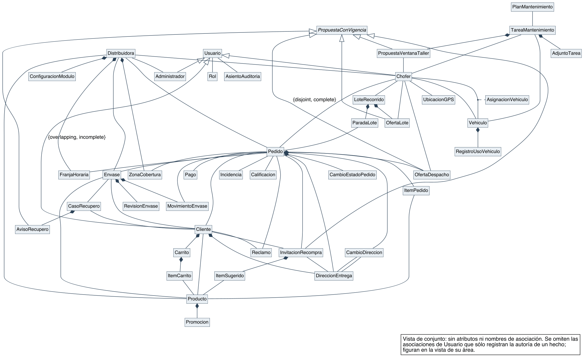

**Figura 1 — Diagrama Conceptual**


**Figura 1.1 — Modelo conceptual: usuarios y cuentas**


**Figura 1.2 — Modelo conceptual: pedidos y pagos**


**Figura 1.3 — Modelo conceptual: despacho y propuestas con vigencia**

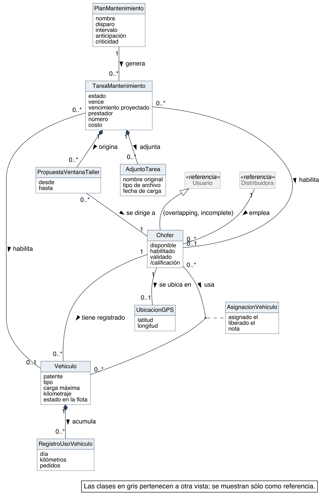

**Figura 1.4 — Modelo conceptual: flota y choferes**


**Figura 1.5 — Modelo conceptual: envases y catálogo**

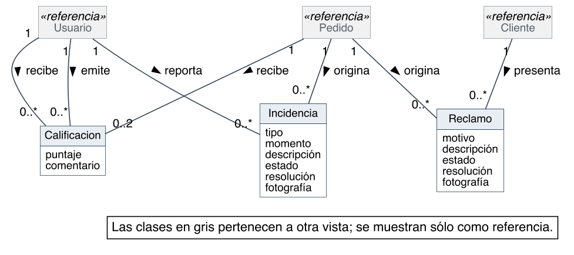

**Figura 1.6 — Modelo conceptual: posventa**

**Para llevarlo a Lucidchart.** `generar-lucidchart.py` emite
`lucidchart/SPLG-modelo-conceptual.xml`, que se importa desde *Archivo → Importar* con las
cajas ya acomodadas, la clase de asociación y los nombres con su sentido de lectura. Las
imágenes de esta sección y ese archivo salen del mismo modelo, `modelo_conceptual.py`, con
`generar-modelo-conceptual.py`.

---

## 2. Comportamiento del Sistema

### 2.1 Diagramas de Secuencia a Nivel de Sistema

Los diagramas de secuencia muestran la interacción entre el **actor** y el **sistema tratado como caja negra**. Solo se muestran los mensajes de entrada y salida, sin detallar la implementación interna.

El sistema se dibuja como la lifeline `:Sistema`, y cada actor lleva el código del catálogo (Cliente (ACT-01), Chofer (ACT-02), Administrador (ACT-03), Sistema Automático (ACT-04), Administrador General (ACT-05), MercadoPago (ACT-06)). Los mensajes que van del actor al sistema son las operaciones del sistema, con una única firma por operación, que se cataloga en §2.2; el sistema responde con un retorno punteado. Lo que el sistema le envía a un actor sin que éste lo haya pedido, como una oferta o un aviso, se dibuja como un mensaje asíncrono con nombre (`notificarOferta(pedido)`). Lo que el sistema hace por dentro no es un mensaje: se anota con una `Note`.

---

#### Crítico DSS — CU-001: Iniciar Sesión

**Actor:** Cliente (ACT-01), Chofer (ACT-02), Administrador (ACT-03)
**Operaciones del sistema:** `iniciarSesion(correo, contrasena)`

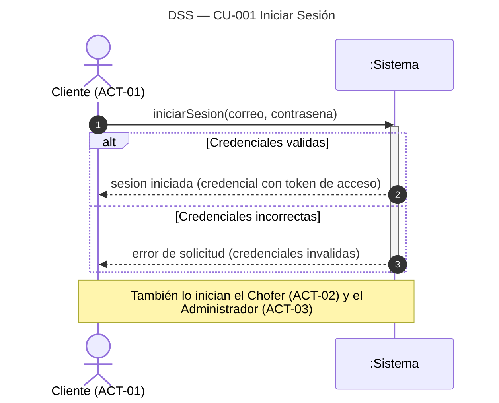

**Figura 2 — DSS CU-001: Iniciar Sesión**

---

#### Crítico DSS — CU-005: Crear Pedido

**Actor:** Cliente (ACT-01)
**Operaciones del sistema:** `crearPedido(items, direccionId, franjaId, fechaAgendada, metodoDePago)`

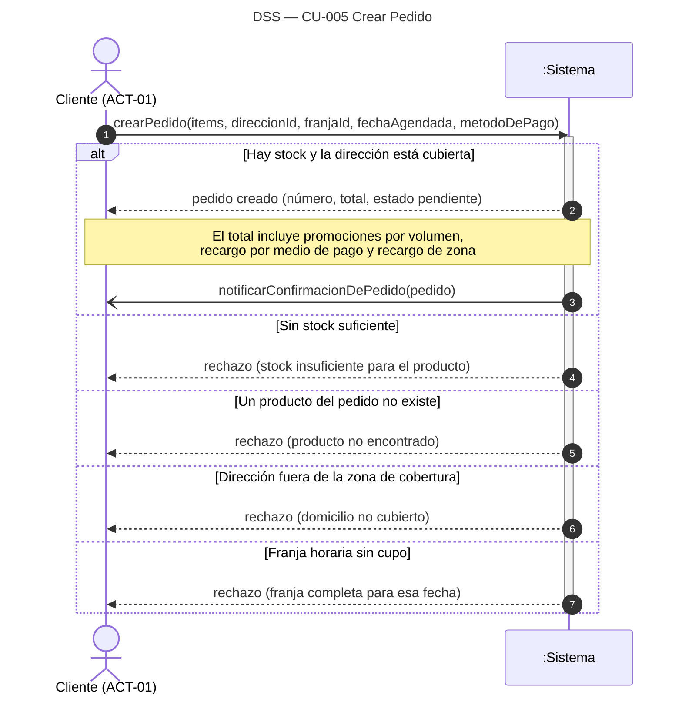

**Figura 3 — DSS CU-005: Crear Pedido**

---

#### Crítico · automático DSS — CU-013: Asignar Pedido Automáticamente por Proximidad

**Actor:** Sistema Automático (ACT-04)
**Operaciones del sistema:** `ofrecerAlSiguienteChofer(pedidoId)`

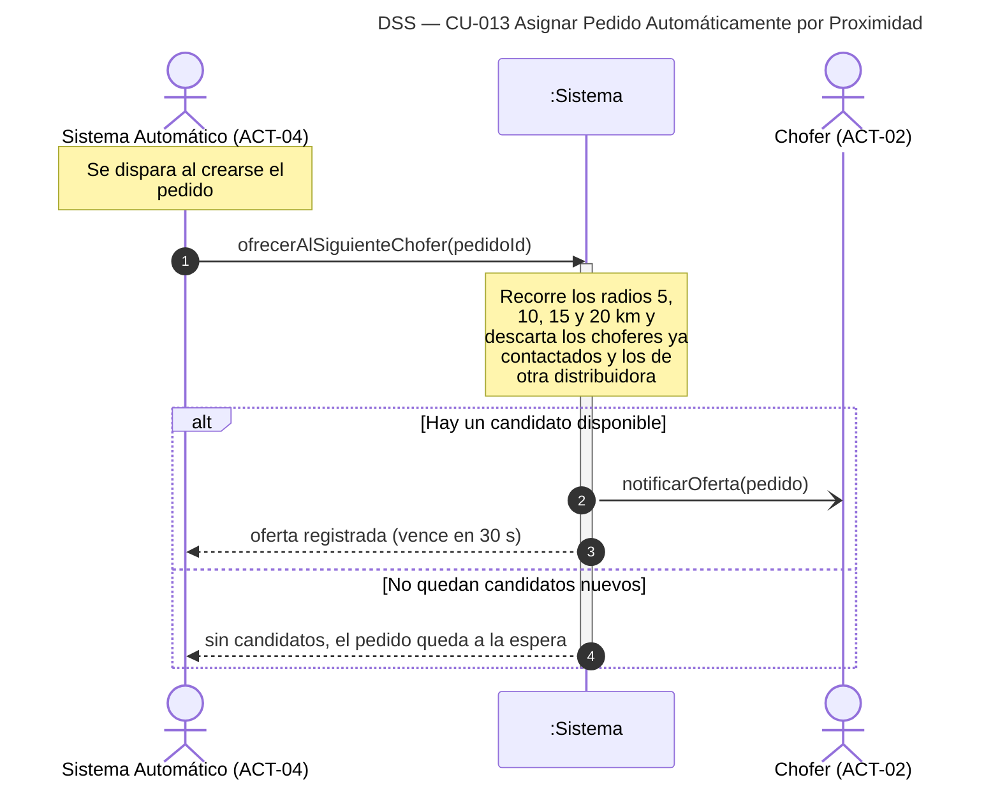

**Figura 4 — DSS CU-013: Asignar Pedido Automáticamente por Proximidad**

---

#### Crítico · automático DSS — CU-014: Reintentar Asignación con Radio Expandido (Cron)

**Actor:** Sistema Automático (ACT-04)
**Operaciones del sistema:** `vencerOfertasExpiradas()`

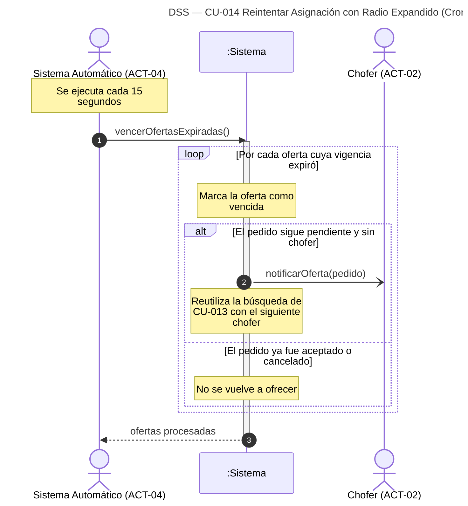

**Figura 5 — DSS CU-014: Reintentar Asignación con Radio Expandido (Cron)**

---

#### DSS — CU-171: Configurar los Parámetros de Despacho de la Distribuidora

**Actor:** Administrador (ACT-03), Administrador General (ACT-05)
**Operaciones del sistema:** `configurarParametrosDeDespacho(radiosKm, ventanaDeAceptacion)`

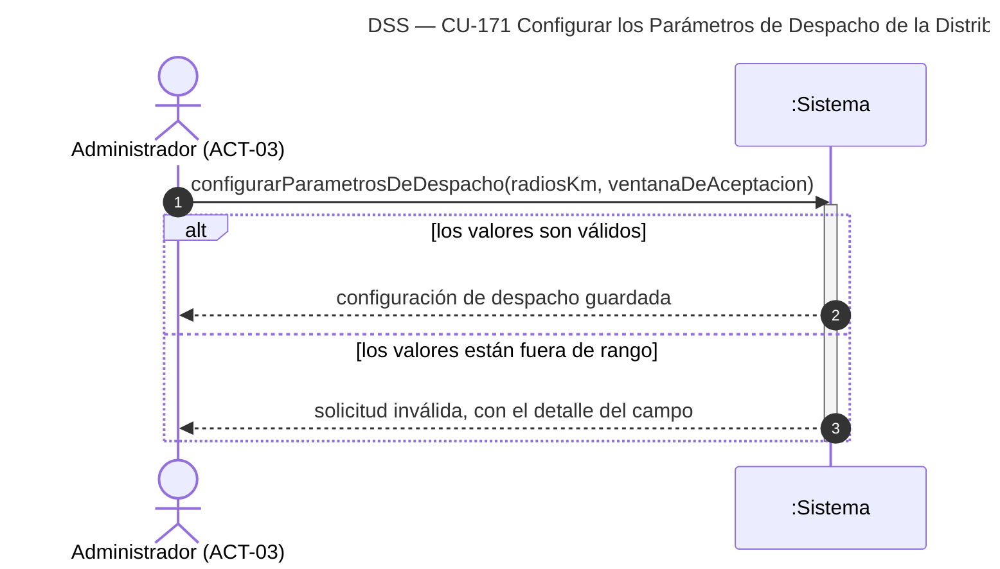

**Figura 6 — DSS CU-171: Configurar los Parámetros de Despacho de la Distribuidora**

---

#### Crítico DSS — CU-015: Aceptar Pedido

**Actor:** Chofer (ACT-02)
**Operaciones del sistema:** `aceptarPedido(pedidoId)`

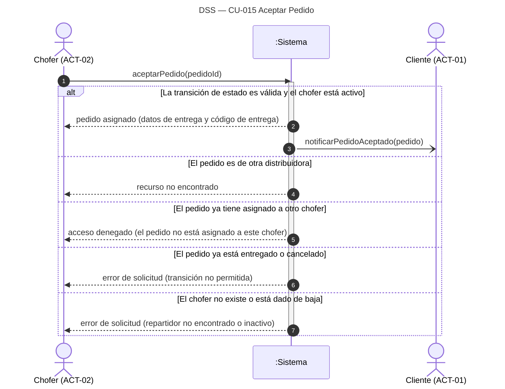

**Figura 7 — DSS CU-015: Aceptar Pedido**

---

#### Crítico · automático DSS — CU-017: Actualizar Ubicación GPS del Chofer

**Actor:** Chofer (ACT-02)
**Operaciones del sistema:** `actualizarUbicacion(usuarioId, latitud, longitud)`

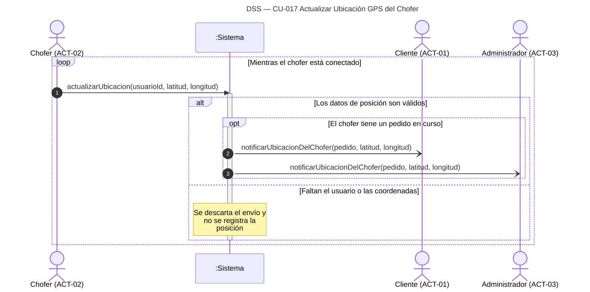

**Figura 8 — DSS CU-017: Actualizar Ubicación GPS del Chofer**

---

#### Crítico DSS — CU-020: Confirmar Entrega

**Actor:** Chofer (ACT-02)
**Operaciones del sistema:** `confirmarEntrega(pedidoId)`

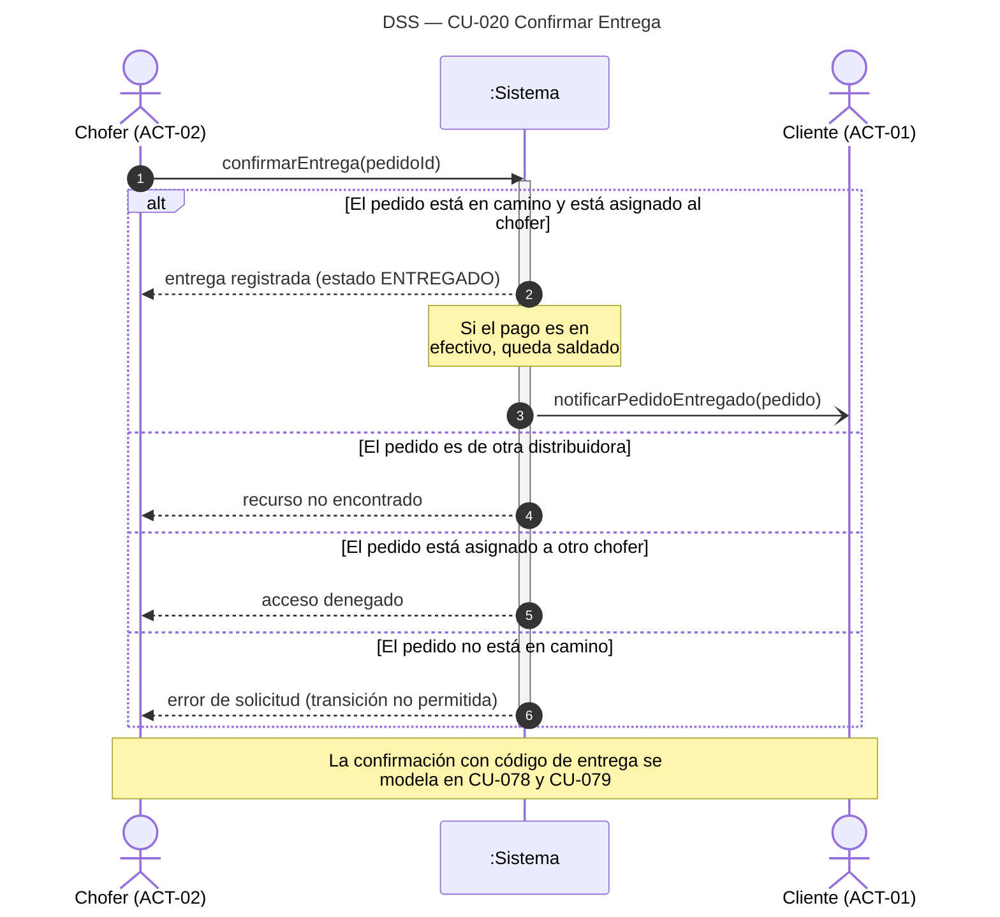

**Figura 9 — DSS CU-020: Confirmar Entrega**

---

#### Importante DSS — CU-023: Registrar Reclamo

**Actor:** Cliente (ACT-01)
**Operaciones del sistema:** `registrarReclamo(pedidoId, motivo, evidencia)`

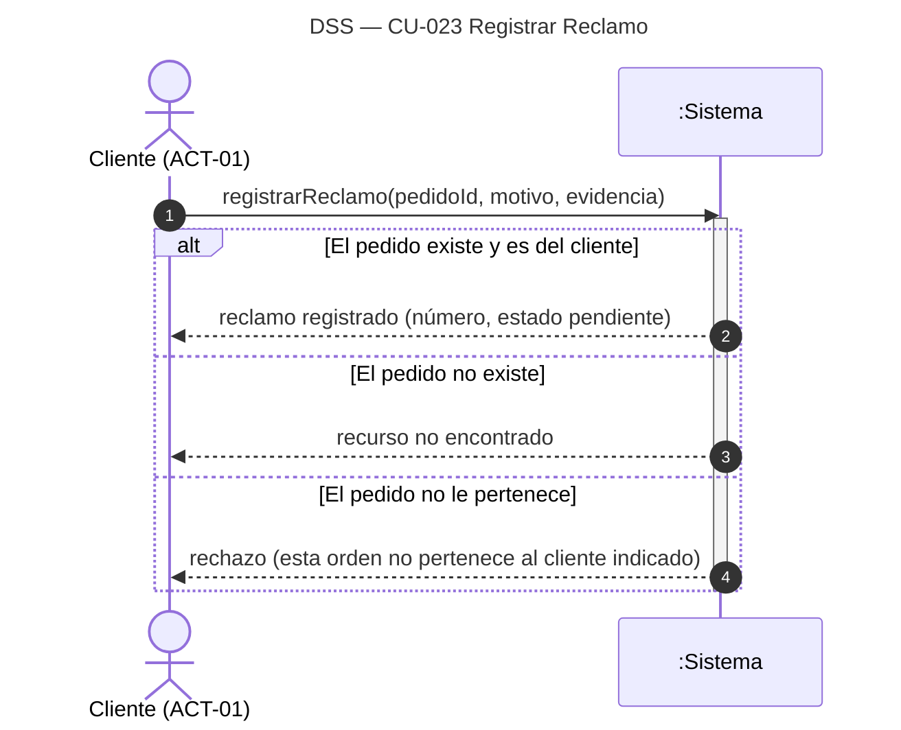

**Figura 10 — DSS CU-023: Registrar Reclamo**

---


---

#### Ampliación — DSS de los casos de uso incorporados

Los 95 diagramas que siguen completan la cobertura del comportamiento del sistema.
Se agrupan por subsistema y respetan la misma convención de caja negra: solo intervienen
el actor y el sistema, sin detalle interno.

#### DSS — CU-002: Registrarse como Cliente

**Actor:** Cliente (ACT-01)
**Operaciones del sistema:** `registrarse(nombreCompleto, correo, telefono, contrasena, datosDelCliente)`

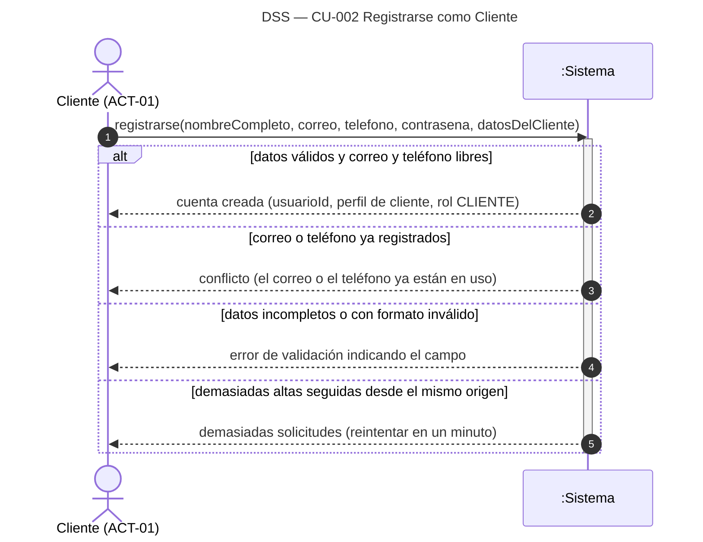

**Figura 11 — DSS CU-002: Registrarse como Cliente**

---

#### DSS — CU-003: Registrar Chofer

**Actor:** Administrador (ACT-03)
**Operaciones del sistema:** `registrarChofer(datosPersonales, datosDelChofer, distribuidoraId)`

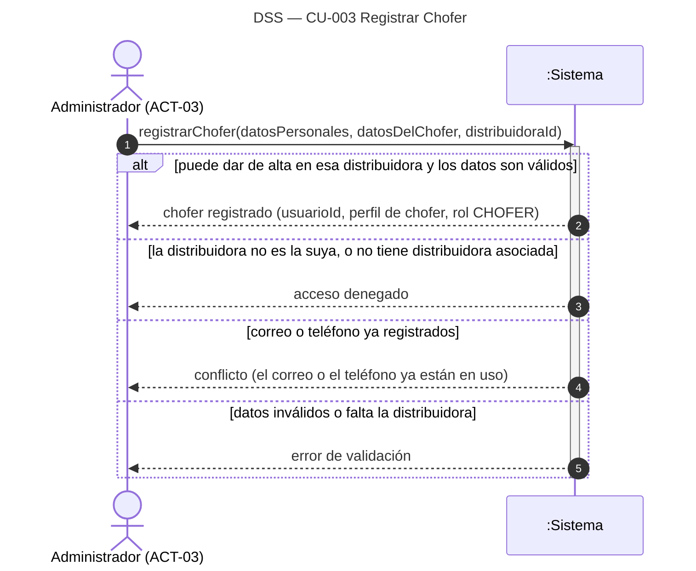

**Figura 12 — DSS CU-003: Registrar Chofer**

> El chofer nace **no validado**: para poder operar necesita CU-032.

---

#### DSS — CU-004: Gestionar Perfil de Usuario

**Actor:** Cliente (ACT-01), Chofer (ACT-02)
**Operaciones del sistema:** `consultarPerfil(usuarioId)`, `consultarPerfilCliente(usuarioId)`, `actualizarPerfil(usuarioId, datos)`

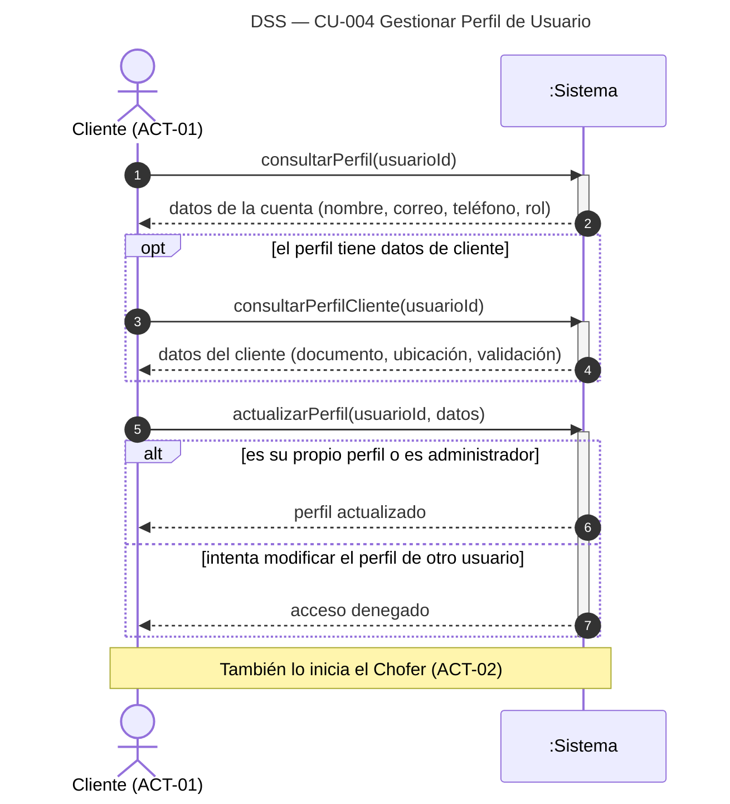

**Figura 13 — DSS CU-004: Gestionar Perfil de Usuario**

---

#### DSS — CU-047: Recuperar Contraseña

**Actor:** Cliente (ACT-01), Chofer (ACT-02), Administrador (ACT-03)
**Operaciones del sistema:** `solicitarRecuperacionDeClave(correo)`, `cambiarCorreo(correoActual, correoNuevo)`

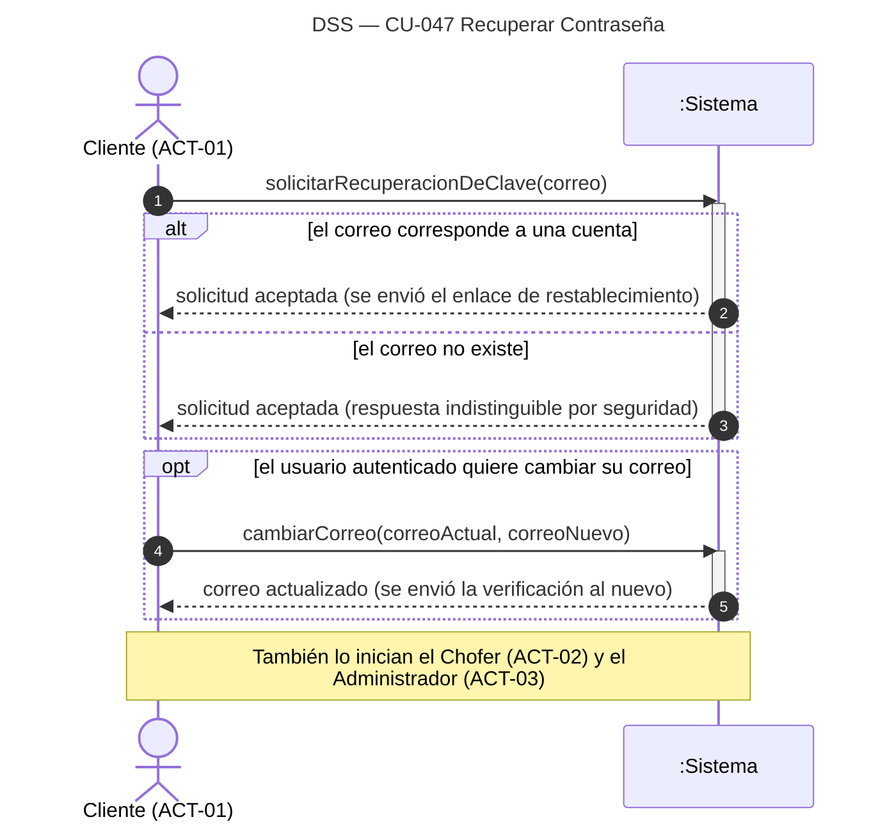

**Figura 14 — DSS CU-047: Recuperar Contraseña**

---

#### DSS — CU-050: Bloquear / Desbloquear Usuario

**Actor:** Administrador (ACT-03)
**Operaciones del sistema:** `bloquearUsuario(usuarioId, bloquear)`

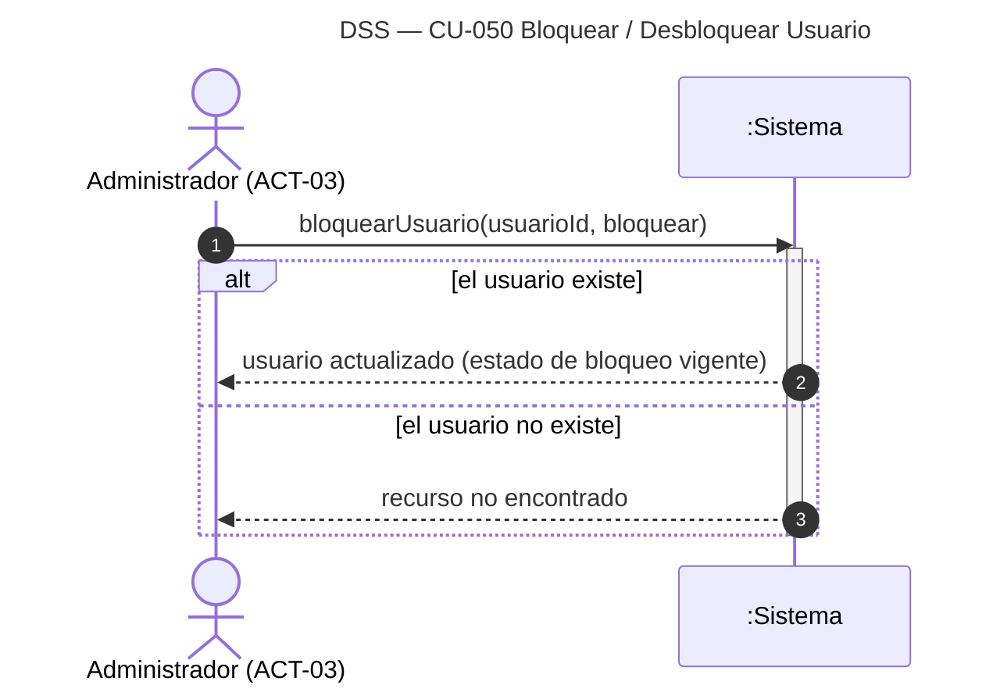

**Figura 15 — DSS CU-050: Bloquear / Desbloquear Usuario**

> Es un interruptor bidireccional: el mismo mensaje bloquea y desbloquea según el parámetro `bloquear`.

---

#### DSS — CU-082: Crear Usuario Base

**Actor:** ninguno directo (caso incluido)

Caso incluido: no tiene diagrama de secuencia propio. Lo inician CU-002, CU-003, CU-031, CU-086 y CU-087, y su operación forma parte del diagrama de secuencia de cada uno de ellos (caso base).

---

#### DSS — CU-083: Buscar / Listar Usuarios

**Actor:** Administrador (ACT-03)
**Operaciones del sistema:** `listarUsuarios(pagina, limite, textoDeBusqueda)`, `buscarUsuarioPorCorreo(correo)`, `buscarUsuarioPorTelefono(telefono)`

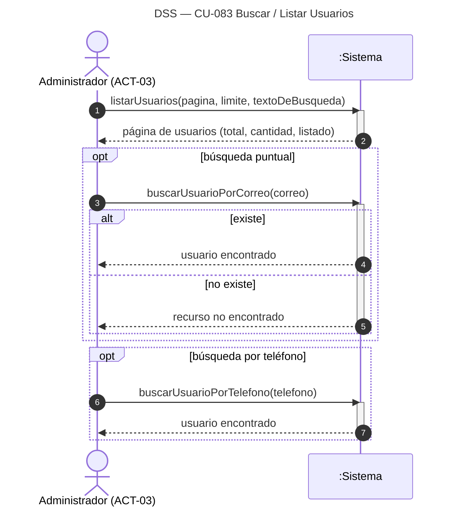

**Figura 16 — DSS CU-083: Buscar / Listar Usuarios**

---

#### DSS — CU-084: Verificar Existencia de Usuario (pre-registro)

**Actor:** Cliente (ACT-01), Chofer (ACT-02), Administrador (ACT-03), Sistema Automático (ACT-04)
**Operaciones del sistema:** `verificarExistenciaDeUsuario(correo, telefono)`

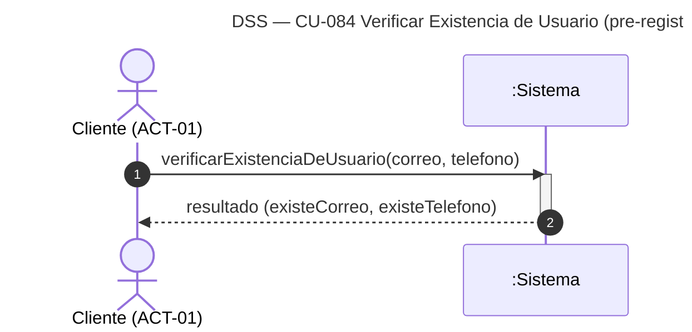

**Figura 17 — DSS CU-084: Verificar Existencia de Usuario (pre-registro)**

> Se invoca **antes** de CU-002 para que la aplicación avise el conflicto sin llegar a intentar el alta.

---

#### DSS — CU-085: Eliminar Usuario (baja lógica)

**Actor:** Administrador (ACT-03)
**Operaciones del sistema:** `eliminarUsuario(usuarioId)`

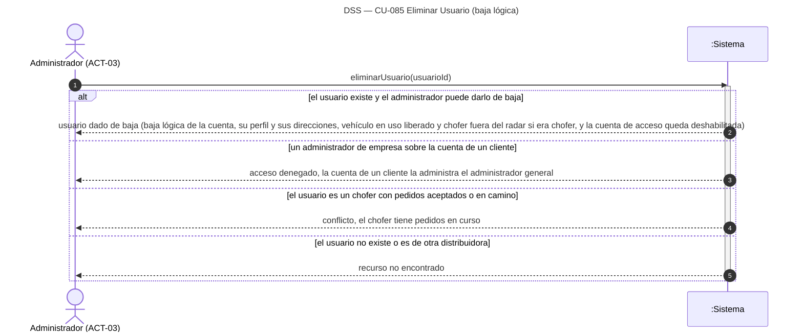

**Figura 18 — DSS CU-085: Eliminar Usuario (baja lógica)**

---

#### DSS — CU-091: Validar Vigencia del Token de Sesión

**Actor:** Cliente (ACT-01), Chofer (ACT-02), Administrador (ACT-03), Administrador General (ACT-05)
**Operaciones del sistema:** `validarSesion()`

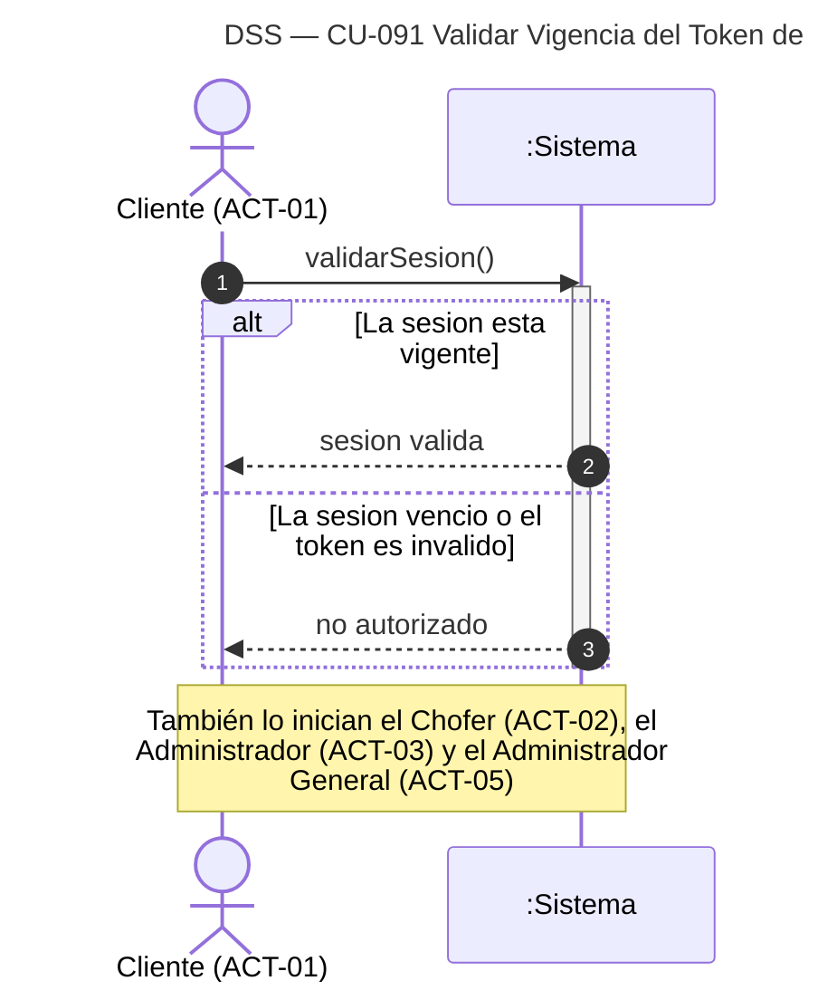

**Figura 19 — DSS CU-091: Validar Vigencia del Token de Sesión**

---

### SS-02 — Gestión de Pedidos

#### DSS — CU-006: Consultar Detalle de Pedido

**Actor:** Cliente (ACT-01), Chofer (ACT-02), Administrador (ACT-03)
**Operaciones del sistema:** `consultarPedido(pedidoId)`

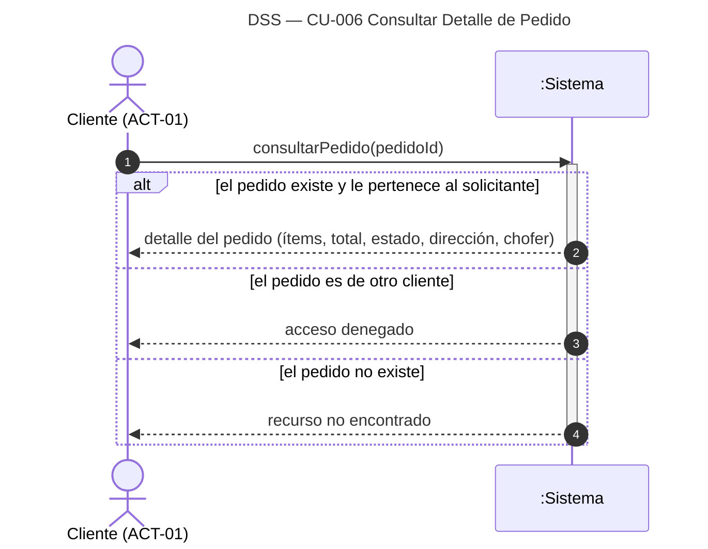

**Figura 20 — DSS CU-006: Consultar Detalle de Pedido**

---

#### DSS — CU-007: Consultar Historial de Pedidos

**Actor:** Cliente (ACT-01)
**Operaciones del sistema:** `consultarHistorialDePedidos(clienteId, pagina, limite)`

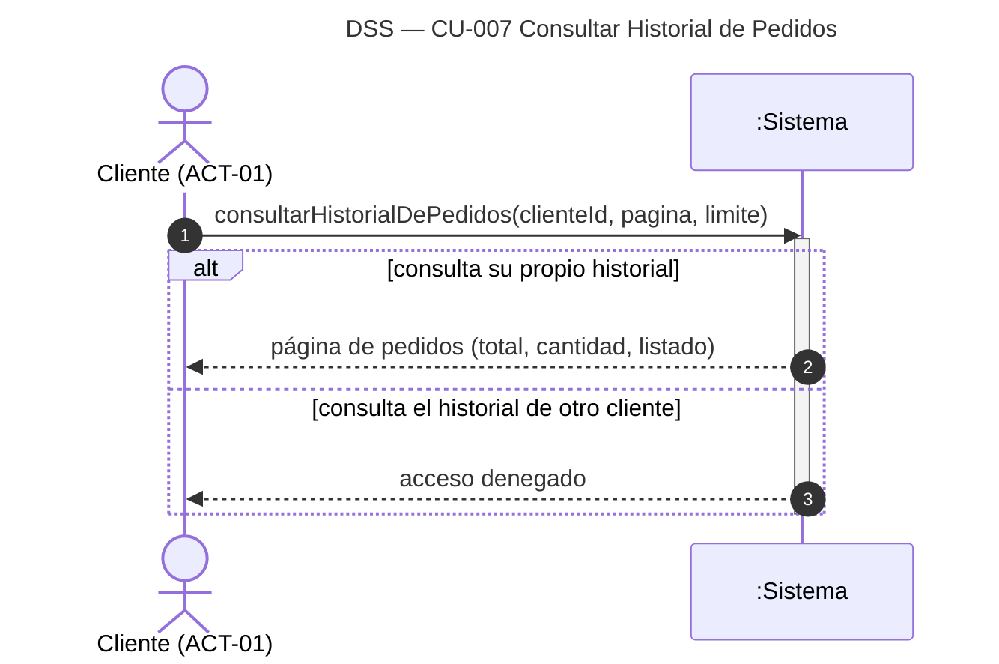

**Figura 21 — DSS CU-007: Consultar Historial de Pedidos**

> El cliente ve **todo** su historial aunque haya comprado a varias distribuidoras; el personal solo ve los pedidos de la suya.

---

#### DSS — CU-169: Registrar el Cambio de Estado de un Pedido

**Actor:** Sistema Automático (ACT-04)
**Operaciones del sistema:** `registrarCambioDeEstado(pedidoId, estadoAnterior, estadoNuevo, autor, motivo)`

```mermaid
sequenceDiagram
    title DSS — CU-169 Registrar el Cambio de Estado de un Pedido
    autonumber
    actor SAU as Sistema Automático (ACT-04)
    participant SIS as :Sistema

    Note over SAU: Se dispara en cada<br/>cambio de estado del<br/>pedido, dentro de la<br/>misma transacción
    SAU->>SIS: registrarCambioDeEstado(pedidoId, estadoAnterior, estadoNuevo, autor, motivo)
    activate SIS
    alt El cambio es válido y se guarda
        SIS-->>SAU: fila agregada al historial, junto con el cambio
    else No se puede escribir el historial
        SIS-->>SAU: cambio revertido
    end
    deactivate SIS
```

**Figura 22 — DSS CU-169: Registrar el Cambio de Estado de un Pedido**

---

#### DSS — CU-170: Consultar el Historial de Estados de un Pedido

**Actor:** Cliente (ACT-01), Administrador (ACT-03), Administrador General (ACT-05)
**Operaciones del sistema:** `consultarHistorialDeEstados(pedidoId)`

```mermaid
sequenceDiagram
    title DSS — CU-170 Consultar el Historial de Estados de un Pedido
    autonumber
    actor USR as Cliente (ACT-01)
    participant SIS as :Sistema

    USR->>SIS: consultarHistorialDeEstados(pedidoId)
    activate SIS
    alt el pedido existe y el usuario puede verlo
        SIS-->>USR: cambios de estado, del más antiguo al más reciente
    else el pedido no existe o no es del usuario
        SIS-->>USR: recurso no encontrado
    end
    deactivate SIS
    Note over USR,SIS: También lo inician el Administrador (ACT-03) y<br/>el Administrador General (ACT-05)
```

**Figura 23 — DSS CU-170: Consultar el Historial de Estados de un Pedido**

---

#### DSS — CU-143: Declarar el Consumo Promedio al Registrarse

**Actor:** Cliente (ACT-01)
**Operaciones del sistema:** `declararConsumoPromedio(tipoGarrafa, cantidadPorMes)`

```mermaid
sequenceDiagram
    title DSS — CU-143 Declarar el Consumo Promedio al Registrarse
    autonumber
    actor CLI as Cliente (ACT-01)
    participant SIS as :Sistema

    CLI->>SIS: declararConsumoPromedio(tipoGarrafa, cantidadPorMes)
    activate SIS
    alt el valor es razonable
        SIS-->>CLI: consumo declarado y recompra estimada
    else el cliente no lo declara
        SIS-->>CLI: registro sin consumo declarado
    else el valor está fuera de rango
        SIS-->>CLI: se pide confirmación
    end
    deactivate SIS
```

**Figura 24 — DSS CU-143: Declarar el Consumo Promedio al Registrarse**

---

#### DSS — CU-144: Actualizar el Consumo Promedio Declarado

**Actor:** Cliente (ACT-01)
**Operaciones del sistema:** `actualizarConsumoPromedio(cantidadPorMes)`

```mermaid
sequenceDiagram
    title DSS — CU-144 Actualizar el Consumo Promedio Declarado
    autonumber
    actor CLI as Cliente (ACT-01)
    participant SIS as :Sistema

    CLI->>SIS: actualizarConsumoPromedio(cantidadPorMes)
    activate SIS
    alt el valor es razonable
        SIS-->>CLI: consumo actualizado y recompra recalculada
    else el valor está fuera de rango
        SIS-->>CLI: se pide confirmación
    end
    deactivate SIS
```

**Figura 25 — DSS CU-144: Actualizar el Consumo Promedio Declarado**

---

#### DSS — CU-145: Configurar los Días de Aviso Previo a la Recompra

**Actor:** Cliente (ACT-01)
**Operaciones del sistema:** `configurarDiasDeAviso(dias)`

```mermaid
sequenceDiagram
    title DSS — CU-145 Configurar los Días de Aviso Previo a la Recompra
    autonumber
    actor CLI as Cliente (ACT-01)
    participant SIS as :Sistema

    CLI->>SIS: configurarDiasDeAviso(dias)
    activate SIS
    alt el valor está dentro del rango
        SIS-->>CLI: preferencia guardada
    else el valor está fuera del rango
        SIS-->>CLI: operación rechazada
    end
    deactivate SIS
```

**Figura 26 — DSS CU-145: Configurar los Días de Aviso Previo a la Recompra**

---

#### DSS — CU-146: Consultar la Fecha Estimada de Recompra

**Actor:** Administrador (ACT-03)
**Operaciones del sistema:** `consultarRecomprasEstimadas(dias)`

```mermaid
sequenceDiagram
    title DSS — CU-146 Consultar la Fecha Estimada de Recompra
    autonumber
    actor ADM as Administrador (ACT-03)
    participant SIS as :Sistema

    ADM->>SIS: consultarRecomprasEstimadas(dias)
    activate SIS
    alt hay clientes en la ventana
        SIS-->>ADM: listado ordenado por fecha estimada
    else no hay ninguno
        SIS-->>ADM: listado vacío
    end
    deactivate SIS
```

**Figura 27 — DSS CU-146: Consultar la Fecha Estimada de Recompra**

---

#### DSS — CU-147: Realizar una Compra Express

**Actor:** Cliente (ACT-01)
**Operaciones del sistema:** `realizarCompraExpress(tipoGarrafa, medioDePago)`

```mermaid
sequenceDiagram
    title DSS — CU-147 Realizar una Compra Express
    autonumber
    actor CLI as Cliente (ACT-01)
    participant SIS as :Sistema

    CLI->>SIS: realizarCompraExpress(tipoGarrafa, medioDePago)
    activate SIS
    alt hay cobertura, horario y chofer
        SIS-->>CLI: pedido express creado y despachado
    else no hay cobertura express o está fuera de horario
        SIS-->>CLI: se ofrece el flujo con franja horaria
    else no hay chofer en moto disponible
        SIS-->>CLI: se ofrece el flujo con franja horaria
    end
    deactivate SIS
```

**Figura 28 — DSS CU-147: Realizar una Compra Express**

---

#### DSS — CU-148: Elegir la Modalidad de Entrega del Pedido

**Actor:** Cliente (ACT-01)
**Operaciones del sistema:** `consultarModalidadesDeEntrega(direccionId)`

```mermaid
sequenceDiagram
    title DSS — CU-148 Elegir la Modalidad de Entrega del Pedido
    autonumber
    actor CLI as Cliente (ACT-01)
    participant SIS as :Sistema

    CLI->>SIS: consultarModalidadesDeEntrega(direccionId)
    activate SIS
    alt las dos modalidades están disponibles
        SIS-->>CLI: opciones con precio y tiempo estimado
    else sólo la programada está disponible
        SIS-->>CLI: opción programada con el motivo
    end
    deactivate SIS
```

**Figura 29 — DSS CU-148: Elegir la Modalidad de Entrega del Pedido**

---

#### DSS — CU-008: Cancelar Pedido (Cliente)

**Actor:** Cliente (ACT-01)
**Operaciones del sistema:** `cancelarPedido(pedidoId, motivo)`

```mermaid
sequenceDiagram
    title DSS — CU-008 Cancelar Pedido (Cliente)
    autonumber
    actor CLI as Cliente (ACT-01)
    participant SIS as :Sistema
    actor CHO as Chofer (ACT-02)
    actor ADM as Administrador (ACT-03)

    CLI->>SIS: cancelarPedido(pedidoId, motivo)
    activate SIS
    alt El pedido es del cliente y todavía no salió en camino
        SIS-->>CLI: pedido cancelado (estado CANCELADO, stock restituido)
        opt El pedido ya tenía chofer asignado
            SIS-)CHO: notificarPedidoCancelado(pedido)
        end
        SIS-)ADM: notificarPedidoCancelado(pedido)
        Note over SIS: Si el pedido tenía un<br/>pago aprobado por una<br/>pasarela (planificado,<br/>I-7), se reintegra con<br/>CU-168
    else El pedido es de otro cliente o de otra distribuidora
        SIS-->>CLI: recurso no encontrado
    else El pedido ya está entregado o cancelado
        SIS-->>CLI: error de solicitud (no se puede cancelar un pedido finalizado)
    else El pedido ya está en camino
        SIS-->>CLI: error de solicitud (contactar al soporte)
    end
    deactivate SIS
```

**Figura 30 — DSS CU-008: Cancelar Pedido (Cliente)**

> La identidad y el rol del cancelador salen **siempre** de la sesión, nunca del cuerpo del mensaje.

---

#### DSS — CU-009: Cancelar Pedido (Chofer)

**Actor:** Chofer (ACT-02)
**Operaciones del sistema:** `liberarPedido(pedidoId, motivo)`

```mermaid
sequenceDiagram
    title DSS — CU-009 Cancelar Pedido (Chofer)
    autonumber
    actor CHO as Chofer (ACT-02)
    participant SIS as :Sistema
    actor CLI as Cliente (ACT-01)

    CHO->>SIS: liberarPedido(pedidoId, motivo)
    activate SIS
    alt El pedido está asignado al chofer y no está finalizado
        SIS-->>CHO: pedido liberado (vuelve a PENDIENTE y queda sin chofer)
        SIS-)CLI: notificarBusquedaDeNuevoChofer(pedido)
    else El pedido es de otra distribuidora
        SIS-->>CHO: recurso no encontrado
    else El pedido no está asignado a este chofer
        SIS-->>CHO: acceso denegado
    else El pedido ya está entregado o cancelado
        SIS-->>CHO: error de solicitud (no se puede cancelar un pedido finalizado)
    end
    deactivate SIS
```

**Figura 31 — DSS CU-009: Cancelar Pedido (Chofer)**

---

#### DSS — CU-010: Cancelar Pedido (Administrador)

**Actor:** Administrador (ACT-03)
**Operaciones del sistema:** `cancelarPedido(pedidoId, motivo)`, `cancelarPedidoForzado(pedidoId)`

```mermaid
sequenceDiagram
    title DSS — CU-010 Cancelar Pedido (Administrador)
    autonumber
    actor ADM as Administrador (ACT-03)
    participant SIS as :Sistema

    alt Cancelación ordinaria
        ADM->>SIS: cancelarPedido(pedidoId, motivo)
        activate SIS
        SIS-->>ADM: pedido cancelado (motivo registrado, stock restituido)
        deactivate SIS
    else Cancelación forzada
        ADM->>SIS: cancelarPedidoForzado(pedidoId)
        activate SIS
        SIS-->>ADM: pedido cancelado por decisión administrativa
        deactivate SIS
    end
    Note over ADM,SIS: Si el pedido tenía un pago aprobado por una<br/>pasarela (planificado, I-7), se reintegra con<br/>CU-168
```

**Figura 32 — DSS CU-010: Cancelar Pedido (Administrador)**

> El sistema ofrece **dos** vías para el administrador. La documentación previa describía una sola.

---

#### DSS — CU-011: Listar Todos los Pedidos

**Actor:** Administrador (ACT-03)
**Operaciones del sistema:** `listarPedidos(pagina, limite)`

```mermaid
sequenceDiagram
    title DSS — CU-011 Listar Todos los Pedidos
    autonumber
    actor ADM as Administrador (ACT-03)
    participant SIS as :Sistema

    ADM->>SIS: listarPedidos(pagina, limite)
    activate SIS
    alt es administrador de una distribuidora
        SIS-->>ADM: página de pedidos de su distribuidora
    else es super administrador sin distribuidora seleccionada
        SIS-->>ADM: página de pedidos de todas las distribuidoras
    end
    deactivate SIS
```

**Figura 33 — DSS CU-011: Listar Todos los Pedidos**

---

#### DSS — CU-012: Asignar Chofer Manualmente

**Actor:** Administrador (ACT-03)
**Operaciones del sistema:** `asignarChoferAPedido(pedidoId, choferId)`

```mermaid
sequenceDiagram
    title DSS — CU-012 Asignar Chofer Manualmente
    autonumber
    actor ADM as Administrador (ACT-03)
    participant SIS as :Sistema

    ADM->>SIS: asignarChoferAPedido(pedidoId, choferId)
    activate SIS
    alt el pedido está pendiente o aceptado por otro chofer, y el chofer es elegible
        SIS-->>ADM: pedido asignado (estado ACEPTADO, chofer vinculado, código de entrega nuevo)
    else el pedido o el chofer no existen o son de otra distribuidora
        SIS-->>ADM: recurso no encontrado
    else el chofer está deshabilitado, no está validado o tiene la flota inhabilitada
        SIS-->>ADM: asignación rechazada
    else el pedido no admite pasar a aceptado
        SIS-->>ADM: asignación rechazada por transición no permitida
    end
    deactivate SIS
```

**Figura 34 — DSS CU-012: Asignar Chofer Manualmente**

---

#### DSS — CU-149: Despachar un Pedido Express a un Chofer en Moto

**Actor:** Sistema Automático (ACT-04)
**Operaciones del sistema:** `despacharPedidoExpress(pedidoId)`

```mermaid
sequenceDiagram
    title DSS — CU-149 Despachar un Pedido Express a un Chofer en Moto
    autonumber
    actor SAU as Sistema Automático (ACT-04)
    participant SIS as :Sistema
    actor CLI as Cliente (ACT-01)

    SAU->>SIS: despacharPedidoExpress(pedidoId)
    activate SIS
    Note over SIS: Ofrece el pedido al<br/>chofer en moto más<br/>cercano, con una ventana<br/>de aceptación más corta
    alt Un chofer en moto acepta
        SIS-->>SAU: pedido asignado
        SIS-)CLI: notificarPedidoAceptado(pedido)
    else Ninguno acepta
        SIS-->>SAU: modalidad express cancelada, recargo descontado del total y reintegrado si se pagó en línea
    end
    deactivate SIS
```

**Figura 35 — DSS CU-149: Despachar un Pedido Express a un Chofer en Moto**

---

#### DSS — CU-046: Consultar Direcciones de Entrega del Cliente

**Actor:** Cliente (ACT-01)
**Operaciones del sistema:** `registrarDireccionDeEntrega(datos)`, `consultarDireccionesDeEntrega(usuarioId)`, `marcarDireccionPredeterminada(direccionId)`, `editarDireccionDeEntrega(direccionId, cambios)`, `eliminarDireccionDeEntrega(direccionId)`

```mermaid
sequenceDiagram
    title DSS — CU-046 Consultar Direcciones de Entrega del Cliente
    autonumber
    actor CLI as Cliente (ACT-01)
    participant SIS as :Sistema

    CLI->>SIS: registrarDireccionDeEntrega(datos)
    activate SIS
    SIS-->>CLI: dirección creada (direccionId)
    deactivate SIS

    CLI->>SIS: consultarDireccionesDeEntrega(usuarioId)
    activate SIS
    SIS-->>CLI: listado de direcciones
    deactivate SIS

    opt el cliente cambia su dirección habitual
        CLI->>SIS: marcarDireccionPredeterminada(direccionId)
        activate SIS
        SIS-->>CLI: dirección predeterminada actualizada (las demás dejan de serlo)
        deactivate SIS
    end

    opt corrección de datos
        CLI->>SIS: editarDireccionDeEntrega(direccionId, cambios)
        activate SIS
        SIS-->>CLI: dirección actualizada
        deactivate SIS
    end

    opt baja de una dirección
        CLI->>SIS: eliminarDireccionDeEntrega(direccionId)
        activate SIS
        alt la dirección existe y es del cliente
            SIS-->>CLI: dirección eliminada
        else la dirección no existe
            SIS-->>CLI: recurso no encontrado
        end
        deactivate SIS
    end
```

**Figura 36 — DSS CU-046: Consultar Direcciones de Entrega del Cliente**

---

#### DSS — CU-116: Registrar Dirección de Entrega

**Actor:** Cliente (ACT-01)
**Operaciones del sistema:** `registrarDireccionDeEntrega(datos)`

```mermaid
sequenceDiagram
    title DSS — CU-116 Registrar Dirección de Entrega
    autonumber
    actor CLI as Cliente (ACT-01)
    participant SIS as :Sistema

    CLI->>SIS: registrarDireccionDeEntrega(datos)
    activate SIS
    alt los datos son válidos
        SIS-->>CLI: dirección registrada
    else la cuenta de usuario no existe
        SIS-->>CLI: recurso no encontrado
    end
    deactivate SIS
```

**Figura 37 — DSS CU-116: Registrar Dirección de Entrega**

---

#### DSS — CU-117: Consultar Detalle de una Dirección de Entrega

**Actor:** Cliente (ACT-01)
**Operaciones del sistema:** `consultarDireccionDeEntrega(direccionId)`

```mermaid
sequenceDiagram
    title DSS — CU-117 Consultar Detalle de una Dirección de Entrega
    autonumber
    actor CLI as Cliente (ACT-01)
    participant SIS as :Sistema

    CLI->>SIS: consultarDireccionDeEntrega(direccionId)
    activate SIS
    alt la dirección existe y es del cliente
        SIS-->>CLI: datos de la dirección
    else la dirección no existe
        SIS-->>CLI: recurso no encontrado
    else la dirección es de otro cliente
        SIS-->>CLI: acceso denegado
    end
    deactivate SIS
```

**Figura 38 — DSS CU-117: Consultar Detalle de una Dirección de Entrega**

---

#### DSS — CU-118: Editar Dirección de Entrega

**Actor:** Cliente (ACT-01)
**Operaciones del sistema:** `editarDireccionDeEntrega(direccionId, cambios)`

```mermaid
sequenceDiagram
    title DSS — CU-118 Editar Dirección de Entrega
    autonumber
    actor CLI as Cliente (ACT-01)
    participant SIS as :Sistema

    CLI->>SIS: editarDireccionDeEntrega(direccionId, cambios)
    activate SIS
    alt la dirección existe y es del cliente
        SIS-->>CLI: dirección actualizada
    else la dirección no existe o es de otro
        SIS-->>CLI: operación rechazada
    end
    deactivate SIS
```

**Figura 39 — DSS CU-118: Editar Dirección de Entrega**

---

#### DSS — CU-119: Eliminar Dirección de Entrega

**Actor:** Cliente (ACT-01)
**Operaciones del sistema:** `eliminarDireccionDeEntrega(direccionId)`

```mermaid
sequenceDiagram
    title DSS — CU-119 Eliminar Dirección de Entrega
    autonumber
    actor CLI as Cliente (ACT-01)
    participant SIS as :Sistema

    CLI->>SIS: eliminarDireccionDeEntrega(direccionId)
    activate SIS
    alt la dirección existe y es del cliente
        SIS-->>CLI: baja confirmada (baja lógica, los pedidos que la usaron la siguen mostrando)
    else la dirección no existe o es de otro
        SIS-->>CLI: operación rechazada
    end
    deactivate SIS
```

**Figura 40 — DSS CU-119: Eliminar Dirección de Entrega**

---

#### DSS — CU-120: Marcar una Dirección como Predeterminada

**Actor:** Cliente (ACT-01)
**Operaciones del sistema:** `marcarDireccionPredeterminada(direccionId)`

```mermaid
sequenceDiagram
    title DSS — CU-120 Marcar una Dirección como Predeterminada
    autonumber
    actor CLI as Cliente (ACT-01)
    participant SIS as :Sistema

    CLI->>SIS: marcarDireccionPredeterminada(direccionId)
    activate SIS
    alt la dirección existe y es del cliente
        SIS-->>CLI: dirección marcada como predeterminada
    else la dirección no existe o es de otro
        SIS-->>CLI: operación rechazada
    end
    deactivate SIS
```

**Figura 41 — DSS CU-120: Marcar una Dirección como Predeterminada**

---

#### DSS — CU-121: Consultar la Dirección Predeterminada

**Actor:** Cliente (ACT-01)
**Operaciones del sistema:** `consultarDireccionPredeterminada(usuarioId)`

```mermaid
sequenceDiagram
    title DSS — CU-121 Consultar la Dirección Predeterminada
    autonumber
    actor CLI as Cliente (ACT-01)
    participant SIS as :Sistema

    CLI->>SIS: consultarDireccionPredeterminada(usuarioId)
    activate SIS
    alt el cliente tiene una dirección predeterminada
        SIS-->>CLI: datos de la dirección
    else el cliente no tiene ninguna
        SIS-->>CLI: recurso no encontrado
    end
    deactivate SIS
```

**Figura 42 — DSS CU-121: Consultar la Dirección Predeterminada**

---

#### DSS — CU-122: Agregar Ítem al Carrito

**Actor:** Cliente (ACT-01)
**Operaciones del sistema:** `agregarItemAlCarrito(productoId, cantidad)`

```mermaid
sequenceDiagram
    title DSS — CU-122 Agregar Ítem al Carrito
    autonumber
    actor CLI as Cliente (ACT-01)
    participant SIS as :Sistema

    CLI->>SIS: agregarItemAlCarrito(productoId, cantidad)
    activate SIS
    alt el tipo de garrafa es válido
        SIS-->>CLI: carrito con el ítem agregado y el total
    else el tipo de garrafa no existe o está de baja
        SIS-->>CLI: operación rechazada
    end
    deactivate SIS
```

**Figura 43 — DSS CU-122: Agregar Ítem al Carrito**

---

#### DSS — CU-123: Modificar la Cantidad de un Ítem del Carrito

**Actor:** Cliente (ACT-01)
**Operaciones del sistema:** `modificarCantidadDelItem(itemId, cantidad)`

```mermaid
sequenceDiagram
    title DSS — CU-123 Modificar la Cantidad de un Ítem del Carrito
    autonumber
    actor CLI as Cliente (ACT-01)
    participant SIS as :Sistema

    CLI->>SIS: modificarCantidadDelItem(itemId, cantidad)
    activate SIS
    alt el ítem es del carrito del cliente
        SIS-->>CLI: carrito con la cantidad actualizada
    else el ítem no es del carrito del cliente
        SIS-->>CLI: operación rechazada
    end
    deactivate SIS
```

**Figura 44 — DSS CU-123: Modificar la Cantidad de un Ítem del Carrito**

---

#### DSS — CU-124: Quitar Ítem del Carrito

**Actor:** Cliente (ACT-01)
**Operaciones del sistema:** `quitarItemDelCarrito(itemId)`

```mermaid
sequenceDiagram
    title DSS — CU-124 Quitar Ítem del Carrito
    autonumber
    actor CLI as Cliente (ACT-01)
    participant SIS as :Sistema

    CLI->>SIS: quitarItemDelCarrito(itemId)
    activate SIS
    alt el ítem es del carrito del cliente
        SIS-->>CLI: carrito sin el ítem
    else el ítem no es del carrito del cliente
        SIS-->>CLI: operación rechazada
    end
    deactivate SIS
```

**Figura 45 — DSS CU-124: Quitar Ítem del Carrito**

---

#### DSS — CU-125: Consultar el Carrito

**Actor:** Cliente (ACT-01)
**Operaciones del sistema:** `consultarCarrito()`

```mermaid
sequenceDiagram
    title DSS — CU-125 Consultar el Carrito
    autonumber
    actor CLI as Cliente (ACT-01)
    participant SIS as :Sistema

    CLI->>SIS: consultarCarrito()
    activate SIS
    alt el cliente tiene carrito
        SIS-->>CLI: detalle del carrito, total a precio vigente y diferencias de precio
    else el cliente no tiene carrito
        SIS-->>CLI: carrito vacío
    end
    deactivate SIS
```

**Figura 46 — DSS CU-125: Consultar el Carrito**

---

#### DSS — CU-126: Vaciar el Carrito

**Actor:** Cliente (ACT-01)
**Operaciones del sistema:** `vaciarCarrito()`

```mermaid
sequenceDiagram
    title DSS — CU-126 Vaciar el Carrito
    autonumber
    actor CLI as Cliente (ACT-01)
    participant SIS as :Sistema

    CLI->>SIS: vaciarCarrito()
    activate SIS
    alt el cliente tiene carrito
        SIS-->>CLI: carrito vacío
    else el cliente no tiene carrito
        SIS-->>CLI: carrito vacío
    end
    deactivate SIS
```

**Figura 47 — DSS CU-126: Vaciar el Carrito**

---

#### DSS — CU-127: Cambiar la Dirección de Entrega del Pedido

**Actor:** Cliente (ACT-01)
**Operaciones del sistema:** `cambiarDireccionDeEntrega(pedidoId, direccionId, motivo)`

```mermaid
sequenceDiagram
    title DSS — CU-127 Cambiar la Dirección de Entrega del Pedido
    autonumber
    actor CLI as Cliente (ACT-01)
    participant SIS as :Sistema

    CLI->>SIS: cambiarDireccionDeEntrega(pedidoId, direccionId, motivo)
    activate SIS
    alt el pedido admite el cambio y la dirección es válida
        SIS-->>CLI: pedido actualizado
    else el pedido ya salió
        SIS-->>CLI: cambio rechazado
    else la dirección está fuera de la zona de cobertura
        SIS-->>CLI: cambio rechazado
    else el pedido está pagado en línea y el recargo de la zona nueva es distinto
        SIS-->>CLI: cambio rechazado
    end
    deactivate SIS
```

**Figura 48 — DSS CU-127: Cambiar la Dirección de Entrega del Pedido**

---

#### DSS — CU-128: Indicar Quién Recibe el Pedido

**Actor:** Cliente (ACT-01)
**Operaciones del sistema:** `indicarQuienRecibe(pedidoId, nombre, documento, relacion)`

```mermaid
sequenceDiagram
    title DSS — CU-128 Indicar Quién Recibe el Pedido
    autonumber
    actor CLI as Cliente (ACT-01)
    participant SIS as :Sistema

    CLI->>SIS: indicarQuienRecibe(pedidoId, nombre, documento, relacion)
    activate SIS
    alt el pedido admite el dato
        SIS-->>CLI: pedido actualizado con quién recibe
    else el pedido ya fue entregado
        SIS-->>CLI: operación rechazada
    end
    deactivate SIS
```

**Figura 49 — DSS CU-128: Indicar Quién Recibe el Pedido**

---

#### DSS — CU-080: Consultar el Pool de Pedidos Disponibles

**Actor:** Chofer (ACT-02), Administrador (ACT-03), Administrador General (ACT-05)
**Operaciones del sistema:** `consultarPedidosDisponibles(pagina, limite)`

```mermaid
sequenceDiagram
    title DSS — CU-080 Consultar el Pool de Pedidos Disponibles
    autonumber
    actor CHO as Chofer (ACT-02)
    participant SIS as :Sistema

    CHO->>SIS: consultarPedidosDisponibles(pagina, limite)
    activate SIS
    SIS-->>CHO: pedidos pendientes sin chofer de su distribuidora (dirección, ítems, total)
    deactivate SIS
```

**Figura 50 — DSS CU-080: Consultar el Pool de Pedidos Disponibles**

> Es la vista de respaldo del despacho automático (CU-013): si la oferta por proximidad no llega, el chofer puede consultar el pool.

---

#### DSS — CU-081: Consultar los Pedidos Asignados al Chofer

**Actor:** Chofer (ACT-02), Administrador (ACT-03), Administrador General (ACT-05)
**Operaciones del sistema:** `consultarPedidosAsignados(choferId, pagina, limite)`

```mermaid
sequenceDiagram
    title DSS — CU-081 Consultar los Pedidos Asignados al Chofer
    autonumber
    actor CHO as Chofer (ACT-02)
    participant SIS as :Sistema

    CHO->>SIS: consultarPedidosAsignados(choferId, pagina, limite)
    activate SIS
    SIS-->>CHO: página de pedidos asignados (estado, cliente, dirección, total)
    deactivate SIS
```

**Figura 51 — DSS CU-081: Consultar los Pedidos Asignados al Chofer**

---

### SS-03 — Despacho y Asignación

#### DSS — CU-016: Rechazar / Ignorar Pedido

**Actor:** Chofer (ACT-02)
**Operaciones del sistema:** `rechazarOferta(pedidoId)`

```mermaid
sequenceDiagram
    title DSS — CU-016 Rechazar / Ignorar Pedido
    autonumber
    actor CHO as Chofer (ACT-02)
    participant SIS as :Sistema
    actor CH2 as Siguiente Chofer (ACT-02)

    CHO->>SIS: rechazarOferta(pedidoId)
    activate SIS
    alt El pedido existe
        SIS-->>CHO: rechazo registrado (se cierra la oferta si estaba activa)
        opt El pedido sigue pendiente y sin chofer asignado
            SIS-)CH2: notificarOferta(pedido)
        end
    else El pedido no existe
        SIS-->>CHO: sin efecto (rechazo no registrado)
    else El pedido es de otra distribuidora
        SIS-->>CHO: recurso no encontrado
    end
    deactivate SIS
```

**Figura 52 — DSS CU-016: Rechazar / Ignorar Pedido**

> El rechazo **no** espera el vencimiento de la ventana de 30 segundos: re-ofrece de inmediato al siguiente chofer más cercano.

---

### SS-04 — Seguimiento en Tiempo Real

#### DSS — CU-018: Marcar Pedido "En Camino"

**Actor:** Chofer (ACT-02)
**Operaciones del sistema:** `marcarPedidoEnCamino(pedidoId)`

```mermaid
sequenceDiagram
    title DSS — CU-018 Marcar Pedido "En Camino"
    autonumber
    actor CHO as Chofer (ACT-02)
    participant SIS as :Sistema
    actor CLI as Cliente (ACT-01)

    CHO->>SIS: marcarPedidoEnCamino(pedidoId)
    activate SIS
    alt La transición es válida desde el estado actual
        SIS-->>CHO: pedido en camino (estado EN_CAMINO)
        SIS-)CLI: notificarPedidoEnCamino(pedido)
    else El pedido es de otra distribuidora
        SIS-->>CHO: recurso no encontrado
    else El pedido está asignado a otro chofer
        SIS-->>CHO: acceso denegado
    else La transición no está permitida
        SIS-->>CHO: error de solicitud (transición inválida)
    end
    deactivate SIS
```

**Figura 53 — DSS CU-018: Marcar Pedido "En Camino"**

---

#### DSS — CU-019: Avisar Llegada al Cliente

**Actor:** Chofer (ACT-02)
**Operaciones del sistema:** `avisarLlegada(pedidoId)`

```mermaid
sequenceDiagram
    title DSS — CU-019 Avisar Llegada al Cliente
    autonumber
    actor CHO as Chofer (ACT-02)
    participant SIS as :Sistema
    actor CLI as Cliente (ACT-01)

    CHO->>SIS: avisarLlegada(pedidoId)
    activate SIS
    alt El pedido está en camino
        SIS-)CLI: notificarLlegadaDelChofer(pedido)
        Note over SIS: El aviso llega en tiempo<br/>real y como notificación<br/>al dispositivo
        SIS-->>CHO: cliente notificado
    else El pedido es de otra distribuidora
        SIS-->>CHO: recurso no encontrado
    else El pedido está asignado a otro chofer
        SIS-->>CHO: acceso denegado
    else El pedido no está en camino
        SIS-->>CHO: error de solicitud (el pedido no está en camino)
    end
    deactivate SIS
```

**Figura 54 — DSS CU-019: Avisar Llegada al Cliente**

> Este caso de uso **no** cambia el estado del pedido: solo notifica.

---

#### DSS — CU-021: Recibir Notificaciones en Tiempo Real

**Actor:** Cliente (ACT-01)
**Operaciones del sistema:** `suscribirseAlSeguimiento(clienteId)`

```mermaid
sequenceDiagram
    title DSS — CU-021 Recibir Notificaciones en Tiempo Real
    autonumber
    actor CLI as Cliente (ACT-01)
    participant SIS as :Sistema

    CLI->>SIS: suscribirseAlSeguimiento(clienteId)
    activate SIS
    SIS-->>CLI: suscripción confirmada
    deactivate SIS

    loop Mientras el pedido esté en curso
        SIS-)CLI: notificarCambioDeEstado(pedido, estado)
        SIS-)CLI: notificarUbicacionDelChofer(pedido, latitud, longitud)
    end
    Note over CLI,SIS: Estados notificados: aceptado, en camino,<br/>entregado y cancelado
```

**Figura 55 — DSS CU-021: Recibir Notificaciones en Tiempo Real**

> El canal se cierra cuando el cliente cierra la aplicación o el pedido alcanza un estado terminal.

---

#### DSS — CU-022: Activar / Desactivar Disponibilidad

**Actor:** Chofer (ACT-02)
**Operaciones del sistema:** `cambiarDisponibilidad(usuarioId, disponible)`

```mermaid
sequenceDiagram
    title DSS — CU-022 Activar / Desactivar Disponibilidad
    autonumber
    actor CHO as Chofer (ACT-02)
    participant SIS as :Sistema

    CHO->>SIS: cambiarDisponibilidad(usuarioId, disponible)
    activate SIS
    alt se pone disponible y está habilitado y validado
        SIS-->>CHO: disponible (empieza a recibir ofertas de pedidos)
    else se pone disponible sin estar habilitado o validado
        SIS-->>CHO: acceso denegado
    else se pone no disponible
        SIS-->>CHO: no disponible (deja de recibir ofertas)
    end
    deactivate SIS
```

**Figura 56 — DSS CU-022: Activar / Desactivar Disponibilidad**

> **Observación de análisis:** el sistema almacena esta disponibilidad en el mismo atributo que el alta/baja administrativa (CU-033), por lo que hoy "fuera de turno" y "dado de baja" son indistinguibles.

---

#### DSS — CU-078: Obtener el Código de Entrega (QR del chofer)

**Actor:** Chofer (ACT-02), Administrador (ACT-03), Administrador General (ACT-05)
**Operaciones del sistema:** `obtenerCodigoDeEntrega(pedidoId)`

```mermaid
sequenceDiagram
    title DSS — CU-078 Obtener el Código de Entrega (QR del chofer)
    autonumber
    actor CHO as Chofer (ACT-02)
    participant SIS as :Sistema

    CHO->>SIS: obtenerCodigoDeEntrega(pedidoId)
    activate SIS
    alt el pedido está asignado a este chofer y ya fue aceptado
        SIS-->>CHO: código de entrega (para mostrarlo como QR al cliente)
    else el pedido no está asignado a este chofer
        SIS-->>CHO: acceso denegado
    else el pedido todavía no fue aceptado
        SIS-->>CHO: error de solicitud (el pedido aún no tiene código)
    else el pedido no existe o es de otra distribuidora
        SIS-->>CHO: recurso no encontrado
    end
    deactivate SIS
```

**Figura 57 — DSS CU-078: Obtener el Código de Entrega (QR del chofer)**

---

#### DSS — CU-079: Confirmar Entrega Escaneando el QR (cliente)

**Actor:** Cliente (ACT-01), Administrador (ACT-03), Administrador General (ACT-05)
**Operaciones del sistema:** `confirmarEntregaConCodigo(pedidoId, codigo)`

```mermaid
sequenceDiagram
    title DSS — CU-079 Confirmar Entrega Escaneando el QR (cliente)
    autonumber
    actor CLI as Cliente (ACT-01)
    participant SIS as :Sistema

    CLI->>SIS: confirmarEntregaConCodigo(pedidoId, codigo)
    activate SIS
    alt el código coincide y el pedido está en camino
        SIS-->>CLI: entrega confirmada (estado ENTREGADO)
    else el código no coincide
        SIS-->>CLI: error de solicitud (código inválido)
    else el pedido no está en camino
        SIS-->>CLI: error de solicitud (el pedido no está en camino)
    else el pedido es de otro cliente
        SIS-->>CLI: acceso denegado
    end
    deactivate SIS
```

**Figura 58 — DSS CU-079: Confirmar Entrega Escaneando el QR (cliente)**

> Es el camino **anti-fraude** que invierte el actor de CU-020: confirma quien recibe, no quien entrega. Es idempotente frente a reintentos de red.

---

### SS-05 — Reclamos

#### DSS — CU-024: Listar Reclamos

**Actor:** Administrador (ACT-03)
**Operaciones del sistema:** `listarReclamos()`

```mermaid
sequenceDiagram
    title DSS — CU-024 Listar Reclamos
    autonumber
    actor ADM as Administrador (ACT-03)
    participant SIS as :Sistema

    ADM->>SIS: listarReclamos()
    activate SIS
    SIS-->>ADM: reclamos de su distribuidora (pedido, cliente, motivo, estado)
    deactivate SIS
```

**Figura 59 — DSS CU-024: Listar Reclamos**

---

#### DSS — CU-025: Resolver Reclamo

**Actor:** Administrador (ACT-03)
**Operaciones del sistema:** `resolverReclamo(reclamoId, resolucion, estadoFinal)`

```mermaid
sequenceDiagram
    title DSS — CU-025 Resolver Reclamo
    autonumber
    actor ADM as Administrador (ACT-03)
    participant SIS as :Sistema

    ADM->>SIS: resolverReclamo(reclamoId, resolucion, estadoFinal)
    activate SIS
    alt el reclamo existe y la transición es válida
        SIS-->>ADM: reclamo resuelto (estado y resolución registrados)
    else el reclamo no existe
        SIS-->>ADM: recurso no encontrado
    else la transición no es válida (resuelto/rechazado sin reabrir antes)
        SIS-->>ADM: transición de reclamo inválida
    end
    deactivate SIS
```

**Figura 60 — DSS CU-025: Resolver Reclamo**

---

#### DSS — CU-166: Tomar un Reclamo Pendiente

**Actor:** Administrador (ACT-03), Administrador General (ACT-05)
**Operaciones del sistema:** `tomarReclamo(reclamoId)`

```mermaid
sequenceDiagram
    title DSS — CU-166 Tomar un Reclamo Pendiente
    autonumber
    actor ADM as Administrador (ACT-03)
    participant SIS as :Sistema

    ADM->>SIS: tomarReclamo(reclamoId)
    activate SIS
    alt el reclamo existe y está pendiente
        SIS-->>ADM: reclamo en proceso
    else el reclamo no existe
        SIS-->>ADM: recurso no encontrado
    else el reclamo no está pendiente
        SIS-->>ADM: solicitud inválida: sólo se toma un reclamo pendiente
    end
    deactivate SIS
```

**Figura 61 — DSS CU-166: Tomar un Reclamo Pendiente**

---

#### DSS — CU-167: Reabrir un Reclamo

**Actor:** Administrador (ACT-03), Administrador General (ACT-05)
**Operaciones del sistema:** `reabrirReclamo(reclamoId, motivo)`

```mermaid
sequenceDiagram
    title DSS — CU-167 Reabrir un Reclamo
    autonumber
    actor ADM as Administrador (ACT-03)
    participant SIS as :Sistema

    ADM->>SIS: reabrirReclamo(reclamoId, motivo)
    activate SIS
    alt el reclamo existe y está resuelto o rechazado
        SIS-->>ADM: reclamo en proceso, con el motivo de la reapertura
    else el reclamo no existe
        SIS-->>ADM: recurso no encontrado
    else el reclamo no está resuelto ni rechazado
        SIS-->>ADM: solicitud inválida: sólo se reabre un reclamo cerrado
    end
    deactivate SIS
```

**Figura 62 — DSS CU-167: Reabrir un Reclamo**

---

#### DSS — CU-174: Adjuntar la Fotografía de un Reclamo

**Actor:** Cliente (ACT-01), Administrador (ACT-03), Administrador General (ACT-05)
**Operaciones del sistema:** `adjuntarFotoAlReclamo(reclamoId, imagen)`

```mermaid
sequenceDiagram
    title DSS — CU-174 Adjuntar la Fotografía de un Reclamo
    autonumber
    actor CLI as Cliente (ACT-01)
    participant SIS as :Sistema

    CLI->>SIS: adjuntarFotoAlReclamo(reclamoId, imagen)
    activate SIS
    alt la imagen es válida y el reclamo es del solicitante
        SIS-->>CLI: reclamo con su fotografía
    else el reclamo no existe o no es del solicitante
        SIS-->>CLI: recurso no encontrado
    else el tipo de archivo no está permitido
        SIS-->>CLI: tipo de archivo no soportado
    else el archivo supera el tamaño máximo
        SIS-->>CLI: archivo demasiado grande
    end
    deactivate SIS
```

**Figura 63 — DSS CU-174: Adjuntar la Fotografía de un Reclamo**

---

#### DSS — CU-175: Consultar la Fotografía de un Reclamo

**Actor:** Cliente (ACT-01), Administrador (ACT-03), Administrador General (ACT-05)
**Operaciones del sistema:** `consultarFotoDelReclamo(reclamoId)`

```mermaid
sequenceDiagram
    title DSS — CU-175 Consultar la Fotografía de un Reclamo
    autonumber
    actor USR as Cliente (ACT-01)
    participant SIS as :Sistema

    USR->>SIS: consultarFotoDelReclamo(reclamoId)
    activate SIS
    alt el reclamo tiene fotografía y el usuario puede verlo
        SIS-->>USR: fotografía del reclamo
    else el reclamo no existe o no es del usuario
        SIS-->>USR: recurso no encontrado
    else el reclamo no tiene fotografía
        SIS-->>USR: recurso no encontrado
    end
    deactivate SIS
    Note over USR,SIS: También lo inician el Administrador (ACT-03) y<br/>el Administrador General (ACT-05)
```

**Figura 64 — DSS CU-175: Consultar la Fotografía de un Reclamo**

---

### SS-06 — Reportes y Dashboard

#### DSS — CU-026: Ver Dashboard General

**Actor:** Administrador (ACT-03)
**Operaciones del sistema:** `consultarResumenDePedidos()`, `consultarGraficoDeVentas()`

```mermaid
sequenceDiagram
    title DSS — CU-026 Ver Dashboard General
    autonumber
    actor ADM as Administrador (ACT-03)
    participant SIS as :Sistema

    ADM->>SIS: consultarResumenDePedidos()
    activate SIS
    SIS-->>ADM: totales del día, la semana y el mes (pedidos, facturación, estados)
    deactivate SIS

    ADM->>SIS: consultarGraficoDeVentas()
    activate SIS
    SIS-->>ADM: serie de ventas de los últimos siete días
    deactivate SIS
```

**Figura 65 — DSS CU-026: Ver Dashboard General**

---

#### DSS — CU-027: Ver Reporte de Ventas por Chofer

**Actor:** Administrador (ACT-03)
**Operaciones del sistema:** `consultarVentasPorChofer(fechaDesde, fechaHasta)`

```mermaid
sequenceDiagram
    title DSS — CU-027 Ver Reporte de Ventas por Chofer
    autonumber
    actor ADM as Administrador (ACT-03)
    participant SIS as :Sistema

    ADM->>SIS: consultarVentasPorChofer(fechaDesde, fechaHasta)
    activate SIS
    SIS-->>ADM: ranking por chofer (pedidos entregados, monto facturado)
    deactivate SIS
```

**Figura 66 — DSS CU-027: Ver Reporte de Ventas por Chofer**

---

#### DSS — CU-028: Ver Reporte de Ventas por Producto

**Actor:** Administrador (ACT-03)
**Operaciones del sistema:** `consultarVentasPorProducto(fechaDesde, fechaHasta)`

```mermaid
sequenceDiagram
    title DSS — CU-028 Ver Reporte de Ventas por Producto
    autonumber
    actor ADM as Administrador (ACT-03)
    participant SIS as :Sistema

    ADM->>SIS: consultarVentasPorProducto(fechaDesde, fechaHasta)
    activate SIS
    SIS-->>ADM: ventas por tipo de garrafa (unidades, monto)
    deactivate SIS
```

**Figura 67 — DSS CU-028: Ver Reporte de Ventas por Producto**

---

#### DSS — CU-029: Ver Reporte por Método de Pago

**Actor:** Administrador (ACT-03)
**Operaciones del sistema:** `consultarVentasPorMetodoDePago(fechaDesde, fechaHasta)`

```mermaid
sequenceDiagram
    title DSS — CU-029 Ver Reporte por Método de Pago
    autonumber
    actor ADM as Administrador (ACT-03)
    participant SIS as :Sistema

    ADM->>SIS: consultarVentasPorMetodoDePago(fechaDesde, fechaHasta)
    activate SIS
    SIS-->>ADM: distribución entre efectivo y pasarela (cantidad, monto)
    deactivate SIS
```

**Figura 68 — DSS CU-029: Ver Reporte por Método de Pago**

---

#### DSS — CU-030: Ver Gráfico de Ventas (últimos 7 días)

**Actor:** Administrador (ACT-03)
**Operaciones del sistema:** `consultarEvolucionDeVentas(fechaDesde, fechaHasta, granularidad)`

```mermaid
sequenceDiagram
    title DSS — CU-030 Ver Gráfico de Ventas (últimos 7 días)
    autonumber
    actor ADM as Administrador (ACT-03)
    participant SIS as :Sistema

    ADM->>SIS: consultarEvolucionDeVentas(fechaDesde, fechaHasta, granularidad)
    activate SIS
    alt granularidad diaria
        SIS-->>ADM: serie por día del rango solicitado
    else granularidad mensual
        SIS-->>ADM: serie por mes del rango solicitado
    end
    deactivate SIS
```

**Figura 69 — DSS CU-030: Ver Gráfico de Ventas (últimos 7 días)**

---

### SS-07 — Gestión de Choferes y Vehículos

#### DSS — CU-031: Registrar Chofer

**Actor:** Administrador (ACT-03)
**Operaciones del sistema:** `registrarChofer(datosPersonales, datosDelChofer, distribuidoraId)`

```mermaid
sequenceDiagram
    title DSS — CU-031 Registrar Chofer
    autonumber
    actor ADM as Administrador (ACT-03)
    participant SIS as :Sistema

    ADM->>SIS: registrarChofer(datosPersonales, datosDelChofer, distribuidoraId)
    activate SIS
    alt puede dar de alta en esa distribuidora y los datos son válidos
        SIS-->>ADM: chofer registrado (usuarioId, perfil de chofer, rol CHOFER)
    else la distribuidora no es la suya, o no tiene distribuidora asociada
        SIS-->>ADM: acceso denegado
    else correo o teléfono ya registrados
        SIS-->>ADM: conflicto (el correo o el teléfono ya están en uso)
    else datos inválidos o falta la distribuidora
        SIS-->>ADM: error de validación
    end
    deactivate SIS
```

**Figura 70 — DSS CU-031: Registrar Chofer**

> Realiza la misma operación del sistema que CU-003, vista desde el subsistema de gestión de flota.

---

#### DSS — CU-032: Validar / Invalidar Chofer

**Actor:** Administrador (ACT-03)
**Operaciones del sistema:** `validarChofer(choferId)`, `invalidarChofer(choferId)`

```mermaid
sequenceDiagram
    title DSS — CU-032 Validar / Invalidar Chofer
    autonumber
    actor ADM as Administrador (ACT-03)
    participant SIS as :Sistema

    alt aprobación de la documentación
        ADM->>SIS: validarChofer(choferId)
        activate SIS
        SIS-->>ADM: chofer validado (habilitado para recibir pedidos)
        deactivate SIS
    else rechazo o revocación
        ADM->>SIS: invalidarChofer(choferId)
        activate SIS
        SIS-->>ADM: chofer invalidado (deja de recibir ofertas)
        deactivate SIS
    end
```

**Figura 71 — DSS CU-032: Validar / Invalidar Chofer**

---

#### DSS — CU-033: Activar / Desactivar Chofer (Admin)

**Actor:** Administrador (ACT-03)
**Operaciones del sistema:** `cambiarEstadoDelChofer(choferId, activo)`

```mermaid
sequenceDiagram
    title DSS — CU-033 Activar / Desactivar Chofer (Admin)
    autonumber
    actor ADM as Administrador (ACT-03)
    participant SIS as :Sistema

    ADM->>SIS: cambiarEstadoDelChofer(choferId, activo)
    activate SIS
    alt el chofer existe
        SIS-->>ADM: estado del chofer actualizado
    else el chofer no existe o es de otra distribuidora
        SIS-->>ADM: recurso no encontrado
    end
    deactivate SIS
```

**Figura 72 — DSS CU-033: Activar / Desactivar Chofer (Admin)**

---

#### DSS — CU-034: Registrar Vehículo del Chofer

**Actor:** Administrador (ACT-03)
**Operaciones del sistema:** `registrarVehiculo(usuarioId, tipo, capacidad, patente, marca, modelo, anio, color)`

```mermaid
sequenceDiagram
    title DSS — CU-034 Registrar Vehículo del Chofer
    autonumber
    actor ADM as Administrador (ACT-03)
    participant SIS as :Sistema

    ADM->>SIS: registrarVehiculo(usuarioId, tipo, capacidad, patente, marca, modelo, anio, color)
    activate SIS
    alt datos válidos
        SIS-->>ADM: vehículo registrado (vehiculoId)
    else datos inválidos
        SIS-->>ADM: error de validación
    end
    deactivate SIS
```

**Figura 73 — DSS CU-034: Registrar Vehículo del Chofer**

---

#### DSS — CU-035: Consultar Listado de Choferes

**Actor:** Administrador (ACT-03)
**Operaciones del sistema:** `listarChoferes(pagina, limite)`, `listarChoferesActivos(pagina, limite)`, `consultarDetalleDelChofer(choferId)`

```mermaid
sequenceDiagram
    title DSS — CU-035 Consultar Listado de Choferes
    autonumber
    actor ADM as Administrador (ACT-03)
    participant SIS as :Sistema

    ADM->>SIS: listarChoferes(pagina, limite)
    activate SIS
    SIS-->>ADM: página de choferes de su distribuidora
    deactivate SIS

    opt vista operativa del día
        ADM->>SIS: listarChoferesActivos(pagina, limite)
        activate SIS
        SIS-->>ADM: choferes activos
        deactivate SIS
    end

    opt ficha individual
        ADM->>SIS: consultarDetalleDelChofer(choferId)
        activate SIS
        alt el chofer existe
            SIS-->>ADM: ficha del chofer (validación, calificación, saldo, vehículo)
        else el chofer no existe
            SIS-->>ADM: recurso no encontrado
        end
        deactivate SIS
    end
```

**Figura 74 — DSS CU-035: Consultar Listado de Choferes**

---

#### DSS — CU-049: Consultar Balance / Ganancias del Chofer

**Actor:** Chofer (ACT-02), Administrador (ACT-03)
**Operaciones del sistema:** `consultarPerfilDelChofer(usuarioId)`, `ajustarSaldoDelChofer(choferId, monto)`

```mermaid
sequenceDiagram
    title DSS — CU-049 Consultar Balance / Ganancias del Chofer
    autonumber
    actor CHO as Chofer (ACT-02)
    participant SIS as :Sistema
    actor ADM as Administrador (ACT-03)

    CHO->>SIS: consultarPerfilDelChofer(usuarioId)
    activate SIS
    SIS-->>CHO: perfil con el saldo acumulado
    deactivate SIS

    opt liquidación o corrección
        ADM->>SIS: ajustarSaldoDelChofer(choferId, monto)
        activate SIS
        SIS-->>ADM: saldo actualizado
        deactivate SIS
    end
```

**Figura 75 — DSS CU-049: Consultar Balance / Ganancias del Chofer**

> **Observación de análisis:** no existe una operación dedicada de consulta de saldo; el chofer lo lee dentro de su propio perfil.

---

#### DSS — CU-051: Consultar Listado de Vehículos

**Actor:** Administrador (ACT-03)
**Operaciones del sistema:** `listarVehiculos()`, `buscarVehiculoPorPatente(patente)`, `editarVehiculo(vehiculoId, datos)`, `eliminarVehiculo(vehiculoId)`

```mermaid
sequenceDiagram
    title DSS — CU-051 Consultar Listado de Vehículos
    autonumber
    actor ADM as Administrador (ACT-03)
    participant SIS as :Sistema

    ADM->>SIS: listarVehiculos()
    activate SIS
    SIS-->>ADM: vehículos de la distribuidora
    deactivate SIS

    opt búsqueda por patente
        ADM->>SIS: buscarVehiculoPorPatente(patente)
        activate SIS
        alt existe
            SIS-->>ADM: vehículo encontrado
        else no existe
            SIS-->>ADM: recurso no encontrado
        end
        deactivate SIS
    end

    opt modificación
        ADM->>SIS: editarVehiculo(vehiculoId, datos)
        activate SIS
        SIS-->>ADM: vehículo actualizado
        deactivate SIS
    end

    opt baja
        ADM->>SIS: eliminarVehiculo(vehiculoId)
        activate SIS
        SIS-->>ADM: vehículo eliminado
        deactivate SIS
    end
```

**Figura 76 — DSS CU-051: Consultar Listado de Vehículos**

---

#### DSS — CU-096: Actualizar Perfil del Chofer

**Actor:** Administrador (ACT-03)
**Operaciones del sistema:** `actualizarPerfilDelChofer(choferId, datos)`

```mermaid
sequenceDiagram
    title DSS — CU-096 Actualizar Perfil del Chofer
    autonumber
    actor ADM as Administrador (ACT-03)
    participant SIS as :Sistema

    ADM->>SIS: actualizarPerfilDelChofer(choferId, datos)
    activate SIS
    alt el chofer existe
        SIS-->>ADM: perfil del chofer actualizado
    else el chofer no existe o es de otra distribuidora
        SIS-->>ADM: recurso no encontrado
    else los datos traen un campo distinto de la validación
        SIS-->>ADM: error de solicitud (campo no admitido)
    end
    deactivate SIS
```

**Figura 77 — DSS CU-096: Actualizar Perfil del Chofer**

---

#### DSS — CU-097: Eliminar Chofer (baja lógica)

**Actor:** Administrador (ACT-03)
**Operaciones del sistema:** `eliminarChofer(choferId)`

```mermaid
sequenceDiagram
    title DSS — CU-097 Eliminar Chofer (baja lógica)
    autonumber
    actor ADM as Administrador (ACT-03)
    participant SIS as :Sistema

    ADM->>SIS: eliminarChofer(choferId)
    activate SIS
    alt el chofer existe y no tiene pedidos en curso
        SIS-->>ADM: chofer dado de baja junto con su cuenta, retirado del radar y con su vehículo en uso liberado (se conserva el histórico de entregas)
    else el chofer tiene pedidos aceptados o en camino
        SIS-->>ADM: conflicto, el chofer tiene pedidos en curso
    else el chofer no existe o es de otra distribuidora
        SIS-->>ADM: recurso no encontrado
    end
    deactivate SIS
```

**Figura 78 — DSS CU-097: Eliminar Chofer (baja lógica)**

---

#### DSS — CU-109: Consultar Detalle del Chofer

**Actor:** Administrador (ACT-03)
**Operaciones del sistema:** `consultarDetalleDelChofer(choferId)`

```mermaid
sequenceDiagram
    title DSS — CU-109 Consultar Detalle del Chofer
    autonumber
    actor ADM as Administrador (ACT-03)
    participant SIS as :Sistema

    ADM->>SIS: consultarDetalleDelChofer(choferId)
    activate SIS
    alt el chofer existe
        SIS-->>ADM: ficha del chofer con vehículo y estado
    else el chofer no existe
        SIS-->>ADM: recurso no encontrado
    end
    deactivate SIS
```

**Figura 79 — DSS CU-109: Consultar Detalle del Chofer**

---

#### DSS — CU-110: Buscar Chofer por Usuario

**Actor:** Administrador (ACT-03)
**Operaciones del sistema:** `buscarChoferPorUsuario(usuarioId)`

```mermaid
sequenceDiagram
    title DSS — CU-110 Buscar Chofer por Usuario
    autonumber
    actor ADM as Administrador (ACT-03)
    participant SIS as :Sistema

    ADM->>SIS: buscarChoferPorUsuario(usuarioId)
    activate SIS
    alt la cuenta tiene perfil de chofer
        SIS-->>ADM: perfil del chofer
    else la cuenta no tiene perfil
        SIS-->>ADM: recurso no encontrado
    end
    deactivate SIS
```

**Figura 80 — DSS CU-110: Buscar Chofer por Usuario**

---

#### DSS — CU-111: Editar Vehículo

**Actor:** Administrador (ACT-03)
**Operaciones del sistema:** `editarVehiculo(vehiculoId, datos)`

```mermaid
sequenceDiagram
    title DSS — CU-111 Editar Vehículo
    autonumber
    actor ADM as Administrador (ACT-03)
    participant SIS as :Sistema

    ADM->>SIS: editarVehiculo(vehiculoId, datos)
    activate SIS
    alt el vehículo existe y los cambios son admisibles
        SIS-->>ADM: vehículo actualizado
    else la patente ya pertenece a otro vehículo
        SIS-->>ADM: patente repetida
    else se cambia la patente o el tipo de un vehículo en uso
        SIS-->>ADM: conflicto (el vehículo está en uso: liberalo primero)
    else el vehículo no existe
        SIS-->>ADM: recurso no encontrado
    end
    deactivate SIS
```

**Figura 81 — DSS CU-111: Editar Vehículo**

---

#### DSS — CU-112: Eliminar Vehículo

**Actor:** Administrador (ACT-03)
**Operaciones del sistema:** `eliminarVehiculo(vehiculoId)`

```mermaid
sequenceDiagram
    title DSS — CU-112 Eliminar Vehículo
    autonumber
    actor ADM as Administrador (ACT-03)
    participant SIS as :Sistema

    ADM->>SIS: eliminarVehiculo(vehiculoId)
    activate SIS
    alt el vehículo existe y está libre
        SIS-->>ADM: vehículo dado de baja (baja lógica, la patente queda libre)
    else el vehículo está en uso por un chofer
        SIS-->>ADM: conflicto, el vehículo está en uso: hay que liberarlo primero
    else el vehículo no existe o es de otra distribuidora
        SIS-->>ADM: recurso no encontrado
    end
    deactivate SIS
```

**Figura 82 — DSS CU-112: Eliminar Vehículo**

---

#### DSS — CU-113: Consultar Detalle del Vehículo

**Actor:** Administrador (ACT-03)
**Operaciones del sistema:** `consultarDetalleDelVehiculo(vehiculoId)`

```mermaid
sequenceDiagram
    title DSS — CU-113 Consultar Detalle del Vehículo
    autonumber
    actor ADM as Administrador (ACT-03)
    participant SIS as :Sistema

    ADM->>SIS: consultarDetalleDelVehiculo(vehiculoId)
    activate SIS
    alt el vehículo existe
        SIS-->>ADM: ficha del vehículo con su chofer
    else el vehículo no existe
        SIS-->>ADM: recurso no encontrado
    end
    deactivate SIS
```

**Figura 83 — DSS CU-113: Consultar Detalle del Vehículo**

---

#### DSS — CU-114: Buscar Vehículo por Patente

**Actor:** Administrador (ACT-03)
**Operaciones del sistema:** `buscarVehiculoPorPatente(patente)`

```mermaid
sequenceDiagram
    title DSS — CU-114 Buscar Vehículo por Patente
    autonumber
    actor ADM as Administrador (ACT-03)
    participant SIS as :Sistema

    ADM->>SIS: buscarVehiculoPorPatente(patente)
    activate SIS
    alt hay un vehículo con esa patente
        SIS-->>ADM: ficha del vehículo
    else ninguno coincide
        SIS-->>ADM: recurso no encontrado
    end
    deactivate SIS
```

**Figura 84 — DSS CU-114: Buscar Vehículo por Patente**

---

#### DSS — CU-115: Consultar Vehículos de un Chofer

**Actor:** Chofer (ACT-02), Administrador (ACT-03)
**Operaciones del sistema:** `consultarVehiculosDelChofer(usuarioId)`

```mermaid
sequenceDiagram
    title DSS — CU-115 Consultar Vehículos de un Chofer
    autonumber
    actor ADM as Administrador (ACT-03)
    participant SIS as :Sistema

    ADM->>SIS: consultarVehiculosDelChofer(usuarioId)
    activate SIS
    alt la cuenta tiene vehículos
        SIS-->>ADM: lista de vehículos
    else la cuenta no tiene ninguno
        SIS-->>ADM: lista vacía
    end
    deactivate SIS
```

**Figura 85 — DSS CU-115: Consultar Vehículos de un Chofer**

---

#### DSS — CU-136: Registrar el Seguro del Vehículo

**Actor:** Administrador (ACT-03)
**Operaciones del sistema:** `crearTareaDeFlota(planId, recursoId, vencimiento, detalle)`

```mermaid
sequenceDiagram
    title DSS — CU-136 Registrar el Seguro del Vehículo
    autonumber
    actor ADM as Administrador (ACT-03)
    participant SIS as :Sistema

    ADM->>SIS: crearTareaDeFlota(planId, recursoId, vencimiento, detalle)
    activate SIS
    alt el seguro está vigente
        SIS-->>ADM: vehículo habilitado
    else el seguro está vencido
        SIS-->>ADM: dato guardado y vehículo no habilitado
    else el vehículo no existe
        SIS-->>ADM: recurso no encontrado
    end
    deactivate SIS
```

**Figura 86 — DSS CU-136: Registrar el Seguro del Vehículo**

---

#### DSS — CU-137: Registrar la Verificación Técnica Vehicular

**Actor:** Administrador (ACT-03)
**Operaciones del sistema:** `crearTareaDeFlota(planId, recursoId, vencimiento, detalle)`

```mermaid
sequenceDiagram
    title DSS — CU-137 Registrar la Verificación Técnica Vehicular
    autonumber
    actor ADM as Administrador (ACT-03)
    participant SIS as :Sistema

    ADM->>SIS: crearTareaDeFlota(planId, recursoId, vencimiento, detalle)
    activate SIS
    alt la verificación está vigente
        SIS-->>ADM: vehículo habilitado
    else la verificación está vencida
        SIS-->>ADM: dato guardado y vehículo no habilitado
    else el vehículo no existe
        SIS-->>ADM: recurso no encontrado
    end
    deactivate SIS
```

**Figura 87 — DSS CU-137: Registrar la Verificación Técnica Vehicular**

---

#### DSS — CU-138: Registrar la Licencia de Conducir del Chofer

**Actor:** Administrador (ACT-03)
**Operaciones del sistema:** `crearTareaDeFlota(planId, recursoId, vencimiento, detalle)`

```mermaid
sequenceDiagram
    title DSS — CU-138 Registrar la Licencia de Conducir del Chofer
    autonumber
    actor ADM as Administrador (ACT-03)
    participant SIS as :Sistema

    ADM->>SIS: crearTareaDeFlota(planId, recursoId, vencimiento, detalle)
    activate SIS
    alt los datos son validos
        SIS-->>ADM: tarea creada, categoria guardada sin verificar contra el vehiculo
    else la licencia ya esta vencida al cargarla
        SIS-->>ADM: tarea creada y chofer no habilitado
    end
    deactivate SIS
```

**Figura 88 — DSS CU-138: Registrar la Licencia de Conducir del Chofer**

---

#### DSS — CU-139: Consultar los Vencimientos de la Flota

**Actor:** Administrador (ACT-03)
**Operaciones del sistema:** `consultarVencimientosDeLaFlota(dias)`

```mermaid
sequenceDiagram
    title DSS — CU-139 Consultar los Vencimientos de la Flota
    autonumber
    actor ADM as Administrador (ACT-03)
    participant SIS as :Sistema

    ADM->>SIS: consultarVencimientosDeLaFlota(dias)
    activate SIS
    alt hay vencimientos en la ventana
        SIS-->>ADM: listado ordenado por fecha
    else no hay ninguno
        SIS-->>ADM: listado vacío
    end
    deactivate SIS
```

**Figura 89 — DSS CU-139: Consultar los Vencimientos de la Flota**

---

#### DSS — CU-140: Programar un Mantenimiento de Vehículo

**Actor:** Administrador (ACT-03)
**Operaciones del sistema:** `crearTareaDeFlota(planId, recursoId, vencimiento, detalle)`

```mermaid
sequenceDiagram
    title DSS — CU-140 Programar un Mantenimiento de Vehículo
    autonumber
    actor ADM as Administrador (ACT-03)
    participant SIS as :Sistema

    ADM->>SIS: crearTareaDeFlota(planId, recursoId, vencimiento, detalle)
    activate SIS
    alt los datos son válidos
        SIS-->>ADM: mantenimiento agendado
    else el vehículo o el plan no existen
        SIS-->>ADM: recurso no encontrado
    end
    deactivate SIS
```

**Figura 90 — DSS CU-140: Programar un Mantenimiento de Vehículo**

---

#### DSS — CU-141: Registrar un Mantenimiento Realizado

**Actor:** Administrador (ACT-03)
**Operaciones del sistema:** `cerrarTareaDeFlota(tareaId, fecha, kilometraje, costo, observacion)`

```mermaid
sequenceDiagram
    title DSS — CU-141 Registrar un Mantenimiento Realizado
    autonumber
    actor ADM as Administrador (ACT-03)
    participant SIS as :Sistema

    ADM->>SIS: cerrarTareaDeFlota(tareaId, fecha, kilometraje, costo, observacion)
    activate SIS
    alt la tarea esta abierta
        SIS-->>ADM: tarea cerrada
    else la tarea ya estaba hecha o cancelada
        SIS-->>ADM: operación rechazada
    end
    deactivate SIS
```

**Figura 91 — DSS CU-141: Registrar un Mantenimiento Realizado**

---

#### DSS — CU-142: Avisar los Vencimientos Próximos de la Flota

**Actor:** Sistema Automático (ACT-04)
**Operaciones del sistema:** `avisarVencimientosPendientes()`

```mermaid
sequenceDiagram
    title DSS — CU-142 Avisar los Vencimientos Próximos de la Flota
    autonumber
    actor SAU as Sistema Automático (ACT-04)
    participant SIS as :Sistema
    actor ADM as Administrador (ACT-03)

    Note over SAU: Se ejecuta una vez por<br/>día
    SAU->>SIS: avisarVencimientosPendientes()
    activate SIS
    alt Hay habilitaciones por vencer sin avisar
        SIS-)ADM: notificarVencimientosDeLaFlota(tareas)
        Note over SIS: El aviso sale por correo<br/>a los administradores de<br/>cada distribuidora
        SIS-->>SAU: avisos enviados
    else No hay ninguna
        SIS-->>SAU: el ciclo termina sin avisos
    end
    deactivate SIS
```

**Figura 92 — DSS CU-142: Avisar los Vencimientos Próximos de la Flota**

---

#### DSS — CU-155: Adjuntar Archivo a una Tarea de Flota

**Actor:** Administrador (ACT-03)
**Operaciones del sistema:** `adjuntarArchivoALaTarea(tareaId, archivo)`

```mermaid
sequenceDiagram
    title DSS — CU-155 Adjuntar Archivo a una Tarea de Flota
    autonumber
    actor ADM as Administrador (ACT-03)
    participant SIS as :Sistema

    ADM->>SIS: adjuntarArchivoALaTarea(tareaId, archivo)
    activate SIS
    alt el archivo es de un tipo y un tamaño permitidos
        SIS-->>ADM: adjunto creado
    else el tipo no está permitido
        SIS-->>ADM: tipo de archivo no soportado
    else el archivo supera el tamaño máximo
        SIS-->>ADM: archivo demasiado grande
    else la tarea no existe
        SIS-->>ADM: recurso no encontrado
    end
    deactivate SIS
```

**Figura 93 — DSS CU-155: Adjuntar Archivo a una Tarea de Flota**

---

#### DSS — CU-156: Consultar Adjuntos de una Tarea de Flota

**Actor:** Administrador (ACT-03)
**Operaciones del sistema:** `consultarAdjuntosDeLaTarea(tareaId)`

```mermaid
sequenceDiagram
    title DSS — CU-156 Consultar Adjuntos de una Tarea de Flota
    autonumber
    actor ADM as Administrador (ACT-03)
    participant SIS as :Sistema

    ADM->>SIS: consultarAdjuntosDeLaTarea(tareaId)
    activate SIS
    alt la tarea existe
        SIS-->>ADM: listado de adjuntos
    else la tarea no existe
        SIS-->>ADM: recurso no encontrado
    end
    deactivate SIS
```

**Figura 94 — DSS CU-156: Consultar Adjuntos de una Tarea de Flota**

---

#### DSS — CU-157: Descargar un Adjunto de Flota

**Actor:** Administrador (ACT-03)
**Operaciones del sistema:** `descargarAdjunto(tareaId, adjuntoId)`

```mermaid
sequenceDiagram
    title DSS — CU-157 Descargar un Adjunto de Flota
    autonumber
    actor ADM as Administrador (ACT-03)
    participant SIS as :Sistema

    ADM->>SIS: descargarAdjunto(tareaId, adjuntoId)
    activate SIS
    alt el adjunto existe
        SIS-->>ADM: contenido del archivo
    else el adjunto no existe
        SIS-->>ADM: recurso no encontrado
    end
    deactivate SIS
```

**Figura 95 — DSS CU-157: Descargar un Adjunto de Flota**

---

#### DSS — CU-158: Eliminar un Adjunto de Flota

**Actor:** Administrador (ACT-03)
**Operaciones del sistema:** `eliminarAdjunto(tareaId, adjuntoId)`

```mermaid
sequenceDiagram
    title DSS — CU-158 Eliminar un Adjunto de Flota
    autonumber
    actor ADM as Administrador (ACT-03)
    participant SIS as :Sistema

    ADM->>SIS: eliminarAdjunto(tareaId, adjuntoId)
    activate SIS
    alt el adjunto existe
        SIS-->>ADM: adjunto eliminado
    else el adjunto no existe
        SIS-->>ADM: recurso no encontrado
    end
    deactivate SIS
```

**Figura 96 — DSS CU-158: Eliminar un Adjunto de Flota**

---

#### DSS — CU-159: Almacenar Archivo

**Actor:** ninguno directo (caso incluido)

Caso incluido: no tiene diagrama de secuencia propio. Lo incluyen CU-155 (Adjuntar Archivo a una Tarea de Flota) y CU-174 (Adjuntar la Fotografía de un Reclamo), cuyos diagramas de secuencia muestran el efecto de guardar el archivo (caso base).

---

#### DSS — CU-160: Recuperar Archivo

**Actor:** ninguno directo (caso incluido)

Caso incluido: no tiene diagrama de secuencia propio. Lo incluyen CU-157 (Descargar un Adjunto de Flota) y CU-175 (Consultar la Fotografía de un Reclamo), cuyos diagramas de secuencia muestran la entrega del archivo (caso base).

---

#### DSS — CU-161: Poner un Vehículo en Uso para un Chofer

**Actor:** Administrador (ACT-03), Administrador General (ACT-05)
**Operaciones del sistema:** `ponerVehiculoEnUso(choferId, vehiculoId, nota)`

```mermaid
sequenceDiagram
    title DSS — CU-161 Poner un Vehículo en Uso para un Chofer
    autonumber
    actor ADM as Administrador (ACT-03)
    participant SIS as :Sistema

    ADM->>SIS: ponerVehiculoEnUso(choferId, vehiculoId, nota)
    activate SIS
    alt el chofer y el vehículo son de la distribuidora, el vehículo está habilitado y no hay pedidos en curso
        SIS-->>ADM: vehículo en uso (asignación abierta, anteriores cerradas)
    else el chofer o el vehículo no existe
        SIS-->>ADM: recurso no encontrado
    else el vehículo está inhabilitado por documentación vencida
        SIS-->>ADM: asignación rechazada, con el motivo del vencimiento
    else el chofer, o el que usa el vehículo, tiene un pedido en curso
        SIS-->>ADM: conflicto: pedido en curso
    end
    deactivate SIS
```

**Figura 97 — DSS CU-161: Poner un Vehículo en Uso para un Chofer**

---

#### DSS — CU-162: Liberar el Vehículo en Uso de un Chofer

**Actor:** Administrador (ACT-03), Administrador General (ACT-05)
**Operaciones del sistema:** `liberarVehiculoEnUso(choferId)`

```mermaid
sequenceDiagram
    title DSS — CU-162 Liberar el Vehículo en Uso de un Chofer
    autonumber
    actor ADM as Administrador (ACT-03)
    participant SIS as :Sistema

    ADM->>SIS: liberarVehiculoEnUso(choferId)
    activate SIS
    alt el chofer es de la distribuidora, tiene un vehículo en uso y no tiene un pedido en curso
        SIS-->>ADM: vehículo liberado
    else el chofer no existe o no tiene un vehículo en uso
        SIS-->>ADM: recurso no encontrado
    else el chofer tiene un pedido en curso
        SIS-->>ADM: conflicto: pedido en curso
    end
    deactivate SIS
```

**Figura 98 — DSS CU-162: Liberar el Vehículo en Uso de un Chofer**

---

#### DSS — CU-163: Consultar el Vehículo en Uso de un Chofer

**Actor:** Chofer (ACT-02), Administrador (ACT-03), Administrador General (ACT-05)
**Operaciones del sistema:** `consultarVehiculoEnUso(choferId)`, `consultarMiVehiculoEnUso()`

```mermaid
sequenceDiagram
    title DSS — CU-163 Consultar el Vehículo en Uso de un Chofer
    autonumber
    actor ADM as Administrador (ACT-03)
    actor CHO as Chofer (ACT-02)
    participant SIS as :Sistema

    ADM->>SIS: consultarVehiculoEnUso(choferId)
    activate SIS
    alt el chofer es de la distribuidora y tiene un vehículo en uso
        SIS-->>ADM: vehículo en uso, con su estado de habilitación
    else el chofer es de la distribuidora y no tiene un vehículo en uso
        SIS-->>ADM: respuesta sin vehículo
    else el chofer no existe
        SIS-->>ADM: recurso no encontrado
    end
    deactivate SIS
    CHO->>SIS: consultarMiVehiculoEnUso()
    activate SIS
    alt el chofer tiene un vehículo en uso
        SIS-->>CHO: vehículo en uso, con su estado de habilitación
    else el chofer no tiene un vehículo en uso
        SIS-->>CHO: respuesta sin vehículo
    end
    deactivate SIS
```

**Figura 99 — DSS CU-163: Consultar el Vehículo en Uso de un Chofer**

---

#### DSS — CU-164: Consultar el Historial de Vehículos de un Chofer

**Actor:** Administrador (ACT-03), Administrador General (ACT-05)
**Operaciones del sistema:** `consultarHistorialDeVehiculosDelChofer(choferId, pagina)`

```mermaid
sequenceDiagram
    title DSS — CU-164 Consultar el Historial de Vehículos de un Chofer
    autonumber
    actor ADM as Administrador (ACT-03)
    participant SIS as :Sistema

    ADM->>SIS: consultarHistorialDeVehiculosDelChofer(choferId, pagina)
    activate SIS
    alt el chofer es de la distribuidora
        SIS-->>ADM: página de asignaciones y total
    else el chofer no existe
        SIS-->>ADM: recurso no encontrado
    end
    deactivate SIS
```

**Figura 100 — DSS CU-164: Consultar el Historial de Vehículos de un Chofer**

---

#### DSS — CU-165: Consultar el Historial de Choferes de un Vehículo

**Actor:** Administrador (ACT-03), Administrador General (ACT-05)
**Operaciones del sistema:** `consultarHistorialDeChoferesDelVehiculo(vehiculoId, pagina)`

```mermaid
sequenceDiagram
    title DSS — CU-165 Consultar el Historial de Choferes de un Vehículo
    autonumber
    actor ADM as Administrador (ACT-03)
    participant SIS as :Sistema

    ADM->>SIS: consultarHistorialDeChoferesDelVehiculo(vehiculoId, pagina)
    activate SIS
    alt el vehículo es de la distribuidora
        SIS-->>ADM: página de asignaciones y total
    else el vehículo no existe
        SIS-->>ADM: recurso no encontrado
    end
    deactivate SIS
```

**Figura 101 — DSS CU-165: Consultar el Historial de Choferes de un Vehículo**

---

### SS-08 — Gestión de Productos (Catálogo)

#### DSS — CU-036: Crear Producto (Garrafa)

**Actor:** Administrador (ACT-03)
**Operaciones del sistema:** `crearProducto(tipo, peso, precio, stockInicial, descripcion, promociones)`

```mermaid
sequenceDiagram
    title DSS — CU-036 Crear Producto (Garrafa)
    autonumber
    actor ADM as Administrador (ACT-03)
    participant SIS as :Sistema

    ADM->>SIS: crearProducto(tipo, peso, precio, stockInicial, descripcion, promociones)
    activate SIS
    alt datos válidos
        SIS-->>ADM: producto creado (productoId, activo)
    else datos inválidos
        SIS-->>ADM: error de validación
    end
    deactivate SIS
```

**Figura 102 — DSS CU-036: Crear Producto (Garrafa)**

---

#### DSS — CU-037: Actualizar Precio de Producto

**Actor:** Administrador (ACT-03)
**Operaciones del sistema:** `actualizarProducto(productoId, datos)`

```mermaid
sequenceDiagram
    title DSS — CU-037 Actualizar Precio de Producto
    autonumber
    actor ADM as Administrador (ACT-03)
    participant SIS as :Sistema

    ADM->>SIS: actualizarProducto(productoId, datos)
    activate SIS
    alt el producto pertenece a la distribuidora
        SIS-->>ADM: producto actualizado (precio vigente para los pedidos nuevos)
    else el producto no existe en la distribuidora
        SIS-->>ADM: recurso no encontrado
    end
    deactivate SIS
```

**Figura 103 — DSS CU-037: Actualizar Precio de Producto**

> **Observación de análisis:** no existe una operación exclusiva de precio; el precio se modifica con la actualización general del producto.

---

#### DSS — CU-038: Actualizar Stock de Producto

**Actor:** Administrador (ACT-03)
**Operaciones del sistema:** `actualizarStock(productoId, variacion)`

```mermaid
sequenceDiagram
    title DSS — CU-038 Actualizar Stock de Producto
    autonumber
    actor ADM as Administrador (ACT-03)
    participant SIS as :Sistema

    ADM->>SIS: actualizarStock(productoId, variacion)
    activate SIS
    alt el stock resultante es mayor o igual a cero
        SIS-->>ADM: stock actualizado (nuevo stock disponible)
    else el stock resultante sería negativo
        SIS-->>ADM: error de solicitud (stock insuficiente)
    else el producto no existe
        SIS-->>ADM: recurso no encontrado
    end
    deactivate SIS
```

**Figura 104 — DSS CU-038: Actualizar Stock de Producto**

> El parámetro es una **variación** (positiva o negativa), no un valor absoluto: ingresa mercadería con signo más y la ajusta con signo menos.

---

#### DSS — CU-039: Configurar Promociones por Cantidad

**Actor:** Administrador (ACT-03)
**Operaciones del sistema:** `actualizarProducto(productoId, datos)`

```mermaid
sequenceDiagram
    title DSS — CU-039 Configurar Promociones por Cantidad
    autonumber
    actor ADM as Administrador (ACT-03)
    participant SIS as :Sistema

    ADM->>SIS: actualizarProducto(productoId, datos)
    activate SIS
    alt la tabla de promociones es válida
        SIS-->>ADM: promociones vigentes (cantidad mínima y porcentaje de descuento)
    else la tabla de promociones es inválida
        SIS-->>ADM: error de validación
    end
    deactivate SIS
```

**Figura 105 — DSS CU-039: Configurar Promociones por Cantidad**

> Al armar un pedido, cuando varias promociones aplican a la misma cantidad, el sistema toma **la más conveniente para el cliente**.

---

#### DSS — CU-040: Activar / Desactivar Producto

**Actor:** Administrador (ACT-03)
**Operaciones del sistema:** `desactivarProducto(productoId)`, `consultarProductosInactivos()`, `reactivarProducto(productoId)`

```mermaid
sequenceDiagram
    title DSS — CU-040 Activar / Desactivar Producto
    autonumber
    actor ADM as Administrador (ACT-03)
    participant SIS as :Sistema

    alt El administrador da de baja el producto
        ADM->>SIS: desactivarProducto(productoId)
        activate SIS
        alt el producto existe en la distribuidora
            SIS-->>ADM: producto desactivado (deja de aparecer en el catálogo)
        else el producto no existe
            SIS-->>ADM: recurso no encontrado
        end
        deactivate SIS
    else El administrador reactiva un producto (planificado, I-1)
        ADM->>SIS: consultarProductosInactivos()
        activate SIS
        SIS-->>ADM: productos dados de baja de la distribuidora
        deactivate SIS
        ADM->>SIS: reactivarProducto(productoId)
        activate SIS
        alt el producto existe en la distribuidora
            SIS-->>ADM: producto reactivado (vuelve a aparecer en el catálogo)
        else el producto no existe
            SIS-->>ADM: recurso no encontrado
        end
        deactivate SIS
    end
```

**Figura 106 — DSS CU-040: Activar / Desactivar Producto**

> **Realización parcial:** el sistema realiza la desactivación; la operación inversa `reactivarProducto(productoId)` y el listado de productos inactivos están planificados (I-1).

---

#### DSS — CU-041: Consultar Catálogo de Productos

**Actor:** Cliente (ACT-01), Administrador (ACT-03)
**Operaciones del sistema:** `consultarCatalogo(pagina, limite, distribuidora)`, `consultarProductosDisponibles(distribuidora)`, `consultarProducto(productoId)`

```mermaid
sequenceDiagram
    title DSS — CU-041 Consultar Catálogo de Productos
    autonumber
    actor CLI as Cliente (ACT-01)
    participant SIS as :Sistema

    CLI->>SIS: consultarCatalogo(pagina, limite, distribuidora)
    activate SIS
    SIS-->>CLI: productos activos (tipo, peso, precio, stock, promociones)
    deactivate SIS

    opt vista de compra rápida
        CLI->>SIS: consultarProductosDisponibles(distribuidora)
        activate SIS
        SIS-->>CLI: productos activos con stock disponible
        deactivate SIS
    end

    opt detalle de un producto
        CLI->>SIS: consultarProducto(productoId)
        activate SIS
        alt el producto existe
            SIS-->>CLI: detalle del producto
        else el producto no existe
            SIS-->>CLI: recurso no encontrado
        end
        deactivate SIS
    end
```

**Figura 107 — DSS CU-041: Consultar Catálogo de Productos**

---

### SS-09 — Franjas Horarias

#### DSS — CU-042: Crear Franja Horaria

**Actor:** Administrador (ACT-03)
**Operaciones del sistema:** `crearFranjaHoraria(nombre, horaInicio, horaFin, capacidad)`

```mermaid
sequenceDiagram
    title DSS — CU-042 Crear Franja Horaria
    autonumber
    actor ADM as Administrador (ACT-03)
    participant SIS as :Sistema

    ADM->>SIS: crearFranjaHoraria(nombre, horaInicio, horaFin, capacidad)
    activate SIS
    alt el formato horario y la capacidad son válidos
        SIS-->>ADM: franja creada (franjaId, activa)
    else el formato horario es inválido
        SIS-->>ADM: error de validación
    end
    deactivate SIS
```

**Figura 108 — DSS CU-042: Crear Franja Horaria**

---

#### DSS — CU-044: Seleccionar Franja Horaria al Crear Pedido

**Actor:** Cliente (ACT-01)
**Operaciones del sistema:** `consultarDisponibilidadDeFranjas(fecha, distribuidora)`, `crearPedido(items, direccionId, franjaId, fechaAgendada, metodoDePago)`

```mermaid
sequenceDiagram
    title DSS — CU-044 Seleccionar Franja Horaria al Crear Pedido
    autonumber
    actor CLI as Cliente (ACT-01)
    participant SIS as :Sistema

    CLI->>SIS: consultarDisponibilidadDeFranjas(fecha, distribuidora)
    activate SIS
    SIS-->>CLI: franjas con capacidad, reservados y cupos libres
    deactivate SIS

    CLI->>SIS: crearPedido(items, direccionId, franjaId, fechaAgendada, metodoDePago)
    activate SIS
    alt la franja está activa y tiene cupo para esa fecha
        SIS-->>CLI: pedido creado con la franja reservada (numero, total, estado)
    else la franja ya está completa
        SIS-->>CLI: error de solicitud (la franja del día está completa)
    else la fecha agendada es anterior a hoy
        SIS-->>CLI: error de solicitud (no se puede agendar en una fecha pasada)
    else la franja no existe o está inactiva
        SIS-->>CLI: error de solicitud (franja inválida o inactiva)
    end
    deactivate SIS
```

**Figura 109 — DSS CU-044: Seleccionar Franja Horaria al Crear Pedido**

> El cupo se toma dentro de la misma transacción que crea el pedido, de modo que dos clientes que eligen la última plaza de la misma franja no la obtienen los dos.

---

#### DSS — CU-045: Consultar Franjas Horarias Disponibles

**Actor:** Cliente (ACT-01)
**Operaciones del sistema:** `consultarDisponibilidadDeFranjas(fecha, distribuidora)`, `listarFranjas(distribuidora)`

```mermaid
sequenceDiagram
    title DSS — CU-045 Consultar Franjas Horarias Disponibles
    autonumber
    actor CLI as Cliente (ACT-01)
    participant SIS as :Sistema

    CLI->>SIS: consultarDisponibilidadDeFranjas(fecha, distribuidora)
    activate SIS
    alt la fecha es válida
        SIS-->>CLI: por cada franja activa (nombre, horario, capacidad, reservados, cupos libres)
    else la fecha es inválida
        SIS-->>CLI: error de validación
    end
    deactivate SIS

    opt vista administrativa
        CLI->>SIS: listarFranjas(distribuidora)
        activate SIS
        SIS-->>CLI: franjas activas de la distribuidora
        deactivate SIS
    end
```

**Figura 110 — DSS CU-045: Consultar Franjas Horarias Disponibles**

---

#### DSS — CU-103: Eliminar Franja Horaria

**Actor:** Administrador (ACT-03), Administrador General (ACT-05)
**Operaciones del sistema:** `eliminarFranjaHoraria(franjaId)`

```mermaid
sequenceDiagram
    title DSS — CU-103 Eliminar Franja Horaria
    autonumber
    actor ADM as Administrador (ACT-03)
    participant SIS as :Sistema

    ADM->>SIS: eliminarFranjaHoraria(franjaId)
    activate SIS
    alt la franja pertenece a la distribuidora
        SIS-->>ADM: franja desactivada (deja de ofrecerse para agendar)
    else la franja no existe en la distribuidora
        SIS-->>ADM: recurso no encontrado
    end
    deactivate SIS
```

**Figura 111 — DSS CU-103: Eliminar Franja Horaria**

> **Asimetría:** el sistema permite dar de baja una franja pero **no** modificar su capacidad (CU-043, no implementado). Para cambiar la capacidad hay que eliminar y volver a crear.

---

#### DSS — CU-154: Consultar Listado de Franjas Horarias

**Actor:** Administrador (ACT-03), Administrador General (ACT-05)
**Operaciones del sistema:** `consultarFranjasHorarias()`

```mermaid
sequenceDiagram
    title DSS — CU-154 Consultar Listado de Franjas Horarias
    autonumber
    actor ADM as Administrador (ACT-03)
    participant SIS as :Sistema

    ADM->>SIS: consultarFranjasHorarias()
    activate SIS
    SIS-->>ADM: listado de franjas de la distribuidora
    deactivate SIS
```

**Figura 112 — DSS CU-154: Consultar Listado de Franjas Horarias**

---

### SS-10 — Multi-Distribuidora (Multi-Tenancy)

#### DSS — CU-052: Registrar Distribuidora

**Actor:** Administrador General (ACT-05)
**Operaciones del sistema:** `registrarDistribuidora(nombre, identificadorCorto, razonSocial, cuit, correo, telefono, logo, plan)`

```mermaid
sequenceDiagram
    title DSS — CU-052 Registrar Distribuidora
    autonumber
    actor SUP as Administrador General (ACT-05)
    participant SIS as :Sistema

    SUP->>SIS: registrarDistribuidora(nombre, identificadorCorto, razonSocial, cuit, correo, telefono, logo, plan)
    activate SIS
    alt el identificador corto está libre
        SIS-->>SUP: distribuidora creada (distribuidoraId, estado inicial)
    else el identificador corto ya está en uso
        SIS-->>SUP: conflicto (identificador duplicado)
    else datos inválidos
        SIS-->>SUP: error de validación
    end
    deactivate SIS
```

**Figura 113 — DSS CU-052: Registrar Distribuidora**

> Solo el Super Administrador opera este caso de uso: es una acción de **plataforma**, no de una empresa.

---

#### DSS — CU-053: Consultar Distribuidoras

**Actor:** Administrador General (ACT-05)
**Operaciones del sistema:** `listarDistribuidoras()`, `consultarDistribuidora(distribuidoraId)`

```mermaid
sequenceDiagram
    title DSS — CU-053 Consultar Distribuidoras
    autonumber
    actor SUP as Administrador General (ACT-05)
    participant SIS as :Sistema

    SUP->>SIS: listarDistribuidoras()
    activate SIS
    SIS-->>SUP: listado de distribuidoras (nombre, identificador, estado, plan)
    deactivate SIS

    opt ficha de una distribuidora
        SUP->>SIS: consultarDistribuidora(distribuidoraId)
        activate SIS
        alt la distribuidora existe
            SIS-->>SUP: datos de la distribuidora
        else la distribuidora no existe
            SIS-->>SUP: recurso no encontrado
        end
        deactivate SIS
    end
```

**Figura 114 — DSS CU-053: Consultar Distribuidoras**

---

#### DSS — CU-054: Modificar Datos de la Distribuidora

**Actor:** Administrador General (ACT-05)
**Operaciones del sistema:** `modificarDistribuidora(distribuidoraId, datos)`

```mermaid
sequenceDiagram
    title DSS — CU-054 Modificar Datos de la Distribuidora
    autonumber
    actor SUP as Administrador General (ACT-05)
    participant SIS as :Sistema

    SUP->>SIS: modificarDistribuidora(distribuidoraId, datos)
    activate SIS
    alt la distribuidora existe
        SIS-->>SUP: distribuidora actualizada
    else la distribuidora no existe
        SIS-->>SUP: recurso no encontrado
    end
    deactivate SIS
```

**Figura 115 — DSS CU-054: Modificar Datos de la Distribuidora**

---

#### DSS — CU-055: Dar de Baja una Distribuidora

**Actor:** Administrador General (ACT-05)
**Operaciones del sistema:** `darDeBajaDistribuidora(distribuidoraId)`

```mermaid
sequenceDiagram
    title DSS — CU-055 Dar de Baja una Distribuidora
    autonumber
    actor SUP as Administrador General (ACT-05)
    participant SIS as :Sistema

    SUP->>SIS: darDeBajaDistribuidora(distribuidoraId)
    activate SIS
    alt la distribuidora existe
        SIS-->>SUP: distribuidora dada de baja (baja lógica, se conserva su histórico)
    else la distribuidora no existe
        SIS-->>SUP: recurso no encontrado
    end
    deactivate SIS
```

**Figura 116 — DSS CU-055: Dar de Baja una Distribuidora**

---

### SS-11 — Cobertura Geográfica

#### DSS — CU-056: Definir Zona de Cobertura

**Actor:** Administrador (ACT-03), Administrador General (ACT-05)
**Operaciones del sistema:** `definirZonaDeCobertura(nombre, poligono, recargo, activa)`

```mermaid
sequenceDiagram
    title DSS — CU-056 Definir Zona de Cobertura
    autonumber
    actor ADM as Administrador (ACT-03)
    participant SIS as :Sistema

    ADM->>SIS: definirZonaDeCobertura(nombre, poligono, recargo, activa)
    activate SIS
    alt el polígono y el recargo son válidos
        SIS-->>ADM: zona creada (zonaId, recargo asociado)
    else el polígono es inválido
        SIS-->>ADM: error de validación
    end
    deactivate SIS
```

**Figura 117 — DSS CU-056: Definir Zona de Cobertura**

---

#### DSS — CU-057: Consultar Zonas de Cobertura

**Actor:** Administrador (ACT-03), Administrador General (ACT-05)
**Operaciones del sistema:** `listarZonasDeCobertura()`

```mermaid
sequenceDiagram
    title DSS — CU-057 Consultar Zonas de Cobertura
    autonumber
    actor ADM as Administrador (ACT-03)
    participant SIS as :Sistema

    ADM->>SIS: listarZonasDeCobertura()
    activate SIS
    SIS-->>ADM: zonas de la distribuidora (nombre, polígono, recargo, estado)
    deactivate SIS
```

**Figura 118 — DSS CU-057: Consultar Zonas de Cobertura**

---

#### DSS — CU-058: Validar Cobertura de una Dirección

**Actor:** Cliente (ACT-01), Administrador (ACT-03), Administrador General (ACT-05)
**Operaciones del sistema:** `validarCobertura(latitud, longitud)`

```mermaid
sequenceDiagram
    title DSS — CU-058 Validar Cobertura de una Dirección
    autonumber
    actor CLI as Cliente (ACT-01)
    participant SIS as :Sistema

    CLI->>SIS: validarCobertura(latitud, longitud)
    activate SIS
    alt el punto cae dentro de una zona activa y no dada de baja
        SIS-->>CLI: cubierta (zonaId, nombre de la zona, recargo aplicable)
    else la distribuidora no tiene zonas activas y vigentes
        SIS-->>CLI: cubierta sin recargo (cobertura irrestricta por omisión)
    else el punto está fuera de toda zona
        SIS-->>CLI: fuera de cobertura
    end
    deactivate SIS
```

**Figura 119 — DSS CU-058: Validar Cobertura de una Dirección**

> Es la **precondición** de CU-005: la aplicación la invoca antes de dejar confirmar el pedido, y de acá sale el recargo por zona que se suma al total.

---

#### DSS — CU-059: Eliminar Zona de Cobertura

**Actor:** Administrador (ACT-03), Administrador General (ACT-05)
**Operaciones del sistema:** `eliminarZonaDeCobertura(zonaId)`

```mermaid
sequenceDiagram
    title DSS — CU-059 Eliminar Zona de Cobertura
    autonumber
    actor ADM as Administrador (ACT-03)
    participant SIS as :Sistema

    ADM->>SIS: eliminarZonaDeCobertura(zonaId)
    activate SIS
    alt la zona pertenece a la distribuidora
        SIS-->>ADM: zona dada de baja (baja lógica, deja de contar para la cobertura)
    else la zona no existe en la distribuidora
        SIS-->>ADM: recurso no encontrado
    end
    deactivate SIS
```

**Figura 120 — DSS CU-059: Eliminar Zona de Cobertura**

---

#### DSS — CU-150: Programar la Vigencia de una Zona de Cobertura

**Actor:** Administrador (ACT-03), Administrador General (ACT-05)
**Operaciones del sistema:** `programarVigenciaDeZona(zonaId, vigenteHasta)`

```mermaid
sequenceDiagram
    title DSS — CU-150 Programar la Vigencia de una Zona de Cobertura
    autonumber
    actor ADM as Administrador (ACT-03)
    participant SIS as :Sistema

    ADM->>SIS: programarVigenciaDeZona(zonaId, vigenteHasta)
    activate SIS
    alt la zona no existe en la distribuidora
        SIS-->>ADM: recurso no encontrado
    else se indica una fecha ya pasada
        SIS-->>ADM: error de validación, la fecha debe ser futura
    else se indica una fecha futura
        SIS-->>ADM: vigencia programada (zonaId, vigenteHasta)
    else se indica una fecha vacía
        SIS-->>ADM: vigencia quitada, la zona rige sin vencimiento
    end
    deactivate SIS
```

**Figura 121 — DSS CU-150: Programar la Vigencia de una Zona de Cobertura**

---

#### DSS — CU-151: Desactivar las Zonas de Cobertura Vencidas

**Actor:** Sistema Automático (ACT-04)
**Operaciones del sistema:** `desactivarZonasVencidas()`

```mermaid
sequenceDiagram
    title DSS — CU-151 Desactivar las Zonas de Cobertura Vencidas
    autonumber
    actor SAU as Sistema Automático (ACT-04)
    participant SIS as :Sistema

    Note over SAU: Proceso temporal
    SAU->>SIS: desactivarZonasVencidas()
    activate SIS
    alt Otra instancia ya está ejecutando el barrido
        SIS-->>SAU: ejecución salteada
    else Hay zonas activas con vigencia vencida
        Note over SAU,SIS: Marca cada zona como inactiva
        SIS-->>SAU: zonas desactivadas (cantidad, identificadores)
    else No hay zonas vencidas
        SIS-->>SAU: sin cambios
    end
    deactivate SIS
```

**Figura 122 — DSS CU-151: Desactivar las Zonas de Cobertura Vencidas**

---


### SS-12 — Incidencias y Calidad de Servicio

#### DSS — CU-060: Registrar Incidencia de Entrega

**Actor:** Chofer (ACT-02), Administrador (ACT-03), Administrador General (ACT-05)
**Operaciones del sistema:** `registrarIncidencia(pedidoId, tipo, descripcion, foto)`

```mermaid
sequenceDiagram
    title DSS — CU-060 Registrar Incidencia de Entrega
    autonumber
    actor CHO as Chofer (ACT-02)
    participant SIS as :Sistema

    CHO->>SIS: registrarIncidencia(pedidoId, tipo, descripcion, foto)
    activate SIS
    alt el pedido existe
        SIS-->>CHO: incidencia registrada (incidenciaId, estado ABIERTA)
    else el pedido no existe o es de otra distribuidora
        SIS-->>CHO: recurso no encontrado
    else el pedido no está asignado al chofer
        SIS-->>CHO: acceso denegado
    end
    deactivate SIS
```

**Figura 123 — DSS CU-060: Registrar Incidencia de Entrega**

> Circuito **distinto** al de reclamos (SS-05): el reclamo lo abre el cliente después de la entrega, la incidencia la abre el chofer durante el reparto.

---

#### DSS — CU-061: Listar Incidencias

**Actor:** Administrador (ACT-03), Administrador General (ACT-05)
**Operaciones del sistema:** `listarIncidencias()`

```mermaid
sequenceDiagram
    title DSS — CU-061 Listar Incidencias
    autonumber
    actor ADM as Administrador (ACT-03)
    participant SIS as :Sistema

    ADM->>SIS: listarIncidencias()
    activate SIS
    SIS-->>ADM: incidencias de su distribuidora (pedido, tipo, estado, chofer que la reportó)
    deactivate SIS
```

**Figura 124 — DSS CU-061: Listar Incidencias**

---

#### DSS — CU-062: Consultar Incidencias de un Pedido

**Actor:** Chofer (ACT-02), Administrador (ACT-03), Administrador General (ACT-05)
**Operaciones del sistema:** `consultarIncidenciasDelPedido(pedidoId)`

```mermaid
sequenceDiagram
    title DSS — CU-062 Consultar Incidencias de un Pedido
    autonumber
    actor CHO as Chofer (ACT-02)
    participant SIS as :Sistema

    CHO->>SIS: consultarIncidenciasDelPedido(pedidoId)
    activate SIS
    alt el pedido existe y es de la distribuidora
        SIS-->>CHO: incidencias del pedido (tipo, descripción, estado, resolución)
    else el pedido no existe o es de otra distribuidora
        SIS-->>CHO: recurso no encontrado, sin revelar que existe
    end
    deactivate SIS
```

**Figura 125 — DSS CU-062: Consultar Incidencias de un Pedido**

---

#### DSS — CU-063: Resolver Incidencia

**Actor:** Administrador (ACT-03), Administrador General (ACT-05)
**Operaciones del sistema:** `resolverIncidencia(incidenciaId, notaDeResolucion)`

```mermaid
sequenceDiagram
    title DSS — CU-063 Resolver Incidencia
    autonumber
    actor ADM as Administrador (ACT-03)
    participant SIS as :Sistema

    ADM->>SIS: resolverIncidencia(incidenciaId, notaDeResolucion)
    activate SIS
    alt la incidencia existe en la distribuidora
        SIS-->>ADM: incidencia resuelta (estado y nota registrados)
    else la incidencia no existe
        SIS-->>ADM: recurso no encontrado
    end
    deactivate SIS
```

**Figura 126 — DSS CU-063: Resolver Incidencia**

---

#### DSS — CU-064: Calificar Pedido (cliente↔chofer)

**Actor:** Cliente (ACT-01), Chofer (ACT-02)
**Operaciones del sistema:** `calificarPedido(pedidoId, estrellas, comentario)`

```mermaid
sequenceDiagram
    title DSS — CU-064 Calificar Pedido (cliente↔chofer)
    autonumber
    actor CLI as Cliente (ACT-01)
    participant SIS as :Sistema

    CLI->>SIS: calificarPedido(pedidoId, estrellas, comentario)
    activate SIS
    alt el pedido está entregado y el emisor participó de él
        SIS-->>CLI: calificación registrada (se recalcula el promedio del calificado)
    else el emisor ya calificó ese pedido
        SIS-->>CLI: conflicto (ya calificaste este pedido)
    else el pedido no está entregado o no tiene chofer
        SIS-->>CLI: error de solicitud (solo se califican pedidos entregados)
    else el pedido es de otro cliente o lo entregó otro chofer
        SIS-->>CLI: acceso denegado
    end
    deactivate SIS
```

**Figura 127 — DSS CU-064: Calificar Pedido (cliente↔chofer)**

> La calificación es **bidireccional**: el mismo mensaje lo emite el cliente hacia el chofer o el chofer hacia el cliente. El emisor sale de la sesión y el calificado se deriva del pedido, de modo que hay a lo sumo una calificación por pedido y por lado.

---

#### DSS — CU-065: Consultar Promedio de Calificaciones de un Usuario

**Actor:** Cliente (ACT-01), Chofer (ACT-02), Administrador (ACT-03), Administrador General (ACT-05)
**Operaciones del sistema:** `consultarResumenDeCalificaciones(usuarioId)`

```mermaid
sequenceDiagram
    title DSS — CU-065 Consultar Promedio de Calificaciones de un Usuario
    autonumber
    actor CLI as Cliente (ACT-01)
    participant SIS as :Sistema

    CLI->>SIS: consultarResumenDeCalificaciones(usuarioId)
    activate SIS
    SIS-->>CLI: promedio de estrellas y cantidad de calificaciones recibidas
    deactivate SIS
```

**Figura 128 — DSS CU-065: Consultar Promedio de Calificaciones de un Usuario**

---

#### DSS — CU-066: Consultar Historial de Calificaciones Recibidas

**Actor:** Administrador (ACT-03), Administrador General (ACT-05)
**Operaciones del sistema:** `consultarHistorialDeCalificaciones(usuarioId)`

```mermaid
sequenceDiagram
    title DSS — CU-066 Consultar Historial de Calificaciones Recibidas
    autonumber
    actor ADM as Administrador (ACT-03)
    participant SIS as :Sistema

    ADM->>SIS: consultarHistorialDeCalificaciones(usuarioId)
    activate SIS
    SIS-->>ADM: calificaciones recibidas (pedido, estrellas, comentario, fecha)
    deactivate SIS
```

**Figura 129 — DSS CU-066: Consultar Historial de Calificaciones Recibidas**

---

### SS-13 — Trazabilidad de Envases

#### DSS — CU-067: Dar de Alta un Envase Físico

**Actor:** Administrador (ACT-03), Administrador General (ACT-05)
**Operaciones del sistema:** `darDeAltaEnvase(numeroDeSerie, tipoDeProducto, deposito)`

```mermaid
sequenceDiagram
    title DSS — CU-067 Dar de Alta un Envase Físico
    autonumber
    actor ADM as Administrador (ACT-03)
    participant SIS as :Sistema

    ADM->>SIS: darDeAltaEnvase(numeroDeSerie, tipoDeProducto, deposito)
    activate SIS
    alt el número de serie está libre en la distribuidora
        SIS-->>ADM: envase creado (envaseId, estado EN_DEPOSITO)
    else el número de serie ya existe en la distribuidora
        SIS-->>ADM: conflicto (serie duplicada)
    end
    deactivate SIS
```

**Figura 130 — DSS CU-067: Dar de Alta un Envase Físico**

> El número de serie es único **por distribuidora**, no globalmente: dos empresas pueden tener garrafas con la misma numeración de fábrica.

---

#### DSS — CU-068: Asignar Envases a un Pedido

**Actor:** Chofer (ACT-02), Administrador (ACT-03), Administrador General (ACT-05)
**Operaciones del sistema:** `asignarEnvasesAPedido(pedidoId, numerosDeSerie)`

```mermaid
sequenceDiagram
    title DSS — CU-068 Asignar Envases a un Pedido
    autonumber
    actor CHO as Chofer (ACT-02)
    participant SIS as :Sistema

    CHO->>SIS: asignarEnvasesAPedido(pedidoId, numerosDeSerie)
    activate SIS
    alt el pedido existe y todos los envases están llenos
        loop por cada número de serie recibido
            SIS-->>CHO: envase despachado (serie, estado DESPACHADO)
        end
        SIS-->>CHO: asignación completa (cantidad de envases despachados)
    else algún envase no está en estado LLENO
        SIS-->>CHO: error de solicitud (no se puede despachar un envase sin llenar)
    else el pedido o algún envase no existe
        SIS-->>CHO: recurso no encontrado
    end
    deactivate SIS
```

**Figura 131 — DSS CU-068: Asignar Envases a un Pedido**

---

#### DSS — CU-069: Consultar el Parque de Envases

**Actor:** Administrador (ACT-03), Administrador General (ACT-05)
**Operaciones del sistema:** `listarEnvases(estado)`, `consultarEnvase(envaseId)`

```mermaid
sequenceDiagram
    title DSS — CU-069 Consultar el Parque de Envases
    autonumber
    actor ADM as Administrador (ACT-03)
    participant SIS as :Sistema

    ADM->>SIS: listarEnvases(estado)
    activate SIS
    SIS-->>ADM: envases de la distribuidora (serie, estado, pedido y cliente actuales)
    deactivate SIS

    opt ficha de un envase
        ADM->>SIS: consultarEnvase(envaseId)
        activate SIS
        alt el envase existe
            SIS-->>ADM: ficha del envase
        else el envase no existe
            SIS-->>ADM: recurso no encontrado
        end
        deactivate SIS
    end
```

**Figura 132 — DSS CU-069: Consultar el Parque de Envases**

---

#### DSS — CU-070: Registrar Movimiento de Envase (cambio de estado)

**Actor:** Chofer (ACT-02), Administrador (ACT-03), Administrador General (ACT-05)
**Operaciones del sistema:** `registrarMovimientoDeEnvase(envaseId, estadoDestino, pedidoId, observacion)`

```mermaid
sequenceDiagram
    title DSS — CU-070 Registrar Movimiento de Envase (cambio de estado)
    autonumber
    actor CHO as Chofer (ACT-02)
    participant SIS as :Sistema

    CHO->>SIS: registrarMovimientoDeEnvase(envaseId, estadoDestino, pedidoId, observacion)
    activate SIS
    alt la transición es válida desde el estado actual
        SIS-->>CHO: envase en el nuevo estado (movimiento asentado en su historial)
    else la transición no está permitida
        SIS-->>CHO: error de solicitud (transición inválida)
    else el envase no existe en la distribuidora
        SIS-->>CHO: recurso no encontrado
    end
    deactivate SIS
```

**Figura 133 — DSS CU-070: Registrar Movimiento de Envase (cambio de estado)**

> Ciclo de vida del envase: EN_DEPOSITO → LLENO → DESPACHADO → CON_EL_CLIENTE → VACIO_DEVUELTO. Al confirmarse la entrega del pedido (CU-020 / CU-079) el sistema avanza solo los envases despachados a CON_EL_CLIENTE.

---

#### DSS — CU-071: Consultar Historial de Movimientos de un Envase

**Actor:** Administrador (ACT-03), Administrador General (ACT-05)
**Operaciones del sistema:** `consultarHistorialDelEnvase(envaseId)`

```mermaid
sequenceDiagram
    title DSS — CU-071 Consultar Historial de Movimientos de un Envase
    autonumber
    actor ADM as Administrador (ACT-03)
    participant SIS as :Sistema

    ADM->>SIS: consultarHistorialDelEnvase(envaseId)
    activate SIS
    SIS-->>ADM: movimientos en orden cronológico (estado origen, estado destino, pedido, responsable, fecha)
    deactivate SIS
```

**Figura 134 — DSS CU-071: Consultar Historial de Movimientos de un Envase**

> El historial es de **solo agregado**: los movimientos no se corrigen ni se borran, y por eso sirve como evidencia de trazabilidad.

---

#### DSS — CU-132: Registrar la Revisión Periódica de un Envase

**Actor:** Administrador (ACT-03)
**Operaciones del sistema:** `registrarRevisionDeEnvase(envaseId, fecha, resultado, vencimiento)`

```mermaid
sequenceDiagram
    title DSS — CU-132 Registrar la Revisión Periódica de un Envase
    autonumber
    actor ADM as Administrador (ACT-03)
    participant SIS as :Sistema

    ADM->>SIS: registrarRevisionDeEnvase(envaseId, fecha, resultado, vencimiento)
    activate SIS
    alt los datos son válidos
        SIS-->>ADM: revisión registrada y envase actualizado
    else el resultado es de rechazo
        SIS-->>ADM: envase fuera de circulación
    else las fechas no son coherentes
        SIS-->>ADM: operación rechazada
    end
    deactivate SIS
```

**Figura 135 — DSS CU-132: Registrar la Revisión Periódica de un Envase**

---

#### DSS — CU-133: Consultar la Vigencia de un Envase

**Actor:** Administrador (ACT-03)
**Operaciones del sistema:** `consultarVigenciaDelEnvase(envaseId)`

```mermaid
sequenceDiagram
    title DSS — CU-133 Consultar la Vigencia de un Envase
    autonumber
    actor ADM as Administrador (ACT-03)
    participant SIS as :Sistema

    ADM->>SIS: consultarVigenciaDelEnvase(envaseId)
    activate SIS
    alt el envase tiene revisiones
        SIS-->>ADM: vigencia y historial
    else el envase no tiene revisiones
        SIS-->>ADM: vigencia no acreditada
    else el envase no existe
        SIS-->>ADM: recurso no encontrado
    end
    deactivate SIS
```

**Figura 136 — DSS CU-133: Consultar la Vigencia de un Envase**

---

#### DSS — CU-134: Consultar los Envases Próximos a Vencer

**Actor:** Administrador (ACT-03)
**Operaciones del sistema:** `consultarEnvasesProximosAVencer(dias)`

```mermaid
sequenceDiagram
    title DSS — CU-134 Consultar los Envases Próximos a Vencer
    autonumber
    actor ADM as Administrador (ACT-03)
    participant SIS as :Sistema

    ADM->>SIS: consultarEnvasesProximosAVencer(dias)
    activate SIS
    alt hay envases en la ventana
        SIS-->>ADM: listado ordenado por vencimiento
    else no hay ninguno
        SIS-->>ADM: listado vacío
    end
    deactivate SIS
```

**Figura 137 — DSS CU-134: Consultar los Envases Próximos a Vencer**

---

#### DSS — CU-135: Bloquear el Despacho de un Envase Vencido

**Actor:** Sistema Automático (ACT-04)
**Operaciones del sistema:** `verificarVigenciaAlAsignar(pedidoId, series)`

```mermaid
sequenceDiagram
    title DSS — CU-135 Bloquear el Despacho de un Envase Vencido
    autonumber
    actor SAU as Sistema Automático (ACT-04)
    participant SIS as :Sistema
    actor ADM as Administrador (ACT-03)

    SAU->>SIS: verificarVigenciaAlAsignar(pedidoId, series)
    activate SIS
    alt Todos los envases están vigentes o sin fecha cargada
        SIS-->>SAU: asignación admitida (todos los envases están vigentes)
    else Alguno tiene la revisión vencida
        SIS-->>SAU: asignación rechazada con la lista de series vencidas
        SIS-)ADM: notificarEnvaseVencido(series)
    else El pedido o algún envase no existe
        SIS-->>SAU: recurso no encontrado
    end
    deactivate SIS
```

**Figura 138 — DSS CU-135: Bloquear el Despacho de un Envase Vencido**

---

### SS-14 — Pagos y Conciliación

#### DSS — CU-048: Procesar Pago con MercadoPago

**Actor:** Cliente (ACT-01), Sistema Automático (ACT-04), MercadoPago (ACT-06)
**Operaciones del sistema:** `crearCheckoutDePago(pedidoId, medioDePago)`, `notificarResultadoDePago(tipoDeNotificacion, identificadorDelPago, firma)`

```mermaid
sequenceDiagram
    title DSS — CU-048 Procesar Pago con MercadoPago
    autonumber
    actor CLI as Cliente (ACT-01)
    participant SIS as :Sistema
    actor MP as MercadoPago (ACT-06)
    actor CHO as Chofer (ACT-02)

    CLI->>SIS: crearCheckoutDePago(pedidoId, medioDePago)
    activate SIS
    alt El pedido admite el cobro
        SIS-->>CLI: enlace de pago y plazo de vigencia
    else El pedido ya está pago, cancelado o entregado
        SIS-->>CLI: rechazo por conflicto (el pedido no admite un nuevo cobro)
    else El pedido no existe
        SIS-->>CLI: recurso no encontrado
    end
    deactivate SIS

    Note over CLI,CHO: El cliente paga en el sitio de la pasarela,<br/>fuera del límite del sistema

    MP->>SIS: notificarResultadoDePago(tipoDeNotificacion, identificadorDelPago, firma)
    activate SIS
    alt La firma no es válida
        SIS-->>MP: notificación recibida (se descarta sin procesar)
    else Pago aprobado de un pedido pendiente
        SIS-->>MP: notificación recibida
        SIS-)CLI: notificarPagoAcreditado(pedido)
        SIS-)CHO: notificarOferta(pedido)
    else Pago aprobado de la seña de una reserva
        SIS-->>MP: notificación recibida (la seña queda paga, la reserva no se despacha)
        SIS-)CLI: notificarPagoAcreditado(pedido)
    else Pago aprobado de un pedido ya cancelado o entregado
        SIS-->>MP: notificación recibida (se registra el pago, sin reactivar el pedido)
    else Pago rechazado o cancelado
        SIS-->>MP: notificación recibida (el pedido queda a la espera y el Cliente no recibe aviso)
    end
    deactivate SIS
```

**Figura 139 — DSS CU-048: Procesar Pago con MercadoPago**

> El sistema responde **siempre** con acuse de recibo, incluso ante una firma inválida, para no revelar si el pedido existe y para que la pasarela no reintente en bucle. El resultado del pago se asienta en un registro contable propio, independiente del estado del pedido. El aviso al Cliente (evento `order:payment-approved` y notificación push) sale sólo en la primera confirmación del pago aprobado, no en los reintentos de la pasarela. `crearCheckoutDePago` no tiene un endpoint propio: el Cliente la dispara al confirmar un pedido con MercadoPago, y la ejecuta la creación del pedido (`crearPedido`, CU-005).

---

#### DSS — CU-168: Reintegrar el Pago de un Pedido

**Actor:** Administrador (ACT-03), Sistema Automático (ACT-04)
**Operaciones del sistema:** `reintegrarPagoDelPedido(pedidoId, importe)`

```mermaid
sequenceDiagram
    title DSS — CU-168 Reintegrar el Pago de un Pedido
    autonumber
    actor SAU as Sistema Automático (ACT-04)
    participant SIS as :Sistema
    actor ADM as Administrador (ACT-03)

    Note over SAU: Se dispara al cancelarse<br/>el pedido (CU-008,<br/>CU-010) o al degradarse<br/>un pedido express<br/>(CU-149)
    SAU->>SIS: reintegrarPagoDelPedido(pedidoId, importe)
    activate SIS
    alt Hay un pago aprobado por una pasarela
        alt La pasarela acepta la devolución
            SIS-->>SAU: pago reintegrado
        else La pasarela rechaza o no responde
            SIS-->>SAU: devolución fallida, avisada al panel
        end
    else No hay pago aprobado por una pasarela
        SIS-->>SAU: sin devolución
    end
    deactivate SIS

    opt El administrador reintenta una devolución fallida desde el detalle del pedido
        ADM->>SIS: reintegrarPagoDelPedido(pedidoId, importe)
        activate SIS
        SIS-->>ADM: pago reintegrado o devolución fallida, según responda la pasarela
        deactivate SIS
    end
```

**Figura 140 — DSS CU-168: Reintegrar el Pago de un Pedido**

---

### SS-15 — Reservas Programadas

#### DSS — CU-072: Crear Reserva Programada con Seña

**Actor:** Cliente (ACT-01), Chofer (ACT-02), Administrador (ACT-03)
**Operaciones del sistema:** `crearReserva(items, direccionId, fechaAgendada, franjaId, metodoDePago, montoDeLaSenia)`

```mermaid
sequenceDiagram
    title DSS — CU-072 Crear Reserva Programada con Seña
    autonumber
    actor CLI as Cliente (ACT-01)
    participant SIS as :Sistema

    CLI->>SIS: crearReserva(items, direccionId, fechaAgendada, franjaId, metodoDePago, montoDeLaSenia)
    activate SIS
    alt hay stock y la franja tiene cupo para esa fecha
        SIS-->>CLI: reserva creada (numero, total, seña, estado RESERVADO)
        opt la seña se paga con la pasarela
            SIS-->>CLI: enlace de pago de la seña
        end
    else no hay stock suficiente
        SIS-->>CLI: error de solicitud (stock insuficiente)
    else la franja está completa o la fecha es pasada
        SIS-->>CLI: error de solicitud (no se puede agendar en esa franja)
    end
    deactivate SIS
```

**Figura 141 — DSS CU-072: Crear Reserva Programada con Seña**

> La reserva nace en estado **RESERVADO**: reserva stock y cupo desde el momento del alta, pero no se despacha hasta el día agendado (CU-075).

---

#### DSS — CU-073: Listar Reservas y Estado de la Seña

**Actor:** Administrador (ACT-03), Administrador General (ACT-05)
**Operaciones del sistema:** `listarReservas()`

```mermaid
sequenceDiagram
    title DSS — CU-073 Listar Reservas y Estado de la Seña
    autonumber
    actor ADM as Administrador (ACT-03)
    participant SIS as :Sistema

    ADM->>SIS: listarReservas()
    activate SIS
    SIS-->>ADM: reservas ordenadas por fecha agendada (cliente, total, seña, si está paga, saldo)
    deactivate SIS
```

**Figura 142 — DSS CU-073: Listar Reservas y Estado de la Seña**

---

#### DSS — CU-074: Confirmar Seña Cobrada en Efectivo

**Actor:** Administrador (ACT-03), Administrador General (ACT-05)
**Operaciones del sistema:** `confirmarSenia(pedidoId)`

```mermaid
sequenceDiagram
    title DSS — CU-074 Confirmar Seña Cobrada en Efectivo
    autonumber
    actor ADM as Administrador (ACT-03)
    participant SIS as :Sistema

    ADM->>SIS: confirmarSenia(pedidoId)
    activate SIS
    alt el pedido es una reserva pendiente
        SIS-->>ADM: seña confirmada (la reserva queda lista para activarse sola)
    else el pedido no es una reserva pendiente
        SIS-->>ADM: error de solicitud (el pedido no es una reserva pendiente)
    else la reserva no existe
        SIS-->>ADM: recurso no encontrado
    end
    deactivate SIS
```

**Figura 143 — DSS CU-074: Confirmar Seña Cobrada en Efectivo**

> Es la **única acción humana** del ciclo de reservas: la seña pagada por la pasarela se confirma sola (CU-048).

---

#### DSS — CU-075: Activar Reservas Vencidas Automaticamente (Cron)

**Actor:** Sistema Automático (ACT-04)
**Operaciones del sistema:** `activarReservasDelDia()`

```mermaid
sequenceDiagram
    title DSS — CU-075 Activar Reservas Vencidas Automaticamente (Cron)
    autonumber
    actor SAU as Sistema Automático (ACT-04)
    participant SIS as :Sistema
    actor CHO as Chofer (ACT-02)

    Note over SAU: Proceso periódico.<br/>Frecuencia real cada 5<br/>minutos
    SAU->>SIS: activarReservasDelDia()
    activate SIS
    alt Hay reservas con la seña paga y el día cumplido
        loop Por cada reserva vencida (hasta 50 por corrida)
            SIS-)CHO: notificarOferta(pedido)
        end
        SIS-->>SAU: reservas activadas y enviadas a despacho
    else No hay reservas para activar
        SIS-->>SAU: sin trabajo por hacer
    end
    deactivate SIS
```

**Figura 144 — DSS CU-075: Activar Reservas Vencidas Automaticamente (Cron)**

> Solo se activan las reservas con la seña **efectivamente paga**. Una reserva cuya activación falla se registra y se reintenta en la corrida siguiente.

---

#### DSS — CU-076: Expirar Reservas sin Seña Pagada (Cron)

**Actor:** Sistema Automático (ACT-04)
**Operaciones del sistema:** `expirarReservasSinSenia()`

```mermaid
sequenceDiagram
    title DSS — CU-076 Expirar Reservas sin Seña Pagada (Cron)
    autonumber
    actor AUT as Sistema Automático (ACT-04)
    participant SIS as :Sistema

    Note over AUT: Proceso periódico.<br/>Frecuencia real cada 1<br/>hora
    AUT->>SIS: expirarReservasSinSenia()
    activate SIS
    alt hay reservas sin seña más viejas que el plazo configurado
        loop por cada reserva vencida (hasta 50 por corrida)
            SIS-->>AUT: reserva cancelada y stock liberado
        end
    else no hay reservas vencidas
        SIS-->>AUT: sin trabajo por hacer
    end
    deactivate SIS
```

**Figura 145 — DSS CU-076: Expirar Reservas sin Seña Pagada (Cron)**

> El plazo de espera de la seña es un parámetro de configuración (valor por omisión, 48 horas). Cada expiración es atómica: si falla, la reserva queda intacta para la corrida siguiente.

---

#### DSS — CU-077: Expirar Pedidos de MercadoPago sin Pagar (Cron)

**Actor:** Sistema Automático (ACT-04)
**Operaciones del sistema:** `expirarPedidosSinPagar()`

```mermaid
sequenceDiagram
    title DSS — CU-077 Expirar Pedidos de MercadoPago sin Pagar (Cron)
    autonumber
    actor AUT as Sistema Automático (ACT-04)
    participant SIS as :Sistema

    Note over AUT: Proceso periódico.<br/>Frecuencia real cada 30<br/>minutos
    AUT->>SIS: expirarPedidosSinPagar()
    activate SIS
    alt hay pedidos pendientes con pasarela más viejos que el plazo
        loop por cada pedido vencido (hasta 50 por corrida)
            alt el pago no llegó a acreditarse
                SIS-->>AUT: pedido cancelado por falta de pago y stock liberado
            else el pago se acreditó justo antes de la revisión
                SIS-->>AUT: pedido intacto (gana el pago, no la expiración)
            end
        end
    else no hay pedidos vencidos
        SIS-->>AUT: sin trabajo por hacer
    end
    deactivate SIS
```

**Figura 146 — DSS CU-077: Expirar Pedidos de MercadoPago sin Pagar (Cron)**

> Sin este proceso, el stock que se reserva al crear el pedido —antes de que el cliente pague— quedaría bloqueado para siempre si abandona el pago. El plazo por omisión es de 60 minutos.

---

### SS-16 — Administración de Cuentas y Roles

#### DSS — CU-086: Registrar Administrador

**Actor:** Administrador (ACT-03), Administrador General (ACT-05)
**Operaciones del sistema:** `registrarAdministrador(nombreCompleto, correo, telefono, contrasena, rol, distribuidoraId)`

```mermaid
sequenceDiagram
    title DSS — CU-086 Registrar Administrador
    autonumber
    actor ADM as Administrador (ACT-03)
    participant SIS as :Sistema

    ADM->>SIS: registrarAdministrador(nombreCompleto, correo, telefono, contrasena, rol, distribuidoraId)
    activate SIS
    alt es super administrador
        SIS-->>ADM: administrador creado en la distribuidora indicada, o super administrador sin distribuidora
    else es administrador de empresa y el alta es un admin de su propia distribuidora
        SIS-->>ADM: administrador creado en su distribuidora
    else intenta crear en otra distribuidora o con rol de super administrador
        SIS-->>ADM: acceso denegado
    else correo o teléfono ya registrados
        SIS-->>ADM: conflicto (el correo o el teléfono ya están en uso)
    end
    deactivate SIS
```

**Figura 147 — DSS CU-086: Registrar Administrador**

> Regla de negocio multi-empresa: un administrador de empresa **nunca** puede crear administradores de otra distribuidora ni escalar a super administrador.

---

#### DSS — CU-087: Crear el Primer Super Administrador (bootstrap)

**Actor:** Administrador General (ACT-05)
**Operaciones del sistema:** `crearPrimerSuperAdministrador(nombreCompleto, correo, telefono, contrasena)`

```mermaid
sequenceDiagram
    title DSS — CU-087 Crear el Primer Super Administrador (bootstrap)
    autonumber
    actor GEN as Administrador General (ACT-05)
    participant SIS as :Sistema

    GEN->>SIS: crearPrimerSuperAdministrador(nombreCompleto, correo, telefono, contrasena)
    activate SIS
    alt no existe ningún super administrador
        SIS-->>GEN: super administrador creado (queda habilitado el acceso al panel)
    else ya existe un super administrador
        SIS-->>GEN: rechazo (la operación de arranque ya fue usada)
    end
    deactivate SIS
    Note over GEN,SIS: Se ejecuta desde el servidor, no desde el<br/>panel ni las apps
```

**Figura 148 — DSS CU-087: Crear el Primer Super Administrador (bootstrap)**

> Es una operación de **una sola vez**: se autodeshabilita apenas existe el primer administrador.

---

#### DSS — CU-088: Consultar Administradores

**Actor:** Administrador (ACT-03)
**Operaciones del sistema:** `listarAdministradores()`, `buscarAdministrador(termino)`

```mermaid
sequenceDiagram
    title DSS — CU-088 Consultar Administradores
    autonumber
    actor ADM as Administrador (ACT-03)
    participant SIS as :Sistema

    ADM->>SIS: listarAdministradores()
    activate SIS
    SIS-->>ADM: administradores de su distribuidora (nombre, correo, rol)
    deactivate SIS

    opt búsqueda puntual
        ADM->>SIS: buscarAdministrador(termino)
        activate SIS
        alt hay coincidencias
            SIS-->>ADM: administrador encontrado
        else no hay coincidencias, o el administrador es de otra distribuidora
            SIS-->>ADM: recurso no encontrado
        end
        deactivate SIS
    end
```

**Figura 149 — DSS CU-088: Consultar Administradores**

---

#### DSS — CU-089: Gestionar Roles del Sistema

**Actor:** Administrador General (ACT-05)
**Operaciones del sistema:** `listarRoles()`, `crearRol(tipo)`, `actualizarRol(rolId, datos)`, `eliminarRol(rolId)`

```mermaid
sequenceDiagram
    title DSS — CU-089 Gestionar Roles del Sistema
    autonumber
    actor SUP as Administrador General (ACT-05)
    participant SIS as :Sistema

    SUP->>SIS: listarRoles()
    activate SIS
    SIS-->>SUP: roles definidos en el sistema
    deactivate SIS

    opt alta de un rol
        SUP->>SIS: crearRol(tipo)
        activate SIS
        SIS-->>SUP: rol creado (rolId)
        deactivate SIS
    end

    opt modificación
        SUP->>SIS: actualizarRol(rolId, datos)
        activate SIS
        alt el rol existe
            SIS-->>SUP: rol actualizado
        else el rol no existe
            SIS-->>SUP: recurso no encontrado
        end
        deactivate SIS
    end

    opt baja
        SUP->>SIS: eliminarRol(rolId)
        activate SIS
        SIS-->>SUP: rol eliminado
        deactivate SIS
    end
```

**Figura 150 — DSS CU-089: Gestionar Roles del Sistema**

---

#### DSS — CU-090: Sembrar los Roles Iniciales

**Actor:** Administrador General (ACT-05)
**Operaciones del sistema:** `sembrarRolesIniciales()`

```mermaid
sequenceDiagram
    title DSS — CU-090 Sembrar los Roles Iniciales
    autonumber
    actor SUP as Administrador General (ACT-05)
    participant SIS as :Sistema

    SUP->>SIS: sembrarRolesIniciales()
    activate SIS
    SIS-->>SUP: roles base disponibles (cliente, chofer, administrador, super administrador)
    deactivate SIS
```

**Figura 151 — DSS CU-090: Sembrar los Roles Iniciales**

> Operación de puesta en marcha, idempotente: volver a ejecutarla no duplica los roles ya existentes.

---

#### DSS — CU-092: Consultar Listado de Clientes

**Actor:** Administrador (ACT-03)
**Operaciones del sistema:** `listarClientes(pagina, limite)`

```mermaid
sequenceDiagram
    title DSS — CU-092 Consultar Listado de Clientes
    autonumber
    actor ADM as Administrador (ACT-03)
    participant SIS as :Sistema

    ADM->>SIS: listarClientes(pagina, limite)
    activate SIS
    SIS-->>ADM: página de clientes (nombre, contacto, validación, ubicación)
    deactivate SIS
```

**Figura 152 — DSS CU-092: Consultar Listado de Clientes**

---

#### DSS — CU-094: Actualizar Ubicación del Cliente

**Actor:** Cliente (ACT-01), Administrador (ACT-03)
**Operaciones del sistema:** `actualizarUbicacionDelCliente(clienteId, coordenadas)`

```mermaid
sequenceDiagram
    title DSS — CU-094 Actualizar Ubicación del Cliente
    autonumber
    actor CLI as Cliente (ACT-01)
    participant SIS as :Sistema

    CLI->>SIS: actualizarUbicacionDelCliente(clienteId, coordenadas)
    activate SIS
    alt las coordenadas no son un par latitud,longitud válido
        SIS-->>CLI: rechazo por coordenadas inválidas
    else el cliente existe
        SIS-->>CLI: ubicación actualizada, guardada como punto geográfico
    else el cliente no existe
        SIS-->>CLI: recurso no encontrado
    end
    deactivate SIS
```

**Figura 153 — DSS CU-094: Actualizar Ubicación del Cliente**

---

#### DSS — CU-095: Eliminar Cliente (baja lógica)

**Actor:** Administrador General (ACT-05)
**Operaciones del sistema:** `eliminarCliente(clienteId)`

```mermaid
sequenceDiagram
    title DSS — CU-095 Eliminar Cliente (baja lógica)
    autonumber
    actor ADM as Administrador General (ACT-05)
    participant SIS as :Sistema

    ADM->>SIS: eliminarCliente(clienteId)
    activate SIS
    alt el cliente existe
        SIS-->>ADM: cliente dado de baja (se conserva su histórico de pedidos)
    else el cliente no existe o nunca le compró a la distribuidora en contexto
        SIS-->>ADM: recurso no encontrado
    else quien pide es un administrador de empresa
        SIS-->>ADM: acceso denegado (la baja la hace el Administrador General)
    end
    deactivate SIS
```

**Figura 154 — DSS CU-095: Eliminar Cliente (baja lógica)**

---

#### DSS — CU-129: Consultar Detalle del Cliente

**Actor:** Administrador (ACT-03)
**Operaciones del sistema:** `consultarDetalleDelCliente(clienteId)`

```mermaid
sequenceDiagram
    title DSS — CU-129 Consultar Detalle del Cliente
    autonumber
    actor ADM as Administrador (ACT-03)
    participant SIS as :Sistema

    ADM->>SIS: consultarDetalleDelCliente(clienteId)
    activate SIS
    alt el cliente existe
        SIS-->>ADM: ficha del cliente
    else el cliente no existe o nunca le compró a la distribuidora del administrador
        SIS-->>ADM: recurso no encontrado
    end
    deactivate SIS
```

**Figura 155 — DSS CU-129: Consultar Detalle del Cliente**

---

#### DSS — CU-130: Buscar Cliente por Usuario

**Actor:** Administrador (ACT-03)
**Operaciones del sistema:** `buscarClientePorUsuario(usuarioId)`

```mermaid
sequenceDiagram
    title DSS — CU-130 Buscar Cliente por Usuario
    autonumber
    actor ADM as Administrador (ACT-03)
    participant SIS as :Sistema

    ADM->>SIS: buscarClientePorUsuario(usuarioId)
    activate SIS
    alt la cuenta tiene ficha de cliente
        SIS-->>ADM: ficha del cliente
    else la cuenta no tiene ficha de cliente, o su cliente nunca le compró a la distribuidora del administrador
        SIS-->>ADM: recurso no encontrado
    end
    deactivate SIS
```

**Figura 156 — DSS CU-130: Buscar Cliente por Usuario**

---

#### DSS — CU-131: Editar Datos del Cliente

**Actor:** Administrador (ACT-03)
**Operaciones del sistema:** `editarDatosDelCliente(clienteId, cambios)`

```mermaid
sequenceDiagram
    title DSS — CU-131 Editar Datos del Cliente
    autonumber
    actor ADM as Administrador (ACT-03)
    participant SIS as :Sistema

    ADM->>SIS: editarDatosDelCliente(clienteId, cambios)
    activate SIS
    alt el cliente existe
        SIS-->>ADM: ficha actualizada
    else el cliente no existe o nunca le compró a la distribuidora del administrador
        SIS-->>ADM: recurso no encontrado
    end
    deactivate SIS
```

**Figura 157 — DSS CU-131: Editar Datos del Cliente**

---

### SS-17 — Notificaciones y Mensajería

#### DSS — CU-098: Registrar el Token de Notificaciones del Dispositivo

**Actor:** Cliente (ACT-01), Chofer (ACT-02), Administrador (ACT-03), Administrador General (ACT-05)
**Operaciones del sistema:** `registrarTokenDeNotificaciones(usuarioId, token, plataforma)`

```mermaid
sequenceDiagram
    title DSS — CU-098 Registrar el Token de Notificaciones del Dispositivo
    autonumber
    actor CLI as Cliente (ACT-01)
    participant SIS as :Sistema

    CLI->>SIS: registrarTokenDeNotificaciones(usuarioId, token, plataforma)
    activate SIS
    alt registra el token de su propio dispositivo o es administrador
        SIS-->>CLI: token registrado (el dispositivo empieza a recibir avisos)
    else intenta registrar un token a nombre de otro usuario
        SIS-->>CLI: acceso denegado
    end
    deactivate SIS
```

**Figura 158 — DSS CU-098: Registrar el Token de Notificaciones del Dispositivo**

> Es la **precondición técnica de CU-021**: sin token registrado no hay avisos al dispositivo.

---

#### DSS — CU-099: Consultar los Tokens de un Usuario

**Actor:** Cliente (ACT-01), Chofer (ACT-02), Administrador (ACT-03), Administrador General (ACT-05)
**Operaciones del sistema:** `consultarTokensDelUsuario(usuarioId)`

```mermaid
sequenceDiagram
    title DSS — CU-099 Consultar los Tokens de un Usuario
    autonumber
    actor CLI as Cliente (ACT-01)
    participant SIS as :Sistema

    CLI->>SIS: consultarTokensDelUsuario(usuarioId)
    activate SIS
    alt consulta sus propios dispositivos o es el Administrador General
        SIS-->>CLI: dispositivos registrados (plataforma, fecha de alta)
    else consulta los dispositivos de otro usuario sin ser el Administrador General
        SIS-->>CLI: acceso denegado
    end
    deactivate SIS
    Note over CLI,SIS: También lo inician el Chofer (ACT-02) y el<br/>Administrador (ACT-03), sobre su propio<br/>usuario, y el Administrador General (ACT-05),<br/>sobre cualquiera
```

**Figura 159 — DSS CU-099: Consultar los Tokens de un Usuario**

---

#### DSS — CU-100: Enviar Notificación de Prueba

**Actor:** Administrador General (ACT-05)
**Operaciones del sistema:** `enviarNotificacionDePrueba(token, titulo, mensaje)`

```mermaid
sequenceDiagram
    title DSS — CU-100 Enviar Notificación de Prueba
    autonumber
    actor ADM as Administrador General (ACT-05)
    participant SIS as :Sistema
    actor CLI as Cliente (ACT-01)

    ADM->>SIS: enviarNotificacionDePrueba(token, titulo, mensaje)
    activate SIS
    alt el proveedor de mensajería acepta el envío al dispositivo del token
        SIS-)CLI: notificarPrueba(titulo, mensaje)
        SIS-->>ADM: notificación enviada
    else el proveedor rechaza el envío (token inválido)
        SIS-->>ADM: no se pudo enviar (resultado con el error del proveedor)
    else Quien pide no es el Administrador General
        SIS-->>ADM: acceso denegado
    end
    deactivate SIS
    Note over ADM,CLI: El dispositivo identificado por el token puede ser<br/>el de un Cliente (ACT-01) o el de un Chofer (ACT-02)
```

**Figura 160 — DSS CU-100: Enviar Notificación de Prueba**

---

#### DSS — CU-101: Reenviar Notificación de Confirmación de Pedido

**Actor:** Administrador General (ACT-05)
**Operaciones del sistema:** `reenviarConfirmacionDePedido(usuarioId, pedidoId)`

```mermaid
sequenceDiagram
    title DSS — CU-101 Reenviar Notificación de Confirmación de Pedido
    autonumber
    actor ADM as Administrador General (ACT-05)
    participant SIS as :Sistema
    actor CLI as Cliente (ACT-01)

    ADM->>SIS: reenviarConfirmacionDePedido(usuarioId, pedidoId)
    activate SIS
    alt El cliente tiene dispositivos registrados
        SIS-)CLI: notificarConfirmacionDePedido(pedido)
        SIS-->>ADM: notificación reenviada
    else El cliente no tiene dispositivos registrados
        SIS-->>ADM: no se pudo enviar
    else Quien pide no es el Administrador General
        SIS-->>ADM: acceso denegado
    end
    deactivate SIS
```

**Figura 161 — DSS CU-101: Reenviar Notificación de Confirmación de Pedido**

> Se usa como acción de soporte cuando el cliente dice no haber recibido el aviso original.

---

#### DSS — CU-102: Probar el Servicio de Correo

**Actor:** Administrador General (ACT-05)
**Operaciones del sistema:** `probarServicioDeCorreo(destinatario)`

```mermaid
sequenceDiagram
    title DSS — CU-102 Probar el Servicio de Correo
    autonumber
    actor SUP as Administrador General (ACT-05)
    participant SIS as :Sistema

    SUP->>SIS: probarServicioDeCorreo(destinatario)
    activate SIS
    alt el servicio de correo responde
        SIS-->>SUP: correo de prueba enviado
    else el servicio de correo falla
        SIS-->>SUP: error del servicio de correo
    else Quien pide no es el Administrador General
        SIS-->>SUP: acceso denegado
    end
    deactivate SIS
```

**Figura 162 — DSS CU-102: Probar el Servicio de Correo**

> Es una herramienta de diagnóstico: exige sesión y es exclusiva del Administrador General, porque manda un correo real a la dirección que se le indica.

---

### SS-18 — Observabilidad y Operación

#### DSS — CU-104: Verificar la Salud del Sistema (liveness / readiness)

**Actor:** Sistema Automático (ACT-04)
**Operaciones del sistema:** `verificarVida()`, `verificarDisponibilidad()`, `verificarSalud()`

```mermaid
sequenceDiagram
    title DSS — CU-104 Verificar la Salud del Sistema (liveness / readiness)
    autonumber
    actor SAU as Sistema Automático (ACT-04)
    participant SIS as :Sistema

    Note over SAU: Sondeo periódico de la<br/>plataforma de despliegue<br/>durante toda la vida de<br/>la instancia

    SAU->>SIS: verificarVida()
    activate SIS
    SIS-->>SAU: la instancia está viva
    deactivate SIS

    SAU->>SIS: verificarDisponibilidad()
    activate SIS
    alt Las dependencias responden
        SIS-->>SAU: lista para recibir tráfico
    else Alguna dependencia no responde
        SIS-->>SAU: no disponible (se le retira el tráfico a la instancia)
    end
    deactivate SIS

    opt Diagnóstico ampliado
        SAU->>SIS: verificarSalud()
        activate SIS
        SIS-->>SAU: estado de cada verificación (base de datos, memoria caché, memoria en uso, espacio en disco)
        deactivate SIS
    end
```

**Figura 163 — DSS CU-104: Verificar la Salud del Sistema (liveness / readiness)**

> Es el caso de uso que da soporte a los requisitos no funcionales de **disponibilidad** y **escalabilidad**, hoy sin ningún caso de uso asociado en la matriz de rastreabilidad.

---

#### DSS — CU-152: Consultar el Registro de Auditoría

**Actor:** Administrador (ACT-03), Administrador General (ACT-05)
**Operaciones del sistema:** `consultarAuditoria(autor, tipoDeRecurso, recurso, desde, hasta, resultado, limite, desplazamiento)`

```mermaid
sequenceDiagram
    title DSS — CU-152 Consultar el Registro de Auditoría
    autonumber
    actor ADM as Administrador (ACT-03)
    participant SIS as :Sistema

    ADM->>SIS: consultarAuditoria(autor, tipoDeRecurso, recurso, desde, hasta, resultado, limite, desplazamiento)
    activate SIS
    alt el solicitante no es administrador
        SIS-->>ADM: acceso denegado
    else algún filtro no tiene el formato esperado
        SIS-->>ADM: error de validación
    else filtros válidos
        Note over ADM,SIS: con una distribuidora en contexto, sólo los<br/>asientos de ella
        SIS-->>ADM: asientos del más reciente al más antiguo (autor, rol, operación, recurso, fecha, origen, resultado, cuerpo depurado) y total, o lista vacía si ninguno coincide
    end
    deactivate SIS
```

**Figura 164 — DSS CU-152: Consultar el Registro de Auditoría**

---

#### DSS — CU-153: Registrar Toda Operación de Escritura

**Actor:** Sistema Automático (ACT-04)
**Operaciones del sistema:** `registrarOperacion(autor, rol, distribuidoraId, operacion, recurso, origen, resultado, codigo, motivo)`

```mermaid
sequenceDiagram
    title DSS — CU-153 Registrar Toda Operación de Escritura
    autonumber
    actor SAU as Sistema Automático (ACT-04)
    participant SIS as :Sistema

    Note over SAU: Se dispara tras cada<br/>operación de escritura<br/>que pasó la<br/>autenticación y la<br/>autorización
    SAU->>SIS: registrarOperacion(autor, rol, distribuidoraId, operacion, recurso, origen, resultado, codigo, motivo)
    activate SIS
    Note over SAU,SIS: Depura las credenciales del cuerpo antes de<br/>guardar el asiento
    alt El asiento se guarda
        SIS-->>SAU: operación registrada
    else La base no acepta el asiento
        SIS-->>SAU: asiento volcado al registro de eventos,<br/>la operación original no se interrumpe
    end
    deactivate SIS
```

**Figura 165 — DSS CU-153: Registrar Toda Operación de Escritura**

---


#### DSS — CU-172: Configurar los Parámetros de un Proceso Automático

**Actor:** Administrador (ACT-03), Administrador General (ACT-05)
**Operaciones del sistema:** `configurarParametrosDeProceso(proceso, parametros)`

```mermaid
sequenceDiagram
    title DSS — CU-172 Configurar los Parámetros de un Proceso Automático
    autonumber
    actor ADM as Administrador (ACT-03)
    participant SIS as :Sistema

    ADM->>SIS: configurarParametrosDeProceso(proceso, parametros)
    activate SIS
    alt el proceso es configurable y los parámetros son válidos
        SIS-->>ADM: parámetros del proceso guardados
    else el proceso no es configurable
        SIS-->>ADM: recurso no encontrado
    else los parámetros son inválidos
        SIS-->>ADM: solicitud inválida, con el detalle del campo
    end
    deactivate SIS
```

**Figura 166 — DSS CU-172: Configurar los Parámetros de un Proceso Automático**

---

#### DSS — CU-173: Configurar la Frecuencia de las Tareas Programadas

**Actor:** Administrador (ACT-03), Administrador General (ACT-05)
**Operaciones del sistema:** `configurarFrecuenciaDeTareas(intervalos)`

```mermaid
sequenceDiagram
    title DSS — CU-173 Configurar la Frecuencia de las Tareas Programadas
    autonumber
    actor ADM as Administrador (ACT-03)
    participant SIS as :Sistema

    ADM->>SIS: configurarFrecuenciaDeTareas(intervalos)
    activate SIS
    alt los intervalos son válidos
        SIS-->>ADM: frecuencia de las tareas guardada
    else un intervalo es inválido
        SIS-->>ADM: solicitud inválida, con el detalle del campo
    end
    deactivate SIS
```

**Figura 167 — DSS CU-173: Configurar la Frecuencia de las Tareas Programadas**

---

### CU no modelados y por qué

Tres casos de uso no tienen diagrama de secuencia propio porque son casos incluidos: ningún actor los inicia y su operación forma parte del diagrama de secuencia de cada caso base que los incluye.

| CU | Nombre | Casos base |
|---|---|---|
| CU-082 | Crear Usuario Base | CU-002, CU-003, CU-031, CU-086 y CU-087 |
| CU-159 | Almacenar Archivo | CU-155 y CU-174 |
| CU-160 | Recuperar Archivo | CU-157 y CU-175 |

**Observaciones sobre casos de uso modelados con salvedades:**

1. **CU-040 (Activar / Desactivar Producto)** modela la desactivación, que el sistema realiza, y la reactivación, planificada (I-1) y marcada como tal en el diagrama.
2. **CU-049 (Consultar Balance del Chofer)** no tiene una operación de consulta propia: se modela tal como ocurre, como una lectura del perfil del chofer.
3. **Conciliación de pagos:** el registro contable de pagos existe en el sistema pero no tiene una operación del sistema que lo exponga a ningún actor, de modo que no admite un diagrama de secuencia.

---


#### Módulos inteligentes en diseño (CU-105 a CU-108)

Diagramas de los procesos automáticos planificados.

##### DSS — CU-105: Planificar el mantenimiento y las habilitaciones de la flota

**Actor:** Chofer (ACT-02), Administrador (ACT-03), Sistema Automático (ACT-04)
**Operaciones del sistema:** `planificarMantenimientoDeFlota()`, `aceptarVentanaDeMantenimiento(propuestaId)`, `confirmarVentanaDeTaller(tareaId, ventanaElegida, gastoEstimado)`

```mermaid
sequenceDiagram
    title DSS — CU-105 Planificar el mantenimiento y las habilitaciones de la flota
    autonumber
    actor SAU as Sistema Automático (ACT-04)
    participant SIS as :Sistema
    actor CHO as Chofer (ACT-02)
    actor ADM as Administrador (ACT-03)

    Note over SAU: Se ejecuta una vez por<br/>día, a la hora<br/>configurada
    SAU->>SIS: planificarMantenimientoDeFlota()
    activate SIS
    Note over SIS: Estima el consumo diario<br/>de cada vehículo,<br/>proyecta los<br/>vencimientos y arma las<br/>ventanas que no dejan la<br/>zona bajo el mínimo

    loop Por cada tarea dentro de la ventana de anticipación
        loop Por cada ventana alternativa, de mejor a peor
            SIS-)CHO: notificarPropuestaDeVentana(propuesta)
            alt El chofer acepta
                CHO->>SIS: aceptarVentanaDeMantenimiento(propuestaId)
                SIS-->>CHO: ventana aceptada, pendiente de la confirmación del administrador
            else Rechaza o vence la vigencia
                Note over SIS: Se cierra la propuesta y<br/>se pasa a la siguiente<br/>ventana
            end
        end

        alt Se agotaron las ventanas sin acuerdo
            SIS-)ADM: notificarOpcionesEvaluadas(tarea, opciones)
            ADM->>SIS: confirmarVentanaDeTaller(tareaId, ventanaElegida, gastoEstimado)
            SIS-->>ADM: tarea programada
        else La ventana quedó acordada con el chofer
            Note over SIS: Se registra la tarea<br/>como programada
        end
    end

    alt Hay una habilitación bloqueante vencida
        Note over SIS: Deja el vehículo fuera<br/>de servicio
        SIS-)ADM: notificarVehiculoInhabilitado(vehiculo)
    end
    SIS-->>SAU: planificación resuelta
    deactivate SIS
```

**Figura 168 — DSS CU-105: Planificar el mantenimiento y las habilitaciones de la flota**

---

##### DSS — CU-106: Anticipar la recompra por consumo estimado

**Actor:** Cliente (ACT-01), Sistema Automático (ACT-04)
**Operaciones del sistema:** `anticiparRecompras()`, `aceptarInvitacionDeRecompra(invitacionId)`

```mermaid
sequenceDiagram
    title DSS — CU-106 Anticipar la recompra por consumo estimado
    autonumber
    actor SAU as Sistema Automático (ACT-04)
    participant SIS as :Sistema
    actor CLI as Cliente (ACT-01)

    Note over SAU: Se ejecuta una vez por<br/>día
    SAU->>SIS: anticiparRecompras()
    activate SIS
    Note over SIS: Estima el ritmo de<br/>consumo de cada cliente<br/>ponderado por kilaje y<br/>corregido por<br/>estacionalidad, y<br/>proyecta la fecha de<br/>agotamiento

    loop Por cada cliente dentro de la ventana de anticipación
        alt El cliente no tiene pedido activo ni invitación reciente
            SIS-)CLI: notificarInvitacionDeRecompra(invitacion)
            alt El cliente acepta dentro de la vigencia
                CLI->>SIS: aceptarInvitacionDeRecompra(invitacionId)
                SIS-->>CLI: pedido creado y en búsqueda de chofer
            else Rechaza o vence la vigencia
                Note over SIS: Se cierra la invitación<br/>y se registra la fecha<br/>del intervalo mínimo
            end
        else El cliente está excluido
            Note over SIS: No se emite invitación
        end
    end
    SIS-->>SAU: invitaciones emitidas y caducadas procesadas
    deactivate SIS
```

**Figura 169 — DSS CU-106: Anticipar la recompra por consumo estimado**

---

##### DSS — CU-107: Agrupar pedidos por recorrido

**Actor:** Chofer (ACT-02), Sistema Automático (ACT-04)
**Operaciones del sistema:** `agruparPedidosPorRecorrido()`, `aceptarRecorrido(recorridoId)`

```mermaid
sequenceDiagram
    title DSS — CU-107 Agrupar pedidos por recorrido
    autonumber
    actor SAU as Sistema Automático (ACT-04)
    participant SIS as :Sistema
    actor CHO as Chofer (ACT-02)

    Note over SAU: Se ejecuta con la<br/>periodicidad configurada
    SAU->>SIS: agruparPedidosPorRecorrido()
    activate SIS
    Note over SIS: Agrupa por zona,<br/>proximidad, franja<br/>horaria y capacidad de<br/>carga, y ordena las<br/>paradas por secuencia de<br/>entrega

    loop Por cada lote armado
        loop Por cada chofer candidato no contactado
            SIS-)CHO: notificarOfertaDeRecorrido(recorrido)
            alt El chofer acepta dentro de la vigencia
                CHO->>SIS: aceptarRecorrido(recorridoId)
                SIS-->>CHO: pedidos asignados en el orden establecido
            else Rechaza o vence la vigencia
                Note over SIS: Se cierra la oferta y se<br/>pasa al candidato<br/>siguiente
            end
        end

        alt Ningún chofer tomó el lote
            Note over SIS: Se deshace el lote y los<br/>pedidos vuelven al<br/>circuito individual
        else El lote quedó asignado
            Note over SIS: Se registra el recorrido<br/>asignado
        end
    end
    SIS-->>SAU: lotes procesados
    deactivate SIS
```

**Figura 170 — DSS CU-107: Agrupar pedidos por recorrido**

---

##### DSS — CU-108: Recuperar envases no devueltos

**Actor:** Cliente (ACT-01), Administrador (ACT-03), Sistema Automático (ACT-04)
**Operaciones del sistema:** `gestionarEnvasesNoDevueltos()`, `aceptarRetiroEnLaEntrega(ofertaId)`, `resolverCasoDeRecupero(casoId, decision)`

```mermaid
sequenceDiagram
    title DSS — CU-108 Recuperar envases no devueltos
    autonumber
    actor SAU as Sistema Automático (ACT-04)
    participant SIS as :Sistema
    actor CLI as Cliente (ACT-01)
    actor ADM as Administrador (ACT-03)

    Note over SAU: Se ejecuta con la<br/>periodicidad configurada
    SAU->>SIS: gestionarEnvasesNoDevueltos()
    activate SIS
    Note over SIS: Detecta los envases<br/>retenidos por encima del<br/>plazo de tolerancia<br/>configurado

    loop Por cada envase retenido
        loop Por cada escalón de la secuencia
            alt El envase ya volvió
                Note over SIS: Se cierra el caso y se<br/>libera el depósito
            else El envase sigue retenido
                SIS-)CLI: notificarEscalonDeRecupero(caso, escalon)
                alt Hay una entrega programada al mismo cliente
                    SIS-)CLI: notificarOfertaDeRetiro(oferta)
                    alt El cliente acepta el retiro
                        CLI->>SIS: aceptarRetiroEnLaEntrega(ofertaId)
                        SIS-->>CLI: retiro acordado para esa entrega
                    else No responde antes de la vigencia
                        Note over SIS: Vence la oferta de<br/>retiro
                    end
                else No hay entrega programada
                    Note over SIS: Se saltea la oferta de<br/>retiro
                end
            end
        end

        alt Se agotaron los escalones y el importe supera el umbral
            SIS-)ADM: notificarLegajoDeRecupero(caso)
            ADM->>SIS: resolverCasoDeRecupero(casoId, decision)
            Note over SAU,ADM: decision: cobrar el depósito, dar de baja el<br/>envase o cerrar el caso sin cargo
            SIS-->>ADM: resolución registrada
        else El envase volvió o el importe no llega al umbral
            Note over SIS: Se cierra el caso según<br/>corresponda
        end
    end
    SIS-->>SAU: casos de recupero procesados
    deactivate SIS
```

**Figura 171 — DSS CU-108: Recuperar envases no devueltos**

---

##### Planificado (I-1) · DSS — CU-043: Modificar Capacidad de Franja Horaria

**Actor:** Administrador (ACT-03)
**Operaciones del sistema:** `modificarFranjaHoraria(franjaId, nombre, horaInicio, horaFin, capacidad)`

> Caso de uso planificado (I-1): el sistema no expone una operación de modificación de la
> franja horaria. El diagrama especifica el comportamiento esperado.

```mermaid
sequenceDiagram
    title DSS — CU-043 Modificar Capacidad de Franja Horaria
    autonumber
    actor ADM as Administrador (ACT-03)
    participant SIS as :Sistema

    ADM->>SIS: modificarFranjaHoraria(franjaId, nombre, horaInicio, horaFin, capacidad)
    activate SIS
    alt Los datos son válidos y la franja pertenece a la distribuidora
        SIS-->>ADM: franja actualizada (nombre, rango horario, capacidad)
    else La capacidad nueva es menor que los pedidos ya programados
        SIS-->>ADM: franja actualizada, con la advertencia de las fechas sobrecargadas
    else La hora de fin no es posterior a la de inicio
        SIS-->>ADM: rechazo (rango horario inválido)
    else La franja pertenece a otra distribuidora
        SIS-->>ADM: rechazo (franja no encontrada)
    end
    deactivate SIS
```

**Figura 172 — DSS CU-043: Modificar Capacidad de Franja Horaria**

---

### 2.2 Contratos de Operaciones del Sistema

Un contrato describe el efecto de una operación del sistema sobre el modelo conceptual de §1. Sus **postcondiciones** se expresan en esos términos: la instancia que se creó o se eliminó, la asociación que se formó o se rompió, el atributo que se modificó. Hay un contrato por cada operación que cambia el estado del sistema.

#### Catálogo de operaciones del sistema

Una operación del sistema es un mensaje que un actor le manda al sistema y que aparece como tal en un diagrama de secuencia de §2.1. El catálogo reúne **todas** las operaciones, cada una con una única firma: la que usan los diagramas de secuencia de §2.1, los contratos de esta sección y los diagramas de interacción del Documento 3. Los parámetros llevan su tipo; los diagramas de secuencia usan la misma firma sin los tipos, para no recargar el dibujo.

Son **195 operaciones**. **111** modifican el modelo conceptual y tienen contrato; las **84** restantes no modifican nada y por eso no llevan contrato.

| Operación | Casos de uso | Actor iniciador | Cambia estado |
|---|---|---|---|
| `aceptarInvitacionDeRecompra(invitacionId identificador)` | CU-106 | Cliente (ACT-01) | Sí |
| `aceptarPedido(pedidoId identificador)` | CU-015 | Chofer (ACT-02) | Sí |
| `aceptarRecorrido(recorridoId identificador)` | CU-107 | Chofer (ACT-02) | Sí |
| `aceptarRetiroEnLaEntrega(ofertaId identificador)` | CU-108 | Cliente (ACT-01) | Sí |
| `aceptarVentanaDeMantenimiento(propuestaId identificador)` | CU-105 | Chofer (ACT-02) | Sí |
| `activarReservasDelDia()` | CU-075 | Sistema Automático (ACT-04) | Sí |
| `actualizarConsumoPromedio(cantidadPorMes decimal)` | CU-144 | Cliente (ACT-01) | Sí |
| `actualizarPerfil(usuarioId identificador, datos registro)` | CU-004 | Cliente (ACT-01), Chofer (ACT-02) | Sí |
| `actualizarPerfilDelChofer(choferId identificador, datos registro)` | CU-096 | Administrador (ACT-03) | Sí |
| `actualizarProducto(productoId identificador, datos registro)` | CU-037, CU-039 | Administrador (ACT-03) | Sí |
| `actualizarRol(rolId identificador, datos registro)` | CU-089 | Administrador General (ACT-05) | Sí |
| `actualizarStock(productoId identificador, variacion entero)` | CU-038 | Administrador (ACT-03) | Sí |
| `actualizarUbicacion(usuarioId identificador, latitud decimal, longitud decimal)` | CU-017 | Chofer (ACT-02) | Sí |
| `actualizarUbicacionDelCliente(clienteId identificador, coordenadas coordenada)` | CU-094 | Cliente (ACT-01) | Sí |
| `adjuntarArchivoALaTarea(tareaId identificador, archivo archivo)` | CU-155 | Administrador (ACT-03) | Sí |
| `adjuntarFotoAlReclamo(reclamoId identificador, imagen archivo)` | CU-174 | Cliente (ACT-01) | Sí |
| `agregarItemAlCarrito(productoId identificador, cantidad entero)` | CU-122 | Cliente (ACT-01) | Sí |
| `agruparPedidosPorRecorrido()` | CU-107 | Sistema Automático (ACT-04) | Sí |
| `ajustarSaldoDelChofer(choferId identificador, monto moneda)` | CU-049 | Administrador (ACT-03) | Sí |
| `anticiparRecompras()` | CU-106 | Sistema Automático (ACT-04) | Sí |
| `asignarChoferAPedido(pedidoId identificador, choferId identificador)` | CU-012 | Administrador (ACT-03) | Sí |
| `asignarEnvasesAPedido(pedidoId identificador, numerosDeSerie lista)` | CU-068 | Chofer (ACT-02) | Sí |
| `avisarLlegada(pedidoId identificador)` | CU-019 | Chofer (ACT-02) | No |
| `avisarVencimientosPendientes()` | CU-142 | Sistema Automático (ACT-04) | Sí |
| `bloquearUsuario(usuarioId identificador, bloquear booleano)` | CU-050 | Administrador (ACT-03) | Sí |
| `buscarAdministrador(termino cadena)` | CU-088 | Administrador (ACT-03) | No |
| `buscarChoferPorUsuario(usuarioId identificador)` | CU-110 | Administrador (ACT-03) | No |
| `buscarClientePorUsuario(usuarioId identificador)` | CU-130 | Administrador (ACT-03) | No |
| `buscarUsuarioPorCorreo(correo cadena)` | CU-083 | Administrador (ACT-03) | No |
| `buscarUsuarioPorTelefono(telefono cadena)` | CU-083 | Administrador (ACT-03) | No |
| `buscarVehiculoPorPatente(patente cadena)` | CU-051, CU-114 | Administrador (ACT-03) | No |
| `calificarPedido(pedidoId identificador, estrellas entero, comentario cadena)` | CU-064 | Cliente (ACT-01) | Sí |
| `cambiarCorreo(correoActual cadena, correoNuevo cadena)` | CU-047 | Cliente (ACT-01), Chofer (ACT-02), Administrador (ACT-03) | Sí |
| `cambiarDireccionDeEntrega(pedidoId identificador, direccionId identificador, motivo cadena)` | CU-127 | Cliente (ACT-01) | Sí |
| `cambiarDisponibilidad(usuarioId identificador, disponible booleano)` | CU-022 | Chofer (ACT-02) | Sí |
| `cambiarEstadoDelChofer(choferId identificador, activo booleano)` | CU-033 | Administrador (ACT-03) | Sí |
| `cancelarPedido(pedidoId identificador, motivo cadena)` | CU-008, CU-010 | Cliente (ACT-01), Administrador (ACT-03) | Sí |
| `cancelarPedidoForzado(pedidoId identificador)` | CU-010 | Administrador (ACT-03) | Sí |
| `cerrarTareaDeFlota(tareaId identificador, fecha fecha, kilometraje entero, costo moneda, observacion cadena)` | CU-141 | Administrador (ACT-03) | Sí |
| `configurarDiasDeAviso(dias entero)` | CU-145 | Cliente (ACT-01) | Sí |
| `configurarFrecuenciaDeTareas(intervalos registro)` | CU-173 | Administrador (ACT-03) | Sí |
| `configurarParametrosDeDespacho(radiosKm lista, ventanaDeAceptacion entero)` | CU-171 | Administrador (ACT-03) | Sí |
| `configurarParametrosDeProceso(proceso cadena, parametros registro)` | CU-172 | Administrador (ACT-03) | Sí |
| `confirmarEntrega(pedidoId identificador)` | CU-020 | Chofer (ACT-02) | Sí |
| `confirmarEntregaConCodigo(pedidoId identificador, codigo cadena)` | CU-079 | Cliente (ACT-01) | Sí |
| `confirmarSenia(pedidoId identificador)` | CU-074 | Administrador (ACT-03) | Sí |
| `confirmarVentanaDeTaller(tareaId identificador, ventanaElegida registro, gastoEstimado moneda)` | CU-105 | Administrador (ACT-03) | Sí |
| `consultarAdjuntosDeLaTarea(tareaId identificador)` | CU-156 | Administrador (ACT-03) | No |
| `consultarAuditoria(autor identificador, tipoDeRecurso cadena, recurso cadena, desde fechaHora, hasta fechaHora, resultado cadena, limite entero, desplazamiento entero)` | CU-152 | Administrador (ACT-03) | No |
| `consultarCarrito()` | CU-125 | Cliente (ACT-01) | No |
| `consultarCatalogo(pagina entero, limite entero, distribuidora cadena)` | CU-041 | Cliente (ACT-01) | No |
| `consultarDetalleDelChofer(choferId identificador)` | CU-035, CU-109 | Administrador (ACT-03) | No |
| `consultarDetalleDelCliente(clienteId identificador)` | CU-129 | Administrador (ACT-03) | No |
| `consultarDetalleDelVehiculo(vehiculoId identificador)` | CU-113 | Administrador (ACT-03) | No |
| `consultarDireccionDeEntrega(direccionId identificador)` | CU-117 | Cliente (ACT-01) | No |
| `consultarDireccionesDeEntrega(usuarioId identificador)` | CU-046 | Cliente (ACT-01) | No |
| `consultarDireccionPredeterminada(usuarioId identificador)` | CU-121 | Cliente (ACT-01) | No |
| `consultarDisponibilidadDeFranjas(fecha fecha, distribuidora cadena)` | CU-044, CU-045 | Cliente (ACT-01) | No |
| `consultarDistribuidora(distribuidoraId identificador)` | CU-053 | Administrador General (ACT-05) | No |
| `consultarEnvase(envaseId identificador)` | CU-069 | Administrador (ACT-03) | No |
| `consultarEnvasesProximosAVencer(dias entero)` | CU-134 | Administrador (ACT-03) | No |
| `consultarEvolucionDeVentas(fechaDesde fecha, fechaHasta fecha, granularidad cadena)` | CU-030 | Administrador (ACT-03) | No |
| `consultarFotoDelReclamo(reclamoId identificador)` | CU-175 | Cliente (ACT-01), Administrador (ACT-03), Administrador General (ACT-05) | No |
| `consultarFranjasHorarias()` | CU-154 | Administrador (ACT-03) | No |
| `consultarGraficoDeVentas()` | CU-026 | Administrador (ACT-03) | No |
| `consultarHistorialDeCalificaciones(usuarioId identificador)` | CU-066 | Administrador (ACT-03) | No |
| `consultarHistorialDeChoferesDelVehiculo(vehiculoId identificador, pagina entero)` | CU-165 | Administrador (ACT-03) | No |
| `consultarHistorialDeEstados(pedidoId identificador)` | CU-170 | Cliente (ACT-01), Administrador (ACT-03), Administrador General (ACT-05) | No |
| `consultarHistorialDelEnvase(envaseId identificador)` | CU-071 | Administrador (ACT-03) | No |
| `consultarHistorialDePedidos(clienteId identificador, pagina entero, limite entero)` | CU-007 | Cliente (ACT-01) | No |
| `consultarHistorialDeVehiculosDelChofer(choferId identificador, pagina entero)` | CU-164 | Administrador (ACT-03) | No |
| `consultarIncidenciasDelPedido(pedidoId identificador)` | CU-062 | Chofer (ACT-02) | No |
| `consultarMiVehiculoEnUso()` | CU-163 | Chofer (ACT-02) | No |
| `consultarModalidadesDeEntrega(direccionId identificador)` | CU-148 | Cliente (ACT-01) | No |
| `consultarPedido(pedidoId identificador)` | CU-006 | Cliente (ACT-01) | No |
| `consultarPedidosAsignados(choferId identificador, pagina entero, limite entero)` | CU-081 | Chofer (ACT-02) | No |
| `consultarPedidosDisponibles(pagina entero, limite entero)` | CU-080 | Chofer (ACT-02) | No |
| `consultarPerfil(usuarioId identificador)` | CU-004 | Cliente (ACT-01) | No |
| `consultarPerfilCliente(usuarioId identificador)` | CU-004 | Cliente (ACT-01) | No |
| `consultarPerfilDelChofer(usuarioId identificador)` | CU-049 | Chofer (ACT-02) | No |
| `consultarProducto(productoId identificador)` | CU-041 | Cliente (ACT-01) | No |
| `consultarProductosDisponibles(distribuidora cadena)` | CU-041 | Cliente (ACT-01) | No |
| `consultarProductosInactivos()` | CU-040 | Administrador (ACT-03) | No |
| `consultarRecomprasEstimadas(dias entero)` | CU-146 | Administrador (ACT-03) | No |
| `consultarResumenDeCalificaciones(usuarioId identificador)` | CU-065 | Cliente (ACT-01) | No |
| `consultarResumenDePedidos()` | CU-026 | Administrador (ACT-03) | No |
| `consultarTokensDelUsuario(usuarioId identificador)` | CU-099 | Cliente (ACT-01), Chofer (ACT-02), Administrador (ACT-03), Administrador General (ACT-05) | No |
| `consultarVehiculoEnUso(choferId identificador)` | CU-163 | Administrador (ACT-03) | No |
| `consultarVehiculosDelChofer(usuarioId identificador)` | CU-115 | Administrador (ACT-03) | No |
| `consultarVencimientosDeLaFlota(dias entero)` | CU-139 | Administrador (ACT-03) | No |
| `consultarVentasPorChofer(fechaDesde fecha, fechaHasta fecha)` | CU-027 | Administrador (ACT-03) | No |
| `consultarVentasPorMetodoDePago(fechaDesde fecha, fechaHasta fecha)` | CU-029 | Administrador (ACT-03) | No |
| `consultarVentasPorProducto(fechaDesde fecha, fechaHasta fecha)` | CU-028 | Administrador (ACT-03) | No |
| `consultarVigenciaDelEnvase(envaseId identificador)` | CU-133 | Administrador (ACT-03) | No |
| `crearCheckoutDePago(pedidoId identificador, medioDePago cadena)` | CU-048 | Cliente (ACT-01) | Sí |
| `crearFranjaHoraria(nombre cadena, horaInicio hora, horaFin hora, capacidad entero)` | CU-042 | Administrador (ACT-03) | Sí |
| `crearPedido(items lista, direccionId identificador, franjaId identificador, fechaAgendada fecha, metodoDePago cadena)` | CU-005, CU-044 | Cliente (ACT-01) | Sí |
| `crearPrimerSuperAdministrador(nombreCompleto cadena, correo cadena, telefono cadena, contrasena cadena)` | CU-087 | Administrador General (ACT-05) | Sí |
| `crearProducto(tipo cadena, peso decimal, precio moneda, stockInicial entero, descripcion cadena, promociones lista)` | CU-036 | Administrador (ACT-03) | Sí |
| `crearReserva(items lista, direccionId identificador, fechaAgendada fecha, franjaId identificador, metodoDePago cadena, montoDeLaSenia moneda)` | CU-072 | Cliente (ACT-01) | Sí |
| `crearRol(tipo cadena)` | CU-089 | Administrador General (ACT-05) | Sí |
| `crearTareaDeFlota(planId identificador, recursoId identificador, vencimiento fecha, detalle registro)` | CU-136, CU-137, CU-138, CU-140 | Administrador (ACT-03) | Sí |
| `darDeAltaEnvase(numeroDeSerie cadena, tipoDeProducto cadena, deposito cadena)` | CU-067 | Administrador (ACT-03) | Sí |
| `darDeBajaDistribuidora(distribuidoraId identificador)` | CU-055 | Administrador General (ACT-05) | Sí |
| `declararConsumoPromedio(tipoGarrafa cadena, cantidadPorMes decimal)` | CU-143 | Cliente (ACT-01) | Sí |
| `definirZonaDeCobertura(nombre cadena, poligono poligono, recargo moneda, activa booleano)` | CU-056 | Administrador (ACT-03) | Sí |
| `desactivarProducto(productoId identificador)` | CU-040 | Administrador (ACT-03) | Sí |
| `desactivarZonasVencidas()` | CU-151 | Sistema Automático (ACT-04) | Sí |
| `descargarAdjunto(tareaId identificador, adjuntoId identificador)` | CU-157 | Administrador (ACT-03) | No |
| `despacharPedidoExpress(pedidoId identificador)` | CU-149 | Sistema Automático (ACT-04) | Sí |
| `editarDatosDelCliente(clienteId identificador, cambios registro)` | CU-131 | Administrador (ACT-03) | Sí |
| `editarDireccionDeEntrega(direccionId identificador, cambios registro)` | CU-046, CU-118 | Cliente (ACT-01) | Sí |
| `editarVehiculo(vehiculoId identificador, datos registro)` | CU-051, CU-111 | Administrador (ACT-03) | Sí |
| `eliminarAdjunto(tareaId identificador, adjuntoId identificador)` | CU-158 | Administrador (ACT-03) | Sí |
| `eliminarChofer(choferId identificador)` | CU-097 | Administrador (ACT-03) | Sí |
| `eliminarCliente(clienteId identificador)` | CU-095 | Administrador General (ACT-05) | Sí |
| `eliminarDireccionDeEntrega(direccionId identificador)` | CU-046, CU-119 | Cliente (ACT-01) | Sí |
| `eliminarFranjaHoraria(franjaId identificador)` | CU-103 | Administrador (ACT-03) | Sí |
| `eliminarRol(rolId identificador)` | CU-089 | Administrador General (ACT-05) | Sí |
| `eliminarUsuario(usuarioId identificador)` | CU-085 | Administrador (ACT-03) | Sí |
| `eliminarVehiculo(vehiculoId identificador)` | CU-051, CU-112 | Administrador (ACT-03) | Sí |
| `eliminarZonaDeCobertura(zonaId identificador)` | CU-059 | Administrador (ACT-03) | Sí |
| `enviarNotificacionDePrueba(token cadena, titulo cadena, mensaje cadena)` | CU-100 | Administrador General (ACT-05) | No |
| `expirarPedidosSinPagar()` | CU-077 | Sistema Automático (ACT-04) | Sí |
| `expirarReservasSinSenia()` | CU-076 | Sistema Automático (ACT-04) | Sí |
| `gestionarEnvasesNoDevueltos()` | CU-108 | Sistema Automático (ACT-04) | Sí |
| `indicarQuienRecibe(pedidoId identificador, nombre cadena, documento cadena, relacion cadena)` | CU-128 | Cliente (ACT-01) | Sí |
| `iniciarSesion(correo cadena, contrasena cadena)` | CU-001 | Cliente (ACT-01), Chofer (ACT-02), Administrador (ACT-03) | No |
| `invalidarChofer(choferId identificador)` | CU-032 | Administrador (ACT-03) | Sí |
| `liberarPedido(pedidoId identificador, motivo cadena)` | CU-009 | Chofer (ACT-02) | Sí |
| `liberarVehiculoEnUso(choferId identificador)` | CU-162 | Administrador (ACT-03) | Sí |
| `listarAdministradores()` | CU-088 | Administrador (ACT-03) | No |
| `listarChoferes(pagina entero, limite entero)` | CU-035 | Administrador (ACT-03) | No |
| `listarChoferesActivos(pagina entero, limite entero)` | CU-035 | Administrador (ACT-03) | No |
| `listarClientes(pagina entero, limite entero)` | CU-092 | Administrador (ACT-03) | No |
| `listarDistribuidoras()` | CU-053 | Administrador General (ACT-05) | No |
| `listarEnvases(estado cadena)` | CU-069 | Administrador (ACT-03) | No |
| `listarFranjas(distribuidora cadena)` | CU-045 | Cliente (ACT-01) | No |
| `listarIncidencias()` | CU-061 | Administrador (ACT-03) | No |
| `listarPedidos(pagina entero, limite entero)` | CU-011 | Administrador (ACT-03) | No |
| `listarReclamos()` | CU-024 | Administrador (ACT-03) | No |
| `listarReservas()` | CU-073 | Administrador (ACT-03) | No |
| `listarRoles()` | CU-089 | Administrador General (ACT-05) | No |
| `listarUsuarios(pagina entero, limite entero, textoDeBusqueda cadena)` | CU-083 | Administrador (ACT-03) | No |
| `listarVehiculos()` | CU-051 | Administrador (ACT-03) | No |
| `listarZonasDeCobertura()` | CU-057 | Administrador (ACT-03) | No |
| `marcarDireccionPredeterminada(direccionId identificador)` | CU-046, CU-120 | Cliente (ACT-01) | Sí |
| `marcarPedidoEnCamino(pedidoId identificador)` | CU-018 | Chofer (ACT-02) | Sí |
| `modificarCantidadDelItem(itemId identificador, cantidad entero)` | CU-123 | Cliente (ACT-01) | Sí |
| `modificarDistribuidora(distribuidoraId identificador, datos registro)` | CU-054 | Administrador General (ACT-05) | Sí |
| `modificarFranjaHoraria(franjaId identificador, nombre cadena, horaInicio hora, horaFin hora, capacidad entero)` | CU-043 | Administrador (ACT-03) | Sí |
| `notificarResultadoDePago(tipoDeNotificacion cadena, identificadorDelPago cadena, firma cadena)` | CU-048 | MercadoPago (ACT-06) | Sí |
| `obtenerCodigoDeEntrega(pedidoId identificador)` | CU-078 | Chofer (ACT-02) | No |
| `ofrecerAlSiguienteChofer(pedidoId identificador)` | CU-013 | Sistema Automático (ACT-04) | Sí |
| `planificarMantenimientoDeFlota()` | CU-105 | Sistema Automático (ACT-04) | Sí |
| `ponerVehiculoEnUso(choferId identificador, vehiculoId identificador, nota cadena)` | CU-161 | Administrador (ACT-03) | Sí |
| `probarServicioDeCorreo(destinatario cadena)` | CU-102 | Administrador General (ACT-05) | No |
| `programarVigenciaDeZona(zonaId identificador, vigenteHasta fechaHora)` | CU-150 | Administrador (ACT-03) | Sí |
| `quitarItemDelCarrito(itemId identificador)` | CU-124 | Cliente (ACT-01) | Sí |
| `reabrirReclamo(reclamoId identificador, motivo cadena)` | CU-167 | Administrador (ACT-03) | Sí |
| `reactivarProducto(productoId identificador)` | CU-040 | Administrador (ACT-03) | Sí |
| `realizarCompraExpress(tipoGarrafa cadena, medioDePago cadena)` | CU-147 | Cliente (ACT-01) | Sí |
| `rechazarOferta(pedidoId identificador)` | CU-016 | Chofer (ACT-02) | Sí |
| `reenviarConfirmacionDePedido(usuarioId identificador, pedidoId identificador)` | CU-101 | Administrador General (ACT-05) | No |
| `registrarAdministrador(nombreCompleto cadena, correo cadena, telefono cadena, contrasena cadena, rol cadena, distribuidoraId identificador)` | CU-086 | Administrador (ACT-03) | Sí |
| `registrarCambioDeEstado(pedidoId identificador, estadoAnterior cadena, estadoNuevo cadena, autor identificador, motivo cadena)` | CU-169 | Sistema Automático (ACT-04) | Sí |
| `registrarChofer(datosPersonales registro, datosDelChofer registro, distribuidoraId identificador)` | CU-003, CU-031 | Administrador (ACT-03) | Sí |
| `registrarDireccionDeEntrega(datos registro)` | CU-046, CU-116 | Cliente (ACT-01) | Sí |
| `registrarDistribuidora(nombre cadena, identificadorCorto cadena, razonSocial cadena, cuit cadena, correo cadena, telefono cadena, logo archivo, plan cadena)` | CU-052 | Administrador General (ACT-05) | Sí |
| `registrarIncidencia(pedidoId identificador, tipo cadena, descripcion cadena, foto archivo)` | CU-060 | Chofer (ACT-02) | Sí |
| `registrarMovimientoDeEnvase(envaseId identificador, estadoDestino cadena, pedidoId identificador, observacion cadena)` | CU-070 | Chofer (ACT-02) | Sí |
| `registrarOperacion(autor identificador, rol cadena, distribuidoraId identificador, operacion cadena, recurso cadena, origen cadena, resultado cadena, codigo cadena, motivo cadena)` | CU-153 | Sistema Automático (ACT-04) | Sí |
| `registrarReclamo(pedidoId identificador, motivo cadena, evidencia archivo)` | CU-023 | Cliente (ACT-01) | Sí |
| `registrarRevisionDeEnvase(envaseId identificador, fecha fecha, resultado cadena, vencimiento fecha)` | CU-132 | Administrador (ACT-03) | Sí |
| `registrarse(nombreCompleto cadena, correo cadena, telefono cadena, contrasena cadena, datosDelCliente registro)` | CU-002 | Cliente (ACT-01) | Sí |
| `registrarTokenDeNotificaciones(usuarioId identificador, token cadena, plataforma cadena)` | CU-098 | Cliente (ACT-01) | Sí |
| `registrarVehiculo(usuarioId identificador, tipo cadena, capacidad decimal, patente cadena, marca cadena, modelo cadena, anio entero, color cadena)` | CU-034 | Administrador (ACT-03) | Sí |
| `reintegrarPagoDelPedido(pedidoId identificador, importe moneda)` | CU-168 | Administrador (ACT-03), Sistema Automático (ACT-04) | Sí |
| `resolverCasoDeRecupero(casoId identificador, decision cadena)` | CU-108 | Administrador (ACT-03) | Sí |
| `resolverIncidencia(incidenciaId identificador, notaDeResolucion cadena)` | CU-063 | Administrador (ACT-03) | Sí |
| `resolverReclamo(reclamoId identificador, resolucion cadena, estadoFinal cadena)` | CU-025 | Administrador (ACT-03) | Sí |
| `sembrarRolesIniciales()` | CU-090 | Administrador General (ACT-05) | Sí |
| `solicitarRecuperacionDeClave(correo cadena)` | CU-047 | Cliente (ACT-01), Chofer (ACT-02), Administrador (ACT-03) | No |
| `suscribirseAlSeguimiento(clienteId identificador)` | CU-021 | Cliente (ACT-01) | No |
| `tomarReclamo(reclamoId identificador)` | CU-166 | Administrador (ACT-03) | Sí |
| `vaciarCarrito()` | CU-126 | Cliente (ACT-01) | Sí |
| `validarChofer(choferId identificador)` | CU-032 | Administrador (ACT-03) | Sí |
| `validarCobertura(latitud decimal, longitud decimal)` | CU-058 | Cliente (ACT-01) | No |
| `validarSesion()` | CU-091 | Cliente (ACT-01), Chofer (ACT-02), Administrador (ACT-03), Administrador General (ACT-05) | No |
| `vencerOfertasExpiradas()` | CU-014 | Sistema Automático (ACT-04) | Sí |
| `verificarDisponibilidad()` | CU-104 | Sistema Automático (ACT-04) | No |
| `verificarExistenciaDeUsuario(correo cadena, telefono cadena)` | CU-084 | Cliente (ACT-01) | No |
| `verificarSalud()` | CU-104 | Sistema Automático (ACT-04) | No |
| `verificarVida()` | CU-104 | Sistema Automático (ACT-04) | No |
| `verificarVigenciaAlAsignar(pedidoId identificador, series lista)` | CU-135 | Sistema Automático (ACT-04) | No |

Las operaciones de sólo consulta, que devuelven información sin alterar ninguna instancia, asociación ni atributo del modelo conceptual, no llevan contrato. Tampoco lo llevan las que no modifican el modelo aunque no sean consultas: `avisarLlegada`, `enviarNotificacionDePrueba`, `iniciarSesion`, `probarServicioDeCorreo`, `reenviarConfirmacionDePedido`, `solicitarRecuperacionDeClave`, `suscribirseAlSeguimiento` y `verificarVigenciaAlAsignar`, que verifican una identidad, verifican una regla o envían un aviso sin registrar nada.

---

#### Crítico Contrato: `registrarse()`

| Campo | Detalle |
|-------|---------|
| **Nombre** | `registrarse(nombreCompleto cadena, correo cadena, telefono cadena, contrasena cadena, datosDelCliente registro)` |
| **Responsabilidades** | Dar de alta a un nuevo Cliente desde la App Cliente: crea la cuenta de acceso y el perfil, sin abrir sesión. |
| **Tipo** | Sistema |
| **Referencias cruzadas** | Casos de uso: CU-002. Funciones: IRQ-01, OBJ-01. |
| **Notas** | Es la única alta pública: siempre crea un Cliente, nunca otro rol. La creación del Usuario la resuelve el caso incluido CU-082. Después del registro el cliente inicia sesión por separado (CU-001). |
| **Excepciones** | Si el correo o el teléfono ya están en uso → error de conflicto y no se modifica la cuenta existente. Si falta algún dato o no tiene el formato esperado → error de solicitud con el detalle del campo. Si el proveedor de identidad rechaza la cuenta → error de solicitud y no se crea nada. Si el origen superó el cupo de altas → error de límite de peticiones. |
| **Salida** | Los datos del Usuario creado (identificador, rol, correo). |
| **Precondiciones** | No existe un Usuario, activo o dado de baja, con el mismo correo ni con el mismo teléfono. |
| **Postcondiciones** | Se creó una instancia de Usuario, con el rol Cliente, y una instancia de Cliente asociada a él. El Cliente no tiene sesión iniciada. Si la persistencia falla, no se creó ninguna instancia y la cuenta de acceso creada para este registro fue eliminada. |

---

#### Crítico Contrato: `registrarChofer()`

| Campo | Detalle |
|-------|---------|
| **Nombre** | `registrarChofer(datosPersonales registro, datosDelChofer registro, distribuidoraId identificador)` |
| **Responsabilidades** | Dar de alta a un Chofer y su cuenta de acceso, asociados a la distribuidora del administrador. |
| **Tipo** | Sistema |
| **Referencias cruzadas** | Casos de uso: CU-003, CU-031. Funciones: IRQ-01, IRQ-03, OBJ-02, OBJ-05. |
| **Notas** | Lo realiza siempre el Administrador (CU-003 se conserva como referencia de SS-01; la especificación canónica es CU-031). La creación del Usuario la resuelve el caso incluido CU-082. |
| **Excepciones** | Si el correo o el teléfono ya están en uso → error de conflicto. Si falta algún dato o no tiene el formato esperado → error de solicitud con el detalle del campo. Si el rol o la distribuidora no le corresponden al solicitante → acceso denegado. |
| **Salida** | Los datos del Chofer creado (identificador del usuario, identificador del chofer, estado). |
| **Precondiciones** | El Administrador está autenticado y tiene una distribuidora asociada. No existe un Usuario con el mismo correo ni con el mismo teléfono. |
| **Postcondiciones** | Se creó una instancia de Usuario, con el rol Chofer, y una instancia de Chofer asociada a él y a la Distribuidora del Administrador. El Chofer quedó sin validar y sin vehículo en uso. |

---

#### Importante Contrato: `actualizarPerfil()`

| Campo | Detalle |
|-------|---------|
| **Nombre** | `actualizarPerfil(usuarioId identificador, datos registro)` |
| **Responsabilidades** | Modificar los datos de contacto del perfil de un usuario: nombre completo, teléfono y foto. |
| **Tipo** | Sistema |
| **Referencias cruzadas** | Casos de uso: CU-004. Funciones: IRQ-01, OBJ-01, OBJ-02. |
| **Notas** | Cada usuario modifica sólo su propio perfil; el Administrador puede modificar el de cualquier usuario. Cualquier otro dato enviado se descarta. |
| **Excepciones** | Si el usuario indicado no es quien opera y quien opera no es Administrador → acceso denegado. Si el usuario no existe → recurso no encontrado. |
| **Salida** | El perfil actualizado. |
| **Precondiciones** | El usuario está autenticado y el perfil indicado existe. |
| **Postcondiciones** | Los atributos nombre completo, teléfono y foto de la instancia de Usuario tomaron los valores enviados. Ningún otro atributo se modificó. |

---

#### Crítico Contrato: `crearPedido()`

| Campo | Detalle |
|-------|---------|
| **Nombre** | `crearPedido(items lista, direccionId identificador, franjaId identificador, fechaAgendada fecha, metodoDePago cadena)` |
| **Responsabilidades** | Crear un pedido reservando el stock de forma atómica, calcular el total con promociones y recargos, y disparar el despacho automático. |
| **Tipo** | Sistema |
| **Referencias cruzadas** | Casos de uso: CU-005, CU-044. Funciones: IRQ-02, IRQ-04, IRQ-05, IRQ-07, IRQ-08, OBJ-01, OBJ-02, OBJ-04, OBJ-06, OBJ-07. |
| **Notas** | El total incluye las promociones por volumen, el recargo por medio de pago y el recargo de zona. Si el medio de pago es MercadoPago, se genera además el checkout (crearCheckoutDePago) y se devuelve el enlace de pago. Si el checkout falla, el pedido queda creado igual, sin enlace. La reserva con fecha y seña es una operación distinta: crearReserva. |
| **Excepciones** | Si algún producto no existe o no es de la distribuidora → error de solicitud (producto no encontrado). Si el stock es insuficiente → la operación se revierte por completo y se informa el producto. Si la dirección está fuera de la zona de cobertura → error de solicitud (domicilio no cubierto). Si la franja no tiene cupo para esa fecha → error de solicitud (franja completa). Si el cliente o la dirección no existen → recurso no encontrado. |
| **Salida** | El pedido creado con sus ítems (número, total, estado pendiente) y, si corresponde, el enlace de pago. |
| **Precondiciones** | El Cliente está autenticado. La DireccionEntrega pertenece al Cliente y está dentro de una ZonaCobertura. Cada Producto del pedido existe, es de la Distribuidora y tiene stock suficiente. Si se indica una FranjaHoraria, está activa y tiene cupo para la fecha. |
| **Postcondiciones** | Se creó una instancia de Pedido, en estado «pendiente», asociada al Cliente que lo realizó, a la DireccionEntrega elegida y, si se indicó, a la FranjaHoraria. Se crearon sus instancias de ItemPedido, cada una asociada a su Producto, con el precio unitario del momento. El atributo stock de cada Producto pedido se decrementó en la cantidad pedida. Se creó una OfertaDespacho dirigida al Chofer disponible más cercano. El Cliente fue notificado. |

---

#### Importante Contrato: `cancelarPedido()`

| Campo | Detalle |
|-------|---------|
| **Nombre** | `cancelarPedido(pedidoId identificador, motivo cadena)` |
| **Responsabilidades** | Cancelar un pedido que todavía no salió hacia el domicilio, dejándolo en estado cancelado y devolviendo al inventario las unidades reservadas. |
| **Tipo** | Sistema |
| **Referencias cruzadas** | Casos de uso: CU-008, CU-010. Funciones: IRQ-02, IRQ-04, OBJ-01, OBJ-05, OBJ-06. |
| **Notas** | Lo inician el Cliente sobre un pedido propio (CU-008) y el Administrador sobre cualquier pedido activo de su distribuidora (CU-010). El cambio de estado y la restitución del stock se confirman en una única transacción, con el pedido bloqueado: dos cancelaciones simultáneas no devuelven el stock dos veces. Si el pedido tenía un pago aprobado por una pasarela, el reintegro se pide con reintegrarPagoDelPedido (CU-168, planificado I-7). |
| **Excepciones** | Si el pedido no existe, es de otro cliente o es de otra distribuidora → recurso no encontrado. Si el pedido ya está entregado o cancelado → error de solicitud (no se puede cancelar un pedido finalizado). Si el pedido ya está en camino y quien lo cancela es el Cliente → error de solicitud (contactar al soporte). |
| **Salida** | El pedido con estado cancelado y el motivo registrado. |
| **Precondiciones** | El pedido existe y es de la distribuidora de quien opera. Si lo cancela el Cliente, el pedido es suyo y su estado es «reservado», «pendiente» o «aceptado». Si lo cancela el Administrador, su estado es «reservado», «pendiente», «aceptado» o «en camino». |
| **Postcondiciones** | El atributo estado de la instancia de Pedido pasó a «cancelado», con el motivo de la cancelación registrado. Por cada ItemPedido, el atributo stock del Producto referenciado se incrementó en la cantidad reservada. Si el Pedido tenía un Chofer asociado, el Cliente, el Administrador y ese Chofer fueron notificados. |

---

#### Importante Contrato: `liberarPedido()`

| Campo | Detalle |
|-------|---------|
| **Nombre** | `liberarPedido(pedidoId identificador, motivo cadena)` |
| **Responsabilidades** | Devolver a «pendiente» un pedido que el chofer había tomado y no puede realizar, para que otro chofer lo tome. |
| **Tipo** | Sistema |
| **Referencias cruzadas** | Casos de uso: CU-009. Funciones: IRQ-02, OBJ-02. |
| **Notas** | El stock no se restituye, porque el pedido sigue vivo. El pedido se vuelve a ofrecer en la siguiente ejecución del proceso temporal de despacho (CU-014). |
| **Excepciones** | Si el pedido no existe o es de otra distribuidora → recurso no encontrado. Si el pedido no está asignado al chofer que lo libera → acceso denegado. Si el pedido ya está entregado o cancelado → error de solicitud (no se puede cancelar un pedido finalizado). Si el estado del pedido no admite la vuelta a pendiente → error de solicitud (transición no permitida). |
| **Salida** | El pedido con estado pendiente y sin chofer. |
| **Precondiciones** | El Chofer está autenticado. El pedido es de su distribuidora, está asociado a él y su estado es «aceptado» o «en camino». |
| **Postcondiciones** | Se rompió la asociación entre el Pedido y el Chofer. El atributo estado de la instancia de Pedido pasó a «pendiente». Las OfertaDespacho del Pedido que seguían vigentes quedaron cerradas. El stock de los Productos no varió. El Cliente fue notificado de que se busca otro chofer. |

---

#### Importante Contrato: `cancelarPedidoForzado()`

| Campo | Detalle |
|-------|---------|
| **Nombre** | `cancelarPedidoForzado(pedidoId identificador)` |
| **Responsabilidades** | Cancelar un pedido por decisión administrativa, sin pedir motivo. |
| **Tipo** | Sistema |
| **Referencias cruzadas** | Casos de uso: CU-010. Funciones: IRQ-02, IRQ-04, OBJ-05, OBJ-06. |
| **Notas** | Es la vía equivalente a cancelarPedido que ofrece el panel cuando el administrador no consigna el motivo. Produce los mismos efectos sobre el pedido y el stock. |
| **Excepciones** | Si el pedido no existe o es de otra distribuidora → recurso no encontrado. Si el pedido ya está entregado o cancelado → error de solicitud (no se puede cancelar un pedido finalizado). |
| **Salida** | El pedido con estado cancelado. |
| **Precondiciones** | El Administrador está autenticado. El pedido existe, es de su distribuidora y su estado es «reservado», «pendiente», «aceptado» o «en camino». |
| **Postcondiciones** | El atributo estado de la instancia de Pedido pasó a «cancelado». Por cada ItemPedido, el atributo stock del Producto referenciado se incrementó en la cantidad reservada. |

---

#### Secundario Contrato: `asignarChoferAPedido()`

| Campo | Detalle |
|-------|---------|
| **Nombre** | `asignarChoferAPedido(pedidoId identificador, choferId identificador)` |
| **Responsabilidades** | Asignar manualmente un chofer a un pedido pendiente, o reasignarlo a otro chofer si ya lo había aceptado uno. |
| **Tipo** | Sistema |
| **Referencias cruzadas** | Casos de uso: CU-012. Funciones: IRQ-04, OBJ-02, OBJ-05. |
| **Notas** | Es la salida del administrador cuando el despacho automático no encuentra candidatos. Tiene los mismos efectos que la aceptación del chofer (CU-015): genera el código de entrega, cierra las ofertas abiertas y guarda la copia del vehículo. En una reasignación, el código nuevo deja sin efecto el anterior. El Cliente no recibe aviso de la asignación manual. |
| **Excepciones** | Si el pedido o el chofer no existen o son de otra distribuidora → recurso no encontrado. Si el chofer está deshabilitado, no está validado, no tiene un vehículo en uso o tiene documentación vencida → error de solicitud (no se puede asignar). Si el pedido no admite pasar a «aceptado» (cancelado, en camino o entregado) → error de solicitud (transición no permitida). |
| **Salida** | El pedido con estado aceptado, el chofer vinculado y el código de entrega nuevo. |
| **Precondiciones** | El Administrador está autenticado. El Pedido es de su distribuidora y su estado es «pendiente», o «aceptado» por otro Chofer. El Chofer es de la misma distribuidora, está habilitado y validado, tiene un Vehículo en uso y ni su licencia ni ese Vehículo tienen documentación vencida. |
| **Postcondiciones** | Se formó la asociación entre el Pedido y el Chofer indicado; si el Pedido tenía otro Chofer, esa asociación se rompió. El atributo estado del Pedido pasó a «aceptado» y quedaron registrados el momento de la aceptación y un código de entrega nuevo. El Pedido guardó la patente, la marca y el modelo del Vehículo en uso del Chofer. Las OfertaDespacho vigentes del Pedido quedaron cerradas. El Chofer nuevo, el Chofer anterior (si lo hubo) y el panel fueron notificados. |

---

#### Crítico · automático Contrato: `ofrecerAlSiguienteChofer()`

| Campo | Detalle |
|-------|---------|
| **Nombre** | `ofrecerAlSiguienteChofer(pedidoId identificador)` |
| **Responsabilidades** | Ofrecer el pedido al chofer más cercano de la misma distribuidora que todavía no fue contactado, con una vigencia limitada para aceptarlo. |
| **Tipo** | Sistema (proceso automático) |
| **Referencias cruzadas** | Casos de uso: CU-013. Funciones: IRQ-02, IRQ-03, OBJ-02. |
| **Notas** | Busca por radios crecientes (5, 10, 15 y 20 km por omisión, configurables por distribuidora en CU-171) y ofrece a un solo chofer por vez. Sólo considera choferes habilitados y validados, con vehículo en uso y documentación vigente. |
| **Excepciones** | Si ningún radio produce un chofer nuevo → no se crea la oferta y el pedido queda pendiente; el proceso temporal lo reintenta (CU-014). Si falla el aviso push → se ignora y la oferta igual queda creada. |
| **Salida** | El chofer al que se ofreció el pedido, o ninguno si no hubo candidato. |
| **Precondiciones** | El Pedido tiene estado «pendiente», no tiene Chofer asociado y tiene punto de entrega. Existe al menos un Chofer disponible con UbicacionGPS registrada. |
| **Postcondiciones** | Se creó una instancia de OfertaDespacho, en estado «ofrecida», dirigida al Chofer elegido y asociada al Pedido y a la Distribuidora, con una vigencia de 30 segundos desde su creación. El Chofer fue notificado. El Pedido no cambió de estado: sigue «pendiente». |

---

#### Crítico · automático Contrato: `vencerOfertasExpiradas()`

| Campo | Detalle |
|-------|---------|
| **Nombre** | `vencerOfertasExpiradas()` |
| **Responsabilidades** | Cerrar las ofertas cuya vigencia venció y volver a ofrecer cada pedido todavía pendiente al siguiente chofer más cercano, sin intervención humana. |
| **Tipo** | Sistema (proceso automático) |
| **Referencias cruzadas** | Casos de uso: CU-014. Funciones: IRQ-02, IRQ-03, OBJ-02. |
| **Notas** | Se ejecuta cada 15 segundos. Con más de una instancia del sistema en ejecución, sólo una procesa cada ciclo, para que no se dupliquen las ofertas. También ofrece los pedidos pendientes sin oferta activa y con más de 60 segundos de antigüedad. |
| **Excepciones** | Si otra instancia ya está procesando el ciclo → el ciclo se saltea. Si el pedido de una oferta vencida ya fue aceptado, cancelado o no existe → la oferta se cierra igual y no se vuelve a ofrecer. |
| **Salida** | Ninguna: es un proceso interno sin actor receptor. |
| **Precondiciones** | Existe al menos una OfertaDespacho en estado «ofrecida» cuya vigencia ya terminó. |
| **Postcondiciones** | Cada OfertaDespacho vencida pasó a estado «vencida». Por cada Pedido que sigue «pendiente» y sin Chofer, se creó una nueva OfertaDespacho dirigida a un Chofer que no había sido contactado, y ese Chofer fue notificado. |

---

#### Crítico Contrato: `aceptarPedido()`

| Campo | Detalle |
|-------|---------|
| **Nombre** | `aceptarPedido(pedidoId identificador)` |
| **Responsabilidades** | Asignar el pedido al chofer que lo acepta, pasarlo a «aceptado» y avisar al cliente. |
| **Tipo** | Sistema |
| **Referencias cruzadas** | Casos de uso: CU-015. Funciones: IRQ-02, IRQ-03, OBJ-02, OBJ-03. |
| **Notas** | Si el pedido ya tiene otro chofer asignado, un segundo chofer no lo desplaza ni regenera el código de entrega. Si acepta el mismo chofer, la operación es idempotente: conserva el código y el momento de aceptación. Un chofer sin vehículo en uso no puede aceptar pedidos. La copia de patente, marca y modelo se borra si el pedido vuelve a pendiente. |
| **Excepciones** | Si el pedido es de otra distribuidora o no existe → recurso no encontrado. Si el pedido ya tiene asignado a otro chofer → acceso denegado. Si el pedido ya está entregado o cancelado → error de solicitud (transición no permitida). Si el chofer está deshabilitado, no está validado, no tiene un vehículo en uso o tiene documentación vencida → error de solicitud. |
| **Salida** | El pedido con estado aceptado, los datos de entrega y el código de entrega. |
| **Precondiciones** | El Pedido tiene estado «pendiente». El Chofer está habilitado y validado, tiene un Vehículo en uso y ni su licencia ni ese Vehículo tienen documentación vencida. |
| **Postcondiciones** | Se formó la asociación entre el Pedido y el Chofer que lo aceptó. El atributo estado del Pedido pasó a «aceptado», con la fecha de aceptación y un código de entrega. La OfertaDespacho vigente del Chofer pasó a «aceptada». El Pedido guardó la patente, la marca y el modelo del Vehículo en uso del Chofer. El Cliente fue notificado. |

---

#### Importante Contrato: `rechazarOferta()`

| Campo | Detalle |
|-------|---------|
| **Nombre** | `rechazarOferta(pedidoId identificador)` |
| **Responsabilidades** | Cerrar la oferta activa del chofer que rechaza y volver a ofrecer el pedido de inmediato al siguiente chofer, sin esperar el vencimiento. |
| **Tipo** | Sistema |
| **Referencias cruzadas** | Casos de uso: CU-016. Funciones: IRQ-02, IRQ-04, OBJ-02. |
| **Notas** | Si el pedido ya fue tomado por otro chofer o se canceló mientras llegaba el rechazo, la oferta se cierra igual y no se devuelve error al chofer que rechazó tarde. |
| **Excepciones** | Si el pedido no existe → el rechazo no se registra y no hay efecto. Si el pedido es de otra distribuidora → recurso no encontrado. Si el pedido ya no es re-ofertable → la oferta se cierra y no se vuelve a ofrecer. |
| **Salida** | Si el rechazo quedó registrado. |
| **Precondiciones** | El Chofer está autenticado. Existe una OfertaDespacho en estado «ofrecida» del Pedido dirigida a ese Chofer. |
| **Postcondiciones** | La OfertaDespacho del Chofer pasó a estado «rechazada». Si el Pedido sigue «pendiente» y sin Chofer, se creó una nueva OfertaDespacho dirigida al siguiente Chofer más cercano que no había sido contactado, y ese Chofer fue notificado. El Chofer que rechazó queda como ya contactado y no vuelve a recibir este Pedido. |

---

#### Crítico Contrato: `actualizarUbicacion()`

| Campo | Detalle |
|-------|---------|
| **Nombre** | `actualizarUbicacion(usuarioId identificador, latitud decimal, longitud decimal)` |
| **Responsabilidades** | Guardar la posición actual del chofer para que esté disponible en el despacho por proximidad y en el mapa del cliente. |
| **Tipo** | Sistema |
| **Referencias cruzadas** | Casos de uso: CU-017. Funciones: IRQ-03, OBJ-02, OBJ-03. |
| **Notas** | Es una escritura pura sobre el índice geoespacial: no se guarda historial de posiciones. La frecuencia con que llega depende de la app del chofer. El evento no tiene respuesta hacia el chofer que lo emite. |
| **Excepciones** | Si faltan el usuario o las coordenadas, o no son válidos → el evento se descarta sin error visible. |
| **Salida** | Ninguna: es un evento sin acuse de recibo. |
| **Precondiciones** | El Chofer está autenticado y conectado en tiempo real. Latitud y longitud son valores válidos. |
| **Postcondiciones** | El atributo posición de la instancia de UbicacionGPS del Chofer tomó las coordenadas recibidas; si no existía, se creó la instancia. Si el Chofer tiene un Pedido en curso, el Cliente y el panel recibieron la posición nueva. |

---

#### Crítico Contrato: `marcarPedidoEnCamino()`

| Campo | Detalle |
|-------|---------|
| **Nombre** | `marcarPedidoEnCamino(pedidoId identificador)` |
| **Responsabilidades** | Registrar que el chofer salió hacia el domicilio del cliente: pasa el pedido a «en camino», abre el seguimiento en vivo y avisa al cliente. |
| **Tipo** | Sistema |
| **Referencias cruzadas** | Casos de uso: CU-018. Funciones: IRQ-02, OBJ-03. |
| **Notas** | Un chofer sólo puede poner en camino un pedido que tiene asignado; el Administrador puede mover cualquier pedido de su distribuidora. Si el pedido no tiene chofer, el estado cambia pero no hay seguimiento. |
| **Excepciones** | Si el pedido no existe o es de otra distribuidora → recurso no encontrado. Si quien opera es un Chofer y el pedido está asignado a otro → acceso denegado. Si el pedido no está «aceptado» → error de solicitud (transición no permitida). |
| **Salida** | El pedido con estado en camino. |
| **Precondiciones** | El Pedido tiene estado «aceptado». Si opera un Chofer, es el asociado al Pedido. |
| **Postcondiciones** | El atributo estado del Pedido pasó a «en camino», con el momento de la salida registrado. Quedó abierto el seguimiento de la UbicacionGPS del Chofer para este Pedido. El Cliente fue notificado. |

---

#### Crítico Contrato: `confirmarEntrega()`

| Campo | Detalle |
|-------|---------|
| **Nombre** | `confirmarEntrega(pedidoId identificador)` |
| **Responsabilidades** | Cerrar el ciclo del pedido marcándolo como entregado, saldar el pago en efectivo si corresponde y avisar al cliente. |
| **Tipo** | Sistema |
| **Referencias cruzadas** | Casos de uso: CU-020. Funciones: IRQ-02, IRQ-08, OBJ-03, OBJ-04. |
| **Notas** | El chofer que confirma es el asignado al pedido. La confirmación con código de entrega es una operación distinta: confirmarEntregaConCodigo (CU-079). Al entregarse, cada envase despachado en el pedido pasa a estar en poder del cliente. |
| **Excepciones** | Si el pedido no existe o es de otra distribuidora → recurso no encontrado. Si el pedido está asignado a otro chofer → acceso denegado. Si el pedido no está en camino (ya entregado o cancelado) → error de solicitud (transición no permitida). |
| **Salida** | El pedido con estado entregado. |
| **Precondiciones** | El Pedido tiene estado «en camino» y está asociado al Chofer que confirma. |
| **Postcondiciones** | El atributo estado del Pedido pasó a «entregado». Si el método de pago es efectivo, el atributo estado del Pago asociado pasó a «pagado». Se cerró el seguimiento de la UbicacionGPS del Chofer para este Pedido. Cada Envase despachado en el Pedido pasó a «en poder del cliente», con su MovimientoEnvase registrado. El Cliente fue notificado. |

---

#### Crítico Contrato: `cambiarDisponibilidad()`

| Campo | Detalle |
|-------|---------|
| **Nombre** | `cambiarDisponibilidad(usuarioId identificador, disponible booleano)` |
| **Responsabilidades** | Indicar si el chofer está disponible para recibir pedidos y, al ponerse no disponible, retirarlo del radar del despacho. |
| **Tipo** | Sistema |
| **Referencias cruzadas** | Casos de uso: CU-022. Funciones: IRQ-03, OBJ-02. |
| **Notas** | Es el interruptor que maneja el propio chofer desde su app, o el administrador sobre los choferes de su distribuidora; ponerse disponible exige que el chofer esté habilitado y validado, y desconectarse siempre se permite. Es independiente de la activación administrativa (cambiarEstadoDelChofer) y de la validación (validarChofer). |
| **Excepciones** | Si el usuario indicado no tiene perfil de chofer, o es de otra distribuidora → recurso no encontrado. Si un chofer opera sobre otro, o intenta ponerse disponible estando deshabilitado o sin validar → acceso denegado y no se modifica nada. |
| **Salida** | El estado de disponibilidad resultante. |
| **Precondiciones** | El Usuario está autenticado, tiene una instancia de Chofer asociada y es ese mismo Chofer o un Administrador de su distribuidora. Para ponerse disponible, el Chofer está habilitado y validado. |
| **Postcondiciones** | El atributo disponible de la instancia de Chofer tomó el valor enviado. Si quedó no disponible, se eliminó su UbicacionGPS y dejó de recibir ofertas de pedidos. |

---

#### Importante Contrato: `registrarReclamo()`

| Campo | Detalle |
|-------|---------|
| **Nombre** | `registrarReclamo(pedidoId identificador, motivo cadena, evidencia archivo)` |
| **Responsabilidades** | Registrar un reclamo del cliente sobre un pedido, validando que el pedido le pertenece. |
| **Tipo** | Sistema |
| **Referencias cruzadas** | Casos de uso: CU-023. Funciones: IRQ-06, OBJ-04. |
| **Notas** | El alta no notifica a la distribuidora ni al chofer. La resolución queda a cargo de otra operación (resolverReclamo, CU-025). La fotografía se adjunta por separado (adjuntarFotoAlReclamo, CU-174). |
| **Excepciones** | Si el pedido no pertenece al cliente → error de solicitud (no autorizado). Si el pedido no existe → recurso no encontrado. |
| **Salida** | El reclamo creado, con su identificador y estado pendiente. |
| **Precondiciones** | El Cliente está autenticado. El Pedido existe y está asociado a ese Cliente. |
| **Postcondiciones** | Se creó una instancia de Reclamo, en estado «pendiente», con el motivo y la evidencia indicados, asociada al Pedido y presentada por el Cliente. |

---

#### Importante Contrato: `resolverReclamo()`

| Campo | Detalle |
|-------|---------|
| **Nombre** | `resolverReclamo(reclamoId identificador, resolucion cadena, estadoFinal cadena)` |
| **Responsabilidades** | Resolver o rechazar un reclamo pendiente o en proceso, con una nota de resolución obligatoria. |
| **Tipo** | Sistema |
| **Referencias cruzadas** | Casos de uso: CU-025. Funciones: IRQ-06, OBJ-04, OBJ-05. |
| **Notas** | La transición se valida contra los estados del reclamo: un reclamo resuelto o rechazado no admite esta operación hasta que se lo reabre (reabrirReclamo, CU-167). El Administrador General indica la distribuidora sobre la que opera. |
| **Excepciones** | Si la nota de resolución falta o está vacía → error de solicitud. Si el estado final no es «resuelto» ni «rechazado» → error de solicitud. Si el reclamo no existe o es de otra distribuidora → recurso no encontrado. Si el reclamo ya está resuelto o rechazado → error de solicitud (transición inválida) y no se modifica. |
| **Salida** | El reclamo con el estado final y la nota de resolución. |
| **Precondiciones** | El solicitante es Administrador o Administrador General. El Reclamo existe, es de su distribuidora y su estado es «pendiente» o «en proceso». |
| **Postcondiciones** | El atributo estado de la instancia de Reclamo pasó al estado final elegido, «resuelto» o «rechazado», y su atributo nota de resolución tomó el texto indicado. |

---

#### Crítico Contrato: `invalidarChofer()`

| Campo | Detalle |
|-------|---------|
| **Nombre** | `invalidarChofer(choferId identificador)` |
| **Responsabilidades** | Retirar a un chofer la marca de validación administrativa. |
| **Tipo** | Sistema |
| **Referencias cruzadas** | Casos de uso: CU-032. Funciones: IRQ-03, OBJ-02, OBJ-05. |
| **Notas** | Es la operación inversa de validarChofer. La marca no cambia por sí sola lo que el chofer puede hacer en el sistema. |
| **Excepciones** | Si el identificador no es válido → error de solicitud. Si el chofer no existe o es de otra distribuidora → recurso no encontrado. |
| **Salida** | El chofer con la marca de validación actualizada. |
| **Precondiciones** | El Administrador está autenticado. El Chofer existe y, si hay distribuidora en contexto, pertenece a ella. |
| **Postcondiciones** | El atributo validado de la instancia de Chofer pasó a falso. |

---

#### Crítico Contrato: `validarChofer()`

| Campo | Detalle |
|-------|---------|
| **Nombre** | `validarChofer(choferId identificador)` |
| **Responsabilidades** | Marcar a un chofer como validado administrativamente. |
| **Tipo** | Sistema |
| **Referencias cruzadas** | Casos de uso: CU-032. Funciones: IRQ-03, OBJ-02, OBJ-05. |
| **Notas** | La marca es declarativa y alimenta el contador de choferes habilitados del panel. Es distinta de la disponibilidad que maneja el chofer (cambiarDisponibilidad) y de la activación administrativa (cambiarEstadoDelChofer). |
| **Excepciones** | Si el identificador no es válido → error de solicitud. Si el chofer no existe o es de otra distribuidora → recurso no encontrado. |
| **Salida** | El chofer con la marca de validación actualizada. |
| **Precondiciones** | El Administrador está autenticado. El Chofer existe y, si hay distribuidora en contexto, pertenece a ella. |
| **Postcondiciones** | El atributo validado de la instancia de Chofer pasó a verdadero. |

---

#### Importante Contrato: `cambiarEstadoDelChofer()`

| Campo | Detalle |
|-------|---------|
| **Nombre** | `cambiarEstadoDelChofer(choferId identificador, activo booleano)` |
| **Responsabilidades** | Activar o desactivar a un chofer desde el panel: un chofer inactivo no puede aceptar pedidos. |
| **Tipo** | Sistema |
| **Referencias cruzadas** | Casos de uso: CU-033. Funciones: IRQ-03, OBJ-02, OBJ-05. |
| **Notas** | Es la única marca del chofer que el sistema consulta al aceptar un pedido. Es independiente de la disponibilidad que el chofer maneja desde su app. |
| **Excepciones** | Si el identificador no es válido o el estado de actividad no es verdadero o falso → error de solicitud. Si el chofer no existe o es de otra distribuidora → recurso no encontrado. |
| **Salida** | El chofer con su estado de actividad actualizado. |
| **Precondiciones** | El Administrador está autenticado. El Chofer existe y, si hay distribuidora en contexto, pertenece a ella. |
| **Postcondiciones** | El atributo activo de la instancia de Chofer tomó el valor indicado. Si quedó inactivo, el Chofer no puede aceptar pedidos. |

---

#### Importante Contrato: `registrarVehiculo()`

| Campo | Detalle |
|-------|---------|
| **Nombre** | `registrarVehiculo(usuarioId identificador, tipo cadena, capacidad decimal, patente cadena, marca cadena, modelo cadena, anio entero, color cadena)` |
| **Responsabilidades** | Registrar el vehículo operativo de un chofer en la flota de la distribuidora. |
| **Tipo** | Sistema |
| **Referencias cruzadas** | Casos de uso: CU-034. Funciones: IRQ-03, OBJ-02, OBJ-05. |
| **Notas** | El único dato obligatorio es el chofer al que pertenece; tipo, patente, marca, modelo, año, color y capacidad son opcionales. La patente es única en todo el sistema. |
| **Excepciones** | Si falta el chofer, no es válido o se envía un dato no declarado → error de solicitud con el detalle del campo. Si el administrador no tiene distribuidora en contexto → error de solicitud. Si el usuario indicado no existe → recurso no encontrado. Si la patente ya está registrada → error de solicitud. |
| **Salida** | El vehículo creado. |
| **Precondiciones** | El Administrador está autenticado y tiene una distribuidora en contexto. El Chofer existe. |
| **Postcondiciones** | Se creó una instancia de Vehiculo con los datos indicados, asociada al Chofer y a la Distribuidora del Administrador. |

---

#### Crítico Contrato: `crearProducto()`

| Campo | Detalle |
|-------|---------|
| **Nombre** | `crearProducto(tipo cadena, peso decimal, precio moneda, stockInicial entero, descripcion cadena, promociones lista)` |
| **Responsabilidades** | Registrar un nuevo tipo de garrafa en el catálogo de la distribuidora. |
| **Tipo** | Sistema |
| **Referencias cruzadas** | Casos de uso: CU-036. Funciones: IRQ-04, OBJ-05, OBJ-06. |
| **Notas** | El producto nace activo y se publica en el catálogo de la App Cliente si tiene stock. La unicidad del tipo es por distribuidora: dos empresas pueden tener cada una su «10kg». |
| **Excepciones** | Si falta el tipo, el peso o el precio, o alguno no tiene el tipo esperado → error de solicitud con el detalle del campo. Si el administrador no tiene distribuidora en contexto → error de solicitud. Si ya existe un producto de ese tipo en la distribuidora → error de solicitud. |
| **Salida** | El producto creado. |
| **Precondiciones** | El Administrador está autenticado y tiene una distribuidora en contexto. No existe en esa Distribuidora un Producto del mismo tipo. |
| **Postcondiciones** | Se creó una instancia de Producto, activa, asociada a la Distribuidora, con el tipo, el peso, el precio, el stock inicial, la descripción y las Promocion indicados. |

---

#### Crítico Contrato: `actualizarProducto()`

| Campo | Detalle |
|-------|---------|
| **Nombre** | `actualizarProducto(productoId identificador, datos registro)` |
| **Responsabilidades** | Modificar los datos de venta de un producto de la distribuidora: su precio o sus promociones por cantidad. |
| **Tipo** | Sistema |
| **Referencias cruzadas** | Casos de uso: CU-037, CU-039. Funciones: IRQ-04, OBJ-05, OBJ-06, OBJ-07. |
| **Notas** | El cambio de precio rige sólo para los pedidos futuros: cada ItemPedido conserva el precio unitario con el que se compró. Las promociones se envían como lista completa y reemplazan a las anteriores; cada regla fija una cantidad mínima y un porcentaje de descuento mayor que 0 y no mayor que 100, y no puede haber dos reglas para la misma cantidad. |
| **Excepciones** | Si el precio no es un número mayor que cero o las promociones no cumplen las reglas → error de solicitud con el detalle del campo. Si el administrador no tiene distribuidora en contexto → error de solicitud. Si el producto no existe o es de otra distribuidora → recurso no encontrado. |
| **Salida** | El producto actualizado. |
| **Precondiciones** | El Administrador está autenticado y tiene una distribuidora en contexto. El Producto pertenece a esa Distribuidora. |
| **Postcondiciones** | El atributo precio del Producto tomó el valor indicado, o el conjunto de Promocion del Producto fue reemplazado por el enviado (se crearon las nuevas instancias y se eliminaron las anteriores). Los ItemPedido ya registrados no se modificaron. |

---

#### Crítico Contrato: `actualizarStock()`

| Campo | Detalle |
|-------|---------|
| **Nombre** | `actualizarStock(productoId identificador, variacion entero)` |
| **Responsabilidades** | Ajustar el stock de un producto para reflejar una reposición o una corrección de inventario. |
| **Tipo** | Sistema |
| **Referencias cruzadas** | Casos de uso: CU-038. Funciones: IRQ-04, OBJ-05, OBJ-06. |
| **Notas** | El valor ingresado es un ajuste, no el stock final: se suma al stock existente. Un valor positivo repone y uno negativo descuenta. Este caso cubre sólo el ajuste manual; el descuento al crear un pedido lo resuelve crearPedido. |
| **Excepciones** | Si la cantidad falta, no es un entero o está fuera de rango → error de solicitud. Si el producto no existe o es de otra distribuidora → recurso no encontrado. Si el ajuste dejaría el stock por debajo de cero → error de solicitud y no se modifica el stock. |
| **Salida** | El producto con el stock resultante. |
| **Precondiciones** | El Administrador está autenticado y tiene una distribuidora en contexto. El Producto pertenece a esa Distribuidora. El stock resultante no es negativo. |
| **Postcondiciones** | El atributo stock del Producto se modificó en la variación indicada. Si correspondía, el Producto volvió a estar disponible en el catálogo. |

---

#### Importante Contrato: `desactivarProducto()`

| Campo | Detalle |
|-------|---------|
| **Nombre** | `desactivarProducto(productoId identificador)` |
| **Responsabilidades** | Retirar un producto del catálogo de la distribuidora mediante una baja lógica. |
| **Tipo** | Sistema |
| **Referencias cruzadas** | Casos de uso: CU-040. Funciones: IRQ-04, OBJ-05, OBJ-06. |
| **Notas** | El producto deja de figurar en el catálogo y no puede seleccionarse en nuevos pedidos. El stock y el resto de los datos se conservan; los pedidos ya creados no se ven afectados. |
| **Excepciones** | Si el administrador no tiene distribuidora en contexto → error de solicitud. Si el producto no existe o es de otra distribuidora → recurso no encontrado. |
| **Salida** | El producto desactivado. |
| **Precondiciones** | El Administrador está autenticado y tiene una distribuidora en contexto. El Producto pertenece a esa Distribuidora y está activo. |
| **Postcondiciones** | El atributo activo de la instancia de Producto pasó a falso. El Producto dejó de ser visible en el catálogo del Cliente. No se eliminó ninguna instancia. |

---

#### Importante Contrato: `reactivarProducto()`

| Campo | Detalle |
|-------|---------|
| **Nombre** | `reactivarProducto(productoId identificador)` |
| **Responsabilidades** | Volver a publicar en el catálogo un producto dado de baja. |
| **Tipo** | Sistema |
| **Referencias cruzadas** | Casos de uso: CU-040. Funciones: IRQ-04, OBJ-05, OBJ-06. |
| **Notas** | El producto vuelve con su stock y sus promociones intactos. |
| **Excepciones** | Si el producto no existe o es de otra distribuidora → recurso no encontrado. Si el producto ya estaba activo → no se modifica nada. |
| **Salida** | El producto reactivado. |
| **Precondiciones** | El Administrador está autenticado y tiene una distribuidora en contexto. El Producto pertenece a esa Distribuidora y está inactivo. |
| **Postcondiciones** | El atributo activo de la instancia de Producto pasó a verdadero. El Producto vuelve a ser visible y seleccionable en nuevos pedidos. |

---

#### Importante Contrato: `crearFranjaHoraria()`

| Campo | Detalle |
|-------|---------|
| **Nombre** | `crearFranjaHoraria(nombre cadena, horaInicio hora, horaFin hora, capacidad entero)` |
| **Responsabilidades** | Crear una franja horaria de entrega para la distribuidora, que los clientes pueden elegir al agendar un pedido. |
| **Tipo** | Sistema |
| **Referencias cruzadas** | Casos de uso: CU-042. Funciones: IRQ-05, OBJ-04, OBJ-05. |
| **Notas** | La capacidad máxima de pedidos por día es opcional. Las franjas activas con cupo remanente son las que se ofrecen al cliente. |
| **Excepciones** | Si el nombre está vacío, una hora no respeta el formato de horas y minutos o la capacidad no es un entero → error de solicitud con el detalle del campo. Si el administrador no tiene distribuidora en contexto → error de solicitud. |
| **Salida** | La franja creada. |
| **Precondiciones** | El Administrador está autenticado y tiene una distribuidora en contexto. La hora de fin es posterior a la de inicio. |
| **Postcondiciones** | Se creó una instancia de FranjaHoraria, activa, asociada a la Distribuidora, con el nombre, las horas y la capacidad indicados. |

---

#### Importante Contrato: `modificarFranjaHoraria()`

| Campo | Detalle |
|-------|---------|
| **Nombre** | `modificarFranjaHoraria(franjaId identificador, nombre cadena, horaInicio hora, horaFin hora, capacidad entero)` |
| **Responsabilidades** | Actualizar la capacidad máxima de pedidos por día de una franja existente. |
| **Tipo** | Sistema (planificado, I-1) |
| **Referencias cruzadas** | Casos de uso: CU-043. Funciones: IRQ-05, OBJ-04, OBJ-05. |
| **Notas** | Los pedidos ya agendados se conservan aunque superen la nueva capacidad; los que se agenden después se validan contra el nuevo límite. Si para alguna fecha próxima la franja ya excede la nueva capacidad, la respuesta lo informa. |
| **Excepciones** | Si la capacidad no es un entero mayor que cero → error de solicitud. Si el administrador no tiene distribuidora en contexto → error de solicitud. Si la franja no existe o es de otra distribuidora → recurso no encontrado. |
| **Salida** | La franja actualizada y, si corresponde, las fechas próximas que superan la nueva capacidad. |
| **Precondiciones** | El Administrador está autenticado y tiene una distribuidora en contexto. La FranjaHoraria pertenece a esa Distribuidora. |
| **Postcondiciones** | El atributo capacidad de la instancia de FranjaHoraria tomó el valor indicado. |

---

#### Importante Contrato: `editarDireccionDeEntrega()`

| Campo | Detalle |
|-------|---------|
| **Nombre** | `editarDireccionDeEntrega(direccionId identificador, cambios registro)` |
| **Responsabilidades** | Corregir los datos de una dirección ya registrada: calle, altura, piso y departamento, ciudad, código postal, coordenadas o indicaciones. |
| **Tipo** | Sistema |
| **Referencias cruzadas** | Casos de uso: CU-046, CU-118. Funciones: IRQ-01, IRQ-07, OBJ-01, OBJ-02. |
| **Notas** | Si cambia algo que afecta la ubicación, el sistema vuelve a resolverla contra el servicio de mapas; si el servicio no responde, la edición continúa con las coordenadas disponibles y la precisión pasa a aproximada o sin resolver. La latitud y la longitud se cambian juntas. |
| **Excepciones** | Si viene la latitud sin la longitud, o al revés → error de solicitud. Si la dirección no existe o es de otro cliente → recurso no encontrado. Si quien opera es un administrador y el titular no es de su distribuidora → recurso no encontrado. Si quien opera es un Administrador de empresa → acceso denegado. |
| **Salida** | La dirección actualizada. |
| **Precondiciones** | El Cliente está autenticado. La DireccionEntrega existe y le pertenece. Si quien opera es un Administrador, es el Administrador General: un administrador de empresa no modifica direcciones. |
| **Postcondiciones** | Los atributos de la instancia de DireccionEntrega enviados tomaron los valores nuevos. Si cambió su ubicación, el atributo punto y el atributo precisión tomaron el mejor resultado de la nueva resolución. |

---

#### Importante Contrato: `eliminarDireccionDeEntrega()`

| Campo | Detalle |
|-------|---------|
| **Nombre** | `eliminarDireccionDeEntrega(direccionId identificador)` |
| **Responsabilidades** | Dar de baja una dirección que el cliente ya no usa, mediante una baja lógica. |
| **Tipo** | Sistema |
| **Referencias cruzadas** | Casos de uso: CU-046, CU-119. Funciones: IRQ-01, IRQ-07, OBJ-01, OBJ-02. |
| **Notas** | Los pedidos que usaron la dirección la siguen mostrando. Si la dirección dada de baja era la predeterminada, pasa a predeterminada la más reciente de las que quedan, para que el cliente no se quede sin una. Para volver a usar una dirección dada de baja se la registra de nuevo. |
| **Excepciones** | Si la dirección no existe o es de otro cliente → recurso no encontrado. Si quien opera es un administrador y el titular no es de su distribuidora → recurso no encontrado. Si quien opera es un Administrador de empresa → acceso denegado. |
| **Salida** | Ninguna. |
| **Precondiciones** | El Cliente está autenticado. La DireccionEntrega existe y le pertenece. Si quien opera es un Administrador, es el Administrador General: un administrador de empresa no modifica direcciones. |
| **Postcondiciones** | El atributo fecha de baja de la instancia de DireccionEntrega tomó la fecha actual: dejó de aparecer entre las direcciones del Cliente y no puede elegirse para un pedido nuevo. Los Pedidos que la usaron conservan su asociación. Si era la predeterminada y el Cliente tiene otras direcciones, el atributo predeterminada de la más reciente pasó a verdadero. |

---

#### Importante Contrato: `marcarDireccionPredeterminada()`

| Campo | Detalle |
|-------|---------|
| **Nombre** | `marcarDireccionPredeterminada(direccionId identificador)` |
| **Responsabilidades** | Elegir cuál de las direcciones del cliente se propone sola al armar un pedido. |
| **Tipo** | Sistema |
| **Referencias cruzadas** | Casos de uso: CU-046, CU-120. Funciones: IRQ-01, IRQ-07, OBJ-01, OBJ-02. |
| **Notas** | No cambia ningún dato de la dirección, sino su papel entre las demás. Siempre hay exactamente una dirección predeterminada. |
| **Excepciones** | Si la dirección no existe o es de otro cliente → recurso no encontrado. Si quien opera es un administrador y el titular no es de su distribuidora → recurso no encontrado. Si quien opera es un Administrador de empresa → acceso denegado. |
| **Salida** | La dirección predeterminada actualizada. |
| **Precondiciones** | El Cliente está autenticado. La DireccionEntrega existe y le pertenece. Si quien opera es un Administrador, es el Administrador General: un administrador de empresa no modifica direcciones. |
| **Postcondiciones** | El atributo predeterminada de la instancia de DireccionEntrega elegida pasó a verdadero y el de las demás direcciones del Cliente pasó a falso. |

---

#### Importante Contrato: `registrarDireccionDeEntrega()`

| Campo | Detalle |
|-------|---------|
| **Nombre** | `registrarDireccionDeEntrega(datos registro)` |
| **Responsabilidades** | Dar de alta una dirección donde el cliente quiere recibir sus garrafas, resuelta contra el servicio de mapas, y marcarla como predeterminada si así se pide. |
| **Tipo** | Sistema |
| **Referencias cruzadas** | Casos de uso: CU-046, CU-116. Funciones: IRQ-01, IRQ-07, OBJ-01, OBJ-02. |
| **Notas** | El servicio de mapas aporta el mejor punto disponible sin bloquear el alta: si no responde, la dirección queda registrada con las coordenadas que mandó la app y precisión «sin resolver»; si ubica la calle pero no la altura, queda con precisión «aproximada». El titular lo determina el sistema a partir de la sesión; sólo el Administrador General puede indicarlo. |
| **Excepciones** | Si falta la latitud o la longitud, o no son coordenadas válidas, o la precisión no es exacta, aproximada o sin resolver → error de solicitud. Si la cuenta del titular no existe → recurso no encontrado. Si quien opera es un administrador y el titular no es de su distribuidora → recurso no encontrado. Si quien opera es un Administrador de empresa → acceso denegado. |
| **Salida** | La dirección creada. |
| **Precondiciones** | El Cliente está autenticado y su Usuario existe. Si quien opera es un Administrador, es el Administrador General: un administrador de empresa no modifica direcciones. |
| **Postcondiciones** | Se creó una instancia de DireccionEntrega asociada al Cliente, con los datos, el punto resuelto y la precisión indicados. Si se pidió como predeterminada, el atributo predeterminada de esta instancia pasó a verdadero y el de las demás direcciones del Cliente pasó a falso. |

---

#### Importante Contrato: `cambiarCorreo()`

| Campo | Detalle |
|-------|---------|
| **Nombre** | `cambiarCorreo(correoActual cadena, correoNuevo cadena)` |
| **Responsabilidades** | Cambiar el correo de la cuenta del usuario autenticado, dejando la nueva dirección pendiente de verificación. |
| **Tipo** | Sistema |
| **Referencias cruzadas** | Casos de uso: CU-047. Funciones: IRQ-01, OBJ-01. |
| **Notas** | Es la variante autenticada de CU-047. El token de identidad del usuario acredita que es el dueño de la cuenta. La contraseña no se almacena en el sistema. |
| **Excepciones** | Si el token de identidad es inválido o venció → error de solicitud. Si el correo del token no coincide con el correo actual declarado → error de solicitud. |
| **Salida** | Confirmación del cambio, con el envío de la verificación a la dirección nueva. |
| **Precondiciones** | El Usuario está autenticado y su correo actual coincide con el que declara. |
| **Postcondiciones** | El atributo correo de la instancia de Usuario tomó el valor nuevo, pendiente de verificación. Se envió un correo de verificación a la dirección nueva. |

---

#### Crítico Contrato: `crearCheckoutDePago()`

| Campo | Detalle |
|-------|---------|
| **Nombre** | `crearCheckoutDePago(pedidoId identificador, medioDePago cadena)` |
| **Responsabilidades** | Registrar el intento de cobro de un pedido o de la seña de una reserva y pedir a la pasarela el enlace de pago al que se redirige al cliente. |
| **Tipo** | Sistema |
| **Referencias cruzadas** | Casos de uso: CU-048. Funciones: IRQ-02, IRQ-08, OBJ-02, OBJ-07. |
| **Notas** | La dispara el Cliente al confirmar un pedido con MercadoPago o la seña de una reserva, y la ejecuta la propia creación del pedido (crearPedido): no tiene un endpoint propio. El intento de cobro se registra antes de conocer la respuesta de la pasarela: si la pasarela falla, queda el rastro del intento, sin enlace de pago. El estado del pedido no cambia hasta que la pasarela notifica el resultado (notificarResultadoDePago). |
| **Excepciones** | Si el pedido ya está pago, cancelado o entregado → error de conflicto (el pedido no admite un nuevo cobro) y no se registra ningún intento. Si el pedido no existe → recurso no encontrado. Si la pasarela no devuelve el enlace → el Pago queda «pendiente» sin enlace y el pedido queda creado igual. |
| **Salida** | El enlace de pago y el plazo de vigencia. |
| **Precondiciones** | El Pedido existe y admite un cobro. El importe a cobrar es mayor que cero. |
| **Postcondiciones** | Se creó una instancia de Pago, en estado «pendiente», asociada al Pedido y a la Distribuidora, con el importe del intento y marcada como seña si corresponde. El Pago quedó con el enlace de pago. El estado del Pedido no cambió. |

---

#### Crítico Contrato: `notificarResultadoDePago()`

| Campo | Detalle |
|-------|---------|
| **Nombre** | `notificarResultadoDePago(tipoDeNotificacion cadena, identificadorDelPago cadena, firma cadena)` |
| **Responsabilidades** | Recibir la notificación de la pasarela, validar su firma, consultar el estado real del pago, actualizar el Pago y aplicar sus efectos sobre el pedido. |
| **Tipo** | Sistema |
| **Referencias cruzadas** | Casos de uso: CU-048. Funciones: IRQ-02, IRQ-08, OBJ-02, OBJ-07. |
| **Notas** | La pasarela recibe siempre una respuesta de recibido, con o sin procesamiento, para que no reintente en bucle. La notificación es idempotente: repetirla no produce cambios adicionales, y el aviso al Cliente sale sólo en la primera confirmación. Un pago rechazado o cancelado deja el pedido a la espera sin avisarle al Cliente (limitación conocida, §10 del Documento 3); si vence el plazo sin pago, lo cancela expirarPedidosSinPagar. |
| **Excepciones** | Si la firma es inválida → se descarta sin procesar y no se revela si el pedido existe. Si el tipo de notificación no es de pago o falta el identificador → se ignora. Si el pedido ya está cancelado o entregado → se registra el pago y no se reactiva el pedido. Si el pedido no existe → se registra la advertencia y se corta. |
| **Salida** | Confirmación de recibido hacia la pasarela. |
| **Precondiciones** | La notificación proviene de la pasarela y su firma es válida. Existe un Pago asociado al Pedido referenciado. |
| **Postcondiciones** | El atributo estado del Pago tomó el que informó la pasarela (aprobado, rechazado, cancelado, reembolsado o pendiente). Si el Pago fue aprobado y el Pedido es una reserva, se registró la seña como paga, el Pedido no se ofreció a ningún Chofer y el Cliente fue notificado. Si fue aprobado y el Pedido es un pedido normal, el Pedido quedó pagado, se creó una OfertaDespacho dirigida al Chofer más cercano y el Cliente fue notificado. |

---

#### Importante Contrato: `ajustarSaldoDelChofer()`

| Campo | Detalle |
|-------|---------|
| **Nombre** | `ajustarSaldoDelChofer(choferId identificador, monto moneda)` |
| **Responsabilidades** | Ajustar el saldo acumulado de las ganancias de un chofer cuando el administrador liquida o descuenta. |
| **Tipo** | Sistema |
| **Referencias cruzadas** | Casos de uso: CU-049. Funciones: IRQ-03, OBJ-05. |
| **Notas** | El saldo se guarda en el perfil del chofer. La única escritura del saldo es este ajuste manual; la consulta del saldo no modifica ningún dato (consultarPerfilDelChofer). |
| **Excepciones** | Si el identificador no es válido → error de solicitud. Si el chofer no existe o es de otra distribuidora → recurso no encontrado. Si quien opera no es Administrador ni Administrador General → acceso denegado. |
| **Salida** | El saldo actualizado. |
| **Precondiciones** | El solicitante es Administrador o Administrador General. El Chofer existe y, si hay distribuidora en contexto, pertenece a ella. |
| **Postcondiciones** | El atributo saldo de la instancia de Chofer se modificó en el monto indicado. |

---

#### Secundario Contrato: `bloquearUsuario()`

| Campo | Detalle |
|-------|---------|
| **Nombre** | `bloquearUsuario(usuarioId identificador, bloquear booleano)` |
| **Responsabilidades** | Marcar o desmarcar a un usuario, cliente o chofer, como bloqueado por motivos de moderación o seguridad. |
| **Tipo** | Sistema |
| **Referencias cruzadas** | Casos de uso: CU-050. Funciones: IRQ-01, OBJ-05. |
| **Notas** | Es un interruptor bidireccional: la misma operación bloquea o desbloquea según el valor enviado. |
| **Excepciones** | Si el identificador no es válido → error de solicitud. Si quien opera no es Administrador ni Administrador General → acceso denegado. Si el usuario no existe → recurso no encontrado. |
| **Salida** | El usuario con la marca de bloqueo actualizada. |
| **Precondiciones** | El solicitante es Administrador o Administrador General. El Usuario existe. |
| **Postcondiciones** | El atributo bloqueado de la instancia de Usuario tomó el valor indicado. |

---

#### Importante Contrato: `editarVehiculo()`

| Campo | Detalle |
|-------|---------|
| **Nombre** | `editarVehiculo(vehiculoId identificador, datos registro)` |
| **Responsabilidades** | Corregir los datos de un vehículo de la flota: tipo, patente, marca, modelo, año, color o capacidad de carga. |
| **Tipo** | Sistema |
| **Referencias cruzadas** | Casos de uso: CU-051, CU-111. Funciones: IRQ-03, OBJ-02, OBJ-05. |
| **Notas** | La patente identifica al vehículo y no puede repetirse. Mientras un chofer lo tiene en uso no se puede cambiar su patente ni su tipo; los demás datos se editan sin esa restricción. |
| **Excepciones** | Si el identificador no es válido → error de solicitud. Si el vehículo no existe o es de otra distribuidora → recurso no encontrado. Si la patente nueva ya pertenece a otro vehículo → se rechaza el cambio. Si cambia la patente o el tipo y algún chofer tiene el vehículo en uso → error de conflicto (hay que liberarlo antes) y no se modifica nada. |
| **Salida** | El vehículo actualizado. |
| **Precondiciones** | El Administrador está autenticado y opera sobre una distribuidora. El Vehiculo existe y es de esa Distribuidora. Si se cambia su patente o su tipo, ningún Chofer lo tiene en uso. |
| **Postcondiciones** | Los atributos del Vehiculo tomaron los valores enviados. La patente sigue siendo única. |

---

#### Importante Contrato: `eliminarVehiculo()`

| Campo | Detalle |
|-------|---------|
| **Nombre** | `eliminarVehiculo(vehiculoId identificador)` |
| **Responsabilidades** | Dar de baja un vehículo de la flota mediante una baja lógica. |
| **Tipo** | Sistema |
| **Referencias cruzadas** | Casos de uso: CU-051, CU-112. Funciones: IRQ-03, OBJ-02, OBJ-05. |
| **Notas** | El vehículo se conserva para el historial. Su patente queda libre: la unicidad se exige sólo entre los vehículos vigentes. La comprobación y la baja se hacen en una sola transacción, con el mismo bloqueo del vehículo que usa ponerVehiculoEnUso. |
| **Excepciones** | Si el identificador no es válido → error de solicitud. Si el vehículo no existe o es de otra distribuidora → recurso no encontrado. Si algún chofer tiene el vehículo en uso → error de conflicto (hay que liberarlo primero) y no se da de baja. |
| **Salida** | Ninguna. |
| **Precondiciones** | El Administrador está autenticado y opera sobre una distribuidora. El Vehiculo existe, es de esa Distribuidora y ningún Chofer lo tiene en uso. |
| **Postcondiciones** | El atributo fecha de baja de la instancia de Vehiculo tomó la fecha actual. El Vehiculo dejó de aparecer en las consultas y se conservó para el historial. No se eliminó ninguna instancia. |

---

#### Crítico Contrato: `registrarDistribuidora()`

| Campo | Detalle |
|-------|---------|
| **Nombre** | `registrarDistribuidora(nombre cadena, identificadorCorto cadena, razonSocial cadena, cuit cadena, correo cadena, telefono cadena, logo archivo, plan cadena)` |
| **Responsabilidades** | Dar de alta una nueva distribuidora, validando sus datos y que su identificador corto sea único. |
| **Tipo** | Sistema |
| **Referencias cruzadas** | Casos de uso: CU-052. Funciones: IRQ-09, OBJ-09. |
| **Notas** | El alta no envía aviso ni credencial a la distribuidora. La puesta en marcha operativa (usuarios, catálogo, franjas horarias) la hacen pasos posteriores. |
| **Excepciones** | Si los datos no cumplen el formato → error de validación. Si el identificador corto ya está en uso → error de conflicto. |
| **Salida** | La distribuidora creada, con su identificador y estado inicial. |
| **Precondiciones** | El solicitante es Administrador General autenticado. No existe una Distribuidora con el mismo identificador corto. |
| **Postcondiciones** | Se creó una instancia de Distribuidora, con el nombre, el identificador corto, la razón social, el CUIT, el correo, el teléfono, el logo y el plan indicados. La Distribuidora quedó lista para operar. |

---

#### Crítico Contrato: `modificarDistribuidora()`

| Campo | Detalle |
|-------|---------|
| **Nombre** | `modificarDistribuidora(distribuidoraId identificador, datos registro)` |
| **Responsabilidades** | Actualizar parcialmente los datos o la configuración de una distribuidora: estado, plan y datos de contacto. |
| **Tipo** | Sistema |
| **Referencias cruzadas** | Casos de uso: CU-054. Funciones: IRQ-09, OBJ-09. |
| **Notas** | Es una actualización parcial: sólo se modifican los atributos enviados. |
| **Excepciones** | Si la distribuidora no existe → recurso no encontrado. Si los datos no cumplen el formato → error de validación. |
| **Salida** | La distribuidora actualizada. |
| **Precondiciones** | El solicitante es Administrador General autenticado. La Distribuidora existe. |
| **Postcondiciones** | Los atributos de la instancia de Distribuidora enviados tomaron los valores nuevos. |

---

#### Importante Contrato: `darDeBajaDistribuidora()`

| Campo | Detalle |
|-------|---------|
| **Nombre** | `darDeBajaDistribuidora(distribuidoraId identificador)` |
| **Responsabilidades** | Dar de baja una distribuidora mediante una baja lógica, sin borrado físico. |
| **Tipo** | Sistema |
| **Referencias cruzadas** | Casos de uso: CU-055. Funciones: IRQ-09, OBJ-09. |
| **Notas** | La baja lógica evita conflictos referenciales: los usuarios, choferes y pedidos de la distribuidora conservan su estado y sus datos. |
| **Excepciones** | Si la distribuidora no existe → recurso no encontrado. |
| **Salida** | Ninguna. |
| **Precondiciones** | El solicitante es Administrador General autenticado. La Distribuidora existe. |
| **Postcondiciones** | El atributo fecha de baja de la instancia de Distribuidora tomó la fecha actual. La Distribuidora dejó de aparecer en las consultas. No se eliminó ninguna instancia. |

---

#### Importante Contrato: `definirZonaDeCobertura()`

| Campo | Detalle |
|-------|---------|
| **Nombre** | `definirZonaDeCobertura(nombre cadena, poligono poligono, recargo moneda, activa booleano)` |
| **Responsabilidades** | Registrar una zona de cobertura delimitada por un polígono y asociarla a la distribuidora activa. |
| **Tipo** | Sistema |
| **Referencias cruzadas** | Casos de uso: CU-056. Funciones: IRQ-09, IRQ-10, OBJ-10. |
| **Notas** | El recargo de la zona puede expresarse como un monto fijo o como un porcentaje del pedido. La zona nace activa. |
| **Excepciones** | Si las coordenadas o los campos no cumplen el formato → error de solicitud. Si no hay distribuidora en el contexto → error de contexto. |
| **Salida** | La zona creada. |
| **Precondiciones** | El solicitante es Administrador o Administrador General y la petición indica la distribuidora. |
| **Postcondiciones** | Se creó una instancia de ZonaCobertura, activa, asociada a la Distribuidora, con el nombre, el polígono y el recargo indicados. |

---

#### Secundario Contrato: `eliminarZonaDeCobertura()`

| Campo | Detalle |
|-------|---------|
| **Nombre** | `eliminarZonaDeCobertura(zonaId identificador)` |
| **Responsabilidades** | Dar de baja una zona de cobertura de la distribuidora mediante una baja lógica. |
| **Tipo** | Sistema |
| **Referencias cruzadas** | Casos de uso: CU-059. Funciones: IRQ-09, IRQ-10, OBJ-10. |
| **Notas** | La zona deja de contar para la validación de cobertura y se conserva para el historial. Si era la última zona vigente, la validación vuelve a considerar cubierta cualquier dirección, sin recargo. |
| **Excepciones** | Si la zona no existe o es de otra distribuidora → recurso no encontrado. |
| **Salida** | Ninguna. |
| **Precondiciones** | El solicitante es Administrador o Administrador General. La ZonaCobertura existe y es de la Distribuidora en contexto. |
| **Postcondiciones** | El atributo fecha de baja de la instancia de ZonaCobertura tomó la fecha actual. La validación de cobertura la ignora. No se eliminó ninguna instancia. |

---

#### Crítico Contrato: `registrarIncidencia()`

| Campo | Detalle |
|-------|---------|
| **Nombre** | `registrarIncidencia(pedidoId identificador, tipo cadena, descripcion cadena, foto archivo)` |
| **Responsabilidades** | Registrar una incidencia sobre un pedido: una demora, un siniestro o cualquier inconveniente surgido durante el reparto. |
| **Tipo** | Sistema |
| **Referencias cruzadas** | Casos de uso: CU-060. Funciones: IRQ-02, IRQ-11, OBJ-04. |
| **Notas** | La distribuidora de la incidencia sale del pedido y no de quien la reporta. La foto es opcional. La incidencia queda abierta a la espera de resolución (resolverIncidencia). |
| **Excepciones** | Si el pedido no es válido, el tipo no es uno de los previstos o falta la descripción → error de solicitud. Si el pedido no existe o es de otra distribuidora → recurso no encontrado. Si quien reporta es un Chofer y el pedido no está asignado a él → acceso denegado. |
| **Salida** | La incidencia creada, en estado abierto. |
| **Precondiciones** | El solicitante es Chofer, Administrador o Administrador General. El Pedido existe y, si hay distribuidora en contexto, es de ella. Si reporta un Chofer, el Pedido está asociado a él. |
| **Postcondiciones** | Se creó una instancia de Incidencia, abierta, con el tipo, la descripción y la foto indicados, asociada al Pedido, a la Distribuidora del Pedido y al Usuario que la reportó. |

---

#### Importante Contrato: `resolverIncidencia()`

| Campo | Detalle |
|-------|---------|
| **Nombre** | `resolverIncidencia(incidenciaId identificador, notaDeResolucion cadena)` |
| **Responsabilidades** | Cerrar una incidencia de entrega dejando asentada la nota de resolución y el momento en que se resolvió. |
| **Tipo** | Sistema |
| **Referencias cruzadas** | Casos de uso: CU-063. Funciones: IRQ-11, OBJ-05, OBJ-11. |
| **Notas** | La fecha de resolución es el dato con el que se mide el tiempo de atención. La incidencia resuelta deja de contar entre las abiertas del panel. |
| **Excepciones** | Si la nota de resolución falta o no es texto → error de solicitud. Si no hay distribuidora en el contexto → error de solicitud. Si la incidencia no existe o es de otra distribuidora → recurso no encontrado. |
| **Salida** | La incidencia resuelta. |
| **Precondiciones** | El solicitante es Administrador o Administrador General. La Incidencia existe en la Distribuidora en contexto y está abierta. |
| **Postcondiciones** | Los atributos nota de resolución y fecha de resolución de la instancia de Incidencia tomaron los valores indicados y la Incidencia quedó resuelta. |

---

#### Crítico Contrato: `calificarPedido()`

| Campo | Detalle |
|-------|---------|
| **Nombre** | `calificarPedido(pedidoId identificador, estrellas entero, comentario cadena)` |
| **Responsabilidades** | Registrar la calificación de una de las partes de un pedido entregado y, cuando califica el cliente, recalcular el promedio del chofer. |
| **Tipo** | Sistema |
| **Referencias cruzadas** | Casos de uso: CU-064. Funciones: IRQ-02, IRQ-03, IRQ-12, OBJ-04. |
| **Notas** | A quién se califica se deriva del propio pedido. Hay a lo sumo una calificación por parte y por pedido. |
| **Excepciones** | Si el pedido no existe → recurso no encontrado. Si el pedido no está entregado → error de solicitud (sólo se califica un pedido entregado). Si quien califica no es una de las dos partes del pedido → acceso denegado. Si el cliente califica un pedido sin chofer → error de solicitud. Si ya calificó ese lado → error de conflicto. |
| **Salida** | La calificación creada. |
| **Precondiciones** | El solicitante está autenticado. El Pedido tiene estado «entregado». El solicitante es el Cliente del Pedido o el Chofer que lo entregó. No existe una Calificacion de ese lado. |
| **Postcondiciones** | Se creó una instancia de Calificacion, con su puntaje y su comentario, emitida por el Usuario que califica, dirigida al Usuario calificado y asociada al Pedido. Si calificó el Cliente, el atributo calificación del Chofer tomó el promedio de las valoraciones recibidas. El estado del Pedido no cambió. |

---

#### Importante Contrato: `darDeAltaEnvase()`

| Campo | Detalle |
|-------|---------|
| **Nombre** | `darDeAltaEnvase(numeroDeSerie cadena, tipoDeProducto cadena, deposito cadena)` |
| **Responsabilidades** | Incorporar una unidad física de envase al parque de la distribuidora, en estado inicial de depósito, abriendo su bitácora de movimientos. |
| **Tipo** | Sistema |
| **Referencias cruzadas** | Casos de uso: CU-067. Funciones: IRQ-04, IRQ-13, OBJ-04. |
| **Notas** | El número de serie es único por distribuidora: dos distribuidoras pueden tener envases con el mismo número de serie. |
| **Excepciones** | Si ya existe un envase con ese número de serie en la distribuidora → error de conflicto. |
| **Salida** | El envase creado. |
| **Precondiciones** | El Administrador está autenticado y tiene una distribuidora asociada. El Producto indicado existe. No existe un Envase con ese número de serie en la Distribuidora. |
| **Postcondiciones** | Se creó una instancia de Envase, en estado «en depósito», asociada al Producto indicado y a la Distribuidora. Se creó su primera instancia de MovimientoEnvase, que inaugura su trazabilidad. |

---

#### Crítico Contrato: `asignarEnvasesAPedido()`

| Campo | Detalle |
|-------|---------|
| **Nombre** | `asignarEnvasesAPedido(pedidoId identificador, numerosDeSerie lista)` |
| **Responsabilidades** | Vincular los envases físicos que salen a repartir con el pedido y despacharlos, dejando el rastro para que la confirmación de entrega los avance. |
| **Tipo** | Sistema |
| **Referencias cruzadas** | Casos de uso: CU-068. Funciones: IRQ-02, IRQ-13, OBJ-04. |
| **Notas** | Se rechaza la asignación completa si algún envase tiene la revisión vencida; una asignación rechazada no deja envases asignados a medias (CU-135). Sólo se asignan envases de la distribuidora del pedido. |
| **Excepciones** | Si el pedido no existe → recurso no encontrado. Si algún número de serie no existe en la distribuidora → recurso no encontrado. Si algún envase no está lleno → error de solicitud (hay que llenarlo antes de despacharlo). Si algún envase tiene la revisión vencida → asignación rechazada con la lista de series vencidas. |
| **Salida** | Los envases despachados. |
| **Precondiciones** | El solicitante es Chofer, Administrador o Administrador General. El Pedido existe y es de su Distribuidora. Cada Envase indicado pertenece a esa Distribuidora, está «lleno» y tiene la revisión vigente. |
| **Postcondiciones** | Por cada Envase: su estado pasó de «lleno» a «despachado», se formó la asociación con el Pedido que lo lleva y se creó una instancia de MovimientoEnvase con el Pedido, el Usuario que asignó y una nota. |

---

#### Crítico Contrato: `registrarMovimientoDeEnvase()`

| Campo | Detalle |
|-------|---------|
| **Nombre** | `registrarMovimientoDeEnvase(envaseId identificador, estadoDestino cadena, pedidoId identificador, observacion cadena)` |
| **Responsabilidades** | Ejecutar una transición legal del ciclo de vida físico del envase, actualizar quién lo tiene y registrar el movimiento en su bitácora. |
| **Tipo** | Sistema |
| **Referencias cruzadas** | Casos de uso: CU-070. Funciones: IRQ-02, IRQ-13, OBJ-04. |
| **Notas** | Las transiciones válidas están definidas por la máquina de estados del envase: en depósito, lleno, despachado, en poder del cliente, devuelto vacío. Cualquier otra combinación se rechaza, sin excepciones por rol ni por distribuidora. |
| **Excepciones** | Si el envase no existe o es de otra distribuidora → recurso no encontrado. Si la transición no está permitida → error de solicitud. |
| **Salida** | El envase con su nuevo estado. |
| **Precondiciones** | El solicitante es Chofer, Administrador o Administrador General y el Envase pertenece a su Distribuidora. La transición del estado actual al estado destino está permitida. |
| **Postcondiciones** | El atributo estado del Envase pasó al estado destino. Si el destino es «en poder del cliente» y se indicó un Pedido, se formó la asociación entre el Envase y el Cliente de ese Pedido. Si el destino es «devuelto vacío» o «en depósito», se rompió la asociación con el Cliente. Se creó una instancia de MovimientoEnvase con el estado de origen, el de destino, el Pedido, el Usuario y la nota. |

---

#### Crítico Contrato: `crearReserva()`

| Campo | Detalle |
|-------|---------|
| **Nombre** | `crearReserva(items lista, direccionId identificador, fechaAgendada fecha, franjaId identificador, metodoDePago cadena, montoDeLaSenia moneda)` |
| **Responsabilidades** | Crear un pedido agendado para una fecha futura, reservando el stock de forma atómica y registrando el monto de la seña. |
| **Tipo** | Sistema |
| **Referencias cruzadas** | Casos de uso: CU-072. Funciones: IRQ-02, IRQ-08, OBJ-01, OBJ-06. |
| **Notas** | Comparte con crearPedido el cálculo de precios con promociones y recargos. Si la seña se paga con la pasarela, se genera el checkout de la seña (crearCheckoutDePago); si la pasarela falla, la reserva queda creada igual, sin enlace de pago. El pedido no se ofrece a ningún chofer hasta el día agendado (activarReservasDelDia). |
| **Excepciones** | Si falta la fecha agendada o es pasada → error de solicitud. Si la dirección está fuera de la zona de cobertura → error de solicitud. Si la franja no tiene cupo para esa fecha → error de solicitud. Si el stock es insuficiente → error de solicitud y la operación se revierte por completo. Si algún producto no es de la distribuidora → error de solicitud. |
| **Salida** | La reserva creada (número, total, seña, estado reservado) y, si corresponde, el enlace de pago de la seña. |
| **Precondiciones** | El Cliente está autenticado. La DireccionEntrega pertenece al Cliente y está dentro de una ZonaCobertura. La fecha agendada es futura y la FranjaHoraria tiene cupo para ella. Cada Producto existe, es de la Distribuidora y tiene stock suficiente. |
| **Postcondiciones** | Se creó una instancia de Pedido, en estado «reservado», con la fecha agendada y la seña pendiente de pago, asociada al Cliente, a la DireccionEntrega y a la FranjaHoraria. Se crearon sus instancias de ItemPedido, con el precio y el subtotal calculados con las promociones vigentes. El atributo stock de cada Producto pedido se decrementó. Si el pago es con pasarela y la seña es mayor que cero, se creó un Pago por ese importe, marcado como seña, en estado «pendiente». El Pedido no se ofreció a ningún Chofer. Los administradores de la Distribuidora fueron notificados. |

---

#### Crítico Contrato: `confirmarSenia()`

| Campo | Detalle |
|-------|---------|
| **Nombre** | `confirmarSenia(pedidoId identificador)` |
| **Responsabilidades** | Registrar que el administrador cobró en efectivo la seña de una reserva, habilitando su activación automática el día agendado. |
| **Tipo** | Sistema |
| **Referencias cruzadas** | Casos de uso: CU-074. Funciones: IRQ-08, OBJ-07. |
| **Notas** | Es la única acción humana del ciclo de reservas. Es declarativa: el sistema confía en el registro del administrador y no verifica un comprobante. |
| **Excepciones** | Si la reserva no existe o es de otra distribuidora → recurso no encontrado. Si el pedido no es una reserva con la seña pendiente → error de solicitud. |
| **Salida** | El pedido con la seña registrada. |
| **Precondiciones** | El Administrador está autenticado y la reserva pertenece a su distribuidora. El Pedido tiene estado «reservado» y su seña no está paga. |
| **Postcondiciones** | El atributo seña paga de la instancia de Pedido pasó a verdadero. El estado del Pedido no cambió: sigue «reservado» hasta que el proceso automático lo active. La reserva dejó de ser candidata a expirar por seña impaga. |

---

#### Crítico · automático Contrato: `activarReservasDelDia()`

| Campo | Detalle |
|-------|---------|
| **Nombre** | `activarReservasDelDia()` |
| **Responsabilidades** | Detectar las reservas cuyo día agendado llegó y cuya seña está paga, pasarlas a pedido pendiente y lanzar su despacho automático. |
| **Tipo** | Sistema (proceso automático) |
| **Referencias cruzadas** | Casos de uso: CU-075. Funciones: IRQ-02, IRQ-14, OBJ-02. |
| **Notas** | Se ejecuta cada 5 minutos y procesa como máximo 50 reservas por corrida. Si el despacho de una reserva activada falla, la activación no se revierte: el proceso temporal de despacho la retoma. |
| **Excepciones** | Si la transición de una reserva es inválida → se registra el error y se continúa con las siguientes. Si falla el despacho → se ignora y la reserva queda pendiente. |
| **Salida** | Ninguna: es un proceso interno. |
| **Precondiciones** | Existen Pedidos «reservados» con la seña paga y con fecha agendada igual o anterior a hoy. |
| **Postcondiciones** | El atributo estado de cada Pedido reservado cuyo día llegó pasó de «reservado» a «pendiente». Se creó una OfertaDespacho por cada Pedido activado que encontró un Chofer cercano, y ese Chofer fue notificado. El stock reservado al crear la reserva no se modificó. |

---

#### Importante · automático Contrato: `expirarReservasSinSenia()`

| Campo | Detalle |
|-------|---------|
| **Nombre** | `expirarReservasSinSenia()` |
| **Responsabilidades** | Cancelar las reservas cuya seña no se pagó dentro del plazo y devolver al inventario el stock que tenían comprometido. |
| **Tipo** | Sistema (proceso automático) |
| **Referencias cruzadas** | Casos de uso: CU-076. Funciones: IRQ-02, IRQ-04, IRQ-14, OBJ-06. |
| **Notas** | El plazo es de 48 horas desde la creación de la reserva. El cambio de estado y la restitución del stock se aplican en una misma transacción, con bloqueo por producto. Procesa como máximo 50 reservas por corrida. |
| **Excepciones** | Si falla la cancelación o la restitución de una reserva → se revierte esa reserva, que queda intacta, y el lote continúa con las demás. |
| **Salida** | Ninguna: es un proceso interno. |
| **Precondiciones** | Existen Pedidos «reservados» con la seña impaga cuya creación es anterior al plazo. |
| **Postcondiciones** | El atributo estado de cada Pedido reservado sin seña dentro del plazo pasó a «cancelado». Por cada ItemPedido, el atributo stock del Producto se incrementó en la cantidad reservada. Ambos cambios se aplican juntos o no se aplica ninguno. |

---

#### Importante · automático Contrato: `expirarPedidosSinPagar()`

| Campo | Detalle |
|-------|---------|
| **Nombre** | `expirarPedidosSinPagar()` |
| **Responsabilidades** | Cancelar los pedidos normales con pago online cuyo checkout el cliente nunca completó, devolviendo al inventario el stock reservado al crearlos. |
| **Tipo** | Sistema (proceso automático) |
| **Referencias cruzadas** | Casos de uso: CU-077. Funciones: IRQ-02, IRQ-04, IRQ-08, OBJ-06. |
| **Notas** | El plazo es de 60 minutos desde la creación del pedido. Es la operación que resuelve por descarte los pagos que nunca llegaron o fueron rechazados. Un pago aprobado que llegue después de la cancelación no reactiva ni despacha el pedido. |
| **Excepciones** | Si al releer el pedido ya no está pendiente o ya tiene un pago confirmado → no se modifica el pedido. Si falla la transacción → se revierte y se continúa con los siguientes. |
| **Salida** | Ninguna: es un proceso interno. |
| **Precondiciones** | Existen Pedidos «pendientes», con medio de pago MercadoPago y sin pago confirmado, cuya creación es anterior al plazo. |
| **Postcondiciones** | El atributo estado de cada Pedido sin pago confirmado dentro del plazo pasó a «cancelado», con el motivo registrado. Por cada ItemPedido, el atributo stock del Producto se incrementó en la cantidad reservada. |

---

#### Crítico Contrato: `confirmarEntregaConCodigo()`

| Campo | Detalle |
|-------|---------|
| **Nombre** | `confirmarEntregaConCodigo(pedidoId identificador, codigo cadena)` |
| **Responsabilidades** | Validar que el código escaneado por el cliente coincida con el del pedido, como prueba de que el chofer estuvo presente, y cerrar el pedido como entregado. |
| **Tipo** | Sistema |
| **Referencias cruzadas** | Casos de uso: CU-079. Funciones: IRQ-02, IRQ-08, OBJ-03, OBJ-04, OBJ-07. |
| **Notas** | La comparación del código se hace en tiempo constante. La operación es idempotente: una segunda confirmación sobre un pedido ya entregado no reprocesa nada y devuelve el pedido tal cual está. El código lo muestra el chofer con obtenerCodigoDeEntrega. |
| **Excepciones** | Si el pedido no existe → recurso no encontrado. Si el pedido es de otro cliente → acceso denegado. Si el pedido no está en camino → error de solicitud. Si el código no coincide → error de solicitud (código inválido). Si el pedido ya está entregado → no es error: se devuelve sin reprocesar. |
| **Salida** | El pedido con estado entregado. |
| **Precondiciones** | El Cliente está autenticado y el Pedido es suyo. El Pedido tiene estado «en camino» y tiene un código de entrega. El código recibido coincide con el del Pedido. |
| **Postcondiciones** | El atributo estado del Pedido pasó a «entregado». Si el método de pago es efectivo, el atributo estado del Pago asociado pasó a «pagado». Se cerró el seguimiento de la UbicacionGPS del Chofer para este Pedido. Cada Envase despachado en el Pedido pasó a «en poder del cliente», con su MovimientoEnvase registrado. El Cliente y los administradores de la Distribuidora fueron notificados. |

---

#### Importante Contrato: `eliminarUsuario()`

| Campo | Detalle |
|-------|---------|
| **Nombre** | `eliminarUsuario(usuarioId identificador)` |
| **Responsabilidades** | Dar de baja una cuenta de usuario mediante una baja lógica, junto con su perfil y sus direcciones, y deshabilitar su cuenta de acceso. |
| **Tipo** | Sistema |
| **Referencias cruzadas** | Casos de uso: CU-085. Funciones: IRQ-01, OBJ-05. |
| **Notas** | La baja se conserva para el historial y la auditoría. Los vehículos no se dan de baja: la flota es de la distribuidora. Un Administrador de empresa sólo da de baja a su personal; la cuenta de un Cliente la da de baja el Administrador General. |
| **Excepciones** | Si el identificador no es válido → error de solicitud. Si el usuario no existe o no es de la distribuidora en contexto → recurso no encontrado. Si un Administrador de empresa intenta dar de baja a un Cliente → acceso denegado. Si el usuario es un Chofer con pedidos aceptados o en camino → error de conflicto (hay que cancelarlos o reasignarlos antes). Si no se puede deshabilitar la cuenta de acceso → la baja lógica queda hecha y el sistema registra la cuenta pendiente. |
| **Salida** | Ninguna. |
| **Precondiciones** | El solicitante es Administrador o Administrador General. El Usuario existe y, si hay distribuidora en contexto, pertenece a ella. Si el Usuario es un Chofer, no tiene Pedidos «aceptados» ni «en camino». |
| **Postcondiciones** | El atributo fecha de baja de la instancia de Usuario, de su Cliente o Chofer y de sus DireccionEntrega tomó la fecha actual; dejaron de aparecer en las consultas y se conservan para el historial. Si el Usuario era un Chofer, se cerró su AsignacionVehiculo abierta, dejó de tener un Vehiculo en uso y se eliminó su UbicacionGPS, de modo que no recibe más ofertas. La cuenta de acceso quedó deshabilitada. No se eliminó ninguna instancia de Vehiculo ni de Pedido. |

---

#### Importante Contrato: `registrarAdministrador()`

| Campo | Detalle |
|-------|---------|
| **Nombre** | `registrarAdministrador(nombreCompleto cadena, correo cadena, telefono cadena, contrasena cadena, rol cadena, distribuidoraId identificador)` |
| **Responsabilidades** | Dar de alta a un administrador de empresa o a un Administrador General desde el panel, según las reglas de quien lo registra. |
| **Tipo** | Sistema |
| **Referencias cruzadas** | Casos de uso: CU-086. Funciones: IRQ-01, OBJ-05. |
| **Notas** | El Administrador General crea administradores en cualquier distribuidora y también otros administradores generales. Un Administrador de empresa sólo crea administradores de su propia distribuidora y nunca administradores generales. La creación del Usuario la resuelve el caso incluido CU-082. |
| **Excepciones** | Si falta un dato o tiene un formato inválido → error de solicitud. Si un Administrador de empresa intenta crear un Administrador General, o indica otra distribuidora, o no tiene una asociada → acceso denegado. Si el Administrador General pide un administrador de empresa sin indicar distribuidora → error de solicitud. Si el correo o el teléfono ya están en uso → error de conflicto. |
| **Salida** | Los datos del administrador creado (identificador, rol, distribuidora). |
| **Precondiciones** | El solicitante es Administrador o Administrador General. Si es Administrador de empresa, tiene una Distribuidora asociada. No existe un Usuario con el mismo correo ni con el mismo teléfono. |
| **Postcondiciones** | Se creó una instancia de Usuario con el rol correspondiente y una instancia de Administrador asociada a él. Si es un administrador de empresa, el Administrador quedó asociado a la Distribuidora que corresponde según quién lo creó. |

---

#### Importante Contrato: `crearPrimerSuperAdministrador()`

| Campo | Detalle |
|-------|---------|
| **Nombre** | `crearPrimerSuperAdministrador(nombreCompleto cadena, correo cadena, telefono cadena, contrasena cadena)` |
| **Responsabilidades** | Crear la primera cuenta de Administrador General, en la puesta en marcha del sistema. |
| **Tipo** | Sistema |
| **Referencias cruzadas** | Casos de uso: CU-087. Funciones: IRQ-01, OBJ-05. |
| **Notas** | No existe una operación pública para esto: se ejecuta desde el servidor, por quien tiene acceso a la máquina donde corre el sistema. Los roles del sistema deben haberse sembrado antes (sembrarRolesIniciales). |
| **Excepciones** | Si falta algún dato → no se crea nada y se informa. Si ya existe un Administrador General → se rechaza y no se crea nada. Si el correo o el teléfono ya están en uso, o el proveedor de identidad rechaza la cuenta → se informa el motivo. |
| **Salida** | Los datos del Administrador General creado. |
| **Precondiciones** | No existe ninguna instancia de Usuario con el rol Administrador General. El Rol Administrador General existe. |
| **Postcondiciones** | Se creó una instancia de Usuario con el rol Administrador General y una instancia de Administrador asociada a él. El sistema tiene su primer Administrador General, que puede entrar al panel y crear el resto de las cuentas. |

---

#### Importante Contrato: `actualizarRol()`

| Campo | Detalle |
|-------|---------|
| **Nombre** | `actualizarRol(rolId identificador, datos registro)` |
| **Responsabilidades** | Modificar los datos de un rol del catálogo. |
| **Tipo** | Sistema |
| **Referencias cruzadas** | Casos de uso: CU-089. Funciones: IRQ-01, OBJ-05. |
| **Notas** | El cambio impacta de inmediato en la autorización de los usuarios que tienen el rol asignado. |
| **Excepciones** | Si el identificador no es válido → error de solicitud. Si el rol no existe → recurso no encontrado. Si quien opera no es Administrador General → acceso denegado. |
| **Salida** | El rol actualizado. |
| **Precondiciones** | El solicitante es Administrador General autenticado. El Rol existe. |
| **Postcondiciones** | Los atributos de la instancia de Rol enviados tomaron los valores nuevos. |

---

#### Importante Contrato: `crearRol()`

| Campo | Detalle |
|-------|---------|
| **Nombre** | `crearRol(tipo cadena)` |
| **Responsabilidades** | Crear un rol en el catálogo que gobierna la autorización del sistema. |
| **Tipo** | Sistema |
| **Referencias cruzadas** | Casos de uso: CU-089. Funciones: IRQ-01, OBJ-05. |
| **Notas** | El rol determina los permisos de las cuentas que lo tienen asignado. Es exclusivo del Administrador General. |
| **Excepciones** | Si los datos no cumplen el formato → error de solicitud. Si quien opera no es Administrador General → acceso denegado. |
| **Salida** | El rol creado. |
| **Precondiciones** | El solicitante es Administrador General autenticado. |
| **Postcondiciones** | Se creó una instancia de Rol con el tipo indicado, que no coincide con el de ningún otro Rol. |

---

#### Importante Contrato: `eliminarRol()`

| Campo | Detalle |
|-------|---------|
| **Nombre** | `eliminarRol(rolId identificador)` |
| **Responsabilidades** | Eliminar un rol del catálogo. |
| **Tipo** | Sistema |
| **Referencias cruzadas** | Casos de uso: CU-089. Funciones: IRQ-01, OBJ-05. |
| **Notas** | Un rol que tiene usuarios asignados no se puede eliminar. |
| **Excepciones** | Si el identificador no es válido → error de solicitud. Si el rol no existe → recurso no encontrado. Si el rol tiene usuarios asignados → error de conflicto y no se elimina. Si quien opera no es Administrador General → acceso denegado. |
| **Salida** | Ninguna. |
| **Precondiciones** | El solicitante es Administrador General autenticado. El Rol existe y ningún Usuario lo tiene asignado. |
| **Postcondiciones** | Se eliminó la instancia de Rol. |

---

#### Importante Contrato: `sembrarRolesIniciales()`

| Campo | Detalle |
|-------|---------|
| **Nombre** | `sembrarRolesIniciales()` |
| **Responsabilidades** | Inicializar el catálogo de roles con los cuatro roles que la autorización necesita: cliente, chofer, administrador y administrador general. |
| **Tipo** | Sistema |
| **Referencias cruzadas** | Casos de uso: CU-090. Funciones: IRQ-01, OBJ-05. |
| **Notas** | La operación es repetible sin efectos secundarios: los roles que ya existen no se duplican. Debe ejecutarse antes de crear el primer Administrador General. |
| **Excepciones** | Si quien opera no es Administrador General → acceso denegado. Si la escritura de algún rol falla → error interno y los roles creados antes de la falla quedan guardados. |
| **Salida** | Los roles del catálogo. |
| **Precondiciones** | El solicitante es Administrador General autenticado. |
| **Postcondiciones** | Existe una instancia de Rol por cada uno de los cuatro roles del sistema; se crearon las que faltaban y las existentes no se modificaron. |

---

#### Secundario Contrato: `actualizarUbicacionDelCliente()`

| Campo | Detalle |
|-------|---------|
| **Nombre** | `actualizarUbicacionDelCliente(clienteId identificador, coordenadas coordenada)` |
| **Responsabilidades** | Actualizar la coordenada de referencia guardada en el perfil del cliente. |
| **Tipo** | Sistema |
| **Referencias cruzadas** | Casos de uso: CU-094. Funciones: IRQ-01, IRQ-07, OBJ-01, OBJ-02. |
| **Notas** | El Cliente actualiza la propia; el Administrador actualiza la de los clientes que le compraron a su distribuidora. Es distinta de la dirección de entrega de cada pedido. |
| **Excepciones** | Si el identificador no es válido o la coordenada no es un par latitud,longitud válido → error de solicitud. Si el cliente no existe, o es un cliente que nunca le compró a la distribuidora del Administrador → recurso no encontrado. Si un Cliente intenta modificar el perfil de otro → acceso denegado. |
| **Salida** | El cliente con la coordenada actualizada. |
| **Precondiciones** | El solicitante está autenticado. Si no es Administrador, el Cliente indicado es él mismo. Si es Administrador, el Cliente le compró alguna vez a su Distribuidora. |
| **Postcondiciones** | El atributo coordenadas de la instancia de Cliente tomó el valor enviado. |

---

#### Importante Contrato: `eliminarCliente()`

| Campo | Detalle |
|-------|---------|
| **Nombre** | `eliminarCliente(clienteId identificador)` |
| **Responsabilidades** | Dar de baja el perfil de un cliente mediante una baja lógica. |
| **Tipo** | Sistema |
| **Referencias cruzadas** | Casos de uso: CU-095. Funciones: IRQ-01, OBJ-05. |
| **Notas** | Sólo la hace el Administrador General: un cliente puede comprarle a varias distribuidoras y darlo de baja lo saca de todas. La baja alcanza al perfil de Cliente, no al Usuario base; para impedir el acceso se da de baja al Usuario (eliminarUsuario) o se lo bloquea (bloquearUsuario). |
| **Excepciones** | Si el identificador no es válido → error de solicitud. Si el cliente no existe, o nunca le compró a la distribuidora en contexto → recurso no encontrado. Si quien opera es un Administrador de empresa → acceso denegado. |
| **Salida** | Ninguna. |
| **Precondiciones** | El solicitante es Administrador General autenticado. El Cliente existe y, si hay distribuidora en contexto, le compró alguna vez a ella. |
| **Postcondiciones** | El atributo fecha de baja de la instancia de Cliente tomó la fecha actual y dejó de aparecer en las consultas. La instancia de Usuario y las instancias de Pedido se conservaron. |

---

#### Importante Contrato: `actualizarPerfilDelChofer()`

| Campo | Detalle |
|-------|---------|
| **Nombre** | `actualizarPerfilDelChofer(choferId identificador, datos registro)` |
| **Responsabilidades** | Cambiar, desde el panel, la marca de validación del perfil de un chofer. |
| **Tipo** | Sistema |
| **Referencias cruzadas** | Casos de uso: CU-096. Funciones: IRQ-03, OBJ-02, OBJ-05. |
| **Notas** | Es el único campo que la operación acepta; cualquier otro dato, incluido el estado de actividad, se rechaza. El estado de actividad se cambia con cambiarEstadoDelChofer. Tiene el mismo efecto que validarChofer e invalidarChofer. |
| **Excepciones** | Si el identificador no es válido, o el cuerpo trae otro campo, o la marca de validación no es verdadero o falso → error de solicitud y no se modifica nada. Si el chofer no existe o es de otra distribuidora → recurso no encontrado. |
| **Salida** | El chofer actualizado. |
| **Precondiciones** | El solicitante es Administrador o Administrador General. El Chofer existe y, si hay distribuidora en contexto, pertenece a ella. |
| **Postcondiciones** | El atributo validado de la instancia de Chofer tomó el valor enviado. Ningún otro atributo se modificó. |

---

#### Importante Contrato: `eliminarChofer()`

| Campo | Detalle |
|-------|---------|
| **Nombre** | `eliminarChofer(choferId identificador)` |
| **Responsabilidades** | Dar de baja a un chofer: su perfil y su cuenta de usuario, mediante una baja lógica, y liberar el vehículo que tenía en uso. |
| **Tipo** | Sistema |
| **Referencias cruzadas** | Casos de uso: CU-097. Funciones: IRQ-03, OBJ-05. |
| **Notas** | Se conservan el perfil y el historial de entregas. El vehículo sigue vigente y puede asignarse a otro chofer. Si el proveedor de identidad o el radar fallan después de confirmada la baja, la baja no se revierte. |
| **Excepciones** | Si el identificador no es válido → error de solicitud. Si el chofer no existe o es de otra distribuidora → recurso no encontrado. Si el chofer tiene pedidos aceptados o en camino → error de conflicto (hay que cancelarlos o reasignarlos antes) y no se da de baja. |
| **Salida** | Ninguna. |
| **Precondiciones** | El solicitante es Administrador o Administrador General. El Chofer existe, pertenece a la Distribuidora en contexto y no tiene Pedidos «aceptados» ni «en camino». |
| **Postcondiciones** | El atributo fecha de baja de las instancias de Chofer y de su Usuario tomó la fecha actual; dejaron de aparecer en las consultas y se conservaron con su historial. Se cerró su AsignacionVehiculo abierta, de modo que no tiene Vehiculo en uso, y se eliminó su UbicacionGPS. El Vehiculo se conservó. |

---

#### Crítico Contrato: `registrarTokenDeNotificaciones()`

| Campo | Detalle |
|-------|---------|
| **Nombre** | `registrarTokenDeNotificaciones(usuarioId identificador, token cadena, plataforma cadena)` |
| **Responsabilidades** | Registrar el token de notificaciones push del dispositivo contra el perfil del usuario. |
| **Tipo** | Sistema |
| **Referencias cruzadas** | Casos de uso: CU-098. Funciones: IRQ-01, IRQ-03, OBJ-01, OBJ-03. |
| **Notas** | Es la precondición técnica para que lleguen las notificaciones push. Cada perfil guarda un único token: registrar uno nuevo reemplaza al anterior, de modo que un usuario con dos dispositivos recibe las notificaciones en el último que registró. |
| **Excepciones** | Si el token está vacío → error de solicitud. Si el identificador no corresponde a un Cliente ni a un Chofer → la respuesta informa que el usuario no se encontró. |
| **Salida** | Si el registro tuvo éxito. |
| **Precondiciones** | El Usuario está autenticado y tiene una instancia de Cliente o de Chofer. El dispositivo concedió permiso de notificaciones a la app. |
| **Postcondiciones** | El atributo token de notificaciones de la instancia de Cliente o de Chofer tomó el valor enviado, y reemplazó al anterior. |

---

#### Importante Contrato: `eliminarFranjaHoraria()`

| Campo | Detalle |
|-------|---------|
| **Nombre** | `eliminarFranjaHoraria(franjaId identificador)` |
| **Responsabilidades** | Retirar del uso una franja horaria de entrega de la distribuidora, mediante una desactivación. |
| **Tipo** | Sistema |
| **Referencias cruzadas** | Casos de uso: CU-103. Funciones: IRQ-05, OBJ-05, OBJ-08. |
| **Notas** | El registro se conserva para no romper los pedidos que la referencian: los pedidos ya agendados mantienen su franja. La franja deja de ofrecerse para agendar nuevos pedidos. |
| **Excepciones** | Si el identificador no es válido o no hay distribuidora en el contexto → error de solicitud. Si la franja no existe o es de otra distribuidora → recurso no encontrado. |
| **Salida** | Ninguna. |
| **Precondiciones** | El Administrador está autenticado y tiene una distribuidora en contexto. La FranjaHoraria existe y pertenece a esa Distribuidora. |
| **Postcondiciones** | El atributo activa de la instancia de FranjaHoraria pasó a falso. La FranjaHoraria dejó de aparecer en el listado y en la consulta de disponibilidad. Los Pedidos agendados a ella conservan su asociación. |

---

#### Importante Contrato: `aceptarVentanaDeMantenimiento()`

| Campo | Detalle |
|-------|---------|
| **Nombre** | `aceptarVentanaDeMantenimiento(propuestaId identificador)` |
| **Responsabilidades** | Registrar que el chofer acepta la ventana de taller que se le propuso, a la espera de la confirmación del administrador. |
| **Tipo** | Sistema (planificado, I-10) |
| **Referencias cruzadas** | Casos de uso: CU-105. Funciones: IRQ-02, IRQ-03, OBJ-02, OBJ-05. |
| **Notas** | Es la decisión del chofer dentro de la propuesta con vigencia limitada. Si la deja vencer o la rechaza, se pasa a la siguiente ventana. |
| **Excepciones** | Si la propuesta venció o ya fue cerrada → rechazo. |
| **Salida** | La propuesta aceptada, pendiente de la confirmación del administrador. |
| **Precondiciones** | El Chofer está autenticado. La PropuestaVentanaTaller está dirigida a él y su estado es «ofrecida», dentro de su vigencia. |
| **Postcondiciones** | El atributo estado de la instancia de PropuestaVentanaTaller pasó a «aceptada». La TareaMantenimiento quedó programada con esa ventana, pendiente de la confirmación del Administrador. |

---

#### Importante Contrato: `confirmarVentanaDeTaller()`

| Campo | Detalle |
|-------|---------|
| **Nombre** | `confirmarVentanaDeTaller(tareaId identificador, ventanaElegida registro, gastoEstimado moneda)` |
| **Responsabilidades** | Resolver, por decisión del administrador, la ventana de taller de una tarea cuando ninguna alternativa prosperó con el chofer. |
| **Tipo** | Sistema (planificado, I-10) |
| **Referencias cruzadas** | Casos de uso: CU-105. Funciones: IRQ-02, IRQ-03, OBJ-02, OBJ-05. |
| **Notas** | El administrador decide con el cuadro de opciones evaluadas y el motivo de cada descarte a la vista. El sistema no contrata nada por su cuenta. |
| **Excepciones** | Si la tarea no existe o es de otra distribuidora → recurso no encontrado. Si la ventana elegida no está entre las evaluadas → error de solicitud. |
| **Salida** | La tarea programada. |
| **Precondiciones** | El Administrador está autenticado. La TareaMantenimiento es de su Distribuidora y está pendiente de su decisión. |
| **Postcondiciones** | La instancia de TareaMantenimiento quedó programada con la ventana elegida y el gasto estimado indicados. |

---

#### Importante · automático Contrato: `planificarMantenimientoDeFlota()`

| Campo | Detalle |
|-------|---------|
| **Nombre** | `planificarMantenimientoDeFlota()` |
| **Responsabilidades** | Proyectar el vencimiento de cada tarea de mantenimiento y de cada habilitación de la flota, y negociar con el chofer la ventana de taller que menos perjudica a la operación. |
| **Tipo** | Sistema (proceso automático) (planificado, I-10) |
| **Referencias cruzadas** | Casos de uso: CU-105. Funciones: IRQ-02, IRQ-03, OBJ-02, OBJ-05. |
| **Notas** | Se ejecuta una vez por día, a la hora configurada. La ventana no se impone: se ofrece al chofer de a una alternativa por vez, con vigencia limitada. Si ninguna prospera, el caso queda a resolución del administrador con el cuadro completo. Un vehículo con una habilitación bloqueante vencida deja de recibir ofertas de pedidos. |
| **Excepciones** | Si el vehículo no tiene historial de uso ni promedio de flota para su tipo → la tarea queda en observación y sólo se evalúan sus habilitaciones por fecha fija. Si ninguna ventana es factible o el vehículo no tiene chofer → se escala al administrador. Si la tarea llega a su fecha sin ventana acordada → se marca vencida. |
| **Salida** | Ninguna: es un proceso interno. |
| **Precondiciones** | El Vehiculo existe y pertenece a una Distribuidora activa. Tiene al menos un PlanMantenimiento aplicable. |
| **Postcondiciones** | Cada TareaMantenimiento dentro de la ventana de anticipación tiene su fecha de vencimiento proyectada. Se creó una instancia de PropuestaVentanaTaller, en estado «ofrecida», por cada ventana propuesta a un Chofer. El Chofer y el Administrador fueron notificados. Si hay una habilitación bloqueante vencida, el Vehiculo quedó fuera de servicio. |

---

#### Importante Contrato: `aceptarInvitacionDeRecompra()`

| Campo | Detalle |
|-------|---------|
| **Nombre** | `aceptarInvitacionDeRecompra(invitacionId identificador)` |
| **Responsabilidades** | Crear el pedido sugerido cuando el cliente acepta la invitación de recompra dentro de su vigencia. |
| **Tipo** | Sistema (planificado, I-6) |
| **Referencias cruzadas** | Casos de uso: CU-106. Funciones: IRQ-01, IRQ-02, IRQ-04, OBJ-01. |
| **Notas** | Si el precio cambió entre la emisión y la aceptación, el cliente confirma sobre el importe vigente. Si compró por su cuenta mientras la invitación corría, la invitación se cierra sin efecto. |
| **Excepciones** | Si la invitación venció o ya fue cerrada → rechazo. Si el stock ya no alcanza → el pedido no se crea, se avisa al cliente y la invitación se cierra sin efecto. |
| **Salida** | El pedido creado, en búsqueda de chofer. |
| **Precondiciones** | El Cliente está autenticado. La InvitacionRecompra es suya, está «ofrecida» y dentro de su vigencia. Hay stock suficiente. |
| **Postcondiciones** | El atributo estado de la instancia de InvitacionRecompra pasó a «aceptada». Se creó una instancia de Pedido, «pendiente», con las ItemPedido de los ItemSugerido, asociada al Cliente, y se creó una OfertaDespacho para el Chofer más cercano. |

---

#### Importante · automático Contrato: `anticiparRecompras()`

| Campo | Detalle |
|-------|---------|
| **Nombre** | `anticiparRecompras()` |
| **Responsabilidades** | Estimar, para cada cliente con historial, cuándo se le termina el gas y ofrecerle la reposición con el pedido armado antes de que la necesite. |
| **Tipo** | Sistema (proceso automático) (planificado, I-6) |
| **Referencias cruzadas** | Casos de uso: CU-106. Funciones: IRQ-01, IRQ-02, IRQ-04, OBJ-01. |
| **Notas** | Se ejecuta una vez por día. La decisión es del cliente: el sistema no crea ningún pedido hasta que acepta. La caducidad y el intervalo mínimo entre invitaciones evitan que se vuelva insistencia. |
| **Excepciones** | Si el cliente no llega al mínimo de pedidos, o su serie es demasiado irregular → queda fuera de la corrida. Si no hay stock del producto sugerido → no se emite la invitación. |
| **Salida** | Ninguna: es un proceso interno. |
| **Precondiciones** | El Cliente tiene al menos la cantidad mínima configurada de Pedidos «entregados», no tiene un Pedido activo y no recibió una invitación dentro del intervalo mínimo. |
| **Postcondiciones** | Se creó una instancia de InvitacionRecompra, en estado «ofrecida», asociada al Cliente, con sus instancias de ItemSugerido y una vigencia limitada. El Cliente fue notificado. Las invitaciones vencidas pasaron a «caducada». |

---

#### Importante Contrato: `aceptarRecorrido()`

| Campo | Detalle |
|-------|---------|
| **Nombre** | `aceptarRecorrido(recorridoId identificador)` |
| **Responsabilidades** | Asignar al chofer que acepta el lote completo de pedidos, con sus paradas en el orden establecido. |
| **Tipo** | Sistema (planificado, I-9) |
| **Referencias cruzadas** | Casos de uso: CU-107. Funciones: IRQ-02, IRQ-03, IRQ-05, OBJ-02, OBJ-08. |
| **Notas** | Si al aceptar alguno de los pedidos ya no está disponible, se asigna el resto del lote y el faltante se descuenta del recorrido. |
| **Excepciones** | Si la oferta venció o ya fue cerrada → rechazo. |
| **Salida** | Los pedidos asignados en el orden establecido. |
| **Precondiciones** | El Chofer está autenticado. La OfertaLote está dirigida a él y está «ofrecida», dentro de su vigencia. |
| **Postcondiciones** | El atributo estado de la OfertaLote pasó a «aceptada». Se formó la asociación entre cada Pedido del LoteRecorrido y el Chofer, y cada Pedido pasó a «aceptado». |

---

#### Importante · automático Contrato: `agruparPedidosPorRecorrido()`

| Campo | Detalle |
|-------|---------|
| **Nombre** | `agruparPedidosPorRecorrido()` |
| **Responsabilidades** | Armar lotes de pedidos programados que se pueden entregar en un mismo viaje y negociarlos con los choferes de a uno por vez. |
| **Tipo** | Sistema (proceso automático) (planificado, I-9) |
| **Referencias cruzadas** | Casos de uso: CU-107. Funciones: IRQ-02, IRQ-03, IRQ-05, OBJ-02, OBJ-08. |
| **Notas** | El lote nunca se impone: ante el silencio o el rechazo generalizado, los pedidos siguen su camino individual y ninguno queda retenido por la agrupación. Respeta el compromiso horario de cada pedido y la capacidad del vehículo. |
| **Excepciones** | Si no hay pedidos suficientes para un lote → no se hace nada. Si ningún vehículo tiene capacidad para el lote → se recorta o se descarta. Si un pedido es aceptado o cancelado mientras la oferta corre → se recalcula el lote. |
| **Salida** | Ninguna: es un proceso interno. |
| **Precondiciones** | Hay al menos dos Pedidos programados de la misma Distribuidora, dentro del radio de agrupación y con franjas compatibles, y al menos un Chofer activo con capacidad de carga disponible. |
| **Postcondiciones** | Se creó una instancia de LoteRecorrido con una instancia de ParadaLote por cada Pedido, en su orden de entrega, y una instancia de OfertaLote dirigida a cada Chofer candidato. El Chofer fue notificado. Si ningún Chofer lo tomó, el LoteRecorrido se deshizo y los Pedidos volvieron al circuito individual. |

---

#### Importante Contrato: `aceptarRetiroEnLaEntrega()`

| Campo | Detalle |
|-------|---------|
| **Nombre** | `aceptarRetiroEnLaEntrega(ofertaId identificador)` |
| **Responsabilidades** | Registrar que el cliente acepta que el chofer retire el envase retenido en una entrega ya programada. |
| **Tipo** | Sistema (planificado, I-8) |
| **Referencias cruzadas** | Casos de uso: CU-108. Funciones: IRQ-01, IRQ-02, OBJ-04, OBJ-05. |
| **Notas** | Aprovecha una entrega programada como oportunidad de recupero sin costo adicional. |
| **Excepciones** | Si la oferta venció o ya fue cerrada → rechazo. Si el chofer no logra retirar el envase → el caso vuelve al escalón en el que estaba. |
| **Salida** | El retiro acordado para esa entrega. |
| **Precondiciones** | El Cliente está autenticado. El AvisoRecupero con la oferta de retiro es suyo y está vigente. Hay una entrega programada al Cliente. |
| **Postcondiciones** | El atributo estado del AvisoRecupero pasó a «aceptado» y quedó asociado al Pedido de esa entrega, que incluye el retiro del Envase. |

---

#### Importante · automático Contrato: `gestionarEnvasesNoDevueltos()`

| Campo | Detalle |
|-------|---------|
| **Nombre** | `gestionarEnvasesNoDevueltos()` |
| **Responsabilidades** | Detectar los envases retenidos por un cliente por encima del plazo de tolerancia y gestionar su recupero mediante una secuencia escalonada. |
| **Tipo** | Sistema (proceso automático) (planificado, I-8) |
| **Referencias cruzadas** | Casos de uso: CU-108. Funciones: IRQ-01, IRQ-02, OBJ-04, OBJ-05. |
| **Notas** | Cada escalón tiene su propio plazo y el caso se reevalúa antes de cada paso: el envase puede haber vuelto. El sistema nunca cobra un depósito por su cuenta: agotada la secuencia, el caso queda a resolución del administrador. |
| **Excepciones** | Si el último movimiento del envase no permite saber en poder de quién está → queda marcado para revisión manual. Si el envase vuelve en cualquier punto → el caso se cierra. Si el cliente no tiene una entrega programada → se saltea la oferta de retiro. Si el importe no supera el umbral → el caso queda registrado como envase perdido. |
| **Salida** | Ninguna: es un proceso interno. |
| **Precondiciones** | Existe al menos un Envase en poder de un Cliente con una antigüedad mayor al plazo de tolerancia configurado. |
| **Postcondiciones** | Se creó una instancia de CasoRecupero por cada Envase retenido, con una instancia de AvisoRecupero por cada escalón ejecutado. Si el Envase volvió, el CasoRecupero se cerró. Si se agotó la secuencia y el importe supera el umbral, el CasoRecupero quedó escalado al Administrador. Ningún depósito se cobró ni se dio de baja ningún Envase. |

---

#### Importante Contrato: `resolverCasoDeRecupero()`

| Campo | Detalle |
|-------|---------|
| **Nombre** | `resolverCasoDeRecupero(casoId identificador, decision cadena)` |
| **Responsabilidades** | Resolver, por decisión del administrador, un caso de recupero escalado: cobrar el depósito, dar de baja el envase o cerrarlo sin cargo. |
| **Tipo** | Sistema (planificado, I-8) |
| **Referencias cruzadas** | Casos de uso: CU-108. Funciones: IRQ-01, IRQ-02, OBJ-04, OBJ-05. |
| **Notas** | El administrador decide con el legajo completo del caso (cliente, historial del envase, importe). El sistema nunca ejecuta el cobro ni la baja sin una decisión registrada. |
| **Excepciones** | Si el caso no existe o es de otra distribuidora → recurso no encontrado. Si el caso no está escalado → error de solicitud. |
| **Salida** | La resolución registrada. |
| **Precondiciones** | El Administrador está autenticado. El CasoRecupero es de su Distribuidora y está escalado. |
| **Postcondiciones** | El CasoRecupero quedó cerrado con la decisión registrada. Si la decisión fue dar de baja el Envase, el atributo estado del Envase pasó a «dado de baja». |

---

#### Importante Contrato: `agregarItemAlCarrito()`

| Campo | Detalle |
|-------|---------|
| **Nombre** | `agregarItemAlCarrito(productoId identificador, cantidad entero)` |
| **Responsabilidades** | Sumar un tipo de garrafa al carrito del cliente con una cantidad, para armar la compra en varios momentos. |
| **Tipo** | Sistema (planificado, I-3) |
| **Referencias cruzadas** | Casos de uso: CU-122. Funciones: IRQ-01, OBJ-02. |
| **Notas** | El carrito sobrevive al cierre de la aplicación y al cambio de dispositivo. Es el primer paso del proceso de compra que termina en crearPedido. |
| **Excepciones** | Si el tipo de garrafa no existe, está dado de baja o es de otra distribuidora → rechazo. Si la cantidad no es un entero positivo → rechazo. |
| **Salida** | El carrito con el total actualizado. |
| **Precondiciones** | El Cliente está autenticado. El Producto existe, está activo y pertenece a la Distribuidora. |
| **Postcondiciones** | Si el Cliente no tenía un Carrito en la Distribuidora, se creó una instancia de Carrito. Se creó una instancia de ItemCarrito, asociada al Carrito y al Producto, con la cantidad pedida. El total del Carrito quedó actualizado. |

---

#### Importante Contrato: `modificarCantidadDelItem()`

| Campo | Detalle |
|-------|---------|
| **Nombre** | `modificarCantidadDelItem(itemId identificador, cantidad entero)` |
| **Responsabilidades** | Cambiar cuántas garrafas de un tipo quiere el cliente sin sacar el ítem y volver a agregarlo. |
| **Tipo** | Sistema (planificado, I-3) |
| **Referencias cruzadas** | Casos de uso: CU-123. Funciones: IRQ-01, OBJ-02. |
| **Notas** | Poner la cantidad en cero y quitar el ítem son dos intenciones distintas: para dejarlo en cero hay que usar quitarItemDelCarrito. |
| **Excepciones** | Si el ítem no está en el carrito del cliente → rechazo. Si la cantidad es cero o negativa → rechazo. |
| **Salida** | El carrito con el total actualizado. |
| **Precondiciones** | El Cliente está autenticado y el ItemCarrito está en su Carrito. |
| **Postcondiciones** | El atributo cantidad de la instancia de ItemCarrito tomó el valor pedido y el total del Carrito reflejó el cambio. |

---

#### Importante Contrato: `quitarItemDelCarrito()`

| Campo | Detalle |
|-------|---------|
| **Nombre** | `quitarItemDelCarrito(itemId identificador)` |
| **Responsabilidades** | Sacar del carrito un tipo de garrafa que el cliente había agregado. |
| **Tipo** | Sistema (planificado, I-3) |
| **Referencias cruzadas** | Casos de uso: CU-124. Funciones: IRQ-01, OBJ-02. |
| **Notas** | El ítem se borra físicamente: un carrito no es un documento contable y no hay nada que auditar en lo que el cliente descartó antes de comprar. |
| **Excepciones** | Si el ítem no está en el carrito del cliente → rechazo. |
| **Salida** | El carrito con el total actualizado. |
| **Precondiciones** | El Cliente está autenticado y el ItemCarrito está en su Carrito. |
| **Postcondiciones** | Se eliminó la instancia de ItemCarrito y el total del Carrito reflejó la baja. |

---

#### Menor Contrato: `vaciarCarrito()`

| Campo | Detalle |
|-------|---------|
| **Nombre** | `vaciarCarrito()` |
| **Responsabilidades** | Descartar de una vez todo lo que el cliente había armado en su carrito. |
| **Tipo** | Sistema (planificado, I-3) |
| **Referencias cruzadas** | Casos de uso: CU-126. Funciones: IRQ-01, OBJ-02. |
| **Notas** | El sistema también vacía el carrito por su cuenta cuando crearPedido registra la compra, para que el cliente no arranque la próxima con lo que ya compró. |
| **Excepciones** | Si el cliente no tiene carrito → se devuelve un carrito vacío y no se hace nada. |
| **Salida** | El carrito vacío. |
| **Precondiciones** | El Cliente está autenticado y tiene un Carrito con ítems. |
| **Postcondiciones** | Se eliminaron las instancias de ItemCarrito del Carrito, que quedó sin ítems y con total en cero. |

---

#### Importante Contrato: `cambiarDireccionDeEntrega()`

| Campo | Detalle |
|-------|---------|
| **Nombre** | `cambiarDireccionDeEntrega(pedidoId identificador, direccionId identificador, motivo cadena)` |
| **Responsabilidades** | Cambiar a dónde quiere el cliente que le lleven un pedido ya confirmado, mientras no salió el repartidor, dejando asentado el motivo. |
| **Tipo** | Sistema (planificado, I-4) |
| **Referencias cruzadas** | Casos de uso: CU-127. Funciones: IRQ-01, OBJ-02. |
| **Notas** | El pedido pagado en línea conserva su total: si el recargo de la zona nueva es distinto del de la zona original, se rechaza el cambio y el cliente debe cancelar y volver a pedir. El pedido pagado en efectivo recalcula el total si el recargo cambió. |
| **Excepciones** | Si el pedido ya está en camino o entregado → rechazo. Si la dirección es de otro cliente → rechazo. Si la dirección queda fuera de la zona de cobertura → rechazo con el motivo. Si el pedido está pagado en línea y el recargo de la zona nueva difiere → rechazo. |
| **Salida** | El pedido con la dirección nueva. |
| **Precondiciones** | El Cliente está autenticado, el Pedido es suyo y su estado es «pendiente» o «aceptado». La DireccionEntrega nueva es del Cliente y está dentro de una ZonaCobertura. |
| **Postcondiciones** | Se rompió la asociación entre el Pedido y su DireccionEntrega anterior y se formó con la nueva. Se creó una instancia de CambioDireccion con la dirección de origen, la de destino, el autor y el motivo. Si el pago es en efectivo y el recargo cambió, el atributo total del Pedido quedó recalculado. |

---

#### Importante Contrato: `indicarQuienRecibe()`

| Campo | Detalle |
|-------|---------|
| **Nombre** | `indicarQuienRecibe(pedidoId identificador, nombre cadena, documento cadena, relacion cadena)` |
| **Responsabilidades** | Dejar asentado que otra persona va a recibir el pedido: su nombre, su documento y su relación con el cliente. |
| **Tipo** | Sistema (planificado, I-4) |
| **Referencias cruzadas** | Casos de uso: CU-128. Funciones: IRQ-01, OBJ-02. |
| **Notas** | El chofer ve los datos para saber a quién entregar. Los datos se conservan hasta que vence el plazo de reclamo del pedido y después quedan anulados. |
| **Excepciones** | Si el pedido ya fue entregado → rechazo. Si el documento no tiene un formato válido → rechazo. |
| **Salida** | El pedido con los datos de quien recibe. |
| **Precondiciones** | El Cliente está autenticado, el Pedido es suyo y su estado no es «entregado». |
| **Postcondiciones** | Los atributos nombre, documento y relación de quien recibe de la instancia de Pedido tomaron los valores indicados. |

---

#### Importante Contrato: `editarDatosDelCliente()`

| Campo | Detalle |
|-------|---------|
| **Nombre** | `editarDatosDelCliente(clienteId identificador, cambios registro)` |
| **Responsabilidades** | Corregir los datos de la ficha de un cliente desde el panel. |
| **Tipo** | Sistema |
| **Referencias cruzadas** | Casos de uso: CU-131. Funciones: IRQ-03, OBJ-05. |
| **Notas** | Es la modificación del ABM de clientes, separada de la actualización de ubicación (actualizarUbicacionDelCliente) y de la baja (eliminarCliente). |
| **Excepciones** | Si el identificador no es válido o se envía un campo no declarado → error de solicitud. Si el cliente no existe o nunca le compró a la distribuidora del administrador → recurso no encontrado. |
| **Salida** | La ficha del cliente actualizada. |
| **Precondiciones** | El solicitante está autenticado. El Cliente existe y, si quien pide es un Administrador con distribuidora en contexto, le compró alguna vez a ella. |
| **Postcondiciones** | Los atributos de la instancia de Cliente enviados tomaron los valores corregidos. |

---

#### Crítico Contrato: `registrarRevisionDeEnvase()`

| Campo | Detalle |
|-------|---------|
| **Nombre** | `registrarRevisionDeEnvase(envaseId identificador, fecha fecha, resultado cadena, vencimiento fecha)` |
| **Responsabilidades** | Asentar la prueba hidráulica periódica de un envase: la fecha en que se hizo, el resultado y cuándo vence. |
| **Tipo** | Sistema (planificado, I-2) |
| **Referencias cruzadas** | Casos de uso: CU-132. Funciones: IRQ-05, OBJ-06. |
| **Notas** | Un envase con la revisión vencida no se puede llenar ni despachar (CU-135). Si el resultado es el rechazo y el envase está en poder de un cliente, queda marcado para retirarlo y no se lo saca de circulación hasta que vuelva. |
| **Excepciones** | Si el envase no existe o es de otra distribuidora → rechazo. Si la fecha de revisión es futura o el vencimiento es anterior a ella → rechazo. |
| **Salida** | El envase con su revisión asentada. |
| **Precondiciones** | El Administrador está autenticado. El Envase existe y es de su Distribuidora. |
| **Postcondiciones** | Se creó una instancia de RevisionEnvase asociada al Envase, con la fecha, el resultado y el vencimiento. Los atributos última revisión y vencimiento del Envase tomaron los valores de la revisión. |

---

#### Crítico Contrato: `crearTareaDeFlota()`

| Campo | Detalle |
|-------|---------|
| **Nombre** | `crearTareaDeFlota(planId identificador, recursoId identificador, vencimiento fecha, detalle registro)` |
| **Responsabilidades** | Registrar una tarea de mantenimiento contra un plan: el seguro o la verificación técnica de un vehículo, la licencia de un chofer o un service programado. |
| **Tipo** | Sistema |
| **Referencias cruzadas** | Casos de uso: CU-136, CU-137, CU-138, CU-140. Funciones: IRQ-03, OBJ-05. |
| **Notas** | Es una única operación parametrizada por plan: CU-136 (seguro, con aseguradora y póliza), CU-137 (verificación técnica), CU-138 (licencia, con número y categoría) y CU-140 (service, con fecha o kilometraje previstos) la usan con distinto plan. Un vehículo o un chofer con un vencimiento bloqueante vencido queda inhabilitado. |
| **Excepciones** | Si el plan no existe o es de otra distribuidora → recurso no encontrado. Si el vehículo o el chofer no existen o son de otra distribuidora → recurso no encontrado. Si el plan es de vehículo y no se indica el vehículo, o se indica además un chofer (o al revés para un plan de chofer) → error de solicitud. |
| **Salida** | La tarea creada. |
| **Precondiciones** | El Administrador está autenticado. El PlanMantenimiento existe, está activo y es de su Distribuidora. El Vehiculo o el Chofer indicado existe y es de su Distribuidora. |
| **Postcondiciones** | Se creó una instancia de TareaMantenimiento asociada al PlanMantenimiento y al Vehiculo o al Chofer, con el vencimiento y el detalle indicados. Si el vencimiento ya pasó, la tarea queda creada igual y el Vehiculo o el Chofer figura inhabilitado. |

---

#### Importante Contrato: `cerrarTareaDeFlota()`

| Campo | Detalle |
|-------|---------|
| **Nombre** | `cerrarTareaDeFlota(tareaId identificador, fecha fecha, kilometraje entero, costo moneda, observacion cadena)` |
| **Responsabilidades** | Cerrar una tarea de mantenimiento agendada: anotar cuándo se hizo, el kilometraje, el costo y el proveedor. |
| **Tipo** | Sistema |
| **Referencias cruzadas** | Casos de uso: CU-141. Funciones: IRQ-03, OBJ-05. |
| **Notas** | Construye el historial del vehículo o del chofer. La tarea cerrada deja de figurar entre las habilitaciones vencidas o por vencer. |
| **Excepciones** | Si la tarea no existe o es de otra distribuidora → recurso no encontrado. Si la tarea ya estaba hecha o cancelada → error de solicitud. |
| **Salida** | La tarea cerrada. |
| **Precondiciones** | El Administrador está autenticado. La TareaMantenimiento existe, es de su Distribuidora y está abierta, es decir ni hecha ni cancelada. |
| **Postcondiciones** | El atributo estado de la instancia de TareaMantenimiento pasó a «hecha», con la fecha de realización, el kilometraje, el costo y el proveedor registrados. |

---

#### Importante · automático Contrato: `avisarVencimientosPendientes()`

| Campo | Detalle |
|-------|---------|
| **Nombre** | `avisarVencimientosPendientes()` |
| **Responsabilidades** | Revisar cada día qué tareas de mantenimiento abiertas están por vencer o ya vencieron y avisar por correo a los administradores de cada distribuidora. |
| **Tipo** | Sistema (proceso automático) |
| **Referencias cruzadas** | Casos de uso: CU-142. Funciones: IRQ-03, OBJ-05. |
| **Notas** | Se ejecuta una vez por día, a las 8 de la mañana. La anticipación es la de cada plan. El aviso sale por correo, no por notificación push. |
| **Excepciones** | Si el envío falla para una distribuidora → sus tareas no se marcan como avisadas y se reintentan en el ciclo siguiente. Si la distribuidora no tiene ningún administrador con correo cargado → las tareas se marcan como avisadas igual. |
| **Salida** | Ninguna: es un proceso interno. |
| **Precondiciones** | Existen TareaMantenimiento abiertas, con fecha límite, que todavía no fueron avisadas y cuyo estado de vencimiento es «por vencer» o «vencida». |
| **Postcondiciones** | El atributo avisada de cada TareaMantenimiento alcanzada tomó el instante del envío, para no repetir el aviso al día siguiente. Cada Administrador con correo cargado recibió un correo con el detalle de lo que vence o venció. |

---

#### Importante Contrato: `declararConsumoPromedio()`

| Campo | Detalle |
|-------|---------|
| **Nombre** | `declararConsumoPromedio(tipoGarrafa cadena, cantidadPorMes decimal)` |
| **Responsabilidades** | Registrar el consumo mensual de gas y el tipo de garrafa habitual que el cliente declara al crear su cuenta. |
| **Tipo** | Sistema (planificado, I-5) |
| **Referencias cruzadas** | Casos de uso: CU-143. Funciones: IRQ-01, OBJ-01. |
| **Notas** | Con este dato el sistema estima cuándo se le va a acabar el gas y avisa antes, sin esperar a tener historial de compras. Si el cliente prefiere no declararlo, el registro continúa y el aviso de recompra queda inactivo hasta que haya historial. |
| **Excepciones** | Si el valor declarado está fuera de rango → rechazo con pedido de confirmación; si la solicitud vuelve confirmada, se acepta. |
| **Salida** | La ficha del cliente con el consumo declarado y la fecha estimada de recompra. |
| **Precondiciones** | El Cliente está completando su registro (registrarse). |
| **Postcondiciones** | Los atributos consumo promedio, tipo de garrafa habitual y fecha estimada de recompra de la instancia de Cliente tomaron los valores declarados y calculados. |

---

#### Importante Contrato: `actualizarConsumoPromedio()`

| Campo | Detalle |
|-------|---------|
| **Nombre** | `actualizarConsumoPromedio(cantidadPorMes decimal)` |
| **Responsabilidades** | Corregir el consumo mensual declarado cuando la situación del cliente cambia, y recalcular la fecha estimada de recompra. |
| **Tipo** | Sistema (planificado, I-5) |
| **Referencias cruzadas** | Casos de uso: CU-144. Funciones: IRQ-01, OBJ-01. |
| **Notas** | Es una corrección posterior al registro. Si el cliente nunca compró, la estimación parte de la fecha de la declaración. |
| **Excepciones** | Si el valor está fuera de rango → rechazo con pedido de confirmación. |
| **Salida** | La ficha del cliente con el consumo y la fecha estimada actualizados. |
| **Precondiciones** | El Cliente está autenticado. |
| **Postcondiciones** | Los atributos consumo promedio y fecha estimada de recompra de la instancia de Cliente tomaron los valores nuevos. |

---

#### Menor Contrato: `configurarDiasDeAviso()`

| Campo | Detalle |
|-------|---------|
| **Nombre** | `configurarDiasDeAviso(dias entero)` |
| **Responsabilidades** | Elegir con cuántos días de anticipación quiere el cliente que le avisen que se le está por acabar la garrafa, o desactivar el aviso. |
| **Tipo** | Sistema (planificado, I-5) |
| **Referencias cruzadas** | Casos de uso: CU-145. Funciones: IRQ-01, OBJ-01. |
| **Notas** | Un valor nulo significa que el cliente no eligió y rige el valor de la distribuidora, que se define con configurarParametrosDeProceso. El valor por omisión es de tres días. |
| **Excepciones** | Si el valor está fuera del rango permitido → rechazo. |
| **Salida** | La ficha del cliente con la anticipación elegida. |
| **Precondiciones** | El Cliente está autenticado. |
| **Postcondiciones** | El atributo días de aviso de la instancia de Cliente tomó el valor elegido, o nulo si el aviso se desactivó. |

---

#### Crítico Contrato: `realizarCompraExpress()`

| Campo | Detalle |
|-------|---------|
| **Nombre** | `realizarCompraExpress(tipoGarrafa cadena, medioDePago cadena)` |
| **Responsabilidades** | Crear en un solo paso un pedido express de una garrafa a la dirección predeterminada del cliente, sin elegir franja horaria, para entregarlo dentro de la hora por un chofer en moto. |
| **Tipo** | Sistema (planificado, I-7) |
| **Referencias cruzadas** | Casos de uso: CU-147. Funciones: IRQ-01, OBJ-02. |
| **Notas** | Es el segundo flujo de compra, en paralelo a crearPedido. Aplica un recargo express. Si ningún chofer en moto acepta, el despacho pasa el pedido a reparto común (despacharPedidoExpress). |
| **Excepciones** | Si el cliente no tiene dirección predeterminada → se lo lleva a elegir una. Si no hay cobertura express, está fuera de horario o no hay chofer en moto disponible → se ofrece el flujo con franja horaria. Si el cliente no confirma → no se crea ningún pedido. |
| **Salida** | El pedido express creado (número, total con recargo, estado). |
| **Precondiciones** | El Cliente está autenticado y tiene una DireccionEntrega predeterminada dentro de una ZonaCobertura. Hay cobertura express y stock suficiente del Producto elegido. |
| **Postcondiciones** | Se creó una instancia de Pedido en modalidad express y estado «pendiente», con una instancia de ItemPedido por la garrafa elegida, asociada al Cliente y a su DireccionEntrega predeterminada. El atributo stock del Producto se decrementó en una unidad. Si el pago es con pasarela, se creó un Pago en estado «pendiente». El Pedido quedó listo para ofrecerse a un Chofer en moto. |

---

#### Crítico · automático Contrato: `despacharPedidoExpress()`

| Campo | Detalle |
|-------|---------|
| **Nombre** | `despacharPedidoExpress(pedidoId identificador)` |
| **Responsabilidades** | Ofrecer el pedido express al chofer en moto más cercano con una ventana de aceptación más corta, y pasarlo a reparto común si nadie lo acepta. |
| **Tipo** | Sistema (proceso automático) (planificado, I-7) |
| **Referencias cruzadas** | Casos de uso: CU-149. Funciones: IRQ-02, OBJ-03. |
| **Notas** | A diferencia del despacho normal, no expande el radio: buscar más lejos rompería la promesa de entrega dentro de la hora. Si ningún chofer en moto tiene la licencia vigente, no ofrece el pedido y pasa directamente al reparto común. |
| **Excepciones** | Si ningún chofer en moto acepta → la modalidad express se cancela, el recargo se descuenta del total y, si ya se pagó en línea, se reintegra sólo esa parte (reintegrarPagoDelPedido). Si el cliente paga en efectivo, basta con descontar el recargo. |
| **Salida** | Si el pedido quedó asignado o pasó a reparto común. |
| **Precondiciones** | Existe un Pedido en modalidad express, en estado «pendiente» y sin Chofer asociado. |
| **Postcondiciones** | Si un Chofer en moto aceptó, se formó la asociación entre el Pedido y ese Chofer y el Pedido pasó a «aceptado». Si ninguno aceptó, el atributo modalidad del Pedido pasó a reparto común y el atributo total se redujo en el recargo express. En ambos casos, el Cliente fue notificado. |

---

#### Importante Contrato: `programarVigenciaDeZona()`

| Campo | Detalle |
|-------|---------|
| **Nombre** | `programarVigenciaDeZona(zonaId identificador, vigenteHasta fechaHora)` |
| **Responsabilidades** | Fijar a una zona de cobertura la fecha y hora en que debe dejar de aplicarse, para los recargos transitorios. |
| **Tipo** | Sistema |
| **Referencias cruzadas** | Casos de uso: CU-150. Funciones: IRQ-09, IRQ-10, OBJ-10. |
| **Notas** | La vigencia no cambia cómo se calcula el recargo, sólo hasta cuándo se aplica. El comienzo de la vigencia se programa con la misma operación. Enviar nulo en una de las fechas elimina ese límite. La desactivación efectiva de la zona vencida la hace desactivarZonasVencidas. |
| **Excepciones** | Si la zona no existe o es de otra distribuidora → recurso no encontrado. Si la fecha de fin no es posterior a la de inicio → error de solicitud. |
| **Salida** | La zona con su vigencia. |
| **Precondiciones** | El solicitante es Administrador o Administrador General. La ZonaCobertura pertenece a su Distribuidora. |
| **Postcondiciones** | Los atributos vigente desde y vigente hasta de la instancia de ZonaCobertura tomaron los valores indicados. El cálculo de cobertura sólo considera la zona dentro de ese período. |

---

#### Importante · automático Contrato: `desactivarZonasVencidas()`

| Campo | Detalle |
|-------|---------|
| **Nombre** | `desactivarZonasVencidas()` |
| **Responsabilidades** | Buscar las zonas de cobertura cuya fecha de fin ya pasó y dejarlas inactivas, para que su recargo deje de aplicarse a los pedidos nuevos. |
| **Tipo** | Sistema (proceso automático) (planificado, I-1) |
| **Referencias cruzadas** | Casos de uso: CU-151. Funciones: IRQ-09, IRQ-10, OBJ-10. |
| **Notas** | Se ejecuta cada cinco minutos. Con más de una instancia del sistema, una sola toma el barrido. Una zona puede apagarse hasta cinco minutos tarde; los pedidos ya cobrados no se modifican. |
| **Excepciones** | Si otra instancia ya está ejecutando el barrido → se saltea. Si no hay zonas vencidas → termina sin hacer nada. Si la ejecución falla → se registra el error y se libera el bloqueo. |
| **Salida** | Ninguna: es un proceso interno. |
| **Precondiciones** | Existe al menos una ZonaCobertura activa cuya fecha de fin es anterior al momento actual. |
| **Postcondiciones** | El atributo activa de cada ZonaCobertura vencida pasó a falso. Los Pedidos que se creen a partir de ese momento no reciben su recargo; los Pedidos ya cobrados no se modificaron. |

---

#### Crítico · automático Contrato: `registrarOperacion()`

| Campo | Detalle |
|-------|---------|
| **Nombre** | `registrarOperacion(autor identificador, rol cadena, distribuidoraId identificador, operacion cadena, recurso cadena, origen cadena, resultado cadena, codigo cadena, motivo cadena)` |
| **Responsabilidades** | Dejar constancia de cada operación que modifica datos, exitosa o rechazada, sin que ningún usuario lo solicite. |
| **Tipo** | Sistema (proceso automático) |
| **Referencias cruzadas** | Casos de uso: CU-153. Funciones: IRQ-16, OBJ-04, OBJ-05. |
| **Notas** | Alcanza a toda escritura (POST, PUT, PATCH o DELETE) que pasó la autenticación y la autorización; las operaciones de sólo lectura no generan asiento. Antes de guardar, se reemplazan las credenciales del cuerpo (contraseñas, tokens, códigos) por un marcador. El asiento no puede modificarse ni borrarse. Se guarda sin demorar la respuesta al usuario. |
| **Excepciones** | Si la operación fue rechazada → el asiento se guarda igual, con el resultado fallido y el motivo. Si la base no acepta el asiento → la operación del usuario no se interrumpe: el asiento completo queda en el registro de eventos del sistema. |
| **Salida** | Ninguna: no demora la respuesta al usuario. |
| **Precondiciones** | Se ejecutó una operación de escritura que pasó la autenticación y la autorización. |
| **Postcondiciones** | Se creó una instancia de AsientoAuditoria con la distribuidora, el autor y su rol, la operación, el recurso y su identificador, el origen, el resultado y el código. Las credenciales del cuerpo no quedaron guardadas. |

---

#### Importante Contrato: `adjuntarArchivoALaTarea()`

| Campo | Detalle |
|-------|---------|
| **Nombre** | `adjuntarArchivoALaTarea(tareaId identificador, archivo archivo)` |
| **Responsabilidades** | Guardar un archivo —foto o PDF de una póliza, una verificación, una licencia o un comprobante— como adjunto de una tarea de mantenimiento de la flota. |
| **Tipo** | Sistema |
| **Referencias cruzadas** | Casos de uso: CU-155. Funciones: IRQ-03, OBJ-05. |
| **Notas** | Se aceptan PDF, JPG, PNG y WEBP de hasta diez megabytes. El archivo se guarda en el almacenamiento activo bajo una clave que incluye la distribuidora y la tarea, no el nombre original (caso incluido CU-159). Si falla el registro del adjunto después de guardar el archivo, el archivo se borra para no dejarlo huérfano. |
| **Excepciones** | Si la tarea no existe o es de otra distribuidora → recurso no encontrado. Si no se envía el archivo → error de solicitud. Si el tipo de archivo no es uno de los permitidos → tipo no admitido. Si el archivo supera los diez megabytes → archivo demasiado grande. |
| **Salida** | El adjunto creado, con el nombre original, el tipo y el tamaño. |
| **Precondiciones** | El Administrador está autenticado. La TareaMantenimiento existe y es de su Distribuidora. El archivo es de un tipo permitido y no supera el tamaño máximo. |
| **Postcondiciones** | El contenido del archivo quedó guardado en el almacenamiento. Se creó una instancia de AdjuntoTarea asociada a la TareaMantenimiento, con su clave de almacenamiento, el nombre original, el tipo, el tamaño y el Usuario que la subió. |

---

#### Secundario Contrato: `eliminarAdjunto()`

| Campo | Detalle |
|-------|---------|
| **Nombre** | `eliminarAdjunto(tareaId identificador, adjuntoId identificador)` |
| **Responsabilidades** | Borrar un adjunto de una tarea de mantenimiento, por ejemplo si se subió equivocado. |
| **Tipo** | Sistema |
| **Referencias cruzadas** | Casos de uso: CU-158. Funciones: IRQ-03, OBJ-05. |
| **Notas** | La baja es física: ni la referencia ni el contenido se conservan, porque no hay historial que preservar de un documento subido por error. |
| **Excepciones** | Si la tarea o el adjunto no existen, o son de otra distribuidora → recurso no encontrado. |
| **Salida** | Ninguna. |
| **Precondiciones** | El Administrador está autenticado. La TareaMantenimiento y el AdjuntoTarea existen y son de su Distribuidora. |
| **Postcondiciones** | Se eliminó la instancia de AdjuntoTarea y su contenido se borró del almacenamiento. |

---

#### Importante Contrato: `ponerVehiculoEnUso()`

| Campo | Detalle |
|-------|---------|
| **Nombre** | `ponerVehiculoEnUso(choferId identificador, vehiculoId identificador, nota cadena)` |
| **Responsabilidades** | Registrar qué vehículo usa un chofer: cerrar la asignación abierta anterior del chofer y la del vehículo, y abrir la nueva. |
| **Tipo** | Sistema |
| **Referencias cruzadas** | Casos de uso: CU-161. Funciones: IRQ-03, OBJ-02, OBJ-05. |
| **Notas** | Nunca quedan dos asignaciones abiertas para el mismo chofer ni para el mismo vehículo. La operación corre en una única transacción que bloquea el vehículo y los choferes involucrados. Es idempotente: si el chofer ya usa ese vehículo, no cierra ni abre nada. |
| **Excepciones** | Si el chofer o el vehículo no existen o son de otra distribuidora → recurso no encontrado. Si el chofer, o quien usa hoy el vehículo, tiene un pedido aceptado o en camino → error de conflicto. Si la documentación del vehículo está vencida → error de solicitud (no se puede asignar). Si hay un conflicto de concurrencia que no se resuelve → error de conflicto. |
| **Salida** | La asignación creada, con el vehículo. |
| **Precondiciones** | El Administrador está autenticado, con una distribuidora asociada. El Chofer y el Vehiculo son de esa Distribuidora. El Vehiculo está habilitado. Ni el Chofer ni el usuario actual del Vehiculo tienen un Pedido «aceptado» o «en camino». |
| **Postcondiciones** | Se creó una instancia de AsignacionVehiculo con la fecha de asignación, el Administrador que la hizo y la nota, asociada al Chofer y al Vehiculo. Las instancias de AsignacionVehiculo abiertas del Chofer y del Vehiculo se cerraron con su fecha de liberación y el Administrador que las cerró. Si el Chofer ya usaba ese Vehiculo, no se modificó nada. |

---

#### Secundario Contrato: `liberarVehiculoEnUso()`

| Campo | Detalle |
|-------|---------|
| **Nombre** | `liberarVehiculoEnUso(choferId identificador)` |
| **Responsabilidades** | Cerrar la asignación abierta de un chofer para que deje de tener un vehículo en uso, conservando el período en el historial. |
| **Tipo** | Sistema |
| **Referencias cruzadas** | Casos de uso: CU-162. Funciones: IRQ-03, OBJ-02, OBJ-05. |
| **Notas** | La baja del chofer (eliminarChofer) usa otro camino: no falla si el chofer no tenía vehículo y no registra administrador responsable. |
| **Excepciones** | Si el chofer no existe o es de otra distribuidora → recurso no encontrado. Si tiene un pedido aceptado o en camino → error de conflicto. Si no tiene vehículo en uso → recurso no encontrado. |
| **Salida** | Ninguna. |
| **Precondiciones** | El Administrador está autenticado, con una distribuidora asociada. El Chofer es de esa Distribuidora, no tiene un Pedido «aceptado» o «en camino» y tiene una AsignacionVehiculo abierta. |
| **Postcondiciones** | La instancia de AsignacionVehiculo abierta del Chofer se cerró con su fecha de liberación y el Administrador que la liberó. El Chofer no tiene Vehiculo en uso. |

---

#### Importante Contrato: `tomarReclamo()`

| Campo | Detalle |
|-------|---------|
| **Nombre** | `tomarReclamo(reclamoId identificador)` |
| **Responsabilidades** | Pasar un reclamo pendiente a «en proceso», para dejar constancia de que un administrador ya lo está revisando. |
| **Tipo** | Sistema |
| **Referencias cruzadas** | Casos de uso: CU-166. Funciones: IRQ-06, OBJ-04, OBJ-05. |
| **Notas** | La transición se valida contra los estados del reclamo y el reclamo se lee bajo bloqueo: dos operaciones simultáneas sobre el mismo reclamo se serializan. |
| **Excepciones** | Si el reclamo no existe o es de otra distribuidora → recurso no encontrado. Si el reclamo no está pendiente → error de solicitud (sólo se puede tomar un reclamo pendiente). |
| **Salida** | El reclamo con estado «en proceso». |
| **Precondiciones** | El solicitante es Administrador o Administrador General. El Reclamo existe, es de su Distribuidora y su estado es «pendiente». |
| **Postcondiciones** | El atributo estado de la instancia de Reclamo pasó de «pendiente» a «en proceso». La nota de resolución no se modificó. |

---

#### Importante Contrato: `reabrirReclamo()`

| Campo | Detalle |
|-------|---------|
| **Nombre** | `reabrirReclamo(reclamoId identificador, motivo cadena)` |
| **Responsabilidades** | Devolver a «en proceso» un reclamo resuelto o rechazado, registrando el motivo de la reapertura. |
| **Tipo** | Sistema |
| **Referencias cruzadas** | Casos de uso: CU-167. Funciones: IRQ-06, OBJ-04, OBJ-05. |
| **Notas** | El reclamo se lee bajo bloqueo dentro de una transacción. El motivo reemplaza la nota de resolución anterior; la nota anterior queda sólo en el registro de auditoría (CU-153). Nunca vuelve a «pendiente»: ese es el estado de alta. |
| **Excepciones** | Si el motivo falta, está vacío o es sólo de espacios → error de solicitud. Si el reclamo no existe o es de otra distribuidora → recurso no encontrado. Si el reclamo no está resuelto ni rechazado → error de solicitud. |
| **Salida** | El reclamo con estado «en proceso» y el motivo como nota. |
| **Precondiciones** | El solicitante es Administrador o Administrador General. El Reclamo existe, es de su Distribuidora y su estado es «resuelto» o «rechazado». |
| **Postcondiciones** | El atributo estado de la instancia de Reclamo pasó a «en proceso» y su atributo nota de resolución tomó el motivo de la reapertura. |

---

#### Importante Contrato: `reintegrarPagoDelPedido()`

| Campo | Detalle |
|-------|---------|
| **Nombre** | `reintegrarPagoDelPedido(pedidoId identificador, importe moneda)` |
| **Responsabilidades** | Devolver por la pasarela el importe de los pagos aprobados de un pedido cancelado, o el recargo de un pedido express pasado a reparto común, y dejar constancia en los pagos. |
| **Tipo** | Sistema (planificado, I-7) |
| **Referencias cruzadas** | Casos de uso: CU-168. Funciones: IRQ-08, OBJ-07. |
| **Notas** | Corre fuera de la transacción de la cancelación. La clave de idempotencia es el identificador del pago: repetir la solicitud no devuelve el dinero dos veces. Si no se indica el importe, se devuelve el del pago completo. No cambia el estado de pago del pedido: sigue indicando que se cobró. El administrador puede reintentar un reintegro fallido desde el detalle del pedido. |
| **Excepciones** | Si el pedido no existe o es de otra distribuidora → recurso no encontrado. Si el pedido no está cancelado ni es un express degradado → error de conflicto. Si no hay un pago aprobado por una pasarela → el proceso termina sin devolución. Si la pasarela rechaza o no responde → el pago queda aprobado y se avisa al panel de la devolución fallida. |
| **Salida** | Si el pago fue reintegrado o la devolución falló. |
| **Precondiciones** | El Pedido está cancelado, o es un pedido express pasado a reparto común. Tiene al menos un Pago aprobado por una pasarela. |
| **Postcondiciones** | El atributo estado de cada Pago aprobado alcanzado pasó a «reintegrado», con su fecha de modificación actualizada. El panel y el Cliente fueron notificados. Si la pasarela rechazó la devolución, el Pago conserva el estado «aprobado». |

---

#### Importante · automático Contrato: `registrarCambioDeEstado()`

| Campo | Detalle |
|-------|---------|
| **Nombre** | `registrarCambioDeEstado(pedidoId identificador, estadoAnterior cadena, estadoNuevo cadena, autor identificador, motivo cadena)` |
| **Responsabilidades** | Agregar al historial del pedido la fila de una transición de estado, dentro de la transacción que la produce. |
| **Tipo** | Sistema (proceso automático) (planificado, I-4) |
| **Referencias cruzadas** | Casos de uso: CU-169. Funciones: IRQ-02, OBJ-04. |
| **Notas** | Usa la transacción del llamador: no abre una propia. No valida la transición, que ya validó el ciclo de vida del pedido. Sólo agrega: no existe operación que modifique una fila del historial. |
| **Excepciones** | Si la inserción falla → el error se propaga y la transacción del llamador se revierte. |
| **Salida** | El cambio de estado registrado. |
| **Precondiciones** | El Pedido existe y su estado está cambiando dentro de una transacción abierta. |
| **Postcondiciones** | Se creó una instancia de CambioEstadoPedido asociada al Pedido, con el estado anterior, el estado nuevo, el autor (si lo hubo), el motivo y la fecha. |

---

#### Crítico Contrato: `configurarParametrosDeDespacho()`

| Campo | Detalle |
|-------|---------|
| **Nombre** | `configurarParametrosDeDespacho(radiosKm lista, ventanaDeAceptacion entero)` |
| **Responsabilidades** | Guardar los pasos de radio y la ventana de aceptación del despacho de una distribuidora, reemplazando la configuración anterior. |
| **Tipo** | Sistema (planificado, I-1) |
| **Referencias cruzadas** | Casos de uso: CU-171. Funciones: IRQ-09, OBJ-02, OBJ-05. |
| **Notas** | Hay una sola configuración por distribuidora y proceso. Los parámetros no enviados toman su valor por omisión al leerse. Las demás instancias del sistema renuevan su copia al vencer. |
| **Excepciones** | Si falta la distribuidora → error de solicitud. Si algún valor está fuera de rango, o los pasos no son estrictamente crecientes → error de solicitud con el detalle del campo. |
| **Salida** | La configuración guardada. |
| **Precondiciones** | El Administrador está autenticado, con una distribuidora asociada. Los valores cumplen los rangos. |
| **Postcondiciones** | La instancia de ConfiguracionModulo de la Distribuidora para el despacho tiene los pasos de radio y la ventana indicados, con el Administrador que los modificó y la fecha. Las ofertas que se creen después usan esos valores. |

---

#### Importante Contrato: `configurarParametrosDeProceso()`

| Campo | Detalle |
|-------|---------|
| **Nombre** | `configurarParametrosDeProceso(proceso cadena, parametros registro)` |
| **Responsabilidades** | Guardar los parámetros de un proceso automático de una distribuidora, validados contra el esquema de ese proceso. |
| **Tipo** | Sistema (planificado, I-1) |
| **Referencias cruzadas** | Casos de uso: CU-172. Funciones: IRQ-09, OBJ-02, OBJ-05. |
| **Notas** | Hay una sola configuración por distribuidora y proceso. El esquema de validación es propio de cada proceso. Reemplaza la configuración anterior; los parámetros no enviados toman su valor por omisión. |
| **Excepciones** | Si falta la distribuidora → error de solicitud. Si el proceso no es configurable → recurso no encontrado. Si algún parámetro es inválido para ese proceso → error de solicitud con el detalle del campo. |
| **Salida** | La configuración guardada. |
| **Precondiciones** | El Administrador está autenticado, con una distribuidora asociada. El proceso es uno de los cinco configurables. |
| **Postcondiciones** | La instancia de ConfiguracionModulo de la Distribuidora para ese proceso tiene los parámetros indicados, con el Administrador que los modificó y la fecha. |

---

#### Importante Contrato: `configurarFrecuenciaDeTareas()`

| Campo | Detalle |
|-------|---------|
| **Nombre** | `configurarFrecuenciaDeTareas(intervalos registro)` |
| **Responsabilidades** | Guardar el intervalo de cada tarea programada de una distribuidora y reprogramarlas, de modo que el valor nuevo rija desde el ciclo siguiente. |
| **Tipo** | Sistema (planificado, I-1) |
| **Referencias cruzadas** | Casos de uso: CU-173. Funciones: IRQ-15, OBJ-05, OBJ-15. |
| **Notas** | Cada intervalo es múltiplo del ciclo de base de su tarea. La marca de última ejecución no se guarda en la base relacional. |
| **Excepciones** | Si falta la distribuidora → error de solicitud. Si un intervalo no es múltiplo del ciclo de base, supera las 24 horas o la hora está fuera de 0 a 23 → error de solicitud con el detalle del campo. |
| **Salida** | La configuración guardada. |
| **Precondiciones** | El Administrador está autenticado, con una distribuidora asociada. Los intervalos cumplen las reglas. |
| **Postcondiciones** | La instancia de ConfiguracionModulo de la Distribuidora para las tareas programadas tiene los intervalos indicados, con el Administrador que los modificó y la fecha. Las marcas de última ejecución de esa Distribuidora se borraron. |

---

#### Importante Contrato: `adjuntarFotoAlReclamo()`

| Campo | Detalle |
|-------|---------|
| **Nombre** | `adjuntarFotoAlReclamo(reclamoId identificador, imagen archivo)` |
| **Responsabilidades** | Guardar la fotografía de un reclamo y dejar su referencia en el reclamo, reemplazando la anterior. |
| **Tipo** | Sistema (planificado, I-5) |
| **Referencias cruzadas** | Casos de uso: CU-174. Funciones: IRQ-06, OBJ-04. |
| **Notas** | Un cliente sólo modifica sus propios reclamos. La clave de almacenamiento no incluye el nombre original (caso incluido CU-159). La imagen anterior se borra después de guardar la referencia nueva; si falla guardar la referencia, la imagen recién subida se borra. |
| **Excepciones** | Si el reclamo no existe, es de otra distribuidora o no es del cliente → recurso no encontrado. Si falta el archivo → error de solicitud. Si el tipo no es JPG, PNG ni WEBP → tipo no admitido. Si supera 5 MB → archivo demasiado grande. |
| **Salida** | El reclamo con la referencia a la fotografía. |
| **Precondiciones** | El solicitante está autenticado y puede modificar el Reclamo. La imagen es de un tipo permitido y no supera el tamaño máximo. |
| **Postcondiciones** | El atributo fotografía de la instancia de Reclamo tomó la referencia a la imagen subida. La fotografía anterior, si la había, se borró del almacenamiento. |

---


## 3. Módulos Inteligentes del Sistema

Se denomina **módulo inteligente** al proceso que el sistema dispara y ejecuta por
iniciativa propia, sin que ningún empleado de la distribuidora lo solicite, y que
agrega valor económico al negocio —genera ingresos o reduce costos— más allá de lo
que el producto mínimo viable necesita para funcionar.

El criterio de selección excluye deliberadamente dos categorías: los automatismos
que son parte intrínseca del funcionamiento del sistema (descontar stock, emitir una
notificación, aplicar un descuento configurado) y los que se resuelven con una única
consulta a la base de datos. Ninguno de los dos constituye inteligencia: el primero
es una obligación funcional y el segundo, una sentencia `SELECT`.

### 3.1 Los cinco procesos automatizados

| # | Denominación | Disparador | Naturaleza del proceso | Aporte |
|---|--------------|-----------|------------------------|--------|
| **M1** | **Negociación secuencial de asignación de pedidos** | Alta de un pedido, y proceso temporal de revisión periódica | Ofrece el pedido a un chofer por vez con vigencia acotada; ante rechazo o vencimiento pasa al siguiente candidato y amplía el radio de búsqueda de forma progresiva. | Opera el presente |
| **M2** | **Planificación predictiva de mantenimiento y habilitaciones de flota** | Proceso temporal diario sobre el recorrido GPS acumulado | Estima el consumo diario de kilómetros por vehículo, proyecta vencimientos por kilometraje y por fecha, y negocia secuencialmente las ventanas de taller de menor impacto operativo. | Protege el activo vehículo — **costos** |
| **M3** | **Anticipación de recompra por consumo estimado** | Proceso temporal diario sobre el historial de compras | Estima el ritmo de consumo de cada cliente, proyecta la fecha de agotamiento del gas y emite una invitación a reponer con el pedido precargado y vigencia limitada. | Genera demanda — **ingresos** |
| **M4** | **Agrupación inteligente de pedidos por recorrido** | Proceso temporal sobre los pedidos pendientes y programados | Arma lotes de pedidos compatibles por zona, franja horaria y capacidad de carga, y los ofrece al chofer como un recorrido único ordenado por secuencia de entrega. | Reduce el costo por entrega — **costos** |
| **M5** | **Recuperación de envases no devueltos** | Proceso temporal sobre el ciclo de vida del envase | Detecta envases retenidos más allá del plazo previsto y ejecuta una secuencia escalonada de gestión, escalando al administrador el caso que no se resuelve. | Protege el activo envase — **costos** |

Un módulo orientado a ingresos, tres a la reducción de costos y uno a la operación
del presente.

### 3.2 Correspondencia con los casos de uso

Cada proceso automatizado está especificado como caso de uso, con sus cuatro artefactos:
descripción de alto nivel, especificación expandida, diagrama de secuencia del sistema y
diagrama de interacción de diseño.

| Módulo | Casos de uso | Estado |
|---|---|---|
| **M1** | CU-013, CU-014, CU-015, CU-016 | Implementado |
| **M2** | CU-105 | Planificado (I-10); tablas en la base, servicio sin construir |
| **M3** | CU-106 | Planificado (I-6); tablas en la base, servicio sin construir |
| **M4** | CU-107 | Planificado (I-9); tablas en la base, servicio sin construir |
| **M5** | CU-108 | Planificado (I-8); tablas en la base, servicio sin construir |

### 3.3 Intervención humana

Los cinco procesos se disparan y se ejecutan sin intervención de ningún empleado.
Donde aparece una persona es únicamente en las decisiones que comprometen dinero,
que el sistema prepara pero no ejecuta por sí mismo.

| Módulo | Ejecución | Decisión reservada a una persona |
|--------|-----------|----------------------------------|
| M1 — Negociación de asignación | Autónoma | Ninguna de gestión; el chofer es el destinatario de la oferta |
| M2 — Flota predictiva | Autónoma | El administrador confirma el gasto del taller |
| M3 — Recompra | Autónoma | Ninguna de gestión; el cliente es el destinatario |
| M4 — Agrupación por recorrido | Autónoma | Ninguna de gestión; el chofer acepta o rechaza el lote |
| M5 — Recuperación de envases | Autónoma | El administrador decide el cobro del depósito o la baja del envase |

### 3.4 Parámetros de configuración

Cada módulo es parametrizable por distribuidora. Como mínimo se configura la
frecuencia de ejecución del proceso y la vigencia de las ofertas que emite.

| Módulo | Parámetros configurables |
|--------|--------------------------|
| M1 | Pasos de radio de búsqueda, duración de la ventana de aceptación, frecuencia de revisión de ofertas vencidas |
| M2 | Anticipación por tipo de mantenimiento y de habilitación, mínimo de vehículos activos por zona, vigencia de la propuesta de taller |
| M3 | Anticipación sobre la fecha proyectada de agotamiento, vigencia de la invitación, intervalo mínimo entre invitaciones a un mismo cliente |
| M4 | Tamaño máximo de lote, radio de agrupación, tolerancia de franja horaria, frecuencia de evaluación |
| M5 | Plazo de tolerancia de devolución, plazos de cada escalón de la secuencia, umbral de importe para escalar al administrador |

### 3.5 Estado de implementación

| Módulo | Estado | Ubicación en el código |
|--------|--------|------------------------|
| M1 | **Implementado** | `src/order/application/dispatch-orchestrator.service.ts`, `src/order/dispatch.service.ts` |
| M2 | Planificado (I-10): Análisis y Diseño especificados | Documento 3 §6.2 |
| M3 | Planificado (I-6): Análisis y Diseño especificados | — |
| M4 | Planificado (I-9): Análisis y Diseño especificados | — |
| M5 | Planificado (I-8): Análisis y Diseño especificados | — |

### 3.6 Valores vigentes del módulo M1

Los siguientes valores son los que el sistema aplica hoy. Se registran aquí porque
los diagramas de secuencia de la sección 2 y los contratos de operación los
referencian.

| Parámetro | Valor vigente | Constante en el código |
|-----------|---------------|------------------------|
| Pasos de radio de búsqueda | 5, 10, 15 y 20 km | `DispatchOrchestratorService.RADIUS_STEPS_KM` |
| Vigencia de la oferta al chofer | 30 segundos | `DispatchOrchestratorService.OFFER_TTL_SECONDS` |
| Frecuencia de revisión de ofertas vencidas | cada 15 segundos | `@Cron('*/15 * * * * *')` en `dispatch.service.ts` |
| Revisión de reservas de stock | cada 5 minutos, cada 30 minutos y cada hora | `@Cron` en `reservation.service.ts` |

> Los dos primeros parámetros son hoy constantes de clase. Llevarlos a
> configuración por distribuidora es el caso de uso CU-171 (planificado, I-1).

> Esta sección se desarrolla con mayor detalle en el **Doc 3 — Diseño**, donde cada
> módulo inteligente tiene su especificación, su diagrama de interacción y su
> diagrama de clases asociado.

---

## 4. Glosario

| Término | Categoría | Definición |
|---------|-----------|------------|
| **SPLG** | Acrónimo | Sistema de Pedidos y Logística de Garrafas de Gas. Nombre formal del proyecto. |
| **UP** | Metodología | Unified Process. Proceso de desarrollo iterativo e incremental adoptado por la cátedra. |
| **CU** | Artefacto UML | Caso de Uso. Descripción de una secuencia de interacciones entre un actor y el sistema para alcanzar un objetivo. |
| **Actor** | Concepto UML | Entidad externa al sistema (humano o automático) que interactúa con él para cumplir un objetivo. |
| **DSS** | Artefacto UML | Diagrama de Secuencia a nivel de Sistema. Modelo del sistema como caja negra que muestra solo los mensajes entre actor y sistema. |
| **Contrato de Operación** | Artefacto UP | Especificación formal de una operación del sistema con responsabilidades, precondiciones, postcondiciones y excepciones. |
| **Modelo Conceptual** | Artefacto UML | Diagrama de clases del dominio del problema, sin métodos, que muestra los conceptos relevantes y sus relaciones. |
| **Concepto Idóneo** | Concepto UP | Concepto del dominio que se incluye finalmente en el Modelo Conceptual por ser relevante para los CUs. |
| **Token de identidad** | Tecnología | Credencial que emite Firebase Authentication al verificar al usuario. Es la única credencial de sesión del sistema: el backend la valida contra Firebase en cada solicitud y resuelve el rol contra la base. |

| **GEORADIUS** | Tecnología | Comando de Redis que retorna miembros de un Sorted Set GEO ordenados por distancia desde un punto. |
| **GEOADD** | Tecnología | Comando de Redis que agrega un miembro con sus coordenadas geográficas a un Sorted Set GEO. |
| **WebSocket** | Tecnología | Protocolo bidireccional de comunicación en tiempo real entre cliente y servidor sobre TCP. |
| **Socket.IO** | Tecnología | Librería sobre WebSocket que agrega reconexión automática, salas y fallback HTTP polling. |
| **FCM** | Tecnología | Firebase Cloud Messaging. Servicio de Google para envío de push notifications a dispositivos Android, iOS y Web. |
| **QueryRunner** | Tecnología | API de TypeORM para ejecutar transacciones manuales sobre PostgreSQL. |
| **SELECT FOR UPDATE** | Tecnología | Sentencia SQL que adquiere un lock pesimista sobre las filas seleccionadas hasta que termina la transacción. |
| **Stock fantasma** | Concepto | Stock comprometido en una transacción no finalizada que bloquea la disponibilidad real para otros pedidos. Se previene con rollback automático. |
| **Cron** | Concepto | Tarea programada que se ejecuta a intervalos regulares. En el sistema se usan cuatro: revisión de ofertas vencidas cada 15 segundos (`@Cron('*/15 * * * * *')`) y revisión de reservas de stock cada 5 minutos, cada 30 minutos y cada hora. |
| **JSONB** | Tecnología | Tipo de columna PostgreSQL para almacenar JSON binario indexable. Usado para `GasCylinder.promotions`. |
| **Soft-delete** | Concepto | Eliminación lógica que marca un registro como inactivo (`deletedAt`) sin borrarlo físicamente. |
| **Geohash** | Concepto | Codificación geográfica de coordenadas en strings cortos. Redis lo usa internamente para indexar posiciones. |
| **Pedido PENDING** | Estado | Pedido recién creado, sin chofer asignado. Esperando despacho automático o manual. |
| **Pedido ACCEPTED** | Estado | Pedido tomado por un chofer pero aún no en camino. |
| **Pedido ON_THE_WAY** | Estado | Pedido en tránsito. El chofer marca el inicio del envío. |
| **Pedido DELIVERED** | Estado | Pedido entregado. Cierra el ciclo de la transacción. |
| **Pedido CANCELLED** | Estado | Pedido cancelado por cliente, chofer o administrador. Restituye stock si correspondía. |
| **MVP** | Concepto | Minimum Viable Product. Versión mínima del sistema con las funcionalidades críticas del negocio. |
| **MVVM** | Patrón | Model-View-ViewModel. Arquitectura usada en las apps Flutter (Stacked) y Panel React. |
| **Stacked** | Tecnología | Framework MVVM para Flutter usado en las dos apps móviles del proyecto. |
| **NestJS** | Tecnología | Framework Node.js para construir APIs REST y WebSocket con TypeScript. Backend del sistema. |
| **TypeORM** | Tecnología | ORM de TypeScript usado para mapear las entities del dominio a tablas PostgreSQL. |
| **Despacho automático** | Concepto | Proceso por el cual el sistema ofrece un pedido a un chofer por vez, con vigencia acotada, usando GEORADIUS para ordenar los candidatos por cercanía. Corresponde al módulo inteligente M1. |
| **Radio expandido** | Concepto | Estrategia del proceso de negociación que amplía progresivamente el radio de búsqueda de choferes (5 → 10 → 15 → 20 km) a medida que se agotan los candidatos de cada paso. |
| **Promoción por volumen** | Concepto | Descuento aplicado automáticamente cuando la cantidad de un producto en el carrito alcanza un mínimo. |
| **Recargo por transferencia** | Concepto | Aumento del 10% al total cuando el método de pago es TRANSFER, aplicado automáticamente al calcular el pedido. |
| **Validación de chofer** | Concepto | Habilitación permanente de un chofer por parte del administrador (`Delivery.validated = true`). Distinta de la disponibilidad operativa (`isActive`). |
| **Ventana de aceptación** | Concepto | Lapso durante el cual una oferta de pedido permanece vigente para el chofer al que se le ofreció. Vencida sin respuesta, el pedido pasa al siguiente candidato. |
| **Oferta de despacho** | Concepto | Propuesta de un pedido a un chofer determinado, con vigencia limitada. Se materializa en la entidad `DispatchOffer`. |
| **Distribuidora** | Concepto | Empresa comercializadora de garrafas que opera dentro del sistema. Es la unidad de aislamiento multi-tenant: cada distribuidora ve y gestiona únicamente sus propios datos. |
| **Multi-tenant** | Concepto | Arquitectura en la que una única instancia del sistema atiende a varias distribuidoras manteniendo sus datos aislados entre sí. |
| **Zona de cobertura** | Concepto | Área geográfica dentro de la cual una distribuidora acepta pedidos y planifica sus recorridos. |
| **Ciclo de envase** | Concepto | Recorrido de una garrafa física entre la distribuidora y los clientes: entrega, permanencia en poder del cliente y devolución. Se registra en `CylinderMovement`. |
| **Depósito de envase** | Concepto | Importe que el cliente deja en garantía por el envase que recibe y que se le restituye al devolverlo. |
| **Módulo inteligente** | Concepto UP | Proceso que el sistema dispara y ejecuta por iniciativa propia, con valor económico para el negocio, que excede lo que el producto mínimo viable necesita para funcionar y no se resuelve con una única consulta a la base de datos. |
| **RTO** | Normativa | Revisión Técnica Obligatoria. Verificación periódica de la aptitud de los vehículos exigida en la provincia de Misiones. |
| **FCEQyN – UNaM** | Institución | Facultad de Ciencias Exactas, Químicas y Naturales — Universidad Nacional de Misiones. Institución académica del proyecto. |
