# Documento 3 — Diseño del Sistema
**Proyecto:** SPLG – Sistema de Pedidos y Logística de Garrafas de Gas  
**Metodología:** Unified Process (UP)  
**Versión:** 1.1  
**Fecha:** 2026-08-30  
**Realizado por:** Nahuel Wagner  
**Realizado para:** Distribuidor de Gas Envasado (Cliente Real)  
**Institución:** FCEQyN – UNaM  

---

## Lista de Cambios

| Nro | Fecha | Descripción | Autor |
|-----|-------|-------------|-------|
| 0 | 2026-04-17 | Versión inicial | Nahuel Wagner |
| 1 | 2026-08-30 | Verificación de la documentación contra el código. Corrección de los casos de uso reales y de los diagramas que modelaban comportamiento inexistente. Unificación del nombre del proyecto con el resto de los documentos. | Nahuel Wagner |

---

## Leyenda de Prioridad

| Símbolo | Significado |
|---------|-------------|
| 🔴 | Crítico — bloquea operación sin este elemento |
| 🟡 | Importante — agrega valor significativo al MVP |
| ⚪ | Secundario — deseable pero no bloquea |
| 🤖 | Módulo Inteligente — proceso automático sin intervención humana |

---

## 1. Introducción

### 1.1 Propósito

Este documento describe el diseño técnico detallado del sistema SPLG, partiendo del análisis UP realizado en el Documento 2. Incluye los CU Reales con interacción UI, los diagramas de interacción a nivel de diseño, el diagrama de clases de diseño y la especificación detallada de los **3 módulos inteligentes** priorizados para la cátedra.

### 1.2 Alcance

El diseño cubre la **Fase 1** del sistema:
- Backend NestJS (API REST + WebSocket)
- App Cliente Flutter
- App Chofer Flutter
- Panel Administrativo React

### 1.3 Componentes del Sistema

| Componente | Tecnología | Estado |
|------------|------------|--------|
| Backend API | NestJS + TypeORM + PostgreSQL | ✅ Implementado (MVP) |
| Cache / Geo | Redis (GEOADD, GEORADIUS) | ✅ Implementado |
| WebSocket | Socket.IO + Redis Adapter | ✅ Backend implementado |
| App Cliente | Flutter (Stacked MVVM) | ✅ Implementado (MVP) |
| App Chofer | Flutter (Stacked MVVM) | 🔧 Parcial (GPS ✅, WS pendiente) |
| Panel Admin | React + MUI | 🔧 Parcial (navegación ✅, páginas en desarrollo) |
| Notificaciones | Firebase Cloud Messaging | ✅ Implementado |

---

## 2. Arquitectura del Sistema

### 2.1 Vista de Capas

```
┌─────────────────────────────────────────────────────────────┐
│                    CLIENTES (Frontends)                      │
│  App Cliente (Flutter)  │  App Chofer (Flutter)  │ Panel (React) │
└────────────┬────────────┴──────────┬─────────────┴──────┬────┘
             │ REST / HTTP           │ WebSocket           │ REST
             ▼                       ▼                     ▼
┌─────────────────────────────────────────────────────────────┐
│                     API GATEWAY (NestJS)                     │
│  Guarda de Autenticación │ Guarda de Roles │ Interceptores  │
├─────────────────────────────────────────────────────────────┤
│                   MÓDULOS DE NEGOCIO                         │
│  Orders  │  Dispatch  │  Delivery  │  Products  │  Claims    │
├─────────────────────────────────────────────────────────────┤
│                   MÓDULOS DE INFRAESTRUCTURA                 │
│  Redis Service  │  FCM Notifications  │  WebSocket Gateways  │
├─────────────────────────────────────────────────────────────┤
│                   PERSISTENCIA                               │
│  PostgreSQL (TypeORM)  │  Redis (Geo + Cache)               │
└─────────────────────────────────────────────────────────────┘
```

### 2.2 Módulos NestJS

| Módulo | Responsabilidad Principal |
|--------|--------------------------|
| `AuthModule` | JWT, Firebase Auth, guardias de roles |
| `OrderModule` | CRUD pedidos, máquina de estados, despacho |
| `DispatchModule` | Cron de reintentos, asignación por proximidad |
| `DeliveryModule` | Gestión de choferes, disponibilidad |
| `GasCylinderModule` | Catálogo, stock, promociones |
| `TimeSlotModule` | Franjas horarias y capacidades |
| `GatewaysModule` | WebSocket `/drivers` y `/customers` |
| `RedisModule` | GEOADD, GEORADIUS, operaciones geo |
| `NotificationsModule` | FCM push notifications |
| `ClaimsModule` | Reclamos y resolución |
| `ReportsModule` | Estadísticas y dashboard |

---

## 3. Casos de Uso Reales (CU Real)

> Esta sección presenta los **Casos de Uso Reales** según la plantilla UP de la cátedra. Cada CU priorizado se acompaña de:
>
> 1. **Interfaz Gráfica** — referencia al wireframe de la pantalla real en `design/wireframes.html`
> 2. **Especificación del CU Real** — tabla formal con todos los campos requeridos (Código, Objetivos asociados, Requisitos asociados, Descripción, Precondición, Secuencia, Postcondición, Excepciones, Rendimiento, Frecuencia, Estabilidad)
> 3. **Diagrama de Interacción** — flujo UI → ViewModel → Servicio → Backend
> 4. **Clases de Diseño Participantes**
>
> **Criterio de selección.** Se desarrollan como Casos de Uso Reales los **diez casos que
> recorren el circuito completo del sistema**, de punta a punta: alta del usuario, creación del
> pedido, despacho automático, aceptación por parte del chofer, seguimiento, entrega verificada,
> cobro y cancelación. Los diez tienen pantalla efectivamente construida, de modo que la
> especificación describe una interfaz real y no una propuesta.
>
> Son **CU-001, CU-005, CU-008, CU-013, CU-014, CU-015, CU-017, CU-020, CU-048 y CU-079**.
> Cuatro de ellos —CU-013, CU-014, CU-017 y CU-005— son procesos que el sistema ejecuta por
> iniciativa propia, sin actor humano.

---

### 3.1 CU-001 Crítico — Iniciar Sesión

**Actor:** Cliente (ACT-01), Chofer (ACT-02), Administrador (ACT-03)
**Pantalla:** LoginView (App Cliente / App Chofer / Panel Admin)

#### Interfaz Gráfica

> Ver wireframe **D-19 — Login y Registro** en [`design/wireframes.html`](design/wireframes.html). Aplica a las tres apps con variantes mínimas (campos comunes: email, password).

#### Especificación del CU Real

| Campo | Detalle |
|-------|---------|
| **Código** | CU-001 |
| **Caso de Uso** | Iniciar Sesión |
| **Actor Principal** | ACT-01 (Cliente), ACT-02 (Chofer), ACT-03 (Administrador) |
| **Objetivos asociados** | OBJ-01, OBJ-05 |
| **Requisitos asociados** | IRQ-01, IRQ-03 |
| **Descripción** | El usuario ingresa email y contraseña en la pantalla de login. El sistema valida las credenciales contra Firebase Authentication y devuelve el token de identidad que Firebase emite, sin generar credencial propia. La app persiste el token y navega a la HomeView según el rol, que se resuelve contra la base en cada solicitud. |
| **Precondición** | El usuario tiene una cuenta registrada en el sistema (CU-002 o CU-003). |

**Secuencia normal**

| Paso | Acción |
|------|--------|
| 1 | El usuario ingresa email y contraseña en `LoginView` y presiona "Iniciar sesión". |
| 2 | El cliente HTTP envía `POST /auth/login` con `{ email, password }`. |
| 3 | Backend `AuthController.login()` invoca `AuthService.signInWithFirebase()`. |
| 4 | Firebase Auth valida las credenciales y retorna `firebaseUid`. |
| 5 | Backend busca el `User` por `firebaseUid` para obtener `id`, `role`, `profileId`. |
| 6 | Devuelve el token de identidad emitido por Firebase, sin transformarlo ni firmar nada propio. |
| 7 | Retorna el token junto con los datos del usuario al cliente. |
| 8 | La app persiste el token en SecureStorage (Flutter) o cookie `httpOnly` (Panel Admin). |
| 9 | Navega a la HomeView correspondiente al rol. |

**Postcondición:** El usuario está autenticado. Los próximos requests incluyen `Authorization: Bearer <jwt>`. La sesión persiste hasta logout o expiración del token.

**Excepciones**

| Paso | Acción |
|------|--------|
| 4 | Si Firebase rechaza las credenciales → 401 "Credenciales inválidas". |
| 5 | Si el `User` no existe en BD pese a tener `firebaseUid` → 403 "Usuario no autorizado". |
| 6 | Si el rol del usuario no corresponde a la aplicación de origen, o falta el encabezado `x-client-source` → 401. La habilitación del chofer no se consulta en el ingreso. |

| Campo | Detalle |
|-------|---------|
| **Rendimiento** | Tiempo de respuesta < 3 segundos. |
| **Frecuencia** | 1–5 logins por usuario por semana. |
| **Estabilidad** | Alta. |

#### Diagrama de Interacción

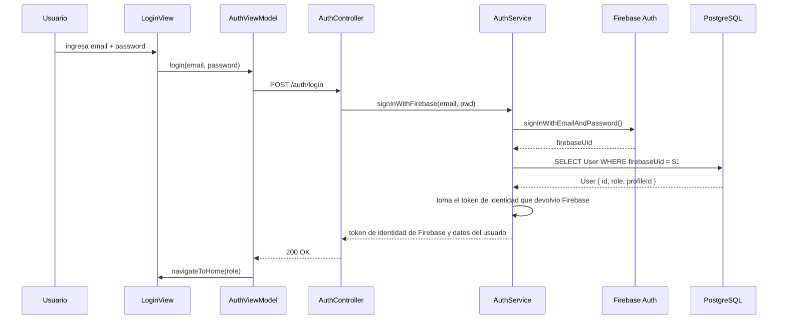

#### Clases de Diseño Participantes

| Clase | Capa | Responsabilidad |
|-------|------|-----------------|
| `LoginView` | Presentation (Flutter / React) | UI con email/password fields y botón |
| `AuthViewModel` | Presentation | Valida formulario, gestiona errores |
| `AuthController` | Backend Controller (NestJS) | Endpoint `POST /auth/login` |
| `AuthService` | Backend Service | Orquesta Firebase Auth + firma JWT |
| `FirebaseAuthAdapter` | Infrastructure | Verifica el token de identidad contra Firebase |
| **Comentarios** | La verificación contra el código determinó que el sistema no emite una credencial propia: la credencial de sesión es el token de identidad que emite Firebase, y el rol se resuelve contra la base en cada solicitud. Tampoco se consulta el estado de habilitación del chofer en el ingreso, de modo que un chofer todavía no habilitado por el administrador puede iniciar sesión. |

---

### 3.2 CU-005 Crítico · automático — Crear Pedido

**Actor:** Cliente (ACT-01)
**Pantalla:** CheckoutView (App Cliente)

#### Interfaz Gráfica

> Ver wireframe **D-17 — Checkout** en [`design/wireframes.html`](design/wireframes.html). Incluye carrito, dirección, franja horaria, fecha y método de pago.

#### Especificación del CU Real

| Campo | Detalle |
|-------|---------|
| **Código** | CU-005 |
| **Caso de Uso** | Crear Pedido |
| **Actor Principal** | ACT-01 (Cliente) |
| **Objetivos asociados** | OBJ-01, OBJ-04, OBJ-06 |
| **Requisitos asociados** | IRQ-02, IRQ-04 |
| **Descripción** | El cliente revisa el carrito en `CheckoutView`, selecciona dirección, franja horaria, fecha y método de pago. Al confirmar, el sistema valida y reserva atómicamente el stock dentro de una transacción PostgreSQL (Módulo M3), persiste la orden con estado PENDING y dispara el despacho automático (CU-013). |
| **Precondición** | El cliente está autenticado (CU-001). El carrito tiene ítems con cantidades > 0. |

**Secuencia normal**

| Paso | Acción |
|------|--------|
| 1 | El cliente accede a `CheckoutView` con ítems del carrito y completa: dirección, franja horaria, fecha de entrega y método de pago. |
| 2 | Presiona "Confirmar Pedido". `CheckoutViewModel.confirmOrder()` valida campos y aplica recargo del 10% si `paymentMethod = TRANSFER`. |
| 3 | Llama `historyService.createOrder()` → `POST /orders` con DTO completo. |
| 4 | Backend `OrderService.createOrder()` inicia QueryRunner + `startTransaction()`. |
| 5 | Aplica lock pesimista (`SELECT FOR UPDATE`) sobre cada `GasCylinder` involucrado. |
| 6 | Verifica stock suficiente y calcula precios con promociones por volumen (decimal.js). |
| 7 | Decrementa stock atómicamente. Persiste `Order` + `OrderItem[]`. |
| 8 | Hace `commitTransaction()`. Emite `triggerDispatch(orderId)` (CU-013) y `sendOrderConfirmation()` por FCM. |
| 9 | Retorna `{ orderId, status: PENDING, total }` al cliente. |
| 10 | La app navega a `OrderTrackingView`. |

**Postcondición:** Existe un `Order` con estado PENDING. El stock fue decrementado atómicamente. El despacho automático fue disparado.

**Excepciones**

| Paso | Acción |
|------|--------|
| 6 | Stock insuficiente → la operación se revierte por completo y el stock no se modifica. La respuesta todavía no llega traducida a una solicitud incorrecta: se devuelve como error interno. |
| 6 | Producto inactivo o inexistente → `NotFoundException` y rollback. |
| 7 | Falla al persistir → rollback automático. |

| Campo | Detalle |
|-------|---------|
| **Rendimiento** | Creación de pedido completa < 5 segundos. |
| **Frecuencia** | Estimado 50–200 pedidos/día. |
| **Estabilidad** | Alta. |

#### Flujo de Pantallas

```
[MarketView]
  └─▶ El cliente agrega garrafas al carrito
      └─▶ [CheckoutView]
            ├─ Sección 1: Resumen de ítems con descuentos aplicados
            ├─ Sección 2: Selección de dirección (MapView o AddressListSheet)
            ├─ Sección 3: Franja horaria (TimeRangeSelector - mañana 9-13 / tarde 17-21)
            ├─ Sección 4: Método de pago (PaymentMethodSelector)
            │             CASH | MERCADOPAGO | TRANSFER (+10% recargo automático)
            ├─ Sección 5: Fecha solicitada (DatePicker)
            └─ [Botón "Confirmar Pedido"] ─▶ [OrderTrackingView]
```

#### Interacción UI → ViewModel → Servicio → Backend

```
CheckoutView
  │  confirmOrder()
  ▼
CheckoutViewModel
  │  canConfirmOrder: address ≠ null && timeRange != null && items.length > 0
  │  finalTotal = itemsTotal + transferSurcharge (10% si TRANSFER)
  │  historyService.createOrder(updatedOrder)
  ▼
HistoryService (HTTP)
  │  POST /orders  { items, address, paymentMethod, deliveryWindowStart,
  │                  deliveryWindowEnd, requestedDeliveryDate, total }
  ▼
Backend: OrderController → OrderService.createOrder()
  │  [1] Verificar stock en QueryRunner
  │  [2] Calcular precio con promociones (decimal.js)
  │  [3] Aplicar recargo 10% si TRANSFER
  │  [4] Descontar stock (atómico)
  │  [5] Persist Order + OrderItems
  │  [6] triggerDispatch()  🤖 → DispatchService
  │  [7] FCM: sendOrderConfirmation()
  └─▶ return { orderId, status: PENDING, total }
```

#### Clases de Diseño Participantes

| Clase | Capa | Responsabilidad |
|-------|------|-----------------|
| `CheckoutViewModel` | Presentation (Flutter) | Orquesta UI, valida, llama servicio |
| `CartService` | Service (Flutter) | Mantiene estado del carrito reactivo |
| `HistoryService` | Service (Flutter) | HTTP al backend, persiste historial local |
| `OrderController` | Controller (NestJS) | Entrada HTTP, validación DTO |
| `OrderService` | Service (NestJS) | Lógica de negocio, transacción |
| `RedisService` | Infrastructure | GEOADD para índice de choferes |
| `NotificationsService` | Infrastructure | FCM push al cliente |
| **Comentarios** | La verificación contra el código detectó dos limitaciones en este circuito: la falta de stock no llega traducida a una respuesta de solicitud incorrecta y se devuelve como error interno, y el motor de precios no valida que el descuento configurado en una promoción no supere el total, lo que puede producir un subtotal negativo. Ambas están registradas como pendientes de corrección. |

---

### 3.3 CU-013 Crítico · automático — Ofrecer el Pedido al Chofer Más Cercano

**Actor:** Sistema (ACT-04)
**Disparador:** `OrderService.createOrder()` → `triggerDispatch()`

#### Interfaz Gráfica

> CU sin pantalla propia (proceso automático del Sistema). La salida visible es la notificación del pedido entrante en App Chofer — ver wireframe **D-21 — Pedido Entrante** en [`design/wireframes.html`](design/wireframes.html).

#### Especificación del CU Real

| Campo | Detalle |
|-------|---------|
| **Código** | CU-013 |
| **Caso de Uso** | Asignar Pedido Automáticamente por Proximidad |
| **Actor Principal** | ACT-04 (Sistema) |
| **Objetivos asociados** | OBJ-02, OBJ-03 |
| **Requisitos asociados** | IRQ-04, IRQ-05 |
| **Descripción** | Al confirmar un pedido, el sistema busca automáticamente al chofer disponible más cercano usando Redis GEORADIUS sobre el índice geoespacial `drivers:available`. Sin intervención humana, notifica por WebSocket al chofer más próximo dentro de un radio de 5 km. |
| **Precondición** | Existe una orden con estado PENDING. El índice Redis `drivers:available` puede contener cero o más choferes activos. |

**Secuencia normal**

| Paso | Acción |
|------|--------|
| 1 | `OrderService.createOrder()` invoca `triggerDispatch(orderId)` post-commit. |
| 2 | `DispatchService.dispatchOrder()` obtiene `lat`, `lng` de la dirección de la orden. |
| 3 | Ejecuta `RedisService.geoRadius('drivers:available', lng, lat, 5)` — devuelve `driverIds` ordenados ASC por distancia. |
| 4 | Por cada `driverId` en orden de cercanía: verifica en BD que `Delivery.isActive = true` y `validated = true`. |
| 5 | Llama `DriversGateway.notifyNewOrder(driverId, payload)` → `socket.to(driverId).emit('order:new', { orderId, address, items, total, distance })`. |
| 6 | Detiene la búsqueda en el primer chofer elegible notificado. |
| 7 | Si no hay choferes elegibles: la orden queda en PENDING para que el cron M2 (CU-014) la reintente. |

**Postcondición:** El chofer más cercano disponible recibió la notificación en tiempo real. La orden permanece en PENDING hasta que el chofer la acepte (CU-015) o la rechace (CU-016).

**Excepciones**

| Paso | Acción |
|------|--------|
| 3 | Si Redis no está disponible → log de error y reintento por el cron M2. |
| 4 | Si todos los `driverId` retornados están desactivados o no validados → cae al paso 7. |
| 5 | Si la conexión WebSocket del chofer está caída → Socket.IO reintentará al reconectar; mientras, el cron M2 puede notificar a otro. |

| Campo | Detalle |
|-------|---------|
| **Rendimiento** | GEORADIUS < 500ms. Notificación WebSocket < 100ms desde el commit. |
| **Frecuencia** | Una vez por cada pedido creado (50–200 veces/día). |
| **Estabilidad** | Alta. |
| **Comentarios** | Ni la habilitación del chofer que otorga el administrador ni su indicador de disponibilidad se consultan al elegir candidatos: solo se leen en un contador del panel. Los radios de búsqueda y la ventana de aceptación son constantes del código y todavía no se pueden configurar desde el sistema, lo que es un requisito explícito de la cátedra para los módulos inteligentes. |

#### Flujo del Algoritmo

```
triggerDispatch(orderId)
  │
  ▼
DispatchService.dispatchOrder(order)
  │  [1] Obtener coordenadas del pedido (lat/lng de la dirección)
  │  [2] redisService.GEORADIUS("drivers:available", lat, lng, 5km)
  │      └─▶ Devuelve lista de driverIds dentro del radio, ordenados por distancia
  │  [3] Por cada driverid (en orden de cercanía):
  │      ├─▶ Verificar driver.isActive && driver.validated en DB
  │      └─▶ driversGateway.notifyNewOrder(driverId, orderPayload)
  │              └─▶ socket.to(driverId).emit('order:new', payload)
  │  [4] Si no hay choferes disponibles:
  │      └─▶ El pedido queda en PENDING → cron lo reintentará en ~1 min
  │
  └─▶ Flujo continúa en CU-015 (Aceptar Pedido)
```

#### Estructura Redis para Geo-indexación

```
Key:   "drivers:available"
Type:  Sorted Set (GEO)
Value: { member: "driverId", score: geohash }

Operaciones:
  GEOADD  drivers:available  <lng> <lat> <driverId>   // Al activar disponibilidad
  GEORADIUS drivers:available <lng> <lat> 5 km ASC WITHDIST  // Al despachar
  ZREM    drivers:available  <driverId>               // Al desactivar / desconectar
```

#### Pantalla (App Chofer) — Notificación de Nuevo Pedido

```
[HomeView] (chofer disponible y conectado por WS)
  │  Socket recibe 'order:new' { orderId, address, items, total, distance }
  ▼
[OrderInfoBottomSheet]
  ├─ Dirección de entrega
  ├─ Ítems y total
  ├─ Distancia al cliente
  ├─ [Botón "Aceptar"] → CU-015
  └─ [Botón "Rechazar"] → CU-016
```

---

### 3.4 CU-014 Crítico · automático — Vencer la Oferta y Ofrecer al Siguiente Chofer

**Actor:** Sistema (ACT-04)
**Disparador:** tarea programada que se ejecuta cada 15 segundos

#### Especificación del CU Real

| Campo | Detalle |
|-------|---------|
| **Código** | CU-014 |
| **Caso de Uso** | Vencer la oferta y ofrecer al siguiente chofer |
| **Actor Principal** | ACT-04 (Sistema) |
| **Objetivos asociados** | OBJ-02 |
| **Requisitos asociados** | IRQ-02, IRQ-03 |
| **Descripción** | Proceso automático que detecta las ofertas de pedido que vencieron sin respuesta del chofer y vuelve a ofrecer el pedido al siguiente candidato, ampliando el radio de búsqueda de manera progresiva cuando no quedan choferes por contactar en el radio actual. |
| **Precondición** | Existe al menos un pedido con una oferta emitida cuya ventana de aceptación ya venció. |

**Secuencia normal**

| Paso | Acción |
|------|--------|
| 1 | La tarea programada se activa. Toma un bloqueo distribuido con vencimiento de 12 segundos, de modo que una sola instancia del backend procese el ciclo aunque haya varias corriendo. |
| 2 | Busca las ofertas emitidas cuya ventana de aceptación, de 30 segundos, ya venció. |
| 3 | Marca cada oferta vencida como expirada y registra al chofer como ya contactado para ese pedido. |
| 4 | Recorre los radios de búsqueda en orden creciente —5, 10, 15 y 20 kilómetros— y toma el primer chofer disponible que todavía no haya sido contactado para ese pedido. |
| 5 | Emite una nueva oferta a ese chofer, con una ventana de aceptación de 30 segundos, y le envía la notificación. |
| 6 | Si ningún radio arroja un candidato sin contactar, el pedido permanece pendiente y se reintenta en el ciclo siguiente. |

**Postcondición:** Las ofertas vencidas quedaron cerradas y, si había un chofer disponible sin contactar, existe una nueva oferta vigente para el pedido. El pedido no cambia de estado por efecto de este caso de uso.

**Excepciones**

| Paso | Acción |
|------|--------|
| 1 | Si otra instancia ya tomó el bloqueo, el ciclo termina sin hacer nada y se reintenta en la ejecución siguiente. |
| 5 | Si la notificación al chofer falla, la oferta queda igualmente emitida y vence sola por la ventana de aceptación. |

| Campo | Detalle |
|-------|---------|
| **Rendimiento** | Cada ciclo se completa en menos de 3 segundos, holgadamente por debajo del intervalo de 15 segundos entre ejecuciones. |
| **Frecuencia** | Cada 15 segundos, de forma permanente mientras el sistema está en funcionamiento. |
| **Estabilidad** | Alta |
| **Comentarios** | La ventana de aceptación y los radios de búsqueda son constantes del código y todavía no se pueden configurar desde el sistema. La cátedra exige que un módulo inteligente sea parametrizable como mínimo en el momento de su ejecución, de modo que llevar estos dos valores a configuración es un pendiente declarado. El sistema no avisa al administrador cuando un pedido agota los radios sin encontrar chofer: simplemente se reintenta en el ciclo siguiente. |

---

### 3.5 CU-015 Crítico — Aceptar Pedido

**Actor:** Chofer (ACT-02)
**Pantalla:** OrderInfoBottomSheet (App Chofer)

#### Especificación del CU Real

| Campo | Detalle |
|-------|---------|
| **Código** | CU-015 |
| **Caso de Uso** | Aceptar pedido |
| **Actor Principal** | ACT-02 (Chofer) |
| **Objetivos asociados** | OBJ-02 |
| **Requisitos asociados** | IRQ-02, IRQ-03 |
| **Descripción** | El chofer que recibió una oferta la acepta desde la aplicación. El sistema le asigna el pedido, cierra la oferta, avisa al cliente y deja de ofrecer el pedido al resto de los choferes. |
| **Precondición** | El chofer tiene una oferta vigente para ese pedido y el pedido continúa pendiente de asignación. |

**Secuencia normal**

| Paso | Acción |
|------|--------|
| 1 | El chofer presiona "Aceptar" en la hoja de detalle del pedido. |
| 2 | La aplicación solicita al sistema el cambio de estado del pedido a aceptado. |
| 3 | El sistema verifica que el pedido siga pendiente y que la oferta del chofer esté vigente. |
| 4 | Asigna el chofer al pedido, lo pasa a aceptado y registra el momento de la aceptación. |
| 5 | Cierra la oferta y avisa al resto de los choferes que el pedido ya fue tomado, para que desaparezca de sus pantallas. |
| 6 | Notifica al cliente que su pedido fue aceptado y emite el evento de seguimiento en vivo. |
| 7 | Devuelve al chofer el pedido actualizado con sus datos de entrega. |

**Postcondición:** El pedido queda en estado aceptado y con chofer asignado. La oferta queda cerrada y el cliente fue notificado.

**Excepciones**

| Paso | Acción |
|------|--------|
| 3 | Si el pedido ya fue tomado por otro chofer o fue cancelado, la aceptación se rechaza y la oferta se cierra sin efecto. |
| 3 | Si la oferta del chofer ya venció, la aceptación se rechaza y el pedido continúa su circuito normal de re-oferta (CU-014). |

| Campo | Detalle |
|-------|---------|
| **Rendimiento** | La aceptación se confirma en menos de 2 segundos. |
| **Frecuencia** | Varias veces por día por chofer, una por cada pedido que toma. |
| **Estabilidad** | Alta |
| **Comentarios** | La verificación contra el código detectó que el sistema no comprueba que el pedido no tenga ya un chofer asignado antes de aceptar la transición, de modo que un segundo chofer puede desplazar al primero y provocar que se regenere el código de entrega, invalidando el que el cliente ya tenía. Tampoco se consulta el estado de habilitación del chofer en este punto. Ambas limitaciones están registradas como pendientes de corrección. |

---

### 3.6 CU-017 Crítico · automático — Actualizar Ubicación GPS del Chofer

**Actor:** Chofer (ACT-02)
**Disparador:** LocationService (Flutter) — stream continuo cada 10 metros

#### Interfaz Gráfica

> Ver wireframe **D-20 — Home del Chofer** y **D-22 — En Ruta** en [`design/wireframes.html`](design/wireframes.html). El chofer ve su posición en el mapa; el cliente ve la posición del chofer en su `OrderTrackingView` (wireframe **D-18**).

#### Especificación del CU Real

| Campo | Detalle |
|-------|---------|
| **Código** | CU-017 |
| **Caso de Uso** | Actualizar Ubicación GPS del Chofer |
| **Actor Principal** | ACT-02 (Chofer) |
| **Objetivos asociados** | OBJ-02, OBJ-03 |
| **Requisitos asociados** | IRQ-05 |
| **Descripción** | Mientras el chofer está disponible, su app emite eventos `driver:update-location` por WebSocket cada vez que el GPS detecta un movimiento de al menos 10 metros. El backend actualiza el índice geoespacial Redis y, si el chofer tiene un pedido en curso (ON_THE_WAY), reenvía la ubicación al cliente correspondiente para tracking en tiempo real. |
| **Precondición** | El chofer está autenticado, validado, con `isActive = true` y conectado al WebSocket `/drivers`. La app tiene permisos de ubicación concedidos. |

**Secuencia normal**

| Paso | Acción |
|------|--------|
| 1 | `LocationService.positionStream` emite una nueva `Position { lat, lng }` (cada 10 metros). |
| 2 | `HomeViewModel.onData(position)` recibe la posición y actualiza el marcador local en `GoogleMap`. |
| 3 | El cliente WebSocket emite `socket.emit('driver:update-location', { lat, lng })` al backend. |
| 4 | `DriversGateway.handleUpdateLocation()` recibe el evento. |
| 5 | Ejecuta `RedisService.geoAdd('drivers:available', lng, lat, driverId)` actualizando el índice. |
| 6 | Si el chofer tiene un pedido `ON_THE_WAY`: emite `customersGateway.emit('driver:location', { lat, lng })` al cliente correspondiente. |
| 7 | Retorna `ack: { ok: true }` al chofer. |

**Postcondición:** El índice Redis tiene la posición actualizada. Si hay pedido en curso, el cliente recibió la nueva posición del chofer en su mapa.

**Excepciones**

| Paso | Acción |
|------|--------|
| 1 | Si los permisos de ubicación se revocan → `LocationService` detiene el stream y muestra error en HomeView. |
| 3 | Si el WebSocket está desconectado → Socket.IO buffera el evento y reintenta al reconectar. |
| 5 | Si Redis no está disponible → log de error; el evento se descarta para esa actualización. |

| Campo | Detalle |
|-------|---------|
| **Rendimiento** | GEOADD < 100ms. Reenvío al cliente < 500ms desde el commit. |
| **Frecuencia** | Alta — una emisión cada 10 metros mientras el chofer está activo (estimado 1 evento cada 5–15s en movimiento). |
| **Estabilidad** | Alta. |
| **Comentarios** | La ubicación del chofer se mantiene únicamente en el índice geoespacial en memoria, que es lo que permite resolver la búsqueda por proximidad con la latencia que el despacho necesita. No se conserva un histórico de posiciones en la base relacional, de modo que el recorrido de una entrega no puede reconstruirse a posteriori. |

#### Diagrama de Flujo Detallado

```
[LocationService] (App Chofer)
  │  positionStream emite nueva Position
  ▼
HomeViewModel.onData(position)
  │  _updateUserLocation(position) → actualiza marcador en GoogleMap
  │  [pendiente] orderService.sendLocation(lat, lng)
  ▼
DriversGateway (WebSocket /drivers)
  │  socket.emit('driver:update-location', { lat, lng })
  ▼
DriversGateway.handleUpdateLocation()
  │  redisService.GEOADD("drivers:available", lng, lat, driverId)
  │  Si el driver tiene orden ON_THE_WAY:
  │      customersGateway.emit('driver:location', { lat, lng }) → cliente ve en mapa
  └─▶ ack: { ok: true }
```

**Nota de implementación:** El `connect()` en `HomeViewModel` es actualmente un `// TODO`. La integración WebSocket del App Chofer con el backend es parte del desarrollo pendiente.

---

### 3.7 CU-020 Crítico — Confirmar Entrega

**Actor:** Chofer (ACT-02)
**Pantalla:** DirectionsView / OrderInfoBottomSheet (App Chofer)

#### Interfaz Gráfica

> Ver wireframe **D-22 — En Ruta** en [`design/wireframes.html`](design/wireframes.html). Botón "Confirmar Entrega" disponible cuando la orden está en estado ON_THE_WAY.

#### Especificación del CU Real

| Campo | Detalle |
|-------|---------|
| **Código** | CU-020 |
| **Caso de Uso** | Confirmar Entrega |
| **Actor Principal** | ACT-02 (Chofer) |
| **Objetivos asociados** | OBJ-03, OBJ-04 |
| **Requisitos asociados** | IRQ-02, IRQ-08 |
| **Descripción** | El chofer entrega físicamente el producto y marca el pedido como entregado en su app. El sistema cierra el ciclo del pedido (estado DELIVERED), registra `deliveredAt`, marca el pago como PAID si era CASH, y notifica al cliente por WebSocket + FCM. |
| **Precondición** | El pedido tiene estado ON_THE_WAY. El chofer autenticado es el asignado al pedido. |

**Secuencia normal**

| Paso | Acción |
|------|--------|
| 1 | El chofer presiona "Confirmar entrega" en `DirectionsView`. |
| 2 | La app envía `PATCH /orders/:id/status` con `{ status: "DELIVERED" }`. |
| 3 | Backend `OrderController.updateStatus()` invoca `OrderService.updateStatus(orderId, DELIVERED, driverId)`. |
| 4 | El servicio verifica que el pedido esté en estado ON_THE_WAY. La comprobación de que el chofer sea el asignado todavía no se realiza. |
| 5 | Actualiza `Order.status = DELIVERED` y registra `deliveredAt = now()`. |
| 6 | Si `paymentMethod = CASH`: actualiza `paymentStatus = PAID` automáticamente. |
| 7 | Emite `customersGateway.emit('order:delivered', { orderId })` al cliente por WebSocket. |
| 8 | Envía notificación FCM push al cliente: "¡Pedido entregado! Gracias por tu compra." |
| 9 | El chofer queda disponible para una nueva asignación (sigue en `drivers:available`). |
| 10 | Retorna `{ status: DELIVERED, deliveredAt }` a la app del chofer. |

**Postcondición:** El pedido tiene estado DELIVERED y `deliveredAt` registrado. Si el pago era CASH, queda PAID. El cliente fue notificado. El ciclo de entrega está cerrado.

**Excepciones**

| Paso | Acción |
|------|--------|
| 4 | Si el pedido no está en estado ON_THE_WAY → 400 "Transición de estado no permitida." |
| 4 | Si el chofer no es el asignado → 403 "No autorizado." |
| 4 | Si el pedido ya está DELIVERED o CANCELLED → 400 "El pedido ya está finalizado." |

| Campo | Detalle |
|-------|---------|
| **Rendimiento** | La confirmación debe procesarse en menos de 3 segundos. |
| **Frecuencia** | Una vez por cada pedido completado (50–200 veces/día). |
| **Estabilidad** | Alta. |
| **Comentarios** | La verificación contra el código determinó que ningún punto de entrada comprueba que el chofer que confirma la entrega sea el asignado al pedido. Cualquier chofer autenticado puede marcar como entregado y como cobrado un pedido ajeno. Es el hallazgo de mayor gravedad registrado sobre este caso de uso y está pendiente de corrección. |

#### Diagrama de Flujo Detallado

```
[App Chofer] Chofer presiona "Confirmar Entrega"
  │  PATCH /orders/:id/status  { status: "DELIVERED" }
  ▼
OrderService.updateStatus(orderId, DELIVERED)
  │  [1] Registrar deliveredAt timestamp
  │  [2] FCM al cliente: "¡Tu pedido fue entregado!"
  │  [3] customersGateway: emit 'order:delivered'
  │  [4] redisService: GEOADD → chofer sigue disponible para próxima orden
  └─▶ return { status: DELIVERED }
```

---


### 3.8 CU-048 Crítico — Pago con pasarela y confirmación por webhook

**Actor:** Sistema (ACT-04)
**Pantalla:** Sin pantalla propia dentro del sistema — confirmación server-to-server

#### Interfaz Gráfica

> CU sin pantalla propia (proceso automático del Sistema, disparado por la notificación webhook de MercadoPago). La pantalla visible asociada es la selección del método de pago dentro del checkout — ver wireframe **D-17 — Checkout** en [`design/wireframes.html`](design/wireframes.html), opción "MercadoPago" del selector de método de pago (parte de CU-005). El pago en sí se completa en el Checkout Pro de MercadoPago, fuera de las aplicaciones del sistema: ninguna pantalla de la App Cliente, la App Chofer ni el Panel Admin interviene en la confirmación que describe este CU.

#### Especificación del CU Real

| Campo | Detalle |
|-------|---------|
| **Código** | CU-048 |
| **Caso de Uso** | Procesar Pago con MercadoPago |
| **Actor Principal** | ACT-04 (Sistema) |
| **Objetivos asociados** | OBJ-02, OBJ-07 |
| **Requisitos asociados** | IRQ-02, IRQ-08 |
| **Descripción** | Cuando un pedido se paga con MercadoPago, la pasarela notifica al backend mediante un webhook contra `MercadoPagoWebhookController`. El sistema valida la firma HMAC de la notificación, consulta el estado real del pago contra la API de MercadoPago sin confiar nunca en el contenido recibido, actualiza el registro `Payment`, marca el pedido como pagado dentro de una transacción con bloqueo pesimista sobre el `Order`, y recién entonces dispara el despacho automático al siguiente chofer candidato. |
| **Precondición** | Existe un `Order` con `paymentMethod = MERCADOPAGO` y un `Payment` en estado PENDING cuya `external_reference` es el `orderId`. La clave secreta del webhook y la URL de notificación están configuradas en `MercadoPagoAdapter` y apuntan al endpoint del backend. |

**Secuencia normal**

| Paso | Acción |
|------|--------|
| 1 | MercadoPago envía `POST /webhook/mercadopago` con `type`, `data.id` y las cabeceras `x-signature` / `x-request-id` a `MercadoPagoWebhookController`. El endpoint está exento del límite global de peticiones. |
| 2 | El controlador tolera los dos formatos que usa MercadoPago para nombrar los parámetros, normaliza `type` y `dataId`, y llama `PaymentsService.verifyWebhookSignature(xSignature, xRequestId, dataId)`. |
| 3 | `PaymentsService` delega en `PaymentGatewayPort.verifyWebhookSignature()` (implementado por `MercadoPagoAdapter`), que valida el HMAC con la clave secreta configurada. |
| 4 | Con la firma válida, `MercadoPagoWebhookController` invoca `ConfirmPaymentUseCase.execute(type, dataId)`. |
| 5 | `ConfirmPaymentUseCase` llama `PaymentsService.confirmFromGateway(type, dataId)`, que descarta la notificación si el `type` no es de pago o no trae `dataId`. |
| 6 | `PaymentsService` consulta el pago real vía `PaymentGatewayPort.getPayment(dataId)` (`MercadoPago.Payment.get()`), con un tiempo máximo de espera de 5 segundos. |
| 7 | `PaymentsService` actualiza el `Repository<Payment>` — busca por `gateway_payment_id` o, en la primera notificación, toma el intento PENDING más reciente de esa `external_reference` sin identificador aún — y traduce el estado crudo de la pasarela a aprobado, rechazado, cancelado, reintegrado o pendiente. |
| 8 | `ConfirmPaymentUseCase` recupera el `Order` vía `OrderRepositoryPort.findByIdFull(externalReference)`. |
| 9 | Si el pago está aprobado, abre `DataSource.createQueryRunner()` y `QueryRunner.startTransaction()`, y vuelve a leer el `Order` con lock pesimista (`pessimistic_write`) para serializar notificaciones concurrentes del mismo pago. |
| 10 | Evalúa `isTerminal(locked.status)` y si el pedido ya tiene `gatewayPaymentId` asignado; en cualquiera de los dos casos hace `commit` sin modificar nada (idempotencia ante reintentos del webhook). |
| 11 | Si `locked.status = RESERVED`, marca `deposit_paid = true`, graba el `gatewayPaymentId` y hace `commit` sin disparar despacho: la reserva la activa el proceso programado el día agendado (CU-075). |
| 12 | En el caso general, marca `paymentStatus = PAID`, graba el `gatewayPaymentId` y hace `commitTransaction()`. |
| 13 | Ya fuera de la transacción, invoca `DispatchOrchestratorService.offerToNextDriver(order)` en modo best-effort, equivalente al despacho de CU-013. |
| 14 | `MercadoPagoWebhookController` responde `200 { received: true }` a MercadoPago. |

**Postcondición:** El `Payment` refleja el estado real informado por la pasarela. Si el pago fue aprobado, el `Order` quedó con `paymentStatus = PAID` y el `gatewayPaymentId` grabado —o con la seña marcada como pagada, si era una reserva— y el despacho se disparó exactamente una vez. Repetir la misma notificación no vuelve a marcar el pedido ni a despacharlo.

**Excepciones**

| Paso | Acción |
|------|--------|
| 3 | Si la firma es inválida, falta, o la clave secreta no está configurada → `MercadoPagoWebhookController` no procesa la notificación y responde 200 igual, para no revelar si el pago o el pedido existen. |
| 6 | Si la consulta a MercadoPago falla o supera el tiempo de espera → se registra el error y se aborta sin tocar el `Order`. |
| 8 | Si `external_reference` no corresponde a ningún `Order` → se registra la advertencia y se aborta. |
| 9 | Si el `Order` desaparece entre la lectura inicial y la toma del lock → `QueryRunner.commit()` sin efectos y se registra la advertencia. |
| 9–12 | Ante cualquier error dentro de la transacción → `QueryRunner.rollbackTransaction()` y propagación del error; el controlador lo captura y responde 200 igual, para que MercadoPago no reintente en bucle contra un 5xx. |
| 13 | Si el despacho falla → se registra el error; el pedido queda pagado a la espera del reintento de despacho, el pago no se revierte. |
| 12 | Si el pago llega `rejected` o `cancelled` → el sistema únicamente lo registra en el log; no hay transición de estado sobre el `Order` (ver Comentarios). |

| Campo | Detalle |
|-------|---------|
| **Rendimiento** | El procesamiento completo de una notificación se resuelve en menos de 3 segundos; la consulta a MercadoPago está acotada a 5 segundos de espera máxima. |
| **Frecuencia** | Una o más notificaciones por cada pedido pagado con MercadoPago; la pasarela reintenta la misma notificación ante cualquier respuesta que no sea exitosa, y a veces incluso cuando lo es. |
| **Estabilidad** | Alta. |

#### Diagrama de Interacción

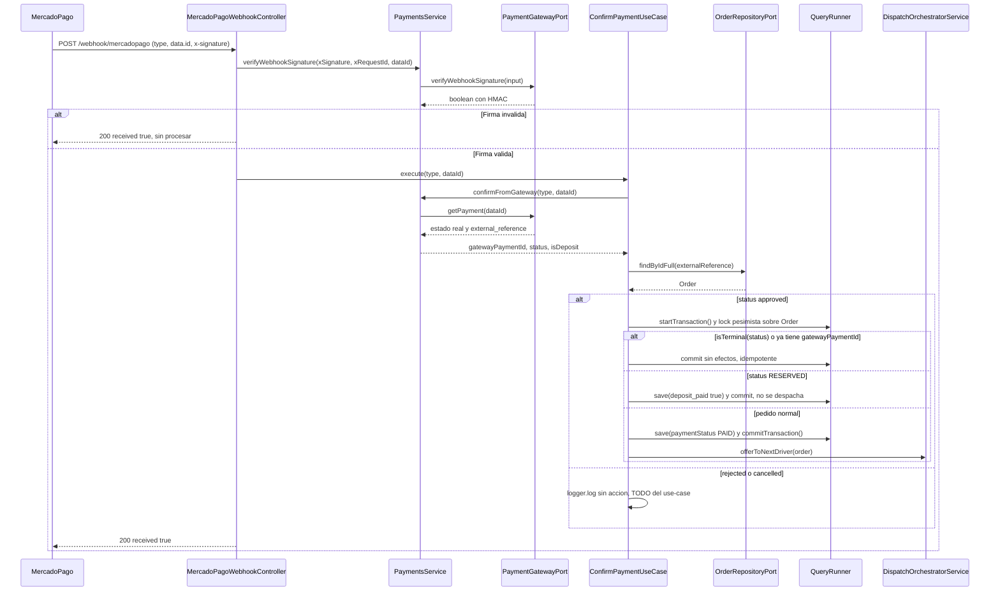

> El diagrama de secuencia técnico completo, con la creación previa del checkout y la triple guarda de idempotencia, está documentado en §4.11.

#### Clases de Diseño Participantes

| Clase | Capa | Responsabilidad |
|-------|------|------------------|
| `MercadoPagoWebhookController` | Backend Controller | Endpoint `POST /webhook/mercadopago`, exento del rate-limit global |
| `PaymentsService` | Backend Service | Orquesta verificación de firma, consulta a la pasarela y actualización del ledger |
| `PaymentGatewayPort` (impl. `MercadoPagoAdapter`) | Infrastructure | Único punto que toca el SDK de MercadoPago; sumar otra pasarela es agregar un adapter |
| `ConfirmPaymentUseCase` | Backend Use Case | Aplica el resultado normalizado del pago sobre el `Order`, con lock pesimista |
| `OrderRepositoryPort` | Infrastructure | Persistencia del `Order` |
| `Repository<Payment>` | Infrastructure | Ledger de pagos, con índice único parcial sobre `gateway_payment_id` |
| `DispatchOrchestratorService` | Backend Service | Dispara el despacho al siguiente chofer candidato una vez pagado el pedido |
| **Comentarios** | La verificación contra el código confirmó que la idempotencia descansa en tres mecanismos encadenados: el índice único parcial sobre `gateway_payment_id` en el ledger de pagos, un índice análogo en el `Order`, y el lock pesimista dentro de la transacción de `ConfirmPaymentUseCase`. **Limitación conocida (INFORME-HALLAZGOS — "Manejo del pago rechazado"):** el camino `rejected` / `cancelled` no está implementado — figura como `TODO` explícito en `confirm-payment.use-case.ts:74-77` — y el sistema se limita a registrarlo en el log, sin liberar el stock reservado ni cancelar el pedido. Quien resuelve esa situación es el proceso temporal de CU-077, que cada 30 minutos cancela los pedidos de MercadoPago sin pago confirmado más antiguos que el plazo configurado y recién ahí restituye el stock. Tampoco se contempla el reembolso ni el contracargo: el ledger sabe traducir esos estados, pero el `Order` no reacciona a ellos. |

---

---


### 3.9 CU-079 Crítico — Confirmar Entrega Escaneando el QR

**Actor:** Cliente (ACT-01)
**Pantalla:** OrderTrackingView (App Cliente) — lector de código QR

#### Interfaz Gráfica

> No hay wireframe relevado específicamente para la vista de escaneo del QR: el inventario de pantallas de `design/wireframes.html` no incluye una cámara lectora. Funcionalmente, la acción se dispara desde `OrderTrackingView` (wireframe **D-18 — Seguimiento en Tiempo Real**) mientras el stepper del pedido marca "En camino": el cliente abre el lector de cámara para leer el QR que el chofer le muestra en su pantalla (obtenido en CU-078), y la app extrae del contenido leído el código de diez caracteres.

#### Especificación del CU Real

| Campo | Detalle |
|-------|---------|
| **Código** | CU-079 |
| **Caso de Uso** | Confirmar Entrega Escaneando el QR |
| **Actor Principal** | ACT-01 (Cliente) |
| **Objetivos asociados** | OBJ-03, OBJ-04, OBJ-07 |
| **Requisitos asociados** | IRQ-02, IRQ-08 |
| **Descripción** | El cliente escanea desde `OrderTrackingView` el QR que le muestra el chofer al llegar al domicilio y envía el código leído. Si coincide con el `deliveryCode` guardado en el pedido, el sistema delega en el mismo caso de uso de cambio de estado que usa CU-020 y da la entrega por realizada. Invierte el actor de CU-020: acá confirma quien recibe, no quien entrega, y esa inversión es la prueba anti-fraude de que el chofer estuvo presente. |
| **Precondición** | El cliente está autenticado y es el titular del pedido. El pedido está en estado ON_THE_WAY y tiene `deliveryCode` generado desde su aceptación (CU-078). El chofer está en el domicilio mostrando el QR. |

**Secuencia normal**

| Paso | Acción |
|------|--------|
| 1 | El chofer muestra en su pantalla el QR obtenido en CU-078. |
| 2 | El cliente abre el lector de cámara desde `OrderTrackingView` y escanea el QR; la app extrae el código de diez caracteres del contenido leído. |
| 3 | `OrderTrackingViewModel` llama `historyService.confirmDelivery(orderId, code)` → `POST /orders/:id/confirm-delivery` con `{ code }` y la cabecera `Idempotency-Key`. |
| 4 | `OrderController.confirmDelivery()` invoca `OrderService.confirmDelivery(id, code, userId, role)`, que delega en `ConfirmDeliveryUseCase.execute(orderId, code, userId, role)`. |
| 5 | `ConfirmDeliveryUseCase` recupera el pedido con `OrderRepositoryPort.findByIdFull(orderId)` y valida que, si el rol es CUSTOMER, `order.customer_id` sea el usuario autenticado. |
| 6 | Verifica que el pedido esté en estado ON_THE_WAY. |
| 7 | Compara el código recibido contra `order.deliveryCode` con `compareDeliveryCode()` (`DeliveryCodeUtil`), que usa `timingSafeEqual` para no filtrar el secreto por timing. |
| 8 | Con el código válido, delega en `UpdateOrderStatusUseCase.execute(order_id, DELIVERED)` — el mismo caso de uso que usa `PATCH /orders/:id/status` en CU-020. |
| 9 | `UpdateOrderStatusUseCase` registra `deliveredAt = now()` y, si `paymentMethod = CASH`, marca `paymentStatus = PAID`. |
| 10 | Llama `RealtimeDispatchPort.stopTracking(driverUserId)` para cortar el seguimiento GPS en vivo del chofer. |
| 11 | Llama `CylinderLifecyclePort.onOrderDelivered(order_id, distributor_id)`, que avanza a `CON_EL_CLIENTE` los envases despachados en el pedido, en modo best-effort: si falla, la entrega igual se completa. |
| 12 | Persiste el `Order` vía `OrderRepositoryPort.save(order)` y emite `RealtimeDispatchPort.notifyCustomer()` / `notifyAdmins()` con `order:delivered`, además de la notificación push, todo best-effort. |
| 13 | `ConfirmDeliveryUseCase` devuelve `OrderMapper.toDto(order)`; `OrderTrackingView` recibe la respuesta y actualiza el stepper a "Entregado". |

**Postcondición:** El pedido queda en estado DELIVERED con `deliveredAt` registrado y evidencia de que el cliente validó la entrega con el código. Si el pago era en efectivo, queda `paymentStatus = PAID`. El chofer sale del seguimiento en vivo y los envases del pedido figuran `CON_EL_CLIENTE`.

**Excepciones**

| Paso | Acción |
|------|--------|
| 3 | Si el cuerpo no trae `code` o viene vacío → 400 por validación del DTO. |
| 5 | Si el pedido no existe → 404 "Order with ID: … not found". |
| 5 | Si el pedido pertenece a otro cliente → 403 "No autorizado a confirmar la entrega de otro cliente". |
| 6 | Si el pedido ya está DELIVERED → no se trata como error: se devuelve el pedido tal cual, sin reprocesar ni volver a exigir el código, para tolerar el doble escaneo y el reintento de red. |
| 6 | Si el pedido está en cualquier otro estado que no sea ON_THE_WAY → 400 "El pedido no está en camino, no se puede confirmar la entrega". |
| 7 | Si el código no coincide, o el pedido no tiene código cargado, o los largos difieren → 400 "Código de entrega inválido". |

| Campo | Detalle |
|-------|---------|
| **Rendimiento** | La validación del código es local y de costo despreciable; el peso está en la transición de estado y sus efectos, ya cubiertos por CU-020. Los efectos de tiempo real y notificación son best-effort y no bloquean la respuesta. |
| **Frecuencia** | Una vez por pedido entregado, con pico en la franja horaria de entrega. |
| **Estabilidad** | Alta. |

#### Diagrama de Interacción

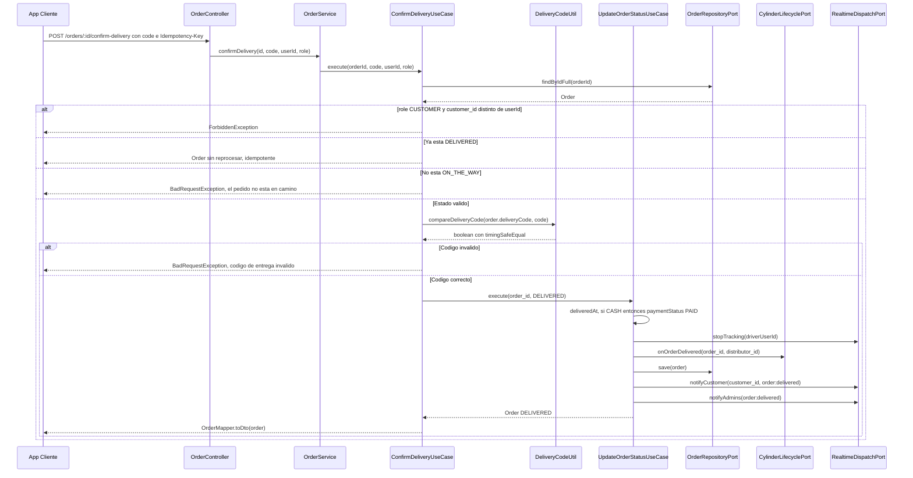

> El diagrama de secuencia técnico completo, junto con CU-078 (obtención del código por el chofer), está documentado en §4.9.

#### Clases de Diseño Participantes

| Clase | Capa | Responsabilidad |
|-------|------|------------------|
| `OrderTrackingView` | Presentation (Flutter) | Muestra el stepper del pedido y aloja el lector de QR mientras el pedido está ON_THE_WAY |
| `OrderTrackingViewModel` | Presentation | Orquesta el escaneo, llama al servicio y actualiza el estado local |
| `HistoryService` | Service (Flutter) | HTTP al backend, la misma clase que persiste el historial en CU-005 |
| `OrderController` | Backend Controller | Endpoint `POST /orders/:id/confirm-delivery` |
| `OrderService` | Backend Service | Delega en el caso de uso de confirmación |
| `ConfirmDeliveryUseCase` | Backend Use Case | Valida pertenencia, estado y código; concentra la lógica anti-fraude |
| `DeliveryCodeUtil` (`compareDeliveryCode`) | Domain (función pura) | Comparación de tiempo constante del código de entrega |
| `UpdateOrderStatusUseCase` | Backend Use Case | Aplica la transición a DELIVERED y sus efectos; compartido con CU-020 |
| `OrderRepositoryPort` | Infrastructure | Persistencia del `Order` |
| `CylinderLifecyclePort` | Infrastructure | Avanza los envases despachados a `CON_EL_CLIENTE` |
| `RealtimeDispatchPort` | Infrastructure | Notifica por WebSocket y FCM, y corta el tracking del chofer |
| **Comentarios** | La validación vive en `ConfirmDeliveryUseCase`; los efectos de pasar a DELIVERED se delegan en `UpdateOrderStatusUseCase`, el mismo que usa `PATCH /orders/:id/status`: cero duplicación de lógica con CU-020. La doble idempotencia (cabecera `Idempotency-Key` más el chequeo de `status === DELIVERED` dentro del caso de uso) tolera el reintento de red y el doble escaneo. El espacio del código es de 16^10 combinaciones, por lo que adivinarlo a fuerza bruta es inviable; los roles ADMIN y SUPER_ADMIN también pueden confirmar, para entregas asistidas desde soporte. Queda como advertencia cruzada que la garantía completa de este mecanismo depende de que el pedido conserve un único chofer asignado: la verificación contra el código detectó que aceptar un pedido no comprueba que no tenga ya un chofer (hallazgo de CU-015), de modo que un segundo chofer puede regenerar el `deliveryCode` e invalidar el QR que el primero ya le había mostrado al cliente. |

---

---


### 3.10 CU-008 Importante — Cancelar Pedido (Cliente)

**Actor:** Cliente (ACT-01)
**Pantalla:** OrderTrackingView (App Cliente) — botón "Cancelar"

#### Interfaz Gráfica

> Ver wireframe **D-18 — Seguimiento en Tiempo Real** en [`design/wireframes.html`](design/wireframes.html). El botón "Cancelar" está en la fila de acciones junto a "Llamar", debajo de la tarjeta del chofer, y queda disponible mientras el pedido no salió hacia el domicilio.

#### Especificación del CU Real

| Campo | Detalle |
|-------|---------|
| **Código** | CU-008 |
| **Caso de Uso** | Cancelar Pedido (Cliente) |
| **Actor Principal** | ACT-01 (Cliente) |
| **Objetivos asociados** | OBJ-01, OBJ-06 |
| **Requisitos asociados** | IRQ-02, IRQ-04 |
| **Descripción** | El cliente cancela desde `OrderTrackingView` un pedido propio que todavía no salió hacia su domicilio. El sistema valida la transición de estado, marca el pedido como CANCELLED y restituye el stock de todos sus ítems al inventario en una transacción separada del guardado del pedido. |
| **Precondición** | El cliente está autenticado y es el titular del pedido. El pedido está en estado RESERVED, PENDING o ACCEPTED. |

**Secuencia normal**

| Paso | Acción |
|------|--------|
| 1 | El cliente presiona "Cancelar" en `OrderTrackingView`, con la opción de ingresar un motivo en un cuadro de texto. |
| 2 | `OrderTrackingViewModel` llama `historyService.cancelOrder(orderId, reason)` → `PATCH /orders/:id/cancel` con `{ reason }` y la cabecera `Idempotency-Key`. |
| 3 | `IdempotencyInterceptor.intercept()` revisa si ya hay una respuesta cacheada para esa clave; si la hay, la devuelve sin reprocesar. En la primera ejecución, deja pasar la solicitud. |
| 4 | `OrderController` resuelve el actor desde el rol del token (`mapRoleToCancelActor(user.role)` → `customer`) e invoca `OrderService.cancelOrder(id, user.user_id, customer, body.reason)`. |
| 5 | `OrderService` delega en `CancelOrderUseCase.execute(orderId, userId, customer, reason)`. |
| 6 | `CancelOrderUseCase` recupera el pedido con `OrderRepositoryPort.findByIdFull(orderId)` y aplica `applyCancellationPolicy(order, userId, customer)`, que verifica en este orden: que no esté ya DELIVERED ni CANCELLED, que no esté ON_THE_WAY y, recién entonces, que `order.customer_id` sea el usuario autenticado. |
| 7 | Con la política aprobada, invoca la máquina de estados de dominio (`transitionOrder(order, CANCELLED)`) y setea `cancellationReason`. |
| 8 | Abre un `QueryRunner.connect()` + `startTransaction()` propio y llama `StockReservationService.restore(queryRunner.manager, order.items)`, que bloquea cada `GasCylinder` y devuelve la cantidad de cada ítem al inventario; hace `commitTransaction()` y `release()`. |
| 9 | Persiste el pedido cancelado con `OrderRepositoryPort.save(order)`, en una operación separada de la restitución de stock del paso anterior. |
| 10 | Llama `notify(order, customer, previousDriverId)`: emite `RealtimeDispatchPort.notifyCustomer(customer_id, order:cancelled)`, `notifyAdmins(order:cancelled)` y, si el pedido ya tenía chofer asignado, `notifyDriverOrderCancelled(previousDriverId)`. |
| 11 | `OrderController` mapea la respuesta con `OrderMapper.toDto(order)`; `OrderTrackingView` actualiza el stepper mostrando el pedido como cancelado. |

**Postcondición:** El pedido tiene estado CANCELLED con su motivo. El stock de todos los ítems fue restituido al inventario con bloqueo sobre cada `GasCylinder`. La consistencia entre ambos efectos no está protegida por una transacción única (ver Comentarios).

**Excepciones**

| Paso | Acción |
|------|--------|
| 6 | Si el pedido no existe → `NotFoundException`, "Order with ID: … not found". |
| 6 | Si el pedido ya está DELIVERED o CANCELLED → `BadRequestException`, "No se puede cancelar un pedido finalizado". |
| 6 | Si el pedido ya está ON_THE_WAY → `BadRequestException`, "El pedido ya está en camino, contacte al soporte". Esta comprobación corre antes que la de propiedad, de modo que un cliente que intente cancelar un pedido ajeno que ya salió recibe este mensaje y no el de falta de autorización. |
| 6 | Si el pedido no pertenece al cliente autenticado → `BadRequestException`, "No autorizado" (código de solicitud incorrecta, no de acceso denegado). |
| 2 | Si la clave de idempotencia ya fue usada para esa solicitud → `IdempotencyInterceptor` devuelve la respuesta cacheada sin volver a ejecutar `CancelOrderUseCase`. |

| Campo | Detalle |
|-------|---------|
| **Rendimiento** | La cancelación, con su transacción de restitución de stock, se completa en menos de 3 segundos. |
| **Frecuencia** | Baja: se estima menos de una cancelación cada varios pedidos por cliente. |
| **Estabilidad** | Alta. |

#### Diagrama de Interacción

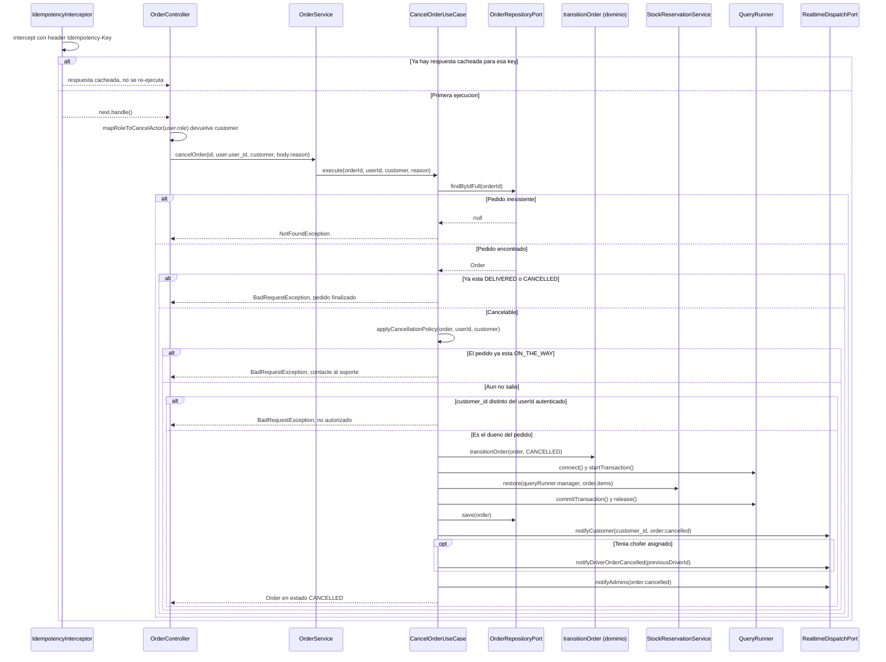

> El diagrama de secuencia técnico completo, junto con las variantes de chofer (CU-009) y administrador (CU-010) sobre el mismo endpoint, está documentado en `Casos-de-Uso.md`, sección "DSD — CU-008: Cancelar Pedido (Cliente)".

#### Clases de Diseño Participantes

| Clase | Capa | Responsabilidad |
|-------|------|------------------|
| `OrderTrackingView` | Presentation (Flutter) | Muestra el stepper del pedido y el botón "Cancelar" |
| `OrderTrackingViewModel` | Presentation | Orquesta la acción de cancelar y actualiza el estado local |
| `HistoryService` | Service (Flutter) | HTTP al backend, la misma clase que persiste el historial en CU-005 |
| `IdempotencyInterceptor` | Backend Interceptor | Evita reprocesar la cancelación ante un reintento con la misma clave |
| `OrderController` | Backend Controller | Endpoint `PATCH /orders/:id/cancel`, resuelve el actor desde el rol del token |
| `OrderService` | Backend Service | Delega en el caso de uso de cancelación |
| `CancelOrderUseCase` | Backend Use Case | Aplica la política de cancelación y orquesta la transición |
| `transitionOrder` (máquina de estados de dominio) | Domain | Valida la transición de estado hacia CANCELLED |
| `StockReservationService` | Backend Service | Restituye el stock reservado, con bloqueo por `GasCylinder` |
| `OrderRepositoryPort` | Infrastructure | Persistencia del `Order` |
| `RealtimeDispatchPort` (impl. `RealtimeDispatchAdapter`) | Infrastructure | Notifica a cliente, panel y chofer por WebSocket |
| **Comentarios** | La verificación contra el código determinó que la restitución de stock (`StockReservationService.restore`) y el guardado del pedido cancelado (`OrderRepositoryPort.save`) corren en transacciones separadas, no en una única transacción: si el guardado falla después de restituir, el stock vuelve al inventario y el pedido sigue activo, quedando contado dos veces. Es el hallazgo #12 del informe de hallazgos contra el código y está pendiente de corrección. El sistema tampoco envía notificación push al cancelar: el aviso viaja solo por la conexión en tiempo real, de modo que un chofer o un cliente con la app cerrada no se entera hasta reabrirla. |

---

## 4. Diagramas de Interacción (Nivel de Diseño)

### 4.1 Crítico DSD — CU-005: Crear pedido con despacho automático

> Representación textual de secuencia (sustituir con diagrama draw.io o PlantUML)

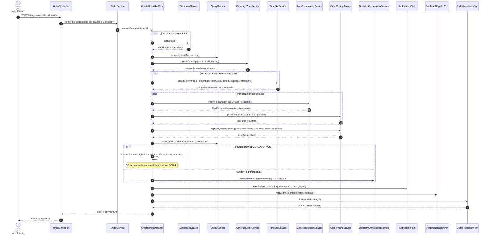

### 4.2 Crítico · automático DSD — CU-013: Despacho por proximidad (vista general)

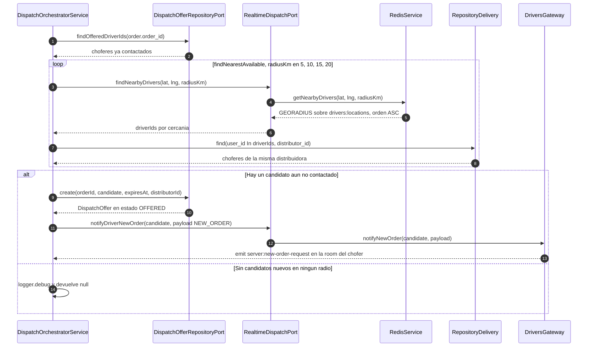

### 4.3 Crítico · automático DSD — CU-017: Actualización de la ubicación del chofer

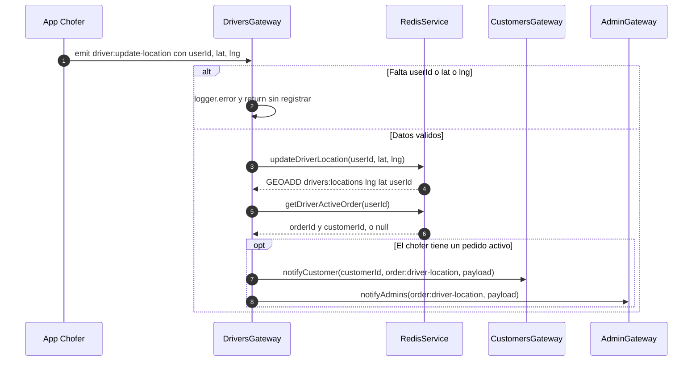

---


---

### Ampliación — Diagramas de interacción de los procesos incorporados

Los 10 diagramas que siguen modelan la colaboración real entre los objetos de diseño
—controladores, servicios de aplicación, puertos, adaptadores y repositorios— de los
procesos que la especificación original no había registrado. A diferencia de los
diagramas de secuencia del Documento 2, aquí el sistema no es una caja negra: los
nombres de clases y de métodos son los del código.

### 4.4 Crítico · automático DSD — CU-013: Ofrecer el pedido al chofer más cercano (M1)

Es el corazón del **Módulo Inteligente M1 — Negociación secuencial de asignación**. El pedido no se difunde a todos los choferes: se ofrece a **uno solo** por vez, el más cercano que todavía no fue contactado, con una ventana de aceptación de 30 segundos.

**Clases participantes:** `CreateOrderUseCase`, `DispatchOrchestratorService`, `DispatchOfferRepositoryPort` (impl. `DispatchOfferTypeormRepository`), `RealtimeDispatchPort` (impl. `RealtimeDispatchAdapter`), `RedisService`, `Repository<Delivery>`, `DriversGateway`, `NotificationsService`, `FcmPort`, entidades `Order`, `DispatchOffer`, `Delivery`.

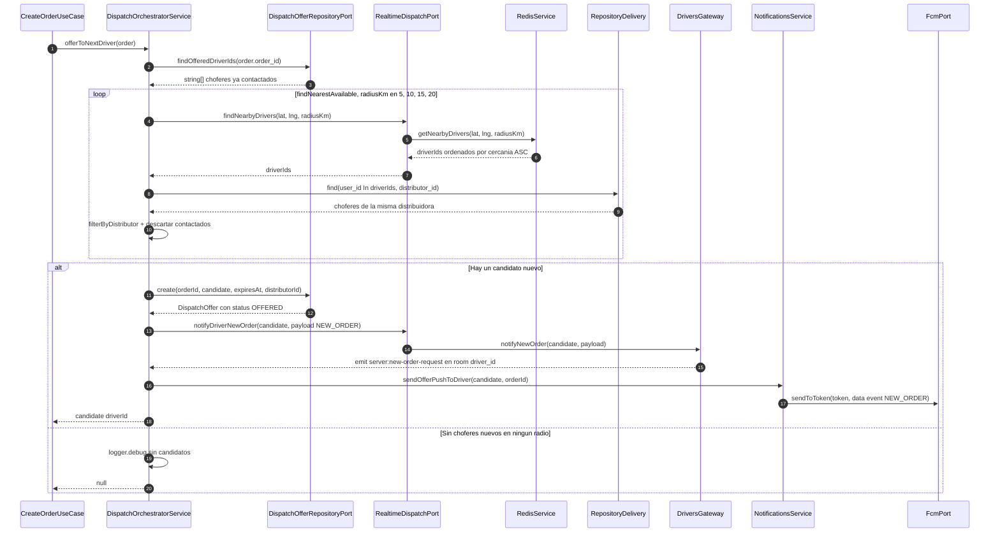

**Observaciones de diseño**

- El orquestador **no conoce Redis ni Socket.io**: habla contra `RealtimeDispatchPort`; el `RealtimeDispatchAdapter` traduce a `RedisService` (GEO) y a los gateways.
- La oferta es **durable** (fila en `dispatch_offer`, no una clave en memoria): sobrevive reinicios y es multi-instancia.
- El push FCM es **complementario y best-effort** (`void`, no se espera): cubre al chofer con la app en background, donde el socket no llega.
- Multi-tenant: `filterByDistributor` restringe los candidatos a los choferes de la distribuidora del pedido.

---

### 4.5 Crítico · automático DSD — CU-014: Vencimiento de la oferta y re-oferta al siguiente (M1, proceso temporal)

**Clases participantes:** `DispatchService` (cron `@Cron('*/15 * * * * *')`), `RedisService` (lock distribuido), `DispatchOrchestratorService`, `DispatchOfferRepositoryPort`, `OrderRepositoryPort`, `OrderService`.

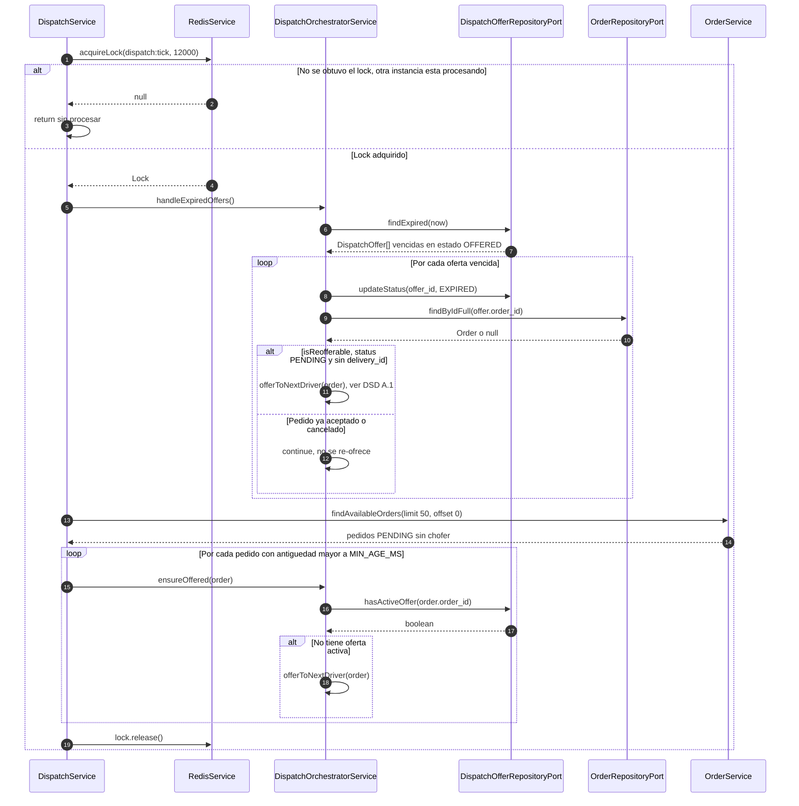

**Observaciones de diseño**

- El cron aporta **el reloj y el lock**; la lógica de a-quién-ofrecer vive íntegra en el orquestador (SRP).
- TTL del lock 12 s < período 15 s: si la instancia muere sin liberar, el lock expira antes del tick siguiente.
- `bootstrapPendingWithoutOffer` es la red de seguridad para pedidos creados cuando no había ningún chofer conectado.

---

### 4.6 Crítico DSD — CU-015 / CU-016: Respuesta del chofer a la oferta (aceptar o rechazar)

**Clases participantes:** `OrderController`, `OrderService`, `UpdateOrderStatusUseCase`, `DispatchOrchestratorService`, `DispatchOfferRepositoryPort`, `OrderRepositoryPort`, `Repository<Delivery>`, `transitionOrder` (máquina de estados de dominio), `generateDeliveryCode`, `RealtimeDispatchPort`, `NotificationPort`.

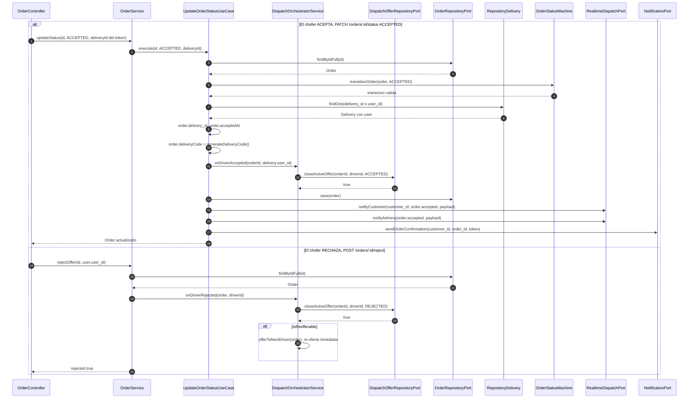

**Observaciones de diseño**

- El rechazo explícito **no espera el timeout de 30 s**: cierra la oferta y re-ofrece de inmediato, acortando el tiempo de asignación.
- El **código secreto de entrega** se genera acá, al aceptar, no al entregar: ya queda listo para el QR de CU-078/CU-079.
- El cierre de la oferta al aceptar es *best-effort* (`.catch(() => undefined)`): un fallo de auditoría no debe impedir que el pedido quede asignado.

---

### 4.7 Crítico DSD — CU-072: Crear reserva programada con seña

**Clases participantes:** `OrderController`, `OrderService`, `CreateOrderUseCase`, `DistributorService`, `CoverageZoneService`, `TimeSlotService`, `StockReservationService`, `OrderPricingService`, `PaymentsService`, `PaymentGatewayPort` (impl. `MercadoPagoAdapter`), `OrderRepositoryPort`, `RealtimeDispatchPort`, `NotificationPort`, entidades `Order`, `OrderItem`, `Payment`.

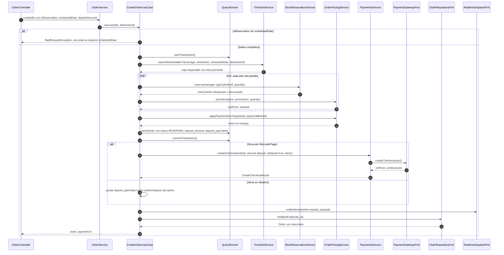

**Observaciones de diseño**

- Una reserva **nace en `RESERVED`**, no en `PENDING`: el stock queda comprometido pero el pedido **no se despacha** hasta el día agendado.
- El checkout de la reserva se crea **solo por el monto de la seña**, no por el total del pedido (`isDeposit: true` en el ledger `Payment`).
- La validación del cupo de franja horaria ocurre **dentro de la transacción y con lock pesimista**, para que dos reservas concurrentes no superen la capacidad.

---

### 4.8 Crítico · automático DSD — CU-075 / CU-076 / CU-077: Los tres crons de reservas y pagos pendientes

**Clases participantes:** `ReservationService`, `Repository<Order>`, `DataSource` / `QueryRunner`, `transitionOrder`, `StockReservationService`, `OrderRepositoryPort`, `DispatchOrchestratorService`.

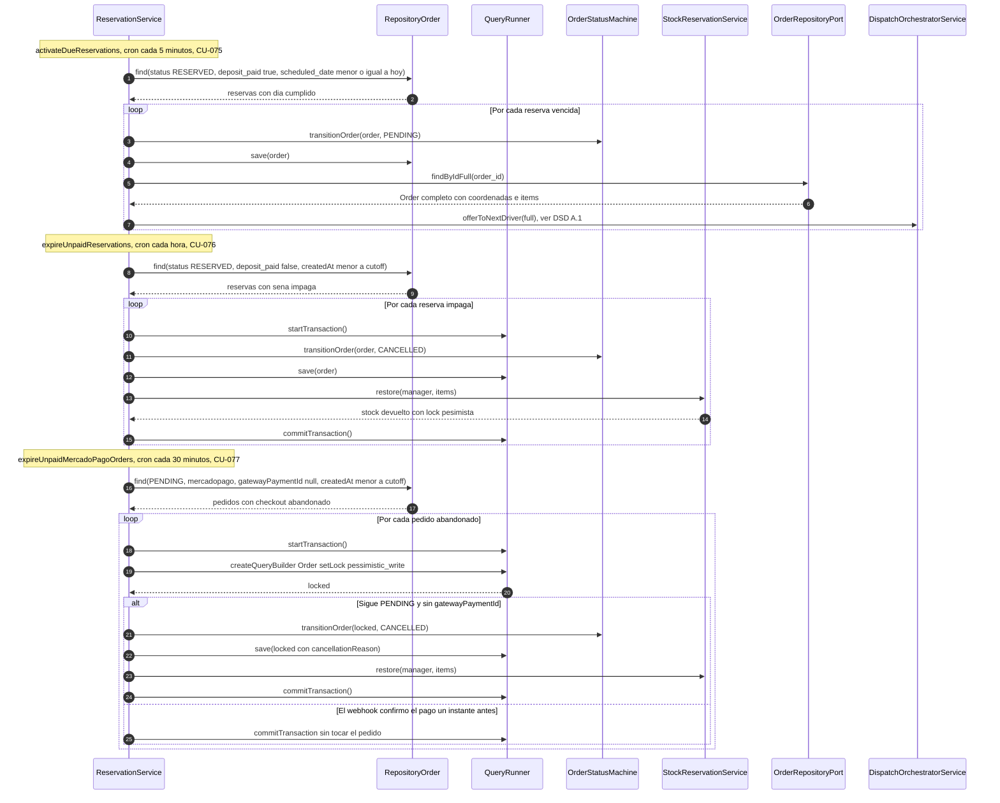

**Observaciones de diseño**

- Los tres procesos son del actor **ACT-04 (Sistema Automático)**: ninguno requiere intervención humana.
- CU-077 resuelve la **carrera pago-vs-expiración** releyendo el pedido con lock pesimista dentro de la transacción; el camino inverso (el pago llega después de expirado) lo cubre `ConfirmPaymentUseCase.handleApproved`, que ve el pedido en estado terminal y no lo reactiva.
- Cada iteración abre su **propia transacción**: el fallo de una reserva no arrastra a las demás.

---

### 4.9 Crítico DSD — CU-078 / CU-079: Entrega verificada por QR (prueba anti-fraude)

**Clases participantes:** `OrderController`, `OrderService`, `ConfirmDeliveryUseCase`, `compareDeliveryCode` (dominio puro), `UpdateOrderStatusUseCase`, `OrderRepositoryPort`, `CylinderLifecyclePort`, `RealtimeDispatchPort`, `NotificationPort`, `IdempotencyInterceptor`, `OrderMapper`.

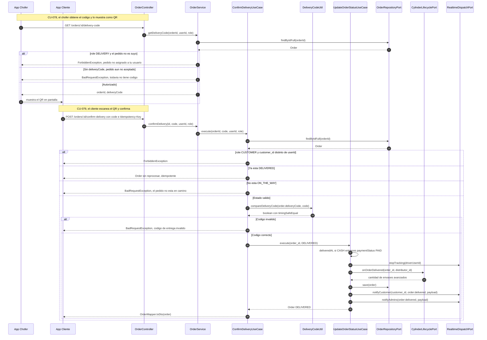

**Observaciones de diseño**

- Se **invierte el actor** respecto de CU-020: quien confirma es el **cliente**, no el chofer. El código lo posee el chofer; que el cliente lo conozca prueba que el chofer estuvo presente.
- `compareDeliveryCode` usa `timingSafeEqual` (comparación de tiempo constante) para no filtrar el secreto por timing.
- La **validación** vive en `ConfirmDeliveryUseCase`; los **efectos** de pasar a `DELIVERED` se delegan en `UpdateOrderStatusUseCase`, el mismo que usa `PATCH :id/status`: cero duplicación de lógica.
- Doble idempotencia: el header `Idempotency-Key` (`IdempotencyInterceptor`) y el chequeo de `status === DELIVERED` dentro del caso de uso.

---

### 4.10 Importante DSD — CU-068 / CU-070: Ciclo de vida del envase físico

**Clases participantes:** `CylinderController`, `CylinderService`, `Repository<Cylinder>`, `Repository<CylinderMovement>`, `Repository<Order>`, `assertTransition` (máquina de estados del envase), `UpdateOrderStatusUseCase`, `CylinderLifecyclePort`, `CylinderLifecycleAdapter`, entidades `Cylinder`, `CylinderMovement`.

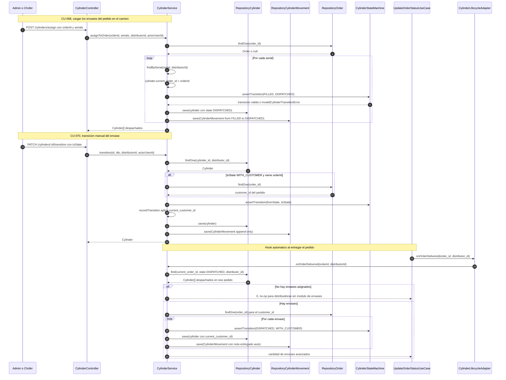

**Observaciones de diseño**

- `CylinderMovement` es una bitácora **append-only**: cada transición deja rastro con `from_state`, `to_state`, `order_id`, `actor_user_id` y nota. Es la base de la trazabilidad de envases (SS-13).
- El pedido **no conoce el módulo de envases**: habla contra `CylinderLifecyclePort`, y `CylinderLifecycleAdapter` delega en `CylinderService`.
- El avance automático es **best-effort dentro de un `try/catch`** en `UpdateOrderStatusUseCase`: si falla, se loguea pero la entrega del pedido no se rompe.
- El serial es único **por distribuidora** (índice compuesto): dos empresas pueden tener envases con el mismo serial de fábrica.

---

### 4.11 Crítico DSD — CU-048: Pago con pasarela y confirmación por webhook

**Clases participantes:** `CreateOrderUseCase`, `PaymentsService`, `PaymentGatewayPort` (impl. `MercadoPagoAdapter`), `Repository<Payment>`, `MercadoPagoWebhookController`, `ConfirmPaymentUseCase`, `OrderRepositoryPort`, `DataSource` / `QueryRunner`, `isTerminal`, `DispatchOrchestratorService`, entidades `Payment`, `Order`.

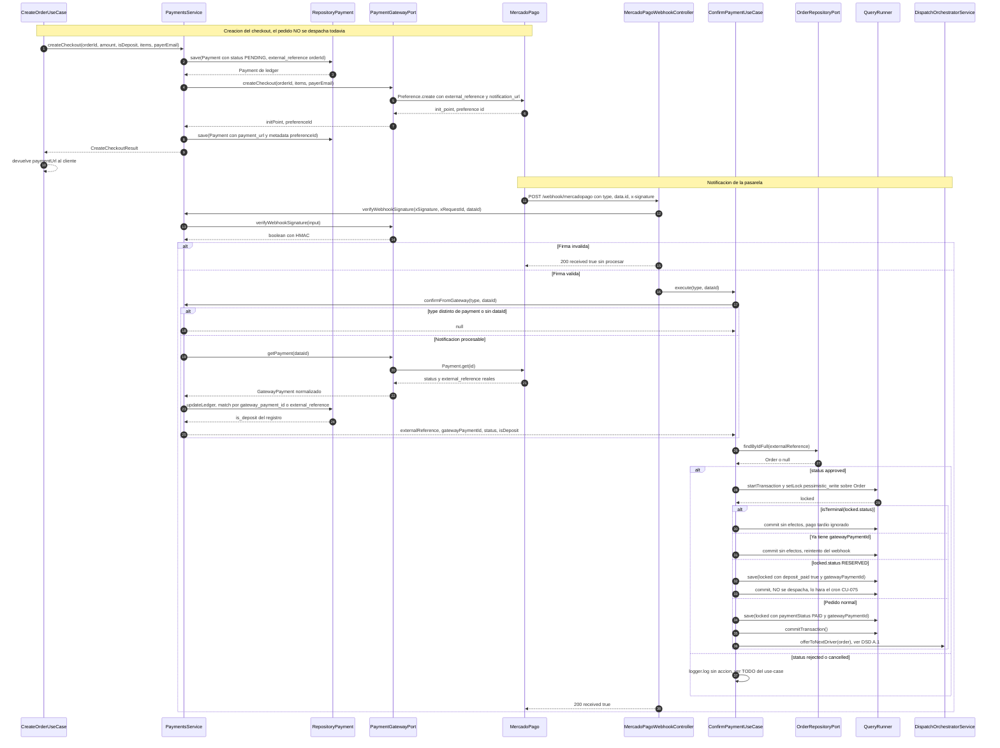

**Observaciones de diseño**

- El dominio de pedidos **no conoce MercadoPago**: `ConfirmPaymentUseCase` consume el resultado *normalizado* de `PaymentsService`, y solo `MercadoPagoAdapter` toca el SDK. Sumar otra pasarela es agregar un adapter, no tocar `order`.
- El sistema **nunca confía en el payload del webhook**: valida la firma HMAC y después consulta el pago real con `getPayment`.
- Idempotencia por triple guarda: firma, `gateway_payment_id` ya asignado en el ledger, y lock pesimista sobre el `Order` antes de marcar `PAID`. Nunca se despacha dos veces el mismo pedido.
- El webhook **siempre responde 200**, incluso ante firma inválida o error interno, para que MercadoPago no entre en bucle de reintentos con 5xx.
- **⚠️ verificar:** el camino `rejected` / `cancelled` está marcado como `TODO` en `confirm-payment.use-case.ts:74-77`: hoy no libera el stock ni cancela el pedido; queda a cargo del cron CU-077. Documentarlo como limitación conocida del MVP, no como funcionalidad.

---

### 4.12 Crítico DSD — CU-058 / CU-005: Validación de zona de cobertura al crear un pedido

**Clases participantes:** `OrderController`, `OrderService`, `CreateOrderUseCase`, `DistributorService`, `Repository<UserAddress>`, `CoverageZoneService`, `Repository<CoverageZone>` (PostGIS `ST_Contains`), `OrderPricingService`, `StockReservationService`.

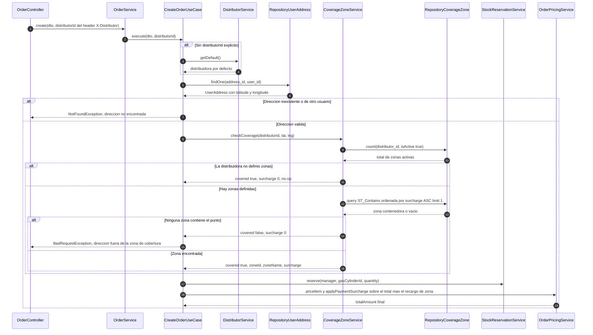

**Observaciones de diseño**

- La cobertura se valida **antes de reservar stock**: un pedido fuera de zona no llega a bloquear inventario.
- La zona aporta además un **recargo por lejanía** que se suma al subtotal de los ítems **antes** del recargo por método de pago (+10 % en pagos online).
- Regla de compatibilidad: una distribuidora **sin zonas cargadas** no queda bloqueada — `checkCoverage` devuelve `covered: true, surcharge: 0`.
- La consulta geoespacial es un `ST_Contains` de PostGIS resuelto en la base, no en memoria; se elige la zona de **menor recargo** entre las que contienen el punto.

---

### 4.13 Importante DSD — CU-064 / CU-065: Calificación bidireccional y recálculo del promedio

**Clases participantes:** `RatingController`, `RatingService`, `Repository<Rating>`, `Repository<Order>`, `Repository<Delivery>`, entidades `Rating`, `Order`, `Delivery`.

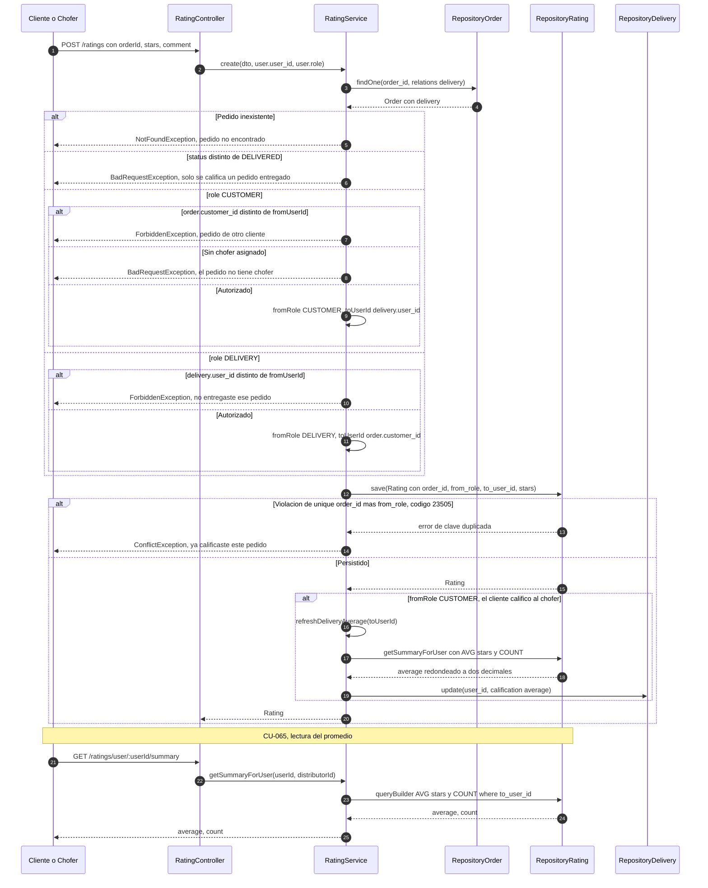

**Observaciones de diseño**

- La calificación es **bidireccional y simétrica**: el emisor sale siempre del token y el calificado se **deriva del pedido** — el cliente nunca elige a quién califica.
- La regla "una calificación por pedido y por lado" se garantiza con un **índice único `(order_id, from_role)`** en la base, no con una consulta previa: se captura el `23505` de PostgreSQL. Es la forma correcta bajo concurrencia.
- `Delivery.calification` es un **valor desnormalizado** que se recalcula al vuelo con `refreshDeliveryAverage`, para lecturas rápidas del listado de choferes; la fuente de verdad sigue siendo la tabla `rating`.
- `getSummaryForUser` **no filtra por `from_role`**: filtrarlo por `CUSTOMER` daba promedio 0 para los clientes calificados por choferes.

---

### Sección B — Diagramas de Interacción por Subsistema

---

---


---

### Cobertura completa — diagramas de interacción por subsistema

Los 84 diagramas que siguen completan la cobertura: cada caso de uso implementado
tiene su diagrama de interacción. Se agrupan por subsistema. Los nombres de clase y de
método son los del código; los alias de participante se escriben sin acentos ni símbolos
para que los bloques sean importables en draw.io, Lucidchart y Mermaid Live.

### SS-01 — Autenticación y Usuarios

#### DSD — CU-001: Iniciar Sesión

Hay **dos** puertas de login: la de las apps (`POST /auth/login`) y la del panel
(`POST /auth/login/dashboard`, que además exige ser admin y devuelve cookie httpOnly).
Ambas son `@Public()` con throttle estricto de 8/min, pero `AuthGuard` igual corre: en la
rama sin token valida el header `x-client-source` y que el rol del usuario corresponda a
la app que pide (un cliente no puede loguearse por la app del chofer).

**Clases participantes:** `AuthController`, `AuthGuard`, `AuthService`, `UsersService`, `AdminService`, `FirebaseAuthPort` (impl. `FirebaseAuthAdapter`), función `signInWithEmailAndPassword` del SDK `firebase/auth`, entidad `User`.

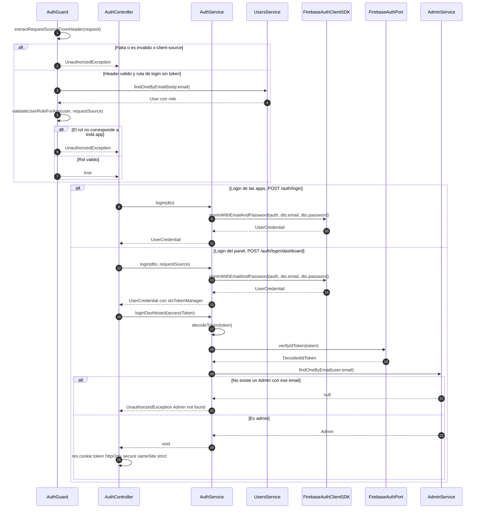

**Observaciones de diseño**

- `AuthService` no conoce `firebase-admin`: verifica tokens contra `FirebaseAuthPort`. Lo
  único que sí usa directo es el SDK **cliente** (`firebase/auth`) para el
  `signInWithEmailAndPassword`, porque el Admin SDK no valida contraseñas.
- La cookie del panel dura 1 h; las apps se quedan con el token del `UserCredential`.

---

#### DSD — CU-002: Registrarse como Cliente

Endpoint `@Public()`. Crea **User + Customer + usuario de Firebase** en una sola unidad de
trabajo; si algo falla, la transacción se revierte y además se compensa el usuario de
Firebase (que vive fuera de la base y no participa del rollback).

**Clases participantes:** `UsersController`, `CustomersService`, `DataSource`, `QueryRunner`, `Repository<User>`, `Repository<Role>`, `Repository<Customer>`, `FirebaseAuthPort` (impl. `FirebaseAuthAdapter`), `EmailService`, entidades `User`, `Customer`, `Role`.

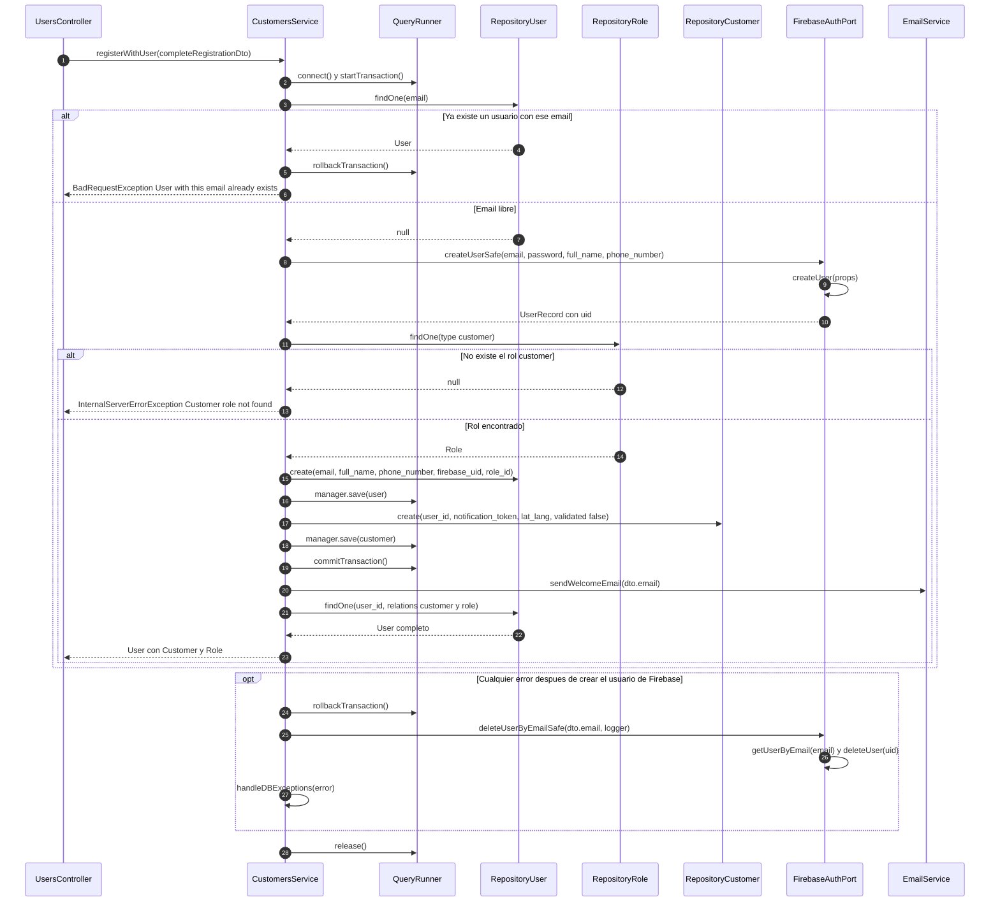

**Observaciones de diseño**

- El email de bienvenida es **best-effort**: si `EmailService.sendWelcomeEmail` falla, el
  registro ya está commiteado y solo queda un `logger.warn`.
- `deleteUserByEmailSafe` es un **rollback de compensación**, no una transacción: nunca
  lanza, porque el peor caso tolerable es un usuario huérfano en Firebase.
- El mapeo de errores de Firebase (`weak-password`, `email-already-exists`, …) está
  centralizado en el puerto (`createUserSafe`), no duplicado en cada service.

---

#### DSD — CU-003: Registrar Chofer

Mismo endpoint que CU-031. A diferencia de CU-002, **no** es público: lo dispara un
administrador, y el chofer nace atado a una distribuidora. La decisión de qué tenant se
usa vive en el controller, no en el service.

**Clases participantes:** `UsersController`, `AuthGuard`, `RolesGuard`, `DeliveryService`, `DataSource`, `QueryRunner`, `Repository<User>`, `Repository<Role>`, `Repository<Delivery>`, `FirebaseAuthPort`, entidades `User`, `Delivery`, `Role`.

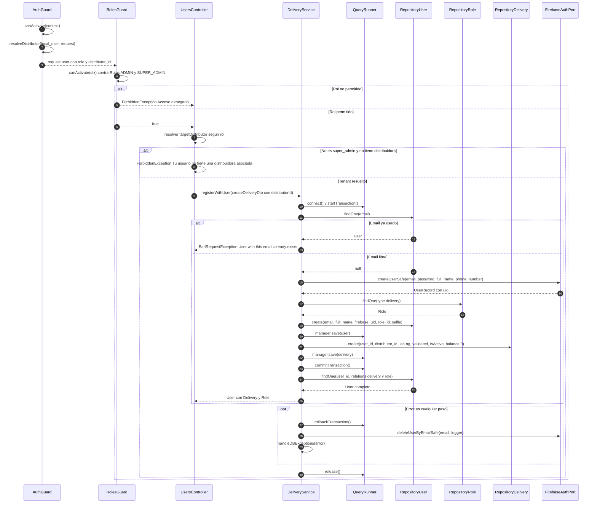

**Observaciones de diseño**

- Un `admin` de empresa crea al chofer SIEMPRE en su propia distribuidora: el
  `distributorId` del body se ignora. Solo el `super_admin` puede elegirlo.
- El `distributor_id` no es un dato de entrada libre: `AuthGuard.resolveDistributor` lo
  deriva del perfil del staff (server-trusted), así que un admin no puede operar otro tenant.

---

#### DSD — CU-004: Gestionar Perfil de Usuario

El perfil está partido en dos agregados: los datos de identidad viven en `User` y los
datos de cliente en `Customer`. Los dos lados aplican la misma política anti-IDOR: un
no-admin solo lee y escribe lo suyo, y además solo un subconjunto de campos.

**Clases participantes:** `UsersController`, `UsersService`, `CustomersController`, `CustomersService`, `Repository<User>`, `Repository<Customer>`, `DataSource`, `QueryRunner`, entidades `User`, `Customer`.

```mermaid
sequenceDiagram
    autonumber
    participant UCTRL as UsersController
    participant USRV as UsersService
    participant UREP as RepositoryUser
    participant QR as QueryRunner
    participant CCTRL as CustomersController
    participant CSRV as CustomersService
    participant CREP as RepositoryCustomer

    alt Lectura del perfil base
        UCTRL->>USRV: findOne(id)
        USRV->>UREP: findOne(user_id, relations role customer delivery cars addresses)
        alt No existe
            UREP-->>USRV: null
            USRV-->>UCTRL: NotFoundException User with ID not found
        else Existe
            UREP-->>USRV: User
            USRV-->>UCTRL: User
        end
    else Edicion del perfil base
        UCTRL->>UCTRL: evaluar isAdmin sobre user.role
        alt No es admin y el id no es el propio
            UCTRL-->>UCTRL: ForbiddenException No podes modificar a otro usuario
        else Autorizado
            opt No es admin
                UCTRL->>UCTRL: pickSelfEditableFields(updateUserDto)
            end
            UCTRL->>USRV: update(id, payload)
            USRV->>UREP: preload(user_id, payload)
            alt preload devuelve undefined
                UREP-->>USRV: undefined
                USRV-->>UCTRL: NotFoundException User with ID not found
            else Entidad precargada
                UREP-->>USRV: User
                USRV->>QR: connect() y startTransaction()
                USRV->>QR: manager.save(user)
                USRV->>QR: commitTransaction() y release()
                USRV-->>UCTRL: User actualizado
            end
        end
    end

    alt Datos de cliente
        CCTRL->>CCTRL: scope(user)
        CCTRL->>CSRV: findOneByUserId(userId, scope)
        CSRV->>CSRV: assertOwnership(userId, requesterUserId)
        CSRV->>CREP: findOne(user_id, relations user role addresses)
        CREP-->>CSRV: Customer
        CSRV-->>CCTRL: Customer
        CCTRL->>CSRV: update(id, updateCustomerDto, scope)
        CSRV->>CSRV: findOne(id, requesterUserId)
        CSRV->>CREP: preload(customer_id, updateCustomerDto)
        CSRV->>CREP: save(customer)
        CSRV-->>CCTRL: Customer actualizado
    end
```

**Observaciones de diseño**

- `pickSelfEditableFields` es la whitelist de auto-edición: `full_name`, `phone_number` y
  `selfie`. Los campos sensibles (`blocked`, `role_id`, `email`, flags de verificación,
  `firebase_uid`) quedan reservados a admin aunque vengan en el body.
- El `scope()` del `CustomersController` devuelve `undefined` para admin (salta el check) y
  el `user_id` propio para el resto: la misma función se reusa en `UserAddresController`.

---

#### DSD — CU-047: Recuperar Contraseña

El backend no maneja contraseñas: le pide a Firebase un link firmado *out-of-band* y lo
manda por mail. Rate-limit y cache del link viven en Redis (no en memoria del proceso) para
que el límite sea real con varias instancias corriendo.

**Clases participantes:** `EmailController`, `EmailService`, `RedisService`, `UsersService`, `FirebaseAuthPort`, `EmailTemplateProvider`, `EmailSenderPort` (impl. `ResendEmailAdapter`).

```mermaid
sequenceDiagram
    autonumber
    participant CTRL as EmailController
    participant SRV as EmailService
    participant REDIS as RedisService
    participant USR as UsersService
    participant FB as FirebaseAuthPort
    participant TPL as EmailTemplateProvider
    participant SEND as EmailSenderPort

    CTRL->>SRV: sendPasswordResetEmail(body.email)
    SRV->>SRV: checkRateLimit(email, password_reset)
    SRV->>REDIS: incrWithExpire(key, TRACKING_WINDOW_SEC)
    REDIS-->>SRV: count
    alt count mayor a MAX_REQUESTS_PER_WINDOW
        SRV-->>CTRL: BadRequestException Too many attempts
    else Dentro del limite
        SRV->>USR: findOneByEmail(email)
        alt El usuario no existe, error 404
            USR-->>SRV: NotFoundException
            SRV-->>CTRL: message If the email exists a password reset link has been sent
        else Usuario existente
            USR-->>SRV: User
            SRV->>SRV: generatePasswordResetLink(email)
            SRV->>REDIS: get(linkCacheKey)
            alt Link cacheado
                REDIS-->>SRV: link
            else Sin cache
                REDIS-->>SRV: null
                SRV->>FB: generatePasswordResetLink(email, actionCodeSettings)
                FB-->>SRV: link firmado
                SRV->>REDIS: setex(cacheKey, CACHE_TTL_SEC, link)
            end
            SRV->>SRV: sendEmail(to, subject, template password-reset, data)
            SRV->>TPL: render(template, data)
            TPL-->>SRV: html
            SRV->>SEND: send(to, subject, html)
            SRV-->>CTRL: message Password reset email sent successfully
        end
    end
```

**Observaciones de diseño**

- La respuesta ante email inexistente es **igual** a la de éxito: no se filtra qué
  direcciones están registradas.
- `sendEmail` traga los errores del proveedor (`logger.warn`): el flujo que dispara el
  correo nunca se cae por culpa de Resend.
- El mismo controller expone `changeEmail`, que sí exige sesión: verifica el `idToken`,
  chequea que el email nuevo esté libre, llama a `FirebaseAuthPort.updateUser` y
  desmarca `email_verified` vía `UsersService.update`.

---

#### DSD — CU-050: Bloquear / Desbloquear Usuario

Toggle bidireccional real: el mismo endpoint bloquea y desbloquea según el booleano del body.

**Clases participantes:** `UsersController`, `RolesGuard`, `UsersService`, `Repository<User>`, entidad `User`.

```mermaid
sequenceDiagram
    autonumber
    participant RG as RolesGuard
    participant CTRL as UsersController
    participant SRV as UsersService
    participant REP as RepositoryUser

    RG->>RG: canActivate(ctx) contra Roles ADMIN y SUPER_ADMIN
    alt Rol insuficiente
        RG-->>CTRL: ForbiddenException Acceso denegado
    else Autorizado
        RG-->>CTRL: true
        CTRL->>SRV: toggleBlockUser(id, body.block)
        SRV->>REP: findOne(user_id)
        alt Usuario inexistente
            REP-->>SRV: null
            SRV-->>CTRL: NotFoundException Usuario no encontrado
        else Usuario encontrado
            REP-->>SRV: User
            SRV->>SRV: user.blocked igual a shouldBlock
            SRV->>REP: save(user)
            REP-->>SRV: User
            SRV-->>CTRL: id, email, isBlocked y mensaje
        end
    end
```

**Observaciones de diseño**

- Bloquear es la alternativa **no destructiva** a CU-085: un usuario con pedidos no se
  puede borrar (FK RESTRICT), pero sí bloquear.

---

#### DSD — CU-082: Crear Usuario Base

Alta mínima de `User` sin perfil asociado (no crea Customer ni Delivery ni usuario de
Firebase). Es la puerta de bajo nivel que usan los helpers de registro.

**Clases participantes:** `UsersController`, `UsersService`, `Repository<User>`, entidad `User`; helpers `validateUniqueness`, `createUserInFirebase`, `createUserInDatabase` de `user-registration.helper.ts`.

```mermaid
sequenceDiagram
    autonumber
    participant CTRL as UsersController
    participant SRV as UsersService
    participant REP as RepositoryUser
    participant HLP as UserRegistrationHelper
    participant FB as FirebaseAuthPort

    CTRL->>SRV: create(createUserDto)
    SRV->>REP: create(createUserDto)
    REP-->>SRV: User no persistido
    SRV->>REP: save(user)
    alt Violacion de unicidad, codigo 23505
        REP-->>SRV: QueryFailedError
        SRV->>SRV: handleDBExceptions(error)
        SRV-->>CTRL: BadRequestException Duplicate entry
    else Guardado correcto
        REP-->>SRV: User persistido
        SRV-->>CTRL: User
    end

    opt Camino de los helpers de registro
        HLP->>SRV: checkUserExists(dto.email, dto.phone_number) desde validateUniqueness
        SRV-->>HLP: exists, email, phoneNumber
        alt Email o telefono ya en uso
            HLP-->>HLP: HttpException CONFLICT Email o telefono ya en uso
        else Libres
            HLP->>SRV: createFirebaseUser(dto) desde createUserInFirebase
            SRV->>FB: createUserSafe(createUserDto)
            FB-->>SRV: UserRecord
            SRV-->>HLP: UserRecord
            HLP->>SRV: create(createUserDto con firebase_uid) desde createUserInDatabase
            SRV-->>HLP: User
        end
    end
```

**Observaciones de diseño**

- El endpoint es `@Public()`: es una puerta de alta genérica, no la del registro de
  clientes (CU-002), que sí arma el agregado completo en transacción.

---

#### DSD — CU-083: Buscar / Listar Usuarios

Tres consultas distintas conviven bajo el mismo caso de uso: listado paginado con búsqueda
libre (solo admin), y las dos búsquedas puntuales por email y por teléfono.

**Clases participantes:** `UsersController`, `RolesGuard`, `UsersService`, `Repository<User>`, `SelectQueryBuilder<User>`, `Brackets`, `PaginationDto`, entidad `User`.

```mermaid
sequenceDiagram
    autonumber
    participant RG as RolesGuard
    participant CTRL as UsersController
    participant SRV as UsersService
    participant REP as RepositoryUser
    participant QB as SelectQueryBuilderUser

    alt Listado paginado, GET /users
        RG->>RG: canActivate(ctx) contra Roles ADMIN y SUPER_ADMIN
        RG-->>CTRL: true
        CTRL->>SRV: findAll(paginationDto con term)
        SRV->>REP: createQueryBuilder(user)
        REP-->>SRV: SelectQueryBuilder
        SRV->>QB: leftJoinAndSelect role, customer y delivery
        SRV->>QB: take(limit) y skip(offset)
        opt Viene term de busqueda
            SRV->>QB: andWhere(Brackets con email, full_name y phone_number ILIKE)
        end
        SRV->>QB: getManyAndCount()
        QB-->>SRV: users y total
        SRV-->>CTRL: users y maxUsers
    else Busqueda por email, GET /users/email/:email
        CTRL->>SRV: findOneByEmail(email)
        SRV->>REP: findOne(email, relations role customer delivery cars addresses admins)
        alt No encontrado
            REP-->>SRV: null
            SRV-->>CTRL: NotFoundException User with email not found
        else Encontrado
            REP-->>SRV: User
            SRV-->>CTRL: User
        end
    else Busqueda por telefono, GET /users/phone/:phoneNumber
        CTRL->>SRV: findOneByPhone(phoneNumber)
        SRV->>REP: findOne(phone_number, relations role customer delivery cars addresses)
        REP-->>SRV: User o null
        SRV-->>CTRL: User o null
    end
```

**Observaciones de diseño**

- Asimetría deliberada del código: `findOneByEmail` lanza 404 si no encuentra (lo usa el
  `AuthGuard`, que necesita el fallo), mientras que `findOneByPhone` devuelve `null`.
- `GET /users/email/:email` es `@Public()`, a diferencia del listado, que exige rol admin.

---

#### DSD — CU-084: Verificar Existencia de Usuario (pre-registro)

Consulta previa al alta, para que la app avise "ese email ya está en uso" antes de mandar
el formulario completo. Construye un `where` con OR entre las condiciones presentes.

**Clases participantes:** `UsersController`, `UsersService`, `Repository<User>`, entidad `User`.

```mermaid
sequenceDiagram
    autonumber
    participant CTRL as UsersController
    participant SRV as UsersService
    participant REP as RepositoryUser

    CTRL->>SRV: checkUserExists(body.email, body.phoneNumber)
    SRV->>SRV: armar conditions con email y phone_number
    alt No vino ni email ni telefono
        SRV-->>CTRL: exists false
    else Al menos una condicion
        SRV->>REP: findOne(where conditions en OR)
        alt Sin coincidencias
            REP-->>SRV: null
            SRV-->>CTRL: exists false, email false, phoneNumber false
        else Hay coincidencia
            REP-->>SRV: User
            SRV-->>CTRL: exists true con los flags por campo consultado
        end
    end
```

**Observaciones de diseño**

- Endpoint `@Public()` por necesidad (corre antes de que exista sesión). Es una superficie
  de enumeración de usuarios: queda cubierto por el throttle global, no por autenticación.
- Es el mismo método que reusa `validateUniqueness` en el camino de CU-082.

---

#### DSD — CU-085: Eliminar Usuario (baja lógica)

El orden de las operaciones es el punto de diseño: **primero** la base, **después**
Firebase. Si el usuario tiene pedidos, la FK `Order → User` (RESTRICT) hace fallar el
DELETE y no se toca Firebase, evitando dejar el usuario huérfano allá.

**Clases participantes:** `UsersController`, `RolesGuard`, `UsersService`, `Repository<User>`, `FirebaseAuthPort` (impl. `FirebaseAuthAdapter`), entidad `User`.

```mermaid
sequenceDiagram
    autonumber
    participant RG as RolesGuard
    participant CTRL as UsersController
    participant SRV as UsersService
    participant REP as RepositoryUser
    participant FB as FirebaseAuthPort

    RG->>RG: canActivate(ctx) contra Roles ADMIN y SUPER_ADMIN
    alt Rol insuficiente
        RG-->>CTRL: ForbiddenException Acceso denegado
    else Autorizado
        RG-->>CTRL: true
        CTRL->>SRV: remove(id)
        SRV->>SRV: findOne(id)
        SRV->>REP: findOne(user_id, relations)
        alt No existe
            REP-->>SRV: null
            SRV-->>CTRL: NotFoundException User with ID not found
        else Existe
            REP-->>SRV: User
            SRV->>REP: delete(user_id)
            alt Violacion de FK, codigo 23503
                REP-->>SRV: QueryFailedError
                SRV-->>CTRL: ConflictException tiene pedidos asociados, bloquealo en lugar de eliminarlo
            else Borrado en base
                REP-->>SRV: DeleteResult
                opt El usuario tiene email
                    SRV->>SRV: cleanupFirebaseUser(user.email)
                    SRV->>FB: deleteUserByEmailSafe(email, logger)
                    FB->>FB: getUserByEmail(email)
                    FB->>FB: deleteUser(uid)
                end
                SRV-->>CTRL: message Usuario eliminado permanentemente de DB y Firebase
            end
        end
    end
```

**Observaciones de diseño**

- `Customer` y `Delivery` cascadean desde `User`, así que un usuario sin pedidos se borra
  con sus perfiles.
- Pese al nombre del CU ("baja lógica"), la implementación es un **borrado físico** de la
  fila; la baja lógica real del sistema es `blocked` (CU-050).

---

#### DSD — CU-091: Validar Vigencia del Token de Sesión

Es el caso de uso más transversal del sistema: `AuthGuard.canActivate` corre en **cada**
request no pública, y `POST /auth` lo expone como endpoint dedicado para que las apps
pregunten "¿mi sesión sigue viva?". El handler es casi vacío a propósito: si el guard dejó
pasar, el token es válido.

**Clases participantes:** `AuthGuard`, `AuthController`, `AuthService`, `FirebaseAuthPort`, `UsersService`, `DistributorService`, `Reflector`, entidad `User`.

```mermaid
sequenceDiagram
    autonumber
    participant GUARD as AuthGuard
    participant REFL as Reflector
    participant SRV as AuthService
    participant FB as FirebaseAuthPort
    participant USR as UsersService
    participant DIST as DistributorService
    participant CTRL as AuthController

    GUARD->>REFL: get(isPublic, context.getHandler())
    alt Ruta publica
        REFL-->>GUARD: true
        GUARD-->>CTRL: true
    else Ruta protegida
        REFL-->>GUARD: undefined
        GUARD->>GUARD: extractTokenFromHeader(request)
        GUARD->>GUARD: extractRequestSourceFromHeader(request)
        alt Falta x-client-source
            GUARD-->>CTRL: UnauthorizedException Invalid or missing X-Client-Source header
        else Header presente
            alt No hay token Bearer
                GUARD-->>CTRL: UnauthorizedException No token provided
            else Hay token
                GUARD->>SRV: decodeToken(token)
                SRV->>FB: verifyIdToken(token)
                alt Token vencido, revocado o mal firmado
                    FB-->>SRV: error
                    SRV-->>GUARD: UnauthorizedException
                else Token valido
                    FB-->>SRV: DecodedIdToken
                    SRV-->>GUARD: email, user y sub
                    GUARD->>GUARD: getUser(email, requestSource)
                    GUARD->>USR: findOneByEmail(user_email)
                    USR-->>GUARD: User con role, delivery y admins
                    GUARD->>GUARD: validateUserRoleForApp(user, requestSource)
                    GUARD->>GUARD: resolveDistributor(local_user, request)
                    alt Rol DELIVERY o ADMIN
                        GUARD->>GUARD: tomar distributor_id del perfil, ignorando el header
                    else Rol CUSTOMER o SUPER_ADMIN con header X-Distributor
                        GUARD->>DIST: assertActive(header) o findBySlug(header)
                        DIST-->>GUARD: Distributor
                    end
                    GUARD->>GUARD: setear request.user y request.distributorId
                    GUARD-->>CTRL: true
                    CTRL->>SRV: checkIfTokenValid()
                    SRV-->>CTRL: HttpException token valid
                end
            end
        end
    end
```

**Observaciones de diseño**

- El tenant efectivo se resuelve **acá**, una sola vez por request, y lo consumen todos los
  controllers vía `@CurrentDistributor()`. Un staff no puede cambiarlo por header.
- `checkIfTokenValid` devuelve un `HttpException` con status `CONTINUE` (100) en vez de un
  DTO: el valor informativo está en que la request haya llegado al handler.

---

### SS-02 — Gestión de Pedidos

#### DSD — CU-006: Consultar Detalle de Pedido

Dos filtros de seguridad encadenados sobre la misma lectura: aislamiento por tenant y
ownership del cliente. Los dos responden **404** (no 403) para no revelar que el pedido existe.

**Clases participantes:** `OrderController`, `OrderService`, `OrderRepositoryPort` (impl. `OrderTypeormRepository`), `OrderMapper`, entidad `Order`, `OrderResponseDto`.

```mermaid
sequenceDiagram
    autonumber
    participant CTRL as OrderController
    participant SRV as OrderService
    participant ORD as OrderRepositoryPort
    participant MAP as OrderMapper

    CTRL->>CTRL: derivar customerScope segun user.role
    CTRL->>SRV: getOne(id, distributorId, customerScope)
    SRV->>SRV: findOne(id)
    SRV->>ORD: findByIdFull(id)
    alt No existe el pedido
        ORD-->>SRV: null
        SRV-->>CTRL: NotFoundException Order with ID not found
    else Pedido encontrado
        ORD-->>SRV: Order con relaciones completas
        alt El pedido es de otra distribuidora
            SRV-->>CTRL: NotFoundException Order with ID not found
        else Tenant correcto
            alt El solicitante es CUSTOMER y no es el dueno del pedido
                SRV-->>CTRL: NotFoundException Order with ID not found
            else Ownership correcto
                SRV->>MAP: toDto(order)
                MAP-->>SRV: OrderResponseDto
                SRV-->>CTRL: OrderResponseDto
            end
        end
    end
```

**Observaciones de diseño**

- `findByIdFull` trae el pedido con **todas** las relaciones (`customer`, `delivery.user`,
  `items.gasCylinder`, `address`, `timeSlot`): es la lectura que también usan los use-cases
  de escritura, por eso está en el puerto y no en el service.
- `OrderMapper.toDto` es la frontera: la entidad nunca sale del backend tal cual.

---

#### DSD — CU-007: Consultar Historial de Pedidos

El cliente ve **todo** su historial aunque haya pedido a varias distribuidoras; el staff
solo ve lo de su tenant. Esa asimetría se decide en el controller.

**Clases participantes:** `OrderController`, `OrderService`, `OrderRepositoryPort` (impl. `OrderTypeormRepository`), `Repository<Order>`, `OrderMapper`, `PaginationDto`, entidad `Order`.

```mermaid
sequenceDiagram
    autonumber
    participant CTRL as OrderController
    participant SRV as OrderService
    participant ORD as OrderRepositoryPort
    participant REP as RepositoryOrder
    participant MAP as OrderMapper

    alt Es CUSTOMER y pide el historial de otro
        CTRL-->>CTRL: ForbiddenException No autorizado a ver pedidos de otro cliente
    else Autorizado
        CTRL->>CTRL: scope null si es CUSTOMER, distributorId si es staff
        CTRL->>SRV: findByCustomer(customerId, paginationDto, scope)
        SRV->>ORD: findByCustomer(customerId, limit, offset, distributorId)
        ORD->>ORD: scoped(where customer_id, distributorId)
        ORD->>REP: findAndCount(where, take, skip, relations, order createdAt DESC)
        REP-->>ORD: orders y total
        ORD-->>SRV: orders, total, limit y offset
        SRV-->>CTRL: PaginatedOrders
        loop Por cada pedido de la pagina
            CTRL->>MAP: toDto(order)
            MAP-->>CTRL: OrderResponseDto
        end
    end
```

**Observaciones de diseño**

- `scoped()` es un helper privado del adapter: agrega `distributor_id` al `where` **solo**
  si vino tenant. Un `null` no significa "ningún tenant" sino "sin restricción".

---

#### DSD — CU-008: Cancelar Pedido (Cliente)

Los tres CU de cancelación (008/009/010) comparten un único endpoint; lo que cambia es el
**actor**, que sale siempre del token y nunca del body. Para el cliente la política es:
cancelar de verdad y devolver el stock.

**Clases participantes:** `OrderController`, `IdempotencyInterceptor`, `OrderService`, `CancelOrderUseCase`, `OrderRepositoryPort`, `transitionOrder` (máquina de estados de dominio), `StockReservationService`, `DataSource`, `QueryRunner`, `RealtimeDispatchPort` (impl. `RealtimeDispatchAdapter`), `OrderMapper`, entidad `Order`.

```mermaid
sequenceDiagram
    autonumber
    participant IDEM as IdempotencyInterceptor
    participant CTRL as OrderController
    participant SRV as OrderService
    participant UC as CancelOrderUseCase
    participant ORD as OrderRepositoryPort
    participant FSM as OrderStatusMachine
    participant STK as StockReservationService
    participant QR as QueryRunner
    participant RT as RealtimeDispatchPort

    IDEM->>IDEM: intercept con header Idempotency-Key
    alt Ya hay respuesta cacheada para esa key
        IDEM-->>CTRL: respuesta cacheada, no se re-ejecuta
    else Primera ejecucion
        IDEM-->>CTRL: next.handle()
        CTRL->>CTRL: mapRoleToCancelActor(user.role) devuelve customer
        CTRL->>SRV: cancelOrder(id, user.user_id, customer, body.reason)
        SRV->>UC: execute(orderId, userId, customer, reason)
        UC->>ORD: findByIdFull(orderId)
        alt Pedido inexistente
            ORD-->>UC: null
            UC-->>CTRL: NotFoundException Order with ID not found
        else Pedido encontrado
            ORD-->>UC: Order
            alt Ya esta DELIVERED o CANCELLED
                UC-->>CTRL: BadRequestException No se puede cancelar un pedido finalizado
            else Cancelable
                UC->>UC: applyCancellationPolicy(order, userId, customer)
                alt El pedido ya esta ON_THE_WAY
                    UC-->>CTRL: BadRequestException El pedido ya esta en camino, contacte al soporte
                else Aun no salio
                    alt order.customer_id distinto del userId autenticado
                        UC-->>CTRL: BadRequestException No autorizado
                    else Es el dueno del pedido
                        UC->>FSM: transitionOrder(order, CANCELLED)
                        UC->>UC: setear cancellationReason
                        UC->>UC: restoreStock(order)
                        UC->>QR: connect() y startTransaction()
                        UC->>STK: restore(queryRunner.manager, order.items)
                        UC->>QR: commitTransaction() y release()
                        UC->>ORD: save(order)
                        UC->>UC: notify(order, customer, previousDriverId)
                        UC->>RT: notifyCustomer(customer_id, order cancelled, payload)
                        opt El pedido ya tenia chofer asignado
                            UC->>RT: notifyDriverOrderCancelled(previousDriverId, payload)
                        end
                        UC->>RT: notifyAdmins(order cancelled, payload)
                        UC-->>CTRL: Order en estado CANCELLED
                    end
                end
            end
        end
    end
```

**Observaciones de diseño**

- La restitución de stock corre en **su propia transacción** con lock pesimista, separada
  del guardado del pedido: son dos agregados distintos.
- `transitionOrder` es el único punto autorizado para mutar `order.status`; nadie asigna
  el estado a mano.

---

#### DSD — CU-009: Cancelar Pedido (Chofer)

Mismo endpoint, política opuesta: el chofer **no cancela**, libera. El pedido vuelve a
`PENDING` sin chofer, el stock no se toca (el cliente lo sigue queriendo) y el cron de
despacho lo vuelve a ofrecer.

**Clases participantes:** `OrderController`, `OrderService`, `CancelOrderUseCase`, `OrderRepositoryPort`, `transitionOrder`, `RealtimeDispatchPort` (impl. `RealtimeDispatchAdapter`), `CustomersGateway`, entidad `Order`.

```mermaid
sequenceDiagram
    autonumber
    participant CTRL as OrderController
    participant SRV as OrderService
    participant UC as CancelOrderUseCase
    participant ORD as OrderRepositoryPort
    participant FSM as OrderStatusMachine
    participant RT as RealtimeDispatchPort
    participant CGW as CustomersGateway

    CTRL->>CTRL: mapRoleToCancelActor(user.role) devuelve driver
    CTRL->>SRV: cancelOrder(id, user.user_id, driver, body.reason)
    SRV->>UC: execute(orderId, userId, driver, reason)
    UC->>ORD: findByIdFull(orderId)
    alt Pedido inexistente
        ORD-->>UC: null
        UC-->>CTRL: NotFoundException Order with ID not found
    else Pedido encontrado
        ORD-->>UC: Order con delivery_id
        alt Ya esta DELIVERED o CANCELLED
            UC-->>CTRL: BadRequestException No se puede cancelar un pedido finalizado
        else Cancelable
            UC->>UC: guardar previousDriverId
            UC->>UC: applyCancellationPolicy(order, userId, driver)
            UC->>FSM: transitionOrder(order, PENDING)
            UC->>UC: delivery_id, acceptedAt y onTheWayAt a null
            UC->>ORD: save(order)
            UC->>UC: notify(order, driver, previousDriverId)
            UC->>RT: notifyCustomer(customer_id, order searching-driver, payload)
            RT->>CGW: notifyCustomer(customerId, event, payload)
            UC-->>CTRL: Order de nuevo en PENDING
        end
    end
```

**Observaciones de diseño**

- No se avisa a los admins: liberar no es una cancelación, y el panel solo escucha
  `order:cancelled` cuando el estado final es `CANCELLED`.
- Tampoco se le manda `notifyDriverOrderCancelled` al chofer: es él mismo quien soltó el pedido.

---

#### DSD — CU-010: Cancelar Pedido (Administrador)

El admin tiene **dos** puertas: la cancelación normal (`PATCH /orders/:id/cancel`, con
motivo) y la cancelación forzada (`DELETE /orders/:id`, sin motivo). Las dos terminan en el
mismo use-case con actor `admin`, que sí devuelve stock y sí avisa al chofer previo.

**Clases participantes:** `OrderController`, `RolesGuard`, `OrderService`, `CancelOrderUseCase`, `OrderRepositoryPort`, `transitionOrder`, `StockReservationService`, `RealtimeDispatchPort`, `AdminGateway`, `DriversGateway`, `OrderMapper`, entidad `Order`.

```mermaid
sequenceDiagram
    autonumber
    participant RG as RolesGuard
    participant CTRL as OrderController
    participant SRV as OrderService
    participant UC as CancelOrderUseCase
    participant ORD as OrderRepositoryPort
    participant FSM as OrderStatusMachine
    participant STK as StockReservationService
    participant RT as RealtimeDispatchPort
    participant DGW as DriversGateway
    participant AGW as AdminGateway

    RG->>RG: canActivate(ctx) contra Roles ADMIN y SUPER_ADMIN
    alt Rol insuficiente
        RG-->>CTRL: ForbiddenException Acceso denegado
    else Autorizado
        RG-->>CTRL: true
        alt Cancelacion forzada, DELETE /orders/:id
            CTRL->>SRV: cancelOrder(id, user.user_id, admin)
        else Cancelacion con motivo, PATCH /orders/:id/cancel
            CTRL->>SRV: cancelOrder(id, user.user_id, admin, body.reason)
        end
        SRV->>UC: execute(orderId, userId, admin, reason)
        UC->>ORD: findByIdFull(orderId)
        alt Pedido inexistente o finalizado
            UC-->>CTRL: NotFoundException o BadRequestException
        else Cancelable
            ORD-->>UC: Order
            UC->>UC: guardar previousDriverId
            UC->>FSM: transitionOrder(order, CANCELLED)
            UC->>UC: cancellationReason igual a reason o Cancelado por admin
            UC->>STK: restore(queryRunner.manager, order.items)
            UC->>ORD: save(order)
            UC->>RT: notifyCustomer(customer_id, order cancelled, payload)
            opt El pedido tenia chofer asignado
                UC->>RT: notifyDriverOrderCancelled(previousDriverId, payload)
                RT->>DGW: notifyOrderCancelled(driverId, payload)
            end
            UC->>RT: notifyAdmins(order cancelled, payload)
            RT->>AGW: notifyAdmins(event, payload)
            UC-->>CTRL: Order en estado CANCELLED
        end
    end
```

**Observaciones de diseño**

- La identidad del admin sale del token (`user.user_id`), no de un id ficticio: la
  cancelación forzada queda auditable.
- `superadmin` se mapea al mismo actor `admin` en `mapRoleToCancelActor`: la política de
  cancelación no distingue entre los dos.

---

#### DSD — CU-011: Listar Todos los Pedidos

Listado del panel. La dimensión que el CU documentado no menciona es el **scope por
distribuidora**: un admin de empresa solo ve lo suyo; el `super_admin` sin header
`X-Distributor` ve el consolidado.

**Clases participantes:** `OrderController`, `RolesGuard`, `OrderService`, `OrderRepositoryPort` (impl. `OrderTypeormRepository`), `Repository<Order>`, `OrderMapper`, `PaginationDto`, entidad `Order`.

```mermaid
sequenceDiagram
    autonumber
    participant RG as RolesGuard
    participant CTRL as OrderController
    participant SRV as OrderService
    participant ORD as OrderRepositoryPort
    participant REP as RepositoryOrder
    participant MAP as OrderMapper

    RG->>RG: canActivate(ctx) contra Roles ADMIN y SUPER_ADMIN
    alt Rol insuficiente
        RG-->>CTRL: ForbiddenException Acceso denegado
    else Autorizado
        RG-->>CTRL: true
        CTRL->>SRV: findAll(paginationDto, distributorId)
        SRV->>ORD: findAllPaginated(limit, offset, distributorId)
        ORD->>ORD: scoped(where vacio, distributorId)
        ORD->>REP: findAndCount(where, take, skip, FULL_RELATIONS, order createdAt DESC)
        REP-->>ORD: orders y total
        ORD-->>SRV: orders, total, limit y offset
        SRV-->>CTRL: PaginatedOrders
        loop Por cada pedido de la pagina
            CTRL->>MAP: toDto(order)
            MAP-->>CTRL: OrderResponseDto
        end
    end
```

**Observaciones de diseño**

- Es la única lectura que trae `FULL_RELATIONS`: el panel muestra cliente, chofer, ítems,
  dirección y franja horaria en la misma grilla.

---

#### DSD — CU-046: Gestionar Direcciones de Entrega

Ocho endpoints bajo un solo CU. Todos pasan por `scope(user)`, que fuerza el `user_id`
propio a los no-admin; el service lo aplica con `assertOwnership`. La regla de negocio
propia del caso es el invariante **"una sola dirección predeterminada por usuario"**.

**Clases participantes:** `UserAddresController`, `UserAddresService`, `Repository<UserAddress>`, `Repository<User>`, entidades `UserAddress`, `User`.

```mermaid
sequenceDiagram
    autonumber
    participant CTRL as UserAddresController
    participant SRV as UserAddresService
    participant AREP as RepositoryUserAddress
    participant UREP as RepositoryUser

    CTRL->>CTRL: scope(user) devuelve user_id si no es admin

    alt Alta, POST /user-address
        CTRL->>SRV: create(createUserAddressDto, scope)
        opt No es admin
            SRV->>SRV: forzar user_id al del solicitante, ignorando el body
        end
        SRV->>UREP: findOne(user_id)
        alt El usuario no existe
            UREP-->>SRV: null
            SRV-->>CTRL: NotFoundException User with ID not found
        else Usuario valido
            UREP-->>SRV: User
            opt isDefault true
                SRV->>SRV: removeDefaultFromOtherAddresses(user_id)
                SRV->>AREP: find(user_id, isDefault true)
                loop Por cada direccion predeterminada previa
                    SRV->>AREP: save(address con isDefault false)
                end
            end
            SRV->>AREP: create(createUserAddressDto)
            SRV->>AREP: save(address)
            AREP-->>SRV: UserAddress
            SRV-->>CTRL: UserAddress
        end
    else Consulta por usuario, GET /user-address/user/:userId
        CTRL->>SRV: findByUserId(userId, scope)
        SRV->>SRV: assertOwnership(userId, requesterUserId)
        alt El solicitante no es el dueno
            SRV-->>CTRL: ForbiddenException No autorizado a acceder a direcciones de otro usuario
        else Autorizado
            SRV->>AREP: find(user_id, order isDefault DESC y createdAt DESC)
            AREP-->>SRV: UserAddress[]
            SRV-->>CTRL: UserAddress[]
        end
    else Predeterminada, GET /user-address/user/:userId/default
        CTRL->>SRV: findDefaultByUserId(userId, scope)
        SRV->>SRV: assertOwnership(userId, requesterUserId)
        SRV->>AREP: findOne(user_id, isDefault true)
        alt No hay ninguna marcada
            AREP-->>SRV: null
            SRV->>SRV: findByUserId(userId)
            alt Tiene al menos una direccion
                SRV-->>CTRL: la primera de la lista
            else No tiene ninguna
                SRV-->>CTRL: NotFoundException No addresses found for user
            end
        else Hay predeterminada
            AREP-->>SRV: UserAddress
            SRV-->>CTRL: UserAddress
        end
    else Marcar predeterminada, PATCH /user-address/:id/set-default
        CTRL->>SRV: setAsDefault(id, scope)
        SRV->>SRV: findOne(id, requesterUserId)
        SRV->>SRV: removeDefaultFromOtherAddresses(user_id, id)
        SRV->>AREP: find(user_id, isDefault true, address_id Not id)
        SRV->>AREP: save(address con isDefault true)
        SRV-->>CTRL: UserAddress
    else Baja, DELETE /user-address/:id
        CTRL->>SRV: remove(id, scope)
        SRV->>SRV: findOne(id, requesterUserId)
        opt La direccion borrada era la predeterminada
            SRV->>AREP: find(user_id, address_id Not id, order createdAt DESC)
            opt Quedan otras direcciones
                SRV->>AREP: save(la mas reciente con isDefault true)
            end
        end
        SRV->>AREP: remove(address)
        SRV-->>CTRL: message Address deleted successfully y addressId
    end
```

**Observaciones de diseño**

- Borrar la dirección predeterminada **promueve** la más reciente: el usuario nunca queda
  sin default si le queda alguna dirección.
- `GET /user-address` (listado global) exige `super_admin`: es una herramienta de soporte,
  no parte del flujo del cliente.

---

#### DSD — CU-080: Consultar el Pool de Pedidos Disponibles

Lo que ve el chofer en su pantalla de "pedidos disponibles": `PENDING` **y** sin chofer
asignado, acotado a su distribuidora y ordenado por antigüedad (FIFO). El mismo método es
la fuente del bootstrap del cron de despacho.

**Clases participantes:** `OrderController`, `RolesGuard`, `OrderService`, `OrderRepositoryPort` (impl. `OrderTypeormRepository`), `Repository<Order>`, `OrderMapper`, `DispatchService`, entidad `Order`.

```mermaid
sequenceDiagram
    autonumber
    participant RG as RolesGuard
    participant CTRL as OrderController
    participant CRON as DispatchService
    participant SRV as OrderService
    participant ORD as OrderRepositoryPort
    participant REP as RepositoryOrder
    participant MAP as OrderMapper

    alt Consulta del chofer, GET /orders/available
        RG->>RG: canActivate(ctx) contra Roles DELIVERY, ADMIN y SUPER_ADMIN
        alt Rol insuficiente
            RG-->>CTRL: ForbiddenException Acceso denegado
        else Autorizado
            RG-->>CTRL: true
            CTRL->>SRV: findAvailableOrders(paginationDto, distributorId)
        end
    else Bootstrap del cron de despacho
        CRON->>SRV: findAvailableOrders(limit 50, offset 0)
    end
    SRV->>ORD: findAvailable(limit, offset, distributorId)
    ORD->>ORD: scoped(status PENDING y delivery_id IsNull, distributorId)
    ORD->>REP: findAndCount(where, take, skip, relations, order createdAt ASC)
    REP-->>ORD: orders y total
    ORD-->>SRV: orders, total, limit y offset
    SRV-->>CTRL: PaginatedOrders
    loop Por cada pedido del pool
        CTRL->>MAP: toDto(order)
        MAP-->>CTRL: OrderResponseDto
    end
```

**Observaciones de diseño**

- El orden es `createdAt ASC` (a diferencia de todos los demás listados, que son `DESC`):
  el pedido que más esperó se ofrece primero.
- El pool está **acotado por tenant**: un chofer nunca ve pedidos de otra distribuidora.

---

#### DSD — CU-081: Consultar los Pedidos Asignados al Chofer

**Clases participantes:** `OrderController`, `RolesGuard`, `OrderService`, `OrderRepositoryPort` (impl. `OrderTypeormRepository`), `Repository<Order>`, `OrderMapper`, `PaginationDto`, entidad `Order`.

```mermaid
sequenceDiagram
    autonumber
    participant RG as RolesGuard
    participant CTRL as OrderController
    participant SRV as OrderService
    participant ORD as OrderRepositoryPort
    participant REP as RepositoryOrder
    participant MAP as OrderMapper

    RG->>RG: canActivate(ctx) contra Roles DELIVERY, ADMIN y SUPER_ADMIN
    alt Rol insuficiente
        RG-->>CTRL: ForbiddenException Acceso denegado
    else Autorizado
        RG-->>CTRL: true
        CTRL->>SRV: findByDelivery(deliveryId, paginationDto, distributorId)
        SRV->>ORD: findByDelivery(deliveryId, limit, offset, distributorId)
        ORD->>ORD: scoped(where delivery_id, distributorId)
        ORD->>REP: findAndCount(where, take, skip, relations customer e items, order createdAt DESC)
        REP-->>ORD: orders y total
        ORD-->>SRV: orders, total, limit y offset
        SRV-->>CTRL: PaginatedOrders
        loop Por cada pedido asignado
            CTRL->>MAP: toDto(order)
            MAP-->>CTRL: OrderResponseDto
        end
    end
```

**Observaciones de diseño**

- El `deliveryId` de la ruta es el `delivery_id` (PK del perfil de chofer), **no** el
  `user_id`: es la diferencia con `updateStatus`, que resuelve el perfil a partir de la
  identidad autenticada.
- El scope por tenant se aplica igual aunque el `deliveryId` ya sea único: defensa en
  profundidad contra un id de otra empresa.

---

### SS-03 — Despacho

#### DSD — CU-012: Asignar Chofer Manualmente

Es la puerta **manual** al despacho, la que usa el admin cuando el M1 (oferta secuencial
automática) no encontró chofer o cuando hay que forzar una asignación. Salta la negociación
por completo: no crea `DispatchOffer` ni espera aceptación, escribe el `delivery_id` y
transiciona directo a `ACCEPTED`.

**Clases participantes:** `OrderController`, `RolesGuard`, `OrderService`, `OrderRepositoryPort`, `Repository<Delivery>`, `Repository<Order>`, `transitionOrder` (máquina de estados de dominio), `OrderMapper`, entidades `Order`, `Delivery`.

```mermaid
sequenceDiagram
    autonumber
    participant RG as RolesGuard
    participant CTRL as OrderController
    participant SRV as OrderService
    participant ORD as OrderRepositoryPort
    participant DREP as RepositoryDelivery
    participant FSM as OrderStatusMachine
    participant OREP as RepositoryOrder
    participant MAP as OrderMapper

    RG->>RG: canActivate(ctx) contra Roles ADMIN y SUPER_ADMIN
    alt Rol insuficiente
        RG-->>CTRL: ForbiddenException Acceso denegado
    else Autorizado
        RG-->>CTRL: true
        CTRL->>SRV: assignDelivery(id, deliveryId)
        SRV->>SRV: findOne(orderId)
        SRV->>ORD: findByIdFull(orderId)
        alt Pedido inexistente
            ORD-->>SRV: null
            SRV-->>CTRL: NotFoundException Order with ID not found
        else Pedido encontrado
            ORD-->>SRV: Order
            SRV->>DREP: findOne(delivery_id)
            alt Chofer inexistente
                DREP-->>SRV: null
                SRV-->>CTRL: NotFoundException Repartidor no encontrado
            else Chofer encontrado
                DREP-->>SRV: Delivery
                alt El chofer no esta activo
                    SRV-->>CTRL: BadRequestException El repartidor no esta activo
                else Chofer activo
                    SRV->>SRV: order.delivery_id igual a deliveryId
                    SRV->>FSM: transitionOrder(order, ACCEPTED)
                    alt Transicion ilegal desde el estado actual
                        FSM-->>SRV: InvalidOrderTransitionError
                        SRV-->>CTRL: error 400 via GlobalExceptionFilter
                    else Transicion valida
                        SRV->>SRV: order.acceptedAt igual a new Date
                        SRV->>OREP: save(order)
                        OREP-->>SRV: Order
                        SRV-->>CTRL: Order en estado ACCEPTED
                        CTRL->>MAP: toDto(order)
                        MAP-->>CTRL: OrderResponseDto
                    end
                end
            end
        end
    end
```

**Observaciones de diseño**

- **Gap de diseño detectado:** a diferencia de `UpdateOrderStatusUseCase`, este camino
  **no** genera `deliveryCode`, **no** cierra la oferta de despacho abierta
  (`DispatchOrchestratorService.onDriverAccepted`) y **no** emite `order:accepted` al
  cliente. Un pedido asignado a mano queda sin código para la entrega verificada por QR
  (CU-078/CU-079) y con una `DispatchOffer` posiblemente viva.
- Valida `isActive`, que es el mismo bit que el chofer usa para ponerse offline (CU-022):
  un admin no puede asignarle un pedido a un chofer desconectado.

---

### SS-04 — Seguimiento

#### DSD — CU-018: Marcar Pedido "En Camino"

Transición `ACCEPTED → ON_THE_WAY`. El efecto de diseño relevante no es el cambio de
estado sino el **encendido del tracking**: se escribe en Redis el mapping
chofer → (pedido, cliente), que es lo que después hace que `DriversGateway` reenvíe cada
posición GPS al cliente correcto (CU-017).

**Clases participantes:** `OrderController`, `IdempotencyInterceptor`, `OrderService`, `UpdateOrderStatusUseCase`, `OrderRepositoryPort`, `transitionOrder`, `Repository<Delivery>`, `Repository<User>`, `RealtimeDispatchPort` (impl. `RealtimeDispatchAdapter`), `RedisService`, `CustomersGateway`, `AdminGateway`, `NotificationPort` (impl. `NotificationAdapter`), `OrderMapper`, entidades `Order`, `Delivery`, `User`.

```mermaid
sequenceDiagram
    autonumber
    participant IDEM as IdempotencyInterceptor
    participant CTRL as OrderController
    participant SRV as OrderService
    participant UC as UpdateOrderStatusUseCase
    participant ORD as OrderRepositoryPort
    participant FSM as OrderStatusMachine
    participant DREP as RepositoryDelivery
    participant RT as RealtimeDispatchPort
    participant REDIS as RedisService
    participant CGW as CustomersGateway
    participant AGW as AdminGateway
    participant NOT as NotificationPort

    IDEM->>IDEM: intercept con header Idempotency-Key
    alt Reintento con la misma key
        IDEM-->>CTRL: respuesta cacheada, no se re-procesa
    else Primera ejecucion
        IDEM-->>CTRL: next.handle()
        CTRL->>CTRL: si es DELIVERY, deliveryId sale del token y se ignora el body
        CTRL->>SRV: updateStatus(id, ON_THE_WAY, deliveryId)
        SRV->>UC: execute(id, ON_THE_WAY, deliveryId)
        UC->>ORD: findByIdFull(id)
        alt Pedido inexistente
            ORD-->>UC: null
            UC-->>CTRL: NotFoundException Order with ID not found
        else Pedido encontrado
            ORD-->>UC: Order
            UC->>FSM: transitionOrder(order, ON_THE_WAY)
            alt El pedido no estaba ACCEPTED
                FSM-->>UC: InvalidOrderTransitionError
                UC-->>CTRL: error 400 via GlobalExceptionFilter
            else Transicion valida
                UC->>UC: applyStatusEffects(order, ON_THE_WAY, deliveryId)
                UC->>UC: order.onTheWayAt igual a new Date
                alt El pedido no tiene chofer asignado
                    UC->>UC: devuelve null sin activar tracking
                else Tiene chofer
                    UC->>DREP: findOne(delivery_id, relations user)
                    DREP-->>UC: Delivery con User
                    UC->>RT: startTracking(user.user_id, order.order_id, order.customer_id)
                    RT->>REDIS: setDriverActiveOrder(driverUserId, orderId y customerId)
                end
                UC->>ORD: save(order)
                UC->>UC: emitStatusEvent(order, ON_THE_WAY, deliveryUser)
                UC->>RT: notifyCustomer(customer_id, order on-the-way, payload con driver)
                RT->>CGW: notifyCustomer(customerId, event, payload)
                UC->>RT: notifyAdmins(order on_the_way, orderId, status y totalAmount)
                RT->>AGW: notifyAdmins(event, payload)
                UC->>UC: notifyCustomer(order)
                UC->>NOT: sendOrderConfirmation(customer_id, order_id, notification_token)
                UC-->>CTRL: Order en estado ON_THE_WAY
            end
        end
    end
```

**Observaciones de diseño**

- El evento por estado sale de la tabla `STATUS_EVENT`, no de un `switch` disperso: para
  `ON_THE_WAY` es `order:on-the-way`.
- Tanto el socket como el push son best-effort y están envueltos en `try/catch`: si el
  cliente tiene la app cerrada, el pedido igual avanza.
- Los eventos al panel usan el valor del enum (`order:on_the_way`), que es lo que escucha
  la campana del panel; el evento al cliente usa el slug con guiones. Son deliberadamente
  distintos.

---

#### DSD — CU-019: Avisar Llegada al Cliente

El único caso del ciclo del pedido que **no** cambia el estado: es un aviso puro. Por eso
no pasa por la máquina de estados ni por el use-case de transición.

**Clases participantes:** `OrderController`, `RolesGuard`, `OrderService`, `OrderRepositoryPort`, `RealtimeDispatchPort` (impl. `RealtimeDispatchAdapter`), `CustomersGateway`, entidad `Order`.

```mermaid
sequenceDiagram
    autonumber
    participant RG as RolesGuard
    participant CTRL as OrderController
    participant SRV as OrderService
    participant ORD as OrderRepositoryPort
    participant RT as RealtimeDispatchPort
    participant CGW as CustomersGateway

    RG->>RG: canActivate(ctx) contra Roles DELIVERY, ADMIN y SUPER_ADMIN
    alt Rol insuficiente
        RG-->>CTRL: ForbiddenException Acceso denegado
    else Autorizado
        RG-->>CTRL: true
        CTRL->>SRV: notifyDriverArrived(id)
        SRV->>SRV: findOne(orderId)
        SRV->>ORD: findByIdFull(orderId)
        alt Pedido inexistente
            ORD-->>SRV: null
            SRV-->>CTRL: NotFoundException Order with ID not found
        else Pedido encontrado
            ORD-->>SRV: Order con delivery y user
            alt El pedido no esta ON_THE_WAY
                SRV-->>CTRL: BadRequestException El pedido debe estar en camino para avisar llegada
            else Pedido en camino
                SRV->>RT: notifyCustomer(customer_id, order arrived, orderId, message y driverName)
                RT->>CGW: notifyCustomer(customerId, event, payload)
                CGW-->>SRV: emit en la sala customer_ del cliente
                SRV-->>CTRL: message Cliente notificado
            end
        end
    end
```

**Observaciones de diseño**

- El `driverName` sale de `order.delivery.user.full_name` con fallback a "El repartidor":
  el payload no depende de que la relación esté cargada.
- **Gap de diseño detectado:** el endpoint no valida que quien avisa sea el chofer asignado
  a *ese* pedido; cualquier `DELIVERY` autenticado puede disparar el aviso de un pedido ajeno.

---

#### DSD — CU-021: Recibir Notificaciones en Tiempo Real

Hay **dos canales complementarios** y este DSD los muestra juntos porque el CU los necesita
a los dos: el WebSocket (app abierta) y el push FCM (app en background). El push depende de
una precondición técnica que el CU documentado no menciona: el token FCM tiene que estar
registrado antes (`POST /notifications/token`).

**Clases participantes:** `NotificationsController`, `NotificationsService`, `Repository<Customer>`, `Repository<Delivery>`, `CustomersGateway`, `AuthService`, `RealtimeDispatchPort` (impl. `RealtimeDispatchAdapter`), `NotificationPort` (impl. `NotificationAdapter`), `FcmPort` (impl. `FcmAdapter`), `Socket`, `Server` de Socket.io.

```mermaid
sequenceDiagram
    autonumber
    participant NCTRL as NotificationsController
    participant NSRV as NotificationsService
    participant CREP as RepositoryCustomer
    participant DREP as RepositoryDelivery
    participant CGW as CustomersGateway
    participant ASRV as AuthService
    participant RT as RealtimeDispatchPort
    participant NOT as NotificationPort
    participant FCM as FcmPort

    NCTRL->>NCTRL: si no es admin, forzar userId al del token
    NCTRL->>NSRV: saveNotificationToken(userId, body.token, body.platform)
    NSRV->>CREP: findOne(user_id)
    alt Es un cliente
        CREP-->>NSRV: Customer
        NSRV->>CREP: save(customer con notification_token)
        NSRV-->>NCTRL: success true
    else No es cliente
        CREP-->>NSRV: null
        NSRV->>DREP: findOne(user_id)
        alt Es un chofer
            DREP-->>NSRV: Delivery
            NSRV->>DREP: save(delivery con notification_token)
            NSRV-->>NCTRL: success true
        else No existe el perfil
            DREP-->>NSRV: null
            NSRV-->>NCTRL: success false, error User not found
        end
    end

    CGW->>CGW: handleConnection(client)
    alt Handshake sin token
        CGW->>CGW: client.disconnect()
    else Con token
        CGW->>ASRV: decodeToken(token)
        alt Token invalido
            ASRV-->>CGW: UnauthorizedException
            CGW->>CGW: client.disconnect()
        else Token valido
            ASRV-->>CGW: email, user y sub
            CGW->>CGW: handleCustomerJoin(data, client)
            CGW->>CGW: client.join(sala customer_)
            CGW->>CGW: client.emit(server ack)
        end
    end

    opt Cambio de estado del pedido, ver CU-018
        RT->>CGW: notifyCustomer(customerId, event, payload)
        CGW->>CGW: server.to(roomName).emit(event, payload)
        NOT->>NSRV: sendOrderConfirmation(customerId, orderId, token)
        NSRV->>CREP: findOne(user_id, relations user)
        alt Sin cliente o sin token registrado
            NSRV-->>NOT: success false, error No notification token
        else Token disponible
            NSRV->>FCM: sendToToken(notificationToken, message)
            FCM-->>NSRV: messageId
            NSRV-->>NOT: success true y messageId
        end
    end
```

**Observaciones de diseño**

- **Anti-secuestro de token:** un no-admin solo puede registrar *su* token; el `userId` del
  body se ignora. Sin eso, un usuario podría desviarse los push de otro.
- La autenticación del socket es propia del gateway (`handleConnection` + `decodeToken`),
  no del `AuthGuard` HTTP: son dos superficies distintas con el mismo `AuthService`.
- El mismo endpoint `POST /notifications/token` sirve a la app cliente y a la del chofer:
  el service busca primero como `Customer` y después como `Delivery`.
- `NotificationsService.sendOrderConfirmation` **nunca lanza**: devuelve
  `{ success: false, error }` y deja que el use-case siga.

---

#### DSD — CU-022: Activar / Desactivar Disponibilidad

Ponerse offline tiene dos efectos que hay que mantener sincronizados: el bit en la base y
la salida del **radar GEO de Redis**. Si solo se hiciera lo primero, el chofer desconectado
seguiría recibiendo ofertas del despacho.

**Clases participantes:** `DeliveryController`, `DeliveryService`, `Repository<Delivery>`, `RedisService`, `DriversGateway`, entidad `Delivery`.

```mermaid
sequenceDiagram
    autonumber
    participant CTRL as DeliveryController
    participant SRV as DeliveryService
    participant REP as RepositoryDelivery
    participant REDIS as RedisService
    participant DGW as DriversGateway

    CTRL->>SRV: toggleAvailability(userId, body.available)
    SRV->>REP: findOne(user_id)
    alt No existe perfil de chofer para ese usuario
        REP-->>SRV: null
        SRV-->>CTRL: NotFoundException Perfil de repartidor no encontrado para este usuario
    else Perfil encontrado
        REP-->>SRV: Delivery
        SRV->>SRV: delivery.isActive igual a isAvailable
        SRV->>REP: save(delivery)
        alt Se pone offline
            SRV->>REDIS: removeDriver(userId)
            REDIS-->>SRV: sacado del radar drivers:locations
            SRV-->>CTRL: userId, deliveryId, isAvailable false y mensaje Estas desconectado
        else Se pone online
            SRV-->>CTRL: userId, deliveryId, isAvailable true y mensaje Estas en linea
        end
    end

    opt Caida de la conexion en vez de apagado explicito
        DGW->>DGW: handleDisconnect(client)
        DGW->>REDIS: removeDriver(id)
        REDIS-->>DGW: chofer fuera del radar
    end
```

**Observaciones de diseño**

- El `member` del set GEO es el **`user_id`**, no el `delivery_id`: lo escribe
  `driver:update-location` vía `updateDriverLocation(userId, ...)`. Sacarlo por
  `delivery_id` era un `ZREM` no-op y dejaba choferes fantasma recibiendo ofertas.
- Ponerse online **no** vuelve a insertar al chofer en el radar: eso pasa recién con el
  primer `driver:update-location` que mande la app.
- **Colisión de semántica conocida:** `isActive` es el mismo campo que usa CU-033
  (alta/baja por el admin). Un chofer offline y un chofer dado de baja son indistinguibles
  en la base, y `assignDelivery` (CU-012) rechaza a los dos por igual.

---

### CU no modelados y por qué

Ninguno. Los 25 casos de uso del alcance (CU-001, CU-002, CU-003, CU-004, CU-006, CU-007,
CU-008, CU-009, CU-010, CU-011, CU-012, CU-018, CU-019, CU-021, CU-022, CU-046, CU-047,
CU-050, CU-080, CU-081, CU-082, CU-083, CU-084, CU-085 y CU-091) tienen implementación
verificable en el código y quedaron modelados.

**Salvedades sobre lo que sí se modeló:**

| CU | Salvedad |
|---|---|
| CU-001 | `AuthService.login` recibe `requestSource` pero **no lo usa**: la validación de rol-por-app la hace `AuthGuard.validateUserRoleForApp`. El parámetro está en la firma y se dibuja como tal. |
| CU-003 | El diagrama es el del endpoint `POST /users/delivery-registration`, que realiza a la vez CU-003 y CU-031. |
| CU-004 | El CU habla de "una pantalla"; el código lo resuelve con **dos** controllers (`UsersController` y `CustomersController`) sobre agregados distintos. Se modelaron los dos lados. |
| CU-012 | Se documenta como observación el gap real: no genera `deliveryCode`, no cierra la `DispatchOffer` y no emite `order:accepted`. No se inventó ninguna llamada que el código no tenga. |
| CU-019 | Falta la validación de que el chofer sea el asignado al pedido. Se señala como gap, no se dibuja como si existiera. |
| CU-085 | El CU dice "baja lógica" pero `UsersService.remove` hace `Repository.delete` (borrado físico). El diagrama refleja el código. |

**Elementos representados con alias normalizado** (el nombre real va siempre en la línea
"Clases participantes"): `RepositoryUser` = `Repository<User>`, `RepositoryCustomer` =
`Repository<Customer>`, `RepositoryDelivery` = `Repository<Delivery>`, `RepositoryOrder` =
`Repository<Order>`, `RepositoryRole` = `Repository<Role>`, `RepositoryUserAddress` =
`Repository<UserAddress>`, `SelectQueryBuilderUser` = `SelectQueryBuilder<User>`,
`OrderStatusMachine` = módulo `order-status.machine.ts` (funciones `transitionOrder` /
`assertTransition`), `UserRegistrationHelper` = módulo `user-registration.helper.ts`,
`FirebaseAuthClientSDK` = SDK `firebase/auth` (función `signInWithEmailAndPassword`).

---

### SS-05 — Reclamos

#### DSD — CU-023: Registrar Reclamo

El controller **fuerza la identidad del reclamante** cuando quien llama es un cliente (anti-impersonación) y el servicio **denormaliza la distribuidora desde el pedido reclamado**: el cliente no elige tenant, lo hereda de la orden.

**Clases participantes:** `ClaimsController`, `ClaimsService`, `OrderService`, `OrderRepositoryPort` (impl. `OrderTypeormRepository`), `Repository<Claim>`, DTO `CreateClaimDto`, entidades `Claim`, `Order`.

```mermaid
sequenceDiagram
    autonumber
    participant CTRL as ClaimsController
    participant SRV as ClaimsService
    participant OSRV as OrderService
    participant OREP as OrderRepositoryPort
    participant CREP as RepositoryClaim

    CTRL->>CTRL: evaluar user.role ADMIN o SUPER_ADMIN
    alt El actor es CUSTOMER
        CTRL->>CTRL: sobrescribir customerId con user.user_id del token
    else El actor es ADMIN o SUPER_ADMIN
        CTRL->>CTRL: usar el createClaimDto tal cual llego
    end
    CTRL->>SRV: create(dto)
    SRV->>OSRV: findOne(dto.orderId)
    OSRV->>OREP: findByIdFull(id)
    OREP-->>OSRV: Order o null
    alt Orden inexistente
        OSRV-->>SRV: NotFoundException
        SRV-->>CTRL: NotFoundException Orden no encontrada
    else Orden existente
        OSRV-->>SRV: Order
        alt order.customer_id distinto de dto.customerId
            SRV-->>CTRL: BadRequestException Esta orden no pertenece al cliente indicado
        else El pedido es del cliente
            SRV->>CREP: create(order_id, customer_id, distributor_id de la orden, reason, description, photoUrl)
            CREP-->>SRV: Claim con status PENDING por defecto
            SRV->>CREP: save(claim)
            CREP-->>SRV: Claim persistido
            SRV-->>CTRL: Claim
        end
    end
```

**Observaciones de diseño**

- El `distributor_id` del reclamo **no sale del header `X-Distributor`**: se copia de `order.distributor_id`. Un reclamo siempre queda en el tenant del pedido, aunque el cliente esté navegando otra distribuidora.
- `ClaimStatus.PENDING` es el `default` de la columna (`claim.entity.ts`), no lo setea el servicio.
- La validación de pertenencia (`order.customer_id !== dto.customerId`) es redundante para un CUSTOMER (el controller ya forzó el id) pero **necesaria** para el camino ADMIN, donde el body sí manda.

---

#### DSD — CU-024: Listar Reclamos

**Clases participantes:** `ClaimsController`, `ClaimsService`, `Repository<Claim>`, `FindOptionsWhere<Claim>`, entidad `Claim`.

```mermaid
sequenceDiagram
    autonumber
    participant CTRL as ClaimsController
    participant SRV as ClaimsService
    participant CREP as RepositoryClaim

    CTRL->>SRV: findAll(distributorId)
    SRV->>SRV: armar where vacio
    alt Hay distributorId, admin de distribuidora
        SRV->>SRV: where.distributor_id igual distributorId
    end
    SRV->>CREP: find(where, order createdAt DESC, relations order y customer)
    CREP-->>SRV: Claim[]
    SRV-->>CTRL: Claim[]
```

**Observaciones de diseño**

- El scope multi-tenant es **opcional por diseño**: un `super_admin` sin header `X-Distributor` recibe `null` y ve el consolidado de todas las distribuidoras. El mismo patrón se repite en reportes y catálogo.
- Las relaciones `order` y `customer` se traen con *eager join explícito* para que el panel muestre número de pedido y nombre del cliente sin N+1.

---

#### DSD — CU-025: Resolver Reclamo

**Clases participantes:** `ClaimsController`, `ClaimsService`, `Repository<Claim>`, DTO `ResolveClaimDto`, enum `ClaimStatus`, entidad `Claim`.

```mermaid
sequenceDiagram
    autonumber
    participant CTRL as ClaimsController
    participant SRV as ClaimsService
    participant CREP as RepositoryClaim

    CTRL->>SRV: resolve(id, body.resolution, body.status, distributorId)
    SRV->>SRV: findOne(id, distributorId)
    SRV->>CREP: findOne(where claim_id y distributor_id)
    CREP-->>SRV: Claim o null
    alt Reclamo inexistente o de otra distribuidora
        SRV-->>CTRL: NotFoundException Reclamo no encontrado
    else Reclamo del tenant
        CREP-->>SRV: Claim
        SRV->>SRV: claim.resolutionNote igual resolution
        SRV->>SRV: claim.status igual status
        SRV->>CREP: save(claim)
        CREP-->>SRV: Claim actualizado
        SRV-->>CTRL: Claim
    end
```

**Observaciones de diseño**

- `findOne(id, distributorId)` es el **guardia de tenant**: un admin de otra distribuidora recibe 404 (no 403), para no filtrar la existencia del reclamo.
- El `ResolveClaimDto` valida `status` contra el enum `ClaimStatus` **antes** de llegar al servicio (`@IsEnum`), así que el `save` nunca escribe un estado inválido.

---

### SS-06 — Reportes y Dashboard

#### DSD — CU-026: Ver Dashboard General

Los KPIs se resuelven con **agregados SQL** (`SUM`/`COUNT`), no cargando pedidos a memoria. Las once consultas se lanzan en paralelo con `Promise.all`.

**Clases participantes:** `OrderController`, `OrderService`, `Repository<Order>`, `Repository<Delivery>`, enums `OrderStatus`, `PaymentMethod`, operadores `Between`, `MoreThanOrEqual`.

```mermaid
sequenceDiagram
    autonumber
    participant CTRL as OrderController
    participant SRV as OrderService
    participant OREP as RepositoryOrder
    participant DREP as RepositoryDelivery

    CTRL->>SRV: getOrderStats(distributorId)
    SRV->>SRV: calcular today, tomorrow, weekStart, weekEnd, monthStart, monthEnd
    SRV->>SRV: delivered(from, to), helper de filtro status DELIVERED mas Between
    SRV->>OREP: sum(totalAmount, delivered hoy)
    OREP-->>SRV: todaySales
    SRV->>OREP: sum(totalAmount, delivered semana)
    OREP-->>SRV: weekSales
    SRV->>OREP: sum(totalAmount, delivered mes)
    OREP-->>SRV: monthSales
    SRV->>OREP: sum(totalAmount, status DELIVERED historico)
    OREP-->>SRV: totalSales
    SRV->>OREP: count(where delivered hoy)
    OREP-->>SRV: deliveredToday
    SRV->>OREP: count(where status PENDING)
    OREP-->>SRV: pending
    SRV->>OREP: count(where status ACCEPTED)
    OREP-->>SRV: accepted
    SRV->>OREP: count(where status ON_THE_WAY)
    OREP-->>SRV: onTheWay
    SRV->>DREP: count(where isActive true y validated true)
    DREP-->>SRV: activeDeliveries
    SRV->>OREP: count(where DELIVERED y paymentMethod CASH del mes)
    OREP-->>SRV: cash
    SRV->>OREP: count(where DELIVERED y paymentMethod MERCADOPAGO del mes)
    OREP-->>SRV: mercadopago
    SRV->>SRV: armar ordersSummary, sales, performance y paymentMethods
    SRV-->>CTRL: objeto de KPIs del dashboard
```

**Observaciones de diseño**

- Las once consultas van dentro de **un solo `Promise.all`**: se muestran secuenciales por limitación notacional del diagrama, pero se ejecutan concurrentemente contra el pool.
- El objeto `dist` (`{ distributor_id }` o `{}`) se *spreadea* en cada `where`: es el mismo mecanismo de scope opcional que en CU-024.
- `activeDeliveries` es el único KPI que sale de `Repository<Delivery>`, y exige **`isActive` y `validated`**: un chofer online pero no validado no cuenta como capacidad operativa.
- **Divergencia con el CU documentado:** la ruta real es `GET /orders/stats/summary`, no `GET /stats/overview`.

---

#### DSD — CU-027: Ver Reporte de Ventas por Chofer

**Clases participantes:** `ReportsController`, `ReportsService`, `Repository<Order>`, `Decimal` (decimal.js), operador `Between`, entidades `Order`, `Delivery`, `User`.

```mermaid
sequenceDiagram
    autonumber
    participant CTRL as ReportsController
    participant SRV as ReportsService
    participant OREP as RepositoryOrder
    participant DEC as Decimal

    CTRL->>CTRL: parseDates(from, to)
    alt Fecha invalida
        CTRL-->>CTRL: BadRequestException Invalid date format
    else Rango valido
        CTRL->>SRV: getSalesByDriver(startDate, endDate, distributorId)
        SRV->>OREP: find(status DELIVERED, deliveredAt Between, distributor_id opcional, relations delivery y delivery.user)
        OREP-->>SRV: Order[]
        loop Por cada pedido entregado
            alt El pedido no tiene delivery o delivery.user
                SRV->>SRV: continue, se descarta
            else Pedido con chofer asignado
                SRV->>SRV: acumular totalOrders del driverId
                SRV->>DEC: plus(order.totalAmount)
                DEC-->>SRV: totalSales acumulado
            end
        end
        SRV->>DEC: toNumber() por cada entrada del reporte
        DEC-->>SRV: totales serializables a JSON
        SRV-->>CTRL: arreglo de driverId, driverName, totalOrders y totalSales
    end
```

**Observaciones de diseño**

- Es el **único reporte que agrega en memoria** (los otros tres usan `QueryBuilder` con `GROUP BY`): necesita `delivery.user.full_name`, y el agrupado se arma sobre `delivery.user_id`.
- La suma de dinero se hace con `Decimal` y recién al final se convierte con `toNumber()` — misma regla de NFR-08 que el pricing del pedido: **nunca coma flotante sobre montos**.
- `parseDates` tiene defaults propios: sin `from` toma hoy a las 00:00, sin `to` toma el instante actual.

---

#### DSD — CU-028: Ver Reporte de Ventas por Producto

**Clases participantes:** `ReportsController`, `ReportsService`, `Repository<Order>`, `SelectQueryBuilder<Order>`, entidades `Order`, `OrderItem`, `GasCylinder`.

```mermaid
sequenceDiagram
    autonumber
    participant CTRL as ReportsController
    participant SRV as ReportsService
    participant OREP as RepositoryOrder
    participant QB as SelectQueryBuilderOrder

    CTRL->>CTRL: parseDates(from, to)
    CTRL->>SRV: getSalesByProduct(startDate, endDate, distributorId)
    SRV->>OREP: createQueryBuilder(order)
    OREP-->>SRV: SelectQueryBuilder
    SRV->>QB: innerJoinAndSelect(order.items, item)
    SRV->>QB: innerJoinAndSelect(item.gasCylinder, product)
    SRV->>QB: where(order.status igual DELIVERED)
    SRV->>QB: andWhere(order.deliveredAt BETWEEN start AND end)
    alt Hay distributorId
        SRV->>QB: andWhere(order.distributor_id igual distributorId)
    end
    SRV->>QB: select product.type, product.description, SUM item.quantity, SUM item.subtotal
    SRV->>QB: groupBy(product.type) y addGroupBy(product.description)
    SRV->>QB: getRawMany()
    QB-->>SRV: filas crudas
    SRV->>SRV: mapear a productType, description, totalQuantity y totalSales con Number
    SRV-->>CTRL: arreglo de ventas por producto
```

**Observaciones de diseño**

- El `innerJoin` (no `leftJoin`) implica que un pedido sin ítems no aparece; correcto para un reporte de producto.
- La agregación ocurre **en PostgreSQL**, y el servicio sólo castea con `Number` — el resultado vuelve como string desde el driver.
- Se agrupa por `type` **y** `description` porque `description` no es funcionalmente dependiente de `type` en el modelo actual y Postgres lo exigiría en el `GROUP BY`.

---

#### DSD — CU-029: Ver Reporte por Método de Pago

**Clases participantes:** `ReportsController`, `ReportsService`, `Repository<Order>`, `SelectQueryBuilder<Order>`, enum `OrderStatus`, entidad `Order`.

```mermaid
sequenceDiagram
    autonumber
    participant CTRL as ReportsController
    participant SRV as ReportsService
    participant OREP as RepositoryOrder
    participant QB as SelectQueryBuilderOrder

    CTRL->>CTRL: parseDates(from, to)
    CTRL->>SRV: getSalesByPaymentMethod(startDate, endDate, distributorId)
    SRV->>OREP: createQueryBuilder(order)
    OREP-->>SRV: SelectQueryBuilder
    SRV->>QB: select(order.paymentMethod as method)
    SRV->>QB: addSelect(COUNT order.order_id as count)
    SRV->>QB: addSelect(SUM order.totalAmount as total)
    SRV->>QB: where(order.status igual DELIVERED)
    SRV->>QB: andWhere(order.deliveredAt BETWEEN start AND end)
    alt Hay distributorId
        SRV->>QB: andWhere(order.distributor_id igual distributorId)
    end
    SRV->>QB: groupBy(order.paymentMethod)
    SRV->>QB: getRawMany()
    QB-->>SRV: filas por metodo de pago
    SRV->>SRV: mapear a method, totalOrders y totalSales con Number
    SRV-->>CTRL: arreglo de ventas por metodo de pago
```

**Observaciones de diseño**

- Es el reporte más barato del módulo: una sola pasada agregada sin joins.
- Sólo cuenta pedidos `DELIVERED`; los pagos aprobados de pedidos cancelados no aparecen acá (para eso está la conciliación de pagos, fuera de este subsistema).

---

#### DSD — CU-030: Ver Gráfico de Ventas

Este caso de uso está implementado **dos veces**, por dos caminos distintos: el reporte parametrizable de `ReportsService` y el gráfico fijo de 7 días del dashboard en `OrderService`. El diagrama muestra ambos.

**Clases participantes:** `ReportsController`, `ReportsService`, `OrderController`, `OrderService`, `Repository<Order>`, `SelectQueryBuilder<Order>`, entidad `Order`.

```mermaid
sequenceDiagram
    autonumber
    participant RCTRL as ReportsController
    participant RSRV as ReportsService
    participant OCTRL as OrderController
    participant OSRV as OrderService
    participant OREP as RepositoryOrder
    participant QB as SelectQueryBuilderOrder

    alt Camino A, reporte parametrizable GET /reports/sales-evolution
        RCTRL->>RCTRL: parseDates(from, to)
        RCTRL->>RCTRL: gran igual month si granularity es month, si no day
        RCTRL->>RSRV: getSalesEvolution(startDate, endDate, gran, distributorId)
        RSRV->>OREP: createQueryBuilder(order)
        OREP-->>RSRV: SelectQueryBuilder
        RSRV->>QB: select date_trunc del periodo sobre order.deliveredAt
        RSRV->>QB: addSelect COUNT y SUM
        RSRV->>QB: where status DELIVERED y deliveredAt BETWEEN start AND end
        RSRV->>QB: groupBy(period) y orderBy(period ASC)
        RSRV->>QB: getRawMany()
        QB-->>RSRV: filas por periodo
        RSRV->>RSRV: mapear a period, totalOrders y totalSales
        RSRV-->>RCTRL: serie temporal de ventas
    else Camino B, grafico fijo del dashboard GET /orders/stats/chart
        OCTRL->>OSRV: getSalesChartData(distributorId)
        OSRV->>OSRV: start igual hoy menos 6 dias a las 00:00, end igual hoy 23:59
        OSRV->>OREP: createQueryBuilder(order)
        OREP-->>OSRV: SelectQueryBuilder
        OSRV->>QB: select date_trunc day sobre order.deliveredAt y SUM totalAmount
        OSRV->>QB: where status DELIVERED y deliveredAt BETWEEN start AND end
        OSRV->>QB: groupBy(day) y getRawMany()
        QB-->>OSRV: filas de los dias con ventas
        OSRV->>OSRV: byDay, mapa fecha ISO hacia total
        loop i de 6 hasta 0
            OSRV->>OSRV: push name dia abreviado, date y sales con 0 si no hubo ventas
        end
        OSRV-->>OCTRL: chartData de 7 puntos
    end
```

**Observaciones de diseño**

- El camino B **rellena los días sin ventas con 0** en el servidor: el gráfico del panel nunca tiene huecos ni desplazamientos de eje.
- Ambos caminos hacen **una sola query agregada** (`date_trunc` + `GROUP BY`), no siete consultas secuenciales.
- El camino A es estrictamente más general (rango libre + granularidad día/mes). El camino B se mantiene porque el dashboard lo consume sin parámetros; es duplicación funcional detectada en la trazabilidad.

---

### SS-07 — Choferes y Vehículos

#### DSD — CU-031: Registrar Chofer

Registro **transaccional a través de dos sistemas**: la base propia (User + Delivery) y Firebase Auth. La compensación del lado de Firebase es explícita porque no participa de la transacción de Postgres.

**Clases participantes:** `UsersController`, `DeliveryService`, `DataSource`, `QueryRunner`, `EntityManager`, `FirebaseAuthPort` (impl. `FirebaseAuthAdapter`), `Repository<User>`, `Repository<Role>`, `Repository<Delivery>`, DTO `CreateDeliveryDto`, entidades `User`, `Role`, `Delivery`.

```mermaid
sequenceDiagram
    autonumber
    participant CTRL as UsersController
    participant SRV as DeliveryService
    participant DS as DataSource
    participant QR as QueryRunner
    participant FB as FirebaseAuthPort
    participant UREP as RepositoryUser
    participant RREP as RepositoryRole
    participant DREP as RepositoryDelivery

    CTRL->>CTRL: resolver targetDistributor segun rol del actor
    alt No es SUPER_ADMIN y no tiene distribuidora
        CTRL-->>CTRL: ForbiddenException Tu usuario no tiene una distribuidora asociada
    else Distribuidora resuelta
        CTRL->>SRV: registerWithUser(dto con distributorId)
        SRV->>DS: createQueryRunner()
        DS-->>SRV: QueryRunner
        SRV->>QR: connect() y startTransaction()
        SRV->>UREP: findOne(where email)
        UREP-->>SRV: User existente o null
        alt Ya existe un usuario con ese email
            SRV->>QR: rollbackTransaction()
            SRV-->>CTRL: BadRequestException User with this email already exists
        else Email libre
            SRV->>FB: createUserSafe(email, password, full_name, phone_number)
            FB-->>SRV: firebaseUser con uid
            SRV->>RREP: findOne(where type delivery)
            RREP-->>SRV: Role o null
            alt No existe el rol delivery
                SRV->>QR: rollbackTransaction()
                SRV->>FB: deleteUserByEmailSafe(email, logger)
                SRV-->>CTRL: InternalServerErrorException Delivery role not found
            else Rol encontrado
                SRV->>UREP: create(email, full_name, phone_number, firebase_uid, role_id, selfie)
                UREP-->>SRV: User en memoria
                SRV->>QR: manager.save(user)
                QR-->>SRV: savedUser con user_id
                SRV->>DREP: create(user_id, distributor_id, calification, latLng, actual_location, validated, isActive, balance 0)
                DREP-->>SRV: Delivery en memoria
                SRV->>QR: manager.save(delivery)
                SRV->>QR: commitTransaction()
                SRV->>UREP: findOne(user_id, relations delivery y role)
                UREP-->>SRV: User completo
                SRV-->>CTRL: User con su perfil de chofer
            end
        end
        SRV->>QR: release()
    end
```

**Observaciones de diseño**

- **Compensación explícita del lado externo:** cualquier fallo posterior al alta en Firebase dispara `rollbackTransaction()` sobre Postgres **y** `deleteUserByEmailSafe(...)` sobre Firebase. Sin eso quedaría un usuario huérfano en el proveedor de identidad.
- El `release()` del `QueryRunner` está en el `finally`: se ejecuta en todos los caminos, incluido el de error.
- La lógica vive en `DeliveryService`, no en `UsersService`: `UsersService` dejó de conocer entidades de otros dominios (refactor P2-3).
- Un admin de empresa **no puede elegir distribuidora**: se ignora el `distributorId` del body y se usa el del header. Sólo el `super_admin` puede targetear otro tenant.
- Es el mismo endpoint que CU-003 (`POST /users/delivery-registration`); no existe un auto-registro de chofer.

---

#### DSD — CU-032: Validar / Invalidar Chofer

**Clases participantes:** `DeliveryController`, `DeliveryService`, `Repository<Delivery>`, entidad `Delivery`.

```mermaid
sequenceDiagram
    autonumber
    participant CTRL as DeliveryController
    participant SRV as DeliveryService
    participant DREP as RepositoryDelivery

    alt Validar, PATCH /delivery/:id/validate
        CTRL->>SRV: validateDelivery(id)
        SRV->>SRV: findOne(id)
        SRV->>DREP: findOne(where delivery_id, relations user y user.role)
        DREP-->>SRV: Delivery o null
        alt Chofer inexistente
            SRV-->>CTRL: NotFoundException Delivery with ID not found
        else Chofer encontrado
            SRV->>SRV: delivery.validated igual true
            SRV->>DREP: save(delivery)
            DREP-->>SRV: Delivery actualizado
            SRV-->>CTRL: Delivery
        end
    else Invalidar, PATCH /delivery/:id/invalidate
        CTRL->>SRV: invalidateDelivery(id)
        SRV->>SRV: findOne(id)
        SRV->>DREP: findOne(where delivery_id, relations user y user.role)
        DREP-->>SRV: Delivery
        SRV->>SRV: delivery.validated igual false
        SRV->>DREP: save(delivery)
        DREP-->>SRV: Delivery actualizado
        SRV-->>CTRL: Delivery
    end
```

**Observaciones de diseño**

- `validated` es **independiente** de `isActive`: un chofer puede estar validado y desactivado, o activo pero sin validar. El dashboard (CU-026) sólo cuenta como capacidad real a los que cumplen **ambas** condiciones.
- Ninguno de los dos métodos verifica pertenencia al tenant (`findOne(id)` no recibe `distributorId`) — asimetría respecto de reclamos, productos y vehículos.

---

#### DSD — CU-033: Activar / Desactivar Chofer (Admin)

**Clases participantes:** `DeliveryController`, `DeliveryService`, `Repository<Delivery>`, entidad `Delivery`.

```mermaid
sequenceDiagram
    autonumber
    participant CTRL as DeliveryController
    participant SRV as DeliveryService
    participant DREP as RepositoryDelivery

    CTRL->>SRV: toggleActiveStatus(id, body.isActive)
    SRV->>SRV: findOne(id)
    SRV->>DREP: findOne(where delivery_id, relations user y user.role)
    DREP-->>SRV: Delivery o null
    alt Chofer inexistente
        SRV-->>CTRL: NotFoundException Delivery with ID not found
    else Chofer encontrado
        SRV->>SRV: delivery.isActive igual isActive
        SRV->>DREP: save(delivery)
        DREP-->>SRV: Delivery actualizado
        SRV-->>CTRL: Delivery
    end
```

**Observaciones de diseño**

- **Colisión de semántica detectada:** `toggleActiveStatus` (este CU, alta/baja administrativa) y `toggleAvailability` (CU-022, el chofer se pone online/offline) escriben **el mismo bit `isActive`**. En la base no se distingue "dado de baja por el admin" de "desconectado ahora mismo".
- Consecuencia práctica: a diferencia de `toggleAvailability`, este camino **no toca Redis**. Un admin que desactiva a un chofer conectado lo deja en el radar geoespacial `drivers:locations` y el chofer puede seguir recibiendo ofertas de despacho hasta que se desconecte por su cuenta.

---

#### DSD — CU-034: Registrar Vehículo del Chofer

**Clases participantes:** `CarController`, `CarService`, `Repository<Car>`, `Repository<User>`, DTO `CreateCarDto`, entidades `Car`, `User`.

```mermaid
sequenceDiagram
    autonumber
    participant CTRL as CarController
    participant SRV as CarService
    participant UREP as RepositoryUser
    participant CREP as RepositoryCar

    CTRL->>SRV: create(createCarDto, distributorId)
    SRV->>UREP: findOne(where user_id del dto)
    UREP-->>SRV: User o null
    alt Usuario inexistente
        SRV-->>CTRL: NotFoundException User with ID not found
    else Usuario encontrado
        alt El dto trae car_patent
            SRV->>CREP: findOne(where car_patent)
            CREP-->>SRV: Car existente o null
            alt La patente ya esta registrada
                SRV-->>CTRL: BadRequestException La patente del vehiculo ya esta registrada
            end
        end
        SRV->>CREP: create(datos del dto, user_id, distributor_id)
        CREP-->>SRV: Car en memoria
        SRV->>CREP: save(car)
        CREP-->>SRV: Car persistido
        SRV-->>CTRL: Car
    end
```

**Observaciones de diseño**

- La unicidad de patente es **global**, no por distribuidora: el `findOne` de verificación no filtra por `distributor_id`. Es la decisión correcta a nivel dominio (una patente es única en el mundo real) y contrasta con la unicidad **por tenant** del `type` de garrafa (CU-036).
- El `distributor_id` del vehículo se toma del header (`@CurrentDistributor({ required: true })`), no del body.

---

#### DSD — CU-035: Consultar Listado de Choferes

Cuatro vistas distintas del mismo agregado, resueltas por el mismo servicio.

**Clases participantes:** `DeliveryController`, `DeliveryService`, `Repository<Delivery>`, DTO `PaginationDto`, entidades `Delivery`, `User`, `Role`.

```mermaid
sequenceDiagram
    autonumber
    participant CTRL as DeliveryController
    participant SRV as DeliveryService
    participant DREP as RepositoryDelivery

    alt Listado paginado, GET /delivery
        CTRL->>SRV: findAll(paginationDto, distributorId)
        SRV->>SRV: desestructurar limit 10 y offset 0 por defecto
        SRV->>DREP: find(where distributor_id si vino, take, skip, relations user y user.role)
        DREP-->>SRV: Delivery[]
        SRV-->>CTRL: Delivery[]
    else Solo activos, GET /delivery/active
        CTRL->>SRV: findActiveDeliveries(paginationDto)
        SRV->>DREP: find(where isActive true, take, skip, relations user y user.role)
        DREP-->>SRV: Delivery[]
        SRV-->>CTRL: Delivery[]
    else Por delivery_id, GET /delivery/:id
        CTRL->>SRV: findOne(id)
        SRV->>DREP: findOne(where delivery_id, relations user y user.role)
        DREP-->>SRV: Delivery o null
        alt No encontrado
            SRV-->>CTRL: NotFoundException Delivery with ID not found
        else Encontrado
            SRV-->>CTRL: Delivery
        end
    else Por user_id, GET /delivery/user/:userId
        CTRL->>SRV: findOneByUserId(userId)
        SRV->>DREP: findOne(where user_id, relations user y user.role)
        DREP-->>SRV: Delivery o null
        alt No encontrado
            SRV-->>CTRL: NotFoundException Delivery for user ID not found
        else Encontrado
            SRV-->>CTRL: Delivery
        end
    end
```

**Observaciones de diseño**

- `findActiveDeliveries` es la **única de las cuatro que no filtra por distribuidora**, y su endpoint `GET /delivery/active` tampoco declara `@Roles`: cualquier usuario autenticado ve los choferes activos de todas las empresas. Queda marcado como hallazgo a revisar.
- `findOneByUserId` es la vista que consume la app del chofer para armar su propio perfil (ver CU-049).

---

#### DSD — CU-049: Consultar Balance / Ganancias del Chofer

No existe un endpoint dedicado de **consulta** de balance: el chofer lo lee dentro de su perfil, y el admin lo ajusta con un delta.

**Clases participantes:** `DeliveryController`, `DeliveryService`, `Repository<Delivery>`, entidad `Delivery` (campo `balance`).

```mermaid
sequenceDiagram
    autonumber
    participant CTRL as DeliveryController
    participant SRV as DeliveryService
    participant DREP as RepositoryDelivery

    alt Consulta, el chofer abre su perfil, GET /delivery/user/:userId
        CTRL->>SRV: findOneByUserId(userId)
        SRV->>DREP: findOne(where user_id, relations user y user.role)
        DREP-->>SRV: Delivery con el campo balance
        SRV-->>CTRL: Delivery, el balance viaja dentro de la entidad
    else Ajuste por el admin, PATCH /delivery/:id/balance
        CTRL->>SRV: updateBalance(id, body.amount)
        SRV->>SRV: findOne(id)
        SRV->>DREP: findOne(where delivery_id, relations user y user.role)
        DREP-->>SRV: Delivery o null
        alt Chofer inexistente
            SRV-->>CTRL: NotFoundException Delivery with ID not found
        else Chofer encontrado
            SRV->>SRV: delivery.balance igual balance actual mas amount
            SRV->>DREP: save(delivery)
            DREP-->>SRV: Delivery actualizado
            SRV-->>CTRL: Delivery
        end
    end
```

**Observaciones de diseño**

- `updateBalance` recibe un **delta**, no un valor absoluto (`delivery.balance = (delivery.balance || 0) + amount`), igual que el stock de garrafas (CU-038). Un `amount` negativo descuenta.
- A diferencia del stock, **no hay validación de balance negativo**: el saldo puede quedar en rojo, lo cual es semánticamente válido (el chofer debe rendir efectivo).
- El servicio devuelve la **entidad completa**, sin mapper: `balance` queda expuesto a quien pueda leer el perfil. No hay un DTO que lo recorte.

---

#### DSD — CU-051: Gestionar Vehículos (consultar, editar, eliminar)

**Clases participantes:** `CarController`, `CarService`, `Repository<Car>`, DTO `UpdateCarDto`, entidad `Car`.

```mermaid
sequenceDiagram
    autonumber
    participant CTRL as CarController
    participant SRV as CarService
    participant CREP as RepositoryCar

    alt Consultas del parque, GET /car, /car/:id, /car/user/:userId, /car/patent/:patent
        alt Listado completo
            CTRL->>SRV: findAll(distributorId)
            SRV->>CREP: find(where distributor_id si vino, relations user y user.delivery)
            CREP-->>SRV: Car[]
            SRV-->>CTRL: Car[]
        else Por car_id
            CTRL->>SRV: findOne(id, distributorId)
            SRV->>CREP: findOne(where car_id y distributor_id, relations user y user.delivery)
            CREP-->>SRV: Car o null
            alt No encontrado o de otro tenant
                SRV-->>CTRL: NotFoundException Car with ID not found
            else Encontrado
                SRV-->>CTRL: Car
            end
        else Por user_id
            CTRL->>SRV: findByUserId(userId, distributorId)
            SRV->>CREP: find(where user_id y distributor_id, relations user)
            CREP-->>SRV: Car[]
            SRV-->>CTRL: Car[]
        else Por patente
            CTRL->>SRV: findByPatent(patent, distributorId)
            SRV->>CREP: findOne(where car_patent y distributor_id, relations user y user.delivery)
            CREP-->>SRV: Car o null
            SRV-->>CTRL: Car o null sin excepcion
        end
    else Edicion, PATCH /car/:id
        CTRL->>SRV: update(id, updateCarDto, distributorId)
        SRV->>SRV: findOne(id, distributorId), guardia de tenant
        SRV->>CREP: preload(car_id mas campos del dto)
        CREP-->>SRV: Car fusionado o undefined
        alt preload no encontro el vehiculo
            SRV-->>CTRL: NotFoundException Car with ID not found
        else Vehiculo cargado
            alt El dto cambia la patente
                SRV->>CREP: findOne(where car_patent nueva)
                CREP-->>SRV: Car existente o null
                alt La patente pertenece a otro vehiculo
                    SRV-->>CTRL: BadRequestException La patente del vehiculo ya esta registrada
                end
            end
            SRV->>CREP: save(car)
            CREP-->>SRV: Car actualizado
            SRV-->>CTRL: Car
        end
    else Baja, DELETE /car/:id
        CTRL->>SRV: remove(id, distributorId)
        SRV->>SRV: findOne(id, distributorId), guardia de tenant
        SRV->>CREP: remove(car)
        CREP-->>SRV: entidad eliminada
        SRV-->>CTRL: mensaje Car deleted successfully y carId
    end
```

**Observaciones de diseño**

- `findByPatent` **no lanza 404**: devuelve `null`. Es la única consulta del módulo con esa semántica; el resto usa excepción.
- La baja de vehículo es **física** (`carRepository.remove`), no lógica — a diferencia del chofer (CU-097, `softDelete`) y del producto (CU-040, `isActive = false`). Asimetría de política de borrado dentro del mismo subsistema.
- La verificación de patente duplicada en `update` corre **después** del `preload`, por lo que compara contra el objeto ya fusionado; el chequeo `existingCar.car_id !== id` evita el falso positivo de la propia patente.

---

#### DSD — CU-096: Actualizar Perfil del Chofer

**Clases participantes:** `DeliveryController`, `DeliveryService`, `Repository<Delivery>`, DTO `UpdateDeliveryDto`, entidad `Delivery`.

```mermaid
sequenceDiagram
    autonumber
    participant CTRL as DeliveryController
    participant SRV as DeliveryService
    participant DREP as RepositoryDelivery

    CTRL->>SRV: update(id, updateDeliveryDto)
    SRV->>DREP: preload(delivery_id mas campos del dto)
    DREP-->>SRV: Delivery fusionado o undefined
    alt preload no encontro el chofer
        SRV-->>CTRL: NotFoundException Delivery with ID not found
    else Chofer cargado
        SRV->>DREP: save(delivery)
        DREP-->>SRV: Delivery actualizado
        SRV->>SRV: findOne(id)
        SRV->>DREP: findOne(where delivery_id, relations user y user.role)
        DREP-->>SRV: Delivery con user y role
        SRV-->>CTRL: Delivery completo
    end
```

**Observaciones de diseño**

- El `save` se hace sobre el resultado del `preload`, que es una **fusión parcial**: los campos ausentes del DTO conservan su valor en base. Es el mismo patrón que `GasCylinderService.update` y `CarService.update`.
- El `findOne(id)` posterior no es redundante: recarga las relaciones `user` y `user.role` que el `preload` no trae, para devolverle al panel el perfil completo.
- El endpoint **no declara `@Roles`**: cualquier usuario autenticado puede modificar el perfil de cualquier chofer por `delivery_id`.

---

#### DSD — CU-097: Eliminar Chofer (baja lógica)

**Clases participantes:** `DeliveryController`, `DeliveryService`, `Repository<Delivery>`, entidad `Delivery` (columna `@DeleteDateColumn`).

```mermaid
sequenceDiagram
    autonumber
    participant CTRL as DeliveryController
    participant SRV as DeliveryService
    participant DREP as RepositoryDelivery

    CTRL->>SRV: remove(id)
    SRV->>SRV: findOne(id)
    SRV->>DREP: findOne(where delivery_id, relations user y user.role)
    DREP-->>SRV: Delivery o null
    alt Chofer inexistente
        SRV-->>CTRL: NotFoundException Delivery with ID not found
    else Chofer encontrado
        SRV->>DREP: softDelete(where delivery_id)
        DREP-->>SRV: UpdateResult, se sella deletedAt
        SRV-->>CTRL: mensaje Delivery deleted successfully
    end
```

**Observaciones de diseño**

- Es **baja lógica** (`softDelete`): TypeORM sella la columna de borrado y excluye la fila de todas las consultas siguientes, sin romper las claves foráneas de los pedidos históricos entregados por ese chofer. Es la razón por la que los reportes de CU-027 siguen resolviendo `delivery.user`.
- El `findOne(id)` previo existe **sólo para producir el 404**: `softDelete` sobre un id inexistente sería un no-op silencioso.
- El `User` asociado y su usuario de Firebase **no se tocan**: la baja es del perfil de chofer, no de la identidad.

---

### SS-08 — Catálogo de Productos

#### DSD — CU-036: Crear Producto (Garrafa)

**Clases participantes:** `GasCylinderController`, `GasCylinderService`, `Repository<GasCylinder>`, DTO `CreateGasCylinderDto`, entidad `GasCylinder`.

```mermaid
sequenceDiagram
    autonumber
    participant CTRL as GasCylinderController
    participant SRV as GasCylinderService
    participant GREP as RepositoryGasCylinder

    CTRL->>SRV: create(createGasCylinderDto, distributorId)
    SRV->>GREP: findOne(where type y distributor_id)
    GREP-->>SRV: GasCylinder existente o null
    alt Ya existe ese tipo en la distribuidora
        SRV-->>CTRL: BadRequestException Ya existe una garrafa con este tipo en tu distribuidora
    else Tipo libre en el tenant
        SRV->>GREP: create(datos del dto mas distributor_id)
        GREP-->>SRV: GasCylinder en memoria
        SRV->>GREP: save(gasCylinder)
        alt Error de base
            SRV->>SRV: handleDBExceptions(error)
            SRV-->>CTRL: BadRequestException Duplicate entry o InternalServerErrorException
        else Persistido
            GREP-->>SRV: GasCylinder persistido
            SRV-->>CTRL: GasCylinder
        end
    end
```

**Observaciones de diseño**

- La unicidad de `type` es **por distribuidora**: dos tenants pueden tener cada uno su "Garrafa 10kg". Contrasta con la unicidad global de patente (CU-034).
- `handleDBExceptions` es la red de seguridad para la carrera entre el `findOne` de verificación y el `save`: si dos altas concurrentes pasan el chequeo, la restricción única de la base devuelve `23505` y se traduce a un 400 legible.
- El `distributor_id` viene del header con `{ required: true }`: no hay alta de producto sin tenant explícito.

---

#### DSD — CU-037: Actualizar Precio de Producto

No existe un endpoint dedicado al precio: se usa el `PATCH` general del producto.

**Clases participantes:** `GasCylinderController`, `GasCylinderService`, `Repository<GasCylinder>`, DTO `UpdateGasCylinderDto`, entidad `GasCylinder`.

```mermaid
sequenceDiagram
    autonumber
    participant CTRL as GasCylinderController
    participant SRV as GasCylinderService
    participant GREP as RepositoryGasCylinder

    CTRL->>SRV: update(id, updateGasCylinderDto con price, distributorId)
    SRV->>SRV: findOne(id, distributorId), guardia de tenant
    SRV->>GREP: findOne(where gas_cylinder_id y distributor_id)
    GREP-->>SRV: GasCylinder o null
    alt Producto inexistente o de otra distribuidora
        SRV-->>CTRL: NotFoundException Gas cylinder with ID not found
    else Producto del tenant
        SRV->>GREP: preload(gas_cylinder_id mas campos del dto)
        GREP-->>SRV: GasCylinder fusionado o undefined
        alt preload no encontro el producto
            SRV-->>CTRL: NotFoundException Gas cylinder with ID not found
        else Producto cargado
            SRV->>GREP: save(gasCylinder)
            GREP-->>SRV: GasCylinder con el precio nuevo
            SRV-->>CTRL: GasCylinder
        end
    end
```

**Observaciones de diseño**

- El cambio de precio **no versiona ni historiza**: se pisa el valor. Los pedidos ya creados no se ven afectados porque el precio unitario se congela en `OrderItem.unitPrice` al momento de crear el pedido (ver CU-039).
- El doble chequeo (`findOne` + `preload`) es deliberado: el primero valida el tenant, el segundo arma la fusión parcial. Sin el primero, un admin podría editar el producto de otra distribuidora.

---

#### DSD — CU-038: Actualizar Stock de Producto

**Clases participantes:** `GasCylinderController`, `GasCylinderService`, `Repository<GasCylinder>`, entidad `GasCylinder`.

```mermaid
sequenceDiagram
    autonumber
    participant CTRL as GasCylinderController
    participant SRV as GasCylinderService
    participant GREP as RepositoryGasCylinder

    CTRL->>SRV: updateStock(id, body.quantity, distributorId)
    SRV->>SRV: findOne(id, distributorId)
    SRV->>GREP: findOne(where gas_cylinder_id y distributor_id)
    GREP-->>SRV: GasCylinder o null
    alt Producto inexistente o de otra distribuidora
        SRV-->>CTRL: NotFoundException Gas cylinder with ID not found
    else Producto del tenant
        SRV->>SRV: gasCylinder.stock igual stock actual mas quantity
        alt El stock resultante es negativo
            SRV-->>CTRL: BadRequestException Stock cannot be negative
        else Stock valido
            SRV->>GREP: save(gasCylinder)
            GREP-->>SRV: GasCylinder con el stock nuevo
            SRV-->>CTRL: GasCylinder
        end
    end
```

**Observaciones de diseño**

- `quantity` es un **delta**, no un valor absoluto: `+20` repone, `-5` descuenta. La firma del DTO inline (`{ quantity: number }`) no lo comunica.
- La validación de negatividad ocurre **en memoria antes del `save`**, sin lock. Es un camino administrativo de baja concurrencia; la reserva de stock del flujo de pedido (`StockReservationService.reserve`) sí usa lock pesimista dentro de la transacción del pedido.
- Este camino y el de la reserva de pedido escriben la misma columna `stock` por vías distintas: un ajuste manual concurrente con una compra podría perder una actualización.

---

#### DSD — CU-039: Configurar Promociones por Cantidad

Dos momentos distintos: la **configuración** (el admin guarda el JSONB) y la **aplicación** (el dominio elige la mejor promo al precificar un ítem del pedido).

**Clases participantes:** `GasCylinderController`, `GasCylinderService`, `Repository<GasCylinder>`, DTO `UpdateGasCylinderDto` (campo `promotions`), `CreateOrderUseCase`, `OrderPricingService`, `Decimal` (decimal.js), interfaz `VolumePromotion`, entidad `GasCylinder` (columna JSONB `promotions`).

```mermaid
sequenceDiagram
    autonumber
    participant CTRL as GasCylinderController
    participant SRV as GasCylinderService
    participant GREP as RepositoryGasCylinder
    participant UC as CreateOrderUseCase
    participant PRC as OrderPricingService
    participant DEC as Decimal

    CTRL->>SRV: update(id, dto con promotions, distributorId)
    SRV->>SRV: findOne(id, distributorId)
    SRV->>GREP: findOne(where gas_cylinder_id y distributor_id)
    GREP-->>SRV: GasCylinder o null
    alt Producto inexistente o de otra distribuidora
        SRV-->>CTRL: NotFoundException Gas cylinder with ID not found
    else Producto del tenant
        SRV->>GREP: preload(gas_cylinder_id mas promotions)
        GREP-->>SRV: GasCylinder fusionado
        SRV->>GREP: save(gasCylinder)
        GREP-->>SRV: GasCylinder con el JSONB de promociones
        SRV-->>CTRL: GasCylinder
    end

    UC->>PRC: priceItem(gasCylinder.price, gasCylinder.promotions, quantity)
    PRC->>PRC: bestApplicablePromotion(promotions, quantity)
    alt No hay promociones cargadas
        PRC->>PRC: devolver null, sin descuento
    else Hay promociones
        PRC->>PRC: ordenar por quantity DESC y tomar la primera que quantity alcanza
    end
    alt Se encontro una promocion aplicable
        PRC->>DEC: discountFactor igual 1 menos discountPercentage sobre 100
        DEC-->>PRC: factor de descuento
        PRC->>DEC: unitPrice.times(discountFactor)
        DEC-->>PRC: unitPrice con descuento
    end
    PRC->>DEC: unitPrice.times(quantity)
    DEC-->>PRC: subtotal
    PRC-->>UC: ItemPricing con unitPrice y subtotal
```

**Observaciones de diseño**

- Cuando varias promociones aplican, el código toma la de **mayor umbral alcanzado** (`sort` descendente por `quantity` + `find`), es decir la más favorable al cliente. El CU documentado no definía este criterio de desempate.
- `OrderPricingService` es **dominio puro**: sin I/O, sin repositorios, testeable en aislamiento. Recibe el precio y las promos ya leídos de la fila bloqueada por el `StockReservationService`.
- Todos los montos se calculan en `Decimal` y se convierten con `toNumber()` recién al construir el `OrderItem` — requisito de precisión NFR-08.
- La promoción se aplica **sobre el precio unitario**, no sobre el subtotal, de modo que `OrderItem.unitPrice` queda persistido ya con el descuento: el pedido histórico es autoexplicativo aunque después cambie la promo.

---

#### DSD — CU-040: Activar / Desactivar Producto

> ⚠️ **Implementación parcial.** Sólo existe la **desactivación**, vía `DELETE /gascylinder/:id`. No hay ningún camino de reactivación: `isActive` no está expuesto en `UpdateGasCylinderDto` (ni en `CreateGasCylinderDto`, del que hereda) y el `ValidationPipe` global corre con `whitelist: true` y `forbidNonWhitelisted: true`, por lo que mandar `isActive` en el `PATCH` devuelve 400. El diagrama modela lo que el código hace, no lo que el CU pide.

**Clases participantes:** `GasCylinderController`, `GasCylinderService`, `Repository<GasCylinder>`, entidad `GasCylinder` (campo `isActive`).

```mermaid
sequenceDiagram
    autonumber
    participant CTRL as GasCylinderController
    participant SRV as GasCylinderService
    participant GREP as RepositoryGasCylinder

    CTRL->>SRV: remove(id, distributorId)
    SRV->>SRV: findOne(id, distributorId)
    SRV->>GREP: findOne(where gas_cylinder_id y distributor_id)
    GREP-->>SRV: GasCylinder o null
    alt Producto inexistente o de otra distribuidora
        SRV-->>CTRL: NotFoundException Gas cylinder with ID not found
    else Producto del tenant
        SRV->>SRV: gasCylinder.isActive igual false
        SRV->>GREP: save(gasCylinder)
        GREP-->>SRV: GasCylinder desactivado
        SRV-->>CTRL: mensaje Gas cylinder deactivated successfully y gasCylinderId
    end
```

**Observaciones de diseño**

- Es **baja lógica**, no física: la fila sobrevive y los `OrderItem` históricos siguen resolviendo su relación con la garrafa. Coherente con CU-097 (chofer) e incoherente con CU-051 (vehículo, borrado físico).
- El efecto visible es sobre el catálogo: `findAll`, `findByType` y `getAvailableCylinders` filtran por `isActive: true` (CU-041), así que el producto desaparece de la app cliente inmediatamente. `findOne` por id **no** filtra, para que los pedidos históricos sigan siendo consultables.
- **Deuda funcional a cerrar:** exponer `isActive` en el DTO de actualización, o agregar un endpoint `PATCH /gascylinder/:id/activate`, para que el toggle sea bidireccional como pide el CU.

---

#### DSD — CU-041: Consultar Catálogo de Productos

Cuatro vistas del catálogo. Las públicas resuelven el tenant desde el query `?distributor=` porque el guard de distribuidora no corre en rutas `@Public`.

**Clases participantes:** `GasCylinderController`, `GasCylinderService`, `DistributorService`, `Repository<GasCylinder>`, DTO `CatalogQueryDto` (extiende `PaginationDto`), operador `MoreThan`, entidades `GasCylinder`, `Distributor`.

```mermaid
sequenceDiagram
    autonumber
    participant CTRL as GasCylinderController
    participant SRV as GasCylinderService
    participant DIS as DistributorService
    participant GREP as RepositoryGasCylinder

    alt Listado paginado publico, GET /gascylinder
        CTRL->>SRV: findAll(query, query.distributor)
        SRV->>SRV: resolveDistributor(slugOrId)
        alt No se paso distribuidora
            SRV->>DIS: getDefault()
            DIS-->>SRV: Distributor por defecto o null
        else Se paso un uuid
            SRV->>DIS: assertActive(uuid)
            DIS-->>SRV: Distributor activo
        else Se paso un slug
            SRV->>DIS: findBySlug(slug)
            DIS-->>SRV: Distributor
        end
        SRV->>GREP: findAndCount(where isActive true y distributor_id, take, skip, order type ASC)
        GREP-->>SRV: GasCylinder[] y total
        SRV-->>CTRL: gasCylinders, total, limit y offset
    else Por id, GET /gascylinder/:id
        CTRL->>SRV: findOne(id)
        SRV->>GREP: findOne(where gas_cylinder_id)
        GREP-->>SRV: GasCylinder o null
        alt No encontrado
            SRV-->>CTRL: NotFoundException Gas cylinder with ID not found
        else Encontrado
            SRV-->>CTRL: GasCylinder
        end
    else Por tipo, GET /gascylinder/type/:type
        CTRL->>SRV: findByType(type, distributorId)
        SRV->>SRV: resolveDistributor(slugOrId)
        SRV->>GREP: findOne(where type, isActive true y distributor_id)
        GREP-->>SRV: GasCylinder o null
        alt No encontrado
            SRV-->>CTRL: NotFoundException Gas cylinder type not found
        else Encontrado
            SRV-->>CTRL: GasCylinder
        end
    else Disponibles con stock, GET /gascylinder/available/list
        CTRL->>SRV: getAvailableCylinders(distributor)
        SRV->>SRV: resolveDistributor(slugOrId)
        SRV->>GREP: find(where isActive true y stock MoreThan 0 y distributor_id, order type ASC)
        GREP-->>SRV: GasCylinder[]
        SRV-->>CTRL: products y paymentMethods con sus recargos
    end
```

**Observaciones de diseño**

- `resolveDistributor` es el punto de entrada del multi-tenant en las rutas públicas: acepta **slug o uuid** y, si no viene nada, cae a la distribuidora por defecto en vez de mezclar catálogos. Es compatibilidad hacia atrás con la app previa al multi-tenant.
- `findOne` por id es la **única vista que no filtra `isActive`**, deliberadamente: permite consultar un producto dado de baja (CU-040) desde un pedido histórico.
- `getAvailableCylinders` devuelve además los **métodos de pago con su recargo** (Efectivo 0 %, MercadoPago/Transferencia 10 %), para que la app cliente pueda mostrar el total final sin una segunda llamada. Ese 10 % duplica en literal la constante `ONLINE_SURCHARGE_FACTOR` de `OrderPricingService`.

---

### SS-09 — Franjas Horarias

#### DSD — CU-042: Crear Franja Horaria

**Clases participantes:** `TimeSlotController`, `TimeSlotService`, `Repository<TimeSlot>`, DTO `CreateTimeSlotDto`, entidad `TimeSlot`.

```mermaid
sequenceDiagram
    autonumber
    participant CTRL as TimeSlotController
    participant SRV as TimeSlotService
    participant TREP as RepositoryTimeSlot

    CTRL->>SRV: create(createTimeSlotDto, distributorId)
    SRV->>TREP: create(datos del dto mas distributor_id)
    TREP-->>SRV: TimeSlot en memoria
    SRV->>TREP: save(timeSlot)
    TREP-->>SRV: TimeSlot persistido
    SRV-->>CTRL: TimeSlot
```

**Observaciones de diseño**

- Es el alta más simple del sistema: **sin validaciones de negocio en el servicio**. No se verifica solapamiento de horarios, ni que `startTime` sea anterior a `endTime`, ni unicidad de nombre dentro de la distribuidora. Toda la validación es sintáctica, en el `CreateTimeSlotDto`.
- El `distributor_id` viene del header con `{ required: true }`: no hay franja sin tenant.
- El campo `capacity` se fija **acá y sólo acá**: no existe camino de escritura posterior (ver la sección final, CU-043).

---

#### DSD — CU-044: Seleccionar Franja Horaria al Crear Pedido

La validación de cupo corre **dentro de la transacción del pedido y con lock pesimista sobre la fila de la franja**. Es la pieza que impide sobreventa de cupos bajo concurrencia.

**Clases participantes:** `OrderController`, `OrderService`, `CreateOrderUseCase`, `DataSource`, `QueryRunner`, `EntityManager`, `TimeSlotService`, `StockReservationService`, `OrderPricingService`, entidades `TimeSlot`, `Order`, DTO `CreateOrderDto` (campos `timeSlotId` y `scheduledDate`).

```mermaid
sequenceDiagram
    autonumber
    participant CTRL as OrderController
    participant SRV as OrderService
    participant UC as CreateOrderUseCase
    participant QR as QueryRunner
    participant EM as EntityManager
    participant TSS as TimeSlotService
    participant STK as StockReservationService
    participant PRC as OrderPricingService

    CTRL->>SRV: create(createOrderDto, distributorId)
    SRV->>UC: execute(createOrderDto, distributorId)
    alt Es reserva y no trae scheduledDate
        UC-->>CTRL: BadRequestException Una reserva requiere scheduledDate
    else Datos coherentes
        UC->>QR: connect() y startTransaction()
        UC->>UC: validar cliente, direccion y zona de cobertura
        alt El dto trae scheduledDate y timeSlotId
            UC->>TSS: assertSlotAvailableTx(queryRunner.manager, timeSlotId, scheduledDate, distributorId)
            TSS->>EM: findOne(TimeSlot, where time_slot_id, isActive true y distributor_id, lock pessimistic_write)
            EM-->>TSS: TimeSlot bloqueado o null
            alt Franja inexistente o inactiva
                TSS-->>UC: BadRequestException Franja horaria invalida o inactiva
            else Franja bloqueada
                alt La fecha agendada es anterior a hoy
                    TSS-->>UC: BadRequestException No se puede agendar en una fecha pasada
                else Fecha valida, se admite same-day
                    TSS->>EM: count(Order, where time_slot_id, scheduled_date y status distinto de CANCELLED)
                    EM-->>TSS: booked
                    alt booked mayor o igual a slot.capacity
                        TSS-->>UC: BadRequestException La franja esta completa
                    else Queda cupo
                        TSS-->>UC: void, se puede agendar
                    end
                end
            end
        end
        loop Por cada item del pedido
            UC->>STK: reserve(queryRunner.manager, gasCylinderId, quantity)
            STK-->>UC: GasCylinder bloqueado
            UC->>PRC: priceItem(price, promotions, quantity)
            PRC-->>UC: unitPrice y subtotal
        end
        UC->>PRC: applyPaymentSurcharge(totalAmount, paymentMethod)
        PRC-->>UC: totalAmount final
        UC->>QR: manager.save(order con time_slot_id y scheduled_date)
        QR-->>UC: savedOrder
        UC->>QR: commitTransaction(), recien aca se libera el lock de la franja
        UC-->>SRV: CreateOrderResult con order y paymentUrl
        SRV-->>CTRL: CreateOrderResult
    end
```

**Observaciones de diseño**

- El lock `pessimistic_write` sobre la fila de `TimeSlot` **serializa las reservas concurrentes de la misma franja y fecha**: la segunda transacción espera al commit de la primera, por lo que su `count` ya ve el pedido recién insertado. Sin el lock el conteo era una condición de carrera clásica *check-then-act* y se podía superar `capacity`.
- Por eso `assertSlotAvailableTx` recibe el `EntityManager` **de la transacción que también inserta el pedido**: si usara el repositorio global, el lock se soltaría antes del `INSERT` y la protección desaparecería.
- Existe además `assertSlotAvailable` (misma lógica, sin transacción ni lock) para validaciones fuera de la unidad de trabajo; el camino de creación de pedido usa **siempre** la variante transaccional.
- Los pedidos `CANCELLED` **no ocupan cupo** (`Not(OrderStatus.CANCELLED)`): cancelar libera el lugar automáticamente, sin un proceso compensatorio.
- La franja se valida **después** de la zona de cobertura y **antes** de reservar stock: los rechazos baratos van primero.

---

#### DSD — CU-045: Consultar Franjas Horarias Disponibles

**Clases participantes:** `TimeSlotController`, `TimeSlotService`, `DistributorService`, `Repository<TimeSlot>`, `Repository<Order>`, interfaz `SlotAvailability`, entidades `TimeSlot`, `Order`, `Distributor`.

```mermaid
sequenceDiagram
    autonumber
    participant CTRL as TimeSlotController
    participant SRV as TimeSlotService
    participant DIS as DistributorService
    participant TREP as RepositoryTimeSlot
    participant OREP as RepositoryOrder

    alt Disponibilidad por fecha, GET /time-slot/availability
        CTRL->>SRV: getAvailability(date, distributor)
        SRV->>SRV: resolveDistributor(slugOrId)
        alt Se paso un uuid
            SRV->>DIS: assertActive(uuid)
            DIS-->>SRV: Distributor activo
        else Se paso un slug
            SRV->>DIS: findBySlug(slug)
            DIS-->>SRV: Distributor
        end
        SRV->>TREP: find(where isActive true y distributor_id, order startTime ASC)
        TREP-->>SRV: TimeSlot[]
        loop Por cada franja activa
            SRV->>SRV: countBooked(time_slot_id, date, distributorId)
            SRV->>OREP: count(where time_slot_id, scheduled_date y status distinto de CANCELLED)
            OREP-->>SRV: booked
            SRV->>SRV: remaining igual maximo entre 0 y capacity menos booked
        end
        SRV-->>CTRL: SlotAvailability[] con capacity, booked y remaining
    else Listado de franjas activas, GET /time-slot
        CTRL->>SRV: findAll(distributor, distributorId)
        alt Vino el slug por query
            SRV->>SRV: resolveDistributor(distributorSlug)
        else Se usa el tenant del admin autenticado
            SRV->>SRV: effective igual distributorId
        end
        SRV->>TREP: find(where isActive true y distributor_id, order startTime ASC)
        TREP-->>SRV: TimeSlot[]
        SRV-->>CTRL: TimeSlot[]
    else Detalle de una franja, GET /time-slot/:id
        CTRL->>SRV: findOne(id, distributorId)
        SRV->>TREP: findOne(where time_slot_id y distributor_id)
        TREP-->>SRV: TimeSlot o null
        alt No encontrada o de otra distribuidora
            SRV-->>CTRL: NotFoundException Time slot not found
        else Encontrada
            SRV-->>CTRL: TimeSlot
        end
    end
```

**Observaciones de diseño**

- El conteo de ocupación es **N+1 por diseño**: un `count` por franja dentro del loop. Es aceptable porque el número de franjas activas por distribuidora es de un dígito, pero es el candidato natural a una sola query agregada con `GROUP BY time_slot_id` si el catálogo de franjas crece.
- `remaining` se satura en 0 (`Math.max(0, ...)`): si por un ajuste manual de capacidad hubiera más reservas que cupo, la app cliente ve 0 y no un número negativo.
- La ruta es `@Public`: el cliente puede ver disponibilidad **antes de loguearse**, por eso el tenant llega por query en lugar de por header.
- La misma regla que en CU-044: los pedidos cancelados no ocupan cupo, así que lo que se muestra es la ocupación efectiva.

---

#### DSD — CU-103: Eliminar Franja Horaria

**Clases participantes:** `TimeSlotController`, `TimeSlotService`, `Repository<TimeSlot>`, entidad `TimeSlot` (campo `isActive`).

```mermaid
sequenceDiagram
    autonumber
    participant CTRL as TimeSlotController
    participant SRV as TimeSlotService
    participant TREP as RepositoryTimeSlot

    CTRL->>SRV: remove(id, distributorId)
    SRV->>SRV: findOne(id, distributorId)
    SRV->>TREP: findOne(where time_slot_id y distributor_id)
    TREP-->>SRV: TimeSlot o null
    alt Franja inexistente o de otra distribuidora
        SRV-->>CTRL: NotFoundException Time slot not found
    else Franja del tenant
        SRV->>SRV: timeSlot.isActive igual false
        SRV->>TREP: save(timeSlot)
        TREP-->>SRV: TimeSlot desactivado
        SRV-->>CTRL: TimeSlot
    end
```

**Observaciones de diseño**

- Pese al verbo `DELETE` y al nombre `remove`, es una **desactivación lógica** (`isActive = false`), igual que en el producto (CU-040). Los pedidos ya agendados a esa franja conservan su `time_slot_id`.
- Efecto inmediato: `findAll`, `getAvailability` y `assertSlotAvailableTx` filtran por `isActive: true`, así que la franja desaparece del agendamiento pero los pedidos históricos siguen resolviendo la relación.
- **Asimetría del subsistema:** el código permite *borrar* una franja pero no *modificarla*. Combinado con CU-043 (abajo), la única forma de cambiar la capacidad de una franja es desactivarla y crear una nueva — lo que le hace perder el vínculo con los pedidos ya agendados.

---

### CU no modelados y por qué

| CU | Nombre | Motivo |
|---|---|---|
| **CU-043** | Modificar Capacidad de Franja Horaria | **Sin implementación.** `src/time-slot/time-slot.controller.ts` no contiene ningún `@Patch` ni `@Put`: sus únicas operaciones son `@Post()`, `@Get()`, `@Get('availability')`, `@Get(':id')` y `@Delete(':id')`. El directorio `src/time-slot/dto/` contiene un solo archivo, `create-time-slot.dto.ts` (no existe `update-time-slot.dto.ts`), y `TimeSlotService` no expone ningún método de actualización. El campo `capacity` existe en `TimeSlot` y se lee para el control de cupo (`assertSlotAvailable`, `assertSlotAvailableTx`, `getAvailability`), pero **no tiene camino de escritura posterior al alta**. No se puede dibujar un DSD de mensajes que no existen; hacerlo sería documentar una intención, no un diseño. Es el único CU de CU-001..CU-051 sin código. |

#### Implementaciones parciales que sí se modelaron, con la salvedad anotada

| CU | Nombre | Qué falta en el código |
|---|---|---|
| **CU-040** | Activar / Desactivar Producto | Se modeló **sólo la desactivación** (`DELETE /gascylinder/:id` → `isActive = false`), que es lo único que existe. **No hay reactivación:** `isActive` no está declarado en `UpdateGasCylinderDto` ni en `CreateGasCylinderDto`, del que hereda, y el `ValidationPipe` global (`whitelist: true`, `forbidNonWhitelisted: true`) rechaza con 400 cualquier propiedad no declarada. El toggle bidireccional que pide el CU no es alcanzable por la API. |

#### Notas de verificación

- Los 27 diagramas se construyeron leyendo los archivos fuente, no la documentación previa: cada mensaje corresponde a un método existente con esa firma en `src/`.
- Los nombres de excepción y los textos de error reproducidos en los diagramas son los literales del código.
- Donde el código expone **varios endpoints para un mismo CU** (CU-030, CU-035, CU-041, CU-045, CU-049, CU-051), los caminos se agruparon en un `alt` que representa la elección del actor, no una bifurcación interna del sistema.

---

#### Nota transversal sobre multi-tenancy (SS-10)

En **todas** las rutas no públicas el `AuthGuard` resuelve el tenant efectivo de
la request antes de que el controlador exista, y lo deja en `request.distributorId`
(`src/auth/guards/jwt-auth.guard.ts:75-86`). El decorador de parámetro
`@CurrentDistributor()` sólo **lee** ese valor
(`src/common/decorators/current-distributor.decorator.ts:23-43`); con
`{ required: true }` lanza `BadRequestException` si no hay tenant. La regla de
resolución (`resolveDistributor`, `jwt-auth.guard.ts:100-143`) es:

- **ADMIN / DELIVERY** → el `distributor_id` se **deriva del perfil** (server-trusted); se ignora el header `X-Distributor`, de modo que un staff nunca puede operar otro tenant.
- **CUSTOMER / SUPER_ADMIN** → del header `X-Distributor` (slug o uuid), validado contra una distribuidora activa; sin header devuelve `null` (super_admin cross-tenant).

Para no repetir esta cadena en los 32 diagramas, se modela explícitamente en el
primer diagrama de cada subsistema que la use y se abrevia en los siguientes.

---

### SS-10 — Multi-Distribuidora (Multi-Tenancy)

`DistributorController` es el **único** controlador del sistema que NO usa
`@CurrentDistributor`: administrar tenants es una operación de *plataforma*, no
de tenant. Por eso lleva `@Roles(RoleType.SUPER_ADMIN)` a nivel de clase
(`src/distributor/distributor.controller.ts:31`) y el `RolesGuard` global lo
resuelve leyendo la metadata de la clase con `getAllAndOverride`.

#### C.1 DSD — CU-052: Registrar Distribuidora

**Clases participantes:** `RolesGuard`, `DistributorController`, `DistributorService`, `Repository<Distributor>`, entidad `Distributor`.

```mermaid
sequenceDiagram
    autonumber
    participant SA as SuperAdmin
    participant GRD as RolesGuard
    participant CTRL as DistributorController
    participant SRV as DistributorService
    participant REPO as RepositoryDistributor

    SA->>GRD: POST /distributor con CreateDistributorDto
    GRD->>GRD: canActivate(ctx), requiredRoles de la clase, SUPER_ADMIN
    alt El rol del token no es super_admin
        GRD-->>SA: ForbiddenException, acceso denegado
    else Rol autorizado
        GRD->>CTRL: create(dto)
        CTRL->>SRV: create(dto)
        SRV->>REPO: findOne(where slug igual a dto.slug)
        REPO-->>SRV: Distributor o null
        alt Ya existe una distribuidora con ese slug
            SRV-->>CTRL: ConflictException, slug duplicado
        else Slug libre
            SRV->>REPO: create(dto)
            REPO-->>SRV: Distributor en memoria
            SRV->>REPO: save(distributor)
            REPO-->>SRV: Distributor persistido
            SRV-->>CTRL: Distributor
            CTRL-->>SA: 201 Distributor
        end
    end
```

**Observaciones de diseño**

- El `slug` es la **clave de negocio** del tenant: es lo que después viaja en el header `X-Distributor` y lo que `AuthGuard.resolveDistributor` traduce a `distributor_id`. Por eso su unicidad se valida acá y no se delega sólo al índice de la base.
- La autorización es **declarativa** (`@Roles` en la clase) y la resuelve un guard global registrado como `APP_GUARD`: el controlador no contiene ninguna verificación de rol.

---

#### C.2 DSD — CU-053: Consultar Distribuidoras

**Clases participantes:** `RolesGuard`, `DistributorController`, `DistributorService`, `Repository<Distributor>`.

```mermaid
sequenceDiagram
    autonumber
    participant SA as SuperAdmin
    participant GRD as RolesGuard
    participant CTRL as DistributorController
    participant SRV as DistributorService
    participant REPO as RepositoryDistributor

    SA->>GRD: GET /distributor o GET /distributor/:id
    GRD->>CTRL: rol super_admin verificado
    alt Listado completo, GET /distributor
        CTRL->>SRV: findAll()
        SRV->>REPO: find(order createdAt ASC)
        REPO-->>SRV: Distributor[]
        SRV-->>CTRL: Distributor[]
        CTRL-->>SA: 200 Distributor[]
    else Detalle, GET /distributor/:id
        CTRL->>CTRL: ParseUUIDPipe valida el id
        CTRL->>SRV: findOne(id)
        SRV->>REPO: findOne(where distributor_id igual a id)
        REPO-->>SRV: Distributor o null
        alt No existe
            SRV-->>CTRL: NotFoundException, distribuidora no encontrada
        else Existe
            SRV-->>CTRL: Distributor
            CTRL-->>SA: 200 Distributor
        end
    end
```

**Observaciones de diseño**

- `findOne` es el **punto único de resolución por id** del servicio: `update` y `remove` lo reutilizan, de modo que el 404 se define una sola vez.
- `DistributorService` expone además `findBySlug`, `getDefault` y `assertActive`, que **no** son endpoints: los consume `AuthGuard` para resolver el tenant y `CreateOrderUseCase` para el fallback single-tenant.

---

#### C.3 DSD — CU-054: Modificar Datos de la Distribuidora

**Clases participantes:** `RolesGuard`, `DistributorController`, `DistributorService`, `Repository<Distributor>`.

```mermaid
sequenceDiagram
    autonumber
    participant SA as SuperAdmin
    participant GRD as RolesGuard
    participant CTRL as DistributorController
    participant SRV as DistributorService
    participant REPO as RepositoryDistributor

    SA->>GRD: PATCH /distributor/:id con UpdateDistributorDto
    GRD->>CTRL: rol super_admin verificado
    CTRL->>SRV: update(id, dto)
    SRV->>SRV: findOne(id)
    SRV->>REPO: findOne(where distributor_id igual a id)
    REPO-->>SRV: Distributor o null
    alt No existe
        SRV-->>CTRL: NotFoundException
    else Existe
        SRV->>SRV: Object.assign(distributor, dto)
        SRV->>REPO: save(distributor)
        REPO-->>SRV: Distributor actualizado
        SRV-->>CTRL: Distributor
        CTRL-->>SA: 200 Distributor
    end
```

**Observaciones de diseño**

- El `UpdateDistributorDto` es un `PartialType` del DTO de creación: la actualización es **parcial** y `Object.assign` sólo pisa los campos presentes.
- Cambiar `status` a `SUSPENDED` por esta vía tiene un efecto colateral en cascada: `assertActive` empezará a rechazar a los clientes que manden ese tenant en `X-Distributor`, y el `AuthGuard` devolverá `UnauthorizedException`.

---

#### C.4 DSD — CU-055: Dar de Baja una Distribuidora

**Clases participantes:** `RolesGuard`, `DistributorController`, `DistributorService`, `Repository<Distributor>`.

```mermaid
sequenceDiagram
    autonumber
    participant SA as SuperAdmin
    participant GRD as RolesGuard
    participant CTRL as DistributorController
    participant SRV as DistributorService
    participant REPO as RepositoryDistributor

    SA->>GRD: DELETE /distributor/:id
    GRD->>CTRL: rol super_admin verificado
    CTRL->>SRV: remove(id)
    SRV->>SRV: findOne(id)
    SRV->>REPO: findOne(where distributor_id igual a id)
    REPO-->>SRV: Distributor o null
    alt No existe
        SRV-->>CTRL: NotFoundException
    else Existe
        SRV->>REPO: softRemove(distributor)
        REPO-->>SRV: deletedAt seteado, la fila permanece
        SRV-->>CTRL: void
        CTRL-->>SA: 200 sin cuerpo
    end
```

**Observaciones de diseño**

- Es una **baja lógica** (`softRemove`, no `delete`): los pedidos, envases y calificaciones históricos conservan su `distributor_id` y la trazabilidad no se rompe.
- Después de la baja, `getDefault` deja de poder elegir esa distribuidora como fallback porque el `find` de TypeORM excluye las filas con `deletedAt`.

---

### SS-11 — Cobertura Geográfica

#### C.5 DSD — CU-056: Definir Zona de Cobertura

**Clases participantes:** `AuthGuard`, `@CurrentDistributor()`, `RolesGuard`, `CoverageZoneController`, `CoverageZoneService`, `Repository<CoverageZone>`, entidad `CoverageZone`.

```mermaid
sequenceDiagram
    autonumber
    participant ADM as Admin de la distribuidora
    participant AUTH as AuthGuard
    participant DEC as CurrentDistributorDecorator
    participant CTRL as CoverageZoneController
    participant SRV as CoverageZoneService
    participant REPO as RepositoryCoverageZone

    ADM->>AUTH: POST /coverage-zones con CreateCoverageZoneDto
    AUTH->>AUTH: resolveDistributor(user, request)
    AUTH->>AUTH: rol ADMIN, se deriva del perfil, se ignora X-Distributor
    AUTH-->>DEC: request.distributorId asignado
    DEC->>DEC: opts.required true, hay tenant en contexto
    alt Sin tenant en contexto
        DEC-->>ADM: BadRequestException, falta el header X-Distributor
    else Tenant resuelto
        DEC->>CTRL: create(dto, distributorId)
        CTRL->>SRV: create(dto, distributorId)
        SRV->>SRV: toGeoJsonPolygon(dto.polygon)
        alt Algun vertice no es un par lng lat numerico
            SRV-->>CTRL: BadRequestException, vertice invalido
        else Anillo valido
            SRV->>SRV: cierra el anillo si el primer punto difiere del ultimo
            SRV->>REPO: create(name, distributor_id, area Polygon, surcharge, isActive)
            REPO-->>SRV: CoverageZone en memoria
            SRV->>REPO: save(zone)
            REPO-->>SRV: CoverageZone persistida
            SRV-->>CTRL: CoverageZone
            CTRL-->>ADM: 201 CoverageZone
        end
    end
```

**Observaciones de diseño**

- El `distributor_id` de la zona **nunca viene del body**: lo inyecta el decorador desde el contexto de la request. Un admin no puede crear zonas en otra distribuidora aunque manipule el payload.
- `toGeoJsonPolygon` es una **transformación de dominio** dentro del servicio: normaliza el anillo abierto que manda el cliente al `Polygon` cerrado que exige GeoJSON/PostGIS. La validación de forma ocurre antes de tocar la base.

---

#### C.6 DSD — CU-057: Consultar Zonas de Cobertura

**Clases participantes:** `@CurrentDistributor()`, `CoverageZoneController`, `CoverageZoneService`, `Repository<CoverageZone>`.

```mermaid
sequenceDiagram
    autonumber
    participant ADM as Admin de la distribuidora
    participant DEC as CurrentDistributorDecorator
    participant CTRL as CoverageZoneController
    participant SRV as CoverageZoneService
    participant REPO as RepositoryCoverageZone

    ADM->>DEC: GET /coverage-zones
    DEC->>DEC: lee request.distributorId, required true
    DEC->>CTRL: findAll(distributorId)
    CTRL->>SRV: findAll(distributorId)
    SRV->>REPO: find(where distributor_id, order createdAt ASC)
    REPO-->>SRV: CoverageZone[] del tenant
    SRV-->>CTRL: CoverageZone[]
    CTRL-->>ADM: 200 CoverageZone[]
```

**Observaciones de diseño**

- El filtro por `distributor_id` es **obligatorio** en esta consulta (`{ required: true }`): a diferencia de otros listados administrativos, acá no existe la variante cross-tenant para el super_admin sin header.
- Las zonas se devuelven **incluidas las inactivas** (`isActive false`), porque el panel necesita poder reactivarlas; el filtrado por actividad sólo ocurre en `checkCoverage`.

---

#### C.7 DSD — CU-059: Eliminar Zona de Cobertura

**Clases participantes:** `@CurrentDistributor()`, `CoverageZoneController`, `CoverageZoneService`, `Repository<CoverageZone>`.

```mermaid
sequenceDiagram
    autonumber
    participant ADM as Admin de la distribuidora
    participant DEC as CurrentDistributorDecorator
    participant CTRL as CoverageZoneController
    participant SRV as CoverageZoneService
    participant REPO as RepositoryCoverageZone

    ADM->>DEC: DELETE /coverage-zones/:id
    DEC->>CTRL: remove(id, distributorId)
    CTRL->>SRV: remove(id, distributorId)
    SRV->>SRV: findOne(id, distributorId)
    SRV->>REPO: findOne(where coverage_zone_id y distributor_id)
    REPO-->>SRV: CoverageZone o null
    alt No existe o pertenece a otra distribuidora
        SRV-->>CTRL: NotFoundException, zona no encontrada
    else Zona del tenant
        SRV->>REPO: remove(zone)
        REPO-->>SRV: fila eliminada
        SRV-->>CTRL: void
        CTRL-->>ADM: 200 sin cuerpo
    end
```

**Observaciones de diseño**

- La condición de tenant se aplica **en el `WHERE` de la búsqueda**, no como chequeo posterior: una zona de otra distribuidora es indistinguible de una inexistente y devuelve 404, sin filtrar la existencia del recurso ajeno.
- El borrado es **físico** (`remove`, no `softRemove`), a diferencia del de distribuidoras: una zona es un polígono de configuración, no un registro histórico.

---

### SS-12 — Incidencias y Calidad de Servicio

#### C.8 DSD — CU-060: Registrar Incidencia de Entrega

**Clases participantes:** `@CurrentUser()`, `IncidentController`, `IncidentService`, `Repository<Order>`, `Repository<Incident>`, entidad `Incident`, enum `IncidentStatus`.

```mermaid
sequenceDiagram
    autonumber
    participant CHO as Chofer
    participant CTRL as IncidentController
    participant SRV as IncidentService
    participant OREP as RepositoryOrder
    participant IREP as RepositoryIncident

    CHO->>CTRL: POST /incidents con CreateIncidentDto
    CTRL->>CTRL: Roles DELIVERY ADMIN SUPER_ADMIN verificados por RolesGuard
    CTRL->>SRV: create(dto, user.user_id)
    SRV->>OREP: findOne(where order_id igual a dto.orderId)
    OREP-->>SRV: Order o null
    alt El pedido no existe
        SRV-->>CTRL: NotFoundException, pedido no encontrado
    else Pedido encontrado
        SRV->>SRV: distributor_id se denormaliza de order.distributor_id
        SRV->>IREP: create(order_id, distributor_id, reported_by, type, description, photo_url, status OPEN)
        IREP-->>SRV: Incident en memoria
        SRV->>IREP: save(incident)
        IREP-->>SRV: Incident persistida
        SRV-->>CTRL: Incident
        CTRL-->>CHO: 201 Incident
    end
```

**Observaciones de diseño**

- **El tenant no se toma del contexto de la request sino del pedido**: `incident.distributor_id = order.distributor_id`. Es la decisión correcta porque la incidencia pertenece al pedido, no a quien la reporta; así una incidencia nunca puede quedar colgada de una distribuidora equivocada.
- `reported_by` sale **del token** (`@CurrentUser()`), nunca del body: la autoría de la incidencia no es falsificable.
- La incidencia **nace en `OPEN`** por construcción; no hay forma de crearla ya resuelta.

---

#### C.9 DSD — CU-061: Listar Incidencias

**Clases participantes:** `@CurrentDistributor()`, `IncidentController`, `IncidentService`, `Repository<Incident>`.

```mermaid
sequenceDiagram
    autonumber
    participant ADM as Admin o SuperAdmin
    participant DEC as CurrentDistributorDecorator
    participant CTRL as IncidentController
    participant SRV as IncidentService
    participant IREP as RepositoryIncident

    ADM->>DEC: GET /incidents
    DEC->>DEC: lee request.distributorId, sin required
    DEC->>CTRL: findAll(distributorId)
    CTRL->>SRV: findAll(distributorId)
    alt Hay tenant en contexto, admin de empresa o super_admin con ver como
        SRV->>IREP: find(where distributor_id, relations order y order.customer)
    else super_admin cross tenant, distributorId null
        SRV->>IREP: find(where vacio, relations order y order.customer)
    end
    IREP-->>SRV: Incident[] ordenadas por createdAt DESC
    SRV-->>CTRL: Incident[]
    CTRL-->>ADM: 200 Incident[]
```

**Observaciones de diseño**

- El *scoping* se construye con **spread condicional** sobre el `where`: `...(distributorId ? { distributor_id } : {})`. Un solo método sirve a la vista de tenant y a la vista cross-tenant del super_admin, sin ramas duplicadas de consulta.
- Las relaciones `order` y `order.customer` se traen **eager en la consulta** para que el panel muestre a quién afecta cada incidencia sin N+1 llamadas; es aceptable porque el endpoint es admin-only y de bajo volumen.

---

#### C.10 DSD — CU-062: Consultar Incidencias de un Pedido

**Clases participantes:** `@CurrentDistributor()`, `IncidentController`, `IncidentService`, `Repository<Incident>`.

```mermaid
sequenceDiagram
    autonumber
    participant USR as Chofer o Admin
    participant DEC as CurrentDistributorDecorator
    participant CTRL as IncidentController
    participant SRV as IncidentService
    participant IREP as RepositoryIncident

    USR->>DEC: GET /incidents/order/:orderId
    DEC->>CTRL: findByOrder(orderId, distributorId)
    CTRL->>CTRL: ParseUUIDPipe valida el orderId
    CTRL->>SRV: findByOrder(orderId, distributorId)
    SRV->>IREP: find(where order_id mas distributor_id si hay tenant, order createdAt DESC)
    IREP-->>SRV: Incident[] del pedido
    SRV-->>CTRL: Incident[]
    CTRL-->>USR: 200 Incident[]
```

**Observaciones de diseño**

- El chofer está entre los roles permitidos: necesita releer las incidencias que él mismo cargó durante el reparto. El filtro por tenant lo acota igual a su propia distribuidora, derivada de su perfil por el `AuthGuard`.
- A diferencia de `findAll`, acá **no** se cargan relaciones: el consumidor ya tiene el pedido en pantalla.

---

#### C.11 DSD — CU-063: Resolver Incidencia

**Clases participantes:** `@CurrentDistributor()`, `IncidentController`, `IncidentService`, `Repository<Incident>`, enum `IncidentStatus`.

```mermaid
sequenceDiagram
    autonumber
    participant ADM as Admin de la distribuidora
    participant DEC as CurrentDistributorDecorator
    participant CTRL as IncidentController
    participant SRV as IncidentService
    participant IREP as RepositoryIncident

    ADM->>DEC: PATCH /incidents/:id/resolve con ResolveIncidentDto
    DEC->>DEC: required true, exige tenant en contexto
    DEC->>CTRL: resolve(id, dto, distributorId)
    CTRL->>SRV: resolve(id, dto, distributorId)
    SRV->>SRV: findOne(id, distributorId)
    SRV->>IREP: findOne(where incident_id y distributor_id)
    IREP-->>SRV: Incident o null
    alt No existe o es de otra distribuidora
        SRV-->>CTRL: NotFoundException, incidencia no encontrada
    else Incidencia del tenant
        SRV->>SRV: status RESOLVED, resolution_note, resolvedAt igual a new Date
        SRV->>IREP: save(incident)
        IREP-->>SRV: Incident actualizada
        SRV-->>CTRL: Incident
        CTRL-->>ADM: 200 Incident
    end
```

**Observaciones de diseño**

- La resolución exige tenant (`{ required: true }`) aunque leer no lo exija: **escribir siempre pertenece a una distribuidora**, mientras que leer admite la vista cross-tenant del super_admin. Es el mismo criterio que en `CoverageZoneController` y `CylinderController`.
- No hay máquina de estados: la transición `OPEN → RESOLVED` es unidireccional y de un solo salto, así que se resuelve con asignación directa. Reabrir una incidencia no está contemplado en el diseño actual.

---

#### C.12 DSD — CU-066: Consultar Historial de Calificaciones Recibidas

**Clases participantes:** `@CurrentDistributor()`, `RatingController`, `RatingService`, `Repository<Rating>`, entidad `Rating`.

```mermaid
sequenceDiagram
    autonumber
    participant ADM as Admin o SuperAdmin
    participant DEC as CurrentDistributorDecorator
    participant CTRL as RatingController
    participant SRV as RatingService
    participant RREP as RepositoryRating

    ADM->>DEC: GET /ratings/user/:userId
    DEC->>CTRL: findForUser(userId, distributorId)
    CTRL->>CTRL: ParseUUIDPipe valida el userId, Roles ADMIN SUPER_ADMIN
    CTRL->>SRV: findForUser(userId, distributorId)
    SRV->>RREP: find(where to_user_id mas distributor_id si hay tenant, relations fromUser, order createdAt DESC)
    RREP-->>SRV: Rating[] recibidas
    SRV-->>CTRL: Rating[]
    CTRL-->>ADM: 200 Rating[]
```

**Observaciones de diseño**

- La consulta se hace por `to_user_id` y **no** filtra por `from_role`: el historial es simétrico y sirve igual para un chofer (calificado por clientes) que para un cliente (calificado por choferes).
- Se carga la relación `fromUser` para que el panel muestre **quién** calificó; el comentario libre y la identidad del emisor sólo son visibles para roles administrativos, no para el calificado.
- Es el complemento agregado de `getSummaryForUser` (CU-065): uno devuelve el promedio, este el detalle que lo sustenta.

---

### SS-13 — Trazabilidad de Envases

#### C.13 DSD — CU-067: Dar de Alta un Envase Físico

**Clases participantes:** `@CurrentDistributor()`, `CylinderController`, `CylinderService`, `Repository<Cylinder>`, `Repository<CylinderMovement>`, entidades `Cylinder`, `CylinderMovement`, enum `CylinderState`.

```mermaid
sequenceDiagram
    autonumber
    participant ADM as Admin de la distribuidora
    participant DEC as CurrentDistributorDecorator
    participant CTRL as CylinderController
    participant SRV as CylinderService
    participant CREP as RepositoryCylinder
    participant MREP as RepositoryCylinderMovement

    ADM->>DEC: POST /cylinders con CreateCylinderDto
    DEC->>DEC: required true, exige tenant
    DEC->>CTRL: create(dto, distributorId)
    CTRL->>SRV: create(dto, distributorId)
    SRV->>CREP: create(distributor_id, serial, gas_cylinder_id, deposit, state IN_DEPOT)
    CREP-->>SRV: Cylinder en memoria
    SRV->>CREP: save(cylinder)
    alt Violacion de unicidad, codigo 23505
        CREP-->>SRV: QueryFailedError
        SRV-->>CTRL: ConflictException, el serial ya existe en tu distribuidora
    else Alta exitosa
        CREP-->>SRV: Cylinder persistido
        SRV->>MREP: create(cylinder_id, distributor_id, from_state null, to_state IN_DEPOT)
        MREP-->>SRV: CylinderMovement en memoria
        SRV->>MREP: save(movement)
        MREP-->>SRV: movimiento de alta registrado
        SRV-->>CTRL: Cylinder
        CTRL-->>ADM: 201 Cylinder
    end
```

**Observaciones de diseño**

- El alta **es en sí misma un movimiento**: se registra un `CylinderMovement` con `from_state = null`, de modo que el historial (CU-071) arranca desde el ingreso del envase al parque y no queda un hueco inicial.
- El serial es único **por distribuidora**, no globalmente: el índice es compuesto `(distributor_id, serial)`, porque dos empresas pueden tener envases con el mismo serial de fábrica. El `23505` se traduce a un 409 con mensaje de negocio.
- Este alta **no** pasa por `assertTransition`: no hay estado previo desde el cual transicionar. La máquina de estados sólo gobierna los cambios posteriores (`recordTransition`).

---

#### C.14 DSD — CU-069: Consultar el Parque de Envases

**Clases participantes:** `@CurrentDistributor()`, `CylinderController`, `CylinderService`, `Repository<Cylinder>`, enum `CylinderState`.

```mermaid
sequenceDiagram
    autonumber
    participant USR as Admin o Chofer
    participant DEC as CurrentDistributorDecorator
    participant CTRL as CylinderController
    participant SRV as CylinderService
    participant CREP as RepositoryCylinder

    alt Listado del parque, GET /cylinders
        USR->>DEC: GET /cylinders con query state opcional
        DEC->>CTRL: findAll(distributorId, state)
        CTRL->>SRV: findAll(distributorId, state)
        SRV->>SRV: arma el where con distributor_id y state si vienen
        SRV->>CREP: find(where, order createdAt DESC)
        CREP-->>SRV: Cylinder[]
        SRV-->>CTRL: Cylinder[]
        CTRL-->>USR: 200 Cylinder[]
    else Detalle de un envase, GET /cylinders/:id
        USR->>DEC: GET /cylinders/:id
        DEC->>CTRL: findOne(id, distributorId)
        CTRL->>SRV: findOne(id, distributorId)
        SRV->>CREP: findOne(where cylinder_id mas distributor_id si hay tenant)
        CREP-->>SRV: Cylinder o null
        alt No existe o es de otra distribuidora
            SRV-->>CTRL: NotFoundException, envase no encontrado
        else Encontrado
            SRV-->>CTRL: Cylinder
            CTRL-->>USR: 200 Cylinder
        end
    end
```

**Observaciones de diseño**

- El filtro `state` es opcional y se compone con el de tenant en el mismo objeto `where`: es la consulta que alimenta el tablero de inventario por estado (cuántos `IN_DEPOT`, cuántos `WITH_CUSTOMER`, etc.).
- `findOne` admite al rol `DELIVERY` pero `findAll` no: el chofer puede consultar **un** envase concreto (el que tiene en la mano, escaneado), no enumerar el parque completo de la empresa.
- `findOne` es también el guardián de tenant que reutilizan `transition`, `getHistory` y `assignToOrder`: la verificación de pertenencia está escrita una sola vez.

---

#### C.15 DSD — CU-071: Consultar Historial de Movimientos de un Envase

**Clases participantes:** `@CurrentDistributor()`, `CylinderController`, `CylinderService`, `Repository<Cylinder>`, `Repository<CylinderMovement>`, entidad `CylinderMovement`.

```mermaid
sequenceDiagram
    autonumber
    participant ADM as Admin o SuperAdmin
    participant DEC as CurrentDistributorDecorator
    participant CTRL as CylinderController
    participant SRV as CylinderService
    participant CREP as RepositoryCylinder
    participant MREP as RepositoryCylinderMovement

    ADM->>DEC: GET /cylinders/:id/history
    DEC->>CTRL: getHistory(id, distributorId)
    CTRL->>SRV: getHistory(id, distributorId)
    SRV->>SRV: findOne(id, distributorId), valida existencia y tenant
    SRV->>CREP: findOne(where cylinder_id mas distributor_id si hay tenant)
    CREP-->>SRV: Cylinder o null
    alt No existe o es de otra distribuidora
        SRV-->>CTRL: NotFoundException, envase no encontrado
    else Envase valido
        SRV->>MREP: find(where cylinder_id, order createdAt ASC)
        MREP-->>SRV: CylinderMovement[] append only
        SRV-->>CTRL: CylinderMovement[]
        CTRL-->>ADM: 200 CylinderMovement[]
    end
```

**Observaciones de diseño**

- La validación de tenant se hace **sobre el envase, antes de listar los movimientos**: la consulta al repositorio de movimientos filtra sólo por `cylinder_id`, pero es inalcanzable si el envase no pertenece al tenant. Evita duplicar el criterio de aislamiento en dos tablas.
- El orden es `createdAt ASC` (cronológico ascendente), al revés que los listados de incidencias y calificaciones: un historial se lee **hacia adelante**, desde el alta hasta el estado actual.
- `CylinderMovement` es una tabla **append-only**: `recordTransition` sólo inserta, nunca actualiza ni borra. Es la evidencia de trazabilidad exigida por el caso de uso.

---

### SS-15 — Reservas Programadas

#### C.16 DSD — CU-073: Listar Reservas y Estado de la Seña

**Clases participantes:** `@CurrentDistributor()`, `OrderController`, `ReservationService`, `Repository<Order>`, entidades `Order`, `OrderItem`, `Customer`, `GasCylinder`, enum `OrderStatus`.

```mermaid
sequenceDiagram
    autonumber
    participant ADM as Admin de la distribuidora
    participant DEC as CurrentDistributorDecorator
    participant CTRL as OrderController
    participant RES as ReservationService
    participant OREP as RepositoryOrder

    ADM->>DEC: GET /orders/reservations
    DEC->>CTRL: findReservations(distributorId)
    CTRL->>RES: findReservations(distributorId)
    RES->>OREP: find(status RESERVED mas distributor_id si hay tenant, relations customer items items.gasCylinder)
    OREP-->>RES: Order[] ordenados por scheduled_date ASC y createdAt DESC
    loop Por cada reserva
        RES->>RES: depositAmount igual a Number(order.deposit_amount)
        RES->>RES: remainingBalance igual a total menos la sena si deposit_paid
        RES->>RES: proyecta customerName customerPhone scheduledDate items
    end
    RES-->>CTRL: vista de reservas
    CTRL-->>ADM: 200 listado de reservas
```

**Observaciones de diseño**

- El servicio **no devuelve la entidad `Order`** sino una proyección armada a mano para el panel: el `remainingBalance` es un dato **derivado** (total menos seña sólo si la seña está paga), no una columna. Calcularlo en el servidor evita que dos clientes distintos lo computen de forma divergente.
- El orden por `scheduled_date ASC` pone primero las reservas más próximas a vencer: es la agenda operativa del día, no un listado histórico.
- Es la contracara de lectura de los tres crons documentados en `3-Diseño.md` §4.8: lo que el admin ve acá es exactamente el conjunto sobre el que `activateDueReservations` y `expireUnpaidReservations` van a actuar.

---

#### C.17 DSD — CU-074: Confirmar Seña Cobrada en Efectivo

**Clases participantes:** `@CurrentDistributor()`, `OrderController`, `ReservationService`, `Repository<Order>`, `OrderMapper`, enum `OrderStatus`; aguas abajo, el cron `activateDueReservations`.

```mermaid
sequenceDiagram
    autonumber
    participant ADM as Admin de la distribuidora
    participant DEC as CurrentDistributorDecorator
    participant CTRL as OrderController
    participant RES as ReservationService
    participant OREP as RepositoryOrder
    participant MAP as OrderMapper

    ADM->>DEC: PATCH /orders/:id/confirm-deposit
    DEC->>CTRL: confirmDeposit(id, distributorId)
    CTRL->>RES: confirmDeposit(id, distributorId)
    RES->>OREP: findOne(where order_id mas distributor_id si hay tenant)
    OREP-->>RES: Order o null
    alt No existe o es de otra distribuidora
        RES-->>CTRL: NotFoundException, reserva no encontrada
    else El pedido no esta en RESERVED
        RES-->>CTRL: BadRequestException, el pedido no es una reserva pendiente
    else Reserva valida
        RES->>RES: order.deposit_paid igual a true
        RES->>OREP: save(order)
        OREP-->>RES: Order actualizado
        RES-->>CTRL: Order
        CTRL->>MAP: toDto(order)
        MAP-->>CTRL: OrderDto
        CTRL-->>ADM: 200 OrderDto
    end
    Note over RES: A partir de aca la reserva es elegible para activateDueReservations, cron cada 5 minutos
```

**Observaciones de diseño**

- Es **la única acción humana** de todo el subsistema de reservas: la seña pagada por MercadoPago la marca sola `ConfirmPaymentUseCase` desde el webhook. Este endpoint existe sólo para el camino en efectivo.
- El efecto es **habilitante, no ejecutivo**: `deposit_paid = true` no despacha nada; sólo hace que la reserva entre en el conjunto que el cron `activateDueReservations` levantará el día agendado (ver `3-Diseño.md` §4.8). El diseño separa deliberadamente la decisión humana del momento de ejecución.
- La guarda `status !== RESERVED` impide confirmar la seña de un pedido ya activado o cancelado, que sería un cobro sin efecto.

---

### SS-16 — Administración de Cuentas y Roles

#### C.18 DSD — CU-086: Registrar Administrador

**Clases participantes:** `@CurrentUser()`, `@CurrentDistributor()`, `AdminController`, `AdminService`, `AdminRegistrationHelper`, `UsersService`, `Repository<Role>`, `Repository<Admin>`, entidades `User`, `Admin`.

```mermaid
sequenceDiagram
    autonumber
    participant ACT as SuperAdmin o Admin de empresa
    participant CTRL as AdminController
    participant SRV as AdminService
    participant RREP as RepositoryRole
    participant HLP as AdminRegistrationHelper
    participant USR as UsersService
    participant AREP as RepositoryAdmin

    ACT->>CTRL: POST /admin/register con RegisterAdminDto
    alt El solicitante es SUPER_ADMIN
        CTRL->>SRV: registerAdmin(dto con distributorId del body o del contexto)
    else El solicitante es ADMIN de empresa
        alt El admin no tiene distribuidora asociada
            CTRL-->>ACT: ForbiddenException, tu usuario no tiene una distribuidora asociada
        else Tiene tenant
            CTRL->>SRV: isSuperAdminRole(dto.role_id)
            SRV->>RREP: findOne(where role_id)
            RREP-->>SRV: Role o null
            SRV-->>CTRL: boolean
            alt El rol pedido es super_admin
                CTRL-->>ACT: ForbiddenException, no podes crear un super administrador
            else Rol permitido
                CTRL->>SRV: registerAdmin(dto con distributorId forzado al del contexto)
            end
        end
    end

    SRV->>HLP: validateUniqueness(dto, usersService)
    HLP->>USR: findOneByEmail(dto.email)
    HLP->>USR: findOneByPhone(dto.phone_number)
    alt Email o telefono ya en uso
        HLP-->>ACT: HttpException 409, email o telefono ya en uso
    else Datos libres
        SRV->>HLP: createUserInFirebase(dto, usersService)
        HLP->>USR: createFirebaseUser(dto)
        USR-->>HLP: firebaseUser con uid
        SRV->>HLP: createUserInDatabase(dto, firebaseUser.uid, usersService)
        HLP->>USR: create(dto mas firebase_uid)
        USR-->>HLP: User local
        SRV->>SRV: arma CreateAdminDto con user_id, role_id y distributor_id
        SRV->>AREP: create(adminData)
        SRV->>AREP: save(admin)
        AREP-->>SRV: Admin persistido
        SRV-->>CTRL: message, admin, user
        CTRL-->>ACT: 201 Admin registrado
    end
```

**Observaciones de diseño**

- La regla multi-tenant vive **en el controlador**, no en el servicio: es una decisión de *autorización* (quién puede crear a quién), no de negocio. El `AdminService.registerAdmin` recibe el `distributorId` ya decidido y no vuelve a cuestionarlo.
- Un admin de empresa tiene **dos barreras** contra la escalada de privilegios: no puede elegir distribuidora (se le pisa el `distributorId` del body con el del contexto) y no puede crear super_admins (`isSuperAdminRole` consulta el tipo real del `role_id`, en lugar de confiar en un nombre del payload).
- El alta es una **transacción distribuida sin transacción**: primero Firebase, después la base local, después la entidad `Admin`. Si falla el paso 2, queda un usuario huérfano en Firebase. Es el punto frágil conocido de este flujo.
- `distributor_id = null` es un valor legítimo y significativo: identifica al super_admin cross-tenant.

---

#### C.19 DSD — CU-087: Crear el Primer Super Administrador (bootstrap)

**Clases participantes:** `@Public()`, `AuthGuard`, `RolesGuard`, `AdminController`, `AdminService`, `Repository<Admin>`, `AdminRegistrationHelper`, `UsersService`.

```mermaid
sequenceDiagram
    autonumber
    participant OPE as Operador de instalacion
    participant AUTH as AuthGuard
    participant GRD as RolesGuard
    participant CTRL as AdminController
    participant SRV as AdminService
    participant AREP as RepositoryAdmin
    participant HLP as AdminRegistrationHelper
    participant USR as UsersService

    OPE->>AUTH: POST /admin/first-superadmin con RegisterAdminDto, sin token
    AUTH->>AUTH: reflector.get isPublic sobre el handler
    AUTH-->>GRD: isPublic true, devuelve true sin validar token
    GRD->>GRD: canActivate, isPublic true, no exige rol
    GRD->>CTRL: createFirstSuperAdmin(registerAdminDto)

    Note over CTRL: Condicion de arranque, la unica autorizacion de esta ruta
    CTRL->>SRV: findAll()
    SRV->>AREP: find(where vacio, relations user role distributor)
    AREP-->>SRV: Admin[]
    SRV-->>CTRL: Admin[]
    alt Ya existe al menos un administrador
        CTRL-->>OPE: ForbiddenException 403, ya existen administradores en el sistema
    else Sistema virgen, cero admins
        CTRL->>SRV: registerAdmin(registerAdminDto)
        SRV->>HLP: validateUniqueness(dto, usersService)
        SRV->>HLP: createUserInFirebase(dto, usersService)
        HLP->>USR: createFirebaseUser(dto)
        USR-->>HLP: firebaseUser con uid
        SRV->>HLP: createUserInDatabase(dto, firebaseUser.uid, usersService)
        HLP->>USR: create(dto mas firebase_uid)
        USR-->>HLP: User local
        SRV->>AREP: create(adminData) y save(admin)
        AREP-->>SRV: Admin persistido
        SRV-->>CTRL: message, admin, user
        CTRL-->>OPE: 201 primer super administrador creado
    end
```

**Observaciones de diseño**

- Es el **problema del arranque en frío**: para crear el primer administrador haría falta un administrador que lo autorice, y no existe. La solución de diseño es una ruta `@Public()` cuya autorización no es un rol sino un **invariante de estado del sistema**: `findAll().length === 0`.
- La condición es **auto-clausurante**: en cuanto el endpoint tiene éxito una vez, `findAll()` devuelve un elemento y toda llamada posterior falla con 403 permanentemente. La ruta se cierra sola, sin intervención ni feature flag.
- `@Public()` desactiva **los dos guards en cadena**: `AuthGuard` devuelve `true` antes de buscar el `Bearer` y `RolesGuard` respeta el mismo flag con `getAllAndOverride`, de modo que el `@Roles` de otros handlers de la clase no lo alcanza.
- Riesgo residual asumido y documentado en el propio `@ApiOperation` ("development only"): la comprobación es **TOCTOU**, dos requests concurrentes sobre un sistema virgen podrían ambas leer cero admins. No hay lock ni unicidad que lo impida.

---

#### C.20 DSD — CU-088: Consultar Administradores

**Clases participantes:** `@CurrentDistributor()`, `AdminController`, `AdminService`, `Repository<Admin>`.

```mermaid
sequenceDiagram
    autonumber
    participant ADM as Admin o SuperAdmin
    participant DEC as CurrentDistributorDecorator
    participant CTRL as AdminController
    participant SRV as AdminService
    participant AREP as RepositoryAdmin

    alt Listado, GET /admin
        ADM->>DEC: GET /admin
        DEC->>CTRL: findAll(distributorId)
        CTRL->>SRV: findAll(distributorId)
        alt Hay tenant en contexto
            SRV->>AREP: find(where distributor_id, relations user role distributor)
        else super_admin cross tenant
            SRV->>AREP: find(where vacio, relations user role distributor)
        end
        AREP-->>SRV: Admin[]
        SRV-->>CTRL: Admin[]
        CTRL-->>ADM: 200 Admin[]
    else Busqueda por termino, GET /admin/term/:term
        ADM->>CTRL: findOneByEmail(term)
        CTRL->>SRV: findAdminByTerm(term)
        SRV->>SRV: isUUID(term)
        alt El termino es un UUID
            SRV->>AREP: createQueryBuilder where admin.admin_id igual al termino
        else El termino es un email
            SRV->>AREP: createQueryBuilder where user.email igual al termino
        end
        AREP-->>SRV: Admin o null
        alt No encontrado
            SRV-->>CTRL: NotFoundException
        else Encontrado
            SRV->>SRV: proyecta admin_id email displayName fullName rol uid
            SRV-->>CTRL: vista del admin
            CTRL-->>ADM: 200 vista del admin
        end
    end
```

**Observaciones de diseño**

- `findAdminByTerm` implementa un **buscador polimórfico**: `isUUID(term)` decide contra qué columna se resuelve, evitando dos endpoints casi idénticos. El costo es que el `term` no puede ser un `ParseUUIDPipe` y llega como string crudo.
- La búsqueda por término **no está scopeada por tenant** — a diferencia de `findAll` — pese a estar permitida al rol `ADMIN`. Es una asimetría del diseño actual que conviene señalar: un admin de empresa puede resolver por email a un admin de otra distribuidora.
- La proyección de `findAdminByTerm` aplana `Admin`, `User` y `Role` en un objeto único para el panel, en vez de exponer el grafo de entidades.

---

#### C.21 DSD — CU-089: Gestionar Roles del Sistema

**Clases participantes:** `RolesGuard`, `RoleController`, `RoleService`, `Repository<Role>`, entidad `Role`.

```mermaid
sequenceDiagram
    autonumber
    participant SA as SuperAdmin
    participant GRD as RolesGuard
    participant CTRL as RoleController
    participant SRV as RoleService
    participant RREP as RepositoryRole

    SA->>GRD: peticion sobre /role
    GRD->>GRD: canActivate, Roles SUPER_ADMIN declarado en la clase
    GRD->>CTRL: rol verificado

    alt Crear, POST /role
        CTRL->>SRV: create(createRoleDto)
        SRV->>RREP: create(createRoleDto) y save(role)
        RREP-->>SRV: Role persistido
        SRV-->>CTRL: Role
    else Listar, GET /role
        CTRL->>SRV: findAll()
        SRV->>RREP: find()
        RREP-->>SRV: Role[]
        SRV-->>CTRL: Role[]
    else Detalle, GET /role/:id
        CTRL->>SRV: findOne(id)
        SRV->>RREP: findOne(where role_id)
        RREP-->>SRV: Role o null
        alt No existe
            SRV-->>CTRL: NotFoundException
        else Existe
            SRV-->>CTRL: Role
        end
    else Actualizar, PATCH /role/:id
        CTRL->>SRV: update(id, updateRoleDto)
        SRV->>RREP: preload(role_id mas updateRoleDto)
        RREP-->>SRV: Role fusionado o undefined
        alt No existe
            SRV-->>CTRL: NotFoundException
        else Existe
            SRV->>RREP: save(role)
            RREP-->>SRV: Role actualizado
            SRV-->>CTRL: Role
        end
    else Eliminar, DELETE /role/:id
        CTRL->>SRV: remove(id)
        SRV->>SRV: findOne(id)
        SRV->>RREP: remove(role)
        RREP-->>SRV: fila eliminada
        SRV-->>CTRL: message Role deleted successfully
    end
    CTRL-->>SA: respuesta segun la operacion
```

**Observaciones de diseño**

- Es un CRUD **exclusivo de plataforma**: `@Roles(RoleType.SUPER_ADMIN)` está declarado a nivel de clase, así que ningún admin de empresa puede tocar el catálogo de roles. Es coherente con que el `role_id` sea el insumo de la comprobación anti-escalada de CU-086.
- `update` usa `preload` en lugar de `findOne` más `Object.assign`: TypeORM fusiona el DTO parcial con la fila existente y devuelve `undefined` si no existe, lo que colapsa búsqueda y fusión en una sola operación.
- El borrado es **físico**. Borrar un rol en uso rompería la FK de `Admin` y `User`, que es en la práctica lo que protege al catálogo de un borrado accidental.

---

#### C.22 DSD — CU-090: Sembrar los Roles Iniciales

**Clases participantes:** `RolesGuard`, `RoleController`, `RoleService`, `Repository<Role>`.

```mermaid
sequenceDiagram
    autonumber
    participant SA as SuperAdmin
    participant GRD as RolesGuard
    participant CTRL as RoleController
    participant SRV as RoleService
    participant RREP as RepositoryRole

    SA->>GRD: POST /role/seed
    GRD->>CTRL: rol super_admin verificado
    CTRL->>SRV: seedRoles()
    SRV->>SRV: roles igual a customer delivery admin super_admin
    loop Por cada roleType de la lista
        SRV->>SRV: findByType(roleType)
        SRV->>RREP: findOne(where type)
        RREP-->>SRV: Role o null
        alt El rol ya existe
            SRV->>SRV: no hace nada, se saltea
        else El rol falta
            SRV->>SRV: create(type roleType)
            SRV->>RREP: create y save
            RREP-->>SRV: Role creado
        end
    end
    SRV-->>CTRL: message Roles seeded successfully
    CTRL-->>SA: 201 Roles seeded successfully
```

**Observaciones de diseño**

- La operación es **idempotente por construcción**: el `findByType` previo hace que reejecutarla no duplique filas ni falle. Se puede invocar tantas veces como haga falta durante una instalación.
- Los cuatro tipos están **hardcodeados** en el servicio y espejan el enum `RoleType` (`src/common/constants/role-type.enum.ts`). Es una duplicación deliberada: el enum gobierna las comprobaciones en runtime, la lista gobierna la siembra.
- Junto con CU-087 forma el **par de arranque** del sistema: primero se siembran los roles, después se crea el primer super administrador con uno de esos `role_id`. El orden inverso no funciona.

---

#### C.23 DSD — CU-092: Consultar Listado de Clientes

**Clases participantes:** `@CurrentDistributor()`, `CustomersController`, `CustomersService`, `Repository<Customer>` vía `createQueryBuilder`, entidades `Customer`, `User`, `Order`, `PaginationDto`.

```mermaid
sequenceDiagram
    autonumber
    participant ADM as Admin o SuperAdmin
    participant DEC as CurrentDistributorDecorator
    participant CTRL as CustomersController
    participant SRV as CustomersService
    participant CREP as RepositoryCustomer

    ADM->>DEC: GET /customers con PaginationDto
    DEC->>CTRL: findAll(paginationDto, distributorId)
    CTRL->>SRV: findAll(paginationDto, distributorId)
    SRV->>CREP: createQueryBuilder customer
    SRV->>CREP: leftJoinAndSelect customer.user, user.role, user.addresses
    SRV->>CREP: take(limit) y skip(offset)
    alt Hay tenant en contexto
        SRV->>CREP: andWhere EXISTS subquery sobre Order por customer_id y distributor_id
    else super_admin cross tenant
        SRV->>SRV: sin filtro, devuelve todos los clientes
    end
    SRV->>CREP: getMany()
    CREP-->>SRV: Customer[] con user role y addresses
    SRV-->>CTRL: Customer[]
    CTRL-->>ADM: 200 Customer[]
```

**Observaciones de diseño**

- Es el caso de **scoping multi-tenant más complejo del sistema**: los clientes son entidades **globales** (una misma persona puede pedirle a varias distribuidoras), así que `Customer` no tiene columna `distributor_id`. La pertenencia al tenant no es un atributo sino una **relación**, y se expresa como un `EXISTS` sobre `Order`.
- La consecuencia de diseño es que "cliente de la distribuidora X" significa exactamente "cliente que alguna vez le pidió a X". Un cliente registrado que nunca pidió no aparece en ningún panel de tenant.
- Por eso este endpoint usa `createQueryBuilder` y no el `find` declarativo que usan el resto de los listados del lote: la subconsulta correlacionada no se puede expresar con `FindOptionsWhere`.

---

#### C.24 DSD — CU-093: Validar / Invalidar Cliente

**Clases participantes:** `RolesGuard`, `CustomersController`, `CustomersService`, `Repository<Customer>`, entidad `Customer`.

```mermaid
sequenceDiagram
    autonumber
    participant ADM as Admin o SuperAdmin
    participant CTRL as CustomersController
    participant SRV as CustomersService
    participant CREP as RepositoryCustomer

    alt Validar, PATCH /customers/:id/validate
        ADM->>CTRL: validateCustomer(id)
        CTRL->>SRV: validateCustomer(id)
        SRV->>SRV: findOne(id), sin requesterUserId, es admin
        SRV->>CREP: findOne(where customer_id, relations user user.role user.addresses)
        CREP-->>SRV: Customer o null
        alt No existe
            SRV-->>CTRL: NotFoundException
        else Existe
            SRV->>SRV: customer.validated igual a true
            SRV->>CREP: save(customer)
            CREP-->>SRV: Customer actualizado
            SRV-->>CTRL: Customer
        end
    else Invalidar, PATCH /customers/:id/invalidate
        ADM->>CTRL: invalidateCustomer(id)
        CTRL->>SRV: invalidateCustomer(id)
        SRV->>SRV: findOne(id)
        SRV->>CREP: findOne(where customer_id)
        CREP-->>SRV: Customer o null
        alt No existe
            SRV-->>CTRL: NotFoundException
        else Existe
            SRV->>SRV: customer.validated igual a false
            SRV->>CREP: save(customer)
            CREP-->>SRV: Customer actualizado
            SRV-->>CTRL: Customer
        end
    end
    CTRL-->>ADM: 200 Customer
```

**Observaciones de diseño**

- Los dos métodos son **simétricos y sin ownership**: ambos llaman a `findOne(id)` sin `requesterUserId`, de modo que `assertOwnership` no se dispara. Es correcto porque `@Roles(ADMIN, SUPER_ADMIN)` ya garantiza que el llamante es staff: validar a un cliente es, por definición, una acción sobre datos ajenos.
- `validated` es un `string` `'true'` / `'false'`, no un booleano: es una deuda del modelo heredado que el diseño arrastra y que estos dos métodos son los únicos en escribir.
- **No están scopeados por distribuidora**, a diferencia de `findAll`: un admin de empresa puede validar por id a un cliente que nunca le pidió. Es la asimetría gemela de la señalada en CU-088.

---

#### C.25 DSD — CU-094: Actualizar Ubicación del Cliente

**Clases participantes:** `@CurrentUser()`, función `scope`, `CustomersController`, `CustomersService` (`assertOwnership`), `Repository<Customer>`.

```mermaid
sequenceDiagram
    autonumber
    participant CLI as Cliente o Admin
    participant CTRL as CustomersController
    participant SRV as CustomersService
    participant CREP as RepositoryCustomer

    CLI->>CTRL: PATCH /customers/:id/location con latLng
    CTRL->>CTRL: scope(user), admin devuelve undefined, cliente devuelve user.user_id
    CTRL->>SRV: updateLocation(id, body.latLng, scope(user))
    SRV->>SRV: findOne(id, requesterUserId)
    SRV->>CREP: findOne(where customer_id, relations user user.role user.addresses)
    CREP-->>SRV: Customer o null
    alt No existe
        SRV-->>CTRL: NotFoundException
    else Existe
        SRV->>SRV: assertOwnership(customer.user_id, requesterUserId)
        alt Es un cliente y el customer es de otro usuario
            SRV-->>CTRL: ForbiddenException, no autorizado a acceder a datos de otro cliente
        else Autorizado, dueno o admin
            SRV->>SRV: customer.lat_lang igual a latLng
            SRV->>CREP: save(customer)
            CREP-->>SRV: Customer actualizado
            SRV-->>CTRL: Customer
            CTRL-->>CLI: 200 Customer
        end
    end
```

**Observaciones de diseño**

- Es el patrón **anti-IDOR** del subsistema: la función `scope(user)` del controlador traduce el rol a un "sujeto de verificación" (`undefined` para staff, `user_id` para el resto) y `assertOwnership` decide con un único `if`. La regla de propiedad se escribe una vez y la reutilizan `findOne`, `findOneByUserId`, `update` y `updateLocation`.
- La ruta **no** declara `@Roles`: cualquier usuario autenticado puede llamarla, y es el ownership —no el rol— lo que la protege. Es la decisión correcta porque el dueño legítimo del dato es el propio cliente.
- `lat_lang` se guarda como string plano, no como geometría PostGIS: a diferencia de `CoverageZone.area`, esta coordenada no participa de consultas espaciales, sólo se muestra y se pasa al despacho.

---

#### C.26 DSD — CU-095: Eliminar Cliente (baja lógica)

**Clases participantes:** `RolesGuard`, `CustomersController`, `CustomersService`, `Repository<Customer>`.

```mermaid
sequenceDiagram
    autonumber
    participant ADM as Admin o SuperAdmin
    participant CTRL as CustomersController
    participant SRV as CustomersService
    participant CREP as RepositoryCustomer

    ADM->>CTRL: DELETE /customers/:id
    CTRL->>CTRL: HttpCode 200, Roles ADMIN SUPER_ADMIN
    CTRL->>SRV: remove(id)
    SRV->>SRV: findOne(id), sin ownership porque es staff
    SRV->>CREP: findOne(where customer_id, relations user user.role user.addresses)
    CREP-->>SRV: Customer o null
    alt No existe
        SRV-->>CTRL: NotFoundException
    else Existe
        SRV->>CREP: softDelete(where customer_id)
        CREP-->>SRV: deletedAt seteado, la fila permanece
        SRV-->>CTRL: message Customer deleted successfully
        CTRL-->>ADM: 200 message
    end
```

**Observaciones de diseño**

- `softDelete` y no `delete`: los pedidos históricos referencian al cliente por `customer_id` y las calificaciones por `to_user_id`. Un borrado físico rompería la trazabilidad y las FKs.
- Se valida la existencia con `findOne` **antes** de borrar aunque `softDelete` sea idempotente: garantiza el 404 en lugar de un 200 silencioso sobre un id inexistente.
- La entidad `User` asociada **no** se borra ni se desactiva: la baja es del perfil `Customer`, no de la identidad. Un mismo `User` podría conservar otros perfiles.

---

### SS-17 — Notificaciones y Mensajería

#### C.27 DSD — CU-098: Registrar el Token de Notificaciones del Dispositivo

**Clases participantes:** `@CurrentUser()`, función `isAdmin`, `NotificationsController`, `NotificationsService`, `Repository<Customer>`, `Repository<Delivery>`.

```mermaid
sequenceDiagram
    autonumber
    participant APP as App Cliente o App Chofer
    participant CTRL as NotificationsController
    participant SRV as NotificationsService
    participant CREP as RepositoryCustomer
    participant DREP as RepositoryDelivery

    APP->>CTRL: POST /notifications/token con userId token y platform
    CTRL->>CTRL: isAdmin(user)
    alt El solicitante es admin
        CTRL->>CTRL: userId igual a body.userId, puede registrar el de otro
    else Cliente o chofer
        CTRL->>CTRL: userId igual a user.user_id, se ignora el del body
    end
    CTRL->>SRV: saveNotificationToken(userId, body.token, body.platform)
    SRV->>CREP: findOne(where user_id)
    CREP-->>SRV: Customer o null
    alt Es un cliente
        SRV->>SRV: customer.notification_token igual a token
        SRV->>CREP: save(customer)
        SRV-->>CTRL: success true
    else No es cliente, se prueba como chofer
        SRV->>DREP: findOne(where user_id)
        DREP-->>SRV: Delivery o null
        alt Es un chofer
            SRV->>SRV: delivery.notification_token igual a token
            SRV->>DREP: save(delivery)
            SRV-->>CTRL: success true
        else No existe en ninguno de los dos perfiles
            SRV->>SRV: logger.warn usuario no encontrado para token FCM
            SRV-->>CTRL: success false, error User not found
        end
    end
    CTRL-->>APP: 200 resultado
```

**Observaciones de diseño**

- El control **anti-secuestro** vive en el controlador: un no-admin no puede registrar el token de otro usuario porque el `userId` del body se descarta y se fuerza el del token. Sin esa línea, un usuario A podría apuntar su dispositivo al perfil de B y quedarse con sus push (o dejar a B sin notificaciones).
- **Un único endpoint sirve a las dos apps.** El servicio resuelve el perfil por descarte: primero `Customer`, después `Delivery`. El precio es una consulta extra para los choferes; el beneficio es que las dos apps Flutter comparten exactamente el mismo cliente HTTP.
- El servicio **nunca lanza**: devuelve `{ success: false, error }`. Registrar un token es una operación auxiliar y su fallo no debe romper el arranque de la app.
- Es la **precondición técnica** de todo el subsistema de push: sin este token, `FcmPort.sendToToken` no tiene destino y CU-100, CU-101 y `sendOfferPushToDriver` (§4.4 de `3-Diseño.md`) son no-ops.

---

#### C.28 DSD — CU-099: Consultar los Tokens de un Usuario

**Clases participantes:** `@CurrentUser()`, función `isAdmin`, `NotificationsController`, `NotificationsService`, `Repository<Customer>`.

```mermaid
sequenceDiagram
    autonumber
    participant USR as Usuario autenticado
    participant CTRL as NotificationsController
    participant SRV as NotificationsService
    participant CREP as RepositoryCustomer

    USR->>CTRL: GET /notifications/user/:userId
    CTRL->>CTRL: isAdmin(user)
    alt No es admin y el userId no es el suyo
        CTRL-->>USR: ForbiddenException, no autorizado a ver tokens de otro usuario
    else Es admin o consulta su propio userId
        CTRL->>SRV: getUserNotificationTokens(userId)
        SRV->>CREP: findOne(where user_id)
        CREP-->>SRV: Customer o null
        alt No hay perfil de cliente
            SRV-->>CTRL: tokens vacio
        else Hay cliente
            SRV->>SRV: arma el arreglo con notification_token si existe
            SRV-->>CTRL: tokens
        end
        CTRL-->>USR: 200 tokens
    end
```

**Observaciones de diseño**

- Misma guarda de propiedad que CU-098, pero aplicada **a la lectura**: el par de endpoints comparte la función `isAdmin` declarada a nivel de módulo del controlador.
- Asimetría deliberada respecto de CU-098: la **escritura** resuelve `Customer` y `Delivery`, la **lectura** consulta sólo `Customer`. Un chofer que consulte sus propios tokens obtiene `{ tokens: [] }` aunque tenga uno guardado.
- La forma de respuesta es un **arreglo** (`tokens`) aunque el modelo guarde una sola columna `notification_token`: el contrato queda preparado para multi-dispositivo sin cambiar el cliente.

---

#### C.29 DSD — CU-100: Enviar Notificación de Prueba

**Clases participantes:** `RolesGuard`, `NotificationsController`, `NotificationsService`, `FcmPort` (impl. `FirebaseFcmAdapter`).

```mermaid
sequenceDiagram
    autonumber
    participant ADM as Admin o SuperAdmin
    participant CTRL as NotificationsController
    participant SRV as NotificationsService
    participant FCM as FcmPort

    ADM->>CTRL: POST /notifications/send-test con token title y body
    CTRL->>CTRL: Roles ADMIN SUPER_ADMIN verificados por RolesGuard
    CTRL->>SRV: sendTestNotification(body.token, body.title, body.body)
    SRV->>SRV: arma message con notification y data type TEST mas timestamp
    SRV->>FCM: sendToToken(token, message)
    alt El envio falla
        FCM-->>SRV: Error
        SRV->>SRV: logger.error error sending test notification
        SRV-->>CTRL: success false, error
    else Envio exitoso
        FCM-->>SRV: messageId
        SRV->>SRV: logger.log test notification sent
        SRV-->>CTRL: success true, messageId
    end
    CTRL-->>ADM: 200 resultado
```

**Observaciones de diseño**

- Es un endpoint de **diagnóstico**, no de tráfico de usuario final: el push real de un pedido lo dispara internamente `CreateOrderUseCase` / `UpdateOrderStatusUseCase`. Por eso está restringido a roles administrativos aunque técnicamente cualquiera podría enviarse un push a sí mismo.
- El servicio **captura el error y lo devuelve como dato** (`{ success: false, error }`) en lugar de propagarlo: el resultado del diagnóstico *es* la respuesta, incluido el fallo, y un 500 daría menos información que un 200 con el mensaje de FCM.
- `NotificationsService` depende de `FcmPort`, no del SDK de Firebase: el módulo de notificaciones es testeable con un doble y el proveedor de push es sustituible sin tocar esta clase.

---

#### C.30 DSD — CU-101: Reenviar Notificación de Confirmación de Pedido

**Clases participantes:** `RolesGuard`, `NotificationsController`, `NotificationsService`, `Repository<Customer>`, `FcmPort`.

```mermaid
sequenceDiagram
    autonumber
    participant ADM as Admin o SuperAdmin
    participant CTRL as NotificationsController
    participant SRV as NotificationsService
    participant CREP as RepositoryCustomer
    participant FCM as FcmPort

    ADM->>CTRL: POST /notifications/order-confirmation con customerId orderId y token opcional
    CTRL->>SRV: sendOrderConfirmation(body.customerId, body.orderId, body.token)
    SRV->>CREP: findOne(where user_id igual a customerId, relations user)
    CREP-->>SRV: Customer o null
    alt Cliente no encontrado
        SRV->>SRV: logger.warn customer not found
        SRV-->>CTRL: success false, error Customer not found
    else Cliente encontrado
        SRV->>SRV: notificationToken igual al token del body o customer.notification_token
        alt El cliente no tiene token registrado
            SRV->>SRV: logger.warn no notification token
            SRV-->>CTRL: success false, error No notification token
        else Hay token
            SRV->>SRV: arma message con titulo Pedido Confirmado y data type ORDER_CONFIRMATION
            SRV->>FCM: sendToToken(notificationToken, message)
            alt Falla el envio
                FCM-->>SRV: Error
                SRV-->>CTRL: success false, error
            else Envio exitoso
                FCM-->>SRV: messageId
                SRV-->>CTRL: success true, messageId
            end
        end
    end
    CTRL-->>ADM: 200 resultado
```

**Observaciones de diseño**

- Es un **reenvío manual de soporte**: el push de confirmación normal lo dispara `CreateOrderUseCase` al crear el pedido. Este endpoint existe para el caso en que el cliente no lo recibió (dispositivo apagado, token vencido, app reinstalada).
- El `token` del body es un **override opcional** que precede al almacenado: permite al soporte probar contra un dispositivo concreto sin pisar el token guardado del cliente.
- Los tres modos de falla (cliente inexistente, sin token, error de FCM) se devuelven como resultado con `success: false`, nunca como excepción, por la misma razón que en CU-100.
- El mismo método lo invoca `UpdateOrderStatusUseCase` cuando el chofer acepta el pedido (ver `3-Diseño.md` §4.6): el endpoint es una **segunda puerta** a una lógica ya usada internamente, no una implementación paralela.

---

#### C.31 DSD — CU-102: Probar el Servicio de Correo

Endpoint marcado **TEMPORAL** en el propio código (`src/email/email.controller.ts:49`, comentario "AGREGAR ESTE ENDPOINT TEMPORAL") y declarado `@Public()` en `:50`. Se modela tal como está, incluida esa condición.

**Clases participantes:** `@Public()`, `AuthGuard`, `EmailController`, `EmailService`, `RedisService`, `FirebaseAuthPort`, `EmailTemplateProvider`, `EmailSenderPort` (impl. `ResendEmailAdapter`).

```mermaid
sequenceDiagram
    autonumber
    participant ANY as Cualquiera, ruta publica
    participant AUTH as AuthGuard
    participant CTRL as EmailController
    participant SRV as EmailService
    participant REDIS as RedisService
    participant FBA as FirebaseAuthPort
    participant TPL as EmailTemplateProvider
    participant SND as EmailSenderPort

    ANY->>AUTH: POST /email/test con TestEmailDto, sin token
    AUTH->>AUTH: reflector.get isPublic sobre el handler
    AUTH-->>CTRL: isPublic true, no se valida token ni rol
    CTRL->>SRV: testEmailService(body.email)

    Note over SRV,REDIS: Primera generacion, deberia poblar la cache
    SRV->>SRV: generatePasswordResetLink(email)
    SRV->>REDIS: get(email link-cache reset email)
    REDIS-->>SRV: null, cache fria
    SRV->>FBA: generatePasswordResetLink(email, opciones)
    FBA-->>SRV: link
    SRV->>REDIS: setex(cacheKey, CACHE_TTL_SEC, link)

    Note over SRV,REDIS: Segunda generacion, deberia pegarle a la cache
    SRV->>SRV: generatePasswordResetLink(email)
    SRV->>REDIS: get(cacheKey)
    REDIS-->>SRV: link cacheado
    SRV->>SRV: resetLinksEqual igual a comparar link1 con link2

    SRV->>SRV: sendEmail(to, subject Test Email, template email-verification)
    SRV->>TPL: render(email-verification, displayName Test User)
    TPL-->>SRV: html
    SRV->>SND: send(to, subject, html)
    alt El envio falla
        SND-->>SRV: Error capturado por sendEmail, best effort
        SRV->>SRV: resendStatus failed mas el mensaje
    else Envio exitoso
        SND-->>SRV: void
        SRV->>SRV: emailSent true, resendStatus sent
    end
    SRV-->>CTRL: success, message, emailSent, resendStatus, cacheStats
    CTRL-->>ANY: 200 diagnostico del servicio de correo
```

**Observaciones de diseño**

- **Es un endpoint público y temporal**, y ese es su hallazgo de diseño principal: cualquiera sin autenticar puede disparar un envío de correo hacia una dirección arbitraria del body. A diferencia de `POST /email/password-reset` —también público, pero protegido por `checkRateLimit`—, **este camino no pasa por el rate limit** del servicio.
- La prueba está bien construida como diagnóstico: llama a `generatePasswordResetLink` **dos veces a propósito** y devuelve `resetLinksEqual` en `cacheStats`. Si los dos links son iguales, la cache de Redis funciona; si difieren, no está guardando. Verifica Firebase, Redis, el motor de plantillas y Resend en una sola llamada.
- `sendEmail` es **best-effort por diseño** (captura y sólo loguea): por eso el resultado distingue `emailSent` de `success`. El test puede tener éxito como diagnóstico y reportar a la vez que el envío falló.
- `EmailService` habla con `EmailSenderPort` y `FirebaseAuthPort`, no con los SDKs: es el mismo patrón de puertos y adaptadores que en el resto del backend.

---

### SS-18 — Observabilidad y Operación

#### C.32 DSD — CU-104: Verificar la Salud del Sistema (liveness / readiness)

**Clases participantes:** `@Public()`, `@SkipThrottle()`, `HealthController`, `HealthCheckService`, `TypeOrmHealthIndicator`, `RedisHealthIndicator`, `RedisService`, `MemoryHealthIndicator`, `DiskHealthIndicator`.

```mermaid
sequenceDiagram
    autonumber
    participant LB as Load balancer u orquestador
    participant CTRL as HealthController
    participant HCS as HealthCheckService
    participant DB as TypeOrmHealthIndicator
    participant RH as RedisHealthIndicator
    participant REDIS as RedisService
    participant MEM as MemoryHealthIndicator
    participant DISK as DiskHealthIndicator

    alt Chequeo completo, GET /health
        LB->>CTRL: GET /health, Public y SkipThrottle
        CTRL->>HCS: check con los cuatro indicadores
        HCS->>DB: pingCheck(postgres)
        DB-->>HCS: estado de PostgreSQL
        HCS->>RH: isHealthy(redis)
        RH->>REDIS: ping()
        REDIS-->>RH: true si respondio PONG
        alt Redis no responde
            RH-->>HCS: HealthCheckError Redis check failed
        else Redis sano
            RH-->>HCS: HealthIndicatorResult up
        end
        HCS->>MEM: checkRSS(memory_rss, 300 MB)
        MEM-->>HCS: heap RSS por debajo del umbral
        HCS->>DISK: checkStorage(storage, path raiz, thresholdPercent 0.9)
        DISK-->>HCS: uso de disco por debajo del 90 por ciento
        alt Todos los indicadores sanos
            HCS-->>CTRL: status ok
            CTRL-->>LB: 200 status ok
        else Alguno falla
            HCS-->>CTRL: detalle por componente
            CTRL-->>LB: 503 con el componente caido
        end
    else Liveness, GET /health/live
        LB->>CTRL: GET /health/live
        CTRL->>CTRL: no consulta ninguna dependencia
        CTRL-->>LB: 200 status ok mas timestamp
    else Readiness, GET /health/ready
        LB->>CTRL: GET /health/ready
        CTRL->>HCS: check con los dos indicadores criticos
        HCS->>DB: pingCheck(postgres)
        DB-->>HCS: estado de PostgreSQL
        HCS->>RH: isHealthy(redis)
        RH->>REDIS: ping()
        REDIS-->>RH: booleano
        RH-->>HCS: resultado
        alt DB y Redis sanos
            HCS-->>CTRL: status ok
            CTRL-->>LB: 200 listo para recibir trafico
        else Alguna dependencia critica caida
            HCS-->>CTRL: detalle
            CTRL-->>LB: 503 no listo
        end
    end
```

**Observaciones de diseño**

- **Tres rutas, tres semánticas distintas**, y la separación es el aporte de diseño:
  - `/health/live` (**liveness**) no toca ninguna dependencia: sólo prueba que el proceso Node responde. Si fallara, el orquestador debe **reiniciar** el contenedor.
  - `/health/ready` (**readiness**) chequea PostgreSQL y Redis: si falla, el balanceador debe **sacar la instancia de rotación** sin reiniciarla, porque el problema es externo al proceso.
  - `/health` (**completo**) agrega memoria (heap RSS bajo 300 MB) y disco (menos del 90 % de uso) para monitoreo externo y alertas de capacidad.
- Confundir las tres provoca el modo de falla clásico: una base caída reiniciaría en bucle todas las réplicas sanas. El diseño lo evita explícitamente.
- `@SkipThrottle()` a nivel de clase es **necesario, no cosmético**: con el rate limit global de 100 req/min, un balanceador chequeando cada 5 s consumiría una porción significativa de la cuota y podría autobloquear el health check.
- `RedisHealthIndicator` es un indicador **propio** (`src/health/redis.health.ts`) que envuelve `RedisService.ping()` en el contrato de Terminus: `ping()` ya devuelve `false` en lugar de lanzar, así que el indicador traduce ese booleano al `HealthCheckError` que Terminus espera.
- Los cuatro indicadores se pasan como **lambdas** a `HealthCheckService.check`, que los ejecuta y agrega los resultados: agregar un componente nuevo (por ejemplo, el proveedor de pagos) es sumar una línea, sin tocar la lógica de agregación.

---

### Resumen del lote

| Subsistema | CU modelados | Diagramas |
|---|---|---|
| SS-10 Multi-Distribuidora | CU-052, CU-053, CU-054, CU-055 | C.1 – C.4 |
| SS-11 Cobertura Geográfica | CU-056, CU-057, CU-059 | C.5 – C.7 |
| SS-12 Incidencias y Calidad | CU-060, CU-061, CU-062, CU-063, CU-066 | C.8 – C.12 |
| SS-13 Trazabilidad de Envases | CU-067, CU-069, CU-071 | C.13 – C.15 |
| SS-15 Reservas Programadas | CU-073, CU-074 | C.16 – C.17 |
| SS-16 Cuentas y Roles | CU-086, CU-087, CU-088, CU-089, CU-090, CU-092, CU-093, CU-094, CU-095 | C.18 – C.26 |
| SS-17 Notificaciones | CU-098, CU-099, CU-100, CU-101, CU-102 | C.27 – C.31 |
| SS-18 Observabilidad | CU-104 | C.32 |
| **Total** | **32 CU** | **32 DSD** |

#### CU no modelados y por qué

Ninguno. Los 32 casos de uso del alcance tienen implementación verificada en el
árbol de código actual y todos quedaron modelados. Se deja constancia, sin
embargo, de los CU **vecinos** que quedaron fuera del alcance de este lote por
estar ya cubiertos en `docs/3-Diseño.md` §4, para que no se los confunda con
omisiones:

| CU | Motivo de exclusión |
|---|---|
| CU-058 (Validar Cobertura de una Dirección) | Ya modelado en `3-Diseño.md` §4.12 (DSD CU-058 / CU-005). |
| CU-064, CU-065 (Calificación y promedio) | Ya modelados en `3-Diseño.md` §4.13. Sólo se agregó acá CU-066, que faltaba. |
| CU-068, CU-070 (Asignar envases, Registrar movimiento) | Ya modelados en `3-Diseño.md` §4.10 (ciclo de vida del envase físico). |
| CU-072, CU-075, CU-076, CU-077 (Crear reserva y los tres crons) | Ya modelados en `3-Diseño.md` §4.7 y §4.8. |
| CU-091 (Validar Vigencia del Token de Sesión) | Fuera del alcance solicitado para este lote; pertenece a SS-16 pero no fue pedido. |
| CU-096, CU-097 (Perfil y baja del chofer) | Fuera del alcance solicitado para este lote. |
| CU-103 (Eliminar Franja Horaria) | Fuera del alcance solicitado para este lote. |

#### Observaciones transversales del lote

Cuatro patrones de diseño se repiten en los 32 diagramas y conviene enunciarlos
una sola vez:

1. **Aislamiento multi-tenant en dos tiempos.** El `AuthGuard` resuelve el tenant una vez por request y lo deja en `request.distributorId`; el decorador `@CurrentDistributor()` sólo lo lee. Ningún servicio deduce el tenant por su cuenta y ningún `distributor_id` llega desde el body del cliente. La única excepción justificada es `IncidentService.create`, que lo denormaliza **del pedido** porque la incidencia pertenece al pedido y no a quien la reporta.

2. **Escribir exige tenant, leer no.** Las escrituras usan `@CurrentDistributor({ required: true })` y fallan con 400 si no hay tenant; las lecturas admiten `null` y construyen el `where` con spread condicional, habilitando la vista cross-tenant del super_admin sin duplicar consultas.

3. **404 en lugar de 403 para recursos de otro tenant.** El filtro por `distributor_id` se aplica dentro del `WHERE`, no como comprobación posterior. Un recurso ajeno es indistinguible de uno inexistente y no se filtra su existencia.

4. **Best-effort explícito en los caminos auxiliares.** Notificaciones y correo devuelven `{ success: false, error }` en vez de lanzar: un push o un mail que no sale nunca debe tumbar el flujo de negocio que lo disparó. Esta decisión es la contracara de la que se toma en pedidos y pagos, donde el fallo sí es terminal.

---


#### Módulos inteligentes en diseño (CU-105 a CU-108)

Colaboración propuesta para los módulos todavía no construidos. Las clases marcadas
como propuestas no existen aún en el código.

##### DSD — CU-105: Planificar el mantenimiento y las habilitaciones de la flota

**Clases participantes (diseño propuesto):** `FleetMaintenancePlannerService` (proceso temporal), `VehicleUsageRepositoryPort`, `MaintenanceTaskRepositoryPort`, `MaintenanceWindowProposalRepositoryPort`, `DemandForecastService`, `FleetCoverageService`, `NotificationsService`, `FleetAvailabilityPort` (el puerto que consume `DispatchOrchestratorService`), y las entidades existentes `Car`, `Delivery`, `Order` y `CoverageZone`.

```mermaid
sequenceDiagram
    autonumber
    participant CRON as FleetMaintenancePlannerService
    participant USG as VehicleUsageRepositoryPort
    participant TSK as MaintenanceTaskRepositoryPort
    participant DEM as DemandForecastService
    participant COV as FleetCoverageService
    participant PRP as MaintenanceWindowProposalRepositoryPort
    participant NOT as NotificationsService
    participant FIT as FleetAvailabilityPort

    CRON->>USG: findRecentUsage(carId, dias)
    USG-->>CRON: historial de km por dia
    CRON->>CRON: estimateDailyKm(carId) con ponderacion y ajuste estacional
    CRON->>TSK: findForecastTasks(carId)
    TSK-->>CRON: tareas de mantenimiento y habilitacion

    loop Por cada tarea dentro de la ventana de anticipacion
        CRON->>CRON: projectDueDate(task, car)
        CRON->>DEM: forecastDemand(coverageZone, ventanas candidatas)
        DEM-->>CRON: demanda proyectada por ventana
        CRON->>COV: remainingActiveVehicles(coverageZone, ventana)
        COV-->>CRON: unidades activas restantes
        CRON->>CRON: descartar las ventanas que violan el minimo y ordenar por demanda

        loop Por cada ventana alternativa
            CRON->>PRP: create(taskId, ventana, driverId, expiresAt)
            PRP-->>CRON: propuesta en estado PROPOSED
            CRON->>NOT: sendWindowProposal(propuesta)
            CRON->>PRP: awaitAnswer(proposalId)
            PRP-->>CRON: ACCEPTED, REJECTED o EXPIRED
            alt La propuesta fue aceptada
                CRON->>TSK: schedule(taskId, ventana)
                CRON->>FIT: blockVehicleWindow(carId, ventana)
            else Rechazada o vencida
                CRON->>CRON: continuar con la ventana siguiente
            end
        end

        alt Se agotaron las ventanas
            CRON->>NOT: escalateToAdmin(task, ventanas evaluadas)
        else La tarea quedo programada
            CRON->>CRON: registrar el resultado de la negociacion
        end
    end

    alt Habilitacion bloqueante vencida
        CRON->>FIT: groundVehicle(carId)
        Note over FIT: DispatchOrchestratorService consulta<br/>isVehicleFit antes de ofrecer un pedido
    end
```

> **Nota sobre este diagrama.** Ninguna de las clases de servicio, puerto o
> repositorio que aparecen existe hoy en el código: `FleetMaintenancePlannerService`,
> `VehicleUsageRepositoryPort`, `MaintenanceTaskRepositoryPort`,
> `MaintenanceWindowProposalRepositoryPort`, `DemandForecastService`,
> `FleetCoverageService` y `FleetAvailabilityPort` son **nombres propuestos**,
> elegidos según la convención del proyecto —servicios de aplicación con sufijo
> `Service`, dependencias externas detrás de un `Port`— para que la
> implementación futura encaje con la arquitectura vigente. Las entidades `Car`,
> `Delivery`, `Order` y `CoverageZone` sí existen; `Car` requiere agregar el
> kilometraje y el estado de flota. `NotificationsService` y
> `DispatchOrchestratorService` también existen: el módulo se acopla a ellos, no
> los reemplaza.

---

---

##### DSD — CU-106: Anticipar la recompra por consumo estimado

**Clases participantes (diseño propuesto):** `RepurchaseForecastService` (proceso temporal), `ConsumptionEstimatorService`, `RepurchaseInvitationRepositoryPort`, `NotificationsService`, `FcmPort`, y las clases existentes `OrderRepositoryPort`, `CreateOrderUseCase` y `DispatchOrchestratorService`, sobre las entidades `Customer`, `Order`, `GasCylinder` y `Notification`.

```mermaid
sequenceDiagram
    autonumber
    participant CRON as RepurchaseForecastService
    participant EST as ConsumptionEstimatorService
    participant ORD as OrderRepositoryPort
    participant INV as RepurchaseInvitationRepositoryPort
    participant NOT as NotificationsService
    participant FCM as FcmPort
    participant UC as CreateOrderUseCase
    participant ORQ as DispatchOrchestratorService

    CRON->>ORD: findDeliveredHistory(customerId, minimoConfigurado)
    ORD-->>CRON: serie de pedidos con fecha y kilaje

    loop Por cada cliente con historial suficiente
        CRON->>EST: estimateRefillDate(serie, mes en curso)
        EST-->>CRON: fecha proyectada de agotamiento
        CRON->>ORD: hasActiveOrder(customerId)
        ORD-->>CRON: boolean
        CRON->>INV: findLastInvitation(customerId)
        INV-->>CRON: fecha de la ultima invitacion

        alt Entra en la ventana y no esta excluido
            CRON->>INV: create(customerId, pedido precargado, expiresAt)
            INV-->>CRON: invitacion en estado OFFERED
            CRON->>NOT: sendRepurchaseInvitation(invitacion)
            NOT->>FCM: sendToToken(token, data event REPURCHASE_INVITATION)
        else Excluido por pedido activo, entrega reciente o enfriamiento
            CRON->>CRON: omitir al cliente en esta corrida
        end
    end

    alt El cliente acepta la invitacion
        INV->>UC: execute(pedido precargado del cliente)
        UC->>ORQ: offerToNextDriver(order)
        Note over ORQ: El pedido entra al circuito de M1 (CU-013)
    else Vence la vigencia sin respuesta
        CRON->>INV: expire(invitationId)
        Note over INV: La fecha de caducidad gobierna<br/>el intervalo minimo de reiteracion
    end
```

> **Nota sobre este diagrama.** `RepurchaseForecastService`,
> `ConsumptionEstimatorService` y `RepurchaseInvitationRepositoryPort` son
> **nombres propuestos**: no existen en el código y siguen la convención del
> proyecto. `OrderRepositoryPort`, `CreateOrderUseCase`,
> `DispatchOrchestratorService`, `NotificationsService` y `FcmPort` sí existen,
> y el módulo los consume tal como están: la aceptación de la invitación entra
> por el mismo camino que cualquier pedido creado desde la aplicación del
> cliente, de modo que la reserva de stock, el cálculo de promociones y el
> despacho automático no se duplican.

---

---

##### DSD — CU-107: Agrupar pedidos por recorrido

**Clases participantes (diseño propuesto):** `RouteBatchPlannerService` (proceso temporal), `RouteBatchRepositoryPort`, `RouteSequencerService`, `FleetCapacityService`, y las clases existentes `OrderRepositoryPort`, `RealtimeDispatchPort`, `NotificationsService` y `DispatchOrchestratorService`, sobre las entidades `Order`, `Delivery`, `Car` y `CoverageZone`.

```mermaid
sequenceDiagram
    autonumber
    participant CRON as RouteBatchPlannerService
    participant ORD as OrderRepositoryPort
    participant CAP as FleetCapacityService
    participant SEQ as RouteSequencerService
    participant BAT as RouteBatchRepositoryPort
    participant RT as RealtimeDispatchPort
    participant NOT as NotificationsService
    participant ORQ as DispatchOrchestratorService

    CRON->>ORD: findPendingAndScheduled(distributorId, coverageZoneId)
    ORD-->>CRON: pedidos sin chofer asignado
    CRON->>CRON: agrupar por proximidad dentro del radio configurado
    CRON->>CRON: descartar franjas horarias fuera de tolerancia

    loop Por cada lote candidato
        CRON->>CAP: fitsInVehicle(lote, car)
        CAP-->>CRON: capacidad de carga disponible
        CRON->>SEQ: sequenceStops(lote)
        SEQ-->>CRON: paradas ordenadas por secuencia de entrega
        CRON->>BAT: create(lote, paradas, distributorId)
        BAT-->>CRON: RouteBatch en estado DRAFT

        loop Por cada chofer candidato
            CRON->>RT: findNearbyDrivers(punto de partida, radio)
            RT-->>CRON: driverIds ordenados por cercania
            CRON->>BAT: createOffer(batchId, driverId, expiresAt)
            CRON->>NOT: sendBatchOffer(driverId, recorrido)
            CRON->>BAT: awaitAnswer(offerId)
            BAT-->>CRON: ACCEPTED, REJECTED o EXPIRED
            alt El chofer acepta
                CRON->>ORD: assignBatch(batchId, driverId, orden de paradas)
            else Rechaza o vence
                CRON->>CRON: continuar con el candidato siguiente
            end
        end

        alt Se agotaron los candidatos
            CRON->>BAT: dissolve(batchId)
            CRON->>ORQ: offerToNextDriver(cada pedido del lote)
            Note over ORQ: Los pedidos vuelven al circuito de M1 (CU-013)
        else El lote quedo asignado
            CRON->>BAT: confirm(batchId)
        end
    end
```

> **Nota sobre este diagrama.** `RouteBatchPlannerService`,
> `RouteBatchRepositoryPort`, `RouteSequencerService` y `FleetCapacityService`
> son **nombres propuestos**: no existen en el código y siguen la convención del
> proyecto. `OrderRepositoryPort`, `RealtimeDispatchPort`,
> `NotificationsService` y `DispatchOrchestratorService` sí existen. La vuelta
> al circuito individual se resuelve llamando al orquestador de M1 tal como
> está: la agrupación se construye por encima del despacho vigente y no lo
> modifica, salvo por la guarda de no ofrecer un pedido que ya está dentro de un
> lote con oferta activa.

---

---

##### DSD — CU-108: Recuperar envases no devueltos

**Clases participantes (diseño propuesto):** `CylinderRecoveryService` (proceso temporal), `RecoveryCaseRepositoryPort`, `DepositLedgerService`, y las clases existentes `CylinderLifecyclePort`, `OrderRepositoryPort`, `NotificationsService` y `FcmPort`, sobre las entidades `Cylinder`, `CylinderMovement`, `Customer`, `Order` y `Notification`.

```mermaid
sequenceDiagram
    autonumber
    participant CRON as CylinderRecoveryService
    participant LIF as CylinderLifecyclePort
    participant CASE as RecoveryCaseRepositoryPort
    participant ORD as OrderRepositoryPort
    participant NOT as NotificationsService
    participant FCM as FcmPort
    participant DEP as DepositLedgerService

    CRON->>LIF: findHeldByCustomer(distributorId, plazo de tolerancia)
    LIF-->>CRON: envases retenidos con su ultimo movimiento

    loop Por cada envase retenido
        CRON->>CASE: findOrCreate(cylinderId, customerId, deposito)
        CASE-->>CRON: caso de recupero con su escalon actual

        loop Por cada escalon pendiente
            CRON->>LIF: findLastMovement(cylinderId)
            LIF-->>CRON: ultimo movimiento registrado
            alt El envase ya fue devuelto
                CRON->>CASE: close(caseId, motivo DEVUELTO)
                CRON->>DEP: releaseDeposit(caseId)
            else El envase sigue retenido
                CRON->>NOT: sendRecoveryStep(caseId, escalon)
                NOT->>FCM: sendToToken(token, data event CYLINDER_RECOVERY)
                CRON->>ORD: findNextScheduledDelivery(customerId)
                ORD-->>CRON: entrega programada o null
                alt Hay una entrega programada
                    CRON->>CASE: createPickupOffer(caseId, orderId, expiresAt)
                    CRON->>CASE: awaitAnswer(offerId)
                    CASE-->>CRON: ACCEPTED, REJECTED o EXPIRED
                else No hay entrega programada
                    CRON->>CRON: saltear la oferta de retiro
                end
                CRON->>CASE: advanceStep(caseId)
            end
        end

        alt Escalones agotados e importe sobre el umbral
            CRON->>CASE: buildDossier(caseId)
            CASE-->>CRON: legajo con historial, avisos e importe
            CRON->>NOT: escalateToAdmin(legajo)
            Note over DEP: El cobro del deposito y la baja del envase<br/>los ejecuta el administrador, nunca el proceso
        else Caso cerrado o importe bajo el umbral
            CRON->>CASE: close(caseId, motivo correspondiente)
        end
    end
```

> **Nota sobre este diagrama.** `CylinderRecoveryService`,
> `RecoveryCaseRepositoryPort` y `DepositLedgerService` son **nombres
> propuestos**: no existen en el código y siguen la convención del proyecto.
> `CylinderLifecyclePort`, `OrderRepositoryPort`, `NotificationsService` y
> `FcmPort` sí existen. El módulo se apoya en el puerto del ciclo de envase tal
> como está —el mismo que hoy registra los movimientos de despacho y
> devolución—, de modo que la detección del envase retenido no necesita ninguna
> fuente de datos nueva. `DepositLedgerService` no ejecuta ningún cobro por
> iniciativa del proceso: registra la liberación del depósito cuando el envase
> vuelve, y espera la resolución del administrador en cualquier otro caso.

---

## Trazabilidad

| Caso de uso | Módulo | Objetivos | Requisitos de información | Subsistema | Actor principal | Decisión reservada |
|-------------|--------|-----------|---------------------------|------------|-----------------|--------------------|
| CU-105 | M2 | OBJ-02, OBJ-05 | IRQ-02, IRQ-03 | SS-07 | ACT-04 | ACT-03 confirma el gasto del taller |
| CU-106 | M3 | OBJ-01 | IRQ-01, IRQ-02, IRQ-04 | SS-02 | ACT-04 | ACT-01 decide la compra |
| CU-107 | M4 | OBJ-02, OBJ-08 | IRQ-02, IRQ-03, IRQ-05 | SS-03 | ACT-04 | ACT-02 acepta o rechaza el recorrido |
| CU-108 | M5 | OBJ-04, OBJ-05 | IRQ-01, IRQ-02 | SS-13 | ACT-04 | ACT-03 decide el cobro o la baja |

> Los cuatro casos de uso de este documento describen módulos **especificados y
> no implementados**. El estado de cada uno está registrado en la tabla del
> Documento 3 §6 y se repite en el campo *Comentarios* de cada caso de uso
> expandido.

---

##### Especificado — pendiente de construcción · DSD — CU-043: Modificar Capacidad de Franja Horaria

> Colaboración **propuesta**. Las piezas marcadas como propuestas no existen en el código:
> hoy `TimeSlotController` no declara ninguna operación de modificación y no hay
> `UpdateTimeSlotDto`. Las clases `TimeSlotController`, `TimeSlotService` y el repositorio
> de `TimeSlot` sí existen.

**Clases participantes:** `TimeSlotController` (existe), `UpdateTimeSlotDto` (propuesta),
`TimeSlotService.update` (propuesta), `Repository<TimeSlot>` (existe), entidad `TimeSlot` (existe).

```mermaid
sequenceDiagram
    autonumber
    participant CTRL as TimeSlotController
    participant DTO as UpdateTimeSlotDto
    participant SRV as TimeSlotService
    participant REPO as RepositoryTimeSlot
    participant ORD as RepositoryOrder

    CTRL->>DTO: validar(payload)
    alt Datos inválidos
        DTO-->>CTRL: BadRequestException
    else Datos válidos
        CTRL->>SRV: update(id, dto, distributorId)
        SRV->>REPO: findOne(time_slot_id, distributor_id)
        alt La franja no existe en la distribuidora
            REPO-->>SRV: null
            SRV-->>CTRL: NotFoundException
        else La franja existe
            REPO-->>SRV: TimeSlot
            SRV->>SRV: validar que endTime sea posterior a startTime
            SRV->>ORD: count(pedidos programados en la franja)
            ORD-->>SRV: cantidad comprometida
            alt La capacidad nueva es menor que lo comprometido
                SRV-->>CTRL: BadRequestException
            else La capacidad es suficiente
                SRV->>REPO: save(TimeSlot actualizado)
                REPO-->>SRV: TimeSlot
                SRV-->>CTRL: franja actualizada
            end
        end
    end
```

---

### 4.14 Crítico DSD — CU-020: Confirmar entrega (declaración del chofer)

Camino en el que el propio chofer declara la entrega. La variante verificada por código
QR, en la que confirma el cliente, está en el diagrama 4.9.

**Clases participantes:** `OrderController`, `UpdateOrderStatusUseCase`, `OrderRepositoryPort`,
`RepositoryDelivery`, `OrderStatusMachine`, `RealtimeDispatchPort`, `NotificationsService`, entidad `Order`.

```mermaid
sequenceDiagram
    autonumber
    participant CTRL as OrderController
    participant UC as UpdateOrderStatusUseCase
    participant REPO as OrderRepositoryPort
    participant SM as OrderStatusMachine
    participant RT as RealtimeDispatchPort
    participant NOT as NotificationsService

    CTRL->>UC: execute(orderId, DELIVERED, userId)
    UC->>REPO: findByIdFull(orderId)
    REPO-->>UC: Order
    UC->>SM: assertTransition(order.status, DELIVERED)
    alt Transicion invalida
        SM-->>UC: InvalidOrderTransitionError
        UC-->>CTRL: 400 Bad Request
    else Transicion valida
        UC->>UC: order.deliveredAt = new Date()
        opt paymentMethod es CASH
            UC->>UC: order.paymentStatus = PAID
        end
        UC->>REPO: save(order)
        REPO-->>UC: Order
        UC->>RT: notifyOrderStatusChanged(order)
        UC->>NOT: sendOrderPush(customerId, orderId)
        UC-->>CTRL: Order actualizada
    end
```

> **Observación de diseño.** El caso de uso **no verifica que el chofer que confirma sea
> el asignado al pedido**: no hay comparación entre el usuario autenticado y
> `order.delivery_id`. Cualquier chofer autenticado puede cerrar la entrega de un pedido
> ajeno y, si el pago es en efectivo, darlo por cobrado.

---

## 5. Diagrama de Clases de Diseño

> Los diagramas de clases completos deben generarse en draw.io. Se incluye la especificación textual.

### 5.1 Clases del Dominio de Pedidos

```
┌──────────────────────────────────────┐
│              Order                    │
├──────────────────────────────────────┤
│ id: string (UUID)                    │
│ status: OrderStatus                  │
│   PENDING | ACCEPTED | ON_THE_WAY   │
│   DELIVERED | CANCELLED             │
│ paymentMethod: PaymentMethod         │
│   CASH | MERCADOPAGO | TRANSFER     │
│ total: number (decimal.js)           │
│ createdAt: Date                      │
│ acceptedAt?: Date                    │
│ deliveredAt?: Date                   │
│ deliveryWindowStart?: string         │
│ deliveryWindowEnd?: string           │
│ requestedDeliveryDate?: Date         │
│ dispatchAttempts: number             │
├──────────────────────────────────────┤
│ customer: Customer (ManyToOne)       │
│ driver?: Delivery (ManyToOne)        │
│ items: OrderItem[] (OneToMany)       │
│ claim?: Claim (OneToOne)             │
└──────────────────────────────────────┘
         │ items
         ▼
┌──────────────────────────────────────┐
│              OrderItem               │
├──────────────────────────────────────┤
│ id: string                           │
│ quantity: number                     │
│ unitPrice: number                    │
│ subtotal: number                     │
│ appliedDiscountPct?: number          │
├──────────────────────────────────────┤
│ gasCylinder: GasCylinder (ManyToOne)│
└──────────────────────────────────────┘

┌──────────────────────────────────────┐
│            GasCylinder               │
├──────────────────────────────────────┤
│ id: string                           │
│ type: string                         │
│ price: number                        │
│ stock: number                        │
│ isActive: boolean                    │
│ promotions: Promotion[] (JSONB)      │
└──────────────────────────────────────┘

Promotion {
  quantity: number
  discountPercentage: number
}

┌──────────────────────────────────────┐
│              Delivery (Chofer)        │
├──────────────────────────────────────┤
│ id: string                           │
│ isActive: boolean                    │
│ validated: boolean                   │
│ calification?: number                │
│ balance: number                      │
│ latLng?: string                      │
├──────────────────────────────────────┤
│ user: User (OneToOne)                │
│ car?: Car (ManyToOne)                │
└──────────────────────────────────────┘

┌──────────────────────────────────────┐
│              Claim                   │
├──────────────────────────────────────┤
│ id: string                           │
│ description: string                  │
│ status: ClaimStatus                  │
│   PENDING | IN_PROCESS | RESOLVED   │
│   REJECTED                          │
│ photoUrl?: string                    │
│ resolutionNote?: string              │
├──────────────────────────────────────┤
│ order: Order (OneToOne)              │
│ customer: Customer (ManyToOne)       │
└──────────────────────────────────────┘
```

### 5.2 Clases de Servicio (Backend — Capa de Aplicación)

```
OrderService
  + createOrder(dto, userId): Promise<Order>        🤖 llama triggerDispatch
  + updateStatus(id, status, driverId?): Promise<Order>
  + cancelOrder(id, role, userId): Promise<Order>   🤖 restituye stock
  + getOrderStats(): Promise<StatsDto>
  + getSalesChartData(days): Promise<ChartData[]>

DispatchService
  + dispatchOrder(order): Promise<void>             🤖 GEORADIUS 5km
  + handlePendingOrders(): Promise<void>            🤖 Cron cada 1 min

RedisService
  + geoAdd(key, lng, lat, member): Promise<void>
  + geoRadius(key, lng, lat, radius): Promise<string[]>
  + zRem(key, member): Promise<void>

DriversGateway  [WebSocket /drivers]
  + handleConnection(socket): void                  JWT auth
  + handleJoin(socket, data): void                  registra socket
  + handleUpdateLocation(socket, data): void        🤖 GEOADD
  + notifyNewOrder(driverId, order): void
  + notifyOrderCancelled(driverId, orderId): void

CustomersGateway  [WebSocket /customers]
  + handleConnection(socket): void
  + notifyOrderAccepted(customerId, driver): void
  + notifyDriverLocation(customerId, location): void
  + notifyOrderDelivered(customerId): void
```

### 5.3 Clases de Presentación — App Cliente (Flutter, MVVM)

```
CheckoutViewModel (ReactiveViewModel)
  - _cartService: CartService
  - _historyService: HistoryService
  - _customerService: CustomerService
  + initialize(): void
  + setPaymentMethod(method): void
  + openMap(): Future<void>
  + showAddressList(): Future<void>
  + selectDate(context): Future<void>
  + confirmOrder(): Future<void>
  + getSubtotal(item): double         🤖 calcula descuento
  + getAppliedDiscount(item): Discount?
  + itemsTotal: double
  + transferSurcharge: double         🤖 +10% si TRANSFER
  + finalTotal: double
  + canConfirmOrder: bool

CartService (ListenableServiceMixin)
  - _order: ReactiveValue<Order?>
  + order: Order?
  + setOrder(order): void
  + clearOrder(): void
  + editingOrderId: String?
```

### 5.4 Clases de Presentación — App Chofer (Flutter, MVVM)

```
HomeViewModel (StreamViewModel<Position>)
  - _orderService: OrderService
  - _locationService: LocationService
  + stream: Stream<Position>           🤖 GPS continuo
  + onData(position): void
  + initialize(): Future<void>
  + onMapCreated(controller): Future<void>
  + _updateUserLocation(position): void
  + centerOnUserLocation(): Future<void>
  + connect(): Future<void>            ⚠️ TODO: integrar WebSocket

LocationService (ListenableServiceMixin)
  - _positionSubscription: StreamSubscription
  + positionStream: Stream<Position>
  + startTracking(): Future<void>      🤖 actualiza cada 10 metros
  + stopTracking(): Future<void>
  + getCurrentLocation(): Future<Position?>
  + calculateDistance(...): double
```

---

## 6. Módulos Inteligentes — Especificación Detallada

### Criterio de selección

Se denomina **módulo inteligente** al proceso que el sistema dispara y ejecuta por
iniciativa propia, que agrega valor económico —genera ingresos o reduce costos— y que
excede tanto lo que el producto mínimo viable necesita para funcionar como lo que se
resuelve con una única consulta a la base de datos.

Bajo ese criterio quedan fuera de la selección los automatismos que el sistema debe
ejecutar sí o sí para operar: la reserva y restitución de stock, el cálculo de
promociones y recargos, la emisión de notificaciones y la limpieza del índice
geoespacial. Son obligaciones funcionales, no inteligencia; se documentan como parte
del comportamiento normal del sistema en las secciones 3 y 4.

Los cinco módulos seleccionados comparten una misma forma: **recorren una lista de
candidatos de a uno, ofrecen algo con vigencia limitada, esperan respuesta, pasan al
siguiente ante rechazo o vencimiento, y reservan a una persona la decisión que
compromete dinero.**

| # | Módulo | CU | Aporte al negocio | Estado |
|---|--------|-----|-------------------|--------|
| **M1** | Negociación secuencial de asignación de pedidos | CU-013, CU-014 | Opera el presente | ✅ Implementado |
| **M2** | Planificación predictiva de mantenimiento y habilitaciones de flota | CU-105 | Protege el activo vehículo — costos | 📋 Especificado |
| **M3** | Anticipación de recompra por consumo estimado | CU-106 | Genera demanda — **ingresos** | 📋 Especificado |
| **M4** | Agrupación inteligente de pedidos por recorrido | CU-107 | Reduce el costo por entrega — costos | 📋 Especificado |
| **M5** | Recuperación de envases no devueltos | CU-108 | Protege el activo envase — costos | 📋 Especificado |

---

### 6.1 Módulo M1 — Negociación secuencial de asignación de pedidos
**Casos de uso:** CU-013, CU-014, CU-015, CU-016

**Archivos:** `src/order/application/dispatch-orchestrator.service.ts` (orquestador),
`src/order/dispatch.service.ts` (proceso temporal), entidad `DispatchOffer`.

#### Descripción

Al crearse un pedido, el sistema abre un proceso de negociación con los choferes
disponibles en lugar de notificar a todos a la vez. Ofrece el pedido **al chofer más
cercano** dentro del radio inicial y le otorga una **ventana de aceptación acotada**.
Si el chofer rechaza o no responde, la oferta vence y el pedido pasa automáticamente
al siguiente candidato más cercano que todavía no fue contactado. Agotados los
candidatos de un radio, la búsqueda se amplía al paso siguiente y el recorrido se
reanuda.

El estado de cada oferta es **durable**: se persiste en la tabla `dispatch_offer`, de
modo que el proceso sobrevive a reinicios del servidor, funciona con varias instancias
en paralelo y queda auditable.

#### Entradas

- Pedido recién creado en estado `PENDING` sin chofer asignado — creación del pedido (CU-005)
- Choferes ya contactados para el pedido — tabla `dispatch_offer`
- Choferes activos y su posición — índice geoespacial (GEORADIUS)
- Distribuidora dueña del pedido — filtro de aislamiento multi-tenant
- Pasos de radio de búsqueda y vigencia de la oferta — parámetros configurados (`RADIUS_STEPS_KM`, `OFFER_TTL_SECONDS`)

#### Algoritmo — `offerToNextDriver(order)`

```
1. Recuperar el conjunto de choferes YA contactados para este pedido
   (dispatch_offer WHERE order_id = ?)

2. Buscar el siguiente candidato:
     Para cada radio en [5, 10, 15, 20] km:
         a. GEORADIUS sobre el índice de choferes activos  → ordenados por cercanía ASC
         b. Filtrar por distribuidora del pedido            → aislamiento multi-tenant
         c. Descartar los ya contactados
         d. Si queda alguno → es el candidato; cortar la búsqueda
     Si ningún radio arroja candidato → no hacer nada (el proceso temporal reintentará)

3. Crear la oferta con vigencia = ahora + 30 s  (estado OFFERED)

4. Notificar al chofer:
     · WebSocket  'NEW_ORDER'  con el detalle del pedido y la hora de vencimiento
     · Push FCM complementario (best-effort, por si la app está cerrada)
```

#### Algoritmo — `handleExpiredOffers()` — proceso temporal cada 15 s

```
Para cada oferta OFFERED cuya vigencia ya pasó:
    1. Marcarla EXPIRED
    2. Recargar el pedido desde la base
       (pudo haber sido aceptado o cancelado por otra vía mientras tanto)
    3. Si sigue siendo re-ofrecible → ofrecer al siguiente chofer
```

#### Transiciones de la oferta

| Evento | Método | Estado final de la oferta | Efecto sobre el pedido |
|--------|--------|---------------------------|------------------------|
| El chofer acepta | `onDriverAccepted()` | `ACCEPTED` | Queda asignado |
| El chofer rechaza | `onDriverRejected()` | `REJECTED` | Se ofrece al siguiente **de inmediato**, sin esperar el vencimiento |
| Vence la ventana | `handleExpiredOffers()` | `EXPIRED` | Se ofrece al siguiente |
| Pedido sin oferta activa | `ensureOffered()` | — | Se abre una oferta nueva |

#### Condición de re-oferta

Un pedido solo se re-ofrece si cumple `status = PENDING` **y** no tiene chofer
asignado (`delivery_id` nulo). Esta guarda evita que un pedido ya tomado vuelva a
entrar al circuito.

#### Salidas

- Oferta `OFFERED` persistida en `dispatch_offer` para un único chofer, con vigencia de 30 segundos
- Notificación WebSocket `NEW_ORDER` y push FCM complementario al chofer ofertado
- Pedido asignado (`delivery_id` cargado) cuando el chofer acepta
- Pedido `PENDING` a la espera de asignación manual del administrador si se agotan los radios sin candidatos

#### Aislamiento multi-tenant

`filterByDistributor()` restringe los candidatos a los choferes de la distribuidora
dueña del pedido, preservando el orden por cercanía. Un chofer nunca recibe ofertas
de otra distribuidora.

#### Parámetros

| Parámetro | Valor vigente | Constante |
|-----------|---------------|-----------|
| Pasos de radio de búsqueda | `[5, 10, 15, 20]` km | `RADIUS_STEPS_KM` |
| Ventana de aceptación | 30 segundos | `OFFER_TTL_SECONDS` |
| Frecuencia de revisión de vencimientos | cada 15 segundos | `@Cron('*/15 * * * * *')` |

> ⚠️ Los dos primeros son hoy constantes de clase. Llevarlos a configuración por
> distribuidora es un pendiente registrado en la sección 10.

#### Por qué no es una consulta

La elección del chofer no se resuelve con un ordenamiento: es una negociación. El sistema ofrece el pedido a un candidato por vez, espera su respuesta dentro de una ventana acotada, y ante un rechazo o un vencimiento pasa al siguiente, ampliando el radio de búsqueda cuando se agotan los candidatos cercanos. El resultado depende de la secuencia de respuestas, no del estado de la base en un instante.

#### Decisión humana

El sistema no fuerza la asignación. Si se agotan los radios sin que ningún chofer acepte, el pedido permanece pendiente y queda a criterio del administrador asignarlo manualmente (CU-012). La decisión con consecuencia económica —comprometer una entrega sin chofer disponible— la toma una persona.

#### Precondiciones
- El pedido existe en estado `PENDING` y sin chofer asignado.
- Sus coordenadas de entrega están cargadas.

#### Postcondiciones
- Existe una oferta `OFFERED` vigente para un único chofer, **o**
- No había candidatos nuevos y el pedido queda a la espera del proceso temporal.

#### Diagrama de secuencia

```mermaid
sequenceDiagram
    autonumber
    participant CLI as Cliente
    participant API as OrderService
    participant ORQ as DispatchOrchestrator
    participant OFERTAS as dispatch_offer
    participant GEO as Índice geoespacial
    participant CHO as Chofer
    participant CRON as Proceso temporal (15 s)

    CLI->>API: crear pedido
    API->>ORQ: offerToNextDriver(pedido)
    ORQ->>OFERTAS: choferes ya contactados
    OFERTAS-->>ORQ: conjunto (vacío)
    loop radio en 5, 10, 15, 20 km
        ORQ->>GEO: choferes cercanos dentro del radio
        GEO-->>ORQ: lista ordenada por cercanía
        ORQ->>ORQ: filtrar por distribuidora y descartar contactados
    end
    ORQ->>OFERTAS: crear oferta (vence en 30 s)
    ORQ-->>CHO: NEW_ORDER + push FCM

    alt El chofer acepta dentro de la ventana
        CHO->>ORQ: aceptar
        ORQ->>OFERTAS: cerrar oferta ACCEPTED
        ORQ-->>CLI: pedido asignado
    else El chofer rechaza
        CHO->>ORQ: rechazar
        ORQ->>OFERTAS: cerrar oferta REJECTED
        ORQ->>ORQ: offerToNextDriver(pedido)
    else Vence la ventana
        CRON->>ORQ: handleExpiredOffers()
        ORQ->>OFERTAS: marcar EXPIRED
        ORQ->>ORQ: offerToNextDriver(pedido)
    end
```

---

### 6.2 Módulo M2 — Planificación predictiva de mantenimiento y habilitaciones de flota

**Entidades:** `Car`, `Delivery`, `Order`, `CoverageZone`
**Casos de uso:** CU-105

#### Descripción

A partir del recorrido GPS que el sistema ya registra en cada entrega, estima el
**consumo diario de kilómetros** de cada vehículo y proyecta el vencimiento de cada
mantenimiento por kilometraje (service, cubiertas) y de cada habilitación por fecha
(**RTO**, seguro, matafuegos, licencia del conductor).

Con la anticipación configurada para cada tipo, selecciona las **ventanas de taller de
menor impacto operativo** —las de menor demanda histórica, y únicamente aquellas que
no dejan la zona de cobertura por debajo del mínimo de vehículos activos— y las propone
**secuencialmente** al chofer asignado con vigencia limitada. Si rechaza o no responde,
ofrece la siguiente alternativa; agotadas las opciones, escala al administrador con el
cuadro completo para que resuelva.

Los vehículos con una habilitación vencida quedan **excluidos automáticamente** de la
asignación de pedidos: M2 alimenta a M1.

#### Modelo conceptual


| Concepto | Rol |
|---|---|
| `Vehicle` (extiende `Car`) | Agrega `odometer_km`, `odometer_source`, `fleet_status` (ACTIVE / IN_SERVICE / GROUNDED), `in_service_since` |
| `MaintenancePlan` | La **regla**: nombre, disparo (`BY_KM` / `BY_TIME` / `BY_FIXED_DATE`), intervalo, ventana de anticipación, criticidad **BLOCKING** vs **NON_BLOCKING** |
| `MaintenanceTask` | La **instancia**: `FORECAST → SCHEDULED → IN_PROGRESS → DONE / OVERDUE`, con `predicted_due_date`, ventana asignada, taller y costo |
| `VehicleUsageLog` | Append-only: km, cantidad de pedidos y horas en ruta por vehículo y día. Alimenta al predictor |

##### Decisión de diseño: una sola abstracción para mantenimiento y documentación

**No se modela la documentación como entidad aparte.** La RTO, el seguro, la
licencia habilitante del chofer y la recarga del matafuegos son todos
`MaintenancePlan` con disparo `BY_FIXED_DATE` y criticidad `BLOCKING`.

Una única abstracción cubre *"el aceite se cambia cada 10.000 km"* y *"el seguro
vence el 30/11"*. Queda más limpio en el diagrama de clases y es un punto
defendible en la presentación.

`VehicleUsageLog` es append-only por la misma razón que `cylinder_movement`:
auditabilidad y trazabilidad del insumo que alimenta la predicción.

#### Entradas


- `VehicleUsageLog` — historial de km/día por vehículo (últimos N días)
- `MaintenancePlan` — reglas activas por vehículo o tipo de vehículo
- `MaintenanceTask` en estado `FORECAST`
- `Vehicle.odometer_km` — última lectura conocida
- Demanda histórica por franja horaria (`time-slot`) y zona (`coverage-zone`)

#### Proceso


##### Etapa ① — Estimación de consumo

Media móvil ponderada de km/día, con más peso a las semanas recientes.

```typescript
estimateDailyKm(vehicleId: string, days = 90): number {
  const logs = await this.usageRepo.findRecent(vehicleId, days);

  if (logs.length < MIN_SAMPLE_DAYS) {
    // Arranque en frío: promedio de la flota del mismo tipo de vehículo
    return await this.usageRepo.fleetAverageByType(vehicle.type_car);
  }

  // Ponderación exponencial: las semanas recientes pesan más
  const weighted = logs.reduce((acc, log, i) => {
    const weight = Math.exp(-DECAY * i);
    return { sum: acc.sum + log.km * weight, weights: acc.weights + weight };
  }, { sum: 0, weights: 0 });

  const baseKmDay = weighted.sum / weighted.weights;

  // Ajuste estacional: el consumo de garrafas en Misiones tiene pico invernal
  return baseKmDay * this.seasonalFactor(currentMonth);
}
```

> El ajuste estacional no es cosmético: un promedio plano subestima el desgaste
> de julio, que es el mes de mayor demanda del rubro.

##### Etapa ② — Proyección de vencimiento

```typescript
projectDueDate(task: MaintenanceTask, vehicle: Vehicle): Date {
  if (task.plan.trigger === 'BY_FIXED_DATE') return task.plan.fixed_date;

  const kmPerDay = this.estimateDailyKm(vehicle.vehicle_id);
  const kmRemaining = task.due_km - vehicle.odometer_km;
  const daysRemaining = Math.floor(kmRemaining / kmPerDay);

  return addDays(today, daysRemaining);
}

// Se alerta cuando entra en la ventana de anticipación del plan
// (ej: 60 días para RTO, 15 para cambio de aceite)
shouldAlert(task): boolean {
  return daysBetween(today, task.predicted_due_date) <= task.plan.lead_time_days;
}
```

##### Etapa ③ — Planificación con restricciones

Es el núcleo del módulo: no alcanza con avisar, hay que elegir **cuándo**.

```typescript
scheduleTask(task: MaintenanceTask): ScheduledWindow | null {
  const candidates = this.enumerateWindows(today, task.predicted_due_date);

  const feasible = candidates.filter(w =>
    // Restricción dura: antes del vencimiento proyectado
    w.date <= task.predicted_due_date &&
    // Restricción dura: no dejar la zona bajo el mínimo operativo
    this.fleetCoverage.remainingActive(task.vehicle.zone, w) >= MIN_VEHICLES_PER_ZONE
  );

  if (feasible.length === 0) return null;  // escala al admin

  // Objetivo: la franja de menor demanda histórica proyectada
  return feasible.reduce((best, w) =>
    this.demandForecast(w) < this.demandForecast(best) ? w : best
  );
}
```

La demanda proyectada sale de los pedidos históricos por `time-slot`, y el
mínimo operativo se evalúa por `coverage-zone`. Ambos módulos ya existen.

##### Etapa ③bis — Negociación secuencial de la ventana

Es la etapa que le da al módulo la forma de flujo que la cátedra valora. El
sistema **no impone** la ventana: la ofrece, espera, y ante silencio o rechazo
pasa a la siguiente. El patrón es el de la lista de espera de biblioteca.

```typescript
async negotiateWindow(task: MaintenanceTask): Promise<void> {
  const candidates = this.scheduleTask(task, TOP_N_WINDOWS);  // las N mejores

  for (const window of candidates) {
    const proposal = await this.proposals.create({
      task_id: task.id,
      window,
      recipient: task.vehicle.assigned_driver_id,
      expires_at: addHours(now, PROPOSAL_TTL_HOURS),   // parametrizable
    });

    await this.notifications.sendWindowProposal(proposal);

    const answer = await this.proposals.awaitAnswer(proposal);  // por cron

    if (answer === 'ACCEPTED') {
      return this.confirmAndBlockAgenda(task, window);
    }
    // RECHAZADA o VENCIDA -> se ofrece la siguiente ventana
  }

  // Se agotaron las ventanas: decide un humano (criterio de la catedra:
  // las decisiones onerosas no las toma el sistema)
  await this.notifications.escalateToAdmin(task, candidates);
}
```

**Extensión opcional — cotización a talleres.** Antes de confirmar, el sistema
puede solicitar presupuesto a una lista de talleres registrados y presentarle
al administrador el cuadro comparativo. Es el ejemplo de presupuestos a
proveedores de la catedra, aplicado a flota. El sistema reune la informacion;
la contratacion la decide una persona.

**Estados del flujo:** `PROPOSED -> ACCEPTED | REJECTED | EXPIRED -> ESCALATED`

##### Etapa ④ — Realimentación al despacho

```typescript
// Puerto que el módulo `order` consume
abstract class FleetAvailabilityPort {
  abstract isVehicleFit(vehicleId: string, at: Date): Promise<boolean>;
}

// En DispatchOrchestratorService.findNearestAvailable(), junto al filtro de tenant:
const eligible = await this.filterByDistributor(drivers, distributorId);
const fit = await this.filterByVehicleFitness(eligible);   // ← nuevo
```

Un vehículo `GROUNDED` (RTO vencida, seguro vencido) o dentro de su ventana de
taller deja de recibir ofertas. **Acá el módulo deja de ser un recordatorio y
pasa a gobernar la operación.**

#### Salidas


- `MaintenanceTask` en `SCHEDULED` con ventana asignada
- Notificación FCM/email al administrador con la anticipación configurada
- `Vehicle.fleet_status` actualizado
- Exclusión efectiva del vehículo en el despacho

#### Parámetros

| Parámetro | Descripción |
|-----------|-------------|
| Anticipación por tipo de mantenimiento | Cuántos km antes del vencimiento se dispara la propuesta |
| Anticipación por tipo de habilitación | Cuántos días antes del vencimiento se dispara |
| Mínimo de vehículos activos por zona | Restricción que ninguna ventana puede violar |
| Vigencia de la propuesta al chofer | Ventana de aceptación de cada alternativa |
| Frecuencia de evaluación | Cada cuánto corre el proceso |

#### Parametrización completa


La cátedra exige que un proceso automatizado sea configurable desde el sistema.
Todos estos valores son editables por el administrador de la distribuidora:

| Parámetro | Qué controla |
|---|---|
| `cron_hour` | Hora de ejecución diaria del planificador |
| `lead_time_days` (por plan) | Anticipación con la que se empieza a planificar (ej. 60 días RTO, 15 aceite) |
| `interval_km` / `interval_months` (por plan) | Cada cuánto se repite la tarea |
| `criticality` (por plan) | `BLOCKING` (inhabilita el vehículo) vs `NON_BLOCKING` |
| `PROPOSAL_TTL_HOURS` | Vigencia de la propuesta de ventana enviada al chofer |
| `TOP_N_WINDOWS` | Cuántas ventanas alternativas se ofrecen antes de escalar |
| `MIN_VEHICLES_PER_ZONE` | Mínimo operativo por zona de cobertura |
| `MIN_SAMPLE_DAYS` | Días de historial exigidos antes de confiar en la predicción propia |
| `DECAY` | Peso relativo de las semanas recientes en la media móvil |
| `seasonal_factors` | Coeficiente por mes del ajuste estacional |

#### Disparadores y tiempos


| Disparador | Frecuencia | Acción |
|---|---|---|
| Cron diario | 03:00 | Recalcula predicciones y replanifica |
| Evento `order.delivered` | Por entrega | Acumula km del viaje en `VehicleUsageLog` |
| Evento `maintenance.completed` | Por tarea | Resetea contador y proyecta la siguiente |

**Grado de automatización:** autónomo con supervisión. El sistema planifica
solo; el administrador confirma o reprograma la ventana propuesta.

**Impacto en los registros:** crea `MaintenanceTask` y `VehicleUsageLog`,
actualiza `Vehicle.odometer_km` y `Vehicle.fleet_status`, y modifica
indirectamente el conjunto de choferes candidatos de cada pedido.

#### Por qué no es una consulta

La fecha de vencimiento por kilometraje no está en la base: se **proyecta** cruzando el
kilometraje actual con el ritmo de consumo estimado del recorrido histórico. Sobre esa
proyección se resuelve una selección de ventanas sujeta a una restricción de cobertura
—no dejar la zona bajo el mínimo de vehículos— y recién entonces se abre la negociación
secuencial con el chofer.

#### Decisión humana

**El administrador confirma el gasto del taller.** El sistema arma el cuadro de
opciones y lo presenta; la contratación la asume siempre una persona.

---

#### Precondiciones

- El vehículo existe y pertenece a una distribuidora activa
- Existe al menos un `MaintenancePlan` aplicable
- Hay historial de uso suficiente, o promedio de flota disponible como respaldo

#### Postcondiciones

- Toda tarea en ventana de anticipación tiene `predicted_due_date` calculada
- Toda tarea alertada quedó `SCHEDULED` con ventana, o escalada al admin si no
  había ninguna ventana factible
- Ningún vehículo con habilitación vencida (`BLOCKING`) recibe ofertas

#### Diagrama de secuencia

Diagrama de secuencia del sistema: **DSS — CU-105**, documento 2 seccion 2.1.  
Diagrama de interaccion de diseno: **DSD — CU-105**, seccion 4 de este documento.

### 6.3 Módulo M3 — Anticipación de recompra por consumo estimado

**Entidades:** `Customer`, `Order`, `OrderItem`, `GasCylinder`, `Notification`
**Casos de uso:** CU-106

#### Descripción

A partir del historial de compras de cada cliente, el sistema estima su **ritmo de
consumo** —días promedio entre pedidos, ponderado por el tamaño de garrafa y ajustado
por estacionalidad— y proyecta la fecha en que se le agotaría el gas.

Con la anticipación configurada, le envía una **invitación a reponer con vigencia
limitada y el pedido precargado**. Si acepta, el pedido queda creado e ingresa al
circuito normal de despacho (entra por M1). Si no responde dentro de la vigencia, la
invitación caduca y se registra para no reiterarla antes del intervalo mínimo
configurado.

Los clientes con un pedido activo o reciente quedan excluidos del envío.

#### Entradas

- Historial de pedidos del cliente — fechas de pedido y kilaje entregado en cada uno (`Order`, `OrderItem`)
- Estado del pedido activo o de la entrega reciente del cliente — para aplicar la exclusión
- Registro de invitaciones previas y su fecha de caducidad — para respetar el intervalo mínimo de reiteración
- Coeficientes de estacionalidad por mes — configuración
- Mínimo de pedidos para estimar, anticipación, vigencia de la invitación e intervalo mínimo — parámetros configurados

#### Algoritmo

```
Proceso temporal diario:

1. Para cada cliente con al menos N pedidos en el historial:
     a. Serie de fechas de pedido y kilaje entregado en cada uno
     b. Intervalo medio entre compras, ponderado por kilaje
     c. Corrección estacional según el mes en curso
     d. Fecha proyectada de agotamiento = última entrega + intervalo corregido

2. Filtrar los que caen dentro de la ventana de anticipación configurada

3. Excluir:
     · clientes con un pedido activo (no entregado)
     · clientes con una entrega reciente
     · clientes con una invitación dentro del intervalo mínimo de reiteración

4. Emitir la invitación con el pedido precargado y vigencia limitada

5. Al vencer sin respuesta → marcar caducada y registrar la fecha
   para respetar el intervalo mínimo antes de reiterar
```

#### Salidas

- Invitación a reponer con el pedido precargado y vigencia limitada, notificada al cliente
- Pedido creado e ingresado al circuito normal de despacho (entra por M1), si el cliente acepta
- Rechazo registrado para no reiterar la invitación antes del intervalo mínimo, si el cliente rechaza
- Invitación marcada caducada y fecha registrada para el intervalo mínimo, si vence sin respuesta

#### Parámetros

| Parámetro | Descripción |
|-----------|-------------|
| Mínimo de pedidos para estimar | Cuántas compras hacen falta antes de proyectar |
| Anticipación | Cuántos días antes del agotamiento proyectado se invita |
| Vigencia de la invitación | Cuánto dura la oferta con el pedido precargado |
| Intervalo mínimo de reiteración | Cuánto esperar antes de volver a invitar al mismo cliente |
| Coeficientes de estacionalidad | Ajuste del consumo estimado por mes |

#### Por qué no es una consulta

La fecha de agotamiento no está almacenada: se estima a partir de la serie de pedidos
del cliente, ponderando el kilaje de cada compra y corrigiendo por estacionalidad —el
consumo de gas en invierno no es el de verano—. Sobre esa estimación se abre un ciclo
de oferta con vigencia, caducidad y período de enfriamiento.

#### Decisión humana

Ninguna de gestión: el cliente es el destinatario y decide por sí mismo. El sistema no
crea el pedido hasta que el cliente acepta.

---

#### Precondiciones

El cliente tiene historial de compras suficiente para estimar su ritmo de consumo, y no tiene un pedido activo ni reciente.

#### Postcondiciones

El cliente recibió una invitación a reponer con vigencia limitada y el pedido precargado, o la invitación caducó y quedó registrada para no reiterarla antes del intervalo mínimo configurado.

#### Diagrama de secuencia

Diagrama de secuencia del sistema: **DSS — CU-106**, documento 2 seccion 2.1.  
Diagrama de interaccion de diseno: **DSD — CU-106**, seccion 4 de este documento.

### 6.4 Módulo M4 — Agrupación inteligente de pedidos por recorrido

**Entidades:** `Order`, `Delivery`, `Car`, `CoverageZone`, `TimeSlot`
**Casos de uso:** CU-107

#### Descripción

En lugar de asignar cada pedido de forma individual, el sistema **agrupa los pedidos
compatibles** —misma zona de cobertura, franjas horarias cercanas y capacidad de carga
disponible del vehículo— en un único recorrido, y se lo propone al chofer como un
**lote ordenado por secuencia de entrega**.

Evalúa periódicamente los pedidos pendientes y programados, arma los lotes candidatos
respetando la capacidad del vehículo y el compromiso de entrega de cada pedido, y ofrece
el recorrido completo con vigencia limitada. Si el chofer no lo acepta, el lote pasa al
siguiente disponible; si ninguno lo toma, los pedidos **vuelven al circuito de
asignación individual** (M1).

#### Entradas

- Pedidos pendientes y programados sin chofer asignado — `Order` acotados a la distribuidora y a su zona de cobertura
- Franja horaria comprometida de cada pedido — `TimeSlot`
- Ubicación de las paradas y límites de la zona — `CoverageZone`
- Capacidad de carga y posición del vehículo del chofer candidato — `Car`
- Choferes ya contactados por el lote en curso — para no repetir la oferta
- Tamaño máximo de lote, radio de agrupación, tolerancia de franja horaria, vigencia de la oferta y frecuencia de evaluación — parámetros configurados

#### Algoritmo

1. El proceso temporal se ejecuta con la frecuencia que fija la configuración de la distribuidora.
2. Recuperar los pedidos pendientes y programados que todavía no tienen chofer asignado, acotados a la distribuidora y a su zona de cobertura.
3. Agrupar los candidatos por proximidad geográfica, sin superar el radio de agrupación configurado entre paradas del mismo lote.
4. Dentro de cada grupo, descartar las combinaciones cuyas franjas horarias comprometidas difieren más que la tolerancia configurada.
5. Armar los lotes candidatos respetando el tamaño máximo configurado y la capacidad de carga del vehículo del chofer al que se le va a ofrecer.
6. Ordenar las paradas de cada lote por secuencia de entrega, cumpliendo las franjas comprometidas y minimizando la distancia entre paradas.
7. Ofrecer el lote completo al primer chofer candidato — el más cercano al punto de partida del recorrido que todavía no fue contactado por este lote — con el detalle de las paradas, el peso total y la vigencia configurada.
8. Si el chofer acepta dentro de la vigencia, asignarle los pedidos del lote en el orden establecido; cada uno sigue su ciclo de entrega normal.
9. Si el chofer rechaza, cerrar la oferta y ofrecer el lote al siguiente candidato de inmediato, sin esperar el vencimiento.
10. Si la vigencia pasa sin respuesta, dar la oferta por vencida y pasar al siguiente candidato.
11. Agotados los candidatos, deshacer el lote y devolver los pedidos al circuito de asignación individual, donde cada uno se ofrece por separado (M1).

#### Salidas

- Lote ofrecido al chofer candidato, con las paradas ordenadas por secuencia de entrega y vigencia limitada
- Pedidos del lote asignados al chofer en el orden establecido, cuando acepta
- Lote deshecho y pedidos devueltos al circuito de asignación individual (M1), cuando ningún chofer lo toma

#### Parámetros

| Parámetro | Descripción |
|-----------|-------------|
| Tamaño máximo de lote | Cuántos pedidos como máximo entran en un recorrido |
| Radio de agrupación | Distancia máxima entre paradas del mismo lote |
| Tolerancia de franja horaria | Cuánto pueden diferir las franjas comprometidas |
| Vigencia de la oferta del lote | Ventana de aceptación del recorrido completo |
| Frecuencia de evaluación | Cada cuánto se arman los lotes |

#### Por qué no es una consulta

Armar el lote es un problema de asignación con restricciones —capacidad de carga,
ventana horaria comprometida con cada cliente, proximidad geográfica entre paradas— y
requiere ordenar las entregas dentro del recorrido. No se obtiene agrupando por zona
con un `GROUP BY`.

#### Decisión humana

Ninguna de gestión: el chofer acepta o rechaza el recorrido.

---

#### Precondiciones

Existen pedidos pendientes o programados en una misma zona de cobertura, con franjas horarias cercanas y capacidad de carga disponible en el vehículo.

#### Postcondiciones

Quedó ofrecido al chofer un recorrido como lote ordenado por secuencia de entrega, con vigencia limitada. Si ningún chofer lo tomó, los pedidos volvieron al circuito de asignación individual de M1.

#### Diagrama de secuencia

Diagrama de secuencia del sistema: **DSS — CU-107**, documento 2 seccion 2.1.  
Diagrama de interaccion de diseno: **DSD — CU-107**, seccion 4 de este documento.

### 6.5 Módulo M5 — Recuperación de envases no devueltos

**Entidades:** `Cylinder`, `CylinderMovement`, `Customer`, `Order`, `Notification`
**Casos de uso:** CU-108

#### Descripción

El sistema detecta los **envases que permanecen en poder de un cliente por encima del
plazo previsto**, tomando como fuente el historial de movimientos del ciclo de envase.
Sobre cada caso ejecuta una **secuencia escalonada de gestión**:

1. Un recordatorio de devolución.
2. Un aviso con el detalle del depósito comprometido.
3. Si al cabo de los plazos configurados el envase sigue sin regresar, **escala el caso
   al administrador** con el legajo del cliente, el historial del envase y el importe en
   juego.

El sistema puede además ofrecer la devolución en la **siguiente entrega programada** del
cliente, aprovechando un recorrido ya planificado.

#### Entradas

- Historial de movimientos del ciclo del envase — `CylinderMovement` por `Cylinder`
- Plazo de tolerancia de devolución configurado — para detectar los envases retenidos
- Entregas programadas del cliente — `Order`/`Delivery`, para ofrecer la devolución en el próximo viaje
- Escalón actual y avisos ya enviados del caso de recupero abierto
- Plazo de cada escalón, umbral de importe para escalar y vigencia de la oferta de retiro — parámetros configurados

#### Algoritmo

1. El proceso temporal se ejecuta con la frecuencia que fija la configuración de la distribuidora.
2. Recorrer el historial de movimientos de envases y seleccionar los que permanecen en poder de un cliente por encima del plazo de tolerancia configurado.
3. Para cada envase retenido, abrir un caso de recupero con el cliente, el envase, la fecha de entrega y el importe del depósito comprometido, o retomar el caso abierto si ya existe.
4. Antes de cada escalón, releer el estado del envase: si registró su devolución mientras el caso corría, cerrarlo sin más gestión.
5. Primer escalón: enviar al cliente un recordatorio de devolución, con la vigencia que corresponde a ese escalón.
6. Si el cliente tiene una entrega programada dentro de la ventana del caso, ofrecerle devolver el envase en ese mismo viaje, con la vigencia de oferta de retiro configurada.
7. Cumplido el plazo del escalón sin devolución, pasar al siguiente: un aviso con el detalle del depósito comprometido y las consecuencias de no devolver.
8. Si el cliente acepta la devolución en la próxima entrega, sumarla al recorrido del chofer y esperar la confirmación del movimiento de retorno.
9. Confirmado el retorno del envase, cerrar el caso y liberar el depósito.
10. Agotados los escalones sin devolución, si el importe en juego supera el umbral configurado para escalar, armar el legajo con el cliente, el historial completo del envase, los avisos enviados y el importe, y escalarlo al administrador.
11. El administrador revisa el legajo y decide: ejecuta el cobro del depósito, da el envase de baja del inventario o cierra el caso sin cargo; el sistema registra la resolución.

#### Salidas

- Recordatorio de devolución enviado al cliente — `Notification`
- Aviso con el detalle del depósito comprometido enviado al cliente
- Oferta de devolución en la próxima entrega programada, sumada al recorrido del chofer
- Caso de recupero cerrado por devolución confirmada, con el depósito liberado
- Legajo escalado al administrador con el cliente, el historial del envase, los avisos enviados y el importe en juego

#### Parámetros

| Parámetro | Descripción |
|-----------|-------------|
| Plazo de tolerancia de devolución | A partir de cuándo un envase se considera retenido |
| Plazo de cada escalón | Cuánto espera el sistema entre un aviso y el siguiente |
| Umbral de importe para escalar | Desde qué monto el caso va al administrador |
| Vigencia de la oferta de retiro | Cuánto dura la propuesta de devolución en la próxima entrega |

#### Por qué no es una consulta

Detectar el envase retenido sí es una consulta; el módulo es la **secuencia de gestión
que se abre después**: escalones con plazos propios, reevaluación del caso en cada paso,
aprovechamiento de una entrega ya programada como oportunidad de recupero, y escalamiento
con el legajo armado cuando la secuencia se agota.

#### Decisión humana

**El administrador decide el cobro del depósito o la baja del envase.** El sistema
prepara el legajo completo; la ejecución del cobro la asume siempre una persona.

---

### 6.6 Automatismos que NO se presentan como módulos inteligentes

Se documentan aquí para dejar constancia de que fueron evaluados y descartados, con el
motivo del descarte.

| Automatismo | Motivo del descarte |
|-------------|---------------------|
| Reserva y restitución atómica de stock | Es atomicidad transaccional (ACID): una obligación del sistema, no un valor agregado. Sin ella el sistema es incorrecto. |
| Aplicación de promociones por volumen | Es la ejecución de una regla configurada por el administrador. Un cálculo, no una decisión. |
| Recargo por método de pago | Ídem: aplica un porcentaje fijo configurado. |
| Actualización del estado de pago en efectivo | Cambio de estado derivado de la confirmación de entrega. |
| Notificaciones WebSocket y FCM | Medio de comunicación del sistema, transversal a todos los procesos. |
| Limpieza del índice geoespacial | Mantenimiento de una estructura interna. |

---

#### Precondiciones

Existe al menos un envase cuyo historial de movimientos indica que permanece en poder de un cliente por encima del plazo previsto.

#### Postcondiciones

El cliente recibió el paso de gestión que le correspondía en la secuencia escalonada, o el caso quedó escalado al administrador con el legajo del cliente, el historial del envase y el importe en juego.

#### Diagrama de secuencia

Diagrama de secuencia del sistema: **DSS — CU-108**, documento 2 seccion 2.1.  
Diagrama de interaccion de diseno: **DSD — CU-108**, seccion 4 de este documento.

## 7. Pantallas UI — Wireframes y Diagramas

> Esta sección documenta los **assets visuales** del sistema (wireframes y diagramas UML) que acompañan cada CU Real de §3. Los wireframes están renderizados en HTML/CSS y los diagramas en Mermaid, todos listos para screenshot o exportar PNG sin requerir Lucidchart.

### 7.1 Wireframes — Inventario y Ubicación

Los **9 wireframes** del sistema están renderizados en [`design/wireframes.html`](design/wireframes.html) usando phone frames CSS para móvil y desktop browser frames para Panel Admin. Listos para screenshot directo (Cmd+Shift+4 en macOS).

| ID | Pantalla | App | CU asociado | Frame |
|----|----------|-----|------------|-------|
| **D-16** | Catálogo de Productos | App Cliente | CU-041 | Móvil 294px |
| **D-17** | Checkout (carrito + franja + pago) | App Cliente | CU-005 | Móvil 294px |
| **D-18** | Seguimiento en Tiempo Real | App Cliente | CU-017, CU-021 | Móvil 294px |
| **D-19** | Login y Registro | App Cliente / App Chofer / Admin | CU-001, CU-002 | Móvil 294px |
| **D-20** | Home del Chofer (toggle disponibilidad) | App Chofer | CU-022 | Móvil 294px |
| **D-21** | Pedido Entrante (bottom sheet) | App Chofer | CU-015 | Móvil 294px |
| **D-22** | En Ruta (mapa + confirmar entrega) | App Chofer | CU-018, CU-020 | Móvil 294px |
| **D-23** | Dashboard del Admin | Panel Admin | CU-026 | Desktop 880px |
| **D-24** | Listado de Pedidos (Admin) | Panel Admin | CU-011 | Desktop 880px |

**Cómo capturarlos como PNG individuales:**

1. Abrir `docs/design/wireframes.html` en el navegador (doble clic).
2. Hacer scroll hasta la pantalla deseada.
3. Cmd+Shift+4 (macOS) o Win+Shift+S (Windows) para captura selectiva.
4. Guardar en `docs/design/` con el nombre indicado en el wireframe (ej: `ui-cliente-checkout.png`).

#### Códigos de los wireframes

Los 9 wireframes están renderizados en `design/wireframes.html`, que es la versión
presentable. Se incluye además el código de cada uno para poder regenerarlos o
modificarlos sin depender del archivo HTML.

#### D-16 — Wireframe — Catálogo de Productos (App Cliente)

**Plantilla cátedra (Doc 3 §7 / CU-041):** UI App Cliente. Lista de garrafas disponibles con precio, stock y selector de cantidad.  
**Guardar como:** `docs/design/ui-cliente-catalogo.png`  
**Insertar en:** Doc 3 §3.1 (CU-005 pantallas) como primera pantalla del flujo

**Componentes Lucidchart/Excalidraw:**
- `SearchBar`: rectángulo con placeholder texto + icono lupa
- `BannerDireccion`: rectángulo con icono pin + texto dirección + botón Cambiar
- `ProductCard`: rectángulo redondeado con imagen + nombre + stock + precio + botones +/-
- `FABCarrito`: rectángulo redondeado verde en la parte inferior (igual Rappi)

```
┌──────────────────────┐
│ 🔍  Buscar garrafas  │   ← SearchBar
├──────────────────────┤
│ 📍 Av. San Martín... │   ← Banner dirección
│         [Cambiar]    │
├──────────────────────┤
│  Garrafas disponibles│   ← Título sección
├──────────────────────┤
│ ┌─────┐  Garrafa 10kg│
│ │ img │  Stock: 25   │   ← ProductCard
│ │     │  $4.500      │
│ └─────┘  [−] 2 [+]   │
├──────────────────────┤
│ ┌─────┐  Garrafa 15kg│
│ │ img │  Stock: 12   │
│ │     │  $6.200      │
│ └─────┘  [−] 0 [+]   │
├──────────────────────┤
│ ┌─────┐  Garrafa 45kg│
│ │ img │  Stock: 5    │
│ │     │  $15.000     │
│ └─────┘  [−] 0 [+]   │
├──────────────────────┤
│  [🛒 Ver pedido $9.000] │  ← FAB verde (flotante)
└──────────────────────┘
```

---

#### D-17 — Wireframe — Checkout (App Cliente)

**Plantilla cátedra (Doc 3 §7 / CU-005):** UI App Cliente. Formulario de confirmación del pedido con resumen, dirección, franja horaria, fecha y método de pago.  
**Guardar como:** `docs/design/ui-cliente-checkout.png`  
**Insertar en:** Doc 3 §3.1 (CU-005) flujo de pantallas

```
┌──────────────────────┐
│ ←  Confirmar pedido  │   ← NavigationBar
├──────────────────────┤
│  RESUMEN DEL PEDIDO  │
│  Garrafa 10kg × 2    │
│  Descuento 5%  −$450 │
│  Subtotal:   $8.550  │
├──────────────────────┤
│  DIRECCIÓN           │
│  [📍 Seleccionar en mapa]│
│  [📋 Mis direcciones]│
├──────────────────────┤
│  FRANJA HORARIA      │
│  ○ Mañana  09:00-13:00│   ← RadioButton
│  ● Tarde   17:00-21:00│   ← Seleccionado
├──────────────────────┤
│  FECHA DE ENTREGA    │
│  [📅 Hoy 03/05/2026] │
├──────────────────────┤
│  MÉTODO DE PAGO      │
│  ● Efectivo          │
│  ○ MercadoPago       │
│  ○ Transferencia+10% │   ← Badge de recargo
├──────────────────────┤
│  TOTAL: $8.550       │
│  [CONFIRMAR PEDIDO]  │   ← Botón primario
└──────────────────────┘
```

---

#### D-18 — Wireframe — Seguimiento en Tiempo Real (App Cliente)

**Plantilla cátedra (Doc 3 §7 / CU-017 + CU-021):** UI más importante de la app. Mapa con pin del chofer en movimiento + stepper de estados (igual PedidosYa) + card del chofer.  
**Guardar como:** `docs/design/ui-cliente-tracking.png`  
**Insertar en:** Doc 3 §3.5 (CU-017) pantallas

**Componentes clave:**
- Mapa: rectángulo gris claro con marcadores (📍 casa del cliente, 🚗 chofer)
- Stepper: 4 círculos conectados con línea, el actual coloreado (igual PedidosYa)
- Card chofer: rectángulo blanco con nombre, vehículo y ETA

```
┌──────────────────────┐
│ ←  Tu pedido #1234   │   ← NavigationBar
├──────────────────────┤
│                      │
│   [  MAPA GOOGLE  ]  │   ← Frame mapa (fondo gris/verde)
│                      │
│      📍 Tu casa      │
│        ↑             │
│      🚗 Juan G.      │   ← Marcador con avatar del chofer
│                      │
├──────────────────────┤
│ ✅ ── ✅ ── 🔵 ── ⬜ │   ← Stepper de estados
│ Pend. Acept Camino Entregado│
│             ↑ actual │
├──────────────────────┤
│ 🧑 Juan García       │   ← Card del chofer
│ 🚗 Renault Kangoo    │
│ ⏱ ETA: ~15 minutos  │
├──────────────────────┤
│ [📞 Llamar] [Cancelar]│   ← Botones de acción
└──────────────────────┘
```

---

#### D-19 — Wireframe — Login y Registro (App Cliente + Chofer)

**Plantilla cátedra (Doc 3 §7 / CU-001 + CU-002):** UI de autenticación compartida por App Cliente y App Chofer.  
**Guardar como:** `docs/design/ui-login.png`  
**Insertar en:** Doc 3 (sección Login)

```
--- Pantalla Login ---          --- Pantalla Registro ---
┌──────────────────────┐        ┌──────────────────────┐
│                      │        │ ←  Crear cuenta      │
│    🔥  SPLG Gas      │        ├──────────────────────┤
│                      │        │  Nombre completo     │
├──────────────────────┤        │  [Nombre Apellido]   │
│  Email               │        ├──────────────────────┤
│  [usuario@mail.com]  │        │  Email               │
├──────────────────────┤        │  [usuario@mail.com]  │
│  Contraseña          │        ├──────────────────────┤
│  [••••••••] 👁       │        │  Teléfono            │
├──────────────────────┤        │  [+54 9 XXX XXXX]    │
│    [  INGRESAR  ]    │        ├──────────────────────┤
├──────────────────────┤        │  Contraseña          │
│  ¿No tenés cuenta?   │        │  [Min. 6 caracteres] │
│    [REGISTRARSE]     │        ├──────────────────────┤
└──────────────────────┘        │   [CREAR CUENTA]     │
                                └──────────────────────┘
```

---

#### D-20 — Wireframe — Home del Chofer (App Chofer)

**Plantilla cátedra (Doc 3 §7 / CU-022):** UI principal del chofer. Mapa con su posición actual + toggle grande de disponibilidad (igual Rappi Repartidor).  
**Guardar como:** `docs/design/ui-chofer-home.png`  
**Insertar en:** Doc 3 §3.2 (CU-013) pantallas del chofer

```
┌──────────────────────┐
│ 👋 Hola, Juan        │   ← Header con nombre
│ Pedidos hoy: 3       │
├──────────────────────┤
│                      │
│  [   MAPA GOOGLE  ]  │   ← Mapa con pin del chofer
│                      │
│        📍 Yo         │
│                      │
├──────────────────────┤
│  DISPONIBILIDAD      │
│ ┌────────────────┐   │
│ │  🟢  ACTIVO    │   │   ← Toggle Switch grande
│ │  [══════════●] │   │     (verde = activo)
│ └────────────────┘   │
├──────────────────────┤
│  Ganancias hoy: $X   │   ← Mini stat
└──────────────────────┘
```

---

#### D-21 — Wireframe — Pedido Entrante Bottom Sheet (App Chofer)

**Plantilla cátedra (Doc 3 §7 / CU-015):** UI de pedido entrante. Bottom sheet que sube desde abajo con datos del pedido, distancia y botones Aceptar/Rechazar (igual Rappi).  
**Guardar como:** `docs/design/ui-chofer-pedido-entrante.png`  
**Insertar en:** Doc 3 §3.4 (CU-015) pantallas

```
┌──────────────────────┐
│                      │
│  [  MAPA - fondo  ]  │   ← Mapa completo de fondo
│                      │
│  ┌────────────────┐  │
│  │ 🔔 NUEVO PEDIDO│  │   ← Bottom Sheet (sube desde abajo)
│  │────────────────│  │
│  │ 📍 Av. San     │  │
│  │    Martín 1234 │  │
│  │────────────────│  │
│  │ • Garrafa 10kg │  │
│  │   × 2 unidades │  │
│  │────────────────│  │
│  │ 💰 Total: $9.000│ │
│  │ 📏 Dist: 2.3km │  │
│  │────────────────│  │
│  │   ⏱ 28 seg ... │  │   ← Countdown timer
│  │────────────────│  │
│  │ [✅ ACEPTAR]   │  │   ← Botón verde
│  │ [❌ RECHAZAR]  │  │   ← Botón rojo
│  └────────────────┘  │
└──────────────────────┘
```

---

#### D-22 — Wireframe — En Ruta (App Chofer)

**Plantilla cátedra (Doc 3 §7 / CU-018 + CU-020):** UI del chofer navegando hacia el cliente. Mapa con ruta trazada + botones Avisar Llegada y Confirmar Entrega.  
**Guardar como:** `docs/design/ui-chofer-en-ruta.png`  
**Insertar en:** Doc 3 §3.6 (CU-020) pantallas

```
┌──────────────────────┐
│ ←  Entrega en curso  │   ← NavigationBar
├──────────────────────┤
│                      │
│  [  MAPA + RUTA  ]   │   ← Mapa con ruta trazada A→B
│   ┄┄┄┄┄┄┄┄┄┄┄┄┄┄    │
│   🏠 Destino         │
│         ↑            │
│        🚗            │
│                      │
├──────────────────────┤
│ 👤 Cliente: María G. │   ← Info card
│ 📍 Av. Corrientes 456│
│ 📏 1.8 km restantes  │
├──────────────────────┤
│ [📣 AVISAR LLEGADA]  │   ← Botón outline
│ [✅ CONFIRMAR ENTREGA]│   ← Botón primario verde
└──────────────────────┘
```

---

#### D-23 — Wireframe — Dashboard Administrador (Panel Web)

**Plantilla cátedra (Doc 3 §7 / CU-026):** UI Panel Web. Dashboard con KPIs del día, choferes activos y gráfico de ventas últimos 7 días.  
**Guardar como:** `docs/design/ui-admin-dashboard.png`  
**Insertar en:** Doc 3 §7 (pantallas admin)

> Frame para Panel Web: **1280 × 800 px** en Lucidchart (desktop, no mobile)

```
┌──────────────────────────────────────────────┐
│ 🔥 SPLG Admin  [Pedidos][Choferes][Productos]│   ← Navbar
├────────┬─────────────────────────────────────┤
│        │  📊 Dashboard — 03/05/2026           │
│ MENÚ   │  ┌────────┐ ┌────────┐ ┌────────┐  │
│        │  │  12    │ │   7    │ │   3    │  │
│ Pedidos│  │Pedidos │ │Entreg. │ │Activos │  │
│ Choferes  │ hoy   │ │  hoy   │ │choferes│  │
│ Productos │└────────┘ └────────┘ └────────┘  │
│ Stock  │  ┌────────┐ ┌────────┐             │
│ Reclamos  │$84.500 │ │   1    │             │
│        │  │Ventas  │ │Reclamo │             │
│        │  │  hoy   │ │Pend.   │             │
│        │  └────────┘ └────────┘             │
│        │                                     │
│        │  Ventas últimos 7 días              │
│        │  ▓  ▓  ▓  ▓  ▓  ▓  ▓               │
│        │  L  M  X  J  V  S  D               │
└────────┴─────────────────────────────────────┘
```

---

#### D-24 — Wireframe — Listado de Pedidos Admin (Panel Web)

**Plantilla cátedra (Doc 3 §7 / CU-011):** UI Panel Web. Tabla paginada con todos los pedidos, filtros y badges de estado de colores.  
**Guardar como:** `docs/design/ui-admin-pedidos.png`  
**Insertar en:** Doc 3 §7 (pantallas admin)

```
┌──────────────────────────────────────────────┐
│ Pedidos  [Estado ▼] [Fecha ▼] [🔍 Buscar]   │   ← Toolbar con filtros
├──────────────────────────────────────────────┤
│ ID    │ Cliente   │ Total   │ Estado    │ Ver│
├───────┼───────────┼─────────┼───────────┼────┤
│ #1234 │ María G.  │ $9.000  │ 🔵 Camino │ 👁 │
│ #1233 │ Carlos P. │ $4.500  │ ✅ Entregado│ 👁 │
│ #1232 │ Ana R.    │ $13.000 │ 🟡 Aceptado│ 👁 │
│ #1231 │ Luis M.   │ $6.200  │ ⏳ Pendiente│👁 │
│ #1230 │ Julia S.  │ $4.500  │ ❌ Cancelado│👁 │
├──────────────────────────────────────────────┤
│   [← Anterior]   Página 1 de 12   [Siguiente →] │
└──────────────────────────────────────────────┘
```

---


Una vez renderizados y exportados, insertar cada imagen en los documentos con el siguiente markdown:

```markdown
> 
> *Figura X — Descripción — CU-XXX*
```

| Archivo PNG | Insertar en | Reemplaza |
|-------------|-------------|-----------|
| `diagrama-cu-sistema.png` | Doc 0 §6 y Doc 1 §3 | `[ INSERTAR IMAGEN: diagrama-cu-sistema.png ]` |
| `diagrama-subsistemas.png` | Doc 1 §4 | `[ INSERTAR IMAGEN: diagrama-subsistemas.png ]` |
| `diagrama-conceptual.png` | Doc 2 §1.5 | `[ INSERTAR IMAGEN: diagrama-conceptual.png ]` |
| `dss-cu005-crear-pedido.png` | Doc 2 §2.1 | `[ INSERTAR IMAGEN: dss-cu005-crear-pedido.png ]` |
| `dss-cu013-despacho.png` | Doc 2 §2.1 | `[ INSERTAR IMAGEN: dss-cu013-despacho-automatico.png ]` |
| `dss-cu014-cron.png` | Doc 2 §2.1 | `[ INSERTAR IMAGEN: dss-cu014-cron-reintento.png ]` |
| `dss-cu015-aceptar.png` | Doc 2 §2.1 | `[ INSERTAR IMAGEN: dss-cu015-aceptar-pedido.png ]` |
| `dss-cu017-gps.png` | Doc 2 §2.1 | `[ INSERTAR IMAGEN: dss-cu017-actualizar-gps.png ]` |
| `dss-cu020-entrega.png` | Doc 2 §2.1 | `[ INSERTAR IMAGEN: dss-cu020-confirmar-entrega.png ]` |
| `dss-stock.png` | Doc 2 §2.1 | `[ INSERTAR IMAGEN: dss-stock-transaccional.png ]` |
| `arquitectura.png` | Doc 3 §2.1 | Diagrama ASCII de arquitectura |
| `clases-diseno.png` | Doc 3 §5 | Especificaciones textuales de clases |
| `seq-cu005-diseno.png` | Doc 3 §4.1 | Representación textual de secuencia |
| `seq-cu013-diseno.png` | Doc 3 §4.2 | Representación textual de secuencia |
| `seq-cu017-diseno.png` | Doc 3 §4.3 | Representación textual de secuencia |
| `design/ui-cliente-catalogo.png` | Doc 3 §3.1 | Pantalla 1 flujo CU-005 |
| `design/ui-cliente-checkout.png` | Doc 3 §3.1 | Pantalla 2 flujo CU-005 |
| `design/ui-cliente-tracking.png` | Doc 3 §3.5 | Pantalla CU-017 |
| `design/ui-login.png` | Doc 3 (Login) | Pantalla CU-001/002 |
| `design/ui-chofer-home.png` | Doc 3 §3.2 | Pantalla Home Chofer |
| `design/ui-chofer-pedido-entrante.png` | Doc 3 §3.4 | Pantalla CU-015 |
| `design/ui-chofer-en-ruta.png` | Doc 3 §3.6 | Pantalla CU-018/020 |
| `design/ui-admin-dashboard.png` | Doc 3 §7 | Dashboard admin |
| `design/ui-admin-pedidos.png` | Doc 3 §7 | Listado pedidos admin |

---

### 7.2 Referencia de UX: Rappi / PedidosYa

Los wireframes siguen el patrón visual de las apps líderes del segmento (Rappi, PedidosYa). Coincidencias clave del sistema con su flujo de tracking:

```
[App Cliente — SPLG / Rappi / PedidosYa]

1. CATÁLOGO con cards de producto y botón flotante "Ver pedido"
2. CHECKOUT con resumen, dirección, método de pago — SPLG agrega franja horaria + fecha
3. SEGUIMIENTO con mapa en vivo + stepper de estados (mismo patrón visual)

[App Chofer — SPLG / Rappi Repartidor]

4. HOME con toggle de disponibilidad + mapa
5. PEDIDO ENTRANTE como bottom sheet con timer
6. EN RUTA con botones "Avisar llegada" + "Confirmar entrega"
```

### 7.3 Diagramas UML — Ubicación

Todos los **diagramas UML** están en Mermaid, dentro del documento que corresponde a cada
uno: el modelo conceptual y los diagramas de secuencia del sistema en `2-Analisis.md`;
los diagramas de interacción de diseño, el de clases y el entidad-relación en este mismo
documento. El catálogo unificado de casos de uso, con sus diagramas de secuencia, está en
`Casos-de-Uso.md`. Todos son pegables en [mermaid.live](https://mermaid.live), en draw.io
(*Extras → Editar diagrama*) y en Lucidchart (*Importar datos → Mermaid*).

| Tipo | ID | Para qué CU | Doc destino |
|------|----|-----------|-------------|
| Casos de Uso del Sistema | D-01 | Vista global | Doc 0 §6 / Doc 1 §3 |
| Diagrama de Subsistemas | D-02 | Vista de subsistemas | Doc 1 §4 |
| CU por Subsistema | D-SS01 a D-SS09 | Uno por subsistema (SS-01 a SS-09) | Doc 1 §6 |
| Modelo Conceptual | D-03 | Modelo del dominio | Doc 2 §1.5 |
| DSS por CU | D-04 a D-10 | CU-005, 013, 014, 015, 017, 020 + Stock | Doc 2 §2.1 |
| Arquitectura | D-11 | Vista de capas | Doc 3 §2.1 |
| Clases de Diseño | D-12 | Diagrama UML de clases | Doc 3 §5 |
| Secuencia de Diseño | D-13 a D-15 | CU-005, 013, 017 | Doc 3 §4 |

### 7.4 Diagrama Entidad-Relación y Diccionario de Datos

Modelo de datos completo, obtenido de las entidades del backend. Comprende **20 entidades
persistidas**, 211 columnas y 38 relaciones. A diferencia del modelo conceptual del
Documento 2 —que describe el dominio del problema— este es el modelo de la solución:
incluye claves primarias y foráneas, tipos de dato, restricciones e índices.

El bloque `erDiagram` es importable en draw.io (*Extras → Editar diagrama*), en Mermaid
Live y en Lucidchart (*Importar datos → Mermaid*).

#### 7.4.1 Inventario de Entidades

> Las filas marcadas ⚠️ no corresponden a tablas de la base.

| Entidad | Tabla Real | Columnas | Descripción |
|---------|------------|----------|-------------|
| Admin | `admin` | 5 | Relación entre un usuario y un rol, opcionalmente asignado a una distribuidora. |
| Car | `car` | 12 | Vehículo físico asignado a un usuario (chofer) en una distribuidora. |
| Claim | `claims` | 10 | Reclamo iniciado por un cliente sobre un pedido. |
| CoverageZone | `coverage_zone` | 8 | Polígono geográfico que define el área de cobertura y recargos. |
| Customer | `customer` | 7 | Perfil de cliente extendido de un usuario. |
| Cylinder | `cylinder` | 10 | Envase físico único (garrafa) rastreable por número de serie. |
| CylinderMovement | `cylinder_movement` | 9 | Log inmutable de cambios de estado de cada envase físico. |
| Delivery | `delivery` | 14 | Perfil de chofer de reparto para una distribuidora. |
| DispatchOffer | `order_dispatch_offer` | 7 | Oferta temporal de un pedido a un chofer específico para su despacho. |
| Distributor | `distributor` | 13 | Distribuidora o tenant principal del sistema (multi-tenant). |
| ⚠️ Email | — no persiste | 0 | Clase vacía sin decorador `@Entity`. No es una entidad del modelo. |
| GasCylinder | `gas_cylinder` | 11 | Producto/tipo de envase ofrecido por una distribuidora. |
| Incident | `incident` | 11 | Incidencia reportada por un chofer en un pedido (ej. daño, faltante). |
| ⚠️ Notification | — no persiste | 0 | Clase vacía sin decorador `@Entity`. No es una entidad del modelo. |
| Order | `order` | 26 | Pedido realizado por un cliente, asignable a un chofer. |
| OrderItem | `order_item` | 6 | Ítem individual dentro de un pedido. |
| Payment | `payment` | 16 | Intento de pago o transacción en el ledger de pagos. |
| Rating | `rating` | 9 | Calificación bidireccional (de cliente a chofer o viceversa) por pedido. |
| Role | `role` | 4 | Catálogo de roles del sistema. |
| TimeSlot | `time_slot` | 9 | Franja horaria de entrega configurable por cada distribuidora. |
| User | `user` | 12 | Cuenta global de usuario, base para perfiles específicos. |
| UserAddress | `user_address` | 12 | Dirección física guardada por un usuario. |

---

#### 7.4.2 Diagrama Entidad-Relación (Mermaid)

```mermaid
erDiagram
    ADMIN }o--o| DISTRIBUTOR : "administra"
    ADMIN }o--|| USER : "pertenece_a"
    ADMIN }o--|| ROLE : "tiene"
    CAR }o--|| DISTRIBUTOR : "asociado_a"
    CAR }o--|| USER : "propiedad_de"
    CLAIM }o--|| DISTRIBUTOR : "dirigido_a"
    CLAIM }o--|| ORDER : "referente_a"
    CLAIM }o--|| USER : "iniciado_por"
    COVERAGE_ZONE }o--|| DISTRIBUTOR : "cubre_para"
    CUSTOMER |o--|| USER : "extiende"
    CYLINDER }o--|| DISTRIBUTOR : "pertenece_a"
    DELIVERY }o--|| DISTRIBUTOR : "trabaja_para"
    DELIVERY |o--|| USER : "extiende"
    DISPATCH_OFFER }o--|| ORDER : "ofrece"
    GAS_CYLINDER }o--|| DISTRIBUTOR : "ofrecido_por"
    INCIDENT }o--|| ORDER : "afecta"
    INCIDENT }o--|| DISTRIBUTOR : "reportado_a"
    ORDER }o--|| DISTRIBUTOR : "gestionado_por"
    ORDER }o--|| USER : "solicitado_por"
    ORDER }o--o| DELIVERY : "entregado_por"
    ORDER }o--o| TIME_SLOT : "programado_en"
    ORDER }o--|| USER_ADDRESS : "enviado_a"
    ORDER ||--o{ ORDER_ITEM : "contiene"
    ORDER_ITEM }o--|| GAS_CYLINDER : "incluye"
    RATING }o--|| ORDER : "califica"
    RATING }o--|| DISTRIBUTOR : "evalua_para"
    RATING }o--o| USER : "emitido_por"
    ROLE ||--o{ USER : "asignado_a"
    TIME_SLOT }o--|| DISTRIBUTOR : "definido_por"
    USER_ADDRESS }o--|| USER : "registrada_por"
    PAYMENT }o--|| ORDER : "salda"
    PAYMENT }o--o| DISTRIBUTOR : "cobrado_por"
    CYLINDER_MOVEMENT }o--|| CYLINDER : "registra_movimiento_de"
    CYLINDER_MOVEMENT }o--|| DISTRIBUTOR : "trazado_por"
    CYLINDER_MOVEMENT }o--o| ORDER : "originado_en"
    CYLINDER_MOVEMENT }o--o| USER : "ejecutado_por"
    DISPATCH_OFFER }o--|| DISTRIBUTOR : "emitida_por"
    INCIDENT }o--o| USER : "reportado_por"

    ADMIN {
        uuid admin_id PK
        uuid distributor_id FK "nullable"
        uuid user_id FK
        uuid role_id FK
        timestamptz createdAt
    }
    CAR {
        uuid car_id PK
        uuid distributor_id FK
        uuid user_id FK
        varchar type_car "nullable"
        int car_capacity "nullable"
        varchar car_patent UK "nullable"
        varchar car_brand "nullable"
        varchar car_model "nullable"
        int car_year "nullable"
        varchar car_color "nullable"
        timestamptz createdAt
        timestamptz updatedAt
    }
    CLAIM {
        uuid claim_id PK
        uuid distributor_id FK
        uuid order_id FK
        uuid customer_id FK
        varchar reason
        text description
        varchar photoUrl "nullable"
        enum status
        text resolutionNote "nullable"
        timestamp createdAt
    }
    COVERAGE_ZONE {
        uuid coverage_zone_id PK
        uuid distributor_id FK
        varchar name
        geometry area
        decimal surcharge
        boolean isActive
        timestamptz createdAt
        timestamptz updatedAt
    }
    CUSTOMER {
        uuid customer_id PK
        uuid user_id FK
        text notification_token "nullable"
        text lat_lang "nullable"
        text validated "nullable"
        timestamptz createdAt "nullable"
        timestamptz deletedAt "nullable"
    }
    CYLINDER {
        uuid cylinder_id PK
        uuid distributor_id FK
        varchar serial UK
        uuid gas_cylinder_id "nullable"
        enum state
        uuid current_customer_id "nullable"
        uuid current_order_id "nullable"
        decimal deposit
        timestamptz createdAt
        timestamptz updatedAt
    }
    CYLINDER_MOVEMENT {
        uuid movement_id PK
        uuid cylinder_id FK "⚠️ verificar relacion"
        uuid distributor_id
        enum from_state "nullable"
        enum to_state
        uuid order_id "nullable"
        uuid actor_user_id "nullable"
        text note "nullable"
        timestamptz createdAt
    }
    DELIVERY {
        uuid delivery_id PK
        uuid distributor_id FK
        uuid user_id FK
        double calification "nullable"
        text latLng "nullable"
        text actual_location "nullable"
        real cancelledCharge "nullable"
        boolean validated
        boolean isActive
        text notification_token "nullable"
        text isTraveling "nullable"
        double balance
        timestamptz createdAt "nullable"
        timestamptz deletedAt "nullable"
    }
    DISPATCH_OFFER {
        uuid offer_id PK
        uuid distributor_id
        uuid order_id FK
        uuid driver_id
        enum status
        timestamptz expiresAt
        timestamptz offeredAt
    }
    DISTRIBUTOR {
        uuid distributor_id PK
        varchar name
        varchar slug UK
        varchar legal_name "nullable"
        varchar tax_id "nullable"
        varchar email "nullable"
        varchar phone "nullable"
        varchar logo_url "nullable"
        enum status
        varchar plan "nullable"
        timestamptz createdAt
        timestamptz updatedAt
        timestamptz deletedAt "nullable"
    }
    EMAIL {
    }
    GAS_CYLINDER {
        uuid gas_cylinder_id PK
        uuid distributor_id FK
        varchar type
        decimal weight
        decimal price
        int stock
        text description "nullable"
        boolean isActive
        jsonb promotions "nullable"
        timestamptz createdAt
        timestamptz updatedAt
    }
    INCIDENT {
        uuid incident_id PK
        uuid order_id FK
        uuid distributor_id FK
        uuid reported_by
        enum type
        text description
        varchar photo_url "nullable"
        enum status
        text resolution_note "nullable"
        timestamptz createdAt
        timestamptz resolvedAt "nullable"
    }
    NOTIFICATION {
    }
    ORDER {
        uuid order_id PK
        uuid distributor_id FK
        uuid customer_id FK
        uuid time_slot_id FK "nullable"
        date scheduled_date "nullable"
        decimal deposit_amount
        boolean deposit_paid
        uuid delivery_id FK "nullable"
        uuid address_id FK
        enum status
        enum paymentMethod
        enum paymentType
        enum paymentStatus
        decimal totalAmount
        text notes "nullable"
        text deliveryInstructions "nullable"
        varchar deliveryLatitude "nullable"
        varchar deliveryLongitude "nullable"
        timestamp acceptedAt "nullable"
        timestamp onTheWayAt "nullable"
        timestamp deliveredAt "nullable"
        timestamptz createdAt
        timestamptz updatedAt
        text cancellationReason "nullable"
        varchar gatewayPaymentId UK "nullable"
        varchar deliveryCode "nullable"
    }
    ORDER_ITEM {
        uuid order_item_id PK
        uuid order_id FK
        uuid gas_cylinder_id FK
        int quantity
        decimal unitPrice
        decimal subtotal
    }
    PAYMENT {
        uuid payment_id PK
        uuid order_id
        uuid distributor_id "nullable"
        enum gateway
        enum integration
        varchar method "nullable"
        varchar gateway_payment_id UK "nullable"
        varchar external_reference "nullable"
        decimal amount
        varchar currency
        enum status
        text payment_url "nullable"
        boolean is_deposit
        jsonb metadata "nullable"
        timestamptz createdAt
        timestamptz updatedAt
    }
    RATING {
        uuid rating_id PK
        uuid order_id FK
        uuid distributor_id FK
        uuid from_user_id FK
        uuid to_user_id
        enum from_role
        int stars
        text comment "nullable"
        timestamptz createdAt
    }
    ROLE {
        uuid role_id PK
        text type
        timestamptz createdAt "nullable"
        timestamptz updatedAt "nullable"
    }
    TIME_SLOT {
        uuid time_slot_id PK
        uuid distributor_id FK
        varchar name
        time startTime
        time endTime
        int capacity
        boolean isActive
        timestamptz createdAt
        timestamptz updatedAt
    }
    USER {
        uuid user_id PK
        uuid role_id FK "nullable"
        varchar firebase_uid "nullable"
        varchar full_name "nullable"
        varchar selfie "nullable"
        varchar email UK "nullable"
        varchar phone_number UK "nullable"
        boolean phone_verified
        boolean email_verified
        boolean blocked
        timestamptz createdAt
        timestamptz deletedAt "nullable"
    }
    USER_ADDRESS {
        uuid address_id PK
        uuid user_id FK
        varchar street
        varchar city
        varchar postalCode "nullable"
        varchar latitude "nullable"
        varchar longitude "nullable"
        text formattedAddress "nullable"
        boolean isDefault
        text additionalInstructions "nullable"
        timestamptz createdAt
        timestamptz updatedAt
    }
```

---

> **Nota sobre las relaciones de `PAYMENT` y `CYLINDER_MOVEMENT`.** Ambas entidades
> guardan la clave foránea como columna `uuid` suelta, sin el decorador `@ManyToOne`
> que declararía la relación ante el ORM. La relación existe en el modelo del negocio
> y por eso se representa en el diagrama, pero la base **no tiene hoy la restricción
> de integridad referencial** que la haría cumplir. Queda registrado como observación
> de diseño en el Doc 3, sección 10.

#### 7.4.3 Diccionario de Datos por Entidad

##### Admin
| Tabla columna | Tipo SQL | Nulable | Default | Descripción |
|---|---|---|---|---|
| admin_id | uuid | NO | - | Identificador único de administrador (PK). |
| distributor_id | uuid | SI | - | Distribuidora que administra (FK). @Index |
| user_id | uuid | NO | - | Usuario asignado a este rol (FK). |
| role_id | uuid | NO | - | Rol asociado (FK). |
| createdAt | timestamptz | NO | now() | Fecha de creación. |

##### Car
| Tabla columna | Tipo SQL | Nulable | Default | Descripción |
|---|---|---|---|---|
| car_id | uuid | NO | - | Identificador único del vehículo (PK). |
| distributor_id | uuid | NO | - | Distribuidora dueña del vehículo (FK). @Index |
| user_id | uuid | NO | - | Usuario al que está asignado el vehículo (FK). |
| type_car | varchar(50) | SI | - | Tipo de vehículo (Moto, Auto, etc). |
| car_capacity | int | SI | - | Capacidad del vehículo en kg. |
| car_patent | varchar(20) | SI | - | Patente única del vehículo. UNIQUE |
| car_brand | varchar(50) | SI | - | Marca del vehículo. |
| car_model | varchar(50) | SI | - | Modelo del vehículo. |
| car_year | int | SI | - | Año del vehículo. |
| car_color | varchar(50) | SI | - | Color del vehículo. |
| createdAt | timestamptz | NO | now() | Fecha de creación. |
| updatedAt | timestamptz | NO | now() | Fecha de actualización. |

##### Claim
| Tabla columna | Tipo SQL | Nulable | Default | Descripción |
|---|---|---|---|---|
| claim_id | uuid | NO | - | Identificador único del reclamo (PK). |
| distributor_id | uuid | NO | - | Distribuidora a la que va el reclamo (FK). @Index |
| order_id | uuid | NO | - | Pedido asociado al reclamo (FK). |
| customer_id | uuid | NO | - | Cliente que reclama (FK). |
| reason | varchar | NO | - | Razón principal del reclamo. |
| description | text | NO | - | Descripción detallada del reclamo. |
| photoUrl | varchar | SI | - | URL de evidencia fotográfica adjunta. |
| status | enum | NO | 'pending' | Estado del reclamo. |
| resolutionNote | text | SI | - | Nota de resolución por parte del administrador. |
| createdAt | timestamp | NO | now() | Fecha de creación. |

##### CoverageZone
| Tabla columna | Tipo SQL | Nulable | Default | Descripción |
|---|---|---|---|---|
| coverage_zone_id | uuid | NO | - | Identificador único de zona (PK). |
| distributor_id | uuid | NO | - | Distribuidora que define la zona (FK). @Index |
| name | varchar(120) | NO | - | Nombre descriptivo de la zona. |
| area | geometry | NO | - | Polígono del área (PostGIS, SRID 4326). @Index(spatial) |
| surcharge | decimal(10,2) | NO | 0 | Recargo por reparto en esta zona. |
| isActive | boolean | NO | true | Indica si la zona está activa. |
| createdAt | timestamptz | NO | now() | Fecha de creación. |
| updatedAt | timestamptz | NO | now() | Fecha de actualización. |

##### Customer
| Tabla columna | Tipo SQL | Nulable | Default | Descripción |
|---|---|---|---|---|
| customer_id | uuid | NO | - | Identificador único de cliente (PK). |
| user_id | uuid | NO | - | Usuario al que extiende (FK). |
| notification_token | text | SI | - | Token para notificaciones push (FCM). |
| lat_lang | text | SI | - | Ubicación guardada del cliente. |
| validated | text | SI | - | Indica si el cliente está validado (⚠️ verificar tipo text). |
| createdAt | timestamptz | SI | now() | Fecha de creación. |
| deletedAt | timestamptz | SI | - | Fecha de soft-delete. |

##### Cylinder
| Tabla columna | Tipo SQL | Nulable | Default | Descripción |
|---|---|---|---|---|
| cylinder_id | uuid | NO | - | Identificador único del envase (PK). |
| distributor_id | uuid | NO | - | Distribuidora dueña del envase (FK). UNIQUE con serial. @Index |
| serial | varchar | NO | - | Número de serie físico. UNIQUE con distributor_id. @Index |
| gas_cylinder_id | uuid | SI | - | Tipo de producto asociado. |
| state | enum | NO | 'in_depot' | Estado físico actual del envase. @Index |
| current_customer_id | uuid | SI | - | Cliente que tiene actualmente el envase. |
| current_order_id | uuid | SI | - | Último pedido donde se despachó el envase. @Index |
| deposit | decimal(10,2) | NO | 0 | Monto de garantía cobrado. |
| createdAt | timestamptz | NO | now() | Fecha de creación. |
| updatedAt | timestamptz | NO | now() | Fecha de actualización. |

##### CylinderMovement
| Tabla columna | Tipo SQL | Nulable | Default | Descripción |
|---|---|---|---|---|
| movement_id | uuid | NO | - | Identificador del movimiento (PK). |
| cylinder_id | uuid | NO | - | Envase afectado (⚠️ verificar FK no declarada explícita en Entity). @Index |
| distributor_id | uuid | NO | - | Distribuidora propietaria del envase. @Index |
| from_state | enum | SI | - | Estado anterior del envase. |
| to_state | enum | NO | - | Nuevo estado asignado. |
| order_id | uuid | SI | - | Pedido en cuyo contexto ocurre la transición. |
| actor_user_id | uuid | SI | - | Usuario que ejecutó la transición. |
| note | text | SI | - | Nota u observación. |
| createdAt | timestamptz | NO | now() | Fecha de creación. |

##### Delivery
| Tabla columna | Tipo SQL | Nulable | Default | Descripción |
|---|---|---|---|---|
| delivery_id | uuid | NO | - | Identificador único del perfil de chofer (PK). |
| distributor_id | uuid | NO | - | Distribuidora para la que trabaja (FK). @Index |
| user_id | uuid | NO | - | Usuario al que extiende el perfil (FK). @Index |
| calification | double precision | SI | - | Calificación promedio del chofer. |
| latLng | text | SI | - | Ubicación general del chofer. |
| actual_location | text | SI | - | Ubicación en tiempo real del chofer. |
| cancelledCharge | real | SI | - | Cargos por cancelaciones. |
| validated | boolean | NO | false | Indica si la cuenta de chofer está validada. |
| isActive | boolean | NO | true | Indica si el chofer está activo/conectado. |
| notification_token | text | SI | - | Token FCM para notificaciones de ofertas de viaje. |
| isTraveling | text | SI | - | Indica si el chofer está en viaje (⚠️ verificar tipo text). |
| balance | double precision | NO | 0 | Saldo o balance a favor/en contra del chofer. |
| createdAt | timestamptz | SI | now() | Fecha de creación. |
| deletedAt | timestamptz | SI | - | Fecha de soft-delete. |

##### DispatchOffer
| Tabla columna | Tipo SQL | Nulable | Default | Descripción |
|---|---|---|---|---|
| offer_id | uuid | NO | - | Identificador único de la oferta de despacho (PK). |
| distributor_id | uuid | NO | - | Distribuidora del pedido. @Index |
| order_id | uuid | NO | - | Pedido que se está ofreciendo (FK). @Index |
| driver_id | uuid | NO | - | ID del chofer al que se le ofrece el pedido. |
| status | enum | NO | 'offered' | Estado de esta oferta. @Index |
| expiresAt | timestamptz | NO | - | Momento límite de validez de la oferta. @Index |
| offeredAt | timestamptz | NO | now() | Fecha en que se ofreció. |

##### Distributor
| Tabla columna | Tipo SQL | Nulable | Default | Descripción |
|---|---|---|---|---|
| distributor_id | uuid | NO | - | Identificador único del tenant (PK). |
| name | varchar(120) | NO | - | Nombre comercial de la distribuidora. |
| slug | varchar(60) | NO | - | Identificador web único. UNIQUE @Index |
| legal_name | varchar(160) | SI | - | Razón social. |
| tax_id | varchar(20) | SI | - | CUIT o identificador fiscal. |
| email | varchar | SI | - | Correo electrónico de contacto. |
| phone | varchar | SI | - | Teléfono de contacto. |
| logo_url | varchar | SI | - | URL del logo institucional. |
| status | enum | NO | 'active' | Estado en la plataforma. |
| plan | varchar | SI | - | Plan de suscripción contratado. |
| createdAt | timestamptz | NO | now() | Fecha de registro. |
| updatedAt | timestamptz | NO | now() | Fecha de actualización. |
| deletedAt | timestamptz | SI | - | Fecha de soft-delete. |

##### ⚠️ Email — no es una entidad
`src/email/entities/email.entity.ts` declara `export class Email {}`: una clase vacía sin decorador `@Entity`. No genera tabla ni forma parte del modelo de datos.

##### GasCylinder
| Tabla columna | Tipo SQL | Nulable | Default | Descripción |
|---|---|---|---|---|
| gas_cylinder_id | uuid | NO | - | Identificador del tipo de garrafa (PK). |
| distributor_id | uuid | NO | - | Distribuidora dueña del producto (FK). @Index |
| type | varchar(50) | NO | - | Tipo (ej. '10kg'). |
| weight | decimal(10,2) | NO | - | Peso en kg. |
| price | decimal(10,2) | NO | - | Precio base. |
| stock | int | NO | 0 | Unidades disponibles estimadas. |
| description | text | SI | - | Descripción comercial. |
| isActive | boolean | NO | true | Indica si el producto está a la venta. |
| promotions | jsonb | SI | - | Promociones o descuentos por cantidad. |
| createdAt | timestamptz | NO | now() | Fecha de creación. |
| updatedAt | timestamptz | NO | now() | Fecha de actualización. |

##### Incident
| Tabla columna | Tipo SQL | Nulable | Default | Descripción |
|---|---|---|---|---|
| incident_id | uuid | NO | - | Identificador único de la incidencia (PK). |
| order_id | uuid | NO | - | Pedido afectado (FK). @Index |
| distributor_id | uuid | NO | - | Distribuidora responsable (FK). @Index |
| reported_by | uuid | NO | - | ID del usuario que la reportó. |
| type | enum | NO | - | Tipo de incidencia de negocio. |
| description | text | NO | - | Relato detallado. |
| photo_url | varchar | SI | - | Foto de la incidencia (ej. garrafa rota). |
| status | enum | NO | 'open' | Estado actual de la incidencia. |
| resolution_note | text | SI | - | Notas del admin al resolver. |
| createdAt | timestamptz | NO | now() | Fecha de registro. |
| resolvedAt | timestamptz | SI | - | Fecha en que fue cerrada. |

##### ⚠️ Notification — no es una entidad
`src/notifications/entities/notification.entity.ts` declara `export class Notification {}`: una clase vacía sin decorador `@Entity`. Las notificaciones se emiten en tiempo real (WebSocket y FCM) y no se persisten.

##### Order
| Tabla columna | Tipo SQL | Nulable | Default | Descripción |
|---|---|---|---|---|
| order_id | uuid | NO | - | Identificador único del pedido (PK). |
| distributor_id | uuid | NO | - | Distribuidora dueña del pedido (FK). @Index |
| customer_id | uuid | NO | - | Cliente que solicitó el pedido (FK). @Index |
| time_slot_id | uuid | SI | - | Franja horaria asignada (FK). |
| scheduled_date | date | SI | - | Fecha de entrega programada. @Index |
| deposit_amount | decimal(10,2) | NO | 0 | Seña pre-reserva pagada. |
| deposit_paid | boolean | NO | false | Si la seña fue efectivamente cubierta. |
| delivery_id | uuid | SI | - | Chofer asignado, nulo si sigue pendiente (FK). |
| address_id | uuid | NO | - | Dirección de entrega (FK). |
| status | enum | NO | 'pending' | Estado del flujo del pedido. @Index |
| paymentMethod | enum | NO | - | Método de pago principal. |
| paymentType | enum | NO | 'cash' | Clasificación online/efectivo. |
| paymentStatus | enum | NO | 'pending' | Estado de cobro final. |
| totalAmount | decimal(10,2) | NO | - | Total a cobrar en moneda base. |
| notes | text | SI | - | Notas de cliente generales. |
| deliveryInstructions | text | SI | - | Instrucciones específicas de entrega. |
| deliveryLatitude | varchar(50) | SI | - | Latitud exacta de entrega. |
| deliveryLongitude | varchar(50) | SI | - | Longitud exacta de entrega. |
| acceptedAt | timestamp | SI | - | Cuando un chofer acepta el viaje. |
| onTheWayAt | timestamp | SI | - | Cuando el chofer está en camino. |
| deliveredAt | timestamp | SI | - | Cuando se entregó el pedido. @Index |
| createdAt | timestamptz | NO | now() | Creación del pedido en sistema. |
| updatedAt | timestamptz | NO | now() | Última actualización. |
| cancellationReason | text | SI | - | Motivo justificado si se cancela. |
| gatewayPaymentId | varchar(100)| SI | - | Id de pago en la pasarela. UNIQUE parcial @Index |
| deliveryCode | varchar(12) | SI | - | Código para la prueba de entrega (QR). |

##### OrderItem
| Tabla columna | Tipo SQL | Nulable | Default | Descripción |
|---|---|---|---|---|
| order_item_id | uuid | NO | - | Identificador único del ítem (PK). |
| order_id | uuid | NO | - | Pedido contenedor (FK). |
| gas_cylinder_id | uuid | NO | - | Producto (FK). |
| quantity | int | NO | - | Cantidad solicitada del producto. |
| unitPrice | decimal(10,2) | NO | - | Precio unitario congelado. |
| subtotal | decimal(10,2) | NO | - | Precio unitario por cantidad. |

##### Payment
| Tabla columna | Tipo SQL | Nulable | Default | Descripción |
|---|---|---|---|---|
| payment_id | uuid | NO | - | Identificador en el ledger (PK). |
| order_id | uuid | NO | - | Pedido asociado. (⚠️ verificar, no es FK explícita). @Index |
| distributor_id | uuid | SI | - | Tenant involucrado. @Index |
| gateway | enum | NO | - | Pasarela externa usada. |
| integration | enum | NO | - | Integración particular de la pasarela. |
| method | varchar(50) | SI | - | Método directo de pago en pasarela. |
| gateway_payment_id | varchar(100)| SI | - | Referencia devuelta por la pasarela. UNIQUE parcial @Index |
| external_reference | varchar | SI | - | Referencia enviada. |
| amount | decimal(10,2) | NO | - | Monto intentado en esta transacción. |
| currency | varchar(10) | NO | 'ARS' | Moneda operativa. |
| status | enum | NO | 'pending' | Estado interno en el ledger. |
| payment_url | text | SI | - | URL para que el usuario complete el pago. |
| is_deposit | boolean | NO | false | Si es un cobro de seña. |
| metadata | jsonb | SI | - | Payload crudo de pasarela. |
| createdAt | timestamptz | NO | now() | Fecha del intento. |
| updatedAt | timestamptz | NO | now() | Última actualización de webhook. |

##### Rating
| Tabla columna | Tipo SQL | Nulable | Default | Descripción |
|---|---|---|---|---|
| rating_id | uuid | NO | - | Identificador de calificación (PK). |
| order_id | uuid | NO | - | Pedido calificado (FK). UNIQUE con from_role @Index |
| distributor_id | uuid | NO | - | Distribuidora (FK). @Index |
| from_user_id | uuid | NO | - | Autor de la calificación (FK). |
| to_user_id | uuid | NO | - | Evaluado. @Index |
| from_role | enum | NO | - | Rol del autor (cliente/chofer). UNIQUE con order_id |
| stars | int | NO | - | Calificación de 1 a 5. |
| comment | text | SI | - | Comentarios adicionales. |
| createdAt | timestamptz | NO | now() | Fecha de calificación. |

##### Role
| Tabla columna | Tipo SQL | Nulable | Default | Descripción |
|---|---|---|---|---|
| role_id | uuid | NO | - | Identificador de rol (PK). |
| type | text | NO | - | Nombre interno del rol. |
| createdAt | timestamptz | SI | now() | Fecha de creación. |
| updatedAt | timestamptz | SI | now() | Última modificación. |

##### TimeSlot
| Tabla columna | Tipo SQL | Nulable | Default | Descripción |
|---|---|---|---|---|
| time_slot_id | uuid | NO | - | Identificador de la franja (PK). |
| distributor_id | uuid | NO | - | Distribuidora que define la franja (FK). @Index |
| name | varchar(50) | NO | - | Nombre (ej. 'Mañana'). |
| startTime | time | NO | - | Inicio horario de vigencia. |
| endTime | time | NO | - | Fin horario de vigencia. |
| capacity | int | NO | 50 | Capacidad diaria permitida. |
| isActive | boolean | NO | true | Si la franja se puede elegir. |
| createdAt | timestamptz | NO | now() | Creación. |
| updatedAt | timestamptz | NO | now() | Última modificación. |

##### User
| Tabla columna | Tipo SQL | Nulable | Default | Descripción |
|---|---|---|---|---|
| user_id | uuid | NO | - | Identificador principal de la cuenta (PK). |
| role_id | uuid | SI | - | Rol de sistema que posee (FK). |
| firebase_uid | varchar | SI | - | UID global provisto por Firebase auth. |
| full_name | varchar | SI | - | Nombre completo. |
| selfie | varchar | SI | - | Foto de validación o avatar. |
| email | varchar | SI | - | Correo. UNIQUE |
| phone_number | varchar | SI | - | Teléfono móvil. UNIQUE |
| phone_verified | boolean | NO | false | Si verificó SMS. |
| email_verified | boolean | NO | false | Si verificó mail. |
| blocked | boolean | NO | false | Si la cuenta está suspendida. |
| createdAt | timestamptz | NO | now() | Registro de usuario. |
| deletedAt | timestamptz | SI | - | Soft-delete de cuenta. |

##### UserAddress
| Tabla columna | Tipo SQL | Nulable | Default | Descripción |
|---|---|---|---|---|
| address_id | uuid | NO | - | Identificador de dirección (PK). |
| user_id | uuid | NO | - | Usuario al que pertenece (FK). |
| street | varchar(255) | NO | - | Calle y altura. |
| city | varchar(100) | NO | - | Ciudad o localidad. |
| postalCode | varchar(20) | SI | - | Código postal. |
| latitude | varchar(50) | SI | - | Latitud referencial del mapa. |
| longitude | varchar(50) | SI | - | Longitud referencial del mapa. |
| formattedAddress | text | SI | - | Dirección unificada devuelta por Geo API. |
| isDefault | boolean | NO | false | Si es la dirección predeterminada. |
| additionalInstructions | text | SI | - | Aclaraciones adicionales para el chofer. |
| createdAt | timestamptz | NO | now() | Registro de la dirección. |
| updatedAt | timestamptz | NO | now() | Última modificación. |

---

#### 7.4.4 Enums

| Enum | Valores Exactos Usados |
|---|---|
| **DispatchOfferStatus** | `offered`, `accepted`, `rejected`, `expired` |
| **OrderStatus** | `reserved`, `pending`, `accepted`, `on_the_way`, `delivered`, `cancelled` |
| **PaymentMethod** | `cash`, `mercadopago`, `transfer` |
| **PaymentType** | `cash`, `online` |
| **PaymentStatus** | `pending`, `paid`, `failed` |
| **PaymentGateway** | `mercadopago`, `cash` |
| **PaymentIntegration** | `checkout_pro`, `cash` |
| **LedgerPaymentStatus** | `pending`, `approved`, `rejected`, `cancelled`, `refunded` |
| **RaterRole** | `customer`, `delivery` |
| **DistributorStatus** | `active`, `suspended` |
| **IncidentType** | `damaged`, `out_of_stock`, `no_show`, `other` |
| **IncidentStatus** | `open`, `resolved` |
| **CylinderState** | `in_depot`, `filled`, `dispatched`, `with_customer`, `empty_returned` |
| **ClaimStatus** | `pending`, `in_process`, `resolved`, `rejected` |

---

#### 7.4.5 Multi-tenant

##### Entidades Aisladas por Distribuidora (poseen `distributor_id`)
* `Admin`
* `Car`
* `Claim`
* `CoverageZone`
* `Cylinder`
* `CylinderMovement`
* `Delivery`
* `DispatchOffer`
* `Distributor` (es el tenant)
* `GasCylinder`
* `Incident`
* `Order`
* `Payment`
* `Rating`
* `TimeSlot`

##### Entidades Sin `distributor_id` (Compartidas o de Alcance Global)
* `User`: Cuenta cruzada, un usuario existe a nivel global y puede operar en varias distribuidoras.
* `Customer`: Perfil extendido a nivel global.
* `UserAddress`: Direcciones del usuario disponibles independientemente de la distribuidora.
* `Role`: Roles de sistema.
* `OrderItem`: No tiene el distributor_id de forma directa, pero su acceso debe estar delimitado por un `JOIN order`.
* `Notification`, `Email`: Sin columnas definidas, actualmente exentos.

**Huecos de aislamiento:** Las direcciones (`UserAddress`) son compartidas a nivel de toda la plataforma, por lo que una distribuidora en Salta podría ver la dirección de un usuario en Buenos Aires si este realiza un pedido. Para aislar operaciones a nivel de base de datos directamente en queries de ítems, el acceso a `OrderItem` debe ser siempre mediante relaciones hacia `Order`.

---

#### 7.4.6 Diferencias contra el modelo de datos documentado previamente

1. **Entidades Faltantes vs Implementadas**: El doc antiguo marcaba 13 entidades operativas. El sistema creció y ahora incorpora explícitamente `CoverageZone`, `CylinderMovement`, `Distributor`, `Incident`, `DispatchOffer`, `Rating`, `Payment`, y `Cylinder` elevando el modelo persistido a 20 entidades.
2. **Reintentos de Despacho (`dispatchAttempts`)**: En el modelo antiguo se requería la columna `dispatchAttempts` en `Order`. En la base real, este mecanismo fue reemplazado y escalado arquitectónicamente mediante la creación de la entidad `DispatchOffer` (`order_dispatch_offer`), permitiendo trazabilidad y tiempos de expiración (`expiresAt`) por cada chofer ofertado.
3. **Rechazos (`rejectedDriverIds`)**: Solucionado también con `DispatchOffer` en estado `rejected` en vez de un array en PostgreSQL o tabla intermedia huérfana.
4. **Campos `arrivedAt` en Order**: No se detectó la columna `arrivedAt` en el TypeORM real sugerida por el doc; el tracking se hace con `acceptedAt`, `onTheWayAt`, y `deliveredAt`.
5. **Tipos Ambiguos Mantenidos**: Los campos `customer.validated` y `delivery.isTraveling` siguen declarados como `text` o `varchar`, lo que el doc antiguo alertó como severidad crítica para pasar a `boolean`.
6. **Multi-tenant**: Se consolidó fuertemente el esquema multi-distribuidora agregando `distributor_id` a prácticamente todas las entidades core de transacciones y catálogo.
7. **Refuerzo en Pagos**: `Order` fue enriquecido con `gatewayPaymentId` y `deliveryCode` (prueba de entrega), e introdujo la tabla `Payment` funcionando como ledger transaccional independiente de los pagos por pasarelas (MercadoPago u otros).

### 7.5 Cómo insertar imágenes en este documento

Una vez exportadas las PNG, reemplazar los placeholders en cada sección de §3 (CU Real) con:

```markdown

*Figura X — CheckoutView (App Cliente) — CU-005*
```

Los `[INSERTAR IMAGEN: ...]` que aparezcan en otros docs (Doc 0 §6, Doc 1 §3, Doc 2 §1.5) se reemplazan con el mismo patrón apuntando al archivo PNG correspondiente.

---

## 8. Decisiones de Diseño Relevantes

| Decisión | Alternativa Descartada | Razón |
|----------|----------------------|-------|
| Redis GEORADIUS para radar de choferes | Query PostGIS en PostgreSQL | Redis es in-memory → latencia <1ms; despacho debe ser instantáneo |
| WebSocket (Socket.IO) para tracking | Polling HTTP cada 5s | Polling genera 12× más tráfico; WS push es en tiempo real |
| QueryRunner con lock pesimista para stock | Optimistic locking (version) | Con 100+ pedidos simultáneos, optimistic genera demasiados reintentos |
| decimal.js para precios | number nativo JS | `0.1 + 0.2 = 0.30000000000000004` — inaceptable en montos monetarios |
| FCM para notificaciones push | WebSocket directo | FCM funciona con app cerrada; WS requiere conexión activa |
| Stacked MVVM en Flutter | Provider / Bloc | Separación más estricta de UI/lógica; DI integrado (get_it) |

---

## 9. Trazabilidad Diseño → Análisis → Requisitos

| Elemento de Diseño | Elemento Análisis (Doc 2) | CU (Doc 1) | Requisito (Doc 1) |
|--------------------|--------------------------|------------|-------------------|
| `DispatchService.dispatchOrder()` | DSS-CU013 `asignarPorProximidad` | CU-013 | IRQ-04 |
| `DispatchService.handlePendingOrders()` | DSS-CU014 `reintentarConRadioExpandido` | CU-014 | IRQ-04 |
| `OrderService.createOrder()` QueryRunner | DSS-CU005 `crearPedido` | CU-005 | IRQ-02, IRQ-03 |
| `DriversGateway.handleUpdateLocation()` | DSS-CU017 `actualizarUbicacion` | CU-017 | IRQ-05 |
| `OrderService.updateStatus(DELIVERED)` | Contrato `confirmarEntrega` | CU-020 | IRQ-06 |
| `CheckoutViewModel.transferSurcharge` | — | CU-005 | IRQ-02 |
| `LocationService.startTracking()` | DSS-CU017 | CU-017 | IRQ-05 |

---

## 10. Pendientes de Implementación (Gaps Identificados)

Relevados contrastando la documentación contra el código. Cada fila indica dónde está la
diferencia y a qué caso de uso afecta.

### 10.1 Funcionalidad ausente

| Gap | Descripción | CU afectado | Prioridad |
|-----|-------------|-------------|-----------|
| Modificación de franja horaria | No existe operación de actualización: la franja se puede crear, consultar y eliminar, pero no modificar. La capacidad queda fija desde el alta. | CU-043 | 🔴 Crítico |
| Reactivación de producto | Solo existe la desactivación. El atributo que marca al producto como activo no es modificable y la validación de entrada rechaza todo campo no declarado, de modo que un producto dado de baja no puede volver al catálogo. | CU-040 | 🔴 Crítico |
| Conexión en tiempo real de la App Chofer | El método de conexión del modelo de vista principal está sin implementar. | CU-015, CU-017 | 🔴 Crítico |
| Validación de capacidad de franja | La capacidad se lee para el control de cupo, pero no se valida al crear el pedido. | CU-044 | 🟡 Importante |
| Carga de fotografía en el reclamo | El reclamo guarda la dirección de una imagen, pero no existe el camino para subirla. | CU-023 | 🟡 Importante |
| Páginas del Panel de Administración | La navegación está definida; las vistas de pedidos, estadísticas y mapa siguen en desarrollo. | CU-011, CU-026 | 🟡 Importante |

### 10.2 Parametrización pendiente

| Gap | Descripción | Módulo afectado | Prioridad |
|-----|-------------|-----------------|-----------|
| Parámetros del despacho | Los pasos de radio de búsqueda y la ventana de aceptación de la oferta son constantes del programa. El módulo inteligente M1 exige que sean configurables por distribuidora. | M1 | 🔴 Crítico |
| Frecuencia de los procesos temporales | Las cuatro frecuencias están fijas en el código. | M1, SS-15 | 🟡 Importante |

### 10.3 Integridad y consistencia del modelo

| Gap | Descripción | Prioridad |
|-----|-------------|-----------|
| Claves foráneas no declaradas | Las entidades de pago y de movimiento de envase guardan la referencia como columna suelta, sin declarar la relación. La base no tiene la restricción de integridad referencial que la haría cumplir. | 🟡 Importante |
| Tipos de datos impropios | Dos atributos que representan un valor de verdad están tipados como texto. | 🟡 Importante |
| Colisión de significado en el estado del chofer | Un mismo atributo expresa a la vez que el chofer se puso fuera de servicio y que el administrador lo dio de baja. Los dos casos son indistinguibles en la base. | 🟡 Importante |
| Clases vacías | Dos archivos declaran clases sin contenido que no corresponden a ninguna tabla. Conviene eliminarlos o darles definición. | 🟢 Menor |

### 10.4 Observaciones de seguridad

| Gap | Descripción | Prioridad |
|-----|-------------|-----------|
| Consulta de usuario por correo sin autenticación | La operación que recupera un usuario a partir de su correo está expuesta sin control de acceso. | 🔴 Crítico |
| Operación de prueba de correo sin autenticación | La operación que dispara el envío de un correo de prueba está expuesta sin control de acceso. El propio código la señala como temporal. | 🔴 Crítico |

---
