# Auditoría adversarial de los diagramas de secuencia contra el código

**Repositorio:** `jennygas-app-backend`
**Artefactos auditados:**
- 13 diagramas de interacción de diseño (DSD) — `docs/3-Diseño.md` §4 (líneas 605–1332)
- 104 diagramas de secuencia del sistema (DSS) — `docs/2-Analisis.md` §2.1 (líneas 355–3140)

**Método:** toda afirmación sobre el comportamiento del sistema está respaldada con `archivo:línea` leído en este repositorio. Solo se reportan discrepancias verificadas; no se reportan diferencias de estilo salvo cuando cambian el significado del diagrama.

**Resultado global**

| Artefacto | Fieles | Con problemas |
|---|---|---|
| DSD (13) | 10 | 3 |
| DSS (104) | 91 | 13 |

---

## A. Diagramas de interacción de diseño (DSD)

| Diagrama | Veredicto | Clases o métodos inexistentes | Observación |
|---|---|---|---|
| **4.1** — CU-005 Crear Pedido con despacho automático | 🔴 **GRAVE** | `OrderService.checkStock()`, `OrderService.calcPricing()`, `OrderService.deductStock()`, `DispatchService.triggerDispatch(orderId)`, `HistoryService.createOrder()` | Ninguno de esos identificadores existe en el repositorio (`grep -rn "triggerDispatch\|checkStock\|calcPricing\|deductStock" src/` → 0 resultados). El flujo transaccional real vive en `CreateOrderUseCase` (`src/order/application/create-order.use-case.ts:90`), clase que el diagrama **no menciona**. Además no es Mermaid: es arte ASCII con la anotación "sustituir con diagrama draw.io o PlantUML". |
| **4.2** — CU-013 Despacho por proximidad | 🔴 **GRAVE** | `DispatchService.dispatchOrder(order)`, `DispatchService.getCoords(order.address)`, `DispatchService.validateDriver(id)` | Ninguno existe. `DispatchService` (`src/order/dispatch.service.ts:19`) solo tiene `tick()` (línea 32) y `bootstrapPendingWithoutOffer()` (línea 49), y **nunca habla con Redis**: delega en `DispatchOrchestratorService`. Peor: el diagrama modela un **broadcast** (`forEach driverId: notifyNewOrder`) que el código eliminó explícitamente — `src/order/application/dispatch-orchestrator.service.ts:16` dice "Reemplaza el broadcast a todos". Contradice al DSD 4.4 y al módulo M1. |
| **4.3** — CU-017 Actualización de ubicación | 🟠 **MODERADO** | Clave Redis `drivers:available`; evento `driver:location` | La clave real es `drivers:locations` (`src/redis/redis.service.ts:167`). El evento al cliente es `order:driver-location`, no `driver:location` (`src/gateways/drivers.gateway.ts:123`). La guarda no es `if ON_THE_WAY` sino `getDriverActiveOrder(userId)` (línea 110). Omite `RedisService.updateDriverLocation()` (el gateway no ejecuta `GEOADD` directo) y omite el aviso al panel admin (`adminGateway.notifyAdmins`, línea 128). |
| **4.4** — CU-013 Ofrecer al chofer más cercano (M1) | ✅ **FIEL** | — | Verificado 1 a 1: `findOfferedDriverIds` (`dispatch-orchestrator.service.ts:48`), radios 5/10/15/20 (línea 30), `findNearbyDrivers`→`getNearbyDrivers` (`realtime-dispatch.adapter.ts:30`), `find(user_id In …, distributor_id)` (línea 183), `offers.create` (línea 68), `notifyDriverNewOrder` (75) → `DriversGateway.notifyNewOrder` → `emit('server:new-order-request')` (`drivers.gateway.ts:134`), `sendOfferPushToDriver` (86) → `FcmPort.sendToToken` (`notifications.service.ts:182`). El orden de las llamadas es el real. |
| **4.5** — CU-014 Vencimiento y re-oferta (cron) | ✅ **FIEL** | — | `acquireLock('dispatch:tick', 12000)` (`dispatch.service.ts:35`), `handleExpiredOffers` (39), `findAvailableOrders({limit:50, offset:0})` (50), `MIN_AGE_MS` (23), `lock.release()` (44). Menor: el `alt` de `ensureOffered` omite la precondición `isReofferable` (`dispatch-orchestrator.service.ts:121`), que se evalúa **antes** de `hasActiveOffer`. |
| **4.6** — CU-015/CU-016 Respuesta del chofer | ✅ **FIEL** | — | Rama ACEPTA: `findByIdFull`(65) → `transitionOrder`(70) → `deliveryRepository.findOne`(105) → `deliveryCode = generateDeliveryCode()`(125) → `onDriverAccepted`(129) → `orders.save`(73) → `notifyCustomer`(206) → `notifyAdmins`(78) → `sendOrderConfirmation`(235). Orden correcto. Rama RECHAZA: `order.service.ts:57-62` + `dispatch-orchestrator.service.ts:136-145`. Menor: el alias `SM as OrderStatusMachine` no es una clase sino el módulo `order-status.machine.ts` (`transitionOrder` es función). |
| **4.7** — CU-072 Reserva programada con seña | ✅ **FIEL** | — | `isReservation && !scheduledDate` → 400 (`create-order.use-case.ts:102`), `startTransaction`(110), `assertSlotAvailableTx`(157), `stock.reserve`(174), `pricing.priceItem`(194), `applyPaymentSurcharge`(224), `status: RESERVED`(245), `deposit_paid:false`(252), `commit`(261), `createDepositCheckout` con `isDeposit:true`(390-399), `notifyAdmins('order:created')`(302), `findByIdFull`(310). Menores: el diagrama muestra `assertSlotAvailableTx` incondicional, pero en el código es `if (scheduledDate && timeSlotId)` (156); omite `sendConfirmation` (299), que ocurre antes de `notifyAdmins`. |
| **4.8** — CU-075/076/077 Los tres crons | ✅ **FIEL** | — | Crons exactos: `@Cron('0 */5 * * * *')` (`reservation.service.ts:127`), `@Cron('0 0 * * * *')` (165), `@Cron('0 */30 * * * *')` (225). Filtros, `transitionOrder`, `stock.restore`, `setLock('pessimistic_write')` (251) y la doble guarda `status !== PENDING || gatewayPaymentId` (257-264) coinciden. El orden `save` → `restore` del CU-076 también (186-193). |
| **4.9** — CU-078/079 Entrega verificada por QR | ✅ **FIEL** | — | `getDeliveryCode` (`order.service.ts:149`): 403 (155), 400 (161), 404 vía `findOne` (78). `ConfirmDeliveryUseCase.execute` (`confirm-delivery.use-case.ts:41-71`): 403 (46), idempotencia DELIVERED (54), 400 no-ON_THE_WAY (58), `compareDeliveryCode` con `timingSafeEqual` (`delivery-code.util.ts:40`), delegación a `UpdateOrderStatusUseCase` (68). Menores: `OrderMapper.toDto` lo aplica el **controller** (`order.controller.ts:326`), no el use-case; el diagrama omite la lectura de `deliveryRepository` dentro de `getDeliveryCode` (`order.service.ts:156`) y el push `sendOrderConfirmation` al entregar. |
| **4.10** — CU-068/070 Ciclo de vida del envase | ✅ **FIEL** | — | `assignToOrder` (`cylinder.service.ts:151`), `transition` (118), `onOrderDelivered` (188), `recordTransition` con `assertTransition` + `CylinderMovement` append-only (218-253). El hook `CylinderLifecyclePort` → `CylinderLifecycleAdapter` → `CylinderService` es real (`cylinder-lifecycle.adapter.ts:17-22`), invocado dentro de `try/catch` en `update-order-status.use-case.ts:171-187`. Rutas `POST /cylinders/assign` (`cylinder.controller.ts:48`) y `PATCH /cylinders/:id/transition` (107) correctas. |
| **4.11** — CU-048 Pago con pasarela y webhook | ✅ **FIEL** | — | `createCheckout` con ledger PENDING + `external_reference` (`payments.service.ts:80-91`), `Preference.create` con `external_reference`/`notification_url` (`mercadopago.adapter.ts:37,47,48`), `verifyWebhookSignature` (`mercadopago-webhook.controller.ts:55`), 200 ante firma inválida (67), `confirmFromGateway` con `type !== 'payment'` → null (`payments.service.ts:116`), `getPayment` (124), `updateLedger` (162-194), lock pesimista (`confirm-payment.use-case.ts:103-107`), `isTerminal` (115), `gatewayPaymentId` (125), `RESERVED` → `deposit_paid` sin despacho (128-139), pedido normal → `PAID` + `offerToNextDriver` (143-172), TODO de `rejected/cancelled` **exactamente en las líneas 74-77** que cita el documento. Menores: `execute(type, dataId)` y `confirmFromGateway(type, dataId)` reciben en realidad **un objeto**; faltan dos ramas del `alt`: `!locked` (109) y `paymentStatus === PAID` (140). |
| **4.12** — CU-058/005 Validación de zona de cobertura | ✅ **FIEL** | — | `getDefault()` (`create-order.use-case.ts:97`), `userAddressRepository.findOne(address_id, user_id)` (122) → 404 (129), `checkCoverage` (140) → 400 fuera de zona (146). En `CoverageZoneService.checkCoverage`: `count(distributor_id, isActive:true)` (`coverage-zone.service.ts:93`), `total === 0` → `{covered:true, surcharge:0}` (96-98), `ST_Contains` + `ORDER BY surcharge ASC LIMIT 1` (100-108), `covered:false` (112). La cobertura precede a `stock.reserve` (174) — la afirmación del texto se sostiene. |
| **4.13** — CU-064/065 Calificación bidireccional | ✅ **FIEL** | — | `RatingService.create` (`rating.service.ts:41`): 404 (50), 400 no-DELIVERED (53), 403 cliente ajeno (64), 400 sin chofer (67), 403 chofer ajeno (73), captura `23505` → 409 (96), `refreshDeliveryAverage` solo si `fromRole === CUSTOMER` (104), `deliveryRepository.update({calification})` (157). `getSummaryForUser` no filtra por `from_role` (122-131), como afirma el texto. Menores: `getSummaryForUser` se dibuja como mensaje al repositorio, pero es un método de `RatingService`; falta la tercera rama del `alt` de rol (`else → ForbiddenException`, línea 78-80). |

---

## B. Diagramas de secuencia del sistema (DSS)

### B.1 Violaciones de la convención de caja negra

**Ninguna.** Barrido completo sobre las líneas 355–3140 de `docs/2-Analisis.md`:

- Todas las lifelines declaradas son `actor …` o la única `participant SIS as Sistema` (verificado extrayendo las 210 declaraciones `participant`/`actor` de la sección).
- No aparece **ninguna** mención a `Redis`, `PostGIS`, `Firebase`, `TypeORM`, `Controller`, `Service`, `Repository`, `UseCase`, `Socket.io`, `WebSocket`, `SQL`, `QueryRunner`, `lock pesimista` ni `Gateway` dentro de la sección (búsqueda case-insensitive: 0 coincidencias).

**Dos observaciones de convención (no violaciones formales):**

1. **"DSS — Reserva y Restitución de Stock (proceso interno)"** (línea 551): el actor `Sistema Automatico` invoca operaciones del `Sistema` que en el código **no son operaciones de sistema** sino métodos internos llamados dentro de `CreateOrderUseCase` y `CancelOrderUseCase` (`stock-reservation.service.ts:33` y `:68`). El propio documento lo admite en la tabla de "CU no modelados" ("no es un DSS en sentido estricto: no tiene actor externo"). Sugerencia: moverlo a la sección de diseño o rotularlo explícitamente como *diagrama interno*, no como DSS.
2. **CU-104** (línea 3094): la respuesta nombra componentes internos ("base de datos, memoria caché, memoria en uso"). Es admisible porque **son literalmente el payload** que devuelve `GET /health` (`health.controller.ts:48-54`), no lifelines.

### B.2 Actores incorrectos

| DSS | Actor declarado | Lo que dice el código | Gravedad |
|---|---|---|---|
| **CU-102** — Probar el servicio de correo | `Administrador (verificación operativa)` | `POST /email/test` está marcado `@Public()` (`src/email/email.controller.ts:50-51`): **no exige autenticación ni rol**. Cualquiera puede disparar el envío. | 🟠 Moderado (además es un hallazgo de seguridad) |
| **CU-083** — Buscar / Listar usuarios | `Administrador` | Solo `listarUsuarios()` (`GET /users`) exige `@Roles(ADMIN, SUPER_ADMIN)` (`users.controller.ts:120-121`). `buscarUsuarioPorCorreo()` = `GET /users/email/:email` es `@Public()` (líneas 54-55) y `buscarUsuarioPorTelefono()` = `GET /users/phone/:phoneNumber` (línea 139) no lleva `@Roles`. | 🟠 Moderado |
| **CU-086** — Registrar administrador | `Administrador (y Super Administrador)` para **ambas** operaciones | `registrarAdministrador()` = `POST /admin/register` sí admite ambos (`admin.controller.ts:52-53`), pero `crearAdministradorSobreUsuarioExistente()` = `POST /admin` es `@Roles(SUPER_ADMIN)` exclusivamente (líneas 18-19). | 🟡 Menor |
| **CU-069** — Consultar el parque de envases | `Administrador` | `listarEnvases()` = `GET /cylinders` es admin (`cylinder.controller.ts:73-74`), pero `consultarEnvase(envaseId)` = `GET /cylinders/:id` también admite `DELIVERY` (líneas 84-85). | 🟡 Menor |

> El resto de los actores fue contrastado contra los `@Roles` de los 22 controladores y **coincide**, incluidos los casos multi-rol (CU-006, CU-045, CU-049, CU-062, CU-064, CU-065, CU-094, CU-096, CU-098, CU-099) y los de actor externo (CU-048 pasarela, CU-104 plataforma de operación).

### B.3 Operaciones y caminos alternativos que no existen

| # | DSS | Camino declarado | Lo que hace el código | Gravedad |
|---|---|---|---|---|
| 1 | **CU-001** Iniciar sesión | `else Chofer aún no habilitado por el administrador → rechazo (cuenta pendiente de validación)` | **No existe.** `POST /auth/login` (`auth.controller.ts:32-36`) llama a `AuthService.login` (`auth.service.ts:43-58`), que solo ejecuta `signInWithEmailAndPassword` de Firebase y devuelve la `UserCredential` cruda. El flag `Delivery.validated` (`delivery.entity.ts:50-51`) nunca se consulta en el login: sus únicos usos son `order.service.ts:265` (estadísticas) y `delivery.service.ts:208/215` (CU-032). Tampoco se devuelven "perfil" ni "rol". | 🔴 **GRAVE** |
| 2 | **CU-015** Aceptar pedido | `else La oferta venció o el pedido ya fue tomado → rechazo (el pedido ya no está disponible)` | **No existe.** `UpdateOrderStatusUseCase.applyStatusEffects` en la rama `ACCEPTED` (`update-order-status.use-case.ts:98-134`) **no verifica** que el chofer tenga una oferta vigente: `onDriverAccepted` (129) solo cierra la oferta y encima con `.catch(() => undefined)`. Y como `canTransition` devuelve `true` cuando `from === to` (`order-status.machine.ts:49`), un segundo chofer que envíe `ACCEPTED` sobre un pedido ya aceptado **sobrescribe `order.delivery_id`** (línea 119). El único rechazo real es la transición inválida desde estado terminal, o repartidor inexistente/inactivo (110-117). | 🔴 **GRAVE** |
| 3 | **CU-009** Cancelar pedido (chofer) | `pedido cancelado (se libera al chofer y se restituye el stock)` y `else el pedido no está asignado a este chofer → acceso denegado` | **Doblemente falso.** `CancelOrderUseCase.applyCancellationPolicy` con `role === 'driver'` (`cancel-order.use-case.ts:84-90`) hace `transitionOrder(order, PENDING)` — el pedido **no queda cancelado, vuelve al pool** — y devuelve `false`, por lo que `restoreStock` **nunca corre** (65-67). Además **no hay ninguna verificación de propiedad para el chofer**: la única comprobación de identidad es la del cliente (línea 98). El aviso que sale es `order:searching-driver` al cliente (137-141), no una cancelación. | 🔴 **GRAVE** |
| 4 | **CU-008** Cancelar pedido (cliente) | `else el pedido ya estaba cancelado → pedido cancelado (operación idempotente, sin efecto)` | **Falso: no es idempotente.** `cancel-order.use-case.ts:49-54` lanza `BadRequestException('No se puede cancelar un pedido finalizado')`. Además el DSS **omite dos caminos reales**: pedido `ON_THE_WAY` → 400 "El pedido ya está en camino. Contacte al soporte." (93-96) y `order.customer_id !== userId` → 400 "No autorizado" (98-100). | 🟠 Moderado |
| 5 | **CU-048** Procesar pago con MercadoPago | `SIS-)CLI: aviso de pago acreditado` y `SIS-)CLI: aviso de seña acreditada` | **Ninguno de los dos existe.** `ConfirmPaymentUseCase.handleApproved` (`confirm-payment.use-case.ts:96-178`) solo persiste, loguea y llama a `offerToNextDriver`. No hay una sola llamada a `notifyCustomer`, `sendOrderConfirmation` ni FCM en todo el archivo. El único aviso saliente es la oferta al chofer. | 🟠 Moderado |
| 6 | **CU-016** Rechazar / ignorar pedido | Guarda `alt el chofer tenía una oferta activa sobre ese pedido` / `else no hay oferta activa → sin efecto` | **La condición es otra.** `OrderService.rejectOffer` (`order.service.ts:57-62`) devuelve `{rejected:false}` **solo si el pedido no existe**; en cualquier otro caso devuelve `{rejected:true}`. `onDriverRejected` (`dispatch-orchestrator.service.ts:136-145`) **ignora el booleano** de `closeActiveOffer` y re-ofrece siempre que `isReofferable(order)` sea cierto. La re-oferta no depende de que hubiera una oferta activa. | 🟠 Moderado |
| 7 | **CU-017** Actualizar ubicación GPS | `SIS-->>CHO: posición registrada` | **No existe ese acuse.** `DriversGateway.handleDriverLocation` (`drivers.gateway.ts:87-125`) no emite nada de vuelta al chofer ni devuelve valor (el único `return` es el de datos inválidos, línea 95). El DSS además **omite** el aviso al panel admin (`adminGateway.notifyAdmins('order:driver-location')`, línea 128) y el camino de datos inválidos (93-96). | 🟡 Menor |
| 8 | **CU-091** Validar vigencia del token | `sesión válida (identidad y rol vigentes)` | La respuesta no lleva identidad ni rol: `AuthService.checkIfTokenValid()` (`auth.service.ts:39-41`) devuelve un `HttpException('token valid', HttpStatus.CONTINUE)`. | 🟡 Menor |
| 9 | **CU-104** Verificar la salud del sistema | `estado de cada verificación (base de datos, memoria caché, memoria en uso)` | Falta una cuarta verificación: `disk.checkStorage('storage', …)` (`health.controller.ts:53-54`). | 🟡 Menor |

---

## Correcciones propuestas

### C.1 — DSD 4.1 (reemplaza el bloque ASCII de `3-Diseño.md:611-630`)

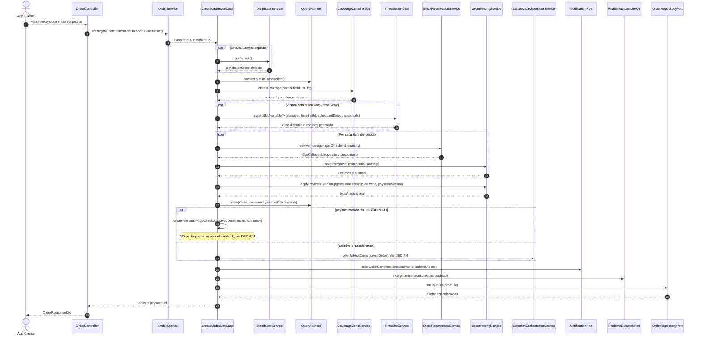

### C.2 — DSD 4.2 (reemplaza el bloque ASCII de `3-Diseño.md:635-646`)

```mermaid
sequenceDiagram
    autonumber
    participant ORQ as DispatchOrchestratorService
    participant OFF as DispatchOfferRepositoryPort
    participant RT as RealtimeDispatchPort
    participant REDIS as RedisService
    participant DEL as RepositoryDelivery
    participant DGW as DriversGateway

    ORQ->>OFF: findOfferedDriverIds(order.order_id)
    OFF-->>ORQ: choferes ya contactados
    loop findNearestAvailable, radiusKm en 5, 10, 15, 20
        ORQ->>RT: findNearbyDrivers(lat, lng, radiusKm)
        RT->>REDIS: getNearbyDrivers(lat, lng, radiusKm)
        REDIS-->>RT: GEORADIUS sobre drivers:locations, orden ASC
        RT-->>ORQ: driverIds por cercania
        ORQ->>DEL: find(user_id In driverIds, distributor_id)
        DEL-->>ORQ: choferes de la misma distribuidora
    end
    alt Hay un candidato aun no contactado
        ORQ->>OFF: create(orderId, candidate, expiresAt, distributorId)
        OFF-->>ORQ: DispatchOffer en estado OFFERED
        ORQ->>RT: notifyDriverNewOrder(candidate, payload NEW_ORDER)
        RT->>DGW: notifyNewOrder(candidate, payload)
        DGW-->>ORQ: emit server:new-order-request en la room del chofer
    else Sin candidatos nuevos en ningun radio
        ORQ->>ORQ: logger.debug y devuelve null
    end
```

> La oferta es **secuencial a un solo chofer por vez**, no un broadcast: ver `dispatch-orchestrator.service.ts:16` y `:46-92`.

### C.3 — DSD 4.3 (reemplaza el bloque ASCII de `3-Diseño.md:650-661`)

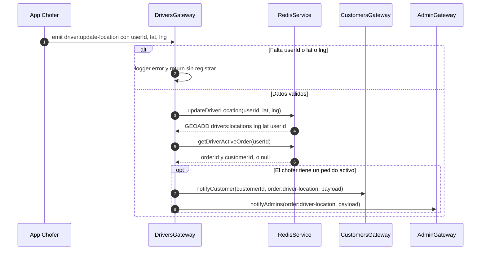

### C.4 — DSS CU-001 (reemplaza `2-Analisis.md:365-382`)

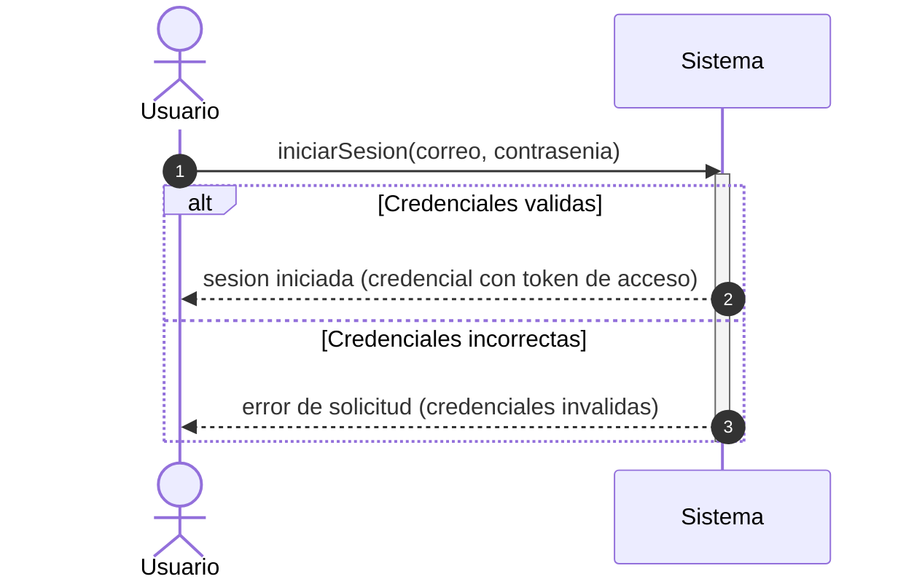

> **Limitación conocida:** el sistema **no** verifica en el inicio de sesión si el chofer fue habilitado por el administrador ni devuelve el rol junto con la sesión; la habilitación (`validado`) solo se usa más tarde, al listar choferes.

### C.5 — DSS CU-008 (reemplaza `2-Analisis.md:942-967`)

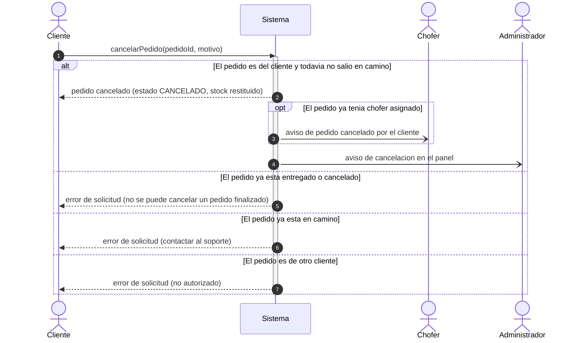

### C.6 — DSS CU-009 (reemplaza `2-Analisis.md:975-992`)

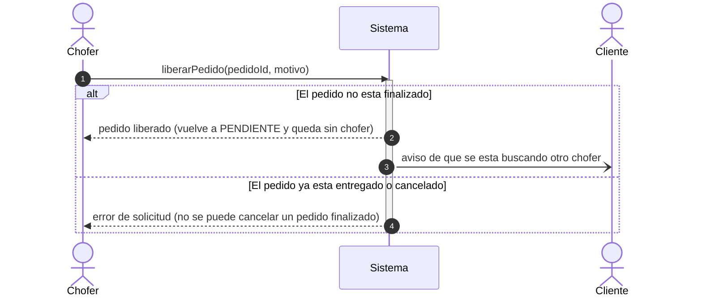

> Cuando el actor es el **chofer**, la operación **no cancela** el pedido ni restituye stock: lo devuelve al pool de pedidos pendientes para que se re-ofrezca. **El sistema no verifica que el pedido estuviera asignado a ese chofer** (limitación conocida).

### C.7 — DSS CU-015 (reemplaza `2-Analisis.md:473-490`)

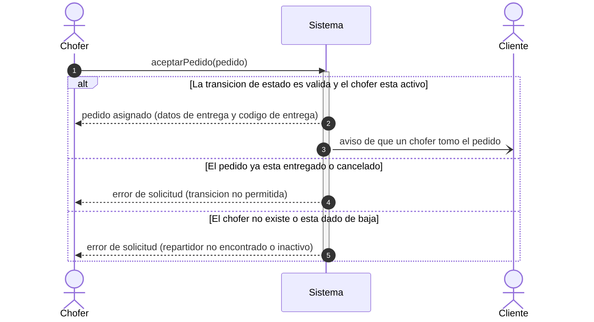

> **Limitación conocida:** el sistema **no** exige que el chofer tenga la oferta vigente para aceptar, y un pedido ya aceptado puede ser reasignado por otro chofer que envíe la misma operación.

### C.8 — DSS CU-016 (reemplaza `2-Analisis.md:1167-1183`)

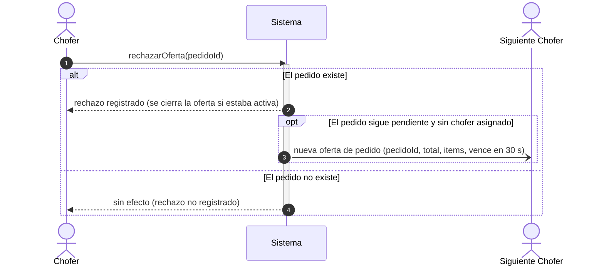

### C.9 — DSS CU-017 (reemplaza `2-Analisis.md:502-515`)

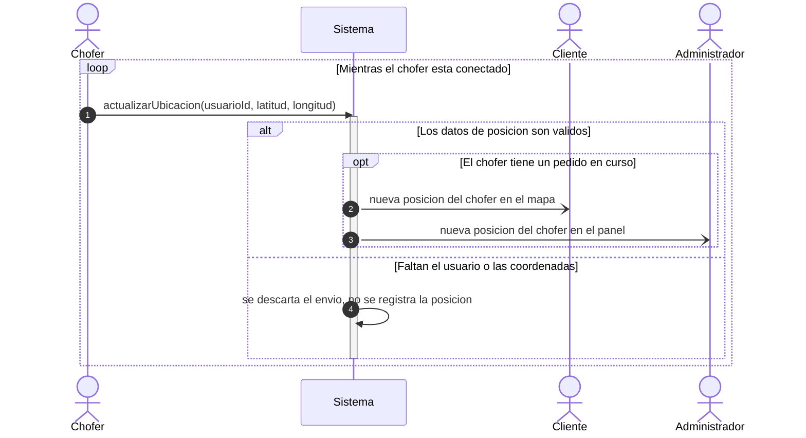

> La operación **no devuelve acuse** al chofer: es un envío de una sola vía por el canal de tiempo real.

### C.10 — DSS CU-048 (reemplaza `2-Analisis.md:2528-2551`)

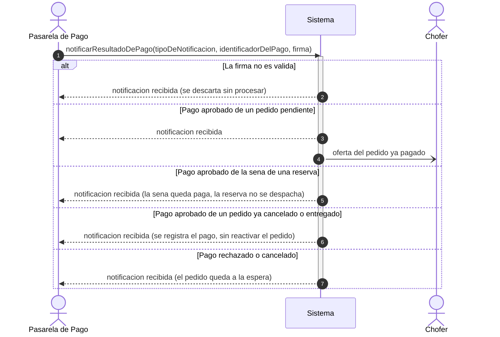

> El sistema **no envía ningún aviso al cliente** al acreditarse el pago: el único mensaje saliente es la oferta al chofer.

### C.11 — DSS CU-091 (reemplaza `2-Analisis.md:868-882`)

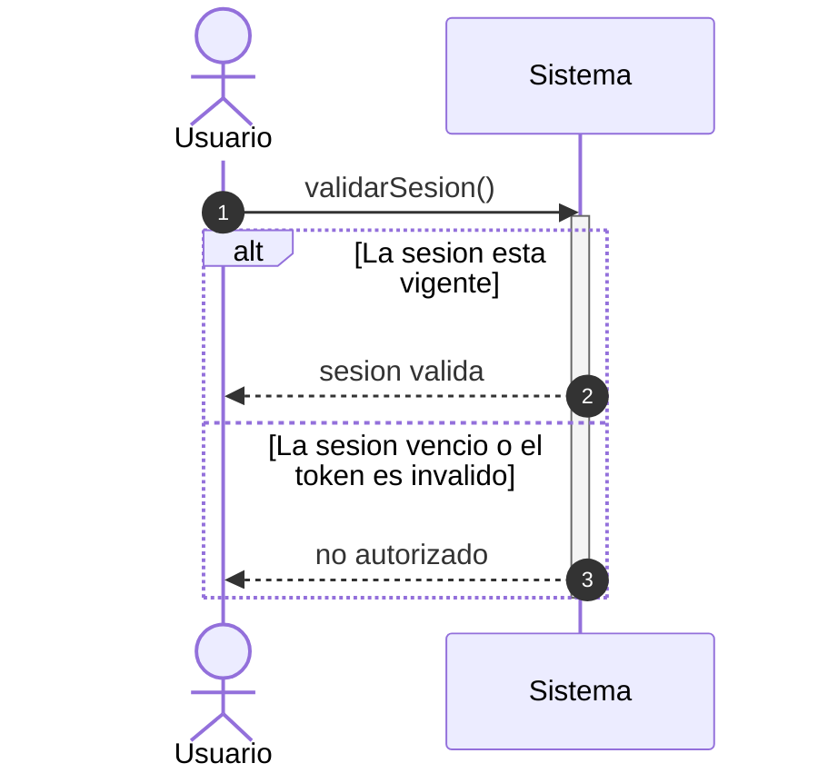

### C.12 — DSS CU-104 (reemplaza `2-Analisis.md:3100-3128`)

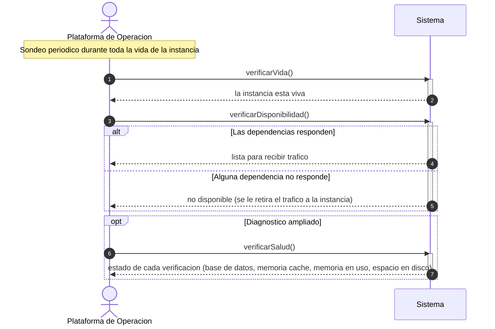

### C.13 — Correcciones de actor (solo cambia la línea `**Actor:**`)

| DSS | Línea a reemplazar | Texto corregido |
|---|---|---|
| CU-102 (`2-Analisis.md:3070`) | `**Actor:** Administrador (verificación operativa)` | `**Actor:** Operador del sistema (la operación **no** exige sesión ni rol: el punto de entrada es público — limitación conocida)` |
| CU-083 (`2-Analisis.md:784`) | `**Actor:** Administrador` | `**Actor:** Administrador (el listado). Las búsquedas puntuales por correo y por teléfono son **públicas**: no exigen sesión` |
| CU-086 (`2-Analisis.md:2729`) | `**Actor:** Administrador (y Super Administrador)` | **Actor:** Administrador y Super Administrador para *registrarAdministrador()*; **solo Super Administrador** para *crearAdministradorSobreUsuarioExistente()* |
| CU-069 (`2-Analisis.md:2443`) | `**Actor:** Administrador` | `**Actor:** Administrador (el Chofer también puede consultar un envase puntual)` |

---

## Resumen de acciones recomendadas

1. **Prioridad 1 (defienden mal la tesis si se leen contra el código):** reemplazar los DSD 4.1 y 4.2 — describen una arquitectura que el proyecto ya abandonó (métodos inexistentes + broadcast en vez de negociación secuencial, contradiciendo al propio módulo M1 del §6.1).
2. **Prioridad 2:** corregir los tres caminos alternativos inventados en DSS CU-001, CU-015 y CU-009. Los tres describen controles de seguridad/negocio que el código **no tiene**; documentarlos como limitaciones conocidas es preferible a presentarlos como funcionalidad.
3. **Prioridad 3:** el resto de las correcciones de la sección C, todas de bajo esfuerzo.
4. **Fuera del alcance de esta auditoría pero detectado al verificar:** los hallazgos B.3 #2 (un pedido aceptado puede ser reasignado por otro chofer), B.3 #3 (el chofer puede liberar un pedido que no es suyo) y B.2 CU-102/CU-083 (endpoints públicos que exponen datos y disparan envíos) son defectos del **código**, no de los diagramas.
