# Casos de Uso del Sistema

**Proyecto:** SPLG — Sistema de Pedidos y Logística de Garrafas de Gas
**Metodología:** Proceso Unificado (UP)
**Versión:** 2.0
**Fecha:** 2026-08-30

---

## Contenido

Este documento reúne los cuatro artefactos de casos de uso que exige la cátedra:

1. **Actores del sistema** — quiénes interactúan con él.
2. **Diagrama de casos de uso** — los límites del sistema.
3. **Catálogo y calificación** — la lista completa con su importancia relativa.
4. **Casos de uso de alto nivel** — la descripción breve de cada uno.
5. **Casos de uso expandidos** — la especificación completa: precondición, secuencia
   normal, postcondición, excepciones, rendimiento, frecuencia y estabilidad.
6. **Diagramas de secuencia del sistema** — el comportamiento como caja negra.

Los casos **CU-001 a CU-051** provienen del relevamiento inicial. Los casos **CU-052 a
CU-104** se incorporaron al contrastar la documentación contra el sistema construido:
describen comportamientos que el sistema ya ejecuta y que el relevamiento no había
registrado.

### Convención de prioridad

| Símbolo | Calificación | Significado |
|:---:|---|---|
| 🔴 | Crítico | El sistema no puede operar sin este caso de uso. |
| 🟡 | Importante | Aporta valor significativo; forma parte del producto mínimo viable. |
| 🟢 | Secundario | Deseable, pero no bloquea la operación. |
| 🤖 | — | El caso lo ejecuta el sistema por iniciativa propia, sin actor humano. |

---

## 1. Actores del Sistema

| Código | Actor | Tipo | Descripción |
|--------|-------|:----:|-------------|
| ACT-01 | Cliente | Humano | Usuario final que realiza pedidos de garrafas mediante la App Cliente (Flutter). |
| ACT-02 | Chofer | Humano | Repartidor que gestiona entregas mediante la App Chofer (Flutter). |
| ACT-03 | Administrador | Humano | Operador del distribuidor que accede al Panel Web (React/Vite). |
| ACT-04 | Sistema Automático | Automático | Procesos que el backend ejecuta por iniciativa propia, sin que ningún usuario los solicite. Comprende cuatro procesos temporales: la revisión de ofertas de despacho vencidas (cada 15 segundos), la activación de reservas programadas (cada 5 minutos), la expiración de pedidos de MercadoPago impagos (cada 30 minutos) y la expiración de reservas sin seña (cada hora). |
| ACT-05 | Administrador General | Humano | Operador de la plataforma, con alcance sobre todas las distribuidoras. Da de alta las empresas comercializadoras y designa a sus administradores. Es el único actor cuyo alcance no está limitado a una distribuidora. |

---

## 2. Diagrama de Casos de Uso del Sistema

El sistema comprende 104 casos de uso agrupados en 18 subsistemas. Un único diagrama con
todos ellos resulta ilegible, de modo que se presenta primero el **diagrama de contexto**
—actores contra subsistemas, que delimita el sistema— y luego, en el catálogo de la
sección 3, la pertenencia de cada caso a su subsistema.

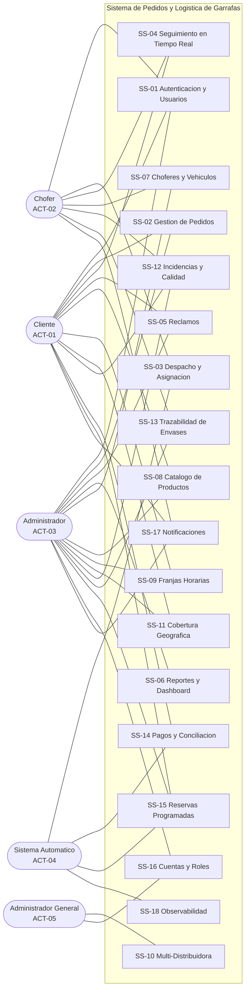

> **Para llevarlo a draw.io o Lucidchart.** En draw.io: *Extras → Editar diagrama* y pegar
> el bloque. En Lucidchart: *Importar datos → Mermaid*. Para el diagrama UML clásico
> —con óvalos dentro del rectángulo del sistema— la guía paso a paso está en
> `GUIA-diagramas-cu-plantuml.md`.

---

## 3. Catálogo y Calificación de los Casos de Uso

| Caso de Uso | Subsistema | Actor Principal | Calificación |
|-------------|------------|-----------------|:------------:|
| CU-001 Iniciar Sesión | SS-01 | ACT-01, ACT-02, ACT-03 | Crítico |
| CU-002 Registrarse como Cliente | SS-01 | ACT-01 | Crítico |
| CU-003 Registrar Chofer | SS-01 | ACT-03 | Crítico |
| CU-004 Gestionar Perfil de Usuario | SS-01 | ACT-01, ACT-02 | Importante |
| CU-005 Crear Pedido | SS-02 | ACT-01 | Crítico |
| CU-006 Consultar Detalle de Pedido | SS-02 | ACT-01, ACT-02, ACT-03 | Crítico |
| CU-007 Consultar Historial de Pedidos | SS-02 | ACT-01 | Importante |
| CU-008 Cancelar Pedido (Cliente) | SS-02 | ACT-01 | Importante |
| CU-009 Cancelar Pedido (Chofer) | SS-02 | ACT-02 | Importante |
| CU-010 Cancelar Pedido (Administrador) | SS-02 | ACT-03 | Importante |
| CU-011 Listar Todos los Pedidos | SS-02 | ACT-03 | Importante |
| CU-012 Asignar Chofer Manualmente | SS-03 | ACT-03 | Secundario |
| CU-013 Asignar Pedido Automáticamente por Proximidad | SS-03 | ACT-04 | Crítico |
| CU-014 Reintentar Asignación con Radio Expandido (Cron) | SS-03 | ACT-04 | Crítico |
| CU-015 Aceptar Pedido | SS-03 | ACT-02 | Crítico |
| CU-016 Rechazar / Ignorar Pedido | SS-03 | ACT-02 | Importante |
| CU-017 Actualizar Ubicación GPS del Chofer | SS-04 | ACT-02 | Crítico |
| CU-018 Marcar Pedido "En Camino" | SS-04 | ACT-02 | Crítico |
| CU-019 Avisar Llegada al Cliente | SS-04 | ACT-02 | Importante |
| CU-020 Confirmar Entrega | SS-04 | ACT-02 | Crítico |
| CU-021 Recibir Notificaciones en Tiempo Real | SS-04 | ACT-01 | Crítico |
| CU-022 Activar / Desactivar Disponibilidad | SS-04 | ACT-02 | Crítico |
| CU-023 Registrar Reclamo | SS-05 | ACT-01 | Importante |
| CU-024 Listar Reclamos | SS-05 | ACT-03 | Importante |
| CU-025 Resolver Reclamo | SS-05 | ACT-03 | Importante |
| CU-026 Ver Dashboard General | SS-06 | ACT-03 | Importante |
| CU-027 Ver Reporte de Ventas por Chofer | SS-06 | ACT-03 | Importante |
| CU-028 Ver Reporte de Ventas por Producto | SS-06 | ACT-03 | Importante |
| CU-029 Ver Reporte por Método de Pago | SS-06 | ACT-03 | Secundario |
| CU-030 Ver Gráfico de Ventas (últimos 7 días) | SS-06 | ACT-03 | Secundario |
| CU-031 Registrar Chofer | SS-07 | ACT-03 | Crítico |
| CU-032 Validar / Invalidar Chofer | SS-07 | ACT-03 | Crítico |
| CU-033 Activar / Desactivar Chofer (Admin) | SS-07 | ACT-03 | Importante |
| CU-034 Registrar Vehículo del Chofer | SS-07 | ACT-03 | Importante |
| CU-035 Consultar Listado de Choferes | SS-07 | ACT-03 | Importante |
| CU-036 Crear Producto (Garrafa) | SS-08 | ACT-03 | Crítico |
| CU-037 Actualizar Precio de Producto | SS-08 | ACT-03 | Crítico |
| CU-038 Actualizar Stock de Producto | SS-08 | ACT-03 | Crítico |
| CU-039 Configurar Promociones por Cantidad | SS-08 | ACT-03 | Importante |
| CU-040 Activar / Desactivar Producto | SS-08 | ACT-03 | Importante |
| CU-041 Consultar Catálogo de Productos | SS-08 | ACT-01, ACT-03 | Crítico |
| CU-042 Crear Franja Horaria | SS-09 | ACT-03 | Importante |
| CU-043 Modificar Capacidad de Franja Horaria | SS-09 | ACT-03 | Importante |
| CU-044 Seleccionar Franja Horaria al Crear Pedido | SS-09 | ACT-01 | Importante |
| CU-045 Consultar Franjas Horarias Disponibles | SS-09 | ACT-01 | Importante |
| CU-046 Gestionar Direcciones de Entrega | SS-02 | ACT-01 | Importante |
| CU-047 Recuperar Contraseña | SS-01 | ACT-01, ACT-02, ACT-03 | Importante |
| CU-048 Procesar Pago con MercadoPago | SS-14 | ACT-04 | Crítico |
| CU-049 Consultar Balance / Ganancias del Chofer | SS-07 | ACT-02, ACT-03 | Importante |
| CU-050 Bloquear / Desbloquear Usuario | SS-01 | ACT-03 | Secundario |
| CU-051 Gestionar Vehículos (editar / eliminar / consultar) | SS-07 | ACT-03 | Importante |
| CU-052 Registrar Distribuidora | SS-10 | ACT-05 | Crítico |
| CU-053 Consultar Distribuidoras | SS-10 | ACT-05 | Crítico |
| CU-054 Modificar Datos de la Distribuidora | SS-10 | ACT-05 | Crítico |
| CU-055 Dar de Baja una Distribuidora | SS-10 | ACT-05 | Importante |
| CU-056 Definir Zona de Cobertura | SS-11 | ACT-03, ACT-05 | Importante |
| CU-057 Consultar Zonas de Cobertura | SS-11 | ACT-03, ACT-05 | Secundario |
| CU-058 Validar Cobertura de una Dirección | SS-11 | ACT-01, ACT-03, ACT-05 | Crítico |
| CU-059 Eliminar Zona de Cobertura | SS-11 | ACT-03, ACT-05 | Secundario |
| CU-060 Registrar Incidencia de Entrega | SS-12 | ACT-02, ACT-03, ACT-05 | Crítico |
| CU-061 Listar Incidencias | SS-12 | ACT-03, ACT-05 | Importante |
| CU-062 Consultar Incidencias de un Pedido | SS-12 | ACT-02, ACT-03, ACT-05 | Secundario |
| CU-063 Resolver Incidencia | SS-12 | ACT-03, ACT-05 | Importante |
| CU-064 Calificar Pedido (cliente↔chofer) | SS-12 | ACT-01, ACT-02 | Crítico |
| CU-065 Consultar Promedio de Calificaciones de un Usuario | SS-12 | ACT-01, ACT-02, ACT-03, ACT-05 | Secundario |
| CU-066 Consultar Historial de Calificaciones Recibidas | SS-12 | ACT-03, ACT-05 | Secundario |
| CU-067 Dar de Alta un Envase Físico | SS-13 | ACT-03, ACT-05 | Importante |
| CU-068 Asignar Envases a un Pedido | SS-13 | ACT-02, ACT-03, ACT-05 | Crítico |
| CU-069 Consultar el Parque de Envases | SS-13 | ACT-03, ACT-05 | Importante |
| CU-070 Registrar Movimiento de Envase (cambio de estado) | SS-13 | ACT-02, ACT-03, ACT-05 | Crítico |
| CU-071 Consultar Historial de Movimientos de un Envase | SS-13 | ACT-03, ACT-05 | Importante |
| CU-072 Crear Reserva Programada con Seña | SS-15 | ACT-01, ACT-02, ACT-03 | Crítico |
| CU-073 Listar Reservas y Estado de la Seña | SS-15 | ACT-03, ACT-05 | Importante |
| CU-074 Confirmar Seña Cobrada en Efectivo | SS-15 | ACT-03, ACT-05 | Crítico |
| CU-075 Activar Reservas Vencidas Automaticamente (Cron) | SS-15 | ACT-04 | Crítico |
| CU-076 Expirar Reservas sin Seña Pagada (Cron) | SS-15 | ACT-04 | Importante |
| CU-077 Expirar Pedidos de MercadoPago sin Pagar (Cron) | SS-15 | ACT-04 | Importante |
| CU-078 Obtener el Código de Entrega (QR del chofer) | SS-04 | ACT-02, ACT-03, ACT-05 | Crítico |
| CU-079 Confirmar Entrega Escaneando el QR (cliente) | SS-04 | ACT-01, ACT-03, ACT-05 | Crítico |
| CU-080 Consultar el Pool de Pedidos Disponibles | SS-02 | ACT-02, ACT-03, ACT-05 | Crítico |
| CU-081 Consultar los Pedidos Asignados al Chofer | SS-02 | ACT-02, ACT-03, ACT-05 | Crítico |
| CU-082 Crear Usuario Base | SS-01 | ACT-01, ACT-02, ACT-03, ACT-04 | Importante |
| CU-083 Buscar / Listar Usuarios | SS-01 | ACT-03 | Importante |
| CU-084 Verificar Existencia de Usuario (pre-registro) | SS-01 | ACT-01, ACT-02, ACT-03, ACT-04 | Importante |
| CU-085 Eliminar Usuario (baja lógica) | SS-01 | ACT-03 | Importante |
| CU-086 Registrar Administrador | SS-16 | ACT-03 | Importante |
| CU-087 Crear el Primer Super Administrador (bootstrap) | SS-16 | ACT-01, ACT-02, ACT-03, ACT-04 | Importante |
| CU-088 Consultar Administradores | SS-16 | ACT-03 | Secundario |
| CU-089 Gestionar Roles del Sistema | SS-16 | ACT-05 | Importante |
| CU-090 Sembrar los Roles Iniciales | SS-16 | ACT-05 | Importante |
| CU-091 Validar Vigencia del Token de Sesión | SS-01 | ACT-01, ACT-02, ACT-03, ACT-05 | Secundario |
| CU-092 Consultar Listado de Clientes | SS-16 | ACT-03 | Importante |
| CU-093 Validar / Invalidar Cliente | SS-16 | ACT-03 | Importante |
| CU-094 Actualizar Ubicación del Cliente | SS-16 | ACT-03 | Secundario |
| CU-095 Eliminar Cliente (baja lógica) | SS-16 | ACT-03 | Importante |
| CU-096 Actualizar Perfil del Chofer | SS-07 | ACT-03 | Importante |
| CU-097 Eliminar Chofer (baja lógica) | SS-07 | ACT-03 | Importante |
| CU-098 Registrar el Token de Notificaciones del Dispositivo | SS-17 | ACT-01, ACT-02, ACT-03, ACT-05 | Crítico |
| CU-099 Consultar los Tokens de un Usuario | SS-17 | ACT-03, ACT-05 | Secundario |
| CU-100 Enviar Notificación de Prueba | SS-17 | ACT-03, ACT-05 | Secundario |
| CU-101 Reenviar Notificación de Confirmación de Pedido | SS-17 | ACT-03, ACT-05 | Secundario |
| CU-102 Probar el Servicio de Correo | SS-17 |  | Secundario |
| CU-103 Eliminar Franja Horaria | SS-09 | ACT-03, ACT-05 | Importante |
| CU-104 Verificar la Salud del Sistema (liveness / readiness) | SS-18 |  | Importante |
| CU-105 Planificar el mantenimiento y las habilitaciones de la flota | SS-07 | ACT-04, ACT-03 | Importante |
| CU-106 Anticipar la recompra por consumo estimado | SS-02 | ACT-04, ACT-03 | Importante |
| CU-107 Agrupar pedidos por recorrido | SS-03 | ACT-04, ACT-03 | Importante |
| CU-108 Recuperar envases no devueltos | SS-13 | ACT-04, ACT-03 | Importante |

### Resumen

| Calificación | Cantidad | CU |
|:------------:|:--------:|-----|
| **Crítico** | 36 | CU-001, CU-002, CU-003, CU-005, CU-006, CU-013, CU-014, CU-015, CU-017, CU-018, CU-020, CU-021, CU-022, CU-031, CU-032, CU-036, CU-037, CU-038, CU-041, CU-048, CU-052, CU-053, CU-054, CU-058, CU-060, CU-064, CU-068, CU-070, CU-072, CU-074, CU-075, CU-078, CU-079, CU-080, CU-081, CU-098 |
| **Importante** | 52 | CU-004, CU-007, CU-008, CU-009, CU-010, CU-011, CU-016, CU-019, CU-023, CU-024, CU-025, CU-026, CU-027, CU-028, CU-033, CU-034, CU-035, CU-039, CU-040, CU-042, CU-043, CU-044, CU-045, CU-046, CU-047, CU-049, CU-051, CU-055, CU-056, CU-061, CU-063, CU-067, CU-069, CU-071, CU-073, CU-076, CU-077, CU-082, CU-083, CU-084, CU-085, CU-086, CU-087, CU-089, CU-090, CU-092, CU-093, CU-095, CU-096, CU-097, CU-103, CU-104 |
| **Secundario** | 16 | CU-012, CU-029, CU-030, CU-050, CU-057, CU-059, CU-062, CU-065, CU-066, CU-088, CU-091, CU-094, CU-099, CU-100, CU-101, CU-102 |
| **Total** | **104** | CU-001 a CU-104 |

---

## 4. Casos de Uso de Alto Nivel


### SS-01 — Autenticación y Usuarios


**Código:** CU-001 | **Caso de Uso:** Iniciar Sesión  
**Actor/es:** Cliente (ACT-01), Chofer (ACT-02), Administrador (ACT-03)  
**Subsistema:** SS-01 Autenticación y Usuarios  
**Calificación:** Crítico  
**Descripción:** El usuario ingresa sus credenciales (email y contraseña) en la app correspondiente. El sistema verifica la identidad contra Firebase Auth y devuelve el token de identidad que Firebase emite, sin generar credencial propia. El rol del usuario no viaja en el token: se resuelve contra la base en cada solicitud. La habilitación del chofer todavía no se consulta en el ingreso.

---


**Código:** CU-002 | **Caso de Uso:** Registrarse como Cliente  
**Actor/es:** Cliente (ACT-01)  
**Subsistema:** SS-01 Autenticación y Usuarios  
**Calificación:** Crítico  
**Descripción:** Un nuevo usuario descarga la App Cliente y completa el formulario de registro con nombre completo, email, teléfono y contraseña. El sistema crea la cuenta en Firebase Auth y registra el perfil en la base de datos con rol cliente. El registro no deja al usuario con la sesión abierta: para empezar a operar tiene que iniciar sesión a continuación (CU-001).

---


**Código:** CU-003 | **Caso de Uso:** Registrar Chofer  
**Actor/es:** Administrador (ACT-03)  
**Subsistema:** SS-01 Autenticación y Usuarios  
**Calificación:** Crítico  
**Descripción:** El administrador crea un nuevo usuario chofer desde el panel web, ingresando sus datos personales y de contacto y una contraseña temporal. La cuenta queda a la espera de que el administrador la marque como validada (CU-032), aunque esa marca no condiciona por sí sola que el chofer pueda operar: el control real sobre si puede recibir pedidos es su estado de actividad (CU-033). Es el mismo alta que CU-031, documentada acá desde el flujo de autenticación.

---


**Código:** CU-004 | **Caso de Uso:** Gestionar Perfil de Usuario  
**Actor/es:** Cliente (ACT-01), Chofer (ACT-02)  
**Subsistema:** SS-01 Autenticación y Usuarios  
**Calificación:** Importante  
**Descripción:** El usuario actualiza su información personal desde la app: nombre completo y número de teléfono. Los cambios se persisten en la base de datos y se reflejan inmediatamente en las apps y en el panel del administrador.

---


### SS-02 — Gestión de Pedidos


**Código:** CU-005 | **Caso de Uso:** Crear Pedido  
**Actor/es:** Cliente (ACT-01)  
**Subsistema:** SS-02 Gestión de Pedidos  
**Calificación:** Crítico  
**Descripción:** El cliente selecciona uno o más productos del catálogo, la cantidad, una dirección de entrega y, opcionalmente, una fecha y franja horaria de entrega; también elige el método de pago (efectivo, MercadoPago o transferencia con recargo). El sistema comprueba que la dirección esté dentro de la zona de cobertura, reserva el stock y, si corresponde, el cupo de la franja de forma atómica, calcula el total con promociones y recargos, y registra el pedido. Salvo que el pago sea por MercadoPago o que el pedido sea una reserva a futuro, el sistema abre de inmediato la oferta al chofer más cercano disponible (CU-013).

---


**Código:** CU-006 | **Caso de Uso:** Consultar Detalle de Pedido  
**Actor/es:** Cliente (ACT-01), Chofer (ACT-02), Administrador (ACT-03)  
**Subsistema:** SS-02 Gestión de Pedidos  
**Calificación:** Crítico  
**Descripción:** El usuario accede al detalle completo de un pedido específico: ítems y cantidades, precios, descuentos aplicados, estado actual, datos del chofer asignado, dirección de entrega, franja horaria, método de pago y timestamps de cada cambio de estado (creado, aceptado, en camino, entregado/cancelado).

---


**Código:** CU-007 | **Caso de Uso:** Consultar Historial de Pedidos  
**Actor/es:** Cliente (ACT-01)  
**Subsistema:** SS-02 Gestión de Pedidos  
**Calificación:** Importante  
**Descripción:** El cliente accede al listado completo de sus pedidos anteriores, sin filtro por estado ni por fecha: la consulta trae siempre la totalidad del historial. Cada ítem del listado muestra el resumen del pedido (fecha, total, estado) con acceso al detalle completo.

---


**Código:** CU-008 | **Caso de Uso:** Cancelar Pedido (Cliente)  
**Actor/es:** Cliente (ACT-01)  
**Subsistema:** SS-02 Gestión de Pedidos  
**Calificación:** Importante  
**Descripción:** El cliente cancela un pedido propio que todavía no fue despachado (estado pendiente, reservado o aceptado). El sistema valida que sea posible cancelar, cambia el estado a cancelado, restituye el stock de cada ítem al inventario y avisa en tiempo real al chofer asignado, si lo había.

---


**Código:** CU-009 | **Caso de Uso:** Cancelar Pedido (Chofer)  
**Actor/es:** Chofer (ACT-02)  
**Subsistema:** SS-02 Gestión de Pedidos  
**Calificación:** Importante  
**Descripción:** El chofer que ya aceptó un pedido decide no poder realizarlo. El sistema cambia el estado del pedido de ACCEPTED de vuelta a PENDING (no cancela definitivamente) para que otro chofer pueda aceptarlo. El stock no se restituye porque el pedido sigue activo.

---


**Código:** CU-010 | **Caso de Uso:** Cancelar Pedido (Administrador)  
**Actor/es:** Administrador (ACT-03)  
**Subsistema:** SS-02 Gestión de Pedidos  
**Calificación:** Importante  
**Descripción:** El administrador puede cancelar cualquier pedido activo (en cualquier estado previo a DELIVERED) desde el panel web, indicando obligatoriamente un motivo. El sistema marca el pedido como CANCELLED, restituye el stock y notifica tanto al cliente como al chofer asignado.

---


**Código:** CU-011 | **Caso de Uso:** Listar Todos los Pedidos  
**Actor/es:** Administrador (ACT-03)  
**Subsistema:** SS-02 Gestión de Pedidos  
**Calificación:** Importante  
**Descripción:** El administrador visualiza en el panel web todos los pedidos del sistema, ordenados del más reciente al más antiguo, con paginación. El filtrado por estado, por fecha o por chofer asignado no es un parámetro de la consulta al servidor: si hace falta acotar el listado, eso se resuelve del lado del panel sobre la página ya traída. Cada registro muestra el resumen del pedido con acceso al detalle.

---


### SS-03 — Despacho y Asignación


**Código:** CU-012 | **Caso de Uso:** Asignar Chofer Manualmente  
**Actor/es:** Administrador (ACT-03)  
**Subsistema:** SS-03 Despacho y Asignación  
**Calificación:** Secundario  
**Descripción:** Cuando el despacho automático agota los candidatos disponibles y el pedido queda pendiente sin que ningún chofer lo tome, el administrador puede intervenir desde el panel web y asignar manualmente un chofer activo al pedido.

---


**Código:** CU-013 | **Caso de Uso:** Asignar Pedido Automáticamente por Proximidad  
**Actor/es:** Sistema (ACT-04)  
**Subsistema:** SS-03 Despacho y Asignación  
**Calificación:** Crítico  
**Descripción:** Al crearse un pedido, el sistema no lo ofrece a todos los choferes cercanos a la vez: abre una negociación secuencial, ofreciéndoselo a un solo chofer por vez —el más cercano al domicilio de entrega entre los que todavía no fueron contactados— con una ventana acotada para aceptar. Si acepta, el pedido queda asignado a él (CU-015); si no responde a tiempo o lo rechaza, la oferta pasa al siguiente candidato. La elegibilidad de un chofer depende de que esté presente en el radar de posiciones (con su disponibilidad encendida y su ubicación emitida) y de que pertenezca a la distribuidora del pedido; la habilitación que le otorga el administrador no interviene en esta selección.

---


**Código:** CU-014 | **Caso de Uso:** Reintentar Asignación con Radio Expandido (Cron)  
**Actor/es:** Sistema (ACT-04)  
**Subsistema:** SS-03 Despacho y Asignación  
**Calificación:** Crítico  
**Descripción:** Un proceso automático que corre cada minuto revisa las ofertas de pedido cuya ventana de aceptación venció: las cierra y, si el pedido sigue sin chofer, abre la oferta para el siguiente candidato disponible. El mismo proceso vuelve a poner en circulación los pedidos que quedaron sin ninguna oferta activa, por ejemplo porque al crearse no había ningún chofer cerca o porque el chofer que lo tenía lo liberó. Si se agotan los candidatos, el pedido no pasa a ningún estado especial ni genera una alerta automática: permanece pendiente hasta que el administrador lo asigne a mano (CU-012) o aparezca un chofer disponible.

---


**Código:** CU-015 | **Caso de Uso:** Aceptar Pedido  
**Actor/es:** Chofer (ACT-02)  
**Subsistema:** SS-03 Despacho y Asignación  
**Calificación:** Crítico  
**Descripción:** El chofer recibe la oferta de un pedido y decide aceptarla. El sistema se la asigna, genera el código secreto de entrega, registra el timestamp de aceptación y avisa al cliente en tiempo real y por notificación push, con el mismo texto genérico de confirmación de pedido que usan el resto de los avisos del ciclo.

---


**Código:** CU-016 | **Caso de Uso:** Rechazar / Ignorar Pedido  
**Actor/es:** Chofer (ACT-02)  
**Subsistema:** SS-03 Despacho y Asignación  
**Calificación:** Importante  
**Descripción:** El chofer que recibió la oferta de un pedido decide no tomarlo, ya sea rechazándolo explícitamente o dejando vencer la ventana de aceptación. El sistema cierra esa oferta y la ofrece al siguiente chofer más cercano que todavía no haya sido contactado. El rechazo no afecta el estado del pedido ni el stock.

---


### SS-04 — Seguimiento en Tiempo Real


**Código:** CU-017 | **Caso de Uso:** Actualizar Ubicación GPS del Chofer  
**Actor/es:** Chofer (ACT-02)  
**Subsistema:** SS-04 Seguimiento en Tiempo Real  
**Calificación:** Crítico  
**Descripción:** La App Chofer envía periódicamente (cada vez que el GPS detecta un desplazamiento de 10 metros) la posición geográfica al servidor por WebSocket (evento `driver:update-location`). El sistema ejecuta GEOADD en Redis, manteniendo la ubicación disponible tanto para el algoritmo de asignación (CU-013) como para el mapa en tiempo real de la App Cliente.

---


**Código:** CU-018 | **Caso de Uso:** Marcar Pedido "En Camino"  
**Actor/es:** Chofer (ACT-02)  
**Subsistema:** SS-04 Seguimiento en Tiempo Real  
**Calificación:** Crítico  
**Descripción:** El chofer indica que salió hacia el domicilio del cliente. El sistema pasa el pedido a estado en camino, registra el timestamp del cambio, avisa al cliente en tiempo real y abre el seguimiento en vivo de su posición. La notificación push que recibe el cliente usa el mismo texto genérico de confirmación de pedido, no un mensaje propio de este estado.

---


**Código:** CU-019 | **Caso de Uso:** Avisar Llegada al Cliente  
**Actor/es:** Chofer (ACT-02)  
**Subsistema:** SS-04 Seguimiento en Tiempo Real  
**Calificación:** Importante  
**Descripción:** El chofer avisa, antes de confirmar la entrega, que llegó al domicilio del cliente, para que este esté preparado a recibirlo. El aviso viaja solo por la conexión en tiempo real: no genera notificación push ni queda registrado como un estado ni un timestamp del pedido, de modo que si el cliente tiene la app cerrada no llega a enterarse.

---


**Código:** CU-020 | **Caso de Uso:** Confirmar Entrega  
**Actor/es:** Chofer (ACT-02)  
**Subsistema:** SS-04 Seguimiento en Tiempo Real  
**Calificación:** Crítico  
**Descripción:** El chofer entrega el producto y marca el pedido como entregado. El sistema cierra el ciclo del pedido, registra el timestamp de entrega, da por cobrado el pago si el método era efectivo y avisa al cliente en tiempo real y por notificación push, con el mismo texto genérico de confirmación de pedido y no uno de agradecimiento. Existe además una vía alternativa en la que es el propio cliente quien confirma la entrega escaneando el código que le muestra el chofer.

---


**Código:** CU-021 | **Caso de Uso:** Recibir Notificaciones en Tiempo Real  
**Actor/es:** Cliente (ACT-01)  
**Subsistema:** SS-04 Seguimiento en Tiempo Real  
**Calificación:** Crítico  
**Descripción:** El cliente recibe avisos automáticos ante los principales cambios de estado de su pedido: creación, asignación de chofer, salida hacia el domicilio y entrega. El sistema emite siempre los dos canales a la vez —aviso en tiempo real y notificación push al dispositivo—, sin elegir uno según si la app está abierta o cerrada; el aviso de llegada del repartidor y el de cancelación no generan notificación push, y el texto de la notificación push es el mismo para todos los estados que sí la tienen.

---


**Código:** CU-022 | **Caso de Uso:** Activar / Desactivar Disponibilidad (Chofer)  
**Actor/es:** Chofer (ACT-02)  
**Subsistema:** SS-04 Seguimiento en Tiempo Real  
**Calificación:** Crítico  
**Descripción:** El chofer activa o desactiva su disponibilidad para recibir pedidos mediante un interruptor en la app. Al desactivarse, el sistema lo retira del radar geográfico que usa el despacho para elegir candidatos. Al activarse, en cambio, no se lo reinserta de inmediato: recién vuelve a aparecer en el radar cuando su app emite una nueva posición.

---


### SS-05 — Reclamos


**Código:** CU-023 | **Caso de Uso:** Registrar Reclamo  
**Actor/es:** Cliente (ACT-01)  
**Subsistema:** SS-05 Reclamos  
**Calificación:** Importante  
**Descripción:** El cliente registra un reclamo sobre un pedido propio indicando el motivo (por ejemplo, "Fuga de gas" o "Garrafa incorrecta"), una descripción detallada y, opcionalmente, una foto como evidencia. El sistema valida que el pedido le pertenezca y crea el reclamo con estado pendiente, sin exigir que esté entregado: también puede reclamarse uno pendiente, aceptado o incluso cancelado.

---


**Código:** CU-024 | **Caso de Uso:** Listar Reclamos  
**Actor/es:** Administrador (ACT-03)  
**Subsistema:** SS-05 Reclamos  
**Calificación:** Importante  
**Descripción:** El administrador visualiza en el panel web todos los reclamos de su distribuidora, ordenados del más reciente al más antiguo, sin filtro por estado ni por fecha: la consulta trae siempre la totalidad de los reclamos. Cada registro muestra el cliente, el pedido asociado, el motivo y el estado actual, que puede ser pendiente, en proceso, resuelto o rechazado.

---


**Código:** CU-025 | **Caso de Uso:** Resolver Reclamo  
**Actor/es:** Administrador (ACT-03)  
**Subsistema:** SS-05 Reclamos  
**Calificación:** Importante  
**Descripción:** El administrador revisa un reclamo y define su resolución —dejándolo en proceso, resuelto o rechazado— ingresando obligatoriamente una nota que explique la decisión tomada. El sistema no avisa al cliente del resultado: este no tiene forma de enterarse por el sistema si no vuelve a consultar el estado de su reclamo.

---


### SS-06 — Reportes y Dashboard


**Código:** CU-026 | **Caso de Uso:** Ver Dashboard General  
**Actor/es:** Administrador (ACT-03)  
**Subsistema:** SS-06 Reportes y Dashboard  
**Calificación:** Importante  
**Descripción:** El administrador visualiza en el panel web el estado operativo en tiempo real: cantidad de pedidos por estado (PENDING, ACCEPTED, ON_THE_WAY, DELIVERED), total de ventas del día / semana / mes, cantidad de choferes activos en este momento, valor promedio de pedido y gráfico de ventas de los últimos 7 días.

---


**Código:** CU-027 | **Caso de Uso:** Ver Reporte de Ventas por Chofer  
**Actor/es:** Administrador (ACT-03)  
**Subsistema:** SS-06 Reportes y Dashboard  
**Calificación:** Importante  
**Descripción:** El administrador consulta el total de pedidos entregados y el monto vendido por cada chofer en un rango de fechas configurable. El reporte se puede ordenar por cantidad de pedidos o por monto total.

---


**Código:** CU-028 | **Caso de Uso:** Ver Reporte de Ventas por Producto  
**Actor/es:** Administrador (ACT-03)  
**Subsistema:** SS-06 Reportes y Dashboard  
**Calificación:** Importante  
**Descripción:** El administrador consulta la cantidad de unidades vendidas y el monto total por tipo de garrafa (10kg, 15kg, 45kg) en un rango de fechas configurable. Permite identificar qué producto tiene mayor demanda.

---


**Código:** CU-029 | **Caso de Uso:** Ver Reporte por Método de Pago  
**Actor/es:** Administrador (ACT-03)  
**Subsistema:** SS-06 Reportes y Dashboard  
**Calificación:** Secundario  
**Descripción:** El administrador consulta, para un rango de fechas, cómo se distribuyen los pedidos entregados y sus montos entre los métodos de pago (efectivo, MercadoPago y transferencia bancaria), para analizar el comportamiento de pago de sus clientes. El reporte mide entregas concretadas y no pedidos creados: uno pagado por MercadoPago y luego cancelado no queda reflejado en ninguna fila.

---


**Código:** CU-030 | **Caso de Uso:** Ver Gráfico de Ventas (últimos 7 días)  
**Actor/es:** Administrador (ACT-03)  
**Subsistema:** SS-06 Reportes y Dashboard  
**Calificación:** Secundario  
**Descripción:** Dentro del Dashboard, el administrador visualiza un gráfico de barras con el monto total de ventas de cada uno de los últimos 7 días. Los días sin ventas muestran barra en cero (no se omiten).

---


### SS-07 — Gestión de Choferes y Vehículos


**Código:** CU-031 | **Caso de Uso:** Registrar Chofer  
**Actor/es:** Administrador (ACT-03)  
**Subsistema:** SS-07 Gestión de Choferes y Vehículos  
**Calificación:** Crítico  
**Descripción:** El administrador da de alta a un repartidor de su distribuidora, cargando sus datos personales y de contacto. El sistema crea la cuenta con el rol de chofer y el perfil operativo asociado, que queda a la espera de la habilitación. Es el mismo caso de uso que CU-003, visto desde el flujo de gestión de la flota; su especificación expandida es canónica bajo este código.

---


**Código:** CU-032 | **Caso de Uso:** Validar / Invalidar Chofer  
**Actor/es:** Administrador (ACT-03)  
**Subsistema:** SS-07 Gestión de Choferes y Vehículos  
**Calificación:** Crítico  
**Descripción:** El administrador marca a un chofer como validado o le retira esa marca desde el panel web. Es un dato declarativo que queda registrado y alimenta el conteo de choferes habilitados del panel de control, pero no condiciona la operación real del chofer: invalidar a un chofer no le impide seguir apareciendo en el radar de asignación ni seguir aceptando pedidos. El único control que sí tiene efecto sobre si un chofer puede operar es su estado de actividad (CU-033).

---


**Código:** CU-033 | **Caso de Uso:** Activar / Desactivar Chofer (Admin)  
**Actor/es:** Administrador (ACT-03)  
**Subsistema:** SS-07 Gestión de Choferes y Vehículos  
**Calificación:** Importante  
**Descripción:** El administrador puede activar o desactivar un chofer desde el panel web independientemente de la disponibilidad que el chofer declare desde su app. Útil para suspender temporalmente a un chofer sin revocar su validación.

---


**Código:** CU-034 | **Caso de Uso:** Registrar Vehículo del Chofer  
**Actor/es:** Administrador (ACT-03)  
**Subsistema:** SS-07 Gestión de Choferes y Vehículos  
**Calificación:** Importante  
**Descripción:** El administrador registra el vehículo del chofer indicando tipo (auto, moto, camioneta), patente, marca, modelo, año, color y capacidad de carga. El vehículo queda asociado al usuario del chofer. Un chofer puede tener múltiples vehículos registrados.

---


**Código:** CU-035 | **Caso de Uso:** Consultar Listado de Choferes  
**Actor/es:** Administrador (ACT-03)  
**Subsistema:** SS-07 Gestión de Choferes y Vehículos  
**Calificación:** Importante  
**Descripción:** El administrador consulta el listado paginado de choferes de su distribuidora, con sus datos de contacto, su marca de validación, su estado de actividad y su calificación promedio. El listado no incluye el vehículo asignado a cada chofer: para conocerlo hay que consultarlo aparte, chofer por chofer (CU-051).

---


### SS-08 — Gestión de Productos (Catálogo)


**Código:** CU-036 | **Caso de Uso:** Crear Producto (Garrafa)  
**Actor/es:** Administrador (ACT-03)  
**Subsistema:** SS-08 Gestión de Productos e Inventario  
**Calificación:** Crítico  
**Descripción:** El administrador registra un tipo de garrafa con tipo (ej: "10kg"), peso, precio de venta, stock inicial y descripción opcional. El producto queda activo y disponible en el catálogo de la App Cliente. Opcionalmente puede configurar promociones por volumen en el mismo formulario.

---


**Código:** CU-037 | **Caso de Uso:** Actualizar Precio de Producto  
**Actor/es:** Administrador (ACT-03)  
**Subsistema:** SS-08 Gestión de Productos e Inventario  
**Calificación:** Crítico  
**Descripción:** El administrador modifica el precio de venta de un producto. El cambio aplica únicamente a los pedidos futuros; los pedidos ya existentes mantienen el precio al que fueron creados (almacenado en `OrderItem.unitPrice`).

---


**Código:** CU-038 | **Caso de Uso:** Actualizar Stock de Producto  
**Actor/es:** Administrador (ACT-03)  
**Subsistema:** SS-08 Gestión de Productos e Inventario  
**Calificación:** Crítico  
**Descripción:** El administrador ajusta manualmente el stock de un producto para reflejar una reposición de inventario o una corrección. El valor que ingresa no reemplaza el stock existente sino que se suma a él: un valor positivo repone unidades y uno negativo las descuenta.

---


**Código:** CU-039 | **Caso de Uso:** Configurar Promociones por Cantidad  
**Actor/es:** Administrador (ACT-03)  
**Subsistema:** SS-08 Gestión de Productos e Inventario  
**Calificación:** Importante  
**Descripción:** El administrador define descuentos automáticos por volumen para un producto, indicando para cada regla la cantidad mínima de unidades y el porcentaje de descuento a aplicar. Las reglas se aplican automáticamente al calcular el subtotal de cada ítem del pedido, pero el sistema no valida su contenido: un porcentaje mayor a cien se acepta igual y produce un subtotal negativo, de modo que la única barrera contra una promoción mal cargada es la revisión manual del administrador.

---


**Código:** CU-040 | **Caso de Uso:** Activar / Desactivar Producto  
**Actor/es:** Administrador (ACT-03)  
**Subsistema:** SS-08 Gestión de Productos e Inventario  
**Calificación:** Importante  
**Descripción:** El administrador puede dar de baja un producto del catálogo. El producto deja de aparecer en la App Cliente y no puede seleccionarse en nuevos pedidos, aunque el stock y el resto de sus datos se conservan intactos. La operación no tiene reversa: el sistema todavía no ofrece reactivar un producto dado de baja ni una vista para siquiera localizarlo desde el panel.

---


**Código:** CU-041 | **Caso de Uso:** Consultar Catálogo de Productos  
**Actor/es:** Cliente (ACT-01), Administrador (ACT-03)  
**Subsistema:** SS-08 Gestión de Productos e Inventario  
**Calificación:** Crítico  
**Descripción:** El cliente visualiza en la app el catálogo de garrafas de una distribuidora: el listado de productos activos y, aparte, el de productos disponibles, que exige stock y acompaña cada uno con los métodos de pago y su recargo. El administrador no cuenta con una vista de catálogo completo que incluya los productos dados de baja: el listado del panel filtra siempre por producto activo, igual que el de la app.

---


### SS-09 — Franjas Horarias


**Código:** CU-042 | **Caso de Uso:** Crear Franja Horaria  
**Actor/es:** Administrador (ACT-03)  
**Subsistema:** SS-09 Franjas Horarias  
**Calificación:** Importante  
**Descripción:** El administrador crea una franja horaria de entrega con nombre (ej: "Mañana"), hora de inicio (ej: 09:00), hora de fin (ej: 13:00) y capacidad máxima diaria de pedidos. La franja queda activa y disponible para selección al crear pedidos.

---


**Código:** CU-043 | **Caso de Uso:** Modificar Capacidad de Franja Horaria  
**Actor/es:** Administrador (ACT-03)  
**Subsistema:** SS-09 Franjas Horarias  
**Calificación:** Importante  
**Descripción:** El administrador necesita poder modificar la capacidad máxima diaria de una franja horaria ya creada, para ajustarla a la disponibilidad operativa real. Hoy esa operación no existe: la única forma de corregir la capacidad de una franja es darla de baja y crear una nueva, lo que desvincula el cupo corregido de los pedidos ya agendados en la franja original.

---


**Código:** CU-044 | **Caso de Uso:** Seleccionar Franja Horaria al Crear Pedido  
**Actor/es:** Cliente (ACT-01)  
**Subsistema:** SS-09 Franjas Horarias  
**Calificación:** Importante  
**Descripción:** Durante la creación de un pedido, el cliente puede elegir una fecha de entrega y una franja horaria; si no indica ninguna de las dos, el pedido se despacha de inmediato. Cuando sí las indica, el sistema controla el cupo disponible de esa franja para esa fecha antes de registrar el pedido, con un bloqueo que evita que se supere la capacidad bajo carga concurrente.

---


**Código:** CU-045 | **Caso de Uso:** Consultar Franjas Horarias Disponibles  
**Actor/es:** Cliente (ACT-01)  
**Subsistema:** SS-09 Franjas Horarias  
**Calificación:** Importante  
**Descripción:** El cliente puede consultar qué franjas horarias están disponibles para una fecha específica antes de confirmar su pedido. El sistema devuelve las franjas activas con capacidad remanente para esa fecha.

---


### SS-02 — Gestión de Pedidos


**Código:** CU-046 | **Caso de Uso:** Gestionar Direcciones de Entrega  
**Actor/es:** Cliente (ACT-01)  
**Subsistema:** SS-02 Gestión de Pedidos  
**Calificación:** Importante  
**Descripción:** El cliente administra sus direcciones de entrega desde la app: crea nuevas direcciones (con coordenadas seleccionadas en el mapa), edita o elimina las existentes, consulta su listado y marca una como predeterminada. La dirección predeterminada se precarga al crear un pedido (CU-005).

---


### SS-01 — Autenticación y Usuarios


**Código:** CU-047 | **Caso de Uso:** Recuperar Contraseña  
**Actor/es:** Cliente (ACT-01), Chofer (ACT-02), Administrador (ACT-03)  
**Subsistema:** SS-01 Autenticación y Usuarios  
**Calificación:** Importante  
**Descripción:** Un usuario que olvidó su contraseña solicita el restablecimiento ingresando su email. El sistema envía un correo (vía Resend) con las instrucciones de recuperación. El usuario define una nueva contraseña y recupera el acceso al sistema.

---


### SS-14 — Pagos y Conciliación


**Código:** CU-048 | **Caso de Uso:** Procesar Pago con MercadoPago  
**Actor/es:** Sistema Automático (ACT-04)  
**Subsistema:** SS-14 Pagos y Conciliación
**Calificación:** Crítico  
**Descripción:** Cuando un pedido se paga con MercadoPago, la pasarela notifica al backend mediante un webhook. El sistema consulta el estado real del pago contra MercadoPago, marca el pedido como pagado si corresponde y recién entonces dispara el despacho automático, de forma idempotente ante notificaciones repetidas. El camino de pago rechazado todavía no está resuelto en este flujo: el pedido queda pendiente con su stock reservado hasta que un proceso automático posterior lo cancela por vencimiento y recién ahí libera el stock.

---


### SS-07 — Gestión de Choferes y Vehículos


**Código:** CU-049 | **Caso de Uso:** Consultar Balance / Ganancias del Chofer  
**Actor/es:** Chofer (ACT-02), Administrador (ACT-03)  
**Subsistema:** SS-07 Gestión de Choferes y Vehículos  
**Calificación:** Importante  
**Descripción:** El chofer consulta desde su app el saldo acumulado de sus ganancias. El administrador consulta ese mismo saldo desde el panel y lo ajusta manualmente cuando corresponde liquidar o descontar. El saldo no se actualiza al confirmarse una entrega: la única forma de modificarlo es el ajuste manual del administrador, sin que exista todavía un cálculo automático de comisión por pedido entregado.

---


### SS-01 — Autenticación y Usuarios


**Código:** CU-050 | **Caso de Uso:** Bloquear / Desbloquear Usuario  
**Actor/es:** Administrador (ACT-03)  
**Subsistema:** SS-01 Autenticación y Usuarios  
**Calificación:** Secundario  
**Descripción:** El administrador marca o desmarca a un usuario —cliente o chofer— como bloqueado desde el panel web, por motivos de moderación o seguridad. Hoy esa marca queda registrada pero no tiene ningún efecto real: un usuario bloqueado puede seguir iniciando sesión y operando con total normalidad, porque ningún control de acceso del sistema consulta ese campo.

---


### SS-07 — Gestión de Choferes y Vehículos


**Código:** CU-051 | **Caso de Uso:** Gestionar Vehículos (editar / eliminar / consultar)  
**Actor/es:** Administrador (ACT-03)  
**Subsistema:** SS-07 Gestión de Choferes y Vehículos  
**Calificación:** Importante  
**Descripción:** Complementa a CU-034 (Registrar Vehículo). El administrador edita los datos de un vehículo, lo elimina, consulta el listado completo o busca un vehículo por patente. El sistema mantiene la relación vehículo–chofer.

---


### SS-10 — Multi-Distribuidora


**Código:** CU-052 | **Caso de Uso:** Registrar Distribuidora  
**Actor/es:** ACT-05 Administrador General  
**Subsistema:** SS-10 Multi-Distribuidora  
**Calificación:** Crítico  
**Descripción:** El sistema registra una nueva distribuidora tras validar su nombre y slug (tenant) por el administrador general.

---


**Código:** CU-053 | **Caso de Uso:** Consultar Distribuidoras  
**Actor/es:** ACT-05 Administrador General  
**Subsistema:** SS-10 Multi-Distribuidora  
**Calificación:** Crítico  
**Descripción:** El sistema lista todas las distribuidoras o el detalle de una específica a petición del administrador general.

---


**Código:** CU-054 | **Caso de Uso:** Modificar Datos de la Distribuidora  
**Actor/es:** ACT-05 Administrador General  
**Subsistema:** SS-10 Multi-Distribuidora  
**Calificación:** Crítico  
**Descripción:** El sistema actualiza los datos de la distribuidora y su estado o plan, con previa validación.

---


**Código:** CU-055 | **Caso de Uso:** Dar de Baja una Distribuidora  
**Actor/es:** ACT-05 Administrador General  
**Subsistema:** SS-10 Multi-Distribuidora  
**Calificación:** Importante  
**Descripción:** El sistema marca lógicamente como eliminada (soft delete) a una distribuidora en base de datos.

---


### SS-11 — Cobertura Geográfica


**Código:** CU-056 | **Caso de Uso:** Definir Zona de Cobertura  
**Actor/es:** ACT-03 Administrador, ACT-05 Administrador General  
**Subsistema:** SS-11 Cobertura Geográfica  
**Calificación:** Importante  
**Descripción:** El sistema registra un nuevo poligono de zona de cobertura vinculado a la distribuidora actual.

---


**Código:** CU-057 | **Caso de Uso:** Consultar Zonas de Cobertura  
**Actor/es:** ACT-03 Administrador, ACT-05 Administrador General  
**Subsistema:** SS-11 Cobertura Geográfica  
**Calificación:** Secundario  
**Descripción:** El sistema retorna el listado de las zonas de cobertura asociadas a la distribuidora.

---


**Código:** CU-058 | **Caso de Uso:** Validar Cobertura de una Dirección  
**Actor/es:** ACT-01 Cliente, ACT-03 Administrador, ACT-05 Administrador General  
**Subsistema:** SS-11 Cobertura Geográfica  
**Calificación:** Crítico  
**Descripción:** El sistema evalua coordenadas contra los poligonos de la distribuidora y devuelve estado de cobertura y recargo.

---


**Código:** CU-059 | **Caso de Uso:** Eliminar Zona de Cobertura  
**Actor/es:** ACT-03 Administrador, ACT-05 Administrador General  
**Subsistema:** SS-11 Cobertura Geográfica  
**Calificación:** Secundario  
**Descripción:** El sistema borra definitivamente una zona de cobertura de la distribuidora correspondiente.

---


### SS-12 — Incidencias y Calidad de Servicio


**Código:** CU-060 | **Caso de Uso:** Registrar Incidencia de Entrega  
**Actor/es:** ACT-02 Chofer, ACT-03 Administrador, ACT-05 Administrador General  
**Subsistema:** SS-12 Incidencias y Calidad de Servicio  
**Calificación:** Crítico  
**Descripción:** El sistema registra un nuevo reporte de incidencia originado durante un reparto, enlazado al pedido actual.

---


**Código:** CU-061 | **Caso de Uso:** Listar Incidencias  
**Actor/es:** ACT-03 Administrador, ACT-05 Administrador General  
**Subsistema:** SS-12 Incidencias y Calidad de Servicio  
**Calificación:** Importante  
**Descripción:** El sistema devuelve el conjunto de incidencias registradas en la distribuidora en curso.

---


**Código:** CU-062 | **Caso de Uso:** Consultar Incidencias de un Pedido  
**Actor/es:** ACT-02 Chofer, ACT-03 Administrador, ACT-05 Administrador General  
**Subsistema:** SS-12 Incidencias y Calidad de Servicio  
**Calificación:** Secundario  
**Descripción:** El sistema consulta la base de datos y lista las incidencias ocurridas en un pedido específico de la distribuidora.

---


**Código:** CU-063 | **Caso de Uso:** Resolver Incidencia  
**Actor/es:** ACT-03 Administrador, ACT-05 Administrador General  
**Subsistema:** SS-12 Incidencias y Calidad de Servicio  
**Calificación:** Importante  
**Descripción:** El sistema actualiza el estado de la incidencia a resuelta tras recibir la solucion por parte del administrador.

---


**Código:** CU-064 | **Caso de Uso:** Calificar Pedido (cliente↔chofer)  
**Actor/es:** ACT-01 Cliente, ACT-02 Chofer  
**Subsistema:** SS-12 Incidencias y Calidad de Servicio  
**Calificación:** Crítico  
**Descripción:** El sistema almacena la valoracion cruzada de una entrega tras verificar que el pedido esta entregado y corresponde al emisor.

---


**Código:** CU-065 | **Caso de Uso:** Consultar Promedio de Calificaciones de un Usuario  
**Actor/es:** ACT-01 Cliente, ACT-02 Chofer, ACT-03 Administrador, ACT-05 Administrador General  
**Subsistema:** SS-12 Incidencias y Calidad de Servicio  
**Calificación:** Secundario  
**Descripción:** El sistema calcula y retorna el promedio de estrellas y la cantidad de votos de un usuario determinado.

---


**Código:** CU-066 | **Caso de Uso:** Consultar Historial de Calificaciones Recibidas  
**Actor/es:** ACT-03 Administrador, ACT-05 Administrador General  
**Subsistema:** SS-12 Incidencias y Calidad de Servicio  
**Calificación:** Secundario  
**Descripción:** El sistema extrae y lista las calificaciones textuales y puntuaciones recibidas por un usuario.

---


### SS-13 — Trazabilidad de Envases


**Código:** CU-067 | **Caso de Uso:** Dar de Alta un Envase Físico  
**Actor/es:** ACT-03 Administrador, ACT-05 Administrador General  
**Subsistema:** SS-13 Trazabilidad de Envases  
**Calificación:** Importante  
**Descripción:** El sistema guarda un nuevo envase físico en estado inicial validando la unicidad del número de serie por distribuidora.

---


**Código:** CU-068 | **Caso de Uso:** Asignar Envases a un Pedido  
**Actor/es:** ACT-02 Chofer, ACT-03 Administrador, ACT-05 Administrador General  
**Subsistema:** SS-13 Trazabilidad de Envases  
**Calificación:** Crítico  
**Descripción:** El sistema vincula seriales de envases llenos a una orden, despachandolos, previo control de estado de los envases.

---


**Código:** CU-069 | **Caso de Uso:** Consultar el Parque de Envases  
**Actor/es:** ACT-03 Administrador, ACT-05 Administrador General  
**Subsistema:** SS-13 Trazabilidad de Envases  
**Calificación:** Importante  
**Descripción:** El sistema lista el inventario actual de envases de la distribuidora, opcionalmente filtrando por estado del cilindro.

---


**Código:** CU-070 | **Caso de Uso:** Registrar Movimiento de Envase (cambio de estado)  
**Actor/es:** ACT-02 Chofer, ACT-03 Administrador, ACT-05 Administrador General  
**Subsistema:** SS-13 Trazabilidad de Envases  
**Calificación:** Crítico  
**Descripción:** El sistema avanza el estado del envase validando las restricciones de la maquina de estados interna.

---


**Código:** CU-071 | **Caso de Uso:** Consultar Historial de Movimientos de un Envase  
**Actor/es:** ACT-03 Administrador, ACT-05 Administrador General  
**Subsistema:** SS-13 Trazabilidad de Envases  
**Calificación:** Importante  
**Descripción:** El sistema expone el historial de transferencias y estados por los cuales paso un determinado envase.

---


### SS-15 — Reservas Programadas


**Código:** CU-072 | **Caso de Uso:** Crear Reserva Programada con Seña  
**Actor/es:** ACT-01 Cliente, ACT-02 Chofer, ACT-03 Administrador  
**Subsistema:** SS-15 Reservas Programadas  
**Calificación:** Crítico  
**Descripción:** El cliente aparta garrafas para una fecha futura dejando una seña, indicando explícitamente que se trata de una reserva. El pedido nace en estado reservado y no se ofrece a ningún chofer: el stock se descuenta en el acto y la entrega espera al día agendado, cuando un proceso automático la devuelve al circuito normal. Lo que determina que el pedido nazca reservado es ese indicador explícito y no el solo hecho de traer una fecha futura: un pedido con fecha agendada pero sin ese indicador se despacha de inmediato como cualquier otro.

---


**Código:** CU-073 | **Caso de Uso:** Listar Reservas y Estado de la Seña  
**Actor/es:** ACT-03 Administrador, ACT-05 Administrador General  
**Subsistema:** SS-15 Reservas Programadas  
**Calificación:** Importante  
**Descripción:** El sistema retorna las reservas programadas indicando si el depósito previo fue abonado.

---


**Código:** CU-074 | **Caso de Uso:** Confirmar Seña Cobrada en Efectivo  
**Actor/es:** ACT-03 Administrador, ACT-05 Administrador General  
**Subsistema:** SS-15 Reservas Programadas  
**Calificación:** Crítico  
**Descripción:** El sistema marca la seña de una reserva como abonada (deposit_paid).

---


**Código:** CU-075 | **Caso de Uso:** Activar Reservas Vencidas Automaticamente (Cron)  
**Actor/es:** ACT-04 Sistema Automático  
**Subsistema:** SS-15 Reservas Programadas  
**Calificación:** Crítico  
**Descripción:** El sistema transforma las reservas programadas del día que estan pagadas en ordenes pendientes despachables de modo autonomo.

---


**Código:** CU-076 | **Caso de Uso:** Expirar Reservas sin Seña Pagada (Cron)  
**Actor/es:** ACT-04 Sistema Automático  
**Subsistema:** SS-15 Reservas Programadas  
**Calificación:** Importante  
**Descripción:** El sistema clausura reservas historicas cuya seña nunca fue depositada, restituyendo el stock inmovilizado atómicamente.

---


**Código:** CU-077 | **Caso de Uso:** Expirar Pedidos de MercadoPago sin Pagar (Cron)  
**Actor/es:** ACT-04 Sistema Automático  
**Subsistema:** SS-15 Reservas Programadas  
**Calificación:** Importante  
**Descripción:** El sistema anula pedidos varados por MercadoPago en espera larga, garantizando la devolución del stock al no recibir aprobacion.

---


### SS-04 — Seguimiento en Tiempo Real


**Código:** CU-078 | **Caso de Uso:** Obtener el Código de Entrega (QR del chofer)  
**Actor/es:** ACT-02 Chofer, ACT-03 Administrador, ACT-05 Administrador General  
**Subsistema:** SS-04 Seguimiento en Tiempo Real  
**Calificación:** Crítico  
**Descripción:** El chofer recupera el código secreto de entrega del pedido que está llevando, para mostrarlo como QR al cliente al llegar al domicilio. El código se genera cuando el pedido es aceptado y no cambia mientras el pedido conserve el mismo chofer; el sistema no verifica que quien lo solicita sea efectivamente el chofer asignado al pedido.

---


**Código:** CU-079 | **Caso de Uso:** Confirmar Entrega Escaneando el QR (cliente)  
**Actor/es:** ACT-01 Cliente, ACT-03 Administrador, ACT-05 Administrador General  
**Subsistema:** SS-04 Seguimiento en Tiempo Real  
**Calificación:** Crítico  
**Descripción:** El sistema registra la entrega del pedido previa comprobación entre el código secreto entregado por el cliente y el almacenado.

---


### SS-02 — Gestión de Pedidos


**Código:** CU-080 | **Caso de Uso:** Consultar el Pool de Pedidos Disponibles  
**Actor/es:** ACT-02 Chofer, ACT-03 Administrador, ACT-05 Administrador General  
**Subsistema:** SS-02 Gestión de Pedidos  
**Calificación:** Crítico  
**Descripción:** El sistema enlista pedidos en estado pendiente y limitados por la sucursal del chofer o administrador consultante.

---


**Código:** CU-081 | **Caso de Uso:** Consultar los Pedidos Asignados al Chofer  
**Actor/es:** ACT-02 Chofer, ACT-03 Administrador, ACT-05 Administrador General  
**Subsistema:** SS-02 Gestión de Pedidos  
**Calificación:** Crítico  
**Descripción:** El sistema lista los pedidos acotados por el identificador del repartidor y por distribuidora.

---


### SS-01 — Autenticación y Usuarios


**Código:** CU-082 | **Caso de Uso:** Crear Usuario Base  
**Actor/es:** ACT-01 Cliente, ACT-02 Chofer, ACT-03 Administrador, ACT-04 Sistema Automático  
**Subsistema:** SS-01 Autenticación y Usuarios  
**Calificación:** Importante  
**Descripción:** El sistema elabora un nuevo usuario raiz básico desde un origen no autenticado.

---


**Código:** CU-083 | **Caso de Uso:** Buscar / Listar Usuarios  
**Actor/es:** ACT-03 Administrador  
**Subsistema:** SS-01 Autenticación y Usuarios  
**Calificación:** Importante  
**Descripción:** El sistema busca usuarios globales aplicando filtros públicos como email o celular.

---


**Código:** CU-084 | **Caso de Uso:** Verificar Existencia de Usuario (pre-registro)  
**Actor/es:** ACT-01 Cliente, ACT-02 Chofer, ACT-03 Administrador, ACT-04 Sistema Automático  
**Subsistema:** SS-01 Autenticación y Usuarios  
**Calificación:** Importante  
**Descripción:** El sistema chequea pasivamente si un email determinado pertenece a un usuario existente sin requerir tokens.

---


**Código:** CU-085 | **Caso de Uso:** Eliminar Usuario (baja lógica)  
**Actor/es:** ACT-03 Administrador  
**Subsistema:** SS-01 Autenticación y Usuarios  
**Calificación:** Importante  
**Descripción:** El administrador elimina definitivamente la cuenta de un usuario, tanto de la base de datos como del proveedor de identidad. Pese a que la operación suele describirse como una baja lógica, en la práctica es un borrado físico e irreversible.

---


### SS-16 — Administración de Cuentas y Roles


**Código:** CU-086 | **Caso de Uso:** Registrar Administrador  
**Actor/es:** ACT-03 Administrador  
**Subsistema:** SS-16 Administración de Cuentas y Roles  
**Calificación:** Importante  
**Descripción:** El sistema registra un usuario de alto perfil asignado a la distribuidora o rol que origina la acción.

---


**Código:** CU-087 | **Caso de Uso:** Crear el Primer Super Administrador (bootstrap)  
**Actor/es:** ACT-01 Cliente, ACT-02 Chofer, ACT-03 Administrador, ACT-04 Sistema Automático  
**Subsistema:** SS-16 Administración de Cuentas y Roles  
**Calificación:** Importante  
**Descripción:** El sistema arranca permitiendo la subscripcion pública inicial de la cuenta matriz del super administrador.

---


**Código:** CU-088 | **Caso de Uso:** Consultar Administradores  
**Actor/es:** ACT-03 Administrador  
**Subsistema:** SS-16 Administración de Cuentas y Roles  
**Calificación:** Secundario  
**Descripción:** El sistema retorna el inventario de usuarios administrativos de una organizacion específica.

---


**Código:** CU-089 | **Caso de Uso:** Gestionar Roles del Sistema  
**Actor/es:** ACT-05 Administrador General  
**Subsistema:** SS-16 Administración de Cuentas y Roles  
**Calificación:** Importante  
**Descripción:** El sistema crea, edita, muestra o da de baja roles nativos de la plataforma mediante el ABM.

---


**Código:** CU-090 | **Caso de Uso:** Sembrar los Roles Iniciales  
**Actor/es:** ACT-05 Administrador General  
**Subsistema:** SS-16 Administración de Cuentas y Roles  
**Calificación:** Importante  
**Descripción:** El sistema inicializa la tabla de base de datos plantando los roles estaticos primarios por defecto.

---


### SS-01 — Autenticación y Usuarios


**Código:** CU-091 | **Caso de Uso:** Validar Vigencia del Token de Sesión  
**Actor/es:** ACT-01 Cliente, ACT-02 Chofer, ACT-03 Administrador, ACT-05 Administrador General  
**Subsistema:** SS-01 Autenticación y Usuarios  
**Calificación:** Secundario  
**Descripción:** El sistema responde confirmando la vigencia criptografica o validez de un bearer token enviado.

---


### SS-16 — Administración de Cuentas y Roles


**Código:** CU-092 | **Caso de Uso:** Consultar Listado de Clientes  
**Actor/es:** ACT-03 Administrador  
**Subsistema:** SS-16 Administración de Cuentas y Roles  
**Calificación:** Importante  
**Descripción:** El sistema devuelve el conjunto de todos los clientes empadronados para una consulta general.

---


**Código:** CU-093 | **Caso de Uso:** Validar / Invalidar Cliente  
**Actor/es:** ACT-03 Administrador  
**Subsistema:** SS-16 Administración de Cuentas y Roles  
**Calificación:** Importante  
**Descripción:** El sistema revierte el flag de validez sobre un usuario de tipo cliente.

---


**Código:** CU-094 | **Caso de Uso:** Actualizar Ubicación del Cliente  
**Actor/es:** ACT-03 Administrador  
**Subsistema:** SS-16 Administración de Cuentas y Roles  
**Calificación:** Secundario  
**Descripción:** El sistema aplica una modificación a las coordenadas de referencia del perfil del cliente.

---


**Código:** CU-095 | **Caso de Uso:** Eliminar Cliente (baja lógica)  
**Actor/es:** ACT-03 Administrador  
**Subsistema:** SS-16 Administración de Cuentas y Roles  
**Calificación:** Importante  
**Descripción:** El sistema borra los datos operativos del cliente mediante eliminación parcial en las tablas.

---


### SS-07 — Gestión de Choferes y Vehículos


**Código:** CU-096 | **Caso de Uso:** Actualizar Perfil del Chofer  
**Actor/es:** ACT-03 Administrador  
**Subsistema:** SS-07 Gestión de Choferes y Vehículos  
**Calificación:** Importante  
**Descripción:** El sistema inyecta modificaciones parciales en los campos operativos de un perfil delivery.

---


**Código:** CU-097 | **Caso de Uso:** Eliminar Chofer (baja lógica)  
**Actor/es:** ACT-03 Administrador  
**Subsistema:** SS-07 Gestión de Choferes y Vehículos  
**Calificación:** Importante  
**Descripción:** El sistema descarta un perfil delivery aplicando eliminación lógica para prevenir fallos referenciales.

---


### SS-17 — Notificaciones y Mensajería


**Código:** CU-098 | **Caso de Uso:** Registrar el Token de Notificaciones del Dispositivo  
**Actor/es:** ACT-01 Cliente, ACT-02 Chofer, ACT-03 Administrador, ACT-05 Administrador General  
**Subsistema:** SS-17 Notificaciones y Mensajería  
**Calificación:** Crítico  
**Descripción:** El sistema ata el token de Firebase al usuario autenticado previniendo cruces entre cuentas.

---


**Código:** CU-099 | **Caso de Uso:** Consultar los Tokens de un Usuario  
**Actor/es:** ACT-03 Administrador, ACT-05 Administrador General  
**Subsistema:** SS-17 Notificaciones y Mensajería  
**Calificación:** Secundario  
**Descripción:** El administrador consulta el token de notificaciones push registrado para un usuario, o el propio usuario consulta el suyo, como herramienta de diagnóstico cuando no le llegan las notificaciones. La consulta solo revisa el perfil de cliente: para un chofer con token registrado, siempre devuelve vacío.

---


**Código:** CU-100 | **Caso de Uso:** Enviar Notificación de Prueba  
**Actor/es:** ACT-03 Administrador, ACT-05 Administrador General  
**Subsistema:** SS-17 Notificaciones y Mensajería  
**Calificación:** Secundario  
**Descripción:** El sistema emite un test de notificación push hacia Firebase Cloud Messaging.

---


**Código:** CU-101 | **Caso de Uso:** Reenviar Notificación de Confirmación de Pedido  
**Actor/es:** ACT-03 Administrador, ACT-05 Administrador General  
**Subsistema:** SS-17 Notificaciones y Mensajería  
**Calificación:** Secundario  
**Descripción:** El sistema re-envia de forma sintetica la notificación correspondiente a un pedido específico.

---


**Código:** CU-102 | **Caso de Uso:** Probar el Servicio de Correo  
**Actor/es:** Sistema Automático, Cliente, Chofer, Administrador  
**Subsistema:** SS-17 Notificaciones y Mensajería  
**Calificación:** Secundario  
**Descripción:** El sistema manda un email dummy a modo de diagnosis para verificar configuración SMTP o pasarela.

---


### SS-09 — Franjas Horarias


**Código:** CU-103 | **Caso de Uso:** Eliminar Franja Horaria  
**Actor/es:** ACT-03 Administrador, ACT-05 Administrador General  
**Subsistema:** SS-09 Franjas Horarias  
**Calificación:** Importante  
**Descripción:** El administrador retira del uso una franja horaria de entrega. La operación es una desactivación, no un borrado: la franja queda inactiva y deja de ofrecerse al agendar pedidos nuevos, pero el registro se conserva para no romper los pedidos históricos que ya la referencian.

---


### SS-18 — Observabilidad y Operación


**Código:** CU-104 | **Caso de Uso:** Verificar la Salud del Sistema (liveness / readiness)  
**Actor/es:** Sistema Automático, Cliente, Chofer, Administrador  
**Subsistema:** SS-18 Observabilidad y Operación  
**Calificación:** Importante  
**Descripción:** El sistema verifica Redis, bases de datos y memoria, arrojando el informe Liveness/Readiness.

---


### SS-07 — Gestión de Choferes y Vehículos


**Código:** CU-105 | **Caso de Uso:** Planificar el mantenimiento y las habilitaciones de la flota  
**Actor/es:** Sistema Automático (ACT-04), Administrador (ACT-03)  
**Subsistema:** SS-07 Gestión de Choferes y Vehículos  
**Calificación:** Importante  
**Descripción:** A partir del recorrido que el sistema ya registra en cada entrega, un proceso temporal estima el consumo diario de kilómetros de cada vehículo y proyecta cuándo vence cada mantenimiento por kilometraje y cada habilitación por fecha. Con la anticipación configurada para cada tipo, arma las ventanas de taller de menor impacto operativo —las de menor demanda histórica, y solo aquellas que no dejan la zona de cobertura por debajo del mínimo de vehículos activos— y se las propone al chofer asignado de a una por vez, con vigencia limitada. Agotadas las alternativas, escala el caso al administrador, que es quien confirma el gasto.

---


### SS-02 — Gestión de Pedidos


**Código:** CU-106 | **Caso de Uso:** Anticipar la recompra por consumo estimado  
**Actor/es:** Sistema Automático (ACT-04), Cliente (ACT-01)  
**Subsistema:** SS-02 Gestión de Pedidos  
**Calificación:** Importante  
**Descripción:** A partir del historial de compras de cada cliente, un proceso temporal diario estima su ritmo de consumo —los días que en promedio pasan entre pedidos, ponderados por el kilaje de cada compra y corregidos por estacionalidad— y proyecta la fecha en que se le agotaría el gas. Con la anticipación configurada, le manda una invitación a reponer con el pedido ya precargado y vigencia limitada. Si el cliente acepta, el pedido se crea e ingresa al circuito normal de despacho; si la vigencia pasa sin respuesta, la invitación caduca y el sistema respeta el intervalo mínimo configurado antes de volver a ofrecerle.

---


### SS-03 — Despacho y Asignación


**Código:** CU-107 | **Caso de Uso:** Agrupar pedidos por recorrido  
**Actor/es:** Sistema Automático (ACT-04), Chofer (ACT-02)  
**Subsistema:** SS-03 Despacho y Asignación  
**Calificación:** Importante  
**Descripción:** En lugar de asignar cada pedido por separado, un proceso temporal evalúa los pedidos pendientes y programados y agrupa los compatibles —misma zona de cobertura, franjas horarias cercanas y capacidad de carga disponible del vehículo— en un único recorrido ordenado por secuencia de entrega. Ofrece el lote completo a un chofer por vez con vigencia limitada; si rechaza o no responde, pasa al siguiente disponible. Si ningún chofer toma el lote, se deshace y los pedidos vuelven al circuito de asignación individual de M1.

---


### SS-13 — Trazabilidad de Envases


**Código:** CU-108 | **Caso de Uso:** Recuperar envases no devueltos  
**Actor/es:** Sistema Automático (ACT-04), Administrador (ACT-03)  
**Subsistema:** SS-13 Trazabilidad de Envases  
**Calificación:** Importante  
**Descripción:** Sobre el historial de movimientos del ciclo de envase, un proceso temporal detecta los botellones que siguen en poder de un cliente por encima del plazo de tolerancia configurado y abre para cada caso una secuencia escalonada de gestión: primero un recordatorio de devolución, después un aviso con el detalle del depósito comprometido, y en el medio la oferta de devolver el envase en la próxima entrega ya programada del cliente. Si al cabo de los plazos el envase sigue sin volver, el caso se escala al administrador con el legajo armado, y es él quien decide el cobro del depósito o la baja del envase.

---


## 5. Casos de Uso Expandidos


### SS-01 — Autenticación y Usuarios


#### Crítico CU-001 — Iniciar Sesión

| Campo | Detalle |
|-------|---------|
| **Objetivos asociados** | OBJ-01, OBJ-02, OBJ-05 |
| **Requisitos asociados** | IRQ-01 |
| **Descripción** | El usuario ingresa sus credenciales en la app correspondiente. El sistema verifica la identidad contra Firebase Auth y le devuelve el token de identidad que Firebase emite. Ese token es la única credencial de sesión del sistema: no se genera ninguna credencial propia, y el rol del usuario no viaja dentro del token sino que se resuelve contra la base en cada solicitud. |
| **Precondición** | El usuario está registrado en el sistema y tiene conexión a internet. |
| **Estado** | Implementado |

**Secuencia Normal**

| Paso | Acción |
|------|--------|
| 1 | El usuario abre la app que le corresponde —Cliente, Chofer o Panel Web— e ingresa email y contraseña. |
| 2 | El sistema envía las credenciales a Firebase Auth para que verifique la identidad. |
| 3 | Firebase confirma la identidad y devuelve el token de identidad del usuario. |
| 4 | El sistema devuelve ese token a la aplicación sin transformarlo ni firmar nada propio. |
| 5 | En el ingreso al Panel Web, el sistema verifica además que el email corresponda a un administrador registrado y deja el token en una cookie de sesión de una hora, marcada como no accesible desde el navegador. |
| 6 | En cada solicitud posterior la app envía el token junto con un encabezado que identifica de qué aplicación proviene. El sistema valida el token contra Firebase, resuelve el usuario local por su email, comprueba que el rol de ese usuario corresponda a la aplicación que envía la solicitud y adjunta a la solicitud su identificador, su rol y su distribuidora. |
| 7 | El usuario accede a las funcionalidades habilitadas para su rol. |

**Postcondición:** El usuario tiene en su poder un token de identidad de Firebase válido y opera con las funcionalidades de su rol. El sistema no conserva una sesión propia: cada solicitud se valida de nuevo contra Firebase.

**Excepciones**

| Paso | Acción |
|------|--------|
| 2 | Si las credenciales son incorrectas, Firebase rechaza la verificación y el sistema responde con un error de solicitud incorrecta que transporta el mensaje devuelto por Firebase. El caso de uso termina sin efecto. |
| 2 | El sistema admite como máximo ocho intentos de ingreso por minuto y por origen; superado ese límite, rechaza los siguientes. |
| 5 | Si el email con el que se ingresa al Panel Web no corresponde a un administrador registrado, el sistema deniega el acceso. |
| 6 | Si falta el encabezado que identifica la aplicación de origen, o si el rol del usuario no corresponde a esa aplicación —un cliente entrando por la app de choferes, por ejemplo—, el sistema deniega la solicitud. |
| 6 | Si el token de Firebase expiró o fue revocado, el sistema deniega la solicitud y la app debe pedir un nuevo inicio de sesión. |
| — | Si hay error de red, el sistema informa "Sin conexión a internet. Verificá tu conexión e intentá de nuevo." |

| Campo | Detalle |
|-------|---------|
| **Rendimiento** | El inicio de sesión se completa en menos de 3 segundos en condiciones normales de red. |
| **Frecuencia** | Múltiples veces por día por usuario. Varía según la duración de la sesión. |
| **Estabilidad** | Alta |
| **Comentarios** | El sistema todavía no emite una credencial propia con el rol adentro: la validación del token y la resolución del rol se hacen contra Firebase y contra la base en cada solicitud, lo que ata la disponibilidad del sistema a la de Firebase. El sistema todavía no impide el ingreso del chofer no habilitado: el estado de habilitación que otorga el administrador (CU-032) no se consulta en el inicio de sesión, y tampoco más adelante al despachar o aceptar pedidos (CU-013, CU-015). |

---


#### Crítico CU-002 — Registrarse como Cliente

| Campo | Detalle |
|-------|---------|
| **Objetivos asociados** | OBJ-01 |
| **Requisitos asociados** | IRQ-01 |
| **Descripción** | Un nuevo usuario se registra como Cliente desde la App Cliente ingresando sus datos personales. El sistema crea la cuenta en Firebase Auth, registra el usuario con rol cliente y crea su perfil asociado. El registro no abre sesión: para operar, el usuario inicia sesión a continuación. |
| **Precondición** | El usuario no tiene cuenta previa con el mismo email. Tiene conexión a internet. |
| **Estado** | Implementado |

**Secuencia Normal**

| Paso | Acción |
|------|--------|
| 1 | El usuario abre la App Cliente y selecciona "Registrarse". |
| 2 | Ingresa nombre completo, email, número de teléfono y contraseña. La app puede acompañar el envío con el token de notificaciones del dispositivo y la ubicación del usuario. |
| 3 | El sistema valida que los cuatro campos estén presentes y no vacíos, y que el email tenga formato de correo. El teléfono se acepta como texto libre y la contraseña, como texto no vacío: el mínimo de seis caracteres lo impone Firebase Auth al crear la cuenta. |
| 4 | El sistema abre una transacción y comprueba que no exista ya un usuario registrado con ese email. |
| 5 | Crea la cuenta en Firebase Auth con el email y la contraseña. |
| 6 | Registra el usuario con rol cliente y crea su perfil de cliente asociado, con el token de notificaciones y la ubicación si los recibió, y confirma la transacción. |
| 7 | Intenta enviar un correo de bienvenida. Si el envío falla, el registro queda hecho igual y solo se deja rastro del fallo. |
| 8 | Devuelve los datos del usuario creado con su perfil y su rol. No se emite ninguna credencial. |

**Postcondición:** Existe un nuevo usuario con rol CLIENTE y su perfil Customer asociado. El usuario todavía no tiene sesión: para realizar pedidos debe iniciar sesión con las mismas credenciales (CU-001).

**Excepciones**

| Paso | Acción |
|------|--------|
| 3 | Si algún campo requerido está vacío o el email no tiene formato válido, el sistema informa el error indicando el campo. |
| 4 | Si el email ya está registrado, el sistema informa que el email ya está en uso e invita a iniciar sesión. |
| 5 | Si Firebase rechaza la creación de la cuenta —email ya existente en Firebase o contraseña de menos de seis caracteres—, el registro no se completa. |
| 6 | Si falla la persistencia, el sistema revierte la transacción y elimina de Firebase la cuenta recién creada, de modo que un reintento con el mismo email sea posible. |

| Campo | Detalle |
|-------|---------|
| **Rendimiento** | El registro se completa en menos de 5 segundos, tiempo dominado por la creación de la cuenta en Firebase Auth. |
| **Frecuencia** | Una vez por cliente, en el alta. A nivel del sistema, varias veces por día según el ritmo de registros nuevos. |
| **Estabilidad** | Alta |
| **Comentarios** | El sistema todavía no autentica automáticamente al usuario recién registrado: la app tiene que encadenar el inicio de sesión por su cuenta. El sistema todavía no valida el formato del número de teléfono ni la fortaleza de la contraseña del lado del servidor: la única regla sobre la contraseña es la que aplica Firebase. |

---


#### Crítico CU-003 — Registrar Chofer *(ver CU-031)*

> **Nota de consolidación:** El alta de un chofer la realiza siempre el Administrador y pertenece al subsistema **SS-07 (Gestión de Choferes y Vehículos)**. Para evitar duplicación, su especificación expandida es **canónica en [CU-031 — Registrar Chofer](#-cu-031--registrar-chofer)**. Este código (CU-003) se conserva por las referencias cruzadas existentes en SS-01 y en la matriz de rastreabilidad, pero **no se expande aquí**: es el mismo caso de uso visto desde el flujo de gestión de usuarios.

| Campo | Detalle |
|-------|---------|
| **Estabilidad** | Alta |
| **Comentarios** | Este caso de uso no se expande acá. El alta de un chofer la realiza siempre el Administrador y pertenece al subsistema SS-07, por lo que su especificación expandida es canónica en CU-031. El código CU-003 se conserva porque las referencias cruzadas de SS-01 y la matriz de rastreabilidad lo citan. |
| **Objetivos asociados** | OBJ-02, OBJ-05 |
| **Requisitos asociados** | IRQ-01, IRQ-03 |
| **Especificación expandida** | Idéntica a **CU-031** |
| **Estado** | Implementado. Ver el estado y la especificación completa en CU-031. |

---


#### Importante CU-004 — Gestionar Perfil de Usuario

| Campo | Detalle |
|-------|---------|
| **Objetivos asociados** | OBJ-01, OBJ-02 |
| **Requisitos asociados** | IRQ-01 |
| **Descripción** | El usuario actualiza datos de su perfil —nombre completo, número de teléfono y foto— desde la sección "Mi Perfil" de su app. El sistema comprueba que solo se modifique a sí mismo y descarta cualquier campo fuera de esos tres. Los cambios se persisten de inmediato. |
| **Precondición** | El usuario está autenticado en la app que le corresponde. |
| **Estado** | Implementado |

**Secuencia Normal**

| Paso | Acción |
|------|--------|
| 1 | El usuario accede a "Mi Perfil" desde el menú principal de su app. |
| 2 | Edita su nombre completo, su número de teléfono o su foto de perfil. |
| 3 | Presiona "Guardar cambios". |
| 4 | La app envía la modificación indicando el identificador del propio usuario junto con los campos editados. |
| 5 | El sistema comprueba que el identificador indicado sea el del usuario autenticado. Un administrador puede modificar a cualquier usuario; el resto, solo a sí mismo. |
| 6 | Si quien edita no es administrador, el sistema conserva únicamente nombre completo, teléfono y foto, y descarta el resto de los campos recibidos: email, rol, bloqueo, marcas de verificación e identificador de Firebase quedan reservados al administrador. |
| 7 | Actualiza el registro del usuario y devuelve los datos actualizados. |
| 8 | La app muestra el perfil actualizado. |

**Postcondición:** El perfil del usuario quedó actualizado con los nuevos datos de contacto.

**Excepciones**

| Paso | Acción |
|------|--------|
| 5 | Si el identificador indicado no es el del usuario autenticado y este no es administrador, el sistema deniega la operación con "No podés modificar a otro usuario". |
| 7 | Si el usuario indicado no existe, el sistema informa que no lo encontró. |

| Campo | Detalle |
|-------|---------|
| **Rendimiento** | La actualización del perfil se completa en menos de 1 segundo. |
| **Frecuencia** | Esporádica: el usuario la usa solo cuando necesita corregir su nombre, su teléfono o su foto. |
| **Estabilidad** | Alta |
| **Comentarios** | El sistema todavía no valida el contenido de los campos del perfil: un nombre vacío se acepta y se guarda, y el teléfono se admite con cualquier formato. Las dos comprobaciones que la especificación original prometía —nombre no vacío y formato de teléfono— quedan pendientes. |

---


### SS-02 — Gestión de Pedidos


#### Crítico CU-005 — Crear Pedido

| Campo | Detalle |
|-------|---------|
| **Objetivos asociados** | OBJ-01, OBJ-02, OBJ-06, OBJ-07 |
| **Requisitos asociados** | IRQ-02, IRQ-04, IRQ-05, IRQ-07, IRQ-08 |
| **Descripción** | El cliente selecciona productos, cantidad, dirección de entrega y franja horaria. El sistema verifica la cobertura de la dirección, reserva el stock y el cupo de la franja de forma atómica, calcula el total con promociones y recargos, registra el pedido y —salvo que el pago sea por MercadoPago o el pedido sea una pre-reserva— abre la oferta a un chofer. |
| **Precondición** | El cliente está autenticado. Existe al menos un producto activo con stock disponible en la distribuidora elegida. El cliente tiene al menos una dirección de entrega registrada. |
| **Estado** | Implementado |

**Secuencia Normal**

| Paso | Acción |
|------|--------|
| 1 | El cliente accede al catálogo de productos de la distribuidora en la App Cliente. |
| 2 | Selecciona uno o más productos e indica la cantidad de cada uno. La app muestra el subtotal con los descuentos por volumen aplicados. |
| 3 | Selecciona la dirección de entrega desde su lista guardada. |
| 4 | Selecciona la fecha de entrega y una franja horaria disponible para esa fecha, o bien marca el pedido como pre-reserva a futuro indicando la fecha agendada y el monto de la seña. |
| 5 | Selecciona el método de pago: EFECTIVO, MERCADOPAGO o TRANSFERENCIA. Con MERCADOPAGO o TRANSFERENCIA el sistema aplica un recargo del 10 % sobre el total; el pago en efectivo no tiene recargo. |
| 6 | Revisa el resumen —ítems, descuentos, subtotal, recargos y total— y confirma el pedido. La app acompaña el envío con una clave de idempotencia, de modo que un reintento por corte de red no genere un segundo pedido. |
| 7 | El sistema comprueba que el pedido se cree a nombre del propio cliente autenticado. Un administrador o un chofer sí pueden cargarlo a nombre de un cliente. |
| 8 | El sistema abre una transacción y, dentro de ella: verifica que la dirección caiga dentro de alguna zona de cobertura de la distribuidora y toma el recargo por zona que esa zona tenga definido; reserva con bloqueo el cupo de la franja horaria elegida para esa fecha; y, por cada ítem, bloquea la garrafa, comprueba que pertenezca a la distribuidora del pedido, descuenta el stock, aplica los descuentos por volumen configurados y calcula el subtotal con el precio de la base, nunca con el que envía el cliente. |
| 9 | Suma al total el recargo por zona de cobertura y, si el pago es online, el recargo del 10 %. |
| 10 | Persiste el pedido y sus ítems con estado PENDING —o con estado RESERVED si es una pre-reserva— y confirma la transacción. |
| 11 | Si el pago es en efectivo o por transferencia, abre la oferta del pedido a un único chofer (CU-013). Si el pago es por MercadoPago, genera el enlace de cobro y **no ofrece el pedido a nadie**: el despacho lo dispara la confirmación del cobro. Si el pedido es una pre-reserva, tampoco se ofrece: lo activa el proceso temporal el día agendado, y si la seña es por MercadoPago se genera un cobro solo por ese monto. |
| 12 | Envía al cliente una notificación al dispositivo confirmando la creación del pedido y avisa del alta al panel de administración. |
| 13 | La app navega a la pantalla de seguimiento del pedido. |

**Postcondición:** Existe un pedido con estado PENDING, o RESERVED si es una pre-reserva. El stock de cada ítem y el cupo de la franja fueron descontados dentro de la misma transacción. Salvo en pago con MercadoPago y en pre-reserva, existe además una oferta abierta a un único chofer.

**Excepciones**

| Paso | Acción |
|------|--------|
| 6 | Si el pedido se marca como pre-reserva sin indicar la fecha agendada, el sistema lo rechaza antes de abrir la transacción. |
| 7 | Si un cliente intenta crear un pedido a nombre de otro cliente, el sistema deniega la operación. |
| 8 | Si la dirección cae fuera de todas las zonas de cobertura de la distribuidora, el sistema rechaza el pedido antes de tocar el stock. |
| 8 | Si la franja horaria elegida no tiene cupo para esa fecha, el sistema revierte y rechaza el pedido. |
| 8 | Si el stock de cualquier ítem es insuficiente, el sistema revierte por completo e informa que no hay stock para ese tipo de garrafa. El pedido no se crea y el inventario no se altera. |
| 8 | Si alguna garrafa no pertenece a la distribuidora del pedido, el sistema revierte y rechaza el pedido. |
| 8 | Ante un choque de bloqueos entre dos pedidos concurrentes sobre las mismas garrafas, el sistema revierte y reintenta la operación completa antes de dar error. |
| 8 | Ante cualquier otro error durante la transacción, el sistema revierte por completo e informa un error genérico. |
| 11 | Si no hay ningún chofer elegible en ninguno de los pasos de radio, el pedido queda pendiente sin oferta y lo retoma el proceso temporal de CU-014. |
| 12 | Si el envío de la notificación falla, el pedido queda creado igual. |

| Campo | Detalle |
|-------|---------|
| **Rendimiento** | La creación del pedido se completa en menos de 5 segundos. |
| **Frecuencia** | Variable según la demanda del distribuidor (estimado: 10–50 pedidos/día en Fase 1). |
| **Estabilidad** | Alta |
| **Comentarios** | La precisión del cálculo de totales se garantiza con aritmética decimal. Las promociones por volumen se aplican según la cantidad mínima configurada en el producto. El sistema todavía no le avisa al cliente cuando no encontró repartidor: si ningún chofer resulta elegible, el pedido queda pendiente en silencio y el cliente no ve ninguna diferencia. El sistema todavía no restringe la creación de pedidos a los clientes: el punto de entrada no declara rol, de modo que cualquier usuario autenticado puede crear un pedido, aunque un cliente solo puede hacerlo para sí mismo. |

---


#### Crítico CU-006 — Consultar Detalle de Pedido

| Campo | Detalle |
|-------|---------|
| **Objetivos asociados** | OBJ-01, OBJ-03, OBJ-04 |
| **Requisitos asociados** | IRQ-02, IRQ-03 |
| **Descripción** | El usuario accede al detalle completo de un pedido. Cada rol ve la misma información con acciones distintas. El acceso está acotado por distribuidora y, para el cliente, además por propiedad del pedido. |
| **Precondición** | El usuario está autenticado. El pedido existe. Si es Cliente, el pedido le pertenece. |
| **Estado** | Implementado |

**Secuencia Normal**

| Paso | Acción |
|------|--------|
| 1 | El usuario selecciona un pedido desde su listado —historial del cliente o listado del panel—. |
| 2 | El sistema recupera el pedido con todos sus datos: ítems, precios unitarios, subtotales, total, estado, chofer asignado si lo hay, dirección de entrega, franja horaria, método y estado del pago, y las marcas de tiempo de cada transición. |
| 3 | Si hay una distribuidora en el contexto de la solicitud, el sistema comprueba que el pedido pertenezca a esa distribuidora. Si quien consulta es un cliente, comprueba además que el pedido sea suyo. |
| 4 | El sistema devuelve la vista detallada del pedido. |
| 5 | La app muestra las acciones disponibles según el rol: el cliente puede cancelar mientras el pedido esté pendiente o aceptado; el administrador puede cancelar o asignar chofer manualmente. |

**Postcondición:** El usuario visualizó el detalle completo del pedido. No se modifica ningún dato.

**Excepciones**

| Paso | Acción |
|------|--------|
| 3 | Si el pedido no existe, si pertenece a otra distribuidora o si es de otro cliente, el sistema responde exactamente lo mismo en los tres casos —que el pedido no existe— para no revelar la existencia del recurso. |

| Campo | Detalle |
|-------|---------|
| **Rendimiento** | La consulta del detalle se completa en menos de 1 segundo. |
| **Frecuencia** | Alta: se ejecuta cada vez que el usuario abre un pedido desde su listado, varias veces por pedido activo. |
| **Estabilidad** | Alta |
| **Comentarios** | La vista de detalle no incorpora las incidencias ni las calificaciones asociadas al pedido: para consultarlas hace falta recurrir por separado a CU-062 y a CU-065/CU-066. |

---


#### Importante CU-007 — Consultar Historial de Pedidos

| Campo | Detalle |
|-------|---------|
| **Objetivos asociados** | OBJ-01, OBJ-04 |
| **Requisitos asociados** | IRQ-02 |
| **Descripción** | El cliente accede al listado de todos sus pedidos anteriores con posibilidad de filtrado y acceso al detalle. |
| **Precondición** | El cliente está autenticado. |
| **Estado** | Implementado |

**Secuencia Normal**

| Paso | Acción |
|------|--------|
| 1 | El cliente accede a la sección "Mis Pedidos" en la App Cliente. |
| 2 | El sistema consulta todos los pedidos donde `customer_id = clienteAutenticado`, ordenados por `createdAt` descendente. |
| 3 | Retorna la lista con datos resumidos: fecha, ítems, total, estado. |
| 4 | El cliente puede tocar cualquier pedido para ver el detalle completo (CU-006). |

**Postcondición:** El cliente visualizó su historial de pedidos.

**Excepciones**

| Paso | Acción |
|------|--------|
| 2 | Si el cliente todavía no registró ningún pedido, el sistema devuelve una lista vacía sin que se considere un error. |
| — | Si el token de sesión venció o hay un error de red, la solicitud se rechaza por el mismo circuito de autenticación que gobierna el resto de las operaciones (CU-001), y la app debe pedir un nuevo inicio de sesión o reintentar. |

| Campo | Detalle |
|-------|---------|
| **Rendimiento** | El listado se completa en menos de 2 segundos. |
| **Frecuencia** | Varias veces por semana por cliente, según la frecuencia con la que hace pedidos. |
| **Estabilidad** | Alta |
| **Comentarios** | El listado no admite paginación ni filtro por estado o por rango de fechas: trae siempre la totalidad de los pedidos del cliente en una sola consulta, lo que puede volverse costoso para un cliente con historial extenso. |

---


#### Importante CU-008 — Cancelar Pedido (Cliente)

| Campo | Detalle |
|-------|---------|
| **Objetivos asociados** | OBJ-01, OBJ-06 |
| **Requisitos asociados** | IRQ-02, IRQ-04 |
| **Descripción** | El cliente cancela un pedido propio que todavía no salió hacia su domicilio. El sistema marca el pedido como cancelado y restituye el stock de todos sus ítems al inventario. |
| **Precondición** | El cliente está autenticado. El pedido le pertenece y su estado es RESERVED, PENDING o ACCEPTED. |
| **Estado** | Implementado |

**Secuencia Normal**

| Paso | Acción |
|------|--------|
| 1 | El cliente accede al detalle del pedido y selecciona "Cancelar pedido". |
| 2 | Puede ingresar un motivo de cancelación. La solicitud lleva una clave de idempotencia, de modo que un reintento no vuelve a procesar la cancelación. |
| 3 | El sistema verifica, en este orden: que el pedido no esté ya entregado ni cancelado, que no esté en camino y, recién entonces, que le pertenezca al cliente que lo solicita. |
| 4 | Marca el pedido como CANCELLED con el motivo recibido; si el cliente no indicó ninguno, registra que lo canceló el cliente. |
| 5 | En una transacción propia, y bloqueando cada garrafa, devuelve al inventario la cantidad de cada ítem del pedido. |
| 6 | Persiste el pedido cancelado. La restitución del stock y el guardado del pedido son dos operaciones separadas: no comparten transacción. |
| 7 | Avisa al cliente en tiempo real de la cancelación, avisa al panel de administración y, si había chofer asignado, le avisa también a él que ya no hace falta ir. |

**Postcondición:** El pedido tiene estado CANCELLED con su motivo. El stock de todos los ítems fue restituido al inventario con bloqueo sobre cada garrafa. La consistencia entre ambos efectos no está protegida por una transacción única.

**Excepciones**

| Paso | Acción |
|------|--------|
| 3 | Si el pedido no existe, el sistema informa que no lo encontró. |
| 3 | Si el pedido ya está entregado o cancelado, el sistema informa "No se puede cancelar un pedido finalizado". |
| 3 | Si el pedido ya está en camino, el sistema informa "El pedido ya está en camino. Contacte al soporte." Esta comprobación se evalúa **antes** que la de propiedad, de modo que un cliente que intente cancelar un pedido ajeno que ya salió recibe este mensaje y no el de falta de autorización. |
| 3 | Si el pedido no pertenece al cliente autenticado, el sistema informa "No autorizado" con un error de solicitud incorrecta, no de acceso denegado. |

| Campo | Detalle |
|-------|---------|
| **Rendimiento** | La cancelación, con su transacción de restitución de stock, se completa en menos de 3 segundos. |
| **Frecuencia** | Baja: solo cuando el cliente necesita cancelar un pedido excepcionalmente, se estima menos de una vez cada varios pedidos por cliente. |
| **Estabilidad** | Alta |
| **Comentarios** | El sistema todavía no ejecuta la restitución del stock y el guardado del pedido cancelado dentro de una única transacción: si el guardado falla después de restituir, el stock vuelve al inventario y el pedido sigue activo, es decir que queda contado dos veces. Es la propiedad de atomicidad más sensible del sistema y está pendiente. El sistema todavía no envía notificación al dispositivo en la cancelación: el aviso viaja solo por la conexión en tiempo real, con lo que un chofer con la app cerrada puede no enterarse. |

---


#### Importante CU-009 — Cancelar Pedido (Chofer)

| Campo | Detalle |
|-------|---------|
| **Objetivos asociados** | OBJ-02 |
| **Requisitos asociados** | IRQ-02 |
| **Descripción** | El chofer que tomó un pedido decide que no puede realizarlo. El pedido vuelve a estado pendiente y sin chofer para que otro lo tome. El stock no se restituye, porque el pedido sigue vivo. |
| **Precondición** | El chofer está autenticado. El pedido está en estado ACCEPTED u ON_THE_WAY. El sistema no verifica que el chofer que libera el pedido sea el asignado. |
| **Estado** | Implementado |

**Secuencia Normal**

| Paso | Acción |
|------|--------|
| 1 | El chofer accede al pedido y selecciona "No puedo realizarlo". |
| 2 | Puede ingresar un motivo. Para este actor el motivo **no se persiste**: el pedido vuelve al circuito sin razón registrada. |
| 3 | El sistema verifica que el pedido no esté ya entregado ni cancelado, y que su estado admita la vuelta a pendiente. |
| 4 | Devuelve el pedido a estado PENDING, le quita el chofer asignado y borra las marcas de aceptación y de salida. |
| 5 | No restituye stock: el pedido sigue vigente y sus unidades siguen comprometidas. |
| 6 | Avisa al cliente en tiempo real de que se está buscando un nuevo repartidor. |
| 7 | El pedido queda pendiente y sin ninguna oferta abierta. |

**Postcondición:** El pedido tiene estado PENDING sin chofer asignado y sin oferta vigente. El stock no varía. El re-despacho no es inmediato: lo retoma el proceso temporal de CU-014 en su siguiente ejecución, que además solo considera pedidos con más de sesenta segundos de antigüedad.

**Excepciones**

| Paso | Acción |
|------|--------|
| 3 | Si el pedido no existe, el sistema informa que no lo encontró. |
| 3 | Si el pedido ya está entregado o cancelado, el sistema informa "No se puede cancelar un pedido finalizado". |
| 3 | Si el estado del pedido no admite la vuelta a pendiente, el sistema rechaza la operación por transición no permitida. |

| Campo | Detalle |
|-------|---------|
| **Rendimiento** | La liberación del pedido se completa en menos de 1 segundo, al no abrir transacción ni restituir stock. |
| **Frecuencia** | Baja por chofer: solo cuando no puede completar un reparto ya aceptado. |
| **Estabilidad** | Alta |
| **Comentarios** | El sistema todavía no verifica que el chofer que libera el pedido sea el asignado: cualquier usuario con rol chofer puede desasignar el pedido de otro. El sistema todavía no guarda el motivo por el que el chofer libera el pedido, con lo que se pierde la información que permitiría medir la calidad del servicio. El sistema todavía no dispara un re-despacho inmediato al liberarse el pedido: el cliente puede quedar hasta un minuto y medio sin que se ofrezca su pedido a nadie. |

---


#### Importante CU-010 — Cancelar Pedido (Administrador)

| Campo | Detalle |
|-------|---------|
| **Objetivos asociados** | OBJ-05, OBJ-06 |
| **Requisitos asociados** | IRQ-02, IRQ-04 |
| **Descripción** | El administrador cancela cualquier pedido activo de su distribuidora. El sistema restituye el stock de todos sus ítems y avisa al cliente y al chofer si lo había. |
| **Precondición** | El administrador está autenticado. El pedido existe y su estado es RESERVED, PENDING, ACCEPTED u ON_THE_WAY. |
| **Estado** | Implementado |

**Secuencia Normal**

| Paso | Acción |
|------|--------|
| 1 | El administrador accede al detalle del pedido en el Panel Web y selecciona cancelarlo. |
| 2 | Puede ingresar el motivo de cancelación. Si lo omite, el sistema registra que fue cancelado por el administrador. |
| 3 | El sistema verifica que el pedido no esté ya entregado ni cancelado. |
| 4 | Marca el pedido como CANCELLED con el motivo. |
| 5 | En una transacción propia, y bloqueando cada garrafa, devuelve al inventario la cantidad de cada ítem del pedido. |
| 6 | Persiste el pedido cancelado. La restitución del stock y el guardado del pedido son operaciones separadas: no comparten transacción. |
| 7 | Avisa al cliente en tiempo real de la cancelación con el motivo, avisa al panel de administración y, si había chofer asignado, le avisa a él que no es necesario ir. |

**Postcondición:** El pedido tiene estado CANCELLED con su motivo. El stock fue restituido. El cliente y el chofer fueron avisados por la conexión en tiempo real.

**Excepciones**

| Paso | Acción |
|------|--------|
| 3 | Si el pedido no existe, el sistema informa que no lo encontró. |
| 3 | Si el pedido ya está entregado o cancelado, el sistema informa "No se puede cancelar un pedido finalizado". |

| Campo | Detalle |
|-------|---------|
| **Rendimiento** | La cancelación, con su transacción de restitución de stock, se completa en menos de 3 segundos. |
| **Frecuencia** | Baja: a demanda del administrador, ante reclamos o pedidos que no se pueden cumplir. |
| **Estabilidad** | Alta |
| **Comentarios** | El panel dispone de dos vías equivalentes para cancelar: la cancelación con motivo y una cancelación forzada que no lo pide. El sistema todavía no envía notificación al dispositivo del cliente al cancelar: el aviso viaja solo por la conexión en tiempo real, de modo que un cliente con la app cerrada no se entera hasta abrirla. El sistema todavía no ejecuta la restitución del stock y el guardado del pedido en una única transacción, con el mismo riesgo de stock duplicado señalado en CU-008. |

---


#### Importante CU-011 — Listar Todos los Pedidos

| Campo | Detalle |
|-------|---------|
| **Objetivos asociados** | OBJ-05 |
| **Requisitos asociados** | IRQ-02 |
| **Descripción** | El administrador visualiza los pedidos de su distribuidora con paginación, ordenados del más reciente al más antiguo. |
| **Precondición** | El administrador está autenticado. |
| **Estado** | Implementado |

**Secuencia Normal**

| Paso | Acción |
|------|--------|
| 1 | El administrador accede a la sección "Pedidos" del Panel Web. |
| 2 | El sistema devuelve los pedidos de su distribuidora ordenados por fecha de creación descendente, recortados por los parámetros de paginación —cantidad y desplazamiento, con diez y cero por omisión—, junto con el total de pedidos que cumplen el recorte. |
| 3 | Cada ítem del listado muestra la fecha, el cliente, el total, el estado y el chofer asignado. |
| 4 | El administrador puede acceder al detalle de cualquier pedido (CU-006). |

**Postcondición:** El administrador visualizó la página solicitada del listado de pedidos. No se modifica ningún dato.

**Excepciones**

| Paso | Acción |
|------|--------|
| 2 | Si el administrador de la plataforma consulta sin indicar distribuidora, el listado abarca los pedidos de todas las distribuidoras. |

| Campo | Detalle |
|-------|---------|
| **Rendimiento** | El listado paginado se completa en menos de 2 segundos. |
| **Frecuencia** | Alta: es la pantalla principal de gestión de pedidos del administrador, se consulta varias veces por día. |
| **Estabilidad** | Alta |
| **Comentarios** | El sistema todavía no permite filtrar el listado por estado del pedido, por rango de fechas ni por chofer asignado: el único recorte disponible es la paginación y el resto se resuelve en el panel, sobre la página ya traída. Es la funcionalidad central que este caso de uso describía y queda registrada como pendiente. |

---


### SS-03 — Despacho y Asignación


#### Secundario CU-012 — Asignar Chofer Manualmente

| Campo | Detalle |
|-------|---------|
| **Objetivos asociados** | OBJ-02, OBJ-05 |
| **Requisitos asociados** | IRQ-04 |
| **Descripción** | El administrador asigna a mano un chofer activo a un pedido pendiente. Es la salida cuando el despacho automático no encontró candidatos o cuando la logística exige una asignación específica. |
| **Precondición** | El administrador está autenticado. El pedido existe en estado PENDING sin chofer asignado. Existe al menos un chofer con su indicador de actividad en verdadero. El sistema no comprueba en esta operación si el chofer está habilitado por el administrador. |
| **Estado** | Implementado |

**Secuencia Normal**

| Paso | Acción |
|------|--------|
| 1 | El administrador accede a "Pedidos" en el Panel Web y selecciona el pedido sin asignar. |
| 2 | Elige asignar un chofer manualmente. |
| 3 | El panel muestra el listado de choferes de la distribuidora (CU-035). |
| 4 | El administrador selecciona uno y confirma. El chofer se identifica por su perfil de repartidor. |
| 5 | El sistema verifica que el repartidor exista y que esté activo. |
| 6 | Le asigna el pedido, lo pasa a estado ACCEPTED y registra el momento de la aceptación. |

**Postcondición:** El pedido tiene estado ACCEPTED con el chofer seleccionado. Nadie fue notificado y el pedido queda sin código de entrega.

**Excepciones**

| Paso | Acción |
|------|--------|
| 5 | Si el repartidor indicado no existe, el sistema informa "Repartidor no encontrado". |
| 5 | Si el repartidor fue desactivado entre la consulta del listado y la confirmación, el sistema informa "El repartidor no está activo". |
| 6 | Si el pedido cambió de estado —por ejemplo, si ya fue cancelado o tomado por un chofer— y ya no admite la transición a aceptado, el sistema rechaza la asignación por transición no permitida. |

| Campo | Detalle |
|-------|---------|
| **Rendimiento** | La asignación manual se completa en menos de 1 segundo. |
| **Frecuencia** | Baja: es la vía de excepción cuando el despacho automático no encontró candidatos. |
| **Estabilidad** | Alta |
| **Comentarios** | El sistema todavía no avisa a nadie de la asignación manual: ni el chofer recibe el pedido en su app ni el cliente se entera de que ya tiene repartidor, con lo que la asignación depende de que alguien se lo comunique por fuera del sistema. El sistema todavía no genera el código secreto de entrega en la asignación manual —solo lo genera cuando el chofer acepta por su cuenta—, de modo que un pedido asignado así no puede cerrarse por la vía del código QR de CU-020. El sistema todavía no comprueba, al asignar, que el chofer esté habilitado por el administrador. |

---


#### Crítico · automático CU-013 — Ofrecer el Pedido al Chofer Más Cercano

| Campo | Detalle |
|-------|---------|
| **Objetivos asociados** | OBJ-02 |
| **Requisitos asociados** | IRQ-02, IRQ-03 |
| **Descripción** | Al crearse un pedido, el sistema abre un proceso de negociación con los choferes disponibles en lugar de avisarles a todos a la vez. Ofrece el pedido **a un solo chofer**, el más cercano al domicilio de entrega que todavía no haya sido contactado, y le otorga una ventana de aceptación acotada. La oferta se registra de forma durable, de modo que sobrevive a un reinicio del servidor y queda auditable. |
| **Precondición** | Existe un pedido en estado PENDING sin chofer asignado, con sus coordenadas de entrega cargadas. Al menos un chofer de la misma distribuidora tiene su posición registrada en el radar. |
| **Estado** | Implementado |

**Secuencia Normal**

| Paso | Acción |
|------|--------|
| 1 | El sistema recibe el aviso de que se creó un pedido, una vez confirmada la transacción del alta. |
| 2 | Recupera el conjunto de choferes a los que ya se le ofreció este pedido, para no volver a contactarlos. |
| 3 | Busca el siguiente candidato recorriendo los pasos de radio de menor a mayor —5, 10, 15 y 20 km—: en cada paso obtiene los choferes presentes en el radar ordenados por cercanía, los restringe a los de la distribuidora dueña del pedido y descarta los ya contactados. Se queda con el primero que aparece y corta la búsqueda. |
| 4 | Registra la oferta a nombre de ese chofer, con su momento de vencimiento fijado en la ventana de aceptación configurada. |
| 5 | Le avisa al chofer por la conexión en tiempo real, con el detalle del pedido y la hora en que la oferta pierde vigencia. |
| 6 | Le envía además una notificación al dispositivo, para el caso de que tenga la aplicación cerrada. El envío no bloquea el proceso. |

**Postcondición:** Existe una oferta vigente a nombre de un único chofer. El pedido permanece en estado PENDING hasta que ese chofer la acepte, la rechace o la deje vencer.

**Excepciones**

| Paso | Acción |
|------|--------|
| 3 | Si ningún paso de radio arroja un candidato nuevo, el sistema no emite oferta alguna y el pedido queda a la espera. El proceso temporal de CU-014 lo reintentará cuando aparezcan choferes disponibles. |
| 3 | Si los únicos choferes cercanos pertenecen a otra distribuidora, quedan descartados: un chofer nunca recibe ofertas de una empresa que no es la suya. |
| 6 | Si el envío de la notificación al dispositivo falla, el proceso continúa: la oferta ya fue registrada y el aviso en tiempo real ya se emitió. |

| Campo | Detalle |
|-------|---------|
| **Rendimiento** | La búsqueda del candidato se completa en menos de 500 ms. |
| **Frecuencia** | Una vez por cada pedido creado, y nuevamente por cada rechazo o vencimiento. |
| **Estabilidad** | Alta |
| **Comentarios** | La elegibilidad del chofer se resuelve por dos condiciones y solo dos: estar presente en el radar de posiciones y pertenecer a la distribuidora dueña del pedido. Un chofer entra al radar al emitir su posición y sale al apagar su disponibilidad o al desconectarse. El sistema todavía no comprueba, al elegir candidato, si el chofer está habilitado por el administrador ni si tiene su disponibilidad encendida: un chofer no habilitado que emita su posición recibe ofertas de pedidos, con lo que la habilitación que otorga el administrador en CU-032 no tiene efecto sobre el despacho. La oferta a un único chofer por vez —en lugar de la difusión a todos— es el núcleo del módulo inteligente M1 y lo que permite que el pedido recorra la lista de candidatos de forma ordenada. |

---


#### Crítico · automático CU-014 — Vencer la Oferta y Ofrecer al Siguiente Chofer

| Campo | Detalle |
|-------|---------|
| **Objetivos asociados** | OBJ-02 |
| **Requisitos asociados** | IRQ-02, IRQ-03 |
| **Descripción** | Un proceso temporal revisa periódicamente las ofertas cuya ventana de aceptación ya pasó. Las da por vencidas y, si el pedido sigue sin chofer, lo ofrece al siguiente candidato. El mismo proceso reingresa al circuito los pedidos que quedaron sin ninguna oferta activa, por ejemplo porque al crearse no había ningún chofer cerca o porque el chofer que lo tenía lo liberó. |
| **Precondición** | Existe al menos una oferta vencida, o un pedido en estado PENDING sin oferta vigente. |
| **Estado** | Implementado |

**Secuencia Normal**

| Paso | Acción |
|------|--------|
| 1 | El proceso temporal se ejecuta automáticamente cada 15 segundos. |
| 2 | Toma un cerrojo distribuido antes de empezar; si otra instancia ya lo tiene, esta ejecución se saltea sin hacer nada. |
| 3 | Obtiene las ofertas cuya vigencia ya expiró y todavía figuran como ofrecidas, y marca cada una como vencida. |
| 4 | Vuelve a leer el pedido desde la base, porque pudo haber sido aceptado o cancelado por otra vía mientras la oferta corría. |
| 5 | Si el pedido sigue en estado PENDING y sin chofer asignado, ejecuta CU-013 para ofrecerlo al siguiente candidato. |
| 6 | Recorre además hasta **50** pedidos pendientes sin oferta vigente **y con más de 60 segundos de antigüedad** —los recién creados ya fueron ofrecidos al crearse— y les abre una oferta sin pisar las que estén en curso. |

**Postcondición:** Ninguna oferta vencida permanece abierta. Cada pedido pendiente tiene a lo sumo una oferta vigente.

**Excepciones**

| Paso | Acción |
|------|--------|
| 4 | Si el pedido ya fue aceptado o cancelado, no se re-ofrece y el ciclo continúa con la oferta siguiente. |
| 5 | Si no quedan candidatos nuevos en ningún paso de radio, el pedido queda a la espera hasta la próxima ejecución. |
| — | Si la ejecución falla, el error se registra y el cerrojo se libera igual, de modo que la ejecución siguiente pueda tomarlo. |

| Campo | Detalle |
|-------|---------|
| **Rendimiento** | Cada ejecución del barrido, acotada a 50 pedidos, se completa en menos de 3 segundos. |
| **Frecuencia** | Automático, cada 15 segundos. |
| **Estabilidad** | Alta |
| **Comentarios** | El cerrojo distribuido vence a los 12 segundos, es decir antes del siguiente ciclo, para que una instancia que caiga sin liberarlo no bloquee el proceso. Con varias instancias del backend corriendo, solo una procesa cada ciclo. El barrido de pendientes está acotado a 50 pedidos por ciclo: con una cola mayor, la cola se drena de a 50 cada 15 segundos. El rechazo explícito del chofer no espera a este proceso: cierra la oferta y dispara la siguiente de inmediato. El sistema **no** escala al administrador cuando se agotan los candidatos; el pedido simplemente permanece pendiente. Los pasos de radio y la ventana de aceptación son hoy constantes del programa: llevarlos a configuración por distribuidora es un pendiente registrado en el Documento 3. |

---


#### Crítico CU-015 — Aceptar Pedido

| Campo | Detalle |
|-------|---------|
| **Objetivos asociados** | OBJ-02, OBJ-03 |
| **Requisitos asociados** | IRQ-02, IRQ-03 |
| **Descripción** | El chofer recibe la oferta de un pedido y la acepta. El sistema se lo asigna, genera el código secreto de entrega, cierra la oferta y avisa al cliente. |
| **Precondición** | El chofer está autenticado y conectado. El pedido está en estado PENDING. El chofer tiene su indicador de actividad en verdadero. El sistema no comprueba en esta operación si el chofer está habilitado por el administrador. |
| **Estado** | Implementado |

**Secuencia Normal**

| Paso | Acción |
|------|--------|
| 1 | El chofer recibe en su app la oferta del pedido y presiona "Aceptar". |
| 2 | La app pide el paso del pedido a estado ACCEPTED. La identidad del chofer sale de su token: cualquier identificador de repartidor que venga en el cuerpo de la solicitud se ignora. Un administrador sí puede indicar a qué chofer asignarlo. |
| 3 | El sistema comprueba que la transición desde el estado actual sea legal, es decir que el pedido siga pendiente. |
| 4 | Busca el perfil de repartidor de quien acepta y comprueba que exista y que esté activo. |
| 5 | Le asigna el pedido, lo pasa a estado ACCEPTED, registra el momento de la aceptación y genera el código secreto de entrega que se usará en la confirmación por código QR (CU-020). |
| 6 | Cierra como aceptada la oferta de despacho que ese chofer tenía abierta sobre el pedido. |
| 7 | Avisa al cliente en tiempo real de la aceptación, con el nombre y el teléfono del chofer, y avisa también al panel de administración. |
| 8 | Envía al cliente una notificación al dispositivo. El texto es el genérico de confirmación de pedido y no menciona ni la aceptación ni al chofer. |

**Postcondición:** El pedido tiene estado ACCEPTED con el chofer asignado y con su código de entrega generado. El cliente fue avisado en tiempo real y recibió una notificación en su dispositivo.

**Excepciones**

| Paso | Acción |
|------|--------|
| 2 | Si el pedido no existe, el sistema informa que no lo encontró. |
| 3 | Si el pedido está en un estado desde el que no se puede aceptar —entregado o cancelado—, el sistema rechaza la operación por transición no permitida. |
| 3 | Si el pedido ya fue aceptado por otro chofer, el sistema **no** lo rechaza: reaplicar el mismo estado se considera idempotente, de modo que una aceptación tardía reasigna el pedido al segundo chofer y le genera un código de entrega nuevo. |
| 4 | Si quien acepta no tiene perfil de repartidor, el sistema informa que no encontró al repartidor. |
| 4 | Si el repartidor no está activo, el sistema informa "El repartidor no está activo". |

| Campo | Detalle |
|-------|---------|
| **Rendimiento** | La aceptación se completa en menos de 1 segundo. |
| **Frecuencia** | Alta por chofer: se repite cada vez que le llega una oferta, varias veces por jornada. |
| **Estabilidad** | Alta |
| **Comentarios** | El sistema todavía no comprueba, al aceptar, que el chofer esté habilitado por el administrador: un chofer con su habilitación en falso puede tomar pedidos. El sistema todavía no rechaza la aceptación de un pedido que ya tiene chofer, con lo que un segundo chofer puede quedarse con un pedido ajeno. El sistema todavía no envía un texto de notificación propio de cada estado: el mensaje específico por estado está escrito pero no se usa en ninguna parte, y al cliente le llega siempre el de creación de pedido. |

---


#### Importante CU-016 — Rechazar / Ignorar Pedido

| Campo | Detalle |
|-------|---------|
| **Objetivos asociados** | OBJ-02 |
| **Requisitos asociados** | IRQ-02, IRQ-04 |
| **Descripción** | El chofer decide no tomar el pedido que le fue ofrecido. Puede rechazarlo explícitamente o dejar vencer la ventana de aceptación. El sistema cierra su oferta y ofrece el pedido al siguiente chofer más cercano que no haya sido contactado. |
| **Precondición** | El chofer recibió la oferta del pedido por la conexión en tiempo real, o la notificación complementaria en su dispositivo. El pedido está en estado PENDING. |
| **Estado** | Implementado |

**Secuencia Normal**

| Paso | Acción |
|------|--------|
| 1 | El chofer recibe la oferta con los datos del pedido y el momento en que pierde vigencia. |
| 2 | Presiona "Rechazar", o deja vencer la ventana de 30 segundos. |
| 3 | Ante el rechazo explícito, la app avisa al sistema. La solicitud **no lleva contenido**: el chofer se identifica por su token y el pedido, por el identificador de la solicitud. |
| 4 | El sistema cierra como rechazada la oferta que ese chofer tenía abierta sobre el pedido. El registro de ofertas es lo que impide volver a ofrecerle el mismo pedido: no existe una lista de rechazos guardada en el pedido. |
| 5 | El pedido continúa en estado PENDING. |
| 6 | Si el pedido sigue pendiente y sin chofer asignado, el sistema busca de inmediato al siguiente chofer más cercano, descartando a todos los que ya tienen una oferta registrada para ese pedido (CU-013). |
| 7 | Si el chofer deja vencer la ventana en lugar de rechazar, la app no avisa nada: el vencimiento lo detecta el proceso temporal de CU-014. |

**Postcondición:** El pedido permanece en estado PENDING. Ese chofer queda excluido de futuras ofertas de ese pedido, porque ya figura en el registro de ofertas.

**Excepciones**

| Paso | Acción |
|------|--------|
| 3 | Si el pedido no existe, el sistema responde que no hubo rechazo y no hace nada más. |
| 6 | Si el pedido ya fue aceptado por otro chofer o ya fue cancelado, la operación termina bien y en silencio: la oferta se cierra y el pedido no se re-ofrece. El sistema no distingue esos casos con un error propio. |
| 6 | Si no aparece ningún candidato nuevo en ningún paso de radio, el pedido queda a la espera y lo retoma el proceso temporal de CU-014. |

| Campo | Detalle |
|-------|---------|
| **Rendimiento** | El rechazo, incluida la búsqueda inmediata del siguiente candidato, se completa en menos de 1 segundo. |
| **Frecuencia** | Media por chofer: ocurre cada vez que recibe una oferta que no puede o no quiere tomar. |
| **Estabilidad** | Alta |
| **Comentarios** | El sistema todavía no acepta ni guarda un motivo de rechazo: la solicitud no admite cuerpo, con lo que se pierde la información sobre por qué los choferes rechazan pedidos. La exclusión del chofer ya contactado se sostiene únicamente en la tabla de ofertas de despacho; el pedido no guarda ninguna lista de choferes rechazados. |

---


### SS-04 — Seguimiento en Tiempo Real


#### Crítico · automático CU-017 — Actualizar Ubicación GPS del Chofer

| Campo | Detalle |
|-------|---------|
| **Objetivos asociados** | OBJ-02, OBJ-03 |
| **Requisitos asociados** | IRQ-03 |
| **Descripción** | Mientras el chofer está en línea, su app envía periódicamente la posición del dispositivo por la conexión en tiempo real. El sistema la escribe en el radar geográfico que usa el despacho y, si el chofer está entregando un pedido, la reenvía al cliente de ese pedido y al panel. |
| **Precondición** | El chofer está autenticado y conectado por la conexión en tiempo real de choferes. El dispositivo tiene el GPS activo y los permisos de ubicación concedidos. |
| **Estado** | Implementado |

**Secuencia Normal**

| Paso | Acción |
|------|--------|
| 1 | La app del chofer detecta un desplazamiento de al menos 10 metros y emite una nueva posición. |
| 2 | La app envía por la conexión en tiempo real el identificador del chofer junto con la latitud y la longitud. |
| 3 | El sistema recibe el mensaje y guarda el identificador del chofer en la conexión, para poder retirarlo del radar cuando se desconecte. |
| 4 | Escribe la posición en el radar geográfico de choferes, que es la fuente que consulta el despacho (CU-013). |
| 5 | Consulta si ese chofer tiene un pedido en curso. El vínculo entre chofer y pedido se registra al pasar el pedido a en camino y se borra al confirmarse la entrega. |
| 6 | Si lo tiene, reenvía la posición al cliente de ese pedido, para que actualice el mapa de seguimiento, y también al panel de administración. |

**Postcondición:** La posición del chofer en el radar está actualizada y el despacho puede encontrarlo. Si el chofer está entregando, el cliente y el panel ven la posición nueva.

**Excepciones**

| Paso | Acción |
|------|--------|
| 2 | Si falta el identificador del chofer o alguna de las dos coordenadas es nula, el sistema registra el error y descarta el mensaje. Las coordenadas de valor cero son válidas y no se descartan. |
| 2 | Si la conexión en tiempo real se interrumpe, la app reintenta la reconexión automáticamente. |
| 5 | Si el chofer no tiene ningún pedido en curso, la posición se guarda igual en el radar pero no se reenvía a nadie. |

| Campo | Detalle |
|-------|---------|
| **Rendimiento** | La actualización en el radar se completa en menos de 100 ms. |
| **Frecuencia** | Cada vez que el GPS detecta un desplazamiento de 10 metros o más mientras el chofer está en línea. |
| **Estabilidad** | Alta |
| **Comentarios** | La posición se almacena solo en el almacén en memoria y no en la base relacional, para maximizar la velocidad de la búsqueda por cercanía; como contrapartida, no queda histórico de recorridos. El identificador del chofer viaja dentro del mensaje y el sistema todavía no lo contrasta con la identidad de la conexión autenticada: un chofer conectado puede escribir la posición de otro y falsear el radar. El sistema todavía no valida que las coordenadas estén dentro de rango: una latitud imposible se acepta y se escribe. |

---


#### Crítico CU-018 — Marcar Pedido "En Camino"

| Campo | Detalle |
|-------|---------|
| **Objetivos asociados** | OBJ-03 |
| **Requisitos asociados** | IRQ-02 |
| **Descripción** | El chofer indica que salió hacia el domicilio del cliente. El sistema pasa el pedido a en camino, abre el seguimiento en vivo de la posición del chofer y avisa al cliente. |
| **Precondición** | El pedido tiene estado ACCEPTED. |
| **Estado** | Implementado |

**Secuencia Normal**

| Paso | Acción |
|------|--------|
| 1 | El chofer presiona "En camino" en su app. |
| 2 | La app pide el paso del pedido a estado ON_THE_WAY. |
| 3 | El sistema comprueba que la transición sea legal, pasa el pedido a ON_THE_WAY y registra el momento de la salida. |
| 4 | Recupera el chofer **asignado al pedido** —no el que dispara la operación— y abre el seguimiento en vivo: a partir de ese momento, cada posición que emita ese chofer se reenvía al cliente del pedido (CU-017). |
| 5 | Avisa al cliente en tiempo real del cambio de estado y avisa también al panel de administración. |
| 6 | Envía al cliente una notificación al dispositivo con el texto genérico de confirmación de pedido. |

**Postcondición:** El pedido tiene estado ON_THE_WAY con la marca de la salida registrada. El seguimiento en vivo está abierto y el cliente fue avisado.

**Excepciones**

| Paso | Acción |
|------|--------|
| 2 | Si el pedido no existe, el sistema informa que no lo encontró. |
| 3 | Si el pedido no está en estado ACCEPTED, el sistema rechaza la operación por transición no permitida. |
| 4 | Si el pedido no tiene chofer asignado, el estado cambia igual pero no se abre ningún seguimiento. |

| Campo | Detalle |
|-------|---------|
| **Rendimiento** | La transición a en camino se completa en menos de 1 segundo. |
| **Frecuencia** | Alta por chofer: una vez por cada pedido aceptado, varias veces por jornada. |
| **Estabilidad** | Alta |
| **Comentarios** | El sistema todavía no verifica que el chofer que marca la salida sea el asignado al pedido: la identidad de quien dispara la operación solo se usa al aceptar, de modo que cualquier usuario con rol chofer puede poner en camino el pedido de otro. Ese control de autorización queda pendiente. El sistema todavía no envía un texto de notificación propio de este estado: al cliente le llega el mensaje de creación de pedido y no "tu pedido está en camino". |

---


#### Importante CU-019 — Avisar Llegada al Cliente

| Campo | Detalle |
|-------|---------|
| **Objetivos asociados** | OBJ-03 |
| **Requisitos asociados** | IRQ-02 |
| **Descripción** | El chofer avisa que llegó al domicilio, antes de confirmar la entrega, para que el cliente esté preparado. El aviso es solo una notificación en tiempo real: no es un estado del pedido ni deja registro. |
| **Precondición** | El pedido está en estado ON_THE_WAY. |
| **Estado** | Implementado |

**Secuencia Normal**

| Paso | Acción |
|------|--------|
| 1 | El chofer llega al domicilio y presiona "Llegué" en su app. |
| 2 | El sistema recupera el pedido y comprueba que esté en camino. |
| 3 | Avisa al cliente en tiempo real de que el repartidor está afuera, con el nombre del repartidor. |
| 4 | El pedido no cambia de estado ni registra ninguna marca de tiempo: la llegada no queda asentada en ninguna parte. |

**Postcondición:** El cliente fue avisado de la llegada. El pedido sigue en estado ON_THE_WAY y no queda constancia del aviso.

**Excepciones**

| Paso | Acción |
|------|--------|
| 2 | Si el pedido no existe, el sistema informa que no lo encontró. |
| 2 | Si el pedido no está en camino, el sistema informa "El pedido debe estar en camino para avisar llegada". |
| 3 | Si el cliente no está conectado en ese momento, no se entera: no hay ningún canal alternativo. |

| Campo | Detalle |
|-------|---------|
| **Rendimiento** | El aviso se completa en menos de 1 segundo, al no escribir ningún dato persistente. |
| **Frecuencia** | Alta por chofer: una vez por cada pedido en camino, varias veces por jornada. |
| **Estabilidad** | Alta |
| **Comentarios** | El sistema todavía no tiene un estado ARRIVED ni un campo con la hora de llegada: el ciclo de vida del pedido tiene cinco estados operativos y no seis, y el tiempo entre la llegada y la entrega no es medible. Incorporar ese estado con su marca de tiempo es un pendiente registrado en el Documento 3. El sistema todavía no envía notificación al dispositivo del cliente en este aviso: si el cliente tiene la app cerrada, el aviso se pierde, que es justamente el caso que este caso de uso quería cubrir. El sistema todavía no verifica que quien avisa la llegada sea el chofer asignado al pedido; la operación además está habilitada para el administrador. |

---


#### Crítico CU-020 — Confirmar Entrega

| Campo | Detalle |
|-------|---------|
| **Objetivos asociados** | OBJ-03, OBJ-04 |
| **Requisitos asociados** | IRQ-02, IRQ-08 |
| **Descripción** | El chofer entrega la mercadería y marca el pedido como entregado. El sistema cierra el ciclo del pedido, da por cobrado el pago en efectivo, corta el seguimiento en vivo, avanza los envases al cliente y avisa. Existe además una segunda vía en la que quien confirma es el cliente, leyendo un código. |
| **Precondición** | El pedido tiene estado ON_THE_WAY. |
| **Estado** | Implementado |

**Secuencia Normal**

| Paso | Acción |
|------|--------|
| 1 | El chofer presiona "Confirmar entrega" en su app. |
| 2 | La app pide el paso del pedido a estado DELIVERED. La solicitud lleva una clave de idempotencia, de modo que un reintento por corte de red no vuelve a procesar la entrega. |
| 3 | El sistema comprueba que la transición sea legal, pasa el pedido a DELIVERED y registra el momento de la entrega. |
| 4 | Si el método de pago es efectivo, marca el pago como cobrado. |
| 5 | Corta el seguimiento en vivo del chofer asignado al pedido. |
| 6 | Avanza los envases despachados en el pedido al estado "con el cliente". Si ese paso falla, se registra la advertencia y la entrega no se revierte. |
| 7 | Avisa al cliente en tiempo real del cierre del pedido y avisa también al panel de administración. |
| 8 | Envía al cliente una notificación al dispositivo con el texto genérico de confirmación de pedido. |

**Postcondición:** El pedido tiene estado DELIVERED con la marca de la entrega. Si el pago era en efectivo, queda cobrado. Los envases del pedido figuran en poder del cliente y el seguimiento en vivo está cerrado.

**Excepciones**

| Paso | Acción |
|------|--------|
| 2 | Si el pedido no existe, el sistema informa que no lo encontró. |
| 3 | Si el pedido está cancelado, o si está en un estado desde el que no se puede entregar, el sistema rechaza la operación por transición no permitida. |
| 3 | Reconfirmar un pedido ya entregado no falla: la reaplicación del mismo estado se considera idempotente y vuelve a registrar el momento de la entrega. |
| 6 | Si la distribuidora no trabaja con envases retornables, el avance de envases no hace nada y la entrega se completa igual. |

**Secuencia Alternativa — Confirmación verificada por código (anti-fraude)**

El sistema ofrece un segundo camino para cerrar la entrega, en el que **la confirmación
no la hace el chofer sino el cliente**. Se incorporó para que el cierre del pedido tenga
una prueba de que el cliente efectivamente recibió la mercadería.

| Paso | Acción |
|------|--------|
| 1 | Al aceptarse el pedido, el sistema genera un código secreto de entrega y lo guarda asociado al pedido. |
| 2 | Al llegar al domicilio, el chofer solicita ese código y su aplicación lo muestra en pantalla como código QR (CU-078). |
| 3 | El cliente escanea el código con su propia aplicación. |
| 4 | La aplicación del cliente envía el código leído (CU-079). |
| 5 | El sistema verifica que el código coincida con el del pedido y que el pedido esté en camino. |
| 6 | Si coincide, marca el pedido como entregado y sigue el circuito de cierre descripto en la secuencia normal, desde el paso 3. |

**Postcondición de la secuencia alternativa:** El pedido queda entregado, y el cierre está
respaldado por la lectura del código en poder del cliente.

**Excepciones de la secuencia alternativa**

| Paso | Acción |
|------|--------|
| 2 | Si el pedido todavía no fue aceptado, no existe código y el sistema rechaza el pedido de código. |
| 2 | Si el chofer solicita el código de un pedido que no le fue asignado, el sistema deniega el acceso. |
| 5 | Si el código no coincide, o el pedido no está en camino, el sistema rechaza la confirmación. |
| 5 | Si quien confirma no es el cliente dueño del pedido, el sistema deniega la operación. |
| — | La operación es idempotente: un reintento por corte de red no vuelve a procesar la entrega. |

> **Nota sobre el actor.** Esta variante **invierte el actor** respecto de la secuencia
> normal: allí el chofer declara la entrega, acá el cliente la constata. Las dos vías
> conviven en el sistema; la del código es la que aporta la prueba.

| Campo | Detalle |
|-------|---------|
| **Rendimiento** | La confirmación se procesa en menos de 3 segundos. |
| **Frecuencia** | Alta por chofer: una vez por cada pedido entregado, en el pico de cada franja horaria de reparto. |
| **Estabilidad** | Alta |
| **Comentarios** | El sistema todavía no verifica, en la secuencia normal, que el chofer que confirma la entrega sea el asignado: cualquier usuario con rol chofer puede cerrar el pedido de otro y, si el pago es en efectivo, darlo por cobrado. Es la operación de mayor impacto económico del sistema y su control de autorización está pendiente; el único camino que sí controla la identidad es la secuencia alternativa, donde la confirmación la hace el cliente dueño del pedido. El sistema todavía no envía un texto de notificación propio de este estado: al cliente le llega el mensaje de creación de pedido y no el de entrega. Un pedido asignado manualmente por el administrador no tiene código de entrega (CU-012), de modo que sobre él la secuencia alternativa no es posible. |

---


#### Crítico CU-021 — Recibir Notificaciones en Tiempo Real

| Campo | Detalle |
|-------|---------|
| **Objetivos asociados** | OBJ-01, OBJ-03 |
| **Requisitos asociados** | IRQ-02 |
| **Descripción** | El cliente recibe automáticamente aviso de cada cambio de estado de su pedido activo. El sistema emite siempre los dos canales a la vez —el aviso en tiempo real y la notificación al dispositivo—; cuál de los dos ve el usuario lo resuelve el dispositivo, no el backend. |
| **Precondición** | El cliente está autenticado. Existe un pedido activo asociado al cliente. El dispositivo tiene los permisos de notificación concedidos y el cliente tiene su token de notificaciones registrado. |
| **Estado** | Implementado |

**Secuencia Normal**

| Paso | Acción |
|------|--------|
| 1 | Ocurre un evento sobre el pedido activo del cliente: la creación del pedido, la aceptación por un chofer, la salida hacia el domicilio, el aviso de llegada, la confirmación de la entrega o la cancelación. |
| 2 | En cada cambio de estado el sistema emite el aviso a la sala en tiempo real del cliente y, acto seguido, envía la notificación al dispositivo. Los dos canales son incondicionales y simultáneos: el sistema no consulta ni puede saber si la app está abierta. |
| 3 | Si la app está abierta y conectada, recibe el aviso y actualiza la pantalla de seguimiento sin recargar. |
| 4 | Si la app está cerrada o en segundo plano, el dispositivo muestra la notificación recibida. |
| 5 | En la creación del pedido el cliente recibe **solo** la notificación al dispositivo: el aviso en tiempo real del alta va al panel de administración, no al cliente. |
| 6 | El cliente lee la notificación y puede tocarla para ir directamente al seguimiento del pedido. |

**Postcondición:** El cliente está informado del estado actual de su pedido y la pantalla de seguimiento refleja el último estado recibido.

**Excepciones**

| Paso | Acción |
|------|--------|
| 2 | Si el envío del aviso en tiempo real falla, el cambio de estado del pedido queda hecho igual y solo se registra la advertencia. |
| 2 | Si el cliente no tiene token de notificaciones registrado, el envío al dispositivo se descarta y queda registrado. |
| 3 | Si la conexión en tiempo real se interrumpe, la app reintenta la reconexión automáticamente. |
| 4 | Si el token de notificaciones es inválido o expiró, el envío falla en silencio. El cliente puede reiniciar la app para regenerarlo. |
| — | Si el cliente no concedió permisos de notificación, las notificaciones no se entregan. El canal en tiempo real sigue funcionando mientras la app esté abierta. |
| — | La cancelación y el aviso de llegada viajan solo por el canal en tiempo real: en esos dos eventos no hay notificación al dispositivo. |

| Campo | Detalle |
|-------|---------|
| **Rendimiento** | El aviso en tiempo real llega al cliente en menos de 500 ms desde que ocurre el cambio de estado. |
| **Frecuencia** | Por cada cambio de estado del pedido activo (estimado 4–5 eventos por pedido). |
| **Estabilidad** | Alta |
| **Comentarios** | El texto de todas las notificaciones al dispositivo es el mismo, el de confirmación de creación del pedido: el sistema todavía no envía un mensaje propio de cada estado, de modo que el cliente recibe "tu pedido ha sido creado" también cuando el pedido fue aceptado, salió o se entregó. El sistema todavía no elige el canal según el estado de la aplicación —duplica siempre los dos—, y todavía no cubre con notificación al dispositivo los eventos de llegada y de cancelación. |

---


#### Crítico CU-022 — Activar / Desactivar Disponibilidad (Chofer)

| Campo | Detalle |
|-------|---------|
| **Objetivos asociados** | OBJ-02 |
| **Requisitos asociados** | IRQ-03 |
| **Descripción** | El chofer indica si está disponible para recibir pedidos. El sistema asigna el valor recibido a su indicador de actividad y, al ponerse no disponible, lo retira del radar geográfico para que el despacho deje de considerarlo. |
| **Precondición** | El usuario está autenticado y el chofer indicado tiene perfil de repartidor. El sistema no comprueba en esta operación si el chofer está habilitado por el administrador. |
| **Estado** | Implementado |

**Secuencia Normal**

| Paso | Acción |
|------|--------|
| 1 | El chofer enciende o apaga su disponibilidad desde la pantalla principal de su app. |
| 2 | La app envía el valor deseado —disponible o no disponible— junto con el identificador del usuario chofer. No se pide alternar el valor actual: se envía el valor que debe quedar. |
| 3 | El sistema busca el perfil de repartidor de ese usuario. |
| 4 | Asigna a su indicador de actividad el valor recibido y lo guarda. |
| 5 | Si el chofer pasó a no disponible, lo elimina del radar geográfico por su identificador de usuario, con lo que deja de aparecer en la búsqueda de candidatos del despacho. |
| 6 | Si pasó a disponible, no hace nada sobre el radar: el chofer reingresa recién cuando su app emite la siguiente posición (CU-017). |
| 7 | Devuelve el nuevo estado de disponibilidad para que la app lo refleje. |

**Postcondición:** El indicador de actividad del chofer quedó con el valor enviado. Si quedó no disponible, ya no recibe ofertas de pedidos.

**Excepciones**

| Paso | Acción |
|------|--------|
| 3 | Si el usuario indicado no tiene perfil de repartidor, el sistema informa "Perfil de repartidor no encontrado para este usuario". |

| Campo | Detalle |
|-------|---------|
| **Rendimiento** | El cambio de disponibilidad se completa en menos de 1 segundo. |
| **Frecuencia** | Alta por chofer: varias veces por jornada, al empezar y terminar turno o al hacer una pausa. |
| **Estabilidad** | Alta |
| **Comentarios** | El sistema todavía no restringe esta operación por rol ni comprueba que quien la pide sea el propio chofer: cualquier usuario autenticado, incluido un cliente, puede activar o desactivar a cualquier chofer indicando su identificador, es decir sacarlo del radar y dejarlo sin trabajo. Es la brecha de autorización más directa de las detectadas y queda registrada como pendiente. El sistema todavía no reinserta al chofer en el radar cuando vuelve a estar disponible: hasta que su app emita una posición nueva, un chofer que se declara disponible no recibe ninguna oferta. El sistema todavía no comprueba que el chofer esté habilitado por el administrador antes de ponerlo disponible. |

---


### SS-05 — Reclamos


#### Importante CU-023 — Registrar Reclamo

| Campo | Detalle |
|-------|---------|
| **Objetivos asociados** | OBJ-04 |
| **Requisitos asociados** | IRQ-06 |
| **Descripción** | El cliente registra un reclamo sobre un pedido propio, indicando el motivo, una descripción y opcionalmente una foto. El reclamo nace pendiente y hereda la distribuidora del pedido reclamado. |
| **Precondición** | El cliente está autenticado. El pedido existe y le pertenece. El sistema no exige que el pedido esté entregado. |
| **Estado** | Implementado |

**Secuencia Normal**

| Paso | Acción |
|------|--------|
| 1 | El cliente accede a su historial de pedidos y selecciona uno. |
| 2 | Selecciona "Registrar reclamo". |
| 3 | Ingresa el motivo, una descripción detallada y, si quiere, adjunta una foto. |
| 4 | Confirma el envío. |
| 5 | El sistema fuerza como reclamante al cliente autenticado, ignorando cualquier identificador que venga en la solicitud. Un administrador sí puede registrar el reclamo a nombre de un cliente, para soporte. |
| 6 | Comprueba que el pedido exista y que pertenezca al cliente indicado. |
| 7 | Crea el reclamo en estado PENDING y le asigna la distribuidora tomada del pedido reclamado, no del contexto de la solicitud. |

**Postcondición:** Existe un reclamo con estado PENDING asociado al pedido, al cliente y a la distribuidora del pedido. El administrador no fue notificado: lo descubre al consultar el listado (CU-024).

**Excepciones**

| Paso | Acción |
|------|--------|
| 6 | Si el pedido no existe, el sistema informa "Orden no encontrada". |
| 6 | Si el pedido no pertenece al cliente indicado, el sistema informa "Esta orden no pertenece al cliente indicado" con un error de solicitud incorrecta, no de acceso denegado. |

| Campo | Detalle |
|-------|---------|
| **Rendimiento** | El alta del reclamo se completa en menos de 1 segundo. |
| **Frecuencia** | Baja por cliente: esporádica, solo ante un problema con un pedido. |
| **Estabilidad** | Alta |
| **Comentarios** | El sistema todavía no exige que el pedido esté entregado para admitir un reclamo: se puede reclamar un pedido pendiente, aceptado o incluso cancelado, con lo que la regla de negocio que daba sentido al caso de uso no está implementada. El sistema todavía no avisa al administrador de que entró un reclamo nuevo, de modo que el vínculo entre este caso de uso y CU-024 depende de que alguien mire el listado. |

---


#### Importante CU-024 — Listar Reclamos

| Campo | Detalle |
|-------|---------|
| **Objetivos asociados** | OBJ-04, OBJ-05 |
| **Requisitos asociados** | IRQ-06 |
| **Descripción** | El administrador visualiza los reclamos de su distribuidora, ordenados del más reciente al más antiguo, y accede al detalle de cualquiera para resolverlo (CU-025). |
| **Precondición** | El administrador está autenticado en el Panel Web. |
| **Estado** | Implementado |

**Secuencia Normal**

| Paso | Acción |
|------|--------|
| 1 | El administrador accede a la sección "Reclamos" del Panel Web. |
| 2 | El sistema devuelve **el listado completo** de los reclamos de su distribuidora, ordenado por fecha de creación descendente, con el pedido y el cliente asociados. La consulta no admite ningún parámetro. |
| 3 | Cada ítem del listado muestra el cliente, el pedido, el motivo, el estado y la fecha de creación. |
| 4 | El administrador abre el detalle de un reclamo para ver la descripción y la foto adjunta, y desde ahí puede resolverlo (CU-025). |

**Postcondición:** El administrador visualizó los reclamos de su distribuidora. No se modifica ningún dato.

**Excepciones**

| Paso | Acción |
|------|--------|
| 2 | Si el administrador de la plataforma consulta sin indicar distribuidora, el listado abarca los reclamos de todas. |

| Campo | Detalle |
|-------|---------|
| **Rendimiento** | El listado se completa en menos de 2 segundos en operación normal; al no estar paginado, el tiempo crece con el volumen histórico de reclamos de la distribuidora. |
| **Frecuencia** | Media: el administrador la consulta varias veces por semana, según el volumen de reclamos que recibe. |
| **Estabilidad** | Alta |
| **Comentarios** | Los estados posibles de un reclamo son PENDING, IN_PROCESS, RESOLVED y REJECTED; la especificación original mencionaba solo tres. El sistema todavía no pagina el listado ni permite filtrar por estado o por rango de fechas: trae todos los reclamos de la distribuidora en una sola consulta y el recorte se resuelve en el panel. Además de ser la funcionalidad que este caso de uso describía, es un problema de escala: la consulta crece sin límite con la antigüedad de la distribuidora. |

---


#### Importante CU-025 — Resolver Reclamo

| Campo | Detalle |
|-------|---------|
| **Objetivos asociados** | OBJ-04, OBJ-05 |
| **Requisitos asociados** | IRQ-06 |
| **Descripción** | El administrador revisa un reclamo y define su resolución, dejándolo en proceso, resuelto o rechazado, con una nota de resolución obligatoria. |
| **Precondición** | El administrador está autenticado. El reclamo existe y pertenece a su distribuidora. |
| **Estado** | Implementado |

**Secuencia Normal**

| Paso | Acción |
|------|--------|
| 1 | El administrador accede al detalle del reclamo desde la sección "Reclamos" (CU-024). |
| 2 | Lee el motivo, la descripción y la foto adjunta si la hay. |
| 3 | Elige el estado de cierre —en proceso, resuelto o rechazado— e ingresa la nota de resolución. |
| 4 | Confirma la acción. |
| 5 | El sistema comprueba que el reclamo exista y pertenezca a su distribuidora, y que la nota de resolución no esté vacía. |
| 6 | Guarda el nuevo estado y la nota de resolución. |

**Postcondición:** El reclamo quedó con el estado elegido y su nota de resolución registrada. No queda constancia de cuándo se resolvió ni de quién lo resolvió, y el cliente no fue notificado.

**Excepciones**

| Paso | Acción |
|------|--------|
| 5 | Si la nota de resolución está vacía, el sistema la rechaza por dato obligatorio. |
| 5 | Si el estado indicado no es uno de los cuatro admitidos, el sistema rechaza la operación. |
| 5 | Si el reclamo no existe, o pertenece a otra distribuidora, el sistema informa "Reclamo no encontrado", sin distinguir ambos casos. |

| Campo | Detalle |
|-------|---------|
| **Rendimiento** | La resolución se completa en menos de 1 segundo. |
| **Frecuencia** | Media: acompaña la frecuencia de ingreso de reclamos nuevos. |
| **Estabilidad** | Alta |
| **Comentarios** | El sistema todavía no controla el estado de partida del reclamo: uno ya resuelto puede volver a resolverse tantas veces como se quiera, pisando la nota anterior sin dejar rastro. El sistema todavía no registra la fecha de la resolución ni el administrador que la firmó: el modelo del reclamo no tiene esos campos, con lo que el circuito de reclamos no es auditable. El sistema todavía no notifica al cliente el resultado de su reclamo, de modo que el cliente no tiene forma de enterarse si no vuelve a preguntar. |

---


### SS-06 — Reportes y Dashboard


#### Importante CU-026 — Ver Dashboard General

| Campo | Detalle |
|-------|---------|
| **Objetivos asociados** | OBJ-05, OBJ-07 |
| **Requisitos asociados** | IRQ-07 |
| **Descripción** | El administrador accede al panel de control con los indicadores principales de su distribuidora: pedidos por estado, entregas del día, ventas del día, la semana, el mes y acumuladas, choferes en línea y la evolución de los últimos siete días. Los valores se calculan en el momento de la consulta con agregados sobre la base. |
| **Precondición** | El administrador está autenticado en el Panel Web. |
| **Estado** | Implementado |

**Secuencia Normal**

| Paso | Acción |
|------|--------|
| 1 | El administrador accede al panel de control. |
| 2 | El panel pide en paralelo el resumen de indicadores y la serie de ventas de los últimos siete días (CU-030). |
| 3 | El sistema calcula el resumen con consultas agregadas, acotado a la distribuidora del administrador: cantidad de pedidos pendientes, aceptados y en camino; pedidos entregados en el día; ventas del día, de la semana, del mes y acumuladas; cantidad de choferes activos **y habilitados**; valor promedio del pedido entregado en el día; y el reparto entre efectivo y MercadoPago de los pedidos entregados del mes. |
| 4 | Devuelve el resumen y, en la segunda consulta, la serie de siete días. |
| 5 | El panel dibuja las tarjetas de indicadores y el gráfico de evolución. |
| 6 | Los datos se refrescan volviendo a pedirlos. |

**Postcondición:** El administrador visualizó el resumen operativo de su distribuidora. No se modifica ningún dato.

**Excepciones**

| Paso | Acción |
|------|--------|
| 3 | Si no hubo entregas en el día, el valor promedio del pedido se informa como cero en lugar de quedar indefinido. |
| 3 | Si el administrador de la plataforma consulta sin indicar distribuidora, los indicadores consolidan todas las distribuidoras. |

| Campo | Detalle |
|-------|---------|
| **Rendimiento** | La carga del panel de control se completa en menos de 3 segundos. |
| **Frecuencia** | Alta: cada vez que el administrador entra al Panel Web. |
| **Estabilidad** | Alta |
| **Comentarios** | El conteo de choferes en línea es más estricto que el resto del circuito: exige que el chofer esté activo **y** habilitado por el administrador, condición que ni el despacho ni la aceptación de pedidos comprueban (CU-013, CU-015). El panel puede así mostrar menos choferes de los que efectivamente están recibiendo pedidos. El sistema todavía no calcula un ranking de productos más vendidos para el panel de control: ese dato se obtiene por separado del reporte por producto (CU-028). |

---


#### Importante CU-027 — Ver Reporte de Ventas por Chofer

| Campo | Detalle |
|-------|---------|
| **Objetivos asociados** | OBJ-05, OBJ-07 |
| **Requisitos asociados** | IRQ-07 |
| **Descripción** | El administrador genera, para un rango de fechas, la cantidad de pedidos entregados y el monto vendido por cada chofer de su distribuidora. |
| **Precondición** | El administrador está autenticado. Existen pedidos entregados en el rango de fechas. |
| **Estado** | Implementado |

**Secuencia Normal**

| Paso | Acción |
|------|--------|
| 1 | El administrador accede a "Reportes" y elige el reporte por chofer. |
| 2 | Configura el rango de fechas. Si no lo indica, el reporte cubre **el día en curso**, desde la medianoche hasta el momento de la consulta. |
| 3 | Solicita la generación del reporte. |
| 4 | El sistema toma los pedidos entregados de su distribuidora cuya fecha de entrega cae dentro del rango, los agrupa por chofer y, con aritmética decimal, cuenta los pedidos y suma los importes. |
| 5 | Devuelve, por cada chofer, su identificador, su nombre, la cantidad de pedidos entregados y el monto total vendido. |
| 6 | El panel arma la tabla, ordenada por monto vendido, y ofrece exportarla. |

**Postcondición:** El administrador visualizó las entregas y el monto vendido por chofer en el período seleccionado. No se modifica ningún dato.

**Excepciones**

| Paso | Acción |
|------|--------|
| 3 | Si alguna de las dos fechas no se puede interpretar, el sistema la rechaza indicando el formato esperado. |
| 4 | Si no hay pedidos entregados en el rango, el sistema devuelve una lista vacía y el panel muestra que no hay datos. |
| 4 | Si el rango está invertido —la fecha de fin es anterior a la de inicio—, el sistema **no lo rechaza**: la consulta simplemente devuelve una lista vacía. |
| 4 | Los pedidos entregados por un chofer que ya no tenga perfil de repartidor o usuario asociado quedan fuera del reporte. |

| Campo | Detalle |
|-------|---------|
| **Rendimiento** | El reporte, con su agregación por chofer, se completa en menos de 2 segundos. |
| **Frecuencia** | Baja: el administrador lo consulta esporádicamente, por lo general al cierre de un período. |
| **Estabilidad** | Alta |
| **Comentarios** | El sistema todavía no calcula la calificación promedio ni el tiempo promedio de entrega por chofer, que son las dos métricas que convertirían este listado en un reporte de rendimiento; tal como está, informa volumen y facturación pero no desempeño. El sistema todavía no valida que la fecha de fin sea posterior a la de inicio, con lo que un rango mal cargado se confunde con un período sin actividad. |

---


#### Importante CU-028 — Ver Reporte de Ventas por Producto

| Campo | Detalle |
|-------|---------|
| **Objetivos asociados** | OBJ-05, OBJ-07 |
| **Requisitos asociados** | IRQ-07 |
| **Descripción** | El administrador genera, para un rango de fechas, las unidades vendidas y el monto facturado agrupados por tipo de garrafa. |
| **Precondición** | El administrador está autenticado. Existen pedidos entregados en el rango. |
| **Estado** | Implementado |

**Secuencia Normal**

| Paso | Acción |
|------|--------|
| 1 | El administrador accede a "Reportes" y elige el reporte por producto. |
| 2 | Configura el rango de fechas y solicita el reporte. Si no indica rango, cubre el día en curso. |
| 3 | El sistema toma los ítems de los pedidos entregados de su distribuidora cuya fecha de entrega cae dentro del rango. |
| 4 | Los agrupa **por tipo y descripción de la garrafa** —no por el identificador del producto— y suma las cantidades y los subtotales. |
| 5 | Devuelve, por cada agrupación, el tipo, la descripción, las unidades vendidas y el monto total. |
| 6 | El panel arma la tabla y el gráfico de participación, calculando por su cuenta los porcentajes sobre el total. |

**Postcondición:** El administrador visualizó las ventas por tipo de garrafa en el período seleccionado. No se modifica ningún dato.

**Excepciones**

| Paso | Acción |
|------|--------|
| 2 | Si alguna de las dos fechas no se puede interpretar, el sistema la rechaza indicando el formato esperado. |
| 3 | Si no hay pedidos entregados en el rango, el sistema devuelve una lista vacía y el panel muestra que no hay datos. |

| Campo | Detalle |
|-------|---------|
| **Rendimiento** | El reporte, con su agregación por producto, se completa en menos de 2 segundos. |
| **Frecuencia** | Baja: esporádica, por lo general al cierre de un período o al analizar el mix de ventas. |
| **Estabilidad** | Alta |
| **Comentarios** | El sistema todavía no informa el monto de los descuentos aplicados, y con el modelo de datos actual **no puede**: el descuento por volumen se absorbe al calcular el precio unitario del ítem y el importe descontado no se guarda en ninguna parte. Informarlo exige primero un cambio en el modelo, y así conviene declararlo en la tesis. El sistema todavía no calcula el porcentaje de participación de cada producto sobre el total: ese cálculo queda del lado del panel. La agrupación por tipo y descripción reúne bajo una misma fila productos distintos que compartan ambos valores, y no permite volver desde el reporte al producto concreto. |

---


#### Secundario CU-029 — Ver Reporte por Método de Pago

| Campo | Detalle |
|-------|---------|
| **Objetivos asociados** | OBJ-05, OBJ-07 |
| **Requisitos asociados** | IRQ-07 |
| **Descripción** | El administrador visualiza cómo se reparten los **pedidos entregados** y sus montos entre los métodos de pago —efectivo, MercadoPago y transferencia— en un rango de fechas, para analizar las preferencias de sus clientes. |
| **Precondición** | El administrador está autenticado. Existen pedidos **entregados** en el rango de fechas. |
| **Estado** | Implementado |

**Secuencia Normal**

| Paso | Acción |
|------|--------|
| 1 | El administrador accede a "Reportes" y elige el reporte por método de pago. |
| 2 | Configura el rango de fechas y solicita el reporte. Si no indica rango, cubre el día en curso. |
| 3 | El sistema toma los pedidos **entregados** de su distribuidora cuya fecha de entrega cae dentro del rango. |
| 4 | Los agrupa por método de pago y suma la cantidad de pedidos y el importe total de cada grupo. |
| 5 | Devuelve, por cada método, su nombre, la cantidad de pedidos y el monto total. |
| 6 | El panel arma la tabla y el gráfico de torta, calculando por su cuenta los porcentajes sobre el total. |

**Postcondición:** El administrador visualizó el reparto de las entregas por método de pago en el período. No se modifica ningún dato.

**Excepciones**

| Paso | Acción |
|------|--------|
| 2 | Si alguna de las dos fechas no se puede interpretar, el sistema la rechaza indicando el formato esperado. |
| 3 | Si no hay pedidos entregados en el rango, el sistema devuelve una lista vacía y el panel muestra que no hay datos. |

| Campo | Detalle |
|-------|---------|
| **Rendimiento** | El reporte se completa en menos de 2 segundos. |
| **Frecuencia** | Baja: esporádica, a demanda del administrador. |
| **Estabilidad** | Alta |
| **Comentarios** | El reporte mide entregas y no pedidos: un pedido pagado por MercadoPago y luego cancelado no aparece en ninguna fila, de modo que el reporte no sirve para conciliar cobros. El sistema todavía no calcula el porcentaje de cada método sobre el total: ese cálculo queda del lado del panel. |

---


#### Secundario CU-030 — Ver Gráfico de Ventas (últimos 7 días)

| Campo | Detalle |
|-------|---------|
| **Objetivos asociados** | OBJ-05, OBJ-07 |
| **Requisitos asociados** | IRQ-07 |
| **Descripción** | El panel de control muestra automáticamente la evolución de las ventas diarias de los últimos siete días de la distribuidora, para identificar tendencias de demanda y picos recientes. |
| **Precondición** | El administrador está autenticado y accedió al panel de control. |
| **Estado** | Implementado |

**Secuencia Normal**

| Paso | Acción |
|------|--------|
| 1 | El administrador accede al panel de control (CU-026). |
| 2 | El panel pide automáticamente la serie de ventas. La ventana de siete días está fija en el sistema y no se puede parametrizar. |
| 3 | El sistema suma, en una única consulta agregada, el importe de los pedidos entregados de su distribuidora agrupados por día de entrega, desde el comienzo del día de hace seis jornadas hasta el final del día en curso. |
| 4 | Rellena con cero los días sin ventas y devuelve, por cada uno de los siete días, el nombre abreviado del día de la semana en español, la fecha y el monto vendido. |
| 5 | El panel dibuja el gráfico de evolución diaria. |

**Postcondición:** El administrador visualizó la serie de ventas de los últimos siete días. No se modifica ningún dato.

**Excepciones**

| Paso | Acción |
|------|--------|
| 3 | Si no hubo entregas en toda la ventana, el sistema devuelve igual los siete días, todos en cero: la serie nunca vuelve vacía. |
| 3 | Si el administrador de la plataforma consulta sin indicar distribuidora, la serie consolida todas. |

| Campo | Detalle |
|-------|---------|
| **Rendimiento** | La serie de siete días se completa en menos de 2 segundos. |
| **Frecuencia** | Alta: se recalcula cada vez que el administrador entra al panel de control, junto con CU-026. |
| **Estabilidad** | Alta |
| **Comentarios** | El sistema todavía no informa la cantidad de pedidos por día: la serie trae únicamente el importe vendido, con lo que no se puede distinguir un día de pocas ventas grandes de uno de muchas ventas chicas. El sistema todavía no permite elegir la cantidad de días de la ventana. Atención: verificar el manejo de zona horaria en el corte de los días, porque el agrupamiento lo resuelve la base sobre la fecha de entrega mientras que el relleno de los días sin ventas se arma con fechas en horario universal; si el servidor no corre en horario universal, los bordes de cada día pueden no coincidir. |

---


### SS-07 — Gestión de Choferes y Vehículos


#### Crítico CU-031 — Registrar Chofer

| Campo | Detalle |
|-------|---------|
| **Objetivos asociados** | OBJ-05 |
| **Requisitos asociados** | IRQ-01, IRQ-03 |
| **Descripción** | El administrador da de alta un chofer desde el Panel Web. La operación crea, en una sola transacción, la credencial en el proveedor de autenticación, el usuario con rol chofer y su perfil de reparto asociado a una distribuidora. El alta admite fijar en el mismo momento la marca de validación y el estado de actividad del chofer. |
| **Precondición** | El administrador está autenticado. Si no es Administrador General, su usuario tiene una distribuidora asociada. No existe otro usuario registrado con el mismo correo. |
| **Estado** | Implementado |

**Secuencia Normal**

| Paso | Acción |
|------|--------|
| 1 | El administrador accede a la sección "Choferes" del Panel Web y elige dar de alta uno nuevo. |
| 2 | Completa nombre completo, teléfono, correo y contraseña inicial. De manera opcional puede indicar selfie, calificación inicial, ubicación, estado de validación y estado de actividad. |
| 3 | El sistema valida el formato de lo recibido: el nombre tiene al menos dos caracteres, el correo tiene forma de correo electrónico y la contraseña no viene vacía. |
| 4 | El sistema resuelve la distribuidora del chofer: si quien da el alta es Administrador General, toma la que venga indicada o la que tenga en contexto; si es administrador de una empresa, lo crea siempre en la suya e ignora cualquier distribuidora recibida. |
| 5 | El sistema abre una transacción y verifica que su propia base no tenga ya un usuario con ese correo. |
| 6 | El sistema crea la credencial en el proveedor de autenticación con el correo y la contraseña. |
| 7 | El sistema registra el usuario con rol chofer y crea su perfil de reparto en la misma transacción: la marca de validación queda en falso salvo que el alta indique otra cosa, el estado de actividad queda en **verdadero** salvo que el alta indique otra cosa, y el balance arranca en cero. |
| 8 | El sistema confirma la transacción y devuelve el usuario creado junto con su perfil de reparto y su rol. |

**Postcondición:** Existe un usuario con rol chofer y su perfil de reparto, asociado a la distribuidora que corresponde. El chofer queda **operativo de inmediato**: con el estado de actividad en verdadero puede ponerse en línea, entrar al radar de asignación y aceptar pedidos, sin que medie ninguna validación posterior del administrador. La marca de validación queda registrada como dato informativo.

**Excepciones**

| Paso | Acción |
|------|--------|
| 3 | Si falta un campo obligatorio o el formato es inválido, la validación global rechaza la petición con 400 y detalla el campo. Enviar una propiedad que no forma parte de los datos declarados también produce 400. |
| 4 | Si el administrador no es Administrador General y su usuario no tiene distribuidora asociada, el sistema responde 403 "Tu usuario no tiene una distribuidora asociada". |
| 5 | Si ya existe un usuario con ese correo en la base del sistema, el sistema responde 400 con el mensaje `User with this email already exists`. |
| 6 | Si el proveedor de autenticación rechaza el alta —correo ya usado allí, o contraseña más corta que su mínimo— la operación falla, la transacción se revierte y no queda ningún registro a medias. |
| 7 | Si el rol chofer no está cargado en la tabla de roles, el sistema responde con error interno y revierte la transacción. |
| — | Ante cualquier falla posterior a la creación de la credencial, el sistema revierte la transacción y elimina la credencial recién creada en el proveedor de autenticación, de modo que el alta se puede reintentar con el mismo correo. |

| Campo | Detalle |
|-------|---------|
| **Rendimiento** | El alta involucra una llamada al proveedor de autenticación externo además de la transacción local; se resuelve en menos de tres segundos. |
| **Frecuencia** | Baja. Cada distribuidora incorpora choferes de forma esporádica. |
| **Estabilidad** | Alta |
| **Comentarios** | La marca de validación no habilita ni impide nada: el sistema todavía no la consulta al armar el radar de asignación ni al aceptar un pedido, de modo que la garantía de "el chofer no opera hasta ser validado" no existe. El único control efectivo sobre la operación del chofer es el estado de actividad (CU-033). Como el alta acepta esos dos campos en el cuerpo, el administrador puede crear un chofer ya validado y activo sin ejecutar CU-032. La longitud mínima de la contraseña tampoco la valida el backend: la rechaza, si corresponde, el proveedor de autenticación. Queda registrado como pendiente: hacer que la validación condicione efectivamente el despacho y la aceptación de pedidos, y sacar del alta los campos de validación y actividad para que el circuito de habilitación sea el de CU-032. |

---


#### Crítico CU-032 — Validar / Invalidar Chofer

| Campo | Detalle |
|-------|---------|
| **Objetivos asociados** | OBJ-02, OBJ-05 |
| **Requisitos asociados** | IRQ-03 |
| **Descripción** | El administrador marca a un chofer como validado o le retira esa marca desde dos operaciones dedicadas del Panel Web. La marca deja registrada la habilitación administrativa del chofer y alimenta el contador de choferes habilitados del panel de control. **Es un dato declarativo: no condiciona la operación del chofer.** |
| **Precondición** | El administrador está autenticado. El chofer existe en el sistema. |
| **Estado** | Implementado |

**Secuencia Normal**

| Paso | Acción |
|------|--------|
| 1 | El administrador accede a "Choferes" en el Panel Web y selecciona el chofer a habilitar o deshabilitar. |
| 2 | Presiona "Validar" o "Invalidar", según corresponda. |
| 3 | El sistema busca el perfil de reparto por su identificador y trae al usuario y su rol. |
| 4 | El sistema fija la marca de validación en verdadero si se validó, o en falso si se invalidó. No la invierte: asigna el valor de la operación elegida. |
| 5 | El sistema persiste el cambio y devuelve el perfil actualizado. |

**Postcondición:** La marca de validación del chofer quedó actualizada. El chofer validado suma al contador de choferes habilitados del panel de control; el invalidado deja de sumar. **En ningún caso cambia lo que el chofer puede hacer:** si estaba en línea sigue en el radar de asignación, sigue recibiendo ofertas y sigue pudiendo aceptar pedidos.

**Excepciones**

| Paso | Acción |
|------|--------|
| 3 | Si el identificador no es un identificador único válido, el sistema responde 400 antes de llegar al servicio. |
| 3 | Si no existe un chofer con ese identificador, el sistema responde 404. |

| Campo | Detalle |
|-------|---------|
| **Rendimiento** | Una lectura y una escritura sobre la tabla de choferes; se resuelve en menos de un segundo. |
| **Frecuencia** | Baja. Se ejecuta al incorporar un chofer y de manera excepcional al suspenderlo. |
| **Estabilidad** | Alta |
| **Comentarios** | Operación distinta de CU-022 (disponibilidad que el propio chofer controla desde su app) y de CU-033 (activación administrativa). Limitaciones registradas: (a) el sistema todavía no consulta la marca de validación en ningún control de acceso —ni el orquestador de despacho al elegir candidatos, ni la aceptación de un pedido—, así que invalidar a un chofer no le impide seguir operando; (b) al invalidar, el sistema todavía no lo saca del conjunto geoespacial que alimenta el radar, de modo que el chofer invalidado permanece ahí hasta que él mismo se ponga fuera de línea; (c) el sistema todavía no verifica si el chofer tiene una entrega en curso antes de invalidarlo; (d) además de estas dos operaciones dedicadas, que sí exigen rol administrador, la actualización general del perfil de chofer (`PATCH /delivery/:id`) acepta en su cuerpo la marca de validación, el estado de actividad y la distribuidora, y **no declara restricción de rol**, por lo que cualquier usuario autenticado puede validarse a sí mismo, invalidar a un tercero o cambiarse de distribuidora. Corregir esa ruta es condición para que el actor declarado en este caso de uso sea real. |

---


#### Importante CU-033 — Activar / Desactivar Chofer (Admin)

| Campo | Detalle |
|-------|---------|
| **Objetivos asociados** | OBJ-02, OBJ-05 |
| **Requisitos asociados** | IRQ-03 |
| **Descripción** | El administrador fija desde el Panel Web el estado de actividad de un chofer. Es la única marca del chofer que el sistema consulta efectivamente: un chofer inactivo no puede aceptar un pedido. La operación es independiente del interruptor de disponibilidad que el propio chofer maneja desde su app (CU-022). |
| **Precondición** | El administrador está autenticado. El chofer existe en el sistema. |
| **Estado** | Implementado |

**Secuencia Normal**

| Paso | Acción |
|------|--------|
| 1 | El administrador accede a "Choferes" en el Panel Web y selecciona el chofer. |
| 2 | Elige activarlo o desactivarlo. |
| 3 | El panel envía el valor deseado del estado de actividad, verdadero o falso. |
| 4 | El sistema busca el perfil de reparto y le **asigna** el valor recibido. No invierte el estado anterior. |
| 5 | El sistema persiste el cambio y devuelve el perfil actualizado. |

**Postcondición:** El estado de actividad del chofer quedó en el valor indicado. Con el estado en falso, el chofer ya no puede aceptar pedidos: la aceptación se rechaza con "El repartidor no está activo". **Sigue, en cambio, dentro del conjunto geoespacial que alimenta el radar de asignación**, de modo que el despacho lo puede seguir eligiendo como candidato y ofreciéndole pedidos que él ya no podrá tomar.

**Excepciones**

| Paso | Acción |
|------|--------|
| 3 | Si el identificador del chofer no es un identificador único válido, el sistema responde 400. |
| 4 | Si no existe un chofer con ese identificador, el sistema responde 404. |

| Campo | Detalle |
|-------|---------|
| **Rendimiento** | Una lectura y una escritura sobre la tabla de choferes; se resuelve en menos de un segundo. |
| **Frecuencia** | Baja. Suspensiones operativas puntuales. |
| **Estabilidad** | Alta |
| **Comentarios** | El cuerpo de esta operación se recibe como objeto simple, sin declaración de datos de entrada, por lo que el valor del estado de actividad no pasa por la validación global. Limitaciones registradas: (a) el sistema todavía no quita al chofer del conjunto geoespacial al desactivarlo administrativamente —esa limpieza solo ocurre cuando el propio chofer se pone fuera de línea desde su app (CU-022)—, así que el chofer desactivado consume ofertas del despacho que después rechaza; (b) el sistema todavía no verifica si el chofer tiene una entrega en curso antes de desactivarlo, de modo que un pedido aceptado puede quedar en manos de un chofer que ya no puede operar; (c) la actualización general del perfil de chofer permite cambiar este mismo estado sin restricción de rol, según se detalla en los Comentarios de CU-032. |

---


#### Importante CU-034 — Registrar Vehículo del Chofer

| Campo | Detalle |
|-------|---------|
| **Objetivos asociados** | OBJ-02, OBJ-05 |
| **Requisitos asociados** | IRQ-03 |
| **Descripción** | El administrador registra el vehículo operativo de un chofer. El único dato obligatorio es el chofer al que pertenece; el tipo, la patente, la marca, el modelo, el año, el color y la capacidad de carga son todos opcionales. El vehículo queda asociado al usuario del chofer y a la distribuidora del administrador que lo carga. |
| **Precondición** | El administrador está autenticado y tiene una distribuidora en contexto. El chofer existe en el sistema. |
| **Estado** | Implementado |

**Secuencia Normal**

| Paso | Acción |
|------|--------|
| 1 | El administrador accede a "Choferes" en el Panel Web, selecciona el chofer y elige registrar un vehículo. |
| 2 | Completa el formulario. El identificador del chofer es obligatorio; el tipo de vehículo, la patente, la marca, el modelo, el año, el color y la capacidad de carga son opcionales. El tipo, si viene, tiene al menos dos caracteres, y la patente, si viene, al menos cuatro. |
| 3 | El sistema toma la distribuidora del contexto de la petición y exige que haya una. |
| 4 | El sistema verifica que el usuario indicado exista. |
| 5 | Si el alta trae patente, el sistema verifica que ninguna otra unidad —de ninguna distribuidora— la tenga registrada. |
| 6 | El sistema crea el vehículo asociándolo al usuario del chofer y a la distribuidora del contexto, y lo devuelve. |

**Postcondición:** El vehículo queda registrado, asociado al chofer indicado y acotado a la distribuidora del administrador que lo cargó.

**Excepciones**

| Paso | Acción |
|------|--------|
| 2 | Si falta el identificador del chofer, no es un identificador único válido, o se envía una propiedad no declarada, el sistema responde 400 detallando el campo. La ausencia de cualquiera de los datos opcionales no produce error. |
| 3 | Si el administrador no tiene distribuidora en contexto, el sistema responde 400 pidiendo que se indique la distribuidora. |
| 4 | Si el usuario indicado no existe, el sistema responde 404. |
| 5 | Si la patente ya está registrada, el sistema responde **400** con el mensaje "La patente del vehículo ya está registrada". |

| Campo | Detalle |
|-------|---------|
| **Rendimiento** | Dos lecturas de verificación y una escritura; se resuelve en menos de un segundo. |
| **Frecuencia** | Baja. Se ejecuta al incorporar un chofer o al cambiar su unidad. |
| **Estabilidad** | Alta |
| **Comentarios** | La unicidad de la patente es global al sistema, no por distribuidora: dos empresas no pueden registrar la misma patente, y el mensaje de conflicto revela indirectamente que esa patente existe en otro tenant. El sistema todavía no exige ninguno de los datos descriptivos del vehículo, de modo que es posible registrar una unidad sin patente, sin tipo y sin capacidad; si el negocio requiere esos datos, la restricción está pendiente de implementación. El conflicto de patente se informa hoy como error de petición inválida y no como conflicto de recurso. |

---


#### Importante CU-035 — Consultar Listado de Choferes

| Campo | Detalle |
|-------|---------|
| **Objetivos asociados** | OBJ-02, OBJ-05 |
| **Requisitos asociados** | IRQ-03 |
| **Descripción** | El administrador consulta el listado de choferes de su distribuidora con sus datos de contacto, su marca de validación, su estado de actividad y su calificación promedio. La consulta admite paginación por límite y desplazamiento, y devuelve el listado sin filtros de estado. |
| **Precondición** | El administrador está autenticado en el Panel Web. |
| **Estado** | Implementado |

**Secuencia Normal**

| Paso | Acción |
|------|--------|
| 1 | El administrador accede a la sección "Choferes" del Panel Web. |
| 2 | El panel pide el listado indicando, si quiere, el límite de resultados —hasta cien— y el desplazamiento. |
| 3 | El sistema acota la consulta a la distribuidora del administrador y devuelve los perfiles de reparto con su usuario y el rol de ese usuario. |
| 4 | El resultado es una lista simple, sin total ni metadatos de paginación. |
| 5 | El panel muestra por cada chofer su nombre, correo, teléfono, marca de validación, estado de actividad y calificación promedio. |
| 6 | Desde el listado, el administrador accede al detalle de un chofer para gestionarlo (CU-032, CU-033, CU-034). |

**Postcondición:** El administrador visualizó el listado de choferes de su distribuidora. No se producen modificaciones de datos.

**Excepciones**

| Paso | Acción |
|------|--------|
| 2 | Si la consulta incluye un parámetro que no forma parte de los datos de paginación declarados —por ejemplo, un filtro por validación o por estado de actividad—, la validación global rechaza la petición con **400**. |
| 2 | Si el límite no es un número positivo o supera cien, el sistema responde 400. |
| 3 | Si el administrador no tiene distribuidora en contexto, la consulta no se acota y devuelve los choferes de todas las distribuidoras. |

| Campo | Detalle |
|-------|---------|
| **Rendimiento** | Una consulta paginada con dos relaciones; se resuelve en menos de un segundo para el volumen esperado. |
| **Frecuencia** | Alta. Es la pantalla de entrada a la gestión de choferes. |
| **Estabilidad** | Alta |
| **Comentarios** | Limitaciones registradas. El sistema todavía no ofrece filtros por marca de validación ni por estado de actividad: enviarlos como parámetros produce un error, así que el filtrado debe resolverse en el cliente sobre el listado ya recibido. El sistema todavía no devuelve el total de registros junto con la página, de modo que el panel no puede construir un paginador completo; el parámetro de número de página se acepta pero no se usa: la paginación real es por límite y desplazamiento. El sistema todavía no incluye el vehículo asignado en esta respuesta; el panel debe consultarlo aparte por chofer (CU-051). |

---


### SS-08 — Gestión de Productos (Catálogo)


#### Crítico CU-036 — Crear Producto (Garrafa)

| Campo | Detalle |
|-------|---------|
| **Objetivos asociados** | OBJ-05, OBJ-06 |
| **Requisitos asociados** | IRQ-04 |
| **Descripción** | El administrador registra un nuevo tipo de garrafa en el catálogo de su distribuidora indicando tipo, peso en kilogramos y precio de venta, y opcionalmente stock inicial, descripción y promociones por cantidad. El producto nace activo y se publica en el catálogo de la App Cliente. |
| **Precondición** | El administrador está autenticado y tiene una distribuidora en contexto. |
| **Estado** | Implementado |

**Secuencia Normal**

| Paso | Acción |
|------|--------|
| 1 | El administrador accede a "Productos" en el Panel Web y elige dar de alta uno nuevo. |
| 2 | Completa el tipo (por ejemplo "10kg", "15kg", "45kg"), el peso en kilogramos y el precio de venta, que son obligatorios, y opcionalmente el stock inicial, la descripción y las promociones por cantidad. |
| 3 | El sistema valida que el tipo sea texto, y que el peso y el precio sean números. Si vienen, valida que el stock sea numérico y que las promociones sean una lista. |
| 4 | El sistema toma la distribuidora del contexto y verifica que no exista ya un producto de ese mismo tipo en esa distribuidora. |
| 5 | El sistema crea el producto asociado a la distribuidora. Queda activo por el valor por omisión de ese atributo. |
| 6 | Si el stock es mayor a cero, el producto aparece de inmediato en el listado de productos disponibles de la App Cliente. |
| 7 | El sistema devuelve el producto creado. |

**Postcondición:** Existe un nuevo producto activo en el catálogo de la distribuidora. La unicidad del tipo es por distribuidora: dos empresas distintas pueden tener cada una su "10kg".

**Excepciones**

| Paso | Acción |
|------|--------|
| 3 | Si falta el tipo, el peso o el precio, o alguno no es del tipo esperado, el sistema responde 400 detallando el campo. Enviar una propiedad no declarada también produce 400. |
| 4 | Si el administrador no tiene distribuidora en contexto, el sistema responde 400 pidiendo que se indique la distribuidora. |
| 4 | Si ya existe un producto de ese tipo en la distribuidora —esté activo o dado de baja—, el sistema responde 400 con el mensaje "Ya existe una garrafa con este tipo en tu distribuidora". |

| Campo | Detalle |
|-------|---------|
| **Rendimiento** | Una lectura de unicidad y una escritura; se resuelve en menos de un segundo. |
| **Frecuencia** | Muy baja. El catálogo de tipos de garrafa es estable en el tiempo. |
| **Estabilidad** | Alta |
| **Comentarios** | Limitaciones registradas. El sistema todavía no valida el signo de los valores: un precio menor o igual a cero y un stock negativo se aceptan y quedan persistidos, con el precio negativo vigente en el catálogo. El control de tipo duplicado todavía no distingue producto activo de producto dado de baja; como CU-040 tampoco ofrece reactivación, dar de baja un producto deja ese nombre de tipo bloqueado de forma permanente para la distribuidora. Las promociones se aceptan como lista sin ninguna validación de su contenido: ver CU-039. |

---


#### Crítico CU-037 — Actualizar Precio de Producto

| Campo | Detalle |
|-------|---------|
| **Objetivos asociados** | OBJ-05, OBJ-07 |
| **Requisitos asociados** | IRQ-04 |
| **Descripción** | El administrador modifica el precio de venta vigente de un producto de su distribuidora. El cambio rige solo para los pedidos futuros: los pedidos ya registrados conservan el precio con el que se compraron, porque cada ítem del pedido guarda su propio precio unitario al momento de la compra. |
| **Precondición** | El administrador está autenticado, tiene una distribuidora en contexto y el producto pertenece a esa distribuidora. |
| **Estado** | Implementado |

**Secuencia Normal**

| Paso | Acción |
|------|--------|
| 1 | El administrador accede a "Productos" en el Panel Web y selecciona el producto a modificar. |
| 2 | Edita el precio e ingresa el nuevo valor. |
| 3 | El sistema valida que el precio recibido sea un número. |
| 4 | El sistema verifica que el producto exista y pertenezca a la distribuidora del administrador. |
| 5 | El sistema precarga el producto con los valores nuevos y persiste el cambio. |
| 6 | El nuevo precio queda vigente en el catálogo para los pedidos que se creen a partir de ese momento. |
| 7 | El sistema devuelve el producto actualizado. |

**Postcondición:** El precio del producto quedó actualizado. Todos los pedidos futuros usan el nuevo precio. Los pedidos ya registrados no se modifican.

**Excepciones**

| Paso | Acción |
|------|--------|
| 3 | Si el precio no es un número, o se envía una propiedad no declarada, el sistema responde 400. |
| 4 | Si el administrador no tiene distribuidora en contexto, el sistema responde 400 pidiendo que se indique la distribuidora. |
| 4 | Si el producto no existe, o existe pero pertenece a otra distribuidora, el sistema responde 404 sin distinguir entre ambos casos. |

| Campo | Detalle |
|-------|---------|
| **Rendimiento** | Una verificación de pertenencia, una precarga y una escritura; se resuelve en menos de un segundo. |
| **Frecuencia** | Media. El precio del gas envasado se actualiza con regularidad. |
| **Estabilidad** | Alta |
| **Comentarios** | La inmutabilidad del precio en pedidos existentes se sostiene porque cada ítem del pedido guarda el precio unitario al momento de la compra, independiente del precio actual del producto. Limitación registrada: el sistema todavía no valida que el precio sea mayor a cero. Un precio de cero o negativo se acepta, queda vigente y el motor de precios lo aplica tal cual al calcular el total de los pedidos siguientes. Como la operación es una actualización parcial del producto, esta misma llamada permite modificar también el tipo, el peso, el stock, la descripción y las promociones. |

---


#### Crítico CU-038 — Actualizar Stock de Producto

| Campo | Detalle |
|-------|---------|
| **Objetivos asociados** | OBJ-05, OBJ-06 |
| **Requisitos asociados** | IRQ-04 |
| **Descripción** | El administrador ajusta el stock de un producto para reflejar una reposición de inventario o una corrección. **El valor que ingresa es un ajuste, no el stock final: el sistema lo suma al stock existente.** Un valor positivo repone y uno negativo descuenta. |
| **Precondición** | El administrador está autenticado, tiene una distribuidora en contexto y el producto pertenece a esa distribuidora. |
| **Estado** | Implementado |

**Secuencia Normal**

| Paso | Acción |
|------|--------|
| 1 | El administrador accede a "Productos" en el Panel Web y selecciona el producto. |
| 2 | Ingresa la **cantidad a ajustar**: las unidades que se suman al stock actual. Un valor negativo descuenta. **No es el stock total resultante.** |
| 3 | El sistema verifica que el producto exista y pertenezca a la distribuidora del administrador. |
| 4 | El sistema **suma** la cantidad recibida al stock actual del producto. |
| 5 | El sistema comprueba que el stock resultante no quede por debajo de cero. |
| 6 | El sistema persiste el nuevo stock y devuelve el producto actualizado. |
| 7 | Si el stock pasó de cero a un valor positivo, el producto vuelve a aparecer en el listado de productos disponibles de la App Cliente. |

**Postcondición:** El stock del producto quedó incrementado, o decrementado, en la cantidad indicada. Si correspondía, el producto volvió a estar disponible en el catálogo.

**Excepciones**

| Paso | Acción |
|------|--------|
| 3 | Si el administrador no tiene distribuidora en contexto, el sistema responde 400 pidiendo que se indique la distribuidora. |
| 3 | Si el producto no existe, o pertenece a otra distribuidora, el sistema responde 404 sin distinguir entre ambos casos. |
| 5 | Si el ajuste dejaría el stock resultante por debajo de cero, el sistema responde 400 con el mensaje `Stock cannot be negative` y no persiste el cambio. |

| Campo | Detalle |
|-------|---------|
| **Rendimiento** | Una verificación de pertenencia y una escritura; se resuelve en menos de un segundo. |
| **Frecuencia** | Alta. Cada reposición física de inventario pasa por esta operación. |
| **Estabilidad** | Alta |
| **Comentarios** | Este caso de uso cubre únicamente el ajuste manual de inventario. El descuento automático al crear un pedido lo resuelve CU-005 dentro de la transacción del pedido. Limitaciones registradas. El cuerpo de la operación se recibe como objeto simple, sin declaración de datos de entrada, de modo que la validación global no interviene: el sistema todavía no verifica que la cantidad sea numérica ni que sea un número entero, y un valor ausente o no numérico deja el stock en un estado inconsistente en lugar de ser rechazado. La única comprobación es sobre el resultado de la suma, no sobre el valor ingresado. **Atención:** la semántica de ajuste incremental es contraria a lo que documentaba la versión anterior de este caso de uso; toda pantalla del panel construida contra aquella descripción corrompe el inventario y debe revisarse antes de dar el caso por cerrado. |

---


#### Importante CU-039 — Configurar Promociones por Cantidad

| Campo | Detalle |
|-------|---------|
| **Objetivos asociados** | OBJ-05, OBJ-06 |
| **Requisitos asociados** | IRQ-04 |
| **Descripción** | El administrador define descuentos por volumen sobre un producto de su distribuidora, indicando para cada regla la cantidad mínima de unidades y el porcentaje de descuento. Las reglas se guardan como un documento estructurado dentro del producto y el motor de precios aplica la mejor regla alcanzable al calcular el subtotal de cada ítem del pedido. |
| **Precondición** | El administrador está autenticado, tiene una distribuidora en contexto y el producto pertenece a esa distribuidora. |
| **Estado** | Implementado |

**Secuencia Normal**

| Paso | Acción |
|------|--------|
| 1 | El administrador accede a "Productos" en el Panel Web, selecciona un producto y abre la configuración de promociones. |
| 2 | Define las reglas de descuento por cantidad, por ejemplo tres unidades con cinco por ciento y diez unidades con diez por ciento. |
| 3 | Confirma el cambio como una actualización parcial del producto que incluye la lista de promociones. |
| 4 | El sistema valida únicamente que lo recibido **sea una lista**. |
| 5 | El sistema verifica que el producto exista y pertenezca a la distribuidora del administrador, y persiste la lista dentro del producto. |
| 6 | Al calcular el precio de un ítem, el motor de precios busca la mejor regla aplicable a la cantidad pedida y descuenta ese porcentaje del precio unitario. |

**Postcondición:** Las promociones quedan vigentes para el producto. Los pedidos siguientes aplican el descuento en cuanto la cantidad pedida alcanza la cantidad mínima de alguna regla.

**Excepciones**

| Paso | Acción |
|------|--------|
| 4 | Si lo recibido no es una lista, o se envía una propiedad no declarada, el sistema responde 400. |
| 5 | Si el administrador no tiene distribuidora en contexto, el sistema responde 400 pidiendo que se indique la distribuidora. |
| 5 | Si el producto no existe, o pertenece a otra distribuidora, el sistema responde 404 sin distinguir entre ambos casos. |

| Campo | Detalle |
|-------|---------|
| **Rendimiento** | Una verificación de pertenencia y una escritura; se resuelve en menos de un segundo. |
| **Frecuencia** | Baja. Las campañas de descuento por volumen se configuran de manera esporádica. |
| **Estabilidad** | Media. La estructura de la regla no está tipada, de modo que un cambio de forma no es detectado por el sistema. |
| **Comentarios** | Limitación registrada, de impacto directo sobre el importe cobrado: el sistema todavía no valida el contenido de cada regla. No comprueba que la cantidad mínima sea positiva, no comprueba que el porcentaje esté acotado, ni siquiera comprueba que cada elemento de la lista tenga la forma esperada. Un porcentaje mayor a cien se persiste y el motor de precios lo aplica tal cual, produciendo un subtotal negativo. Queda pendiente de implementación acotar la cantidad mínima a valores positivos y el porcentaje al intervalo mayor a cero y hasta cincuenta, validando cada regla de la lista como una estructura declarada. Hasta entonces, la única barrera contra una promoción mal cargada es la revisión manual del administrador. |

---


#### Importante CU-040 — Activar / Desactivar Producto

> **Implementado parcialmente.** El sistema resuelve hoy únicamente la **desactivación**, que se ejecuta al eliminar el producto del catálogo y equivale a una baja lógica. **No existe camino de reactivación:** el atributo que marca al producto como activo no forma parte de los datos que aceptan ni el alta ni la modificación, y la validación global rechaza toda propiedad no declarada. Un producto desactivado no vuelve al catálogo sin intervención directa sobre la base de datos. Queda registrado como pendiente de implementación en el Documento 3, sección 10.

| Campo | Detalle |
|-------|---------|
| **Objetivos asociados** | OBJ-05, OBJ-06 |
| **Requisitos asociados** | IRQ-04 |
| **Descripción** | El administrador retira un producto del catálogo de su distribuidora mediante una baja lógica. El producto deja de figurar en el listado de catálogo y en el de productos disponibles, y por lo tanto no puede seleccionarse en nuevos pedidos. El stock y el resto de los datos se conservan intactos. |
| **Precondición** | El administrador está autenticado, tiene una distribuidora en contexto y el producto pertenece a esa distribuidora. |
| **Estado** | Implementado parcialmente. El sistema resuelve solo una parte del caso de uso; el detalle está en el Documento 3, sección 10. |

**Secuencia Normal**

| Paso | Acción |
|------|--------|
| 1 | El administrador accede a "Productos" en el Panel Web y selecciona el producto que quiere retirar. |
| 2 | Confirma la baja del producto del catálogo. |
| 3 | El sistema verifica que el producto exista y pertenezca a la distribuidora del administrador. |
| 4 | El sistema **asigna** el estado inactivo al producto. No invierte el estado anterior: siempre lo deja inactivo. |
| 5 | El sistema persiste el cambio y devuelve la confirmación de la desactivación con el identificador del producto. |
| 6 | El catálogo de la App Cliente deja de incluir el producto en su siguiente consulta. |

**Postcondición:** El producto quedó inactivo y no es visible en el catálogo del cliente ni seleccionable en nuevos pedidos. El stock y el historial se conservan. Los pedidos ya creados con ese producto no se ven afectados.

**Excepciones**

| Paso | Acción |
|------|--------|
| 3 | Si el administrador no tiene distribuidora en contexto, el sistema responde 400 pidiendo que se indique la distribuidora. |
| 3 | Si el producto no existe, o pertenece a otra distribuidora, el sistema responde 404 sin distinguir entre ambos casos. |

| Campo | Detalle |
|-------|---------|
| **Rendimiento** | Una verificación de pertenencia y una escritura; se resuelve en menos de un segundo. |
| **Frecuencia** | Muy baja. |
| **Estabilidad** | Alta |
| **Comentarios** | Limitaciones registradas. El sistema todavía no ofrece la reactivación de un producto dado de baja, y tampoco ninguna vista que permita verlo: el listado de catálogo filtra siempre por producto activo (CU-041), de modo que el administrador ni siquiera puede localizarlo desde el panel. La consecuencia se encadena con CU-036: como el control de tipo duplicado no distingue producto activo de inactivo, el nombre de tipo del producto dado de baja queda bloqueado de forma permanente para esa distribuidora. Reactivar y listar productos inactivos son dos piezas de la misma funcionalidad pendiente. |

---


#### Crítico CU-041 — Consultar Catálogo de Productos

| Campo | Detalle |
|-------|---------|
| **Objetivos asociados** | OBJ-01, OBJ-05, OBJ-06 |
| **Requisitos asociados** | IRQ-04 |
| **Descripción** | El sistema publica el catálogo de garrafas de una distribuidora. La consulta es abierta: no requiere autenticación ni rol, y la distribuidora se indica por su nombre corto o su identificador. Hay dos lecturas distintas: el listado paginado de productos activos y el listado de productos disponibles, que además exige stock y acompaña los métodos de pago con su recargo. |
| **Precondición** | Ninguna. La consulta es pública. |
| **Estado** | Implementado |

**Secuencia Normal — Actor: Cliente (ACT-01)**

| Paso | Acción |
|------|--------|
| 1 | El cliente abre la App Cliente y accede a la pantalla de catálogo. |
| 2 | La app consulta el listado de productos disponibles indicando la distribuidora elegida. |
| 3 | El sistema resuelve la distribuidora a partir del nombre corto o del identificador recibido; si no se indica ninguna, cae en la distribuidora por omisión del sistema. |
| 4 | El sistema devuelve los productos activos y con stock mayor a cero de esa distribuidora, ordenados por tipo, junto con los métodos de pago disponibles y el recargo de cada uno. |
| 5 | Cada producto llega con su tipo, peso, precio vigente, stock, descripción y sus promociones por cantidad. |
| 6 | El cliente selecciona productos y ajusta cantidades. La app muestra el descuento por volumen aplicado al alcanzar la cantidad mínima de cada promoción. |
| 7 | El cliente accede al carrito para proceder al checkout (CU-005). |

**Secuencia Normal — Actor: Administrador (ACT-03)**

| Paso | Acción |
|------|--------|
| 1 | El administrador accede a la sección "Productos" del Panel Web. |
| 2 | El panel consulta el listado paginado del catálogo indicando la distribuidora, con límite y desplazamiento. |
| 3 | El sistema devuelve **solo los productos activos** de esa distribuidora, ordenados por tipo, junto con el total de registros, el límite y el desplazamiento aplicados. A diferencia del listado del cliente, este no filtra por stock: incluye los productos activos con stock cero. |
| 4 | Cada producto muestra tipo, precio actual y stock actual. |
| 5 | Desde el listado, el administrador accede al detalle para editar precio (CU-037), ajustar stock (CU-038), configurar promociones (CU-039) o darlo de baja (CU-040). |

**Postcondición:** El usuario visualizó el catálogo. No se producen modificaciones de datos.

**Excepciones**

| Paso | Acción |
|------|--------|
| 3 | Si el nombre corto o el identificador de distribuidora indicado no corresponde a ninguna distribuidora activa, el sistema responde con el error de la resolución de distribuidora. |
| 3 | En el listado paginado, si la consulta incluye un parámetro no declarado, o el límite no es un número positivo o supera cien, el sistema responde 400. |
| 4 | Si no hay productos que cumplan las condiciones, el sistema devuelve una lista vacía y la app informa que no hay productos disponibles en este momento. |

| Campo | Detalle |
|-------|---------|
| **Rendimiento** | La carga del catálogo se completa en menos de dos segundos. |
| **Frecuencia** | Muy alta. Es la primera pantalla de la App Cliente. |
| **Estabilidad** | Alta |
| **Comentarios** | Al ser una consulta abierta, el catálogo, los precios y el stock de cualquier distribuidora son legibles sin credenciales por quien conozca su nombre corto; es una decisión deliberada para que la app muestre productos antes del registro, pero conviene dejarla asentada. Limitación registrada: el sistema todavía no ofrece la vista de catálogo completo del administrador. El único listado disponible filtra siempre por producto activo, de modo que el panel no puede ver ni recuperar un producto dado de baja; el único acceso a un producto inactivo es la consulta por identificador, conociéndolo de antemano. Esa vista y la reactivación de CU-040 son la misma pieza pendiente. La consulta por identificador, además, no exige rol ni acota por distribuidora, así que cualquier usuario autenticado que conozca el identificador puede leer un producto de otra distribuidora. |

---


### SS-09 — Franjas Horarias


#### Importante CU-042 — Crear Franja Horaria

| Campo | Detalle |
|-------|---------|
| **Objetivos asociados** | OBJ-04, OBJ-05 |
| **Requisitos asociados** | IRQ-05 |
| **Descripción** | El administrador crea una franja horaria de entrega para su distribuidora indicando un nombre descriptivo, la hora de inicio, la hora de fin y, opcionalmente, la capacidad máxima de pedidos por día. Las franjas activas con cupo remanente son las que el cliente puede elegir al agendar un pedido. |
| **Precondición** | El administrador está autenticado y tiene una distribuidora en contexto. |
| **Estado** | Implementado |

**Secuencia Normal**

| Paso | Acción |
|------|--------|
| 1 | El administrador accede a "Franjas Horarias" en el Panel Web y elige crear una nueva. |
| 2 | Completa el nombre —por ejemplo "Mañana 9 a 13"—, la hora de inicio y la hora de fin. La capacidad es opcional: si se omite, la franja toma la capacidad por omisión de cincuenta pedidos diarios. |
| 3 | El sistema valida que el nombre no esté vacío, que ambas horas respeten el formato de horas y minutos de veinticuatro horas, y que la capacidad, si viene, sea un número entero. |
| 4 | El sistema toma la distribuidora del contexto y exige que haya una. |
| 5 | El sistema crea la franja asociada a esa distribuidora. Queda activa por el valor por omisión de ese atributo. |
| 6 | El sistema devuelve la franja creada. |

**Postcondición:** La franja horaria queda activa y disponible para que los clientes la elijan al agendar un pedido, y para que el sistema controle su cupo diario.

**Excepciones**

| Paso | Acción |
|------|--------|
| 3 | Si el nombre viene vacío, si alguna de las horas no respeta el formato de horas y minutos, si la capacidad no es un número entero, o si se envía una propiedad no declarada, el sistema responde 400 detallando el campo. |
| 4 | Si el administrador no tiene distribuidora en contexto, el sistema responde 400 pidiendo que se indique la distribuidora. |

| Campo | Detalle |
|-------|---------|
| **Rendimiento** | Una única escritura; se resuelve en menos de un segundo. |
| **Frecuencia** | Muy baja. Las franjas se definen una vez y se ajustan de manera excepcional. |
| **Estabilidad** | Alta |
| **Comentarios** | Limitaciones registradas sobre una entidad que gobierna la capacidad diaria de entrega. El sistema todavía no valida que la hora de fin sea posterior a la de inicio: una franja invertida se persiste sin error y se ofrece al cliente como cualquier otra. El sistema todavía no valida que la capacidad sea mayor a cero: una franja con capacidad cero o negativa se persiste y queda permanentemente sin cupo, apareciendo en la consulta de disponibilidad con cero lugares libres sin que nada explique por qué. Ambas validaciones quedan pendientes de implementación. Se agrava por CU-043: como no existe forma de modificar una franja, una franja mal creada solo se corrige dándola de baja y creando otra. |

---


#### Importante CU-043 — Modificar Capacidad de Franja Horaria

> **Especificado y no implementado.** El sistema permite dar de alta, consultar, consultar disponibilidad y dar de baja una franja horaria, pero **no modificarla**: no existe ninguna operación de actualización sobre la entidad. La capacidad se fija en el alta y se lee para controlar el cupo diario, pero no tiene ningún camino de escritura posterior. Este caso de uso describe la funcionalidad **a construir**; su secuencia es la deseada, no la vigente. Queda registrado como pendiente de implementación en el Documento 3, sección 10.

| Campo | Detalle |
|-------|---------|
| **Objetivos asociados** | OBJ-04, OBJ-05 |
| **Requisitos asociados** | IRQ-05 |
| **Descripción** | El administrador actualiza la capacidad máxima de pedidos por día de una franja horaria existente, para ajustarla a la disponibilidad operativa real: sumar cupo al incorporar choferes, o recortarlo cuando baja la capacidad logística. |
| **Precondición** | El administrador está autenticado, tiene una distribuidora en contexto y la franja pertenece a esa distribuidora. |
| **Estado** | No implementado. El caso de uso está especificado pero el sistema todavía no lo realiza. Registrado en el Documento 3, sección 10. |

**Secuencia Normal**

| Paso | Acción |
|------|--------|
| 1 | El administrador accede a "Franjas Horarias" en el Panel Web y selecciona una franja. |
| 2 | Edita la capacidad e ingresa el nuevo valor. |
| 3 | Confirma el cambio. |
| 4 | El sistema valida que la capacidad sea un número entero mayor a cero. |
| 5 | El sistema verifica que la franja exista y pertenezca a la distribuidora del administrador. |
| 6 | El sistema actualiza la capacidad de la franja y persiste el cambio. |
| 7 | Las consultas de disponibilidad posteriores (CU-045) y el control de cupo al agendar un pedido (CU-044) usan el nuevo límite. |

**Postcondición:** La capacidad de la franja quedó actualizada. Los pedidos que se agenden a partir de ese momento se validan contra el nuevo límite. Los pedidos ya agendados se conservan, aun cuando superen la capacidad recién fijada.

**Excepciones**

| Paso | Acción |
|------|--------|
| 4 | Si la capacidad no es un número entero mayor a cero, el sistema responde 400 indicando que la capacidad debe ser mayor a cero. |
| 5 | Si el administrador no tiene distribuidora en contexto, el sistema responde 400 pidiendo que se indique la distribuidora. |
| 5 | Si la franja no existe, o pertenece a otra distribuidora, el sistema responde 404 sin distinguir entre ambos casos. |
| 6 | Si para alguna fecha próxima la franja ya tiene más pedidos agendados que la nueva capacidad, el sistema advierte la sobrecarga y no bloquea la operación. |

| Campo | Detalle |
|-------|---------|
| **Rendimiento** | Una verificación de pertenencia y una escritura; se espera resolución en menos de un segundo. |
| **Frecuencia** | Baja. Ajustes estacionales o por cambios en la flota. |
| **Estabilidad** | Alta |
| **Comentarios** | **Funcionalidad a construir.** Ningún paso de la secuencia anterior está implementado hoy: la entidad no expone operación de actualización de ningún tipo. Mientras tanto, la única forma de cambiar la capacidad de una franja es darla de baja y crear otra, lo que arrastra los pedidos ya agendados en la franja original y desacopla el cupo del histórico. La validación de capacidad mayor a cero del paso 4 tampoco existe hoy en el alta (CU-042), así que conviene implementar ambas juntas y compartir la regla. |

---


#### Importante CU-044 — Seleccionar Franja Horaria al Crear Pedido

| Campo | Detalle |
|-------|---------|
| **Objetivos asociados** | OBJ-01, OBJ-04 |
| **Requisitos asociados** | IRQ-05 |
| **Descripción** | Durante el checkout, el cliente **puede** elegir una fecha de entrega y una franja horaria. Omitir ambas produce un pedido de entrega inmediata; indicar las dos agenda el pedido y hace que el sistema controle el cupo de esa franja para ese día antes de registrarlo. |
| **Precondición** | El cliente está autenticado y se encuentra en el checkout con ítems en el carrito. |
| **Estado** | Implementado |

**Secuencia Normal**

| Paso | Acción |
|------|--------|
| 1 | El cliente accede al checkout y, si quiere agendar la entrega, selecciona una fecha. |
| 2 | La app consulta la disponibilidad de franjas para esa fecha (CU-045). |
| 3 | La app muestra las franjas con cupo remanente mayor a cero. |
| 4 | El cliente elige una franja. |
| 5 | La app incorpora al pedido la fecha agendada y la franja elegida. |
| 6 | Al confirmar el pedido (CU-005), y solo si vienen la fecha y la franja, el sistema toma la fila de la franja con bloqueo exclusivo dentro de la misma transacción que inserta el pedido, verifica que la franja exista, esté activa y pertenezca a la distribuidora, que la fecha no sea pasada, y que los pedidos no cancelados ya agendados a esa franja y fecha sean menos que su capacidad. |
| 7 | Superado el control, el pedido queda registrado con su franja y su fecha agendada. |

**Postcondición:** El pedido quedó asociado a la franja y a la fecha elegidas, y el cupo remanente de esa franja para ese día disminuyó en uno. Si el cliente no eligió fecha ni franja, el pedido es de entrega inmediata y no consume cupo de ninguna franja.

**Excepciones**

| Paso | Acción |
|------|--------|
| 5 | Si la franja indicada no es un identificador único válido, o la fecha no tiene formato de fecha, el sistema responde 400. |
| 6 | Si la franja no existe, está inactiva o pertenece a otra distribuidora, el sistema responde 400 con "Franja horaria inválida o inactiva". |
| 6 | Si la fecha agendada es anterior a hoy, el sistema responde 400 con "No se puede agendar en una fecha pasada". El mismo día se admite. |
| 6 | Si entre el paso 4 y el 6 la franja se llenó, el sistema responde **400** con el mensaje "La franja «nombre» del «fecha» está completa". La carrera está resuelta: el bloqueo exclusivo sobre la fila de la franja serializa las reservas concurrentes de la misma franja y fecha, de modo que el conteo de la segunda transacción ya ve el pedido insertado por la primera. |

| Campo | Detalle |
|-------|---------|
| **Rendimiento** | El control de cupo agrega una lectura con bloqueo y un conteo dentro de la transacción del pedido; el impacto está por debajo de los doscientos milisegundos. |
| **Frecuencia** | Media. Depende de qué proporción de los pedidos se agende en lugar de pedirse para entrega inmediata. |
| **Estabilidad** | Alta |
| **Comentarios** | El control de concurrencia es la parte sólida de este caso: el bloqueo pesimista sobre la fila de la franja se sostiene hasta el commit de la transacción que inserta el pedido, así que la capacidad no se supera bajo carga. Limitaciones registradas. El sistema todavía no exige la franja: es un dato opcional, de modo que la promesa de que "el cliente debe elegir una franja" no rige. El control de cupo se dispara **solo si vienen la fecha y la franja juntas**: un pedido que trae la franja sin fecha agendada guarda igual la referencia a la franja pero no pasa por ninguna verificación de capacidad, lo que deja la franja asociada a un pedido que no cuenta contra su cupo. El conflicto de cupo se informa hoy como error de petición inválida y no como conflicto de recurso, de modo que el frontend no puede distinguirlo por código de un dato mal formado y debe leer el mensaje. |

---


#### Importante CU-045 — Consultar Franjas Horarias Disponibles

| Campo | Detalle |
|-------|---------|
| **Objetivos asociados** | OBJ-01, OBJ-04 |
| **Requisitos asociados** | IRQ-05 |
| **Descripción** | El sistema informa, para una fecha dada, cuántos lugares quedan en cada franja horaria activa de una distribuidora. Es la consulta que alimenta la elección de franja en el checkout. Es abierta: no requiere autenticación ni rol, y la distribuidora se indica por su nombre corto o su identificador. |
| **Precondición** | Ninguna. La consulta es pública. |
| **Estado** | Implementado |

**Secuencia Normal**

| Paso | Acción |
|------|--------|
| 1 | El cliente selecciona una fecha de entrega en el checkout. |
| 2 | La app consulta la disponibilidad de franjas indicando la fecha, en formato año, mes y día, y la distribuidora. |
| 3 | El sistema resuelve la distribuidora a partir del nombre corto o del identificador recibido y obtiene sus franjas activas, ordenadas por hora de inicio. |
| 4 | Para cada franja, el sistema cuenta los pedidos no cancelados agendados a esa franja y esa fecha. |
| 5 | Para cada franja, el sistema calcula los lugares libres como la capacidad menos los reservados, sin bajar de cero. |
| 6 | El sistema devuelve, por franja, su identificador, su nombre, su hora de inicio, su hora de fin, su capacidad, los reservados y los lugares libres. |
| 7 | El frontend muestra únicamente las franjas con lugares libres mayores a cero. |

**Postcondición:** El cliente visualizó las opciones de franja para la fecha elegida. No se producen modificaciones de datos.

**Excepciones**

| Paso | Acción |
|------|--------|
| 3 | Si el nombre corto o el identificador de distribuidora no corresponde a ninguna distribuidora activa, el sistema responde con el error de la resolución de distribuidora. |
| 7 | Si todas las franjas están completas, el sistema devuelve la lista con cero lugares libres en cada una y la app informa que no hay franjas disponibles para esa fecha. |

| Campo | Detalle |
|-------|---------|
| **Rendimiento** | El cálculo emite un conteo por franja; con el número esperado de franjas se resuelve en menos de un segundo. |
| **Frecuencia** | Alta. Se consulta en cada checkout que agenda entrega, y en cada cambio de fecha dentro del mismo checkout. |
| **Estabilidad** | Alta |
| **Comentarios** | La consulta es una foto del momento y no reserva nada: el cupo se confirma recién al crear el pedido, con bloqueo, según CU-044. Limitaciones registradas. El sistema todavía no valida la fecha recibida: ni su formato ni que sea igual o posterior a hoy. Una fecha pasada devuelve el conteo histórico con normalidad, y una fecha mal formada produce conteos vacíos en lugar de un error; el rechazo de fechas pasadas ocurre recién al crear el pedido. Si la consulta se hace sin indicar distribuidora, el sistema no cae en una distribuidora por omisión —a diferencia del catálogo de CU-041—, sino que devuelve las franjas de **todas** las distribuidoras mezcladas, contando sus reservas sin acotar por tenant. Ambas validaciones quedan pendientes de implementación. |

---


### SS-02 — Gestión de Pedidos


#### Importante CU-046 — Gestionar Direcciones de Entrega

| Campo | Detalle |
|-------|---------|
| **Objetivos asociados** | OBJ-01, OBJ-02 |
| **Requisitos asociados** | IRQ-01, IRQ-07 |
| **Descripción** | El cliente administra su libreta de direcciones de entrega desde la app: crea direcciones con coordenadas tomadas del mapa, las edita, las elimina, consulta su listado y marca una como predeterminada. La dirección predeterminada es la que la app precarga al crear un pedido (CU-005). El sistema garantiza que un cliente solo opere sobre sus propias direcciones. |
| **Precondición** | El cliente está autenticado. Para editar, eliminar o marcar como predeterminada, la dirección existe y le pertenece. |
| **Estado** | Implementado |

**Secuencia Normal**

| Paso | Acción |
|------|--------|
| 1 | El cliente accede a la sección de direcciones en la App Cliente. |
| 2 | El sistema determina el alcance de la consulta: si el rol no es administrador ni Administrador General, fuerza el filtro por el identificador del usuario autenticado e ignora cualquier usuario recibido. |
| 3 | El sistema devuelve las direcciones del usuario ordenadas con la predeterminada primero y luego por fecha de creación descendente. |
| 4 | Para agregar una dirección, el cliente ingresa calle, ciudad, código postal opcional, instrucciones adicionales opcionales, y ubica el punto en el mapa; la app envía la latitud, la longitud y la dirección formateada. |
| 5 | El sistema reescribe el usuario del cuerpo con el del usuario autenticado y verifica que ese usuario exista. |
| 6 | Si la nueva dirección viene marcada como predeterminada, el sistema desmarca las demás direcciones predeterminadas de ese usuario. |
| 7 | El sistema persiste la dirección y la devuelve. |
| 8 | Para modificar una dirección, el cliente edita los campos y el sistema valida primero la pertenencia, precarga la entidad con los valores nuevos, desmarca las otras predeterminadas si corresponde, y guarda. |
| 9 | Para cambiar la dirección predeterminada, el cliente la selecciona; el sistema desmarca las demás y marca la elegida. |
| 10 | Para eliminar una dirección, el sistema valida la pertenencia y, si la dirección borrada era la predeterminada, promueve a predeterminada la más reciente de las restantes antes de eliminarla. |
| 11 | Al crear un pedido, el sistema consulta la dirección predeterminada del cliente; si ninguna está marcada, devuelve la primera del listado ordenado. |

**Postcondición:** La libreta de direcciones del cliente refleja el alta, la modificación o la baja realizada. Como máximo una dirección del usuario queda marcada como predeterminada. **El sistema no garantiza que siempre haya una:** si el cliente nunca marcó ninguna, ninguna queda marcada. Lo que sí garantiza es la lectura: la consulta de dirección predeterminada devuelve la más reciente cuando ninguna está marcada explícitamente.

**Excepciones**

| Paso | Acción |
|------|--------|
| 2 | Si el identificador recibido no es un identificador único válido, el sistema responde 400 antes de llegar al servicio. |
| 3 | Si un usuario que no es administrador consulta las direcciones de otro usuario, el sistema responde 403 con el mensaje "No autorizado a acceder a direcciones de otro usuario". |
| 5 | Si el usuario indicado no corresponde a ningún usuario registrado —caso que solo se da cuando un administrador crea la dirección en nombre de un tercero—, el sistema responde 404. |
| 8 | Si la dirección indicada no existe, el sistema responde 404. |
| 8 | Si la dirección existe pero pertenece a otro usuario y el solicitante no es administrador, el sistema responde 403. |
| 11 | Si el cliente no tiene ninguna dirección registrada, el sistema responde 404 con el mensaje `No addresses found for user`. |

| Campo | Detalle |
|-------|---------|
| **Rendimiento** | Cada operación es un acceso directo a la tabla de direcciones filtrado por usuario; se resuelve en menos de un segundo. |
| **Frecuencia** | Baja. El cliente carga una o dos direcciones al registrarse y las modifica de forma esporádica. |
| **Estabilidad** | Alta |
| **Comentarios** | El aislamiento entre clientes se resuelve en el propio controlador, que decide el alcance según el rol antes de invocar al servicio; los administradores quedan exentos de ese filtro. El listado global de direcciones está reservado al Administrador General y es una herramienta de soporte, no parte del flujo del cliente. Limitaciones registradas. El sistema todavía no asegura el invariante de una dirección predeterminada por usuario: el marcado solo ocurre cuando el alta o la edición lo piden explícitamente, así que un cliente que carga todas sus direcciones sin marcar ninguna se queda sin predeterminada, y lo que sostiene el flujo es el respaldo de lectura del paso 11, no una garantía de escritura. La baja de una dirección es física, no lógica, de modo que se pierde el registro histórico; los pedidos ya creados conservan las coordenadas en el propio pedido, así que el historial de pedidos no se ve afectado. El desmarcado de las direcciones predeterminadas anteriores se hace registro por registro fuera de una transacción, por lo que una falla intermedia puede dejar momentáneamente al usuario sin ninguna predeterminada. La entidad no tiene el campo de alias ("Casa", "Trabajo") que menciona IRQ-07: lo más parecido son la dirección formateada y las instrucciones adicionales. **Atención: verificar** si conviene corregir IRQ-07 o agregar el campo. |

---


### SS-01 — Autenticación y Usuarios


#### Importante CU-047 — Recuperar Contraseña

| Campo | Detalle |
|-------|---------|
| **Objetivos asociados** | OBJ-01 |
| **Requisitos asociados** | IRQ-01 |
| **Descripción** | Un usuario que olvidó su contraseña solicita restablecerla ingresando su email. El sistema genera un enlace de restablecimiento contra Firebase Authentication y se lo envía por correo. El usuario define la nueva contraseña siguiendo ese enlace y recupera el acceso. El caso contempla también la variante de cambio de email del usuario autenticado. |
| **Precondición** | El usuario conoce el email con el que se registró. El proveedor de correo y las credenciales de Firebase están configurados. |
| **Estado** | Implementado |

**Secuencia Normal**

| Paso | Acción |
|------|--------|
| 1 | El usuario toca "Olvidé mi contraseña" en la App Cliente, la App Chofer o el Panel Web e ingresa su email. |
| 2 | La aplicación invoca el endpoint público de restablecimiento; no hace falta sesión ni token. |
| 3 | El sistema aplica un límite de solicitudes compartido entre instancias, almacenado en Redis por combinación de email y operación: hasta 10 pedidos por hora. |
| 4 | El sistema verifica que exista un usuario registrado con ese email. |
| 5 | El sistema pide a Firebase Authentication un enlace de restablecimiento y lo guarda en Redis por 30 minutos, de modo que las solicitudes repetidas del mismo usuario reutilicen el enlace en vez de volver a golpear a Firebase. |
| 6 | El sistema renderiza la plantilla de correo de restablecimiento y la envía a través del proveedor de correo. |
| 7 | El sistema responde confirmando el envío. |
| 8 | El usuario abre el correo, sigue el enlace y define su nueva contraseña en el formulario de Firebase. |
| 9 | El usuario inicia sesión con la contraseña nueva (CU-001). |
| 10 | **Variante — cambio de email:** el usuario autenticado envía su email actual, el nuevo y su token de identidad de Firebase. |
| 11 | El sistema verifica el token contra Firebase, comprueba que el email del token coincida con el email actual declarado y que el email nuevo no esté ya registrado. |
| 12 | El sistema actualiza el email en Firebase Authentication y en la base local, y marca el correo como no verificado. |
| 13 | El sistema envía dos correos: uno de verificación a la dirección nueva y un aviso de cambio a la anterior. |

**Postcondición:** El usuario recibió en su casilla el enlace para definir una contraseña nueva. La contraseña no cambia hasta que el usuario completa el formulario de Firebase: el sistema no almacena ni modifica contraseñas. En la variante de cambio de email, la cuenta queda asociada a la dirección nueva, pendiente de verificación.

**Excepciones**

| Paso | Acción |
|------|--------|
| 3 | Si se superan las 10 solicitudes en la ventana de una hora, el sistema retorna error 400 con el mensaje "Too many password_reset attempts. Please try again later." |
| 4 | Si el email no corresponde a ningún usuario, el sistema responde igualmente con éxito y el mensaje genérico "If the email exists, a password reset link has been sent", para no revelar qué direcciones están registradas. |
| 5 | Si Firebase rechaza la generación del enlace por exceso de intentos y no hay ninguno en caché, el sistema retorna error 400 pidiendo reintentar en unos minutos. |
| 6 | Si el envío del correo falla, el sistema registra una advertencia en el log y **no** interrumpe el flujo: el usuario recibe una respuesta exitosa aunque el correo no haya salido. |
| 11 | Si el token de identidad es inválido o expiró, el sistema retorna error 400 con el mensaje "Invalid token". |
| 11 | Si el email del token no coincide con el email actual declarado, el sistema retorna error 400. |
| 11 | Si el email nuevo ya pertenece a otra cuenta, el sistema retorna error 400 con el mensaje "New email already exists". |

| Campo | Detalle |
|-------|---------|
| **Rendimiento** | La respuesta depende de Firebase y del proveedor de correo; se espera menos de 3 segundos. El correo llega a la casilla en el orden de los segundos. |
| **Frecuencia** | Baja y esporádica: unos pocos pedidos por semana sobre el total de usuarios. |
| **Estabilidad** | Alta |
| **Comentarios** | Las credenciales viven en Firebase Authentication, no en la base del sistema: el backend solo dispara el correo y nunca ve la contraseña, ni la vieja ni la nueva. El límite de solicitudes y la caché del enlace se guardan en Redis y no en memoria del proceso, para que sigan valiendo con más de una instancia del backend corriendo. El envío es best-effort por diseño —un fallo del proveedor de correo no tumba el flujo que lo dispara—, pero eso implica que el usuario no se entera de que el correo no salió. Dos puntos a revisar antes de producción: el enlace de restablecimiento se genera con una URL de continuación que apunta a un dominio de Firebase heredado de otro proyecto (**⚠️ verificar**), y el endpoint de diagnóstico del servicio de correo sigue expuesto sin autenticación y no forma parte de este caso de uso. |

---


### SS-14 — Pagos y Conciliación


#### Crítico CU-048 — Procesar Pago con MercadoPago

| Campo | Detalle |
|-------|---------|
| **Objetivos asociados** | OBJ-02, OBJ-07 |
| **Requisitos asociados** | IRQ-02, IRQ-08 |
| **Descripción** | Cuando un pedido se paga con MercadoPago, la pasarela notifica al backend mediante un webhook. El sistema valida la firma de la notificación, consulta el estado real del pago en MercadoPago —sin confiar nunca en el contenido recibido—, actualiza el registro de pagos, marca el pedido como pagado y recién entonces dispara el despacho automático. Todo el procesamiento es idempotente: la misma notificación repetida no produce efectos nuevos. Complementa a CU-005, donde el cliente solo elige el método de pago. |
| **Precondición** | Existe un pedido con método de pago MERCADOPAGO y un intento de cobro registrado en estado pendiente, cuya referencia externa es el identificador del pedido. La clave secreta del webhook y la URL de notificación están configuradas y apuntan al endpoint del backend. |
| **Estado** | Implementado |

**Secuencia Normal**

| Paso | Acción |
|------|--------|
| 1 | El cliente completa el pago en la pantalla de Checkout Pro de MercadoPago. |
| 2 | MercadoPago envía una notificación al endpoint público del backend con el tipo de evento y el identificador del pago como parámetros de consulta, más las cabeceras de firma y de identificación de la solicitud. El endpoint está exento del límite global de peticiones, porque la pasarela puede notificar en ráfaga. |
| 3 | El sistema tolera los dos formatos que usa MercadoPago para nombrar esos parámetros y normaliza el identificador del pago y el tipo de evento. |
| 4 | El sistema valida la firma HMAC de la notificación con la clave secreta configurada. |
| 5 | El sistema descarta toda notificación cuyo tipo no sea de pago o que llegue sin identificador de pago. |
| 6 | El sistema consulta el pago real en la API de MercadoPago; el cliente HTTP tiene un tiempo máximo de espera de 5 segundos para no retener conexiones. |
| 7 | El sistema actualiza su registro de pagos: busca el intento por el identificador de pago de la pasarela y, si es la primera notificación, toma el intento pendiente más reciente de esa misma referencia externa que aún no tenga identificador asignado. Le graba el identificador y traduce el estado crudo de la pasarela a aprobado, rechazado, cancelado, reintegrado o pendiente. |
| 8 | El sistema recupera el pedido usando la referencia externa del pago. |
| 9 | Si el estado del pago es aprobado, el sistema abre una transacción y vuelve a leer el pedido con bloqueo pesimista, para que dos notificaciones simultáneas del mismo pago no atraviesen ambas el control de idempotencia. |
| 10 | Si el pedido está en un estado terminal, o ya tiene grabado un identificador de pago, o su estado de pago ya es PAGADO, el sistema confirma la transacción sin modificar nada y termina. |
| 11 | Si el pedido está en estado RESERVADO, el pago corresponde a la seña de una reserva: el sistema marca la seña como pagada, graba el identificador del pago, confirma la transacción y **no** despacha, porque la reserva la activa el proceso programado el día agendado. |
| 12 | En el caso general, el sistema marca el estado de pago del pedido como PAGADO, graba el identificador del pago de la pasarela y confirma la transacción. |
| 13 | Recién después del commit, y fuera de la transacción, el sistema dispara el despacho del pedido al siguiente chofer candidato (CU-013) en modo best-effort. |
| 14 | El sistema responde 200 a MercadoPago acusando recibo. |

**Postcondición:** El registro de pagos refleja el estado real informado por la pasarela. Si el pago fue aprobado, el pedido quedó con estado de pago PAGADO y con el identificador del pago de la pasarela grabado —o con la seña marcada como pagada, si era una reserva— y el despacho se disparó exactamente una vez. Repetir la misma notificación no vuelve a marcar el pedido ni a despacharlo.

**Excepciones**

| Paso | Acción |
|------|--------|
| 4 | Si la firma es inválida, falta, o la clave secreta del webhook no está configurada, el sistema registra la advertencia, **no** procesa la notificación y responde 200 de todas formas, para no revelar si el pago o el pedido existen. |
| 6 | Si la consulta del pago a MercadoPago falla o supera el tiempo de espera, el sistema registra el error y aborta el procesamiento sin tocar el pedido. |
| 6 | Si el pago devuelto por la pasarela no trae referencia externa, el sistema registra la advertencia y lo ignora. |
| 7 | Si no se encuentra ningún intento de cobro asociado a ese pago, el sistema registra la advertencia y **continúa igual** con la confirmación del pedido: el registro de pagos queda incompleto pero el pedido sí se actualiza. |
| 8 | Si la referencia externa no corresponde a ningún pedido, el sistema registra la advertencia y aborta. |
| 9 | Si el pedido desaparece entre la consulta inicial y la toma del bloqueo, el sistema confirma la transacción, registra la advertencia y aborta. |
| 9–12 | Ante cualquier error dentro de la transacción, el sistema hace rollback y propaga el error; el controlador lo captura, lo registra y responde 200 igualmente, para que MercadoPago no reintente en bucle contra una respuesta de error. |
| 13 | Si el despacho falla, el sistema registra el error y el pedido queda pagado a la espera del proceso de reintento de despacho: el pago **no** se revierte. |
| 12 | Si el pago llega en estado rechazado o cancelado, el sistema únicamente lo registra en el log y no realiza ninguna acción sobre el pedido (ver Comentarios). |
| 12 | Si el pago llega en un estado todavía no definitivo, el sistema lo registra como tal y no actúa. |

| Campo | Detalle |
|-------|---------|
| **Rendimiento** | El procesamiento completo de una notificación se resuelve en menos de 3 segundos; la consulta a MercadoPago está acotada a 5 segundos de espera máxima. |
| **Frecuencia** | Una o más notificaciones por cada pedido pagado con MercadoPago. La pasarela reintenta la misma notificación ante cualquier respuesta que no sea exitosa, y a veces incluso cuando lo es. |
| **Estabilidad** | Alta |
| **Comentarios** | La idempotencia no descansa en un solo mecanismo sino en tres, encadenados: un índice único parcial sobre el identificador de pago en el registro de pagos, un índice análogo sobre el identificador de pago del pedido, y el bloqueo pesimista sobre el pedido dentro de la transacción, que serializa dos notificaciones concurrentes del mismo pago. La validación de la firma vive en el controlador y no en el caso de uso, para poder registrar el intento inválido sin exponer detalles del dominio. **Limitación conocida:** el camino de pago rechazado o cancelado **no está implementado**; en el código figura como un pendiente marcado explícitamente. Hoy el sistema solo lo deja registrado en el log: no libera el stock reservado ni cancela el pedido, que queda pendiente con su pago pendiente. Quien termina resolviendo esa situación es un proceso temporal que corre cada 30 minutos y cancela los pedidos de MercadoPago sin pago confirmado más antiguos que el plazo configurado, restituyendo el stock recién en ese momento. Es decir, entre el rechazo del pago y el paso de ese proceso, el stock permanece reservado sin necesidad. Ese proceso, además, vuelve a tomar el pedido con bloqueo pesimista y solo lo cancela si sigue pendiente y sin identificador de pago, de modo que la carrera entre el pago tardío y la expiración está resuelta en ambas direcciones. Tampoco se contempla el reembolso ni el contracargo: el registro de pagos sabe traducir esos estados, pero el pedido no reacciona a ellos. Por último, si la pasarela está caída al crear el pedido, este queda sin URL de pago y no existe todavía un endpoint para regenerar el checkout (**⚠️ verificar** el impacto operativo antes de la puesta en producción). |

---


### SS-07 — Gestión de Choferes y Vehículos


#### Importante CU-049 — Consultar Balance / Ganancias del Chofer

| Campo | Detalle |
|-------|---------|
| **Objetivos asociados** | OBJ-05 |
| **Requisitos asociados** | IRQ-03 |
| **Descripción** | El chofer consulta desde su app el saldo acumulado de sus ganancias. El administrador consulta ese mismo saldo desde el Panel Web y lo ajusta cuando corresponde liquidar o descontar. El saldo se almacena en el perfil del chofer. |
| **Precondición** | El chofer o el administrador está autenticado. Existe un perfil de chofer asociado al usuario consultado. Para ajustar el saldo, el solicitante tiene rol ADMIN o SUPER_ADMIN. |
| **Estado** | Implementado |

**Secuencia Normal**

| Paso | Acción |
|------|--------|
| 1 | El chofer abre la sección de ganancias en la App Chofer. |
| 2 | La aplicación consulta el perfil de chofer asociado a su usuario. |
| 3 | El sistema devuelve el perfil completo del chofer junto con los datos de usuario y rol; el saldo viaja incluido en esa respuesta, porque la consulta devuelve la entidad tal cual, sin un mapeador que recorte campos. |
| 4 | La aplicación muestra el saldo acumulado. |
| 5 | El administrador, desde el Panel Web, consulta el listado de choferes de su distribuidora o el detalle de uno en particular, y ve el mismo saldo en cada perfil. |
| 6 | Cuando corresponde liquidar o ajustar, el administrador envía el monto del ajuste sobre el perfil del chofer. |
| 7 | El sistema recupera el perfil, **suma** el monto recibido al saldo existente —un monto negativo descuenta— y persiste el resultado. |
| 8 | El sistema devuelve el perfil con el saldo actualizado y el panel refresca la vista. |

**Postcondición:** El saldo del chofer refleja el ajuste aplicado por el administrador. La consulta por sí sola no modifica ningún dato.

**Excepciones**

| Paso | Acción |
|------|--------|
| 2 | Si el identificador recibido no es un UUID válido, el sistema retorna error 400. |
| 2 | Si no existe perfil de chofer para ese usuario, el sistema retorna error 404. |
| 6 | Si el solicitante no tiene rol ADMIN ni SUPER_ADMIN, el sistema retorna error 403. |
| 6 | Si el perfil de chofer indicado no existe, el sistema retorna error 404. |
| 7 | El cuerpo del ajuste se recibe como objeto plano, sin un DTO con reglas de validación, de modo que el sistema no rechaza un monto ausente o no numérico; el resultado de la operación queda librado a la conversión de la base de datos (**⚠️ verificar** el comportamiento exacto). |

| Campo | Detalle |
|-------|---------|
| **Rendimiento** | Tanto la consulta como el ajuste son accesos directos por clave y se resuelven en menos de 1 segundo. |
| **Frecuencia** | El chofer consulta su saldo varias veces por semana. El ajuste del administrador es esporádico y sigue el ciclo de liquidación acordado con cada chofer. |
| **Estabilidad** | Media |
| **Comentarios** | **Limitación importante:** el saldo **no se actualiza automáticamente al confirmar una entrega**. La única escritura del campo es el ajuste manual del administrador; ni el flujo de confirmación de entrega ni ningún otro punto del backend lo modifican, y no existe cálculo de comisión por pedido. En términos prácticos, hoy es un saldo que el administrador lleva a mano, no una liquidación derivada de las entregas realizadas, a diferencia de lo que sugiere la descripción de alto nivel. Tampoco hay endpoint dedicado de consulta —el chofer lo lee dentro de su perfil— ni historial de movimientos: solo se conoce el saldo acumulado actual, sin trazabilidad de cómo se llegó a ese número, lo que impide auditar una liquidación discutida. Un tercer punto: las consultas de perfil de chofer, tanto por identificador de chofer como por identificador de usuario, no llevan restricción de rol, de manera que cualquier usuario autenticado que conozca un identificador puede leer el saldo de ese chofer (**⚠️ verificar** si es intencional; es la misma observación registrada en la trazabilidad para la consulta de choferes activos). |

---


### SS-01 — Autenticación y Usuarios


#### Secundario CU-050 — Bloquear / Desbloquear Usuario

| Campo | Detalle |
|-------|---------|
| **Objetivos asociados** | OBJ-05 |
| **Requisitos asociados** | IRQ-01 |
| **Descripción** | El administrador marca o desmarca a un usuario —cliente o chofer— como bloqueado desde el Panel Web, por motivos de moderación o seguridad. La operación es un interruptor bidireccional: la misma llamada bloquea o desbloquea según el valor enviado. |
| **Precondición** | El administrador está autenticado con rol ADMIN o SUPER_ADMIN. El usuario destino existe. |
| **Estado** | Implementado |

**Secuencia Normal**

| Paso | Acción |
|------|--------|
| 1 | El administrador abre el listado de usuarios en el Panel Web y selecciona un cliente o un chofer. |
| 2 | Elige la acción "Bloquear" o "Desbloquear". |
| 3 | El panel envía la solicitud sobre el usuario indicado con el valor booleano correspondiente. |
| 4 | El sistema verifica el rol del solicitante y busca el usuario por su identificador. |
| 5 | El sistema escribe el campo de bloqueo con el valor recibido y persiste el usuario. |
| 6 | El sistema devuelve el identificador, el email, el estado de bloqueo resultante y un mensaje de confirmación. |
| 7 | El panel refresca el listado mostrando el nuevo estado. |

**Postcondición:** El campo de bloqueo del usuario quedó con el valor indicado por el administrador. La operación es reversible enviando el valor contrario.

**Excepciones**

| Paso | Acción |
|------|--------|
| 3 | Si el identificador del usuario no es un UUID válido, el sistema retorna error 400. |
| 4 | Si el solicitante no tiene rol ADMIN ni SUPER_ADMIN, el sistema retorna error 403. |
| 4 | Si el usuario no existe, el sistema retorna error 404 con el mensaje "Usuario no encontrado". |

| Campo | Detalle |
|-------|---------|
| **Rendimiento** | Es una lectura y una escritura por clave primaria; se resuelve en menos de 1 segundo. |
| **Frecuencia** | Excepcional. Solo ante un episodio de moderación o una sospecha de seguridad. |
| **Estabilidad** | Media |
| **Comentarios** | **Limitación importante:** el bloqueo hoy **no impide iniciar sesión ni operar**. El campo se escribe únicamente en esta operación y se inicializa en falso al crear clientes y choferes, pero ningún otro punto del backend lo lee: ni el servicio de autenticación, ni el guardián de autenticación que resuelve el usuario y su distribuidora en cada petición, ni el guardián de roles consultan ese campo. Un usuario marcado como bloqueado puede autenticarse contra Firebase y seguir usando la aplicación con total normalidad. La descripción de alto nivel —"un usuario bloqueado no puede iniciar sesión ni operar en el sistema hasta ser desbloqueado"— describe la intención de diseño, no el comportamiento implementado. Para que el bloqueo tenga efecto real haría falta agregar la verificación del campo en el guardián de autenticación, que ya lee el usuario completo de la base en cada petición, y opcionalmente deshabilitar además la cuenta en Firebase Authentication, para cortar también la emisión de tokens nuevos. Como observación secundaria, el campo no registra quién ejecutó el bloqueo, cuándo ni por qué motivo, con lo cual la decisión de moderación no queda auditada. |

---


### SS-07 — Gestión de Choferes y Vehículos


#### Importante CU-051 — Gestionar Vehículos

| Campo | Detalle |
|-------|---------|
| **Objetivos asociados** | OBJ-02, OBJ-05 |
| **Requisitos asociados** | IRQ-03 |
| **Descripción** | Complementa a CU-034 (Registrar Vehículo). El administrador edita los datos de un vehículo de la flota, lo elimina, consulta el listado completo, el detalle de una unidad, los vehículos de un chofer determinado o busca por patente. Todas las operaciones quedan acotadas a la distribuidora del administrador y el sistema mantiene la relación entre el vehículo y su chofer. |
| **Precondición** | El administrador está autenticado con rol ADMIN o SUPER_ADMIN. Para editar o eliminar, tiene una distribuidora en contexto y el vehículo pertenece a esa distribuidora. |
| **Estado** | Implementado |

**Secuencia Normal**

| Paso | Acción |
|------|--------|
| 1 | El administrador accede a la sección de vehículos del Panel Web. |
| 2 | El sistema devuelve los vehículos de su distribuidora —derivada de su propio perfil, nunca de un parámetro enviado por el cliente— junto con el chofer asignado y el perfil de ese chofer. |
| 3 | Para ver el detalle de una unidad, el administrador la selecciona; el sistema la recupera exigiendo además que pertenezca a la distribuidora en contexto. |
| 4 | Para localizar una unidad por patente, el administrador ingresa la patente y el sistema la busca dentro de su distribuidora. |
| 5 | Para ver la flota asignada a un chofer, el administrador consulta los vehículos de ese usuario, también acotados a la distribuidora. |
| 6 | Para modificar una unidad, el administrador edita tipo, capacidad de carga, patente, marca, modelo, año o color. |
| 7 | El sistema verifica primero que el vehículo pertenezca a su distribuidora, precarga la entidad con los valores nuevos y, si la patente cambió, comprueba que ninguna otra unidad la tenga registrada. |
| 8 | El sistema persiste los cambios y devuelve el vehículo actualizado. |
| 9 | Para dar de baja una unidad, el administrador la elimina; el sistema verifica la pertenencia a la distribuidora, borra el registro y devuelve un mensaje de confirmación. |

**Postcondición:** Los datos del vehículo quedaron actualizados, o el vehículo fue eliminado de la base. La relación entre el vehículo y su chofer se mantiene a través del identificador de usuario del vehículo.

**Excepciones**

| Paso | Acción |
|------|--------|
| 2 | Si el solicitante no tiene rol ADMIN ni SUPER_ADMIN, el sistema retorna error 403. |
| 3 | Si el identificador del vehículo no es un UUID válido, el sistema retorna error 400. |
| 3 | Si el vehículo no existe, o existe pero pertenece a otra distribuidora, el sistema retorna el mismo error 404 en ambos casos, sin distinguirlos, para no revelar la existencia de unidades de otro comercio. |
| 4 | Si ninguna unidad tiene esa patente, el sistema responde con éxito y contenido vacío en lugar de un error 404 (ver Comentarios). |
| 7 | Si la patente nueva ya está registrada en otro vehículo, el sistema retorna error 400 con el mensaje "La patente del vehículo ya está registrada". |
| 7, 9 | Si el administrador no tiene ninguna distribuidora en contexto —caso del administrador general sin la cabecera de distribuidora—, el sistema retorna error 400 pidiendo indicarla. |

| Campo | Detalle |
|-------|---------|
| **Rendimiento** | Todas las operaciones son accesos directos sobre la tabla de vehículos y se resuelven en menos de 1 segundo. |
| **Frecuencia** | Baja. Solo al incorporar, reemplazar o dar de baja una unidad de la flota. |
| **Estabilidad** | Alta |
| **Comentarios** | El aislamiento entre distribuidoras es consistente en todo el módulo: las lecturas filtran por la distribuidora en contexto y las escrituras la exigen, de modo que un administrador no puede leer ni tocar la flota de otro comercio; el administrador general es el único que opera sin ese filtro. La unicidad de la patente está garantizada en dos niveles —una consulta previa en la aplicación que devuelve un mensaje entendible, y una restricción única en la columna de la base que cubre las escrituras concurrentes—. Dos asimetrías vale la pena señalar. La búsqueda por patente devuelve contenido vacío cuando no encuentra nada, en lugar del error 404 que devuelven las demás consultas, así que el panel debe contemplar ese caso en particular. Y la baja de un vehículo es **física**, a diferencia de la baja de un chofer, que es lógica: eliminar una unidad pierde definitivamente su historial, lo que conviene revisar si más adelante se quiere reconstruir qué vehículo realizó cada entrega. |

---

---


### SS-10 — Multi-Distribuidora


#### Crítico CU-052 — Registrar Distribuidora

| Campo | Detalle |
|-------|---------|
| **Objetivos asociados** | OBJ-09 |
| **Requisitos asociados** | IRQ-09 |
| **Descripción** | El sistema registra una nueva distribuidora (tenant) validando sus campos de entrada, particularmente que el slug sea único. |
| **Precondición** | El usuario debe ser un Administrador General (SUPER_ADMIN) autenticado. |
| **Estado** | Implementado |

**Secuencia Normal**

| Paso | Acción |
|------|--------|
| 1 | El usuario envia una petición con los datos de la distribuidora (nombre, slug, email, tax_id, teléfono, status). |
| 2 | El sistema valida el formato de los datos mediante el DTO (ej. slug alfanumérico con guiones). |
| 3 | El sistema comprueba si ya existe otra distribuidora registrada con el mismo slug. |
| 4 | El sistema guarda la nueva distribuidora y responde con código 201. |

**Postcondición:** La distribuidora se registra en el sistema y se encuentra lista para operar.

**Excepciones**

| Paso | Acción |
|------|--------|
| 2 | Si los parámetros ingresados no cumplen con el formato, el sistema responde con error 400 Bad Request. |
| 3 | Si el slug ingresado ya existe, el sistema lanza una excepción y responde 409 Conflict. |

| Campo | Detalle |
|-------|---------|
| **Rendimiento** | Inmediato. |
| **Frecuencia** | Muy baja. |
| **Estabilidad** | Alta |
| **Comentarios** | El alta no envía ningún aviso ni credencial inicial a la distribuidora registrada: la puesta en marcha operativa (usuarios, catálogo, franjas horarias) corre por fuera de este caso de uso y depende de pasos posteriores a cargo del Administrador General. |

---


#### Crítico CU-053 — Consultar Distribuidoras

| Campo | Detalle |
|-------|---------|
| **Objetivos asociados** | OBJ-09 |
| **Requisitos asociados** | IRQ-09 |
| **Descripción** | El Administrador General lista todas las distribuidoras del sistema, ordenadas por fecha de creación ascendente, o consulta una en particular a partir de su identificador. |
| **Precondición** | El usuario tiene rol Administrador General y se encuentra autenticado. |
| **Estado** | Implementado |

**Secuencia Normal**

| Paso | Acción |
|------|--------|
| 1 | El usuario solicita el listado completo de distribuidoras, o bien el detalle de una indicando su identificador. |
| 2 | El sistema recupera de la base la totalidad de las distribuidoras, ordenadas por fecha de creación de la más antigua a la más reciente, o bien la solicitada. |
| 3 | El sistema devuelve lo encontrado. |

**Postcondición:** Se devuelve el listado de distribuidoras o el detalle de la solicitada. No se producen modificaciones de datos.

**Excepciones**

| Paso | Acción |
|------|--------|
| 1 | Si el identificador recibido no es un identificador único válido, el sistema responde 400 antes de llegar al servicio. |
| 2 | Si se pide una distribuidora en particular y no existe, el sistema responde 404 con un mensaje propio. |
| — | Si el usuario no tiene rol Administrador General, el sistema responde 403: la restricción está declarada a nivel de todo el módulo de distribuidoras. |

| Campo | Detalle |
|-------|---------|
| **Rendimiento** | Inmediato. |
| **Frecuencia** | Baja. |
| **Estabilidad** | Alta |
| **Comentarios** | La búsqueda de una distribuidora por su nombre corto existe internamente y la usan los resolvedores de tenant de los endpoints públicos de catálogo (CU-041) y de disponibilidad de franjas (CU-045) para interpretar el parámetro de distribuidora. Limitación registrada: el sistema todavía no expone esa búsqueda como operación del Administrador General, de modo que desde el panel una distribuidora solo se consulta por su identificador. Conocer el nombre corto de una distribuidora no alcanza para llegar a su ficha desde la administración. |

---


#### Crítico CU-054 — Modificar Datos de la Distribuidora

| Campo | Detalle |
|-------|---------|
| **Objetivos asociados** | OBJ-09 |
| **Requisitos asociados** | IRQ-09 |
| **Descripción** | El sistema actualiza parcialmente la información o configuración (status, plan, etc.) de una distribuidora. |
| **Precondición** | El usuario tiene rol Administrador General (SUPER_ADMIN) y esta autenticado. La distribuidora debe existir. |
| **Estado** | Implementado |

**Secuencia Normal**

| Paso | Acción |
|------|--------|
| 1 | El usuario solicita actualizar una distribuidora, enviando su ID y los campos modificados. |
| 2 | El sistema comprueba la existencia de la distribuidora según ID. |
| 3 | El sistema aplica los cambios en el objeto y lo guarda en base de datos. |
| 4 | El sistema devuelve la entidad distribuidora actualizada. |

**Postcondición:** La distribuidora queda modificada permanentemente en el sistema.

**Excepciones**

| Paso | Acción |
|------|--------|
| 2 | Si la distribuidora no existe en los registros, el sistema responde 404 Not Found. |

| Campo | Detalle |
|-------|---------|
| **Rendimiento** | Inmediato. |
| **Frecuencia** | Baja. |
| **Estabilidad** | Alta |
| **Comentarios** | El sistema no valida qué combinación de campos resulta coherente entre sí -por ejemplo, un cambio de plan sin ajustar el status- ni registra quién hizo el cambio ni cuándo, con lo que la operación no queda auditable. |

---


#### Importante CU-055 — Dar de Baja una Distribuidora

| Campo | Detalle |
|-------|---------|
| **Objetivos asociados** | OBJ-09 |
| **Requisitos asociados** | IRQ-09 |
| **Descripción** | El sistema ejecuta una baja lógica (soft remove) sobre una distribuidora evitando su borrado físico. |
| **Precondición** | El usuario posee rol Administrador General (SUPER_ADMIN) y esta autenticado. La distribuidora referida debe existir. |
| **Estado** | Implementado |

**Secuencia Normal**

| Paso | Acción |
|------|--------|
| 1 | El usuario manda la solicitud de eliminación de una distribuidora enviando su ID. |
| 2 | El sistema comprueba que la distribuidora este presente en la plataforma. |
| 3 | El sistema efectua una remocion suave o lógica del registro en la base de datos. |
| 4 | El sistema procesa de forma exitosa y responde. |

**Postcondición:** El registro de la distribuidora se oculta logicamente para evitar conflictos referenciales.

**Excepciones**

| Paso | Acción |
|------|--------|
| 2 | Si el identificador apunta a una entidad inexistente, el sistema responde 404 Not Found. |

| Campo | Detalle |
|-------|---------|
| **Rendimiento** | Inmediato. |
| **Frecuencia** | Muy baja. |
| **Estabilidad** | Alta |
| **Comentarios** | La baja lógica no desactiva en cascada a los usuarios, choferes ni pedidos de la distribuidora: quedan con su estado tal cual estaban, de modo que la baja no interrumpe por sí sola la actividad de la empresa dada de baja. |

---


#### SS-11 — Cobertura Geográfica

---


### SS-11 — Cobertura Geográfica


#### Importante CU-056 — Definir Zona de Cobertura

| Campo | Detalle |
|-------|---------|
| **Objetivos asociados** | OBJ-10 |
| **Requisitos asociados** | IRQ-09, IRQ-10 |
| **Descripción** | El sistema registra una nueva zona de cobertura delimitada, asociandola al tenant activo en el encabezado de la petición. |
| **Precondición** | El usuario tiene rol Administrador o Administrador General. Posee el encabezado con distribuidora actual. |
| **Estado** | Implementado |

**Secuencia Normal**

| Paso | Acción |
|------|--------|
| 1 | El usuario remite información para crear una zona (poligono, nombre, recargo). |
| 2 | El sistema intercepta el identificador de la distribuidora en el decorador (@CurrentDistributor). |
| 3 | El sistema guarda la entidad enlazando la zona a dicha distribuidora. |
| 4 | El sistema confirma respondiendo con 201. |

**Postcondición:** Una nueva demarcacion de cobertura se hace activa para la distribuidora.

**Excepciones**

| Paso | Acción |
|------|--------|
| 1 | Si falla la validación DTO de coordenadas o campos, el sistema lanza 400 Bad Request. |
| 2 | Si no se provee la distribuidora en el contexto obligatorio, el sistema lanza una excepción de contexto (403 o 400). |

| Campo | Detalle |
|-------|---------|
| **Rendimiento** | Inmediato. |
| **Frecuencia** | Muy baja. |
| **Estabilidad** | Alta |
| **Comentarios** | El sistema no valida que el polígono ingresado sea geométricamente correcto -por ejemplo, que no se autointersecte- más allá del formato de sus coordenadas, ni comprueba superposición con zonas ya existentes de la misma distribuidora. |

---


#### Secundario CU-057 — Consultar Zonas de Cobertura

| Campo | Detalle |
|-------|---------|
| **Objetivos asociados** | OBJ-10 |
| **Requisitos asociados** | IRQ-09, IRQ-10 |
| **Descripción** | El sistema filtra y devuelve exclusivamente el inventario de zonas de cobertura correspondientes a la distribuidora activa. |
| **Precondición** | El usuario posee rol Administrador o Administrador General y esta autenticado. Tiene distribuidora asignada. |
| **Estado** | Implementado |

**Secuencia Normal**

| Paso | Acción |
|------|--------|
| 1 | El usuario peticiona las zonas de cobertura. |
| 2 | El sistema obtiene el identificador del tenant activo mediante el decorador CurrentDistributor. |
| 3 | El sistema realiza la query restringida al tenant. |
| 4 | El sistema responde entregando los resultados correspondientes. |

**Postcondición:** El administrador obtiene las regiones validas donde distribuye.

**Excepciones**

| Paso | Acción |
|------|--------|
| 2 | Si la distribuidora requerida en el contexto falla, se bloquea la consulta. |

| Campo | Detalle |
|-------|---------|
| **Rendimiento** | Inmediato. |
| **Frecuencia** | Baja. |
| **Estabilidad** | Alta |
| **Comentarios** | El listado no pagina ni admite filtro alguno: devuelve siempre todas las zonas de la distribuidora en una sola consulta, lo cual es razonable dado que el número de zonas por distribuidora es naturalmente acotado. |

---


#### Crítico CU-058 — Validar Cobertura de una Dirección

| Campo | Detalle |
|-------|---------|
| **Objetivos asociados** | OBJ-02 |
| **Requisitos asociados** | IRQ-07, IRQ-10 |
| **Descripción** | El sistema computa un test geo-espacial para corroborar si unas coordenadas dadas recaen dentro del area operable de una distribuidora, reportando recargo. |
| **Precondición** | Cualquier rol aplicable (Cliente, Administrador, Administrador General) y distribuidora cargada en encabezado. |
| **Estado** | Implementado |

**Secuencia Normal**

| Paso | Acción |
|------|--------|
| 1 | El usuario solicita validación pasandole latitud y longitud por parámetro. |
| 2 | El sistema recaba el ID de distribuidora del contexto. |
| 3 | El sistema computa si el punto se halla en algun poligono de la distribuidora. |
| 4 | Si no hay zonas configuradas por la empresa, asume total cobertura con 0 recargo. |
| 5 | El sistema responde indicando boolean de cobertura, nombre zona y plus de precio. |

**Postcondición:** El usuario tiene un veredicto seguro para poder iniciar o vetar el pedido según alcance geográfico.

**Excepciones**

| Paso | Acción |
|------|--------|
| 3 | Si el punto cae fuera del mapa trazado (y existen zonas), el sistema informa covered=false pacíficamente sin error HTTP. |

| Campo | Detalle |
|-------|---------|
| **Rendimiento** | Inmediato. |
| **Frecuencia** | Alta. |
| **Estabilidad** | Alta |
| **Comentarios** | Cuando la distribuidora no configuró ninguna zona, el sistema asume cobertura total sin recargo: es un valor por omisión permisivo que conviene tener presente al dar de alta una distribuidora nueva, porque hasta que no defina sus zonas admite pedidos en cualquier punto. |

---


#### Secundario CU-059 — Eliminar Zona de Cobertura

| Campo | Detalle |
|-------|---------|
| **Objetivos asociados** | OBJ-10 |
| **Requisitos asociados** | IRQ-09, IRQ-10 |
| **Descripción** | El sistema suprime un registro de zona geográfica atendiendose al perimetro de su distribuidora. |
| **Precondición** | El usuario es Administrador o Administrador General. Zona existe y le pertenece al tenant en curso. |
| **Estado** | Implementado |

**Secuencia Normal**

| Paso | Acción |
|------|--------|
| 1 | El administrador demanda la eliminación pasando el UUID de la zona. |
| 2 | El sistema autentica que la zona en cuestion efectivamente milite bajo el ID de su distribuidora. |
| 3 | El sistema la remueve de la base de datos. |
| 4 | El sistema devuelve la confirmación de borrado. |

**Postcondición:** Se extingue el marco territorial del catalogo validable.

**Excepciones**

| Paso | Acción |
|------|--------|
| 2 | Si la zona referida no pertenece a esa distribuidora (o es inexistente), el sistema lanza excepción NotFound 404. |

| Campo | Detalle |
|-------|---------|
| **Rendimiento** | Inmediato. |
| **Frecuencia** | Muy baja. |
| **Estabilidad** | Alta |
| **Comentarios** | El borrado es físico y no lógico: una zona eliminada no deja rastro, y si ya se usó para calcular recargos en pedidos pasados, esos pedidos quedan sin ningún registro de zona al que remitirse para su auditoría. |

---


#### SS-12 — Incidencias y Calidad de Servicio

---


### SS-12 — Incidencias y Calidad de Servicio


#### Crítico CU-060 — Registrar Incidencia de Entrega

| Campo | Detalle |
|-------|---------|
| **Objetivos asociados** | OBJ-04 |
| **Requisitos asociados** | IRQ-02, IRQ-11 |
| **Descripción** | El chofer, o un administrador, deja asentada una incidencia sobre un pedido: una demora, un siniestro o cualquier inconveniente surgido durante el reparto. La incidencia queda abierta, con el pedido afectado, el tipo, la descripción, una foto opcional y el usuario que la reporta, a la espera de resolución (CU-062). |
| **Precondición** | El usuario está autenticado con rol Chofer, Administrador o Administrador General. El pedido sobre el que se reporta existe. |
| **Estado** | Implementado |

**Secuencia Normal**

| Paso | Acción |
|------|--------|
| 1 | El usuario indica el pedido afectado, el tipo de incidencia, una descripción y, opcionalmente, una foto. |
| 2 | El sistema toma el identificador del usuario que reporta desde el token de la sesión. La distribuidora **no** se toma del contexto de la petición. |
| 3 | El sistema verifica **únicamente que el pedido exista**. |
| 4 | El sistema crea la incidencia en estado abierto, tomando la distribuidora del propio pedido referenciado y no de quien la reporta. |
| 5 | El sistema devuelve la incidencia creada con estado 201. |

**Postcondición:** La incidencia queda registrada en estado abierto, asociada al pedido, a la distribuidora de ese pedido y al usuario que la reportó. Aparece en el listado de incidencias de esa distribuidora (CU-061) a la espera de resolución.

**Excepciones**

| Paso | Acción |
|------|--------|
| 1 | Si el pedido no es un identificador único válido, si el tipo no es uno de los tipos previstos, si falta la descripción, o si se envía una propiedad no declarada, el sistema responde 400. |
| 3 | Si el pedido no existe, el sistema responde 404 con el mensaje "Pedido no encontrado". |
| — | Si el usuario no tiene rol Chofer, Administrador ni Administrador General, el sistema responde 403. |

| Campo | Detalle |
|-------|---------|
| **Rendimiento** | Inmediato: una lectura del pedido y una escritura. |
| **Frecuencia** | Media. Depende de la conflictividad del reparto. |
| **Estabilidad** | Alta |
| **Comentarios** | Limitación registrada, y es la única operación de escritura del módulo que la tiene: el sistema todavía no verifica que el pedido pertenezca a la distribuidora de quien reporta. Quien conozca el identificador de un pedido de otra distribuidora puede registrar una incidencia sobre él, y la incidencia queda asentada **bajo esa otra distribuidora**, donde su administrador la ve en su listado como si fuera propia. El resto del módulo sí aplica el aislamiento por distribuidora: el listado, la consulta por pedido y la resolución lo hacen. Corregirlo requiere tomar la distribuidora del contexto de la petición en esta operación y acotar la búsqueda del pedido a ese tenant, siguiendo el patrón que el propio módulo ya usa en sus demás operaciones. Queda pendiente de implementación y es requisito del aislamiento multiempresa sobre el que se apoya el subsistema SS-10. |

---


#### Importante CU-061 — Listar Incidencias

| Campo | Detalle |
|-------|---------|
| **Objetivos asociados** | OBJ-05, OBJ-11 |
| **Requisitos asociados** | IRQ-02, IRQ-11 |
| **Descripción** | El administrador consulta la grilla completa de incidencias de entrega reportadas por los choferes, con el pedido afectado y su cliente, para atenderlas desde el panel de back-office. |
| **Precondición** | El usuario está autenticado con rol de Administrador o de Administrador General. |
| **Estado** | Implementado |

**Secuencia Normal**

| Paso | Acción |
|------|--------|
| 1 | El administrador solicita el listado de incidencias. |
| 2 | El sistema resuelve la distribuidora del contexto de la petición: para un Administrador es la propia, derivada de su perfil; para un Administrador General es la que llega en la cabecera de distribuidora, que puede venir vacía. |
| 3 | El sistema consulta las incidencias filtrando por esa distribuidora cuando hay una en contexto, y trae junto a cada incidencia el pedido afectado y el cliente de ese pedido, para que el panel muestre a quién perjudica cada una sin consultas adicionales. |
| 4 | El sistema devuelve el listado ordenado de la incidencia más reciente a la más antigua. |

**Postcondición:** El panel muestra las incidencias de la distribuidora activa, ordenadas de la más reciente a la más antigua. Si quien consulta es un Administrador General que no indicó distribuidora, la consulta no se acota y devuelve las incidencias de todas las distribuidoras.

**Excepciones**

| Paso | Acción |
|------|--------|
| 1 | Sin credencial válida el sistema responde 401 Unauthorized; con un rol distinto de Administrador o Administrador General, 403 Forbidden. |
| 4 | Si no hay incidencias que cumplan el criterio, el sistema devuelve una lista vacía con estado 200: la ausencia de resultados no es un error. |

| Campo | Detalle |
|-------|---------|
| **Rendimiento** | Inmediato. |
| **Frecuencia** | Baja. |
| **Estabilidad** | Alta. |
| **Comentarios** | La lectura sin acotar del Administrador General es deliberada y coincide con la de otros listados globales del panel; queda documentada acá para que no se lea como una fuga de aislamiento accidental. Limitación: el listado no admite paginación, filtro por estado ni rango de fechas, de modo que devuelve la tabla entera en cada llamada; conviene incorporarlos antes de que el volumen histórico crezca. |

---


#### Secundario CU-062 — Consultar Incidencias de un Pedido

| Campo | Detalle |
|-------|---------|
| **Objetivos asociados** | OBJ-04 |
| **Requisitos asociados** | IRQ-02, IRQ-11 |
| **Descripción** | El sistema recupera estrictamente aquellos partes de novedad atados a un identificador de orden particular. |
| **Precondición** | Rol apto (Chofer, Administrador, Administrador General). Pedido pertenece a la distribuidora del sesionante. |
| **Estado** | Implementado |

**Secuencia Normal**

| Paso | Acción |
|------|--------|
| 1 | El usuario pide listar los incidentes pasando el ID de la orden. |
| 2 | El sistema toma el scope del tenant (CurrentDistributor). |
| 3 | El sistema efectua la selección contra la base de datos limitando por orden y tenant. |
| 4 | El sistema envia el paquete de respuestas conteniendo las incidencias puntuales. |

**Postcondición:** Se obtiene la traza de obstaculos referentes a un envio individual.

**Excepciones**

| Paso | Acción |
|------|--------|
| ⚠️ verificar | Podria dar fallo por array vacio o excepción normal REST. |

| Campo | Detalle |
|-------|---------|
| **Rendimiento** | Inmediato. |
| **Frecuencia** | Baja. |
| **Estabilidad** | Alta |
| **Comentarios** | La excepción marcada como a verificar en la especificación no representa un riesgo real: una lista vacía es la respuesta esperada cuando el pedido consultado no tiene incidencias registradas. |

---


#### Importante CU-063 — Resolver Incidencia

| Campo | Detalle |
|-------|---------|
| **Objetivos asociados** | OBJ-05, OBJ-11 |
| **Requisitos asociados** | IRQ-11 |
| **Descripción** | El administrador cierra una incidencia de entrega dejando asentada la nota de resolución y el momento en que la resolvió, para que deje de figurar entre las pendientes del panel. |
| **Precondición** | El usuario está autenticado con rol de Administrador o de Administrador General, y la incidencia existe en la distribuidora del contexto. |
| **Estado** | Implementado |

**Secuencia Normal**

| Paso | Acción |
|------|--------|
| 1 | El administrador ordena resolver la incidencia indicando su identificador y la nota de resolución, que es obligatoria y se valida como texto. |
| 2 | El sistema exige una distribuidora en el contexto de la petición y rechaza la operación si no la hay. |
| 3 | El sistema busca la incidencia acotando la consulta a esa distribuidora. |
| 4 | El sistema fija el estado de la incidencia en resuelta, graba la nota de resolución y sella la fecha y hora de resolución con el instante de la operación. |
| 5 | El sistema persiste el registro y lo devuelve ya actualizado. |

**Postcondición:** La incidencia queda cerrada con su nota y su marca temporal de resolución, y deja de sumar al contador de incidencias abiertas del panel.

**Excepciones**

| Paso | Acción |
|------|--------|
| 1 | Si falta la nota de resolución o no es texto, el sistema responde 400 Bad Request con el detalle de validación. |
| 2 | Si no hay distribuidora en el contexto —caso típico del Administrador General que no envía la cabecera de distribuidora—, el sistema responde 400 Bad Request con el mensaje «Falta la distribuidora: enviá el header X-Distributor (slug o id)». |
| 3 | Si la incidencia no existe o pertenece a otra distribuidora, el sistema responde 404 Not Found con el mensaje «Incidencia no encontrada». |

| Campo | Detalle |
|-------|---------|
| **Rendimiento** | Inmediato. |
| **Frecuencia** | Baja. |
| **Estabilidad** | Alta. |
| **Comentarios** | El sellado de la fecha de resolución es un efecto real de la operación y forma parte de la postcondición: es el dato con el que después se mide el tiempo de atención de las incidencias. Limitación: la operación no registra qué administrador resolvió la incidencia, de modo que la trazabilidad de la resolución queda incompleta; convendría guardar el identificador del usuario que la cerró. Tampoco es reversible: no existe una operación para reabrir una incidencia cerrada por error. |

---


#### Crítico CU-064 — Calificar Pedido (cliente↔chofer)

| Campo | Detalle |
|-------|---------|
| **Objetivos asociados** | OBJ-04 |
| **Requisitos asociados** | IRQ-02, IRQ-03, IRQ-12 |
| **Descripción** | El cliente y el chofer se califican mutuamente una vez que el pedido quedó entregado. El emisor sale siempre del token y el destinatario se deriva del pedido, de modo que nadie puede calificar en nombre de otro. Se admite una calificación por pedido y por lado. |
| **Precondición** | El usuario está autenticado con rol de Cliente o de Chofer, y el pedido que quiere calificar está en estado entregado. |
| **Estado** | Implementado |

**Secuencia Normal**

| Paso | Acción |
|------|--------|
| 1 | El cliente o el chofer envía el identificador del pedido, la puntuación en estrellas y, si quiere, un comentario. |
| 2 | El sistema toma la identidad y el rol del emisor del token de la sesión, y nunca del cuerpo del mensaje, para impedir suplantaciones. |
| 3 | El sistema recupera el pedido junto con su entrega, de la que obtiene el chofer que la realizó. |
| 4 | El sistema comprueba que el pedido esté efectivamente entregado. |
| 5 | Si quien califica es el cliente, el sistema verifica que el pedido sea suyo y que tenga un chofer asociado, y dirige la calificación hacia ese chofer. Si quien califica es el chofer, verifica que haya sido él quien entregó el pedido y dirige la calificación hacia el cliente. |
| 6 | El sistema arma la calificación con el emisor, el destinatario, el lado que la emite y la distribuidora heredada del pedido, e intenta persistirla. La unicidad queda delegada en el índice único de la base sobre pedido y lado emisor: si la escritura lo viola, el sistema la traduce en un conflicto. |
| 7 | Si la calificación la emitió el cliente, el sistema recalcula el promedio de estrellas del chofer y lo guarda en su perfil, para que las lecturas del panel no tengan que recalcularlo. |
| 8 | El sistema responde 201 con la calificación registrada. |

**Postcondición:** El pedido queda con la calificación de ese lado registrada y, cuando la emitió el cliente, el promedio del chofer queda actualizado en su perfil.

**Excepciones**

| Paso | Acción |
|------|--------|
| 1 | Si la puntuación falta o cae fuera del rango admitido, el sistema responde 400 Bad Request con el detalle de validación. |
| 3 | Si el pedido no existe, el sistema responde 404 Not Found con el mensaje «Pedido no encontrado». |
| 4 | Si el pedido no está entregado —porque sigue en curso o fue cancelado—, el sistema responde 400 Bad Request con el mensaje «Solo se puede calificar un pedido entregado». |
| 5 | Si el cliente intenta calificar un pedido que no es suyo, el sistema responde 403 Forbidden con el mensaje «No podés calificar un pedido de otro cliente». Si el pedido no tiene chofer asociado, responde 400 Bad Request con el mensaje «El pedido no tiene chofer para calificar»; este control existe solo en la rama del cliente. Si el chofer intenta calificar un pedido que no entregó él, responde 403 Forbidden con el mensaje «No podés calificar un pedido que no entregaste». Si el rol no es ni cliente ni chofer, responde 403 Forbidden con el mensaje «Solo cliente o chofer pueden calificar». |
| 6 | Si ya existe una calificación de ese mismo lado para ese pedido, el sistema responde 409 Conflict con el mensaje «Ya calificaste este pedido». |

| Campo | Detalle |
|-------|---------|
| **Rendimiento** | Inmediato. |
| **Frecuencia** | Alta. |
| **Estabilidad** | Alta. |
| **Comentarios** | El control de duplicados es optimista: no hay consulta previa, el sistema intenta escribir y traduce la violación del índice único al conflicto. Es la estrategia correcta frente a dos envíos simultáneos, porque una verificación previa dejaría una ventana de carrera entre la lectura y la escritura. El rechazo del paso 5 por rol distinto de cliente o chofer es una defensa en profundidad: el filtro de roles del endpoint ya bloquea antes a los administradores. El alta no se acota por distribuidora, sino que hereda la del pedido; el aislamiento efectivo lo dan los controles de pertenencia. Limitación: el promedio se recalcula únicamente cuando califica el cliente, así que el chofer acumula calificaciones del cliente sin que exista un promedio equivalente del lado del cliente. |

---


#### Secundario CU-065 — Consultar Promedio de Calificaciones de un Usuario

| Campo | Detalle |
|-------|---------|
| **Objetivos asociados** | OBJ-12 |
| **Requisitos asociados** | IRQ-03, IRQ-12 |
| **Descripción** | El sistema expone las metricas sintetizadas de calidad de un individuo calculando sus puntuaciones totales. |
| **Precondición** | El solicitante esta enrolado con un token valido y remite la petición. |
| **Estado** | Implementado |

**Secuencia Normal**

| Paso | Acción |
|------|--------|
| 1 | El usuario invoca el endpoint entregando el ID del target de escrutinio. |
| 2 | El sistema busca en el dominio de las revisiones además de aplicar filtro multi-tenant. |
| 3 | El sistema realiza un agregado o busca en el record pre-calculado del perfil. |
| 4 | El sistema emite resultado (rating global, count). |

**Postcondición:** El front-end dibuja las estrellas resultantes que reflejan la fiabilidad.

**Excepciones**

| Paso | Acción |
|------|--------|
| ⚠️ verificar | El sistema responde previsiblemente según la lógica interna de calculo. Puede salir empty o 0.0. |

| Campo | Detalle |
|-------|---------|
| **Rendimiento** | Inmediato. |
| **Frecuencia** | Alta. |
| **Estabilidad** | Alta |
| **Comentarios** | Conviene confirmar si el promedio devuelto surge de un campo precalculado en el perfil del chofer -que CU-064 actualiza solo cuando califica el cliente- o de un cálculo agregado en el momento de la consulta, para no dar por sentada una consistencia entre ambos caminos que el código no garantice. |

---


#### Secundario CU-066 — Consultar Historial de Calificaciones Recibidas

| Campo | Detalle |
|-------|---------|
| **Objetivos asociados** | OBJ-05, OBJ-12 |
| **Requisitos asociados** | IRQ-12 |
| **Descripción** | El sistema compendia a modo de lectura directa todas las sentencias (reviews) hechas en torno a una ID puntual. |
| **Precondición** | Rol jerarquico (Administrador, Administrador General). |
| **Estado** | Implementado |

**Secuencia Normal**

| Paso | Acción |
|------|--------|
| 1 | El administrador insta a revisar el background de criticas de un perfil. |
| 2 | El sistema localiza los objetos en el esquema acotando las fronteras con su CurrentDistributor. |
| 3 | El sistema despliega todos los registros text-rating recuperados. |

**Postcondición:** Se conforma visual de auditoria interna para performance laboral o trato.

**Excepciones**

| Paso | Acción |
|------|--------|
| ⚠️ verificar | Mismo regimen pasivo de listado. |

| Campo | Detalle |
|-------|---------|
| **Rendimiento** | Inmediato. |
| **Frecuencia** | Baja. |
| **Estabilidad** | Alta |
| **Comentarios** | El listado no está acotado por rango de fechas ni pagina sus resultados: trae siempre el historial completo de calificaciones recibidas por el usuario consultado. |

---


#### SS-13 — Trazabilidad de Envases

---


### SS-13 — Trazabilidad de Envases


#### Importante CU-067 — Dar de Alta un Envase Físico

| Campo | Detalle |
|-------|---------|
| **Objetivos asociados** | OBJ-04 |
| **Requisitos asociados** | IRQ-04, IRQ-13 |
| **Descripción** | El administrador incorpora al inventario un envase físico identificado por su número de serie, que nace en depósito y con su primer movimiento asentado, para poder seguirlo a lo largo de todo su ciclo de vida. |
| **Precondición** | El usuario está autenticado con rol de Administrador o de Administrador General y hay una distribuidora en el contexto de la petición. |
| **Estado** | Implementado |

**Secuencia Normal**

| Paso | Acción |
|------|--------|
| 1 | El administrador ingresa el número de serie del envase y, si corresponde, el producto de catálogo al que pertenece y el importe del depósito en garantía. |
| 2 | El sistema exige una distribuidora en el contexto y rechaza la operación si no la hay. |
| 3 | El sistema valida que el serial sea una cadena de texto y, cuando vienen informados, que el producto sea un identificador con formato válido y que el depósito sea un número no negativo. |
| 4 | El sistema arma el envase a nombre de la distribuidora del contexto, con depósito en cero si no se informó, y le asigna el estado inicial de en depósito. |
| 5 | El sistema lo persiste. La unicidad del serial dentro de la distribuidora la garantiza el índice único compuesto de la base sobre distribuidora y serial: no hay consulta previa, y si la escritura viola ese índice el sistema la traduce en un conflicto. |
| 6 | El sistema asienta en el historial del envase el movimiento inicial, sin estado de origen y con destino en depósito. |
| 7 | El sistema responde 201 con el envase creado. |

**Postcondición:** La distribuidora suma un envase físico trazable, en estado de depósito y con su primer movimiento registrado en el historial.

**Excepciones**

| Paso | Acción |
|------|--------|
| 2 | Si no hay distribuidora en el contexto —Administrador General que no envía la cabecera de distribuidora—, el sistema responde 400 Bad Request con el mensaje «Falta la distribuidora: enviá el header X-Distributor (slug o id)». |
| 3 | Si el serial no es una cadena, o el producto o el depósito informados no cumplen su formato, el sistema responde 400 Bad Request con el detalle de validación. |
| 5 | Si el serial ya está en uso dentro de la misma distribuidora, el sistema responde 409 Conflict con el mensaje «El serial ya existe en tu distribuidora». Un serial repetido en otra distribuidora es válido y no genera conflicto. |

| Campo | Detalle |
|-------|---------|
| **Rendimiento** | Inmediato. |
| **Frecuencia** | Media. |
| **Estabilidad** | Alta. |
| **Comentarios** | El sistema no impone ningún formato al serial más allá de que sea texto: no valida longitud, patrón ni que no esté vacío, de modo que hoy admite cadenas sin sentido. Atención: verificar si el negocio exige un formato de grabado y, en ese caso, incorporarlo a la validación. La unicidad se resuelve de forma optimista contra el índice, lo cual es correcto frente a altas concurrentes. Limitación: el alta del envase y su movimiento inicial son dos escrituras sucesivas sin transacción que las abarque; si la segunda falla, el envase queda creado sin su primer movimiento y el historial arranca incompleto. Convendría envolver ambas en una única transacción. |

---


#### Crítico CU-068 — Asignar Envases a un Pedido

| Campo | Detalle |
|-------|---------|
| **Objetivos asociados** | OBJ-04 |
| **Requisitos asociados** | IRQ-02, IRQ-13 |
| **Descripción** | El administrador o el chofer ata al pedido los envases llenos que salen a repartir y los despacha uno por uno, dejando cada movimiento asentado con la firma de quien lo ejecutó. El vínculo queda registrado en el envase para que, al confirmar la entrega, el sistema los avance solo hacia el cliente. |
| **Precondición** | El usuario está autenticado con rol de Administrador, Administrador General o Chofer, hay una distribuidora en el contexto de la petición y el pedido destino existe. |
| **Estado** | Implementado |

**Secuencia Normal**

| Paso | Acción |
|------|--------|
| 1 | El operario, el administrador o el chofer envía el identificador del pedido destino y la lista de seriales de los envases que carga en el camión para ese pedido. La lista se valida como un arreglo de textos no vacío. |
| 2 | El sistema exige una distribuidora en el contexto y toma del token la identidad de quien ejecuta la operación, para firmar los movimientos. |
| 3 | El sistema recupera el pedido únicamente por su identificador, sin acotarlo a la distribuidora del solicitante. |
| 4 | El sistema recorre los seriales de a uno. Por cada serial busca el envase dentro de la distribuidora del solicitante, le anota el pedido destino, consulta la máquina de estados del envase para confirmar que la transición a despachado sea admisible desde su estado actual —solo lo es desde lleno—, guarda el envase con su nuevo estado y asienta el movimiento en el historial con el estado previo, el pedido, la firma del ejecutor y una nota que deja constancia de la asignación. Recién entonces pasa al serial siguiente. |
| 5 | El sistema responde 201 con la lista de envases asignados y despachados. |

**Postcondición:** Los envases recorridos quedan atados al pedido, en estado despachado y con su movimiento asentado en el historial. Si el recorrido se interrumpe a mitad de camino, los envases ya procesados conservan esa marca: nada se revierte y el inventario queda parcialmente modificado.

**Excepciones**

| Paso | Acción |
|------|--------|
| 1 | Si el identificador del pedido no tiene formato válido o la lista de seriales viene vacía, el sistema responde 400 Bad Request con el detalle de validación. |
| 2 | Si no hay distribuidora en el contexto, el sistema responde 400 Bad Request con el mensaje «Falta la distribuidora: enviá el header X-Distributor (slug o id)». |
| 3 | Si el pedido no existe, el sistema responde 404 Not Found con el mensaje «Pedido no encontrado». |
| 4 | Si un serial no corresponde a ningún envase de la distribuidora del solicitante, el sistema responde 404 Not Found con el mensaje «Envase no encontrado». Si un envase no está lleno, la máquina de estados rechaza la transición y el sistema responde 400 Bad Request indicando el paso inválido. En ambos casos la interrupción es parcial: los envases anteriores de la lista ya quedaron guardados como despachados, atados al pedido y con su movimiento registrado, porque el recorrido no corre dentro de una transacción. |

| Campo | Detalle |
|-------|---------|
| **Rendimiento** | Inmediato. |
| **Frecuencia** | Alta. |
| **Estabilidad** | Alta. |
| **Comentarios** | Atención: verificar. El pedido se recupera solo por su identificador y no se contrasta contra la distribuidora del solicitante, mientras que los envases sí se acotan a ella. Un administrador puede entonces asignar envases de su propia empresa a un pedido de otra distribuidora, lo que rompe el aislamiento multiempresa que el resto del módulo sostiene. Corresponde acotar también la búsqueda del pedido al contexto y responder 404 cuando el pedido sea ajeno. Atención: verificar. La operación tampoco es atómica: el recorrido escribe envase por envase fuera de toda transacción, de modo que la promesa de abortar el tramo completo ante un envase inválido no se cumple. Corresponde envolver el recorrido en una única transacción para que un serial fallido revierta los ya procesados, o bien validar los estados de todos los envases antes de escribir el primero. Mientras eso no ocurra, la respuesta 400 puede convivir con envases ya despachados, y un reintento de la misma lista fallará porque esos envases ya no están llenos. |

---


#### Importante CU-069 — Consultar el Parque de Envases

| Campo | Detalle |
|-------|---------|
| **Objetivos asociados** | OBJ-05, OBJ-13 |
| **Requisitos asociados** | IRQ-13 |
| **Descripción** | El sistema despliega el total de garrafas inventariadas con capacidad facultativa de filtro estadual. |
| **Precondición** | Administrador empadronado al mando. |
| **Estado** | Implementado |

**Secuencia Normal**

| Paso | Acción |
|------|--------|
| 1 | El solicitante dispara el Get incluyendo posible parámetro del enum state. |
| 2 | El sistema asocia el request al tenant ID (CurrentDistributor). |
| 3 | El sistema empaqueta los cilindros compatibles hallados. |
| 4 | El sistema finaliza la ejecución satisfactoriamente. |

**Postcondición:** La administracion revisa la metrica global de estado (vacias, llenas, en clientes).

**Excepciones**

| Paso | Acción |
|------|--------|
| ⚠️ verificar | Proceso convencional de busqueda. Puede listar nulo pero no explota. |

| Campo | Detalle |
|-------|---------|
| **Rendimiento** | Inmediato. |
| **Frecuencia** | Media. |
| **Estabilidad** | Alta |
| **Comentarios** | El listado no pagina sus resultados: trae siempre el parque completo de envases de la distribuidora, filtrado únicamente por estado cuando se lo indica, lo que puede volverse costoso a medida que crece la flota de envases. |

---


#### Crítico CU-070 — Registrar Movimiento de Envase (cambio de estado)

| Campo | Detalle |
|-------|---------|
| **Objetivos asociados** | OBJ-04 |
| **Requisitos asociados** | IRQ-02, IRQ-13 |
| **Descripción** | El administrador o el chofer hace avanzar un envase por su ciclo de vida físico —de depósito a lleno, de lleno a despachado, de despachado al cliente, del cliente a vacío devuelto y de vuelta a depósito—, con la máquina de estados decidiendo si el paso es admisible y con la titularidad del envase ajustada en consecuencia. |
| **Precondición** | El usuario está autenticado con rol de Administrador, Administrador General o Chofer, hay una distribuidora en el contexto y el envase existe dentro de ella. |
| **Estado** | Implementado |

**Secuencia Normal**

| Paso | Acción |
|------|--------|
| 1 | El solicitante indica el envase y el estado al que quiere llevarlo y, si corresponde, el pedido en cuyo contexto ocurre el movimiento y una nota aclaratoria. |
| 2 | El sistema exige una distribuidora en el contexto y toma del token la identidad de quien ejecuta el movimiento. |
| 3 | El sistema recupera el envase acotando la búsqueda a esa distribuidora. |
| 4 | Si el estado destino es con el cliente y se informó un pedido, el sistema recupera ese pedido para saber a nombre de qué cliente queda el envase. |
| 5 | El sistema consulta la máquina de estados para determinar si el paso desde el estado actual al destino está entre los admisibles. |
| 6 | Si lo está, ajusta la titularidad del envase: le asigna el cliente al pasar a con el cliente, y la limpia al volver a vacío devuelto o a depósito. Luego guarda el envase con su nuevo estado. |
| 7 | El sistema asienta el movimiento en el historial, que solo admite altas, con el estado de origen, el destino, el pedido asociado, la firma del ejecutor y la nota. |
| 8 | El sistema devuelve el envase ya actualizado. |

**Postcondición:** El envase queda en su nuevo estadio logístico —en planta, en el camión, en poder del cliente, devuelto vacío o reingresado a depósito—, con su titularidad ajustada al estadio y con el movimiento asentado en el historial.

**Excepciones**

| Paso | Acción |
|------|--------|
| 1 | Si el estado destino no pertenece al conjunto conocido, o el pedido informado no tiene formato válido, el sistema responde 400 Bad Request con el detalle de validación. |
| 2 | Si no hay distribuidora en el contexto, el sistema responde 400 Bad Request con el mensaje «Falta la distribuidora: enviá el header X-Distributor (slug o id)». |
| 3 | Si el envase no existe o pertenece a otra distribuidora, el sistema responde 404 Not Found con el mensaje «Envase no encontrado». |
| 4 | Si el pedido informado no existe, el sistema no interrumpe la operación: deja la titularidad del envase sin cliente y continúa con la transición. Atención: verificar si ese comportamiento silencioso es el deseado. |
| 5 | Si la transición no figura entre las admisibles desde el estado actual, el sistema responde 400 Bad Request indicando el paso rechazado. |

| Campo | Detalle |
|-------|---------|
| **Rendimiento** | Inmediato. |
| **Frecuencia** | Alta. |
| **Estabilidad** | Alta. |
| **Comentarios** | El ajuste de la titularidad del envase es un efecto real de la transición y forma parte de la postcondición: es lo que permite saber en cualquier momento qué cliente tiene en su poder cada envase de la flota, dato del que depende el control de los depósitos en garantía. Limitación: el pedido informado no se valida contra la distribuidora del contexto ni contra el envase que se está moviendo, de modo que es posible atar un movimiento a un pedido ajeno; conviene acotarlo y rechazar el caso. Limitación: el guardado del envase y el asiento del movimiento son dos escrituras sin transacción común, así que una falla entre ambas deja el estado cambiado sin rastro en el historial, justamente en la tabla que sostiene la trazabilidad. |

---


#### Importante CU-071 — Consultar Historial de Movimientos de un Envase

| Campo | Detalle |
|-------|---------|
| **Objetivos asociados** | OBJ-04 |
| **Requisitos asociados** | IRQ-13 |
| **Descripción** | El sistema exhibe la linea de tiempo y transición cronologica para inspeccionar incidencias o retrasos del bien físico. |
| **Precondición** | El usuario detenta privilegios gerenciales y token autentico. |
| **Estado** | Implementado |

**Secuencia Normal**

| Paso | Acción |
|------|--------|
| 1 | El administrador requiere la auditoria pasando UUID de la garrafa. |
| 2 | El sistema verifica el activo contra el límite jurisdiccional (CurrentDistributor). |
| 3 | El sistema ordena y extrae la matriz de historiales guardada al transicionar. |
| 4 | El sistema emite la cascada de transacciones historicas. |

**Postcondición:** El manager recibe trazabilidad absoluta en la palma de su mano.

**Excepciones**

| Paso | Acción |
|------|--------|
| 2 | De mediar error UUID o choque de tenant, se interrumpe y levanta error NotFoundException. |

| Campo | Detalle |
|-------|---------|
| **Rendimiento** | Inmediato. |
| **Frecuencia** | Media. |
| **Estabilidad** | Alta |
| **Comentarios** | El historial de movimientos solo admite altas y nunca se corrige ni se borra, por lo que crece de forma indefinida con la vida útil del envase; el listado tampoco pagina ni filtra por rango de fechas. |

---


#### SS-15 — Reservas Programadas

---


### SS-15 — Reservas Programadas


#### Crítico CU-072 — Crear Reserva Programada con Seña

| Campo | Detalle |
|-------|---------|
| **Objetivos asociados** | OBJ-01, OBJ-06 |
| **Requisitos asociados** | IRQ-02, IRQ-08 |
| **Descripción** | El cliente aparta garrafas para una fecha futura dejando una seña. El pedido nace reservado y no se ofrece a ningún chofer: el stock queda descontado en el acto y la entrega espera al día agendado, cuando el proceso automático lo devuelve al circuito normal. El alta es idempotente y descuenta el stock dentro de una transacción con bloqueo pesimista. |
| **Precondición** | El solicitante está autenticado. El alta de pedidos no declara restricción de roles, de modo que la pueden invocar tanto un cliente como un administrador o un chofer autenticado; un cliente solo puede crear pedidos a su propio nombre. El cuerpo trae el indicador de reserva, la fecha agendada y el monto de la seña. |
| **Estado** | Implementado |

**Secuencia Normal**

| Paso | Acción |
|------|--------|
| 1 | El solicitante envía el pedido con el indicador de reserva, la fecha agendada, el monto de la seña, los ítems, la dirección, el método de pago y, si corresponde, la franja horaria. |
| 2 | El sistema toma el rol y la identidad del solicitante del token y, si es un cliente, verifica que el pedido sea a su propio nombre. |
| 3 | El sistema resuelve la idempotencia por la clave que llega en la cabecera: si esa clave ya se resolvió, devuelve la respuesta guardada sin volver a crear nada. |
| 4 | El sistema comprueba que la reserva traiga fecha agendada, antes de abrir ninguna transacción. |
| 5 | El sistema resuelve la distribuidora a la que se ata el pedido: la del contexto de la petición o, si no llega ninguna, la distribuidora por defecto. |
| 6 | El sistema abre la transacción y recupera al cliente y la dirección de entrega, que debe pertenecerle. |
| 7 | El sistema verifica que la dirección caiga dentro de alguna zona de cobertura de la distribuidora y toma el recargo por lejanía de esa zona. Si la distribuidora no definió zonas, el control no se aplica. |
| 8 | Si el pedido trae fecha y franja horaria, el sistema bloquea la franja dentro de la misma transacción y valida que quede cupo para ese día. |
| 9 | Por cada ítem, el sistema bloquea la garrafa con un bloqueo pesimista, descuenta el stock, comprueba que la garrafa pertenezca exactamente a la distribuidora del pedido y calcula el precio con la lista y las promociones por volumen leídas de esa misma fila bloqueada, nunca de lo que envió el cliente. |
| 10 | El sistema suma el recargo de zona y luego el recargo por método de pago. |
| 11 | El sistema crea el pedido en estado reservado, porque el cuerpo trae el indicador de reserva, con el monto de la seña registrado, la seña marcada como no cobrada y la fecha agendada guardada. Sin ese indicador el pedido nace pendiente aunque traiga fecha agendada. |
| 12 | El sistema confirma la transacción. |
| 13 | Fuera de la transacción y sin ofrecer el pedido a ningún chofer, si la seña es por MercadoPago y tiene monto, el sistema genera un enlace de pago solo por el importe de la seña, que el webhook usará para marcarla cobrada. Si la seña es en efectivo, queda pendiente de confirmación manual por parte de un administrador. |
| 14 | El sistema envía la confirmación al cliente, avisa al panel en vivo del nuevo pedido y responde 201 con el pedido y, cuando corresponde, el enlace de pago de la seña. |

**Postcondición:** El stock queda descontado y el pedido en estado reservado, con su seña registrada como no cobrada y su fecha de entrega agendada. El pedido no se ofrece a ningún chofer hasta que el proceso automático de activación lo devuelva al circuito, el día agendado y con la seña cobrada.

**Excepciones**

| Paso | Acción |
|------|--------|
| 2 | Si un cliente intenta crear el pedido a nombre de otro, el sistema responde 403 Forbidden con el mensaje «No autorizado a crear pedidos para otro cliente». |
| 3 | Si la clave de idempotencia no tiene el formato exigido, el sistema responde 400 Bad Request. Si otra petición con la misma clave todavía está en curso, responde 409 Conflict pidiendo reintentar más tarde. |
| 4 | Si el pedido se declara reserva pero no trae fecha agendada, el sistema responde 400 Bad Request con el mensaje «Una reserva requiere scheduledDate (fecha de entrega agendada)». |
| 6 | Si el cliente no existe o no tiene perfil de cliente, el sistema responde 404 Not Found. Si la dirección no existe o no le pertenece, responde 404 Not Found. |
| 7 | Si la dirección queda fuera de toda zona de cobertura, el sistema revierte la transacción y responde 400 Bad Request. |
| 9 | Si la garrafa pedida pertenece a otra distribuidora, el sistema revierte y responde 400 Bad Request. Si no queda stock suficiente, el dominio levanta un error de stock insuficiente que no lleva código HTTP asociado; el manejador del alta solo repropaga los errores que ya traen 404 o 400, así que ese error termina convertido en 500 Internal Server Error con el mensaje genérico «Error al crear el pedido» y el cliente nunca se entera del motivo real. Lo mismo ocurre cuando la garrafa pedida no existe, caso que debería resolverse como 404. |
| 12 | Si dos altas concurrentes toman los bloqueos en distinto orden y la base detecta un bloqueo cruzado, el sistema revierte y reintenta la operación completa; agotados los reintentos, la respuesta también termina siendo 500 Internal Server Error. |

| Campo | Detalle |
|-------|---------|
| **Rendimiento** | Medio: la operación abre una transacción con bloqueos pesimistas sobre las garrafas y, si hay agenda, sobre la franja horaria. |
| **Frecuencia** | Media. |
| **Estabilidad** | Alta. |
| **Comentarios** | Atención: verificar. Lo que decide que el pedido nazca reservado es el indicador de reserva del cuerpo, no la presencia de una fecha agendada: un pedido con fecha futura y sin ese indicador nace pendiente y se despacha en el acto, con lo cual la fecha agendada queda registrada pero sin efecto sobre el circuito. La relación real es la inversa de la que se suponía: la reserva exige fecha, la fecha no implica reserva. La seña arranca siempre marcada como no cobrada, nunca sin valor. Atención: verificar. El mapeo de los errores de dominio se pierde en el camino: el filtro global de excepciones traduciría el error de stock insuficiente a 400 y el de garrafa inexistente a 404, pero el manejador del alta los convierte en 500 antes de que lleguen a él. Corresponde corregirlo dejando pasar los errores de dominio hacia el filtro, para que la falta de stock vuelva a ser un 400 con mensaje de negocio. Limitación: ningún test cubre hoy el camino de stock insuficiente, que es justamente el que devuelve mal el código. Limitación: el alta de pedidos no declara restricción de roles, de modo que un chofer autenticado también puede crear la reserva; el único control es el que impide a un cliente pedir a nombre de otro. Conviene declarar los roles admitidos en el endpoint. |

---


#### Importante CU-073 — Listar Reservas y Estado de la Seña

| Campo | Detalle |
|-------|---------|
| **Objetivos asociados** | OBJ-05, OBJ-14 |
| **Requisitos asociados** | IRQ-02 |
| **Descripción** | El sistema proporciona un panel listando todos los apartados o reservas indicando sus fechas de vencimiento y liquidez. |
| **Precondición** | Rol valido superior (Administrador, Administrador General). |
| **Estado** | Implementado |

**Secuencia Normal**

| Paso | Acción |
|------|--------|
| 1 | El administrador manda a llamar los pedidos suspendidos en RESERVED. |
| 2 | El sistema procesa select de BD y ordena los pedidos por próximo cronograma. |
| 3 | El sistema compila y recalcula en memoria saldo restante a cancelar por el cliente e items implicados. |
| 4 | El sistema entrega listado json pre-formateado. |

**Postcondición:** El manager visualiza que día reanudaran actividad ciertos repartos pre-pagos.

**Excepciones**

| Paso | Acción |
|------|--------|
| ⚠️ verificar | Rutina clasica list getter. |

| Campo | Detalle |
|-------|---------|
| **Rendimiento** | Inmediato. |
| **Frecuencia** | Media. |
| **Estabilidad** | Alta |
| **Comentarios** | El saldo pendiente de cada reserva se recalcula en memoria en cada consulta a partir de los ítems del pedido, en lugar de leerse de un campo persistido, con lo que cualquier cambio futuro en la lógica de precios debe revisarse también acá para no desalinear lo mostrado. |

---


#### Crítico CU-074 — Confirmar Seña Cobrada en Efectivo

| Campo | Detalle |
|-------|---------|
| **Objetivos asociados** | OBJ-07 |
| **Requisitos asociados** | IRQ-08 |
| **Descripción** | El sistema registra contablemente por autoridad de un admin que la seña fue abonada off-line. |
| **Precondición** | Usuario jerarquico logueado. Pedido reserva existente. |
| **Estado** | Implementado |

**Secuencia Normal**

| Paso | Acción |
|------|--------|
| 1 | El administrador indica la UUID via PATCH para dar el alta de confirmación. |
| 2 | El sistema valida la reserva frente a la jurisdiccion de su tenant. |
| 3 | El sistema verifica la salud (que su status siga siendo RESERVED). |
| 4 | El sistema altera el flag interno deposit_paid a true y guarda. |
| 5 | El sistema retorna el echo final al admin. |

**Postcondición:** El pedido queda legitimado para su futura promocion en crontab.

**Excepciones**

| Paso | Acción |
|------|--------|
| 2 | Un UUID trunco o desasociado reporta 404 Not Found. |
| 3 | Si el pedido no clasifica (no es una reserva pendiente) expulsa Bad Request 400. |

| Campo | Detalle |
|-------|---------|
| **Rendimiento** | Inmediato. |
| **Frecuencia** | Baja. |
| **Estabilidad** | Alta |
| **Comentarios** | La operación no deja registro de qué administrador confirmó el cobro de la seña ni la marca de tiempo de esa confirmación, con lo que ese tramo del circuito de reservas con seña en efectivo no queda auditable. |

---


#### Crítico CU-075 — Activar Reservas Vencidas Automáticamente (Cron)

| Campo | Detalle |
|-------|---------|
| **Objetivos asociados** | OBJ-02 |
| **Requisitos asociados** | IRQ-02, IRQ-14 |
| **Descripción** | Un proceso automático vigila las reservas cuyo día de entrega llegó y que ya tienen la seña cobrada, las devuelve al circuito normal como pedidos pendientes y las ofrece al chofer más cercano, sin ninguna intervención humana. |
| **Precondición** | Existen pedidos en estado reservado, con la seña cobrada y con fecha agendada anterior o igual a la del día en curso. |
| **Estado** | Implementado |

**Secuencia Normal**

| Paso | Acción |
|------|--------|
| 1 | El proceso automático se ejecuta cada cinco minutos en segundo plano. |
| 2 | El sistema busca hasta cincuenta pedidos en estado reservado que tengan la seña cobrada y una fecha agendada anterior o igual a la de hoy, sin acotar la búsqueda por distribuidora. |
| 3 | Si no encuentra ninguno, el proceso termina sin hacer nada. Si encuentra, deja registrado en el log cuántas reservas va a activar. |
| 4 | Por cada reserva, y de forma secuencial, el sistema valida contra la máquina de estados del pedido el paso de reservado a pendiente, guarda el pedido, recupera su versión completa con coordenadas e ítems y se la entrega al orquestador de despacho para que la ofrezca al chofer más cercano. El ofrecimiento se hace en modo best-effort: si falla, no interrumpe nada. |
| 5 | El sistema deja constancia en el log de cada reserva activada. |

**Postcondición:** Las reservas cuyo día llegó vuelven al flujo normal como pedidos pendientes y quedan ofrecidas a los choferes. Las que excedan las cincuenta de la vuelta esperan la corrida siguiente, cinco minutos después.

**Excepciones**

| Paso | Acción |
|------|--------|
| 4 | Si la activación de una reserva falla —por ejemplo porque su estado ya no admite el paso a pendiente—, el sistema captura el error, lo registra en el log y continúa con la reserva siguiente: la falla de una no interrumpe el barrido ni deja el proceso caído. |
| 4 | Si falla el ofrecimiento al chofer, el sistema lo descarta en silencio y el pedido queda igualmente en pendiente, disponible para que lo tome un chofer por su cuenta o para que lo levante el proceso de reoferta. |

| Campo | Detalle |
|-------|---------|
| **Rendimiento** | En diferido y automático, sin usuario esperando la respuesta. |
| **Frecuencia** | Cada cinco minutos (proceso automático). |
| **Estabilidad** | Alta. |
| **Comentarios** | El barrido no se acota por distribuidora, y es correcto que así sea: es un proceso de plataforma que atiende a todas las empresas por igual. El despacho ocurre dentro del mismo recorrido secuencial, una reserva después de otra, y no en paralelo. Limitación: el tope de cincuenta reservas por vuelta está fijo en el código y no es configurable; en una instalación con más de cincuenta reservas vencidas simultáneas la activación de las restantes se difiere a las corridas siguientes, a razón de cincuenta cada cinco minutos. Limitación: el fallo del ofrecimiento al chofer se descarta sin dejar rastro en el log, con lo cual una caída sostenida del orquestador de despacho pasaría inadvertida en este proceso. Limitación: el barrido no distingue una reserva vencida hace horas de una vencida hace días, de modo que no hay priorización por antigüedad cuando el tope se satura. |

---


#### Importante CU-076 — Expirar Reservas sin Seña Pagada (Cron)

| Campo | Detalle |
|-------|---------|
| **Objetivos asociados** | OBJ-06 |
| **Requisitos asociados** | IRQ-02, IRQ-04, IRQ-14 |
| **Descripción** | El sistema aborta a modo barredora las ordenes inescrupulosas que nunca depositaron dinero superando el TTL de gracia. |
| **Precondición** | Reservas RESERVED impagas (deposit_paid = false) que han sido generadas pre-umbral max. |
| **Estado** | Implementado |

**Secuencia Normal**

| Paso | Acción |
|------|--------|
| 1 | El daemon @Cron ejecuta el barrido del servicio. |
| 2 | El sistema indaga BD para cazar las instancias añejas según la regla TTL configurada (RESERVATION_DEPOSIT_TTL_HOURS). |
| 3 | El sistema genera transaccion (QueryRunner) para revertir e inicializa estado a CANCELLED. |
| 4 | El sistema retrotrae el inventario restituyendo y sumando cantidades perdidas (StockReservationService). |
| 5 | El sistema comitea atómicamente evitando incosistencias de caja. |

**Postcondición:** La orden muere logicamente, impidiendo que el cliente acapare mercaderia que no pagará jamas.

**Excepciones**

| Paso | Acción |
|------|--------|
| ⚠️ verificar | Si surge caida por rollback, la transaccion da catch, avisa por logging y se auto-resuelve cancelando la transaccion puntual. |

| Campo | Detalle |
|-------|---------|
| **Rendimiento** | En diferido, Automático. |
| **Frecuencia** | Hora a hora (cron). |
| **Estabilidad** | Alta |
| **Comentarios** | El vencimiento por TTL configurado corre dentro de una transacción propia que revierte el pedido y restituye el stock de forma atómica, a diferencia de la cancelación manual de CU-008 y CU-010, que no comparten esa garantía. |

---


#### Importante CU-077 — Expirar Pedidos de MercadoPago sin Pagar (Cron)

| Campo | Detalle |
|-------|---------|
| **Objetivos asociados** | OBJ-06 |
| **Requisitos asociados** | IRQ-02, IRQ-04, IRQ-08 |
| **Descripción** | El sistema desestima ordenes standard (checkout online) que caducaron su espera de notificación de pasarela IPN. |
| **Precondición** | Ordenes PENDING cuyo motor de pago era MERCADOPAGO sin acreditacion (gatewayPaymentId en null) transcurrido su TTL veloz. |
| **Estado** | Implementado |

**Secuencia Normal**

| Paso | Acción |
|------|--------|
| 1 | El background task es gatillado iterativamente cada media hora. |
| 2 | El sistema levanta el stock de ordenes con atributos descritos y mas antiguos al delta. |
| 3 | El sistema asegura con lock DB (pessimistic_write) el pedido para bloquear concurrencia fortuita (un ping del webhook IPN ingresando identico microsegundo). |
| 4 | El sistema re-chequea condición, transiciona la petición a un CANCELLED irrecuperable con reason. |
| 5 | El sistema restaura existencias llamando modulo stock, luego comitea firmemente. |

**Postcondición:** El capital inventariado recobra vida eximiendo perdidas por caidas en gateways externos.

**Excepciones**

| Paso | Acción |
|------|--------|
| 4 | Si el registro lockeado ya mutó (acaba de entrar el pago), el sistema aborta de inmediato perdonandolo sin rollback agresivo. |
| ⚠️ verificar | Error interno transaccional desemboca en catch logger puro. |

| Campo | Detalle |
|-------|---------|
| **Rendimiento** | En diferido, Automático. |
| **Frecuencia** | Cada 30 min (cron). |
| **Estabilidad** | Alta |
| **Comentarios** | El bloqueo pesimista sobre el pedido antes de cancelarlo es lo que evita la carrera con un webhook de MercadoPago que confirme el pago casi al mismo tiempo que el proceso decide expirarlo; si el pago llega primero, el proceso descarta la cancelación de ese pedido sin reintentarla. |

---


#### SS-04 — Seguimiento en Tiempo Real (entrega verificada)

---


### SS-04 — Seguimiento en Tiempo Real


#### Crítico CU-078 — Obtener el Código de Entrega

| Campo | Detalle |
|-------|---------|
| **Objetivos asociados** | OBJ-04 |
| **Requisitos asociados** | IRQ-02 |
| **Descripción** | El chofer (ACT-02) recupera el código secreto de entrega del pedido que está llevando, para renderizarlo como QR en su app y mostrárselo al cliente al llegar al domicilio. El código se genera cuando el pedido es aceptado y es la mitad emisora del mecanismo anti-fraude que se completa en CU-079. Endpoint: `GET /orders/:id/delivery-code` (`src/order/order.controller.ts:282`). |
| **Precondición** | El chofer está autenticado con rol DELIVERY (o el solicitante es ADMIN / SUPER_ADMIN). El pedido existe y ya fue aceptado, por lo que tiene `deliveryCode` cargado (`src/order/application/update-order-status.use-case.ts:125`). El chofer solicitante es el asignado al pedido. |
| **Estado** | Implementado |

**Secuencia Normal**

| Paso | Acción |
|------|--------|
| 1 | El chofer abre en su app el detalle del pedido que está por entregar y pide el QR de entrega. |
| 2 | La app envía `GET /orders/:id/delivery-code` con el token de sesión. |
| 3 | El sistema valida el formato UUID del identificador del pedido y recupera el pedido. |
| 4 | Si el solicitante tiene rol DELIVERY, el sistema resuelve su perfil de chofer por `user_id` y verifica que `order.delivery_id` coincida con ese perfil (`src/order/order.service.ts:151-160`). |
| 5 | El sistema verifica que el pedido tenga `deliveryCode` cargado. |
| 6 | El sistema devuelve `{ orderId, deliveryCode }` (`src/order/order.service.ts:169`). |
| 7 | La app del chofer renderiza el código como QR en pantalla. |

**Postcondición:** El chofer dispone del código secreto de diez caracteres hexadecimales del pedido y lo muestra como QR. El estado del pedido no cambia: la operación es de solo lectura.

**Excepciones**

| Paso | Acción |
|------|--------|
| 3 | Si el identificador no es un UUID válido, el sistema retorna error 400 por el `ParseUUIDPipe`. |
| 3 | Si el pedido no existe, el sistema retorna error 404 "Order with ID: … not found". |
| 4 | Si el chofer no tiene perfil de repartidor o el pedido no está asignado a él, el sistema retorna error 403 "Este pedido no está asignado a tu usuario". |
| 5 | Si el pedido todavía no fue aceptado y por lo tanto no tiene código, el sistema retorna error 400 "El pedido todavía no tiene código de entrega (debe estar aceptado)". |
| 2 | Si el solicitante tiene rol CUSTOMER, el guard de roles rechaza la petición con error 403: el cliente nunca conoce el código por API, solo escaneando el QR físico. |

| Campo | Detalle |
|-------|---------|
| **Rendimiento** | Una única lectura del pedido por clave primaria, sin escrituras ni llamadas externas. |
| **Frecuencia** | Una vez por cada pedido que llega al domicilio; el chofer puede repetirla si la pantalla se cierra. |
| **Estabilidad** | Alta |
| **Comentarios** | El código de entrega no se regenera si el chofer lo solicita varias veces: siempre es el mismo mientras el pedido no cambie de chofer, lo cual es intencional para que el QR mostrado en pantalla sea estable durante todo el trayecto. |

---


#### Crítico CU-079 — Confirmar Entrega Escaneando el QR

| Campo | Detalle |
|-------|---------|
| **Objetivos asociados** | OBJ-03, OBJ-04, OBJ-07 |
| **Requisitos asociados** | IRQ-02, IRQ-08 |
| **Descripción** | El **cliente** (ACT-01) escanea con su app el QR que le muestra el chofer y envía el código leído; si coincide con el guardado en el pedido, el sistema da la entrega por realizada. Es un mecanismo anti-fraude que **invierte el actor de CU-020**: allí el chofer se autodeclara entregado, acá la entrega la confirma quien recibe. Como el cliente solo puede conocer el código habiendo visto el QR en la mano del chofer, la confirmación prueba que el chofer estuvo presente (`src/order/application/confirm-delivery.use-case.ts:14-26`). Endpoint: `POST /orders/:id/confirm-delivery` (`src/order/order.controller.ts:302`). |
| **Precondición** | El cliente está autenticado y es el titular del pedido. El pedido está en estado ON_THE_WAY y tiene `deliveryCode` generado desde su aceptación. El chofer está en el domicilio mostrando el QR. |
| **Estado** | Implementado |

**Secuencia Normal**

| Paso | Acción |
|------|--------|
| 1 | El chofer llega al domicilio y muestra en su app el QR obtenido en CU-078. |
| 2 | El cliente lo escanea con su app, que extrae el código de diez caracteres. |
| 3 | La app envía `POST /orders/:id/confirm-delivery` con `{ code }` y la cabecera `Idempotency-Key`. |
| 4 | El sistema recupera el pedido completo y valida la pertenencia: si el rol es CUSTOMER, `order.customer_id` tiene que ser el usuario autenticado (`confirm-delivery.use-case.ts:45-51`). |
| 5 | El sistema verifica que el pedido esté en estado ON_THE_WAY. |
| 6 | El sistema compara el código recibido contra `order.deliveryCode` con una comparación de tiempo constante que evita ataques de temporización (`src/order/domain/delivery-code.util.ts:27-40`). |
| 7 | Con el código válido, el sistema delega en el mismo caso de uso de cambio de estado que usa el chofer, y el pedido pasa a DELIVERED con `deliveredAt = now()`. |
| 8 | Si el método de pago es efectivo, el sistema marca `paymentStatus = PAID` (`update-order-status.use-case.ts:156-158`). |
| 9 | El sistema corta el seguimiento GPS en vivo del chofer que entregó (`stopTracking`). |
| 10 | El sistema avanza a WITH_CUSTOMER los envases despachados en ese pedido, en modo best-effort: si falla, la entrega igual se completa. |
| 11 | El sistema emite el evento de tiempo real del nuevo estado al cliente, avisa a los administradores y dispara la notificación push, todo best-effort. |

**Postcondición:** El pedido queda en estado DELIVERED con evidencia de que el cliente validó la entrega. Si el pago era en efectivo, queda registrado como pagado. El chofer sale del seguimiento en vivo y los envases del pedido figuran en poder del cliente.

**Excepciones**

| Paso | Acción |
|------|--------|
| 3 | Si el cuerpo no trae `code` o viene vacío, la validación del DTO retorna error 400 (`src/order/dto/confirm-delivery.dto.ts`). |
| 4 | Si el pedido no existe, el sistema retorna error 404 "Order with ID: … not found". |
| 4 | Si el pedido pertenece a otro cliente, el sistema retorna error 403 "No autorizado a confirmar la entrega de otro cliente". |
| 5 | Si el pedido ya está en DELIVERED, el sistema **no** lo trata como error: devuelve el pedido tal cual, sin reprocesar ni volver a exigir el código, para tolerar el doble escaneo y el reintento de red (`confirm-delivery.use-case.ts:53-57`). |
| 5 | Si el pedido está en cualquier otro estado que no sea ON_THE_WAY, el sistema retorna error 400 "El pedido no está en camino, no se puede confirmar la entrega". |
| 6 | Si el código no coincide, o el pedido no tiene código cargado, o los largos difieren, el sistema retorna error 400 "Código de entrega inválido". |

| Campo | Detalle |
|-------|---------|
| **Rendimiento** | La validación del código es local y de costo despreciable; el peso está en la transición de estado y en sus efectos, que ya son los de CU-020. Los efectos de tiempo real y notificación son best-effort y no bloquean la respuesta. |
| **Frecuencia** | Una vez por pedido entregado, en el pico de la franja horaria de entrega. |
| **Estabilidad** | Alta |
| **Comentarios** | El espacio del código es de 16^10 combinaciones y solo es válido mientras el pedido está en camino, por lo que adivinarlo a fuerza bruta es inviable. Los roles ADMIN y SUPER_ADMIN también pueden confirmar, para entregas asistidas telefónicamente desde soporte. |

---


#### SS-02 — Gestión de Pedidos (vistas operativas)

---


### SS-02 — Gestión de Pedidos


#### Crítico CU-080 — Consultar el Pool de Pedidos Disponibles

| Campo | Detalle |
|-------|---------|
| **Objetivos asociados** | OBJ-02, OBJ-01 |
| **Requisitos asociados** | IRQ-02 |
| **Descripción** | El chofer (ACT-02) consulta la bolsa de pedidos pendientes que todavía no tienen repartidor asignado dentro de su distribuidora, para tomar trabajo por su cuenta cuando el despacho automático no lo alcanzó. La misma consulta alimenta el arranque del cron de despacho, que recorre este pool para ofrecer los pedidos sin oferta activa (`src/order/dispatch.service.ts:49-53`). Endpoint: `GET /orders/available` (`src/order/order.controller.ts:188`). |
| **Precondición** | El solicitante está autenticado con rol DELIVERY, ADMIN o SUPER_ADMIN. |
| **Estado** | Implementado |

**Secuencia Normal**

| Paso | Acción |
|------|--------|
| 1 | El chofer abre la pantalla de pedidos disponibles en su app. |
| 2 | La app envía `GET /orders/available` con los parámetros de paginación `limit` y `offset`. |
| 3 | El sistema resuelve la distribuidora efectiva del solicitante a partir de su perfil autenticado. |
| 4 | El sistema busca los pedidos con estado PENDING y `delivery_id` nulo, acotados a esa distribuidora (`src/order/infrastructure/order.typeorm.repository.ts:65-87`). |
| 5 | El sistema ordena el resultado por fecha de creación ascendente, de modo que el pedido más antiguo aparece primero. |
| 6 | El sistema devuelve los pedidos con cliente, ítems, producto, dirección y franja horaria, junto con el total, el límite y el desplazamiento. |

**Postcondición:** El chofer ve la lista paginada de pedidos sin asignar de su distribuidora, ordenada del más viejo al más nuevo. No hay cambios de estado.

**Excepciones**

| Paso | Acción |
|------|--------|
| 2 | Si el solicitante tiene rol CUSTOMER, el guard de roles rechaza la petición con error 403. |
| 2 | Si `limit` u `offset` no son números válidos, la validación del DTO de paginación retorna error 400. |
| 3 | Si el chofer no tiene distribuidora resuelta en el contexto de la petición, el pool no se acota por empresa; el aislamiento multi-empresa depende de que el perfil tenga distribuidora asociada. **⚠️ verificar** el comportamiento esperado para un chofer sin distribuidora. |

| Campo | Detalle |
|-------|---------|
| **Rendimiento** | Consulta paginada con conteo total y seis relaciones cargadas; el cron la ejecuta con un límite de 50 registros por vuelta. |
| **Frecuencia** | Alta: cada vez que el chofer abre o refresca la pantalla, más una vez por cada tick del cron de despacho. |
| **Estabilidad** | Alta |
| **Comentarios** | Cuando el perfil del chofer no tiene distribuidora resuelta, la consulta no queda acotada por empresa y el aislamiento multiempresa depende enteramente de que el perfil tenga la distribuidora bien cargada; conviene verificar que esa carga sea siempre obligatoria en el alta del chofer. |

---


#### Crítico CU-081 — Consultar los Pedidos Asignados al Chofer

| Campo | Detalle |
|-------|---------|
| **Objetivos asociados** | OBJ-02, OBJ-05 |
| **Requisitos asociados** | IRQ-02, IRQ-03 |
| **Descripción** | El chofer (ACT-02) consulta el listado de pedidos que tiene asignados, y el administrador (ACT-03) usa el mismo endpoint para auditar la carga de trabajo de un repartidor. Es la vista operativa de la jornada del chofer. Endpoint: `GET /orders/delivery/:deliveryId` (`src/order/order.controller.ts:167`). |
| **Precondición** | El solicitante está autenticado con rol DELIVERY, ADMIN o SUPER_ADMIN. El identificador de repartidor existe. |
| **Estado** | Implementado |

**Secuencia Normal**

| Paso | Acción |
|------|--------|
| 1 | El chofer abre la pantalla de "mis pedidos", o el administrador abre la ficha del repartidor en el panel. |
| 2 | La app o el panel envían `GET /orders/delivery/:deliveryId` con paginación. |
| 3 | El sistema valida el formato UUID del identificador del repartidor. |
| 4 | El sistema busca los pedidos con ese `delivery_id`, acotados a la distribuidora del solicitante (`order.typeorm.repository.ts:113-134`). |
| 5 | El sistema ordena por fecha de creación descendente y carga cliente, ítems, producto, dirección y franja horaria. |
| 6 | El sistema devuelve la página de pedidos junto con el total. |

**Postcondición:** El solicitante ve los pedidos del repartidor, del más reciente al más antiguo, sin salir de su distribuidora. No hay cambios de estado.

**Excepciones**

| Paso | Acción |
|------|--------|
| 3 | Si el identificador no es un UUID válido, el sistema retorna error 400 por el `ParseUUIDPipe`. |
| 2 | Si el solicitante tiene rol CUSTOMER, el guard de roles rechaza la petición con error 403. |
| 4 | Si el repartidor no tiene pedidos, o pertenece a otra distribuidora, el sistema devuelve una lista vacía con total cero: no retorna 404. |
| 4 | El endpoint no verifica que un chofer consulte **su propio** identificador, de modo que un chofer puede leer los pedidos de otro chofer de su misma distribuidora. **⚠️ verificar** si se trata de una decisión de diseño o de un control de pertenencia faltante. |

| Campo | Detalle |
|-------|---------|
| **Rendimiento** | Consulta paginada con conteo total y seis relaciones cargadas. |
| **Frecuencia** | Alta durante la jornada: es la pantalla principal del chofer. |
| **Estabilidad** | Alta |
| **Comentarios** | El endpoint no comprueba que un chofer consulte su propio identificador de repartidor: cualquier chofer autenticado puede ver los pedidos asignados a otro chofer de la misma distribuidora, aunque no puede operar sobre ellos por los controles de pertenencia de las demás operaciones. |

---


#### SS-01 — Autenticación y Usuarios

---


### SS-01 — Autenticación y Usuarios


#### Importante CU-082 — Crear Usuario Base

| Campo | Detalle |
|-------|---------|
| **Objetivos asociados** | OBJ-01 |
| **Requisitos asociados** | IRQ-01 |
| **Descripción** | Se da de alta un registro de usuario en la tabla base, con sus datos de identidad y su rol, sin crear todavía el perfil de cliente, chofer o administrador. Es la primitiva de escritura sobre la que se apoyan los registros completos y la usan tanto el flujo de alta como las herramientas de carga. Endpoint público: `POST /users` (`src/users/users.controller.ts:45-46`). |
| **Precondición** | Ninguna: el endpoint está marcado `@Public()` y no exige sesión. El correo y el teléfono enviados no deben existir ya en el sistema. |
| **Estado** | Implementado |

**Secuencia Normal**

| Paso | Acción |
|------|--------|
| 1 | El cliente de API envía `POST /users` con nombre, correo, teléfono, rol y demás campos opcionales del DTO (`src/users/dto/create-user.dto.ts`). |
| 2 | El sistema valida el formato de cada campo presente: el correo tiene que ser un correo, el rol un UUID y las banderas booleanas. |
| 3 | El sistema arma la entidad de usuario y la persiste. |
| 4 | El sistema devuelve el usuario creado con su identificador generado. |

**Postcondición:** Existe un registro de usuario con identificador propio. El usuario todavía no tiene perfil de cliente, chofer ni administrador asociado, ni cuenta en el proveedor de identidad.

**Excepciones**

| Paso | Acción |
|------|--------|
| 2 | Si algún campo no cumple su formato, la validación retorna error 400. |
| 3 | Si el correo o el teléfono ya existen, la base rechaza el alta por índice único y el sistema retorna error 400 "Duplicate entry" con el detalle (`src/users/users.service.ts:225-227`). |
| 3 | Ante cualquier otro error de base, el sistema retorna error 500 "Unexpected error, check server logs". |

| Campo | Detalle |
|-------|---------|
| **Rendimiento** | Una sola escritura, sin transacción explícita ni llamadas externas. |
| **Frecuencia** | Baja frente al alta completa de cliente: el camino habitual de registro es `POST /users/customer-registration`. |
| **Estabilidad** | Media |
| **Comentarios** | Todos los campos del DTO son opcionales, incluido el rol, de modo que es posible crear un usuario sin rol asignado. **⚠️ verificar** si el alta pública sin sesión responde a una necesidad vigente o es un resto del desarrollo inicial. |

---


#### Importante CU-083 — Buscar y Listar Usuarios

| Campo | Detalle |
|-------|---------|
| **Objetivos asociados** | OBJ-05 |
| **Requisitos asociados** | IRQ-01 |
| **Descripción** | El administrador (ACT-03) lista los usuarios del sistema con paginación y búsqueda por texto libre, y consulta un usuario puntual por correo o por teléfono. Es la base de las pantallas de gestión de cuentas del panel. Endpoints: `GET /users` (`src/users/users.controller.ts:120`), `GET /users/email/:email` (`:55`) y `GET /users/phone/:phoneNumber` (`:139`). |
| **Precondición** | Para el listado, el solicitante está autenticado con rol ADMIN o SUPER_ADMIN. La búsqueda por correo es pública y la búsqueda por teléfono exige sesión. |
| **Estado** | Implementado |

**Secuencia Normal**

| Paso | Acción |
|------|--------|
| 1 | El administrador abre la pantalla de usuarios del panel y opcionalmente escribe un texto de búsqueda. |
| 2 | El panel envía `GET /users` con `limit`, `offset` y el parámetro `term`. |
| 3 | El sistema arma la consulta con las relaciones de rol, perfil de cliente y perfil de chofer. |
| 4 | Si hay término de búsqueda, el sistema filtra por coincidencia parcial e insensible a mayúsculas sobre correo, nombre completo y teléfono (`src/users/users.service.ts:100-108`). |
| 5 | El sistema devuelve los usuarios de la página junto con el total bajo la clave `maxUsers`. |
| 6 | Para una búsqueda puntual, el panel envía `GET /users/email/:email` o `GET /users/phone/:phoneNumber` y el sistema devuelve el usuario con rol, perfiles, vehículos y direcciones. |

**Postcondición:** El administrador obtiene el listado o el usuario buscado. No hay cambios de estado.

**Excepciones**

| Paso | Acción |
|------|--------|
| 2 | Si el solicitante no es administrador, el guard de roles rechaza el listado con error 403. |
| 6 | Si la búsqueda por correo no encuentra nada, el sistema retorna error 404 "User with email: … not found". |
| 6 | Si la búsqueda por teléfono no encuentra nada, el sistema devuelve `null` con estado 200: la asimetría con la búsqueda por correo es real y está en el código (`users.service.ts:139-146`). |

| Campo | Detalle |
|-------|---------|
| **Rendimiento** | El listado usa un constructor de consultas con paginación y tres relaciones; la búsqueda por texto aplica tres `ILIKE` con comodín inicial, que no aprovechan índice. |
| **Frecuencia** | Media: cada vez que el administrador abre o filtra la pantalla de usuarios. |
| **Estabilidad** | Alta |
| **Comentarios** | `GET /users/email/:email` está marcado `@Public()` (`users.controller.ts:54`), de modo que expone datos de usuario sin autenticación. **⚠️ verificar** antes de producción: ya está señalado como riesgo en `docs/TRAZABILIDAD-CU-CODIGO.md` §3.9. |

---


#### Importante CU-084 — Verificar Existencia de Usuario

| Campo | Detalle |
|-------|---------|
| **Objetivos asociados** | OBJ-01 |
| **Requisitos asociados** | IRQ-01 |
| **Descripción** | Antes de completar el formulario de registro, la app consulta si un correo o un teléfono ya están tomados, para avisarle al usuario en el momento en lugar de fallar al enviar el alta. Endpoint: `POST /users/check-exists` (`src/users/users.controller.ts:147-148`). |
| **Precondición** | Ninguna: el endpoint está marcado `@Public()` porque se usa durante el registro, cuando todavía no hay sesión. |
| **Estado** | Implementado |

**Secuencia Normal**

| Paso | Acción |
|------|--------|
| 1 | El usuario completa el campo de correo o el de teléfono en la pantalla de registro. |
| 2 | La app envía `POST /users/check-exists` con `{ email }`, `{ phoneNumber }` o ambos. |
| 3 | El sistema arma las condiciones de búsqueda con los datos recibidos. |
| 4 | El sistema busca un usuario que coincida con cualquiera de esas condiciones. |
| 5 | El sistema devuelve `{ exists, email, phoneNumber }`, indicando si hubo coincidencia y sobre qué dato (`src/users/users.service.ts:201-222`). |
| 6 | La app muestra el aviso correspondiente y habilita o bloquea el envío del formulario. |

**Postcondición:** La app sabe si el correo o el teléfono están disponibles. No hay cambios de estado.

**Excepciones**

| Paso | Acción |
|------|--------|
| 3 | Si el cuerpo no trae ni correo ni teléfono, el sistema devuelve `{ exists: false }` sin consultar la base y sin error. |
| 2 | El cuerpo se recibe como objeto sin DTO ni validación de formato, de modo que un correo mal formado se consulta igual y simplemente no encuentra coincidencias. |

| Campo | Detalle |
|-------|---------|
| **Rendimiento** | Una sola lectura por condiciones alternativas sobre columnas con índice único. |
| **Frecuencia** | Alta durante el registro: la app la invoca por cada intento de alta. |
| **Estabilidad** | Alta |
| **Comentarios** | Al ser público y no limitado por caso, permite sondear si un correo o teléfono está registrado. **⚠️ verificar** si conviene limitarlo por frecuencia, como ya se hace en el inicio de sesión. |

---


#### Importante CU-085 — Eliminar Usuario

| Campo | Detalle |
|-------|---------|
| **Objetivos asociados** | OBJ-05 |
| **Requisitos asociados** | IRQ-01 |
| **Descripción** | El administrador (ACT-03) elimina una cuenta de usuario del sistema y del proveedor de identidad. El orden importa: el sistema borra primero en la base y solo si eso funciona toca el proveedor, para no dejar cuentas huérfanas fuera de la base. Endpoint: `DELETE /users/:id` (`src/users/users.controller.ts:206`). |
| **Precondición** | El solicitante está autenticado con rol ADMIN o SUPER_ADMIN. El usuario existe y no tiene pedidos ni otros registros que lo referencien. |
| **Estado** | Implementado |

**Secuencia Normal**

| Paso | Acción |
|------|--------|
| 1 | El administrador elige eliminar un usuario desde el panel. |
| 2 | El panel envía `DELETE /users/:id`. |
| 3 | El sistema valida el formato UUID y recupera el usuario con sus relaciones. |
| 4 | El sistema borra el registro de la base; los perfiles de cliente y de chofer se borran en cascada desde el usuario. |
| 5 | Si el borrado funcionó y el usuario tenía correo, el sistema lo elimina también del proveedor de identidad, en modo best-effort (`src/users/users.service.ts:196-198`). |
| 6 | El sistema devuelve el mensaje "Usuario eliminado permanentemente de DB y Firebase". |

**Postcondición:** La cuenta ya no existe ni en la base ni en el proveedor de identidad, y tampoco sus perfiles asociados.

**Excepciones**

| Paso | Acción |
|------|--------|
| 3 | Si el identificador no es un UUID válido, el sistema retorna error 400 por el `ParseUUIDPipe`. |
| 3 | Si el usuario no existe, el sistema retorna error 404 "User with ID: … not found". |
| 4 | Si el usuario tiene pedidos asociados, la clave foránea con regla restrictiva impide el borrado y el sistema retorna error 409 "No se puede eliminar el usuario porque tiene pedidos u otros registros asociados. Bloquéalo en lugar de eliminarlo." (`users.service.ts:184-190`). |
| 5 | Si el borrado en el proveedor de identidad falla, el sistema lo registra en el log y no revierte el borrado local. |
| 2 | Si el solicitante no es administrador, el guard de roles rechaza la petición con error 403. |

| Campo | Detalle |
|-------|---------|
| **Rendimiento** | Un borrado en base más una llamada de red al proveedor de identidad. |
| **Frecuencia** | Baja: es una operación excepcional de mantenimiento de cuentas. |
| **Estabilidad** | Media |
| **Comentarios** | El resumen del endpoint dice "soft delete" pero el servicio ejecuta un borrado físico e irreversible, también en el proveedor de identidad (`users.service.ts:175-199`). **⚠️ verificar** la intención: el propio mensaje de error del caso 409 sugiere bloquear en lugar de eliminar, y para eso existe `PATCH /users/:id/block`. |

---


### SS-16 — Administración de Cuentas y Roles


#### Importante CU-086 — Registrar Administrador

| Campo | Detalle |
|-------|---------|
| **Objetivos asociados** | OBJ-05 |
| **Requisitos asociados** | IRQ-01 |
| **Descripción** | Se da de alta una cuenta de administrador con su usuario, su credencial en el proveedor de identidad y su perfil administrativo. Las reglas de alcance multi-empresa dependen de quién registra: el Administrador General (ACT-05) elige a qué distribuidora asignar el nuevo administrador y puede crear administradores generales, mientras que un administrador de empresa (ACT-03) solo puede crear administradores de **su propia** distribuidora y nunca administradores generales. Endpoints: `POST /admin/register` (`src/admin/admin.controller.ts:52`) y `POST /admin` (`:18`, alta directa del perfil, exclusiva de SUPER_ADMIN). |
| **Precondición** | El solicitante está autenticado con rol ADMIN o SUPER_ADMIN. Si es administrador de empresa, su usuario tiene distribuidora asociada. El correo y el teléfono no están en uso. |
| **Estado** | Implementado |

**Secuencia Normal**

| Paso | Acción |
|------|--------|
| 1 | El administrador completa en el panel los datos del nuevo administrador: nombre, correo, teléfono, contraseña y rol. |
| 2 | El panel envía `POST /admin/register` con esos datos. |
| 3 | Si el solicitante es Administrador General, el sistema toma la distribuidora del cuerpo o la del contexto "ver como"; si no hay ninguna, el administrador queda sin empresa, es decir, transversal. |
| 4 | Si el solicitante es administrador de empresa, el sistema ignora cualquier distribuidora enviada en el cuerpo y fuerza la propia (`admin.controller.ts:73-88`). |
| 5 | El sistema verifica que el rol solicitado no sea el de Administrador General cuando quien registra es un administrador de empresa. |
| 6 | El sistema valida que correo y teléfono estén presentes y libres (`src/admin/helpers/admin-registration.helper.ts:9-38`). |
| 7 | El sistema crea la credencial en el proveedor de identidad. |
| 8 | El sistema crea el usuario en la base con el identificador del proveedor. |
| 9 | El sistema crea el perfil de administrador con el rol y la distribuidora resueltos. |
| 10 | El sistema devuelve el mensaje "Admin registered successfully" junto con el administrador creado. |

**Postcondición:** Existe un administrador con usuario, credencial y perfil, asociado a la distribuidora que corresponde según quién lo creó.

**Excepciones**

| Paso | Acción |
|------|--------|
| 4 | Si el solicitante es administrador de empresa y su usuario no tiene distribuidora asociada, el sistema retorna error 403 "Tu usuario no tiene una distribuidora asociada". |
| 5 | Si un administrador de empresa intenta crear un Administrador General, el sistema retorna error 403 "No podés crear un super administrador". |
| 6 | Si falta el correo o el teléfono, el sistema retorna error 400 "Email and phone number are required". |
| 6 | Si el correo o el teléfono ya están en uso, el sistema retorna error 409 "Email o teléfono ya en uso". |
| 7 | Si la creación en el proveedor de identidad falla, el alta se interrumpe con el error mapeado por el puerto de identidad y no se crea el usuario local. |
| 2 | Si el solicitante no tiene rol administrativo, el guard de roles rechaza la petición con error 403. |

| Campo | Detalle |
|-------|---------|
| **Rendimiento** | Dos lecturas de unicidad, una llamada al proveedor de identidad y dos escrituras encadenadas. |
| **Frecuencia** | Baja: solo al incorporar personal administrativo o al dar de alta una distribuidora. |
| **Estabilidad** | Alta |
| **Comentarios** | Las reglas de alcance multi-empresa de este caso no figuran en ninguna versión previa de la documentación. |

---


#### Importante CU-087 — Crear el Primer Administrador General

| Campo | Detalle |
|-------|---------|
| **Objetivos asociados** | OBJ-05 |
| **Requisitos asociados** | IRQ-01 |
| **Descripción** | Puesta en marcha del sistema: cuando todavía no existe ningún administrador, este endpoint permite crear el primero sin estar autenticado, porque no hay nadie que pueda autorizar el alta. Una vez que existe al menos un administrador, la puerta se cierra sola. Endpoint público: `POST /admin/first-superadmin` (`src/admin/admin.controller.ts:32-33`). |
| **Precondición** | No existe ningún administrador en el sistema. |
| **Estado** | Implementado |

**Secuencia Normal**

| Paso | Acción |
|------|--------|
| 1 | Quien instala el sistema envía `POST /admin/first-superadmin` con nombre, correo, teléfono, contraseña y rol. |
| 2 | El sistema lista todos los administradores existentes. |
| 3 | El sistema verifica que el listado esté vacío. |
| 4 | El sistema ejecuta el mismo registro de administrador que CU-086: unicidad, credencial en el proveedor de identidad, usuario y perfil. |
| 5 | El sistema responde 201 con el administrador creado. |

**Postcondición:** El sistema tiene su primer administrador y el endpoint deja de estar disponible, porque a partir de ahí la verificación del paso 3 falla siempre.

**Excepciones**

| Paso | Acción |
|------|--------|
| 3 | Si ya existe al menos un administrador, el sistema retorna error 403 "Ya existen administradores en el sistema". |
| 4 | Si el correo o el teléfono ya están en uso, el sistema retorna error 409 "Email o teléfono ya en uso". |
| 4 | Si falta el correo o el teléfono, el sistema retorna error 400 "Email and phone number are required". |

| Campo | Detalle |
|-------|---------|
| **Rendimiento** | Un listado completo de administradores más el alta de CU-086. |
| **Frecuencia** | Una única vez en la vida de la instalación. |
| **Estabilidad** | Alta |
| **Comentarios** | El resumen del endpoint lo marca como "development only" (`admin.controller.ts:35`), pero es también el mecanismo de arranque de una instalación nueva. La distribuidora del administrador creado sale exclusivamente del cuerpo, ya que no hay contexto de empresa sin sesión. |

---


#### Secundario CU-088 — Consultar Administradores

| Campo | Detalle |
|-------|---------|
| **Objetivos asociados** | OBJ-05 |
| **Requisitos asociados** | IRQ-01 |
| **Descripción** | El administrador (ACT-03) lista las cuentas administrativas de su distribuidora, o busca una puntual por identificador o correo. El Administrador General (ACT-05) sin empresa en contexto ve las de todas las distribuidoras. Endpoints: `GET /admin` (`src/admin/admin.controller.ts:91`) y `GET /admin/term/:term` (`:25`). |
| **Precondición** | El solicitante está autenticado con rol ADMIN o SUPER_ADMIN. |
| **Estado** | Implementado |

**Secuencia Normal**

| Paso | Acción |
|------|--------|
| 1 | El administrador abre la pantalla de cuentas administrativas del panel. |
| 2 | El panel envía `GET /admin`. |
| 3 | El sistema resuelve la distribuidora del solicitante. |
| 4 | Si hay distribuidora en contexto, el sistema filtra por ella; si no la hay, devuelve todas las cuentas (`src/admin/admin.service.ts:85-90`). |
| 5 | El sistema devuelve cada administrador con su usuario, su rol y su distribuidora. |
| 6 | Para una búsqueda puntual, el panel envía `GET /admin/term/:term`: si el término es un UUID el sistema busca por identificador de administrador y, si no, por correo del usuario. |
| 7 | El sistema devuelve un objeto reducido con identificador, correo, nombre, rol e identificador del proveedor de identidad (`admin.service.ts:141-148`). |

**Postcondición:** El administrador obtiene el listado o la ficha buscada. No hay cambios de estado.

**Excepciones**

| Paso | Acción |
|------|--------|
| 6 | Si la búsqueda no encuentra nada, el sistema retorna error 404 "Admin with … not found". |
| 2 | Si el solicitante no tiene rol administrativo, el guard de roles rechaza la petición con error 403. |

| Campo | Detalle |
|-------|---------|
| **Rendimiento** | Listado sin paginación con tres relaciones cargadas: el volumen esperado de cuentas administrativas es bajo. |
| **Frecuencia** | Baja: solo al gestionar el personal administrativo. |
| **Estabilidad** | Alta |
| **Comentarios** | La búsqueda por término **no** está acotada por distribuidora, de modo que un administrador de empresa puede recuperar la ficha reducida de un administrador de otra empresa si conoce su correo o identificador. **⚠️ verificar**. |

---


#### Importante CU-089 — Gestionar Roles del Sistema

| Campo | Detalle |
|-------|---------|
| **Objetivos asociados** | OBJ-05 |
| **Requisitos asociados** | IRQ-01 |
| **Descripción** | El Administrador General (ACT-05) administra el catálogo de roles que gobierna toda la autorización del sistema: los crea, los lista, los consulta, los modifica y los elimina. Todo el controlador es exclusivo de SUPER_ADMIN (`src/role/role.controller.ts:18`). Endpoints: `POST /role` (`:23`), `GET /role` (`:28`), `GET /role/:id` (`:33`), `PATCH /role/:id` (`:39`) y `DELETE /role/:id` (`:47`). |
| **Precondición** | El solicitante está autenticado con rol SUPER_ADMIN. |
| **Estado** | Implementado |

**Secuencia Normal**

| Paso | Acción |
|------|--------|
| 1 | El Administrador General abre la pantalla de roles. |
| 2 | El panel envía `GET /role` y el sistema devuelve el catálogo completo. |
| 3 | Para dar de alta un rol, el panel envía `POST /role` con el tipo y el sistema lo persiste. |
| 4 | Para consultar uno puntual, el panel envía `GET /role/:id` con el identificador validado como UUID. |
| 5 | Para modificarlo, el panel envía `PATCH /role/:id`; el sistema precarga la entidad con los cambios y la guarda. |
| 6 | Para eliminarlo, el panel envía `DELETE /role/:id`; el sistema recupera el rol y lo borra físicamente. |
| 7 | El sistema devuelve el rol resultante o el mensaje "Role deleted successfully". |

**Postcondición:** El catálogo de roles refleja la operación realizada. Como el rol determina los permisos de cada cuenta, el cambio impacta de inmediato en la autorización de los usuarios que lo tienen asignado.

**Excepciones**

| Paso | Acción |
|------|--------|
| 4 | Si el identificador no es un UUID válido, el sistema retorna error 400 por el `ParseUUIDPipe`. |
| 4 | Si el rol no existe, el sistema retorna error 404 "Role with ID: … not found". |
| 5 | Si el rol a modificar no existe, el sistema retorna error 404 "Role with ID: … not found". |
| 6 | Si el rol tiene usuarios asignados, la clave foránea impide el borrado; el servicio no captura ese error, de modo que la respuesta es un error 500 en lugar de un 409. **⚠️ verificar**: es un mapeo de error faltante (`src/role/role.service.ts:49-53`). |
| 2 | Si el solicitante no es Administrador General, el guard de roles rechaza la petición con error 403. |

| Campo | Detalle |
|-------|---------|
| **Rendimiento** | Operaciones puntuales sobre una tabla de cardinalidad mínima. |
| **Frecuencia** | Muy baja: los cuatro roles se definen al instalar y prácticamente no cambian. |
| **Estabilidad** | Alta |
| **Comentarios** | El borrado de un rol con usuarios asignados no está protegido con un mensaje propio: la restricción de integridad de la base lo impide, pero el error sube sin traducir a un conflicto legible, lo que conviene corregir para que el Administrador General reciba un mensaje claro en lugar de un error interno. |

---


#### Importante CU-090 — Sembrar los Roles Iniciales

| Campo | Detalle |
|-------|---------|
| **Objetivos asociados** | OBJ-05 |
| **Requisitos asociados** | IRQ-01 |
| **Descripción** | El Administrador General (ACT-05) inicializa el catálogo de roles del sistema con los cuatro roles que la autorización necesita: cliente, chofer, administrador y administrador general. La operación es repetible sin efectos secundarios: los roles que ya existen no se duplican. Endpoint: `POST /role/seed` (`src/role/role.controller.ts:52`). |
| **Precondición** | El solicitante está autenticado con rol SUPER_ADMIN. |
| **Estado** | Implementado |

**Secuencia Normal**

| Paso | Acción |
|------|--------|
| 1 | El Administrador General ejecuta la siembra de roles al poner en marcha la instalación. |
| 2 | El panel envía `POST /role/seed`. |
| 3 | El sistema recorre la lista fija `customer`, `delivery`, `admin`, `super_admin` (`src/role/role.service.ts:63`). |
| 4 | Para cada tipo, el sistema busca si ya existe un rol con ese nombre. |
| 5 | Si no existe, lo crea; si existe, lo saltea. |
| 6 | El sistema devuelve el mensaje "Roles seeded successfully". |

**Postcondición:** El catálogo contiene los cuatro roles del sistema. Ejecutar la siembra otra vez deja el catálogo igual.

**Excepciones**

| Paso | Acción |
|------|--------|
| 2 | Si el solicitante no es Administrador General, el guard de roles rechaza la petición con error 403. |
| 5 | Si la escritura de algún rol falla, el error de base sube sin mapear y el sistema responde con error 500; los roles creados antes de la falla quedan persistidos, porque el recorrido no es transaccional. |

| Campo | Detalle |
|-------|---------|
| **Rendimiento** | Cuatro lecturas y, como máximo, cuatro escrituras. |
| **Frecuencia** | Una vez por instalación, más los reintentos de puesta en marcha. |
| **Estabilidad** | Alta |
| **Comentarios** | Hay un huevo y una gallina entre este caso y CU-087: el alta del primer administrador exige un identificador de rol, así que la siembra tiene que resolverse antes. **⚠️ verificar** cómo se ejecuta la primera vez, dado que el endpoint exige rol SUPER_ADMIN. |

---


### SS-01 — Autenticación y Usuarios


#### Secundario CU-091 — Validar Vigencia del Token de Sesión

| Campo | Detalle |
|-------|---------|
| **Objetivos asociados** | OBJ-01 |
| **Requisitos asociados** | IRQ-01 |
| **Descripción** | Una aplicación cliente comprueba si su token de sesión sigue siendo válido antes de dejar entrar al usuario a la pantalla principal. La validación real la hace el guard de autenticación al resolver la petición: si el token no sirve, la llamada no llega siquiera al controlador. Endpoint: `POST /auth` (`src/auth/auth.controller.ts:22`). |
| **Precondición** | La aplicación tiene guardado un token de sesión de una autenticación previa. |
| **Estado** | Implementado |

**Secuencia Normal**

| Paso | Acción |
|------|--------|
| 1 | La aplicación arranca y recupera el token guardado en el dispositivo. |
| 2 | La aplicación envía `POST /auth` con ese token. |
| 3 | El guard de autenticación verifica el token y resuelve el usuario y su distribuidora. |
| 4 | El controlador responde el mensaje "token valid" (`src/auth/auth.service.ts:39-41`). |
| 5 | La aplicación mantiene la sesión y navega a la pantalla principal. |

**Postcondición:** La aplicación sabe si puede seguir usando el token o si tiene que pedir credenciales otra vez. No hay cambios de estado.

**Excepciones**

| Paso | Acción |
|------|--------|
| 3 | Si el token falta, venció o es inválido, el guard de autenticación rechaza la petición con error 401 y la aplicación vuelve al inicio de sesión. |
| 4 | El método construye y **retorna** una excepción con estado `CONTINUE` en lugar de lanzarla, de modo que el código HTTP efectivo de la respuesta exitosa no queda determinado por lectura del código. **⚠️ verificar** contra la respuesta real del servicio. |

| Campo | Detalle |
|-------|---------|
| **Rendimiento** | Sin acceso a base propio: todo el costo está en la verificación del token que hace el guard. |
| **Frecuencia** | Alta: cada arranque de cada aplicación. |
| **Estabilidad** | Alta |
| **Comentarios** | La validación real ocurre en el guard de autenticación antes de llegar al controlador: si el token no es válido, la petición nunca alcanza esta operación y el rechazo lo entrega el propio mecanismo de autenticación, no un chequeo explícito de este caso de uso. |

---


#### SS-16 — Administración de Cuentas y Roles

---


### SS-16 — Administración de Cuentas y Roles


#### Importante CU-092 — Consultar Listado de Clientes

| Campo | Detalle |
|-------|---------|
| **Objetivos asociados** | OBJ-05 |
| **Requisitos asociados** | IRQ-01 |
| **Descripción** | El administrador (ACT-03) consulta la cartera de clientes de su distribuidora. El recorte multi-empresa no se hace por un campo del cliente sino por su actividad: un cliente aparece si tiene al menos un pedido hecho a esa distribuidora (`src/customer/customer.service.ts:143-154`). Es el equivalente para clientes del CU-035 de choferes, que la documentación sí tenía. Endpoint: `GET /customers` (`src/customer/customer.controller.ts:37`). |
| **Precondición** | El solicitante está autenticado con rol ADMIN o SUPER_ADMIN. |
| **Estado** | Implementado |

**Secuencia Normal**

| Paso | Acción |
|------|--------|
| 1 | El administrador abre la pantalla de clientes del panel. |
| 2 | El panel envía `GET /customers` con `limit` y `offset`. |
| 3 | El sistema arma la consulta con las relaciones de usuario, rol y direcciones. |
| 4 | Si hay distribuidora en contexto, el sistema agrega una condición de existencia sobre pedidos de ese cliente a esa distribuidora. |
| 5 | El sistema devuelve la página de clientes. |

**Postcondición:** El administrador ve los clientes que le pidieron a su distribuidora. No hay cambios de estado.

**Excepciones**

| Paso | Acción |
|------|--------|
| 2 | Si el solicitante no es administrador, el guard de roles rechaza la petición con error 403. |
| 4 | Si el solicitante es Administrador General sin empresa en contexto, la consulta no se acota y devuelve los clientes de todas las distribuidoras. |
| 5 | El resultado no incluye el total de registros, de modo que el panel no puede calcular la cantidad de páginas a partir de esta respuesta. |

| Campo | Detalle |
|-------|---------|
| **Rendimiento** | Consulta paginada con tres relaciones y una subconsulta de existencia sobre pedidos por cada cliente. |
| **Frecuencia** | Media: cada vez que el administrador abre la pantalla de clientes. |
| **Estabilidad** | Alta |
| **Comentarios** | Un cliente que se registró pero nunca pidió no aparece en el listado de ninguna distribuidora. |

---


#### Importante CU-093 — Validar o Invalidar Cliente

| Campo | Detalle |
|-------|---------|
| **Objetivos asociados** | OBJ-05 |
| **Requisitos asociados** | IRQ-01 |
| **Descripción** | El administrador (ACT-03) marca a un cliente como validado o le retira esa marca, del mismo modo en que CU-032 lo hace con los choferes. Es el control manual sobre la cartera de clientes. Endpoints: `PATCH /customers/:id/validate` (`src/customer/customer.controller.ts:88`) y `PATCH /customers/:id/invalidate` (`:98`). |
| **Precondición** | El solicitante está autenticado con rol ADMIN o SUPER_ADMIN. El cliente existe. |
| **Estado** | Implementado |

**Secuencia Normal**

| Paso | Acción |
|------|--------|
| 1 | El administrador abre la ficha del cliente y elige validarlo o invalidarlo. |
| 2 | El panel envía `PATCH /customers/:id/validate` o `PATCH /customers/:id/invalidate`. |
| 3 | El sistema valida el formato UUID y recupera el cliente con su usuario, rol y direcciones. |
| 4 | El sistema fija el campo `validated` en `'true'` o en `'false'` según la acción (`src/customer/customer.service.ts:246-258`). |
| 5 | El sistema guarda el cliente y lo devuelve actualizado. |

**Postcondición:** El cliente queda con la marca de validación cambiada. La marca queda registrada para consulta del administrador.

**Excepciones**

| Paso | Acción |
|------|--------|
| 3 | Si el identificador no es un UUID válido, el sistema retorna error 400 por el `ParseUUIDPipe`. |
| 3 | Si el cliente no existe, el sistema retorna error 404 "Customer with ID: … not found". |
| 2 | Si el solicitante no es administrador, el guard de roles rechaza la petición con error 403. |
| 4 | La operación no está acotada por distribuidora, de modo que un administrador de empresa puede validar a un cliente que nunca le compró. **⚠️ verificar**. |

| Campo | Detalle |
|-------|---------|
| **Rendimiento** | Una lectura con tres relaciones y una escritura. |
| **Frecuencia** | Baja: solo en la revisión manual de cuentas de cliente. |
| **Estabilidad** | Media |
| **Comentarios** | El campo `validated` del cliente se guarda como texto `'true'` / `'false'` y no como booleano, a diferencia del equivalente del chofer. La marca no bloquea por sí sola la creación de pedidos: no se encontró ningún punto del flujo de pedido que la consulte. **⚠️ verificar** qué efecto de negocio se espera de ella. |

---


#### Secundario CU-094 — Actualizar Ubicación del Cliente

| Campo | Detalle |
|-------|---------|
| **Objetivos asociados** | OBJ-01, OBJ-02 |
| **Requisitos asociados** | IRQ-01, IRQ-07 |
| **Descripción** | Se actualiza la coordenada de referencia guardada en el perfil del cliente. El cliente (ACT-01) puede actualizar la propia y el administrador (ACT-03) la de cualquiera; la pertenencia se controla en el servicio. Endpoint: `PATCH /customers/:id/location` (`src/customer/customer.controller.ts:111`). |
| **Precondición** | El solicitante está autenticado. Si no es administrador, el cliente indicado es el suyo. |
| **Estado** | Implementado |

**Secuencia Normal**

| Paso | Acción |
|------|--------|
| 1 | El cliente ajusta su ubicación en el mapa de la app, o el administrador la corrige desde el panel. |
| 2 | La app envía `PATCH /customers/:id/location` con `{ latLng }`. |
| 3 | El sistema valida el formato UUID y determina el alcance: los administradores pasan sin restricción y el resto queda atado a su propio identificador de usuario (`src/customer/customer.controller.ts:26-30`). |
| 4 | El sistema recupera el cliente y verifica la pertenencia (`customer.service.ts:163-172`). |
| 5 | El sistema asigna la coordenada al campo `lat_lang` y guarda. |
| 6 | El sistema devuelve el cliente actualizado. |

**Postcondición:** El perfil del cliente tiene la coordenada de referencia actualizada.

**Excepciones**

| Paso | Acción |
|------|--------|
| 3 | Si el identificador no es un UUID válido, el sistema retorna error 400 por el `ParseUUIDPipe`. |
| 4 | Si el cliente no existe, el sistema retorna error 404 "Customer with ID: … not found". |
| 4 | Si un no administrador intenta modificar el perfil de otro cliente, el sistema retorna error 403 "No autorizado a acceder a datos de otro cliente". |
| 2 | El cuerpo se recibe como objeto sin DTO ni validación de formato, de modo que cualquier texto se guarda como coordenada. **⚠️ verificar**: no hay validación del formato de `latLng`. |

| Campo | Detalle |
|-------|---------|
| **Rendimiento** | Una lectura con tres relaciones y una escritura. |
| **Frecuencia** | Baja: solo cuando el cliente corrige su ubicación de referencia. |
| **Estabilidad** | Media |
| **Comentarios** | Esta coordenada del perfil es distinta de la dirección de entrega de cada pedido (IRQ-07), que vive en la entidad de direcciones. |

---


#### Importante CU-095 — Eliminar Cliente

| Campo | Detalle |
|-------|---------|
| **Objetivos asociados** | OBJ-05 |
| **Requisitos asociados** | IRQ-01 |
| **Descripción** | El administrador (ACT-03) da de baja lógica el perfil de un cliente. El registro se marca como borrado y deja de aparecer en las consultas, pero se conserva en la base junto con su historial. Endpoint: `DELETE /customers/:id` (`src/customer/customer.controller.ts:124`). |
| **Precondición** | El solicitante está autenticado con rol ADMIN o SUPER_ADMIN. El cliente existe. |
| **Estado** | Implementado |

**Secuencia Normal**

| Paso | Acción |
|------|--------|
| 1 | El administrador elige eliminar un cliente desde el panel. |
| 2 | El panel envía `DELETE /customers/:id`. |
| 3 | El sistema valida el formato UUID y recupera el cliente para confirmar que existe. |
| 4 | El sistema aplica el borrado lógico sobre el perfil de cliente (`src/customer/customer.service.ts:240-244`). |
| 5 | El sistema responde 200 con el mensaje "Customer deleted successfully". |

**Postcondición:** El perfil del cliente queda marcado como borrado y no aparece en las consultas. El usuario base y los pedidos históricos se conservan.

**Excepciones**

| Paso | Acción |
|------|--------|
| 3 | Si el identificador no es un UUID válido, el sistema retorna error 400 por el `ParseUUIDPipe`. |
| 3 | Si el cliente no existe, el sistema retorna error 404 "Customer with ID: … not found". |
| 2 | Si el solicitante no es administrador, el guard de roles rechaza la petición con error 403. |

| Campo | Detalle |
|-------|---------|
| **Rendimiento** | Una lectura y una escritura de marca de borrado. |
| **Frecuencia** | Baja: es una operación excepcional de mantenimiento. |
| **Estabilidad** | Alta |
| **Comentarios** | El borrado lógico alcanza al perfil de cliente, no al usuario base: la cuenta sigue existiendo y puede seguir autenticándose. **⚠️ verificar** si el efecto esperado es también bloquear el acceso, para lo que existe `PATCH /users/:id/block`. |

---


#### SS-07 — Gestión de Choferes y Vehículos

---


### SS-07 — Gestión de Choferes y Vehículos


#### Importante CU-096 — Actualizar Perfil del Chofer

| Campo | Detalle |
|-------|---------|
| **Objetivos asociados** | OBJ-05, OBJ-02 |
| **Requisitos asociados** | IRQ-03 |
| **Descripción** | Se modifican los datos del perfil de un chofer, tomando cualquier subconjunto de los campos del alta. Lo usa el administrador (ACT-03) desde el panel para corregir datos del repartidor. Endpoint: `PATCH /delivery/:id` (`src/delivery/delivery.controller.ts:77`). |
| **Precondición** | El solicitante está autenticado. El chofer existe. |
| **Estado** | Implementado |

**Secuencia Normal**

| Paso | Acción |
|------|--------|
| 1 | El administrador abre la ficha del chofer y edita sus datos. |
| 2 | El panel envía `PATCH /delivery/:id` con los campos a cambiar. |
| 3 | El sistema valida el formato UUID del identificador. |
| 4 | El sistema precarga la entidad del chofer con los cambios recibidos (`src/delivery/delivery.service.ts:186-198`). |
| 5 | El sistema guarda la entidad. |
| 6 | El sistema devuelve el chofer recargado con sus relaciones. |

**Postcondición:** El perfil del chofer refleja los cambios enviados.

**Excepciones**

| Paso | Acción |
|------|--------|
| 3 | Si el identificador no es un UUID válido, el sistema retorna error 400 por el `ParseUUIDPipe`. |
| 4 | Si el chofer no existe, el sistema retorna error 404 "Delivery with ID: … not found". |
| 2 | El endpoint **no** declara restricción de roles ni control de pertenencia: cualquier usuario autenticado, incluido un cliente, puede modificar el perfil de cualquier chofer. **⚠️ verificar**: es una diferencia con el resto de las escrituras del mismo controlador, que sí exigen rol administrativo. |

| Campo | Detalle |
|-------|---------|
| **Rendimiento** | Una precarga, una escritura y una lectura de relectura con relaciones. |
| **Frecuencia** | Baja: corrección puntual de datos del repartidor. |
| **Estabilidad** | Media |
| **Comentarios** | El endpoint no restringe por rol ni comprueba pertenencia: a diferencia de las demás escrituras del mismo controlador, cualquier usuario autenticado, incluido un cliente, puede modificar el perfil de cualquier chofer. Es una brecha de autorización pendiente de corrección. |

---


#### Importante CU-097 — Eliminar Chofer

| Campo | Detalle |
|-------|---------|
| **Objetivos asociados** | OBJ-05 |
| **Requisitos asociados** | IRQ-03 |
| **Descripción** | El administrador (ACT-03) da de baja lógica el perfil de un chofer. El registro se marca como borrado y sale de las consultas, pero se conserva con su historial de entregas. Endpoint: `DELETE /delivery/:id` (`src/delivery/delivery.controller.ts:154`). |
| **Precondición** | El solicitante está autenticado con rol ADMIN o SUPER_ADMIN. El chofer existe. |
| **Estado** | Implementado |

**Secuencia Normal**

| Paso | Acción |
|------|--------|
| 1 | El administrador elige eliminar un chofer desde el panel. |
| 2 | El panel envía `DELETE /delivery/:id`. |
| 3 | El sistema valida el formato UUID y recupera el chofer para confirmar que existe. |
| 4 | El sistema aplica el borrado lógico sobre el perfil de chofer (`src/delivery/delivery.service.ts:200-204`). |
| 5 | El sistema responde 200 con el mensaje "Delivery deleted successfully". |

**Postcondición:** El perfil del chofer queda marcado como borrado y no aparece en las consultas. Sus pedidos históricos se conservan.

**Excepciones**

| Paso | Acción |
|------|--------|
| 3 | Si el identificador no es un UUID válido, el sistema retorna error 400 por el `ParseUUIDPipe`. |
| 3 | Si el chofer no existe, el sistema retorna error 404 "Delivery with ID: … not found". |
| 2 | Si el solicitante no es administrador, el guard de roles rechaza la petición con error 403. |
| 4 | El borrado lógico no desactiva al chofer ni lo saca del radar de posiciones. **⚠️ verificar** si un chofer dado de baja mientras estaba activo sigue siendo candidato del despacho por proximidad. |

| Campo | Detalle |
|-------|---------|
| **Rendimiento** | Una lectura y una escritura de marca de borrado. |
| **Frecuencia** | Baja: es una operación excepcional de mantenimiento de la flota. |
| **Estabilidad** | Alta |
| **Comentarios** | La baja lógica no desactiva al chofer ni lo retira del radar de posiciones: un chofer dado de baja mientras estaba con su disponibilidad encendida puede seguir figurando como candidato del despacho hasta que se desconecte o alguien lo desactive explícitamente. |

---


#### SS-17 — Notificaciones y Mensajería

---


### SS-17 — Notificaciones y Mensajería


#### Crítico CU-098 — Registrar el Token de Notificaciones del Dispositivo

| Campo | Detalle |
|-------|---------|
| **Objetivos asociados** | OBJ-03, OBJ-01 |
| **Requisitos asociados** | IRQ-01, IRQ-03 |
| **Descripción** | La app del cliente (ACT-01) o la del chofer (ACT-02) registran el token de notificaciones push del dispositivo contra el perfil del usuario. Es la **precondición técnica de CU-021**: sin token registrado, ninguna notificación push del sistema llega. El mismo endpoint sirve a las dos apps, porque el sistema busca al usuario primero como cliente y después como chofer. Endpoint: `POST /notifications/token` (`src/notifications/notifications.controller.ts:70`). |
| **Precondición** | El usuario está autenticado y su dispositivo le concedió permiso de notificaciones a la app. |
| **Estado** | Implementado |

**Secuencia Normal**

| Paso | Acción |
|------|--------|
| 1 | La app obtiene del servicio de mensajería el token del dispositivo al iniciar sesión o al rotarse el token. |
| 2 | La app envía `POST /notifications/token` con el token, la plataforma y el identificador de usuario. |
| 3 | El sistema aplica el control anti-secuestro: si el solicitante no es administrador, ignora el identificador del cuerpo y usa el de su propia sesión (`notifications.controller.ts:77-80`). |
| 4 | El sistema busca un perfil de cliente con ese identificador de usuario; si lo encuentra, guarda ahí el token y responde `{ success: true }`. |
| 5 | Si no hay perfil de cliente, el sistema busca un perfil de chofer y guarda el token en él (`src/notifications/notifications.service.ts:216-227`). |
| 6 | El sistema registra la operación en el log indicando si el token quedó en un cliente o en un chofer, y la plataforma. |

**Postcondición:** El perfil del usuario tiene guardado el token del dispositivo, y a partir de ese momento puede recibir las notificaciones push del sistema. Cada perfil guarda un único token: registrar uno nuevo reemplaza al anterior.

**Excepciones**

| Paso | Acción |
|------|--------|
| 5 | Si el identificador no corresponde ni a un cliente ni a un chofer, el sistema responde `{ success: false, error: 'User not found' }` con estado 201: no lanza excepción HTTP. |
| 5 | Ante cualquier error de base, el sistema lo registra y responde `{ success: false, error }`, también sin error HTTP. |
| 2 | El cuerpo se recibe como objeto sin DTO ni validación de formato, de modo que un token vacío se guarda igual. **⚠️ verificar**. |

| Campo | Detalle |
|-------|---------|
| **Rendimiento** | Una o dos lecturas y una escritura. |
| **Frecuencia** | Alta: en cada inicio de sesión y cada vez que el servicio de mensajería rota el token del dispositivo. |
| **Estabilidad** | Alta |
| **Comentarios** | Al guardarse un solo token por perfil, un usuario con dos dispositivos solo recibe las notificaciones en el último que registró. |

---


#### Secundario CU-099 — Consultar los Tokens de un Usuario

| Campo | Detalle |
|-------|---------|
| **Objetivos asociados** | OBJ-05 |
| **Requisitos asociados** | IRQ-01 |
| **Descripción** | El administrador (ACT-03) consulta el token de notificaciones registrado para un usuario, o el propio usuario consulta el suyo, para diagnosticar por qué no le llegan las notificaciones. Endpoint: `GET /notifications/user/:userId` (`src/notifications/notifications.controller.ts:57`). |
| **Precondición** | El solicitante está autenticado. Si no es administrador, consulta su propio identificador. |
| **Estado** | Implementado |

**Secuencia Normal**

| Paso | Acción |
|------|--------|
| 1 | El administrador abre el diagnóstico de notificaciones de un usuario, o la app consulta su propio registro. |
| 2 | Se envía `GET /notifications/user/:userId`. |
| 3 | El sistema verifica que el solicitante sea administrador o que el identificador pedido sea el suyo (`notifications.controller.ts:64-66`). |
| 4 | El sistema busca el perfil de cliente de ese usuario y devuelve `{ tokens: [...] }` con el token guardado, o una lista vacía si no tiene. |

**Postcondición:** El solicitante sabe si el usuario tiene token registrado. No hay cambios de estado.

**Excepciones**

| Paso | Acción |
|------|--------|
| 3 | Si un no administrador pide el identificador de otro usuario, el sistema retorna error 403 "No autorizado a ver tokens de otro usuario". |
| 4 | Si no existe perfil de cliente para ese identificador, el sistema devuelve `{ tokens: [] }` sin error. |
| 4 | La consulta mira **solo** el perfil de cliente, mientras que CU-098 guarda el token también en el perfil de chofer: para un chofer con token registrado, este caso devuelve siempre una lista vacía (`notifications.service.ts:138-157`). **⚠️ verificar**: es una asimetría entre el alta y la consulta. |
| 4 | Ante un error de base, el sistema lo registra y devuelve `{ tokens: [] }`, sin distinguir la falla de la ausencia de token. |

| Campo | Detalle |
|-------|---------|
| **Rendimiento** | Una única lectura del perfil de cliente. |
| **Frecuencia** | Baja: solo en diagnóstico. |
| **Estabilidad** | Media |
| **Comentarios** | La consulta mira únicamente el perfil de cliente, mientras que el alta de CU-098 guarda el token también en el perfil de chofer: para un chofer con token registrado, esta consulta siempre devuelve una lista vacía, lo que le resta utilidad como herramienta de diagnóstico para ese rol. |

---


#### Secundario CU-100 — Enviar Notificación de Prueba

| Campo | Detalle |
|-------|---------|
| **Objetivos asociados** | OBJ-05, OBJ-03 |
| **Requisitos asociados** | IRQ-01, IRQ-15 |
| **Descripción** | El administrador (ACT-03) envía una notificación push arbitraria a un token concreto para verificar que el canal de notificaciones funciona de punta a punta. Es una herramienta de diagnóstico, no tráfico de usuario final: las notificaciones reales las dispara el propio flujo del pedido. Endpoint: `POST /notifications/send-test` (`src/notifications/notifications.controller.ts:27`). |
| **Precondición** | El solicitante está autenticado con rol ADMIN o SUPER_ADMIN y conoce el token del dispositivo de destino. |
| **Estado** | Implementado |

**Secuencia Normal**

| Paso | Acción |
|------|--------|
| 1 | El administrador ingresa el token de destino, un título y un cuerpo de mensaje. |
| 2 | El panel envía `POST /notifications/send-test` con esos tres datos. |
| 3 | El sistema arma el mensaje con la marca de tipo `TEST` y una marca temporal (`src/notifications/notifications.service.ts:30-39`). |
| 4 | El sistema lo envía al proveedor de mensajería contra ese token. |
| 5 | El sistema registra el envío en el log y responde `{ success: true, messageId }`. |

**Postcondición:** El dispositivo del token indicado recibió la notificación de prueba y el administrador tiene el identificador del mensaje para rastrearlo.

**Excepciones**

| Paso | Acción |
|------|--------|
| 4 | Si el token es inválido o el proveedor rechaza el envío, el sistema registra el error y responde `{ success: false, error }` con estado 201: nunca lanza un error HTTP. |
| 2 | Si el solicitante no es administrador, el guard de roles rechaza la petición con error 403. |
| 2 | El cuerpo se recibe como objeto sin DTO ni validación de formato. |

| Campo | Detalle |
|-------|---------|
| **Rendimiento** | Sin acceso a base: una única llamada de red al proveedor de mensajería. |
| **Frecuencia** | Esporádica, solo durante el diagnóstico del canal de notificaciones. |
| **Estabilidad** | Media |
| **Comentarios** | El envío nunca devuelve un error HTTP aunque el proveedor rechace la notificación: el resultado se informa siempre con estado 201 y un indicador de éxito en el cuerpo, de modo que el panel debe leer ese indicador y no el código de estado para saber si la prueba funcionó. |

---


#### Secundario CU-101 — Reenviar Notificación de Confirmación de Pedido

| Campo | Detalle |
|-------|---------|
| **Objetivos asociados** | OBJ-01, OBJ-05 |
| **Requisitos asociados** | IRQ-02 |
| **Descripción** | El administrador (ACT-03) vuelve a enviarle a un cliente la notificación de confirmación de un pedido, cuando la original no llegó. El envío automático de esa notificación ya lo hace el flujo de creación y de cambio de estado del pedido; este endpoint es el reenvío manual de soporte. Endpoint: `POST /notifications/order-confirmation` (`src/notifications/notifications.controller.ts:43`). |
| **Precondición** | El solicitante está autenticado con rol ADMIN o SUPER_ADMIN. El pedido y el cliente existen y el cliente tiene token de notificaciones registrado (CU-098). |
| **Estado** | Implementado |

**Secuencia Normal**

| Paso | Acción |
|------|--------|
| 1 | El administrador identifica el pedido cuya confirmación no le llegó al cliente. |
| 2 | El panel envía `POST /notifications/order-confirmation` con el identificador del cliente, el del pedido y, opcionalmente, un token puntual. |
| 3 | El sistema busca el perfil de cliente por identificador de usuario, con su usuario asociado. |
| 4 | El sistema toma el token enviado en el cuerpo o, si no vino, el guardado en el perfil del cliente. |
| 5 | El sistema arma la notificación "¡Pedido Confirmado!" con los primeros ocho caracteres del identificador del pedido en el cuerpo (`src/notifications/notifications.service.ts:75-85`). |
| 6 | El sistema la envía al proveedor de mensajería y responde `{ success: true, messageId }`. |

**Postcondición:** El cliente recibió otra vez la notificación de confirmación del pedido.

**Excepciones**

| Paso | Acción |
|------|--------|
| 3 | Si el cliente no existe, el sistema registra la advertencia y responde `{ success: false, error: 'Customer not found' }` sin error HTTP. |
| 4 | Si el cliente no tiene token y no se envió uno en el cuerpo, el sistema responde `{ success: false, error: 'No notification token' }`. |
| 6 | Si el proveedor rechaza el envío, el sistema registra el error y responde `{ success: false, error }`. |
| 2 | Si el solicitante no es administrador, el guard de roles rechaza la petición con error 403. |

| Campo | Detalle |
|-------|---------|
| **Rendimiento** | Una lectura del perfil de cliente y una llamada de red al proveedor de mensajería. |
| **Frecuencia** | Baja: solo ante un reclamo puntual por notificación no recibida. |
| **Estabilidad** | Media |
| **Comentarios** | El sistema no verifica que el pedido indicado exista ni que pertenezca a ese cliente: envía la notificación con el identificador que reciba. **⚠️ verificar**. |

---


#### Secundario CU-102 — Probar el Servicio de Correo

| Campo | Detalle |
|-------|---------|
| **Objetivos asociados** | OBJ-05 |
| **Requisitos asociados** | IRQ-01, IRQ-15 |
| **Descripción** | Se ejecuta una prueba de punta a punta del servicio de correo contra una dirección dada: el sistema genera dos enlaces de recuperación de contraseña para comprobar el comportamiento de la caché, envía un correo de plantilla y devuelve un diagnóstico con el resultado de cada parte. Endpoint: `POST /email/test` (`src/email/email.controller.ts:51`). |
| **Precondición** | Ninguna: el endpoint está marcado `@Public()` (`src/email/email.controller.ts:50`) y no exige sesión. |
| **Estado** | Implementado |

**Secuencia Normal**

| Paso | Acción |
|------|--------|
| 1 | Quien diagnostica envía `POST /email/test` con `{ email }`. |
| 2 | El sistema valida que la dirección tenga formato de correo (`src/email/dto/test-email.dto.ts`). |
| 3 | El sistema genera dos enlaces de recuperación de contraseña seguidos para la misma dirección (`src/email/email.service.ts:289-290`). |
| 4 | El sistema envía un correo con la plantilla de verificación y el asunto "Test Email from Yeni Gass". |
| 5 | El sistema devuelve `{ success: true, message, emailSent, resendStatus, cacheStats }`, donde `cacheStats` indica si los dos enlaces generados resultaron iguales, es decir, si la caché respondió. |

**Postcondición:** La dirección indicada recibió un correo de prueba y quien diagnostica tiene el resultado del envío y del comportamiento de la caché de enlaces.

**Excepciones**

| Paso | Acción |
|------|--------|
| 2 | Si la dirección no tiene formato de correo, la validación del DTO retorna error 400 "email debe ser un correo válido". |
| 4 | Si el envío falla, el sistema no interrumpe: devuelve `emailSent: false` y `resendStatus: 'failed: …'` con el detalle del error, y la respuesta sigue siendo exitosa. |
| 3 | Si falla la generación de los enlaces de recuperación, el sistema devuelve `{ success: false, message: 'Email service test failed: …' }` con estado 201, sin lanzar error HTTP. |

| Campo | Detalle |
|-------|---------|
| **Rendimiento** | Dos generaciones de enlace contra el proveedor de identidad más un envío de correo: es la operación de diagnóstico más costosa del sistema en llamadas externas. |
| **Frecuencia** | Esporádica, solo durante el diagnóstico del servicio de correo. |
| **Estabilidad** | Baja |
| **Comentarios** | El propio código lo declara **endpoint temporal**: el comentario que lo precede dice "AGREGAR ESTE ENDPOINT TEMPORAL" (`src/email/email.controller.ts:49`). Al estar marcado `@Public()`, cualquiera sin autenticación puede disparar el envío de un correo a la dirección que quiera y, además, provocar la generación de enlaces de recuperación de contraseña. **⚠️ verificar** antes de producción: corresponde quitarlo o exigirle rol administrativo. |

---


#### SS-09 — Franjas Horarias

---


### SS-09 — Franjas Horarias


#### Importante CU-103 — Eliminar Franja Horaria

| Campo | Detalle |
|-------|---------|
| **Objetivos asociados** | OBJ-08, OBJ-05 |
| **Requisitos asociados** | IRQ-05 |
| **Descripción** | El administrador (ACT-03) retira del uso una franja horaria de entrega de su distribuidora. La operación es una desactivación: la franja queda inactiva y deja de ofrecerse al agendar pedidos, pero el registro se conserva para no romper los pedidos históricos que la referencian. Endpoint: `DELETE /time-slot/:id` (`src/time-slot/time-slot.controller.ts:65`). |
| **Precondición** | El solicitante está autenticado con rol ADMIN o SUPER_ADMIN y tiene distribuidora resuelta en el contexto de la petición. La franja existe y pertenece a esa distribuidora. |
| **Estado** | Implementado |

**Secuencia Normal**

| Paso | Acción |
|------|--------|
| 1 | El administrador elige eliminar una franja horaria desde el panel. |
| 2 | El panel envía `DELETE /time-slot/:id`. |
| 3 | El sistema valida el formato UUID y exige que haya distribuidora en el contexto. |
| 4 | El sistema recupera la franja acotando la búsqueda a esa distribuidora, lo que impide operar sobre franjas de otra empresa (`src/time-slot/time-slot.service.ts:82-89`). |
| 5 | El sistema fija `isActive = false` y guarda. |
| 6 | El sistema devuelve la franja desactivada. |

**Postcondición:** La franja queda inactiva y desaparece del listado y de la consulta de disponibilidad, que solo consideran franjas activas. Los pedidos ya agendados a esa franja conservan su referencia.

**Excepciones**

| Paso | Acción |
|------|--------|
| 3 | Si el identificador no es un UUID válido, el sistema retorna error 400 por el `ParseUUIDPipe`. |
| 3 | Si no hay distribuidora en el contexto, el sistema retorna error 400 "Falta la distribuidora: enviá el header X-Distributor (slug o id)" (`src/common/decorators/current-distributor.decorator.ts:36-40`). |
| 4 | Si la franja no existe o pertenece a otra distribuidora, el sistema retorna error 404 "Time slot not found". |
| 2 | Si el solicitante no es administrador, el guard de roles rechaza la petición con error 403. |
| 5 | La desactivación no verifica si hay pedidos futuros ya agendados a esa franja: esos pedidos quedan asociados a una franja inactiva. **⚠️ verificar** el efecto operativo esperado. |

| Campo | Detalle |
|-------|---------|
| **Rendimiento** | Una lectura acotada por tenant y una escritura. |
| **Frecuencia** | Baja: solo al reorganizar los horarios de entrega. |
| **Estabilidad** | Alta |
| **Comentarios** | Persiste la asimetría señalada en `docs/TRAZABILIDAD-CU-CODIGO.md` §3.14: el código permite crear y desactivar una franja, pero no modificarla, que es justamente el CU-043 documentado y no implementado. |

---


#### SS-18 — Observabilidad y Operación

---


### SS-18 — Observabilidad y Operación


#### Importante CU-104 — Verificar la Salud del Sistema

| Campo | Detalle |
|-------|---------|
| **Objetivos asociados** | OBJ-15 |
| **Requisitos asociados** | IRQ-15 |
| **Descripción** | El Sistema Automático (ACT-04) —balanceador de carga, orquestador de contenedores o monitoreo externo— consulta el estado de salud del backend y de sus dependencias para decidir si le manda tráfico o si reinicia la instancia. Es el caso de uso que realiza los requisitos no funcionales de disponibilidad y escalabilidad, que hoy no tienen ningún otro caso que los materialice. Endpoints: `GET /health` (`src/health/health.controller.ts:42`), `GET /health/live` (`:60`) y `GET /health/ready` (`:72`). |
| **Precondición** | El proceso del backend está corriendo y aceptando conexiones. Los tres endpoints son públicos y están exceptuados del límite global de peticiones (`health.controller.ts:17`), porque el tráfico de sondeo no es tráfico de usuario. |
| **Estado** | Implementado |

**Secuencia Normal**

| Paso | Acción |
|------|--------|
| 1 | El balanceador o el orquestador consulta `GET /health/live` para saber si el proceso responde; el sistema devuelve `{ status: 'ok', timestamp }` sin tocar ninguna dependencia. |
| 2 | Antes de enviarle tráfico a la instancia, consulta `GET /health/ready`. |
| 3 | El sistema verifica la conexión con PostgreSQL y con Redis, que son las dependencias críticas. |
| 4 | Si ambas responden, el sistema devuelve estado 200 con el detalle por componente y la instancia entra en rotación. |
| 5 | El monitoreo externo consulta `GET /health`, que además de PostgreSQL y Redis verifica que la memoria residente del proceso esté por debajo de 300 MB y que el disco tenga margen libre (`health.controller.ts:47-53`). |
| 6 | El sistema devuelve el detalle de los cuatro indicadores. |

**Postcondición:** El orquestador sabe si la instancia está viva y si puede recibir tráfico. No hay cambios de estado en el sistema.

**Excepciones**

| Paso | Acción |
|------|--------|
| 3 | Si PostgreSQL no responde al ping, el sistema retorna error 503 con el detalle del componente que falló y la instancia sale de rotación. |
| 3 | Si Redis no responde, el sistema retorna error 503: sin Redis no hay despacho por proximidad ni seguimiento en vivo, así que la instancia no se considera lista. |
| 5 | Si la memoria residente supera los 300 MB o el disco supera el 90 % de ocupación, `GET /health` retorna error 503, mientras que `GET /health/ready` sigue devolviendo 200: la sobrecarga de recursos avisa al monitoreo sin sacar la instancia de rotación. |
| 1 | Si el proceso está caído o bloqueado, la sonda de vida no responde y el orquestador reinicia la instancia. |

| Campo | Detalle |
|-------|---------|
| **Rendimiento** | La sonda de vida no accede a ninguna dependencia; la de disponibilidad hace dos pings de red; la completa agrega la medición de memoria y de disco del proceso. |
| **Frecuencia** | Muy alta y periódica, pero la fija el orquestador o el balanceador, no el código: **⚠️ verificar** el intervalo configurado en el despliegue. |
| **Estabilidad** | Alta |
| **Comentarios** | Es el caso de soporte a NFR-03 (Disponibilidad) y NFR-04 (Escalabilidad). La separación entre sonda de vida y sonda de disponibilidad es lo que permite escalar en varias instancias sin que un reinicio deje al sistema sin servicio. |

---


### SS-07 — Gestión de Choferes y Vehículos


#### Importante · automático CU-105 — Planificar el mantenimiento y las habilitaciones de la flota

| Campo | Detalle |
|-------|---------|
| **Objetivos asociados** | OBJ-02, OBJ-05 |
| **Requisitos asociados** | IRQ-02, IRQ-03 |
| **Descripción** | El sistema proyecta el vencimiento de cada tarea de mantenimiento y de cada habilitación de la flota, y planifica la ventana de taller que menos perjudica a la operación. La ventana no se impone: se negocia con el chofer asignado, ofreciéndole una alternativa por vez con vigencia acotada. Cuando ninguna alternativa prospera, el caso queda a resolución del administrador con el cuadro completo a la vista. En paralelo, el vehículo cuya habilitación bloqueante está vencida deja de recibir ofertas de pedidos: el módulo alimenta al despacho automático de M1. |
| **Precondición** | El vehículo existe y pertenece a una distribuidora activa. Tiene al menos una regla de mantenimiento o de habilitación aplicable. Hay historial de uso suficiente para estimar el consumo, o bien está disponible el promedio de la flota del mismo tipo de vehículo como respaldo. |
| **Estado** | Especificado — pendiente de construcción. El caso de uso corresponde a un módulo inteligente diseñado y todavía no construido. Su especificación completa está en el Documento 3, sección 6. |

**Secuencia Normal**

| Paso | Acción |
|------|--------|
| 1 | El proceso temporal se ejecuta a la hora que fija la configuración de la distribuidora, una vez por día. |
| 2 | Para cada vehículo activo, recupera el historial de uso de los últimos días y estima el consumo diario de kilómetros con una media ponderada que da más peso a las semanas recientes y corrige el resultado por el coeficiente estacional del mes en curso. Si el historial no alcanza la muestra mínima configurada, toma el promedio de la flota del mismo tipo. |
| 3 | Proyecta la fecha de vencimiento de cada tarea: las de kilometraje, cruzando los kilómetros que faltan contra el consumo estimado; las de fecha fija —revisión técnica, seguro, matafuegos, licencia del chofer—, directamente contra su fecha. |
| 4 | Selecciona las tareas cuya fecha proyectada entra dentro de la ventana de anticipación que la configuración define para ese tipo, en días o en kilómetros según corresponda. |
| 5 | Para cada tarea seleccionada, enumera las ventanas de taller posibles entre hoy y la fecha proyectada, y descarta las que dejarían la zona de cobertura del vehículo por debajo del mínimo de unidades activas configurado. |
| 6 | Ordena las ventanas factibles por demanda histórica proyectada de menor a mayor y se queda con las mejores, en la cantidad que fija la configuración. |
| 7 | Propone la primera ventana al chofer asignado al vehículo, con el momento de vencimiento fijado en la vigencia de propuesta configurada, y le avisa por notificación al dispositivo y por correo. |
| 8 | Espera la respuesta. Si el chofer acepta, confirma la ventana, bloquea la agenda del vehículo para esa fecha y da la tarea por programada. |
| 9 | Si el chofer rechaza, o si la vigencia pasa sin respuesta, la propuesta se cierra y el proceso ofrece la ventana siguiente de la lista, repitiendo el paso 7. |
| 10 | Agotadas las alternativas sin acuerdo, el sistema arma el cuadro con la tarea, el vehículo, todas las ventanas evaluadas y el motivo de descarte de cada una, y lo escala al administrador. |
| 11 | El administrador revisa el cuadro, elige una ventana o define otra por su cuenta, y confirma la contratación del taller. El sistema registra la tarea como programada con esa ventana. |
| 12 | Al detectar una habilitación bloqueante vencida, el sistema deja el vehículo fuera de servicio y lo excluye del conjunto de candidatos del despacho automático, sin esperar ninguna confirmación. |

**Postcondición:** Toda tarea dentro de la ventana de anticipación tiene su fecha de vencimiento proyectada. Cada tarea alertada queda programada con una ventana acordada con el chofer, programada con la ventana que resolvió el administrador, o pendiente de su decisión. Ningún vehículo con una habilitación bloqueante vencida recibe ofertas de pedidos.

**Excepciones**

| Paso | Acción |
|------|--------|
| 2 | Si el vehículo no tiene historial de uso ni existe promedio de flota para su tipo, la proyección por kilometraje no se calcula: la tarea queda en observación y solo se evalúan sus habilitaciones por fecha fija. |
| 5 | Si ninguna ventana resulta factible porque toda opción deja la zona bajo el mínimo, el proceso salta la negociación con el chofer y escala directamente al administrador, indicando que la restricción de cobertura es la que impide programar. |
| 7 | Si el vehículo no tiene chofer asignado, no hay con quién negociar: el caso se escala al administrador desde el primer momento. |
| 8 | Si la tarea llega a su fecha proyectada sin ventana acordada, el sistema la marca vencida. Si es bloqueante, deja el vehículo fuera de servicio. |
| 11 | Si el administrador no resuelve antes del vencimiento proyectado, el caso permanece abierto y se reitera en cada ejecución del proceso, sin que el sistema contrate nada por su cuenta. |

| Campo | Detalle |
|-------|---------|
| **Rendimiento** | La planificación de la flota completa de una distribuidora se resuelve en una sola ejecución nocturna, fuera del horario de operación. |
| **Frecuencia** | Automático, una vez por día a la hora configurada. La acumulación de kilómetros por vehículo se actualiza además con cada entrega confirmada. |
| **Estabilidad** | Media |
| **Comentarios** | **El módulo está especificado y todavía no implementado.** La especificación completa está en el Documento 3 §6.2 y en `docs/M3-Mantenimiento-Predictivo-Flota.md`. Su construcción requiere entidades que hoy no existen: el registro de uso por vehículo, la regla de mantenimiento, la tarea de mantenimiento y la propuesta de ventana. La entidad `Car` existe pero no lleva kilometraje ni estado de flota. La decisión que compromete dinero —la contratación del taller— queda siempre en manos del administrador: el sistema arma el cuadro de opciones y lo presenta, nunca contrata. Todos los plazos, la anticipación por tipo, el mínimo de vehículos por zona, la vigencia de la propuesta y la cantidad de ventanas alternativas se leen de la configuración de la distribuidora. |

---


### SS-02 — Gestión de Pedidos


#### Importante · automático CU-106 — Anticipar la recompra por consumo estimado

| Campo | Detalle |
|-------|---------|
| **Objetivos asociados** | OBJ-01 |
| **Requisitos asociados** | IRQ-01, IRQ-02, IRQ-04 |
| **Descripción** | El sistema recorre el padrón de clientes con historial suficiente, estima para cada uno cuándo se le termina el gas y le acerca la reposición antes de que la necesite, con el pedido armado y una vigencia acotada. El destinatario de la oferta es el propio cliente y la decisión es suya: el sistema no crea ningún pedido hasta que él acepta. La caducidad y el período de enfriamiento evitan que la invitación se convierta en insistencia. |
| **Precondición** | El cliente tiene al menos la cantidad mínima configurada de pedidos entregados en su historial, no tiene un pedido activo, y no recibió una invitación dentro del intervalo mínimo de reiteración. |
| **Estado** | Especificado — pendiente de construcción. El caso de uso corresponde a un módulo inteligente diseñado y todavía no construido. Su especificación completa está en el Documento 3, sección 6. |

**Secuencia Normal**

| Paso | Acción |
|------|--------|
| 1 | El proceso temporal se ejecuta una vez por día, a la hora que fija la configuración de la distribuidora. |
| 2 | Recorre los clientes que alcanzan el mínimo de pedidos configurado y arma para cada uno la serie de fechas de compra con el kilaje entregado en cada una. |
| 3 | Calcula el intervalo medio entre compras ponderado por kilaje: una carga de 45 kg dura más que una de 10 kg y pesa distinto en el promedio. |
| 4 | Corrige el intervalo con el coeficiente de estacionalidad del mes en curso, porque el consumo de gas del invierno no es el del verano. |
| 5 | Proyecta la fecha de agotamiento sumando el intervalo corregido a la última entrega registrada. |
| 6 | Se queda con los clientes cuya fecha proyectada cae dentro de la ventana de anticipación configurada. |
| 7 | Descarta a los que tienen un pedido activo sin entregar, a los que recibieron una entrega reciente y a los que ya fueron invitados dentro del intervalo mínimo de reiteración. |
| 8 | Para cada cliente que queda, arma el pedido precargado con los productos y las cantidades que su historial sugiere y sobre su última dirección de entrega, y emite la invitación con el momento de vencimiento fijado en la vigencia configurada. |
| 9 | Le avisa al cliente por notificación al dispositivo y, de forma complementaria, por correo. |
| 10 | Si el cliente acepta dentro de la vigencia, el sistema crea el pedido con los datos precargados, reserva el stock y lo entrega al circuito normal de despacho automático, que lo ofrece al chofer más cercano (CU-013). |
| 11 | Si el cliente rechaza la invitación, el sistema la cierra y registra el rechazo para no reiterarla antes del intervalo mínimo. |
| 12 | Si la vigencia pasa sin respuesta, el sistema da la invitación por caducada y guarda la fecha, que es la que gobierna cuándo puede volver a invitar al mismo cliente. |

**Postcondición:** Cada cliente dentro de la ventana de anticipación tiene a lo sumo una invitación vigente. Los pedidos que nacieron de una invitación aceptada están en estado pendiente dentro del circuito de despacho. Ninguna invitación caducada o rechazada se reitera antes del intervalo mínimo configurado.

**Excepciones**

| Paso | Acción |
|------|--------|
| 2 | Si el cliente no llega al mínimo de pedidos configurado, queda fuera de la evaluación: sin serie no hay estimación posible. |
| 5 | Si la serie de compras es demasiado irregular como para que el intervalo estimado tenga sentido, el cliente queda fuera de la invitación de esa corrida. |
| 8 | Si al momento de armar la invitación no hay stock del producto que el historial sugiere, la invitación no se emite y el cliente se reevalúa en la corrida siguiente. |
| 10 | Si al aceptar el cliente el stock ya no alcanza, el pedido no se crea: el sistema le avisa y la invitación se cierra sin efecto. |
| 10 | Si el precio del producto cambió entre la emisión y la aceptación, la invitación se muestra con el precio vigente al aceptar, y el cliente confirma sobre ese importe. |
| 12 | Si el cliente compró por su cuenta mientras la invitación corría, la invitación se cierra sin efecto y el conteo del intervalo se reinicia con esa compra. |

| Campo | Detalle |
|-------|---------|
| **Rendimiento** | La evaluación del padrón completo de una distribuidora se resuelve en una sola ejecución diaria, fuera del horario de mayor demanda. |
| **Frecuencia** | Automático, una vez por día. |
| **Estabilidad** | Media |
| **Comentarios** | **El módulo está especificado y todavía no implementado.** La especificación completa está en el Documento 3 §6.3. Es el único de los cuatro que no reserva ninguna decisión al administrador: el destinatario de la oferta es el cliente y la decisión de comprar es suya. El sistema no crea el pedido hasta que él acepta. El mínimo de pedidos para estimar, la anticipación, la vigencia de la invitación, el intervalo mínimo de reiteración y los coeficientes de estacionalidad se leen de la configuración de la distribuidora. Su construcción requiere una entidad de invitación de recompra que hoy no existe; las entidades `Customer`, `Order`, `GasCylinder` y `Notification` sí. |

---


### SS-03 — Despacho y Asignación


#### Importante · automático CU-107 — Agrupar pedidos por recorrido

| Campo | Detalle |
|-------|---------|
| **Objetivos asociados** | OBJ-02, OBJ-08 |
| **Requisitos asociados** | IRQ-02, IRQ-03, IRQ-05 |
| **Descripción** | El sistema arma lotes de pedidos que se pueden entregar en un mismo viaje sin incumplir el compromiso horario de ninguno ni exceder la capacidad del vehículo, y los negocia con los choferes de a uno por vez, igual que M1 negocia un pedido suelto. La diferencia está en el objeto de la oferta: no es un pedido, es un recorrido con sus paradas ya ordenadas. El lote nunca se impone; ante el silencio o el rechazo generalizado, los pedidos siguen su camino individual y ninguno queda retenido por la agrupación. |
| **Precondición** | Hay al menos dos pedidos pendientes o programados de la misma distribuidora, dentro del radio de agrupación configurado y con franjas horarias compatibles, y hay al menos un chofer activo con capacidad de carga disponible. |
| **Estado** | Especificado — pendiente de construcción. El caso de uso corresponde a un módulo inteligente diseñado y todavía no construido. Su especificación completa está en el Documento 3, sección 6. |

**Secuencia Normal**

| Paso | Acción |
|------|--------|
| 1 | El proceso temporal se ejecuta con la frecuencia que fija la configuración de la distribuidora. |
| 2 | Recupera los pedidos pendientes y los programados que todavía no tienen chofer asignado, acotados a la distribuidora y a su zona de cobertura. |
| 3 | Agrupa los candidatos por proximidad geográfica, sin superar el radio de agrupación configurado entre paradas del mismo lote. |
| 4 | Dentro de cada grupo, descarta las combinaciones cuyas franjas horarias comprometidas difieren más que la tolerancia configurada: el lote no puede hacer que un cliente reciba fuera de la franja que eligió. |
| 5 | Arma los lotes candidatos respetando el tamaño máximo configurado y la capacidad de carga del vehículo del chofer al que se le va a ofrecer. |
| 6 | Ordena las paradas de cada lote por secuencia de entrega, de manera que el recorrido cumpla las franjas comprometidas y minimice la distancia entre paradas. |
| 7 | Ofrece el lote completo al primer chofer candidato —el más cercano al punto de partida del recorrido que todavía no fue contactado por este lote—, con el detalle de las paradas, el peso total y la vigencia configurada para la oferta. |
| 8 | Si el chofer acepta dentro de la vigencia, el sistema le asigna los pedidos del lote en el orden establecido y cada uno sigue su ciclo de entrega normal. |
| 9 | Si el chofer rechaza, la oferta se cierra y el lote pasa de inmediato al siguiente candidato, sin esperar el vencimiento. |
| 10 | Si la vigencia pasa sin respuesta, la oferta se da por vencida y el lote pasa al siguiente candidato. |
| 11 | Agotados los candidatos, el sistema deshace el lote y devuelve los pedidos al circuito de asignación individual, donde cada uno se ofrece por separado (CU-013). |

**Postcondición:** Cada lote armado está asignado a un único chofer con sus paradas ordenadas, o fue deshecho y sus pedidos volvieron al circuito individual. Ningún pedido queda retenido por la agrupación ni asignado dos veces.

**Excepciones**

| Paso | Acción |
|------|--------|
| 2 | Si no hay pedidos suficientes para armar un lote, el proceso no hace nada y los pedidos siguen su curso individual. |
| 5 | Si ningún vehículo disponible tiene capacidad para el peso total del lote candidato, el lote se recorta hasta que entre, o se descarta si con dos paradas ya excede la capacidad. |
| 7 | Si un pedido del lote es aceptado o cancelado por otra vía mientras la oferta corre, el sistema recalcula el lote antes de ofrecerlo al candidato siguiente. |
| 8 | Si al aceptar el chofer alguno de los pedidos ya no está disponible, se le asigna el resto del lote y el faltante se descuenta del recorrido. |
| 11 | Si al deshacer el lote los pedidos ya superaron su franja comprometida, vuelven al circuito individual con la prioridad que corresponde a su demora. |

| Campo | Detalle |
|-------|---------|
| **Rendimiento** | El armado de los lotes de una distribuidora se resuelve dentro del intervalo de ejecución configurado, sin retrasar el despacho individual de los pedidos que no entran en ningún lote. |
| **Frecuencia** | Automático, con la periodicidad configurada por la distribuidora. |
| **Estabilidad** | Media |
| **Comentarios** | **El módulo está especificado y todavía no implementado.** La especificación completa está en el Documento 3 §6.4. No reserva ninguna decisión al administrador: el destinatario de la oferta es el chofer, que acepta o rechaza el recorrido. Convive con M1 sin reemplazarlo —el lote que nadie toma se disuelve y sus pedidos vuelven a la asignación individual—, de modo que la agrupación optimiza el costo por entrega pero nunca es condición para que un pedido salga. El tamaño máximo de lote, el radio de agrupación, la tolerancia de franja horaria, la vigencia de la oferta y la frecuencia de evaluación se leen de la configuración de la distribuidora. Requiere una entidad de lote de recorrido que hoy no existe; `Order`, `Delivery`, `Car` y `CoverageZone` sí. |

---


### SS-13 — Trazabilidad de Envases


#### Importante · automático CU-108 — Recuperar envases no devueltos

| Campo | Detalle |
|-------|---------|
| **Objetivos asociados** | OBJ-04, OBJ-05 |
| **Requisitos asociados** | IRQ-01, IRQ-02 |
| **Descripción** | Detectar el envase retenido es una consulta; lo que este caso de uso especifica es la secuencia de gestión que se abre después. Cada escalón tiene su propio plazo, el caso se reevalúa antes de cada paso —el envase puede haber vuelto mientras tanto— y el sistema aprovecha cualquier entrega ya planificada al mismo cliente como oportunidad de recupero sin costo adicional. Agotada la secuencia, el legajo completo queda a resolución del administrador: el sistema nunca cobra un depósito por su cuenta. |
| **Precondición** | Existe al menos un envase cuyo último movimiento registrado lo deja en poder de un cliente, con antigüedad mayor al plazo de tolerancia de devolución configurado. |
| **Estado** | Especificado — pendiente de construcción. El caso de uso corresponde a un módulo inteligente diseñado y todavía no construido. Su especificación completa está en el Documento 3, sección 6. |

**Secuencia Normal**

| Paso | Acción |
|------|--------|
| 1 | El proceso temporal se ejecuta con la frecuencia que fija la configuración de la distribuidora. |
| 2 | Recorre el historial de movimientos de envases y selecciona los que permanecen en poder de un cliente por encima del plazo de tolerancia configurado. |
| 3 | Para cada envase retenido, abre un caso de recupero con el cliente, el envase, la fecha de entrega y el importe del depósito comprometido, o retoma el caso abierto si ya existe. |
| 4 | Antes de cada escalón, vuelve a leer el estado del envase: si registró su devolución mientras el caso corría, lo cierra sin más gestión. |
| 5 | Primer escalón: le envía al cliente un recordatorio de devolución, con la vigencia que corresponde a ese escalón. |
| 6 | Si el cliente tiene una entrega programada dentro de la ventana del caso, le ofrece devolver el envase en ese mismo viaje, aprovechando un recorrido ya planificado, con la vigencia de oferta de retiro configurada. |
| 7 | Cumplido el plazo del escalón sin devolución, pasa al siguiente: un aviso con el detalle del depósito comprometido y las consecuencias de no devolver. |
| 8 | Si el cliente acepta la devolución en la próxima entrega, el sistema la suma al recorrido del chofer y espera la confirmación del movimiento de retorno. |
| 9 | Confirmado el retorno del envase, el caso se cierra y el depósito queda liberado. |
| 10 | Agotados los escalones sin devolución, y si el importe en juego supera el umbral configurado para escalar, el sistema arma el legajo con el cliente, el historial completo del envase, los avisos enviados y el importe, y lo escala al administrador. |
| 11 | El administrador revisa el legajo y decide: ejecuta el cobro del depósito, da el envase de baja del inventario o cierra el caso sin cargo. El sistema registra la resolución. |

**Postcondición:** Cada envase retenido tiene un caso de recupero abierto en algún escalón, cerrado por devolución, o escalado al administrador con el legajo completo. Ningún depósito se cobra ni ningún envase se da de baja sin una decisión registrada del administrador.

**Excepciones**

| Paso | Acción |
|------|--------|
| 2 | Si el último movimiento del envase no permite determinar en poder de quién está, el envase queda marcado para revisión manual y no ingresa a la secuencia. |
| 4 | Si el envase vuelve en cualquier punto de la secuencia, el caso se cierra de inmediato y los escalones pendientes no se ejecutan. |
| 6 | Si el cliente no tiene ninguna entrega programada, el escalón de oferta de retiro se saltea y la secuencia continúa con el escalón siguiente. |
| 8 | Si el chofer no logra retirar el envase en la entrega acordada, el caso vuelve al escalón en el que estaba y la secuencia continúa. |
| 10 | Si el importe en juego no supera el umbral de escalamiento configurado, el caso no se eleva: queda registrado como envase perdido con su historial, y se informa en el reporte de la distribuidora. |
| 11 | Si el administrador no resuelve, el caso permanece abierto y se reitera en el reporte, sin que el sistema ejecute cobro alguno. |

| Campo | Detalle |
|-------|---------|
| **Rendimiento** | La revisión del parque de envases de una distribuidora se resuelve en una sola ejecución, fuera del horario de operación. |
| **Frecuencia** | Automático, con la periodicidad configurada por la distribuidora. |
| **Estabilidad** | Media |
| **Comentarios** | **El módulo está especificado y todavía no implementado.** La especificación completa está en el Documento 3 §6.5. El plazo de tolerancia de devolución, el plazo de cada escalón, el umbral de importe para escalar y la vigencia de la oferta de retiro se leen de la configuración de la distribuidora. La decisión que compromete dinero —cobrar el depósito o dar el envase de baja— la asume siempre el administrador: el sistema prepara el legajo, nunca ejecuta el cobro. Requiere una entidad de caso de recupero que hoy no existe; `Cylinder`, `CylinderMovement`, `Customer`, `Order` y `Notification` sí. El ciclo del envase no tiene un requisito de información propio en el Documento 1: se documenta como subsistema SS-13 y en el modelo de datos del Documento 3 §7.4. |

---


## 6. Diagramas de Secuencia del Sistema

Cada diagrama modela el sistema como **caja negra**: intervienen únicamente el actor y una
lifeline `Sistema`. No aparecen controladores, servicios ni base de datos, porque eso
pertenece al diseño y no al análisis. Los mensajes son las **operaciones del sistema**, con
sus parámetros.

Se incluyen 108 diagramas. El único caso sin diagrama es **CU-043 (Modificar
Capacidad de Franja Horaria)**, que no está implementado y por lo tanto no tiene
comportamiento observable que modelar.


### SS-01 — Autenticación y Usuarios


#### Crítico DSS — CU-001: Iniciar Sesión

**Actor:** Cliente, Chofer o Administrador
**Operaciones del sistema:** `iniciarSesion(correo, contrasenia)`

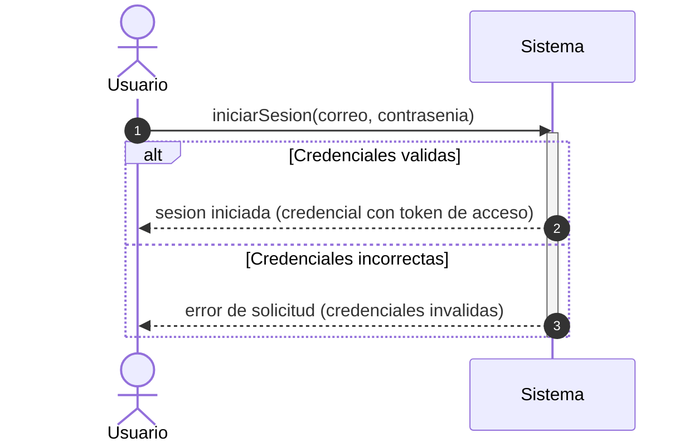

---


#### DSS — CU-002: Registrarse como Cliente

**Actor:** Cliente
**Operaciones del sistema:** `registrarCliente(nombreCompleto, correo, telefono, contrasena, datosDelCliente)`

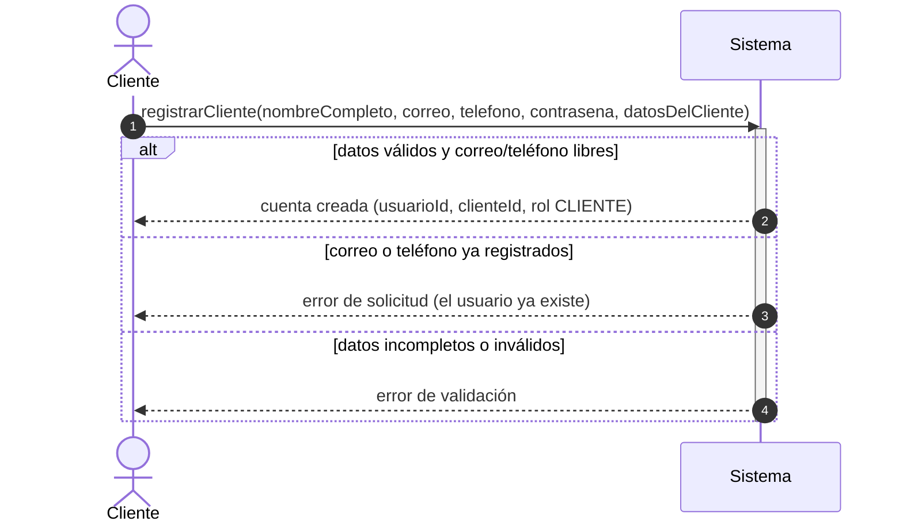

---


#### DSS — CU-003: Registrarse como Chofer

**Actor:** Administrador
**Operaciones del sistema:** `registrarChofer(datosPersonales, datosDelChofer, distribuidoraId)`

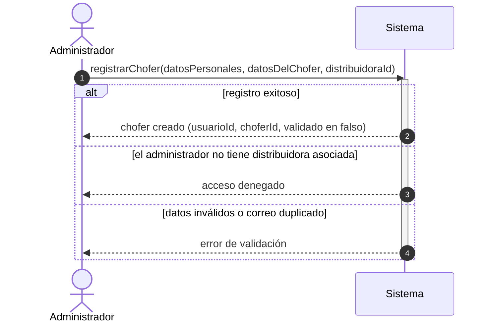

> El chofer nace **no validado**: para poder operar necesita CU-032.

---


#### DSS — CU-004: Gestionar Perfil de Usuario

**Actor:** Usuario autenticado (Cliente, Chofer o Administrador)
**Operaciones del sistema:** `consultarPerfil(usuarioId)`, `actualizarPerfil(usuarioId, datos)`, `consultarPerfilCliente(usuarioId)`, `actualizarPerfilCliente(clienteId, datos)`

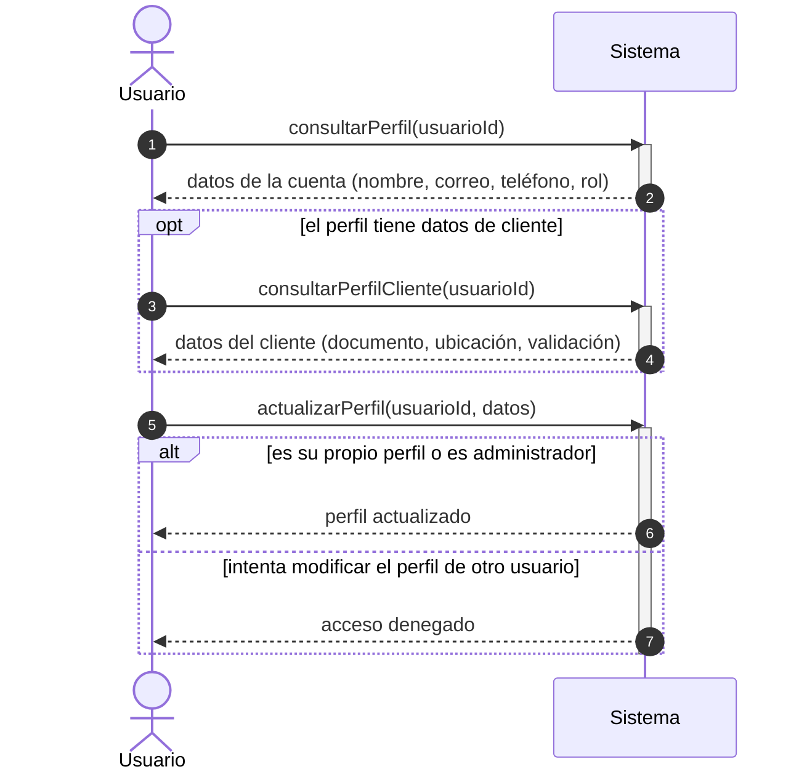

---


### SS-02 — Gestión de Pedidos


#### Crítico DSS — CU-005: Crear Pedido

**Actor:** Cliente
**Operaciones del sistema:** `crearPedido(items, direccion, franjaHoraria, metodoPago)`

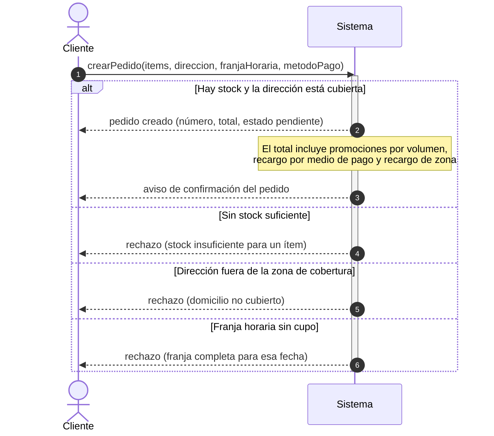

---


#### DSS — CU-006: Consultar Detalle de Pedido

**Actor:** Cliente (también Chofer y Administrador)
**Operaciones del sistema:** `consultarPedido(pedidoId)`

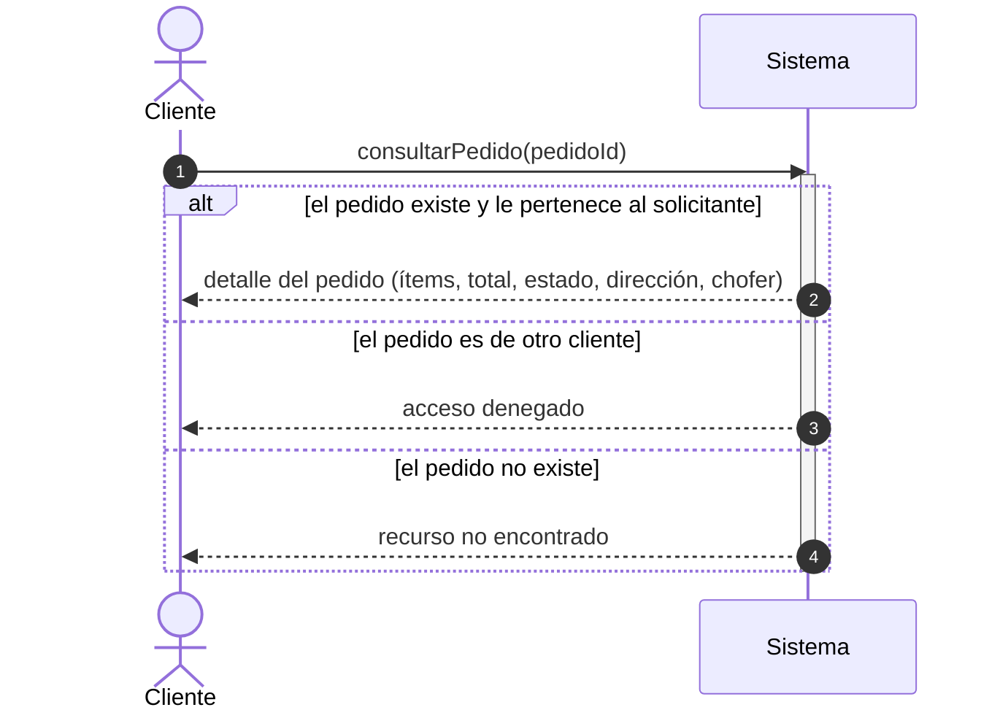

---


#### DSS — CU-007: Consultar Historial de Pedidos

**Actor:** Cliente
**Operaciones del sistema:** `consultarHistorialDePedidos(clienteId, pagina, limite)`

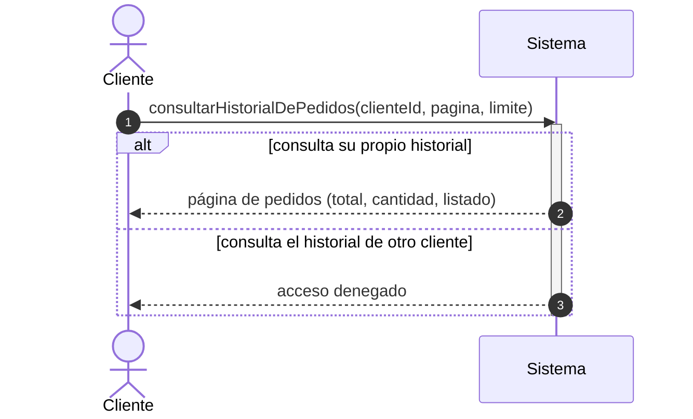

> El cliente ve **todo** su historial aunque haya comprado a varias distribuidoras; el personal solo ve los pedidos de la suya.

---


#### DSS — CU-008: Cancelar Pedido (Cliente)

**Actor:** Cliente
**Operaciones del sistema:** `cancelarPedido(pedidoId, motivo)`

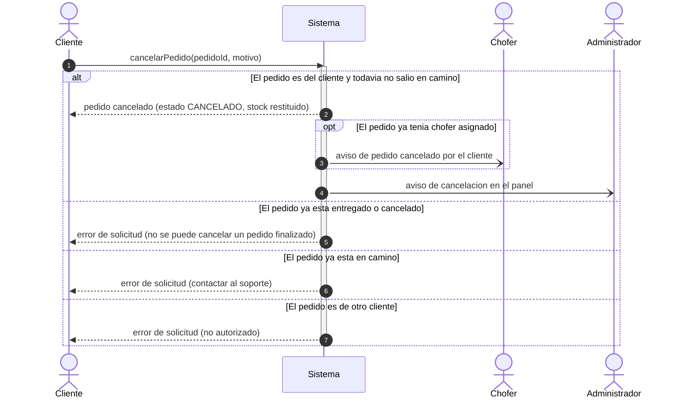

> La identidad y el rol del cancelador salen **siempre** de la sesión, nunca del cuerpo del mensaje.

---


#### DSS — CU-009: Cancelar Pedido (Chofer)

**Actor:** Chofer
**Operaciones del sistema:** `cancelarPedido(pedidoId, motivo)`

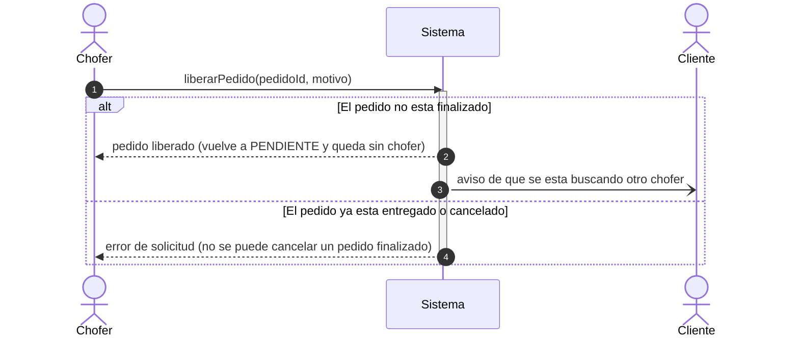

---


#### DSS — CU-010: Cancelar Pedido (Administrador)

**Actor:** Administrador
**Operaciones del sistema:** `cancelarPedido(pedidoId, motivo)`, `cancelarPedidoForzado(pedidoId)`

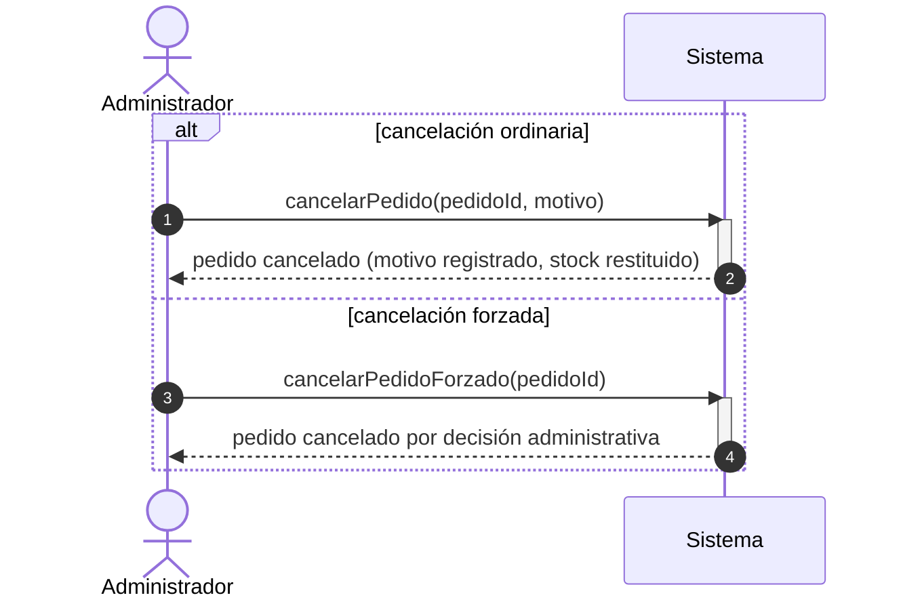

> El sistema ofrece **dos** vías para el administrador. La documentación previa describía una sola.

---


#### DSS — CU-011: Listar Todos los Pedidos

**Actor:** Administrador
**Operaciones del sistema:** `listarPedidos(pagina, limite)`

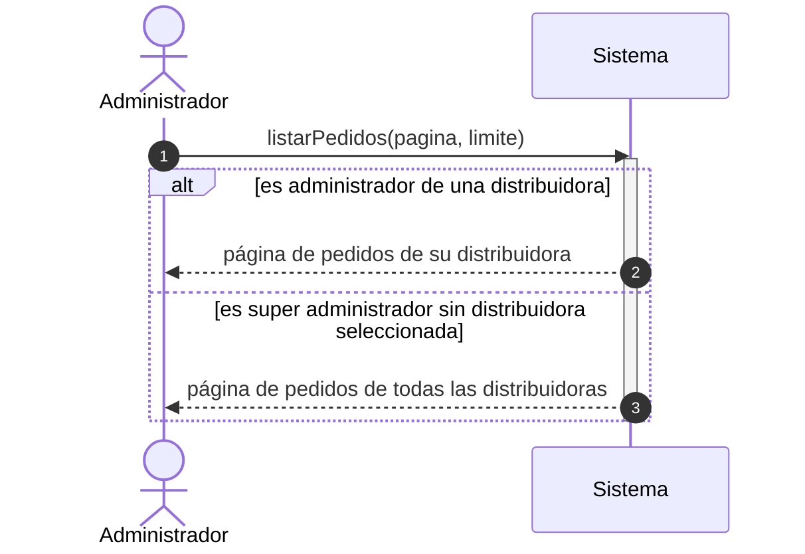

---


### SS-03 — Despacho y Asignación


#### DSS — CU-012: Asignar Chofer Manualmente

**Actor:** Administrador
**Operaciones del sistema:** `asignarChoferAPedido(pedidoId, choferId)`

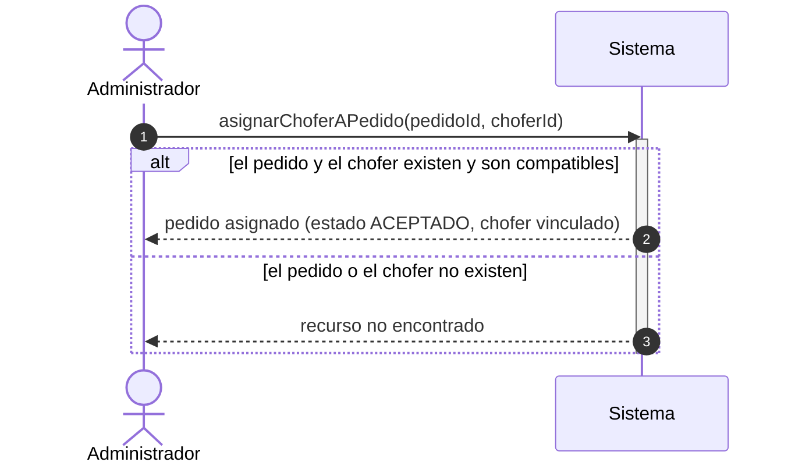

---


#### Crítico · automático DSS — CU-013: Ofrecer el Pedido al Chofer Más Cercano

**Actor:** Sistema Automático (se dispara al crearse el pedido)
**Operaciones del sistema:** `ofrecerAlSiguienteChofer(pedido)`

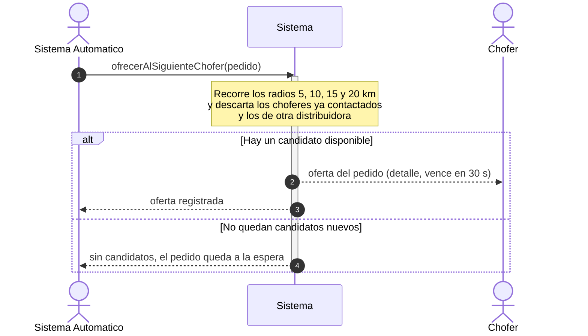

---


#### Crítico · automático DSS — CU-014: Vencer la Oferta y Ofrecer al Siguiente Chofer

**Actor:** Sistema Automático (proceso temporal, cada 15 segundos)
**Operaciones del sistema:** `vencerOfertasExpiradas()`

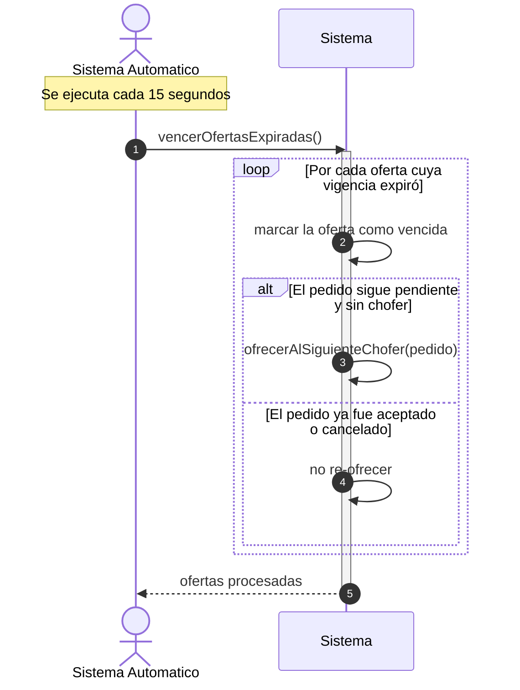

---


#### Crítico DSS — CU-015: Aceptar Pedido

**Actor:** Chofer
**Operaciones del sistema:** `aceptarPedido(pedido)`

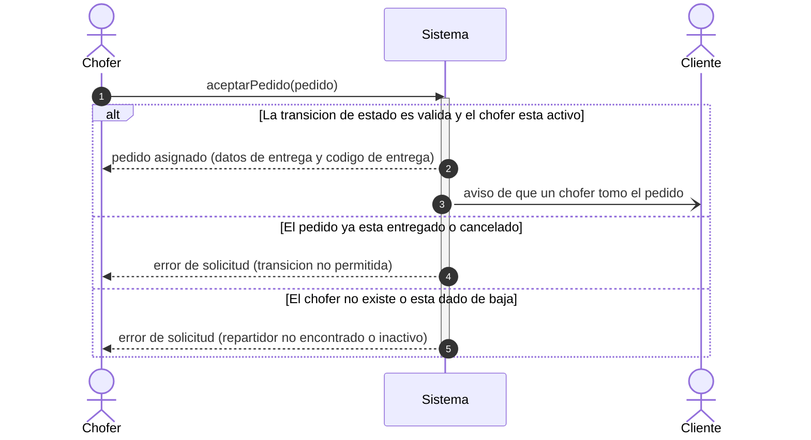

---


#### DSS — CU-016: Rechazar / Ignorar Pedido

**Actor:** Chofer
**Operaciones del sistema:** `rechazarOferta(pedidoId)`

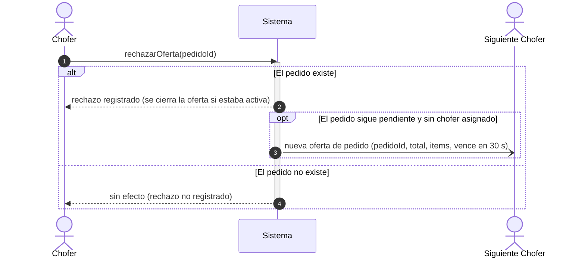

> El rechazo **no** espera el vencimiento de la ventana de 30 segundos: re-ofrece de inmediato al siguiente chofer más cercano.

---

### SS-04 — Seguimiento en Tiempo Real

---


### SS-04 — Seguimiento en Tiempo Real


#### Crítico · automático DSS — CU-017: Actualizar Ubicación GPS del Chofer

**Actor:** Chofer
**Operaciones del sistema:** `actualizarUbicacion(latitud, longitud)`

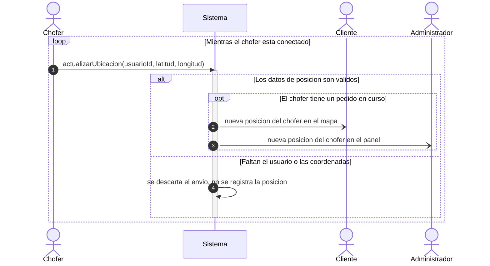

---


#### DSS — CU-018: Marcar Pedido "En Camino"

**Actor:** Chofer
**Operaciones del sistema:** `actualizarEstadoDePedido(pedidoId, EN_CAMINO)`

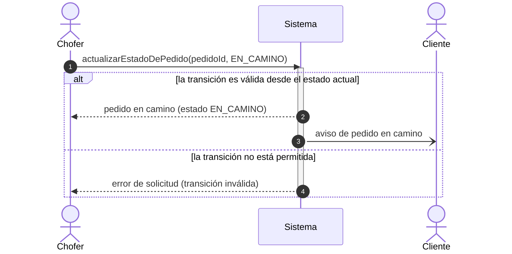

---


#### DSS — CU-019: Avisar Llegada al Cliente

**Actor:** Chofer
**Operaciones del sistema:** `avisarLlegada(pedidoId)`

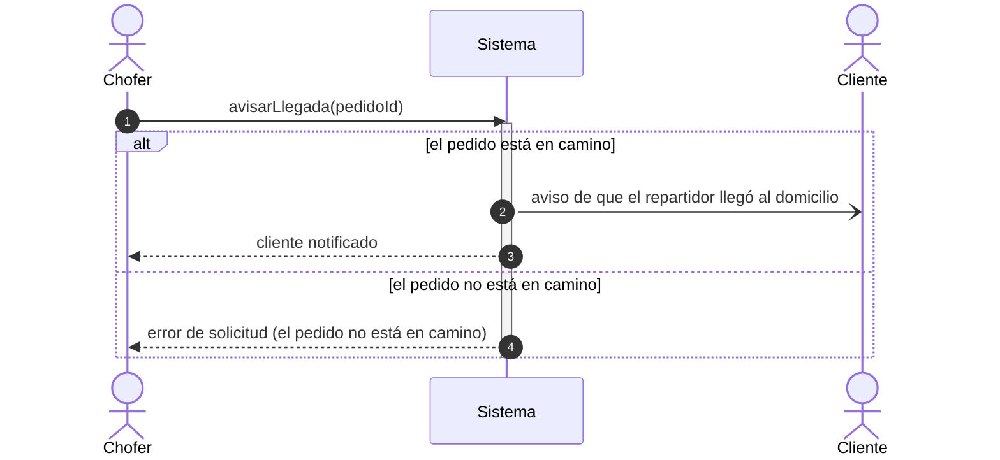

> Este caso de uso **no** cambia el estado del pedido: solo notifica.

---


#### Crítico DSS — CU-020: Confirmar Entrega

**Actor:** Chofer (secuencia normal) · Cliente (secuencia alternativa por código)
**Operaciones del sistema:** `confirmarEntrega(pedido)`, `confirmarEntregaConCodigo(pedido, codigo)`

```mermaid
sequenceDiagram
    autonumber
    actor CHO as Chofer
    participant SIS as Sistema
    actor CLI as Cliente

    alt El chofer declara la entrega
        CHO->>SIS: confirmarEntrega(pedido)
    else El cliente la constata leyendo el código
        CHO->>SIS: obtenerCodigoDeEntrega(pedido)
        SIS-->>CHO: código para mostrar como QR
        CLI->>SIS: confirmarEntregaConCodigo(pedido, codigo)
    end
    activate SIS
    alt El pedido está en camino y los datos son correctos
        SIS-->>CLI: pedido entregado
        Note over SIS: Si el pago es en efectivo,<br/>queda saldado
        SIS-->>CHO: entrega registrada
    else El código no coincide o el pedido no está en camino
        SIS-->>CLI: rechazo (no se puede confirmar la entrega)
    end
    deactivate SIS
```

---

#### Crítico · automático DSS — Reserva y Restitución de Stock (proceso interno)

**Actor:** Sistema Automático (se dispara al confirmarse o cancelarse un pedido)
**Operaciones del sistema:** `reservarStock(items)`, `restituirStock(pedido)`

```mermaid
sequenceDiagram
    autonumber
    actor SAU as Sistema Automatico
    participant SIS as Sistema

    SAU->>SIS: reservarStock(items)
    activate SIS
    alt Hay disponibilidad para todos los ítems
        SIS-->>SAU: stock reservado
    else Algún ítem no tiene stock suficiente
        SIS-->>SAU: reserva rechazada, ninguna unidad queda comprometida
    end
    deactivate SIS

    opt El pedido se cancela más tarde
        SAU->>SIS: restituirStock(pedido)
        activate SIS
        SIS-->>SAU: unidades devueltas al inventario
        deactivate SIS
    end
```

---


#### DSS — CU-021: Recibir Notificaciones en Tiempo Real

**Actor:** Cliente
**Operaciones del sistema:** `suscribirseAlSeguimiento(clienteId)`

```mermaid
sequenceDiagram
    autonumber
    actor CLI as Cliente
    participant SIS as Sistema

    CLI->>SIS: suscribirseAlSeguimiento(clienteId)
    activate SIS
    SIS-->>CLI: suscripción confirmada
    deactivate SIS

    loop mientras el pedido esté en curso
        SIS-)CLI: cambio de estado del pedido (aceptado, en camino, entregado, cancelado)
        SIS-)CLI: posición actual del chofer (latitud, longitud)
    end
```

> El canal se cierra cuando el cliente cierra la aplicación o el pedido alcanza un estado terminal.

---


#### DSS — CU-022: Activar / Desactivar Disponibilidad

**Actor:** Chofer
**Operaciones del sistema:** `cambiarDisponibilidad(usuarioId, disponible)`

```mermaid
sequenceDiagram
    autonumber
    actor CHO as Chofer
    participant SIS as Sistema

    CHO->>SIS: cambiarDisponibilidad(usuarioId, disponible)
    activate SIS
    alt se pone disponible
        SIS-->>CHO: disponible (empieza a recibir ofertas de pedidos)
    else se pone no disponible
        SIS-->>CHO: no disponible (deja de recibir ofertas)
    end
    deactivate SIS
```

> **Observación de análisis:** el sistema almacena esta disponibilidad en el mismo atributo que el alta/baja administrativa (CU-033), por lo que hoy "fuera de turno" y "dado de baja" son indistinguibles.

---


### SS-05 — Reclamos


#### Importante DSS — CU-023: Registrar Reclamo

**Actor:** Cliente
**Operaciones del sistema:** `registrarReclamo(pedido, motivo, evidencia)`

```mermaid
sequenceDiagram
    autonumber
    actor CLI as Cliente
    participant SIS as Sistema
    actor ADM as Administrador

    CLI->>SIS: registrarReclamo(pedido, motivo, evidencia)
    activate SIS
    alt El pedido fue entregado y es del cliente
        SIS-->>CLI: reclamo registrado (número, estado pendiente)
        SIS-->>ADM: nuevo reclamo para gestionar
    else El pedido no está entregado o no le pertenece
        SIS-->>CLI: rechazo (no se puede reclamar este pedido)
    end
    deactivate SIS
```

---


---

#### Ampliación — DSS de los casos de uso incorporados

Los 95 diagramas que siguen completan la cobertura del comportamiento del sistema.
Se agrupan por subsistema y respetan la misma convención de caja negra: solo intervienen
el actor y el sistema, sin detalle interno.

---


#### DSS — CU-024: Listar Reclamos

**Actor:** Administrador
**Operaciones del sistema:** `listarReclamos()`

```mermaid
sequenceDiagram
    autonumber
    actor ADM as Administrador
    participant SIS as Sistema

    ADM->>SIS: listarReclamos()
    activate SIS
    SIS-->>ADM: reclamos de su distribuidora (pedido, cliente, motivo, estado)
    deactivate SIS
```

---


#### DSS — CU-025: Resolver Reclamo

**Actor:** Administrador
**Operaciones del sistema:** `resolverReclamo(reclamoId, resolucion, estadoFinal)`

```mermaid
sequenceDiagram
    autonumber
    actor ADM as Administrador
    participant SIS as Sistema

    ADM->>SIS: resolverReclamo(reclamoId, resolucion, estadoFinal)
    activate SIS
    alt el reclamo existe
        SIS-->>ADM: reclamo resuelto (estado y resolución registrados)
    else el reclamo no existe
        SIS-->>ADM: recurso no encontrado
    end
    deactivate SIS
```

---

### SS-06 — Reportes y Dashboard

---


### SS-06 — Reportes y Dashboard


#### DSS — CU-026: Ver Dashboard General

**Actor:** Administrador
**Operaciones del sistema:** `consultarResumenDePedidos()`, `consultarGraficoDeVentas()`

```mermaid
sequenceDiagram
    autonumber
    actor ADM as Administrador
    participant SIS as Sistema

    ADM->>SIS: consultarResumenDePedidos()
    activate SIS
    SIS-->>ADM: totales del día, la semana y el mes (pedidos, facturación, estados)
    deactivate SIS

    ADM->>SIS: consultarGraficoDeVentas()
    activate SIS
    SIS-->>ADM: serie de ventas de los últimos siete días
    deactivate SIS
```

---


#### DSS — CU-027: Ver Reporte de Ventas por Chofer

**Actor:** Administrador
**Operaciones del sistema:** `consultarVentasPorChofer(fechaDesde, fechaHasta)`

```mermaid
sequenceDiagram
    autonumber
    actor ADM as Administrador
    participant SIS as Sistema

    ADM->>SIS: consultarVentasPorChofer(fechaDesde, fechaHasta)
    activate SIS
    SIS-->>ADM: ranking por chofer (pedidos entregados, monto facturado)
    deactivate SIS
```

---


#### DSS — CU-028: Ver Reporte de Ventas por Producto

**Actor:** Administrador
**Operaciones del sistema:** `consultarVentasPorProducto(fechaDesde, fechaHasta)`

```mermaid
sequenceDiagram
    autonumber
    actor ADM as Administrador
    participant SIS as Sistema

    ADM->>SIS: consultarVentasPorProducto(fechaDesde, fechaHasta)
    activate SIS
    SIS-->>ADM: ventas por tipo de garrafa (unidades, monto)
    deactivate SIS
```

---


#### DSS — CU-029: Ver Reporte por Método de Pago

**Actor:** Administrador
**Operaciones del sistema:** `consultarVentasPorMetodoDePago(fechaDesde, fechaHasta)`

```mermaid
sequenceDiagram
    autonumber
    actor ADM as Administrador
    participant SIS as Sistema

    ADM->>SIS: consultarVentasPorMetodoDePago(fechaDesde, fechaHasta)
    activate SIS
    SIS-->>ADM: distribución entre efectivo y pasarela (cantidad, monto)
    deactivate SIS
```

---


#### DSS — CU-030: Ver Gráfico de Evolución de Ventas

**Actor:** Administrador
**Operaciones del sistema:** `consultarEvolucionDeVentas(fechaDesde, fechaHasta, granularidad)`

```mermaid
sequenceDiagram
    autonumber
    actor ADM as Administrador
    participant SIS as Sistema

    ADM->>SIS: consultarEvolucionDeVentas(fechaDesde, fechaHasta, granularidad)
    activate SIS
    alt granularidad diaria
        SIS-->>ADM: serie por día del rango solicitado
    else granularidad mensual
        SIS-->>ADM: serie por mes del rango solicitado
    end
    deactivate SIS
```

---

### SS-07 — Gestión de Choferes y Vehículos

---


### SS-07 — Gestión de Choferes y Vehículos


#### DSS — CU-031: Registrar Chofer

**Actor:** Administrador
**Operaciones del sistema:** `registrarChofer(datosPersonales, datosDelChofer, distribuidoraId)`

```mermaid
sequenceDiagram
    autonumber
    actor ADM as Administrador
    participant SIS as Sistema

    ADM->>SIS: registrarChofer(datosPersonales, datosDelChofer, distribuidoraId)
    activate SIS
    alt el administrador puede dar de alta en esa distribuidora
        SIS-->>ADM: chofer registrado (pendiente de validación)
    else el administrador no pertenece a esa distribuidora
        SIS-->>ADM: acceso denegado
    end
    deactivate SIS
```

> Realiza la misma operación del sistema que CU-003, vista desde el subsistema de gestión de flota.

---


#### DSS — CU-032: Validar / Invalidar Chofer

**Actor:** Administrador
**Operaciones del sistema:** `validarChofer(choferId)`, `invalidarChofer(choferId)`

```mermaid
sequenceDiagram
    autonumber
    actor ADM as Administrador
    participant SIS as Sistema

    alt aprobación de la documentación
        ADM->>SIS: validarChofer(choferId)
        activate SIS
        SIS-->>ADM: chofer validado (habilitado para recibir pedidos)
        deactivate SIS
    else rechazo o revocación
        ADM->>SIS: invalidarChofer(choferId)
        activate SIS
        SIS-->>ADM: chofer invalidado (deja de recibir ofertas)
        deactivate SIS
    end
```

---


#### DSS — CU-033: Activar / Desactivar Chofer (Administrador)

**Actor:** Administrador
**Operaciones del sistema:** `cambiarEstadoDelChofer(choferId, activo)`

```mermaid
sequenceDiagram
    autonumber
    actor ADM as Administrador
    participant SIS as Sistema

    ADM->>SIS: cambiarEstadoDelChofer(choferId, activo)
    activate SIS
    alt el chofer existe
        SIS-->>ADM: estado del chofer actualizado
    else el chofer no existe
        SIS-->>ADM: recurso no encontrado
    end
    deactivate SIS
```

---


#### DSS — CU-034: Registrar Vehículo del Chofer

**Actor:** Administrador
**Operaciones del sistema:** `registrarVehiculo(usuarioId, tipo, capacidad, patente, marca, modelo, anio, color)`

```mermaid
sequenceDiagram
    autonumber
    actor ADM as Administrador
    participant SIS as Sistema

    ADM->>SIS: registrarVehiculo(usuarioId, tipo, capacidad, patente, marca, modelo, anio, color)
    activate SIS
    alt datos válidos
        SIS-->>ADM: vehículo registrado (vehiculoId)
    else datos inválidos
        SIS-->>ADM: error de validación
    end
    deactivate SIS
```

---


#### DSS — CU-035: Consultar Listado de Choferes

**Actor:** Administrador
**Operaciones del sistema:** `listarChoferes(pagina, limite)`, `listarChoferesActivos(pagina, limite)`, `consultarChofer(choferId)`, `consultarChoferPorUsuario(usuarioId)`

```mermaid
sequenceDiagram
    autonumber
    actor ADM as Administrador
    participant SIS as Sistema

    ADM->>SIS: listarChoferes(pagina, limite)
    activate SIS
    SIS-->>ADM: página de choferes de su distribuidora
    deactivate SIS

    opt vista operativa del día
        ADM->>SIS: listarChoferesActivos(pagina, limite)
        activate SIS
        SIS-->>ADM: choferes activos
        deactivate SIS
    end

    opt ficha individual
        ADM->>SIS: consultarChofer(choferId)
        activate SIS
        alt el chofer existe
            SIS-->>ADM: ficha del chofer (validación, calificación, saldo, vehículo)
        else el chofer no existe
            SIS-->>ADM: recurso no encontrado
        end
        deactivate SIS
    end
```

---


### SS-08 — Gestión de Productos (Catálogo)


#### DSS — CU-036: Crear Producto (Garrafa)

**Actor:** Administrador
**Operaciones del sistema:** `crearProducto(tipo, peso, precio, stockInicial, descripcion, promociones)`

```mermaid
sequenceDiagram
    autonumber
    actor ADM as Administrador
    participant SIS as Sistema

    ADM->>SIS: crearProducto(tipo, peso, precio, stockInicial, descripcion, promociones)
    activate SIS
    alt datos válidos
        SIS-->>ADM: producto creado (productoId, activo)
    else datos inválidos
        SIS-->>ADM: error de validación
    end
    deactivate SIS
```

---


#### DSS — CU-037: Actualizar Precio de Producto

**Actor:** Administrador
**Operaciones del sistema:** `actualizarProducto(productoId, datos)`

```mermaid
sequenceDiagram
    autonumber
    actor ADM as Administrador
    participant SIS as Sistema

    ADM->>SIS: actualizarProducto(productoId, precio)
    activate SIS
    alt el producto pertenece a la distribuidora
        SIS-->>ADM: producto actualizado (precio vigente para los pedidos nuevos)
    else el producto no existe en la distribuidora
        SIS-->>ADM: recurso no encontrado
    end
    deactivate SIS
```

> **Observación de análisis:** no existe una operación exclusiva de precio; el precio se modifica con la actualización general del producto.

---


#### DSS — CU-038: Actualizar Stock de Producto

**Actor:** Administrador
**Operaciones del sistema:** `actualizarStock(productoId, variacion)`

```mermaid
sequenceDiagram
    autonumber
    actor ADM as Administrador
    participant SIS as Sistema

    ADM->>SIS: actualizarStock(productoId, variacion)
    activate SIS
    alt el stock resultante es mayor o igual a cero
        SIS-->>ADM: stock actualizado (nuevo stock disponible)
    else el stock resultante sería negativo
        SIS-->>ADM: error de solicitud (stock insuficiente)
    else el producto no existe
        SIS-->>ADM: recurso no encontrado
    end
    deactivate SIS
```

> El parámetro es una **variación** (positiva o negativa), no un valor absoluto: ingresa mercadería con signo más y la ajusta con signo menos.

---


#### DSS — CU-039: Configurar Promociones por Cantidad

**Actor:** Administrador
**Operaciones del sistema:** `actualizarProducto(productoId, promociones)`

```mermaid
sequenceDiagram
    autonumber
    actor ADM as Administrador
    participant SIS as Sistema

    ADM->>SIS: actualizarProducto(productoId, promociones)
    activate SIS
    alt la tabla de promociones es válida
        SIS-->>ADM: promociones vigentes (cantidad mínima y porcentaje de descuento)
    else la tabla de promociones es inválida
        SIS-->>ADM: error de validación
    end
    deactivate SIS
```

> Al armar un pedido, cuando varias promociones aplican a la misma cantidad, el sistema toma **la más conveniente para el cliente**.

---


#### DSS — CU-040: Activar / Desactivar Producto

**Actor:** Administrador
**Operaciones del sistema:** `desactivarProducto(productoId)`

```mermaid
sequenceDiagram
    autonumber
    actor ADM as Administrador
    participant SIS as Sistema

    ADM->>SIS: desactivarProducto(productoId)
    activate SIS
    alt el producto existe en la distribuidora
        SIS-->>ADM: producto desactivado (deja de aparecer en el catálogo)
    else el producto no existe
        SIS-->>ADM: recurso no encontrado
    end
    deactivate SIS
```

> **Realización parcial:** el sistema no ofrece hoy la operación inversa `reactivarProducto(productoId)`. El caso de uso pide un interruptor bidireccional; el sistema solo implementa la desactivación.

---


#### DSS — CU-041: Consultar Catálogo de Productos

**Actor:** Cliente
**Operaciones del sistema:** `consultarCatalogo(pagina, limite, distribuidora)`, `consultarProducto(productoId)`, `consultarProductosPorTipo(tipo)`, `consultarProductosDisponibles(distribuidora)`

```mermaid
sequenceDiagram
    autonumber
    actor CLI as Cliente
    participant SIS as Sistema

    CLI->>SIS: consultarCatalogo(pagina, limite, distribuidora)
    activate SIS
    SIS-->>CLI: productos activos (tipo, peso, precio, stock, promociones)
    deactivate SIS

    opt vista de compra rápida
        CLI->>SIS: consultarProductosDisponibles(distribuidora)
        activate SIS
        SIS-->>CLI: productos activos con stock disponible
        deactivate SIS
    end

    opt detalle de un producto
        CLI->>SIS: consultarProducto(productoId)
        activate SIS
        alt el producto existe
            SIS-->>CLI: detalle del producto
        else el producto no existe
            SIS-->>CLI: recurso no encontrado
        end
        deactivate SIS
    end
```

---

### SS-09 — Franjas Horarias

---


### SS-09 — Franjas Horarias


#### DSS — CU-042: Crear Franja Horaria

**Actor:** Administrador
**Operaciones del sistema:** `crearFranjaHoraria(nombre, horaInicio, horaFin, capacidad)`

```mermaid
sequenceDiagram
    autonumber
    actor ADM as Administrador
    participant SIS as Sistema

    ADM->>SIS: crearFranjaHoraria(nombre, horaInicio, horaFin, capacidad)
    activate SIS
    alt el formato horario y la capacidad son válidos
        SIS-->>ADM: franja creada (franjaId, activa)
    else el formato horario es inválido
        SIS-->>ADM: error de validación
    end
    deactivate SIS
```

---


#### Especificado — pendiente de construcción · DSS — CU-043: Modificar Capacidad de Franja Horaria

**Actor:** Administrador
**Operaciones del sistema:** `modificarFranjaHoraria(franja, nombre, horaInicio, horaFin, capacidad)`

> El sistema **todavía no realiza este caso de uso**: no existe operación de modificación
> sobre una franja horaria. El diagrama especifica el comportamiento esperado para cuando
> se construya.

```mermaid
sequenceDiagram
    autonumber
    actor ADM as Administrador
    participant SIS as Sistema

    ADM->>SIS: modificarFranjaHoraria(franja, nombre, horaInicio, horaFin, capacidad)
    activate SIS
    alt Los datos son válidos y la franja pertenece a la distribuidora
        SIS-->>ADM: franja actualizada (nombre, rango horario, capacidad)
    else La hora de fin no es posterior a la de inicio
        SIS-->>ADM: rechazo (rango horario inválido)
    else La capacidad nueva es menor que los pedidos ya programados
        SIS-->>ADM: rechazo (hay pedidos comprometidos por encima de la capacidad)
    else La franja pertenece a otra distribuidora
        SIS-->>ADM: rechazo (franja no encontrada)
    end
    deactivate SIS
```

---


#### DSS — CU-044: Seleccionar Franja Horaria al Crear Pedido

**Actor:** Cliente
**Operaciones del sistema:** `consultarDisponibilidadDeFranjas(fecha, distribuidora)`, `crearPedido(items, direccionId, franjaId, fechaAgendada, metodoDePago)`

```mermaid
sequenceDiagram
    autonumber
    actor CLI as Cliente
    participant SIS as Sistema

    CLI->>SIS: consultarDisponibilidadDeFranjas(fecha, distribuidora)
    activate SIS
    SIS-->>CLI: franjas con capacidad, reservados y cupos libres
    deactivate SIS

    CLI->>SIS: crearPedido(items, direccionId, franjaId, fechaAgendada, metodoDePago)
    activate SIS
    alt la franja está activa y tiene cupo para esa fecha
        SIS-->>CLI: pedido creado con la franja reservada (numero, total, estado)
    else la franja ya está completa
        SIS-->>CLI: error de solicitud (la franja del día está completa)
    else la fecha agendada es anterior a hoy
        SIS-->>CLI: error de solicitud (no se puede agendar en una fecha pasada)
    else la franja no existe o está inactiva
        SIS-->>CLI: error de solicitud (franja inválida o inactiva)
    end
    deactivate SIS
```

> El cupo se toma dentro de la misma transacción que crea el pedido, de modo que dos clientes que eligen la última plaza de la misma franja no la obtienen los dos.

---


#### DSS — CU-045: Consultar Franjas Horarias Disponibles

**Actor:** Cliente (y Administrador para la vista de configuración)
**Operaciones del sistema:** `consultarDisponibilidadDeFranjas(fecha, distribuidora)`, `listarFranjas(distribuidora)`, `consultarFranja(franjaId)`

```mermaid
sequenceDiagram
    autonumber
    actor CLI as Cliente
    participant SIS as Sistema

    CLI->>SIS: consultarDisponibilidadDeFranjas(fecha, distribuidora)
    activate SIS
    alt la fecha es válida
        SIS-->>CLI: por cada franja activa (nombre, horario, capacidad, reservados, cupos libres)
    else la fecha es inválida
        SIS-->>CLI: error de validación
    end
    deactivate SIS

    opt vista administrativa
        CLI->>SIS: listarFranjas(distribuidora)
        activate SIS
        SIS-->>CLI: franjas activas de la distribuidora
        deactivate SIS
    end
```

---


### SS-02 — Gestión de Pedidos


#### DSS — CU-046: Gestionar Direcciones de Entrega

**Actor:** Cliente
**Operaciones del sistema:** `crearDireccion(calle, ciudad, codigoPostal, latitud, longitud, indicaciones, esPredeterminada)`, `listarDireccionesDelUsuario(usuarioId)`, `consultarDireccion(direccionId)`, `consultarDireccionPredeterminada(usuarioId)`, `actualizarDireccion(direccionId, datos)`, `marcarDireccionPredeterminada(direccionId)`, `eliminarDireccion(direccionId)`

```mermaid
sequenceDiagram
    autonumber
    actor CLI as Cliente
    participant SIS as Sistema

    CLI->>SIS: crearDireccion(calle, ciudad, codigoPostal, latitud, longitud, indicaciones, esPredeterminada)
    activate SIS
    SIS-->>CLI: dirección creada (direccionId)
    deactivate SIS

    CLI->>SIS: listarDireccionesDelUsuario(usuarioId)
    activate SIS
    SIS-->>CLI: listado de direcciones
    deactivate SIS

    opt el cliente cambia su dirección habitual
        CLI->>SIS: marcarDireccionPredeterminada(direccionId)
        activate SIS
        SIS-->>CLI: dirección predeterminada actualizada (las demás dejan de serlo)
        deactivate SIS
    end

    opt corrección de datos
        CLI->>SIS: actualizarDireccion(direccionId, datos)
        activate SIS
        SIS-->>CLI: dirección actualizada
        deactivate SIS
    end

    opt baja de una dirección
        CLI->>SIS: eliminarDireccion(direccionId)
        activate SIS
        alt la dirección existe y es del cliente
            SIS-->>CLI: dirección eliminada
        else la dirección no existe
            SIS-->>CLI: recurso no encontrado
        end
        deactivate SIS
    end
```

---


### SS-01 — Autenticación y Usuarios


#### DSS — CU-047: Recuperar Contraseña

**Actor:** Usuario
**Operaciones del sistema:** `solicitarRecuperacionDeClave(correo)`, `cambiarCorreo(correoActual, correoNuevo)`

```mermaid
sequenceDiagram
    autonumber
    actor CLI as Usuario
    participant SIS as Sistema

    CLI->>SIS: solicitarRecuperacionDeClave(correo)
    activate SIS
    alt el correo corresponde a una cuenta
        SIS-->>CLI: solicitud aceptada (se envió el enlace de restablecimiento)
    else el correo no existe
        SIS-->>CLI: solicitud aceptada (respuesta indistinguible por seguridad)
    end
    deactivate SIS

    opt el usuario autenticado quiere cambiar su correo
        CLI->>SIS: cambiarCorreo(correoActual, correoNuevo)
        activate SIS
        SIS-->>CLI: correo actualizado (se envió la verificación al nuevo)
        deactivate SIS
    end
```

---


### SS-14 — Pagos y Conciliación


#### DSS — CU-048: Procesar Pago con MercadoPago

**Actor:** Pasarela de Pago (actor externo). Receptores: Cliente y Chofer
**Operaciones del sistema:** `notificarResultadoDePago(tipoDeNotificacion, identificadorDelPago, firma)`

```mermaid
sequenceDiagram
    autonumber
    actor MP as Pasarela de Pago
    participant SIS as Sistema
    actor CHO as Chofer

    MP->>SIS: notificarResultadoDePago(tipoDeNotificacion, identificadorDelPago, firma)
    activate SIS
    alt La firma no es valida
        SIS-->>MP: notificacion recibida (se descarta sin procesar)
    else Pago aprobado de un pedido pendiente
        SIS-->>MP: notificacion recibida
        SIS-)CHO: oferta del pedido ya pagado
    else Pago aprobado de la sena de una reserva
        SIS-->>MP: notificacion recibida (la sena queda paga, la reserva no se despacha)
    else Pago aprobado de un pedido ya cancelado o entregado
        SIS-->>MP: notificacion recibida (se registra el pago, sin reactivar el pedido)
    else Pago rechazado o cancelado
        SIS-->>MP: notificacion recibida (el pedido queda a la espera)
    end
    deactivate SIS
```

> El sistema responde **siempre** con acuse de recibo, incluso ante una firma inválida, para no revelar si el pedido existe y para que la pasarela no reintente en bucle. El resultado del pago se asienta en un registro contable propio, independiente del estado del pedido.

---

### SS-15 — Reservas Programadas

---


### SS-07 — Gestión de Choferes y Vehículos


#### DSS — CU-049: Consultar Balance / Ganancias del Chofer

**Actor:** Chofer (consulta) y Administrador (ajuste)
**Operaciones del sistema:** `consultarPerfilDelChofer(usuarioId)`, `ajustarSaldoDelChofer(choferId, monto)`

```mermaid
sequenceDiagram
    autonumber
    actor CHO as Chofer
    participant SIS as Sistema
    actor ADM as Administrador

    CHO->>SIS: consultarPerfilDelChofer(usuarioId)
    activate SIS
    SIS-->>CHO: perfil con el saldo acumulado
    deactivate SIS

    opt liquidación o corrección
        ADM->>SIS: ajustarSaldoDelChofer(choferId, monto)
        activate SIS
        SIS-->>ADM: saldo actualizado
        deactivate SIS
    end
```

> **Observación de análisis:** no existe una operación dedicada de consulta de saldo; el chofer lo lee dentro de su propio perfil.

---


### SS-01 — Autenticación y Usuarios


#### DSS — CU-050: Bloquear / Desbloquear Usuario

**Actor:** Administrador
**Operaciones del sistema:** `bloquearUsuario(usuarioId, bloquear)`

```mermaid
sequenceDiagram
    autonumber
    actor ADM as Administrador
    participant SIS as Sistema

    ADM->>SIS: bloquearUsuario(usuarioId, bloquear)
    activate SIS
    alt el usuario existe
        SIS-->>ADM: usuario actualizado (estado de bloqueo vigente)
    else el usuario no existe
        SIS-->>ADM: recurso no encontrado
    end
    deactivate SIS
```

> Es un interruptor bidireccional: el mismo mensaje bloquea y desbloquea según el parámetro `bloquear`.

---


### SS-07 — Gestión de Choferes y Vehículos


#### DSS — CU-051: Gestionar Vehículos

**Actor:** Administrador
**Operaciones del sistema:** `listarVehiculos()`, `consultarVehiculo(vehiculoId)`, `consultarVehiculosDelUsuario(usuarioId)`, `consultarVehiculoPorPatente(patente)`, `actualizarVehiculo(vehiculoId, datos)`, `eliminarVehiculo(vehiculoId)`

```mermaid
sequenceDiagram
    autonumber
    actor ADM as Administrador
    participant SIS as Sistema

    ADM->>SIS: listarVehiculos()
    activate SIS
    SIS-->>ADM: vehículos de la distribuidora
    deactivate SIS

    opt búsqueda por patente
        ADM->>SIS: consultarVehiculoPorPatente(patente)
        activate SIS
        alt existe
            SIS-->>ADM: vehículo encontrado
        else no existe
            SIS-->>ADM: recurso no encontrado
        end
        deactivate SIS
    end

    opt modificación
        ADM->>SIS: actualizarVehiculo(vehiculoId, datos)
        activate SIS
        SIS-->>ADM: vehículo actualizado
        deactivate SIS
    end

    opt baja
        ADM->>SIS: eliminarVehiculo(vehiculoId)
        activate SIS
        SIS-->>ADM: vehículo eliminado
        deactivate SIS
    end
```

---


### SS-10 — Multi-Distribuidora


#### DSS — CU-052: Registrar Distribuidora

**Actor:** Super Administrador
**Operaciones del sistema:** `registrarDistribuidora(nombre, identificadorCorto, razonSocial, cuit, correo, telefono, logo, plan)`

```mermaid
sequenceDiagram
    autonumber
    actor SUP as Super Administrador
    participant SIS as Sistema

    SUP->>SIS: registrarDistribuidora(nombre, identificadorCorto, razonSocial, cuit, correo, telefono, logo, plan)
    activate SIS
    alt el identificador corto está libre
        SIS-->>SUP: distribuidora creada (distribuidoraId, estado inicial)
    else el identificador corto ya está en uso
        SIS-->>SUP: conflicto (identificador duplicado)
    else datos inválidos
        SIS-->>SUP: error de validación
    end
    deactivate SIS
```

> Solo el Super Administrador opera este caso de uso: es una acción de **plataforma**, no de una empresa.

---


#### DSS — CU-053: Consultar Distribuidoras

**Actor:** Super Administrador
**Operaciones del sistema:** `listarDistribuidoras()`, `consultarDistribuidora(distribuidoraId)`

```mermaid
sequenceDiagram
    autonumber
    actor SUP as Super Administrador
    participant SIS as Sistema

    SUP->>SIS: listarDistribuidoras()
    activate SIS
    SIS-->>SUP: listado de distribuidoras (nombre, identificador, estado, plan)
    deactivate SIS

    opt ficha de una distribuidora
        SUP->>SIS: consultarDistribuidora(distribuidoraId)
        activate SIS
        alt la distribuidora existe
            SIS-->>SUP: datos de la distribuidora
        else la distribuidora no existe
            SIS-->>SUP: recurso no encontrado
        end
        deactivate SIS
    end
```

---


#### DSS — CU-054: Modificar Datos de la Distribuidora

**Actor:** Super Administrador
**Operaciones del sistema:** `modificarDistribuidora(distribuidoraId, datos)`

```mermaid
sequenceDiagram
    autonumber
    actor SUP as Super Administrador
    participant SIS as Sistema

    SUP->>SIS: modificarDistribuidora(distribuidoraId, datos)
    activate SIS
    alt la distribuidora existe
        SIS-->>SUP: distribuidora actualizada
    else la distribuidora no existe
        SIS-->>SUP: recurso no encontrado
    end
    deactivate SIS
```

---


#### DSS — CU-055: Dar de Baja una Distribuidora

**Actor:** Super Administrador
**Operaciones del sistema:** `darDeBajaDistribuidora(distribuidoraId)`

```mermaid
sequenceDiagram
    autonumber
    actor SUP as Super Administrador
    participant SIS as Sistema

    SUP->>SIS: darDeBajaDistribuidora(distribuidoraId)
    activate SIS
    alt la distribuidora existe
        SIS-->>SUP: distribuidora dada de baja (baja lógica, se conserva su histórico)
    else la distribuidora no existe
        SIS-->>SUP: recurso no encontrado
    end
    deactivate SIS
```

---

### SS-11 — Cobertura Geográfica

---


### SS-11 — Cobertura Geográfica


#### DSS — CU-056: Definir Zona de Cobertura

**Actor:** Administrador
**Operaciones del sistema:** `definirZonaDeCobertura(nombre, poligono, recargo, activa)`

```mermaid
sequenceDiagram
    autonumber
    actor ADM as Administrador
    participant SIS as Sistema

    ADM->>SIS: definirZonaDeCobertura(nombre, poligono, recargo, activa)
    activate SIS
    alt el polígono y el recargo son válidos
        SIS-->>ADM: zona creada (zonaId, recargo asociado)
    else el polígono es inválido
        SIS-->>ADM: error de validación
    end
    deactivate SIS
```

---


#### DSS — CU-057: Consultar Zonas de Cobertura

**Actor:** Administrador
**Operaciones del sistema:** `listarZonasDeCobertura()`

```mermaid
sequenceDiagram
    autonumber
    actor ADM as Administrador
    participant SIS as Sistema

    ADM->>SIS: listarZonasDeCobertura()
    activate SIS
    SIS-->>ADM: zonas de la distribuidora (nombre, polígono, recargo, estado)
    deactivate SIS
```

---


#### DSS — CU-058: Validar Cobertura de una Dirección

**Actor:** Cliente
**Operaciones del sistema:** `validarCobertura(latitud, longitud)`

```mermaid
sequenceDiagram
    autonumber
    actor CLI as Cliente
    participant SIS as Sistema

    CLI->>SIS: validarCobertura(latitud, longitud)
    activate SIS
    alt el punto cae dentro de una zona activa
        SIS-->>CLI: cubierta (zonaId, nombre de la zona, recargo aplicable)
    else la distribuidora no tiene zonas cargadas
        SIS-->>CLI: cubierta sin recargo (cobertura irrestricta por omisión)
    else el punto está fuera de toda zona
        SIS-->>CLI: fuera de cobertura
    end
    deactivate SIS
```

> Es la **precondición** de CU-005: la aplicación la invoca antes de dejar confirmar el pedido, y de acá sale el recargo por zona que se suma al total.

---


#### DSS — CU-059: Eliminar Zona de Cobertura

**Actor:** Administrador
**Operaciones del sistema:** `eliminarZonaDeCobertura(zonaId)`

```mermaid
sequenceDiagram
    autonumber
    actor ADM as Administrador
    participant SIS as Sistema

    ADM->>SIS: eliminarZonaDeCobertura(zonaId)
    activate SIS
    alt la zona pertenece a la distribuidora
        SIS-->>ADM: zona eliminada
    else la zona no existe en la distribuidora
        SIS-->>ADM: recurso no encontrado
    end
    deactivate SIS
```

---

### SS-12 — Incidencias y Calidad de Servicio

---


### SS-12 — Incidencias y Calidad de Servicio


#### DSS — CU-060: Registrar Incidencia de Entrega

**Actor:** Chofer
**Operaciones del sistema:** `registrarIncidencia(pedidoId, tipo, descripcion, foto)`

```mermaid
sequenceDiagram
    autonumber
    actor CHO as Chofer
    participant SIS as Sistema

    CHO->>SIS: registrarIncidencia(pedidoId, tipo, descripcion, foto)
    activate SIS
    alt el pedido existe
        SIS-->>CHO: incidencia registrada (incidenciaId, estado ABIERTA)
    else el pedido no existe
        SIS-->>CHO: recurso no encontrado
    end
    deactivate SIS
```

> Circuito **distinto** al de reclamos (SS-05): el reclamo lo abre el cliente después de la entrega, la incidencia la abre el chofer durante el reparto.

---


#### DSS — CU-061: Listar Incidencias

**Actor:** Administrador
**Operaciones del sistema:** `listarIncidencias()`

```mermaid
sequenceDiagram
    autonumber
    actor ADM as Administrador
    participant SIS as Sistema

    ADM->>SIS: listarIncidencias()
    activate SIS
    SIS-->>ADM: incidencias de su distribuidora (pedido, tipo, estado, chofer que la reportó)
    deactivate SIS
```

---


#### DSS — CU-062: Consultar Incidencias de un Pedido

**Actor:** Chofer (también Administrador)
**Operaciones del sistema:** `consultarIncidenciasDelPedido(pedidoId)`

```mermaid
sequenceDiagram
    autonumber
    actor CHO as Chofer
    participant SIS as Sistema

    CHO->>SIS: consultarIncidenciasDelPedido(pedidoId)
    activate SIS
    SIS-->>CHO: incidencias del pedido (tipo, descripción, estado, resolución)
    deactivate SIS
```

---


#### DSS — CU-063: Resolver Incidencia

**Actor:** Administrador
**Operaciones del sistema:** `resolverIncidencia(incidenciaId, notaDeResolucion)`

```mermaid
sequenceDiagram
    autonumber
    actor ADM as Administrador
    participant SIS as Sistema

    ADM->>SIS: resolverIncidencia(incidenciaId, notaDeResolucion)
    activate SIS
    alt la incidencia existe en la distribuidora
        SIS-->>ADM: incidencia resuelta (estado y nota registrados)
    else la incidencia no existe
        SIS-->>ADM: recurso no encontrado
    end
    deactivate SIS
```

---


#### DSS — CU-064: Calificar Pedido

**Actor:** Cliente o Chofer
**Operaciones del sistema:** `calificarPedido(pedidoId, estrellas, comentario)`

```mermaid
sequenceDiagram
    autonumber
    actor CLI as Cliente
    participant SIS as Sistema

    CLI->>SIS: calificarPedido(pedidoId, estrellas, comentario)
    activate SIS
    alt el pedido está entregado y el emisor participó de él
        SIS-->>CLI: calificación registrada (se recalcula el promedio del calificado)
    else el emisor ya calificó ese pedido
        SIS-->>CLI: conflicto (ya calificaste este pedido)
    else el pedido no está entregado o no tiene chofer
        SIS-->>CLI: error de solicitud (solo se califican pedidos entregados)
    else el pedido es de otro cliente o lo entregó otro chofer
        SIS-->>CLI: acceso denegado
    end
    deactivate SIS
```

> La calificación es **bidireccional**: el mismo mensaje lo emite el cliente hacia el chofer o el chofer hacia el cliente. El emisor sale de la sesión y el calificado se deriva del pedido, de modo que hay a lo sumo una calificación por pedido y por lado.

---


#### DSS — CU-065: Consultar Promedio de Calificaciones de un Usuario

**Actor:** Cliente (también Chofer y Administrador)
**Operaciones del sistema:** `consultarResumenDeCalificaciones(usuarioId)`

```mermaid
sequenceDiagram
    autonumber
    actor CLI as Cliente
    participant SIS as Sistema

    CLI->>SIS: consultarResumenDeCalificaciones(usuarioId)
    activate SIS
    SIS-->>CLI: promedio de estrellas y cantidad de calificaciones recibidas
    deactivate SIS
```

---


#### DSS — CU-066: Consultar Historial de Calificaciones Recibidas

**Actor:** Administrador
**Operaciones del sistema:** `consultarHistorialDeCalificaciones(usuarioId)`

```mermaid
sequenceDiagram
    autonumber
    actor ADM as Administrador
    participant SIS as Sistema

    ADM->>SIS: consultarHistorialDeCalificaciones(usuarioId)
    activate SIS
    SIS-->>ADM: calificaciones recibidas (pedido, estrellas, comentario, fecha)
    deactivate SIS
```

---

### SS-13 — Trazabilidad de Envases

---


### SS-13 — Trazabilidad de Envases


#### DSS — CU-067: Dar de Alta un Envase Físico

**Actor:** Administrador
**Operaciones del sistema:** `darDeAltaEnvase(numeroDeSerie, tipoDeProducto, deposito)`

```mermaid
sequenceDiagram
    autonumber
    actor ADM as Administrador
    participant SIS as Sistema

    ADM->>SIS: darDeAltaEnvase(numeroDeSerie, tipoDeProducto, deposito)
    activate SIS
    alt el número de serie está libre en la distribuidora
        SIS-->>ADM: envase creado (envaseId, estado EN_DEPOSITO)
    else el número de serie ya existe en la distribuidora
        SIS-->>ADM: conflicto (serie duplicada)
    end
    deactivate SIS
```

> El número de serie es único **por distribuidora**, no globalmente: dos empresas pueden tener garrafas con la misma numeración de fábrica.

---


#### DSS — CU-068: Asignar Envases a un Pedido

**Actor:** Chofer (también Administrador)
**Operaciones del sistema:** `asignarEnvasesAPedido(pedidoId, numerosDeSerie)`

```mermaid
sequenceDiagram
    autonumber
    actor CHO as Chofer
    participant SIS as Sistema

    CHO->>SIS: asignarEnvasesAPedido(pedidoId, numerosDeSerie)
    activate SIS
    alt el pedido existe y todos los envases están llenos
        loop por cada número de serie recibido
            SIS-->>CHO: envase despachado (serie, estado DESPACHADO)
        end
        SIS-->>CHO: asignación completa (cantidad de envases despachados)
    else algún envase no está en estado LLENO
        SIS-->>CHO: error de solicitud (no se puede despachar un envase sin llenar)
    else el pedido o algún envase no existe
        SIS-->>CHO: recurso no encontrado
    end
    deactivate SIS
```

---


#### DSS — CU-069: Consultar el Parque de Envases

**Actor:** Administrador
**Operaciones del sistema:** `listarEnvases(estado)`, `consultarEnvase(envaseId)`

```mermaid
sequenceDiagram
    autonumber
    actor ADM as Administrador
    participant SIS as Sistema

    ADM->>SIS: listarEnvases(estado)
    activate SIS
    SIS-->>ADM: envases de la distribuidora (serie, estado, pedido y cliente actuales)
    deactivate SIS

    opt ficha de un envase
        ADM->>SIS: consultarEnvase(envaseId)
        activate SIS
        alt el envase existe
            SIS-->>ADM: ficha del envase
        else el envase no existe
            SIS-->>ADM: recurso no encontrado
        end
        deactivate SIS
    end
```

---


#### DSS — CU-070: Registrar Movimiento de Envase

**Actor:** Chofer (también Administrador)
**Operaciones del sistema:** `registrarMovimientoDeEnvase(envaseId, estadoDestino, pedidoId, observacion)`

```mermaid
sequenceDiagram
    autonumber
    actor CHO as Chofer
    participant SIS as Sistema

    CHO->>SIS: registrarMovimientoDeEnvase(envaseId, estadoDestino, pedidoId, observacion)
    activate SIS
    alt la transición es válida desde el estado actual
        SIS-->>CHO: envase en el nuevo estado (movimiento asentado en su historial)
    else la transición no está permitida
        SIS-->>CHO: error de solicitud (transición inválida)
    else el envase no existe en la distribuidora
        SIS-->>CHO: recurso no encontrado
    end
    deactivate SIS
```

> Ciclo de vida del envase: EN_DEPOSITO → LLENO → DESPACHADO → CON_EL_CLIENTE → VACIO_DEVUELTO. Al confirmarse la entrega del pedido (CU-020 / CU-079) el sistema avanza solo los envases despachados a CON_EL_CLIENTE.

---


#### DSS — CU-071: Consultar Historial de Movimientos de un Envase

**Actor:** Administrador
**Operaciones del sistema:** `consultarHistorialDelEnvase(envaseId)`

```mermaid
sequenceDiagram
    autonumber
    actor ADM as Administrador
    participant SIS as Sistema

    ADM->>SIS: consultarHistorialDelEnvase(envaseId)
    activate SIS
    SIS-->>ADM: movimientos en orden cronológico (estado origen, estado destino, pedido, responsable, fecha)
    deactivate SIS
```

> El historial es de **solo agregado**: los movimientos no se corrigen ni se borran, y por eso sirve como evidencia de trazabilidad.

---

### SS-14 — Pagos y Conciliación

---


### SS-15 — Reservas Programadas


#### DSS — CU-072: Crear Reserva Programada con Seña

**Actor:** Cliente
**Operaciones del sistema:** `crearReserva(items, direccionId, fechaAgendada, franjaId, metodoDePago, montoDeLaSenia)`

```mermaid
sequenceDiagram
    autonumber
    actor CLI as Cliente
    participant SIS as Sistema

    CLI->>SIS: crearReserva(items, direccionId, fechaAgendada, franjaId, metodoDePago, montoDeLaSenia)
    activate SIS
    alt hay stock y la franja tiene cupo para esa fecha
        SIS-->>CLI: reserva creada (numero, total, seña, estado RESERVADO)
        opt la seña se paga con la pasarela
            SIS-->>CLI: enlace de pago de la seña
        end
    else no hay stock suficiente
        SIS-->>CLI: error de solicitud (stock insuficiente)
    else la franja está completa o la fecha es pasada
        SIS-->>CLI: error de solicitud (no se puede agendar en esa franja)
    end
    deactivate SIS
```

> La reserva nace en estado **RESERVADO**: reserva stock y cupo desde el momento del alta, pero no se despacha hasta el día agendado (CU-075).

---


#### DSS — CU-073: Listar Reservas y Estado de la Seña

**Actor:** Administrador
**Operaciones del sistema:** `listarReservas()`

```mermaid
sequenceDiagram
    autonumber
    actor ADM as Administrador
    participant SIS as Sistema

    ADM->>SIS: listarReservas()
    activate SIS
    SIS-->>ADM: reservas ordenadas por fecha agendada (cliente, total, seña, si está paga, saldo)
    deactivate SIS
```

---


#### DSS — CU-074: Confirmar Seña Cobrada en Efectivo

**Actor:** Administrador
**Operaciones del sistema:** `confirmarSenia(pedidoId)`

```mermaid
sequenceDiagram
    autonumber
    actor ADM as Administrador
    participant SIS as Sistema

    ADM->>SIS: confirmarSenia(pedidoId)
    activate SIS
    alt el pedido es una reserva pendiente
        SIS-->>ADM: seña confirmada (la reserva queda lista para activarse sola)
    else el pedido no es una reserva pendiente
        SIS-->>ADM: error de solicitud (el pedido no es una reserva pendiente)
    else la reserva no existe
        SIS-->>ADM: recurso no encontrado
    end
    deactivate SIS
```

> Es la **única acción humana** del ciclo de reservas: la seña pagada por la pasarela se confirma sola (CU-048).

---


#### DSS — CU-075: Activar Reservas Vencidas Automáticamente

**Actor:** Sistema Automático
**Operaciones del sistema:** `activarReservasDelDia()`

```mermaid
sequenceDiagram
    autonumber
    actor AUT as Sistema Automático
    participant SIS as Sistema
    actor CHO as Chofer

    Note over AUT: Proceso periódico. Frecuencia real cada 5 minutos
    AUT->>SIS: activarReservasDelDia()
    activate SIS
    alt hay reservas con la seña paga y el día cumplido
        loop por cada reserva vencida (hasta 50 por corrida)
            SIS-)CHO: oferta del pedido activado (pedidoId, total, ítems, distancia)
        end
        SIS-->>AUT: reservas activadas y enviadas a despacho
    else no hay reservas para activar
        SIS-->>AUT: sin trabajo por hacer
    end
    deactivate SIS
```

> Solo se activan las reservas con la seña **efectivamente paga**. Una reserva cuya activación falla se registra y se reintenta en la corrida siguiente.

---


#### DSS — CU-076: Expirar Reservas sin Seña Pagada

**Actor:** Sistema Automático
**Operaciones del sistema:** `expirarReservasSinSenia()`

```mermaid
sequenceDiagram
    autonumber
    actor AUT as Sistema Automático
    participant SIS as Sistema

    Note over AUT: Proceso periódico. Frecuencia real cada 1 hora
    AUT->>SIS: expirarReservasSinSenia()
    activate SIS
    alt hay reservas sin seña más viejas que el plazo configurado
        loop por cada reserva vencida (hasta 50 por corrida)
            SIS-->>AUT: reserva cancelada y stock liberado
        end
    else no hay reservas vencidas
        SIS-->>AUT: sin trabajo por hacer
    end
    deactivate SIS
```

> El plazo de espera de la seña es un parámetro de configuración (valor por omisión, 48 horas). Cada expiración es atómica: si falla, la reserva queda intacta para la corrida siguiente.

---


#### DSS — CU-077: Expirar Pedidos de MercadoPago sin Pagar

**Actor:** Sistema Automático
**Operaciones del sistema:** `expirarPedidosSinPagar()`

```mermaid
sequenceDiagram
    autonumber
    actor AUT as Sistema Automático
    participant SIS as Sistema

    Note over AUT: Proceso periódico. Frecuencia real cada 30 minutos
    AUT->>SIS: expirarPedidosSinPagar()
    activate SIS
    alt hay pedidos pendientes con pasarela más viejos que el plazo
        loop por cada pedido vencido (hasta 50 por corrida)
            alt el pago no llegó a acreditarse
                SIS-->>AUT: pedido cancelado por falta de pago y stock liberado
            else el pago se acreditó justo antes de la revisión
                SIS-->>AUT: pedido intacto (gana el pago, no la expiración)
            end
        end
    else no hay pedidos vencidos
        SIS-->>AUT: sin trabajo por hacer
    end
    deactivate SIS
```

> Sin este proceso, el stock que se reserva al crear el pedido —antes de que el cliente pague— quedaría bloqueado para siempre si abandona el pago. El plazo por omisión es de 60 minutos.

---

### SS-16 — Administración de Cuentas y Roles

---


### SS-04 — Seguimiento en Tiempo Real


#### DSS — CU-078: Obtener el Código de Entrega (QR del chofer)

**Actor:** Chofer
**Operaciones del sistema:** `obtenerCodigoDeEntrega(pedidoId)`

```mermaid
sequenceDiagram
    autonumber
    actor CHO as Chofer
    participant SIS as Sistema

    CHO->>SIS: obtenerCodigoDeEntrega(pedidoId)
    activate SIS
    alt el pedido está asignado a este chofer y ya fue aceptado
        SIS-->>CHO: código de entrega (para mostrarlo como QR al cliente)
    else el pedido no está asignado a este chofer
        SIS-->>CHO: acceso denegado
    else el pedido todavía no fue aceptado
        SIS-->>CHO: error de solicitud (el pedido aún no tiene código)
    else el pedido no existe
        SIS-->>CHO: recurso no encontrado
    end
    deactivate SIS
```

---


#### DSS — CU-079: Confirmar Entrega Escaneando el QR (cliente)

**Actor:** Cliente
**Operaciones del sistema:** `confirmarEntregaConCodigo(pedidoId, codigoLeido)`

```mermaid
sequenceDiagram
    autonumber
    actor CLI as Cliente
    participant SIS as Sistema

    CLI->>SIS: confirmarEntregaConCodigo(pedidoId, codigoLeido)
    activate SIS
    alt el código coincide y el pedido está en camino
        SIS-->>CLI: entrega confirmada (estado ENTREGADO)
    else el código no coincide
        SIS-->>CLI: error de solicitud (código inválido)
    else el pedido no está en camino
        SIS-->>CLI: error de solicitud (el pedido no está en camino)
    else el pedido es de otro cliente
        SIS-->>CLI: acceso denegado
    end
    deactivate SIS
```

> Es el camino **anti-fraude** que invierte el actor de CU-020: confirma quien recibe, no quien entrega. Es idempotente frente a reintentos de red.

---

### SS-05 — Reclamos

---


### SS-02 — Gestión de Pedidos


#### DSS — CU-080: Consultar el Pool de Pedidos Disponibles

**Actor:** Chofer
**Operaciones del sistema:** `consultarPedidosDisponibles(pagina, limite)`

```mermaid
sequenceDiagram
    autonumber
    actor CHO as Chofer
    participant SIS as Sistema

    CHO->>SIS: consultarPedidosDisponibles(pagina, limite)
    activate SIS
    SIS-->>CHO: pedidos pendientes sin chofer de su distribuidora (dirección, ítems, total)
    deactivate SIS
```

> Es la vista de respaldo del despacho automático (CU-013): si la oferta por proximidad no llega, el chofer puede consultar el pool.

---


#### DSS — CU-081: Consultar los Pedidos Asignados al Chofer

**Actor:** Chofer
**Operaciones del sistema:** `consultarPedidosAsignados(choferId, pagina, limite)`

```mermaid
sequenceDiagram
    autonumber
    actor CHO as Chofer
    participant SIS as Sistema

    CHO->>SIS: consultarPedidosAsignados(choferId, pagina, limite)
    activate SIS
    SIS-->>CHO: página de pedidos asignados (estado, cliente, dirección, total)
    deactivate SIS
```

---

### SS-03 — Despacho y Asignación

---


### SS-01 — Autenticación y Usuarios


#### DSS — CU-082: Crear Usuario Base

**Actor:** Cliente (aplicación, sin sesión iniciada)
**Operaciones del sistema:** `crearUsuario(nombreCompleto, correo, telefono, contrasena, rolId)`

```mermaid
sequenceDiagram
    autonumber
    actor CLI as Cliente
    participant SIS as Sistema

    CLI->>SIS: crearUsuario(nombreCompleto, correo, telefono, contrasena, rolId)
    activate SIS
    alt datos válidos
        SIS-->>CLI: usuario creado (usuarioId, rol asignado)
    else datos inválidos o correo duplicado
        SIS-->>CLI: error de validación
    end
    deactivate SIS
```

> Es el alta "cruda" de la cuenta, sin perfil asociado. El alta completa del cliente es CU-002.

---


#### DSS — CU-083: Buscar / Listar Usuarios

**Actor:** Administrador
**Operaciones del sistema:** `listarUsuarios(pagina, limite, textoDeBusqueda)`, `buscarUsuarioPorCorreo(correo)`, `buscarUsuarioPorTelefono(telefono)`

```mermaid
sequenceDiagram
    autonumber
    actor ADM as Administrador
    participant SIS as Sistema

    ADM->>SIS: listarUsuarios(pagina, limite, textoDeBusqueda)
    activate SIS
    SIS-->>ADM: página de usuarios (total, cantidad, listado)
    deactivate SIS

    opt búsqueda puntual
        ADM->>SIS: buscarUsuarioPorCorreo(correo)
        activate SIS
        alt existe
            SIS-->>ADM: usuario encontrado
        else no existe
            SIS-->>ADM: recurso no encontrado
        end
        deactivate SIS
    end

    opt búsqueda por teléfono
        ADM->>SIS: buscarUsuarioPorTelefono(telefono)
        activate SIS
        SIS-->>ADM: usuario encontrado
        deactivate SIS
    end
```

---


#### DSS — CU-084: Verificar Existencia de Usuario (pre-registro)

**Actor:** Cliente (aplicación, sin sesión iniciada)
**Operaciones del sistema:** `verificarExistenciaDeUsuario(correo, telefono)`

```mermaid
sequenceDiagram
    autonumber
    actor CLI as Cliente
    participant SIS as Sistema

    CLI->>SIS: verificarExistenciaDeUsuario(correo, telefono)
    activate SIS
    SIS-->>CLI: resultado (existeCorreo, existeTelefono)
    deactivate SIS
```

> Se invoca **antes** de CU-002 para que la aplicación avise el conflicto sin llegar a intentar el alta.

---


#### DSS — CU-085: Eliminar Usuario (baja lógica)

**Actor:** Administrador
**Operaciones del sistema:** `eliminarUsuario(usuarioId)`

```mermaid
sequenceDiagram
    autonumber
    actor ADM as Administrador
    participant SIS as Sistema

    ADM->>SIS: eliminarUsuario(usuarioId)
    activate SIS
    alt el usuario existe
        SIS-->>ADM: usuario dado de baja
    else el usuario no existe
        SIS-->>ADM: recurso no encontrado
    end
    deactivate SIS
```

---


### SS-16 — Administración de Cuentas y Roles


#### DSS — CU-086: Registrar Administrador

**Actor:** Administrador (y Super Administrador)
**Operaciones del sistema:** `registrarAdministrador(nombreCompleto, correo, telefono, contrasena, rolId, distribuidoraId)`, `crearAdministradorSobreUsuarioExistente(usuarioId, rolId, distribuidoraId)`

```mermaid
sequenceDiagram
    autonumber
    actor ADM as Administrador
    participant SIS as Sistema

    ADM->>SIS: registrarAdministrador(nombreCompleto, correo, telefono, contrasena, rolId, distribuidoraId)
    activate SIS
    alt es super administrador
        SIS-->>ADM: administrador creado en la distribuidora indicada
    else es administrador de empresa y el alta es en su propia distribuidora
        SIS-->>ADM: administrador creado en su distribuidora
    else intenta crear en otra distribuidora o con rol de super administrador
        SIS-->>ADM: acceso denegado
    end
    deactivate SIS
```

> Regla de negocio multi-empresa: un administrador de empresa **nunca** puede crear administradores de otra distribuidora ni escalar a super administrador.

---


#### DSS — CU-087: Crear el Primer Super Administrador

**Actor:** Administrador (puesta en marcha del sistema, sin sesión iniciada)
**Operaciones del sistema:** `crearPrimerSuperAdministrador(nombreCompleto, correo, telefono, contrasena)`

```mermaid
sequenceDiagram
    autonumber
    actor ADM as Administrador
    participant SIS as Sistema

    ADM->>SIS: crearPrimerSuperAdministrador(nombreCompleto, correo, telefono, contrasena)
    activate SIS
    alt no existe ningún administrador en el sistema
        SIS-->>ADM: super administrador creado (queda habilitado el acceso al panel)
    else ya existen administradores
        SIS-->>ADM: acceso denegado (la operación de arranque ya fue consumida)
    end
    deactivate SIS
```

> Es una operación de **una sola vez**: se autodeshabilita apenas existe el primer administrador.

---


#### DSS — CU-088: Consultar Administradores

**Actor:** Administrador
**Operaciones del sistema:** `listarAdministradores()`, `buscarAdministrador(termino)`

```mermaid
sequenceDiagram
    autonumber
    actor ADM as Administrador
    participant SIS as Sistema

    ADM->>SIS: listarAdministradores()
    activate SIS
    SIS-->>ADM: administradores de su distribuidora (nombre, correo, rol)
    deactivate SIS

    opt búsqueda puntual
        ADM->>SIS: buscarAdministrador(termino)
        activate SIS
        alt hay coincidencias
            SIS-->>ADM: administrador encontrado
        else no hay coincidencias
            SIS-->>ADM: recurso no encontrado
        end
        deactivate SIS
    end
```

---


#### DSS — CU-089: Gestionar Roles del Sistema

**Actor:** Super Administrador
**Operaciones del sistema:** `crearRol(nombre, descripcion)`, `listarRoles()`, `consultarRol(rolId)`, `actualizarRol(rolId, datos)`, `eliminarRol(rolId)`

```mermaid
sequenceDiagram
    autonumber
    actor SUP as Super Administrador
    participant SIS as Sistema

    SUP->>SIS: listarRoles()
    activate SIS
    SIS-->>SUP: roles definidos en el sistema
    deactivate SIS

    opt alta de un rol
        SUP->>SIS: crearRol(nombre, descripcion)
        activate SIS
        SIS-->>SUP: rol creado (rolId)
        deactivate SIS
    end

    opt modificación
        SUP->>SIS: actualizarRol(rolId, datos)
        activate SIS
        alt el rol existe
            SIS-->>SUP: rol actualizado
        else el rol no existe
            SIS-->>SUP: recurso no encontrado
        end
        deactivate SIS
    end

    opt baja
        SUP->>SIS: eliminarRol(rolId)
        activate SIS
        SIS-->>SUP: rol eliminado
        deactivate SIS
    end
```

---


#### DSS — CU-090: Sembrar los Roles Iniciales

**Actor:** Super Administrador
**Operaciones del sistema:** `sembrarRolesIniciales()`

```mermaid
sequenceDiagram
    autonumber
    actor SUP as Super Administrador
    participant SIS as Sistema

    SUP->>SIS: sembrarRolesIniciales()
    activate SIS
    SIS-->>SUP: roles base disponibles (cliente, chofer, administrador, super administrador)
    deactivate SIS
```

> Operación de puesta en marcha, idempotente: volver a ejecutarla no duplica los roles ya existentes.

---


### SS-01 — Autenticación y Usuarios


#### DSS — CU-091: Validar Vigencia del Token de Sesión

**Actor:** Usuario autenticado
**Operaciones del sistema:** `validarSesion()`

```mermaid
sequenceDiagram
    autonumber
    actor CLI as Usuario
    participant SIS as Sistema

    CLI->>SIS: validarSesion()
    activate SIS
    alt La sesion esta vigente
        SIS-->>CLI: sesion valida
    else La sesion vencio o el token es invalido
        SIS-->>CLI: no autorizado
    end
    deactivate SIS
```

---

### SS-02 — Gestión de Pedidos

---


### SS-16 — Administración de Cuentas y Roles


#### DSS — CU-092: Consultar Listado de Clientes

**Actor:** Administrador
**Operaciones del sistema:** `listarClientes(pagina, limite)`

```mermaid
sequenceDiagram
    autonumber
    actor ADM as Administrador
    participant SIS as Sistema

    ADM->>SIS: listarClientes(pagina, limite)
    activate SIS
    SIS-->>ADM: página de clientes (nombre, contacto, validación, ubicación)
    deactivate SIS
```

---


#### DSS — CU-093: Validar / Invalidar Cliente

**Actor:** Administrador
**Operaciones del sistema:** `validarCliente(clienteId)`, `invalidarCliente(clienteId)`

```mermaid
sequenceDiagram
    autonumber
    actor ADM as Administrador
    participant SIS as Sistema

    alt aprobación del cliente
        ADM->>SIS: validarCliente(clienteId)
        activate SIS
        SIS-->>ADM: cliente validado
        deactivate SIS
    else revocación
        ADM->>SIS: invalidarCliente(clienteId)
        activate SIS
        SIS-->>ADM: cliente invalidado
        deactivate SIS
    end
```

---


#### DSS — CU-094: Actualizar Ubicación del Cliente

**Actor:** Cliente (también Administrador desde el panel)
**Operaciones del sistema:** `actualizarUbicacionDelCliente(clienteId, coordenadas, ubicacionDescriptiva)`

```mermaid
sequenceDiagram
    autonumber
    actor CLI as Cliente
    participant SIS as Sistema

    CLI->>SIS: actualizarUbicacionDelCliente(clienteId, coordenadas, ubicacionDescriptiva)
    activate SIS
    alt el cliente existe
        SIS-->>CLI: ubicación actualizada
    else el cliente no existe
        SIS-->>CLI: recurso no encontrado
    end
    deactivate SIS
```

---


#### DSS — CU-095: Eliminar Cliente (baja lógica)

**Actor:** Administrador
**Operaciones del sistema:** `eliminarCliente(clienteId)`

```mermaid
sequenceDiagram
    autonumber
    actor ADM as Administrador
    participant SIS as Sistema

    ADM->>SIS: eliminarCliente(clienteId)
    activate SIS
    alt el cliente existe
        SIS-->>ADM: cliente dado de baja (se conserva su histórico de pedidos)
    else el cliente no existe
        SIS-->>ADM: recurso no encontrado
    end
    deactivate SIS
```

---

### SS-17 — Notificaciones y Mensajería

---


### SS-07 — Gestión de Choferes y Vehículos


#### DSS — CU-096: Actualizar Perfil del Chofer

**Actor:** Administrador (también el propio Chofer)
**Operaciones del sistema:** `actualizarPerfilDelChofer(choferId, datos)`

```mermaid
sequenceDiagram
    autonumber
    actor ADM as Administrador
    participant SIS as Sistema

    ADM->>SIS: actualizarPerfilDelChofer(choferId, datos)
    activate SIS
    alt el chofer existe
        SIS-->>ADM: perfil del chofer actualizado
    else el chofer no existe
        SIS-->>ADM: recurso no encontrado
    end
    deactivate SIS
```

---


#### DSS — CU-097: Eliminar Chofer (baja lógica)

**Actor:** Administrador
**Operaciones del sistema:** `eliminarChofer(choferId)`

```mermaid
sequenceDiagram
    autonumber
    actor ADM as Administrador
    participant SIS as Sistema

    ADM->>SIS: eliminarChofer(choferId)
    activate SIS
    alt el chofer existe
        SIS-->>ADM: chofer dado de baja (se conserva el histórico de entregas)
    else el chofer no existe
        SIS-->>ADM: recurso no encontrado
    end
    deactivate SIS
```

---

### SS-08 — Gestión de Productos (Catálogo)

---


### SS-17 — Notificaciones y Mensajería


#### DSS — CU-098: Registrar el Token de Notificaciones del Dispositivo

**Actor:** Cliente (también Chofer)
**Operaciones del sistema:** `registrarTokenDeNotificaciones(usuarioId, token, plataforma)`

```mermaid
sequenceDiagram
    autonumber
    actor CLI as Cliente
    participant SIS as Sistema

    CLI->>SIS: registrarTokenDeNotificaciones(usuarioId, token, plataforma)
    activate SIS
    alt registra el token de su propio dispositivo o es administrador
        SIS-->>CLI: token registrado (el dispositivo empieza a recibir avisos)
    else intenta registrar un token a nombre de otro usuario
        SIS-->>CLI: acceso denegado
    end
    deactivate SIS
```

> Es la **precondición técnica de CU-021**: sin token registrado no hay avisos al dispositivo.

---


#### DSS — CU-099: Consultar los Tokens de un Usuario

**Actor:** Cliente (también Administrador)
**Operaciones del sistema:** `consultarTokensDelUsuario(usuarioId)`

```mermaid
sequenceDiagram
    autonumber
    actor CLI as Cliente
    participant SIS as Sistema

    CLI->>SIS: consultarTokensDelUsuario(usuarioId)
    activate SIS
    alt consulta sus propios dispositivos o es administrador
        SIS-->>CLI: dispositivos registrados (plataforma, fecha de alta)
    else consulta los dispositivos de otro usuario
        SIS-->>CLI: acceso denegado
    end
    deactivate SIS
```

---


#### DSS — CU-100: Enviar Notificación de Prueba

**Actor:** Administrador
**Operaciones del sistema:** `enviarNotificacionDePrueba(usuarioId, titulo, mensaje)`

```mermaid
sequenceDiagram
    autonumber
    actor ADM as Administrador
    participant SIS as Sistema
    actor CLI as Usuario Destinatario

    ADM->>SIS: enviarNotificacionDePrueba(usuarioId, titulo, mensaje)
    activate SIS
    alt el usuario tiene al menos un dispositivo registrado
        SIS-)CLI: notificación de prueba
        SIS-->>ADM: notificación enviada
    else el usuario no tiene dispositivos registrados
        SIS-->>ADM: no se pudo enviar (sin dispositivos registrados)
    end
    deactivate SIS
```

---


#### DSS — CU-101: Reenviar Notificación de Confirmación de Pedido

**Actor:** Administrador
**Operaciones del sistema:** `reenviarConfirmacionDePedido(usuarioId, pedidoId)`

```mermaid
sequenceDiagram
    autonumber
    actor ADM as Administrador
    participant SIS as Sistema
    actor CLI as Cliente

    ADM->>SIS: reenviarConfirmacionDePedido(usuarioId, pedidoId)
    activate SIS
    alt el cliente tiene dispositivos registrados
        SIS-)CLI: confirmación del pedido
        SIS-->>ADM: notificación reenviada
    else el cliente no tiene dispositivos registrados
        SIS-->>ADM: no se pudo enviar
    end
    deactivate SIS
```

> Se usa como acción de soporte cuando el cliente dice no haber recibido el aviso original.

---


#### DSS — CU-102: Probar el Servicio de Correo

**Actor:** Administrador (verificación operativa)
**Operaciones del sistema:** `probarServicioDeCorreo(destinatario)`

```mermaid
sequenceDiagram
    autonumber
    actor ADM as Administrador
    participant SIS as Sistema

    ADM->>SIS: probarServicioDeCorreo(destinatario)
    activate SIS
    alt el servicio de correo responde
        SIS-->>ADM: correo de prueba enviado
    else el servicio de correo falla
        SIS-->>ADM: error del servicio de correo
    end
    deactivate SIS
```

> El propio código marca esta operación como **temporal** y hoy es accesible sin sesión: es una observación a resolver antes de producción, no una funcionalidad del producto.

---

### SS-18 — Observabilidad y Operación

---


### SS-09 — Franjas Horarias


#### DSS — CU-103: Eliminar Franja Horaria

**Actor:** Administrador
**Operaciones del sistema:** `eliminarFranjaHoraria(franjaId)`

```mermaid
sequenceDiagram
    autonumber
    actor ADM as Administrador
    participant SIS as Sistema

    ADM->>SIS: eliminarFranjaHoraria(franjaId)
    activate SIS
    alt la franja pertenece a la distribuidora
        SIS-->>ADM: franja desactivada (deja de ofrecerse para agendar)
    else la franja no existe en la distribuidora
        SIS-->>ADM: recurso no encontrado
    end
    deactivate SIS
```

> **Asimetría detectada:** el sistema permite dar de baja una franja pero **no** modificar su capacidad (CU-043, no implementado). Para cambiar la capacidad hay que eliminar y volver a crear.

---

### SS-10 — Multi-Distribuidora (Multi-Tenancy)

---


### SS-18 — Observabilidad y Operación


#### DSS — CU-104: Verificar la Salud del Sistema

**Actor:** Plataforma de Operación (actor externo: orquestador o balanceador de carga)
**Operaciones del sistema:** `verificarSalud()`, `verificarVida()`, `verificarDisponibilidad()`

```mermaid
sequenceDiagram
    autonumber
    actor OPS as Plataforma de Operacion
    participant SIS as Sistema

    Note over OPS: Sondeo periodico durante toda la vida de la instancia

    OPS->>SIS: verificarVida()
    activate SIS
    SIS-->>OPS: la instancia esta viva
    deactivate SIS

    OPS->>SIS: verificarDisponibilidad()
    activate SIS
    alt Las dependencias responden
        SIS-->>OPS: lista para recibir trafico
    else Alguna dependencia no responde
        SIS-->>OPS: no disponible (se le retira el trafico a la instancia)
    end
    deactivate SIS

    opt Diagnostico ampliado
        OPS->>SIS: verificarSalud()
        activate SIS
        SIS-->>OPS: estado de cada verificacion (base de datos, memoria cache, memoria en uso, espacio en disco)
        deactivate SIS
    end
```

> Es el caso de uso que da soporte a los requisitos no funcionales de **disponibilidad** y **escalabilidad**, hoy sin ningún caso de uso asociado en la matriz de rastreabilidad.

---

### CU no modelados y por qué

| CU | Nombre | Motivo |
|---|---|---|
| CU-001 | Iniciar Sesión | Ya modelado en `docs/2-Analisis.md` §2.1. |
| CU-005 | Crear Pedido | Ya modelado en `docs/2-Analisis.md` §2.1. |
| CU-013 | Asignar Pedido Automáticamente por Proximidad | Ya modelado en `docs/2-Analisis.md` §2.1. |
| CU-014 | Reintentar Asignación con Radio Expandido (Cron) | Ya modelado en `docs/2-Analisis.md` §2.1. |
| CU-015 | Aceptar Pedido | Ya modelado en `docs/2-Analisis.md` §2.1. |
| CU-017 | Actualizar Ubicación GPS del Chofer | Ya modelado en `docs/2-Analisis.md` §2.1. |
| CU-020 | Confirmar Entrega | Ya modelado en `docs/2-Analisis.md` §2.1. El camino alternativo por código de entrega sí se modela acá (CU-078 y CU-079). |
| CU-023 | Registrar Reclamo | Ya modelado en `docs/2-Analisis.md` §2.1. |
| — | Reserva y restitución de stock | Ya modelado en `docs/2-Analisis.md` §2.1 como diagrama interno. No es un DSS en sentido estricto: no tiene actor externo. |
| CU-043 | Modificar Capacidad de Franja Horaria | **Sin implementación.** El sistema no expone ninguna operación de modificación de franjas: solo alta, consulta y baja. No hay comportamiento observable que modelar sin inventarlo. Ver `docs/TRAZABILIDAD-CU-CODIGO.md` §4. |

**Observaciones sobre casos de uso modelados con salvedades:**

1. **CU-040 (Activar / Desactivar Producto)** se modela solo en su mitad implementada: la desactivación. El sistema no ofrece la operación de reactivación, y así queda anotado en el diagrama.
2. **CU-049 (Consultar Balance del Chofer)** no tiene una operación de consulta propia: se modela tal como ocurre, como una lectura del perfil del chofer.
3. **Conciliación de pagos:** el registro contable de pagos existe en el sistema pero no tiene una operación del sistema que lo exponga a ningún actor, de modo que no admite un DSS. Se recomienda darle un caso de uso propio en una iteración posterior, tal como sugiere `docs/TRAZABILIDAD-CU-CODIGO.md` §3.16.

---

*Documento generado a partir del código vigente. Ningún archivo del sistema fue modificado.*

---


#### Módulos inteligentes en diseño (CU-105 a CU-108)

Diagramas de los procesos automáticos todavía no construidos.

---


### SS-07 — Gestión de Choferes y Vehículos


#### DSS — CU-105: Planificar el mantenimiento y las habilitaciones de la flota

**Actor:** Sistema Automático (proceso temporal diario), con escalamiento al Administrador
**Operaciones del sistema:** `planificarMantenimientoDeFlota()`

```mermaid
sequenceDiagram
    autonumber
    actor SAU as Sistema Automatico
    participant SIS as Sistema
    actor CHO as Chofer
    actor ADM as Administrador

    Note over SAU: Se ejecuta una vez por dia,<br/>a la hora configurada
    SAU->>SIS: planificarMantenimientoDeFlota()
    activate SIS
    Note over SIS: Estima el consumo diario de cada vehiculo,<br/>proyecta los vencimientos y arma las ventanas<br/>que no dejan la zona bajo el minimo

    loop Por cada tarea dentro de la ventana de anticipacion
        loop Por cada ventana alternativa, de mejor a peor
            SIS-->>CHO: propuesta de ventana de taller (vigencia limitada)
            alt El chofer acepta
                CHO->>SIS: aceptar la ventana propuesta
                SIS-->>CHO: ventana confirmada y agenda bloqueada
            else Rechaza o vence la vigencia
                SIS->>SIS: cerrar la propuesta y pasar a la siguiente ventana
            end
        end

        alt Se agotaron las ventanas sin acuerdo
            SIS-->>ADM: cuadro de opciones evaluadas y motivo de cada descarte
            ADM->>SIS: confirmar la ventana y el gasto del taller
            SIS-->>ADM: tarea programada
        else La ventana quedo acordada con el chofer
            SIS->>SIS: registrar la tarea como programada
        end
    end

    alt Hay una habilitacion bloqueante vencida
        SIS->>SIS: dejar el vehiculo fuera de servicio
        SIS-->>ADM: aviso de vehiculo inhabilitado
    end
    SIS-->>SAU: planificacion resuelta
    deactivate SIS
```

---


### SS-02 — Gestión de Pedidos


#### DSS — CU-106: Anticipar la recompra por consumo estimado

**Actor:** Sistema Automático (proceso temporal diario), con el Cliente como destinatario
**Operaciones del sistema:** `anticiparRecompras()`

```mermaid
sequenceDiagram
    autonumber
    actor SAU as Sistema Automatico
    participant SIS as Sistema
    actor CLI as Cliente

    Note over SAU: Se ejecuta una vez por dia
    SAU->>SIS: anticiparRecompras()
    activate SIS
    Note over SIS: Estima el ritmo de consumo de cada cliente<br/>ponderado por kilaje y corregido por estacionalidad,<br/>y proyecta la fecha de agotamiento

    loop Por cada cliente dentro de la ventana de anticipacion
        alt El cliente no tiene pedido activo ni invitacion reciente
            SIS-->>CLI: invitacion a reponer con el pedido precargado (vigencia limitada)
            alt El cliente acepta dentro de la vigencia
                CLI->>SIS: aceptar la invitacion
                SIS-->>CLI: pedido creado y en busqueda de chofer
            else Rechaza o vence la vigencia
                SIS->>SIS: cerrar la invitacion y registrar la fecha del intervalo minimo
            end
        else El cliente esta excluido
            SIS->>SIS: no emitir invitacion
        end
    end
    SIS-->>SAU: invitaciones emitidas y caducadas procesadas
    deactivate SIS
```

---


### SS-03 — Despacho y Asignación


#### DSS — CU-107: Agrupar pedidos por recorrido

**Actor:** Sistema Automático (proceso temporal periódico), con el Chofer como destinatario
**Operaciones del sistema:** `agruparPedidosPorRecorrido()`

```mermaid
sequenceDiagram
    autonumber
    actor SAU as Sistema Automatico
    participant SIS as Sistema
    actor CHO as Chofer

    Note over SAU: Se ejecuta con la periodicidad configurada
    SAU->>SIS: agruparPedidosPorRecorrido()
    activate SIS
    Note over SIS: Agrupa por zona, proximidad, franja horaria<br/>y capacidad de carga, y ordena las paradas<br/>por secuencia de entrega

    loop Por cada lote armado
        loop Por cada chofer candidato no contactado
            SIS-->>CHO: oferta del recorrido completo (paradas, peso, vigencia)
            alt El chofer acepta dentro de la vigencia
                CHO->>SIS: aceptar el recorrido
                SIS-->>CHO: pedidos asignados en el orden establecido
            else Rechaza o vence la vigencia
                SIS->>SIS: cerrar la oferta y pasar al candidato siguiente
            end
        end

        alt Ningun chofer tomo el lote
            SIS->>SIS: deshacer el lote y devolver los pedidos al circuito individual
        else El lote quedo asignado
            SIS->>SIS: registrar el recorrido asignado
        end
    end
    SIS-->>SAU: lotes procesados
    deactivate SIS
```

---


### SS-13 — Trazabilidad de Envases


#### DSS — CU-108: Recuperar envases no devueltos

**Actor:** Sistema Automático (proceso temporal periódico), con escalamiento al Administrador
**Operaciones del sistema:** `gestionarEnvasesNoDevueltos()`

```mermaid
sequenceDiagram
    autonumber
    actor SAU as Sistema Automatico
    participant SIS as Sistema
    actor CLI as Cliente
    actor ADM as Administrador

    Note over SAU: Se ejecuta con la periodicidad configurada
    SAU->>SIS: gestionarEnvasesNoDevueltos()
    activate SIS
    Note over SIS: Detecta los envases retenidos por encima<br/>del plazo de tolerancia configurado

    loop Por cada envase retenido
        loop Por cada escalon de la secuencia
            alt El envase ya volvio
                SIS->>SIS: cerrar el caso y liberar el deposito
            else El envase sigue retenido
                SIS-->>CLI: aviso del escalon (recordatorio, deposito comprometido)
                alt Hay una entrega programada al mismo cliente
                    SIS-->>CLI: oferta de devolver el envase en ese viaje (vigencia limitada)
                    CLI->>SIS: aceptar o no responder
                else No hay entrega programada
                    SIS->>SIS: saltear la oferta de retiro
                end
            end
        end

        alt Se agotaron los escalones y el importe supera el umbral
            SIS-->>ADM: legajo del caso (cliente, historial del envase, importe)
            ADM->>SIS: cobrar el deposito, dar de baja el envase o cerrar sin cargo
            SIS-->>ADM: resolucion registrada
        else El envase volvio o el importe no llega al umbral
            SIS->>SIS: cerrar el caso segun corresponda
        end
    end
    SIS-->>SAU: casos de recupero procesados
    deactivate SIS
```

---
