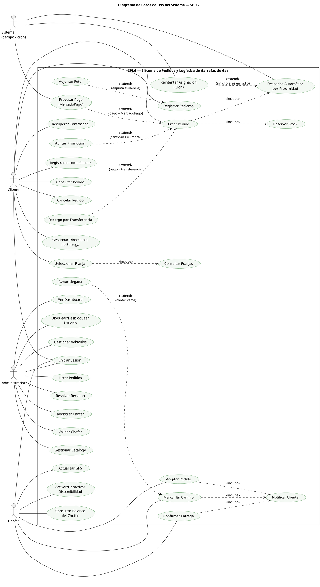
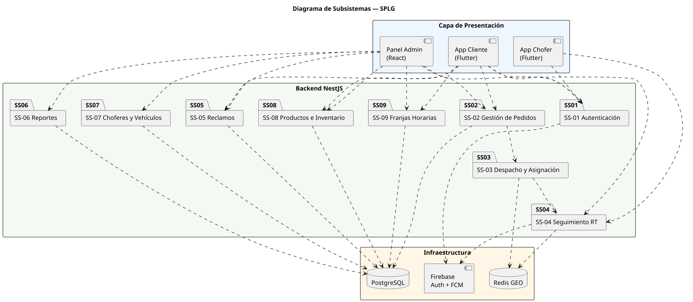
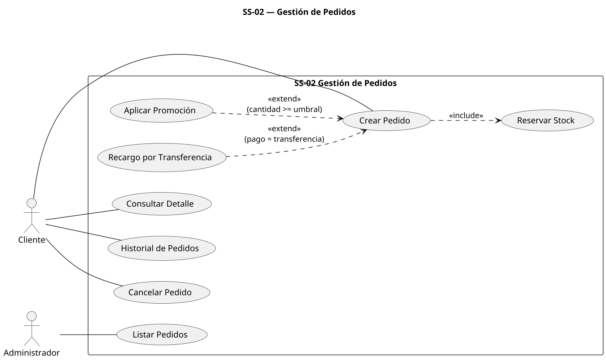
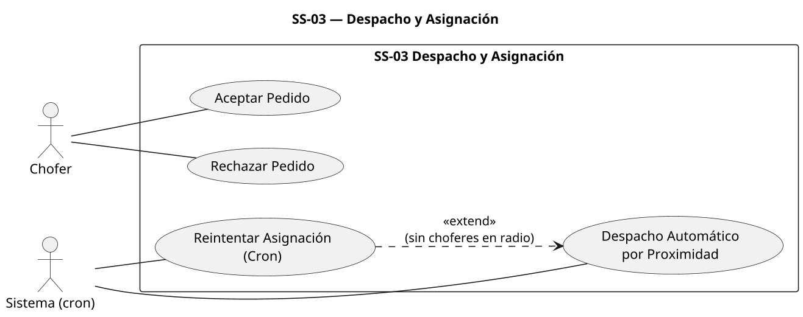
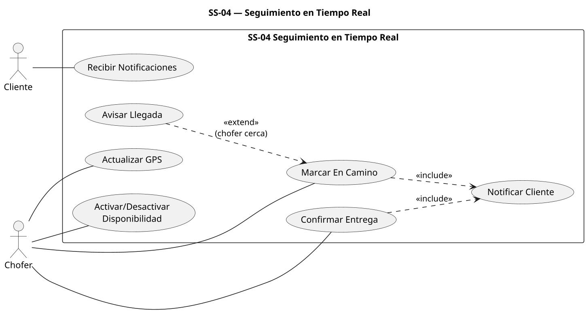
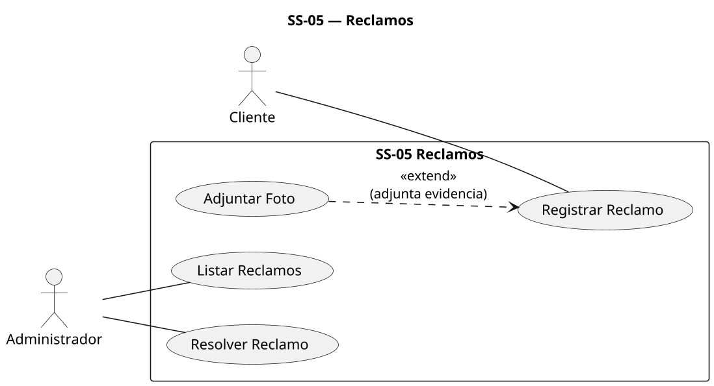
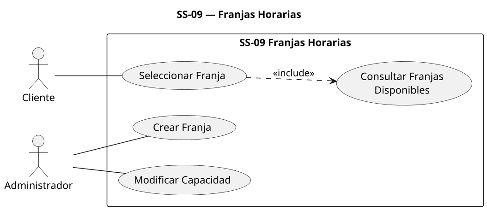

# Guía de Diagramas UML — SPLG (PlantUML)
**Proyecto:** SPLG – Sistema de Pedidos y Logística de Garrafas de Gas
**Autor:** Nahuel Wagner — FCEQyN, UNaM
**Propósito:** Construir los diagramas que pide la cátedra (RUP/UP) en **notación UML formal**, con relaciones `«include»` / `«extend»`, listas para renderizar a PNG e insertar en los Docs 0, 1, 2 y 3.

> Esta guía cubre **los diagramas de casos de uso del sistema y de subsistemas**, porque
> Mermaid `flowchart` no dibuja la notación UML de casos de uso (óvalos, monigotes y
> flechas `«include»` / `«extend»` punteadas). Los diagramas de secuencia sí están en
> Mermaid, en `Casos-de-Uso.md` sección 6 y en `2-Analisis.md` sección 2.1.

---

## 0. Cómo renderizar PlantUML (elegí una)

| Método | Pasos | Cuándo usarlo |
|--------|-------|---------------|
| **Web (lo más rápido)** | Ir a **https://www.plantuml.com/plantuml/uml/** → borrar el ejemplo → pegar el código → la imagen aparece sola → click derecho → *Guardar imagen como* PNG | Para entregar ya |
| **VS Code** | Instalar extensión *PlantUML* (jebbs) + Java + Graphviz → abrir un `.puml` → `Alt+D` previsualiza → click derecho *Export Current Diagram* → PNG/SVG | Si vas a iterar mucho |
| **PlantText** | **https://www.planttext.com/** → pegar → *Refresh* → descargar | Alternativa web |

> **Tip de calidad:** exportá en **SVG** si la cátedra acepta, o PNG a `@scale 1.5` para que no se pixele en el Word/PDF. Para PNG nítido agregá `skinparam dpi 150` al inicio del bloque.

**Convención de nombres** (guardar todo en `docs/`):

| Archivo PNG | Inserta en |
|-------------|-----------|
| `diagrama-cu-sistema.png` | Doc 0 §6 y Doc 1 §3 |
| `diagrama-subsistemas.png` | Doc 1 §4 |
| `cu-ss02-pedidos.png` | Doc 1 §6 |
| `cu-ss03-despacho.png` | Doc 1 §6 |
| `cu-ss04-seguimiento.png` | Doc 1 §6 |
| `cu-ss05-reclamos.png` | Doc 1 §6 |
| `cu-ss09-franjas.png` | Doc 1 §6 |

---

## 1. Cómo se leen `«include»` y `«extend»` (para defenderlo en la mesa)

| Relación | Significado | Dirección de la flecha (punteada) | Regla mnemotécnica |
|----------|-------------|-----------------------------------|--------------------|
| **`«include»`** | El comportamiento **siempre** ocurre. Se factoriza para no repetirlo en varios CU. | **CU base ⇢ CU incluido** | "Para hacer A, **obligatoriamente** hago B" |
| **`«extend»`** | Comportamiento **opcional/condicional**. Se agrega solo si se cumple una condición en un *punto de extensión*. | **CU que extiende ⇢ CU base** | "A veces, sobre B, **además** pasa A" |

Las flechas SIEMPRE son **punteadas** (`..>`) con el estereotipo escrito. El error más común es invertir la dirección del `extend`: la flecha va **desde** el caso opcional **hacia** el caso base.

### Relaciones definidas en SPLG

**`«include»` (siempre se ejecutan):**

| CU base | incluye | Justificación |
|---------|---------|---------------|
| CU-005 Crear Pedido | → Reservar Stock | Toda creación reserva stock en transacción (DSS de stock) |
| CU-005 Crear Pedido | → CU-013 Despacho Automático | El despacho se dispara siempre al confirmar el pedido |
| CU-044 Seleccionar Franja | → CU-045 Consultar Franjas Disponibles | Para elegir, primero siempre se consultan las disponibles |
| CU-015 / CU-018 / CU-020 | → Notificar Cliente | Los tres disparan la misma notificación WS+FCM |

**`«extend»` (condicionales):**

| CU que extiende | extiende a | Punto de extensión |
|-----------------|-----------|--------------------|
| CU-014 Reintentar Asignación | → CU-013 Despacho Automático | *no hay choferes en el radio* |
| Aplicar Promoción | → CU-005 Crear Pedido | *cantidad ≥ umbral de promoción* |
| Recargo por Transferencia | → CU-005 Crear Pedido | *método de pago = transferencia* |
| CU-019 Avisar Llegada | → CU-018 Marcar En Camino | *el chofer está cerca del destino* |
| Adjuntar Foto al Reclamo | → CU-023 Registrar Reclamo | *el cliente adjunta evidencia* |
| CU-048 Procesar Pago (MercadoPago) | → CU-005 Crear Pedido | *método de pago = MercadoPago* |

> "Reservar Stock", "Notificar Cliente", "Aplicar Promoción", "Recargo por Transferencia" y "Adjuntar Foto" son **casos de uso factorizados**: no eran CU numerados, los introducimos justamente para expresar la relación. No hace falta darles un CU-XXX; alcanza con nombrarlos en el diagrama.

---

## 2. Diagrama de Casos de Uso del Sistema  → `diagrama-cu-sistema.png`

**Qué muestra:** el límite del sistema (rectángulo), los 4 actores, los CU principales agrupados por subsistema y las relaciones `«include»`/`«extend»`.

> Para que no quede ilegible, este diagrama del **sistema** muestra los CU **críticos + los que tienen include/extend**. El detalle de cada subsistema va en los diagramas de la sección §4.



---

## 3. Diagrama de Subsistemas  → `diagrama-subsistemas.png`

**Qué muestra:** los 9 subsistemas como paquetes, los frontends que los consumen y la infraestructura, con dependencias `..>`.



---

## 4. Diagramas de Casos de Uso por Subsistema

Solo se incluyen acá los subsistemas que tienen `include`/`extend` (los demás —SS-01, SS-06, SS-07, SS-08— son CU planos asociados a su actor; podés generarlos con la misma plantilla quitando las flechas punteadas).

### 4.1 SS-02 — Gestión de Pedidos  → `cu-ss02-pedidos.png`



### 4.2 SS-03 — Despacho y Asignación  → `cu-ss03-despacho.png`



### 4.3 SS-04 — Seguimiento en Tiempo Real  → `cu-ss04-seguimiento.png`



### 4.4 SS-05 — Reclamos  → `cu-ss05-reclamos.png`



### 4.5 SS-09 — Franjas Horarias  → `cu-ss09-franjas.png`



---

## 5. Checklist de inserción en los documentos

1. Renderizá cada bloque `@startuml … @enduml` y guardá el PNG con el nombre de la tabla §0.
2. En cada documento, reemplazá el placeholder `> **[ INSERTAR IMAGEN: xxx.png ]**` por:
   ```markdown
   
   *Figura X — Diagrama de Casos de Uso del Sistema (SPLG)*
   ```
3. Verificá que el texto de cada CU mencione su relación (ya agregado en Doc 1 §6.4 "Relaciones entre Casos de Uso").

---

## 6. Cómo armar un diagrama de CU desde cero (método, para defenderlo)

1. **Dibujá el límite del sistema:** un rectángulo con el nombre del sistema. Todo lo de adentro es funcionalidad; los actores quedan **afuera**.
2. **Ubicá los actores:** un monigote por cada rol que interactúa (Cliente, Chofer, Admin) **+ actores no humanos** (Sistema/cron, pasarela de pago si aplica). Regla: un actor es algo *externo* que dispara o recibe valor del sistema.
3. **Un óvalo por caso de uso:** nombre en **verbo + sustantivo** ("Crear Pedido", no "Pedido").
4. **Asociaciones actor–CU:** línea sólida del actor al óvalo que inicia.
5. **Factorizá lo repetido con `«include»`:** si el mismo sub-flujo aparece en 2+ CU y es obligatorio, sacalo a un CU aparte y apuntá `base ..> incluido : «include»`.
6. **Modelá lo opcional con `«extend»`:** si un comportamiento ocurre solo bajo condición, hacé un CU aparte y apuntá `opcional ..> base : «extend»` anotando el punto de extensión.
7. **No mezcles `«include»`/`«extend»` con asociaciones de actor:** las punteadas son CU↔CU; las sólidas son actor↔CU.
8. **Mantené granularidad pareja:** un CU debe representar un objetivo completo del actor, no un clic ni un módulo entero.
</content>
</invoke>
