# DER de SPLG, en Mermaid — generado

Generado por `generar-modelo-datos.py` desde la base en ejecución: 85 tablas, 230 relaciones. Se pega tal cual en `3-Diseño.md` §7.4.2 (los `.md` son la fuente; esto se corre de nuevo y se vuelve a pegar si la base cambia). Cada lámina es un `erDiagram` válido por separado (uno por contexto de negocio) más una lámina final con las relaciones que cruzan de un contexto a otro.

### Organización y acceso

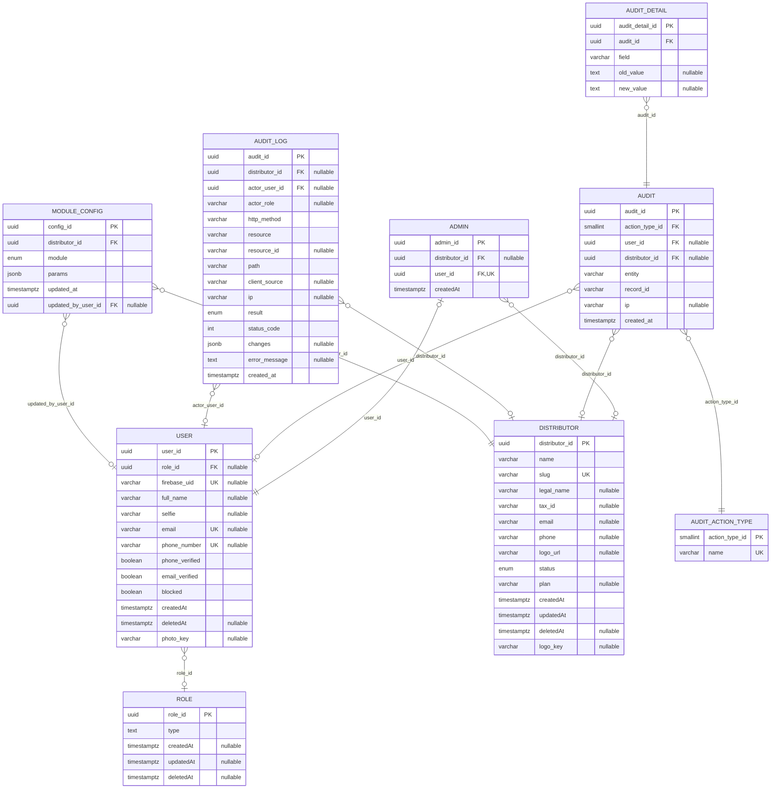

### Clientes

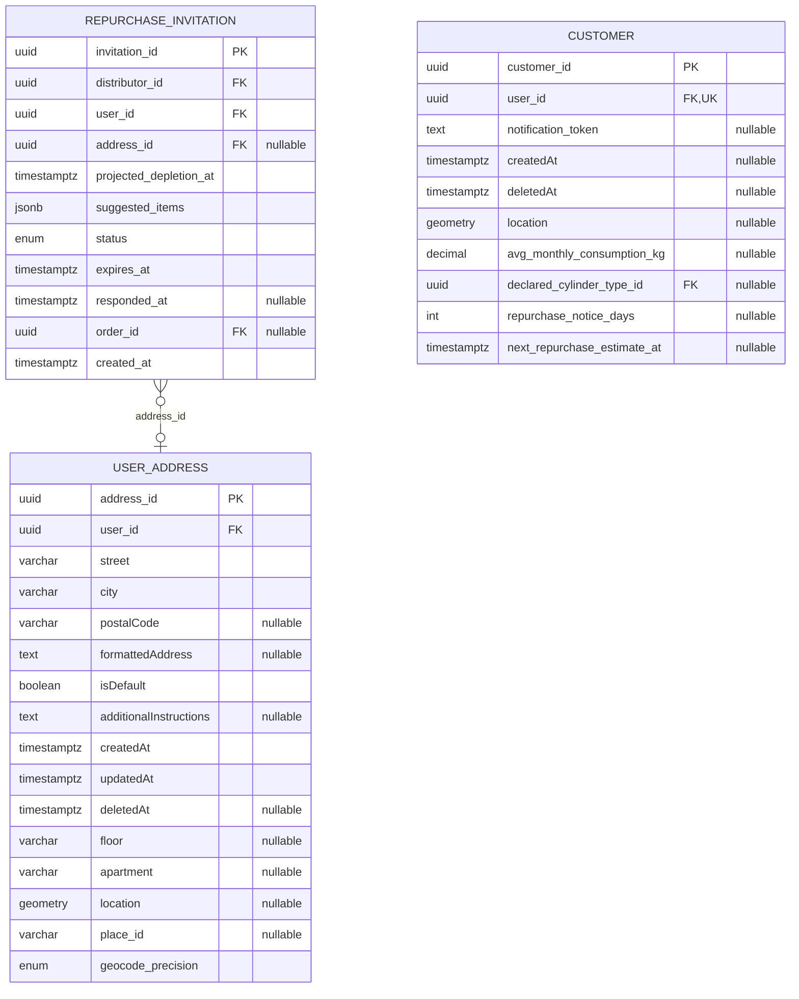

### Catálogo e inventario de envases

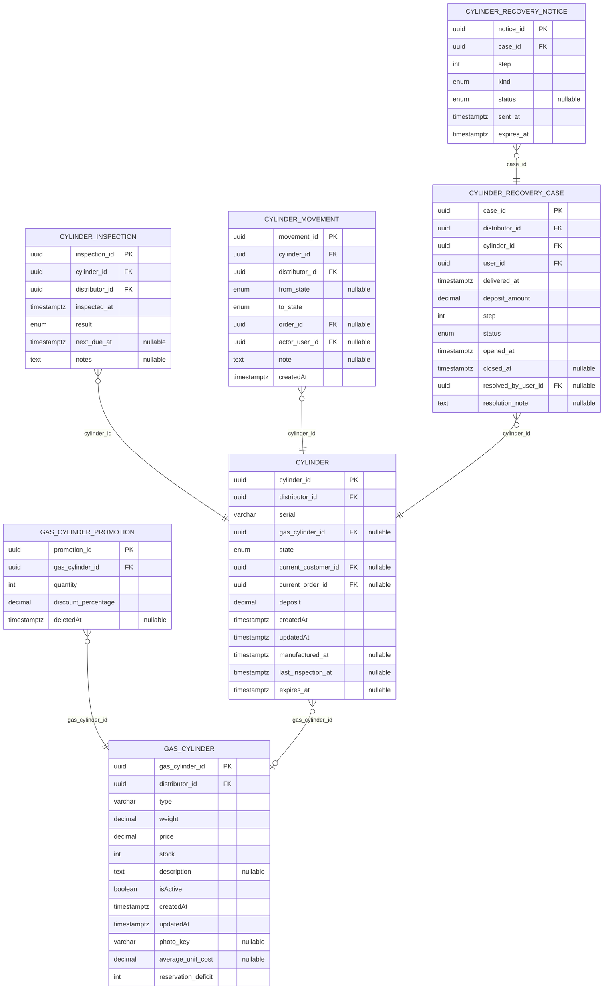

### Venta y pedidos

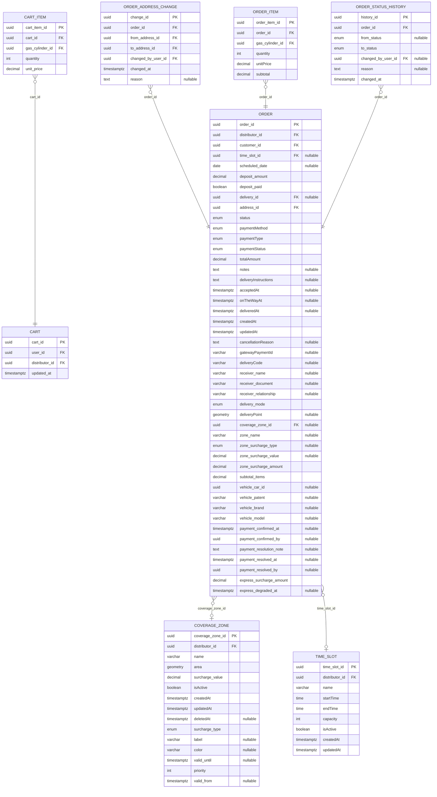

### Pagos

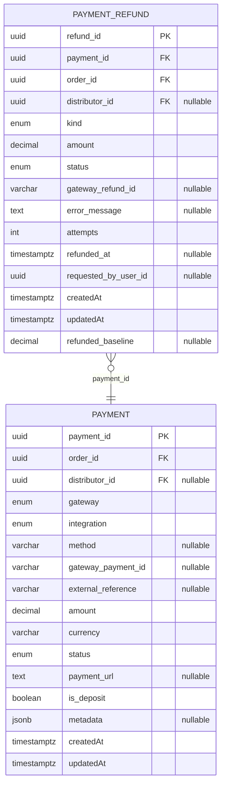

### Despacho y logística

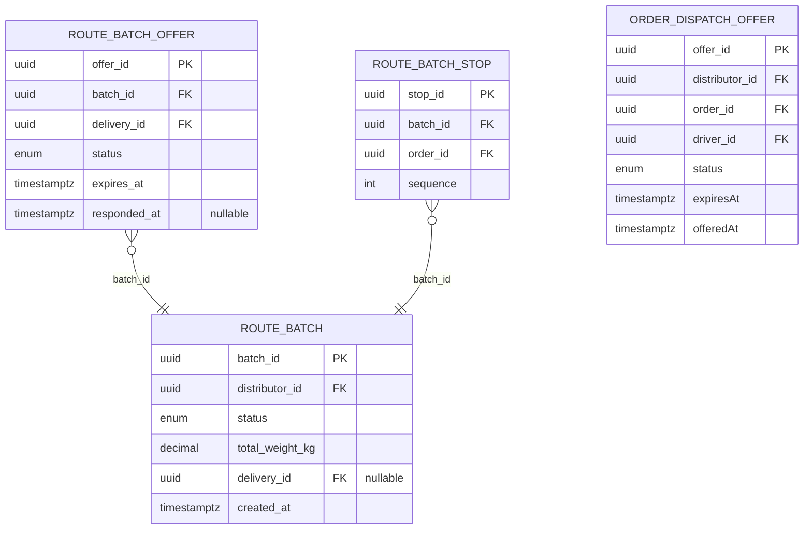

### Flota y choferes

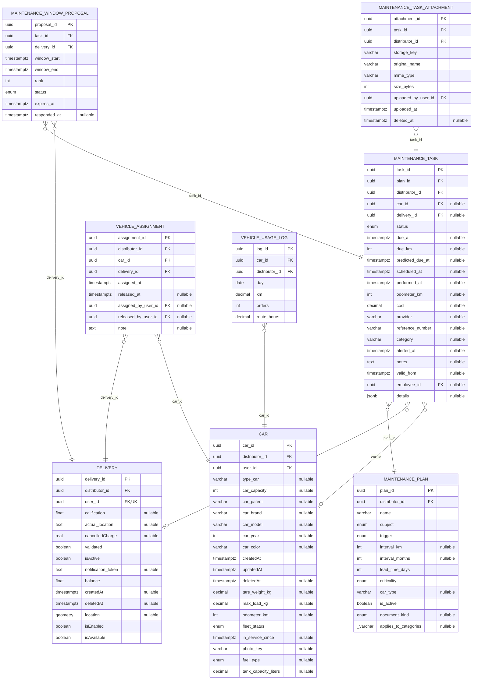

### Posventa

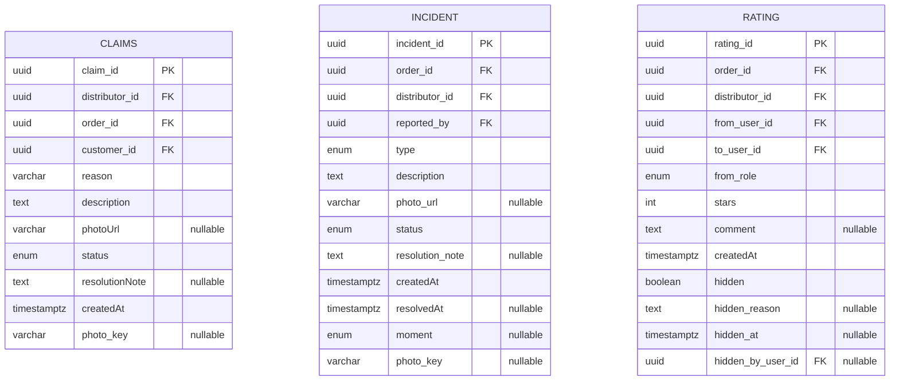

### Personal

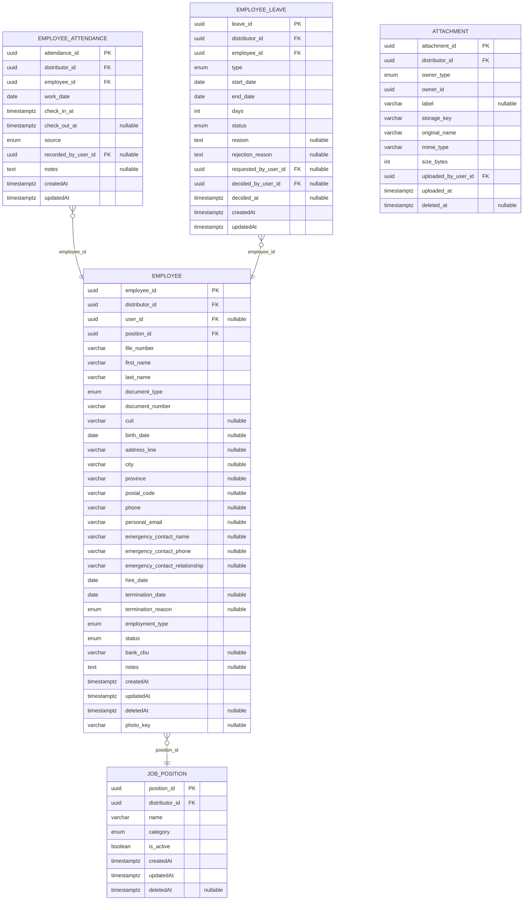

### Gastos de la flota

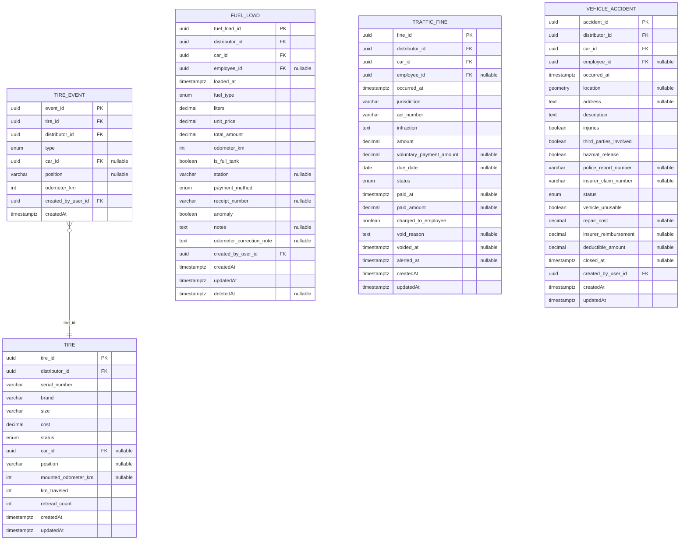

### Stock físico y carga del camión

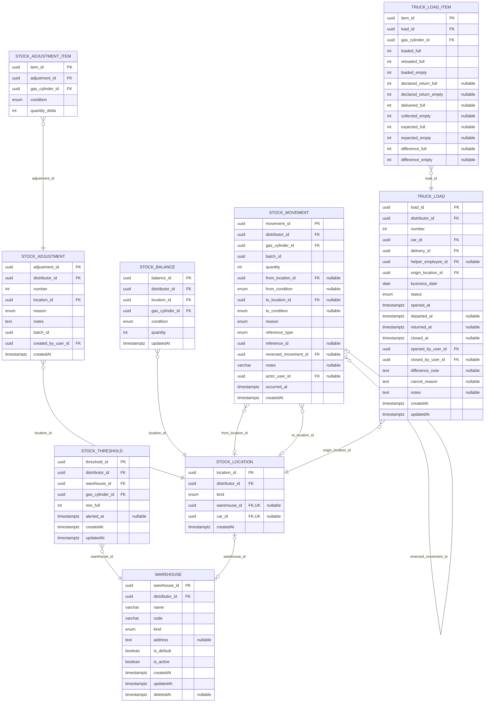

### Compras

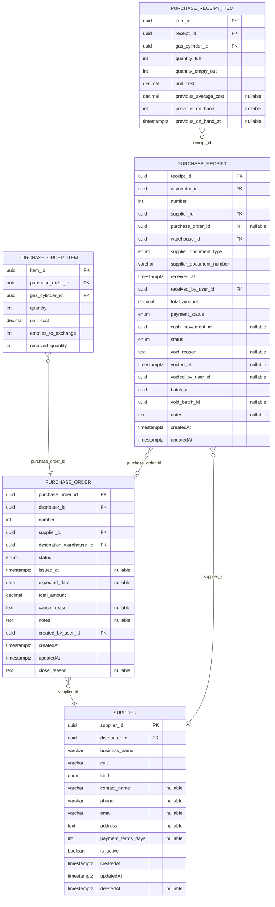

### Tablas técnicas

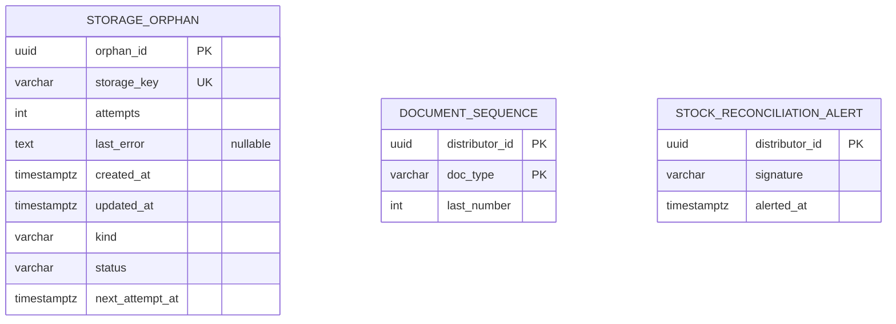

### Caja y finanzas

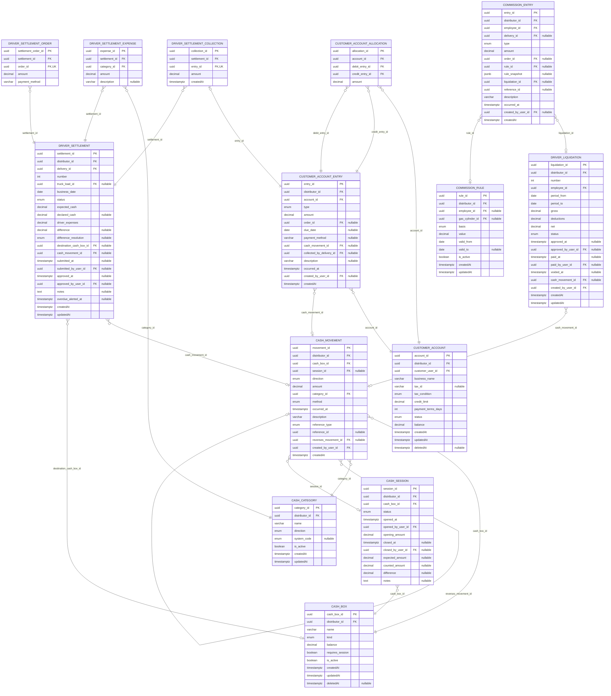

### Relaciones entre contextos

Las que cruzan de un contexto a otro (ya sin repetir la entidad completa; sus columnas están en la lámina de su propio contexto). La relación con `distributor` se omite acá también por lo mismo que en el conceptual: prácticamente todo pertenece a una distribuidora.

```mermaid
erDiagram
    ATTACHMENT }o--|| USER : "uploaded_by_user_id"
    CAR }o--|| USER : "user_id"
    CART }o--|| USER : "user_id"
    CASH_SESSION }o--o| USER : "closed_by_user_id"
    CASH_SESSION }o--|| USER : "opened_by_user_id"
    CUSTOMER }o--o| GAS_CYLINDER : "declared_cylinder_type_id"
    CUSTOMER |o--|| USER : "user_id"
    CUSTOMER_ACCOUNT }o--|| USER : "customer_user_id"
    DELIVERY |o--|| USER : "user_id"
    EMPLOYEE }o--o| USER : "user_id"
    PURCHASE_ORDER }o--|| USER : "created_by_user_id"
    PURCHASE_ORDER }o--|| WAREHOUSE : "destination_warehouse_id"
    STOCK_THRESHOLD }o--|| GAS_CYLINDER : "gas_cylinder_id"
    USER_ADDRESS }o--|| USER : "user_id"
    CART_ITEM }o--|| GAS_CYLINDER : "gas_cylinder_id"
    CASH_MOVEMENT }o--|| USER : "created_by_user_id"
    COMMISSION_RULE }o--o| EMPLOYEE : "employee_id"
    COMMISSION_RULE }o--o| GAS_CYLINDER : "gas_cylinder_id"
    EMPLOYEE_ATTENDANCE }o--o| USER : "recorded_by_user_id"
    EMPLOYEE_LEAVE }o--o| USER : "decided_by_user_id"
    EMPLOYEE_LEAVE }o--o| USER : "requested_by_user_id"
    FUEL_LOAD }o--|| CAR : "car_id"
    FUEL_LOAD }o--|| USER : "created_by_user_id"
    FUEL_LOAD }o--o| EMPLOYEE : "employee_id"
    MAINTENANCE_TASK }o--o| EMPLOYEE : "employee_id"
    ORDER }o--|| USER_ADDRESS : "address_id"
    ORDER }o--|| USER : "customer_id"
    ORDER }o--o| DELIVERY : "delivery_id"
    PURCHASE_ORDER_ITEM }o--|| GAS_CYLINDER : "gas_cylinder_id"
    PURCHASE_RECEIPT }o--|| USER : "received_by_user_id"
    PURCHASE_RECEIPT }o--|| WAREHOUSE : "warehouse_id"
    ROUTE_BATCH }o--o| DELIVERY : "delivery_id"
    STOCK_LOCATION |o--o| CAR : "car_id"
    TIRE }o--o| CAR : "car_id"
    TRAFFIC_FINE }o--|| CAR : "car_id"
    TRAFFIC_FINE }o--o| EMPLOYEE : "employee_id"
    VEHICLE_ACCIDENT }o--|| CAR : "car_id"
    VEHICLE_ACCIDENT }o--|| USER : "created_by_user_id"
    VEHICLE_ACCIDENT }o--o| EMPLOYEE : "employee_id"
    VEHICLE_ASSIGNMENT }o--o| USER : "assigned_by_user_id"
    VEHICLE_ASSIGNMENT }o--o| USER : "released_by_user_id"
    CLAIMS }o--|| USER : "customer_id"
    CLAIMS }o--|| ORDER : "order_id"
    CUSTOMER_ACCOUNT_ENTRY }o--o| DELIVERY : "collected_by_delivery_id"
    CUSTOMER_ACCOUNT_ENTRY }o--o| USER : "created_by_user_id"
    CUSTOMER_ACCOUNT_ENTRY }o--o| ORDER : "order_id"
    CYLINDER }o--o| USER : "current_customer_id"
    CYLINDER }o--o| ORDER : "current_order_id"
    DRIVER_LIQUIDATION }o--o| USER : "approved_by_user_id"
    DRIVER_LIQUIDATION }o--|| USER : "created_by_user_id"
    DRIVER_LIQUIDATION }o--|| EMPLOYEE : "employee_id"
    DRIVER_LIQUIDATION }o--o| USER : "paid_by_user_id"
    INCIDENT }o--|| ORDER : "order_id"
    INCIDENT }o--|| USER : "reported_by"
    MAINTENANCE_TASK_ATTACHMENT }o--|| USER : "uploaded_by_user_id"
    ORDER_ADDRESS_CHANGE }o--|| USER : "changed_by_user_id"
    ORDER_ADDRESS_CHANGE }o--|| USER_ADDRESS : "from_address_id"
    ORDER_ADDRESS_CHANGE }o--|| USER_ADDRESS : "to_address_id"
    ORDER_DISPATCH_OFFER }o--|| USER : "driver_id"
    ORDER_DISPATCH_OFFER }o--|| ORDER : "order_id"
    ORDER_ITEM }o--|| GAS_CYLINDER : "gas_cylinder_id"
    ORDER_STATUS_HISTORY }o--o| USER : "changed_by_user_id"
    PAYMENT }o--|| ORDER : "order_id"
    PURCHASE_RECEIPT_ITEM }o--|| GAS_CYLINDER : "gas_cylinder_id"
    RATING }o--|| USER : "from_user_id"
    RATING }o--o| USER : "hidden_by_user_id"
    RATING }o--|| ORDER : "order_id"
    RATING }o--|| USER : "to_user_id"
    REPURCHASE_INVITATION }o--o| ORDER : "order_id"
    REPURCHASE_INVITATION }o--|| USER : "user_id"
    ROUTE_BATCH_OFFER }o--|| DELIVERY : "delivery_id"
    ROUTE_BATCH_STOP }o--|| ORDER : "order_id"
    STOCK_ADJUSTMENT }o--|| USER : "created_by_user_id"
    STOCK_BALANCE }o--|| GAS_CYLINDER : "gas_cylinder_id"
    STOCK_MOVEMENT }o--o| USER : "actor_user_id"
    STOCK_MOVEMENT }o--|| GAS_CYLINDER : "gas_cylinder_id"
    TIRE_EVENT }o--o| CAR : "car_id"
    TIRE_EVENT }o--|| USER : "created_by_user_id"
    TRUCK_LOAD }o--|| CAR : "car_id"
    TRUCK_LOAD }o--o| USER : "closed_by_user_id"
    TRUCK_LOAD }o--|| DELIVERY : "delivery_id"
    TRUCK_LOAD }o--o| EMPLOYEE : "helper_employee_id"
    TRUCK_LOAD }o--|| USER : "opened_by_user_id"
    COMMISSION_ENTRY }o--o| USER : "created_by_user_id"
    COMMISSION_ENTRY }o--o| DELIVERY : "delivery_id"
    COMMISSION_ENTRY }o--|| EMPLOYEE : "employee_id"
    COMMISSION_ENTRY }o--o| ORDER : "order_id"
    CYLINDER_MOVEMENT }o--o| USER : "actor_user_id"
    CYLINDER_MOVEMENT }o--o| ORDER : "order_id"
    CYLINDER_RECOVERY_CASE }o--o| USER : "resolved_by_user_id"
    CYLINDER_RECOVERY_CASE }o--|| USER : "user_id"
    DRIVER_SETTLEMENT }o--o| USER : "approved_by_user_id"
    DRIVER_SETTLEMENT }o--|| DELIVERY : "delivery_id"
    DRIVER_SETTLEMENT }o--o| USER : "submitted_by_user_id"
    DRIVER_SETTLEMENT }o--o| TRUCK_LOAD : "truck_load_id"
    PAYMENT_REFUND }o--|| ORDER : "order_id"
    STOCK_ADJUSTMENT_ITEM }o--|| GAS_CYLINDER : "gas_cylinder_id"
    TRUCK_LOAD_ITEM }o--|| GAS_CYLINDER : "gas_cylinder_id"
    CYLINDER_RECOVERY_NOTICE }o--o| ORDER : "order_id"
    DRIVER_SETTLEMENT_ORDER |o--|| ORDER : "order_id"
```
