# Documento 3 — Diseño del Sistema
**Proyecto:** SPLG – Sistema de Pedidos y Logística de Garrafas de Gas  
**Metodología:** Proceso Unificado (PU)  
**Versión:** 1.7  
**Fecha:** 2026-10-14  
**Realizado por:** Nahuel Wagner  
**Realizado para:** Distribuidor de Gas Envasado (Cliente Real)  
**Institución:** FCEQyN – UNaM  

---


## Índice de Figuras

- Figura 1 — Diagrama de componentes
- Figura 2 — Diagrama de despliegue
- Figura 3 — Entornos y recorrido del código
- Figura 4 — CU-001 Iniciar Sesión — Interfaz Gráfica
- Figura 5 — CU-001 Iniciar Sesión — Diagrama de Interacción
- Figura 6 — CU-005 Crear un Pedido — Interfaz Gráfica
- Figura 7 — CU-005 Crear un Pedido — Diagrama de Interacción
- Figura 8 — CU-013 Asignar un Pedido Automáticamente por Proximidad — Interfaz Gráfica
- Figura 9 — CU-013 Asignar un Pedido Automáticamente por Proximidad — Diagrama de Interacción
- Figura 10 — CU-014 Vencer la Oferta y Ofrecer al Siguiente Chofer — Diagrama de Interacción
- Figura 11 — CU-015 Aceptar un Pedido — Interfaz Gráfica
- Figura 12 — CU-015 Aceptar un Pedido — Diagrama de Interacción
- Figura 13 — CU-017 Modificar la Ubicación GPS del Chofer — Interfaz Gráfica
- Figura 14 — CU-017 Modificar la Ubicación GPS del Chofer — Diagrama de Interacción
- Figura 15 — CU-020 Confirmar una Entrega Manualmente — Interfaz Gráfica
- Figura 16 — CU-020 Confirmar una Entrega Manualmente — Diagrama de Interacción
- Figura 17 — CU-048 Procesar el Pago con MercadoPago — Interfaz Gráfica
- Figura 18 — DSD CU-048: Procesar el Pago con MercadoPago · crearCheckoutDePago
- Figura 19 — CU-079 Confirmar una Entrega Escaneando el QR (cliente) — Interfaz Gráfica
- Figura 20 — CU-079 Confirmar una Entrega Escaneando el QR (cliente) — Diagrama de Interacción
- Figura 21 — CU-008 Cancelar un Pedido (Cliente) — Interfaz Gráfica
- Figura 22 — CU-008 Cancelar un Pedido (Cliente) — Diagrama de Interacción
- Figura 23 — CU-002 Registrarse como Cliente — Interfaz Gráfica
- Figura 24 — CU-002 Registrarse como Cliente — Diagrama de Interacción
- Figura 25 — CU-041 Consultar el Catálogo de Productos (Cliente) — Interfaz Gráfica
- Figura 26 — CU-041 Consultar el Catálogo de Productos (Cliente) — Diagrama de Interacción
- Figura 27 — CU-058 Validar la Cobertura de una Dirección — Interfaz Gráfica
- Figura 28 — CU-058 Validar la Cobertura de una Dirección — Diagrama de Interacción
- Figura 29 — CU-042 Crear una Franja Horaria — Interfaz Gráfica
- Figura 30 — CU-042 Crear una Franja Horaria — Diagrama de Interacción
- Figura 31 — CU-006 Consultar el Detalle de un Pedido — Interfaz Gráfica
- Figura 32 — CU-006 Consultar el Detalle de un Pedido — Diagrama de Interacción
- Figura 33 — CU-080 Consultar el Pool de Pedidos Disponibles — Interfaz Gráfica
- Figura 34 — CU-080 Consultar el Pool de Pedidos Disponibles — Diagrama de Interacción
- Figura 35 — CU-022 Activar la Disponibilidad — Interfaz Gráfica
- Figura 36 — CU-022 Activar la Disponibilidad — Diagrama de Interacción
- Figura 37 — CU-018 Marcar un Pedido "En Camino" — Interfaz Gráfica
- Figura 38 — CU-018 Marcar un Pedido "En Camino" — Diagrama de Interacción
- Figura 39 — CU-078 Consultar el Código de Entrega (QR del chofer) — Interfaz Gráfica
- Figura 40 — CU-078 Consultar el Código de Entrega (QR del chofer) — Diagrama de Interacción
- Figura 41 — CU-292 Confirmar el Cobro en Efectivo — Interfaz Gráfica
- Figura 42 — CU-292 Confirmar el Cobro en Efectivo — Diagrama de Interacción
- Figura 43 — CU-232 Declarar el Efectivo Rendido — Interfaz Gráfica
- Figura 44 — CU-232 Declarar el Efectivo Rendido — Diagrama de Interacción
- Figura 45 — CU-233 Aprobar la Rendición del Chofer — Interfaz Gráfica
- Figura 46 — CU-233 Aprobar la Rendición del Chofer — Diagrama de Interacción
- Figura 47 — CU-227 Cerrar la Caja con Arqueo — Interfaz Gráfica
- Figura 48 — CU-227 Cerrar la Caja con Arqueo — Diagrama de Interacción
- Figura 49 — CU-036 Crear un Producto (Garrafa) — Interfaz Gráfica
- Figura 50 — CU-036 Crear un Producto (Garrafa) — Diagrama de Interacción
- Figura 51 — CU-038 Modificar el Stock de un Producto — Interfaz Gráfica
- Figura 52 — CU-038 Modificar el Stock de un Producto — Diagrama de Interacción
- Figura 53 — CU-217 Registrar la Recepción de una Compra — Interfaz Gráfica
- Figura 54 — CU-217 Registrar la Recepción de una Compra — Diagrama de Interacción
- Figura 55 — CU-218 Registrar la Carga del Camión — Interfaz Gráfica
- Figura 56 — CU-218 Registrar la Carga del Camión — Diagrama de Interacción
- Figura 57 — CU-068 Asignar los Envases a un Pedido — Interfaz Gráfica
- Figura 58 — CU-068 Asignar los Envases a un Pedido — Diagrama de Interacción
- Figura 59 — CU-070 Registrar un Movimiento de Envase (cambio de estado) — Interfaz Gráfica
- Figura 60 — CU-070 Registrar un Movimiento de Envase (cambio de estado) — Diagrama de Interacción
- Figura 61 — CU-031 Registrar un Chofer (Gestión de la Flota) — Interfaz Gráfica
- Figura 62 — CU-031 Registrar un Chofer (Gestión de la Flota) — Listado de choferes
- Figura 63 — CU-031 Registrar un Chofer (Gestión de la Flota) — Diagrama de Interacción
- Figura 64 — CU-032 Validar un Chofer — Interfaz Gráfica
- Figura 65 — CU-032 Validar un Chofer — Diagrama de Interacción
- Figura 66 — CU-060 Registrar una Incidencia de Entrega — Interfaz Gráfica
- Figura 67 — CU-060 Registrar una Incidencia de Entrega — Diagrama de Interacción
- Figura 68 — CU-023 Registrar un Reclamo — Interfaz Gráfica
- Figura 69 — CU-023 Registrar un Reclamo — Diagrama de Interacción
- Figura 70 — CU-025 Resolver un Reclamo — Interfaz Gráfica
- Figura 71 — CU-025 Resolver un Reclamo — Diagrama de Interacción
- Figura 72 — CU-026 Consultar el Tablero General — Interfaz Gráfica
- Figura 73 — CU-026 Consultar el Tablero General — Diagrama de Interacción
- Figura 74 — CU-072 Crear una Reserva Programada con Seña — Interfaz Gráfica
- Figura 75 — CU-072 Crear una Reserva Programada con Seña — Diagrama de Interacción
- Figura 76 — CU-177 Registrar el Legajo de un Empleado — Interfaz Gráfica
- Figura 77 — CU-177 Registrar el Legajo de un Empleado — Aviso de cambios sin guardar
- Figura 78 — CU-177 Registrar el Legajo de un Empleado — Diagrama de Interacción
- Figura 79 — CU-195 Registrar una Carga de Combustible — Interfaz Gráfica
- Figura 80 — CU-195 Registrar una Carga de Combustible — Diagrama de Interacción
- Figura 81 — CU-201 Registrar un Siniestro — Interfaz Gráfica
- Figura 82 — CU-201 Registrar un Siniestro — Diagrama de Interacción
- Figura 83 — CU-052 Registrar una Distribuidora — Interfaz Gráfica
- Figura 84 — CU-052 Registrar una Distribuidora — Diagrama de Interacción
- Figura 85 — DSD CU-001: Iniciar Sesión
- Figura 86 — DSD CU-002: Registrarse como Cliente
- Figura 87 — DSD CU-004: Consultar el Perfil de Usuario — Operación: consultarPerfil(usuarioId)
- Figura 88 — DSD CU-004: Consultar el Perfil de Usuario — Operación: consultarPerfilCliente(usuarioId)
- Figura 89 — DSD CU-251: Modificar el Perfil de Usuario — Operación: actualizarPerfil(usuarioId, datos)
- Figura 90 — DSD CU-047: Recuperar la Contraseña — Operación: solicitarRecuperacionDeClave(correo)
- Figura 91 — DSD CU-336: Cambiar el Correo del Usuario — Operación: cambiarCorreo(correoActual, correoNuevo)
- Figura 92 — DSD CU-050: Bloquear un Usuario — Operación: bloquearUsuario(usuarioId)
- Figura 93 — DSD CU-270: Desbloquear un Usuario — Operación: desbloquearUsuario(usuarioId)
- Figura 94 — DSD CU-082: Crear un Usuario Base
- Figura 95 — DSD CU-083: Consultar los Usuarios — Operación: listarUsuarios(pagina, limite, textoDeBusqueda)
- Figura 96 — DSD CU-272: Buscar un Usuario — Operación: buscarUsuarioPorCorreo(correo)
- Figura 97 — DSD CU-272: Buscar un Usuario — Operación: buscarUsuarioPorTelefono(telefono)
- Figura 98 — DSD CU-085: Dar de Baja un Usuario
- Figura 99 — DSD CU-005: Crear un Pedido
- Figura 100 — DSD CU-006: Consultar el Detalle de un Pedido
- Figura 101 — DSD CU-302: Cotizar un Pedido — Operación: cotizarPedido(items, medioDePago, direccionId, clienteId, pedidoId)
- Figura 102 — DSD CU-007: Consultar el Historial de Pedidos
- Figura 103 — DSD CU-348: Consultar el Reintegro de un Pedido
- Figura 104 — DSD CU-169: Registrar el Cambio de Estado de un Pedido — Operación: registrarCambioDeEstado(pedidoId, estadoAnterior, estadoNuevo, autor, motivo)
- Figura 105 — DSD CU-170: Consultar el Historial de Estados de un Pedido
- Figura 106 — DSD CU-143: Declarar el Consumo Promedio al Registrarse
- Figura 107 — DSD CU-144: Modificar el Consumo Promedio Declarado
- Figura 108 — DSD CU-145: Configurar los Días de Aviso Previo a la Recompra
- Figura 109 — DSD CU-146: Consultar la Fecha Estimada de Recompra
- Figura 110 — DSD CU-147: Realizar una Compra Express
- Figura 111 — DSD CU-148: Elegir la Modalidad de Entrega del Pedido
- Figura 112 — DSD CU-008: Cancelar un Pedido (Cliente) — Operación: cancelarMiPedido(pedidoId, motivo)
- Figura 113 — DSD CU-009: Liberar un Pedido (Chofer)
- Figura 114 — DSD CU-010: Cancelar un Pedido (Administrador) — Operación: cancelarPedido(pedidoId, motivo)
- Figura 115 — DSD CU-168: Reintegrar el Pago de un Pedido
- Figura 116 — DSD CU-292: Confirmar el Cobro en Efectivo — Operación: confirmarCobroEnEfectivo(pedidoId)
- Figura 117 — DSD CU-293: Informar el Cobro Impago — Operación: informarCobroImpago(pedidoId, nota)
- Figura 118 — DSD CU-294: Resolver un Cobro Impago — Operación: resolverCobroImpago(pedidoId, resolucion, nota, cajaId)
- Figura 119 — DSD CU-299: Registrar el Cobro en Efectivo como Administrador — Operación: registrarCobroEnEfectivoPorAdmin(pedidoId, motivo, cajaId)
- Figura 120 — DSD CU-300: Registrar el Cobro Impago como Administrador — Operación: registrarCobroImpagoPorAdmin(pedidoId, motivo)
- Figura 121 — DSD CU-301: Confirmar una Transferencia — Operación: confirmarTransferencia(pedidoId, recibida, motivo)
- Figura 122 — DSD CU-011: Consultar Todos los Pedidos
- Figura 123 — DSD CU-046: Consultar las Direcciones de Entrega del Cliente · consultarDireccionesDeEntrega
- Figura 124 — DSD CU-116: Registrar una Dirección de Entrega — Operación: registrarDireccionDeEntrega(datos)
- Figura 125 — DSD CU-117: Consultar Detalle de una Dirección de Entrega
- Figura 126 — DSD CU-118: Modificar una Dirección de Entrega — Operación: editarDireccionDeEntrega(direccionId, cambios)
- Figura 127 — DSD CU-119: Dar de Baja una Dirección de Entrega — Operación: eliminarDireccionDeEntrega(direccionId)
- Figura 128 — DSD CU-120: Marcar una Dirección como Predeterminada — Operación: marcarDireccionPredeterminada(direccionId)
- Figura 129 — DSD CU-121: Consultar la Dirección Predeterminada
- Figura 130 — DSD CU-122: Agregar un Ítem al Carrito
- Figura 131 — DSD CU-123: Modificar la Cantidad de un Ítem del Carrito
- Figura 132 — DSD CU-124: Quitar un Ítem del Carrito
- Figura 133 — DSD CU-125: Consultar el Carrito
- Figura 134 — DSD CU-126: Vaciar el Carrito
- Figura 135 — DSD CU-127: Cambiar la Dirección de Entrega del Pedido
- Figura 136 — DSD CU-128: Indicar Quién Recibe el Pedido
- Figura 137 — DSD CU-080: Consultar el Pool de Pedidos Disponibles
- Figura 138 — DSD CU-081: Consultar los Pedidos Asignados al Chofer
- Figura 139 — DSD CU-338: Retomar el Pedido en Curso — Operación: consultarPedidoEnCurso()
- Figura 140 — DSD CU-339: Modificar un Pedido Pendiente (Administrador) — Operación: modificarPedido(pedidoId, datos)
- Figura 141 — DSD CU-341: Modificar un Pedido Pendiente (Cliente) — Operación: modificarMiPedido(pedidoId, datos)
- Figura 142 — DSD CU-013: Asignar un Pedido Automáticamente por Proximidad — Operación: ofrecerAlSiguienteChofer(pedidoId)
- Figura 143 — DSD CU-014: Vencer la Oferta y Ofrecer al Siguiente Chofer — Operación: vencerOfertasExpiradas()
- Figura 144 — DSD CU-015: Aceptar un Pedido — Operación: aceptarPedido(pedidoId)
- Figura 145 — DSD CU-016: Rechazar un Pedido Ofrecido — Operación: rechazarOferta(pedidoId)
- Figura 146 — DSD CU-012: Asignar un Chofer Manualmente
- Figura 147 — DSD CU-171: Configurar los Parámetros de Despacho de la Distribuidora — Operación: configurarParametrosDeDespacho(radiosKm, ventanaDeAceptacion)
- Figura 148 — DSD CU-149: Despachar un Pedido Express a un Chofer en Moto — Operación: despacharPedidoExpress(pedidoId)
- Figura 149 — DSD CU-017: Modificar la Ubicación GPS del Chofer — Operación: actualizarUbicacion(usuarioId, latitud, longitud)
- Figura 150 — DSD CU-020: Confirmar una Entrega Manualmente — Operación: confirmarEntrega(pedidoId, motivo)
- Figura 151 — DSD CU-078: Consultar el Código de Entrega (QR del chofer) — Operación: obtenerCodigoDeEntrega(pedidoId)
- Figura 152 — DSD CU-079: Confirmar una Entrega Escaneando el QR (cliente) — Operación: confirmarEntregaConCodigo(pedidoId, codigo, motivo)
- Figura 153 — DSD CU-303: Consultar la Ruta de un Pedido — Operación: consultarRutaDelPedido(pedidoId, desde)
- Figura 154 — DSD CU-018: Marcar un Pedido "En Camino" — Operación: marcarPedidoEnCamino(pedidoId)
- Figura 155 — DSD CU-019: Avisar la Llegada al Cliente — Operación: avisarLlegada(pedidoId)
- Figura 156 — DSD CU-022: Activar la Disponibilidad — Operación: activarDisponibilidad(usuarioId)
- Figura 157 — DSD CU-266: Desactivar la Disponibilidad — Operación: desactivarDisponibilidad(usuarioId)
- Figura 158 — DSD CU-023: Registrar un Reclamo — Operación: registrarReclamo(pedidoId, motivo, evidencia)
- Figura 159 — DSD CU-024: Consultar los Reclamos — Operación: listarReclamos()
- Figura 160 — DSD CU-025: Resolver un Reclamo
- Figura 161 — DSD CU-166: Tomar un Reclamo Pendiente
- Figura 162 — DSD CU-167: Reabrir un Reclamo — Operación: reabrirReclamo(reclamoId, motivo)
- Figura 163 — DSD CU-174: Adjuntar la Fotografía de un Reclamo — Operación: adjuntarFotoAlReclamo(reclamoId, imagen)
- Figura 164 — DSD CU-175: Consultar la Fotografía de un Reclamo — Operación: consultarFotoDelReclamo(reclamoId)
- Figura 165 — DSD CU-026: Consultar el Tablero General · consultarResumenDePedidos
- Figura 166 — DSD CU-026: Consultar el Tablero General · consultarGraficoDeVentas
- Figura 167 — DSD CU-027: Consultar el Reporte de Ventas por Chofer
- Figura 168 — DSD CU-028: Consultar el Reporte de Ventas por Producto
- Figura 169 — DSD CU-029: Consultar el Reporte por Método de Pago
- Figura 170 — DSD CU-030: Consultar el Gráfico de Ventas (últimos 7 días)
- Figura 171 — DSD CU-304: Consultar los Cobros Pendientes — Operación: consultarCobrosPendientes(desde, hasta)
- Figura 172 — DSD CU-031: Registrar un Chofer (Gestión de la Flota) — Operación: registrarChoferEnLaFlota(datosPersonales, datosDelChofer, distribuidoraId)
- Figura 173 — DSD CU-032: Validar un Chofer — Operación: validarChofer(choferId)
- Figura 174 — DSD CU-271: Invalidar un Chofer — Operación: invalidarChofer(choferId)
- Figura 175 — DSD CU-033: Activar un Chofer — Operación: activarChofer(choferId)
- Figura 176 — DSD CU-267: Desactivar un Chofer — Operación: desactivarChofer(choferId)
- Figura 177 — DSD CU-034: Registrar un Vehículo del Chofer
- Figura 178 — DSD CU-035: Consultar el Listado de Choferes
- Figura 179 — DSD CU-035: Consultar el Listado de Choferes — Operación: listarChoferesActivos(pagina, limite)
- Figura 180 — DSD CU-049: Consultar las Ganancias del Chofer — Operación: consultarPerfilDelChofer(usuarioId)
- Figura 181 — DSD CU-337: Ajustar el Saldo del Chofer — Operación: ajustarSaldoDelChofer(choferId, monto)
- Figura 182 — DSD CU-051: Consultar el Listado de Vehículos
- Figura 183 — DSD CU-096: Modificar el Perfil del Chofer
- Figura 184 — DSD CU-097: Dar de Baja un Chofer
- Figura 185 — DSD CU-109: Consultar el Detalle del Chofer — Operación: consultarDetalleDelChofer(choferId)
- Figura 186 — DSD CU-110: Buscar un Chofer por Usuario
- Figura 187 — DSD CU-111: Modificar un Vehículo — Operación: editarVehiculo(vehiculoId, datos)
- Figura 188 — DSD CU-112: Dar de Baja un Vehículo — Operación: eliminarVehiculo(vehiculoId)
- Figura 189 — DSD CU-113: Consultar el Detalle del Vehículo
- Figura 190 — DSD CU-114: Buscar un Vehículo por Patente — Operación: buscarVehiculoPorPatente(patente)
- Figura 191 — DSD CU-115: Consultar los Vehículos de un Chofer
- Figura 192 — DSD CU-136: Registrar el Seguro del Vehículo — Operación: registrarSeguroDelVehiculo(planId, recursoId, vencimiento, detalle)
- Figura 193 — DSD CU-137: Registrar la Verificación Técnica Vehicular — Operación: registrarVerificacionTecnica(planId, recursoId, vencimiento, detalle)
- Figura 194 — DSD CU-138: Registrar la Licencia de Conducir del Chofer — Operación: registrarLicenciaDeConducir(planId, recursoId, vencimiento, detalle)
- Figura 195 — DSD CU-139: Consultar los Vencimientos de la Flota
- Figura 196 — DSD CU-140: Programar un Mantenimiento de Vehículo — Operación: programarMantenimientoDeVehiculo(planId, recursoId, vencimiento, detalle)
- Figura 197 — DSD CU-141: Registrar un Mantenimiento Realizado
- Figura 198 — DSD CU-142: Avisar los Vencimientos Próximos de la Flota — Operación: avisarVencimientosDeLaFlota()
- Figura 199 — DSD CU-155: Adjuntar un Archivo a una Tarea de Flota
- Figura 200 — DSD CU-156: Consultar los Adjuntos de una Tarea de Flota
- Figura 201 — DSD CU-157: Descargar un Adjunto de Flota
- Figura 202 — DSD CU-158: Eliminar un Adjunto de Flota
- Figura 203 — DSD CU-159: Almacenar un Archivo
- Figura 204 — DSD CU-160: Recuperar un Archivo
- Figura 205 — DSD CU-161: Poner un Vehículo en Uso para un Chofer
- Figura 206 — DSD CU-162: Liberar el Vehículo en Uso de un Chofer
- Figura 207 — DSD CU-163: Consultar el Vehículo en Uso de un Chofer
- Figura 208 — DSD CU-163: Consultar el Vehículo en Uso de un Chofer — Operación: consultarMiVehiculoEnUso()
- Figura 209 — DSD CU-164: Consultar el Historial de Vehículos de un Chofer
- Figura 210 — DSD CU-165: Consultar el Historial de Choferes de un Vehículo
- Figura 211 — DSD CU-195: Registrar una Carga de Combustible — Operación: registrarCargaDeCombustible(vehiculoId, datos)
- Figura 212 — DSD CU-320: Modificar una Carga de Combustible — Operación: modificarCargaDeCombustible(cargaId, datos)
- Figura 213 — DSD CU-321: Anular una Carga de Combustible — Operación: anularCargaDeCombustible(cargaId)
- Figura 214 — DSD CU-322: Consultar las Cargas de Combustible — Operación: consultarCargasDeCombustible(filtros)
- Figura 215 — DSD CU-196: Consultar el Consumo de Combustible de un Vehículo — Operación: consultarConsumoDeCombustible(vehiculoId, fechaDesde, fechaHasta)
- Figura 216 — DSD CU-197: Registrar la Habilitación para Transportar Mercancías Peligrosas — Operación: registrarHabilitacionDeMercanciasPeligrosas(planId, recursoId, vencimiento, detalle)
- Figura 217 — DSD CU-198: Registrar una Multa de Tránsito — Operación: registrarMultaDeTransito(vehiculoId, datos)
- Figura 218 — DSD CU-323: Modificar una Multa de Tránsito — Operación: modificarMultaDeTransito(multaId, datos)
- Figura 219 — DSD CU-324: Anular una Multa de Tránsito — Operación: anularMultaDeTransito(multaId, motivo)
- Figura 220 — DSD CU-325: Consultar las Multas de Tránsito — Operación: consultarMultasDeTransito(filtros)
- Figura 221 — DSD CU-326: Avisar las Multas por Vencer — Operación: avisarMultasPorVencer()
- Figura 222 — DSD CU-199: Registrar el Pago de una Multa — Operación: registrarPagoDeMulta(multaId, fechaDePago, importePagado)
- Figura 223 — DSD CU-200: Imputar una Multa al Chofer — Operación: imputarMultaAlChofer(multaId, empleadoId)
- Figura 224 — DSD CU-201: Registrar un Siniestro — Operación: registrarSiniestro(vehiculoId, datos)
- Figura 225 — DSD CU-327: Modificar un Siniestro — Operación: modificarSiniestro(siniestroId, datos)
- Figura 226 — DSD CU-328: Consultar los Siniestros — Operación: consultarSiniestros(filtros)
- Figura 227 — DSD CU-202: Cerrar un Siniestro — Operación: cerrarSiniestro(siniestroId, costoDeReparacion, reintegroDelSeguro, franquicia)
- Figura 228 — DSD CU-203: Consultar el Costo Total de un Vehículo — Operación: consultarCostoDeUnVehiculo(vehiculoId, fechaDesde, fechaHasta)
- Figura 229 — DSD CU-204: Consultar el Tablero de Costos de la Flota — Operación: consultarTableroDeCostosDeLaFlota(fechaDesde, fechaHasta)
- Figura 230 — DSD CU-205: Registrar un Neumático — Operación: registrarNeumatico(datos)
- Figura 231 — DSD CU-206: Registrar un Movimiento de Neumático — Operación: registrarMovimientoDeNeumatico(neumaticoId, datos)
- Figura 232 — DSD CU-247: Reactivar un Vehículo — Operación: reactivarVehiculo(vehiculoId)
- Figura 233 — DSD CU-036: Crear un Producto (Garrafa)
- Figura 234 — DSD CU-037: Modificar el Precio de un Producto — Operación: actualizarPrecioDelProducto(productoId, precio)
- Figura 235 — DSD CU-038: Modificar el Stock de un Producto — Operación: actualizarStock(productoId, variacion)
- Figura 236 — DSD CU-039: Configurar las Promociones por Cantidad — Operación: configurarPromocionesDelProducto(productoId, promociones)
- Figura 237 — DSD CU-040: Desactivar un Producto — Operación: desactivarProducto(productoId)
- Figura 238 — DSD CU-268: Reactivar un Producto — Operación: reactivarProducto(productoId)
- Figura 239 — DSD CU-269: Consultar los Productos Inactivos — Operación: consultarProductosInactivos()
- Figura 240 — DSD CU-041: Consultar el Catálogo de Productos (Cliente) — Operación: consultarProducto(productoId)
- Figura 241 — DSD CU-041: Consultar el Catálogo de Productos (Cliente) — Operación: consultarProductosDisponibles(distribuidora)
- Figura 242 — DSD CU-344: Consultar el Catálogo de Productos (Administrador)
- Figura 243 — DSD CU-344: Consultar el Catálogo de Productos (Administrador) — Operación: consultarDetalleDelProducto(productoId)
- Figura 244 — DSD CU-042: Crear una Franja Horaria
- Figura 245 — DSD CU-044: Seleccionar una Franja Horaria al Crear un Pedido — Operación: validarFranjaDelPedido(franjaId, fecha)
- Figura 246 — DSD CU-045: Consultar las Franjas Horarias Disponibles
- Figura 247 — DSD CU-045: Consultar las Franjas Horarias Disponibles
- Figura 248 — DSD CU-154: Consultar el Listado de Franjas Horarias
- Figura 249 — DSD CU-043: Modificar una Franja Horaria
- Figura 250 — DSD CU-342: Activar una Franja Horaria — Operación: activarFranjaHoraria(franjaId)
- Figura 251 — DSD CU-343: Desactivar una Franja Horaria — Operación: desactivarFranjaHoraria(franjaId)
- Figura 252 — DSD — CU-052: Registrar Distribuidora
- Figura 253 — DSD — CU-053: Consultar Distribuidoras
- Figura 254 — DSD — CU-053: Consultar Distribuidoras — Operación: consultarDistribuidora(distribuidoraId)
- Figura 255 — DSD — CU-054: Modificar Datos de la Distribuidora
- Figura 256 — DSD — CU-055: Dar de Baja una Distribuidora
- Figura 257 — DSD CU-058: Validar la Cobertura de una Dirección
- Figura 258 — DSD — CU-056: Crear un Polígono de Cobertura
- Figura 259 — DSD — CU-057: Consultar los Polígonos de Cobertura
- Figura 260 — DSD — CU-059: Dar de Baja un Polígono de Cobertura
- Figura 261 — DSD CU-305: Modificar un Polígono de Cobertura — Operación: modificarZonaDeCobertura(zonaId, nombre, poligono, recargo)
- Figura 262 — DSD CU-306: Consultar un Polígono de Cobertura — Operación: consultarZonaDeCobertura(zonaId)
- Figura 263 — DSD CU-307: Activar un Polígono de Cobertura — Operación: activarZonaDeCobertura(zonaId)
- Figura 264 — DSD CU-308: Desactivar un Polígono de Cobertura — Operación: desactivarZonaDeCobertura(zonaId)
- Figura 265 — DSD CU-064: Calificar un Pedido (cliente↔chofer) — Operación: calificarPedido(pedidoId, estrellas, comentario)
- Figura 266 — DSD CU-065: Consultar el Promedio de Calificaciones de un Usuario — Operación: consultarResumenDeCalificaciones(usuarioId)
- Figura 267 — DSD — CU-060: Registrar Incidencia de Entrega — Operación: registrarIncidencia(pedidoId, tipo, descripcion, foto)
- Figura 268 — DSD — CU-061: Listar Incidencias — Operación: listarIncidencias()
- Figura 269 — DSD — CU-062: Consultar Incidencias de un Pedido — Operación: consultarIncidenciasDelPedido(pedidoId)
- Figura 270 — DSD — CU-063: Resolver Incidencia — Operación: resolverIncidencia(incidenciaId, notaDeResolucion)
- Figura 271 — DSD — CU-066: Consultar Historial de Calificaciones Recibidas — Operación: consultarHistorialDeCalificaciones(usuarioId)
- Figura 272 — DSD CU-068: Asignar los Envases a un Pedido — Operación: asignarEnvasesAPedido(pedidoId, numerosDeSerie)
- Figura 273 — DSD CU-070: Registrar un Movimiento de Envase (cambio de estado) — Operación: registrarMovimientoDeEnvase(envaseId, estadoDestino, pedidoId, observacion)
- Figura 274 — DSD — CU-067: Dar de Alta un Envase Físico — Operación: darDeAltaEnvase(numeroDeSerie, tipoDeProducto, deposito)
- Figura 275 — DSD — CU-069: Consultar el Parque de Envases — Operación: consultarEnvase(envaseId)
- Figura 276 — DSD — CU-069: Consultar el Parque de Envases — Operación: listarEnvases(estado)
- Figura 277 — DSD — CU-071: Consultar Historial de Movimientos de un Envase — Operación: consultarHistorialDelEnvase(envaseId)
- Figura 278 — DSD CU-132: Registrar la Revisión Periódica de un Envase — Operación: registrarRevisionDeEnvase(envaseId, fecha, resultado, vencimiento)
- Figura 279 — DSD CU-133: Consultar la Vigencia de un Envase — Operación: consultarVigenciaDelEnvase(envaseId)
- Figura 280 — DSD CU-134: Consultar los Envases Próximos a Vencer — Operación: consultarEnvasesProximosAVencer(dias)
- Figura 281 — DSD CU-135: Bloquear el Despacho de un Envase Vencido — Operación: verificarVigenciaAlAsignar(pedidoId, series)
- Figura 282 — DSD CU-048: Procesar el Pago con MercadoPago · crearCheckoutDePago
- Figura 283 — DSD CU-048: Procesar el Pago con MercadoPago · notificarResultadoDePago
- Figura 284 — DSD CU-072: Crear una Reserva Programada con Seña
- Figura 285 — DSD CU-075: Activar las Reservas Vencidas Automáticamente · activarReservasDelDia
- Figura 286 — DSD CU-076: Expirar las Reservas sin Seña Pagada · expirarReservasSinSenia
- Figura 287 — DSD CU-077: Expirar los Pedidos de MercadoPago sin Pagar · expirarPedidosSinPagar
- Figura 288 — DSD — CU-073: Listar Reservas y Estado de la Seña
- Figura 289 — DSD — CU-074: Confirmar Seña Cobrada en Efectivo
- Figura 290 — DSD — CU-086: Registrar Administrador
- Figura 291 — DSD — CU-087: Crear el Primer Administrador General
- Figura 292 — DSD — CU-088: Consultar Administradores
- Figura 293 — DSD — CU-088: Consultar Administradores — Operación: buscarAdministrador(termino)
- Figura 294 — DSD CU-345: Modificar un Administrador
- Figura 295 — DSD CU-346: Dar de Baja un Administrador
- Figura 296 — DSD CU-089: Consultar los Roles — Operación: listarRoles()
- Figura 297 — DSD CU-252: Crear un Rol — Operación: crearRol(tipo)
- Figura 298 — DSD CU-253: Modificar un Rol — Operación: actualizarRol(rolId, datos)
- Figura 299 — DSD CU-254: Dar de Baja un Rol — Operación: eliminarRol(rolId)
- Figura 300 — DSD — CU-092: Consultar Listado de Clientes
- Figura 301 — DSD — CU-094: Actualizar Ubicación del Cliente
- Figura 302 — DSD — CU-095: Eliminar Cliente (baja lógica)
- Figura 303 — DSD CU-129: Consultar el Detalle del Cliente
- Figura 304 — DSD CU-130: Buscar un Cliente por Usuario
- Figura 305 — DSD CU-131: Modificar los Datos del Cliente
- Figura 306 — DSD — CU-100: Enviar Notificación de Prueba
- Figura 307 — DSD — CU-101: Reenviar Notificación de Confirmación de Pedido
- Figura 308 — DSD — CU-102: Probar el Servicio de Correo
- Figura 309 — DSD — CU-104: Verificar la Salud del Sistema (liveness / readiness)
- Figura 310 — DSD — CU-104: Verificar la Salud del Sistema (liveness / readiness) — Operación: verificarDisponibilidad()
- Figura 311 — DSD — CU-104: Verificar la Salud del Sistema (liveness / readiness) — Operación: verificarSalud()
- Figura 312 — DSD — CU-150: Programar la Vigencia de un Polígono de Cobertura
- Figura 313 — DSD — CU-151: Desactivar las Zonas de Cobertura Vencidas
- Figura 314 — DSD — CU-152: Consultar el Registro de Auditoría
- Figura 315 — DSD CU-152: Consultar el Registro de Auditoría — Operación: consultarAuditoriaDeDatos(entidad, registro, autor, tipoDeAccion, desde, hasta, pagina, limite)
- Figura 316 — DSD CU-172: Configurar los Parámetros de un Proceso Automático
- Figura 317 — DSD CU-173: Configurar la Frecuencia de las Tareas Programadas
- Figura 318 — DSD CU-176: Consultar los Puestos de Trabajo — Operación: consultarPuestosDeTrabajo()
- Figura 319 — DSD CU-255: Crear un Puesto de Trabajo — Operación: crearPuestoDeTrabajo(nombre, categoria)
- Figura 320 — DSD CU-256: Modificar un Puesto de Trabajo — Operación: modificarPuestoDeTrabajo(puestoId, datos)
- Figura 321 — DSD CU-257: Dar de Baja un Puesto de Trabajo — Operación: eliminarPuestoDeTrabajo(puestoId)
- Figura 322 — DSD CU-177: Registrar el Legajo de un Empleado — Operación: registrarEmpleado(datos)
- Figura 323 — DSD CU-178: Modificar el Legajo de un Empleado — Operación: modificarEmpleado(empleadoId, datos)
- Figura 324 — DSD CU-311: Dar de Baja el Legajo de un Empleado — Operación: eliminarEmpleado(empleadoId)
- Figura 325 — DSD CU-179: Consultar el Legajo de un Empleado — Operación: consultarEmpleado(empleadoId)
- Figura 326 — DSD CU-180: Consultar el Listado de Empleados — Operación: consultarEmpleados(filtros)
- Figura 327 — DSD CU-181: Registrar el Egreso de un Empleado — Operación: registrarEgresoDelEmpleado(empleadoId, fechaDeEgreso, motivo)
- Figura 328 — DSD CU-312: Reingresar a un Empleado — Operación: reingresarEmpleado(empleadoId, fechaDeIngreso)
- Figura 329 — DSD CU-182: Otorgar una Cuenta de Acceso a un Empleado — Operación: otorgarCuentaDeAcceso(empleadoId, datosDeAcceso)
- Figura 330 — DSD CU-183: Registrar el Curso de Transporte de Mercancías Peligrosas del Empleado — Operación: registrarCursoDeMercanciasPeligrosas(empleadoId, planId, vencimiento, detalle)
- Figura 331 — DSD CU-184: Registrar el Examen Psicofísico del Empleado — Operación: registrarExamenPsicofisico(empleadoId, planId, vencimiento, detalle)
- Figura 332 — DSD CU-185: Registrar el Alta en la ART del Empleado — Operación: registrarAltaEnLaART(empleadoId, planId, vencimiento, detalle)
- Figura 333 — DSD CU-186: Adjuntar un Archivo al Legajo — Operación: adjuntarArchivoAlLegajo(empleadoId, archivo, etiqueta)
- Figura 334 — DSD CU-187: Consultar los Vencimientos del Personal — Operación: consultarVencimientosDelPersonal(dias, categoria)
- Figura 335 — DSD CU-187: Consultar los Vencimientos del Personal — Operación: consultarDocumentacionDelEmpleado(empleadoId)
- Figura 336 — DSD CU-188: Avisar los Vencimientos Próximos del Personal — Operación: avisarVencimientosDelPersonal()
- Figura 337 — DSD CU-189: Registrar la Asistencia de un Empleado — Operación: registrarAsistencia(empleadoId, ingreso, egreso)
- Figura 338 — DSD CU-313: Corregir la Asistencia de un Empleado — Operación: corregirAsistencia(asistenciaId, datos, nota)
- Figura 339 — DSD CU-314: Consultar la Asistencia de los Empleados — Operación: consultarAsistencias(desde, hasta)
- Figura 340 — DSD CU-190: Registrar el Inicio de la Jornada — Operación: registrarInicioDeJornada()
- Figura 341 — DSD CU-315: Registrar el Fin de la Jornada — Operación: registrarFinDeJornada()
- Figura 342 — DSD CU-191: Registrar una Licencia o Ausencia — Operación: registrarLicencia(empleadoId, tipo, desde, hasta, motivo)
- Figura 343 — DSD CU-316: Modificar una Licencia o Ausencia — Operación: modificarLicencia(licenciaId, datos)
- Figura 344 — DSD CU-317: Cancelar una Licencia o Ausencia — Operación: cancelarLicencia(licenciaId)
- Figura 345 — DSD CU-192: Aprobar una Solicitud de Licencia — Operación: aprobarLicencia(licenciaId)
- Figura 346 — DSD CU-318: Rechazar una Solicitud de Licencia — Operación: rechazarLicencia(licenciaId, motivo)
- Figura 347 — DSD CU-319: Consultar las Licencias — Operación: consultarLicencias(estado, desde, hasta)
- Figura 348 — DSD CU-193: Consultar el Saldo de Vacaciones de un Empleado — Operación: consultarSaldoDeVacaciones(empleadoId, anio)
- Figura 349 — DSD CU-194: Consultar el Tablero de Personal — Operación: consultarTableroDePersonal()
- Figura 350 — DSD CU-246: Verificar la Habilitación Laboral del Chofer — Caso incluido: verificarHabilitacionLaboral(chofer)
- Figura 351 — DSD CU-207: Consultar los Depósitos — Operación: consultarDepositos(incluirInactivos)
- Figura 352 — DSD CU-207: Consultar los Depósitos — Operación: consultarDeposito(depositoId)
- Figura 353 — DSD CU-258: Registrar un Depósito — Operación: registrarDeposito(nombre, codigo, tipo, direccion)
- Figura 354 — DSD CU-259: Modificar un Depósito — Operación: actualizarDeposito(depositoId, datos)
- Figura 355 — DSD CU-260: Dar de Baja un Depósito — Operación: darDeBajaDeposito(depositoId)
- Figura 356 — DSD CU-273: Marcar el Depósito Predeterminado — Operación: marcarDepositoPredeterminado(depositoId)
- Figura 357 — DSD CU-274: Registrar el Conteo Inicial de un Depósito — Operación: registrarConteoInicial(depositoId, items, nota)
- Figura 358 — DSD CU-208: Consultar el Stock por Ubicación — Operación: consultarStockPorUbicacion(ubicacionId, productoId)
- Figura 359 — DSD CU-208: Consultar el Stock por Ubicación — Operación: consultarUbicacionesDeStock()
- Figura 360 — DSD CU-279: Consultar el Resumen de Stock — Operación: consultarResumenDeStock()
- Figura 361 — DSD CU-209: Consultar los Movimientos de Stock — Operación: consultarMovimientosDeStock(productoId, ubicacionId, motivo, desde, hasta, pagina)
- Figura 362 — DSD CU-210: Configurar el Stock Mínimo — Operación: configurarStockMinimo(minimos)
- Figura 363 — DSD CU-297: Consultar el Stock Mínimo — Operación: consultarStockMinimo()
- Figura 364 — DSD CU-211: Avisar el Stock Bajo — Operación: avisarStockBajo()
- Figura 365 — DSD CU-212: Transferir Stock entre Depósitos — Operación: transferirStock(origenId, destinoId, items, nota)
- Figura 366 — DSD CU-276: Anular una Transferencia de Stock — Operación: anularTransferenciaDeStock(loteId, nota)
- Figura 367 — DSD CU-213: Registrar un Ajuste o una Merma de Stock — Operación: registrarAjusteDeStock(ubicacionId, motivo, nota, items)
- Figura 368 — DSD CU-275: Consultar los Ajustes de Stock — Operación: consultarAjustesDeStock(desde, hasta, motivo)
- Figura 369 — DSD CU-275: Consultar los Ajustes de Stock — Operación: consultarAjusteDeStock(ajusteId)
- Figura 370 — DSD CU-218: Registrar la Carga del Camión — Operación: registrarCargaDelCamion(vehiculoId, choferId, depositoId, ayudanteId, items)
- Figura 371 — DSD CU-295: Corregir los Renglones de una Carga del Camión — Operación: corregirRenglonesDeLaCarga(cargaId, items)
- Figura 372 — DSD CU-296: Reponer una Carga del Camión — Operación: reponerCargaDelCamion(cargaId, items)
- Figura 373 — DSD CU-289: Cancelar una Carga del Camión — Operación: cancelarCargaDelCamion(cargaId, motivo)
- Figura 374 — DSD CU-219: Registrar la Salida del Camión — Operación: registrarSalidaDelCamion(cargaId)
- Figura 375 — DSD CU-220: Descontar del Stock Físico lo Entregado — Caso incluido: descontarStockDeLaEntrega(entrega)
- Figura 376 — DSD CU-221: Registrar el Regreso del Camión — Operación: registrarRegresoDelCamion(cargaId, devueltos)
- Figura 377 — DSD CU-222: Cerrar la Rendición de Stock del Camión — Operación: cerrarRendicionDeStock(cargaId, nota)
- Figura 378 — DSD CU-223: Consultar la Carga Actual del Camión — Operación: consultarCargaActual()
- Figura 379 — DSD CU-290: Consultar las Cargas del Camión — Operación: consultarCargasDelCamion(estado, desde, hasta, vehiculoId, choferId)
- Figura 380 — DSD CU-291: Consultar una Carga del Camión — Operación: consultarCargaDelCamion(cargaId)
- Figura 381 — DSD CU-224: Conciliar el Stock Vendible con el Físico — Operación: conciliarStock()
- Figura 382 — DSD CU-224: Conciliar el Stock Vendible con el Físico — Operación: consultarConciliacionDeStock()
- Figura 383 — DSD CU-277: Registrar un Ajuste de Conciliación del Vendible — Operación: registrarAjusteDeConciliacion(productoId, nota, diferenciaEsperada)
- Figura 384 — DSD CU-278: Reaplicar las Entregas sin Movimiento de Stock — Operación: reaplicarEntregasDeStock()
- Figura 385 — DSD CU-248: Verificar la Carga de Camión Abierta del Chofer — Operación: verificarCargaDeCamionAbierta(chofer)
- Figura 386 — DSD CU-249: Configurar el Control de Carga de Camión Abierta — Operación: configurarControlDeCargaAbierta(exigirCargaDeCamionAbierta)
- Figura 387 — DSD CU-298: Consultar el Control de Carga de Camión Abierta — Operación: consultarControlDeCargaAbierta()
- Figura 388 — DSD CU-250: Aplicar un Movimiento de Stock — Caso incluido: aplicarMovimientoDeStock(operacion)
- Figura 389 — DSD CU-214: Consultar los Proveedores — Operación: consultarProveedores(termino, tipo, incluirInactivos)
- Figura 390 — DSD CU-214: Consultar los Proveedores — Operación: consultarProveedor(proveedorId)
- Figura 391 — DSD CU-261: Registrar un Proveedor — Operación: registrarProveedor(razonSocial, cuit, tipo, datosDeContacto, plazoDePago)
- Figura 392 — DSD CU-262: Modificar un Proveedor — Operación: actualizarProveedor(proveedorId, datos)
- Figura 393 — DSD CU-263: Dar de Baja un Proveedor — Operación: darDeBajaProveedor(proveedorId)
- Figura 394 — DSD CU-286: Consultar el Historial de Compras de un Proveedor — Operación: consultarHistorialDeCompras(proveedorId, desde, hasta)
- Figura 395 — DSD CU-215: Emitir una Orden de Compra — Operación: emitirOrdenDeCompra(proveedorId, depositoId, items, fechaEsperada)
- Figura 396 — DSD CU-287: Modificar una Orden de Compra — Operación: modificarOrdenDeCompra(ordenId, datos)
- Figura 397 — DSD CU-288: Enviar una Orden de Compra — Operación: enviarOrdenDeCompra(ordenId)
- Figura 398 — DSD CU-216: Cancelar una Orden de Compra — Operación: cancelarOrdenDeCompra(ordenId, motivo)
- Figura 399 — DSD CU-282: Cerrar una Orden de Compra con Faltante — Operación: cerrarOrdenDeCompraConFaltante(ordenId, motivo)
- Figura 400 — DSD CU-283: Consultar las Órdenes de Compra — Operación: consultarOrdenesDeCompra(estado, proveedorId, desde, hasta)
- Figura 401 — DSD CU-283: Consultar las Órdenes de Compra — Operación: consultarOrdenDeCompra(ordenId)
- Figura 402 — DSD CU-283: Consultar las Órdenes de Compra — Operación: consultarPendienteDeRecibir(ordenId)
- Figura 403 — DSD CU-217: Registrar la Recepción de una Compra — Operación: registrarRecepcionDeCompra(ordenId, proveedorId, depositoId, tipoDeComprobante, numeroDeComprobante, items)
- Figura 404 — DSD CU-280: Anular una Recepción de Compra — Operación: anularRecepcionDeCompra(recepcionId, motivo)
- Figura 405 — DSD CU-281: Marcar el Pago de una Recepción — Operación: marcarPagoDeRecepcion(recepcionId, estadoDePago)
- Figura 406 — DSD CU-284: Consultar las Recepciones de Compra — Operación: consultarRecepcionesDeCompra(proveedorId, ordenId, estadoDePago, estado, desde, hasta)
- Figura 407 — DSD CU-284: Consultar las Recepciones de Compra — Operación: consultarRecepcionDeCompra(recepcionId)
- Figura 408 — DSD CU-285: Consultar el Costo Promedio de las Garrafas — Operación: consultarCostoPromedio()
- Figura 409 — DSD CU-225: Crear una Caja — Operación: crearCaja(nombre, tipo, requiereSesion)
- Figura 410 — DSD CU-264: Modificar una Caja — Operación: modificarCaja(cajaId, datos)
- Figura 411 — DSD CU-226: Abrir la Caja — Operación: abrirCaja(cajaId, montoInicial)
- Figura 412 — DSD CU-227: Cerrar la Caja con Arqueo — Operación: cerrarCajaConArqueo(sesionId, montoContado)
- Figura 413 — DSD CU-228: Registrar una Entrada de Dinero en la Caja — Operación: registrarEntradaDeDinero(cajaId, importe, categoriaId, medio, motivo)
- Figura 414 — DSD CU-309: Registrar una Salida de Dinero de la Caja — Operación: registrarSalidaDeDinero(cajaId, importe, categoriaId, medio, motivo)
- Figura 415 — DSD CU-310: Transferir Fondos entre Cajas — Operación: transferirEntreCajas(cajaOrigenId, cajaDestinoId, importe)
- Figura 416 — DSD CU-229: Anular un Movimiento de Caja — Operación: anularMovimientoDeCaja(movimientoId, motivo)
- Figura 417 — DSD CU-340: Consultar los Movimientos de Caja — Operación: consultarMovimientosDeCaja(cajaId, desde, hasta)
- Figura 418 — DSD CU-230: Crear una Categoría de Ingresos y Gastos — Operación: crearCategoriaDeCaja(nombre, sentido)
- Figura 419 — DSD CU-265: Modificar una Categoría de Ingresos y Gastos — Operación: modificarCategoriaDeCaja(categoriaId, datos)
- Figura 420 — DSD CU-231: Generar la Rendición Diaria del Chofer — Operación: generarRendicionesDelDia()
- Figura 421 — DSD CU-232: Declarar el Efectivo Rendido — Operación: declararEfectivoRendido(rendicionId, efectivoDeclarado, gastos)
- Figura 422 — DSD CU-233: Aprobar la Rendición del Chofer — Operación: aprobarRendicion(rendicionId, cajaDestinoId, resolucionDeDiferencia)
- Figura 423 — DSD CU-330: Reabrir la Rendición del Chofer — Operación: reabrirRendicion(rendicionId)
- Figura 424 — DSD CU-234: Avisar las Rendiciones sin Cerrar — Operación: avisarRendicionesSinCerrar()
- Figura 425 — DSD CU-235: Habilitar la Cuenta Corriente de un Cliente — Operación: habilitarCuentaCorriente(clienteId, razonSocial, cuit, condicionFiscal, limiteDeCredito, plazoEnDias)
- Figura 426 — DSD CU-331: Modificar la Cuenta Corriente de un Cliente — Operación: modificarCuentaCorriente(cuentaId, datos)
- Figura 427 — DSD CU-236: Vender a Cuenta Corriente — Operación: venderACuentaCorriente(clienteId, direccionId, items)
- Figura 428 — DSD CU-332: Asentar el Cargo de una Venta a Cuenta Corriente — Operación: registrarCargoDeCuentaCorriente(pedidoId)
- Figura 429 — DSD CU-237: Registrar un Pago de Cuenta Corriente — Operación: registrarPagoDeCuentaCorriente(cuentaId, importe, medio, cajaId)
- Figura 430 — DSD CU-329: Registrar un Ajuste de Cuenta Corriente — Operación: registrarAjusteDeCuentaCorriente(cuentaId, tipo, importe, motivo)
- Figura 431 — DSD CU-238: Consultar el Estado de Cuenta de un Cliente — Operación: consultarEstadoDeCuenta(cuentaId, fechaDesde, fechaHasta)
- Figura 432 — DSD CU-239: Consultar la Antigüedad de la Deuda — Operación: consultarAntiguedadDeDeuda()
- Figura 433 — DSD CU-240: Crear una Regla de Comisión por Entrega — Operación: crearReglaDeComision(empleadoId, productoId, base, valor, vigenteDesde)
- Figura 434 — DSD CU-333: Modificar una Regla de Comisión por Entrega — Operación: modificarReglaDeComision(reglaId, datos)
- Figura 435 — DSD CU-241: Registrar la Comisión de una Entrega — Operación: registrarComisionDeEntrega(pedidoId)
- Figura 436 — DSD CU-242: Liquidar las Comisiones de un Chofer — Operación: liquidarComisionesDelChofer(empleadoId, fechaDesde, fechaHasta)
- Figura 437 — DSD CU-334: Aprobar una Liquidación de Comisiones — Operación: aprobarLiquidacion(liquidacionId)
- Figura 438 — DSD CU-335: Anular una Liquidación de Comisiones — Operación: anularLiquidacion(liquidacionId)
- Figura 439 — DSD CU-243: Registrar el Pago de una Liquidación — Operación: pagarLiquidacion(liquidacionId, cajaId)
- Figura 440 — DSD CU-347: Anular el Pago de una Liquidación
- Figura 441 — DSD CU-244: Consultar Mis Comisiones — Operación: consultarMisComisiones(fechaDesde, fechaHasta)
- Figura 442 — DSD CU-245: Consultar el Tablero Financiero — Operación: consultarTableroFinanciero(fecha)
- Figura 443 — DSD CU-105: Planificar el Mantenimiento y las Habilitaciones de la Flota
- Figura 444 — DSD CU-105: Planificar el Mantenimiento y las Habilitaciones de la Flota — Operación: aceptarVentanaDeMantenimiento(propuestaId)
- Figura 445 — DSD CU-105: Planificar el Mantenimiento y las Habilitaciones de la Flota — Operación: confirmarVentanaDeTaller(tareaId, ventanaElegida, gastoEstimado)
- Figura 446 — DSD CU-106: Anticipar la Recompra por Consumo Estimado · aceptarInvitacionDeRecompra
- Figura 447 — DSD CU-106: Anticipar la Recompra por Consumo Estimado · anticiparRecompras
- Figura 448 — DSD CU-107: Agrupar Pedidos por Recorrido — Operación: agruparPedidosPorRecorrido()
- Figura 449 — DSD CU-107: Agrupar Pedidos por Recorrido — Operación: aceptarRecorrido(recorridoId)
- Figura 450 — DSD CU-108: Recuperar Envases No Devueltos — Operación: gestionarEnvasesNoDevueltos()
- Figura 451 — DSD CU-108: Recuperar Envases No Devueltos — Operación: aceptarRetiroEnLaEntrega(ofertaId)
- Figura 452 — DSD CU-108: Recuperar Envases No Devueltos — Operación: resolverCasoDeRecupero(casoId, decision)
- Figura 453 — Diagrama de Clases de Dominio
- Figura 454 — Clases de dominio: organización y acceso
- Figura 455 — Clases de dominio: clientes
- Figura 456 — Clases de dominio: pedido, líneas y pago
- Figura 457 — Clases de dominio: carrito, franjas y cobertura
- Figura 458 — Clases de dominio: despacho y propuestas con vigencia
- Figura 459 — Clases de dominio: choferes y vehículos
- Figura 460 — Clases de dominio: mantenimiento de la flota
- Figura 461 — Clases de dominio: productos y envases
- Figura 462 — Clases de dominio: personal
- Figura 463 — Clases de dominio: recupero de envases
- Figura 464 — Clases de dominio: posventa
- Figura 465 — Clases de dominio: gastos de la flota
- Figura 466 — Clases de dominio: stock físico
- Figura 467 — Clases de dominio: carga del camión
- Figura 468 — Clases de dominio: compras
- Figura 469 — Clases de dominio: caja y movimientos
- Figura 470 — Clases de dominio: rendición del chofer
- Figura 471 — Clases de dominio: cuentas corrientes
- Figura 472 — Clases de dominio: comisiones y liquidaciones
- Figura 473 — Clases de diseño: sesión, registro e identidad
- Figura 474 — Clases de diseño: usuarios, roles, administradores y auditoría
- Figura 475 — Clases de diseño: clientes y direcciones de entrega
- Figura 476 — Clases de diseño: carrito y recompra
- Figura 477 — Clases de diseño: productos y franjas horarias
- Figura 478 — Clases de diseño: cobertura y distribuidoras
- Figura 479 — Clases de diseño: pedidos: alta y cancelación
- Figura 480 — Clases de diseño: pedidos: consulta y estado
- Figura 481 — Clases de diseño: pagos y reservas
- Figura 482 — Clases de diseño: despacho de pedidos
- Figura 483 — Clases de diseño: seguimiento en tiempo real
- Figura 484 — Clases de diseño: choferes y vehículos
- Figura 485 — Clases de diseño: flota: tareas, adjuntos y vencimientos
- Figura 486 — Clases de diseño: flota: planificador de mantenimiento
- Figura 487 — Clases de diseño: personal: puestos, legajos, jornadas y licencias
- Figura 488 — Clases de diseño: adjuntos
- Figura 489 — Clases de diseño: envases
- Figura 490 — Clases de diseño: recupero de envases
- Figura 491 — Clases de diseño: flota: gastos, multas y siniestros
- Figura 492 — Clases de diseño: reclamos, incidencias y calificaciones
- Figura 493 — Clases de diseño: notificaciones y correo
- Figura 494 — Clases de diseño: reportes, salud y almacenamiento
- Figura 495 — Clases de diseño: stock
- Figura 496 — Clases de diseño: compras
- Figura 497 — Clases de diseño: carga del camión
- Figura 498 — Clases de diseño: caja: cajas, sesiones y libro
- Figura 499 — Clases de diseño: rendición del chofer
- Figura 500 — Clases de diseño: cuentas corrientes
- Figura 501 — Clases de diseño: comisiones y liquidaciones
- Figura 502 — Dependencias entre módulos
- Figura 503 — Módulo M1 — Negociación secuencial de asignación de pedidos — Diagrama de secuencia
- Figura 504 — D-16 — Catálogo de Productos (App Cliente)
- Figura 505 — D-17 — Checkout (App Cliente)
- Figura 506 — D-18 — Seguimiento en Tiempo Real (App Cliente)
- Figura 507 — D-19 — Login y Registro (App Cliente + Chofer)
- Figura 508 — D-20 — Home del Chofer (App Chofer)
- Figura 509 — D-21 — Pedido Entrante Bottom Sheet (App Chofer)
- Figura 510 — D-22 — En Ruta (App Chofer)
- Figura 511 — D-23 — tablero Administrador (Panel Web)
- Figura 512 — D-24 — Listado de Pedidos Admin (Panel Web)
- Figura 513 — Modelo físico de la base de datos: vista general
- Figura 514 — Organización y acceso
- Figura 515 — Clientes
- Figura 516 — Catálogo e inventario de envases
- Figura 517 — Venta y pedidos
- Figura 518 — Pagos
- Figura 519 — Despacho y logística
- Figura 520 — Flota y choferes
- Figura 521 — Posventa
- Figura 522 — Personal
- Figura 523 — Gastos de la flota
- Figura 524 — Stock físico y carga del camión
- Figura 525 — Compras
- Figura 526 — Tablas técnicas
- Figura 527 — Caja y finanzas
- Figura 528 — Relaciones entre contextos
- Figura 529 — Modelo entidad-relación conceptual: vista general
- Figura 530 — Modelo entidad-relación conceptual: usuarios y cuentas
- Figura 531 — Modelo entidad-relación conceptual: pedidos y pagos
- Figura 532 — Modelo entidad-relación conceptual: despacho y propuestas con vigencia
- Figura 533 — Modelo entidad-relación conceptual: flota y choferes
- Figura 534 — Modelo entidad-relación conceptual: envases y catálogo
- Figura 535 — Modelo entidad-relación conceptual: personal
- Figura 536 — Modelo entidad-relación conceptual: posventa
- Figura 537 — Modelo entidad-relación conceptual: gastos de la flota
- Figura 538 — Modelo entidad-relación conceptual: stock físico
- Figura 539 — Modelo entidad-relación conceptual: carga del camión
- Figura 540 — Modelo entidad-relación conceptual: compras
- Figura 541 — Modelo entidad-relación conceptual: caja y movimientos
- Figura 542 — Modelo entidad-relación conceptual: rendiciones de choferes
- Figura 543 — Modelo entidad-relación conceptual: cuentas corrientes
- Figura 544 — Modelo entidad-relación conceptual: comisiones y liquidaciones
- Figura 545 — Modelo físico: personal
- Figura 546 — Modelo entidad-relación conceptual: personal
- Figura 547 — Modelo físico: gastos de la flota
- Figura 548 — Modelo entidad-relación conceptual: gastos de la flota
- Figura 549 — Modelo físico: caja y finanzas
- Figura 550 — Modelo entidad-relación conceptual: caja y movimientos
- Figura 551 — Modelo entidad-relación conceptual: rendiciones de choferes
- Figura 552 — Modelo entidad-relación conceptual: cuentas corrientes
- Figura 553 — Modelo entidad-relación conceptual: comisiones y liquidaciones
- Figura 554 — Diagrama de estados del pedido
- Figura 555 — Diagrama de estados del reclamo
- Figura 556 — Diagrama de estados del envase
- Figura 557 — Diagrama de estados de la reserva programada
- Figura 558 — Diagrama de estados de la tarea de flota
- Figura 559 — Diagrama de estados de la oferta de despacho
- Figura 560 — Diagrama de estados de la orden de compra
- Figura 561 — Diagrama de estados de la recepción de compra
- Figura 562 — Diagrama de estados de la carga de camión
- Figura 563 — Diagrama de estados del empleado
- Figura 564 — Diagrama de estados de la licencia laboral
- Figura 565 — Diagrama de estados de la jornada de trabajo
- Figura 566 — Diagrama de estados de la carga de combustible
- Figura 567 — Diagrama de estados de la multa de tránsito
- Figura 568 — Diagrama de estados del siniestro
- Figura 569 — Diagrama de estados del neumático
- Figura 570 — Diagrama de estados de la vigencia de la póliza y de la habilitación
- Figura 571 — Diagrama de estados de la oferta de despacho
- Figura 572 — Diagrama de estados: sesión de caja
- Figura 573 — Diagrama de estados: rendición del chofer
- Figura 574 — Diagrama de estados: liquidación de comisiones
- Figura 575 — Diagrama de estados: cuenta corriente
- Figura 576 — Diagrama de actividad del despacho por proximidad
- Figura 577 — Diagrama de actividad del ciclo de vida del pedido

---

## Lista de Cambios

| Nro | Fecha | Descripción | Autor |
|-----|-------|-------------|-------|
| 0 | 2026-04-17 | Versión inicial | Nahuel Wagner |
| 1 | 2026-08-30 | Verificación de la documentación contra el código. Corrección de los casos de uso reales y de los diagramas que modelaban comportamiento inexistente. Unificación del nombre del proyecto con el resto de los documentos. | Nahuel Wagner |
| 2 | 2026-10-01 | Diagramas de interacción de diseño de CU-161 a CU-175 y ajustes de los casos planificados a las decisiones de diseño. Sección 10 reescrita: solo lo pendiente, cada fila con su caso de uso y su iteración. Tabla de operaciones ampliada. | Nahuel Wagner |
| 3 | 2026-10-01 | Arquitectura con diagrama de componentes y diagrama de despliegue UML; nueva sección 11 con los diagramas de estados y de actividad; estado actual de los componentes e índice de diagramas UML. | Nahuel Wagner |
| 4 | 2026-10-01 | Cierre de la documentación: 198 diagramas de interacción de diseño en notación de Larman con su tabla de implementación, tabla de operaciones del sistema de 195 filas, pendientes de la sección 10 y diagramas nuevos (componentes, despliegue, estados y actividad) coherentes con el código. | Nahuel Wagner |
| 5 | 2026-10-03 | Versión 1.1 del sistema (versión del software, back y panel, distinta de la versión de este documento): diagramas de interacción de los reportes y del tablero con los días en hora argentina, la semana ISO y el rango con `to` inclusivo; el reporte por producto suma los subtotales de los renglones; el detalle del pedido expone precio por renglón y distribuidora. | Nahuel Wagner |
| 6 | 2026-10-03 | Módulo de Personal (CU-176 a CU-194 y CU-246): diagramas de interacción de las 30 operaciones nuevas, modelo de datos planificado, diagramas de clases, de estados y entidad-relación del módulo. | Nahuel Wagner |
| 7 | 2026-10-03 | Módulo de flota ampliada (CU-195 a CU-206 y CU-247): diagramas de interacción de las operaciones nuevas, diagrama de clases de diseño con el módulo fleet-expense, tablas planificadas en el modelo de datos, diagramas de estados de la carga, la multa, el siniestro, el neumático y la vigencia de la póliza, y pendientes. | Nahuel Wagner |
| 8 | 2026-10-03 | Módulo de stock y compras (CU-207 a CU-224 y CU-248 a CU-250): diagramas de interacción de diseño, diagrama de clases de diseño y modelo de datos ampliados con el módulo, y diagramas de estados. | Nahuel Wagner |
| 9 | 2026-10-03 | Módulo de caja y rendición (CU-225 a CU-245): diagramas de interacción de diseño (§4.21), clases de diseño, modelo de datos planificado, diagramas de estados y alcance planificado. Modelo de datos al día con la base: tablas `attachment`, `document_sequence` y `storage_orphan`, `claims.photo_key` y fechas con zona horaria; despacho (CU-013) y almacenamiento (CU-160) según el código. | Nahuel Wagner |
| 10 | 2026-10-06 | Amazon S3 como único proveedor de archivos (`S3Service` en lugar de `StoragePort` y sus adaptadores) en los diagramas de interacción de CU-155 a CU-160, CU-174, CU-175 y CU-186. Auditoría de datos: diagramas de interacción de CU-152 y CU-153, clases de dominio y de diseño, y tablas `audit`, `audit_detail` y `audit_action_type` en el modelo de datos. | Nahuel Wagner |
| 11 | 2026-10-07 | Los casos de uso que agrupaban varias operaciones de un ABM se parten en uno por operación (CU-251 a CU-272): los diagramas de interacción pasan a referenciar el caso de uso de su operación; las operaciones que sirven a dos casos (disponibilidad del chofer, estado del chofer y bloqueo de usuarios) llevan un solo diagrama con los dos códigos. | Nahuel Wagner |
| 12 | 2026-10-07 | Personal construido en el backend: puestos de trabajo y legajos (CU-176 a CU-182, CU-186 y CU-255 a CU-257) pasan a «Implementado» —CU-178, CU-180 y CU-181 con funcionalidad planificada—, con sus diagramas, contratos y tablas verificados contra el código y la API; las jornadas, las licencias y el resto de SS-19 siguen planificados. | Nahuel Wagner |
| 13 | 2026-10-11 | Stock físico construido en el backend: diagramas de interacción de CU-207 a CU-213, CU-220, CU-224, CU-250, CU-258 a CU-260 y CU-273 a CU-279 con la colaboración real y la tabla de implementación; diagrama de clases de diseño, modelo de datos (ocho tablas, 127 claves foráneas) y diccionario al día con la base; las siete tablas del stock físico dejan de ser planificadas. | Nahuel Wagner |
| 14 | 2026-10-11 | Compras construidas en el backend: diagramas de interacción de CU-214 a CU-217, CU-261 a CU-263 y CU-280 a CU-288 sobre las clases reales del módulo `purchase`, con la tabla que dice con qué código se implementa cada mensaje; modelo de datos de 61 tablas, con las cinco de compras y `gas_cylinder.average_unit_cost`; diagramas de estados de la orden (con el cierre con faltante) y de la recepción; el diagrama de clases de diseño suma las clases de compras. La carga del camión sigue planificada. | Nahuel Wagner |
| 15 | 2026-10-12 | Carga y rendición del camión construidas: diagramas de interacción sobre las clases reales del módulo `truck-load`, con la tabla que dice con qué código se implementa cada mensaje; modelo de datos de 63 tablas (`truck_load` y `truck_load_item`) y 150 claves foráneas; el diagrama de clases de diseño suma la carga del camión y corrige los tipos de la orden de compra. | Nahuel Wagner |
| 16 | 2026-10-14 | Diagramas de interacción de diseño (290 → 297 casos de uso): entrega manual (CU-020, con el descuento de stock incluido) y por código (CU-079), cobro en efectivo (CU-292 a CU-294), retiro de ofertas, vista previa del cierre de la carga, particiones de CU-218, CU-210 y CU-249; diagrama de clases de diseño con 298 clases. | Nahuel Wagner |
| 17 | 2026-10-14 | Diagramas de interacción del blindaje (297 → 303 casos de uso): CU-299 a CU-304, el suscriptor del historial de estados (CU-169), tablas de implementación al día y modelo de datos con `reservation_deficit` y `previous_on_hand_at` (63 tablas); diagrama de clases de diseño con 301 clases. | Nahuel Wagner |
| 18 | 2026-10-14 | Revisión integral: casos de uso reales de inicio de sesión, creación y cancelación de pedido al día con el código; diagramas de interacción de los 339 casos; criterios de la API REST (idempotencia y filtros) coherentes con el código; diagramas en estilo Visual Paradigm. | Nahuel Wagner |
| 19 | 2026-10-14 | Revisión independiente: 340 casos de uso, 372 diagramas de interacción de diseño con los pies de figura según el catálogo y diagrama de clases de diseño regenerado. | Nahuel Wagner |
| 20 | 2026-10-15 | Módulo inteligente M1 construido: diagramas de interacción de CU-171, CU-173, CU-012, CU-013 y CU-014 con las clases del código (`DispatchSettingsService`, `ScheduledTasksSettingsService`, `ModuleConfigService`), parámetros del despacho como configuración por distribuidora, aviso `order:no-drivers` y pendientes de §10 al día. | Nahuel Wagner |
| 21 | 2026-10-16 | Pasada de coherencia: 363 diagramas de interacción de diseño (CU-103 retirado, duplicaba CU-343) y numeración única de iteraciones. | Nahuel Wagner |
| 22 | 2026-10-18 | Tabla de implementación (§4.25) con las rutas, los códigos y las reglas reales de los casos construidos el 17/10/2026; diagramas de interacción de CU-142, CU-151, CU-188, CU-268 y CU-269 con su implementación real. DSD de CU-294 y CU-299 con el asiento en la caja de efectivo. DSD de CU-345 a CU-348; Trabajo futuro con lo pendiente de CU-136, CU-138, CU-180 y CU-181. | Nahuel Wagner |
| 23 | 2026-10-21 | Casos de Uso Reales: de 10 a 35, una selección de casos críticos que cubre cada subsistema más algunos importantes que la completan, cada uno con su interfaz (pantalla real o wireframe), especificación con el detalle técnico verificado contra el código y contra la API corriendo, con lecturas y escrituras, diagrama de interacción y clases participantes. | Nahuel Wagner |
| 24 | 2026-10-22 | Contrato del back del 22/10 en CU-068, CU-070 y CU-217; CU-233 con la regla de la caja de destino verificada contra la API; remisiones de cada DSD a su secuencia, contrato y tabla de implementación; CU-242 y CU-335 con la anulación del pago en CU-347; un solo bloque de casos retirados; postcondiciones de M5 al final de §6.5; alcance pendiente unificado en §10; 21 subsistemas y 26 láminas en §7.3. Re-auditoría: CU-217 (depósito de la orden y costo), CU-013 en Trabajo futuro (§10.1). | Nahuel Wagner |
| 25 | 2026-10-22 | Panel contra la API: CU-001 con el ingreso real (SDK de Firebase, AuthGuard y GET /users/email/:email) en §3, §4.1 y §4.25, con su DSD rehecho sobre ese flujo y una sola versión de cómo actúa AuthGuard en las rutas públicas; rutas del panel en CU-096, CU-131 y CU-086; DSD de CU-131 sobre UsersService a nombre del Administrador General. | Nahuel Wagner |
| 26 | 2026-10-22 | Documentación al día con el panel: nuevo CU Real CU-072 (alta de la reserva con seña; ya son 36 CU Reales); CU-006 con el enlace de pago y el rechazo al personal sin distribuidora; CU-227 sobre la ficha de la caja con su historial de sesiones y arqueo; DSD de CU-072 y CU-074 con las validaciones nuevas; §4.25 con las rutas de la ficha de caja, las lecturas de reservas, el enlace de pago y el aviso de reintegro fallido; capturas de los CU Reales del panel rehechas con el kit nuevo. | Nahuel Wagner |
| 27 | 2026-10-22 | Casos de Uso Reales de la App Cliente (CU-001, CU-002, CU-005, CU-008, CU-017, CU-023, CU-041, CU-048 y CU-079) con capturas reales de la app corriendo contra la API, en lugar de goldens de tests y wireframes; las descripciones de «Interfaz Gráfica» siguen lo que muestra cada captura. | Nahuel Wagner |
| 28 | 2026-10-24 | Tanda C del panel: nuevos CU Reales CU-177, CU-195, CU-201 y CU-052 (altas como página, con captura y aviso de cambios sin guardar; ya son 40 CU Reales) y CU-031 con su página; reglas de validación en tres capas en CU-005, CU-008, CU-036 y CU-042 y tabla de implementación al día; la reserva rechaza siempre una fecha pasada. | Nahuel Wagner |

---

## Leyenda de Prioridad

| Símbolo | Significado |
|---------|-------------|
| C | Crítico — bloquea operación sin este elemento |
| I | Importante — agrega valor significativo al MVP |
| S | Secundario — deseable pero no bloquea |
| A | Módulo Inteligente — proceso automático sin intervención humana |

---

## 1. Introducción

### 1.1 Propósito

Este documento describe el diseño técnico detallado del sistema SPLG, partiendo del análisis PU realizado en el Documento 2. Incluye los CU Reales con interacción UI, los diagramas de interacción a nivel de diseño, el diagrama de clases de diseño y la especificación detallada de los **5 módulos inteligentes** priorizados para la cátedra.

### 1.2 Alcance

El diseño cubre la **Fase 1** del sistema:
- Backend NestJS (API REST + WebSocket)
- App Cliente Flutter
- App Chofer Flutter
- Panel Administrativo React

### 1.3 Componentes del Sistema

| Componente | Tecnología | Estado |
|------------|------------|--------|
| Backend API | NestJS + TypeORM + PostgreSQL/PostGIS | ● Implementado |
| Caché / Geo | Redis (GEOADD, GEORADIUS, exclusión mutua de los procesos programados) | ● Implementado |
| Tiempo real | Socket.IO con adaptador de Redis (espacios `/drivers`, `/customers` y `/admin`) | ● Implementado |
| App Cliente | Flutter (Stacked MVVM) | ● Implementado |
| App Chofer | Flutter (Stacked MVVM) | ● Implementado |
| Panel Admin | React + Vite + TypeScript | ● Implementado (no cubre aún todas las operaciones de la API) |
| Notificaciones | Firebase Cloud Messaging y correo transaccional | ● Implementado |

---

## 2. Arquitectura del Sistema

### 2.1 Vista de Capas

```
┌─────────────────────────────────────────────────────────────┐
│                    CLIENTES (Frontends)                      │
│  App Cliente (Flutter)  │  App Chofer (Flutter)  │ Panel (React) │
└────────────┬────────────┴──────────┬─────────────┴──────┬────┘
             │ REST / HTTP           │ WebSocket           │ REST
             ▼                       ▼                     ▼
┌─────────────────────────────────────────────────────────────┐
│                     API GATEWAY (NestJS)                     │
│  Guarda de Autenticación │ Guarda de Roles │ Interceptores  │
├─────────────────────────────────────────────────────────────┤
│                   MÓDULOS DE NEGOCIO                         │
│  Orders  │  Dispatch  │  Delivery  │  Products  │  Claims    │
├─────────────────────────────────────────────────────────────┤
│                   MÓDULOS DE INFRAESTRUCTURA                 │
│  Redis Service  │  FCM Notifications  │  WebSocket Gateways  │
├─────────────────────────────────────────────────────────────┤
│                   PERSISTENCIA                               │
│  PostgreSQL (TypeORM)  │  Redis (Geo + Cache)               │
└─────────────────────────────────────────────────────────────┘
```

### 2.2 Módulos NestJS

| Módulo | Responsabilidad principal |
|--------|--------------------------|
| `AuthModule` | Verificación del token de identidad de Firebase en cada solicitud, inicio de sesión y guardas de autenticación y de rol |
| `RegistroModule` | Alta de cuentas: registro del cliente, alta administrativa de usuarios y política de registro |
| `UsersModule` | Usuarios, rol asignado y búsqueda |
| `RoleModule` | Catálogo de roles y su alta inicial |
| `AdminModule` | Cuentas de los administradores |
| `DistributorModule` | Distribuidoras (multi-tenancy) y su configuración |
| `CustomersModule` | Clientes y su validación |
| `UserAddressModule` | Direcciones de entrega del cliente y dirección predeterminada |
| `OrderModule` | Alta y ciclo de vida del pedido, máquina de estados, despacho por proximidad con oferta al siguiente chofer, reservas programadas y recargo por pago en línea |
| `CartModule` | Entidades del carrito de compras (carrito e ítems); todavía no expone rutas propias |
| `GasCylinderModule` | Catálogo de productos, stock y promociones |
| `CylinderModule` | Trazabilidad del envase físico: estados, movimientos y recuperación |
| `TimeSlotModule` | Franjas horarias y sus cupos |
| `CoverageZoneModule` | Zonas de cobertura geográfica y recargo por zona |
| `DeliveryModule` | Choferes, disponibilidad y asignación de vehículo |
| `CarModule` | Vehículos |
| `FleetModule` | Documentación y vencimientos de la flota, planes y tareas de mantenimiento, bloqueo de choferes y vehículos inhabilitados |
| `PaymentsModule` | Cobro con MercadoPago, recepción del webhook y registro de pagos |
| `ClaimsModule` | Reclamos y su resolución |
| `IncidentModule` | Incidencias de la entrega |
| `RatingModule` | Calificaciones del servicio |
| `ReportsModule` | Estadísticas y panel de indicadores |
| `AuditModule` | Registro de auditoría de las acciones administrativas |
| `NotificationsModule` | Notificaciones push (FCM) y registro del token de dispositivo |
| `EmailModule` | Correo transaccional: bienvenida, recuperación de contraseña, aviso de vencimientos |
| `FirebaseModule` | Acceso a Firebase Authentication y Cloud Messaging |
| `S3Module` | Archivos en Amazon S3 (único proveedor): subida, URL firmada de descarga y limpieza de archivos sin dueño |
| `GatewaysModule` | WebSocket `/drivers`, `/customers` y `/admin` |
| `RedisModule` | GEOADD, GEORADIUS y cerrojos de los procesos programados |
| `HealthModule` | Sondas de estado del servicio |

---

### 2.3 Criterios de Diseño de la API REST

El backend expone una interfaz HTTP bajo el prefijo `api`, consumida por las dos aplicaciones
Flutter y por el Panel Web. Esta sección revisa esa interfaz contra las prácticas de diseño
que se consideran estándar, y deja asentado dónde el sistema las cumple y dónde no.

Conviene distinguir dos cosas que suelen confundirse. Una **API REST** usa HTTP con sus
métodos; una **API RESTful** además respeta los principios del estilo: recursos identificados
por su dirección, verbos HTTP con su semántica, ausencia de estado entre peticiones y uso
correcto de los códigos de respuesta. La diferencia se ve en la dirección: `GET /obtenerUsuarios`
es lo primero, `GET /users` es lo segundo.

| Criterio | Estado | Cómo está resuelto |
|---|:---:|---|
| Nomenclatura de recursos | Parcial | Los recursos se nombran por sustantivo y las operaciones por método HTTP. Quedan tres inconsistencias, detalladas más abajo. |
| Idempotencia | Cumple | Encabezado `Idempotency-Key` en las escrituras que no son naturalmente idempotentes —las del pedido, los cobros, las incidencias, los reclamos, las direcciones, los envases, el personal, las tareas de flota, las compras y el stock—, resuelta por un interceptor propio; en las escrituras de stock y compras que crean movimientos es obligatoria. |
| Paginación | Parcial | Por desplazamiento, con `limit` y `offset`. Sirve al panel y se degrada con el volumen. |
| Orden y filtrado | Parcial | Hay búsqueda por término (`term`) en usuarios, clientes, choferes, pedidos y compras, filtro por estado en pedidos, clientes y choferes y por rango de fechas en pedidos; el orden está fijo en el código en la mayoría de las consultas. |
| Referencias entre recursos | Cumple | Se usa el camino anidado —`GET /customers/user/:userId`— y no parámetros de consulta. |
| Límite de tasa | Cumple | Cien peticiones por minuto por dirección, configurable, con el contador compartido en Redis. |
| Versionado | Trabajo futuro | El prefijo es `api`, sin número de versión. |
| Seguridad | Cumple | Token de identidad de Firebase en el encabezado de autorización, verificado en cada solicitud (el sistema no emite un token propio), control por rol y aislamiento por distribuidora. La consulta de un usuario por correo y la prueba del servicio de correo exigen autenticación y rol. |

#### Nomenclatura: las tres inconsistencias

La primera es de **número**: la mayoría de los recursos está en plural —`/orders`, `/customers`,
`/coverage-zones`, `/claims`, `/users`, `/cylinders`— y otros en singular —`/car`, `/delivery`,
`/distributor`, `/role`, `/time-slot`, `/gascylinder`, `/user-address`—. La convención pide plural,
porque la dirección nombra la colección y no un elemento.

La segunda es de **separador y de forma**: conviven `/time-slot`, `/coverage-zones` y `/user-address`,
que usan guion, con `/gascylinder`, que escribe dos palabras juntas. A eso se suma que los vehículos
están en `/car` pero su documentación cuelga de `/cars/:carId/documents`, y que los choferes están
en `/delivery` y su documentación en `/delivery/:id/documents`.

La tercera, y la que más se aleja del estilo, son los **verbos en el camino**: `PATCH /:id/validate`,
`PATCH /:id/invalidate`, `PATCH /:id/set-default`, `PATCH /:id/cancel`, `PATCH /:id/resolve`,
`PATCH /:id/block`. Son transiciones de estado escritas como acciones. La forma que respeta el
estilo es modificar el atributo que cambia —`PATCH /delivery/:id` con el campo de validación—,
o modelar la transición como un sub-recurso.

Ninguna de las tres se corrige en el alcance actual: las direcciones publicadas ya están en dos
aplicaciones distribuidas y en el panel, y cambiarlas sin versionado rompe a los clientes
instalados. Es justamente lo que el versionado resuelve, y es la razón por la que la ausencia de
versionado se registra como trabajo futuro y no como un detalle.

#### Idempotencia

Los métodos `GET`, `PUT` y `DELETE` son idempotentes por definición: repetirlos deja el sistema
en el mismo estado. `POST` y `PATCH` no lo son, y en este sistema eso importa: un corte de red
al confirmar un pedido, seguido de un reintento de la aplicación, generaría dos pedidos y dos
cobros. El backend resuelve el problema con un encabezado `Idempotency-Key` que la aplicación
manda en cada intento; el interceptor guarda la respuesta de la primera ejecución y devuelve esa
misma respuesta ante cualquier repetición de la clave.

Está aplicada en el alta del pedido, el cambio de estado, el rechazo de la oferta, la
confirmación de entrega, la cancelación, la asignación manual, los cobros del pedido, las incidencias, los reclamos, los adjuntos, las tareas de flota, las direcciones, los envases y el personal. En stock y compras es **obligatoria** en las escrituras que crean movimientos (transferencias, ajustes, conteos iniciales, contraasientos, ajustes de conciliación, ajuste relativo del catálogo, recepciones y su anulación, y la reposición de la carga): sin la clave el sistema responde 400. La clave se ata al usuario, a la distribuidora, al método, a la ruta y a los parámetros, y a la huella del cuerpo —en un archivo, al contenido—: la misma clave con otros datos responde 422. Si algo falla después de confirmada la operación, el sistema responde con lo ya confirmado y guarda esa respuesta cinco minutos, en vez de veinticuatro horas. **No** está aplicada en el módulo de pagos, donde la
idempotencia se resuelve de otra forma: el webhook de la pasarela consulta el estado real del
pago antes de actuar y no reprocesa un pedido en estado terminal.

#### Paginación

La paginación es por desplazamiento: `limit` con diez elementos por omisión y `offset` desde cero.
Es la forma más simple y la que le sirve al panel, que necesita saltar a una página concreta.

Tiene dos límites conocidos. El primero es de rendimiento: la base descarta las filas salteadas
antes de devolver las pedidas, de modo que el costo crece con el número de página. El segundo es
de consistencia: si entran filas nuevas mientras alguien pagina, un mismo registro puede
aparecer dos veces o no aparecer nunca. Para el historial de movimientos de envases y para el
listado de pedidos, que crecen sin techo y se ordenan por fecha, conviene la paginación por
cursor, que toma como referencia el último registro leído en lugar de una posición.

#### Límite de tasa

El límite está puesto por dirección de origen, con una ventana configurable por variable de
entorno y cien peticiones por minuto por omisión. El contador vive en Redis y no en memoria del
proceso: con más de una instancia corriendo, un contador por proceso daría un límite efectivo de
N veces el configurado. El webhook de la pasarela y las sondas de estado quedan excluidos, porque
no son tráfico de usuario final y un límite ahí produciría reintentos en cascada.

#### Versionado

Es el único criterio que el sistema todavía no resuelve de ninguna forma. El prefijo global es `api`, sin
número de versión, de modo que cualquier cambio incompatible en una respuesta rompe a las
aplicaciones ya instaladas, que no se actualizan solas. La corrección es de bajo costo mientras el
sistema no esté en producción con usuarios reales: pasar el prefijo a `api/v1` y publicar los
cambios incompatibles bajo `api/v2`. Después de la puesta en producción, el costo es otro.

---

### 2.4 Diagrama de Componentes

El diagrama muestra los componentes de ejecución del sistema y las interfaces por las que se
conectan. Cada interfaz provista se dibuja como un círculo unido al componente que la ofrece; cada
interfaz requerida, como un semicírculo en el componente que la usa. El Backend se descompone en
sus módulos principales; los nombres de los módulos de NestJS que agrupa cada uno figuran en la
sección 2.2.

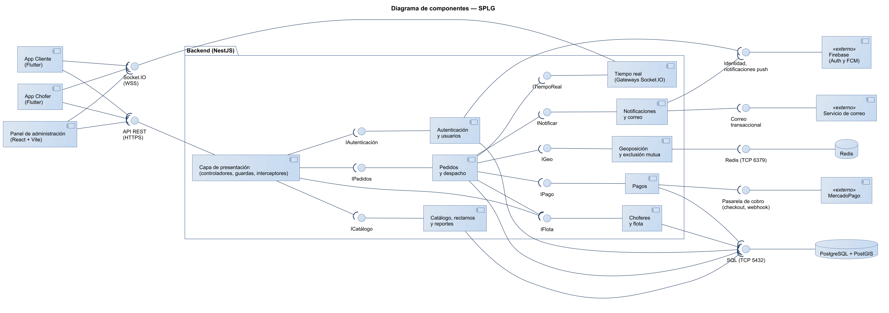

**Figura 1 — Diagrama de componentes**


| Interfaz | La provee | La requieren | Qué ofrece |
|----------|-----------|--------------|------------|
| API REST (HTTPS) | Capa de presentación | App Cliente, App Chofer, Panel | Las operaciones de negocio bajo el prefijo `api`, con las guardas de autenticación, de rol y de distribuidora |
| Socket.IO (WSS) | Tiempo real | App Cliente, App Chofer, Panel | Ofertas, estados del pedido y posición del chofer, en los espacios `/drivers`, `/customers` y `/admin` |
| IAutenticación | Autenticación y usuarios | Capa de presentación | Identidad, rol y distribuidora de quien invoca |
| IPedidos | Pedidos y despacho | Capa de presentación, Catálogo, reclamos y reportes | Alta, ciclo de vida y despacho del pedido |
| IPago | Pagos | Pedidos y despacho | Checkout y confirmación del pago |
| IFlota | Choferes y flota | Capa de presentación, Pedidos y despacho | Habilitación del chofer y de su vehículo |
| ICatálogo | Catálogo, reclamos y reportes | Capa de presentación | Productos, franjas, cobertura, reclamos y reportes |
| INotificar | Notificaciones y correo | Pedidos y despacho | Aviso al dispositivo y por correo |
| IGeo | Geoposición y exclusión mutua | Pedidos y despacho | Búsqueda de choferes cercanos y cerrojos de los procesos programados |
| ITiempoReal | Tiempo real | Pedidos y despacho | Emisión de eventos a cada espacio |
| SQL (TCP 5432) | PostgreSQL con PostGIS | Los módulos con persistencia | Almacenamiento transaccional y consultas geográficas |
| Redis (TCP 6379) | Redis | Geoposición y exclusión mutua | Índice geográfico, adaptador de Socket.IO y cerrojos |
| Identidad y notificaciones push | Firebase | Autenticación y usuarios, Notificaciones y correo | Verificación de identidad y envío de FCM |
| Pasarela de cobro | MercadoPago | Pagos | Creación del cobro y aviso del resultado por webhook |
| Correo transaccional | Servicio de correo | Notificaciones y correo | Envío de la bienvenida, de la recuperación de contraseña y del aviso de vencimientos |

### 2.5 Diagrama de Despliegue

El diagrama de despliegue describe el sistema en ejecución: los nodos físicos o de ejecución, los
artefactos que corren en cada uno y los caminos de comunicación con su protocolo. El sistema se
despliega en un servidor virtual (VPS) con Docker Compose; el backend, la base de datos y Redis
corren en contenedores del mismo servidor.

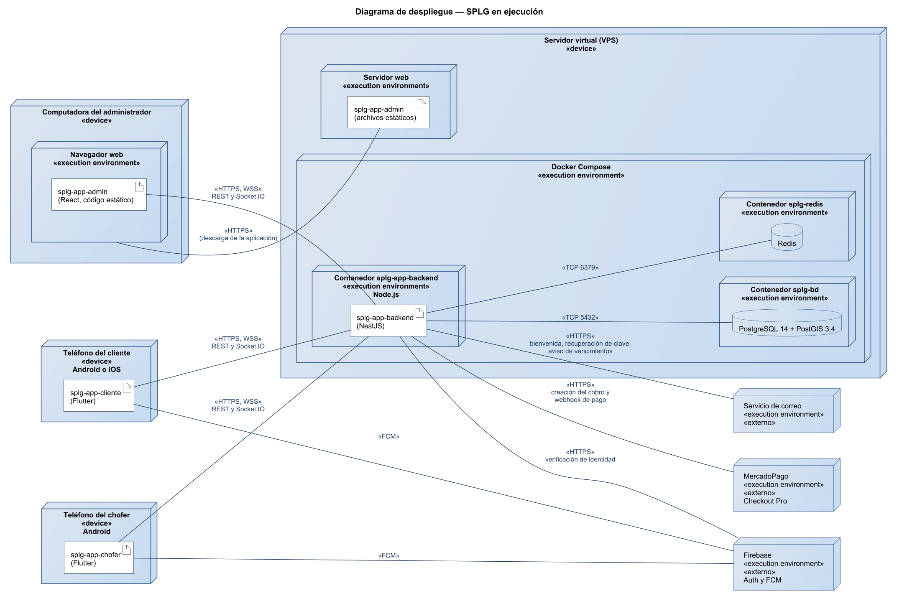

**Figura 2 — Diagrama de despliegue**


| Nodo | Tipo | Artefactos | Comunicación |
|------|------|------------|--------------|
| Teléfono del cliente | «device» Android o iOS | `splg-app-cliente` | HTTPS / REST y WSS / Socket.IO hacia el backend; recibe FCM de Firebase |
| Teléfono del chofer | «device» Android | `splg-app-chofer` | HTTPS / REST y WSS / Socket.IO hacia el backend; recibe FCM de Firebase |
| Computadora del administrador | «device» con navegador web | `splg-app-admin` (código estático descargado del servidor web) | HTTPS / REST y WSS / Socket.IO hacia el backend |
| Servidor virtual (VPS) | «device» | Docker Compose con los contenedores `splg-app-backend`, `splg-bd` (PostgreSQL 14 con PostGIS 3.4) y `splg-redis`, y el servidor web que sirve el panel | El backend usa TCP 5432 y TCP 6379 dentro del servidor |
| Firebase | «execution environment» «externo» | Authentication y Cloud Messaging | HTTPS desde el backend para verificar la identidad; FCM hacia las aplicaciones móviles |
| MercadoPago | «execution environment» «externo» | Checkout Pro | HTTPS desde el backend para crear el cobro; MercadoPago llama por webhook al backend con el resultado del pago |
| Servicio de correo | «execution environment» «externo» | — | HTTPS desde el backend: bienvenida, recuperación de contraseña y aviso de vencimientos |

El recorrido del código desde la máquina de desarrollo hasta el servidor es otra vista, que no
forma parte del despliegue en ejecución: la lámina siguiente la muestra como ilustración
complementaria.

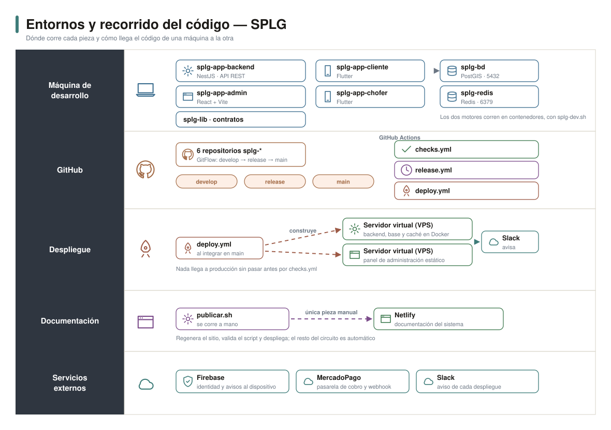

**Figura 3 — Entornos y recorrido del código**


> Las líneas punteadas se mueven en la versión en pantalla, para que el sentido del recorrido se
> lea sin buscar la etiqueta. La documentación es la única pieza que se publica a mano.

---

## 3. Casos de Uso Reales (CU Real)

> Esta sección presenta los **Casos de Uso Reales** según la plantilla PU de la cátedra. Cada CU priorizado se acompaña de:
>
> 1. **Interfaz Gráfica** — la interfaz (pantalla real o wireframe) que usa el caso de uso
> 2. **Especificación del CU Real** — tabla formal con todos los campos requeridos (Código, Objetivos asociados, Requisitos asociados, Descripción, Precondición, Secuencia, Postcondición, Excepciones, Rendimiento, Frecuencia, Estabilidad)
> 3. **Diagrama de Interacción** — colaboración entre los objetos de diseño que realizan la operación, en la notación de Larman
> 4. **Clases de Diseño Participantes**
>
> **Criterio de cobertura.** Los Casos de Uso Reales son **40 casos de uso**, una selección de casos críticos del sistema —entre treinta y cuarenta, los que el sistema no puede dejar de ejecutar—: llevan interfaz gráfica, especificación con detalle técnico y diagrama de interacción con las clases participantes. El resto de los casos de uso no tiene CU Real: su especificación esencial está en el Documento 1 y su diseño, en el diagrama de interacción de la sección 4 y en la tabla de implementación (§4.25). Con los casos de uso esenciales sin detalle técnico, el CU Real es donde ese detalle se conserva: su frecuencia, su rendimiento y sus precondiciones son los del caso de uso esencial y no pueden contradecirlo.
>
> **Criterio de selección.** Se toman los diez casos que recorren el circuito completo del sistema, de punta a punta —alta del usuario, creación del pedido, despacho automático, aceptación por parte del chofer, seguimiento, entrega verificada, cobro y cancelación—, y se suman treinta casos de uso que cubren cada subsistema: casos críticos según la calificación de los casos de uso del Documento 0 (§8) —hay 63 críticos implementados, de modo que no se eligieron todos— y algunos importantes que completan un subsistema. Todos están en estado «Implementado» y tienen interfaz construida (pantalla real o, en los diez primeros, wireframe) o, si son procesos automáticos, la aclaración correspondiente, de modo que la especificación describe una interfaz real y no una propuesta. La selección cubre los subsistemas principales:
>
> | Subsistema | Casos de uso reales |
> |---|---|
> | Autenticación y registro (SS-01) | CU-001, CU-002 |
> | Pedidos (SS-02) | CU-005, CU-006, CU-008, CU-080 |
> | Despacho (SS-03) | CU-013, CU-014, CU-015 |
> | Seguimiento y entrega (SS-04) | CU-017, CU-018, CU-020, CU-022, CU-078, CU-079 |
> | Cobros y pagos (SS-14) | CU-048, CU-292 |
> | Caja y rendición del chofer (SS-21) | CU-227, CU-232, CU-233 |
> | Catálogo y stock (SS-08) | CU-036, CU-038, CU-041, CU-218 |
> | Compras (SS-20) | CU-217 |
> | Envases (SS-13) | CU-068, CU-070 |
> | Multi-Distribuidora (SS-10) | CU-052 |
| Flota y personal (SS-07 y SS-19) | CU-031, CU-032, CU-177, CU-195, CU-201 |
> | Reclamos e incidencias (SS-05 y SS-12) | CU-023, CU-025, CU-060 |
> | Reportes (SS-06) | CU-026 |
> | Zonas y franjas (SS-09 y SS-11) | CU-042, CU-058 |
> | Reservas (SS-15) | CU-072 |
>
> Son **CU-001, CU-002, CU-005, CU-006, CU-008, CU-013, CU-014, CU-015, CU-017, CU-018, CU-020, CU-022, CU-023, CU-025, CU-026, CU-031, CU-032, CU-036, CU-038, CU-041, CU-042, CU-048, CU-052, CU-058, CU-060, CU-068, CU-070, CU-072, CU-078, CU-079, CU-080, CU-177, CU-195, CU-201, CU-217, CU-218, CU-227, CU-232, CU-233 y CU-292**.
> Dos de ellos —CU-013 y CU-014— son procesos que el sistema ejecuta por iniciativa propia, sin actor humano, y por eso no tienen pantalla propia.

---

### 3.1 CU-001 Crítico — Iniciar Sesión

**Actor:** Cliente (ACT-01), Chofer (ACT-02), Administrador (ACT-03)
**Pantalla:** LoginView (App Cliente / App Chofer / Panel Admin)

#### Interfaz Gráfica

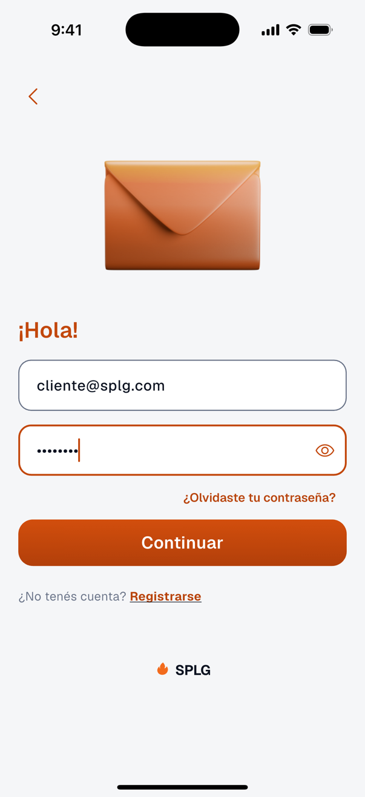

**Figura 4 — CU-001 Iniciar Sesión — Interfaz Gráfica**

Pantalla de inicio de sesión de la App Cliente con el correo y la contraseña cargados, antes de tocar «Continuar». Debajo están «¿Olvidaste tu contraseña?» y «Registrarse» (CU-002). La App Chofer y el Panel Admin la repiten con variantes mínimas; los campos comunes son el correo y la contraseña. Captura de la app corriendo contra la API.

#### Especificación del CU Real

| Campo | Detalle |
|-------|---------|
| **Código** | CU-001 |
| **Caso de Uso** | Iniciar Sesión |
| **Actor Principal** | ACT-01 (Cliente), ACT-02 (Chofer), ACT-03 (Administrador) |
| **Objetivos asociados** | OBJ-01, OBJ-02, OBJ-05 |
| **Requisitos asociados** | IRQ-01 |
| **Descripción** | El usuario ingresa email y contraseña en la pantalla de inicio de sesión. Firebase Authentication valida las credenciales y emite el token de identidad; el sistema no genera credencial propia y comprueba en cada solicitud que la cuenta siga habilitada. La app persiste el token y navega a la HomeView según el rol, que se resuelve contra la base en cada solicitud. La app y el panel ingresan con el SDK de Firebase y resuelven el perfil con `GET /users/email/:email`, que exige token y el encabezado `x-client-source`. `POST /auth/login` y `POST /auth/login/dashboard` son rutas públicas de la API que ninguno de los tres llama. |
| **Precondición** | El usuario está registrado en el sistema. |

**Secuencia normal**

| Paso | Acción |
|------|--------|
| 1 | El usuario ingresa email y contraseña en `LoginView` y presiona "Iniciar sesión". |
| 2 | La app (o el panel) llama a `signInWithEmailAndPassword` del SDK de Firebase con `{ email, password }`. |
| 3 | Firebase valida las credenciales y devuelve la sesión con el token de identidad; si no sirven, la app informa el error de Firebase. |
| 4 | La app guarda el token y llama a `GET /users/email/:email` con `Authorization: Bearer <token>` y el encabezado `x-client-source`. |
| 5 | `AuthGuard` valida el token contra Firebase, comprueba el encabezado y que el rol corresponda a la app, y rechaza una cuenta bloqueada con 401 «La cuenta está bloqueada. Comuníquese con la distribuidora.»; `UsersController.findOneByEmail` devuelve el usuario con su rol. |
| 6 | La app comprueba el rol recibido: el panel exige administrador o administrador general («No tenés permisos de administrador») y la app de choferes, chofer o administrador general; si no sirve, cierra la sesión de Firebase. |
| 7 | El panel fija el vencimiento de su sesión a la hora. |
| 8 | El panel guarda el token en el almacenamiento del navegador (`localStorage`); las apps conservan la sesión de Firebase. |
| 9 | Navega a la HomeView correspondiente al rol, que se resuelve contra la base en cada solicitud. |

**Postcondición:** El usuario está autenticado. Los próximos requests incluyen `Authorization: Bearer <token de Firebase>` y el encabezado `x-client-source`. La sesión persiste hasta el cierre de sesión o la expiración del token.

**Excepciones**

| Paso | Acción |
|------|--------|
| 3 | Si el email o la contraseña no sirven, o la cuenta fue dada de baja, Firebase rechaza el ingreso y la app informa el error; `POST /auth/login` responde 401 "El email o la contraseña son incorrectos". |
| 5 | Si la cuenta está bloqueada, `AuthGuard` responde 401 «La cuenta está bloqueada. Comuníquese con la distribuidora.»; `POST /auth/login` responde 401 "La cuenta no está habilitada", también si la cuenta ya no existe en la base. |
| 3 | En `POST /auth/login`, si Firebase informa demasiados intentos fallidos → 429; si el acceso falla por cualquier otra causa → 503 "No pudimos iniciar sesión en este momento: probá de nuevo en unos minutos". |
| 6 | Si el rol de la cuenta no es administrador ni administrador general, el panel no abre la sesión e informa "No tenés permisos de administrador"; `POST /auth/login/dashboard` responde 401 "Admin not found". |
| — | Desde la primera solicitud con token, si falta el encabezado `x-client-source` o el rol del usuario no corresponde a la aplicación de origen → 401. La habilitación del chofer no se consulta en el ingreso. |

| Campo | Detalle |
|-------|---------|
| **Rendimiento** | Según los pasos del caso de uso esencial (Documento 1): paso 3: 3 segundos. |
| **Frecuencia** | Múltiples veces por día por usuario. Varía según la duración de la sesión. |
| **Estabilidad** | Alta |

#### Diagrama de Interacción


**Figura 5 — CU-001 Iniciar Sesión — Diagrama de Interacción**

<details><summary>Ver código del diagrama</summary>

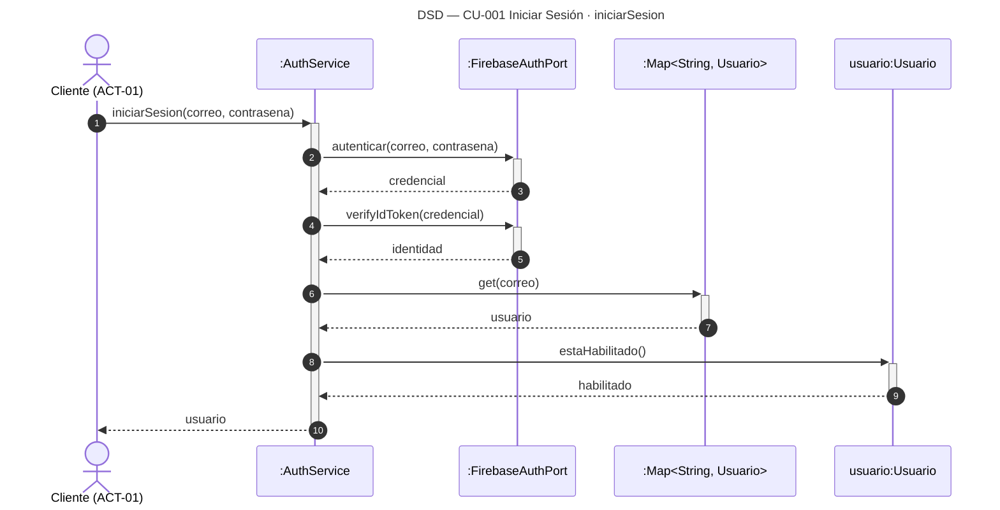

</details>

La operación del sistema es `iniciarSesion`. Su diagrama de interacción es el de esta sección; su diagrama de secuencia del sistema está en el Documento 2, sección 2.1 y su tabla de implementación en el Documento 3, sección 4.25. No modifica el modelo conceptual y por eso no lleva contrato.

#### Clases de Diseño Participantes

| Clase | Capa | Responsabilidad |
|-------|------|-----------------|
| `LoginView` | Presentation (Flutter / React) | UI con email/password fields y botón |
| `AuthViewModel` | Presentation | Valida formulario, gestiona errores |
| `AuthController` | Backend Controller (NestJS) | Rutas de la API `POST /auth/login` y `POST /auth/login/dashboard`, que el panel y las apps no llaman |
| `AuthService` | Backend Service | Orquesta el ingreso con Firebase Auth y comprueba que la cuenta esté habilitada (`UsersService.findOneByEmail`); no emite un token propio |
| `FirebaseAuthAdapter` | Infrastructure | Verifica el token de identidad contra Firebase |

**Comentarios.** El sistema no emite una credencial propia: la credencial de sesión es el token de identidad que emite Firebase, y el rol se resuelve contra la base en cada solicitud. El ingreso tampoco consulta la habilitación del chofer: un chofer que el administrador aún no habilitó puede iniciar sesión, pero no puede ponerse en línea (CU-022).

---

### 3.2 CU-005 Crítico — Crear un Pedido

**Actor:** Cliente (ACT-01)
**Pantalla:** CheckoutView (App Cliente)

#### Interfaz Gráfica


**Figura 6 — CU-005 Crear un Pedido — Interfaz Gráfica**

Pantalla «Confirmación» de la App Cliente: el renglón del pedido con su promoción por cantidad, el recargo por zona, el total, la forma de pago (efectivo), la fecha de entrega y la franja elegida. Al pie, «Confirmar pedido» crea el pedido y «Cancelar» vuelve al carrito. Captura de la app corriendo contra la API.

#### Especificación del CU Real

| Campo | Detalle |
|-------|---------|
| **Código** | CU-005 |
| **Caso de Uso** | Crear un Pedido |
| **Actor Principal** | ACT-01 (Cliente) |
| **Objetivos asociados** | OBJ-01, OBJ-02, OBJ-06, OBJ-07 |
| **Requisitos asociados** | IRQ-02, IRQ-04, IRQ-05, IRQ-07, IRQ-08, IRQ-10 |
| **Descripción** | El cliente revisa el carrito en `CheckoutView`, selecciona dirección, franja horaria, fecha y método de pago. Al confirmar, el sistema valida y reserva atómicamente el stock dentro de una transacción PostgreSQL, persiste la orden con estado PENDING y, según el medio de pago, dispara el despacho automático (CU-013). El total que el cliente ve antes de confirmar lo cotiza el sistema (CU-302, `POST /orders/quote`). |
| **Precondición** | El cliente está identificado. Existe al menos un producto activo con stock en la distribuidora elegida y el cliente tiene una dirección de entrega registrada. |

**Secuencia normal**

| Paso | Acción |
|------|--------|
| 1 | El cliente accede a `CheckoutView` con ítems del carrito y completa: dirección, franja horaria, fecha de entrega y método de pago. |
| 2 | Cada vez que cambia lo que mueve el precio (dirección, medio de pago, franja), `CheckoutViewModel` pide la cotización al sistema (`POST /orders/quote`, CU-302) y muestra el total que devuelve: la app no calcula promociones ni recargos. Presiona "Confirmar Pedido" y `CheckoutViewModel.confirmOrder()` valida los campos. |
| 3 | Llama `historyService.createOrder()` → `POST /orders` con el DTO completo y el encabezado `Idempotency-Key`, que es la misma para el mismo intento de checkout mientras no se resuelva, de modo que un reintento por corte de red no crea un segundo pedido. El total no viaja: lo calcula el sistema. |
| 4 | Backend `OrderController.create()` invoca `OrderService.create()`, que delega en `CreateOrderUseCase.execute(createOrderDto, distributorId)`. El caso de uso abre `DataSource.createQueryRunner()` y `queryRunner.startTransaction()`. |
| 5 | Por cada ítem, `GasCylinderService.reservarStock(queryRunner.manager, gasCylinderId, quantity)` toma lock pesimista (`SELECT ... FOR UPDATE`, `pessimistic_write`) sobre el `GasCylinder`, valida stock suficiente —si no alcanza, lanza `InsufficientStockError`, que el filtro global responde como 400— y lo devuelve bloqueado. |
| 6 | Calcula, para cada renglón, el precio unitario con las promociones por volumen (decimal.js), redondeado a centavos, y el subtotal como cantidad por ese precio, y los guarda en el `OrderItem`: el pedido conserva el precio con el que se vendió aunque el catálogo cambie. Luego suma el recargo por zona de cobertura, si la distribuidora definió zonas, y el recargo del 10% si el método de pago es en línea (MERCADOPAGO o TRANSFER). Es el mismo cálculo que usa la cotización (CU-302): el total cotizado y el del pedido creado con el mismo cuerpo no pueden diferir. |
| 7 | Decrementa el stock de cada `GasCylinder` dentro de la transacción. Construye y persiste el `Order` (estado PENDING, o RESERVED si es una pre-reserva) junto a sus `OrderItem[]`. |
| 8 | Hace `queryRunner.commitTransaction()`. Ya fuera de la transacción, dispara el despacho según el método de pago: si es CASH, llama `DispatchOrchestratorService.offerToNextDriver(savedOrder)` directamente (de mejor esfuerzo); si es MERCADOPAGO, en cambio NO despacha en ese momento — genera el checkout de pago y el despacho se dispara recién cuando el webhook confirme el pago (CU-048); si es una pre-reserva, tampoco despacha (lo hace el proceso programado el día agendado, CU-075). En paralelo envía la confirmación por FCM (`sendOrderConfirmation()`, de mejor esfuerzo). |
| 9 | Retorna `{ orderId, status, totalAmount, paymentUrl? }` al cliente. Si el total difiere del que se mostró, la app avisa el total real. |
| 10 | La app navega a `OrderTrackingView`. |

**Postcondición:** Existe un `Order` con estado PENDING (o RESERVED si es pre-reserva). El stock fue decrementado atómicamente. Si el pago es en efectivo, el despacho automático fue disparado; si es MercadoPago o una reserva, el despacho queda diferido.

**Excepciones**

| Paso | Acción |
|------|--------|
| 5 | Stock insuficiente → 400 "Stock insuficiente para <producto>": la operación se revierte por completo y el stock no se modifica. |
| 5 | Producto inactivo o inexistente → `NotFoundException` y reversión. |
| 3 | Sin ítems → 400 «El pedido necesita al menos un renglón»; la misma garrafa en dos renglones → 400 «items no puede repetir la misma garrafa: sumá las cantidades en un solo renglón» (la base lo repite con `UQ_order_item_pedido_producto`); `scheduledDate` anterior a hoy, con franja o sin ella → 400 «scheduledDate no puede ser una fecha pasada». |
| 3 | Si la misma clave de idempotencia se reutiliza con otros datos → 422 y no se ejecuta la operación. |
| 7 | Falla al persistir → reversión automática. |

| Campo | Detalle |
|-------|---------|
| **Rendimiento** | Según los pasos del caso de uso esencial (Documento 1): paso 11: 5 segundos. |
| **Frecuencia** | Variable según la demanda de la distribuidora (estimado: 10 a 50 pedidos por día en la Fase 1). |
| **Estabilidad** | Alta |

#### Flujo de Pantallas

```
[MarketView]
  └─▶ El cliente agrega garrafas al carrito
      └─▶ [CheckoutView]
            ├─ Sección 1: Resumen de ítems con descuentos aplicados
            ├─ Sección 2: Selección de dirección (MapView o AddressListSheet)
            ├─ Sección 3: Franja horaria (TimeRangeSelector - mañana 9-13 / tarde 17-21)
            ├─ Sección 4: Método de pago (PaymentMethodSelector)
            │             CASH | MERCADOPAGO | TRANSFER (+10% recargo automático)
            ├─ Sección 5: Fecha solicitada (DatePicker)
            └─ [Botón "Confirmar Pedido"] ─▶ [OrderTrackingView]
```

#### Diagrama de Interacción

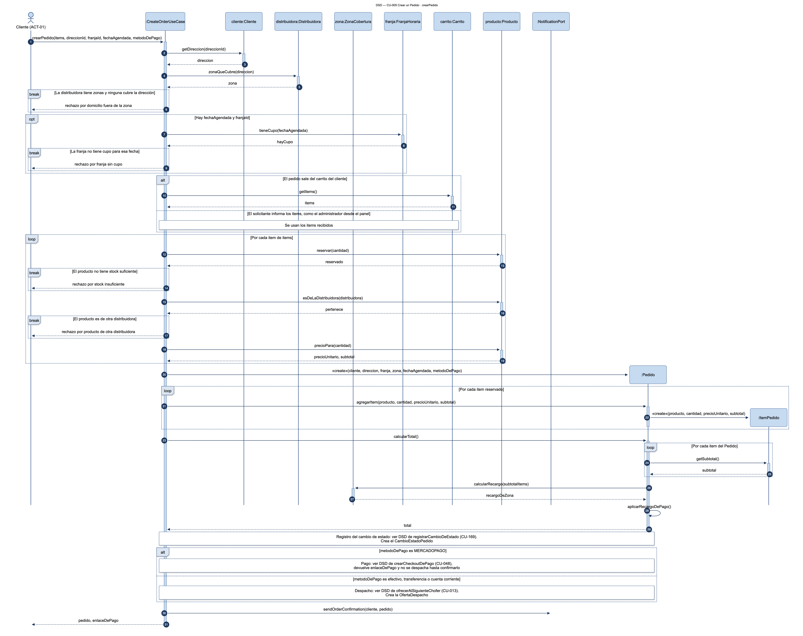

**Figura 7 — CU-005 Crear un Pedido — Diagrama de Interacción**

<details><summary>Ver código del diagrama</summary>

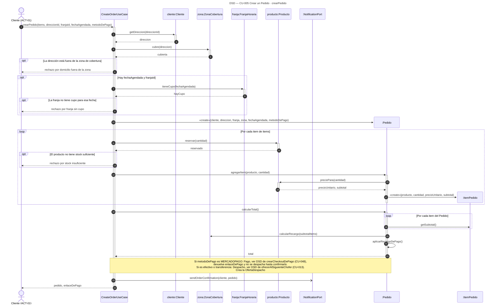

</details>

La operación del sistema es `crearPedido`. Su diagrama de interacción es el de esta sección; su diagrama de secuencia del sistema está en el Documento 2, sección 2.1; su contrato, en el Documento 2, sección 2.2 («Contrato: `crearPedido()`»), y su tabla de implementación, en el Documento 3, sección 4.25.

#### Clases de Diseño Participantes

| Clase | Capa | Responsabilidad |
|-------|------|-----------------|
| `CheckoutViewModel` | Presentation (Flutter) | Orquesta UI, valida, llama servicio |
| `CartService` | Service (Flutter) | Mantiene estado del carrito reactivo |
| `HistoryService` | Service (Flutter) | HTTP al backend, persiste historial local |
| `OrderController` | Controller (NestJS) | Entrada HTTP, validación DTO |
| `OrderService` | Service (NestJS) | Fachada del módulo; delega la creación en el caso de uso |
| `CreateOrderUseCase` | Application (NestJS) | Transacción de reserva de stock, precios y persistencia del pedido |
| `GasCylinderService` | Service (NestJS) | Lock pesimista y descuento de stock por producto |
| `DispatchOrchestratorService` | Service (NestJS) | Ofrece el pedido al chofer más cercano cuando el pago es en efectivo |
| `NotificationsService` | Infrastructure | FCM push al cliente |

**Comentarios.** La cotización (CU-302) y el alta comparten el cálculo de precios y recargos, de modo que no hay dos copias de las reglas. El motor de precios no valida que el descuento configurado en una promoción no supere el total, lo que puede producir un subtotal negativo.

---

### 3.3 CU-013 Crítico · automático — Asignar un Pedido Automáticamente por Proximidad

**Actor:** Sistema Automático (ACT-04)
**Disparador:** `CreateOrderUseCase.execute()` (pago en efectivo) o `ConfirmPaymentUseCase` (pago aprobado por MercadoPago, CU-048) → `DispatchOrchestratorService.offerToNextDriver()`

#### Interfaz Gráfica

Este caso de uso no tiene pantalla propia: lo ejecuta el Sistema. Su salida visible es el aviso del pedido entrante en la App Chofer.


**Figura 8 — CU-013 Asignar un Pedido Automáticamente por Proximidad — Interfaz Gráfica**

#### Especificación del CU Real

| Campo | Detalle |
|-------|---------|
| **Código** | CU-013 |
| **Caso de Uso** | Asignar un Pedido Automáticamente por Proximidad |
| **Actor Principal** | ACT-04 (Sistema Automático) |
| **Objetivos asociados** | OBJ-02 |
| **Requisitos asociados** | IRQ-02, IRQ-03 |
| **Descripción** | Al confirmarse un pedido en efectivo (o al confirmarse el pago de un pedido con MercadoPago, CU-048), el sistema busca al chofer habilitado, validado y disponible más cercano usando el radar geoespacial de Redis, probando los pasos de radio crecientes de la distribuidora (por omisión 5, 10, 15 y 20 km) hasta encontrar uno sin contactar. Sin intervención humana, emite una oferta con la ventana de aceptación de la distribuidora (por omisión 30 segundos) y notifica por WebSocket al chofer elegido. |
| **Precondición** | Existe un pedido pendiente sin chofer asignado, con sus coordenadas de entrega. Al menos un chofer de la misma distribuidora está presente en el seguimiento de posiciones. |

**Secuencia normal**

| Paso | Acción |
|------|--------|
| 1 | `CreateOrderUseCase.execute()` invoca `DispatchOrchestratorService.offerToNextDriver(savedOrder)` post-commit, en modo de mejor esfuerzo (solo para pedidos CASH; los pagados con MercadoPago se despachan recién cuando el webhook confirma el pago, CU-048). |
| 2 | `offerToNextDriver()` toma un bloqueo distribuido por pedido (Redlock), vuelve a leer el pedido y no ofrece si ya tiene una oferta vigente (`DispatchOfferRepositoryPort.hasActiveOffer`); toma el punto de entrega (`deliveryPoint`) y clasifica a los choferes ya contactados con `DispatchOfferRepositoryPort.findDriverOfferState`: los bloqueados y los re-ofertables, vacíos en la primera oferta. Lee los parámetros del despacho de la distribuidora con `DispatchSettingsService.obtener` (CU-171): los pasos de radio y la ventana de aceptación, con una copia en memoria de un minuto. |
| 3 | `findNearestAvailable()` recorre los pasos de radio de la distribuidora (`radiusStepsKm`; por omisión `[5, 10, 15, 20]` km) en orden creciente; para cada uno llama `RealtimeDispatchPort.findNearbyDrivers(lat, lng, radiusKm)` (`RedisService.getNearbyDrivers` → `GEORADIUS drivers:locations`, que devuelve `driverIds` ordenados ASC por distancia) y se queda con el primer radio que produzca un candidato. |
| 4 | Dentro de cada radio, `DeliveryService.choferesElegibles()` filtra la lista contra la base, conservando solo los choferes con `isEnabled = true` y `validated = true` (preservando el orden de cercanía). Después `FleetDispatchLockService.choferesInhabilitados` descarta a los que no tienen un vehículo en uso o tienen vencida la licencia o la documentación del vehículo en uso (CU-136 a CU-138, CU-161), y se toma el primero que todavía no fue contactado para este pedido. |
| 5 | Crea la oferta (`DispatchOfferRepositoryPort.create`) con vencimiento a `offerTtlSeconds` segundos (30 por omisión) y llama `RealtimeDispatchPort.notifyDriverNewOrder(driverId, payload)` → `DriversGateway.notifyNewOrder()` → `socket.to('driver_' + driverId).emit('server:new-order-request', { event: 'NEW_ORDER', orderId, totalAmount, paymentMethod, expiresAt, items })`. En paralelo envía un push FCM complementario (`NotificationsService.sendOfferPushToDriver`, de mejor esfuerzo). |
| 6 | Se detiene en el primer chofer elegible encontrado: no se contacta a ningún otro mientras esa oferta esté vigente. |
| 7 | Si ningún radio produce un candidato nunca contactado, se repite la búsqueda con los choferes que dejaron vencer su oferta hace más que el enfriamiento (3 minutos): la re-oferta es el último recurso, y quien rechazó o ya tuvo el pedido no vuelve a recibirlo. Un chofer con tres ofertas vencidas para el mismo pedido (la original y dos re-ofertas) queda agotado para ese pedido. |
| 8 | Si tampoco hay un chofer que se pueda re-ofertar: no se crea oferta, se avisa a los administradores del panel (`order:no-drivers`, una sola vez por agotamiento) y el pedido queda en PENDING para que el ciclo de la tarea programada (CU-014) lo reintente. |

**Postcondición:** Existe una oferta (`DispatchOffer`) vigente para el chofer más cercano disponible, que recibió la notificación en tiempo real. La orden permanece en PENDING hasta que el chofer la acepte (CU-015), la rechace (CU-016) o la oferta venza y se re-ofrezca al siguiente (CU-014).

**Excepciones**

| Paso | Acción |
|------|--------|
| 2 | Si el pedido no tiene `deliveryPoint` resuelto → no hay contra qué medir cercanía, no se ofrece a nadie y se avisa a los administradores con `order:no-drivers` (`no_delivery_point`). |
| 3 | Si Redis no está disponible → la oferta falla silenciosamente (captura `.catch()`) y la tarea programada de CU-014 la reintentará en su próximo ciclo. |
| 4 | Si todos los `driverId` de todos los radios están deshabilitados, no validados, sin vehículo en uso, con documentación vencida o bloqueados para ese pedido → cae al paso 7 y, de no haber re-ofertables, al paso 8. |
| 5 | Si la conexión WebSocket del chofer está caída → Socket.IO reintentará al reconectar; si no llega a tiempo, la oferta igual vence al cumplirse la ventana de aceptación y el ciclo de CU-014 la re-ofrece. |

| Campo | Detalle |
|-------|---------|
| **Rendimiento** | Según los pasos del caso de uso esencial (Documento 1): paso 5: 1 segundo. |
| **Frecuencia** | Una vez por cada pedido creado, y de nuevo por cada rechazo o vencimiento. |
| **Estabilidad** | Alta |
| **Comentarios** | El radar de Redis (`drivers:locations`) solo sabe de posición: no filtra por habilitación ni validación, así que ese filtro lo aplica `choferesElegibles()` contra la base en cada radio. Los pasos de radio (`radiusStepsKm`, por omisión 5/10/15/20 km) y la ventana de aceptación (`offerTtlSeconds`, por omisión 30 segundos) se configuran por distribuidora (CU-171), como exige la cátedra para los módulos inteligentes; el orquestador los lee en cada oferta. |

#### Flujo del Algoritmo

```
CreateOrderUseCase.execute() [pago CASH]  ó  ConfirmPaymentUseCase [pago MP aprobado]
  │
  ▼
DispatchOrchestratorService.offerToNextDriver(order)
  │  [1] destino = coordenadasDePunto(order.deliveryPoint)
  │      { radiusStepsKm, offerTtlSeconds } = settings.obtener(order.distributorId)   // CU-171
  │  [2] { blocked, reofferable } = offers.findDriverOfferState(order.orderId, now, REOFFER_COOLDOWN_MS)
  │  [3] Por cada paso de radio de la distribuidora (por omisión 5, 10, 15 y 20 km):
  │      ├─▶ realtimeDispatchPort.findNearbyDrivers(lat, lng, radioKm)
  │      │       └─▶ redisService.getNearbyDrivers() → GEORADIUS drivers:locations ASC
  │      ├─▶ deliveries.choferesElegibles(driverIds) → solo isEnabled && validated
  │      └─▶ primer id no incluido en alreadyOffered → candidato
  │  [4] Si hay candidato:
  │      ├─▶ offers.create(orderId, candidato, expiresAt = +offerTtlSeconds)
  │      ├─▶ driversGateway.notifyNewOrder(candidato, payload)
  │      │       └─▶ socket.to('driver_' + candidato).emit('server:new-order-request', payload)
  │      └─▶ notifications.sendOfferPushToDriver(candidato, orderId)
  │  [5] Si no hay candidato nuevo, se repite con los de `reofferable` (oferta vencida hace más que el enfriamiento)
  │  [6] Si ningún radio tiene candidato:
  │      ├─▶ dispatch.notifyAdmins('order:no-drivers', motivo) — una sola vez por agotamiento
  │      └─▶ El pedido queda en PENDING → el cron de CU-014 reintenta en el ciclo de la distribuidora (15 s por omisión)
  │
  └─▶ Flujo continúa en CU-015 (Aceptar Pedido) o CU-016 (Rechazar Pedido)
```

#### Estructura Redis para Geo-indexación

```
Key:   "drivers:locations"
Type:  Sorted Set (GEO)
Value: { member: "driverId" (= user_id del chofer), score: geohash }

Operaciones:
  GEOADD    drivers:locations  <lng> <lat> <driverId>        // En cada driver:update-location (CU-017)
  GEORADIUS drivers:locations  <lng> <lat> <radioKm> km ASC  // Al buscar candidatos (pasos de radio de la distribuidora)
  ZREM      drivers:locations  <driverId>                    // Al desconectarse o ponerse offline
```

#### Pantalla (App Chofer) — Notificación de Nuevo Pedido

```
[HomeView] (chofer habilitado, validado y conectado por WS)
  │  Socket recibe 'server:new-order-request' { event: 'NEW_ORDER', orderId, totalAmount, paymentMethod, expiresAt, items }
  ▼
[OrderInfoBottomSheet]
  ├─ Ítems y total
  ├─ Ventana de aceptación (`expiresAt`; 30 s por omisión)
  ├─ [Botón "Aceptar"] → CU-015
  └─ [Botón "Rechazar"] → CU-016
```

#### Diagrama de Interacción


**Figura 9 — CU-013 Asignar un Pedido Automáticamente por Proximidad — Diagrama de Interacción**

<details><summary>Ver código del diagrama</summary>

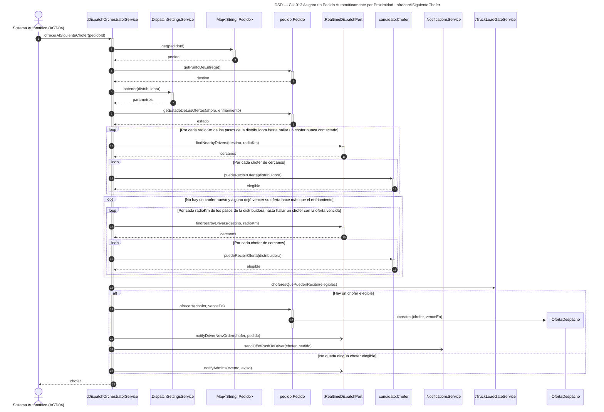

</details>

La operación del sistema es `ofrecerAlSiguienteChofer` (CU-013). Su diagrama de interacción es el de esta sección; su diagrama de secuencia del sistema está en el Documento 2, sección 2.1; su contrato, en el Documento 2, sección 2.2 («Contrato: `ofrecerAlSiguienteChofer()`»), y su tabla de implementación, en el Documento 3, sección 4.25.

---

### 3.4 CU-014 Crítico · automático — Vencer la Oferta y Ofrecer al Siguiente Chofer

**Actor:** Sistema Automático (ACT-04)
**Disparador:** tarea programada con un ciclo fijo de 15 segundos; cada distribuidora la recibe con su propio intervalo (CU-173)

#### Interfaz Gráfica

Este caso de uso no tiene pantalla: lo ejecuta el Sistema. Su salida visible es el aviso del pedido al chofer siguiente, que es el de CU-013.

#### Especificación del CU Real

| Campo | Detalle |
|-------|---------|
| **Código** | CU-014 |
| **Caso de Uso** | Vencer la Oferta y Ofrecer al Siguiente Chofer |
| **Actor Principal** | ACT-04 (Sistema Automático) |
| **Objetivos asociados** | OBJ-02 |
| **Requisitos asociados** | IRQ-02, IRQ-03 |
| **Descripción** | Proceso automático que detecta las ofertas de pedido que vencieron sin respuesta del chofer y vuelve a ofrecer el pedido al siguiente candidato, ampliando el radio de búsqueda de manera progresiva cuando no quedan choferes por contactar en el radio actual. |
| **Precondición** | Existe al menos una oferta vencida, o un pedido pendiente sin oferta vigente. |

**Secuencia normal**

| Paso | Acción |
|------|--------|
| 1 | La tarea programada se activa. Toma un bloqueo distribuido con vencimiento de 12 segundos, de modo que una sola instancia del backend procese el ciclo aunque haya varias corriendo. Decide, de una sola pasada, a qué distribuidoras con ofertas vencidas o pedidos pendientes les toca el ciclo, según su `dispatchRetrySeconds` (`ScheduledTasksSettingsService.distribuidorasQueCorren`; 15 segundos por omisión). |
| 2 | Busca las ofertas emitidas cuya ventana de aceptación ya venció, de las distribuidoras que corren. |
| 3 | Marca cada oferta vencida como expirada y registra al chofer como ya contactado para ese pedido. |
| 4 | Recorre los pasos de radio de la distribuidora en orden creciente —por omisión 5, 10, 15 y 20 kilómetros— y toma el primer chofer disponible que todavía no haya sido contactado para ese pedido. |
| 5 | Emite una nueva oferta a ese chofer, con la ventana de aceptación de la distribuidora (30 segundos por omisión), y le envía la notificación. |
| 6 | Si ningún radio arroja un candidato sin contactar, el pedido permanece pendiente, se avisa a los administradores con `order:no-drivers` (una sola vez por agotamiento) y se reintenta en el ciclo siguiente de la distribuidora. |

**Postcondición:** Las ofertas vencidas quedaron cerradas y, si había un chofer disponible sin contactar, existe una nueva oferta vigente para el pedido. El pedido no cambia de estado por efecto de este caso de uso.

**Excepciones**

| Paso | Acción |
|------|--------|
| 1 | Si otra instancia ya tomó el bloqueo, el ciclo termina sin hacer nada y se reintenta en la ejecución siguiente. |
| 5 | Si la notificación al chofer falla, la oferta queda igualmente emitida y vence sola por la ventana de aceptación. |

| Campo | Detalle |
|-------|---------|
| **Rendimiento** | Según los pasos del caso de uso esencial (Documento 1): paso 1: Ciclo automático de 15 segundos. |
| **Frecuencia** | Automático: ciclo fijo de 15 segundos; cada distribuidora lo recibe con su propio intervalo. |
| **Estabilidad** | Alta |
| **Comentarios** | La ventana de aceptación y los pasos de radio se leen de la configuración de la distribuidora (CU-171) y el intervalo del ciclo, de la de las tareas programadas (CU-173): la cátedra exige que un módulo inteligente sea parametrizable como mínimo en el momento de su ejecución. Cuando un pedido agota los radios sin encontrar chofer, el sistema avisa a los administradores con `order:no-drivers` (una sola vez por agotamiento) y se reintenta en el ciclo siguiente. |

#### Diagrama de Interacción

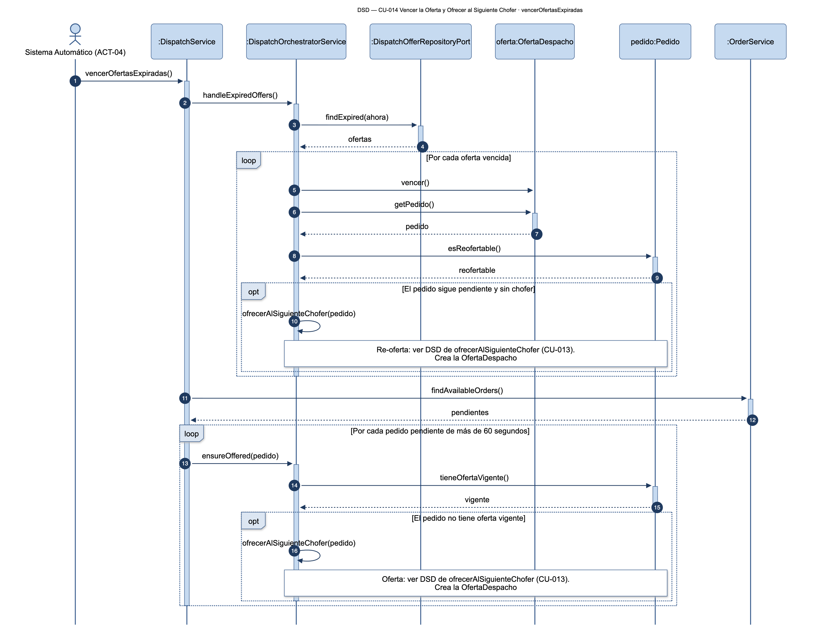

**Figura 10 — CU-014 Vencer la Oferta y Ofrecer al Siguiente Chofer — Diagrama de Interacción**

<details><summary>Ver código del diagrama</summary>

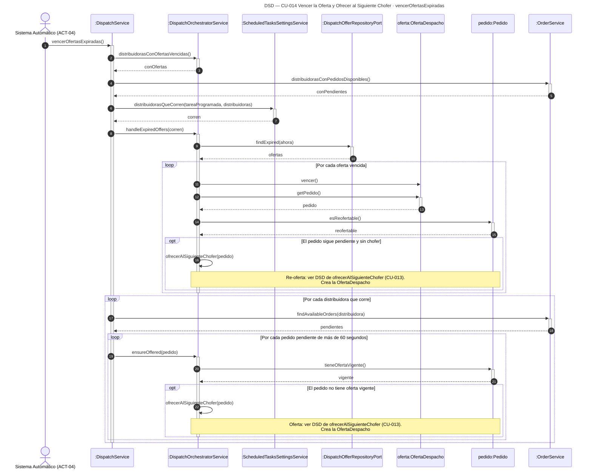

</details>

La operación del sistema es `vencerOfertasExpiradas` (CU-014). Su diagrama de interacción es el de esta sección; su diagrama de secuencia del sistema está en el Documento 2, sección 2.1; su contrato, en el Documento 2, sección 2.2 («Contrato: `vencerOfertasExpiradas()`»), y su tabla de implementación, en el Documento 3, sección 4.25.

---

### 3.5 CU-015 Crítico — Aceptar un Pedido

**Actor:** Chofer (ACT-02)
**Pantalla:** OrderInfoBottomSheet (App Chofer)

#### Interfaz Gráfica


**Figura 11 — CU-015 Aceptar un Pedido — Interfaz Gráfica**

La hoja inferior muestra los ítems, el total y la ventana de aceptación (`expiresAt`; 30 segundos por omisión), con los botones «Aceptar» y «Rechazar».

#### Especificación del CU Real

| Campo | Detalle |
|-------|---------|
| **Código** | CU-015 |
| **Caso de Uso** | Aceptar un Pedido |
| **Actor Principal** | ACT-02 (Chofer) |
| **Objetivos asociados** | OBJ-02, OBJ-03 |
| **Requisitos asociados** | IRQ-02, IRQ-03 |
| **Descripción** | El chofer que recibió una oferta la acepta desde la aplicación. El sistema le asigna el pedido, cierra la oferta, avisa al cliente y deja de ofrecer el pedido al resto de los choferes. |
| **Precondición** | El chofer está identificado y conectado. El pedido está pendiente. El chofer está habilitado por el administrador y validado, tiene un vehículo en uso (CU-161) y ni su licencia ni ese vehículo tienen documentación vencida (CU-136 a CU-138). |

**Secuencia normal**

| Paso | Acción |
|------|--------|
| 1 | El chofer presiona "Aceptar" en la hoja de detalle del pedido. |
| 2 | La aplicación envía `PATCH /orders/:id/status` con `{ status: "accepted" }`. `OrderController.updateStatus()` invoca `OrderService.updateStatus()`, que delega en `UpdateOrderStatusUseCase.execute(id, ACCEPTED, deliveryId, role)`. |
| 3 | Si el pedido ya tiene un chofer asignado, el caso de uso verifica primero que sea el mismo que acepta (`assertPedidoDelChofer`). Después, la máquina de estados valida que la transición PENDING→ACCEPTED sea legal. Recién entonces busca al chofer (`DeliveryService.buscarPorIdOUsuario`), confirma que sea de la misma distribuidora que el pedido y aplica `assertElegibleParaAsignacion`: habilitado (`isEnabled`) y validado (`validated`). Además llama a `FleetDispatchLockService.assertChoferHabilitado`: sin vehículo en uso, o con la licencia o el vehículo en uso vencidos, responde 400. No exige que esté en línea (`isAvailable`): aceptar una oferta es un acto explícito, no una búsqueda del radar. |
| 4 | Asigna el chofer al pedido, lo pasa a ACCEPTED, registra `acceptedAt`, guarda en el pedido la patente, la marca y el modelo del vehículo en uso (`FleetDispatchLockService.vehiculoEnUsoDelChofer`) y genera el `deliveryCode` para la entrega verificada por QR (CU-078/CU-079). |
| 5 | Cierra la oferta propia como ACCEPTED (`DispatchOrchestratorService.onDriverAccepted`), en modo de mejor esfuerzo: después retira, dentro de la misma transacción, las ofertas abiertas a los demás choferes (`DispatchOfferRepositoryPort.withdrawOtherActiveOffers`, estado `superseded`, que no cuenta como intento) y, tras el commit, les avisa que la oferta ya no está vigente; en el despacho secuencial (CU-013/CU-014) no suele haber otra, pero sí cuando acepta un administrador o hay una carrera. |
| 6 | Notifica al cliente que su pedido fue aceptado (`RealtimeDispatchPort.notifyCustomer`, evento `order:accepted`) y al panel admin (`notifyAdmins`). El seguimiento en vivo del GPS todavía no arranca: se activa recién cuando el pedido pasa a ON_THE_WAY (CU-017/CU-020). |
| 7 | Devuelve al chofer el pedido actualizado con sus datos de entrega. |

**Postcondición:** El pedido queda en estado ACCEPTED y con chofer asignado. La oferta queda cerrada y el cliente fue notificado.

**Excepciones**

| Paso | Acción |
|------|--------|
| 3 | Si el pedido ya fue tomado por otro chofer, la aceptación se rechaza con 403 "Este pedido no está asignado a tu usuario", antes de mirar el estado. |
| 3 | Si el pedido fue cancelado o entregado, la aceptación se rechaza por transición no permitida (400). |
| 3 | Si el chofer es de otra distribuidora (o no existe), el sistema responde 404 "Repartidor no encontrado con ID: …"; si está deshabilitado por el administrador, 400 "El repartidor está deshabilitado"; si no está validado, 400 "El repartidor no está validado". |
| 3 | Si el chofer no tiene un vehículo en uso, o su licencia o ese vehículo tienen documentación vencida, el sistema responde 400 "No se puede asignar: …". |

| Campo | Detalle |
|-------|---------|
| **Rendimiento** | Según los pasos del caso de uso esencial (Documento 1): paso 6: 3 segundos. |
| **Frecuencia** | Alta por chofer: se repite cada vez que le llega una oferta, varias veces por jornada. |
| **Estabilidad** | Alta |
| **Comentarios** | El sistema comprueba que un pedido que ya tiene chofer solo lo acepte ese mismo chofer, de modo que un segundo chofer no puede desplazar al primero ni regenerar el código de entrega que el cliente ya tenía. Sí consulta habilitación y validación del chofer en este punto (mismo gate que la asignación manual, CU-012) y la regla de flota (vehículo en uso y documentación al día). La copia del vehículo (patente, marca y modelo) queda en el pedido y se borra si el pedido vuelve a pendiente. Pero no comprueba que la oferta del aceptante siga vigente: una aceptación sobre una oferta ya vencida se admite igual si el pedido sigue pendiente y sin chofer. |

#### Diagrama de Interacción


**Figura 12 — CU-015 Aceptar un Pedido — Diagrama de Interacción**

<details><summary>Ver código del diagrama</summary>

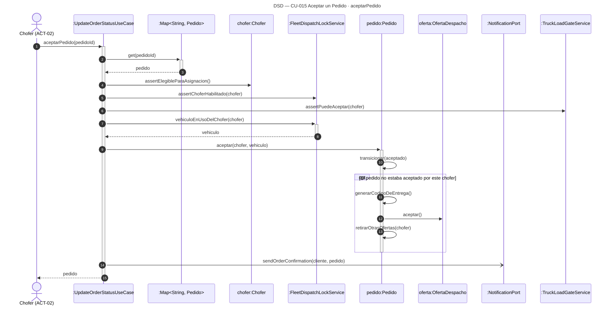

</details>

La operación del sistema es `aceptarPedido` (CU-015). Su diagrama de interacción es el de esta sección; su diagrama de secuencia del sistema está en el Documento 2, sección 2.1; su contrato, en el Documento 2, sección 2.2 («Contrato: `aceptarPedido()`»), y su tabla de implementación, en el Documento 3, sección 4.25.

---

### 3.6 CU-017 Crítico — Modificar la Ubicación GPS del Chofer

**Actor:** Chofer (ACT-02)
**Disparador:** LocationService (Flutter) — stream continuo cada 10 metros

#### Interfaz Gráfica


**Figura 13 — CU-017 Modificar la Ubicación GPS del Chofer — Interfaz Gráfica**

El chofer envía su posición desde la App Chofer sin intervención de pantalla. El cliente ve esa posición en el seguimiento de su pedido, que muestra la figura: el chofer en el mapa, el avance «En camino», la hora estimada de llegada, el repartidor con su patente y su vehículo, y las acciones «Llamar» y «Escribirle». Captura de la App Cliente corriendo contra la API.

#### Especificación del CU Real

| Campo | Detalle |
|-------|---------|
| **Código** | CU-017 |
| **Caso de Uso** | Modificar la Ubicación GPS del Chofer |
| **Actor Principal** | ACT-02 (Chofer) |
| **Objetivos asociados** | OBJ-02, OBJ-03 |
| **Requisitos asociados** | IRQ-03 |
| **Descripción** | Mientras está conectado al WebSocket `/drivers`, la app del chofer emite eventos `driver:update-location` cada vez que el GPS detecta un movimiento de al menos 10 metros. El backend actualiza el radar geoespacial de Redis (`drivers:locations`) y, si el chofer tiene un pedido activo en seguimiento (desde que pasa a ON_THE_WAY), reenvía la ubicación al cliente de ese pedido y al panel admin. |
| **Precondición** | El chofer está identificado y conectado en tiempo real. El dispositivo tiene el GPS activo y los permisos de ubicación concedidos. |

**Secuencia normal**

| Paso | Acción |
|------|--------|
| 1 | `LocationService.positionStream` emite una nueva `Position { lat, lng }` (cada 10 metros). |
| 2 | `HomeViewModel.onData(position)` recibe la posición y actualiza el marcador local en `GoogleMap`. |
| 3 | El cliente WebSocket emite `socket.emit('driver:update-location', { lat, lng })` al backend. |
| 4 | `DriversGateway.handleDriverLocation()` resuelve la identidad del socket (`SocketIdentityService.obtener`) — el `userId` sale del token, no del cuerpo del mensaje — y recuerda `client.data.choferId` para poder sacarlo del radar al desconectarse. |
| 5 | Ejecuta `RedisService.updateDriverLocation(userId, lat, lng)` → `GEOADD drivers:locations <lng> <lat> <userId>`. |
| 6 | Consulta `RedisService.getDriverActiveOrder(userId)` (clave `driver:active-order:<userId>`, la asigna `UpdateOrderStatusUseCase` al pasar a ON_THE_WAY y la limpia al entregar). Si hay un pedido activo: reenvía `{ orderId, driverId, lat, lng, at }` al cliente (`CustomersGateway.notifyCustomer(customerId, 'order:driver-location', payload)`) y al panel (`AdminGateway.notifyAdmins('order:driver-location', payload)`). |

**Postcondición:** El radar de Redis tiene la posición actualizada bajo el `user_id` del chofer. Si hay un pedido en seguimiento, el cliente y el panel recibieron la nueva posición.

**Excepciones**

| Paso | Acción |
|------|--------|
| 1 | Si los permisos de ubicación se revocan → `LocationService` detiene el stream y muestra error en HomeView. |
| 3 | Si el WebSocket está desconectado → Socket.IO guarda el evento en un búfer y reintenta al reconectar. |
| 4 | Si `lat` o `lng` llegan `null`/`undefined` (se acepta `0`, ecuador o meridiano) → se registra el error y se descarta el evento. |
| 4 | Si no se puede resolver la identidad del socket → se desconecta al cliente. |

| Campo | Detalle |
|-------|---------|
| **Rendimiento** | Según los pasos del caso de uso esencial (Documento 1): paso 4: 100 milisegundos. |
| **Frecuencia** | Cada vez que el GPS detecta un desplazamiento de diez metros o más mientras el chofer está en línea. |
| **Estabilidad** | Alta |
| **Comentarios** | La ubicación del chofer se mantiene únicamente en el radar geoespacial en memoria, que es lo que permite resolver la búsqueda por proximidad con la latencia que el despacho necesita. No se conserva un histórico de posiciones en la base relacional, de modo que el recorrido de una entrega no puede reconstruirse a posteriori. El radar no filtra por habilitación ni validación: ese filtro lo aplica `DeliveryService.choferesElegibles()` recién al buscar candidatos para una oferta (CU-013/CU-014); si un chofer deshabilitado quedara conectado por socket sin pasar por la ruta de disponibilidad, seguiría actualizando su posición pero no recibiría ofertas nuevas. |

#### Diagrama de Interacción


**Figura 14 — CU-017 Modificar la Ubicación GPS del Chofer — Diagrama de Interacción**

<details><summary>Ver código del diagrama</summary>

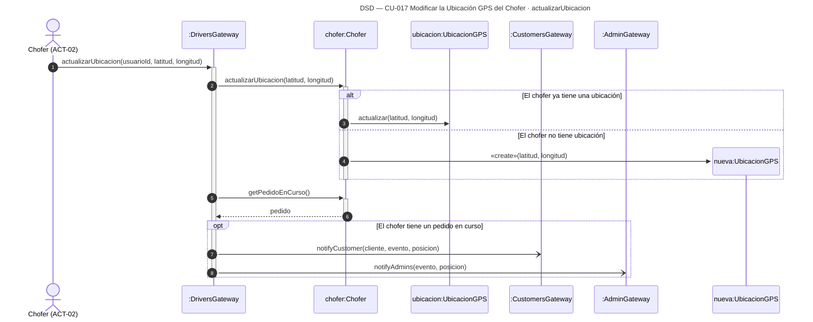

</details>

La operación del sistema es `actualizarUbicacion` (CU-017). Su diagrama de interacción es el de esta sección; su diagrama de secuencia del sistema está en el Documento 2, sección 2.1; su contrato, en el Documento 2, sección 2.2 («Contrato: `actualizarUbicacion()`»), y su tabla de implementación, en el Documento 3, sección 4.25.

**Nota de implementación:** `HomeViewModel.connect()` abre el socket del namespace de choferes mediante `DriverSocketService`, autenticado con el token de Firebase, emite `driver:join` y escucha `server:new-order-request`; mientras el chofer está en línea reenvía su posición con `driver:update-location`.

---

### 3.7 CU-020 Crítico — Confirmar una Entrega Manualmente

**Actor:** Administrador (ACT-03)
**Pantalla:** Detalle del pedido (Panel Admin)

#### Interfaz Gráfica


**Figura 15 — CU-020 Confirmar una Entrega Manualmente — Interfaz Gráfica**

El administrador abre el pedido con «Ver». Si está en camino, puede marcarlo como entregado: el panel le pide el motivo (de 10 a 500 caracteres) antes de enviar la solicitud. El chofer no tiene este botón: su app muestra el código QR del pedido (CU-078) y la entrega la confirma el cliente (CU-079).

#### Especificación del CU Real

| Campo | Detalle |
|-------|---------|
| **Código** | CU-020 |
| **Caso de Uso** | Confirmar una Entrega Manualmente |
| **Actor Principal** | ACT-03 (Administrador), ACT-05 (Administrador General) |
| **Objetivos asociados** | OBJ-03, OBJ-04 |
| **Requisitos asociados** | IRQ-02, IRQ-08, IRQ-18 |
| **Descripción** | El administrador da por entregado un pedido en camino sin la prueba del código, porque el cliente no puede confirmarlo, y deja asentado el motivo. El sistema cierra el ciclo del pedido (estado DELIVERED), registra `deliveredAt`, guarda el motivo en el historial de estados y en la auditoría, descuenta el stock y notifica al cliente por WebSocket + FCM. No marca el pago como cobrado: el cobro en efectivo lo confirma el chofer aparte (CU-292). |
| **Precondición** | El solicitante está identificado como administrador (el Administrador General indica la distribuidora). El pedido es de esa distribuidora y está en camino. |

**Secuencia normal**

| Paso | Acción |
|------|--------|
| 1 | El administrador elige marcar el pedido como entregado en el detalle del pedido e indica el motivo. |
| 2 | El panel envía `PATCH /orders/:id/status` con `{ status: "delivered", reason }`. |
| 3 | `OrderController.updateStatus()` comprueba que el pedido sea de la distribuidora e invoca `OrderService.updateStatus(orderId, DELIVERED, undefined, role, userId, reason)`. |
| 4 | `UpdateOrderStatusUseCase.execute()` rechaza la operación con 403 si el rol es chofer, y exige un motivo de 10 a 500 caracteres (`motivoDeEntregaManual`). |
| 5 | Relee el pedido con bloqueo pesimista y valida que la transición ON_THE_WAY → DELIVERED sea legal. |
| 6 | Actualiza `Order.status = DELIVERED` y registra `deliveredAt = now()`. |
| 7 | Inserta en `order_status_history` el estado de origen, el de destino, el usuario y el motivo, y registra en la auditoría de datos el campo `manualDeliveryReason`, en la misma transacción. |
| 8 | No toca `paymentStatus`: un pedido en efectivo sigue pendiente de cobro. |
| 9 | Corta el seguimiento GPS del chofer (`RealtimeDispatchPort.stopTracking`) y avanza los envases despachados a «con el cliente» (`CylinderLifecyclePort.onOrderDelivered`). |
| 10 | Descuenta del stock físico lo entregado (`StockDeliveryPort.onOrderDelivered`, CU-220), sin que un fallo revierta la entrega. |
| 11 | Emite `order:delivered` al cliente por WebSocket y a los administradores, y envía la notificación FCM al cliente con el texto genérico de confirmación de pedido. |
| 12 | Retorna el pedido con estado DELIVERED. |

**Postcondición:** El pedido tiene estado DELIVERED y `deliveredAt` registrado, y el motivo figura en `order_status_history` y en la auditoría. Si el pago era CASH, sigue en `paymentStatus = PENDING`. El cliente fue notificado. El ciclo de entrega está cerrado.

**Excepciones**

| Paso | Acción |
|------|--------|
| 3 | Si el pedido no existe o es de otra distribuidora → 404, sin revelar que existe. |
| 4 | Si lo pide un chofer → 403 "La entrega se confirma con el QR del cliente". |
| 4 | Si falta el motivo o no tiene entre 10 y 500 caracteres → 400. |
| 5 | Si el pedido no está en estado ON_THE_WAY (o está cancelado) → 400 "Transición de estado no permitida". |

| Campo | Detalle |
|-------|---------|
| **Rendimiento** | Según los pasos del caso de uso esencial (Documento 1): paso 7: 3 segundos. |
| **Frecuencia** | Baja: solo los pedidos en los que el cliente no pudo confirmar con el código. |
| **Estabilidad** | Alta |
| **Comentarios** | La entrega es la prueba de que el cliente recibió el pedido: la cierra el cliente con el código (CU-079) o el administrador con el motivo por escrito, nunca el chofer. |

#### Diagrama de Interacción

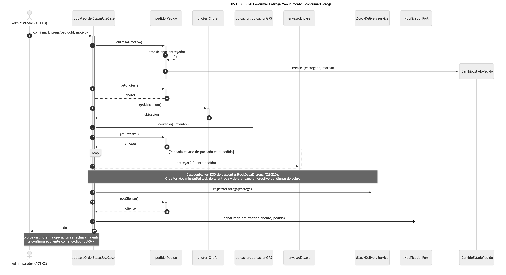

**Figura 16 — CU-020 Confirmar una Entrega Manualmente — Diagrama de Interacción**

<details><summary>Ver código del diagrama</summary>

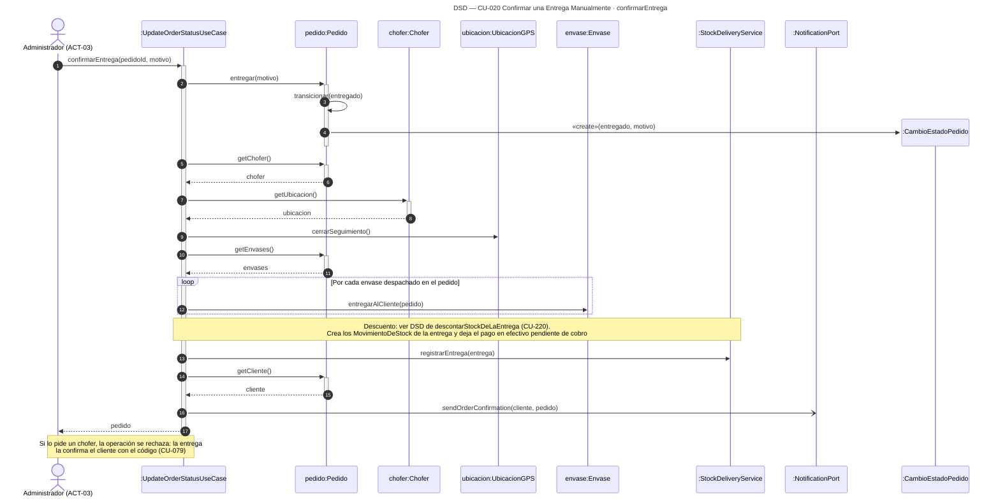

</details>

La operación del sistema es `confirmarEntrega` (CU-020). Su diagrama de interacción es el de esta sección; su diagrama de secuencia del sistema está en el Documento 2, sección 2.1; su contrato, en el Documento 2, sección 2.2 («Contrato: `confirmarEntrega()`»), y su tabla de implementación, en el Documento 3, sección 4.25.

---


### 3.8 CU-048 Crítico — Procesar el Pago con MercadoPago

**Actor:** Sistema Automático (ACT-04)
**Pantalla:** Sin pantalla propia dentro del sistema — confirmación server-to-server

#### Interfaz Gráfica

CU sin pantalla propia (proceso automático del Sistema, disparado por la notificación webhook de MercadoPago). La pantalla visible asociada es la selección del método de pago dentro del checkout — ver la figura siguiente, opción "MercadoPago" del selector de método de pago (parte de CU-005). El pago en sí se completa en el Checkout Pro de MercadoPago, fuera de las aplicaciones del sistema: ninguna pantalla de la App Cliente, la App Chofer ni el Panel Admin interviene en la confirmación que describe este CU.


**Figura 17 — CU-048 Procesar el Pago con MercadoPago — Interfaz Gráfica**

Pantalla «Confirmación» con «Mercado Pago» como forma de pago, tal como la ve el cliente antes de confirmar. Al tocar «Confirmar pedido» la app abre el Checkout Pro de MercadoPago; esa pantalla y el pago quedan fuera de la captura. Captura de la App Cliente corriendo contra la API.

#### Especificación del CU Real

| Campo | Detalle |
|-------|---------|
| **Código** | CU-048 |
| **Caso de Uso** | Procesar el Pago con MercadoPago |
| **Actor Principal** | ACT-04 (Sistema Automático) |
| **Objetivos asociados** | OBJ-02, OBJ-07 |
| **Requisitos asociados** | IRQ-02, IRQ-08 |
| **Descripción** | Cuando un pedido se paga con MercadoPago, la pasarela notifica al backend mediante un webhook contra `MercadoPagoWebhookController`. El sistema valida la firma HMAC de la notificación, consulta el estado real del pago contra la API de MercadoPago sin confiar nunca en el contenido recibido, actualiza el registro `Payment`, marca el pedido como pagado dentro de una transacción con bloqueo pesimista sobre el `Order`, y recién entonces dispara el despacho automático al siguiente chofer candidato. |
| **Precondición** | Existe un pedido con medio de pago MercadoPago y un intento de cobro registrado como pendiente, referido al pedido. La clave que autentica los avisos y la dirección donde la pasarela notifica están configuradas. |

**Secuencia normal**

| Paso | Acción |
|------|--------|
| 1 | MercadoPago envía `POST /webhook/mercadopago` con `type`, `data.id` y los encabezados `x-signature` / `x-request-id` a `MercadoPagoWebhookController`. La ruta está exento del límite global de peticiones. |
| 2 | El controlador tolera los dos formatos que usa MercadoPago para nombrar los parámetros, normaliza `type` y `dataId`, y llama `PaymentsService.verifyWebhookSignature(xSignature, xRequestId, dataId)`. |
| 3 | `PaymentsService` delega en `PaymentGatewayPort.verifyWebhookSignature()` (implementado por `MercadoPagoAdapter`), que valida el HMAC con la clave secreta configurada. |
| 4 | Con la firma válida, `MercadoPagoWebhookController` invoca `ConfirmPaymentUseCase.execute(type, dataId)`. |
| 5 | `ConfirmPaymentUseCase` llama `PaymentsService.confirmFromGateway(type, dataId)`, que descarta la notificación si el `type` no es de pago o no trae `dataId`. |
| 6 | `PaymentsService` consulta el pago real vía `PaymentGatewayPort.getPayment(dataId)` (`MercadoPago.Payment.get()`), con un tiempo máximo de espera de 5 segundos. |
| 7 | `PaymentsService` actualiza el `Repository<Payment>` — busca por `gateway_payment_id` o, en la primera notificación, toma el intento PENDING más reciente de esa `external_reference` sin identificador aún — y traduce el estado crudo de la pasarela a aprobado, rechazado, cancelado, reintegrado o pendiente. |
| 8 | `ConfirmPaymentUseCase` recupera el `Order` vía `OrderRepositoryPort.findByIdFull(externalReference)`. |
| 9 | Si el pago está aprobado, abre `DataSource.createQueryRunner()` y `QueryRunner.startTransaction()`, y vuelve a leer el `Order` con lock pesimista (`pessimistic_write`) para serializar notificaciones concurrentes del mismo pago. |
| 10 | Evalúa `isTerminal(locked.status)` y si el pedido ya tiene `gatewayPaymentId` asignado; en cualquiera de los dos casos hace `commit` sin modificar nada (idempotencia ante reintentos del webhook). |
| 11 | Si `locked.status = RESERVED`, marca `deposit_paid = true`, graba el `gatewayPaymentId` y hace `commit` sin disparar despacho: la reserva la activa el proceso programado el día agendado (CU-075). |
| 12 | En el caso general, marca `paymentStatus = PAID`, graba el `gatewayPaymentId` y hace `commitTransaction()`. |
| 13 | Ya fuera de la transacción, invoca `DispatchOrchestratorService.offerToNextDriver(order)` en modo de mejor esfuerzo, equivalente al despacho de CU-013. |
| 14 | `MercadoPagoWebhookController` responde `200 { received: true }` a MercadoPago. |

**Postcondición:** El `Payment` refleja el estado real informado por la pasarela. Si el pago fue aprobado, el `Order` quedó con `paymentStatus = PAID` y el `gatewayPaymentId` grabado —o con la seña marcada como pagada, si era una reserva— y el despacho se disparó exactamente una vez. Repetir la misma notificación no vuelve a marcar el pedido ni a despacharlo.

**Excepciones**

| Paso | Acción |
|------|--------|
| 3 | Si la firma es inválida, falta, o la clave secreta no está configurada → `MercadoPagoWebhookController` no procesa la notificación y responde 200 igual, para no revelar si el pago o el pedido existen. |
| 6 | Si la consulta a MercadoPago falla o supera el tiempo de espera → se registra el error y se aborta sin tocar el `Order`. |
| 8 | Si `external_reference` no corresponde a ningún `Order` → se registra la advertencia y se aborta. |
| 9 | Si el `Order` desaparece entre la lectura inicial y la toma del lock → `QueryRunner.commit()` sin efectos y se registra la advertencia. |
| 9–12 | Ante cualquier error dentro de la transacción → `QueryRunner.rollbackTransaction()` y propagación del error; el controlador lo captura y responde 200 igual, para que MercadoPago no reintente en bucle contra un 5xx. |
| 13 | Si el despacho falla → se registra el error; el pedido queda pagado a la espera del reintento de despacho, el pago no se revierte. |
| 12 | Si el pago llega `rejected` o `cancelled` → el sistema únicamente lo registra en el registro de eventos; no hay transición de estado sobre el `Order` (ver Comentarios). |

| Campo | Detalle |
|-------|---------|
| **Rendimiento** | Según los pasos del caso de uso esencial (Documento 1): paso 15: 5 segundos. |
| **Frecuencia** | Una o más notificaciones por cada pedido pagado con MercadoPago; la pasarela reintenta el mismo aviso si no recibe respuesta. |
| **Estabilidad** | Alta |

#### Diagrama de Interacción

##### Operación: crearCheckoutDePago(pedidoId, medioDePago)

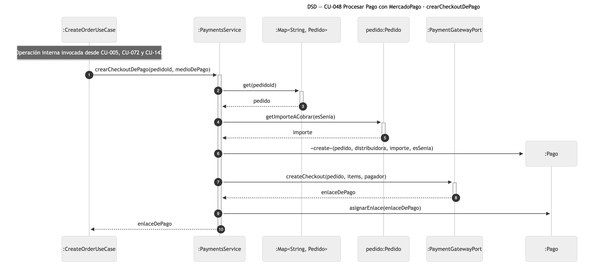

**Figura 18 — DSD CU-048: Procesar el Pago con MercadoPago · crearCheckoutDePago**

<details><summary>Ver código del diagrama</summary>

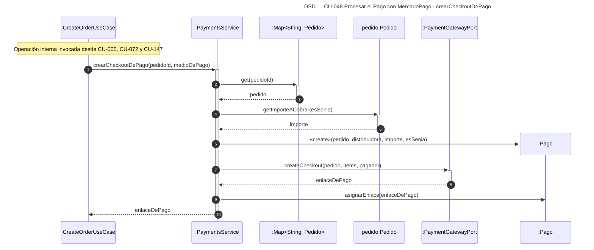

</details>

**Clases participantes:** `CreateOrderUseCase` (el caso de uso que la invoca), `PaymentsService` (controlador de fachada del módulo de pagos), la colección `Map<String, Pedido>`, los objetos de dominio `Pedido` y `Pago`, y `PaymentGatewayPort` (fabricación pura: la pasarela de pago, MercadoPago Checkout Pro).

**GRASP.** *Controlador*: `PaymentsService`. *Creador*: el servicio crea el `Pago`, porque es quien lleva el registro de los intentos de cobro. *Experto*: `Pedido` sabe cuánto hay que cobrar: su total, o el monto de la seña si el cobro es de una reserva. El `Pago` nace «pendiente»; si la pasarela no devuelve el enlace, queda sin él y el pedido queda creado igual. Si el pedido ya está pago, cancelado o entregado, el servicio lo rechaza con un conflicto (409) antes de registrar ningún intento, y si no existe responde 404.

**Referencias.** `crearCheckoutDePago` no es una operación del sistema: ningún actor la invoca ni tiene una ruta propia. Es una colaboración interna que ejecuta `CreateOrderUseCase` dentro de la creación del pedido (`crearPedido`, CU-005), de la reserva (`crearReserva`, CU-072) y de la compra express (`realizarCompraExpress`, CU-147), y su resultado, el enlace de pago, viaja en la respuesta de esas operaciones. Se la diagrama aparte porque crea el `Pago`, y sus efectos figuran en las Notas del contrato de `crearPedido`. El resultado del pago llega después, por la notificación de la pasarela: es la operación `notificarResultadoDePago`, de este mismo caso de uso.

**No se dibuja:** la persistencia del `Pago` y la preferencia de pago de MercadoPago (`MercadoPagoAdapter`), que es la implementación del puerto. El estado del `Pedido` no cambia.

| Operación de diseño | Implementación |
|---|---|
| `PaymentsService.crearCheckoutDePago(...)` | `PaymentsService.createCheckout`, invocado por `CreateOrderUseCase` al crear el pedido con MercadoPago o la seña de una reserva |
| `Map<String, Pedido>.get(...)` | `CreateOrderUseCase.execute`: entrega el `Order` recién guardado; `PaymentsService.createCheckout` recibe su identificador y no lo relee |
| `Pedido.getImporteACobrar(...)` | `CreateOrderUseCase.createMercadoPagoCheckout` toma `Order.totalAmount`; `CreateOrderUseCase.createDepositCheckout` toma `Order.depositAmount` |
| `Pago.«create»` | `PaymentsService.createCheckout`: crea y guarda el `Payment` con `Payment.status` pendiente, `Payment.amount` y `Payment.isDeposit` |
| `Pago.asignarEnlace(...)` | `PaymentsService.createCheckout`: asigna `Payment.paymentUrl` y guarda |
| `TruckLoadGateService.choferesQuePuedenRecibir(...)` | `DispatchOrchestratorService.conCargaSiSeExige` llama a `TruckLoadGatePort.choferesQuePuedenRecibir`, que implementa `TruckLoadGateService.choferesQuePuedenRecibir` (CU-248): deja solo a los candidatos que pueden recibir pedidos según su carga de camión |
| `TruckLoadGateService.assertPuedeAceptar(...)` | `UpdateOrderStatusUseCase.execute` llama a `TruckLoadGatePort.assertPuedeAceptar`, que implementa `TruckLoadGateService.assertPuedeAceptar` (CU-248): responde 400 con el motivo si el chofer no puede recibir pedidos según su carga; no se vuelve a controlar si el chofer ya tenía aceptado el pedido |

#### Clases de Diseño Participantes

| Clase | Capa | Responsabilidad |
|-------|------|------------------|
| `MercadoPagoWebhookController` | Backend Controller | Ruta de la API `POST /webhook/mercadopago`, exento del rate-limit global |
| `PaymentsService` | Backend Service | Orquesta verificación de firma, consulta a la pasarela y actualización del ledger |
| `PaymentGatewayPort` (impl. `MercadoPagoAdapter`) | Infrastructure | Único punto que toca el SDK de MercadoPago; sumar otra pasarela es agregar un adapter |
| `ConfirmPaymentUseCase` | Backend Use Case | Aplica el resultado normalizado del pago sobre el `Order`, con lock pesimista |
| `OrderRepositoryPort` | Infrastructure | Persistencia del `Order` |
| `Repository<Payment>` | Infrastructure | Ledger de pagos, con índice único parcial sobre `gateway_payment_id` |
| `DispatchOrchestratorService` | Backend Service | Dispara el despacho al siguiente chofer candidato una vez pagado el pedido |

**Comentarios.** La idempotencia descansa en tres mecanismos encadenados: el índice único parcial sobre `gateway_payment_id` en el ledger de pagos, un índice análogo en el `Order`, y el lock pesimista dentro de la transacción de `ConfirmPaymentUseCase`. **Limitación conocida:** el camino de pago `rejected` / `cancelled` no está implementado y el sistema se limita a registrarlo en el registro de eventos, sin liberar el stock reservado ni cancelar el pedido. Quien resuelve esa situación es el proceso temporal de CU-077, que cada 30 minutos cancela los pedidos de MercadoPago sin pago confirmado más antiguos que el plazo configurado y recién ahí restituye el stock. El reembolso por cancelación está construido (CU-168, C-17); el contracargo no se contempla: el ledger sabe traducir ese estado, pero el `Order` no reacciona a él.

---


### 3.9 CU-079 Crítico — Confirmar una Entrega Escaneando el QR (cliente)

**Actor:** Cliente (ACT-01); también Administrador (ACT-03) y Administrador General (ACT-05), con el motivo
**Pantalla:** OrderTrackingView (App Cliente) — lector de código QR

#### Interfaz Gráfica

La cámara lectora no se captura (el simulador no tiene cámara). La acción se dispara desde el seguimiento del pedido mientras el estado es «En camino» (figura siguiente): el cliente abre el lector de cámara para leer el QR que el chofer le muestra en su pantalla (obtenido en CU-078), y la app extrae del contenido leído el código de diez caracteres.

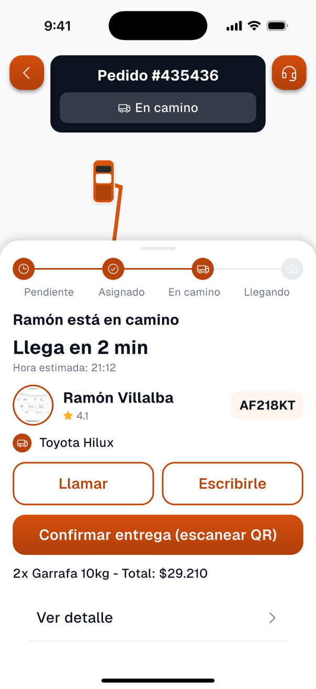

**Figura 19 — CU-079 Confirmar una Entrega Escaneando el QR (cliente) — Interfaz Gráfica**

Seguimiento del pedido en camino de la App Cliente: el botón «Confirmar entrega (escanear QR)» abre el lector de cámara. Captura de la app corriendo contra la API.

#### Especificación del CU Real

| Campo | Detalle |
|-------|---------|
| **Código** | CU-079 |
| **Caso de Uso** | Confirmar una Entrega Escaneando el QR (cliente) |
| **Actor Principal** | ACT-01 (Cliente) |
| **Objetivos asociados** | OBJ-03, OBJ-04, OBJ-07 |
| **Requisitos asociados** | IRQ-02, IRQ-08 |
| **Descripción** | El cliente escanea desde `OrderTrackingView` el QR que le muestra el chofer al llegar al domicilio y envía el código leído. Si coincide con el `deliveryCode` guardado en el pedido, el sistema delega en el mismo caso de uso de cambio de estado que usa CU-020 y da la entrega por realizada. Es el camino normal de cierre: confirma quien recibe, no quien entrega, y esa es la prueba anti-fraude de que el chofer estuvo presente. Un administrador puede confirmar con el mismo código si el cliente no puede escanear, dejando el motivo por escrito. |
| **Precondición** | El solicitante está identificado como el cliente titular del pedido o como administrador (el Administrador General indica la distribuidora). El pedido está en camino y tiene código de entrega desde su aceptación (CU-015) o su asignación manual (CU-012). El chofer está en el domicilio mostrando el QR. |

**Secuencia normal**

| Paso | Acción |
|------|--------|
| 1 | El chofer muestra en su pantalla el QR obtenido en CU-078. |
| 2 | El cliente abre el lector de cámara desde `OrderTrackingView` y escanea el QR; la app extrae el código de diez caracteres del contenido leído. |
| 3 | `OrderTrackingViewModel` llama `historyService.confirmDelivery(orderId, code)` → `POST /orders/:id/confirm-delivery` con `{ code }` y el encabezado `Idempotency-Key`. |
| 4 | `OrderController.confirmDelivery()` invoca `OrderService.confirmDelivery(id, code, userId, role, reason)`, que delega en `ConfirmDeliveryUseCase.execute(orderId, code, userId, role, reason)`. |
| 5 | `ConfirmDeliveryUseCase` recupera el pedido con `OrderRepositoryPort.findByIdFull(orderId)` y valida que, si el rol es CUSTOMER, `order.customer_id` sea el usuario autenticado. |
| 6 | Verifica que el pedido esté en estado ON_THE_WAY. |
| 7 | Compara el código recibido contra `order.deliveryCode` con `compareDeliveryCode()` (`DeliveryCodeUtil`), que usa `timingSafeEqual` para no filtrar el secreto por timing. |
| 8 | Con el código válido, delega en `UpdateOrderStatusUseCase.execute(order_id, DELIVERED)` — el mismo caso de uso que usa `PATCH /orders/:id/status` en CU-020. Si el rol es administrador, le pasa el rol, el usuario y el motivo, y el caso de uso exige entre 10 y 500 caracteres y los asienta en `order_status_history` y en la auditoría. |
| 9 | `UpdateOrderStatusUseCase` registra `deliveredAt = now()`. No toca `paymentStatus`: un pedido en efectivo sigue pendiente de cobro (CU-292). |
| 10 | Llama `RealtimeDispatchPort.stopTracking(driverUserId)` para cortar el seguimiento GPS en vivo del chofer. |
| 11 | Llama `CylinderLifecyclePort.onOrderDelivered(order_id, distributor_id)`, que avanza a `CON_EL_CLIENTE` los envases despachados en el pedido, en modo de mejor esfuerzo: si falla, la entrega igual se completa. |
| 12 | Persiste el `Order` vía `OrderRepositoryPort.save(order)` y emite `RealtimeDispatchPort.notifyCustomer()` / `notifyAdmins()` con `order:delivered`, además de la notificación push, todo de mejor esfuerzo. |
| 13 | `ConfirmDeliveryUseCase` devuelve `OrderMapper.toDto(order)`; `OrderTrackingView` recibe la respuesta y actualiza el stepper a "Entregado". |

**Postcondición:** El pedido queda en estado DELIVERED con `deliveredAt` registrado y evidencia de que el cliente validó la entrega con el código. Si el pago era en efectivo, sigue en `paymentStatus = PENDING`. El chofer sale del seguimiento en vivo y los envases del pedido figuran `CON_EL_CLIENTE`.

**Excepciones**

| Paso | Acción |
|------|--------|
| 3 | Si el cuerpo no trae `code` o viene vacío → 400 por validación del DTO. |
| 5 | Si el pedido no existe → 404 "Order with ID: … not found". |
| 5 | Si el pedido pertenece a otro cliente → 403 "No autorizado a confirmar la entrega de otro cliente". |
| 6 | Si el pedido ya está DELIVERED → no se trata como error: se devuelve el pedido tal cual, sin reprocesar ni volver a exigir el código, para tolerar el doble escaneo y el reintento de red. |
| 6 | Si el pedido está en cualquier otro estado que no sea ON_THE_WAY → 400 "El pedido no está en camino, no se puede confirmar la entrega". |
| 7 | Si el código no coincide, o el pedido no tiene código cargado, o los largos difieren → 400 "Código de entrega inválido". |
| 8 | Si lo confirma un administrador y el motivo falta o no tiene entre 10 y 500 caracteres → 400. |

| Campo | Detalle |
|-------|---------|
| **Rendimiento** | Según los pasos del caso de uso esencial (Documento 1): paso 7: 3 segundos. |
| **Frecuencia** | Una vez por pedido entregado, en el pico de la franja horaria de entrega. |
| **Estabilidad** | Alta |

#### Diagrama de Interacción


**Figura 20 — CU-079 Confirmar una Entrega Escaneando el QR (cliente) — Diagrama de Interacción**

<details><summary>Ver código del diagrama</summary>

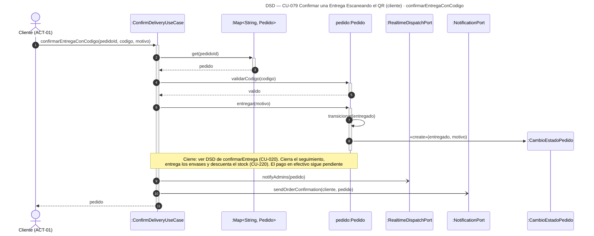

</details>

La operación del sistema es `confirmarEntregaConCodigo` (CU-079). Su diagrama de interacción es el de esta sección; su diagrama de secuencia del sistema está en el Documento 2, sección 2.1; su contrato, en el Documento 2, sección 2.2 («Contrato: `confirmarEntregaConCodigo()`»), y su tabla de implementación, en el Documento 3, sección 4.25.

#### Clases de Diseño Participantes

| Clase | Capa | Responsabilidad |
|-------|------|------------------|
| `OrderTrackingView` | Presentation (Flutter) | Muestra el stepper del pedido y aloja el lector de QR mientras el pedido está ON_THE_WAY |
| `OrderTrackingViewModel` | Presentation | Orquesta el escaneo, llama al servicio y actualiza el estado local |
| `HistoryService` | Service (Flutter) | HTTP al backend, la misma clase que persiste el historial en CU-005 |
| `OrderController` | Backend Controller | Ruta de la API `POST /orders/:id/confirm-delivery` |
| `OrderService` | Backend Service | Delega en el caso de uso de confirmación |
| `ConfirmDeliveryUseCase` | Backend Use Case | Valida pertenencia, estado y código; concentra la lógica anti-fraude |
| `DeliveryCodeUtil` (`compareDeliveryCode`) | Domain (función pura) | Comparación de tiempo constante del código de entrega |
| `UpdateOrderStatusUseCase` | Backend Use Case | Aplica la transición a DELIVERED y sus efectos; compartido con CU-020 |
| `OrderRepositoryPort` | Infrastructure | Persistencia del `Order` |
| `CylinderLifecyclePort` | Infrastructure | Avanza los envases despachados a `CON_EL_CLIENTE` |
| `RealtimeDispatchPort` | Infrastructure | Notifica por WebSocket y FCM, y corta el seguimiento del chofer |

**Comentarios.** La validación vive en `ConfirmDeliveryUseCase`; los efectos de pasar a DELIVERED se delegan en `UpdateOrderStatusUseCase`, el mismo que usa `PATCH /orders/:id/status`: cero duplicación de lógica con CU-020. La doble idempotencia (encabezado `Idempotency-Key` más el chequeo de `status === DELIVERED` dentro del caso de uso) tolera el reintento de red y el doble escaneo. El espacio del código es de 16^10 combinaciones, por lo que adivinarlo a fuerza bruta es inviable; los roles ADMIN y SUPER_ADMIN también pueden confirmar, para entregas asistidas desde soporte. Limitación conocida: la garantía completa de este mecanismo depende de que el pedido conserve un único chofer asignado, y aceptar un pedido no comprueba que no tenga ya un chofer (CU-015), de modo que un segundo chofer puede regenerar el `deliveryCode` e invalidar el QR que el primero ya le había mostrado al cliente.

---


### 3.10 CU-008 Importante — Cancelar un Pedido (Cliente)

**Actor:** Cliente (ACT-01)
**Pantalla:** OrderTrackingView (App Cliente) — botón "Cancelar"

#### Interfaz Gráfica


**Figura 21 — CU-008 Cancelar un Pedido (Cliente) — Interfaz Gráfica**

El botón rojo «Cancelar pedido» está al pie del seguimiento y la app lo ofrece mientras el pedido está pendiente, es decir, «Buscando repartidor». Al tocarlo la app pide el motivo («¿Por qué querés cancelar?») y recién con «Confirmar cancelación» se cancela. Captura de la App Cliente corriendo contra la API.

#### Especificación del CU Real

| Campo | Detalle |
|-------|---------|
| **Código** | CU-008 |
| **Caso de Uso** | Cancelar un Pedido (Cliente) |
| **Actor Principal** | ACT-01 (Cliente) |
| **Objetivos asociados** | OBJ-01, OBJ-06 |
| **Requisitos asociados** | IRQ-02, IRQ-04 |
| **Descripción** | El cliente cancela desde `OrderTrackingView` un pedido propio que todavía no salió hacia su domicilio. El sistema valida la transición de estado, marca el pedido como CANCELLED y restituye el stock de todos sus ítems al inventario en una transacción separada del guardado del pedido. |
| **Precondición** | El cliente está identificado. El pedido es suyo. |

**Secuencia normal**

| Paso | Acción |
|------|--------|
| 1 | El cliente presiona "Cancelar" en `OrderTrackingView` y la app le pide el motivo: no deja confirmar sin elegir uno (y, si elige «Otro», sin escribirlo). |
| 2 | `OrderTrackingViewModel` llama `historyService.cancelOrder(orderId, reason)` → `PATCH /orders/:id/cancel` con `{ reason }` y el encabezado `Idempotency-Key`. |
| 3 | `IdempotencyInterceptor.intercept()` revisa si ya hay una respuesta cacheada para esa clave; si la hay, la devuelve sin reprocesar. En la primera ejecución, deja pasar la solicitud. |
| 4 | `OrderController` resuelve el actor desde el rol del token (`mapRoleToCancelActor(user.role)` → `customer`) e invoca `OrderService.cancelOrder(id, user.user_id, customer, body.reason)`. |
| 5 | `OrderService` delega en `CancelOrderUseCase.execute(orderId, userId, customer, reason)`. |
| 6 | `CancelOrderUseCase` abre una única transacción con un `QueryRunner` y lee el pedido con bloqueo pesimista de escritura (`pessimistic_write`) junto con su chofer; los renglones se leen después del bloqueo, en una consulta aparte. |
| 7 | Verifica, en este orden: que el pedido sea del cliente que lo pide (uno ajeno responde 404, como si no existiera), que no esté ya DELIVERED ni CANCELLED y que no esté ON_THE_WAY. |
| 8 | Con la política aprobada, aplica la máquina de estados de dominio (`transitionOrder(order, CANCELLED)`), asigna `cancellationReason` y restituye el stock con `GasCylinderService.restituirStock(queryRunner.manager, items)`, que bloquea cada `GasCylinder` y devuelve la cantidad de cada ítem. |
| 9 | Guarda el pedido cancelado con el mismo `queryRunner.manager` y confirma la transacción: el bloqueo, el cambio de estado, la restitución del stock y el guardado se confirman juntos. |
| 10 | Después del commit, cierra la oferta de despacho (`DispatchOrchestratorService.onOrderClosed`) y llama `notify(order, previousDriverUserId, customer)`: emite `RealtimeDispatchPort.notifyCustomer(customer_id, order:cancelled)` con `cancelledBy`, `notifyAdmins(order:cancelled)` y, si el pedido ya tenía chofer asignado, `stopTracking` y `notifyDriverOrderCancelled`. |
| 11 | `OrderController` mapea la respuesta con `OrderMapper.toDto(order)`, que incluye `cancelledBy`; `OrderTrackingView` actualiza el stepper mostrando el pedido como cancelado. |

**Postcondición:** El pedido tiene estado CANCELLED con su motivo. El stock de todos los ítems fue restituido al inventario con bloqueo sobre cada `GasCylinder`. Ambos efectos se confirmaron en una única transacción con bloqueo del pedido: dos cancelaciones simultáneas no devuelven el stock dos veces.

**Excepciones**

| Paso | Acción |
|------|--------|
| 6 | Si el pedido no existe → `NotFoundException`, "Order with ID: … not found". |
| 7 | Si el pedido no pertenece al cliente autenticado → `NotFoundException`, "Order with ID: … not found": no revela que existe. Este control corre antes que el de estado. |
| 7 | Si el pedido ya está DELIVERED o CANCELLED → `BadRequestException`, "No se puede cancelar un pedido finalizado". |
| 7 | Si el pedido ya está ON_THE_WAY → `BadRequestException`, "El pedido ya está en camino. Contacte al soporte." |
| 5 | Si `reason` falta → 400 «Para cancelar el pedido hay que indicar el motivo»; si son sólo espacios → 400 «reason should not be empty» (el DTO) (con más de 500 caracteres, 400 «reason must be shorter than or equal to 500 characters»); la base repite la regla con `CHK_order_cancelado_motivo`, que no admite un pedido CANCELLED sin motivo. |
| 2 | Si la clave de idempotencia ya fue usada para esa solicitud → `IdempotencyInterceptor` devuelve la respuesta cacheada sin volver a ejecutar `CancelOrderUseCase`. |

| Campo | Detalle |
|-------|---------|
| **Rendimiento** | Según los pasos del caso de uso esencial (Documento 1): paso 6: 3 segundos. |
| **Frecuencia** | Baja: solo cuando el cliente necesita cancelar un pedido de manera excepcional. |
| **Estabilidad** | Alta |

#### Diagrama de Interacción

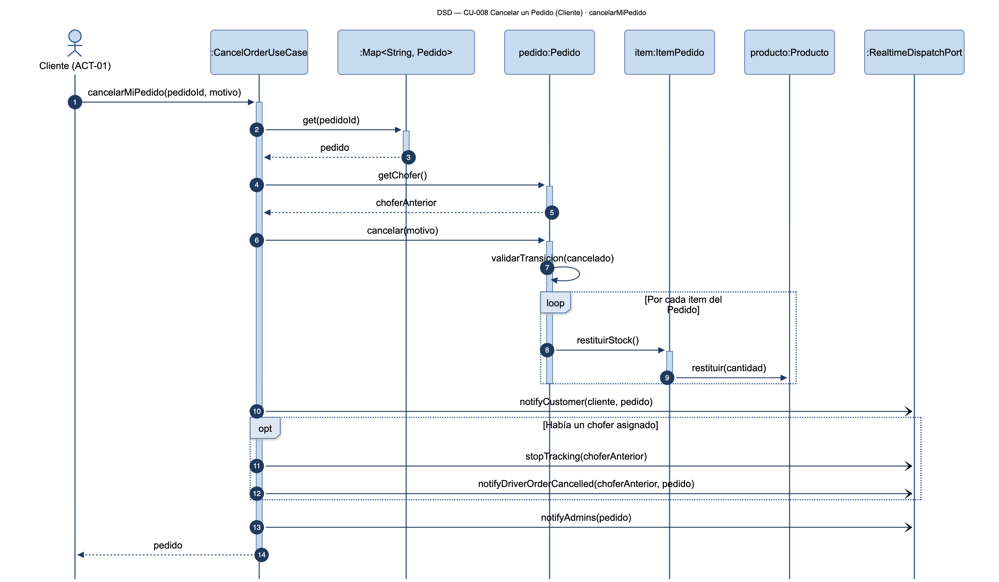

**Figura 22 — CU-008 Cancelar un Pedido (Cliente) — Diagrama de Interacción**

<details><summary>Ver código del diagrama</summary>

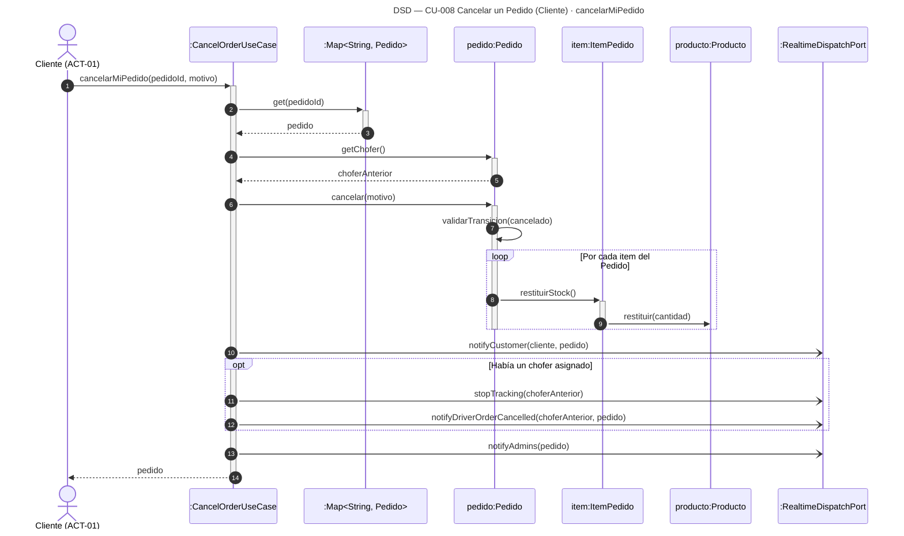

</details>

La operación del sistema es `cancelarMiPedido` (CU-008). Su diagrama de interacción es el de esta sección; su diagrama de secuencia del sistema está en el Documento 2, sección 2.1; su contrato, en el Documento 2, sección 2.2 («Contrato: `cancelarMiPedido()`»), y su tabla de implementación, en el Documento 3, sección 4.25.

#### Clases de Diseño Participantes

| Clase | Capa | Responsabilidad |
|-------|------|------------------|
| `OrderTrackingView` | Presentation (Flutter) | Muestra el stepper del pedido y el botón "Cancelar" |
| `OrderTrackingViewModel` | Presentation | Orquesta la acción de cancelar y actualiza el estado local |
| `HistoryService` | Service (Flutter) | HTTP al backend, la misma clase que persiste el historial en CU-005 |
| `IdempotencyInterceptor` | Backend Interceptor | Evita reprocesar la cancelación ante un reintento con la misma clave |
| `OrderController` | Backend Controller | Ruta de la API `PATCH /orders/:id/cancel`, resuelve el actor desde el rol del token |
| `OrderService` | Backend Service | Delega en el caso de uso de cancelación |
| `CancelOrderUseCase` | Backend Use Case | Aplica la política de cancelación y orquesta la transición |
| `transitionOrder` (máquina de estados de dominio) | Domain | Valida la transición de estado hacia CANCELLED |
| `GasCylinderService` | Backend Service | Restituye el stock reservado con `restituirStock`, con bloqueo por `GasCylinder` |
| `RealtimeDispatchPort` (impl. `RealtimeDispatchAdapter`) | Infrastructure | Notifica a cliente, panel y chofer por WebSocket |

**Comentarios.** La restitución de stock (`GasCylinderService.restituirStock`) y el guardado del pedido cancelado corren en la misma transacción, con el pedido bloqueado: si algo falla, se revierte todo. El sistema no envía notificación push al cancelar: el aviso viaja solo por la conexión en tiempo real, de modo que un chofer o un cliente con la app cerrada no se entera hasta reabrirla.

---

### 3.11 CU-002 Crítico — Registrarse como Cliente

**Actor:** Cliente (ACT-01)
**Pantalla:** SignupView (App Cliente) — paso 2, «Tu cuenta»

#### Interfaz Gráfica

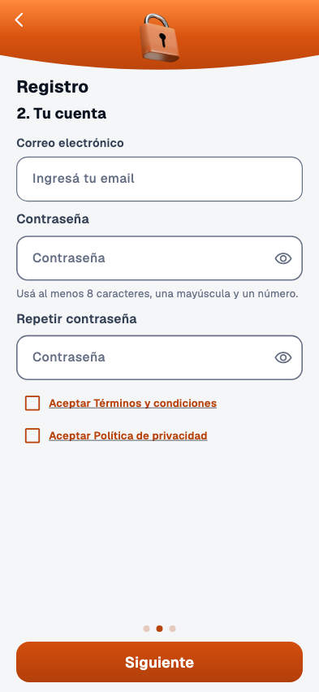

**Figura 23 — CU-002 Registrarse como Cliente — Interfaz Gráfica**

Segundo paso del registro de la App Cliente. El primer paso toma el nombre y el teléfono; éste, el correo y la contraseña con los dos consentimientos. El tercero es opcional y declara el consumo mensual de gas (CU-143). La captura muestra el formulario completo, con los dos consentimientos aceptados, antes de seguir. Captura de la app corriendo contra la API.

#### Especificación del CU Real

| Campo | Detalle |
|-------|---------|
| **Código** | CU-002 |
| **Caso de Uso** | Registrarse como Cliente |
| **Actor Principal** | ACT-01 (Cliente) |
| **Objetivos asociados** | OBJ-01 |
| **Requisitos asociados** | IRQ-01 |
| **Descripción** | La persona completa el registro en `SignupView` y la app envía los datos a `POST /auth/registro`, una ruta pública siempre de cliente: el rol no se elige y una distribuidora en el cuerpo se rechaza. `RegistroService` crea la cuenta en Firebase Authentication y, en una única transacción, el usuario con su perfil de cliente; si la persistencia falla, borra la cuenta de Firebase que creó. Confirmada el alta, publica un evento que dispara el correo de bienvenida. El registro no abre la sesión: la app encadena después el inicio de sesión (CU-001). |
| **Precondición** | La persona tiene conexión a internet y no tiene una cuenta con el mismo correo ni con el mismo teléfono. |

**Secuencia normal**

| Paso | Acción |
|---|---|
| 1 | La persona completa los tres pasos de `SignupView` y confirma. `SignupViewModel` valida el formulario en el dispositivo y llama a `CustomerService.registerCustomer`, que envía `POST /auth/registro` con `{ email, password, full_name, phone_number }` y, si los hay, `notification_token`, `lat_lang` y el consumo declarado (CU-143). |
| 2 | `AppThrottlerGuard` aplica el cupo propio de la ruta, `@Throttle({ default: { limit: 10, ttl: 60000 } })`, por origen: más estricto que el global porque cada alta crea una cuenta en Firebase y manda un correo. |
| 3 | `ValidationPipe` valida `RegistrarClienteDto`: `email` con formato de correo, `password` de al menos 6 caracteres, `full_name` de al menos 2 y `phone_number` con la forma `^\+[1-9]\d{7,14}$`. Un campo que no pertenece al DTO, como `rol` o `distributorId`, se rechaza. |
| 4 | `RegistroController.registrarCliente` arma el pedido de alta con `rol: RoleType.CUSTOMER` y solicitante `{ tipo: 'anonimo' }` e invoca `RegistroService.registrar`. |
| 5 | `RegistroService` resuelve la política con `autorizarAlta`: un anónimo sólo puede crear clientes y sin distribuidora. Busca el rol en `RoleService.findByType` y, si el cuerpo trae consumo declarado, lo valida con `ConsumptionService.calcularDeclaracion` antes de tocar Firebase. |
| 6 | `UsersService.assertDisponible` busca el correo normalizado o el teléfono, incluidas las cuentas dadas de baja (`withDeleted`); si existen, corta con 409. |
| 7 | `FirebaseAuthPort.createUserSafe` crea la cuenta en Firebase y devuelve su `uid`. |
| 8 | `DataSource.transaction` guarda el usuario con `UsersService.crearEnTransaccion` (`emailVerified`, `phoneVerified` y `blocked` en falso) y su perfil con `CustomersService.crearPerfil`, junto con el consumo declarado si lo hubo. Si la transacción falla, `FirebaseAuthPort.deleteUserSafe(uid)` borra únicamente la cuenta que creó esta llamada y el error se traduce con `traducirErrorDeBase`. |
| 9 | Confirmada la transacción, `EventEmitter2` publica `usuario.registrado`; `BienvenidaListener` envía el correo de bienvenida sin bloquear la respuesta. |
| 10 | `RegistroController` responde 201 con `UserMapper.toDto(user)`: los datos del usuario con su rol y su perfil, sin sesión. La app navega a `SignupDoneView` y encadena el inicio de sesión. |

**Postcondición:** Existe un usuario nuevo con rol CUSTOMER, su cuenta en Firebase y su perfil de cliente, guardados juntos: no queda una cuenta a medias en ninguno de los dos lados. No hay sesión abierta; el registro de un correo o un teléfono ya usados no modifica la cuenta existente.

**Excepciones**

| Paso | Acción |
|---|---|
| 2 | Si el origen supera 10 altas por minuto → 429, la respuesta del throttler por defecto (la documentación de la API lo describe como «Demasiadas altas seguidas»); la app pide reintentar más tarde. |
| 3 | Si falta un campo, no cumple el formato o sobra alguno → 400 con el campo y la regla (por ejemplo, «email must be an email» o «password must be longer than or equal to 6 characters»). |
| 6 | Si el correo o el teléfono ya existen, aunque la cuenta esté dada de baja → 409 «Email o teléfono ya en uso». La cuenta existente no se toca. |
| 7 | Si Firebase rechaza la cuenta → 400 con el motivo; no se crea nada en la base. |
| 8 | Si falla la persistencia → la transacción se revierte, se borra la cuenta de Firebase recién creada (por su `uid`, nunca otra) y la respuesta es el error traducido; no queda ninguna cuenta a medias. |
| 9 | Si falla el envío del correo de bienvenida, el registro queda hecho igual: el correo corre por un evento, fuera de la transacción. |

| Campo | Detalle |
|-------|---------|
| **Rendimiento** | Según los pasos del caso de uso esencial (Documento 1): paso 6: 5 segundos. |
| **Frecuencia** | Una vez por cliente, en el alta. A nivel del sistema, varias veces por día según el ritmo de registros nuevos. |
| **Estabilidad** | Alta |

#### Diagrama de Interacción

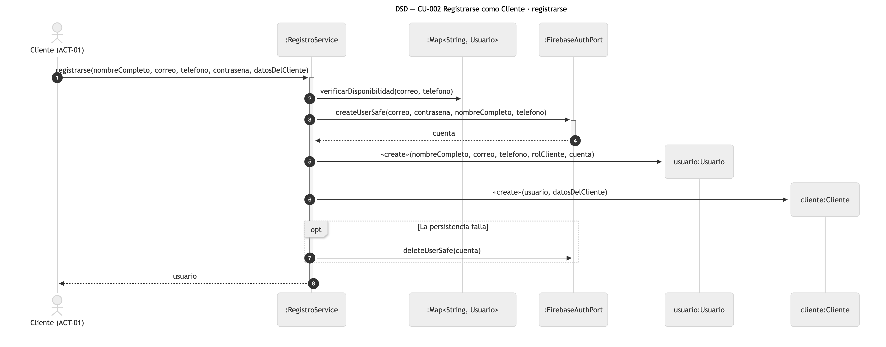

**Figura 24 — CU-002 Registrarse como Cliente — Diagrama de Interacción**

<details><summary>Ver código del diagrama</summary>

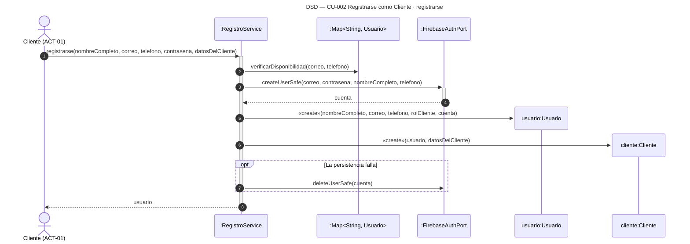

</details>

La operación del sistema es `registrarse`. Su diagrama de interacción es el de esta sección; su diagrama de secuencia del sistema está en el Documento 2, sección 2.1; su contrato, en el Documento 2, sección 2.2 («Contrato: `registrarse()`»), y su tabla de implementación, en el Documento 3, sección 4.25.

#### Clases de Diseño Participantes

| Clase | Capa | Responsabilidad |
|---|---|---|
| `SignupView` | Presentation (Flutter) | Formulario de tres pasos: datos personales, cuenta y consumo declarado opcional |
| `SignupViewModel` | Presentation | Valida cada paso, arma la declaración de consumo y llama al registro; ante un rechazo muestra el mensaje del back |
| `CustomerService` | Service (Flutter) | `registerCustomer`: HTTP a `POST /auth/registro` |
| `RegistroController` | Backend Controller (NestJS) | Ruta pública `POST /auth/registro` con cupo propio; siempre fija el rol cliente |
| `RegistrarClienteDto` | Backend DTO | Validación del cuerpo: correo, contraseña, nombre y teléfono internacional |
| `RegistroService` | Backend Service | Caso de uso único del alta de usuarios: política, disponibilidad, cuenta en Firebase, transacción y evento |
| `autorizarAlta` (`politica-de-registro`) | Domain | Decide qué rol y en qué distribuidora puede crear cada solicitante |
| `UsersService` / `CustomersService` | Backend Service | Guardan la fila del usuario y su perfil de cliente dentro de la transacción |
| `FirebaseAuthPort` (impl. `FirebaseAuthAdapter`) | Infrastructure | Crea y, si hace falta, borra la cuenta de acceso |
| `BienvenidaListener` | Backend Listener | Envía el correo de bienvenida al recibir `usuario.registrado` |

**Comentarios.** `POST /users/customer-registration`, la ruta anterior, sigue respondiendo igual para las versiones de la app ya publicadas y se retira cuando la versión nueva esté en las tiendas. El mismo `RegistroService` atiende el alta de choferes y administradores desde el panel (`POST /users`, CU-031): lo único que cambia es quién pide.

---

### 3.12 CU-041 Crítico — Consultar el Catálogo de Productos (Cliente)

**Actor:** Cliente (ACT-01)
**Pantalla:** HomeView (App Cliente) — hoja «Elegí tus garrafas» (`showCatalogSheet`)

#### Interfaz Gráfica

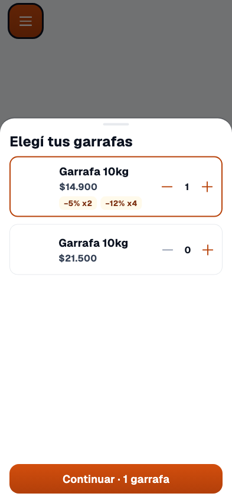

**Figura 25 — CU-041 Consultar el Catálogo de Productos (Cliente) — Interfaz Gráfica**

Hoja de catálogo de la App Cliente: cada producto con su tipo, su precio, las promociones por cantidad (por ejemplo «-5% x2» y «-12% x4») y el selector de unidades; al pie, «Continuar» con el total de garrafas elegidas (en la captura, dos garrafas de 10 kg). Captura de la app corriendo contra la API.

#### Especificación del CU Real

| Campo | Detalle |
|-------|---------|
| **Código** | CU-041 |
| **Caso de Uso** | Consultar el Catálogo de Productos (Cliente) |
| **Actor Principal** | ACT-01 (Cliente) |
| **Objetivos asociados** | OBJ-01, OBJ-05, OBJ-06 |
| **Requisitos asociados** | IRQ-04 |
| **Descripción** | El cliente ve los productos que la distribuidora tiene para vender. La App Cliente los carga con `GET /gascylinder` paginado (productos activos de su distribuidora, sin filtro de stock ni medios de pago), con el encabezado `X-Distributor`. El back expone además `GET /gascylinder/available/list`, la consulta pública: no exige sesión, la distribuidora se indica por su nombre corto o su identificador (o cae en la distribuidora por omisión) y devuelve los productos activos con stock mayor que cero, con sus promociones por cantidad, junto con los medios de pago y su recargo. Es una lectura: no modifica nada. |
| **Precondición** | Ninguna: la consulta no exige sesión. |

**Secuencia normal**

| Paso | Acción |
|---|---|
| 1 | El cliente abre la app y entra a la pantalla principal; `HomeViewModel` carga el catálogo con `GasCylinderService.getGasCylinders`, que lo pide al `GasCylinderRemoteDatasource`, y lo muestra en la hoja que abre `showCatalogSheet`. Cada pedido lleva el encabezado `X-Distributor` con el nombre corto de la distribuidora. |
| 2 | `GasCylinderRemoteDatasource.getGasCylinders` pide `GET /gascylinder` paginado de a 100 (`limit` y `offset`) y junta todas las páginas; es una ruta `@PublicIdentificable()`. |
| 3 | `GasCylinderService.resolveDistributor` resuelve la distribuidora: si el parámetro es un UUID, `DistributorService.assertActive`; si es un nombre corto, `DistributorService.findBySlug`; si no viene ninguno, `DistributorService.getDefault`. |
| 4 | `GasCylinderService.findAll` consulta los `GasCylinder` con `isActive = true` de esa distribuidora, con sus promociones (`CON_PROMOCIONES`), sin filtrar por stock, y responde 200 con `gasCylinders` y `total`; el controlador completa cada producto con la foto firmada (`GasCylinderPhotoService.firmar`). |
| 5 | La hoja del catálogo muestra cada producto con su nombre, precio vigente y promociones por cantidad. El cliente ajusta cantidades y, al alcanzar la cantidad mínima de una promoción, la hoja muestra el descuento por volumen. |
| 6 | `CylinderDetailSheet` abre el detalle de un producto con los datos que la app ya cargó: no hace ninguna llamada HTTP. |
| 7 | El cliente toca «Continuar» y pasa al carrito para seguir con el pedido (CU-005). |

**Postcondición:** El cliente vio los productos disponibles. No se modificó ningún dato.

**Excepciones**

| Paso | Acción |
|---|---|
| 3 | Si el nombre corto o el identificador no corresponde a ninguna distribuidora activa → 404. |
| 4 | Si no hay productos activos → 200 con una lista vacía; la app informa que no hay productos disponibles en este momento. |
| 6 | Si se pide `GET /gascylinder/:id` de un producto que no existe → 404 «Gas cylinder with ID: … not found» (esa ruta no es pública: exige token; la hoja de detalle no la usa). |
| 1 | Si el catálogo no se puede leer (back caído o una página que no llega), la app lo informa como error: no lo toma por «no hay garrafas». |

| Campo | Detalle |
|-------|---------|
| **Rendimiento** | Según los pasos del caso de uso esencial (Documento 1): paso 4: 2 segundos. |
| **Frecuencia** | Muy alta: es la primera pantalla de la aplicación del cliente. |
| **Estabilidad** | Alta |

#### Diagrama de Interacción

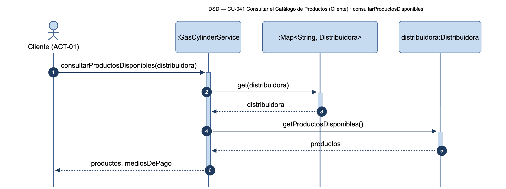

**Figura 26 — CU-041 Consultar el Catálogo de Productos (Cliente) — Diagrama de Interacción**

<details><summary>Ver código del diagrama</summary>

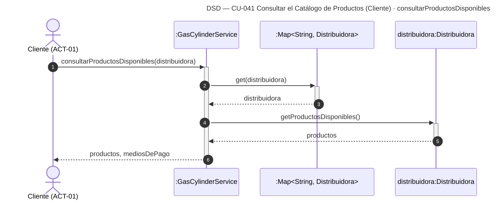

</details>

La operación del sistema es `consultarProductosDisponibles`. Su diagrama de interacción es el de esta sección; su diagrama de secuencia del sistema está en el Documento 2, sección 2.1 y su tabla de implementación en el Documento 3, sección 4.25. No modifica el modelo conceptual y por eso no lleva contrato.

#### Clases de Diseño Participantes

| Clase | Capa | Responsabilidad |
|---|---|---|
| `HomeView` / `HomeViewModel` | Presentation (Flutter) | Pantalla principal; carga el catálogo y abre la hoja con `showCatalogSheet` |
| `showCatalogSheet` / `CylinderDetailSheet` | Presentation (Flutter) | Hoja con los productos, las promociones y el selector de unidades; detalle de un producto, sin llamadas HTTP |
| `GasCylinderService` | Service (Flutter) | Obtiene y guarda el catálogo y las fotos firmadas |
| `GasCylinderRemoteDatasource` | Data (Flutter) | HTTP al catálogo del back: `GET /gascylinder` paginado de a 100, con `X-Distributor` |
| `GasCylinderController` | Backend Controller (NestJS) | Rutas públicas `GET /gascylinder` y `GET /gascylinder/available/list` (`GET /gascylinder/:id` exige token) |
| `GasCylinderService` | Backend Service | `findAll` (catálogo paginado de activos), `getAvailableCylinders` (activos con stock y medios de pago) y `resolveDistributor` |
| `DistributorService` | Backend Service | Resuelve la distribuidora por nombre corto, identificador u omisión |
| `GasCylinderPhotoService` | Backend Service | Firma las fotos de los productos |
| `DisponiblesDto` | Backend DTO | Respuesta: `products` y `paymentMethods` |

**Comentarios.** Al ser una consulta abierta, el catálogo y los precios de cualquier distribuidora son legibles sin credenciales por quien conozca su nombre corto: es una decisión deliberada para que la app muestre productos antes del registro. `GET /gascylinder/available/list` es el contrato público del back para el catálogo con stock: devuelve los activos con stock mayor que cero y los medios de pago con su recargo, y una distribuidora inexistente responde 404; la App Cliente no lo usa. `GET /gascylinder/:id` no es público (exige token), no se acota por distribuidora y es el único acceso a un producto dado de baja. El catálogo del administrador, con su propio detalle, es CU-344.

---

### 3.13 CU-058 Crítico — Validar la Cobertura de una Dirección

**Actor:** Cliente (ACT-01), Administrador (ACT-03), Administrador General (ACT-05)
**Pantalla:** CoverageZones — «Zonas de cobertura» → «Probar un punto» (Panel Admin), con `CoverageCheckPanel`

#### Interfaz Gráfica

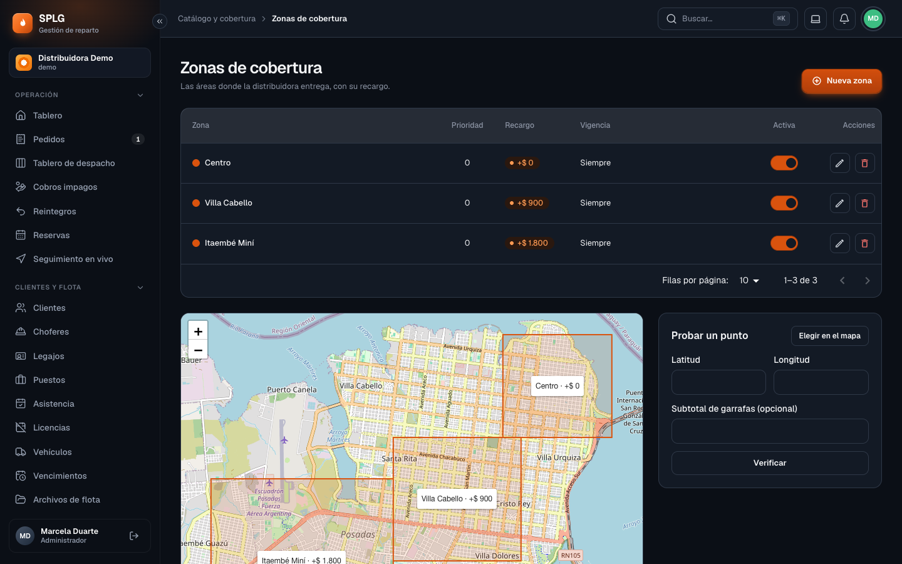

**Figura 27 — CU-058 Validar la Cobertura de una Dirección — Interfaz Gráfica**

Zonas de cobertura de la distribuidora de demostración: la lista con prioridad, recargo y vigencia, el mapa con los polígonos y, a la derecha, el panel «Probar un punto», donde el administrador ingresa latitud y longitud —o elige el punto en el mapa— y un subtotal opcional para ver qué zona gana y cuánto recarga. Captura del panel contra la API de desarrollo.

#### Especificación del CU Real

| Campo | Detalle |
|-------|---------|
| **Código** | CU-058 |
| **Caso de Uso** | Validar la Cobertura de una Dirección |
| **Actor Principal** | ACT-01 (Cliente), ACT-03 (Administrador), ACT-05 (Administrador General) |
| **Objetivos asociados** | OBJ-02 |
| **Requisitos asociados** | IRQ-07, IRQ-10 |
| **Descripción** | El sistema comprueba si unas coordenadas caen dentro del área donde opera la distribuidora e informa el recargo de la zona. El administrador la usa para probar un punto sobre el mapa, y el servidor la aplica al crear cada pedido. `GET /coverage-zones/check` toma la distribuidora del contexto, busca con PostGIS la zona activa, vigente y no dada de baja que cubre el punto y, entre varias, elige la de mayor prioridad. Que el punto quede fuera no es un error: la respuesta es `covered: false`. |
| **Precondición** | El usuario está identificado como cliente o administrador, y hay una distribuidora indicada. |

**Secuencia normal**

| Paso | Acción |
|---|---|
| 1 | Se pide validar una ubicación: el administrador, en `CoverageCheckPanel` (latitud, longitud y, si quiere, un subtotal); el servidor aplica el mismo control al crear un pedido (`CreateOrderUseCase`, CU-005) y al ofrecer la compra express. El panel llama a `checkCoverage(lat, lng, subtotal)` y envía `GET /coverage-zones/check?lat&lng&subtotal`. |
| 2 | `AuthGuard` identifica al usuario y `@Auth(CUSTOMER, ADMIN, SUPER_ADMIN)` admite cliente, administrador y administrador general. `@CurrentDistributor({ required: true })` toma la distribuidora del encabezado `X-Distributor`; sin ella, la ruta responde 400. |
| 3 | `ValidationPipe` valida `CheckCoverageDto`: `lat` con `IsLatitude`, `lng` con `IsLongitude` y `subtotal` opcional, numérico y no negativo. `CoverageZoneController.check` delega en `CoverageZoneService.checkCoverage(distributorId, lat, lng, subtotal)`. |
| 4 | `checkCoverage` cuenta las zonas de la distribuidora no dadas de baja: si no tiene ninguna, responde cubierta, con recargo cero y sin zona. |
| 5 | Si tiene zonas, ejecuta una consulta PostGIS sobre `coverage_zone` con `isActive = true`, `deletedAt IS NULL`, vigencia (`valid_from` y `valid_until`) y `ST_Covers(area, ST_SetSRID(ST_MakePoint(lng, lat), 4326))`, ordenada por `priority` descendente y luego por `ST_Area` ascendente, con `LIMIT 1`. `ST_Covers` cuenta como cubierto un punto justo sobre el borde. |
| 6 | Con una zona ganadora arma `CoverageZoneResumenDto` (`id`, `name`, `type`, `value`, `color`) y el resultado con `covered: true`, `zoneId`, `zoneName` y `surcharge` —el valor crudo de la zona, por compatibilidad— y `zone`. Si vino `subtotal`, agrega `amount`, el recargo ya calculado por `CoverageZonePricingService.zoneSurcharge`. |
| 7 | Sin zona ganadora, responde `covered: false`, `surcharge: 0` y `zone: null`, con 200. El panel muestra la zona y el recargo, o «fuera de cobertura», y resalta la zona en el mapa. |

**Postcondición:** El usuario tiene un veredicto sobre el punto: cubierto o no, la zona y el recargo. No se modificó ningún dato.

**Excepciones**

| Paso | Acción |
|---|---|
| 2 | Si falta la distribuidora en el encabezado `X-Distributor` → 400; sin sesión → 401; con otro rol → 403. |
| 3 | Si `lat` o `lng` faltan o no son coordenadas válidas → 400 «lat debe ser una latitud válida» o «lng debe ser una longitud válida»; si `subtotal` es negativo → 400. |
| 5 | Si el punto cae fuera de las zonas trazadas, existiendo zonas activas y vigentes → 200 con `covered: false`; no es un error. |
| 5 | Si una zona está inactiva, vencida o dada de baja, no cubre ningún punto, aunque el polígono lo contenga. |

| Campo | Detalle |
|-------|---------|
| **Rendimiento** | Según los pasos del caso de uso esencial (Documento 1): paso 4: 1 segundo. |
| **Frecuencia** | Alta. |
| **Estabilidad** | Alta |

#### Diagrama de Interacción

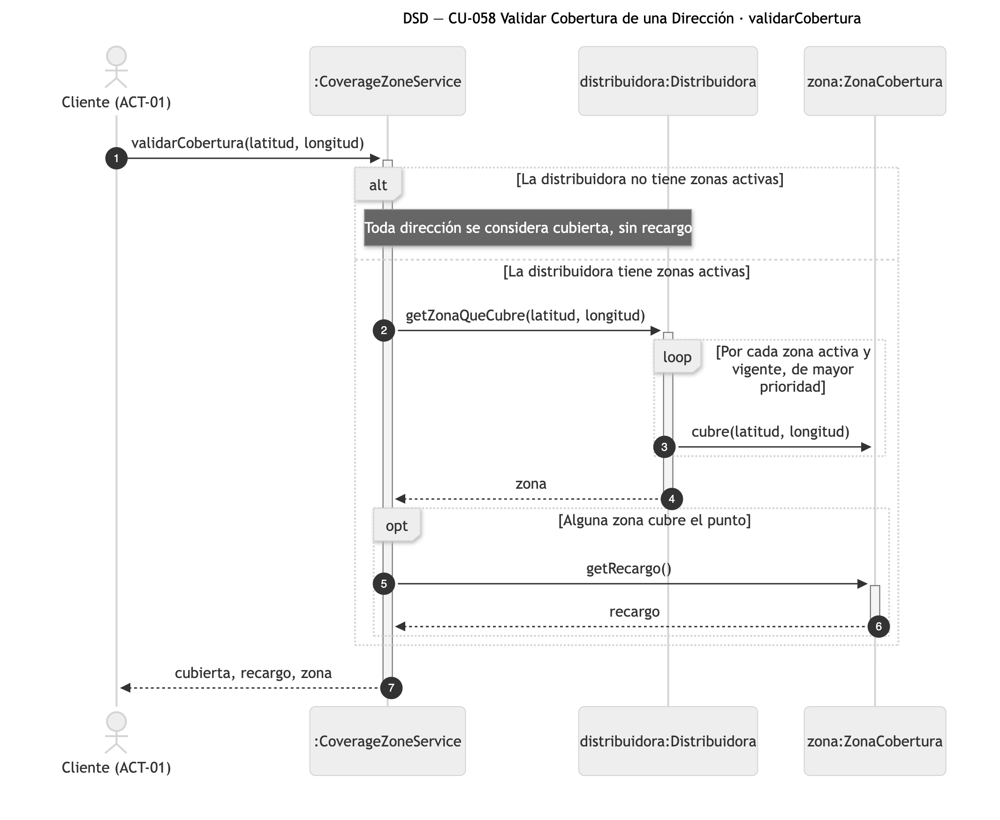

**Figura 28 — CU-058 Validar la Cobertura de una Dirección — Diagrama de Interacción**

<details><summary>Ver código del diagrama</summary>

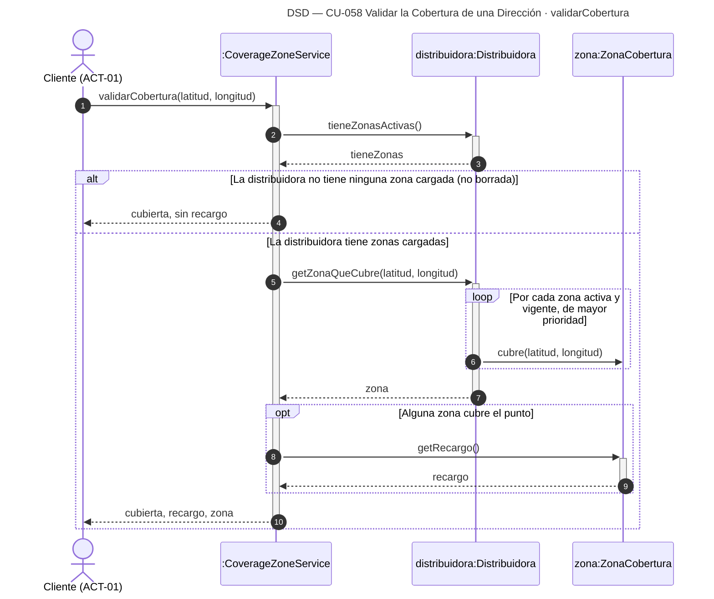

</details>

La operación del sistema es `validarCobertura`. Su diagrama de interacción es el de esta sección; su diagrama de secuencia del sistema está en el Documento 2, sección 2.1 y su tabla de implementación en el Documento 3, sección 4.25. No modifica el modelo conceptual y por eso no lleva contrato.

#### Clases de Diseño Participantes

| Clase | Capa | Responsabilidad |
|---|---|---|
| `CoverageZones` / `CoverageCheckPanel` | Presentation (React) | Mapa, lista de zonas y panel «Probar un punto» |
| `checkCoverage` (`services/api/coverageZones`) | Presentation (React) | HTTP `GET /coverage-zones/check` con `lat`, `lng` y `subtotal` |
| `CoverageZoneController` | Backend Controller (NestJS) | Ruta `GET /coverage-zones/check`; declarada antes de `:id` para que `check` no se tome por un identificador |
| `CheckCoverageDto` | Backend DTO | Valida latitud, longitud y subtotal opcional |
| `CoverageZoneService` | Backend Service | `checkCoverage`: sin zonas cubre todo; con zonas, la ganadora por prioridad y área |
| `CoverageZonePricingService` | Backend Service | `zoneSurcharge`: recargo de la zona sobre el subtotal |
| `CoverageZone` | Backend Entity | Zona: polígono PostGIS, prioridad, recargo, vigencia y baja lógica |

**Comentarios.** Cuando la distribuidora no tiene ninguna zona cargada, el sistema asume cobertura total sin recargo: es un valor por omisión permisivo que conviene tener presente al dar de alta una distribuidora nueva, porque hasta que defina sus zonas admite pedidos en cualquier punto. Con zonas cargadas pero ninguna activa y vigente, el sistema no cubre ningún punto. `surcharge` y `zoneId` se mantienen por compatibilidad; los clientes nuevos usan `zone` y `amount`.

---

### 3.14 CU-042 Importante — Crear una Franja Horaria

**Actor:** Administrador (ACT-03)
**Pantalla:** Configuration — «Turnos de entrega» → «Nueva franja» (Panel Admin), con `TimeSlotsManager` y `TimeSlotFormModal`

#### Interfaz Gráfica

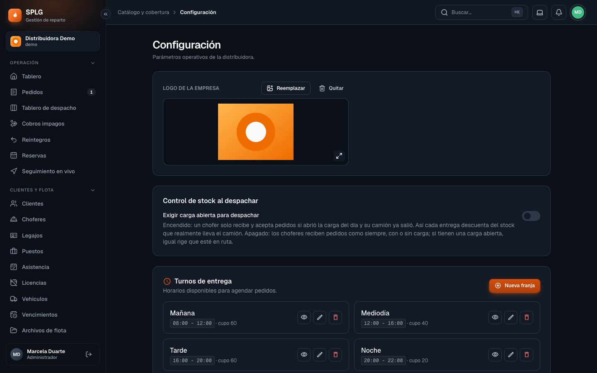

**Figura 29 — CU-042 Crear una Franja Horaria — Interfaz Gráfica**

Configuración de la distribuidora de demostración: el logo, el control de stock al despachar y los «Turnos de entrega» —Mañana, Mediodía, Tarde y Noche— con su horario y su cupo por día. «Nueva franja» abre `TimeSlotFormModal`, con el nombre, la hora de inicio, la hora de fin y la capacidad. Captura del panel contra la API de desarrollo.

#### Especificación del CU Real

| Campo | Detalle |
|-------|---------|
| **Código** | CU-042 |
| **Caso de Uso** | Crear una Franja Horaria |
| **Actor Principal** | ACT-03 (Administrador) |
| **Objetivos asociados** | OBJ-04, OBJ-05 |
| **Requisitos asociados** | IRQ-05 |
| **Descripción** | El administrador crea una franja horaria de entrega para su distribuidora: un nombre, la hora de inicio, la hora de fin y, opcionalmente, la capacidad máxima de pedidos por día. `POST /time-slot` valida el formato y guarda la franja activa asociada a la distribuidora. Las franjas activas con cupo remanente son las que el cliente puede elegir al agendar un pedido. |
| **Precondición** | El administrador está identificado y tiene una distribuidora elegida. |

**Secuencia normal**

| Paso | Acción |
|---|---|
| 1 | El administrador abre «Configuración» (`Configuration`), toca «Nueva franja» en «Turnos de entrega» (`TimeSlotsManager`) y completa `TimeSlotFormModal`; `timeSlotSchema` valida el formulario en el panel. |
| 2 | `useCreateTimeSlot` envía `POST /time-slot` con `{ name, startTime, endTime, capacity? }`. `@Auth(ADMIN, SUPER_ADMIN)` admite administrador y administrador general; `@CurrentDistributor({ required: true })` toma la distribuidora, y sin ella responde 400. |
| 3 | `ValidationPipe` valida `CreateTimeSlotDto`: `name` texto no vacío de hasta 50 caracteres, `startTime` y `endTime` con el formato `HH:MM` de 24 horas y `capacity`, si viene, un entero entre 1 y 10000 (`CAPACIDAD_MAXIMA_FRANJA`). Un campo no declarado se rechaza. `timeSlotSchema` repite estas reglas en el panel y `findSlotConflict` avisa antes de enviar si el nombre o el horario chocan con otra franja activa. |
| 4 | `TimeSlotController.create` llama a `TimeSlotService.create(dto, distributorId)`. |
| 5 | `create` comprueba que `startTime` sea anterior a `endTime`, que ninguna otra franja activa de la distribuidora tenga el mismo nombre (sin distinguir mayúsculas) ni un horario que se superponga, arma la `TimeSlot` y la guarda con `timeSlotRepository.save`: nace activa y, si no se indicó la capacidad, toma el valor por omisión de la columna, 50 pedidos por día. |
| 6 | El controlador responde 201 con `TimeSlotMapper.toDto`: la franja creada. El panel invalida las franjas y la muestra en «Turnos de entrega». |
| 7 | Desde ese momento la franja figura entre las que el cliente puede elegir al agendar un pedido (CU-044 y CU-045) y el sistema controla su cupo diario. |

**Postcondición:** La franja queda activa y disponible para que los clientes la elijan al agendar un pedido, y para que el sistema controle su cupo diario.

**Excepciones**

| Paso | Acción |
|---|---|
| 3 | Si el nombre viene vacío, una hora no respeta el formato `HH:MM`, la capacidad no es un entero o se envía un campo no declarado → 400 con el campo, por ejemplo «startTime must be in HH:MM format». |
| 2 | Si el administrador no tiene distribuidora en el contexto → 400 pidiendo que se indique; sin sesión → 401; con otro rol → 403. |
| 5 | Si `startTime` no es anterior a `endTime` → 400 «La hora de inicio tiene que ser anterior a la de fin»; si `capacity` es menor que 1 o mayor que 10000 → 400 («capacity must not be less than 1», «capacity must not be greater than 10000»). |
| 5 | Si ya hay una franja activa con ese nombre → 409 «Ya existe una franja activa con el nombre «…»»; si el horario se superpone con el de otra activa → 409 «La franja se solapa con «…» (08:00 a 12:00): ajustá el horario o desactivá esa franja». La base repite las cuatro reglas: `CHK_time_slot_horario`, `CHK_time_slot_capacidad`, `UQ_time_slot_nombre_activa` y `EXC_time_slot_solapada`. |

| Campo | Detalle |
|-------|---------|
| **Rendimiento** | Según los pasos del caso de uso esencial (Documento 1): paso 5: 1 segundo. |
| **Frecuencia** | Muy baja: las franjas se definen una vez y se ajustan de manera excepcional. |
| **Estabilidad** | Alta |

#### Diagrama de Interacción

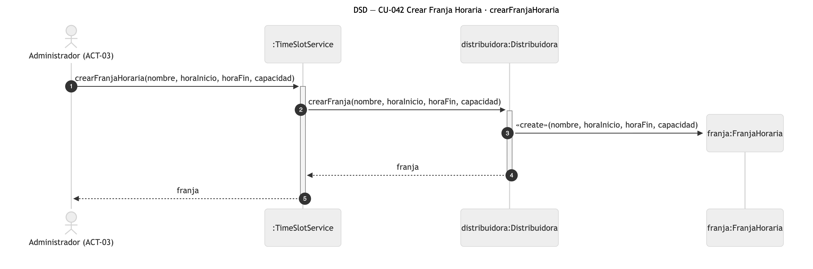

**Figura 30 — CU-042 Crear una Franja Horaria — Diagrama de Interacción**

<details><summary>Ver código del diagrama</summary>

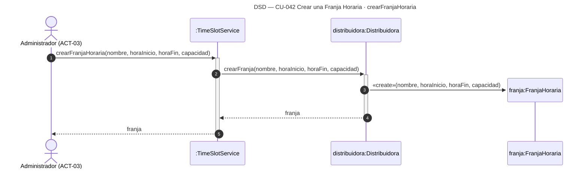

</details>

La operación del sistema es `crearFranjaHoraria`. Su diagrama de interacción es el de esta sección; su diagrama de secuencia del sistema está en el Documento 2, sección 2.1; su contrato, en el Documento 2, sección 2.2 («Contrato: `crearFranjaHoraria()`»), y su tabla de implementación, en el Documento 3, sección 4.25.

#### Clases de Diseño Participantes

| Clase | Capa | Responsabilidad |
|---|---|---|
| `Configuration` / `TimeSlotsManager` | Presentation (React) | Configuración de la distribuidora y listado de turnos de entrega |
| `TimeSlotFormModal` / `timeSlotSchema` | Presentation (React) | Formulario de alta y modificación de la franja, con su validación |
| `useCreateTimeSlot` | Presentation (React Query) | Mutación que envía `POST /time-slot` y refresca las franjas |
| `TimeSlotController` | Backend Controller (NestJS) | Ruta `POST /time-slot`; toma la distribuidora del contexto |
| `CreateTimeSlotDto` | Backend DTO | Valida el nombre, las horas en formato `HH:MM` y la capacidad opcional |
| `TimeSlotService` | Backend Service | `create`: guarda la franja de la distribuidora |
| `TimeSlot` | Backend Entity | Franja con su horario, su capacidad diaria y su estado activo |
| `TimeSlotMapper` | Backend Mapper | Arma `TimeSlotResponseDto` |

**Comentarios.** El alta no valida que la hora de fin sea posterior a la de inicio ni que la capacidad sea mayor que cero: una franja con capacidad cero o negativa queda permanentemente sin cupo y aparece en la disponibilidad con cero lugares libres. Ambas validaciones están pendientes en el alta; la de horas ya existe al modificar la franja (CU-043). Es un dato que gobierna la capacidad diaria de entrega.

---

### 3.15 CU-006 Crítico — Consultar el Detalle de un Pedido

**Actor:** Cliente (ACT-01), Chofer (ACT-02), Administrador (ACT-03)
**Pantalla:** OrderDetails (Panel Admin) — detalle del pedido; `OrderDetailView` en la App Cliente

#### Interfaz Gráfica

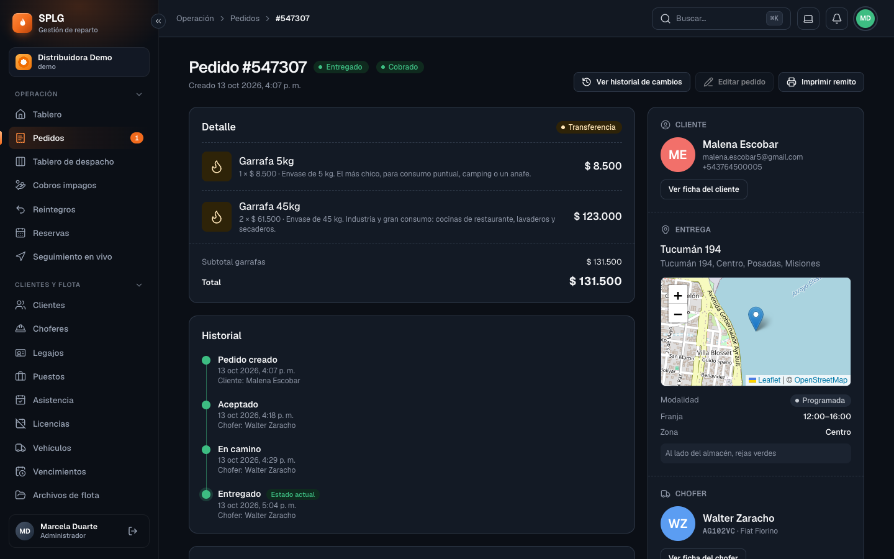

**Figura 31 — CU-006 Consultar el Detalle de un Pedido — Interfaz Gráfica**

Detalle del pedido en el Panel Admin, con la distribuidora de demostración: los renglones con el precio con que se cobraron, el historial de estados con quién hizo cada cambio, el cliente, la dirección con su franja y zona, y el chofer; las acciones secundarias —editar y reimprimir el remito— están en el menú ⋮ de la cabecera. Si el pago es por MercadoPago y sigue pendiente, la tarjeta del cobro suma el enlace de pago con «Copiar enlace» y «Abrir». La App Cliente muestra la misma información con las acciones que le corresponden.

#### Especificación del CU Real

| Campo | Detalle |
|-------|---------|
| **Código** | CU-006 |
| **Caso de Uso** | Consultar el Detalle de un Pedido |
| **Actor Principal** | ACT-01 (Cliente), ACT-02 (Chofer), ACT-03 (Administrador) |
| **Objetivos asociados** | OBJ-01, OBJ-03, OBJ-04 |
| **Requisitos asociados** | IRQ-02, IRQ-03 |
| **Descripción** | El usuario abre un pedido desde su listado. El sistema aplica las reglas de visibilidad de cada rol —tenant, dueño o chofer asignado, ofertado o del pool— y devuelve el pedido con sus renglones tal como se cobraron, el estado, la distribuidora, la dirección, la franja y el pago. Al cliente dueño y al administrador les suma los datos del chofer mientras el pedido está aceptado o en camino y, si está cancelado, quién lo canceló. Si el pedido se paga por MercadoPago y el cobro sigue pendiente, suma el enlace de pago vigente (no se le devuelve al chofer). Es una lectura: no modifica nada. |
| **Precondición** | El usuario está identificado y el pedido existe. Si es cliente, el pedido es suyo. |

**Secuencia normal**

| Paso | Acción |
|---|---|
| 1 | El usuario elige un pedido de su listado: el historial del cliente (`OrdersViewModel`) o la grilla del panel (`Orders`). La pantalla de detalle (`OrderDetailView` en la app, `OrderDetails` en el panel) pide `GET /orders/:id`; el `id` pasa por `ParseUUIDPipe`. |
| 2 | `AuthGuard` identifica al usuario y su rol. `OrderController.findOne` arma el alcance: para un cliente, su `user_id` como dueño; para un chofer, su `user_id` como chofer; `@CurrentDistributor({ required: 'staff' })` aporta el tenant (el encabezado `X-Distributor` o el del usuario) y devuelve 400 al personal que no tiene ninguno. |
| 3 | `OrderService.getOne` delega en `pedidoLegible`, que lee el pedido con `findOne(id)` y aplica el control de acceso en este orden: si hay distribuidora en contexto, el pedido debe ser de ella; si quien pide es un cliente, debe ser el dueño; si es un chofer, `puedeLeerElChofer` exige que lo tenga asignado, que tenga una oferta de despacho vigente (`DispatchOfferRepositoryPort.hasActiveOffer`) o que esté en el pool (pendiente, sin chofer, de su distribuidora y con la carga del día en regla según `TruckLoadGatePort`). |
| 4 | `OrderMapper.toDto` arma `OrderResponseDto`: renglones con el precio unitario y el subtotal guardados al crear el pedido, total, estado, `distributor_id`, dirección, franja, medio y estado del pago y las marcas de tiempo de cada transición. Si quien lee es un chofer y el pedido no es suyo, `receiver` se anula. |
| 5 | Si el pedido está CANCELLED, `quienCancelo` consulta `order_status_history` por la última transición a `cancelled` y devuelve `cancelledBy`: `customer`, `admin`, `driver` o `system`; es nulo si el pedido es anterior al historial. |
| 6 | Para todo rol salvo el chofer, `datosDelChofer` agrega `driver` sólo si el pedido está ACCEPTED u ON_THE_WAY y tiene chofer: `userId`, nombre, teléfono y calificación (`DriverRatingPort.resumen`, sin las calificaciones ocultas). Con el pedido ON_THE_WAY suma `driver.location` con la última posición del radar (`lastDriverLocation`) sólo si es vigente (`ubicacionVigente`, menos de `DRIVER_LOCATION_MAX_AGE_MIN` minutos, 10 por omisión); sin radar o sin posición reciente queda en nulo. |
| 7 | Si el pedido es de MercadoPago, no está cancelado, su cobro está pendiente y la seña no está cobrada, y quien lee no es un chofer, `OrderService` agrega `payment_url`: el enlace del último intento de cobro, sólo si ese intento sigue pendiente y tiene URL (`CreateOrderUseCase.enlaceDeCobroPendiente` → `PaymentsService.findPendingCheckoutUrls`). Sirve para recuperar el enlace si se perdió la respuesta del alta; el panel lo muestra con `PaymentLink`. |
| 8 | El controlador responde 200 con el pedido y la pantalla lo muestra con las acciones del rol: el cliente puede cancelar mientras esté pendiente o aceptado; el administrador puede cancelar, reasignar o editar. |

**Postcondición:** El usuario vio el detalle completo del pedido. No se modificó ningún dato.

**Excepciones**

| Paso | Acción |
|---|---|
| 3 | Si el pedido no existe, es de otra distribuidora o de otro cliente → 404 «Order with ID: … not found», el mismo mensaje en los tres casos para no revelar que existe. |
| 3 | Si quien pide es un chofer y el pedido no es suyo, ni tiene una oferta vigente para él, ni está en su pool → 404 con el mismo mensaje. |
| 3 | Si el chofer tuvo el pedido (`DispatchOfferRepositoryPort.hasHeldOrder`) y ya no lo tiene —lo liberó el administrador, lo reasignaron o el control de carga lo sacó del pool— → 410 «Este pedido ya no está asignado a tu usuario», sin datos del pedido, para que la app salga de la pantalla. |
| 2 | Si quien pide es personal sin distribuidora en el contexto —el Administrador General sin `X-Distributor`— → 400 «Falta la distribuidora: enviá el header X-Distributor (slug o id)»; con el encabezado sólo ve los pedidos de esa distribuidora. El panel muestra «Elegí una distribuidora» en lugar del detalle. |
| 2 | Sin token o con un token inválido → 401. |
| 6 | Si el radar de posiciones (Redis) no responde, el pedido se lee igual y `driver.location` queda nulo: la app lo toma como «sin posición reciente», no como un error. |

| Campo | Detalle |
|-------|---------|
| **Rendimiento** | Según los pasos del caso de uso esencial (Documento 1): paso 4: 1 segundo. |
| **Frecuencia** | Alta: cada vez que el usuario abre un pedido de su listado, varias veces por pedido activo. |
| **Estabilidad** | Alta |

#### Diagrama de Interacción

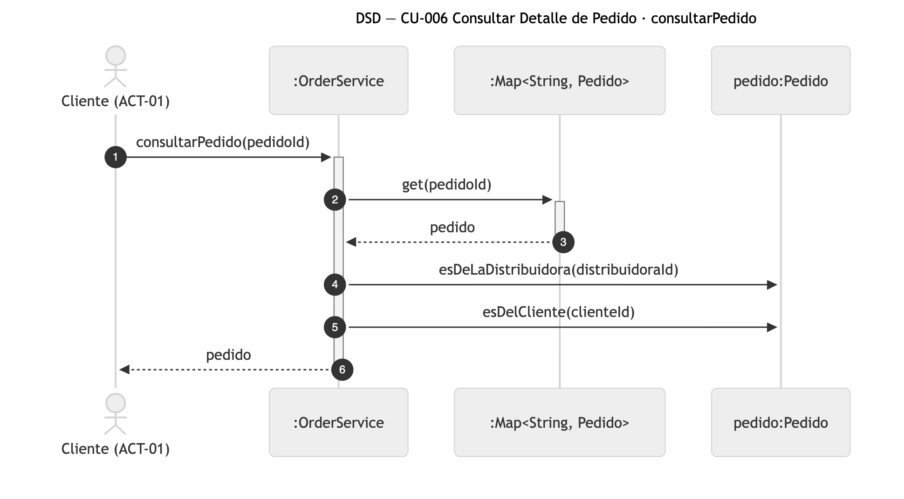

**Figura 32 — CU-006 Consultar el Detalle de un Pedido — Diagrama de Interacción**

<details><summary>Ver código del diagrama</summary>

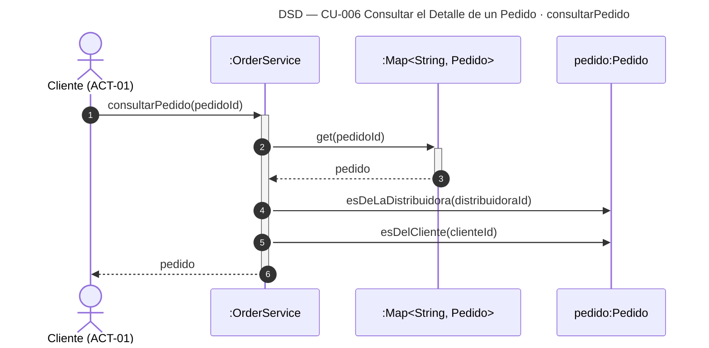

</details>

La operación del sistema es `consultarPedido`. Su diagrama de interacción es el de esta sección; su diagrama de secuencia del sistema está en el Documento 2, sección 2.1 y su tabla de implementación en el Documento 3, sección 4.25. No modifica el modelo conceptual y por eso no lleva contrato.

#### Clases de Diseño Participantes

| Clase | Capa | Responsabilidad |
|---|---|---|
| `OrderDetailView` / `OrderDetailViewModel` | Presentation (Flutter) | Detalle del pedido del cliente con sus acciones (cancelar, editar, seguimiento) |
| `OrderDetails` | Presentation (React) | Detalle del pedido en el panel: renglones, historial, cliente, entrega y chofer |
| `OrderController` | Backend Controller (NestJS) | Ruta `GET /orders/:id`; arma el alcance según el rol del token |
| `OrderService` | Backend Service | `getOne` y `pedidoLegible`: control de acceso, `quienCancelo` y `datosDelChofer` |
| `DispatchOfferRepositoryPort` | Domain (puerto) | `hasActiveOffer` y `hasHeldOrder`: decide entre 404 y 410 para el chofer |
| `TruckLoadGatePort` | Domain (puerto) | Verifica que la carga del día esté en regla para que un pedido del pool sea legible |
| `DriverRatingPort` | Domain (puerto) | Calificación promedio y cantidad del chofer, sin las ocultas |
| `OrderMapper` | Backend Mapper | Arma `OrderResponseDto` con los renglones como se cobraron |
| `order_status_history` | Persistencia (tabla) | Fuente de `cancelledBy` y de las marcas de tiempo de cada transición |

**Comentarios.** El detalle no incluye las incidencias ni las calificaciones del pedido: se consultan por separado (CU-062, CU-065 y CU-066). El precio y el subtotal de cada renglón son los del momento de pedir, con las promociones ya aplicadas, y no el precio vigente del catálogo. Los datos del chofer los ven sólo el cliente dueño y el administrador; la posición, además, sólo con el pedido en camino y con menos de diez minutos.

---

### 3.16 CU-080 Crítico — Consultar el Pool de Pedidos Disponibles

**Actor:** Chofer (ACT-02), Administrador (ACT-03), Administrador General (ACT-05)
**Pantalla:** Tracking — «Seguimiento en vivo» → pestaña «Disponibles» (Panel Admin), con `useAvailablePool`

#### Interfaz Gráfica

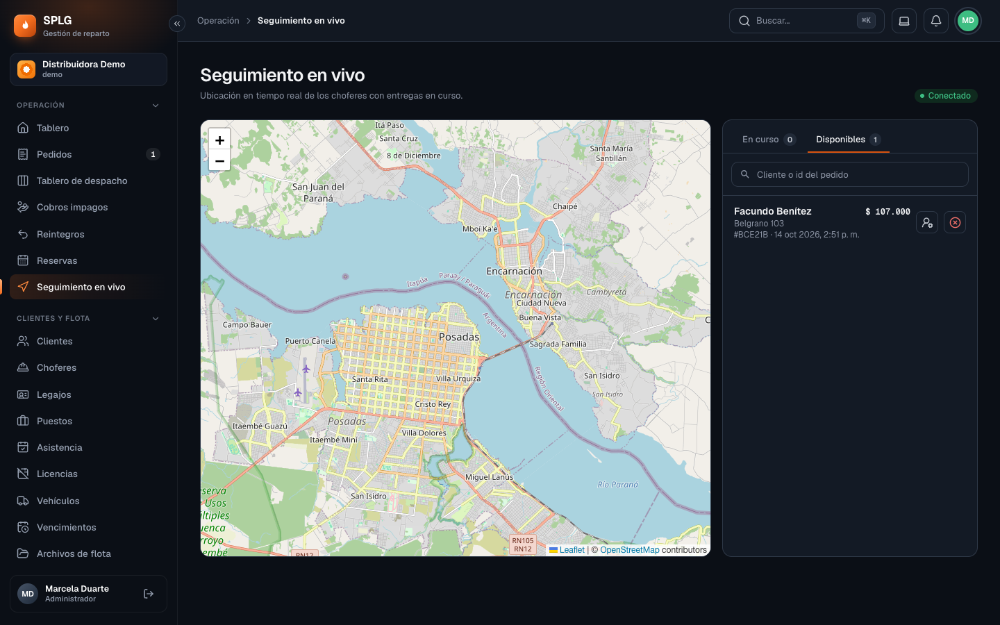

**Figura 33 — CU-080 Consultar el Pool de Pedidos Disponibles — Interfaz Gráfica**

Seguimiento en vivo del Panel Admin: el mapa de la distribuidora y, a la derecha, la pestaña «Disponibles» con el pool de pedidos pendientes sin chofer —cliente, dirección, total, número de pedido y fecha— y las acciones de asignar un chofer o cancelar. Captura del panel contra la API de desarrollo.

#### Especificación del CU Real

| Campo | Detalle |
|-------|---------|
| **Código** | CU-080 |
| **Caso de Uso** | Consultar el Pool de Pedidos Disponibles |
| **Actor Principal** | ACT-02 (Chofer), ACT-03 (Administrador), ACT-05 (Administrador General) |
| **Objetivos asociados** | OBJ-02, OBJ-01 |
| **Requisitos asociados** | IRQ-02 |
| **Descripción** | El sistema publica la bolsa de pedidos pendientes que todavía no tienen repartidor, de la distribuidora del solicitante, del más antiguo al más nuevo y con paginación. El panel la usa en el seguimiento en vivo y el despacho automático recorre la misma bolsa para ofrecer los pedidos sin oferta activa. Si quien consulta es un chofer que no puede recibir pedidos por el estado de su carga de camión, la lista viene vacía con el motivo; no es un error. |
| **Precondición** | El solicitante está identificado como chofer o como administrador. |

**Secuencia normal**

| Paso | Acción |
|---|---|
| 1 | El administrador abre «Seguimiento en vivo» (`Tracking`) y la pestaña «Disponibles»; `useAvailablePool` pide `GET /orders/available?limit&offset` con su búsqueda y su página. La App Chofer consulta la misma ruta con `limit=1` (`DriverApiService.noOrdersReason`) sólo para saber por qué no recibe pedidos. |
| 2 | `@Auth(DELIVERY, ADMIN, SUPER_ADMIN)` admite chofer, administrador y administrador general; con un cliente, el guard de roles responde 403. `PaginationDto` valida `limit` y `offset`; `@CurrentDistributor()` aporta la distribuidora del solicitante. |
| 3 | `OrderController.findAvailableOrders`: si quien consulta es un chofer y hay distribuidora, `TruckLoadGatePort.motivoParaNoRecibir(distribuidoraId, userId)` revisa su carga de camión (CU-248). Si hay un motivo, responde 200 con `orders: []`, `total: 0`, `openLoadRequired: true` y `message` con el motivo —por ejemplo «Abrí tu carga para recibir pedidos»— y termina. |
| 4 | Si puede recibir pedidos, o el solicitante es staff, `OrderService.findAvailableOrders` delega en `OrderRepositoryPort.findAvailable(limit, offset, distributorId, incluirExpress)`. |
| 5 | El repositorio consulta con `findAndCount` los pedidos con estado `PENDING` y `deliveryId` nulo, acotados a la distribuidora y, para el chofer, sólo de modalidad estándar —los express se ofrecen de a uno a las motos y no están en su pool; el staff sí los ve—. Carga cliente, renglones con su producto, dirección y franja, y los ordena por `createdAt` y `orderId` ascendentes. |
| 6 | El controlador arma cada pedido con `OrderMapper.toDto` y anula `receiver`: quién recibe todavía no es de nadie. Responde 200 con `orders`, `total`, `limit`, `offset`, `openLoadRequired: false` y `message: null`. |
| 7 | El panel muestra los pedidos del pool con las acciones de asignar chofer o cancelar; el despacho automático (CU-013) recorre la misma bolsa con un límite de 50 registros por vuelta. |

**Postcondición:** El solicitante ve la lista paginada de pedidos sin asignar de la distribuidora, del más viejo al más nuevo, o la lista vacía con el motivo si es un chofer que no puede recibir pedidos. No se modificó ningún dato.

**Excepciones**

| Paso | Acción |
|---|---|
| 2 | Si el solicitante es un cliente → 403; sin sesión → 401. |
| 2 | Si `limit` u `offset` no son números válidos → 400 por la validación del DTO de paginación. |
| 3 | Si el chofer no puede recibir pedidos por su carga de camión → 200 con la lista vacía, `openLoadRequired: true` y el motivo: no es un error. |
| 4 | Si el solicitante no tiene distribuidora en el contexto, la consulta no se acota por empresa y ve los pedidos de todas. |

| Campo | Detalle |
|-------|---------|
| **Rendimiento** | Según los pasos del caso de uso esencial (Documento 1): paso 4: 2 segundos. |
| **Frecuencia** | Alta: cada vez que el chofer abre o refresca la pantalla, más cada pasada del despacho automático. |
| **Estabilidad** | Alta |

#### Diagrama de Interacción

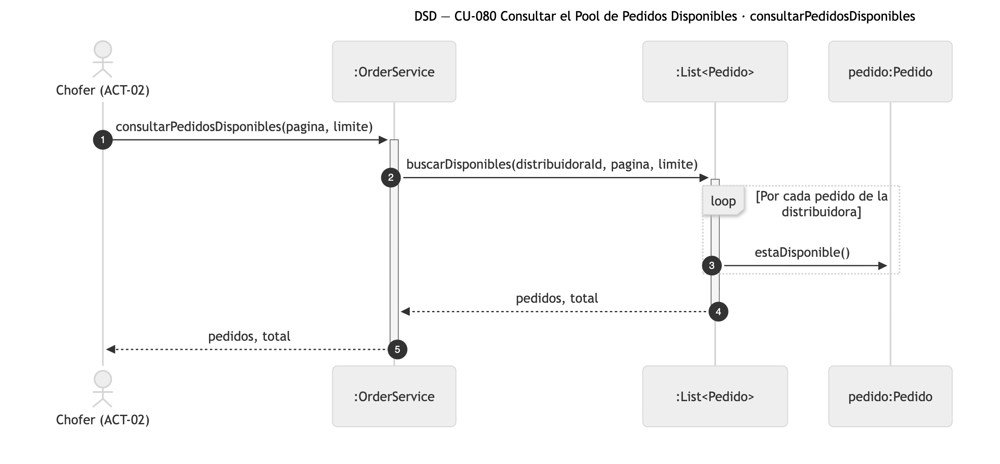

**Figura 34 — CU-080 Consultar el Pool de Pedidos Disponibles — Diagrama de Interacción**

<details><summary>Ver código del diagrama</summary>

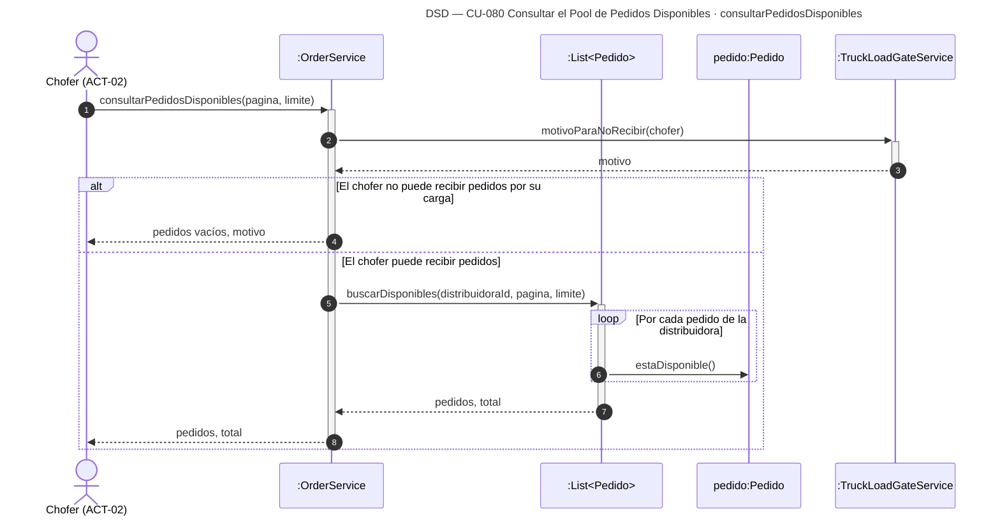

</details>

La operación del sistema es `consultarPedidosDisponibles`. Su diagrama de interacción es el de esta sección; su diagrama de secuencia del sistema está en el Documento 2, sección 2.1 y su tabla de implementación en el Documento 3, sección 4.25. No modifica el modelo conceptual y por eso no lleva contrato.

#### Clases de Diseño Participantes

| Clase | Capa | Responsabilidad |
|---|---|---|
| `Tracking` / `useAvailablePool` | Presentation (React) | Pestaña «Disponibles» del seguimiento en vivo, con búsqueda y paginación |
| `DriverApiService` | Service (Flutter) | `noOrdersReason`: lee `openLoadRequired` y `message` de `GET /orders/available?limit=1` |
| `OrderController` | Backend Controller (NestJS) | Ruta `GET /orders/available`; decide la lista vacía con motivo y anula `receiver` |
| `TruckLoadGatePort` | Domain (puerto) | `motivoParaNoRecibir`: carga de camión abierta del chofer (CU-248) |
| `OrderService` | Backend Service | `findAvailableOrders`: delega la consulta del pool |
| `OrderRepositoryPort` (impl. `OrderTypeormRepository`) | Infrastructure | `findAvailable`: pendientes sin chofer, de la distribuidora, del más antiguo al más nuevo |
| `OrderMapper` | Backend Mapper | Arma `OrderResponseDto` para cada pedido del pool |

**Comentarios.** El aislamiento entre distribuidoras depende de que el chofer tenga su distribuidora cargada: conviene que esa carga sea siempre obligatoria en el alta del chofer. Los pedidos express no están en el pool del chofer: se ofrecen de a uno a los choferes en moto (CU-149).

---

### 3.17 CU-022 Crítico — Activar la Disponibilidad

**Actor:** Chofer (ACT-02)
**Pantalla:** HomeView (App Chofer) — botón «Conectarse»

#### Interfaz Gráfica

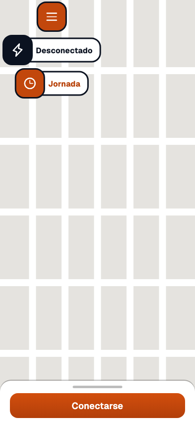

**Figura 35 — CU-022 Activar la Disponibilidad — Interfaz Gráfica**

Pantalla principal de la App Chofer sin conexión: el estado «Desconectado» arriba a la izquierda y, al pie, el botón «Conectarse» que pone al chofer disponible. Captura del golden de la app.

#### Especificación del CU Real

| Campo | Detalle |
|-------|---------|
| **Código** | CU-022 |
| **Caso de Uso** | Activar la Disponibilidad |
| **Actor Principal** | ACT-02 (Chofer) |
| **Objetivos asociados** | OBJ-02 |
| **Requisitos asociados** | IRQ-03 |
| **Descripción** | El chofer se pone en línea desde la pantalla principal. La app pide el valor que debe quedar —disponible— con `PATCH /delivery/user/:userId/availability`; el sistema comprueba que el chofer sea el que pide, que esté habilitado por el administrador y validado, y guarda su disponibilidad. Es la misma operación que desconectarse (CU-266) con el valor en verdadero: el chofer recién recibe ofertas cuando su app informa la primera posición (CU-017). |
| **Precondición** | El usuario está identificado como chofer o administrador y el chofer indicado tiene perfil de repartidor. Un chofer solo cambia su propia disponibilidad; un administrador, la de los choferes de su distribuidora. Para ponerse disponible, el chofer está habilitado por el administrador (CU-033) y validado (CU-032). |

**Secuencia normal**

| Paso | Acción |
|---|---|
| 1 | El chofer toca «Conectarse» en `HomeView`. `HomeViewModel.connect` ignora el toque si ya está conectado o conectándose y llama a `_setAvailability(true)` antes de abrir el servicio en primer plano y el socket. |
| 2 | La app envía `PATCH /delivery/user/:userId/availability` con `{ available: true }` y su token, con un tiempo máximo de 4 segundos. La ruta admite chofer, administrador y administrador general. |
| 3 | `ValidationPipe` valida `ToggleDeliveryAvailabilityDto`: `available` debe ser verdadero o falso. `DeliveryController.toggleAvailability` calcula el alcance con `alcanceDelDueño`: si quien pide es un chofer y su `userId` no es el de la ruta, responde 403. |
| 4 | `DeliveryService.toggleAvailability` busca el perfil de repartidor por `userId` (`deliveryRepository.findOne`) y comprueba el alcance con `assertAlcance`: si no existe o es de otra distribuidora que la del administrador, 404. |
| 5 | Con `available: true`, comprueba que `delivery.isEnabled` (habilitado por el administrador, CU-033) y `delivery.validated` (CU-032) sean verdaderos; si no, 403 y no cambia nada. |
| 6 | Asigna `delivery.isAvailable = true` y guarda el perfil. Con `false` haría además `RedisService.removeDriver(userId)` para sacarlo del radar de despacho; con `true` no toca el radar. |
| 7 | Responde 200 con `DisponibilidadDelChoferDto`: `userId`, `deliveryId`, `isAvailable` y un mensaje («Estás en línea»). |
| 8 | La app marca al chofer en línea, inicia el servicio en primer plano, conecta el socket de despacho (`DriverSocketService`) y envía su posición actual: desde ese `driver:update-location` (CU-017) entra al radar y empieza a recibir ofertas. |

**Postcondición:** El chofer quedó con `isAvailable = true`. No recibe ofertas hasta que su app informa la primera posición, que lo incorpora al radar.

**Excepciones**

| Paso | Acción |
|---|---|
| 3 | Si quien pide es otro chofer → 403 «No podés cambiar la disponibilidad de otro chofer»; si es un cliente, el guard de roles responde 403. |
| 3 | Si `available` no es verdadero ni falso → 400 con el campo. |
| 4 | Si el usuario no tiene perfil de repartidor, o es de otra distribuidora que la del administrador → 404 «Perfil de repartidor no encontrado para este usuario». |
| 5 | Si el chofer está deshabilitado → 403 «No podés ponerte en línea: tu cuenta está deshabilitada por el administrador». |
| 5 | Si el chofer no está validado → 403 «No podés ponerte en línea: tu perfil todavía no fue validado». |
| 2 | Si el back rechaza el pedido o no responde en 4 segundos, la app no asume el éxito: aborta la conexión, vuelve a «Desconectado» y no abre el servicio en primer plano ni el socket. |

| Campo | Detalle |
|-------|---------|
| **Rendimiento** | Según los pasos del caso de uso esencial (Documento 1): paso 4: 1 segundo. |
| **Frecuencia** | Alta por chofer: al empezar el turno o al volver de una pausa. |
| **Estabilidad** | Alta |

#### Diagrama de Interacción

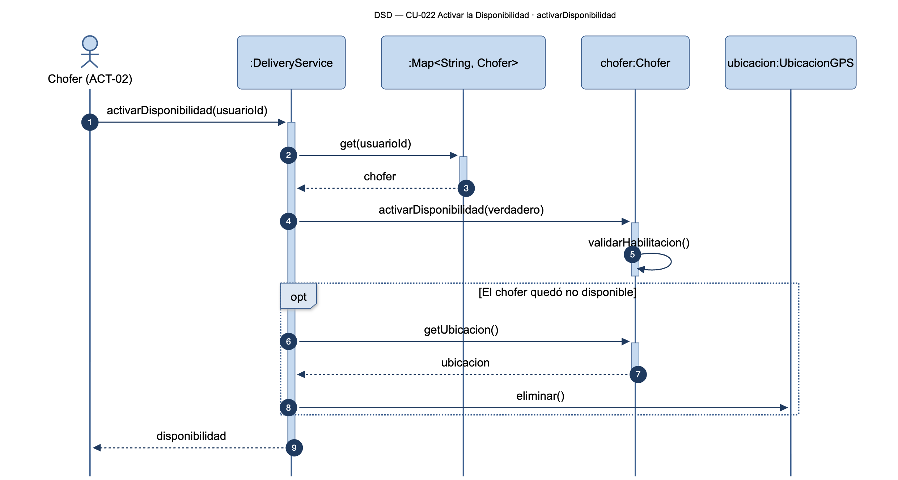

**Figura 36 — CU-022 Activar la Disponibilidad — Diagrama de Interacción**

<details><summary>Ver código del diagrama</summary>

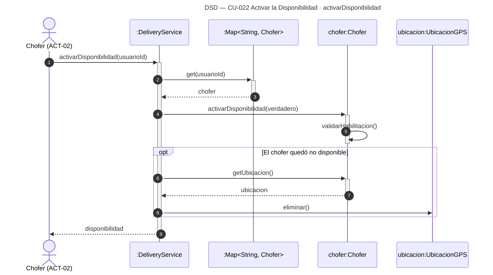

</details>

La operación del sistema es `activarDisponibilidad`. Su diagrama de interacción es el de esta sección; su diagrama de secuencia del sistema está en el Documento 2, sección 2.1; su contrato, en el Documento 2, sección 2.2 («Contrato: `activarDisponibilidad()`»), y su tabla de implementación, en el Documento 3, sección 4.25.

#### Clases de Diseño Participantes

| Clase | Capa | Responsabilidad |
|---|---|---|
| `HomeView` / `HomeViewModel` | Presentation (Flutter) | Pantalla principal del chofer; `connect` pide la disponibilidad y, si el back la acepta, abre el socket y el seguimiento |
| `ApiClient` | Service (Flutter) | `PATCH delivery/user/:userId/availability` con el token del chofer |
| `DeliveryController` | Backend Controller (NestJS) | Ruta `PATCH /delivery/user/:userId/availability`; un chofer sólo opera sobre sí mismo |
| `ToggleDeliveryAvailabilityDto` | Backend DTO | Valida `available` |
| `DeliveryService` | Backend Service | `toggleAvailability`: perfil, alcance, habilitación y validación; guarda `isAvailable` |
| `Delivery` | Backend Entity | Perfil de repartidor: `isEnabled`, `validated`, `isAvailable` |
| `RedisService` | Infrastructure | `removeDriver`: saca del radar de despacho al chofer que se desconecta |

**Comentarios.** La operación es del propio chofer, o del administrador sobre los choferes de su distribuidora: un chofer no puede cambiar la disponibilidad de otro. Estar disponible no reincorpora al chofer al despacho: reaparece con la siguiente posición que informe su app (CU-017) y hasta entonces no recibe ofertas. Desconectarse siempre se permite, aun con la cuenta deshabilitada.

---

### 3.18 CU-018 Crítico — Marcar un Pedido "En Camino"

**Actor:** Chofer (ACT-02)
**Pantalla:** DeliveryView (App Chofer) — botón «Salir hacia el cliente»

#### Interfaz Gráfica

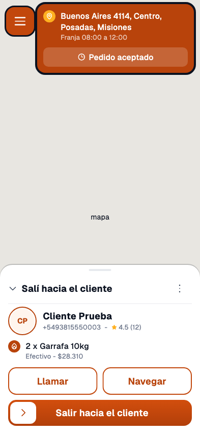

**Figura 37 — CU-018 Marcar un Pedido "En Camino" — Interfaz Gráfica**

Pedido aceptado en la App Chofer: dirección y franja arriba, el cliente con sus acciones «Llamar» y «Navegar» y, al pie, el control «Salir hacia el cliente» que dispara el cambio a en camino. Captura del golden de la app.

#### Especificación del CU Real

| Campo | Detalle |
|-------|---------|
| **Código** | CU-018 |
| **Caso de Uso** | Marcar un Pedido "En Camino" |
| **Actor Principal** | ACT-02 (Chofer) |
| **Objetivos asociados** | OBJ-03 |
| **Requisitos asociados** | IRQ-02 |
| **Descripción** | El chofer indica que salió hacia el domicilio. La app pide el paso del pedido a ON_THE_WAY por `PATCH /orders/:id/status`; el sistema bloquea el pedido, comprueba que sea del chofer que lo mueve, valida la transición ACCEPTED → ON_THE_WAY, registra el momento de la salida con el reloj de la base, abre el seguimiento en vivo del chofer asignado y avisa al cliente y al panel. |
| **Precondición** | El pedido está aceptado. Si quien lo mueve es un chofer, es el asignado al pedido. |

**Secuencia normal**

| Paso | Acción |
|---|---|
| 1 | El chofer toca «Salir hacia el cliente» en `DeliveryView`. `DeliveryViewModel.markOnTheWay` ignora el toque si ya hay una actualización en curso o el pedido no está aceptado, y llama a `TripService.setStatus(orderId, 'on_the_way')`. |
| 2 | La app envía `PATCH /orders/:id/status` con `{ status: "on_the_way" }` y el encabezado `Idempotency-Key`; `IdempotencyInterceptor` devuelve la respuesta guardada si es un reintento. La ruta admite chofer, administrador y administrador general. |
| 3 | `OrderController.updateStatus` verifica con `OrderService.assertDeLaDistribuidora` que el pedido sea de la distribuidora en contexto y, si quien llama es un chofer, ignora cualquier `deliveryId` del cuerpo y usa el suyo, el del token. Delega en `UpdateOrderStatusUseCase.execute`. |
| 4 | El caso de uso abre una transacción con un `QueryRunner` y relee el pedido con bloqueo pesimista de escritura junto con su chofer; los renglones se leen después, en una consulta aparte. |
| 5 | `assertPedidoDelChofer` comprueba, antes de mirar la transición, que el chofer que mueve el pedido sea el asignado (`delivery.deliveryId` igual a `order.deliveryId`). |
| 6 | `transitionOrder` valida con el dato fresco del bloqueo que la transición ACCEPTED → ON_THE_WAY sea legal y la aplica. |
| 7 | `applyStatusEffects` fija `onTheWayAt` con `ahoraDeLaBase` y, si el pedido tiene chofer, abre el seguimiento con `RealtimeDispatchPort.startTracking(choferUserId, orderId, clienteId, distribuidoraId)`: desde ahí cada posición que emite el chofer (CU-017) se reenvía al cliente. |
| 8 | Se guarda el pedido y se confirma la transacción; un subscriber asienta la transición en `order_status_history` (CU-169). |
| 9 | Después del commit, `emitStatusEvent` avisa al cliente por la conexión en tiempo real y `notifyAdmins` emite `order:on_the_way` y su alias `order:on-the-way` al panel de la distribuidora; `notifyCustomer` envía la notificación al dispositivo con el texto genérico de confirmación de pedido. |
| 10 | El controlador responde 200 con el pedido en ON_THE_WAY. La app refresca el pedido y muestra «Llegué / Entregar». |

**Postcondición:** El pedido está en ON_THE_WAY con `onTheWayAt` registrado y la transición asentada en el historial de estados. El seguimiento en vivo del chofer asignado está abierto y el cliente y el panel fueron avisados.

**Excepciones**

| Paso | Acción |
|---|---|
| 3 | Si el pedido no existe o es de otra distribuidora → 404 «Order with ID: … not found», sin revelar que existe. |
| 5 | Si quien lo mueve es un chofer y el pedido está asignado a otro → 403 «Este pedido no está asignado a tu usuario», antes de mirar la transición. |
| 2 | Si el chofer abre la pantalla de un pedido que tuvo y ya no es suyo (lo liberó el administrador o lo reasignaron), la lectura del pedido (CU-006) responde 410 «Este pedido ya no está asignado a tu usuario» y la app sale de la pantalla. |
| 6 | Si el pedido no está en ACCEPTED (por ejemplo, ya cancelado o entregado) → 400 por transición no permitida; si una cancelación concurrente ya confirmó, el bloqueo lo hace visible y la transición se rechaza en lugar de pisarla. |
| 7 | Si el pedido no tiene chofer asignado, el estado cambia igual pero no se abre ningún seguimiento. |
| 2 | Si la clave de idempotencia se reutiliza con otros datos → 422 y no se ejecuta la operación. |

| Campo | Detalle |
|-------|---------|
| **Rendimiento** | Según los pasos del caso de uso esencial (Documento 1): paso 5: 1 segundo. |
| **Frecuencia** | Alta por chofer: una vez por cada pedido aceptado, varias veces por jornada. |
| **Estabilidad** | Alta |

#### Diagrama de Interacción

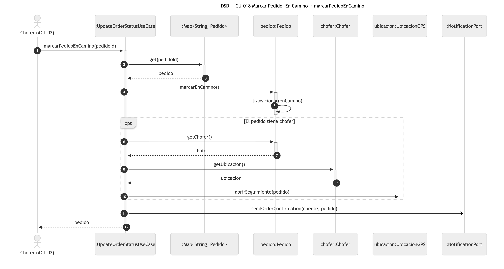

**Figura 38 — CU-018 Marcar un Pedido "En Camino" — Diagrama de Interacción**

<details><summary>Ver código del diagrama</summary>

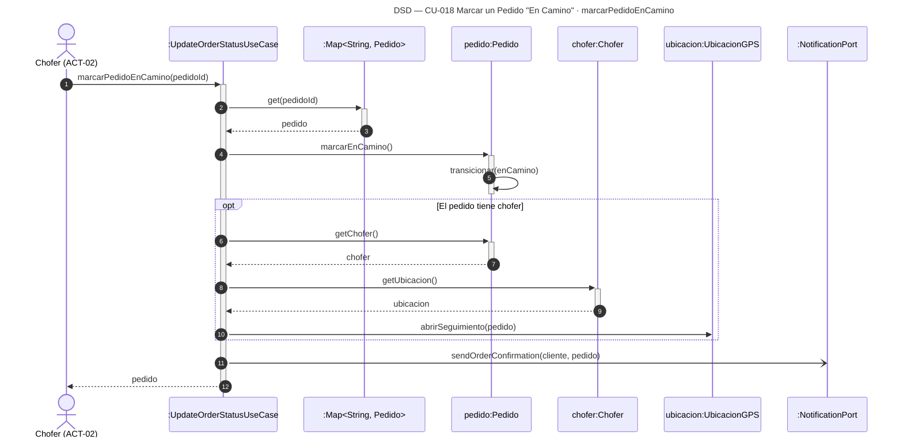

</details>

La operación del sistema es `marcarPedidoEnCamino`. Su diagrama de interacción es el de esta sección; su diagrama de secuencia del sistema está en el Documento 2, sección 2.1; su contrato, en el Documento 2, sección 2.2 («Contrato: `marcarPedidoEnCamino()`»), y su tabla de implementación, en el Documento 3, sección 4.25.

#### Clases de Diseño Participantes

| Clase | Capa | Responsabilidad |
|---|---|---|
| `DeliveryView` / `DeliveryViewModel` | Presentation (Flutter) | Pantalla del pedido aceptado; `markOnTheWay` pide el cambio de estado y refresca |
| `TripService` | Service (Flutter) | `setStatus`: HTTP `PATCH /orders/:id/status` |
| `IdempotencyInterceptor` | Backend Interceptor | Evita reprocesar el cambio de estado ante un reintento |
| `OrderController` | Backend Controller (NestJS) | Ruta `PATCH /orders/:id/status`; fija el chofer desde el token |
| `UpdateOrderStatusUseCase` | Backend Use Case | Bloquea el pedido, valida pertenencia y transición, aplica los efectos y emite los avisos |
| `transitionOrder` (máquina de estados de dominio) | Domain | Valida la transición ACCEPTED → ON_THE_WAY |
| `RealtimeDispatchPort` (impl. `RealtimeDispatchAdapter`) | Infrastructure | Abre el seguimiento en vivo y avisa por WebSocket al cliente y al panel |
| `NotificationService` (en el DSD, `NotificationPort`) | Backend Service | Notificación al dispositivo del cliente |

**Comentarios.** Un chofer no puede poner en camino el pedido de otro; el control no alcanza al administrador, que puede mover cualquier pedido de su distribuidora. Al cliente no le llega «tu pedido está en camino» sino el mensaje genérico de confirmación de pedido. El momento de la salida sale del reloj de la base, el mismo que usa la carga del camión. El seguimiento se abre para el chofer asignado al pedido, no para quien dispara la operación.

---

### 3.19 CU-078 Crítico — Consultar el Código de Entrega (QR del chofer)

**Actor:** Chofer (ACT-02), Administrador (ACT-03), Administrador General (ACT-05)
**Pantalla:** DeliveryQrView (App Chofer) — «Finalización», con el QR de entrega

#### Interfaz Gráfica


**Figura 39 — CU-078 Consultar el Código de Entrega (QR del chofer) — Interfaz Gráfica**

Pantalla «Finalización» de la App Chofer: el código de entrega del pedido representado como QR, con el código en texto debajo, el cliente y el monto, y el aviso «Esperando la confirmación del cliente». Captura del golden de la app, con datos de prueba.

#### Especificación del CU Real

| Campo | Detalle |
|-------|---------|
| **Código** | CU-078 |
| **Caso de Uso** | Consultar el Código de Entrega (QR del chofer) |
| **Actor Principal** | ACT-02 (Chofer), ACT-03 (Administrador), ACT-05 (Administrador General) |
| **Objetivos asociados** | OBJ-04 |
| **Requisitos asociados** | IRQ-02 |
| **Descripción** | El chofer obtiene el código secreto de entrega del pedido que lleva, para mostrarlo como QR al cliente al llegar. El código se genera al aceptarse el pedido y es la mitad emisora del mecanismo antifraude que completa CU-079. `GET /orders/:id/delivery-code` es una lectura: comprueba que el pedido sea de la distribuidora y del chofer que lo pide y devuelve el código ya guardado, sin regenerarlo. |
| **Precondición** | El solicitante está identificado como chofer, o como administrador. El pedido existe y ya fue aceptado, por lo que tiene código de entrega. Si es un chofer, es el asignado al pedido. |

**Secuencia normal**

| Paso | Acción |
|---|---|
| 1 | El chofer toca «Entregar» en la pantalla del pedido; `DeliveryViewModel` abre `DeliveryQrView` y `DeliveryQrViewModel` pide el código a `TripService.deliveryCode(orderId)`. |
| 2 | La app envía `GET /orders/:id/delivery-code` con el token de la sesión. `@Auth(DELIVERY, ADMIN, SUPER_ADMIN)` admite chofer, administrador y administrador general; un cliente recibe 403 del guard de roles. El `id` pasa por `ParseUUIDPipe`. |
| 3 | `OrderController.getDeliveryCode` llama a `OrderService.assertDeLaDistribuidora`: con distribuidora en contexto, un pedido de otra responde 404 «Order with ID: … not found». Luego invoca `OrderService.getDeliveryCode(id, userId, role)`. |
| 4 | `getDeliveryCode` lee el pedido con `findOne(orderId)` y, si el rol es chofer, `assertPedidoDelChofer` resuelve su perfil con `DeliveryService.buscarPorIdOUsuario` y comprueba que `order.deliveryId` sea el suyo; si no, 403 «Este pedido no está asignado a tu usuario». |
| 5 | Comprueba que el pedido tenga `deliveryCode`; el código lo generó `generateDeliveryCode` al aceptar el pedido —10 caracteres hexadecimales en mayúsculas, de `randomBytes(5)`— y no cambia mientras el pedido no cambie de chofer. |
| 6 | El controlador responde 200 con `{ orderId, deliveryCode }` (`CodigoDeEntregaResponseDto`); no se modifica ningún dato. |
| 7 | `DeliveryQrView` dibuja el código como QR y lo repite en texto, y el chofer se lo muestra al cliente, que lo escanea con su app (CU-079). |

**Postcondición:** El chofer dispone del código secreto de diez caracteres del pedido y lo muestra como QR. El pedido no cambió: la operación es de sólo lectura y el código es siempre el mismo mientras el pedido no cambie de chofer.

**Excepciones**

| Paso | Acción |
|---|---|
| 2 | Si el identificador no es un UUID → 400, por el `ParseUUIDPipe`; si el solicitante es un cliente → 403: el cliente nunca conoce el código por la API, sólo escaneando el QR que muestra el chofer. |
| 3 | Si el pedido no existe → 404 «Order with ID: … not found»; si es de otra distribuidora que la del solicitante → el mismo 404, sin revelar que existe. |
| 4 | Si el chofer no tiene perfil de repartidor o el pedido está asignado a otro → 403 «Este pedido no está asignado a tu usuario». |
| 5 | Si el pedido todavía no fue aceptado y por lo tanto no tiene código → 400 «El pedido todavía no tiene código de entrega (debe estar aceptado)». |

| Campo | Detalle |
|-------|---------|
| **Rendimiento** | Según los pasos del caso de uso esencial (Documento 1): paso 5: 1 segundo. |
| **Frecuencia** | Una vez por cada pedido que llega al domicilio; el chofer puede repetirla si la pantalla se cierra. |
| **Estabilidad** | Alta |

#### Diagrama de Interacción


**Figura 40 — CU-078 Consultar el Código de Entrega (QR del chofer) — Diagrama de Interacción**

<details><summary>Ver código del diagrama</summary>

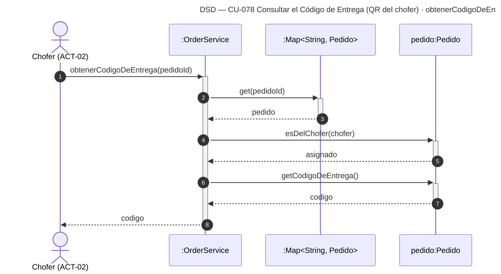

</details>

La operación del sistema es `obtenerCodigoDeEntrega`. Su diagrama de interacción es el de esta sección; su diagrama de secuencia del sistema está en el Documento 2, sección 2.1 y su tabla de implementación en el Documento 3, sección 4.25. No modifica el modelo conceptual y por eso no lleva contrato.

#### Clases de Diseño Participantes

| Clase | Capa | Responsabilidad |
|---|---|---|
| `DeliveryQrView` / `DeliveryQrViewModel` | Presentation (Flutter) | Muestra el código como QR y espera la confirmación del cliente |
| `TripService` | Service (Flutter) | `deliveryCode`: HTTP `GET /orders/:id/delivery-code` y lectura de `deliveryCode` |
| `OrderController` | Backend Controller (NestJS) | Ruta `GET /orders/:id/delivery-code`; verifica la distribuidora |
| `OrderService` | Backend Service | `getDeliveryCode` y `assertPedidoDelChofer`: pertenencia al chofer y existencia del código |
| `DeliveryService` | Backend Service | `buscarPorIdOUsuario`: perfil de repartidor del usuario |
| `generateDeliveryCode` (`delivery-code.util`) | Domain | Genera el código de 10 caracteres hexadecimales al aceptar el pedido |
| `CodigoDeEntregaResponseDto` | Backend DTO | Respuesta `{ orderId, deliveryCode }` |

**Comentarios.** El código de entrega no se regenera si el chofer lo pide varias veces: es siempre el mismo mientras el pedido no cambie de chofer, para que el QR mostrado sea estable durante todo el trayecto. Es la mitad emisora de la prueba de entrega: el cliente lo valida con `POST /orders/:id/confirm-delivery` (CU-079), que lo compara en tiempo constante.

---

### 3.20 CU-292 Crítico — Confirmar el Cobro en Efectivo

**Actor:** Chofer (ACT-02)
**Pantalla:** PaymentView (App Chofer) — «Datos del cliente», botón «Pago recibido»

#### Interfaz Gráfica


**Figura 41 — CU-292 Confirmar el Cobro en Efectivo — Interfaz Gráfica**

Pantalla de cobro en efectivo de la App Chofer: el método de pago, el total a cobrar y el detalle del pedido, con los botones «Pago recibido», «El cliente no pagó» y «Más tarde». «Pago recibido» confirma el cobro. Captura del golden de la app, con datos de prueba.

#### Especificación del CU Real

| Campo | Detalle |
|-------|---------|
| **Código** | CU-292 |
| **Caso de Uso** | Confirmar el Cobro en Efectivo |
| **Actor Principal** | ACT-02 (Chofer) |
| **Objetivos asociados** | OBJ-04, OBJ-07 |
| **Requisitos asociados** | IRQ-02, IRQ-08 |
| **Descripción** | El chofer asignado a un pedido entregado y pagado en efectivo confirma que cobró. Entregar un pedido no lo marca como pagado: el pago queda pendiente hasta que el chofer confirma. `PATCH /orders/:id/payment/cash-received`, sin cuerpo y con clave de idempotencia, bloquea el pedido, comprueba que sea del chofer, que esté entregado y en efectivo, y lo pasa a pagado registrando el momento y al chofer que lo confirmó. |
| **Precondición** | El solicitante está identificado como el chofer asignado al pedido. El pedido está entregado, se paga en efectivo y su pago está pendiente. |

**Secuencia normal**

| Paso | Acción |
|---|---|
| 1 | El chofer entrega el pedido (CU-079) y cobra el efectivo al cliente. En `PaymentView`, toca «Pago recibido»; `PaymentViewModel.confirm` llama a `PaymentRepository.confirmReceived(orderId)`. |
| 2 | `HttpPaymentRepository` envía `PATCH /orders/:id/payment/cash-received` con cuerpo `{}` y con el encabezado `Idempotency-Key`; `IdempotencyInterceptor` devuelve la respuesta guardada ante un reintento por un corte de conexión. La ruta es exclusiva del rol chofer (`@Auth(DELIVERY)`). |
| 3 | `OrderController.confirmCashReceived` llama a `OrderService.assertDeLaDistribuidora`: un pedido de otra distribuidora responde 404. Luego invoca `CashCollectionUseCase.confirmReceived(id, userId, distributorId)`. |
| 4 | `confirmReceived` abre una transacción y `lockPedidoDelChofer` lee el pedido con bloqueo pesimista de escritura, acotado a la distribuidora: si no existe, 404 «Order with ID: … not found». |
| 5 | Comprueba que el chofer del pedido sea quien llama; si no, 403 «Este pedido no está asignado a tu usuario», antes de mirar el estado. `exigirEntregadoEnEfectivo` exige que el pedido esté DELIVERED y se pague en efectivo. |
| 6 | Si `paymentStatus` ya es PAID, devuelve el pedido tal cual, sin cambios. Si no es PENDING —ya se informó como impago—, responde 409. |
| 7 | Con el pago pendiente, asigna `paymentStatus = PAID`, `paymentConfirmedAt` con la hora actual y `paymentConfirmedBy` con el chofer, y guarda el pedido con `manager.save`, de modo que el subscriber de auditoría registre quién y qué cambió. |
| 8 | El controlador relee el pedido con `OrderService.getOne` (`pedidoTrasElCobro`) y responde 200 con `paymentStatus: paid`; si la relectura falla, responde con el pedido guardado y marca la respuesta como incompleta. La app cierra la pantalla de cobro. |

**Postcondición:** El pago del pedido está pagado, con el momento de la confirmación y el chofer que la hizo. El cobro entra en el efectivo de la jornada del chofer que éste rinde (CU-291 y CU-232).

**Excepciones**

| Paso | Acción |
|---|---|
| 3 | Si el pedido no existe o es de otra distribuidora → 404, sin revelar que existe. |
| 5 | Si el pedido está asignado a otro chofer → 403 «Este pedido no está asignado a tu usuario», antes de mirar el estado. |
| 5 | Si el pedido no está entregado → 400 «El cobro se informa sobre un pedido ya entregado»; si no se pagó en efectivo → 400 «Sólo los pedidos en efectivo se cobran en la entrega». |
| 6 | Si el pago ya estaba pagado, no es un error: se devuelve el pedido tal cual. |
| 6 | Si el pago ya se informó como impago → 409 «El pago de este pedido ya se informó como impago: lo resuelve un administrador» (CU-294). |
| 2 | Si la clave de idempotencia se reutiliza con otros datos → 422. |

| Campo | Detalle |
|-------|---------|
| **Rendimiento** | Según los pasos del caso de uso esencial (Documento 1): paso 5: 1 segundo. |
| **Frecuencia** | Una vez por pedido entregado en efectivo. |
| **Estabilidad** | Alta |

#### Diagrama de Interacción

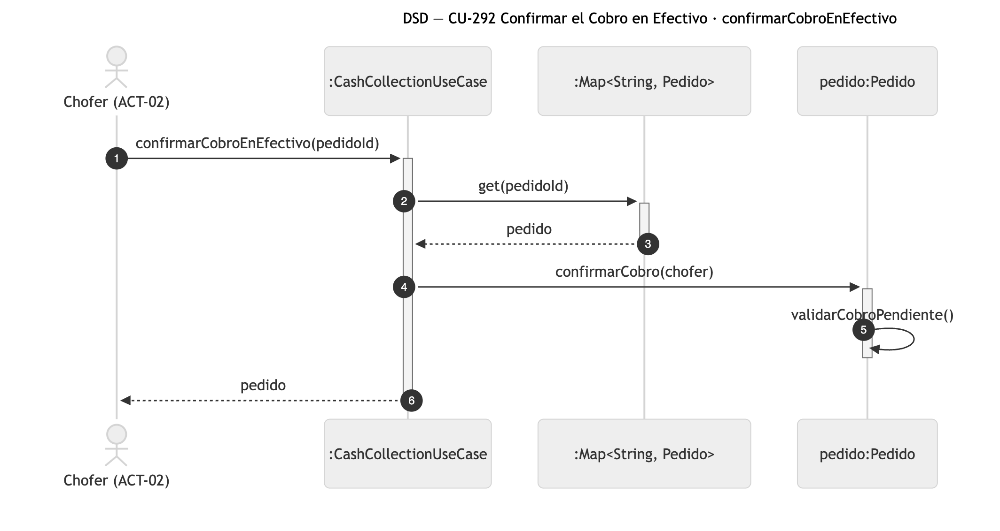

**Figura 42 — CU-292 Confirmar el Cobro en Efectivo — Diagrama de Interacción**

<details><summary>Ver código del diagrama</summary>

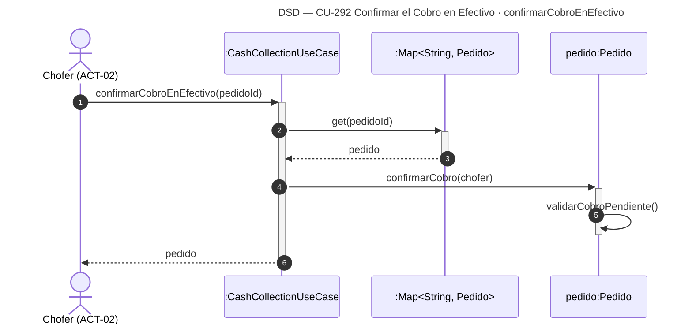

</details>

La operación del sistema es `confirmarCobroEnEfectivo`. Su diagrama de interacción es el de esta sección; su diagrama de secuencia del sistema está en el Documento 2, sección 2.1; su contrato, en el Documento 2, sección 2.2 («Contrato: `confirmarCobroEnEfectivo()`»), y su tabla de implementación, en el Documento 3, sección 4.25.

#### Clases de Diseño Participantes

| Clase | Capa | Responsabilidad |
|---|---|---|
| `PaymentView` / `PaymentViewModel` | Presentation (Flutter) | Pantalla de cobro; `confirm` confirma el pago recibido |
| `PaymentRepository` (impl. `HttpPaymentRepository`) | Service (Flutter) | `confirmReceived`: HTTP `PATCH /orders/:id/payment/cash-received` con clave de idempotencia |
| `IdempotencyInterceptor` | Backend Interceptor | Evita reprocesar el cobro ante un reintento |
| `OrderController` | Backend Controller (NestJS) | Ruta `PATCH /orders/:id/payment/cash-received`; verifica la distribuidora y relee el pedido |
| `CashCollectionUseCase` | Backend Use Case | `confirmReceived`: bloqueo del pedido, pertenencia al chofer, estado y paso a pagado |
| `OrderService` | Backend Service | `assertDeLaDistribuidora` y `getOne`: control de tenant y respuesta del pedido |
| `Order` | Backend Entity | Pedido con `paymentStatus`, `paymentConfirmedAt` y `paymentConfirmedBy` |

**Comentarios.** Entregar no es cobrar: la entrega (CU-020 y CU-079) deja el pago en efectivo pendiente, y el cobro lo confirma el chofer apenas recibe el dinero. Es el dato que alimenta el efectivo cobrado de la jornada del chofer (CU-291). Si el cliente no pagó, el chofer informa el impago con CU-293.

---

### 3.21 CU-232 Crítico — Declarar el Efectivo Rendido

**Actor:** Chofer (ACT-02), Administrador (ACT-03)
**Pantalla:** SettlementView (App Chofer) — «Mi rendición»; `DriverSettlementDetails` con «Declarar efectivo» en el Panel Admin

#### Interfaz Gráfica

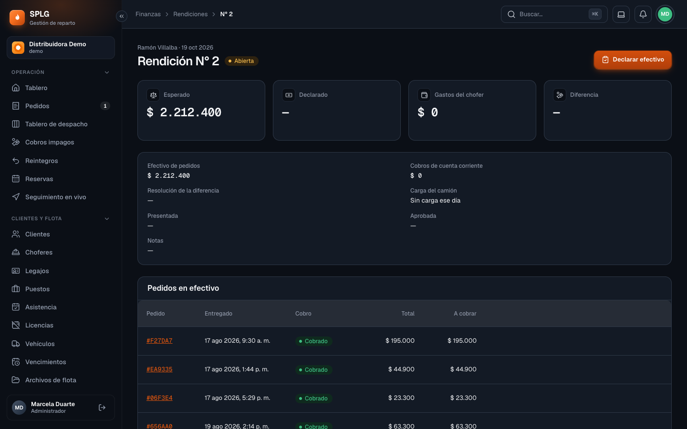

**Figura 43 — CU-232 Declarar el Efectivo Rendido — Interfaz Gráfica**

Detalle de una rendición abierta en el Panel Admin: el efectivo esperado, el declarado, los gastos del chofer y la diferencia, el efectivo de pedidos y de cuentas corrientes, y el botón «Declarar efectivo» que abre `SubmitSettlementModal`. El chofer hace lo mismo desde «Mi rendición» en su app. Captura del panel contra la API de desarrollo.

#### Especificación del CU Real

| Campo | Detalle |
|-------|---------|
| **Código** | CU-232 |
| **Caso de Uso** | Declarar el Efectivo Rendido |
| **Actor Principal** | ACT-02 (Chofer), ACT-03 (Administrador) |
| **Objetivos asociados** | OBJ-05, OBJ-07 |
| **Requisitos asociados** | IRQ-19, IRQ-03 |
| **Descripción** | El chofer entrega la cobranza del día y la declara: cuánto efectivo entrega y qué gastos pagó con ese dinero, como combustible o peaje. `POST /driver-settlements/:id/submit` bloquea la rendición, toma los pedidos en efectivo todavía sin rendir, recalcula el efectivo esperado, registra los gastos, calcula la diferencia y pasa la rendición a presentada, todo en una transacción. El mismo caso lo atienden la app del chofer, para su rendición, y el panel, para la de un chofer que no puede hacerlo. |
| **Precondición** | El solicitante está identificado como chofer o como administrador. La rendición está abierta; si la presenta un chofer, es la suya. |

**Secuencia normal**

| Paso | Acción |
|---|---|
| 1 | El chofer abre «Mi rendición» (`SettlementView`); `SettlementViewModel.fetch` llama a `DriverOpsRepository.mySettlement`, que pide `GET /driver-settlements/mine`: la ruta, exclusiva del rol chofer, abre la rendición del día si no existe y devuelve los pedidos en efectivo, los cobros de cuenta corriente y el efectivo esperado. Para elegir la categoría de cada gasto, la app lee `GET /cash-categories`, su único acceso al módulo de caja. |
| 2 | Ingresa el efectivo que entrega y los gastos, cada uno con su categoría, su importe y una descripción. `SettlementViewModel.submit` llama a `submitSettlement`, que envía `POST /driver-settlements/:id/submit` con `{ declaredCash, expenses: [{ categoryId, amount, description? }], notes? }` y una `Idempotency-Key`. El panel hace lo mismo con `SubmitSettlementModal`, que usa `useSubmitDriverSettlement`. |
| 3 | `@Auth(ADMIN, SUPER_ADMIN, DELIVERY)` admite chofer, administrador y administrador general. `ValidationPipe` valida `SubmitDriverSettlementDto`. `DriverSettlementController.submit` toma la distribuidora del contexto y, si quien presenta es un chofer, limita la búsqueda a las rendiciones de su usuario; llama a `DriverSettlementService.presentar`. |
| 4 | `presentar` abre una transacción con reintento y bloquea la rendición con `bloquear` —404 si no existe, es de otra distribuidora o, para un chofer, de otro chofer—. `exigirEstado(estado, 'submit')` exige que esté abierta. |
| 5 | `validarCategoriasDeGasto` comprueba que cada gasto tenga una categoría de egreso activa de la distribuidora. `pedidosSinRendir` toma, con bloqueo, los pedidos en efectivo entregados por ese chofer hasta el fin de ese día —incluidos los de días anteriores que quedaron sin rendir—, cobrados o con el cobro pendiente, que ninguna rendición tomó y que un administrador no resolvió (`condicionSinRendir` en `settlement-orders.ts`), y los registra en `DriverSettlementOrder`. |
| 6 | Recalcula el esperado con los pedidos en efectivo a cobrar más los cobros de cuenta corriente, guarda los gastos en `DriverSettlementExpense` y calcula `diferencia = declarado + gastos − esperado` con `diferenciaDeRendicion`, con `decimal.js`. |
| 7 | Guarda `expectedCash`, `declaredCash`, `driverExpenses` y `difference` en pesos con dos decimales, pasa el estado a presentada con `submittedAt` y `submittedByUserId` y confirma la transacción. |
| 8 | El controlador responde 201 con `DriverSettlementQueryService.detalle`: la rendición con sus pedidos, cobros y gastos. La app y el panel la muestran presentada; no se edita hasta que el administrador la apruebe (CU-233) o la reabra (CU-330). |

**Postcondición:** La rendición queda presentada, con el efectivo declarado, los gastos y la diferencia —negativa si falta, positiva si sobra—. No se puede editar hasta que el administrador la apruebe o la reabra.

**Excepciones**

| Paso | Acción |
|---|---|
| 3 | Si el efectivo declarado es negativo, algún gasto es negativo o es cero («tiene que ser mayor que cero»), o un dato no previsto viene en el cuerpo → 400. |
| 4 | Si la rendición no existe, es de otra distribuidora o, para un chofer, es de otro chofer → 404. |
| 4 | Si la rendición no está abierta → 409 «La rendición está …: sólo se presenta una abierta». |
| 5 | Si un gasto no tiene categoría, o la categoría no es de egreso o está desactivada → 400. |
| 5 | Si algún pedido ya fue tomado por otra rendición, el índice único lo rechaza con 409 «Alguno de los pedidos ya fue tomado por otra rendición: reabrí esa antes de presentar ésta». |
| 3 | Si la clave de idempotencia se reutiliza con otros datos → 422. |

| Campo | Detalle |
|-------|---------|
| **Rendimiento** | Según los pasos del caso de uso esencial (Documento 1): paso 5: 1 segundo. |
| **Frecuencia** | Alta: una vez por día y por chofer. |
| **Estabilidad** | Alta |

#### Diagrama de Interacción

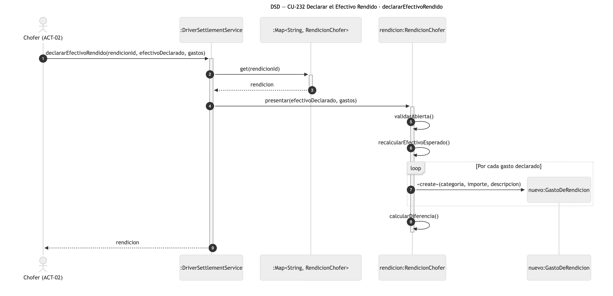

**Figura 44 — CU-232 Declarar el Efectivo Rendido — Diagrama de Interacción**

<details><summary>Ver código del diagrama</summary>

```mermaid
sequenceDiagram
    title DSD — CU-232 Declarar el Efectivo Rendido · declararEfectivoRendido
    autonumber
    actor CHF as Chofer (ACT-02)
    participant SRV as :DriverSettlementService
    participant RENS as :Map#lt;String, RendicionChofer#gt;
    participant REN as rendicion:RendicionChofer

    CHF->>+SRV: declararEfectivoRendido(rendicionId, efectivoDeclarado, gastos)
    SRV->>+RENS: get(rendicionId)
    RENS-->>-SRV: rendicion
    SRV->>+REN: presentar(efectivoDeclarado, gastos)
    REN->>REN: validarAbierta()
    REN->>REN: recalcularEfectivoEsperado()
    loop Por cada gasto declarado
        create participant NGA as nuevo:GastoDeRendicion
        REN->>NGA: «create»(categoria, importe, descripcion)
    end
    REN->>REN: calcularDiferencia()
    deactivate REN
    SRV-->>-CHF: rendicion
```

</details>

La operación del sistema es `declararEfectivoRendido`. Su diagrama de interacción es el de esta sección; su diagrama de secuencia del sistema está en el Documento 2, sección 2.1; su contrato, en el Documento 2, sección 2.2 («Contrato: `declararEfectivoRendido()`»), y su tabla de implementación, en el Documento 3, sección 4.25.

#### Clases de Diseño Participantes

| Clase | Capa | Responsabilidad |
|---|---|---|
| `SettlementView` / `SettlementViewModel` | Presentation (Flutter) | «Mi rendición» del chofer: carga, gastos y presentación |
| `DriverOpsRepository` | Service (Flutter) | `mySettlement` y `submitSettlement`: HTTP a `driver-settlements/mine` y `driver-settlements/:id/submit` |
| `DriverSettlementDetails` / `SubmitSettlementModal` | Presentation (React) | Detalle de la rendición y diálogo «Declarar efectivo» del panel |
| `DriverSettlementController` | Backend Controller (NestJS) | Rutas `GET /driver-settlements/mine`, `GET /driver-settlements/:id` y `POST /driver-settlements/:id/submit` |
| `SubmitDriverSettlementDto` | Backend DTO | Efectivo declarado, gastos con categoría e importe, y notas |
| `DriverSettlementService` | Backend Service | `presentar`: bloqueo, pedidos sin rendir, esperado, gastos, diferencia y estado |
| `DriverSettlementQueryService` | Backend Service | `detalle`: la rendición con sus pedidos, cobros y gastos |
| `driver-settlement-rules` | Domain | `exigirEstado` y `diferenciaDeRendicion` |
| `DriverSettlement` / `DriverSettlementOrder` / `DriverSettlementExpense` | Backend Entity | Rendición, pedidos tomados y gastos declarados |

**Comentarios.** La diferencia es lo declarado más los gastos menos lo esperado: negativa es faltante y positiva, sobrante. Los gastos entran sumando porque el chofer los pagó con dinero que debía entregar; reducen lo que entrega pero no generan un egreso en la caja. El recálculo del esperado al presentar evita comparar contra una cifra vieja si entró una entrega mientras tanto.

---

### 3.22 CU-233 Crítico — Aprobar la Rendición del Chofer

**Actor:** Administrador (ACT-03)
**Pantalla:** DriverSettlements — «Rendiciones» → detalle → «Aprobar» (Panel Admin), con `ApproveSettlementModal`

#### Interfaz Gráfica

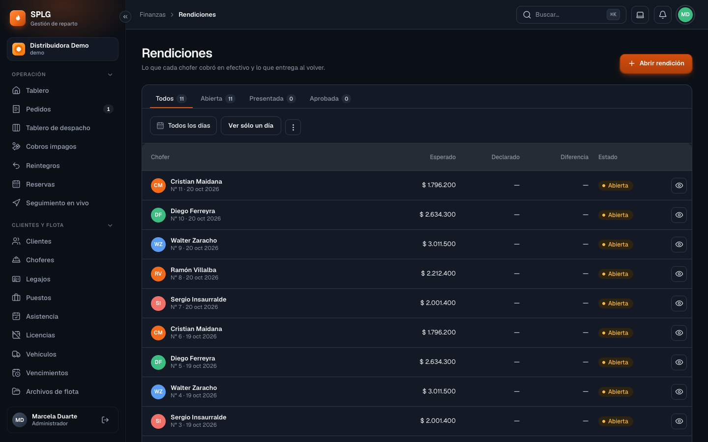

**Figura 45 — CU-233 Aprobar la Rendición del Chofer — Interfaz Gráfica**

Rendiciones de la distribuidora de demostración, en la vista de todos los días: las pestañas por estado con su contador y la tabla por chofer con lo esperado, lo declarado, la diferencia y el estado; con un día elegido, arriba se suman el efectivo por rendir, las rendiciones abiertas y las presentadas sin aprobar. Desde el detalle de una rendición presentada, «Aprobar» abre `ApproveSettlementModal`, donde se elige la caja destino y cómo se resuelve la diferencia. Captura del panel contra la API de desarrollo, que tiene 11 rendiciones abiertas y ninguna presentada ni aprobada.

#### Especificación del CU Real

| Campo | Detalle |
|-------|---------|
| **Código** | CU-233 |
| **Caso de Uso** | Aprobar la Rendición del Chofer |
| **Actor Principal** | ACT-03 (Administrador) |
| **Objetivos asociados** | OBJ-05, OBJ-07 |
| **Requisitos asociados** | IRQ-19, IRQ-03 |
| **Descripción** | El administrador controla lo que el chofer rindió. Si cierra, aprueba la rendición: el efectivo declarado entra a la caja que elija y la diferencia, si la hay, se resuelve —la absorbe la distribuidora o se descuenta al chofer—. `PATCH /driver-settlements/:id/approve` lo hace en una transacción con bloqueo de la rendición y de la caja. La reapertura de una rendición presentada es CU-330. |
| **Precondición** | El administrador está identificado. La rendición pertenece a su distribuidora y está presentada. La caja de destino existe; si el efectivo declarado es mayor que cero, está activa y, si exige sesión, la tiene abierta; con el declarado en cero no se controla ni una cosa ni la otra. |

**Secuencia normal**

| Paso | Acción |
|---|---|
| 1 | El administrador abre «Rendiciones» (`DriverSettlements`), ve el tablero del día por chofer y abre una rendición presentada (`DriverSettlementDetails`) para revisar los pedidos en efectivo, los cobros de la calle y los gastos. |
| 2 | Toca «Aprobar» y completa `ApproveSettlementModal`: la caja destino y, si hay diferencia, la resolución. `useApproveDriverSettlement` envía `PATCH /driver-settlements/:id/approve` con `{ cashBoxId, differenceResolution?, notes? }` y una `Idempotency-Key`. `@Auth(ADMIN, SUPER_ADMIN)` admite administrador y administrador general. |
| 3 | `DriverSettlementController.approve` toma la distribuidora del contexto y el usuario del token y llama a `DriverSettlementService.aprobar`. Abre una transacción con reintento, bloquea la rendición con `bloquear` y `exigirEstado(estado, 'approve')` exige que esté presentada. |
| 4 | `resolucionDeDiferencia(diferencia, resolución)` decide la resolución: sin diferencia es `none`; con diferencia exige `absorbed` o `charged_to_driver`, y esta última sólo vale para un faltante. |
| 5 | Si la rendición está atada a un turno (`truckLoadId`), consulta la carga: no debe estar abierta, o 409. |
| 6 | `CashLedgerService.bloquearCajas` bloquea la caja destino y la valida siempre, aunque no entre dinero; en el orden global de bloqueos la rendición va antes que la caja. |
| 7 | Si el efectivo declarado es mayor que cero, `CashCategoryService.deSistema` toma la categoría de sistema «rendición de chofer» y `CashLedgerService.registrar` asienta la entrada del efectivo declarado en la caja destino —que incluye los cobros de cuenta corriente de la calle— con la descripción «Rendición N° … del …» y referencia `DRIVER_SETTLEMENT` (CU-228). Si la caja exige sesión y no la tiene abierta, falla con 409. |
| 8 | Con `charged_to_driver`, `CommissionLedgerService.registrarFaltante` asienta en el libro de comisiones del empleado una deducción negativa por el faltante, que descuenta la próxima liquidación (CU-242). Con `absorbed`, no asienta nada más. |
| 9 | Pasa la rendición a aprobada con la caja destino, el movimiento de caja, la resolución, `approvedAt`, `approvedByUserId` y las notas, y confirma la transacción. |
| 10 | El controlador responde 200 con `DriverSettlementQueryService.detalle`: la rendición aprobada. El panel invalida rendiciones y cajas. |

**Postcondición:** La rendición queda aprobada, el efectivo declarado forma parte del saldo de la caja destino y la diferencia está resuelta. Todo se confirmó junto: si falla el asiento de caja o el de comisiones, la rendición sigue presentada.

**Excepciones**

| Paso | Acción |
|---|---|
| 3 | Si la rendición no existe o es de otra distribuidora → 404. |
| 3 | Si la rendición no está presentada → 409 «La rendición está …: sólo se aprueba una presentada». |
| 4 | Si hay diferencia y no se indica cómo se resuelve → 400; `charged_to_driver` sobre un sobrante → 400 «Un sobrante no se le descuenta al chofer: resolvelo como absorbed». |
| 5 | Si la rendición está atada a una carga del camión que no está cerrada → 409 «La carga del camión de este turno todavía no está cerrada: cerrala antes de aprobar la rendición». |
| 6 | Si la caja no existe o es de otra distribuidora → 404 (sale al bloquear las cajas). |
| 7 | Si entra efectivo (declarado mayor que cero) y la caja está desactivada → 409 «La caja está desactivada: activala para registrar movimientos». |
| 7 | Si entra efectivo y la caja exige sesión y no la tiene abierta → 409 «La caja exige una sesión abierta: abrila antes de registrar movimientos». |
| 8 | Si la resolución es `charged_to_driver` y el chofer no tiene legajo → 409 «El chofer no tiene legajo: no se le puede descontar el faltante. Resolvelo como absorbed». |
| 2 | Si la clave de idempotencia se reutiliza con otros datos → 422. |

| Campo | Detalle |
|-------|---------|
| **Rendimiento** | Según los pasos del caso de uso esencial (Documento 1): paso 6: 1 segundo. |
| **Frecuencia** | Alta: una por chofer y por día. |
| **Estabilidad** | Alta |

#### Diagrama de Interacción


**Figura 46 — CU-233 Aprobar la Rendición del Chofer — Diagrama de Interacción**

<details><summary>Ver código del diagrama</summary>

```mermaid
sequenceDiagram
    title DSD — CU-233 Aprobar la Rendición del Chofer · aprobarRendicion
    autonumber
    actor ADM as Administrador (ACT-03)
    participant SRV as :DriverSettlementService
    participant RENS as :Map#lt;String, RendicionChofer#gt;
    participant CAJS as :Map#lt;String, Caja#gt;
    participant REN as rendicion:RendicionChofer
    participant CHF as chofer:Chofer
    participant EMP as empleado:Empleado
    participant CAJ as caja:Caja

    ADM->>+SRV: aprobarRendicion(rendicionId, cajaDestinoId, resolucionDeDiferencia)
    SRV->>+RENS: get(rendicionId)
    RENS-->>-SRV: rendicion
    SRV->>+CAJS: get(cajaDestinoId)
    CAJS-->>-SRV: caja
    SRV->>+REN: aprobar(caja, resolucionDeDiferencia)
    REN->>REN: validarPresentada()
    REN->>CAJ: registrarMovimiento(sentido, importe, categoria, medio, descripcion, referencia)
    Note over REN,CAJ: Entrada: ver DSD de registrarEntradaDeDinero (CU-228).<br/>El importe es el efectivo declarado. Crea el MovimientoDeCaja<br/>con la categoría de sistema rendición de chofer
    alt La diferencia es un faltante a cargo del chofer
        REN->>+CHF: getEmpleado()
        CHF-->>-REN: empleado
        REN->>+EMP: registrarFaltante(rendicion, importe)
        create participant NAC as nuevo:AsientoComision
        EMP->>NAC: «create»(tipoDeAsientoDeComision, importe, rendicion)
        deactivate EMP
    else La diferencia la absorbe la distribuidora
        REN->>REN: absorberDiferencia()
    end
    deactivate REN
    SRV-->>-ADM: rendicion
```

</details>

La operación del sistema es `aprobarRendicion`. Su diagrama de interacción es el de esta sección; su diagrama de secuencia del sistema está en el Documento 2, sección 2.1; su contrato, en el Documento 2, sección 2.2 («Contrato: `aprobarRendicion()`»), y su tabla de implementación, en el Documento 3, sección 4.25.

#### Clases de Diseño Participantes

| Clase | Capa | Responsabilidad |
|---|---|---|
| `DriverSettlements` / `DriverSettlementDetails` / `ApproveSettlementModal` | Presentation (React) | Tablero del día, detalle de la rendición y diálogo de aprobación |
| `DriverSettlementController` | Backend Controller (NestJS) | Ruta `PATCH /driver-settlements/:id/approve` |
| `ApproveDriverSettlementDto` | Backend DTO | Caja destino, resolución de la diferencia y notas |
| `DriverSettlementService` | Backend Service | `aprobar`: bloqueos, resolución, asiento de caja y de comisiones, y cambio de estado |
| `driver-settlement-rules` | Domain | `exigirEstado` y `resolucionDeDiferencia` |
| `CashLedgerService` | Backend Service | `bloquearCajas` y `registrar`: la entrada del efectivo declarado en la caja |
| `CashCategoryService` | Backend Service | `deSistema`: la categoría «rendición de chofer» |
| `CommissionLedgerService` | Backend Service | `registrarFaltante`: deducción por el faltante a cargo del chofer |
| `DriverSettlement` | Backend Entity | Rendición con su esperado, declarado, diferencia, caja destino y resolución |

**Comentarios.** El efectivo que entra es el declarado y no el esperado: lo que no llegó a la caja no se registra como ingreso. La resolución de la diferencia es una decisión humana: el sistema no descuenta nada al chofer por su cuenta, y el faltante a cargo del chofer lo resta la próxima liquidación. Una rendición aprobada no se reabre (CU-330 sólo reabre una presentada): si se aprobó mal, se corrige con un movimiento manual de caja que lo explique.

---

### 3.23 CU-227 Crítico — Cerrar la Caja con Arqueo

**Actor:** Administrador (ACT-03)
**Pantalla:** CashBoxDetails — «Cajas» → ficha de la caja → «Cerrar con arqueo» (Panel Admin), con `CloseSessionModal`

#### Interfaz Gráfica


**Figura 47 — CU-227 Cerrar la Caja con Arqueo — Interfaz Gráfica**

Ficha de una caja de la distribuidora de demostración (`/finance/boxes/:id`, que se abre desde «Cajas»): el saldo según el libro, los datos de la caja, la sesión en curso con su monto inicial y su saldo esperado y el historial de sesiones, de la más nueva a la más vieja, con la apertura, el cierre, el arqueo (contado y esperado) y la diferencia —«Cuadra», «Faltante» o «Sobrante»—. Con la sesión abierta, «Cerrar con arqueo» abre `CloseSessionModal` con el monto inicial, los movimientos y el saldo para contar el efectivo. Captura del panel contra la API de desarrollo, con una caja de mostrador de prueba que tiene una sesión abierta y otra anterior, cerrada y sin diferencia.

#### Especificación del CU Real

| Campo | Detalle |
|-------|---------|
| **Código** | CU-227 |
| **Caso de Uso** | Cerrar la Caja con Arqueo |
| **Actor Principal** | ACT-03 (Administrador) |
| **Objetivos asociados** | OBJ-05, OBJ-07 |
| **Requisitos asociados** | IRQ-19 |
| **Descripción** | El administrador cierra la sesión de una caja con un arqueo: cuenta el efectivo, lo compara con el monto esperado según el libro y deja asentada la diferencia, de modo que el saldo del sistema coincida con lo que hay. `PATCH /cash-sessions/:id/close` bloquea la caja, calcula el esperado y la diferencia con aritmética decimal exacta, asienta el ajuste si hace falta y cierra la sesión, todo en una transacción. |
| **Precondición** | El administrador está identificado. La sesión pertenece a su distribuidora y está abierta. |

**Secuencia normal**

| Paso | Acción |
|---|---|
| 1 | El administrador abre la ficha de la caja (`CashBoxDetails`, desde `CashBoxes`): `GET /cash-boxes/:id` trae el saldo según el libro y los datos, y `GET /cash-boxes/:id/sessions` el historial de sesiones, paginado con `page` (desde 1) y `limit`. Con la sesión abierta elige «Cerrar con arqueo»: `CloseSessionModal` muestra, con `GET /cash-sessions/:id`, el monto inicial de la sesión, sus movimientos y el saldo. |
| 2 | Cuenta el efectivo e ingresa el monto contado y, si quiere, una nota. `useCloseCashSession` envía `PATCH /cash-sessions/:id/close` con `{ countedAmount, notes? }` y una `Idempotency-Key`. `@Auth(ADMIN, SUPER_ADMIN)` admite administrador y administrador general; `@CurrentDistributor({ required: true })` toma la distribuidora. |
| 3 | `ValidationPipe` valida `CloseCashSessionDto`: `countedAmount` con el decorador `@Importe(0)` —no negativo— y `notes` opcional de hasta 500 caracteres. `CashSessionController.close` llama a `CashSessionService.cerrar` con el usuario del token. |
| 4 | `cerrar` abre una transacción con reintento (`withTransactionRetry`), lee la sesión de la distribuidora y bloquea su caja con `CashLedgerService.bloquearCajas`. Releída ya con el bloqueo, comprueba que siga abierta. |
| 5 | `totales` suma las entradas y las salidas de la sesión, y la función de dominio `arqueo(apertura, entradas, salidas, contado)` calcula, con `decimal.js`, `esperado = apertura + entradas − salidas` y `diferencia = contado − esperado`. |
| 6 | Si la diferencia no es cero, `asentarAjuste` asienta primero un movimiento de ajuste en la caja con la categoría de sistema «sobrante de caja» o «faltante de caja» (CU-228 o CU-309) y la descripción «Diferencia de arqueo: se esperaban … y se contaron …», con referencia `SESSION_CLOSING`: así el saldo queda igual a lo contado. |
| 7 | Pasa la sesión a cerrada con `closedAt`, `closedByUserId`, el esperado, el contado y la diferencia en centavos, y la nota; la guarda y confirma la transacción. |
| 8 | El controlador responde 200 con `CashMapper.sesion`: la sesión cerrada con el nombre de la caja. El panel invalida las cajas, sus sesiones y sus movimientos: la ficha pasa a «Cerrada» y suma la sesión al historial con su arqueo y su diferencia, que `sessionDifference` rotula «Faltante» si es negativa, «Sobrante» si es positiva y «Cuadra» si es cero. |

**Postcondición:** La sesión queda cerrada con su arqueo. El saldo de la caja es igual al monto contado y la diferencia, si la hubo, quedó registrada como un movimiento más del libro, anterior al cierre y en la misma transacción.

**Excepciones**

| Paso | Acción |
|---|---|
| 2 | Si el monto contado falta o es negativo → 400 con el detalle de validación; si no hay distribuidora en el contexto → 400. |
| 1 | Si la caja no existe o es de otra distribuidora → 404 «Caja no encontrada: …» y la ficha muestra el error. |
| 4 | Si la sesión no existe o es de otra distribuidora → 404 (`SesionNoEncontradaError`). |
| 4 | Si la sesión ya está cerrada → 409 «La sesión ya está cerrada», también si dos cierres compiten: el segundo ve la sesión ya cerrada tras el bloqueo. |
| 2 | Si la clave de idempotencia ya se usó, se devuelve el resultado de la primera ejecución; si se reutiliza con otros datos → 422. |

| Campo | Detalle |
|-------|---------|
| **Rendimiento** | Según los pasos del caso de uso esencial (Documento 1): paso 6: Cierre: 1 segundo. |
| **Frecuencia** | Media: una vez por turno de caja. |
| **Estabilidad** | Alta |

#### Diagrama de Interacción


**Figura 48 — CU-227 Cerrar la Caja con Arqueo — Diagrama de Interacción**

<details><summary>Ver código del diagrama</summary>

```mermaid
sequenceDiagram
    title DSD — CU-227 Cerrar la Caja con Arqueo · cerrarCajaConArqueo
    autonumber
    actor ADM as Administrador (ACT-03)
    participant SRV as :CashBoxService
    participant SESS as :Map#lt;String, SesionDeCaja#gt;
    participant SES as sesionDeCaja:SesionDeCaja
    participant CAJ as caja:Caja

    ADM->>+SRV: cerrarCajaConArqueo(sesionId, montoContado)
    SRV->>+SESS: get(sesionId)
    SESS-->>-SRV: sesionDeCaja
    SRV->>+SES: cerrar(montoContado, administrador)
    SES->>SES: validarAbierta()
    SES->>+CAJ: calcularDiferencia(montoContado)
    CAJ-->>-SES: diferencia
    opt La diferencia no es cero
        SES->>+CAJ: registrarMovimiento(sentido, importe, categoria, medio, descripcion, referencia)
        Note over SES,CAJ: Ajuste: ver DSD de registrarEntradaDeDinero (CU-228) o registrarSalidaDeDinero (CU-309).<br/>El importe es la diferencia. Crea el MovimientoDeCaja con<br/>la categoría de sistema diferencia de caja
        deactivate CAJ
    end
    deactivate SES
    SRV-->>-ADM: sesionDeCaja
```

</details>

La operación del sistema es `cerrarCajaConArqueo`. Su diagrama de interacción es el de esta sección; su diagrama de secuencia del sistema está en el Documento 2, sección 2.1; su contrato, en el Documento 2, sección 2.2 («Contrato: `cerrarCajaConArqueo()`»), y su tabla de implementación, en el Documento 3, sección 4.25.

#### Clases de Diseño Participantes

| Clase | Capa | Responsabilidad |
|---|---|---|
| `CashBoxes` / `CashBoxDetails` / `CashSessionsCard` / `CloseSessionModal` | Presentation (React) | Listado de cajas, ficha de la caja con su historial de sesiones y arqueo, y diálogo de cierre con el monto contado |
| `useCloseCashSession` | Presentation (React Query) | Mutación que envía `PATCH /cash-sessions/:id/close` y refresca las cajas |
| `CashSessionController` / `CashBoxController` | Backend Controller (NestJS) | Rutas `GET /cash-sessions/:id` y `PATCH /cash-sessions/:id/close`; la ficha lee `GET /cash-boxes/:id` y `GET /cash-boxes/:id/sessions` |
| `CloseCashSessionDto` | Backend DTO | Monto contado no negativo y nota opcional |
| `CashSessionService` | Backend Service | `cerrar` y `asentarAjuste`: bloqueo, arqueo, ajuste y cierre en una transacción (en el DSD, la caja `CashBoxService`) |
| `CashLedgerService` | Backend Service | `bloquearCajas` y asiento de los movimientos de caja |
| `arqueo` (`cash-rules`) | Domain | Esperado y diferencia con aritmética decimal exacta |
| `CashSession` / `CashMovement` | Backend Entity | Sesión de caja con su arqueo y movimientos del libro |

**Comentarios.** El ajuste no es una excepción al libro sino un movimiento más, de modo que el saldo sigue siendo la suma de los ingresos menos la de los egresos después del cierre y la verificación nocturna del saldo no lo marca. Un faltante no se carga a nadie desde acá: si corresponde descontárselo a un chofer, se hace al aprobar su rendición (CU-233), donde está la persona responsable. Las sumas se hacen con `decimal.js` y `numeric` en la base, nunca con punto flotante.

---

### 3.24 CU-036 Crítico — Crear un Producto (Garrafa)

**Actor:** Administrador (ACT-03)
**Pantalla:** GasCylinders — «Catálogo de garrafas» → «Nueva garrafa» (Panel Admin), con `CylinderFormModal`

#### Interfaz Gráfica


**Figura 49 — CU-036 Crear un Producto (Garrafa) — Interfaz Gráfica**

Catálogo de garrafas de la distribuidora de demostración: tipo, precio, stock y cantidad de promociones por producto. El botón «Nueva garrafa» abre `CylinderFormModal`, con el tipo, el peso, el precio, el stock inicial, la descripción y las promociones por cantidad. Captura del panel contra la API de desarrollo.

#### Especificación del CU Real

| Campo | Detalle |
|-------|---------|
| **Código** | CU-036 |
| **Caso de Uso** | Crear un Producto (Garrafa) |
| **Actor Principal** | ACT-03 (Administrador) |
| **Objetivos asociados** | OBJ-05, OBJ-06 |
| **Requisitos asociados** | IRQ-04 |
| **Descripción** | El administrador registra un nuevo tipo de garrafa en el catálogo de su distribuidora. El panel envía `POST /gascylinder`; el sistema valida los datos, comprueba que el tipo no exista ya en esa distribuidora y guarda el producto activo. Si trae stock inicial, el módulo de stock lo registra como físico del depósito predeterminado en la misma transacción: si ese registro falla, el producto no se crea. |
| **Precondición** | El administrador está identificado y tiene una distribuidora elegida. |

**Secuencia normal**

| Paso | Acción |
|---|---|
| 1 | El administrador abre «Catálogo de garrafas» (`GasCylinders`), toca «Nueva garrafa» y completa `CylinderFormModal`; `gasCylinderSchema` valida el formulario en el panel. |
| 2 | `useCreateGasCylinder` envía `POST /gascylinder` con `{ type, weight, price, stock?, description?, promotions? }`. La ruta admite administrador y administrador general (`@Auth(ADMIN, SUPER_ADMIN)`). |
| 3 | `ValidationPipe` valida `CreateGasCylinderDto`: `type` texto no vacío de hasta 50 caracteres, `weight` mayor que 0 y hasta 1000 kg (`PESO_MAXIMO_KG`), `price` mayor que 0 y hasta 10.000.000 (`PRECIO_MAXIMO`), ambos con hasta 2 decimales, `stock` entero no negativo y cada promoción (`PromocionDto`) con `quantity` entero de al menos 2 y `discountPercentage` mayor que 0 y hasta 99 (`DESCUENTO_MAXIMO_PROMOCION`), con 2 decimales. Un campo no declarado se rechaza. |
| 4 | `@CurrentDistributor({ required: true })` toma la distribuidora en contexto; sin ella, 400. `GasCylinderController.create` delega en `GasCylinderService.create`. |
| 5 | `GasCylinderService.create` busca un producto con el mismo `type` en esa distribuidora, activo o dado de baja y sin distinguir mayúsculas ni espacios; si existe, 400. `assertPromocionesSinRepetir` rechaza dos reglas para la misma cantidad. |
| 6 | Abre una transacción con `manager.transaction`, guarda el `GasCylinder` con `distributorId` y activo y, si `stock > 0`, emite con `EventEmitter2.emitAsync` el evento `GarrafaCreadaEvent` pasando el `manager`: el módulo de stock registra las llenas en el depósito predeterminado dentro de la misma transacción. |
| 7 | Se confirma la transacción y `GasCylinderPhotoService` firma la foto si la hay; `GasCylinderMapper.toDto` arma la respuesta y el controlador responde 201 con el producto. |
| 8 | El panel invalida el catálogo y muestra el producto nuevo. Con stock mayor que cero, aparece de inmediato en `GET /gascylinder/available/list` (CU-041). |

**Postcondición:** Existe un producto activo en el catálogo de la distribuidora, con sus promociones. El tipo es único por distribuidora: dos empresas pueden tener cada una su «10kg». El stock inicial quedó registrado como físico y vendible en la misma operación.

**Excepciones**

| Paso | Acción |
|---|---|
| 3 | Si falta el tipo, el peso o el precio, alguno no es del tipo esperado o se envía un campo no declarado → 400 con el campo y la regla (por ejemplo, «price debe ser mayor que 0»). Si el precio supera 10.000.000 («price no puede superar 10000000»), el peso supera 1000 kg («weight no puede superar 1000 kg»), alguno tiene más de 2 decimales o el tipo está en blanco → 400; el panel (`gasCylinderSchema`) lo avisa antes de enviar y la base repite precio y peso positivos y el tipo no vacío (`CHK_gas_cylinder_valores`, `CHK_gas_cylinder_tipo`). |
| 4 | Si el administrador no tiene distribuidora en contexto → 400 pidiendo que se indique. |
| 5 | Si ya existe un producto de ese tipo en la distribuidora, activo o dado de baja → 400 «Ya existe una garrafa con este tipo en tu distribuidora». |
| 5 | Si dos promociones comparten la misma cantidad → 400. |
| 6 | Si dos altas simultáneas del mismo tipo pasan el control, la base rechaza la segunda por la restricción de unicidad y `handleDBExceptions` responde 409 «Ya existe un registro con esos datos (productos)». |
| 6 | Si falla el registro del stock inicial, la transacción se revierte y el producto no se crea. |

| Campo | Detalle |
|-------|---------|
| **Rendimiento** | Según los pasos del caso de uso esencial (Documento 1): paso 7: 1 segundo. |
| **Frecuencia** | Muy baja: el catálogo de tipos de garrafa es estable en el tiempo. |
| **Estabilidad** | Alta |

#### Diagrama de Interacción


**Figura 50 — CU-036 Crear un Producto (Garrafa) — Diagrama de Interacción**

<details><summary>Ver código del diagrama</summary>

```mermaid
sequenceDiagram
    title DSD — CU-036 Crear un Producto (Garrafa) · crearProducto
    autonumber
    actor ADM as Administrador (ACT-03)
    participant SRV as :GasCylinderService
    participant DIS as distribuidora:Distribuidora

    ADM->>+SRV: crearProducto(tipo, peso, precio, stockInicial, descripcion, promociones)
    SRV->>+DIS: tieneProducto(tipo)
    DIS-->>-SRV: existe
    create participant PRO as producto:Producto
    SRV->>PRO: «create»(distribuidora, tipo, peso, precio, stockInicial, descripcion)
    loop Por cada promocion de promociones
        SRV->>+PRO: agregarPromocion(cantidad, descuento)
        create participant PRM as :Promocion
        PRO->>PRM: «create»(cantidad, descuento)
        deactivate PRO
    end
    SRV-->>-ADM: producto
```

</details>

La operación del sistema es `crearProducto`. Su diagrama de interacción es el de esta sección; su diagrama de secuencia del sistema está en el Documento 2, sección 2.1; su contrato, en el Documento 2, sección 2.2 («Contrato: `crearProducto()`»), y su tabla de implementación, en el Documento 3, sección 4.25.

#### Clases de Diseño Participantes

| Clase | Capa | Responsabilidad |
|---|---|---|
| `GasCylinders` / `CylinderFormModal` | Presentation (React) | Catálogo y formulario de alta con promociones (`PromotionsFieldArray`) |
| `useCreateGasCylinder` | Presentation (React Query) | Mutación que envía `POST /gascylinder` y refresca el catálogo |
| `GasCylinderController` | Backend Controller (NestJS) | Ruta `POST /gascylinder`; toma la distribuidora del contexto |
| `CreateGasCylinderDto` / `PromocionDto` | Backend DTO | Validación del producto y de cada regla de promoción |
| `GasCylinderService` | Backend Service | `create`: unicidad por distribuidora, promociones sin repetir y transacción |
| `GarrafaCreadaEvent` | Backend Event | Dispara el registro del stock inicial en el módulo de stock, dentro de la transacción |
| `GasCylinder` | Backend Entity | Producto del catálogo con su precio, stock vendible y promociones |
| `GasCylinderMapper` | Backend Mapper | Arma `GasCylinderResponseDto` |

**Comentarios.** El stock inicial se registra como stock físico —llenas del depósito predeterminado, con su ajuste— en la misma operación del alta (CU-213 y CU-274). El control de tipo duplicado no distingue producto activo de dado de baja: dar de baja un producto deja ese tipo bloqueado para la distribuidora hasta que se lo reactive.

---

### 3.25 CU-038 Crítico — Modificar el Stock de un Producto

**Actor:** Administrador (ACT-03)
**Pantalla:** GasCylinders — «Catálogo de garrafas» → ajuste de stock (Panel Admin), con `StockAdjustModal`

#### Interfaz Gráfica


**Figura 51 — CU-038 Modificar el Stock de un Producto — Interfaz Gráfica**

Catálogo de garrafas con el stock de cada producto en la columna «Stock». Desde el menú de cada fila se abre `StockAdjustModal`, donde el administrador ingresa la variación —positiva o negativa— y no el stock final. Captura del panel contra la API de desarrollo.

#### Especificación del CU Real

| Campo | Detalle |
|-------|---------|
| **Código** | CU-038 |
| **Caso de Uso** | Modificar el Stock de un Producto |
| **Actor Principal** | ACT-03 (Administrador) |
| **Objetivos asociados** | OBJ-05, OBJ-06 |
| **Requisitos asociados** | IRQ-04, IRQ-18 |
| **Descripción** | El administrador ajusta el stock de un producto para reflejar una reposición o una corrección. El valor que ingresa es una variación, no el stock final. El panel envía `PATCH /gascylinder/:id/stock` con una clave de idempotencia obligatoria y el sistema la registra como un ajuste de recuento de llenas en el depósito predeterminado: mueve juntos el stock físico y el vendible y deja su rastro en el libro de movimientos. |
| **Precondición** | El administrador está identificado, tiene una distribuidora elegida y el producto es de esa distribuidora. |

**Secuencia normal**

| Paso | Acción |
|---|---|
| 1 | El administrador elige el producto en `GasCylinders`, abre `StockAdjustModal` e ingresa la cantidad a sumar o, con signo negativo, a descontar. |
| 2 | `useUpdateGasCylinderStock` llama a `updateGasCylinderStock(id, { quantity }, key)`: envía `PATCH /gascylinder/:id/stock` con una `Idempotency-Key` propia de esa acción. Un reintento reutiliza la clave. |
| 3 | `CatalogStockController.updateStock` (`@Auth(ADMIN, SUPER_ADMIN)`, `@IdempotencyKeyObligatoria()`) valida `UpdateStockDto` —`quantity` entero entre -100000 y 100000, sin otros campos—, toma la distribuidora con `@CurrentDistributor({ required: true })` y exige la clave con `exigirIdempotencyKey`. |
| 4 | `CatalogStockAdjustmentUseCase.execute` comprueba con `GasCylinderService.findOne(id, distributorId)` que el producto sea de la distribuidora y, si `quantity` no es cero, obtiene el depósito predeterminado con `WarehouseService.asegurarPredeterminado`. |
| 5 | Invoca `StockAdjustmentUseCase.execute` con motivo `COUNT_CORRECTION`, la nota «Ajuste manual de stock desde el catálogo de productos» y un renglón de llenas (`StockCondition.FULL`) con `quantityDelta` igual a la variación. |
| 6 | `StockAdjustmentUseCase` abre una transacción con reintento (`withTransactionRetry`): `StockLedgerPort.aplicar` toma los bloqueos y asienta el movimiento de stock (físico y vendible), `siguienteNumero` numera el ajuste y se guardan `StockAdjustment` y `StockAdjustmentItem`. |
| 7 | El caso de uso relee el producto con `GasCylinderService.findOne` y el controlador responde 200 con `GasCylinderMapper.toDto`: el producto con su stock actualizado. |
| 8 | El panel refresca el catálogo. Si el stock pasó de cero a un valor positivo, el producto vuelve a figurar en `GET /gascylinder/available/list` (CU-041). |

**Postcondición:** Las llenas del depósito predeterminado y el stock vendible quedaron incrementados o decrementados en la cantidad indicada, y un ajuste numerado lo registra en el libro de movimientos. Dos ajustes simultáneos no se pisan, porque se hacen con el stock bloqueado.

**Excepciones**

| Paso | Acción |
|---|---|
| 3 | Si `quantity` falta, no es un entero, está fuera de rango o se envía un campo no declarado → 400 (por ejemplo, «quantity fuera de rango») y no se toca el stock. |
| 3 | Si la solicitud no trae `Idempotency-Key` → 400: es obligatoria en las escrituras de stock y compras que crean movimientos, porque suma y resta son relativas. |
| 3 | Si el administrador no tiene distribuidora en contexto → 400 pidiendo que se indique. |
| 4 | Si el producto no existe o es de otra distribuidora → 404, sin distinguir los dos casos. |
| 6 | Si al restar no alcanzan las llenas del depósito predeterminado, `StockInsuficienteError` se traduce en 400 con un mensaje que dice cuántas llenas hay en camiones y en otros depósitos y cómo ajustarlas ahí. |
| 6 | Si el ajuste dejaría el stock vendible por debajo de cero, se asienta igual: el vendible queda en cero y lo que faltó queda como déficit de reservas (CU-224). |
| 2 | Si la clave de idempotencia ya se usó, se devuelve el resultado de la primera ejecución sin repetir el ajuste; si se reutiliza con otros datos, 422. |

| Campo | Detalle |
|-------|---------|
| **Rendimiento** | Según los pasos del caso de uso esencial (Documento 1): paso 4: 1 segundo. |
| **Frecuencia** | Alta: cada reposición física de inventario pasa por esta operación. |
| **Estabilidad** | Alta |

#### Diagrama de Interacción


**Figura 52 — CU-038 Modificar el Stock de un Producto — Diagrama de Interacción**

<details><summary>Ver código del diagrama</summary>

```mermaid
sequenceDiagram
    title DSD — CU-038 Modificar el Stock de un Producto · actualizarStock
    autonumber
    actor ADM as Administrador (ACT-03)
    participant SRV as :CatalogStockAdjustmentUseCase
    participant COL as :Map#lt;String, Producto#gt;
    participant DIS as distribuidora:Distribuidora
    participant AJU as :StockAdjustmentUseCase

    ADM->>+SRV: actualizarStock(productoId, variacion)
    SRV->>+COL: get(productoId)
    COL-->>-SRV: producto
    SRV->>+DIS: getUbicacionPredeterminada()
    DIS-->>-SRV: ubicacionPredeterminada
    Note over SRV,AJU: Ajuste: ver DSD de registrarAjusteDeStock (CU-213).<br/>Crea el AjusteDeStock de recuento con su ItemAjusteDeStock y el MovimientoDeStock de llenas en el depósito predeterminado
    SRV->>+AJU: registrarAjusteDeStock(ubicacionDeStock, motivoRecuento, nota, producto, variacion)
    AJU-->>-SRV: ajuste
    SRV-->>-ADM: producto
```

</details>

La operación del sistema es `actualizarStock`. Su diagrama de interacción es el de esta sección; su diagrama de secuencia del sistema está en el Documento 2, sección 2.1; su contrato, en el Documento 2, sección 2.2 («Contrato: `actualizarStock()`»), y su tabla de implementación, en el Documento 3, sección 4.25.

#### Clases de Diseño Participantes

| Clase | Capa | Responsabilidad |
|---|---|---|
| `GasCylinders` / `StockAdjustModal` | Presentation (React) | Catálogo y diálogo de ajuste: la cantidad es una variación |
| `useUpdateGasCylinderStock` | Presentation (React Query) | Mutación que envía `PATCH /gascylinder/:id/stock` con su clave de idempotencia |
| `CatalogStockController` | Backend Controller (NestJS) | Ruta `PATCH /gascylinder/:id/stock`; exige `Idempotency-Key` |
| `UpdateStockDto` | Backend DTO | Valida la variación entera entre -100000 y 100000 |
| `CatalogStockAdjustmentUseCase` | Backend Use Case | Traduce el ajuste del catálogo en un ajuste de llenas del depósito predeterminado |
| `StockAdjustmentUseCase` | Backend Use Case | Registra el ajuste de stock (CU-213): movimiento, número y renglones en una transacción |
| `StockLedgerPort` (impl. `StockLedgerService`) | Domain (puerto) | Aplica los movimientos de stock bajo bloqueo |
| `WarehouseService` | Backend Service | `asegurarPredeterminado`: el depósito predeterminado de la distribuidora |
| `GasCylinderService` | Backend Service | `findOne`: comprueba la pertenencia del producto |

**Comentarios.** Cubre únicamente el ajuste manual desde el catálogo; el descuento automático al crear un pedido lo resuelve CU-005 en la misma operación del pedido. El ajuste es incremental: una pantalla que lo trate como el nuevo valor absoluto corrompe el inventario. Editar un producto (`PATCH /gascylinder/:id`, CU-037) ya no admite `stock`: responde 400.

---

### 3.26 CU-217 Crítico — Registrar la Recepción de una Compra

**Actor:** Administrador (ACT-03)
**Pantalla:** PurchaseReceipts — «Recepciones» → «Compra directa», o `PurchaseOrderDetails` → «Registrar recepción» desde una orden (Panel Admin), con `PurchaseReceiptFormModal`

#### Interfaz Gráfica


**Figura 53 — CU-217 Registrar la Recepción de una Compra — Interfaz Gráfica**

Recepciones de compra de la distribuidora de demostración: cada remito o factura del proveedor con su número interno, el depósito, el documento, el importe y los estados «Confirmada» y «Pagada» o «Sin pagar». «Compra directa» registra una recepción sin orden; desde el detalle de una orden enviada, «Registrar recepción» precarga lo pendiente. Ambos abren `PurchaseReceiptFormModal`. Captura del panel contra la API de desarrollo.

#### Especificación del CU Real

| Campo | Detalle |
|-------|---------|
| **Código** | CU-217 |
| **Caso de Uso** | Registrar la Recepción de una Compra |
| **Actor Principal** | ACT-03 (Administrador) |
| **Objetivos asociados** | OBJ-05, OBJ-06 |
| **Requisitos asociados** | IRQ-18 |
| **Descripción** | El administrador registra la recepción de una compra —el remito de ingreso—, con o sin orden de compra: por cada tipo de garrafa, las llenas recibidas, los vacíos que se lleva la planta y el costo unitario, con el comprobante del proveedor. `POST /purchase-receipts`, con clave de idempotencia obligatoria, hace en una sola transacción lo que sigue: las llenas entran al depósito y suben el vendible, los vacíos salen del depósito, el costo promedio de cada garrafa se recalcula y la orden, si la hay, acumula lo recibido y cambia de estado. La recepción queda confirmada e impaga. |
| **Precondición** | El solicitante está identificado como administrador o administrador general; este último indica la distribuidora con la que trabaja. Si la recepción cumple una orden, la orden está enviada o parcialmente recibida. |

**Secuencia normal**

| Paso | Acción |
|---|---|
| 1 | El administrador abre «Recepciones» (`PurchaseReceipts`) y elige «Compra directa», o abre el detalle de una orden enviada o parcialmente recibida (`PurchaseOrderDetails`) y elige «Registrar recepción»: en ese caso `PurchaseReceiptFormModal` precarga lo pendiente con `GET /purchase-orders/:id/pending`. Completa el tipo y el número del comprobante del proveedor, la fecha de recepción y, por garrafa, las llenas, los vacíos que se lleva la planta y, sin orden, el costo unitario; `receiptSchema` valida el formulario. |
| 2 | El panel envía `POST /purchase-receipts` con `CreatePurchaseReceiptDto` y una `Idempotency-Key`. `@Auth(ADMIN, SUPER_ADMIN)` admite administrador y administrador general; `@CurrentDistributor({ required: true })` toma la distribuidora y `exigirIdempotencyKey` rechaza con 400 la solicitud sin clave. |
| 3 | `ValidationPipe` aplica los topes de `CreatePurchaseReceiptDto` (`MAX_RENGLONES`, `MAX_UNIDADES` y `MAX_COSTO`: 20 renglones, 5.000 unidades y $90.000 por garrafa) y `ReceivePurchaseUseCase.execute` valida la fecha (`fechaDeRecepcion`: no futura, con 5 minutos de tolerancia) y los renglones (`validarRenglonesDeRecepcion`: ninguno vacío y sin garrafas repetidas). Sin orden y sin depósito, toma el predeterminado con `WarehouseService.asegurarPredeterminado`; con orden, el depósito es el de la orden (`destinationWarehouseId`). |
| 4 | Abre una transacción con reintento (`withTransactionRetry`). Con orden, `PurchaseOrderService.bloquear` la bloquea y `cargarOrden` comprueba que esté enviada o parcialmente recibida; `proveedorDe` resuelve el proveedor, y `SupplierService.bloquearUsable` exige que esté activo. Si el pedido trae `warehouseId` además de la orden, `recibir` lo compara (sin distinguir mayúsculas) con el depósito de destino de la orden, con ésta ya bloqueada y antes de tocar el libro de stock. |
| 5 | `asegurarDocumentoLibre` comprueba que no exista ya una recepción de ese proveedor con el mismo tipo y número de comprobante, anulada o no. Con orden, `validarContraOrden` verifica que cada garrafa esté en la orden y que ningún renglón pase de lo pendiente. |
| 6 | Si el pedido trae `receivedAt`, `validarNoAnteriorAlConteo` rechaza una fecha anterior al conteo inicial del depósito. |
| 7 | `aplicarAlLedger` asienta con `StockLedgerPort.aplicar` el ingreso de las llenas y la salida de los vacíos en el depósito destino (CU-250); las llenas suben también el stock vendible y los vacíos no pueden dejar el depósito en negativo. |
| 8 | `actualizarCostos` recalcula el costo promedio ponderado de cada garrafa con llenas, bajo el bloqueo de `gas_cylinder`: (existencia previa × costo previo + llenas × costo nuevo) / (existencia previa + llenas), a 2 decimales. Con orden, `actualizarOrden` acumula lo recibido y pasa la orden a parcialmente recibida o recibida. |
| 9 | `DocumentSequenceService.siguienteNumero` toma el número interno —el último bloqueo de la transacción—, se guardan `PurchaseReceipt` con `paymentStatus = UNPAID` y estado confirmada, y `PurchaseReceiptItem` con el promedio y la existencia previos que usó cada renglón, para poder recalcular si se anula (CU-280). |
| 10 | `PurchaseReceiptController` responde 201 con `PurchaseQueryService.recepcion`: el remito con sus renglones. El panel invalida recepciones, stock y órdenes, y muestra la recepción confirmada. |

**Postcondición:** La recepción está confirmada e impaga. El depósito tiene las llenas recibidas y menos los vacíos entregados, el vendible aumentó en lo recibido, el costo promedio de cada garrafa está al día y la orden, si la hay, refleja lo recibido. Todo se confirmó junto, o no se registró nada.

**Excepciones**

| Paso | Acción |
|---|---|
| 2 | Si falta la `Idempotency-Key` → 400: es obligatoria en las escrituras de stock y compras que crean movimientos. Si no es un UUID v4 → 400 «Idempotency-Key debe ser un UUID v4 válido». Si ya se usó, se devuelve el resultado de la primera ejecución sin repetir la operación. |
| 2 | Si el Administrador General no indica la distribuidora → 400 «Falta la distribuidora: enviá el header X-Distributor (slug o id)». |
| 3 | Si falta el comprobante, no hay renglones, un renglón no recibe llenas ni entrega vacías, una garrafa se repite o se pasan los topes → 400 con el detalle, por ejemplo «Cada renglón tiene que recibir llenas o entregar vacías». |
| 3 | Si la fecha de recepción es futura → 400 «La fecha de recepción no puede ser futura». |
| 4 | Si la orden no existe o es de otra distribuidora → 404 «Orden de compra no encontrada»; si no está enviada ni parcialmente recibida → 400 «La orden de compra N° … está …: sólo se recibe una orden enviada o parcialmente recibida». |
| 4 | Si hay orden y el `warehouseId` indicado no es el depósito de destino de la orden → 400 «La orden de compra N° … se recibe en su depósito de destino: el depósito indicado no coincide. Omití warehouseId o usá el de la orden»; no se registra nada. |
| 4 | Si el proveedor indicado no es el de la orden, o sin orden falta el proveedor o el costo de un renglón que recibe llenas → 400 indicando qué falta; si el proveedor, el depósito o una garrafa no existen o son de otra distribuidora → 404; si el proveedor está inactivo → 400. |
| 5 | Si ya hay una recepción de ese proveedor con el mismo tipo y número de comprobante → 409 «Ya hay una recepción de este proveedor con el mismo tipo de documento y número …». |
| 9 | Si dos recepciones simultáneas chocan en el índice único del proveedor y el documento → 409 «Ya hay una recepción de este proveedor con ese número de documento». |
| 5 | Si una garrafa no está en la orden, o un renglón pasa de lo pendiente → 400, con cuánto llega y cuánto queda por recibir. |
| 6 | Si la fecha es anterior al conteo inicial del depósito → 400: esas garrafas ya están en el conteo. |
| 7 | Si los vacíos que se lleva la planta dejarían negativo el saldo del depósito → 400 «No alcanzan las vacías que se lleva la planta: el depósito no puede quedar en negativo», con cuántas hay y cuántas se necesitan; no se registra nada. |

| Campo | Detalle |
|-------|---------|
| **Rendimiento** | Según los pasos del caso de uso esencial (Documento 1): paso 7: Guardado del remito: 1 segundo. |
| **Frecuencia** | Media: en cada llegada de gas. |
| **Estabilidad** | Alta |

#### Diagrama de Interacción


**Figura 54 — CU-217 Registrar la Recepción de una Compra — Diagrama de Interacción**

<details><summary>Ver código del diagrama</summary>

```mermaid
sequenceDiagram
    title DSD — CU-217 Registrar la Recepción de una Compra · registrarRecepcionDeCompra
    autonumber
    actor ADM as Administrador (ACT-03)
    participant SRV as :ReceivePurchaseUseCase
    participant COL as :Map#lt;String, OrdenDeCompra#gt;
    participant ORD as orden:OrdenDeCompra
    participant LED as :StockLedgerService
    participant PRO as producto:Producto

    ADM->>+SRV: registrarRecepcionDeCompra(ordenId, proveedorId, depositoId, tipoDeComprobante, numeroDeComprobante, items)
    opt La compra cumple una orden de compra
        SRV->>+COL: get(ordenId)
        COL-->>-SRV: ordenDeCompra
        SRV->>+ORD: validarRecibible()
        ORD-->>-SRV: recibible
    end
    create participant REC as nueva:RecepcionDeCompra
    SRV->>REC: «create»(proveedor, depositoDeStock, tipoDeComprobante, numeroDeComprobante, administrador)
    loop Por cada tipo de garrafa recibido
        create participant IRE as nuevo:ItemRecepcion
        REC->>IRE: «create»(producto, llenasRecibidas, vaciasEntregadas, costoUnitario)
    end
    SRV->>+REC: validarComprobanteNoRepetido()
    REC-->>-SRV: comprobanteLibre
    opt La compra cumple una orden de compra
        SRV->>+ORD: validarContraLoPendiente(items)
        ORD-->>-SRV: dentroDeLoPedido
    end
    SRV->>+REC: getUbicacionDeStock()
    REC-->>-SRV: ubicacionDeStock
    Note over SRV,LED: Las llenas entran desde afuera y los vacíos salen hacia la planta.<br/>Movimientos: ver DSD de aplicarMovimientoDeStock (CU-250).<br/>Crea los MovimientoDeStock y mueve el saldo del depósito
    SRV->>+LED: aplicar(ubicacionDeStock, itemsRecibidos)
    alt El depósito tiene los vacíos que se lleva la planta
        LED-->>SRV: lote
    else El depósito no tiene los vacíos que se lleva la planta
        LED-->>SRV: saldoInsuficiente
    end
    deactivate LED
    loop Por cada tipo de garrafa con llenas
        SRV->>+PRO: recalcularCostoPromedio(llenasRecibidas, costoUnitario)
        PRO-->>-SRV: costoPromedio
    end
    opt La compra cumple una orden de compra
        SRV->>+ORD: acumularRecibido(items)
        ORD-->>-SRV: ordenActualizada
    end
    SRV-->>-ADM: recepcion
```

</details>

La operación del sistema es `registrarRecepcionDeCompra`. Su diagrama de interacción es el de esta sección; su diagrama de secuencia del sistema está en el Documento 2, sección 2.1; su contrato, en el Documento 2, sección 2.2 («Contrato: `registrarRecepcionDeCompra()`»), y su tabla de implementación, en el Documento 3, sección 4.25.

#### Clases de Diseño Participantes

| Clase | Capa | Responsabilidad |
|---|---|---|
| `PurchaseReceipts` / `PurchaseReceiptFormModal` | Presentation (React) | Listado de recepciones y formulario de alta con o sin orden; `receiptSchema` valida |
| `PurchaseOrderDetails` | Presentation (React) | Detalle de la orden; «Registrar recepción» abre el formulario con lo pendiente |
| `PurchaseReceiptController` | Backend Controller (NestJS) | Ruta `POST /purchase-receipts`; exige `Idempotency-Key` y toma la distribuidora y el usuario |
| `CreatePurchaseReceiptDto` | Backend DTO | Comprobante, fecha, depósito, proveedor, orden y renglones |
| `ReceivePurchaseUseCase` | Backend Use Case | Caso de uso transaccional: valida, asienta el stock, recalcula costos, actualiza la orden y guarda el remito |
| `PurchaseOrderService` | Backend Service | `bloquear`: bloqueo de la orden y control de lo recibible |
| `SupplierService` | Backend Service | `bloquearUsable`: proveedor de la distribuidora y activo |
| `StockLedgerPort` (impl. `StockLedgerService`) | Domain (puerto) | `aplicar`: ingreso de llenas y salida de vacíos bajo bloqueo (CU-250) |
| `StockOnHandService` / `WarehouseService` | Backend Service | Conteo inicial del depósito y depósito predeterminado |
| `DocumentSequenceService` | Backend Service | Número interno correlativo, último bloqueo de la transacción |
| `purchase-rules` | Domain | Topes, renglones, estados recibibles, costo promedio y pendiente de la orden |
| `PurchaseReceipt` / `PurchaseReceiptItem` | Backend Entity | Remito y renglones, con el costo promedio y la existencia previos |

**Comentarios.** Es el camino por el que entran al sistema las garrafas llenas compradas. Sin orden, el depósito es el indicado o el predeterminado, y el costo de un renglón es obligatorio sólo si llegan llenas; con orden, el proveedor es el de la orden y el depósito también, y si se indica un `warehouseId` tiene que ser el de la orden (si no, 400; el panel no lo manda), y el costo es el de la orden si no se indica otro. Dos recepciones simultáneas de la misma orden se serializan en el bloqueo de la orden, y la segunda ve lo que recibió la primera. Este caso no mueve dinero: el pago es una marca aparte (CU-281).

---

### 3.27 CU-218 Crítico — Registrar la Carga del Camión

**Actor:** Administrador (ACT-03)
**Pantalla:** TruckLoads — «Cargas del camión» → «Abrir carga» (Panel Admin), con `OpenTruckLoadModal`

#### Interfaz Gráfica


**Figura 55 — CU-218 Registrar la Carga del Camión — Interfaz Gráfica**

Cargas del camión de la distribuidora de demostración: cada jornada se abre la carga, sale el camión, se entrega, vuelve y se rinde. El listado muestra el número, el camión y el chofer, el estado (en ruta, rendida o rendida con diferencia), el galpón y la fecha de apertura; «Abrir carga» abre `OpenTruckLoadModal`. Captura del panel contra la API de desarrollo.

#### Especificación del CU Real

| Campo | Detalle |
|-------|---------|
| **Código** | CU-218 |
| **Caso de Uso** | Registrar la Carga del Camión |
| **Actor Principal** | ACT-03 (Administrador) |
| **Objetivos asociados** | OBJ-05, OBJ-06 |
| **Requisitos asociados** | IRQ-18 |
| **Descripción** | El administrador abre la hoja de carga del día de un camión: elige el chofer que tiene el vehículo en uso, el depósito de salida, el ayudante si lo hay y, por tipo de garrafa, las llenas y los vacíos para canje que se cargan. `POST /truck-loads` valida todo en una transacción y guarda la hoja «en carga», con su número y sus renglones. Abrir la carga no mueve stock: las garrafas pasan del depósito al camión recién al confirmar la salida (CU-219). |
| **Precondición** | El solicitante está identificado como administrador (el Administrador General indica la distribuidora). El vehículo está en uso por el chofer indicado (CU-161). |

**Secuencia normal**

| Paso | Acción |
|---|---|
| 1 | El administrador abre «Cargas del camión» (`TruckLoads`), toca «Abrir carga» y completa `OpenTruckLoadModal`: el chofer, el depósito de salida, el ayudante, la fecha y las llenas y los vacíos de cada garrafa; `truckLoadSchema` valida el formulario. `useCreateTruckLoad` envía `POST /truck-loads` con `{ carId, deliveryId, helperEmployeeId?, originWarehouseId?, businessDate?, items, notes? }` y una `Idempotency-Key`. |
| 2 | `@Auth(ADMIN, SUPER_ADMIN)` admite administrador y administrador general; `@CurrentDistributor({ required: true })` toma la distribuidora, y sin ella responde 400. `TruckLoadController.create` llama a `OpenTruckLoadUseCase.execute` con el usuario del token. |
| 3 | `execute` normaliza los renglones (`loadedEmpty` en cero si no viene), los valida con `validarRenglones` —sin garrafas repetidas ni cantidades negativas o no enteras— y fija `businessDate` con `diaArgentino()` si no vino. |
| 4 | Abre una transacción con reintento (`withTransactionRetry`). Lee el vehículo de la distribuidora con `FOR SHARE`, que frena un cambio de uso concurrente, y el chofer con `DeliveryService.findById` y `bloquearChoferVigente`; si alguno no existe o es de otra distribuidora, 404. |
| 5 | `VehicleAssignmentService.vehiculoEnUso` comprueba que el vehículo sea el que el chofer tiene en uso (CU-161); si no, `CargaInvalidaError` responde 400 «El vehículo … no está en uso por ese chofer: asignáselo antes de abrir la carga». Con ayudante, `EmployeeService.findOne` verifica que sea un legajo de la distribuidora. |
| 6 | Con el depósito indicado o, si no, el predeterminado (`WarehouseService.asegurarPredeterminado`), bloquea las garrafas como clave foránea (`bloquearGarrafasComoClaveForanea`) y `StockLocationService.ubicacionDeOrigenDeCarga` toma el depósito con `FOR SHARE`: debe existir y estar activo. |
| 7 | `asegurarSinCargaAbierta` consulta `truck_load` por vehículo o chofer en estados abiertos —en carga, en ruta o devuelta—; si hay una, responde 409 con su número. |
| 8 | `DocumentSequenceService.siguienteNumero` toma el número correlativo de la distribuidora, el último bloqueo de la transacción, y se guardan `TruckLoad` en estado «en carga», con el día de negocio, la apertura (`ahoraDeLaBase`) y quien la abrió, y los `TruckLoadItem` con `loadedFull` y `loadedEmpty`. No se asienta ningún movimiento de stock. |
| 9 | `TruckLoadController` responde 201 con `TruckLoadQueryService.detalle`: la carga con sus renglones. El panel invalida la lista y muestra la carga abierta. |

**Postcondición:** La hoja de carga está abierta «en carga», con su número y sus renglones, y todavía no se movió ninguna garrafa. El vehículo y el chofer quedan con una carga abierta, y no pueden abrir otra hasta que se rinda o se cancele esta.

**Excepciones**

| Paso | Acción |
|---|---|
| 2 | Si el Administrador General no indica la distribuidora → 400 «Falta la distribuidora: enviá el header X-Distributor (slug o id)». |
| 3 | Si un renglón repite la garrafa o trae una cantidad negativa o no entera → 400. |
| 4 | Si el vehículo, el chofer, el ayudante, el depósito o una garrafa no existen o son de otra distribuidora → 404. |
| 5 | Si el vehículo no está en uso por ese chofer → 400 «El vehículo … no está en uso por ese chofer: asignáselo antes de abrir la carga». |
| 6 | Si el depósito de salida está inactivo → 400 «El depósito de origen está inactivo: activalo o elegí otro para abrir la carga». |
| 7 | Si el vehículo o el chofer ya tienen una carga abierta → 409 con el número de esa carga. Si dos aperturas compiten a la vez, los índices únicos parciales `UQ_truck_load_camion_abierta` y `UQ_truck_load_chofer_abierta` hacen perder a la segunda con 409 «El camión ya tiene una carga abierta» o «El chofer ya tiene una carga abierta». |
| 2 | Si la clave de idempotencia se reutiliza con otros datos → 422. |

| Campo | Detalle |
|-------|---------|
| **Rendimiento** | Según los pasos del caso de uso esencial (Documento 1): paso 6: 3 segundos. |
| **Frecuencia** | Alta: una vez por camión y por jornada. |
| **Estabilidad** | Media |

#### Diagrama de Interacción


**Figura 56 — CU-218 Registrar la Carga del Camión — Diagrama de Interacción**

<details><summary>Ver código del diagrama</summary>

```mermaid
sequenceDiagram
    title DSD — CU-218 Registrar la Carga del Camión · registrarCargaDelCamion
    autonumber
    actor ADM as Administrador (ACT-03)
    participant SRV as :OpenTruckLoadUseCase
    participant COLV as :Map#lt;String, Vehiculo#gt;
    participant COLC as :Map#lt;String, Chofer#gt;
    participant COLD as :Map#lt;String, Deposito#gt;
    participant VEH as vehiculo:Vehiculo
    participant CHO as chofer:Chofer

    ADM->>+SRV: registrarCargaDelCamion(vehiculoId, choferId, depositoId, ayudanteId, items)
    SRV->>+COLV: get(vehiculoId)
    COLV-->>-SRV: vehiculo
    SRV->>+COLC: get(choferId)
    COLC-->>-SRV: chofer
    SRV->>+COLD: get(depositoId)
    COLD-->>-SRV: deposito
    SRV->>+VEH: validarEnUsoPor(chofer)
    VEH-->>-SRV: enUso
    SRV->>+VEH: validarSinCargaAbierta()
    VEH-->>-SRV: sinCargaAbierta
    SRV->>+CHO: validarSinCargaAbierta()
    CHO-->>-SRV: sinCargaAbierta
    create participant CAR as nueva:CargaDeCamion
    SRV->>CAR: «create»(vehiculo, chofer, deposito, ayudanteId, administrador)
    loop Por cada tipo de garrafa cargado
        create participant ICA as nuevo:ItemCarga
        CAR->>ICA: «create»(producto, llenasCargadas, vaciasCargadas)
    end
    SRV-->>-ADM: carga
```

</details>

La operación del sistema es `registrarCargaDelCamion`. Su diagrama de interacción es el de esta sección; su diagrama de secuencia del sistema está en el Documento 2, sección 2.1; su contrato, en el Documento 2, sección 2.2 («Contrato: `registrarCargaDelCamion()`»), y su tabla de implementación, en el Documento 3, sección 4.25.

#### Clases de Diseño Participantes

| Clase | Capa | Responsabilidad |
|---|---|---|
| `TruckLoads` / `OpenTruckLoadModal` | Presentation (React) | Listado de cargas y formulario de apertura; `truckLoadSchema` valida |
| `useCreateTruckLoad` | Presentation (React Query) | Mutación que envía `POST /truck-loads` y refresca las cargas |
| `TruckLoadController` | Backend Controller (NestJS) | Ruta `POST /truck-loads`; toma la distribuidora y el usuario del contexto |
| `CreateTruckLoadDto` | Backend DTO | Vehículo, chofer, ayudante, depósito, día, renglones y notas |
| `OpenTruckLoadUseCase` | Backend Use Case | Abre la carga en una transacción: valida, bloquea, numera y guarda |
| `VehicleAssignmentService` | Backend Service | `vehiculoEnUso`: vehículo que el chofer tiene en uso (CU-161) |
| `StockLocationService` / `WarehouseService` | Backend Service | Depósito de salida activo y depósito predeterminado |
| `DocumentSequenceService` | Backend Service | Número correlativo de la carga, último bloqueo de la transacción |
| `truck-load-rules` | Domain | `validarRenglones` y estados abiertos de la carga |
| `TruckLoad` / `TruckLoadItem` | Backend Entity | Hoja de carga y renglones con las llenas y los vacíos cargados |

**Comentarios.** La carga es el turno del camión: abarca desde que se abre hasta que se rinde (CU-222). El sistema impide dos cargas abiertas por vehículo o por chofer aun ante dos pedidos simultáneos. El stock del camión sólo entra y sale por la carga: transferir stock a un vehículo con `POST /stock/transfers` responde 400. El control que exige la carga abierta para recibir pedidos lo aplica CU-248 y lo configura CU-249; viene apagado.

---

### 3.28 CU-068 Crítico — Asignar los Envases a un Pedido

**Actor:** Chofer (ACT-02), Administrador (ACT-03), Administrador General (ACT-05)
**Pantalla:** PhysicalCylinders — «Envases físicos» → «Asignar a pedido» (Panel Admin), con `AssignCylindersModal`; `TripService.assignCylinders` en la App Chofer

#### Interfaz Gráfica


**Figura 57 — CU-068 Asignar los Envases a un Pedido — Interfaz Gráfica**

Envases físicos de la distribuidora de demostración: contadores por estado del ciclo (en depósito, lleno, despachado, con el cliente, vacío devuelto y retirado), listado serializado con su estado, tenedor, garantía y último movimiento, y arriba el botón «Nuevo envase» y, en el menú ⋮ de la cabecera, los accesos «Vencimientos» y «Asignar a pedido». Captura del panel contra la API de desarrollo, con ese menú abierto.

#### Especificación del CU Real

| Campo | Detalle |
|-------|---------|
| **Código** | CU-068 |
| **Caso de Uso** | Asignar los Envases a un Pedido |
| **Actor Principal** | ACT-02 (Chofer), ACT-03 (Administrador), ACT-05 (Administrador General) |
| **Objetivos asociados** | OBJ-04 |
| **Requisitos asociados** | IRQ-02, IRQ-13 |
| **Descripción** | El administrador o el chofer ata a un pedido los envases llenos que salen a repartir y los despacha, dejando cada movimiento asentado con la firma de quien lo ejecutó. El vínculo queda registrado en el envase para que, al confirmar la entrega, el sistema los pase solo hacia el cliente. `POST /cylinders/assign` es atómica: bloquea todos los envases, valida todos los pasos y la vigencia de la revisión antes de escribir, y si alguno falla no queda ninguno asignado. |
| **Precondición** | El usuario está identificado como administrador o chofer, hay una distribuidora elegida y el pedido destino existe y todavía admite carga (pendiente, aceptado o en camino). Un chofer sólo carga envases a pedidos que tiene asignados. |

**Secuencia normal**

| Paso | Acción |
|---|---|
| 1 | El administrador abre `AssignCylindersModal`, elige el pedido y carga los números de serie, que `parseSerials` limpia y separa; el chofer lo hace desde su app. Se envía `POST /cylinders/assign` con `{ orderId, serials }`. La App Chofer agrega el encabezado `Idempotency-Key` (un UUID v4 por intención, que reutiliza en los reintentos, en `TripService`); el panel no lo envía. |
| 2 | `IdempotencyInterceptor` devuelve la respuesta guardada ante un reintento con la misma clave. `@Auth(ADMIN, SUPER_ADMIN, DELIVERY)` admite administrador, administrador general y chofer. |
| 3 | `ValidationPipe` valida `AssignCylindersDto`: `orderId` con `IsUUID` y `serials` como arreglo no vacío de textos. `@CurrentDistributor({ required: true })` toma la distribuidora; el usuario y su rol salen del token (el usuario firma los movimientos). `CylinderController.assign` llama a `CylinderService.assignToOrder`. |
| 4 | `assignToOrder` rechaza con 400 los seriales repetidos y abre una transacción. Dentro, `OrderLookupService.findParaDespacho(orderId, distributorId, manager)` lee el pedido con su estado y su chofer, y lo deja bloqueado (`FOR SHARE`): una entrega, cancelación o reasignación simultánea espera a que termine la carga. Uno inexistente o de otra distribuidora responde 404 «Pedido no encontrado». Si quien opera tiene rol chofer (`RoleType.DELIVERY`), `asegurarPedidoDelChoferYa` compara el chofer del pedido con el suyo: un pedido de otro chofer o sin chofer responde el mismo 404. Después `asegurarPedidoDespachable` exige que el pedido esté pendiente, aceptado o en camino. |
| 5 | Con el pedido validado, `bloquearPorSerial` lee los envases de la distribuidora con bloqueo pesimista de escritura y orden fijo por serial; si alguno no existe o es de otra distribuidora, 404 «Envase no encontrado», sin revelar cuál. |
| 6 | Con todos los envases bloqueados, `assertTransition(estado, DISPATCHED)` valida el paso de cada uno: sólo es admisible desde «lleno». Después `estaVencido` revisa la vigencia: si alguna revisión venció, `EnvasesVencidosException` rechaza la asignación completa (CU-135). |
| 7 | Por cada envase llama a `recordTransition` con el pedido, que cambia el estado a DISPATCHED, fija `currentOrderId` con ese pedido, guarda el envase y asienta en `CylinderMovement` el estado previo, el destino, el pedido, la firma de quien lo ejecutó y la nota «Asignado al pedido <id>», con el agregado «(sin revisión registrada)» si el envase no tiene vencimiento cargado. |
| 8 | Se confirma la transacción y el controlador responde 201 con la lista de envases asignados y despachados (`CylinderMapper.toDto`). El panel invalida los envases y el chofer muestra los seriales cargados. |
| 9 | Si la transacción se rechazó por vencimiento, `avisarSiHayVencidos` emite `DespachoBloqueadoEvent` para avisar al panel; el rechazo no depende de ese aviso. |

**Postcondición:** Los envases quedaron atados al pedido, en estado DISPATCHED y con su movimiento asentado, o no se modificó ninguno: la transacción bloquea y confirma todos juntos. Al confirmarse la entrega, el sistema los pasa a «con el cliente» (CU-079 y CU-020).

**Excepciones**

| Paso | Acción |
|---|---|
| 3 | Si `orderId` no es un UUID o `serials` viene vacío o no es una lista de textos → 400 con el detalle de validación. |
| 3 | Si no hay distribuidora en el contexto → 400 «Falta la distribuidora: enviá el header X-Distributor (slug o id)». |
| 4 | Si el pedido no existe o es de otra distribuidora → 404 «Pedido no encontrado». Lo mismo si quien opera es un chofer y el pedido es de otro chofer o no tiene chofer. |
| 4 | Si el pedido está entregado, cancelado o reservado a futuro → 409 «El pedido está entregado: no se le pueden asignar envases» (con «cancelado» o «reservado a futuro» según el estado); no se asigna ninguno. |
| 4 | Si hay seriales repetidos → 400 «Hay seriales repetidos». |
| 5 | Si un serial no corresponde a ningún envase de la distribuidora → 404 «Envase no encontrado»; no se asigna ninguno. |
| 6 | Si un envase no está lleno, la máquina de estados responde 400 indicando el paso inválido, y no se asigna ninguno de la lista (todos los envases se bloquean y validan antes de escribir). |
| 6 | Si alguna revisión venció → 409 con `code: CYLINDER_EXPIRED` y los `serials` vencidos; se rechaza la asignación completa. Los envases sin vencimiento cargado pasan (CU-135). |
| 2 | Si la clave de idempotencia se reutiliza con otros datos → 422. |

| Campo | Detalle |
|-------|---------|
| **Rendimiento** | Según los pasos del caso de uso esencial (Documento 1): paso 4: 3 segundos. |
| **Frecuencia** | Alta. |
| **Estabilidad** | Alta |

#### Diagrama de Interacción


**Figura 58 — CU-068 Asignar los Envases a un Pedido — Diagrama de Interacción**

<details><summary>Ver código del diagrama</summary>

```mermaid
sequenceDiagram
    title DSD — CU-068 Asignar los Envases a un Pedido · asignarEnvasesAPedido
    autonumber
    actor CHF as Chofer (ACT-02)
    participant SRV as :CylinderService
    participant PEDS as :Map#lt;String, Pedido#gt;
    participant ENVS as :Map#lt;String, Envase#gt;
    participant ENV as envase:Envase

    CHF->>+SRV: asignarEnvasesAPedido(pedidoId, numerosDeSerie)
    SRV->>+PEDS: get(pedidoId)
    PEDS-->>-SRV: pedido
    Note over SRV,ENV: Vigencia: ver DSD de verificarVigenciaAlAsignar (CU-135).<br/>Rechaza la asignación completa si alguna revisión venció
    loop Por cada numeroDeSerie de numerosDeSerie
        SRV->>+ENVS: get(numeroDeSerie)
        ENVS-->>-SRV: envase
        SRV->>+ENV: despachar(pedido, usuario)
        ENV->>ENV: validarTransicion(despachado)
        create participant NMOV as nuevo:MovimientoEnvase
        ENV->>NMOV: «create»(pedido, usuario, nota)
        deactivate ENV
    end
    SRV-->>-CHF: envases
```

</details>

La operación del sistema es `asignarEnvasesAPedido`. Su diagrama de interacción es el de esta sección; su diagrama de secuencia del sistema está en el Documento 2, sección 2.1; su contrato, en el Documento 2, sección 2.2 («Contrato: `asignarEnvasesAPedido()`»), y su tabla de implementación, en el Documento 3, sección 4.25.

#### Clases de Diseño Participantes

| Clase | Capa | Responsabilidad |
|---|---|---|
| `PhysicalCylinders` / `AssignCylindersModal` | Presentation (React) | Listado de envases y diálogo de asignación; `parseSerials` normaliza la lista |
| `useAssignCylinders` | Presentation (React Query) | Mutación que envía `POST /cylinders/assign` y refresca los envases |
| `TripService` | Service (Flutter) | `assignCylinders`: HTTP `POST /cylinders/assign` con clave de idempotencia por intención |
| `CylinderController` | Backend Controller (NestJS) | Ruta `POST /cylinders/assign`; toma la distribuidora y el usuario del contexto |
| `AssignCylindersDto` | Backend DTO | Valida el pedido y la lista de seriales |
| `CylinderService` | Backend Service | `assignToOrder`, `asegurarPedidoDelChoferYa`, `asegurarPedidoDespachable` y `recordTransition`: control del pedido, bloqueo, validación previa, despacho y movimiento en una transacción |
| `OrderLookupService` | Backend Service | `findParaDespacho`: estado y chofer del pedido dentro de la distribuidora |
| `cylinder-state.machine` | Domain | `assertTransition`: transiciones admisibles del ciclo del envase |
| `EnvasesVencidosException` / `estaVencido` | Domain | Rechazo del despacho de un envase con la revisión vencida (CU-135) |
| `CylinderMovement` | Backend Entity | Historial de movimientos del envase, sólo con altas |

**Comentarios.** Un pedido de otra distribuidora no se encuentra, de modo que no se puede asignar un envase propio a un pedido ajeno; un chofer tampoco ve el pedido de otro chofer. Sólo se cargan envases a pedidos pendientes, aceptados o en camino. El control previo de vencimiento, que bloquea despachar un envase vencido, es CU-135. Mientras el pedido siga sin entregarse, los envases quedan en DISPATCHED y su vínculo `currentOrderId` permite saber en qué camión y para qué pedido salieron; el vínculo se limpia cuando el envase vuelve a depósito.

---

### 3.29 CU-070 Crítico — Registrar un Movimiento de Envase (cambio de estado)

**Actor:** Chofer (ACT-02), Administrador (ACT-03), Administrador General (ACT-05)
**Pantalla:** PhysicalCylinders — «Envases físicos» → cambio de estado (Panel Admin), con `TransitionModal`

#### Interfaz Gráfica


**Figura 59 — CU-070 Registrar un Movimiento de Envase (cambio de estado) — Interfaz Gráfica**

Envases físicos con el estado de cada envase en el ciclo de vida (en depósito, lleno, despachado, con el cliente y vacío devuelto). El menú «…» de cada fila ofrece «Mover de estado», que abre `TransitionModal` con los pasos admisibles desde el estado actual; la selección múltiple permite mover varios a la vez. Captura del panel contra la API de desarrollo, con el menú de una fila abierto.

#### Especificación del CU Real

| Campo | Detalle |
|-------|---------|
| **Código** | CU-070 |
| **Caso de Uso** | Registrar un Movimiento de Envase (cambio de estado) |
| **Actor Principal** | ACT-02 (Chofer), ACT-03 (Administrador), ACT-05 (Administrador General) |
| **Objetivos asociados** | OBJ-04 |
| **Requisitos asociados** | IRQ-02, IRQ-13 |
| **Descripción** | El administrador o el chofer hace avanzar un envase por su ciclo de vida físico —de depósito a lleno, de lleno a despachado, de despachado al cliente, del cliente a vacío devuelto y de vuelta a depósito—. `PATCH /cylinders/:id/transition` bloquea el envase, deja decidir a la máquina de estados si el paso es admisible, ajusta la titularidad del envase y asienta el movimiento, todo en una transacción. |
| **Precondición** | El usuario está identificado como administrador o chofer, hay una distribuidora elegida y el envase existe dentro de ella. |

**Secuencia normal**

| Paso | Acción |
|---|---|
| 1 | El usuario elige el envase y el estado al que quiere llevarlo en `TransitionModal`, con el pedido (obligatorio para `with_customer`: el formulario del panel lo exige) y una nota si corresponde; `cylinderTransitions` ofrece sólo los pasos admisibles desde el estado actual. `useTransitionCylinder` envía `PATCH /cylinders/:id/transition` con `{ toState, orderId?, note? }`. |
| 2 | `@Auth(ADMIN, SUPER_ADMIN, DELIVERY)` admite administrador, administrador general y chofer. `ValidationPipe` valida `TransitionCylinderDto`: `toState` dentro de `CylinderState`, `orderId` opcional con `IsUUID` y `note` opcional. `@CurrentDistributor({ required: true })` toma la distribuidora y el usuario y su rol salen del token. |
| 3 | `CylinderService.transition` rechaza con 400 el estado `retired`: la baja va por `PATCH /cylinders/:id/retire`, con motivo. Con destino `with_customer` y sin `orderId` rechaza con 400: del pedido sale el cliente titular. |
| 4 | Abre una transacción. Lee el envase de la distribuidora y, en orden de id, los pedidos con `OrderLookupService.findParaDespacho(orderId, distributorId, manager)` —estado y chofer, con bloqueo `FOR SHARE`—: el indicado en `orderId` y el que el envase ya tiene atado (`currentOrderId`). Un `orderId` inexistente o de otra distribuidora responde 404 «Pedido no encontrado». El orden de bloqueos es el mismo de la confirmación de la entrega: primero los pedidos y después el envase. |
| 5 | `bloquear` toma el envase con bloqueo pesimista de escritura; si no existe o es de otra distribuidora, 404 «Envase no encontrado». Si quien opera tiene rol chofer, `asegurarEnvaseDelChofer` exige que el pedido al que el envase está atado sea suyo (si no, 404 «Envase no encontrado»), que un `orderId` distinto de ése no se indique (409) y que un envase sin pedido sólo se mueva con un `orderId` (403); con `orderId`, `asegurarPedidoDelChoferYa` exige que el pedido sea suyo (el de otro chofer o sin chofer responde 404 «Pedido no encontrado»), para cualquier estado destino. Con destino `dispatched`, `asegurarPedidoDespachable` exige un pedido pendiente, aceptado o en camino. Con destino `with_customer`, toma del pedido el cliente que quedará como titular. |
| 6 | `recordTransition` llama a `assertTransition(estadoActual, destino)`: el ciclo admite `in_depot` → `filled`, `filled` → `dispatched` o `in_depot`, `dispatched` → `with_customer` o `in_depot`, `with_customer` → `empty_returned` y `empty_returned` → `in_depot`. Si el destino es `dispatched` y la revisión del envase venció, `EnvasesVencidosException` rechaza el despacho (CU-135). |
| 7 | Ajusta la titularidad: con destino `with_customer` fija `currentCustomerId` con el cliente del pedido; con `empty_returned` o `in_depot` la limpia. Ajusta también `currentOrderId`: `dispatched` y `with_customer` lo fijan con el pedido de la transición; `in_depot` lo limpia; `empty_returned` conserva el pedido con el que salió. Guarda el envase con su nuevo estado. |
| 8 | Asienta en `CylinderMovement`, que sólo admite altas, el estado de origen, el destino, el pedido, la firma de quien lo ejecutó y la nota. Se confirma la transacción. |
| 9 | El controlador responde 200 con el envase actualizado (`findOne` y `CylinderMapper.toDto`); el panel invalida la lista y la línea de tiempo del envase (`CylinderTimeline`). |

**Postcondición:** El envase quedó en su nuevo estado del ciclo, con su titularidad ajustada y el movimiento asentado en el historial. El estado, la titularidad y el movimiento se confirman juntos: o se guardan los tres o ninguno.

**Excepciones**

| Paso | Acción |
|---|---|
| 2 | Si `toState` no es un estado conocido o `orderId` no es un UUID → 400 con el detalle de validación; si no hay distribuidora en el contexto → 400 «Falta la distribuidora: enviá el header X-Distributor (slug o id)». |
| 3 | Si el destino es `with_customer` y falta `orderId` → 400 «Entregar el envase al cliente (with_customer) requiere indicar el pedido (orderId)». |
| 8 | Si algún texto enviado, como `note`, trae caracteres no válidos (por ejemplo el carácter nulo), la base lo rechaza y el filtro global de excepciones responde 400 «Alguno de los textos enviados tiene caracteres no válidos (por ejemplo el carácter nulo)»; el envase queda como estaba. |
| 3 | Si el estado destino es `retired` → 400 «La baja del envase va por PATCH /cylinders/:id/retire, con motivo». |
| 4 | Si el pedido informado no existe o es de otra distribuidora → 404 «Pedido no encontrado». Lo mismo si quien opera es un chofer y el pedido es de otro chofer o no tiene chofer. |
| 5 | Si se despacha (`dispatched`) con un pedido entregado, cancelado o reservado a futuro → 409 «El pedido está entregado: no se le pueden asignar envases» (con «cancelado» o «reservado a futuro» según el estado). |
| 5 | Si quien opera es un chofer y el envase está atado a un pedido de otro chofer o sin chofer → 404 «Envase no encontrado». |
| 5 | Si quien opera es un chofer, el envase está atado a un pedido y se indica un `orderId` distinto → 409 «El envase está asignado a otro pedido: no coincide con el pedido indicado». |
| 5 | Si quien opera es un chofer, el envase no está atado a ningún pedido y no se indica `orderId` → 403 «Un chofer mueve envases sólo en el contexto de uno de sus pedidos (orderId)»: las tareas de depósito son del administrador. |
| 5 | Si el envase no existe o es de otra distribuidora → 404 «Envase no encontrado». |
| 5 | Si, entre la lectura del envase y su bloqueo, otra operación lo ató a otro pedido o lo soltó → 409 «El envase cambió de pedido mientras se procesaba: reintentá». Es una carrera: la protege el código y no se reprodujo contra la API. |
| 6 | Si el paso no figura entre los admisibles desde el estado actual → 400 indicando el paso rechazado (`InvalidCylinderTransitionError`). |
| 6 | Si se despacha un envase con la revisión vencida → 409 con `code: CYLINDER_EXPIRED` (CU-135). |

| Campo | Detalle |
|-------|---------|
| **Rendimiento** | Según los pasos del caso de uso esencial (Documento 1): paso 8: 2 segundos. |
| **Frecuencia** | Alta. |
| **Estabilidad** | Alta |

#### Diagrama de Interacción


**Figura 60 — CU-070 Registrar un Movimiento de Envase (cambio de estado) — Diagrama de Interacción**

<details><summary>Ver código del diagrama</summary>

```mermaid
sequenceDiagram
    title DSD — CU-070 Registrar un Movimiento de Envase (cambio de estado) · registrarMovimientoDeEnvase
    autonumber
    actor CHF as Chofer (ACT-02)
    participant SRV as :CylinderService
    participant ENVS as :Map#lt;String, Envase#gt;
    participant PEDS as :Map#lt;String, Pedido#gt;
    participant PED as pedido:Pedido
    participant ENV as envase:Envase

    CHF->>+SRV: registrarMovimientoDeEnvase(envaseId, estadoDestino, pedidoId, observacion)
    SRV->>+ENVS: get(envaseId)
    ENVS-->>-SRV: envase
    opt Se indicó un pedido
        SRV->>+PEDS: get(pedidoId)
        PEDS-->>-SRV: pedido
        SRV->>+PED: getCliente()
        PED-->>-SRV: cliente
    end
    SRV->>+ENV: pasarA(estadoDestino, pedido, cliente, observacion)
    ENV->>ENV: validarTransicion(estadoDestino)
    create participant MOV as :MovimientoEnvase
    ENV->>MOV: «create»(estadoOrigen, estadoDestino, pedido, usuario, observacion)
    deactivate ENV
    SRV-->>-CHF: envase
```

</details>

La operación del sistema es `registrarMovimientoDeEnvase`. Su diagrama de interacción es el de esta sección; su diagrama de secuencia del sistema está en el Documento 2, sección 2.1; su contrato, en el Documento 2, sección 2.2 («Contrato: `registrarMovimientoDeEnvase()`»), y su tabla de implementación, en el Documento 3, sección 4.25.

#### Clases de Diseño Participantes

| Clase | Capa | Responsabilidad |
|---|---|---|
| `PhysicalCylinders` / `TransitionModal` | Presentation (React) | Listado de envases y diálogo de cambio de estado; `cylinderTransitions` limita las opciones al ciclo |
| `useTransitionCylinder` | Presentation (React Query) | Mutación que envía `PATCH /cylinders/:id/transition` |
| `CylinderController` | Backend Controller (NestJS) | Ruta `PATCH /cylinders/:id/transition` |
| `TransitionCylinderDto` | Backend DTO | Valida el estado destino, el pedido y la nota |
| `CylinderService` | Backend Service | `transition` y `recordTransition`: control del pedido y del chofer, bloqueo, titularidad, pedido del envase y movimiento en una transacción |
| `GlobalExceptionFilter` | Backend (NestJS) | Traduce los errores SQLSTATE 22021 y 22P05 (texto que la base no puede guardar) en 400 |
| `cylinder-state.machine` | Domain | `CYLINDER_TRANSITIONS` y `assertTransition`: pasos admisibles del ciclo |
| `CylinderMovement` | Backend Entity | Historial inmutable de movimientos del envase |
| `Cylinder` | Backend Entity | Envase serializado con su estado, pedido y cliente actuales |

**Comentarios.** El ajuste de la titularidad es un efecto real del paso: permite saber en cualquier momento qué cliente tiene en su poder cada envase de la flota, dato del que depende el control de los depósitos en garantía. Un chofer sólo mueve envases atados a sus propios pedidos, o sin pedido pero con uno suyo indicado; para `with_customer` no se le exige un estado despachable, porque el administrador puede regularizar una entrega a mano y la entrega normal la hace el sistema al confirmar el pedido. La baja del envase no es una transición común: tiene su propia ruta, con motivo.

---

### 3.30 CU-031 Crítico — Registrar un Chofer (Gestión de la Flota)

**Actor:** Administrador (ACT-03)
**Pantalla:** DeliveryForm — «Choferes» → «Nuevo chofer» (Panel Admin), ruta `/deliveries/new`

#### Interfaz Gráfica


**Figura 61 — CU-031 Registrar un Chofer (Gestión de la Flota) — Interfaz Gráfica**

«Nuevo chofer» del Panel Admin (`/deliveries/new`, página propia de `DeliveryForm`; ya no es una ventana sobre el listado), con la distribuidora de demostración: nombre completo, teléfono, correo, contraseña con su repetición y, para el Administrador General, la distribuidora; «Cancelar» y «Crear chofer» al pie. Se abre con «Nuevo chofer» en «Choferes»; la edición es la página `/deliveries/:id/edit`. Captura del panel contra la API de desarrollo, con datos de ejemplo; el formulario no se envió.


**Figura 62 — CU-031 Registrar un Chofer (Gestión de la Flota) — Listado de choferes**

Desde donde se llega: el listado de choferes de la distribuidora de demostración, con los contadores por estado y el botón «Nuevo chofer» arriba a la derecha, que lleva a la página de alta.

#### Especificación del CU Real

| Campo | Detalle |
|-------|---------|
| **Código** | CU-031 |
| **Caso de Uso** | Registrar un Chofer (Gestión de la Flota) |
| **Actor Principal** | ACT-03 (Administrador) |
| **Objetivos asociados** | OBJ-05 |
| **Requisitos asociados** | IRQ-01, IRQ-03 |
| **Descripción** | El administrador da de alta un chofer desde el panel. El panel envía `POST /users` con el rol de chofer; `RegistroService`, el mismo caso de uso que registra clientes (CU-002 y CU-082), resuelve la distribuidora según quién pide, crea la cuenta en Firebase y, en una única transacción, el usuario, su perfil de reparto y su legajo de empleado (CU-177) o vincula el existente. No existe el auto-registro de choferes. |
| **Precondición** | El administrador está identificado; si no es Administrador General, tiene una distribuidora asociada. |

**Secuencia normal**

| Paso | Acción |
|---|---|
| 1 | El administrador toca «Nuevo chofer» en `Deliveries`, que navega a `/deliveries/new` (`DeliveryForm`), y completa la página; `deliveryCreateSchema` (zod) valida en el panel el teléfono (`+` y de 8 a 15 dígitos), el correo, la contraseña (mínimo 6 caracteres) y su coincidencia con la repetición (esa comparación es sólo del panel: `confirmPassword` no se envía), y `useUnsavedChangesGuard` frena la salida con datos sin guardar (ver CU-177, §3.37). Con «Crear chofer» el panel llama a `useCreateDelivery`, que envía `POST /users` con `rol: delivery`, `full_name`, `phone_number`, `email`, `password` y, opcionalmente, `validated`, `isActive` y el `employeeId` de un legajo existente; el Administrador General agrega `distributorId`. |
| 2 | `RegistroController.registrar` (`@Auth(ADMIN, SUPER_ADMIN)`) valida `RegistrarUsuarioDto`, el mismo del alta pública con el rol y la distribuidora como campos admitidos, y llama a `RegistroService.registrar` con el solicitante `{ tipo: 'usuario', usuario }`. |
| 3 | `autorizarAlta` resuelve la distribuidora: un administrador de empresa da de alta siempre en la suya (`usuario.distributor_id`); un super administrador, en la del cuerpo o en la de `X-Distributor`. `DistributorService.assertActive` comprueba que exista y esté activa. |
| 4 | `RegistroService` controla que `employeeId` y `legajo` no vengan juntos y que sólo se usen con choferes y administradores; luego `UsersService.assertDisponible` verifica que el correo y el teléfono estén libres. |
| 5 | `FirebaseAuthPort.createUserSafe` crea la cuenta de acceso en Firebase y devuelve su `uid`. |
| 6 | `DataSource.transaction` guarda el usuario (`UsersService.crearEnTransaccion`), su perfil con `DeliveryService.crearPerfil` —sin validar y habilitado salvo que el alta diga otra cosa, con calificación y saldo en cero— y su legajo: `EmployeeService.vincularUsuario` si vino `employeeId` o `EmployeeService.crearParaUsuario` en caso contrario. Si algo falla, `FirebaseAuthPort.deleteUserSafe(uid)` borra la cuenta recién creada. |
| 7 | Confirmada la transacción, se publica `usuario.registrado` (correo de bienvenida) y el controlador responde 201 con `UserMapper.toDto`: el usuario con su rol y su perfil de reparto. |
| 8 | El panel avisa «Chofer creado», libera el aviso de cambios (`guard.release()`), invalida el listado de choferes y vuelve a la ruta desde la que se abrió (`useReturnPath`, por omisión el listado), donde figura el nuevo chofer; para operar todavía necesita que el administrador lo valide (CU-032). |

**Postcondición:** Existe un usuario con rol de chofer, su cuenta en Firebase, su perfil de reparto y su legajo, asociados a la distribuidora que corresponde y guardados juntos. Para ponerse en línea necesita además estar validado (CU-032): el panel lo da de alta con `validated: false` y, mientras no lo esté, `toggleAvailability` responde 403.

**Excepciones**

| Paso | Acción |
|---|---|
| 2 | Si falta un dato obligatorio, el formato es inválido o se envía un campo que no forma parte del alta → 400 con el campo; por ejemplo, un teléfono fuera de E.164 → 400 «phone_number tiene que estar en formato E.164 (+549...)» y una contraseña de menos de 6 caracteres → 400 «password must be longer than or equal to 6 characters». La base repite el teléfono con `CHK_user_telefono`. |
| 1 | Si el administrador sale de la página con datos cargados sin guardar, el panel pregunta «Hay cambios sin guardar» (ver §3.37). |
| 3 | Si un administrador de empresa no tiene distribuidora asociada, o indica una distinta de la suya → 403 «Tu usuario no tiene una distribuidora asociada» o «Sólo podés dar de alta usuarios de tu distribuidora». |
| 3 | Si el Administrador General no indica distribuidora ni tiene una en contexto → 400 «Falta la distribuidora: enviala en distributorId o en el header X-Distributor (slug o id)». |
| 3 | Si la distribuidora no existe, está dada de baja o no está activa → 404. |
| 4 | Si vienen `employeeId` y `legajo` a la vez, o alguno con un rol que no es chofer ni administrador → 400. |
| 4 | Si el correo o el teléfono ya están en uso → 409 «Email o teléfono ya en uso». |
| 6 | Si falla la persistencia, la transacción se revierte y se borra la cuenta de Firebase creada en esa llamada; no queda nada a medias. |

| Campo | Detalle |
|-------|---------|
| **Rendimiento** | Según los pasos del caso de uso esencial (Documento 1): paso 7: 3 segundos. |
| **Frecuencia** | Baja: al incorporar un chofer a la flota. |
| **Estabilidad** | Alta |

#### Diagrama de Interacción


**Figura 63 — CU-031 Registrar un Chofer (Gestión de la Flota) — Diagrama de Interacción**

<details><summary>Ver código del diagrama</summary>

```mermaid
sequenceDiagram
    title DSD — CU-031 Registrar un Chofer (Gestión de la Flota) · registrarChoferEnLaFlota
    autonumber
    actor ADM as Administrador (ACT-03)
    participant SRV as :RegistroService
    participant COL as :Map#lt;String, Usuario#gt;
    participant FBA as :FirebaseAuthPort

    ADM->>+SRV: registrarChoferEnLaFlota(datosPersonales, datosDelChofer, distribuidoraId)
    SRV->>SRV: autorizarAlta(solicitante, rolChofer, distribuidoraId)
    SRV->>COL: verificarDisponibilidad(correo, telefono)
    SRV->>+FBA: createUserSafe(correo, contrasena, nombreCompleto, telefono)
    FBA-->>-SRV: cuenta
    create participant USR as usuario:Usuario
    SRV->>USR: «create»(datosPersonales, rolChofer, cuenta)
    create participant CHO as chofer:Chofer
    SRV->>CHO: «create»(usuario, distribuidoraId, datosDelChofer)
    opt La persistencia falla
        SRV->>FBA: deleteUserSafe(cuenta)
    end
    SRV-->>-ADM: usuario
```

</details>

La operación del sistema es `registrarChoferEnLaFlota`. Su diagrama de interacción es el de esta sección; su diagrama de secuencia del sistema está en el Documento 2, sección 2.1; su contrato, en el Documento 2, sección 2.2 («Contrato: `registrarChoferEnLaFlota()`»), y su tabla de implementación, en el Documento 3, sección 4.25.

#### Clases de Diseño Participantes

| Clase | Capa | Responsabilidad |
|---|---|---|
| `Deliveries` / `DeliveryForm` | Presentation (React) | Listado de choferes y página de alta (`/deliveries/new`); `useCreateDelivery` envía el pedido |
| `RegistroController` | Backend Controller (NestJS) | Ruta `POST /users`, restringida a administradores |
| `RegistrarUsuarioDto` | Backend DTO | Cuerpo del alta: datos personales, rol, distribuidora, validación, actividad y legajo |
| `autorizarAlta` (`politica-de-registro`) | Domain | Resuelve el rol y la distribuidora que le corresponden a quien pide |
| `RegistroService` | Backend Service | Caso de uso único del alta: disponibilidad, cuenta en Firebase, transacción y evento |
| `DeliveryService` | Backend Service | `crearPerfil`: perfil de reparto del chofer |
| `EmployeeService` | Backend Service | `crearParaUsuario` y `vincularUsuario`: el legajo del chofer (CU-177) |
| `FirebaseAuthPort` (impl. `FirebaseAuthAdapter`) | Infrastructure | Crea y, si hace falta, borra la cuenta de acceso |

**Comentarios.** No existe el auto-registro de choferes: el alta la hace siempre un administrador, y el chofer inicia sesión con la contraseña inicial que éste le definió. Es la misma operación del servidor que CU-002; lo único que cambia es quién pide y, por eso, qué roles y qué distribuidora acepta la política de alta.

---

### 3.31 CU-032 Crítico — Validar un Chofer

**Actor:** Administrador (ACT-03)
**Pantalla:** Deliveries — «Choferes» (Panel Admin), acción «Validar» de cada fila

#### Interfaz Gráfica


**Figura 64 — CU-032 Validar un Chofer — Interfaz Gráfica**

Listado de choferes con los contadores «Por validar», «Habilitados» y «Deshabilitados» y las acciones de cada fila; el menú «…» de cada chofer ofrece validarlo o retirarle la validación. Captura del panel contra la API de desarrollo, donde todos los choferes ya están validados.

#### Especificación del CU Real

| Campo | Detalle |
|-------|---------|
| **Código** | CU-032 |
| **Caso de Uso** | Validar un Chofer |
| **Actor Principal** | ACT-03 (Administrador) |
| **Objetivos asociados** | OBJ-02, OBJ-05 |
| **Requisitos asociados** | IRQ-03 |
| **Descripción** | El administrador marca a un chofer como validado desde la operación dedicada del panel, `PATCH /delivery/:id/validate`. El sistema comprueba que el chofer sea de su distribuidora, lo marca como validado y guarda el cambio. La marca deja registrada la habilitación administrativa y es una de las dos condiciones para que el chofer pueda ponerse en línea (CU-022). |
| **Precondición** | El administrador está identificado. El chofer existe y, si hay una distribuidora elegida, es de ella. |

**Secuencia normal**

| Paso | Acción |
|---|---|
| 1 | El administrador abre «Choferes» (`Deliveries`), elige al chofer y la acción «Validar» de su menú. |
| 2 | El panel llama a `useValidateDelivery`, que envía `PATCH /delivery/:id/validate`; el `id` pasa por `ParseUUIDPipe`. La ruta admite administrador y administrador general (`@Auth(ADMIN, SUPER_ADMIN)`). |
| 3 | `DeliveryController.validateDelivery` toma la distribuidora en contexto con `@CurrentDistributor({ required: 'staff' })` y `acotar` comprueba, con `DeliveryService.findOne` y `assertAlcance`, que el chofer sea de ella. |
| 4 | `DeliveryService.validateDelivery` relee el chofer con `findOne(id)`, asigna `validated = true` y lo guarda con `deliveryRepository.save`. |
| 5 | El controlador responde 200 con `DeliveryMapper.toDto`: el perfil actualizado. |
| 6 | El panel invalida las consultas de choferes y actualiza los contadores: el chofer sale de «Por validar»; «Habilitados» no cambia, porque depende de la activación administrativa (CU-033). |

**Postcondición:** El chofer quedó con `validated = true`. Sale del contador «Por validar» del panel (el de «Habilitados» depende de CU-033) y ya cumple una de las dos condiciones para ponerse en línea (la otra, estar habilitado, es CU-033).

**Excepciones**

| Paso | Acción |
|---|---|
| 2 | Si el identificador no es un UUID válido → 400, antes de llegar al servicio. |
| 3 | Si no existe un chofer con ese identificador → 404. |
| 3 | Si el chofer es de otra distribuidora que la del administrador → 404, sin revelar que existe. |
| 2 | Si quien llama no es administrador (un chofer o un cliente) → 403. |

| Campo | Detalle |
|-------|---------|
| **Rendimiento** | Según los pasos del caso de uso esencial (Documento 1): paso 5: 1 segundo. |
| **Frecuencia** | Baja: se ejecuta al incorporar un chofer. |
| **Estabilidad** | Alta |

#### Diagrama de Interacción


**Figura 65 — CU-032 Validar un Chofer — Diagrama de Interacción**

<details><summary>Ver código del diagrama</summary>

```mermaid
sequenceDiagram
    title DSD — CU-032 Validar un Chofer · validarChofer
    autonumber
    actor ADM as Administrador (ACT-03)
    participant SRV as :DeliveryService
    participant COL as :Map#lt;String, Chofer#gt;
    participant CHO as chofer:Chofer

    ADM->>+SRV: validarChofer(choferId)
    SRV->>+COL: get(choferId)
    COL-->>-SRV: chofer
    SRV->>CHO: validar()
    SRV-->>-ADM: chofer
```

</details>

La operación del sistema es `validarChofer`. Su diagrama de interacción es el de esta sección; su diagrama de secuencia del sistema está en el Documento 2, sección 2.1; su contrato, en el Documento 2, sección 2.2 («Contrato: `validarChofer()`»), y su tabla de implementación, en el Documento 3, sección 4.25.

#### Clases de Diseño Participantes

| Clase | Capa | Responsabilidad |
|---|---|---|
| `Deliveries` | Presentation (React) | Listado de choferes con la acción «Validar» y los contadores por estado |
| `useValidateDelivery` | Presentation (React Query) | Mutación que envía `PATCH /delivery/:id/validate` y refresca el listado |
| `DeliveryController` | Backend Controller (NestJS) | Ruta `PATCH /delivery/:id/validate`; `acotar` aplica el aislamiento entre distribuidoras |
| `DeliveryService` | Backend Service | `validateDelivery`: marca y guarda; `findOne` y `assertAlcance` resuelven el 404 |
| `Delivery` | Backend Entity | Perfil de repartidor con la marca `validated` |
| `DeliveryMapper` | Backend Mapper | Arma `DeliveryResponseDto` con el perfil actualizado |

**Comentarios.** Es distinta de CU-022 (la disponibilidad, que controla el propio chofer) y de CU-033 (la activación administrativa). La validación se exige cuando el chofer quiere ponerse en línea y al elegir candidatos en el despacho. `PATCH /delivery/:id/invalidate` le retira la marca con las mismas reglas, y la modificación general del perfil (CU-096) también puede cambiarla.

---

### 3.32 CU-060 Crítico — Registrar una Incidencia de Entrega

**Actor:** Chofer (ACT-02), Administrador (ACT-03), Administrador General (ACT-05)
**Pantalla:** Incidents — «Incidencias de reparto» → «Registrar incidencia» (Panel Admin); `IncidentSheet` en la App Chofer

#### Interfaz Gráfica


**Figura 66 — CU-060 Registrar una Incidencia de Entrega — Interfaz Gráfica**

Incidencias de reparto de la distribuidora de demostración: contadores por estado, filtro por tipo y listado con cliente, pedido, tipo, fecha y estado. El botón «Registrar incidencia» abre `CreateIncidentModal`, el formulario del administrador; el chofer la reporta desde `IncidentSheet`, en la pantalla de la entrega de su app. Captura del panel contra la API de desarrollo.

#### Especificación del CU Real

| Campo | Detalle |
|-------|---------|
| **Código** | CU-060 |
| **Caso de Uso** | Registrar una Incidencia de Entrega |
| **Actor Principal** | ACT-02 (Chofer), ACT-03 (Administrador), ACT-05 (Administrador General) |
| **Objetivos asociados** | OBJ-04 |
| **Requisitos asociados** | IRQ-02, IRQ-11 |
| **Descripción** | El chofer, o un administrador, deja asentada una incidencia sobre un pedido: un envase dañado, un cliente ausente, falta de stock u otro inconveniente del reparto. La app o el panel envían `POST /incidents`; el sistema verifica que el pedido exista, sea de la distribuidora y, si reporta un chofer, que lo tenga asignado, y registra la incidencia abierta con la distribuidora del propio pedido. La foto es opcional y se sube aparte. |
| **Precondición** | El usuario está identificado como chofer o administrador. El pedido existe y, si hay una distribuidora elegida, es de ella. Si reporta un chofer, el pedido está asignado a él. |

**Secuencia normal**

| Paso | Acción |
|---|---|
| 1 | El chofer toca «Reportar incidencia» en la pantalla de la entrega y completa `IncidentSheet` con el tipo y la descripción; `DeliveryViewModel.reportIncident` llama a `TripService.reportIncident`. El administrador completa `CreateIncidentModal` en el panel, que usa `useCreateIncident`. Ambos envían `POST /incidents` con `{ orderId, type, description }`; sólo la App Chofer agrega el encabezado `Idempotency-Key`, el panel no lo envía. |
| 2 | `IdempotencyInterceptor` devuelve la respuesta guardada si es un reintento. `@Auth(DELIVERY, ADMIN, SUPER_ADMIN)` admite chofer, administrador y administrador general; con otro rol, 403. |
| 3 | `ValidationPipe` valida `CreateIncidentDto`: `orderId` con `IsUUID`, `type` con `IsEnum(IncidentType)` —`damaged`, `out_of_stock`, `no_show` u `other`— y `description` como texto no vacío (`TextoNoVacio`); un campo no declarado se rechaza. `IncidentController.create` toma al usuario del token y la distribuidora del contexto (`@CurrentDistributor({ required: 'staff' })`), que sólo acota la búsqueda del pedido. |
| 4 | `IncidentService.create` rechaza el tipo `unpaid_collection`: esa incidencia nace al informar el impago con `PATCH /orders/:id/payment/unpaid`. |
| 5 | Lee el pedido con `OrderService.findById`. Si no existe, o hay distribuidora en contexto y el pedido es de otra, responde 404 «Pedido no encontrado». |
| 6 | Si quien reporta es un chofer, `OrderService.assertPedidoPropioDelChofer` exige que el pedido sea el que tiene asignado; si no lo es responde 404 «Pedido no encontrado» y, si lo tuvo y ya no es suyo (`hasHeldOrder`), 410 «Este pedido ya no está asignado a tu usuario». |
| 7 | Crea la incidencia con `orderId`, el `distributorId` del propio pedido, `reportedBy` con el usuario de la sesión, el tipo, la descripción y el estado `OPEN`, y la guarda con `incidentRepository.save`. |
| 8 | `IncidentController` responde 201 con `IncidentMapper.toDto`: la incidencia abierta. Si el usuario quiere sumar una foto, la sube con `PUT /incidents/:id/photo` (`IncidentPhotoService.subir`). |
| 9 | La app o el panel muestran la incidencia registrada; aparece en el listado de la distribuidora (CU-061) a la espera de su resolución (CU-063). |

**Postcondición:** La incidencia quedó registrada como abierta, asociada al pedido, a la distribuidora de ese pedido y al usuario que la reportó. Aparece en el listado de incidencias de la distribuidora, a la espera de resolución.

**Excepciones**

| Paso | Acción |
|---|---|
| 3 | Si `orderId` no es un UUID, el tipo no es uno de los previstos, falta la descripción o se envía un campo no declarado → 400; por ejemplo, «orderId must be a UUID» o «type must be one of the following values: damaged, out_of_stock, no_show, other». |
| 4 | Si el tipo es `unpaid_collection` → 400: se crea informando el impago. |
| 5 | Si el pedido no existe o es de otra distribuidora → 404 «Pedido no encontrado», sin revelar que existe. |
| 6 | Si quien reporta es un chofer y el pedido es de otro chofer o no tiene chofer → 404 «Pedido no encontrado». |
| 6 | Si el chofer tuvo el pedido y ya no lo tiene a cargo → 410 «Este pedido ya no está asignado a tu usuario». |
| 2 | Si el usuario no es chofer ni administrador → 403; si la clave de idempotencia se reutiliza con otros datos → 422. En ninguno de estos casos se crea la incidencia. |

| Campo | Detalle |
|-------|---------|
| **Rendimiento** | Según los pasos del caso de uso esencial (Documento 1): paso 4: 1 segundo. |
| **Frecuencia** | Media: depende de la conflictividad del reparto. |
| **Estabilidad** | Alta |

#### Diagrama de Interacción


**Figura 67 — CU-060 Registrar una Incidencia de Entrega — Diagrama de Interacción**

<details><summary>Ver código del diagrama</summary>

```mermaid
sequenceDiagram
    title DSD — CU-060 Registrar una Incidencia de Entrega · registrarIncidencia
    autonumber
    actor CHF as Chofer (ACT-02)
    participant SRV as :IncidentService
    participant PEDS as :Map#lt;String, Pedido#gt;
    participant PED as pedido:Pedido

    CHF->>+SRV: registrarIncidencia(pedidoId, tipo, descripcion, foto)
    SRV->>+PEDS: get(pedidoId)
    PEDS-->>-SRV: pedido
    SRV->>+PED: esDelChofer(chofer)
    PED-->>-SRV: asignado
    SRV->>+PED: registrarIncidencia(usuario, tipo, descripcion, foto)
    create participant INC as :Incidencia
    PED->>INC: «create»(usuario, tipo, descripcion, foto)
    PED-->>-SRV: incidencia
    SRV-->>-CHF: incidencia
```

</details>

La operación del sistema es `registrarIncidencia`. Su diagrama de interacción es el de esta sección; su diagrama de secuencia del sistema está en el Documento 2, sección 2.1; su contrato, en el Documento 2, sección 2.2 («Contrato: `registrarIncidencia()`»), y su tabla de implementación, en el Documento 3, sección 4.25.

#### Clases de Diseño Participantes

| Clase | Capa | Responsabilidad |
|---|---|---|
| `Incidents` / `CreateIncidentModal` | Presentation (React) | Listado de incidencias y formulario «Registrar incidencia»; `useCreateIncident` envía el alta |
| `IncidentSheet` / `DeliveryViewModel` | Presentation (Flutter) | Hoja de la App Chofer con el tipo y la descripción; `reportIncident` envía el alta |
| `TripService` | Service (Flutter) | `reportIncident`: HTTP `POST /incidents` con clave de idempotencia |
| `IncidentController` | Backend Controller (NestJS) | Ruta `POST /incidents`; toma el usuario del token y la distribuidora del contexto |
| `CreateIncidentDto` | Backend DTO | Valida el pedido, el tipo y la descripción |
| `IncidentService` | Backend Service | `create`: valida el tipo, el pedido y la pertenencia, y registra la incidencia abierta |
| `OrderService` | Backend Service | `findById` y `assertPedidoPropioDelChofer`: el pedido y su pertenencia al chofer |
| `Incident` | Backend Entity | Incidencia con pedido, distribuidora, quien la reportó, tipo, descripción y estado |
| `IncidentPhotoService` | Backend Service | `PUT /incidents/:id/photo`: sube la foto opcional a S3 |

**Comentarios.** La distribuidora de la incidencia sale siempre del pedido y no de quien la reporta: así nunca queda asentada bajo una distribuidora ajena. Un chofer sólo reporta sobre el pedido que tiene asignado: uno ajeno no existe para él y uno que tuvo y ya no es suyo se informa como tal, igual que al verlo (CU-006).

---

### 3.33 CU-023 Importante — Registrar un Reclamo

**Actor:** Cliente (ACT-01)
**Pantalla:** OrderDetailView (App Cliente) — hoja `ClaimSheet` «Reclamar»; resultado en «Mis reclamos» (`ClaimsView`)

#### Interfaz Gráfica


**Figura 68 — CU-023 Registrar un Reclamo — Interfaz Gráfica**

Hoja «Hacer un reclamo» del detalle de un pedido entregado en la App Cliente (`ClaimSheet`): el motivo (en la captura, «Demora excesiva»), la descripción de hasta 300 caracteres y, si el cliente quiere, una foto con «Sacar foto» o «Elegir de la galería». «Enviar reclamo» crea el reclamo; el resultado se ve en «Mis reclamos» (`ClaimsView`). La captura se tomó sin enviar el reclamo. Captura de la app corriendo contra la API.

#### Especificación del CU Real

| Campo | Detalle |
|-------|---------|
| **Código** | CU-023 |
| **Caso de Uso** | Registrar un Reclamo |
| **Actor Principal** | ACT-01 (Cliente) |
| **Objetivos asociados** | OBJ-04 |
| **Requisitos asociados** | IRQ-06 |
| **Descripción** | El cliente registra un reclamo sobre un pedido propio, con el motivo, una descripción y, opcionalmente, una foto. `POST /claims` crea el reclamo en estado pendiente y le asigna la distribuidora del pedido reclamado, no la del contexto de la solicitud. El cliente sólo reclama como sí mismo; un administrador puede registrarlo a nombre de un cliente, para soporte. |
| **Precondición** | El cliente está identificado y el pedido existe y es suyo. Si el reclamo lo registra un administrador, el pedido es de su distribuidora. El pedido no tiene que estar entregado. |

**Secuencia normal**

| Paso | Acción |
|---|---|
| 1 | El cliente abre el detalle de un pedido en `OrderDetailView` y elige «Reclamar»: `OrderDetailViewModel` abre la hoja `ClaimSheet` (`BottomSheetType.claim`), donde elige el motivo, escribe la descripción y, si quiere, adjunta una foto. |
| 2 | Al confirmar, `ClaimSheetModel` valida que la descripción no esté vacía y llama a `ClaimService.createClaim`, que envía `POST /claims` con `{ orderId, customerId, reason, description }` y una `Idempotency-Key` que se conserva entre reintentos del mismo reclamo. |
| 3 | `IdempotencyInterceptor` devuelve la respuesta guardada ante un reintento. `@Auth(CUSTOMER, ADMIN, SUPER_ADMIN)` admite cliente, administrador y administrador general. `ValidationPipe` valida `CreateClaimDto`: `orderId` y `customerId` como UUID y `reason` y `description` como textos no vacíos (`TextoNoVacio`). |
| 4 | `ClaimsController.create` toma al reclamante del token: si quien llama es un cliente, reemplaza el `customerId` del cuerpo por su `user_id` y no acota por distribuidora; si es un administrador, conserva el cliente indicado y lo acota a su distribuidora (`@CurrentDistributor({ required: 'staff' })`). |
| 5 | `ClaimsService.create` llama a `OrderService.assertDeLaDistribuidora`: con distribuidora en contexto, un pedido de otra responde 404. Luego lee el pedido con `OrderService.findOne` —404 «Order with ID: … not found» si no existe— y comprueba que `order.customerId` sea el cliente del reclamo. |
| 6 | Crea el `Claim` con `orderId`, `customerId`, el `distributorId` del propio pedido, el motivo y la descripción, en estado `PENDING`, y lo guarda con `claimRepo.save`. |
| 7 | El controlador responde 201 con `ClaimMapper.toDto` del reclamo. Si el cliente adjuntó una foto, `PhotoService.uploadClaimPhoto` la sube aparte con `POST /claims/:id/photo` (CU-174); si falla, el reclamo ya existe y la app avisa que puede agregarla desde «Mis reclamos». |
| 8 | La app cierra la hoja y el reclamo aparece en «Mis reclamos» (`GET /claims/mine`); el administrador lo ve en el listado de reclamos (CU-024). |

**Postcondición:** Existe un reclamo pendiente asociado al pedido, al cliente y a la distribuidora del pedido. El administrador no fue avisado: lo descubre al consultar el listado.

**Excepciones**

| Paso | Acción |
|---|---|
| 3 | Si faltan el pedido, el cliente, el motivo o la descripción, o no son del tipo esperado → 400 con el campo. |
| 5 | Si el pedido no existe → 404 «Order with ID: … not found». |
| 5 | Si quien registra es un administrador y el pedido es de otra distribuidora → 404, sin revelar que existe. |
| 5 | Si el pedido no pertenece al cliente indicado → 400 «Esta orden no pertenece al cliente indicado»: solicitud incorrecta, no acceso denegado. |
| 3 | Si la clave de idempotencia se reutiliza con otros datos → 422. |
| 7 | Si la subida de la foto falla, el reclamo queda registrado igual y la app lo avisa. |

| Campo | Detalle |
|-------|---------|
| **Rendimiento** | Según los pasos del caso de uso esencial (Documento 1): paso 7: 2 segundos. |
| **Frecuencia** | Baja por cliente: esporádica, solo ante un problema con un pedido. |
| **Estabilidad** | Alta |

#### Diagrama de Interacción


**Figura 69 — CU-023 Registrar un Reclamo — Diagrama de Interacción**

<details><summary>Ver código del diagrama</summary>

```mermaid
sequenceDiagram
    title DSD — CU-023 Registrar un Reclamo · registrarReclamo
    autonumber
    actor CLI as Cliente (ACT-01)
    participant SRV as :ClaimsService
    participant PEDS as :Map#lt;String, Pedido#gt;
    participant PED as pedido:Pedido
    participant CLE as cliente:Cliente

    CLI->>+SRV: registrarReclamo(pedidoId, motivo, evidencia)
    SRV->>+PEDS: get(pedidoId)
    PEDS-->>-SRV: pedido
    SRV->>+PED: esDelCliente(cliente)
    PED-->>-SRV: propio
    SRV->>+CLE: presentarReclamo(pedido, motivo, evidencia)
    create participant REC as :Reclamo
    CLE->>REC: «create»(pedido, motivo, evidencia)
    CLE-->>-SRV: reclamo
    SRV-->>-CLI: reclamo
```

</details>

La operación del sistema es `registrarReclamo`. Su diagrama de interacción es el de esta sección; su diagrama de secuencia del sistema está en el Documento 2, sección 2.1; su contrato, en el Documento 2, sección 2.2 («Contrato: `registrarReclamo()`»), y su tabla de implementación, en el Documento 3, sección 4.25.

#### Clases de Diseño Participantes

| Clase | Capa | Responsabilidad |
|---|---|---|
| `OrderDetailView` / `OrderDetailViewModel` | Presentation (Flutter) | Detalle del pedido; abre la hoja de reclamo |
| `ClaimSheet` / `ClaimSheetModel` | Presentation (Flutter) | Hoja con el motivo, la descripción y la foto opcional; envía el reclamo |
| `ClaimService` | Service (Flutter) | `createClaim`: reclamo con clave de idempotencia estable |
| `ClaimRemoteDatasource` | Data (Flutter) | HTTP `POST claims` y `GET claims/mine` |
| `ClaimsController` | Backend Controller (NestJS) | Ruta `POST /claims`; fuerza el cliente del token |
| `CreateClaimDto` | Backend DTO | Valida pedido, cliente, motivo y descripción |
| `ClaimsService` | Backend Service | `create`: control de distribuidora y de pertenencia, y alta pendiente con la distribuidora del pedido |
| `OrderService` | Backend Service | `assertDeLaDistribuidora` y `findOne`: el pedido reclamado |
| `Claim` | Backend Entity | Reclamo con pedido, cliente, distribuidora, motivo, descripción y estado |

**Comentarios.** El sistema no exige que el pedido esté entregado para admitir un reclamo: se puede reclamar un pedido pendiente, aceptado o incluso cancelado. El sistema no avisa al administrador de que entró un reclamo nuevo: el vínculo con CU-024 depende de que alguien mire el listado. La foto se sube y se consulta con CU-174 y CU-175.

---

### 3.34 CU-025 Importante — Resolver un Reclamo

**Actor:** Administrador (ACT-03)
**Pantalla:** Claims — «Reclamos» → detalle (Panel Admin), con `ClaimDetailDrawer`

#### Interfaz Gráfica


**Figura 70 — CU-025 Resolver un Reclamo — Interfaz Gráfica**

Reclamos de la distribuidora de demostración: contadores por estado —pendiente, en proceso, resuelto y rechazado—, buscador y listado con cliente, pedido, motivo, fecha y estado. Al abrir un reclamo, `ClaimDetailDrawer` muestra el motivo, la descripción y la foto, y ofrece tomarlo, resolverlo, rechazarlo o reabrirlo. Captura del panel contra la API de desarrollo.

#### Especificación del CU Real

| Campo | Detalle |
|-------|---------|
| **Código** | CU-025 |
| **Caso de Uso** | Resolver un Reclamo |
| **Actor Principal** | ACT-03 (Administrador) |
| **Objetivos asociados** | OBJ-04, OBJ-05 |
| **Requisitos asociados** | IRQ-06 |
| **Descripción** | El administrador define la resolución de un reclamo pendiente o en proceso, dejándolo resuelto o rechazado, con una nota de resolución obligatoria. `PATCH /claims/:id/resolve` lee el reclamo con bloqueo de la fila, valida la transición contra la máquina de estados y guarda el estado y la nota. Un reclamo ya resuelto o rechazado no admite esta operación sin reabrirlo antes (CU-167). |
| **Precondición** | El solicitante está identificado como administrador (el Administrador General indica la distribuidora). El reclamo existe, es de su distribuidora y está pendiente o en proceso. |

**Secuencia normal**

| Paso | Acción |
|---|---|
| 1 | El administrador abre un reclamo desde «Reclamos» (`Claims`): `ClaimDetailDrawer` lo muestra con su motivo, su descripción y su foto. Si ya lo tomó (CU-166) está en proceso; también puede resolver uno pendiente sin tomarlo antes. |
| 2 | Elige «Resolver» o «Rechazar» e ingresa la nota de resolución; el cajón pide confirmación. `useResolveClaim` envía `PATCH /claims/:id/resolve` con `{ resolution, status }`, donde `status` es `resolved` o `rejected`. |
| 3 | `@Auth(ADMIN, SUPER_ADMIN)` admite administrador y administrador general; `@CurrentDistributor({ required: true })` toma la distribuidora. `ValidationPipe` valida `ResolveClaimDto`: `resolution` con `TextoNoVacio` y `status` con `IsIn([resolved, rejected])`. |
| 4 | `ClaimsController.resolve` llama a `ClaimsService.resolve(id, resolution, status, distributorId)`, que delega en `modificar`: abre una transacción y lee el `Claim` con bloqueo pesimista de escritura, acotado a la distribuidora; si no existe, 404 «Reclamo no encontrado». |
| 5 | Con la fila bloqueada, `assertClaimTransition(estadoActual, status)` valida contra `CLAIM_TRANSITIONS`: pendiente o en proceso pasan a resuelto o rechazado; resuelto y rechazado sólo vuelven a en proceso al reabrirse, y repetir el estado actual no es una transición. |
| 6 | Asigna `resolutionNote` y `status`, guarda el reclamo con `manager.save` y confirma la transacción. Dos resoluciones simultáneas se serializan: la segunda se valida contra el estado que dejó la primera. |
| 7 | El controlador responde 200 con `ClaimMapper.toDto` —con la foto como URL firmada si la hay— y el panel invalida los reclamos y muestra el nuevo estado. |

**Postcondición:** El reclamo quedó con el estado elegido y su nota de resolución. El cliente no fue avisado: no tiene forma de enterarse si no vuelve a consultar sus reclamos.

**Excepciones**

| Paso | Acción |
|---|---|
| 3 | Si la nota falta, está vacía o sólo tiene espacios → 400 por dato obligatorio. |
| 3 | Si el estado indicado no es resuelto ni rechazado, por ejemplo en proceso o pendiente → 400 «status debe ser uno de: resolved, rejected». Pasar un reclamo a en proceso es CU-166. |
| 3 | Si el Administrador General no indica la distribuidora → 400 «Falta la distribuidora: enviá el header X-Distributor (slug o id)». |
| 4 | Si el reclamo no existe o es de otra distribuidora → 404 «Reclamo no encontrado», sin distinguir los dos casos. |
| 5 | Si el reclamo ya está resuelto o rechazado → 400 «Transición de reclamo inválida: resolved → rejected» (o la que corresponda); no se pisa la nota anterior y hay que reabrirlo primero (CU-167). Repetir el mismo estado también se rechaza. |

| Campo | Detalle |
|-------|---------|
| **Rendimiento** | Según los pasos del caso de uso esencial (Documento 1): paso 6: 1 segundo. |
| **Frecuencia** | Media: acompaña la frecuencia de ingreso de reclamos nuevos. |
| **Estabilidad** | Alta |

#### Diagrama de Interacción


**Figura 71 — CU-025 Resolver un Reclamo — Diagrama de Interacción**

<details><summary>Ver código del diagrama</summary>

```mermaid
sequenceDiagram
    title DSD — CU-025 Resolver un Reclamo · resolverReclamo
    autonumber
    actor ADM as Administrador (ACT-03)
    participant SRV as :ClaimsService
    participant COL as :Map#lt;String, Reclamo#gt;
    participant REC as reclamo:Reclamo

    ADM->>+SRV: resolverReclamo(reclamoId, resolucion, estadoFinal)
    SRV->>+COL: get(reclamoId)
    COL-->>-SRV: reclamo
    SRV->>+REC: resolver(resolucion, estadoFinal)
    REC->>REC: validarTransicion(estadoFinal)
    deactivate REC
    SRV-->>-ADM: reclamo
```

</details>

La operación del sistema es `resolverReclamo`. Su diagrama de interacción es el de esta sección; su diagrama de secuencia del sistema está en el Documento 2, sección 2.1; su contrato, en el Documento 2, sección 2.2 («Contrato: `resolverReclamo()`»), y su tabla de implementación, en el Documento 3, sección 4.25.

#### Clases de Diseño Participantes

| Clase | Capa | Responsabilidad |
|---|---|---|
| `Claims` / `ClaimDetailDrawer` | Presentation (React) | Listado de reclamos y detalle con las acciones de tomar, resolver, rechazar y reabrir |
| `useResolveClaim` | Presentation (React Query) | Mutación que envía `PATCH /claims/:id/resolve` y refresca los reclamos |
| `ClaimsController` | Backend Controller (NestJS) | Ruta `PATCH /claims/:id/resolve`; toma la distribuidora del contexto |
| `ResolveClaimDto` | Backend DTO | Nota de resolución obligatoria y estado final: resuelto o rechazado |
| `ClaimsService` | Backend Service | `resolve` y `modificar`: lectura con bloqueo, transición y guardado en una transacción |
| `claim-status.machine` | Domain | `CLAIM_TRANSITIONS` y `assertClaimTransition`: transiciones admisibles del reclamo |
| `Claim` | Backend Entity | Reclamo con su estado y su nota de resolución |
| `ClaimMapper` | Backend Mapper | Arma `ClaimResponseDto` con la foto firmada |

**Comentarios.** Los cambios de estado se validan contra reglas explícitas (CU-025, CU-166 y CU-167): pendiente y en proceso admiten resolución directa; resuelto y rechazado sólo se modifican reabriéndolos antes. El reclamo no guarda la fecha de la resolución ni el administrador que la firmó, de modo que el circuito no es auditable por sí mismo: el registro de auditoría conserva la operación. El sistema no avisa al cliente el resultado de su reclamo.

---

### 3.35 CU-026 Importante — Consultar el Tablero General

**Actor:** Administrador (ACT-03)
**Pantalla:** Home — «Tablero» (Panel Admin), con `KpiRow` y las tarjetas de ventas y pedidos por estado

#### Interfaz Gráfica


**Figura 72 — CU-026 Consultar el Tablero General — Interfaz Gráfica**

Tablero de la distribuidora de demostración: las tarjetas de indicadores (ventas cobradas de hoy, pedidos en curso, entregados hoy y ventas de 30 días), el gráfico de ventas de los últimos 30 días (vista «Mes»), los pedidos por estado y, debajo, los pedidos activos y la actividad reciente. Captura del panel contra la API de desarrollo.

#### Especificación del CU Real

| Campo | Detalle |
|-------|---------|
| **Código** | CU-026 |
| **Caso de Uso** | Consultar el Tablero General |
| **Actor Principal** | ACT-03 (Administrador) |
| **Objetivos asociados** | OBJ-05, OBJ-07 |
| **Requisitos asociados** | IRQ-07 |
| **Descripción** | El administrador accede al panel de control con los indicadores de su distribuidora: pedidos pendientes, aceptados y en camino, entregas del día, ventas del día, la semana, el mes y acumuladas, choferes en línea y habilitados, valor promedio del pedido y reparto entre efectivo y MercadoPago, junto con la evolución de los últimos siete días. `GET /orders/stats/summary` los calcula en el momento con consultas agregadas, acotado a la distribuidora. Es una lectura: no modifica nada. |
| **Precondición** | El administrador está identificado en el panel. |

**Secuencia normal**

| Paso | Acción |
|---|---|
| 1 | El administrador abre el tablero (`Home`). El panel pide el resumen con `useOrderStats`, que llama a `getOrderStats` y envía `GET /orders/stats/summary`, y la evolución de ventas de los últimos siete días con `getSalesChart` (`GET /orders/stats/chart`, CU-030). |
| 2 | `@Auth(ADMIN, SUPER_ADMIN)` admite administrador y administrador general; con otro rol, 403. `@CurrentDistributor()` aporta la distribuidora; `OrderController.getStats` llama a `OrderService.getOrderStats(distributorId)`. |
| 3 | `getOrderStats` fija el día, la semana y el mes en hora argentina con `diaArgentino`, `inicioDelDiaArgentino`, `lunesDeLaSemana` y `primerDiaDelMes`: la semana es la de lunes a domingo, no los últimos siete días. |
| 4 | Lanza en paralelo, con `Promise.all`, las consultas agregadas sobre `OrderRepository`: las ventas del día, de la semana, del mes y acumuladas —suma de `totalAmount` de lo entregado y cobrado, con `ventaCobradaWhere`—; los pedidos entregados en el día y los cobrados; los pendientes, aceptados y en camino; y los entregados del mes en efectivo y en MercadoPago. |
| 5 | Con `DeliveryService.contarEnLinea` y `contarHabilitados` cuenta a los choferes en línea y a los habilitados de la distribuidora. |
| 6 | Calcula `avgOrderValue` como las ventas del día sobre los pedidos cobrados del día, o cero si no hubo. |
| 7 | Responde 200 con `OrderStatsResponseDto`: `ordersSummary` (`pending`, `accepted`, `onTheWay`, `deliveredToday`), `sales` (`today`, `week`, `month`, `total`), `performance` (`activeDeliveries`, `enabledDeliveries`, `avgOrderValue` y `ordersPerDay`, deprecado) y `paymentMethods` (`cash`, `mercadopago`). |
| 8 | El panel dibuja las tarjetas de indicadores (`KpiRow`) y las de ventas y pedidos por estado; los datos se refrescan volviendo a pedirlos y se invalidan cuando cambia un pedido. |

**Postcondición:** El administrador vio el resumen operativo de su distribuidora. No se modificó ningún dato.

**Excepciones**

| Paso | Acción |
|---|---|
| 2 | Si el solicitante no es administrador (un chofer o un cliente) → 403; sin sesión → 401. |
| 2 | Si el Administrador General consulta sin indicar distribuidora, los indicadores consolidan todas las distribuidoras. |
| 6 | Si no hubo pedidos cobrados en el día, el valor promedio del pedido se informa como cero en lugar de quedar indefinido. |
| 4 | Si no hay datos en un período, la suma se informa como cero. |

| Campo | Detalle |
|-------|---------|
| **Rendimiento** | Según los pasos del caso de uso esencial (Documento 1): paso 3: 3 segundos. |
| **Frecuencia** | Alta: cada vez que el administrador entra al panel. |
| **Estabilidad** | Alta |

#### Diagrama de Interacción


**Figura 73 — CU-026 Consultar el Tablero General — Diagrama de Interacción**

<details><summary>Ver código del diagrama</summary>

```mermaid
sequenceDiagram
    title DSD — CU-026 Consultar el Tablero General · consultarResumenDePedidos
    autonumber
    actor ADM as Administrador (ACT-03)
    participant SRV as :OrderService
    participant PEDS as :List#lt;Pedido#gt;
    participant CHOS as :List#lt;Chofer#gt;

    ADM->>+SRV: consultarResumenDePedidos()
    SRV->>+PEDS: contarPorEstado(distribuidoraId)
    PEDS-->>-SRV: pendientes, aceptados, enCamino
    loop Por cada período: día, semana, mes y acumulado
        SRV->>+PEDS: totalEntregado(periodo)
        PEDS-->>-SRV: ventas
    end
    SRV->>+PEDS: contarEntregadosDelDia(distribuidoraId)
    PEDS-->>-SRV: entregadosDelDia
    SRV->>+PEDS: contarEntregadosDelMesPorMetodo(distribuidoraId)
    PEDS-->>-SRV: efectivo, mercadoPago
    SRV->>+CHOS: contarEnLinea(distribuidoraId)
    CHOS-->>-SRV: activos
    SRV->>+CHOS: contarHabilitados(distribuidoraId)
    CHOS-->>-SRV: habilitados
    SRV->>SRV: calcularValorPromedio(ventasDelDia, entregadosDelDia)
    SRV-->>-ADM: resumen
```

</details>

La operación del sistema es `consultarResumenDePedidos`. Su diagrama de interacción es el de esta sección; su diagrama de secuencia del sistema está en el Documento 2, sección 2.1 y su tabla de implementación en el Documento 3, sección 4.25. No modifica el modelo conceptual y por eso no lleva contrato.

#### Clases de Diseño Participantes

| Clase | Capa | Responsabilidad |
|---|---|---|
| `Home` / `KpiRow` | Presentation (React) | Tablero con las tarjetas de indicadores, el gráfico de ventas y los pedidos por estado |
| `useOrderStats` / `getOrderStats` | Presentation (React Query) | Consulta `GET /orders/stats/summary` y la mantiene al día |
| `OrderController` | Backend Controller (NestJS) | Ruta `GET /orders/stats/summary`; toma la distribuidora del contexto |
| `OrderService` | Backend Service | `getOrderStats`: períodos en hora argentina, consultas agregadas y valor promedio |
| `OrderRepository` (TypeORM) | Infrastructure | `sum` y `count` sobre los pedidos, acotados por estado, período y distribuidora |
| `DeliveryService` | Backend Service | `contarEnLinea` y `contarHabilitados`: choferes del panel |
| `OrderStatsResponseDto` | Backend DTO | Respuesta con el resumen de pedidos, las ventas, el rendimiento y los medios de pago |

**Comentarios.** Las ventas son lo entregado y cobrado: un pedido entregado en efectivo que el chofer todavía no confirmó como cobrado no suma. El conteo de choferes en línea es más estricto que el del despacho: exige que el chofer esté disponible, habilitado por el administrador y validado. El sistema no calcula un ranking de productos más vendidos para el panel: ese dato sale del reporte por producto (CU-028).

### 3.36 CU-072 Crítico — Crear una Reserva Programada con Seña

**Actor:** Administrador (ACT-03)
**Pantalla:** NewOrder — «Pedidos» → «Pedido telefónico» → «Es una reserva con seña» (Panel Admin), con `ReservationFields`

#### Interfaz Gráfica


**Figura 74 — CU-072 Crear una Reserva Programada con Seña — Interfaz Gráfica**

«Nuevo pedido telefónico» del Panel Admin, con la distribuidora de demostración y «Es una reserva con seña» marcado: la fecha de entrega (no anterior a hoy), la franja con su cupo —«Tarde (16:00–20:00) · 60 de 60 libres»; las agotadas y las ya terminadas no se ofrecen—, el monto de la seña, el ítem, el medio de pago y, al pie, la cotización con el total, la seña y el saldo a cobrar. Captura del panel contra la API de desarrollo; el formulario no se envió. Hoy la reserva sólo se crea desde el panel, por el administrador: la App Cliente no la ofrece, aunque la API la admite de un cliente (a su nombre) y de cualquier rol que cree pedidos.

#### Especificación del CU Real

| Campo | Detalle |
|-------|---------|
| **Código** | CU-072 |
| **Caso de Uso** | Crear una Reserva Programada con Seña |
| **Actor Principal** | ACT-03 (Administrador) |
| **Objetivos asociados** | OBJ-01, OBJ-06 |
| **Requisitos asociados** | IRQ-02, IRQ-08, IRQ-10, IRQ-14 |
| **Descripción** | El administrador carga, en nombre de un cliente que llamó, un pedido para una fecha futura con una seña. `POST /orders` con `isReservation: true` descuenta el stock en el acto dentro de una transacción con bloqueo pesimista, calcula el total en el servidor, rechaza una seña mayor al total y crea el `Order` en estado RESERVED, que no se ofrece a ningún chofer hasta el día agendado (CU-075). Si la seña es por MercadoPago, devuelve el enlace de pago de la seña. |
| **Precondición** | El solicitante está identificado; el alta de pedidos no restringe roles y un cliente sólo puede pedir a su nombre. El cliente tiene una dirección dentro de la cobertura de la distribuidora y hay stock de cada producto. |

**Secuencia normal**

| Paso | Acción |
|---|---|
| 1 | El administrador abre «Nuevo pedido telefónico» (`NewOrder`, `/orders/new`), elige al cliente con `CustomerPicker` y su dirección, y marca «Es una reserva con seña». `ReservationFields` pide la fecha de entrega —el campo tiene `min` en el día argentino de hoy (`argentinaDay`)—, la franja y el monto de la seña. Para la franja, `useTimeSlotAvailability` consulta `GET /time-slot/availability?date=` y el panel no ofrece las que tienen `remaining` en cero: las completas y, si el día es hoy, las que ya terminaron. Con la reserva marcada, el panel vuelve a la modalidad programada y a efectivo si estaban en express o en cuenta corriente. |
| 2 | Agregados los ítems, `OrderQuoteCard` cotiza con `POST /orders/quote` (`QuoteOrderUseCase`) y `depositCapError` compara la seña con el `total` cotizado: si lo supera, el campo muestra «La seña ($X) no puede superar el total del pedido ($Y)» y el formulario no envía el alta. La cotización da ese mismo 400 si se la pide con una seña mayor al total. |
| 3 | «Crear reserva» arma el cuerpo con `reservationBody` —`isReservation: true`, `scheduledDate`, `timeSlotId` si hay franja y `depositAmount`— y `useCreateOrder` envía `POST /orders` con una `Idempotency-Key`. `OrderController.create` invoca `OrderService.create`, que delega en `CreateOrderUseCase.execute(dto, distributorId)`; la distribuidora sale de `X-Distributor` o del usuario. |
| 4 | Antes de abrir la transacción, `execute` rechaza la reserva sin `scheduledDate` (400 «Una reserva requiere scheduledDate (fecha de entrega agendada)»), con cuenta corriente (400 «Una reserva no se puede pagar con cuenta corriente») o con modalidad express (400, `assertExpressCompatible`). |
| 5 | Abre la transacción, bloquea la cuenta del cliente, recupera al cliente y su dirección (`CustomersService.buscarComprador`, `UserAddressService.buscarDelUsuario`) y resuelve la zona (`CoverageZoneService.checkCoverage`). Si hay franja, `TimeSlotService.assertSlotAvailableTx` la bloquea y valida que la fecha no sea anterior a hoy, que la franja no haya terminado y que tenga cupo. |
| 6 | Por cada ítem, `GasCylinderService.reservarStock` bloquea la garrafa y descuenta el stock, y `OrderPricingService.priceItem` calcula el precio con las promociones por volumen. Después suma el recargo de zona y el 10 % del medio de pago en línea, con `decimal.js`, y obtiene `totalAmount`. |
| 7 | `assertSenaNoSuperaTotal(depositAmount, totalAmount)` (`order/domain/deposit-cap.ts`) compara la seña con el total redondeado a dos decimales, mitades hacia arriba. Si la supera, lanza 400 «La seña ($X) no puede superar el total del pedido ($Y)» y la transacción se revierte. Una seña igual al total se acepta. |
| 8 | Crea el `Order` en estado RESERVED con `scheduledDate`, `depositAmount` y `depositPaid` en falso, y asienta su creación en el historial (CU-169). Guarda el pedido con sus `OrderItem` y confirma la transacción. No se ofrece a ningún chofer. |
| 9 | Fuera de la transacción, si el medio es MercadoPago y la seña es mayor que cero, `createDepositCheckout` pide a `PaymentsService.createCheckout` un enlace de Checkout Pro por el importe de la seña (`isDeposit`), que queda en el registro de cobros y que el webhook (CU-048) usará para marcarla cobrada. Con efectivo o transferencia la seña queda pendiente hasta que un administrador la confirma (CU-074). |
| 10 | El controlador responde 201 con el pedido y, si hay, `payment_url`. El panel avisa «Reserva creada» y lleva a «Reservas» (`/reservations`); si hay enlace de pago, antes muestra «Falta el pago» con `PaymentLink` («Copiar enlace», «Abrir»). |

**Postcondición:** El stock quedó descontado y existe un `Order` RESERVED con su fecha agendada y su seña pendiente (`depositPaid` en falso), de monto menor o igual al total. No se ofrece a ningún chofer hasta que `activarReservasDelDia` lo pase a PENDING, el día agendado y con la seña cobrada (CU-075). Una reserva no se edita: `PATCH /orders/:id` responde 409 «Sólo se edita un pedido pendiente sin chofer asignado (estado actual: reserved)»; para cambiarla se cancela y se crea otra.

**Excepciones**

| Paso | Acción |
|---|---|
| 4 | Sin `scheduledDate` → 400; con cuenta corriente → 400 «Una reserva no se puede pagar con cuenta corriente»; con modalidad express → 400 «Un pedido express no se agenda: no se combina con reserva, franja horaria ni fecha agendada». |
| 5 | Cliente o dirección inexistentes, o de otro cliente → 404; dirección fuera de toda zona de cobertura → 400 y reversión. |
| 5 | Fecha anterior a hoy, con franja o sin ella → 400 «scheduledDate no puede ser una fecha pasada»; con franja, franja de hoy ya terminada → 400 «La franja ya terminó, elegí otra»; franja completa → 400 «La franja "…" del … está completa». El panel tampoco deja elegir un día pasado. |
| 6 | Stock insuficiente → 400 «Stock insuficiente para <producto>»; garrafa inexistente → 404 «Garrafa no encontrada: …»; garrafa de otra distribuidora → 400. Se revierte todo. |
| 7 | Seña mayor al total → 400 «La seña ($X) no puede superar el total del pedido ($Y)» y reversión; `POST /orders/quote` responde el mismo 400. |
| 3 | Si la clave de idempotencia ya se usó, se devuelve el resultado de la primera ejecución; si se reutiliza con otros datos → 422. |

| Campo | Detalle |
|-------|---------|
| **Rendimiento** | Según los pasos del caso de uso esencial (Documento 1): paso 12: 5 segundos. |
| **Frecuencia** | Media. |
| **Estabilidad** | Alta |

#### Diagrama de Interacción


**Figura 75 — CU-072 Crear una Reserva Programada con Seña — Diagrama de Interacción**

<details><summary>Ver código del diagrama</summary>

```mermaid
sequenceDiagram
    title DSD — CU-072 Crear una Reserva Programada con Seña · crearReserva
    autonumber
    actor CLI as Cliente (ACT-01)
    participant CRT as :CreateOrderUseCase
    participant CLE as cliente:Cliente
    participant ZON as zona:ZonaCobertura
    participant FRA as franja:FranjaHoraria
    participant PRO as producto:Producto
    participant PAG as :PaymentsService

    CLI->>+CRT: crearReserva(items, direccionId, fechaAgendada, franjaId, metodoDePago, montoDeLaSenia)
    CRT->>+CLE: getDireccion(direccionId)
    CLE-->>-CRT: direccion
    CRT->>+ZON: cubre(direccion)
    ZON-->>-CRT: cubierta
    opt Se eligió una franja
        CRT->>FRA: tieneCupo(fechaAgendada)
    end
    create participant PED as :Pedido
    CRT->>PED: «create»(cliente, direccion, franja, zona, fechaAgendada, metodoDePago, montoDeLaSenia)
    loop Por cada item de items
        CRT->>PRO: reservar(cantidad)
        CRT->>+PED: agregarItem(producto, cantidad)
        PED->>+PRO: precioPara(cantidad)
        PRO-->>-PED: precioUnitario, subtotal
        create participant ITM as :ItemPedido
        PED->>ITM: «create»(producto, cantidad, precioUnitario, subtotal)
        deactivate PED
    end
    CRT->>+PED: calcularTotal()
    loop Por cada item del Pedido
        PED->>ITM: getSubtotal()
    end
    PED->>ZON: calcularRecargo(subtotalItems)
    PED->>PED: aplicarRecargoDePago()
    PED-->>-CRT: total
    CRT->>PED: validarSenia(total)
    opt metodoDePago es MERCADOPAGO y montoDeLaSenia es mayor que cero
        CRT->>+PAG: crearCheckoutDePago(pedido, metodoDePago)
        PAG-->>-CRT: enlaceDePago
        Note over CRT,PAG: Pago de la seña: ver DSD de crearCheckoutDePago (CU-048).<br/>Crea el Pago
    end
    Note over CRT,PED: Avisos: ver DSD de crearPedido (CU-005). No se ofrece a ningún chofer
    CRT-->>-CLI: reserva, enlaceDePago
```

</details>

La operación del sistema es `crearReserva`. Su diagrama de interacción es el de esta sección; su diagrama de secuencia del sistema está en el Documento 2, sección 2.1; su contrato, en el Documento 2, sección 2.2 («Contrato: `crearReserva()`»), y su tabla de implementación, en el Documento 3, sección 4.25.

#### Clases de Diseño Participantes

| Clase | Capa | Responsabilidad |
|---|---|---|
| `NewOrder` / `ReservationFields` / `OrderQuoteCard` / `PaymentLink` | Presentation (React) | Alta telefónica con la reserva: fecha, franja con cupo, seña, cotización con el tope y enlace de pago |
| `useCreateOrder` / `useTimeSlotAvailability` / `useOrderQuote` | Presentation (React Query) | Envían `POST /orders`, consultan `GET /time-slot/availability` y cotizan con `POST /orders/quote` |
| `OrderController` | Backend Controller (NestJS) | Rutas `POST /orders` y `POST /orders/quote` |
| `CreateOrderUseCase` | Backend Use Case | `execute`: validaciones previas, transacción, stock, total, tope de la seña, estado reservado y enlace de pago de la seña |
| `QuoteOrderUseCase` | Backend Use Case | Cotiza con las mismas reglas del alta, incluido el tope de la seña |
| `deposit-cap` (`assertSenaNoSuperaTotal`) | Domain | Compara la seña con el total redondeado a dos decimales |
| `TimeSlotService` | Backend Service | `assertSlotAvailableTx`: fecha no pasada, franja no terminada y cupo, con bloqueo de la franja |
| `GasCylinderService` / `OrderPricingService` | Backend Service | Stock con bloqueo y precio con promociones por volumen |
| `PaymentsService` | Backend Service | `createCheckout` para la seña y `findPendingCheckoutUrls` para volver a leer el enlace vigente |
| `Order` / `OrderItem` | Backend Entity | Pedido RESERVED con `scheduledDate`, `depositAmount` y `depositPaid` |

**Comentarios.** La seña se valida contra el total que calcula el servidor, nunca contra lo que ve el panel: la cotización sólo adelanta el aviso. Como una reserva no se edita, el tope corre únicamente en el alta y en su cotización. El enlace de pago de la seña viaja en la respuesta del alta y se puede volver a leer con `GET /orders/:id` (`payment_url`) y con `GET /orders/reservations` (`paymentUrl`) mientras el cobro siga pendiente.

---

### 3.37 CU-177 Crítico — Registrar el Legajo de un Empleado

**Actor:** Administrador (ACT-03)
**Pantalla:** EmployeeForm — «Legajos» → «Nuevo legajo» (Panel Admin), ruta `/employees/new`

#### Interfaz Gráfica


**Figura 76 — CU-177 Registrar el Legajo de un Empleado — Interfaz Gráfica**

«Nuevo legajo» del Panel Admin (`/employees/new`, página propia de `EmployeeForm`; ya no es una ventana sobre el listado), con la distribuidora de demostración: «Datos personales», «Datos laborales» —puesto, modalidad, fecha de ingreso y número de legajo, que si queda vacío toma el siguiente—, «Contacto y domicilio», «Contacto de emergencia» y «Notas», y «Cancelar» y «Crear legajo» al pie. Se abre con «Nuevo legajo» en «Legajos»; la edición es la página `/employees/:id/edit`. Captura del panel contra la API de desarrollo, con datos de ejemplo; el formulario no se envió.


**Figura 77 — CU-177 Registrar el Legajo de un Empleado — Aviso de cambios sin guardar**

Con datos cargados sin guardar, tocar la miga «Legajos» abre el aviso «Hay cambios sin guardar»: «Si salís ahora se pierde lo que cargaste.», con «Cancelar» para quedarse y «Salir sin guardar». Es el mismo aviso de todas las altas que son página: legajo, chofer, carga de combustible, siniestro y empresa. Captura del panel contra la API de desarrollo.

#### Especificación del CU Real

| Campo | Detalle |
|-------|---------|
| **Código** | CU-177 |
| **Caso de Uso** | Registrar el Legajo de un Empleado |
| **Actor Principal** | Administrador (ACT-03) |
| **Objetivos asociados** | OBJ-05, OBJ-09 |
| **Requisitos asociados** | IRQ-17 |
| **Descripción** | El administrador registra el legajo de un empleado desde una página propia del panel. `POST /employees` valida el formato y el dígito verificador del CUIL, que el nacimiento sea anterior al ingreso y que el documento, el CUIL y el número de legajo no sean de otro empleado vigente; guarda el legajo activo y sin cuenta de acceso. Si el administrador sale con datos sin guardar, el panel pregunta antes de descartarlos. |
| **Precondición** | El administrador está identificado y tiene una distribuidora elegida (sin ella la página muestra «Elegí una distribuidora»). El puesto elegido existe y está activo. |

**Secuencia normal**

| Paso | Acción |
|---|---|
| 1 | El administrador abre «Legajos» (`Employees`) y toca «Nuevo legajo»: el panel navega a `/employees/new` (`EmployeeForm`, declarada en `DashboardRoutes`). `useJobPositions` trae los puestos antes de dibujar el combo; sin distribuidora elegida (`usePermissions().canWrite`), la página muestra «Elegí una distribuidora». |
| 2 | Completa el formulario. `react-hook-form` con `zodResolver(employeeSchema)` valida en el panel las mismas reglas del DTO: nombre y apellido de hasta 80 caracteres, documento de hasta 20, CUIL de once dígitos con prefijo y dígito verificador de persona (`isValidCuil`: «Once dígitos, sin guiones», «El CUIL no es válido: revisá el prefijo y el dígito verificador»), fechas reales, nacimiento anterior al ingreso («El nacimiento tiene que ser anterior al ingreso») y los topes de largo de cada campo. |
| 3 | `useUnsavedChangesGuard(isDirty)` anota el formulario como «sucio» en `utils/unsavedChanges` y lo frena con `useBlocker` (hace falta el router de datos: `createBrowserRouter` en `src/index.tsx`). Cualquier salida del router —«Cancelar», las migas, el menú, `navigate` o «Atrás»— abre `confirm()` del kit: «Hay cambios sin guardar» / «Si salís ahora se pierde lo que cargaste.» con «Cancelar» (`blocker.reset()`, se queda) y «Salir sin guardar» (`blocker.proceed()`). Recargar o cerrar la pestaña lo avisa `beforeunload`; cerrar sesión y «Ver como» (`switchDistributor`) llaman a `confirmDiscardChanges` y preguntan «Seguir sin guardar». |
| 4 | Con «Crear legajo», `useCreateEmployee` envía `POST /employees` con el cuerpo de `toEmployeeBody` (`positionId`, `firstName`, `lastName`, `documentType`, `documentNumber`, `hireDate`, `employmentType` y los opcionales). |
| 5 | `EmployeeController.create` (`@Auth(ADMIN, SUPER_ADMIN)`) valida `CreateEmployeeDto` —`@Cuil()` repite el dígito verificador— y llama a `EmployeeService.create`, que comprueba que `birthDate` sea anterior a `hireDate`, lee el puesto con `JobPositionService.findAsignable` (404 si no existe, 409 si está inactivo) y controla con `assertUnicos` que el documento, el CUIL y el número de legajo no sean de otro `Employee` vigente. |
| 6 | En una transacción asigna el número de legajo —el del pedido o el siguiente de cuatro dígitos (`siguienteLegajo`)— y guarda el `Employee` activo; la base repite las reglas con `CHK_employee_nacimiento`, `CHK_employee_cuil` y los índices únicos parciales. Responde 201 con el legajo. |
| 7 | El panel avisa «Legajo creado», llama a `guard.release()` y navega a `/employees/details/:id` con `replace`: la salida ya no pregunta y «Atrás» no vuelve al formulario. |

**Postcondición:** Existe un `Employee` activo en la distribuidora, con su puesto y su número de legajo, sin cuenta de acceso; el panel muestra su ficha.

**Excepciones**

| Paso | Acción |
|---|---|
| 2 | Si un campo no cumple las reglas, el panel marca el error bajo el campo y no envía el pedido. |
| 3 | Con cambios sin guardar, cualquier salida pregunta «Hay cambios sin guardar»: «Salir sin guardar» sigue con la salida y descarta lo cargado; «Cancelar» deja la página como estaba. Sin cambios (`isDirty` en falso) o después de guardar (`guard.release()`) no pregunta. Al desmontar la página, un aviso abierto se cierra solo. |
| 5 | Si falta un dato obligatorio, el formato es inválido, el CUIL no es válido o el nacimiento no es anterior al ingreso → 400 con el campo (por ejemplo, «La fecha de nacimiento tiene que ser anterior a la de ingreso», «cuil no es válido: son 11 dígitos con el dígito verificador correcto»). |
| 5 | Si el puesto no existe o es de otra distribuidora → 404; si está inactivo → 409. Si el documento, el CUIL o el número de legajo ya son de otro empleado vigente → 409 («Ya hay un empleado vigente con ese documento»). |
| 4 | Si el alta falla, el panel muestra el error (`notify.error`) y conserva lo cargado. |

| Campo | Detalle |
|-------|---------|
| **Rendimiento** | Según los pasos del caso de uso esencial (Documento 1): paso 6: 1 segundo. |
| **Frecuencia** | Baja: al incorporar a cada persona. |
| **Estabilidad** | Alta |

#### Diagrama de Interacción


**Figura 78 — CU-177 Registrar el Legajo de un Empleado — Diagrama de Interacción**

<details><summary>Ver código del diagrama</summary>

```mermaid
sequenceDiagram
    title DSD — CU-177 Registrar el Legajo de un Empleado · registrarEmpleado
    autonumber
    actor ADM as Administrador (ACT-03)
    participant SRV as :EmployeeService
    participant COP as :Map#lt;String, PuestoDeTrabajo#gt;
    participant DIS as distribuidora:Distribuidora

    ADM->>+SRV: registrarEmpleado(datos)
    SRV->>+COP: get(puestoId)
    COP-->>-SRV: puesto
    SRV->>+DIS: registrarEmpleado(datos, puesto)
    DIS->>DIS: assertDocumentoYCuilDisponibles(datos)
    create participant EMP as nuevo:Empleado
    DIS->>EMP: «create»(datos, puesto)
    EMP->>EMP: assertCuilValido()
    DIS-->>-SRV: empleado
    SRV-->>-ADM: empleado
```

</details>

La operación del sistema es `registrarEmpleado`. Su diagrama de interacción es el de esta sección; su diagrama de secuencia del sistema está en el Documento 2, sección 2.1; su contrato, en el Documento 2, sección 2.2 («Contrato: `registrarEmpleado()`»), y su tabla de implementación, en el Documento 3, sección 4.25.

#### Clases de Diseño Participantes

| Clase | Capa | Responsabilidad |
|---|---|---|
| `Employees` / `EmployeeForm` | Presentation (React) | Listado de legajos y página de alta y edición (`/employees/new`, `/employees/:id/edit`) |
| `employeeSchema` / `employeeBody` | Presentation (zod) | Las reglas del legajo en el panel y el armado del cuerpo del pedido |
| `useCreateEmployee` | Presentation (React Query) | Envía `POST /employees` e invalida el listado |
| `useUnsavedChangesGuard` / `unsavedChanges` | Presentation (hook) | Frena la salida con cambios sin guardar y avisa a las acciones que no pasan por el router |
| `EmployeeController` | Backend Controller (NestJS) | Ruta `POST /employees`, restringida a administradores |
| `EmployeeService` / `JobPositionService` | Backend Service | Alta con unicidades, número de legajo y lectura del puesto |
| `Employee` | Backend Entity | Legajo con sus restricciones de base de datos |

**Comentarios.** El alta de un legajo dejó de ser una ventana: es una página con su ruta, que se puede abandonar a mitad de camino sin perder el contexto del listado, y por eso el panel avisa antes de descartar lo cargado. La regla del nacimiento se valida en tres capas —el formulario, el servicio y la base—, igual que la del CUIL; el alta de un chofer (CU-031) crea su legajo por otro camino (`crearParaUsuario`).

---

### 3.38 CU-195 Importante — Registrar una Carga de Combustible

**Actor:** Administrador (ACT-03)
**Pantalla:** FuelLoadForm — «Combustible» → «Nueva carga» (Panel Admin), ruta `/fleet/fuel-loads/new`

#### Interfaz Gráfica


**Figura 79 — CU-195 Registrar una Carga de Combustible — Interfaz Gráfica**

«Nueva carga de combustible» del Panel Admin (`/fleet/fuel-loads/new`, página propia de `FuelLoadForm`), con un vehículo de la distribuidora de demostración: «Vehículo y combustible», «Litros e importe» —con el importe calculado «Litros × precio: $ 43.750» y «Usar el importe calculado»—, «Kilometraje» —con el del vehículo, «Vehículo: 146.700 km», y la casilla «Corregir el kilometraje»—, «Pago y comprobante» y «Notas», y «Cancelar» y «Registrar carga» al pie. Se abre con «Nueva carga» en «Combustible» o desde la pestaña de combustible de la ficha del vehículo (`?carId=` fija el vehículo); al guardar, vuelve a la página desde la que se abrió. Captura del panel contra la API de desarrollo; el formulario no se envió.

#### Especificación del CU Real

| Campo | Detalle |
|-------|---------|
| **Código** | CU-195 |
| **Caso de Uso** | Registrar una Carga de Combustible |
| **Actor Principal** | Administrador (ACT-03) |
| **Objetivos asociados** | OBJ-05 |
| **Requisitos asociados** | IRQ-03 |
| **Descripción** | El administrador registra una carga de combustible desde una página propia del panel. `POST /fleet/fuel-loads` controla que el importe coincida con los litros por el precio, que los litros entren en el tanque y que el kilometraje esté en orden con la carga anterior y la siguiente; actualiza el kilometraje del vehículo y marca la carga si su consumo es anómalo. |
| **Precondición** | El administrador está identificado y tiene una distribuidora elegida. El vehículo existe y es de su distribuidora. |

**Secuencia normal**

| Paso | Acción |
|---|---|
| 1 | El administrador abre «Combustible» (`FuelLoads`) o la pestaña de combustible de la ficha del vehículo (`CarFuelTab`) y toca «Nueva carga»: el panel navega a `/fleet/fuel-loads/new` (`FuelLoadForm`) con `state.from` y, desde la ficha, `?carId=`. La fecha y hora arrancan en el momento actual y el kilometraje se propone con el de la última carga. |
| 2 | Completa el formulario. `zodResolver(fuelLoadSchema)` valida en el panel las reglas del back: fecha no futura con 5 minutos de tolerancia («La carga no puede ser futura»), importe igual a litros × precio con 1 % de tolerancia (`fuelAmountMatches`: «No coincide con los litros por el precio por litro (…)»), litros dentro de la capacidad del tanque más 5 % (`fuelFitsTank`, un aviso), kilometraje entero entre 0 y 2.000.000 y, si se marca «Corregir el kilometraje», la nota obligatoria («Explicá por qué se corrige el kilometraje»). |
| 3 | `useUnsavedChangesGuard(isDirty)` anota el formulario como «sucio» en `utils/unsavedChanges` y lo frena con `useBlocker` (hace falta el router de datos: `createBrowserRouter` en `src/index.tsx`). Cualquier salida del router —«Cancelar», las migas, el menú, `navigate` o «Atrás»— abre `confirm()` del kit: «Hay cambios sin guardar» / «Si salís ahora se pierde lo que cargaste.» con «Cancelar» (`blocker.reset()`, se queda) y «Salir sin guardar» (`blocker.proceed()`). Recargar o cerrar la pestaña lo avisa `beforeunload`; cerrar sesión y «Ver como» (`switchDistributor`) llaman a `confirmDiscardChanges` y preguntan «Seguir sin guardar». El formulario también cuenta como «sucio» si se eligió una caja. |
| 4 | Con «Registrar carga», `useCreateFuelLoad` envía `POST /fleet/fuel-loads` con `carId`, `loadedAt`, `fuelType`, `liters`, `unitPrice`, `totalAmount`, `odometerKm`, `isFullTank`, `station`, `paymentMethod`, `receiptNumber`, `notes` y, si se corrige, `odometerCorrection` y `odometerCorrectionNote`. |
| 5 | `FuelLoadController.create` valida `CreateFuelLoadDto` y `FuelLoadService.create` comprueba que `loadedAt` no sea futura (5 minutos de tolerancia), bloquea el vehículo y revalida el importe y la capacidad del tanque (`assertImporteYTanque`). |
| 6 | `assertKilometraje` compara el kilometraje con la carga vigente anterior y la primera posterior, por fecha: menor que la anterior o mayor que la siguiente es 400, salvo que el administrador fuerce `odometerCorrection` con una nota. |
| 7 | Guarda la `FuelLoad` y actualiza el kilometraje del vehículo al mayor entre el vigente y el de la carga (`CarService.actualizarOdometro`); calcula el consumo del tramo y, si se aparta más de un 25 % del promedio de las últimas cinco cargas de tanque lleno, marca `anomaly` y avisa por correo a los administradores. Responde 201. |
| 8 | El panel avisa «Carga registrada», llama a `guard.release()`, invalida las cargas y el vehículo y navega a la ruta de origen con `replace`. |

**Postcondición:** El vehículo tiene la carga registrada y su kilometraje no es menor que el de la carga. Si el consumo del tramo es anómalo, la carga queda marcada y los administradores fueron avisados.

**Excepciones**

| Paso | Acción |
|---|---|
| 2 | Si un campo no cumple las reglas, el panel marca el error bajo el campo y no envía el pedido. |
| 3 | Con cambios sin guardar, cualquier salida pregunta «Hay cambios sin guardar»: «Salir sin guardar» sigue con la salida y descarta lo cargado; «Cancelar» deja la página como estaba. Sin cambios (`isDirty` en falso) o después de guardar (`guard.release()`) no pregunta. Al desmontar la página, un aviso abierto se cierra solo. |
| 5 | Si `loadedAt` es futura → 400 «loadedAt: la carga no puede ser futura»; si el importe no coincide con los litros por el precio → 400 «totalAmount: el importe no coincide con los litros por el precio por litro (…, con una tolerancia del 1 %)»; si los litros superan el tanque más 5 % → 400 «liters: superan la capacidad del tanque (…)». |
| 6 | Si el kilometraje es menor que el de la carga anterior → 400 «odometerKm: El kilometraje es menor que el de la última carga»; si es mayor que el de una carga posterior → 400 «odometerKm: El kilometraje es mayor que el de una carga posterior: corregí la fecha o el kilometraje»; con `odometerCorrection` sin nota → 400 «odometerCorrectionNote: la corrección del kilometraje necesita una nota». |
| 5 | Si el vehículo no existe o es de otra distribuidora → 404 «Vehículo … no encontrado». La base exige `CHK_fuel_load_precio` (precio mayor que 0) y `CHK_fuel_load_odometro` (kilometraje no negativo). |

| Campo | Detalle |
|-------|---------|
| **Rendimiento** | Según los pasos del caso de uso esencial (Documento 1): paso 5: 2 segundos. |
| **Frecuencia** | Alta: una carga por vehículo cada pocos días. |
| **Estabilidad** | Media |

#### Diagrama de Interacción


**Figura 80 — CU-195 Registrar una Carga de Combustible — Diagrama de Interacción**

<details><summary>Ver código del diagrama</summary>

```mermaid
sequenceDiagram
    title DSD — CU-195 Registrar una Carga de Combustible · registrarCargaDeCombustible
    autonumber
    actor ADM as Administrador (ACT-03)
    participant SRV as :FuelLoadService
    participant COV as :Map#lt;String, Vehiculo#gt;
    participant VEH as vehiculo:Vehiculo
    participant MAI as :EmailSenderPort

    ADM->>+SRV: registrarCargaDeCombustible(vehiculoId, datos)
    SRV->>+COV: get(vehiculoId)
    COV-->>-SRV: vehiculo
    SRV->>+VEH: registrarCarga(datos)
    VEH->>VEH: assertKilometrajeCreciente(kilometraje)
    VEH->>VEH: assertLitrosDentroDelTanque(litros)
    create participant CAR as :CargaCombustible
    VEH->>CAR: «create»(datos)
    VEH->>VEH: actualizarKilometraje(kilometraje)
    VEH-->>-SRV: cargaCombustible
    SRV->>SRV: calcularDesvio(cargaCombustible, vehiculo)
    opt El desvío supera el 25 % del promedio de las últimas cinco cargas
        SRV->>CAR: marcarAnomala()
        SRV-)MAI: send(administradores, detalle)
    end
    SRV-->>-ADM: cargaCombustible
```

</details>

La operación del sistema es `registrarCargaDeCombustible`. Su diagrama de interacción es el de esta sección; su diagrama de secuencia del sistema está en el Documento 2, sección 2.1; su contrato, en el Documento 2, sección 2.2 («Contrato: `registrarCargaDeCombustible()`»), y su tabla de implementación, en el Documento 3, sección 4.25.

#### Clases de Diseño Participantes

| Clase | Capa | Responsabilidad |
|---|---|---|
| `FuelLoads` / `CarFuelTab` / `FuelLoadForm` | Presentation (React) | Listado, pestaña de la ficha del vehículo y página de alta y edición (`/fleet/fuel-loads/new`, `/fleet/fuel-loads/:id/edit`) |
| `fuelLoadSchema` | Presentation (zod) | Las reglas de la carga en el panel: fecha, importe, tanque, kilometraje y nota de la corrección |
| `useCreateFuelLoad` | Presentation (React Query) | Envía `POST /fleet/fuel-loads` y refresca las cargas y el vehículo |
| `useUnsavedChangesGuard` | Presentation (hook) | Frena la salida con cambios sin guardar |
| `FuelLoadController` | Backend Controller (NestJS) | Rutas `POST /fleet/fuel-loads` y `POST /fleet/fuel-loads/mine` |
| `FuelLoadService` | Backend Service | Validaciones, kilometraje contra la carga anterior y la siguiente, anomalía y aviso |
| `CarService` | Backend Service | `actualizarOdometro`: el kilometraje sólo sube |
| `FuelLoad` | Backend Entity | Carga con sus restricciones de base de datos |

**Comentarios.** La página reemplazó a la ventana porque el formulario es largo y trae avisos propios (importe calculado, tanque, kilometraje del vehículo). El orden del kilometraje ya no se mira sólo contra la carga anterior: una carga con fecha intermedia no puede pasarse de la siguiente. Corregirlo sigue siendo cosa del administrador, con una nota que queda en la carga.

---

### 3.39 CU-201 Importante — Registrar un Siniestro

**Actor:** Administrador (ACT-03)
**Pantalla:** VehicleAccidentForm — «Siniestros» → «Nuevo siniestro» (Panel Admin), ruta `/fleet/accidents/new`

#### Interfaz Gráfica


**Figura 81 — CU-201 Registrar un Siniestro — Interfaz Gráfica**

«Nuevo siniestro» del Panel Admin (`/fleet/accidents/new`, página propia de `VehicleAccidentForm`; «Nace denunciado.»), con la distribuidora de demostración: «Qué pasó» —vehículo, cuándo ocurrió y descripción—, «Lugar» —punto en el mapa y dirección—, «Gravedad» —heridos, terceros, fuga o derrame de gas y vehículo inutilizable— y «Trámites» —denuncia policial y reclamo al seguro—, con «Cancelar» y «Registrar siniestro» al pie. Se abre con «Nuevo siniestro» en «Siniestros» o desde la pestaña de siniestros de la ficha del vehículo (`?carId=`); la edición es la página `/fleet/accidents/:id/edit`. Captura del panel contra la API de desarrollo, con datos de ejemplo; el formulario no se envió.

#### Especificación del CU Real

| Campo | Detalle |
|-------|---------|
| **Código** | CU-201 |
| **Caso de Uso** | Registrar un Siniestro |
| **Actor Principal** | Administrador (ACT-03) |
| **Objetivos asociados** | OBJ-05 |
| **Requisitos asociados** | IRQ-03 |
| **Descripción** | El administrador registra un siniestro desde una página propia del panel. `POST /fleet/accidents` lo guarda denunciado, asociado al vehículo y al conductor; si el vehículo quedó inutilizable lo pasa a fuera de servicio y, si hubo derrame de gas, avisa de inmediato a los administradores. |
| **Precondición** | El administrador está identificado y tiene una distribuidora elegida. El vehículo existe y es de su distribuidora. |

**Secuencia normal**

| Paso | Acción |
|---|---|
| 1 | El administrador abre «Siniestros» (`VehicleAccidents`) o la pestaña de siniestros de la ficha del vehículo (`CarAccidentsTab`) y toca «Nuevo siniestro»: el panel navega a `/fleet/accidents/new` (`VehicleAccidentForm`), con `state.from` y, desde la ficha, `?carId=`. |
| 2 | Completa el formulario. `zodResolver(accidentSchema)` valida en el panel: vehículo y descripción obligatorios (hasta 2000 caracteres), fecha no futura con 5 minutos de tolerancia («El siniestro no puede ser futuro»), punto como «latitud,longitud» y los números de trámite de hasta 40 caracteres. |
| 3 | `useUnsavedChangesGuard(isDirty)` anota el formulario como «sucio» en `utils/unsavedChanges` y lo frena con `useBlocker` (hace falta el router de datos: `createBrowserRouter` en `src/index.tsx`). Cualquier salida del router —«Cancelar», las migas, el menú, `navigate` o «Atrás»— abre `confirm()` del kit: «Hay cambios sin guardar» / «Si salís ahora se pierde lo que cargaste.» con «Cancelar» (`blocker.reset()`, se queda) y «Salir sin guardar» (`blocker.proceed()`). Recargar o cerrar la pestaña lo avisa `beforeunload`; cerrar sesión y «Ver como» (`switchDistributor`) llaman a `confirmDiscardChanges` y preguntan «Seguir sin guardar». |
| 4 | Con «Registrar siniestro», `useCreateVehicleAccident` envía `POST /fleet/accidents` con `carId`, `occurredAt`, `location`, `address`, `description`, `injuries`, `thirdPartiesInvolved`, `hazmatRelease`, `vehicleUnusable`, `policeReportNumber` e `insurerClaimNumber`. |
| 5 | `VehicleAccidentController.create` valida el DTO y `VehicleAccidentService` comprueba que `occurredAt` no sea futura (5 minutos de tolerancia), crea el siniestro en estado `reported` con el empleado que conducía y, si `vehicleUnusable`, pasa el vehículo a `grounded` y cierra la asignación abierta salvo que el chofer tenga un pedido en curso o una carga de camión abierta. |
| 6 | Con `hazmatRelease`, avisa por correo a los administradores. Responde 201. |
| 7 | El panel avisa «Siniestro registrado», llama a `guard.release()`, invalida el listado y navega a la ruta de origen con `replace`. |

**Postcondición:** El vehículo tiene el siniestro registrado como denunciado; si quedó inutilizable, está fuera de servicio y deja de recibir pedidos.

**Excepciones**

| Paso | Acción |
|---|---|
| 2 | Si un campo no cumple las reglas, el panel marca el error bajo el campo y no envía el pedido. |
| 3 | Con cambios sin guardar, cualquier salida pregunta «Hay cambios sin guardar»: «Salir sin guardar» sigue con la salida y descarta lo cargado; «Cancelar» deja la página como estaba. Sin cambios (`isDirty` en falso) o después de guardar (`guard.release()`) no pregunta. Al desmontar la página, un aviso abierto se cierra solo. |
| 5 | Si falta la fecha o la descripción, o la fecha es futura → 400 («occurredAt: el siniestro no puede ser futuro», «description should not be empty») o el punto no es válido. |
| 5 | Si el vehículo no existe o es de otra distribuidora → 404 «Vehículo … no encontrado». |
| 4 | Si el alta falla, el panel muestra el error (`notify.error`) y conserva lo cargado. |

| Campo | Detalle |
|-------|---------|
| **Rendimiento** | Según los pasos del caso de uso esencial (Documento 1): paso 3: 1 segundo. |
| **Frecuencia** | Baja: ante cada siniestro. |
| **Estabilidad** | Media |

#### Diagrama de Interacción


**Figura 82 — CU-201 Registrar un Siniestro — Diagrama de Interacción**

<details><summary>Ver código del diagrama</summary>

```mermaid
sequenceDiagram
    title DSD — CU-201 Registrar un Siniestro · registrarSiniestro
    autonumber
    actor ADM as Administrador (ACT-03)
    participant SRV as :VehicleAccidentService
    participant COV as :Map#lt;String, Vehiculo#gt;
    participant VEH as vehiculo:Vehiculo
    participant LST as :List#lt;AsignacionVehiculo#gt;
    participant AGN as asignacion:AsignacionVehiculo
    participant MAI as :EmailSenderPort

    ADM->>+SRV: registrarSiniestro(vehiculoId, datos)
    SRV->>+COV: get(vehiculoId)
    COV-->>-SRV: vehiculo
    SRV->>+VEH: registrarSiniestro(datos)
    create participant SIN as :Siniestro
    VEH->>SIN: «create»(datos)
    opt El vehículo quedó inutilizable
        VEH->>VEH: ponerFueraDeServicio()
        VEH->>+LST: getAbierta()
        LST-->>-VEH: asignacion
        VEH->>AGN: cerrar(ahora)
    end
    VEH-->>-SRV: siniestro
    opt Hubo derrame de gas
        SRV-)MAI: send(administradores, detalle)
    end
    SRV-->>-ADM: siniestro
```

</details>

La operación del sistema es `registrarSiniestro`. Su diagrama de interacción es el de esta sección; su diagrama de secuencia del sistema está en el Documento 2, sección 2.1; su contrato, en el Documento 2, sección 2.2 («Contrato: `registrarSiniestro()`»), y su tabla de implementación, en el Documento 3, sección 4.25.

#### Clases de Diseño Participantes

| Clase | Capa | Responsabilidad |
|---|---|---|
| `VehicleAccidents` / `CarAccidentsTab` / `VehicleAccidentForm` | Presentation (React) | Listado, pestaña de la ficha del vehículo y página de alta y edición (`/fleet/accidents/new`, `/fleet/accidents/:id/edit`) |
| `accidentSchema` | Presentation (zod) | Las reglas del siniestro en el panel |
| `useCreateVehicleAccident` | Presentation (React Query) | Envía `POST /fleet/accidents` e invalida el listado |
| `useUnsavedChangesGuard` | Presentation (hook) | Frena la salida con cambios sin guardar |
| `VehicleAccidentController` | Backend Controller (NestJS) | Rutas `POST /fleet/accidents` y `POST /fleet/accidents/mine` |
| `VehicleAccidentService` | Backend Service | Alta, estado del vehículo, asignación y aviso de derrame |
| `VehicleAccident` | Backend Entity | Siniestro con sus restricciones de base de datos |

**Comentarios.** El siniestro nace denunciado y su ciclo avanza de a un paso desde la página de edición (CU-327); el cierre es otro caso (CU-202). Un vehículo inutilizable no vuelve solo al servicio al cerrar el siniestro: se lo devuelve a la flota con CU-247.

---

### 3.40 CU-052 Crítico — Registrar una Distribuidora

**Actor:** Administrador General (ACT-05)
**Pantalla:** DistributorForm — «Distribuidoras» → «Nueva empresa» (Panel Admin, sólo Administrador General), ruta `/distributors/new`

#### Interfaz Gráfica


**Figura 83 — CU-052 Registrar una Distribuidora — Interfaz Gráfica**

«Nueva empresa» del Panel Admin (`/distributors/new`, página propia de `DistributorForm`; ya no es una ventana sobre el listado), con la sesión del Administrador General en «Todas las empresas»: «Datos de la empresa» —nombre, slug, razón social y CUIT— y «Contacto» —email y teléfono—, con «Cancelar» y «Crear empresa» al pie. El slug no se cambia después. Se abre con «Nueva empresa» en «Distribuidoras»; la edición es la página `/distributors/:id/edit`. Captura del panel contra la API de desarrollo, con datos de ejemplo; el formulario no se envió.

#### Especificación del CU Real

| Campo | Detalle |
|-------|---------|
| **Código** | CU-052 |
| **Caso de Uso** | Registrar una Distribuidora |
| **Actor Principal** | Administrador General (ACT-05) |
| **Objetivos asociados** | OBJ-09 |
| **Requisitos asociados** | IRQ-09 |
| **Descripción** | El Administrador General registra una empresa desde una página propia del panel. `POST /distributor` valida el formato de los datos —el CUIT con once dígitos, el slug en minúsculas, números y guiones—, comprueba que el slug sea único y guarda la distribuidora; al confirmarse, se siembran sus datos base. Si sale con datos sin guardar, el panel pregunta antes de descartarlos. |
| **Precondición** | El usuario está identificado como Administrador General: con otro rol la página muestra «Sin acceso». |

**Secuencia normal**

| Paso | Acción |
|---|---|
| 1 | El Administrador General abre «Distribuidoras» (`Distributors`) y toca «Nueva empresa»: el panel navega a `/distributors/new` (`DistributorForm`). Con otro rol, `CreateDistributorForm` no se monta y la página muestra «Sin acceso: Sólo el administrador general gestiona las distribuidoras». |
| 2 | Completa el formulario. `zodResolver(distributorCreateSchema)` valida en el panel las reglas del DTO: nombre de 2 a 120 caracteres, slug de 2 a 60 con minúsculas, números y guiones (`SLUG_RE`: «Minúsculas, números y guiones (ej: jeny-gas)»), razón social de hasta 160, CUIT de once dígitos tras quitar guiones y espacios («El CUIT tiene que tener 11 dígitos»; el panel no controla el dígito verificador) y email válido. |
| 3 | `useUnsavedChangesGuard(isDirty)` anota el formulario como «sucio» en `utils/unsavedChanges` y lo frena con `useBlocker` (hace falta el router de datos: `createBrowserRouter` en `src/index.tsx`). Cualquier salida del router —«Cancelar», las migas, el menú, `navigate` o «Atrás»— abre `confirm()` del kit: «Hay cambios sin guardar» / «Si salís ahora se pierde lo que cargaste.» con «Cancelar» (`blocker.reset()`, se queda) y «Salir sin guardar» (`blocker.proceed()`). Recargar o cerrar la pestaña lo avisa `beforeunload`; cerrar sesión y «Ver como» (`switchDistributor`) llaman a `confirmDiscardChanges` y preguntan «Seguir sin guardar». |
| 4 | Con «Crear empresa», `useCreateDistributor` envía `POST /distributor` con `name`, `slug` y los opcionales `legal_name`, `tax_id`, `email` y `phone` (vacíos como `undefined`). |
| 5 | `DistributorController.create` (restringido a `SUPER_ADMIN`) valida `CreateDistributorDto`: `slug` con `^[a-z0-9]+(?:-[a-z0-9]+)*$`, `tax_id` normalizado a dígitos y con `^\d{11}$`, y rechaza los campos no declarados. |
| 6 | `DistributorService.create` busca otra distribuidora con el mismo `slug` —409 «Ya existe una distribuidora con slug '…'»— y la guarda; emite `DistribuidoraCreadaEvent` para sembrar los datos base por distribuidora. La base repite el formato con `CHK_distributor_cuit` y `CHK_distributor_slug`. Responde 201. |
| 7 | El panel avisa «Empresa creada», llama a `guard.release()` y navega a `/distributors/:id` con `replace`. |

**Postcondición:** Existe una distribuidora con su slug único y, si se informó, su CUIT de once dígitos; el panel muestra su ficha.

**Excepciones**

| Paso | Acción |
|---|---|
| 2 | Si un campo no cumple las reglas, el panel marca el error bajo el campo y no envía el pedido. |
| 3 | Con cambios sin guardar, cualquier salida pregunta «Hay cambios sin guardar»: «Salir sin guardar» sigue con la salida y descarta lo cargado; «Cancelar» deja la página como estaba. Sin cambios (`isDirty` en falso) o después de guardar (`guard.release()`) no pregunta. Al desmontar la página, un aviso abierto se cierra solo. |
| 5 | Si el CUIT no tiene 11 dígitos —«3012345» o «30-1234567X-9»— → 400 «tax_id tiene que tener 11 dígitos (CUIT)»; si el slug no respeta el formato → 400 «slug debe ser minúsculas, números y guiones (ej: demo)». Lo mismo vale al editar (`PATCH /distributor/:id`). |
| 6 | Si ya existe una distribuidora con ese slug → 409 «Ya existe una distribuidora con slug 'demo'». |
| 4 | Si el alta falla, el panel muestra el error (`notify.error`) y conserva lo cargado. |

| Campo | Detalle |
|-------|---------|
| **Rendimiento** | Inmediato. |
| **Frecuencia** | Muy baja: al incorporar una empresa. |
| **Estabilidad** | Alta |

#### Diagrama de Interacción


**Figura 84 — CU-052 Registrar una Distribuidora — Diagrama de Interacción**

<details><summary>Ver código del diagrama</summary>

```mermaid
sequenceDiagram
    title DSD — CU-052 Registrar una Distribuidora · registrarDistribuidora
    autonumber
    actor AGE as Administrador General (ACT-05)
    participant SRV as :DistributorService
    participant COL as :Map#lt;String, Distribuidora#gt;

    AGE->>+SRV: registrarDistribuidora(nombre, identificadorCorto, razonSocial, cuit, correo, telefono, logo, plan)
    SRV->>+COL: containsKey(identificadorCorto)
    COL-->>-SRV: existe
    create participant DIS as :Distribuidora
    SRV->>DIS: «create»(nombre, identificadorCorto, razonSocial, cuit, correo, telefono, logo, plan)
    SRV-->>-AGE: distribuidora
```

</details>

La operación del sistema es `registrarDistribuidora`. Su diagrama de interacción es el de esta sección; su diagrama de secuencia del sistema está en el Documento 2, sección 2.1; su contrato, en el Documento 2, sección 2.2 («Contrato: `registrarDistribuidora()`»), y su tabla de implementación, en el Documento 3, sección 4.25.

#### Clases de Diseño Participantes

| Clase | Capa | Responsabilidad |
|---|---|---|
| `Distributors` / `DistributorForm` | Presentation (React) | Listado de empresas y página de alta y edición (`/distributors/new`, `/distributors/:id/edit`) |
| `distributorCreateSchema` | Presentation (zod) | Las reglas de la empresa en el panel: nombre, slug, CUIT y contacto |
| `useCreateDistributor` | Presentation (React Query) | Envía `POST /distributor` e invalida el listado |
| `useUnsavedChangesGuard` | Presentation (hook) | Frena la salida con cambios sin guardar |
| `DistributorController` | Backend Controller (NestJS) | Ruta `POST /distributor`, sólo para el Administrador General |
| `DistributorService` | Backend Service | Unicidad del slug, alta y evento de datos base |
| `Distributor` | Backend Entity | Distribuidora con `CHK_distributor_cuit` y `CHK_distributor_slug` |

**Comentarios.** El slug identifica a la empresa en el encabezado `X-Distributor` y por eso no se cambia después. El panel no controla el dígito verificador del CUIT: sólo que tenga once dígitos, igual que el sistema y la base. La baja de una distribuidora (CU-055) no se hace desde esta página.

---

## 4. Diagramas de Interacción (Nivel de Diseño)

Este capítulo reúne los diagramas de interacción de diseño de las operaciones del sistema, en la notación de Larman. Cada uno muestra cómo colaboran los objetos de diseño para resolver una operación que el actor le manda al sistema, con sus clases participantes, los patrones GRASP que justifican la asignación de responsabilidades y una tabla que relaciona cada operación de diseño con su implementación. Se agrupan por subsistema, del 4.1 al 4.18; el 4.19 recoge los módulos inteligentes en diseño, el 4.20 las observaciones comunes a los diagramas y el 4.21 el catálogo de operaciones del sistema.

Los objetos del dominio llevan el nombre que tienen en el modelo conceptual, en castellano. Las fabricaciones puras, los puertos y los servicios de infraestructura conservan el nombre real que tienen en el código (o el que tendrán, si el caso de uso está planificado), porque no pertenecen al modelo conceptual. Por eso un mismo diagrama puede mezclar ambos idiomas.

### 4.1 SS-01 — Autenticación y Usuarios

#### DSD — CU-001: Iniciar Sesión


Hay un solo camino de ingreso para el panel y las dos apps, y no pasa por `POST /auth/login`: la aplicación valida el correo y la contraseña con el SDK de Firebase (`signInWithEmailAndPassword`) y desde ahí le manda a la API solo el token, con el encabezado `x-client-source`. El `AuthGuard` global lo verifica en cada solicitud y la primera es `GET /users/email/:email`, que devuelve el usuario con su rol. `POST /auth/login` y `POST /auth/login/dashboard` existen, públicas y con throttle de 8/min por cuenta, pero ni el panel ni las apps las llaman.

##### Operación: iniciarSesion(correo, contrasena)


**Figura 85 — DSD CU-001: Iniciar Sesión**

<details><summary>Ver código del diagrama</summary>

```mermaid
sequenceDiagram
    title DSD — CU-001 Iniciar Sesión · iniciarSesion
    autonumber
    actor CLI as Cliente (ACT-01)
    participant SRV as :AuthService
    participant FIR as :FirebaseAuthPort
    participant COL as :Map#lt;String, Usuario#gt;
    participant USR as usuario:Usuario

    CLI->>+SRV: iniciarSesion(correo, contrasena)
    SRV->>+FIR: autenticar(correo, contrasena)
    FIR-->>-SRV: credencial
    SRV->>+FIR: verifyIdToken(credencial)
    FIR-->>-SRV: identidad
    SRV->>+COL: get(correo)
    COL-->>-SRV: usuario
    SRV->>+USR: estaHabilitado()
    USR-->>-SRV: habilitado
    SRV-->>-CLI: usuario
```

</details>

**Clases participantes:** `AuthService` (controlador de fachada del módulo de acceso), `FirebaseAuthPort` (el puerto hacia Firebase, el sistema externo que autentica con correo y contraseña y verifica la credencial), la colección `Map<String, Usuario>` y el objeto de dominio `Usuario`. El diagrama vale igual para el Chofer y el Administrador.

**GRASP.** *Controlador*: `AuthService` recibe la operación y coordina. *Experto*: `Usuario` sabe si su cuenta está habilitada (ni bloqueada ni dada de baja), de modo que el controlador no mira sus atributos. La contraseña no la conoce el sistema: se la pasa al puerto, y es el proveedor de identidad quien la verifica y devuelve la credencial. `correo` y `contrasena` los trae el actor; `credencial` la devuelve el puerto; el `Usuario` se busca por el `correo`.

**No se dibuja:** la aplicación de origen (`X-Client-Source`) y la correspondencia del rol con esa aplicación, que comprueba `AuthGuard`; la distribuidora de la solicitud; y la decisión final de la aplicación según el rol recibido (el panel exige administrador o administrador general).

| Operación de diseño | Implementación |
|---|---|
| `AuthService.iniciarSesion(...)` | En el sistema real el ingreso se reparte entre la aplicación y el servidor: la aplicación autentica con Firebase y desde ahí manda solo el token; el servidor lo recibe en `AuthGuard.canActivate` (guard global, en cada solicitud) → `AuthService.decodeToken`, y entrega el perfil por `UsersController.findOneByEmail` (`GET /users/email/:email`). `AuthController.login` (`POST /auth/login`) y `AuthController.dashboardLogin` (`POST /auth/login/dashboard`) hacen todo el ingreso desde el servidor, pero ni el panel ni las apps los llaman |
| `FirebaseAuthPort.autenticar(...)` | No es un método del puerto del servidor: la implementa el SDK de Firebase de cada aplicación, con `signInWithEmailAndPassword` (panel: `firebase/providers.ts`; apps Flutter: `signInWithEmailAndPassword` de `firebase_auth`). `AuthService.login` llama a la misma función de `firebase/auth` para `POST /auth/login` |
| `FirebaseAuthPort.verifyIdToken(...)` | `AuthService.decodeToken`: verifica el token de identidad con Firebase; responde 401 si venció o es inválido |
| `Map<String, Usuario>.get(...)` | `UsersService.findOneByEmail`, que llama `AuthGuard.getUser`: una cuenta dada de baja no se encuentra |
| `Usuario.estaHabilitado()` | `AuthGuard.assertCuentaHabilitada`: lee `User.blocked` y responde 401 «La cuenta está bloqueada. Comuníquese con la distribuidora.» |

**Observaciones de diseño**

- `AuthGuard` es global y corre en todas las rutas. En una ruta `@Public()` devuelve de inmediato, sin revisar el encabezado ni el rol; en una `@PublicIdentificable()` identifica al usuario si hay token y lo deja anónimo si no. Con una ruta común exige el token y `x-client-source`, y el rol tiene que corresponder a la aplicación (panel: administrador o administrador general; app del cliente: cliente; app del chofer: chofer).
- `AuthService` no conoce `firebase-admin`: verifica tokens contra `FirebaseAuthPort`. El SDK **cliente** (`firebase/auth`) vive en las aplicaciones.
- La cookie de `POST /auth/login/dashboard` dura 1 h, pero el panel no la usa: guarda el token en `localStorage` y vence su sesión a la hora.

---

#### DSD — CU-002: Registrarse como Cliente


Puerta pública del alta: `POST /auth/registro`, con un cupo propio de diez altas por minuto por IP. Siempre crea un cliente: el DTO no tiene rol, y el `ValidationPipe` rechaza cualquier campo de más. La identidad la crea `RegistroService.registrar`, el mismo camino de todas las altas (CU-082, caso incluido).

##### Operación: registrarse(nombreCompleto, correo, telefono, contrasena, datosDelCliente)


**Figura 86 — DSD CU-002: Registrarse como Cliente**

<details><summary>Ver código del diagrama</summary>

```mermaid
sequenceDiagram
    title DSD — CU-002 Registrarse como Cliente · registrarse
    autonumber
    actor CLI as Cliente (ACT-01)
    participant SRV as :RegistroService
    participant COL as :Map#lt;String, Usuario#gt;
    participant FBA as :FirebaseAuthPort

    CLI->>+SRV: registrarse(nombreCompleto, correo, telefono, contrasena, datosDelCliente)
    SRV->>COL: verificarDisponibilidad(correo, telefono)
    SRV->>+FBA: createUserSafe(correo, contrasena, nombreCompleto, telefono)
    FBA-->>-SRV: cuenta
    create participant USR as usuario:Usuario
    SRV->>USR: «create»(nombreCompleto, correo, telefono, rolCliente, cuenta)
    create participant CLE as cliente:Cliente
    SRV->>CLE: «create»(usuario, datosDelCliente)
    opt La persistencia falla
        SRV->>FBA: deleteUserSafe(cuenta)
    end
    SRV-->>-CLI: usuario
```

</details>

**Clases participantes:** `RegistroService` (controlador de fachada del alta de usuarios), la colección `Map<String, Usuario>`, `FirebaseAuthPort` (fabricación pura: el puerto hacia el proveedor de identidad) y los objetos de dominio `Usuario` y `Cliente`.

**GRASP.** *Controlador*: `RegistroService` recibe la operación y coordina las dos altas. *Creador*: el controlador crea el `Usuario` y el `Cliente`, porque es quien tiene los datos con que se inicializan; el `Cliente` nace asociado al `Usuario` recién creado. *Bajo Acoplamiento*: la cuenta de acceso se pide a un puerto, no al SDK del proveedor.

**No se dibuja:** la autorización del alta (`autorizarAlta`: sin sesión solo se registra un cliente), la búsqueda del rol, la transacción que guarda las dos filas y el cupo de diez altas por minuto por origen. Tampoco el evento `usuario.registrado`, que dispara el correo de bienvenida una vez confirmada el alta. El alta común es CU-082, caso incluido.

| Operación de diseño | Implementación |
|---|---|
| `RegistroService.registrarse(...)` | `RegistroController.registrarCliente` → `RegistroService.registrar`, con el solicitante anónimo |
| `Map<String, Usuario>.verificarDisponibilidad(...)` | `UsersService.assertDisponible`: busca un `User` con ese `User.email` o ese `User.phoneNumber`, también entre los dados de baja; responde 409 si lo hay |
| `Usuario.«create»` | `UsersService.crearEnTransaccion`: guarda el `User` dentro de la transacción del alta, con el rol que devuelve `RoleService.findByType` |
| `Cliente.«create»` | `CustomersService.crearPerfil`: guarda el `Customer` en la misma transacción |

**Observaciones de diseño**

- El correo de bienvenida **escucha** el evento `usuario.registrado` en lugar de que el alta llame al correo: `registro` no depende de `email`, y un correo que no sale nunca deshace un alta ya confirmada.
- El cupo de altas es más estricto que el global porque cada alta crea una cuenta en el proveedor de identidad y manda un correo.
- La respuesta sale por `UserMapper`: no incluye `firebase_uid` ni el token de notificaciones.
- El perfil de cliente guarda la ubicación en `location`, un punto PostGIS. La API la sigue recibiendo como texto "latitud,longitud" en `lat_lang`, y el DTO rechaza (400) lo que no sea un par de coordenadas válido.
- `POST /users/customer-registration` responde con el mismo método mientras las versiones publicadas de la app lo usen.

---


#### DSD — CU-004: Consultar el Perfil de Usuario


El perfil está partido en dos agregados: los datos de identidad viven en `User` y los datos de cliente en `Customer`. Los dos lados aplican la misma política anti-IDOR: un no-admin solo lee lo suyo.

##### Operación: consultarPerfil(usuarioId)


**Figura 87 — DSD CU-004: Consultar el Perfil de Usuario — Operación: consultarPerfil(usuarioId)**

<details><summary>Ver código del diagrama</summary>

```mermaid
sequenceDiagram
    title DSD — CU-004 Consultar el Perfil de Usuario · consultarPerfil
    autonumber
    actor CLI as Cliente (ACT-01)
    participant SRV as :UsersService
    participant COL as :Map#lt;String, Usuario#gt;

    CLI->>+SRV: consultarPerfil(usuarioId)
    SRV->>+COL: get(usuarioId)
    COL-->>-SRV: usuario
    SRV-->>-CLI: usuario
```

</details>

**Clases participantes:** `UsersService` (controlador de fachada del módulo de usuarios) y la colección `Map<String, Usuario>`.

**GRASP.** *Controlador*: `UsersService`. La consulta no cambia ningún estado: el `Usuario` se obtiene de la colección y se devuelve.

**No se dibuja:** la comprobación de propiedad (quien no es Administrador solo lee su propio perfil) y la carga del rol, el perfil de cliente o de chofer, los vehículos y las direcciones.

| Operación de diseño | Implementación |
|---|---|
| `UsersService.consultarPerfil(...)` | `UsersController.findOne` → `UsersService.findOne` |
| `Map<String, Usuario>.get(...)` | `UsersService.findOne`: lee el `User` con sus relaciones; responde 404 si no existe |

##### Operación: consultarPerfilCliente(usuarioId)


**Figura 88 — DSD CU-004: Consultar el Perfil de Usuario — Operación: consultarPerfilCliente(usuarioId)**

<details><summary>Ver código del diagrama</summary>

```mermaid
sequenceDiagram
    title DSD — CU-004 Consultar el Perfil de Usuario · consultarPerfilCliente
    autonumber
    actor CLI as Cliente (ACT-01)
    participant SRV as :CustomersService
    participant COL as :Map#lt;String, Cliente#gt;

    CLI->>+SRV: consultarPerfilCliente(usuarioId)
    SRV->>+COL: get(usuarioId)
    COL-->>-SRV: cliente
    SRV-->>-CLI: cliente
```

</details>

**Clases participantes:** `CustomersService` (controlador de fachada del módulo de clientes) y la colección `Map<String, Cliente>`.

**GRASP.** *Controlador*: `CustomersService`. La consulta no cambia ningún estado. El `Cliente` se busca por el identificador del `Usuario` al que pertenece, porque una cuenta puede existir sin perfil de cliente.

**No se dibuja:** la comprobación de propiedad: quien no es Administrador solo lee la ficha que es suya.

| Operación de diseño | Implementación |
|---|---|
| `CustomersService.consultarPerfilCliente(...)` | `CustomersController.findOneByUserId` → `CustomersService.findOneByUserId` |
| `Map<String, Cliente>.get(...)` | `CustomersService.findOneByUserId`: lee el `Customer` por su `Customer.userId`, con su usuario y sus direcciones; responde 404 si la cuenta no tiene ficha de cliente |

**Observaciones de diseño**

- El `acotar()` del `CustomersController` devuelve `undefined` para admin (salta el check) y el `user_id` propio para el resto: la misma función se reusa en `UserAddresController`.

---

#### DSD — CU-251: Modificar el Perfil de Usuario


El perfil está partido en dos agregados: los datos de identidad viven en `User` y los datos de cliente en `Customer`. Los dos lados aplican la misma política anti-IDOR: un no-admin solo escribe lo suyo, y además solo un subconjunto de campos.

##### Operación: actualizarPerfil(usuarioId, datos)


**Figura 89 — DSD CU-251: Modificar el Perfil de Usuario — Operación: actualizarPerfil(usuarioId, datos)**

<details><summary>Ver código del diagrama</summary>

```mermaid
sequenceDiagram
    title DSD — CU-251 Modificar el Perfil de Usuario · actualizarPerfil
    autonumber
    actor CLI as Cliente (ACT-01)
    participant SRV as :UsersService
    participant COL as :Map#lt;String, Usuario#gt;
    participant USR as usuario:Usuario

    CLI->>+SRV: actualizarPerfil(usuarioId, datos)
    SRV->>+COL: get(usuarioId)
    COL-->>-SRV: usuario
    SRV->>USR: actualizarPerfil(datos)
    SRV-->>-CLI: usuario
```

</details>

**Clases participantes:** `UsersService` (controlador de fachada del módulo de usuarios), la colección `Map<String, Usuario>` y el objeto de dominio `Usuario`. Lo inicia también el Chofer.

**GRASP.** *Controlador*: `UsersService`. *Experto*: el `Usuario` es quien toma el nombre completo, el teléfono y la foto; el controlador no le asigna atributos. Cualquier otro dato que llegue se descarta antes de la operación.

**No se dibuja:** la comprobación de propiedad (un usuario que no es Administrador solo modifica el suyo, y solo esos tres campos, que filtra `UsersController.pickSelfEditableFields`) y la transacción con que se guarda.

| Operación de diseño | Implementación |
|---|---|
| `UsersService.actualizarPerfil(...)` | `UsersController.update` → `UsersService.update` |
| `Map<String, Usuario>.get(...)` | `UsersService.update`: `preload` carga el `User` por su identificador; responde 404 si no existe |
| `Usuario.actualizarPerfil(...)` | `UsersService.update`: asigna `User.fullName`, `User.phoneNumber` y `User.selfie`, y guarda dentro de una transacción |

**Observaciones de diseño**

- `pickSelfEditableFields` es la whitelist de auto-edición: `full_name`, `phone_number` y `selfie`. Los campos sensibles (`blocked`, `role_id`, `email`, flags de verificación, `firebase_uid`) quedan reservados a admin aunque vengan en el body.

---

#### DSD — CU-047: Recuperar la Contraseña


El backend no maneja contraseñas: le pide a Firebase un link firmado *out-of-band* y lo
manda por mail. Rate-limit y caché del link viven en Redis (no en memoria del proceso) para
que el límite sea real con varias instancias corriendo.

##### Operación: solicitarRecuperacionDeClave(correo)


**Figura 90 — DSD CU-047: Recuperar la Contraseña — Operación: solicitarRecuperacionDeClave(correo)**

<details><summary>Ver código del diagrama</summary>

```mermaid
sequenceDiagram
    title DSD — CU-047 Recuperar la Contraseña · solicitarRecuperacionDeClave
    autonumber
    actor CLI as Cliente (ACT-01)
    participant SRV as :EmailService
    participant COL as :Map#lt;String, Usuario#gt;
    participant FBA as :FirebaseAuthPort
    participant SND as :EmailSenderPort

    CLI->>+SRV: solicitarRecuperacionDeClave(correo)
    SRV->>+COL: get(correo)
    COL-->>-SRV: usuario
    opt La cuenta existe
        SRV->>+FBA: generatePasswordResetLink(correo, ajustes)
        FBA-->>-SRV: enlace
        SRV-)SND: send(correoDeRecuperacion)
    end
    Note over SRV,SND: Si no hay una cuenta con ese correo,<br/>no se envía nada y la respuesta es la misma
    SRV-->>-CLI: mensaje
```

</details>

**Clases participantes:** `EmailService` (controlador de fachada del módulo de correo), la colección `Map<String, Usuario>`, `FirebaseAuthPort` (fabricación pura: genera el enlace firmado) y `EmailSenderPort` (fabricación pura: el envío). Lo inician el Cliente, el Chofer y el Administrador.

**GRASP.** *Controlador*: `EmailService`. La operación no cambia estado del dominio. La contraseña no la maneja el sistema: el proveedor de identidad genera un enlace firmado y el servicio solo lo envía por correo.

**No se dibuja:** el límite de diez pedidos por hora y por correo y la memoria del enlace durante treinta minutos, que se llevan en Redis (`RedisService`), y la plantilla del mensaje.

| Operación de diseño | Implementación |
|---|---|
| `EmailService.solicitarRecuperacionDeClave(...)` | `EmailController.sendPasswordReset` → `EmailService.sendPasswordResetEmail` |
| `Map<String, Usuario>.get(...)` | `UsersService.findOneByEmail`: si no encuentra el `User` responde 404, y `EmailService.sendPasswordResetEmail` lo traduce a la misma respuesta de éxito para no revelar qué correos tienen cuenta |

**Observaciones de diseño**

- La respuesta ante email inexistente es **igual** a la de éxito: no se filtra qué
  direcciones están registradas.
- `sendEmail` traga los errores del proveedor (`logger.warn`): el flujo que dispara el
  correo nunca se cae por culpa de Resend.
- El mismo controller expone `changeEmail`, que sí exige sesión: verifica el `idToken`,
  chequea que el email nuevo esté libre, llama a `FirebaseAuthPort.updateUser` y
  desmarca `emailVerified` con `UsersService.cambiarEmail` (CU-047, `cambiarCorreo`).

---

#### DSD — CU-336: Cambiar el Correo del Usuario

##### Operación: cambiarCorreo(correoActual, correoNuevo)


**Figura 91 — DSD CU-336: Cambiar el Correo del Usuario — Operación: cambiarCorreo(correoActual, correoNuevo)**

<details><summary>Ver código del diagrama</summary>

```mermaid
sequenceDiagram
    title DSD — CU-336 Cambiar el Correo del Usuario · cambiarCorreo
    autonumber
    actor CLI as Cliente (ACT-01)
    participant SRV as :EmailService
    participant FBA as :FirebaseAuthPort
    participant COL as :Map#lt;String, Usuario#gt;
    participant USR as usuario:Usuario
    participant SND as :EmailSenderPort

    CLI->>+SRV: cambiarCorreo(correoActual, correoNuevo)
    SRV->>FBA: verifyIdToken(token)
    SRV->>COL: verificarDisponibilidad(correoNuevo)
    SRV->>+COL: get(correoActual)
    COL-->>-SRV: usuario
    SRV->>FBA: updateUser(cuenta, correoNuevo)
    SRV->>USR: cambiarCorreo(correoNuevo)
    SRV-)SND: send(verificacionDeCorreo)
    SRV-->>-CLI: correoNuevo
```

</details>


**Clases participantes:** `EmailService` (controlador de fachada del módulo de correo), `FirebaseAuthPort` (fabricación pura: acredita al dueño de la cuenta y cambia el correo en el proveedor de identidad), la colección `Map<String, Usuario>`, el objeto de dominio `Usuario` y `EmailSenderPort` (fabricación pura: el envío del correo de verificación). Lo inician el Cliente, el Chofer y el Administrador.

**GRASP.** *Controlador*: `EmailService`. *Experto*: el `Usuario` toma el correo nuevo y pasa a no verificado. *Bajo Acoplamiento*: el correo se despacha por un puerto y la identidad se cambia por otro, de modo que el servicio no depende de ningún proveedor.

**No se dibuja:** el aviso al correo anterior, la plantilla del mensaje y el hecho de que el envío es de mejor esfuerzo: si el proveedor de correo falla, el cambio ya hecho no se deshace.

| Operación de diseño | Implementación |
|---|---|
| `EmailService.cambiarCorreo(...)` | `EmailController.changeEmail` → `EmailService.changeEmail`, que recibe además el `idToken` de la persona |
| `Map<String, Usuario>.verificarDisponibilidad(...)` | `EmailService.changeEmail`: busca con `UsersService.findOneByEmail`; si encuentra un `User` con el correo nuevo responde 400 |
| `Map<String, Usuario>.get(...)` | `UsersService.findOneByEmail`: lee el `User` por su correo actual |
| `Usuario.cambiarCorreo(...)` | `UsersService.cambiarEmail`: asigna `User.email`, normalizado, y deja `User.emailVerified` en falso |

---

#### DSD — CU-050: Bloquear un Usuario

Bloquear y desbloquear (CU-270) son dos operaciones del administrador que el sistema resuelve con el mismo método, `UsersService.toggleBlockUser`, con el valor de bloqueo en verdadero o en falso.

##### Operación: bloquearUsuario(usuarioId)


**Figura 92 — DSD CU-050: Bloquear un Usuario — Operación: bloquearUsuario(usuarioId)**

<details><summary>Ver código del diagrama</summary>

```mermaid
sequenceDiagram
    title DSD — CU-050 Bloquear un Usuario · bloquearUsuario
    autonumber
    actor ADM as Administrador (ACT-03)
    participant SRV as :UsersService
    participant COL as :Map#lt;String, Usuario#gt;
    participant USR as usuario:Usuario

    ADM->>+SRV: bloquearUsuario(usuarioId)
    SRV->>+COL: get(usuarioId)
    COL-->>-SRV: usuario
    SRV->>USR: cambiarBloqueo(verdadero)
    SRV-->>-ADM: usuario
```

</details>


**Clases participantes:** `UsersService` (controlador de fachada del módulo de usuarios), la colección `Map<String, Usuario>` y el objeto de dominio `Usuario`.

**GRASP.** *Controlador*: `UsersService`. *Experto*: el `Usuario` es quien toma el valor de su bloqueo.

**No se dibuja:** la comprobación de que el Administrador pueda operar sobre ese usuario (de su distribuidora, y no un Administrador General ni un cliente), que hace `UsersController.assertPuedeAdministrar`.

| Operación de diseño | Implementación |
|---|---|
| `UsersService.bloquearUsuario(...)` | `UsersController.blockUser` → `UsersService.toggleBlockUser` |
| `Map<String, Usuario>.get(...)` | `UsersService.toggleBlockUser`: lee el `User`; responde 404 si no existe |
| `Usuario.cambiarBloqueo(...)` | `UsersService.toggleBlockUser`: asigna `User.blocked` y guarda |

**Observaciones de diseño**

- Bloquear es la alternativa **reversible** a CU-085: la baja lógica deja al usuario fuera
  de las consultas y deshabilita su cuenta de acceso, mientras que el bloqueo lo conserva
  visible y se levanta con CU-270.

---

#### DSD — CU-270: Desbloquear un Usuario

Es la operación inversa de CU-050: el usuario recupera el acceso. El sistema la resuelve con el mismo método que el bloqueo, con el valor de bloqueo en falso.

##### Operación: desbloquearUsuario(usuarioId)


**Figura 93 — DSD CU-270: Desbloquear un Usuario — Operación: desbloquearUsuario(usuarioId)**

<details><summary>Ver código del diagrama</summary>

```mermaid
sequenceDiagram
    title DSD — CU-270 Desbloquear un Usuario · desbloquearUsuario
    autonumber
    actor ADM as Administrador (ACT-03)
    participant SRV as :UsersService
    participant COL as :Map#lt;String, Usuario#gt;
    participant USR as usuario:Usuario

    ADM->>+SRV: desbloquearUsuario(usuarioId)
    SRV->>+COL: get(usuarioId)
    COL-->>-SRV: usuario
    SRV->>USR: cambiarBloqueo(falso)
    SRV-->>-ADM: usuario
```

</details>


**Clases participantes:** `UsersService` (controlador de fachada del módulo de usuarios), la colección `Map<String, Usuario>` y el objeto de dominio `Usuario`.

**GRASP.** *Controlador*: `UsersService`. *Experto*: el `Usuario` es quien toma el valor de su bloqueo.

**No se dibuja:** la comprobación de que el Administrador pueda operar sobre ese usuario (de su distribuidora, y no un Administrador General ni un cliente), que hace `UsersController.assertPuedeAdministrar`.

| Operación de diseño | Implementación |
|---|---|
| `UsersService.desbloquearUsuario(...)` | `UsersController.blockUser` → `UsersService.toggleBlockUser` |
| `Map<String, Usuario>.get(...)` | `UsersService.toggleBlockUser`: lee el `User`; responde 404 si no existe |
| `Usuario.cambiarBloqueo(...)` | `UsersService.toggleBlockUser`: asigna `User.blocked` y guarda |

**Observaciones de diseño**

- Desbloquear deshace el bloqueo de CU-050, la alternativa **reversible** a CU-085: la baja lógica deja al usuario fuera
  de las consultas y deshabilita su cuenta de acceso, mientras que el bloqueo lo conserva
  visible y se levanta con esta operación.

---

#### DSD — CU-082: Crear un Usuario Base

El alta común de todos los usuarios, incluida por CU-002, CU-031, CU-086 y CU-087. Ningún actor lo inicia por su cuenta: lo ejecuta siempre el caso que lo incluye, y por eso su actor es el de su caso base principal. Tiene su operación del sistema, `crearUsuarioBase`, en el catálogo y su contrato en el Documento 2 (porque cambia el estado del sistema); el diagrama es el fragmento que realiza el caso incluido, y su primer mensaje sale del controlador del caso base (`RegistroService`, que es el de los cinco).

##### Caso incluido: registrar(datosPersonales, rol, distribuidoraId)


**Figura 94 — DSD CU-082: Crear un Usuario Base**

<details><summary>Ver código del diagrama</summary>

```mermaid
sequenceDiagram
    title DSD — CU-082 Crear un Usuario Base · crearUsuarioBase
    autonumber
    participant SRV as :RegistroService
    participant COL as :Map#lt;String, Usuario#gt;
    participant FBA as :FirebaseAuthPort

    Note over SRV: Caso incluido desde CU-002, CU-031, CU-086 y CU-087
    SRV->>+SRV: registrar(datosPersonales, rol, distribuidoraId)
    SRV->>SRV: autorizarAlta(solicitante, rol, distribuidoraId)
    SRV->>COL: verificarDisponibilidad(correo, telefono)
    SRV->>+FBA: createUserSafe(correo, contrasena, nombreCompleto, telefono)
    FBA-->>-SRV: cuenta
    create participant USR as usuario:Usuario
    SRV->>USR: «create»(datosPersonales, rol, cuenta)
    alt rol es CLIENTE
        create participant CLI as cliente:Cliente
        SRV->>CLI: «create»(usuario, ubicacion)
    else rol es CHOFER
        create participant CHO as chofer:Chofer
        SRV->>CHO: «create»(usuario, distribuidoraId, datosDelChofer)
    else rol es ADMINISTRADOR o ADMINISTRADOR GENERAL
        create participant ADMI as administrador:Administrador
        SRV->>ADMI: «create»(usuario, distribuidoraId)
    end
    opt La persistencia falla
        SRV->>FBA: deleteUserSafe(cuenta)
    end
    SRV-->>-SRV: usuario
```

</details>

**Clases participantes:** `RegistroService` (controlador de los casos base), la colección `Map<String, Usuario>`, `FirebaseAuthPort` (fabricación pura: la cuenta de acceso en Firebase, detrás de un puerto) y los objetos de dominio `Usuario`, `Cliente`, `Chofer` y `Administrador`.

**GRASP.** *Controlador*: `RegistroService`, el de los casos base; por eso el primer mensaje es suyo. *Creador*: crea el `Usuario` y el perfil que corresponde al rol, con los datos del alta, porque nadie más los contiene ni los inicializa. *Bajo Acoplamiento*: Firebase queda detrás de `FirebaseAuthPort`, y la regla de quién puede crear a quién (`autorizarAlta`) es una función de dominio sin estado, que no vive ni en el `Usuario` ni en el controlador.

**No se dibuja:** la comprobación de que la distribuidora esté activa, la búsqueda del rol, la transacción que guarda el usuario y el perfil (cada tabla la escribe su servicio dueño), la traducción de los errores de base y el evento `usuario.registrado`, que dispara el correo de bienvenida.

| Operación de diseño | Implementación |
|---|---|
| `RegistroService.registrar(...)` | `RegistroController.registrar` → `RegistroService.registrar`: el mismo método para los cinco casos base |
| `RegistroService.autorizarAlta(...)` | `autorizarAlta()` (`politica-de-registro.ts`): un administrador de empresa solo da de alta en su distribuidora (403 si pide otra); el Administrador General indica la distribuidora (400 si no hay ninguna) |
| `Map<String, Usuario>.verificarDisponibilidad(...)` | `UsersService.assertDisponible`: busca un `User` con ese `User.email` o ese `User.phoneNumber`, también entre los dados de baja; responde 409 si lo hay |
| `Usuario.«create»` | `UsersService.crearEnTransaccion`: guarda el `User` dentro de la transacción del alta, con el rol que devuelve `RoleService.findByType` |
| `Cliente.«create»` | `CustomersService.crearPerfil`: guarda el `Customer` en la misma transacción |
| `Chofer.«create»` | `DeliveryService.crearPerfil`: guarda el `Delivery` en la misma transacción, con saldo y calificación en cero |
| `Administrador.«create»` | `AdminService.crearPerfil`: guarda el `Admin` en la misma transacción, con la distribuidora o sin ella para el Administrador General |

**Observaciones de diseño**

- **Orden de las operaciones:** todo lo que puede fallar sin efectos (autorización, distribuidora, duplicados) va antes de crear la cuenta en el proveedor de identidad; así un rechazo nunca deja nada que deshacer.
- **Compensación acotada:** si la transacción falla, se borra la cuenta del proveedor **por el `uid` que devolvió esta misma alta**. Borrar por correo se llevaría puesta la cuenta de quien ya estaba registrado.
- Los duplicados se controlan también contra los usuarios dados de baja: un correo borrado no se reutiliza para heredar el historial de otro.
- El módulo `registro` depende de los dueños de cada tabla y nadie depende de él, por eso no arma ciclos entre `users`, `customer`, `delivery`, `admin` y `email`.
- El evento `usuario.registrado` se publica recién con la transacción confirmada.

---

#### DSD — CU-083: Consultar los Usuarios


Listado paginado con búsqueda libre (solo admin).

##### Operación: listarUsuarios(pagina, limite, textoDeBusqueda)


**Figura 95 — DSD CU-083: Consultar los Usuarios — Operación: listarUsuarios(pagina, limite, textoDeBusqueda)**

<details><summary>Ver código del diagrama</summary>

```mermaid
sequenceDiagram
    title DSD — CU-083 Consultar los Usuarios · listarUsuarios
    autonumber
    actor ADM as Administrador (ACT-03)
    participant SRV as :UsersService
    participant COL as :List#lt;Usuario#gt;

    ADM->>+SRV: listarUsuarios(pagina, limite, textoDeBusqueda)
    SRV->>+COL: buscar(textoDeBusqueda, pagina, limite)
    COL-->>-SRV: usuarios, total
    SRV-->>-ADM: usuarios, total
```

</details>

**Clases participantes:** `UsersService` (controlador de fachada del módulo de usuarios) y la colección `List<Usuario>`.

**GRASP.** *Controlador*: `UsersService`. El listado no cambia estado: la colección de usuarios responde la página pedida y el total.

**No se dibuja:** el alcance por distribuidora (un Administrador de empresa ve solo a su personal y a los clientes que le compraron) y la carga del rol y de los perfiles.

| Operación de diseño | Implementación |
|---|---|
| `UsersService.listarUsuarios(...)` | `UsersController.findAll` → `UsersService.findAll` |
| `List<Usuario>.buscar(...)` | `UsersService.findAll`: `ILIKE` sobre `User.email`, `User.fullName` y `User.phoneNumber`, acotado a la distribuidora en contexto y paginado |

**Observaciones de diseño**

- El listado exige rol de Administrador.

---

#### DSD — CU-272: Buscar un Usuario


Dos búsquedas puntuales: por email y por teléfono.

##### Operación: buscarUsuarioPorCorreo(correo)


**Figura 96 — DSD CU-272: Buscar un Usuario — Operación: buscarUsuarioPorCorreo(correo)**

<details><summary>Ver código del diagrama</summary>

```mermaid
sequenceDiagram
    title DSD — CU-272 Buscar un Usuario · buscarUsuarioPorCorreo
    autonumber
    actor ADM as Administrador (ACT-03)
    participant SRV as :UsersService
    participant COL as :Map#lt;String, Usuario#gt;

    ADM->>+SRV: buscarUsuarioPorCorreo(correo)
    SRV->>+COL: get(correo)
    COL-->>-SRV: usuario
    SRV-->>-ADM: usuario
```

</details>

**Clases participantes:** `UsersService` (controlador de fachada del módulo de usuarios) y la colección `Map<String, Usuario>`.

**GRASP.** *Controlador*: `UsersService`. La búsqueda no cambia estado: el `Usuario` se obtiene de la colección por su correo.

**No se dibuja:** la comprobación de que el usuario sea de la distribuidora del Administrador (de otra se responde como si no existiera).

| Operación de diseño | Implementación |
|---|---|
| `UsersService.buscarUsuarioPorCorreo(...)` | `UsersController.findOneByEmail` → `UsersService.findOneByEmail` |
| `Map<String, Usuario>.get(...)` | `UsersService.findOneByEmail`: busca el `User` por `User.email`, sin distinguir mayúsculas; responde 404 si no existe |

##### Operación: buscarUsuarioPorTelefono(telefono)


**Figura 97 — DSD CU-272: Buscar un Usuario — Operación: buscarUsuarioPorTelefono(telefono)**

<details><summary>Ver código del diagrama</summary>

```mermaid
sequenceDiagram
    title DSD — CU-272 Buscar un Usuario · buscarUsuarioPorTelefono
    autonumber
    actor ADM as Administrador (ACT-03)
    participant SRV as :UsersService
    participant COL as :Map#lt;String, Usuario#gt;

    ADM->>+SRV: buscarUsuarioPorTelefono(telefono)
    SRV->>+COL: get(telefono)
    COL-->>-SRV: usuario
    SRV-->>-ADM: usuario
```

</details>

**Clases participantes:** `UsersService` (controlador de fachada del módulo de usuarios) y la colección `Map<String, Usuario>`.

**GRASP.** *Controlador*: `UsersService`. La búsqueda no cambia estado. Si nadie tiene ese teléfono, la colección no devuelve nada y la respuesta queda vacía.

**No se dibuja:** la comprobación de que el usuario sea de la distribuidora del Administrador.

| Operación de diseño | Implementación |
|---|---|
| `UsersService.buscarUsuarioPorTelefono(...)` | `UsersController.findOneByPhone` → `UsersService.findOneByPhone` |
| `Map<String, Usuario>.get(...)` | `UsersService.findOneByPhone`: busca el `User` por `User.phoneNumber`; devuelve nulo si no existe, a diferencia de la búsqueda por correo |

**Observaciones de diseño**

- Asimetría deliberada del código: `findOneByEmail` lanza 404 si no encuentra (lo usa el `AuthGuard`, que necesita el fallo), mientras que `findOneByPhone` devuelve `null`.
- `GET /users/email/:email` exige sesión: quien no es Administrador solo consulta su propia cuenta.

---


#### DSD — CU-085: Dar de Baja un Usuario


La baja es lógica: `softRemove` marca `deletedAt` en el usuario y, por las relaciones
con `cascade`, en su perfil de cliente o de chofer y sus direcciones. Los vehículos no se
tocan: la flota es de la distribuidora y `User.cars` no tiene `cascade`. Nada se borra, de
modo que los pedidos y demás registros siguen apuntando a él. Si el usuario es un chofer,
la baja se rechaza con 409 mientras tenga pedidos aceptados o en camino —el conteo se hace
dentro de la misma transacción— y, si no los tiene, libera su vehículo en uso en esa transacción,
por el evento `chofer.dado-de-baja` que escucha `VehicleReleaseOnBajaListener`. Confirmada la
transacción, el chofer sale del radar de despacho y la cuenta de Firebase se **deshabilita**: si esa llamada falla tras los
reintentos, la baja queda hecha y el error va al log, porque el ingreso ya lo rechaza el
sistema al no encontrar la cuenta.

##### Operación: eliminarUsuario(usuarioId)


**Figura 98 — DSD CU-085: Dar de Baja un Usuario**

<details><summary>Ver código del diagrama</summary>

```mermaid
sequenceDiagram
    title DSD — CU-085 Dar de Baja un Usuario · eliminarUsuario
    autonumber
    actor ADM as Administrador (ACT-03)
    participant SRV as :UsersService
    participant COL as :Map#lt;String, Usuario#gt;
    participant USR as usuario:Usuario
    participant CHO as chofer:Chofer
    participant UBI as ubicacion:UbicacionGPS
    participant FBA as :FirebaseAuthPort

    ADM->>+SRV: eliminarUsuario(usuarioId)
    SRV->>+COL: get(usuarioId)
    COL-->>-SRV: usuario
    opt El usuario es un Chofer
        SRV->>CHO: validarSinPedidosEnCurso()
    end
    SRV->>USR: darDeBaja()
    opt El usuario es un Chofer
        SRV->>CHO: liberarVehiculo()
    end
    opt El usuario es un Chofer
        SRV->>UBI: eliminar()
    end
    SRV->>FBA: updateUser(cuenta, deshabilitada)
    SRV-->>-ADM: mensaje
```

</details>

**Clases participantes:** `UsersService` (controlador de fachada del módulo de usuarios), la colección `Map<String, Usuario>`, los objetos de dominio `Usuario`, `Chofer` y `UbicacionGPS`, y `FirebaseAuthPort` (fabricación pura: deshabilita la cuenta de acceso).

**GRASP.** *Controlador*: `UsersService`. *Experto*: el `Usuario` es quien se da de baja y arrastra a su `Cliente` o `Chofer` y a sus `DireccionEntrega`; el `Chofer` sabe si tiene pedidos en curso y es quien libera su vehículo; la `UbicacionGPS` es quien deja el radar. La baja es lógica: nada se borra, de modo que los pedidos y los demás registros siguen apuntando al usuario.

**No se dibuja:** la comprobación de que el Administrador pueda dar de baja a ese usuario, el bloqueo del chofer y la transacción que une la verificación, la baja y la liberación del vehículo, y los reintentos con que se deshabilita la cuenta de acceso: si fallan, la baja queda hecha y el error se registra.

| Operación de diseño | Implementación |
|---|---|
| `UsersService.eliminarUsuario(...)` | `UsersController.remove` → `UsersService.remove` |
| `Map<String, Usuario>.get(...)` | `UsersService.remove`: lee el `User` con su perfil de cliente, su perfil de chofer y sus direcciones; responde 404 si no existe |
| `Chofer.validarSinPedidosEnCurso()` | `UsersService.remove`: con el chofer bloqueado cuenta sus pedidos con `OrderLookupService.countActiveByDelivery`; responde 409 si tiene aceptados o en camino |
| `Usuario.darDeBaja()` | `UsersService.remove`: `softRemove` marca `User.deletedAt` y, en cascada, la baja del `Customer`, del `Delivery` y de las direcciones |
| `Chofer.liberarVehiculo()` | `UsersService.remove` publica `chofer.dado-de-baja`, que escucha `VehicleReleaseOnBajaListener.handle`; éste llama a `VehicleAssignmentService.liberarSiTieneUno` dentro de la misma transacción |
| `UbicacionGPS.eliminar()` | `UsersService.remove`, después de confirmar la transacción: `RedisService.removeDriver` saca al chofer del radar de despacho, de modo que dejan de ofrecérsele pedidos |

**Observaciones de diseño**

- `Customer`, `Delivery` y `UserAddress` cascadean desde `User`, así que `softRemove` da de
  baja al usuario con sus perfiles y direcciones. `Car` ya no cascadea: los vehículos son de
  la distribuidora y siguen vigentes aunque se dé de baja a quien figura como su chofer.
- La baja de un chofer corre en una transacción: el control de pedidos en curso (con el
  `EntityManager` de la transacción), el `softRemove` y la liberación del vehículo en uso (por el
  evento `chofer.dado-de-baja`, para que `users` no dependa de `car`) se confirman o se revierten
  juntos. La cuenta de Firebase se deshabilita después del commit y no forma parte de la transacción.
- Nada se borra: los pedidos, pagos y calificaciones siguen apuntando al usuario, y los
  historiales lo leen con `withDeleted`. El bloqueo (CU-050) es la alternativa reversible.

---

### 4.2 SS-02 — Gestión de Pedidos

#### DSD — CU-005: Crear un Pedido

##### Operación: crearPedido(items, direccionId, franjaId, fechaAgendada, metodoDePago)


**Figura 99 — DSD CU-005: Crear un Pedido**

<details><summary>Ver código del diagrama</summary>

```mermaid
sequenceDiagram
    title DSD — CU-005 Crear un Pedido · crearPedido
    autonumber
    actor CLI as Cliente (ACT-01)
    participant CRT as :CreateOrderUseCase
    participant CLE as cliente:Cliente
    participant ZON as zona:ZonaCobertura
    participant FRA as franja:FranjaHoraria
    participant PRO as producto:Producto
    participant NOT as :NotificationPort

    CLI->>+CRT: crearPedido(items, direccionId, franjaId, fechaAgendada, metodoDePago)
    CRT->>+CLE: getDireccion(direccionId)
    CLE-->>-CRT: direccion
    CRT->>+ZON: cubre(direccion)
    ZON-->>-CRT: cubierta
    opt La dirección está fuera de la zona de cobertura
        CRT-->>CLI: rechazo por domicilio fuera de la zona
    end
    opt Hay fechaAgendada y franjaId
        CRT->>+FRA: tieneCupo(fechaAgendada)
        FRA-->>-CRT: hayCupo
        opt La franja no tiene cupo para esa fecha
            CRT-->>CLI: rechazo por franja sin cupo
        end
    end
    create participant PED as :Pedido
    CRT->>PED: «create»(cliente, direccion, franja, zona, fechaAgendada, metodoDePago)
    loop Por cada item de items
        CRT->>+PRO: reservar(cantidad)
        PRO-->>-CRT: reservado
        opt El producto no tiene stock suficiente
            CRT-->>CLI: rechazo por stock insuficiente
        end
        CRT->>+PED: agregarItem(producto, cantidad)
        PED->>+PRO: precioPara(cantidad)
        PRO-->>-PED: precioUnitario, subtotal
        create participant ITM as :ItemPedido
        PED->>ITM: «create»(producto, cantidad, precioUnitario, subtotal)
        deactivate PED
    end
    CRT->>+PED: calcularTotal()
    loop Por cada item del Pedido
        PED->>ITM: getSubtotal()
    end
    PED->>ZON: calcularRecargo(subtotalItems)
    PED->>PED: aplicarRecargoDePago()
    PED-->>-CRT: total
    Note over CRT,PED: Si metodoDePago es MERCADOPAGO: Pago, ver DSD de crearCheckoutDePago (CU-048),<br/>devuelve enlaceDePago y no se despacha hasta confirmarlo.<br/>Si es efectivo o transferencia: Despacho, ver DSD de ofrecerAlSiguienteChofer (CU-013).<br/>Crea la OfertaDespacho
    CRT-)NOT: sendOrderConfirmation(cliente, pedido)
    CRT-->>-CLI: pedido, enlaceDePago
```

</details>

**Clases participantes:** `CreateOrderUseCase` (controlador de caso de uso), los objetos de dominio `Cliente`, `ZonaCobertura`, `FranjaHoraria`, `Producto`, `Pedido` e `ItemPedido`, y `NotificationPort` (fabricación pura: el aviso al cliente). El diagrama sirve también a CU-044, que es la elección de la franja dentro de la misma operación.

**GRASP.** *Controlador*: `CreateOrderUseCase` recibe la operación y coordina. La navegación se resuelve por las asociaciones del modelo conceptual: el `Cliente` entrega su dirección, la `ZonaCobertura` dice si la cubre, la `FranjaHoraria` si tiene cupo y el `Producto` reserva su stock. *Creador*: el controlador crea el `Pedido`, porque tiene los datos con que se inicializa; el `Pedido` crea sus `ItemPedido` (los contiene, composición). *Experto*: `Pedido` calcula su total pidiéndole el subtotal a cada `ItemPedido` y el recargo a la `ZonaCobertura`; `Producto` sabe su precio y su promoción por volumen.

**Referencias.** El pago con MercadoPago es la operación `crearCheckoutDePago` (CU-048) y el ofrecimiento al chofer más cercano, que crea la `OfertaDespacho`, es `ofrecerAlSiguienteChofer` (CU-013): cada una tiene su propio diagrama.

**Rechazos.** Los tres rechazos que el DSS muestra y que cambian el recorrido salen como retorno de error del controlador: `domicilioNoCubierto` (la zona no cubre la dirección), `franjaSinCupo` y `stockInsuficiente`; el producto inexistente se rechaza al buscarlo y no se dibuja.

**No se dibuja:** la transacción y el bloqueo de stock (`QueryRunner`), la persistencia, los servicios que el código usa para buscar al cliente, la dirección, la zona y la franja, el aviso en vivo al panel (`notifyAdmins`) y la lectura final del pedido. La reserva con seña es otra operación (`crearReserva`, CU-072).

| Operación de diseño | Implementación |
|---|---|
| `CreateOrderUseCase.crearPedido(...)` | `OrderController.create` → `OrderService.create` → `CreateOrderUseCase.execute` |
| `Cliente.getDireccion(...)` | `UserAddressService.buscarDelUsuario`; el cliente se obtiene con `CustomersService.buscarComprador` |
| `ZonaCobertura.cubre(...)` | `CoverageZoneService.checkCoverage` |
| `FranjaHoraria.tieneCupo(...)` | `TimeSlotService.assertSlotAvailableTx`, con bloqueo de la franja |
| `Pedido.«create»` | `CreateOrderUseCase.execute`: arma la entidad `Order` con el cliente, la dirección, la franja y el snapshot de la zona |
| `Producto.reservar(...)` | `GasCylinderService.reservarStock`: bloquea la fila y resta de `GasCylinder.stock` |
| `Pedido.agregarItem(...)` | `CreateOrderUseCase.execute`: acumula los `OrderItem` en `Order.items` |
| `Producto.precioPara(...)` | `OrderPricingService.priceItem`: precio de lista y promociones por volumen |
| `ItemPedido.«create»` | `CreateOrderUseCase.execute`: crea cada `OrderItem` con su precio unitario y su subtotal |
| `ItemPedido.getSubtotal()` | `OrderItem.subtotal` |
| `Pedido.calcularTotal()` | `CreateOrderUseCase.execute`: suma los subtotales con `Decimal` y aplica los dos recargos; el resultado queda en `Order.totalAmount` |
| `ZonaCobertura.calcularRecargo(...)` | `CoverageZonePricingService.zoneSurcharge` |
| `Pedido.aplicarRecargoDePago()` | `OrderPricingService.applyPaymentSurcharge` |

---

#### DSD — CU-006: Consultar el Detalle de un Pedido

##### Operación: consultarPedido(pedidoId)


**Figura 100 — DSD CU-006: Consultar el Detalle de un Pedido**

<details><summary>Ver código del diagrama</summary>

```mermaid
sequenceDiagram
    title DSD — CU-006 Consultar el Detalle de un Pedido · consultarPedido
    autonumber
    actor CLI as Cliente (ACT-01)
    participant SRV as :OrderService
    participant COL as :Map#lt;String, Pedido#gt;
    participant PED as pedido:Pedido

    CLI->>+SRV: consultarPedido(pedidoId)
    SRV->>+COL: get(pedidoId)
    COL-->>-SRV: pedido
    SRV->>PED: esDeLaDistribuidora(distribuidoraId)
    SRV->>PED: esDelCliente(clienteId)
    SRV-->>-CLI: pedido
```

</details>

**Clases participantes:** `OrderService` (controlador de fachada del módulo de pedidos), la colección `Map<String, Pedido>` y el objeto de dominio `Pedido`.

**GRASP.** *Controlador*: `OrderService` recibe la operación. *Experto*: `Pedido` conoce la distribuidora y el cliente a los que pertenece, así que es quien responde si el solicitante puede verlo. Los dos controles se contestan «no encontrado», nunca «prohibido», para no revelar que el pedido existe.

**No se dibuja:** la conversión del pedido a la respuesta (`OrderMapper.toDto`), que expone por renglón el precio unitario y el subtotal guardados y la `distributor_id` del pedido, y la decisión del controlador HTTP de acotar por cliente solo cuando quien consulta es un cliente.

| Operación de diseño | Implementación |
|---|---|
| `OrderService.consultarPedido(...)` | `OrderController.findOne` → `OrderService.getOne` |
| `Map<String, Pedido>.get(...)` | `OrderService.findOne`: `OrderRepositoryPort.findByIdFull` trae el `Order` con todas sus relaciones |
| `Pedido.esDeLaDistribuidora(...)` | `OrderService.getOne`: compara `Order.distributorId` con la distribuidora del contexto |
| `Pedido.esDelCliente(...)` | `OrderService.getOne`: compara `Order.customerId` con el usuario de la sesión |

**Observaciones de diseño**

- `findByIdFull` trae el pedido con **todas** las relaciones (`customer`, `delivery.user`,
  `items.gasCylinder`, `address`, `timeSlot`): es la lectura que también usan los use-cases
  de escritura, por eso está en el puerto y no en el service.
- `OrderMapper.toDto` es la frontera: la entidad nunca sale del backend tal cual.

---

#### DSD — CU-302: Cotizar un Pedido

##### Operación: cotizarPedido(items, medioDePago, direccionId, clienteId, pedidoId)


**Figura 101 — DSD CU-302: Cotizar un Pedido — Operación: cotizarPedido(items, medioDePago, direccionId, clienteId, pedidoId)**

<details><summary>Ver código del diagrama</summary>

```mermaid
sequenceDiagram
    title DSD — CU-302 Cotizar un Pedido · cotizarPedido
    autonumber
    actor CLI as Cliente (ACT-01)
    participant QOU as :QuoteOrderUseCase
    participant CLT as cliente:Cliente
    participant PRO as producto:Producto
    participant CRO as :CreateOrderUseCase
    participant PEDS as :Map#lt;String, Pedido#gt;
    participant PED as pedido:Pedido

    CLI->>+QOU: cotizarPedido(items, medioDePago, direccionId, clienteId, pedidoId)
    opt La cotización es de la edición de un pedido
        QOU->>+PEDS: get(pedidoId)
        PEDS-->>-QOU: pedido
        QOU->>+PED: getRenglones()
        PED-->>-QOU: renglonesActuales
    end
    opt La cotización lleva dirección
        QOU->>+CLT: getDireccion(direccionId)
        CLT-->>-QOU: direccion
        QOU->>+CRO: resolverZona(direccion)
        CRO-->>-QOU: zona
    end
    loop Por cada item
        QOU->>+PRO: tieneStock(cantidad)
        PRO-->>-QOU: hayStock
        QOU->>+CRO: valorizarRenglon(producto, item)
        CRO-->>-QOU: renglon
    end
    QOU->>+CRO: calcularTotales(subtotal, zona, medioDePago)
    CRO-->>-QOU: totales
    QOU-->>-CLI: cotizacion
    Note over CLI,QOU: También lo inician el Administrador (ACT-03) y el Administrador General (ACT-05)
```

</details>

**Clases participantes:** `QuoteOrderUseCase` (controlador de caso de uso de la cotización), `CreateOrderUseCase` (el que ya sabe valorizar, resolver la zona y calcular el total del alta), y los objetos de dominio `Cliente` y `Producto`.

**GRASP.** *Controlador*: `QuoteOrderUseCase` recibe la operación. *Experto*: el `Cliente` conoce sus direcciones y el `Producto` conoce su stock. *Bajo Acoplamiento y no repetir reglas*: el cálculo es el del alta, de modo que la cotización y el total del pedido creado con el mismo cuerpo no pueden diferir.

**No se dibuja:** la comprobación de que el pedido a editar sea del cliente y esté pendiente sin chofer ni pago en línea (409 con el mensaje del `PATCH`), la diferencia de stock contra lo ya reservado y que franja y fecha solo se validan si cambian, la elección de la distribuidora, la validación de la franja horaria y de la reserva, la comprobación de que el cliente cotice para sí, que el producto sea de la distribuidora (se comprueba antes que el stock) y el redondeo a dos decimales.

| Operación de diseño | Implementación |
|---|---|
| `QuoteOrderUseCase.cotizarPedido(...)` | `OrderController.quote` → `QuoteOrderUseCase.execute` |
| `Cliente.getDireccion(...)` | `UserAddressService.buscarDelUsuario`: la dirección tiene que ser del cliente (404 si no) |
| `Map<String, Pedido>.get(...)` | `QuoteOrderUseCase.cargarParaEditar`: lee el `Order` del `orderId`; si es ajeno, 404; si no es editable, 409 |
| `Pedido.getRenglones()` | `QuoteOrderUseCase.cargarParaEditar`: lee los `OrderItem` para saber cuánto tiene reservado cada garrafa |
| `Producto.tieneStock(...)` | `QuoteOrderUseCase.execute`: compara `GasCylinder.stock`, leído con `GasCylinderService.leerParaCotizar`, con la cantidad pedida (`InsufficientStockError`) |

---

#### DSD — CU-007: Consultar el Historial de Pedidos

##### Operación: consultarHistorialDePedidos(clienteId, pagina, limite)


**Figura 102 — DSD CU-007: Consultar el Historial de Pedidos**

<details><summary>Ver código del diagrama</summary>

```mermaid
sequenceDiagram
    title DSD — CU-007 Consultar el Historial de Pedidos · consultarHistorialDePedidos
    autonumber
    actor CLI as Cliente (ACT-01)
    participant SRV as :OrderService
    participant COL as :List#lt;Pedido#gt;

    CLI->>+SRV: consultarHistorialDePedidos(clienteId, pagina, limite)
    SRV->>+COL: buscarDelCliente(clienteId, pagina, limite)
    COL-->>-SRV: pedidos, total
    SRV-->>-CLI: pedidos, total
```

</details>

**Clases participantes:** `OrderService` (controlador de fachada del módulo de pedidos) y la colección `List<Pedido>`, de la que salen los pedidos del cliente, los más recientes primero.

**GRASP.** *Controlador*: `OrderService`. La colección de pedidos es la que sabe buscarlos por cliente y paginarlos; el servicio no arma la consulta.

**No se dibuja:** que el cliente solo pueda pedir su propio historial (el controlador HTTP rechaza con 403 el de otro cliente), que el personal quede acotado a su distribuidora mientras el cliente ve todo su historial aunque haya pedido a varias, y la conversión de cada pedido a la respuesta.

| Operación de diseño | Implementación |
|---|---|
| `OrderService.consultarHistorialDePedidos(...)` | `OrderController.findByCustomer` → `OrderService.findByCustomer` |
| `List<Pedido>.buscarDelCliente(...)` | `OrderService.findByCustomer`: `OrderRepositoryPort.findByCustomer` filtra por `Order.customerId`, ordena por `Order.createdAt` descendente y pagina con `limit` y `offset` |

**Observaciones de diseño**

- `scoped()` es un helper privado del adapter: agrega `distributor_id` al `where` **solo**
  si vino distribuidora. Un `null` no significa "ninguna distribuidora" sino "sin restricción".

---

#### DSD — CU-348: Consultar el Reintegro de un Pedido


##### Operación: consultarReintegroDelPedido(pedidoId)


**Figura 103 — DSD CU-348: Consultar el Reintegro de un Pedido**

<details><summary>Ver código del diagrama</summary>

```mermaid
sequenceDiagram
    title DSD — CU-348 Consultar el Reintegro de un Pedido · consultarReintegroDelPedido
    autonumber
    actor CLI as Cliente (ACT-01)
    participant SRV as :RefundsService
    participant PEDS as :Map#lt;String, Pedido#gt;
    participant PED as pedido:Pedido

    CLI->>+SRV: consultarReintegroDelPedido(pedidoId)
    SRV->>+PEDS: get(pedidoId)
    PEDS-->>-SRV: pedido
    SRV->>SRV: validarQueElPedidoEsDelCliente()
    SRV->>+PED: getReintegros()
    PED-->>-SRV: reintegros
    SRV-->>-CLI: reintegros
```

</details>

**Clases participantes:** `RefundsService` (controlador de fachada del módulo de reintegros), la colección `Map<String, Pedido>` y el objeto de dominio `Pedido`, que reúne las devoluciones de su pago.

**GRASP.** *Controlador*: `RefundsService`. *Experto*: el `Pedido` conoce sus devoluciones y a qué cliente pertenece; por eso es quien las devuelve. La consulta no cambia estado.

**No se dibuja:** el orden de las devoluciones (la más vieja primero) y que se omita la del recargo express no acreditado cuando la devolución total del mismo pago ya lo incluye.

| Operación de diseño | Implementación |
|---|---|
| `RefundsService.consultarReintegroDelPedido(...)` | `MyRefundsController.delPedido` (`GET /orders/:id/refunds/mine`) → `RefundsService.listarDelCliente` |
| `Map<String, Pedido>.get(...)` | `RefundsService.listarDelCliente`: lee el pedido por identificador con `OrderLookupService.findForRefund`; sin filtrar por distribuidora, porque el cliente es uno solo para todas |
| `RefundsService.validarQueElPedidoEsDelCliente(...)` | `RefundsService.listarDelCliente`: si el pedido no existe o `customerId` no es el del cliente que consulta, 404 «Order with ID: … not found» |
| `Pedido.getReintegros(...)` | `RefundsService.listarDelCliente`: lee los `PaymentRefund` del pedido por `PaymentRefund.createdAt` ascendente y descarta el del recargo express no acreditado si existe la devolución total del mismo pago |

**Observaciones de diseño**

- La respuesta no incluye ids de pasarela, intentos ni el texto del error: `MyRefundResponseDto` solo expone tipo, importe, estado y las dos fechas.
- Un pedido ajeno responde igual que uno inexistente (404), para no revelar su existencia.

---

#### DSD — CU-169: Registrar el Cambio de Estado de un Pedido

El registro del historial, incluido por CU-005, CU-008, CU-009, CU-010, CU-012, CU-015, CU-018, CU-020, CU-072, CU-075, CU-077, CU-079 y CU-147. No lo inicia ningún actor ni lo invoca un controlador HTTP: se dispara cuando el caso base guarda el pedido con un estado distinto, y su primer mensaje sale del caso de uso que lo guarda (aquí, `UpdateOrderStatusUseCase`, que es el de la mayoría de los casos base).

##### Caso incluido: registrarCambioDeEstado(pedidoId, estadoAnterior, estadoNuevo, autor, motivo)


**Figura 104 — DSD CU-169: Registrar el Cambio de Estado de un Pedido — Operación: registrarCambioDeEstado(pedidoId, estadoAnterior, estadoNuevo, autor, motivo)**

<details><summary>Ver código del diagrama</summary>

```mermaid
sequenceDiagram
    title DSD — CU-169 Registrar el Cambio de Estado de un Pedido · registrarCambioDeEstado
    autonumber
    participant UOS as :UpdateOrderStatusUseCase
    participant HIS as :OrderStatusHistorySubscriber
    participant PED as pedido:Pedido

    Note over UOS,HIS: Caso incluido desde CU-005, CU-008, CU-009, CU-010, CU-012, CU-015, CU-018, CU-020, CU-072, CU-075, CU-077, CU-079 y CU-147
    UOS->>+HIS: registrarCambioDeEstado(pedidoId, estadoAnterior, estadoNuevo, autor, motivo)
    HIS->>+PED: registrarCambio(estadoAnterior, estadoNuevo, autor, motivo)
    create participant CAM as :CambioEstadoPedido
    PED->>CAM: «create»(estadoAnterior, estadoNuevo, autor, motivo)
    deactivate PED
    HIS-->>-UOS: cambio
```

</details>

**Clases participantes:** `UpdateOrderStatusUseCase` (el controlador del caso base que guarda el pedido), `OrderStatusHistorySubscriber` (el suscriptor de los guardados del pedido) y los objetos de dominio `Pedido` y `CambioEstadoPedido`.

**GRASP.** *Controlador*: el del caso base, que es quien guarda el pedido; el suscriptor recibe el aviso del guardado. *Creador*: el `Pedido` crea sus `CambioEstadoPedido` (los contiene, composición del modelo conceptual); el suscriptor no los arma. El historial es de solo escritura: ninguna operación modifica ni borra una fila.

**No se dibuja:** que el registro corre dentro de la transacción del cambio de estado que lo origina, para que la fila y el cambio se confirmen juntos; si la inserción falla, se revierte la transacción del llamador. Los cambios que origina un proceso programado no tienen autor.

| Operación de diseño | Implementación |
|---|---|
| `OrderStatusHistorySubscriber.registrarCambioDeEstado(...)` | `OrderStatusHistorySubscriber.afterInsert` (la creación, con estado anterior vacío) y `OrderStatusHistorySubscriber.afterUpdate` (cuando el estado cambia), que llaman a `OrderStatusHistorySubscriber.asentar` |
| `Pedido.registrarCambio(...)` | `OrderStatusHistorySubscriber.asentar`: toma el estado anterior de la base, el nuevo del `Order`, el usuario del contexto de auditoría y el motivo (el que el caso de uso dejó en el pedido antes de guardarlo o, al cancelar, `Order.cancellationReason`) |
| `CambioEstadoPedido.«create»` | `OrderStatusHistorySubscriber.asentar`: inserta el `OrderStatusHistory` con el `EntityManager` de la transacción |

**Observaciones de diseño**

- Toda transición pasa por `transitionOrder` y se persiste con un guardado del pedido: por eso un solo suscriptor las asienta todas, incluidas las que originan `CreateOrderUseCase`, `CancelOrderUseCase`, `ReleaseOrderUseCase`, `ReservationService` y `OrderService.assignDelivery`.
- Los cambios que origina un proceso programado no tienen autor: `changed_by_user_id` queda vacío, que es lo que la tabla admite.
- Los cobros manuales del administrador dejan una fila con el mismo estado de origen y de destino, que se escribe aparte (`CashCollectionUseCase.asentarEnElHistorial`).
- No hay carga retroactiva de los pedidos anteriores.

---

#### DSD — CU-170: Consultar el Historial de Estados de un Pedido

##### Operación: consultarHistorialDeEstados(pedidoId)


**Figura 105 — DSD CU-170: Consultar el Historial de Estados de un Pedido**

<details><summary>Ver código del diagrama</summary>

```mermaid
sequenceDiagram
    title DSD — CU-170 Consultar el Historial de Estados de un Pedido · consultarHistorialDeEstados
    autonumber
    actor CLI as Cliente (ACT-01)
    participant SRV as :OrderService
    participant COL as :Map#lt;String, Pedido#gt;
    participant PED as pedido:Pedido

    CLI->>+SRV: consultarHistorialDeEstados(pedidoId)
    SRV->>+COL: get(pedidoId)
    COL-->>-SRV: pedido
    SRV->>PED: esDeLaDistribuidora(distribuidoraId)
    SRV->>PED: esDelCliente(clienteId)
    SRV->>+PED: getCambiosDeEstado()
    PED-->>-SRV: cambios
    SRV-->>-CLI: cambios
    Note over CLI,SRV: También lo inician el Chofer (ACT-02), el Administrador (ACT-03) y<br/>el Administrador General (ACT-05)
```

</details>

**Clases participantes:** `OrderService` (controlador de fachada del módulo de pedidos), la colección `Map<String, Pedido>` y el objeto de dominio `Pedido`.

**GRASP.** *Controlador*: `OrderService`, el mismo que resuelve el detalle del pedido (CU-006). *Experto*: `Pedido` sabe a qué distribuidora y a qué cliente pertenece, y es quien entrega sus cambios de estado, del más antiguo al más reciente. El control de acceso es el de la consulta del pedido: lo ajeno responde «no encontrado».

**No se dibuja:** que el chofer lee el historial de un pedido en las condiciones en que ve su detalle (lo tiene a cargo, se le ofreció o está en el pool que ve) y que, si lo tuvo y ya no lo tiene, recibe «ya no asignado»; la conversión de cada fila a la respuesta, que trae el identificador y el rol de quien hizo el cambio y su nombre solo para el administrador y el administrador general; y que el Administrador General tiene que indicar la distribuidora.

| Operación de diseño | Implementación |
|---|---|
| `OrderService.consultarHistorialDeEstados(...)` | `OrderController.statusHistory` → `OrderService.getStatusHistory` |
| `Map<String, Pedido>.get(...)` | `OrderService.pedidoLegible` → `OrderService.findOne`: `OrderRepositoryPort.findByIdFull` trae el `Order` con todas sus relaciones |
| `Pedido.esDeLaDistribuidora(...)` | `OrderService.pedidoLegible`: compara `Order.distributorId` con la distribuidora del contexto |
| `Pedido.esDelCliente(...)` | `OrderService.pedidoLegible`: compara `Order.customerId` con el usuario de la sesión |
| `Pedido.getCambiosDeEstado(...)` | `OrderService.getStatusHistory`: lee las filas de `OrderStatusHistory` del pedido, de la más antigua a la más reciente |

**Observaciones de diseño**

- El control de acceso es el de `GET /orders/:id`: `OrderService.pedidoLegible` lo comparten el detalle y el historial, de modo que un cambio en la regla de lectura alcanza a los dos.
- La respuesta incluye el identificador y el rol de quien hizo el cambio para todos los solicitantes, y su nombre completo solo para el personal.
- El índice por `order_id` de la tabla alcanza para la lectura; no hay paginación porque un pedido tiene pocas filas.

---

#### DSD — CU-143: Declarar el Consumo Promedio al Registrarse

##### Operación: declararConsumoPromedio(tipoGarrafa, cantidadPorMes)


**Figura 106 — DSD CU-143: Declarar el Consumo Promedio al Registrarse**

<details><summary>Ver código del diagrama</summary>

```mermaid
sequenceDiagram
    title DSD — CU-143 Declarar el Consumo Promedio al Registrarse · declararConsumoPromedio
    autonumber
    actor CLI as Cliente (ACT-01)
    participant CON as :ConsumptionService
    participant COL as :Map#lt;String, Cliente#gt;
    participant CLE as cliente:Cliente

    CLI->>+CON: declararConsumoPromedio(tipoGarrafa, cantidadPorMes)
    CON->>+COL: get(usuarioId)
    COL-->>-CON: cliente
    CON->>+CLE: declararConsumo(tipoGarrafa, cantidadPorMes)
    CLE->>CLE: validarRango(cantidadPorMes)
    deactivate CLE
    CON->>CON: estimarProximaRecompra(fechaDeRegistro, cantidadPorMes)
    CON->>CLE: registrarEstimacion(fechaEstimada)
    CON-->>-CLI: cliente
```

</details>

**Clases participantes:** `ConsumptionService` (controlador de fachada del consumo declarado; el cálculo de la fecha es la función `estimarProximaRecompra()`, sin base), la colección `Map<String, Cliente>` y el objeto de dominio `Cliente`.

**GRASP.** *Controlador*: `ConsumptionService`. *Experto*: `Cliente` es dueño de sus datos de consumo, así que valida el rango de lo que declara y toma la garrafa habitual y la fecha estimada. *Fabricación pura*: el cálculo de la fecha es una función sin estado y por eso es la función `estimarProximaRecompra()` del dominio de `repurchase` y no un método del `Cliente` ni en el controlador (Bajo Acoplamiento: `order` ya depende de `customer`, y la dependencia inversa crearía un ciclo). Si el valor está fuera de rango, se pide confirmación y la operación sigue cuando vuelve confirmada.

**No se dibuja:** el alta del cliente dentro de cuyo registro se declara el consumo, la transacción del registro y el guardado.

| Operación de diseño | Implementación |
|---|---|
| `ConsumptionService.declararConsumoPromedio(...)` | `RegistroService` (`POST /auth/registro`, campo `consumption`) → `ConsumptionService.calcularDeclaracion`: valida y calcula antes de crear la cuenta; el alta guarda el resultado en la transacción de la ficha |
| `Map<String, Cliente>.get(...)` | `ConsumptionService.garrafaHabitual`: busca el tipo de garrafa declarado en el catálogo; si no existe o está dado de baja, 400 |
| `Cliente.declararConsumo(...)` | `ConsumptionService.calcularDeclaracion`: devuelve `declaredCylinderTypeId` y `avgMonthlyConsumptionKg`, que el alta persiste en la ficha del cliente |
| `Cliente.validarRango(...)` | `ConsumptionService.kilosValidados`: convierte con `kilosPorMes()` (peso del tipo por garrafas por mes, a 2 decimales) y comprueba `consumoEnRango()` (de 5 a 500 kg por mes); fuera de rango responde 400 y pide `confirmOutOfRange` |
| `ConsumptionService.estimarProximaRecompra(...)` | `estimarProximaRecompra()`: función del dominio (`repurchase/domain/consumption.ts`): el inicio más los kilos de la compra sobre los kilos por mes, por 30 días; sin compras, el inicio es el momento de la declaración con la garrafa habitual llena |
| `Cliente.registrarEstimacion(...)` | `ConsumptionService.calcularDeclaracion`: devuelve `nextRepurchaseEstimateAt`, que el alta guarda en la ficha |

**Observaciones de diseño**

- El dato se guarda en kilos y no en cantidad de garrafas, para que siga sirviendo si el cliente cambia de tipo.
- Todo corre dentro de la transacción del registro: si falla el consumo, no queda un cliente a medio crear.
- Sin una compra previa no hay última compra: la primera estimación supone como fecha de inicio la del registro, con la garrafa llena. Es una suposición y se documenta como tal.
- El tipo de garrafa pertenece al catálogo de una distribuidora y el cliente se registra sin distribuidora: la app ofrece los tipos de la distribuidora en contexto y el cálculo usa el peso, que es lo que se guarda en kilos.
- El consumo declarado es una estimación del cliente: el módulo M3 lo usa como valor inicial y lo va corrigiendo con las compras reales.

---

#### DSD — CU-144: Modificar el Consumo Promedio Declarado

##### Operación: actualizarConsumoPromedio(cantidadPorMes)


**Figura 107 — DSD CU-144: Modificar el Consumo Promedio Declarado**

<details><summary>Ver código del diagrama</summary>

```mermaid
sequenceDiagram
    title DSD — CU-144 Modificar el Consumo Promedio Declarado · actualizarConsumoPromedio
    autonumber
    actor CLI as Cliente (ACT-01)
    participant CON as :ConsumptionService
    participant COL as :Map#lt;String, Cliente#gt;
    participant CLE as cliente:Cliente
    participant PEDS as :List#lt;Pedido#gt;

    CLI->>+CON: actualizarConsumoPromedio(cantidadPorMes)
    CON->>+COL: get(usuarioId)
    COL-->>-CON: cliente
    CON->>+CLE: actualizarConsumo(cantidadPorMes)
    CLE->>CLE: validarRango(cantidadPorMes)
    deactivate CLE
    CON->>+PEDS: getUltimoEntregado(cliente)
    PEDS-->>-CON: ultimaCompra
    CON->>CON: estimarProximaRecompra(ultimaCompra, cantidadPorMes)
    CON->>CLE: registrarEstimacion(fechaEstimada)
    CON-->>-CLI: cliente
```

</details>

**Clases participantes:** `ConsumptionService` (controlador de fachada del consumo declarado; el cálculo de la fecha es la función `estimarProximaRecompra()`, sin base), la colección `Map<String, Cliente>`, la colección `List<Pedido>` y el objeto de dominio `Cliente`.

**GRASP.** *Controlador*: `ConsumptionService`. *Experto*: `Cliente` valida el rango del consumo nuevo y toma los valores; la colección de pedidos entrega la última compra entregada, que es el punto de partida del cálculo. *Fabricación pura*: el cálculo de la fecha es la función `estimarProximaRecompra()`. Si el valor está fuera de rango, se rechaza con un pedido de confirmación.

**No se dibuja:** el guardado y el evento de pedido entregado, que también vuelve a correr la estimación.

| Operación de diseño | Implementación |
|---|---|
| `ConsumptionService.actualizarConsumoPromedio(...)` | `ConsumptionController.actualizar` (`PATCH /customers/me/consumption`) → `ConsumptionService.actualizar` |
| `Map<String, Cliente>.get(...)` | `CustomersService.findOneByUserId`: la ficha del cliente del token |
| `Cliente.actualizarConsumo(...)` | `CustomersService.guardarConsumo`: guarda `Customer.declaredCylinderTypeId`, `Customer.avgMonthlyConsumptionKg` y `Customer.nextRepurchaseEstimateAt` |
| `Cliente.validarRango(...)` | `ConsumptionService.kilosValidados`: convierte con `kilosPorMes()` (peso del tipo por garrafas por mes, a 2 decimales) y comprueba `consumoEnRango()` (de 5 a 500 kg por mes); fuera de rango responde 400 y pide `confirmOutOfRange` |
| `List<Pedido>.getUltimoEntregado(...)` | `OrderLookupService.ultimaCompraEntregada`: la entrega del último pedido entregado del cliente, en cualquier distribuidora, con sus kilos |
| `ConsumptionService.estimarProximaRecompra(...)` | `estimarProximaRecompra()`: desde la última compra entregada; sin compras, desde ahora con la garrafa habitual llena |
| `Cliente.registrarEstimacion(...)` | `CustomersService.guardarConsumo`: guarda `Customer.nextRepurchaseEstimateAt` |

**Observaciones de diseño**

- La estimación se guarda y no se calcula en cada consulta, porque el proceso que avisa la recompra la necesita para filtrar por rango de fecha sin recorrer todos los clientes.
- Cada compra entregada vuelve a correr la estimación: `ConsumptionService` escucha el evento `pedido.entregado`, de modo que el campo se mantiene al día desde dos lugares (esta operación y el evento).
- El cálculo vive en el módulo `repurchase` y no en `CustomersService`: `order` ya depende de `customer` (`CreateOrderUseCase` usa `CustomersService`) y la dependencia inversa crearía un ciclo. `CustomersService` queda como dueño de los campos: valida el rango y persiste.
- La ruta es `PATCH /customers/me/consumption`, que atiende `RepurchaseController` aunque la ruta sea la del cliente.

---

#### DSD — CU-145: Configurar los Días de Aviso Previo a la Recompra

##### Operación: configurarDiasDeAviso(dias)


**Figura 108 — DSD CU-145: Configurar los Días de Aviso Previo a la Recompra**

<details><summary>Ver código del diagrama</summary>

```mermaid
sequenceDiagram
    title DSD — CU-145 Configurar los Días de Aviso Previo a la Recompra · configurarDiasDeAviso
    autonumber
    actor CLI as Cliente (ACT-01)
    participant SRV as :CustomersService
    participant COL as :Map#lt;String, Cliente#gt;
    participant CLE as cliente:Cliente

    CLI->>+SRV: configurarDiasDeAviso(dias)
    SRV->>+COL: get(usuarioId)
    COL-->>-SRV: cliente
    SRV->>+CLE: configurarAviso(dias)
    CLE->>CLE: validarRango(dias)
    deactivate CLE
    SRV-->>-CLI: cliente
```

</details>

**Clases participantes:** `CustomersService` (controlador de fachada del módulo de clientes, con la operación `configurarAviso` como **colaboración propuesta**: no existe en el código), la colección `Map<String, Cliente>` y el objeto de dominio `Cliente`.

**GRASP.** *Controlador*: `CustomersService`. *Experto*: `Cliente` es dueño de su preferencia de aviso: valida que los días estén en el rango permitido y toma el valor, o nulo si el aviso se desactiva. El servicio no le asigna atributos.

**No se dibuja:** el guardado.

**Observaciones de diseño**

- La preferencia va en la ficha del cliente y no en una tabla de configuración aparte: es un solo número y no justifica una entidad.
- Desactivar el aviso se representa con el valor en cero, para no sumar una bandera más.
- La columna admite nulo y tiene un valor por omisión de tres días: un valor nulo significa que el cliente no eligió y rige el de la distribuidora, que se guarda en la configuración del proceso de recompra (`module_config`, CU-172).

---

#### DSD — CU-146: Consultar la Fecha Estimada de Recompra

##### Operación: consultarRecomprasEstimadas(dias)


**Figura 109 — DSD CU-146: Consultar la Fecha Estimada de Recompra**

<details><summary>Ver código del diagrama</summary>

```mermaid
sequenceDiagram
    title DSD — CU-146 Consultar la Fecha Estimada de Recompra · consultarRecomprasEstimadas
    autonumber
    actor ADM as Administrador (ACT-03)
    participant EXP as :RepurchaseEstimatesService
    participant CLIS as :List#lt;Cliente#gt;
    participant CLE as cliente:Cliente
    participant PEDS as :List#lt;Pedido#gt;

    ADM->>+EXP: consultarRecomprasEstimadas(dias)
    EXP->>+CLIS: buscarConRecompraEstimadaDentroDe(dias)
    CLIS-->>-EXP: clientes
    loop Por cada cliente de la ventana
        EXP->>CLE: getFechaEstimadaDeRecompra()
        EXP->>+PEDS: getUltimoEntregado(cliente, distribuidoraId)
        PEDS-->>-EXP: ultimaCompra
    end
    EXP-->>-ADM: recompras
```

</details>

**Clases participantes:** `RepurchaseEstimatesService` (controlador de fachada del listado, **colaboración propuesta**: no existe en el código), las colecciones `List<Cliente>` y `List<Pedido>` y el objeto de dominio `Cliente`.

**GRASP.** *Controlador*: `RepurchaseEstimatesService`. *Experto*: la colección de clientes sabe cuáles tienen la recompra estimada dentro de la ventana, el `Cliente` entrega su fecha estimada y la colección de pedidos la última compra a la distribuidora. Quien declaró consumo y nunca compró en la distribuidora no figura en el listado.

**No se dibuja:** el alcance por la distribuidora del contexto y la conversión del listado a la respuesta.

**Observaciones de diseño**

- El listado es información comercial sobre personas: conviene que solo lo vea el administrador de la distribuidora del cliente, no el Administrador General sin distribuidora en contexto.
- La fecha estimada tiene que estar indexada (índice `customer(next_repurchase_estimate_at)`), o la consulta recorre la tabla de clientes entera.
- Un cliente pertenece a una distribuidora desde que le compró por primera vez (`common/tenancy/pertenencia.ts`): quien declaró consumo y nunca compró no figura en ninguna, y aparece desde su primera compra. Por eso el listado consulta la última compra a la distribuidora y descarta a quien no tiene ninguna.

---

#### DSD — CU-147: Realizar una Compra Express

##### Operación: realizarCompraExpress(tipoGarrafa, medioDePago)


**Figura 110 — DSD CU-147: Realizar una Compra Express**

<details><summary>Ver código del diagrama</summary>

```mermaid
sequenceDiagram
    title DSD — CU-147 Realizar una Compra Express · realizarCompraExpress
    autonumber
    actor CLI as Cliente (ACT-01)
    participant SRV as :OrderService
    participant CLE as cliente:Cliente
    participant PRO as producto:Producto
    participant PAG as :PaymentsService

    CLI->>+SRV: realizarCompraExpress(tipoGarrafa, medioDePago)
    SRV->>+CLE: getDireccionPredeterminada()
    CLE-->>-SRV: direccion
    SRV->>SRV: verificarCoberturaExpress(direccion)
    create participant PED as :Pedido
    SRV->>PED: «create»(cliente, direccion, express, medioDePago)
    SRV->>PRO: reservar(1)
    SRV->>+PED: agregarItem(producto, cantidad)
    PED->>+PRO: precioPara(1)
    PRO-->>-PED: precioUnitario, subtotal
    create participant ITM as :ItemPedido
    PED->>ITM: «create»(producto, cantidad, precioUnitario, subtotal)
    deactivate PED
    SRV->>+PED: calcularTotal()
    PED->>PED: aplicarRecargoExpress()
    PED-->>-SRV: total
    alt medioDePago es MERCADOPAGO
        SRV->>+PAG: crearCheckoutDePago(pedido, medioDePago)
        PAG-->>-SRV: enlaceDePago
        Note over SRV,PAG: Pago: ver DSD de crearCheckoutDePago (CU-048).<br/>Crea el Pago
    end
    Note over SRV,PED: Despacho: ver DSD de ofrecerAlSiguienteChofer (CU-013). Chofer en moto
    SRV-->>-CLI: pedido
```

</details>

**Clases participantes:** `OrderService` (controlador de fachada del módulo de pedidos), los objetos de dominio `Cliente`, `Producto`, `Pedido` e `ItemPedido`.

**GRASP.** *Controlador*: `OrderService`; verifica la cobertura express, que depende de la disponibilidad de choferes en moto, y por eso se hace antes de cobrar. *Creador*: el controlador crea el `Pedido` express, sin franja horaria, y el `Pedido` crea su único `ItemPedido`. *Experto*: `Cliente` entrega su dirección predeterminada, `Producto` reserva su stock y conoce su precio, y `Pedido` calcula su total con el recargo express.

**Referencias.** El cobro en línea es la operación `crearCheckoutDePago` (CU-048), que crea el `Pago`, y el ofrecimiento a un chofer en moto es `ofrecerAlSiguienteChofer` (CU-013).

**No se dibuja:** que sin dirección predeterminada se lleva al cliente a elegir una, que sin cobertura, fuera de horario o sin chofer en moto se ofrece el flujo con franja horaria, la confirmación del cliente, la transacción y el guardado.

| Operación de diseño | Implementación |
|---|---|
| `OrderService.realizarCompraExpress(...)` | `ExpressOrderController.buy` (`POST /orders/express`) → `ExpressPurchaseUseCase.buy`; `ExpressOrderController.preview` (`POST /orders/express/quote`) → `ExpressPurchaseUseCase.preview` calcula el precio sin escribir |
| `Cliente.getDireccionPredeterminada(...)` | `ExpressPurchaseUseCase.resolver`: `UserAddressService.findDefaultByUserId` y la garrafa habitual (`ExpressPurchaseUseCase.garrafaHabitual`, la del último pedido no cancelado en esa distribuidora); sin dirección predeterminada responde 404 |
| `OrderService.verificarCoberturaExpress(...)` | `ExpressAvailabilityService.evaluar` en la cotización y `CreateOrderUseCase.recargoExpress` al crear el pedido: vuelve a evaluarla y, si dejó de cumplirse, responde 409 `EXPRESS_NOT_AVAILABLE` con el motivo |
| `Pedido.«create»` | `CreateOrderUseCase.execute`: crea el `Order` con `Order.deliveryMode` express y `Order.expressSurchargeAmount`, sin franja ni fecha agendada |
| `Producto.reservar(...)` | `CreateOrderUseCase.reservarRenglones`: reserva el stock con `GasCylinderService.reservarStock`, con la fila bloqueada |
| `Pedido.agregarItem(...)` | `CreateOrderUseCase.reservarRenglones`: arma los renglones del pedido |
| `Producto.precioPara(...)` | `CreateOrderUseCase.valorizarRenglon`: precio de lista del servidor con las promociones por volumen |
| `ItemPedido.«create»` | `CreateOrderUseCase.reservarRenglones`: crea el `OrderItem` de cada renglón con el precio y el subtotal del momento de pedir |
| `Pedido.calcularTotal(...)` | `CreateOrderUseCase.calcularTotales`: `(subtotal + recargo de zona) × (1 + recargo por medio de pago) + recargo express` |
| `Pedido.aplicarRecargoExpress(...)` | `CreateOrderUseCase.calcularTotales`: suma al final el recargo express, que no lleva el recargo por medio de pago, y `Order.expressSurchargeAmount` lo conserva para explicar el total |
| `PaymentsService.crearCheckoutDePago(...)` | `PaymentsService.createCheckout`: con MercadoPago el checkout cobra el recargo express como un renglón más, armado por `renglonesDelCheckout` (`src/order/domain/checkout-items.ts`) junto con los de zona y pago online |

**Observaciones de diseño**

- El pedido express no lleva franja horaria: el campo queda vacío, y todo lo que lo asume tiene que contemplar ese caso.
- La comprobación de chofer disponible se hace antes de cobrar, no después: cobrar y después no tener quién lo lleve es el peor resultado posible.
- La cobertura express no es una zona distinta sobre la misma tabla: es un radio máximo, parámetro del proceso `express_dispatch` de la distribuidora (CU-172), medido desde el chofer en moto más cercano. El modelo construido no distingue zonas express y no hace falta una migración.
- Si el pedido pasa a reparto común porque nadie lo acepta (CU-149), se descuenta el recargo express del total y, si el cliente ya pagó en línea, se reintegra esa parte (CU-168).

---

#### DSD — CU-148: Elegir la Modalidad de Entrega del Pedido

##### Operación: consultarModalidadesDeEntrega(direccionId)


**Figura 111 — DSD CU-148: Elegir la Modalidad de Entrega del Pedido**

<details><summary>Ver código del diagrama</summary>

```mermaid
sequenceDiagram
    title DSD — CU-148 Elegir la Modalidad de Entrega del Pedido · consultarModalidadesDeEntrega
    autonumber
    actor CLI as Cliente (ACT-01)
    participant SRV as :OrderService
    participant CLE as cliente:Cliente
    participant CHOS as :List#lt;Chofer#gt;

    CLI->>+SRV: consultarModalidadesDeEntrega(direccionId)
    SRV->>+CLE: getDireccion(direccionId)
    CLE-->>-SRV: direccion
    SRV->>SRV: verificarCoberturaExpress(direccion)
    SRV->>+CHOS: buscarEnMotoDisponibles(direccion)
    CHOS-->>-SRV: choferes
    SRV-->>-CLI: modalidades
```

</details>

**Clases participantes:** `OrderService` (controlador de fachada del módulo de pedidos), el objeto de dominio `Cliente` y la colección `List<Chofer>`.

**GRASP.** *Controlador*: `OrderService`. *Experto*: `Cliente` entrega la dirección elegida y la colección de choferes sabe cuáles están en moto, disponibles y dentro del radio express. Si hay uno, se ofrecen las dos modalidades con precio y tiempo estimado; si no, solo la programada, con el motivo.

**No se dibuja:** que la consulta no escribe nada: la modalidad elegida se guarda al crear el pedido (CU-005) y la disponibilidad se evalúa de nuevo en ese momento.

| Operación de diseño | Implementación |
|---|---|
| `OrderService.consultarModalidadesDeEntrega(...)` | `ExpressOrderController.options` (`GET /orders/delivery-options`) → `ExpressAvailabilityService.evaluar`; no escribe nada |
| `Cliente.getDireccion(...)` | `UserAddressService.buscarDelUsuario`: la dirección tiene que ser del cliente; si no, 404 |
| `OrderService.verificarCoberturaExpress(...)` | `ExpressAvailabilityService.evaluar`: en orden, la distribuidora lo habilitó (`disabled`), la dirección tiene ubicación (`no_location`) y está dentro de la cobertura (`out_of_coverage`), y es horario de servicio (`out_of_hours`) |
| `List<Chofer>.buscarEnMotoDisponibles(...)` | `DispatchOrchestratorService.choferesEnMotoCerca`: choferes con una moto en uso, habilitados y con su carga de camión en regla, dentro del radio express; sin ninguno, `no_motorcycle_driver` |

**Observaciones de diseño**

- La consulta no escribe: la modalidad elegida se guarda al crear el pedido (CU-005), no al mostrar las opciones, porque el pedido todavía no existe.
- La disponibilidad de la express se evalúa en el momento de mostrar las opciones y otra vez al crear el pedido: entre una cosa y la otra el último chofer se pudo ocupar.
- El recargo express, el radio, el horario de servicio, el tiempo estimado y la vigencia de la oferta se toman de la configuración del proceso `express_dispatch` de la distribuidora (CU-172), no de constantes del programa; el recargo se calcula en el servidor.
- Una moto se reconoce porque el texto libre `type_car` contiene «moto»; no hay una columna enumerada de tipo de vehículo.

---

#### DSD — CU-008: Cancelar un Pedido (Cliente)

##### Operación: cancelarMiPedido(pedidoId, motivo)


**Figura 112 — DSD CU-008: Cancelar un Pedido (Cliente) — Operación: cancelarMiPedido(pedidoId, motivo)**

<details><summary>Ver código del diagrama</summary>

```mermaid
sequenceDiagram
    title DSD — CU-008 Cancelar un Pedido (Cliente) · cancelarMiPedido
    autonumber
    actor CLI as Cliente (ACT-01)
    participant CAN as :CancelOrderUseCase
    participant COL as :Map#lt;String, Pedido#gt;
    participant PED as pedido:Pedido
    participant ITM as item:ItemPedido
    participant PRO as producto:Producto
    participant RT as :RealtimeDispatchPort

    CLI->>+CAN: cancelarMiPedido(pedidoId, motivo)
    CAN->>+COL: get(pedidoId)
    COL-->>-CAN: pedido
    CAN->>+PED: getChofer()
    PED-->>-CAN: choferAnterior
    CAN->>+PED: cancelar(motivo)
    PED->>PED: validarTransicion(cancelado)
    loop Por cada item del Pedido
        PED->>+ITM: restituirStock()
        ITM->>PRO: restituir(cantidad)
        deactivate ITM
    end
    deactivate PED
    CAN-)RT: notifyCustomer(cliente, pedido)
    opt Había un chofer asignado
        CAN-)RT: stopTracking(choferAnterior)
        CAN-)RT: notifyDriverOrderCancelled(choferAnterior, pedido)
    end
    CAN-)RT: notifyAdmins(pedido)
    CAN-->>-CLI: pedido
```

</details>


**Clases participantes:** `CancelOrderUseCase` (controlador de caso de uso), la colección `Map<String, Pedido>`, los objetos de dominio `Pedido`, `ItemPedido` y `Producto`, y `RealtimeDispatchPort` (fabricación pura: los avisos en vivo). El actor sale siempre del token y nunca del cuerpo de la solicitud. El administrador cancela con CU-010, que sigue la misma colaboración.

**GRASP.** *Controlador*: `CancelOrderUseCase` recibe la operación y coordina. *Experto*: `Pedido` sabe en qué estado está y quién es su chofer, valida la transición a «cancelado» y registra el motivo; no se le asigna el estado desde afuera. El stock vuelve a su dueño por navegación: el `Pedido` le pide a cada `ItemPedido` que restituya, y el `ItemPedido` conoce su `Producto` y su cantidad.

**No se dibuja:** la transacción con bloqueo pesimista de la fila, que cubre la lectura, el cambio de estado, la restitución del stock y el guardado, de modo que dos cancelaciones simultáneas no devuelven el stock dos veces; que un cliente solo encuentra sus pedidos y, si el pedido ya está en camino, recibe un rechazo que lo manda a contactar al soporte; que un chofer que pide cancelar no cancela sino que libera (`liberarPedido`, CU-009).

| Operación de diseño | Implementación |
|---|---|
| `CancelOrderUseCase.cancelarMiPedido(...)` | `OrderController.cancel` → `OrderService.cancelOrder` → `CancelOrderUseCase.execute` |
| `Map<String, Pedido>.get(...)` | `CancelOrderUseCase.execute`: lee el `Order` con su chofer y sus ítems, con bloqueo pesimista de la fila (`FOR UPDATE`), dentro de una transacción |
| `Pedido.getChofer()` | `CancelOrderUseCase.execute`: toma el usuario de `Order.delivery` antes de cambiar el estado |
| `Pedido.cancelar(...)` | `CancelOrderUseCase.execute`: rechaza el pedido entregado o cancelado, aplica `transitionOrder()` y asigna `Order.cancellationReason`, con «Cancelado por» y el actor si no hay motivo |
| `Pedido.validarTransicion(...)` | `transitionOrder()` |
| `ItemPedido.restituirStock()` | `GasCylinderService.restituirStock`: recorre los `Order.items` |
| `Producto.restituir(...)` | `GasCylinderService.restituirStock`: bloquea la fila y suma `OrderItem.quantity` a `GasCylinder.stock` |

**Observaciones de diseño**

- La lectura del pedido con bloqueo pesimista, la transición de estado, la restitución de stock y el
  guardado corren en **una única transacción**: dos cancelaciones simultáneas no pueden devolver el stock
  dos veces, porque la segunda lee el estado cancelado que dejó la primera y corta con 400.
- La App Cliente invoca `PATCH /orders/:id/cancel`: `PATCH /orders/:id/status` está reservado al chofer y
  al administrador y hace lo mismo por el mismo código.
- `transitionOrder` es el único punto autorizado para mutar `order.status`; nadie asigna
  el estado a mano.

---

#### DSD — CU-009: Liberar un Pedido (Chofer)

##### Operación: liberarPedido(pedidoId, motivo)


**Figura 113 — DSD CU-009: Liberar un Pedido (Chofer)**

<details><summary>Ver código del diagrama</summary>

```mermaid
sequenceDiagram
    title DSD — CU-009 Liberar un Pedido (Chofer) · liberarPedido
    autonumber
    actor CHF as Chofer (ACT-02)
    participant REL as :ReleaseOrderUseCase
    participant COL as :Map#lt;String, Pedido#gt;
    participant PED as pedido:Pedido
    participant OFE as oferta:OfertaDespacho
    participant RT as :RealtimeDispatchPort

    CHF->>+REL: liberarPedido(pedidoId, motivo)
    REL->>+COL: get(pedidoId)
    COL-->>-REL: pedido
    REL->>+PED: getChofer()
    PED-->>-REL: choferAnterior
    REL->>+PED: liberar()
    PED->>PED: validarTransicion(pendiente)
    PED->>PED: quitarChofer()
    deactivate PED
    opt El chofer anterior tenía una oferta vigente
        REL->>OFE: cerrar()
    end
    REL-)RT: stopTracking(choferAnterior)
    REL-)RT: notifyDriverOrderCancelled(choferAnterior, pedido)
    REL-)RT: notifyCustomer(cliente, pedido)
    REL-)RT: notifyAdmins(pedido)
    REL-->>-CHF: pedido
```

</details>

**Clases participantes:** `ReleaseOrderUseCase` (controlador de caso de uso: el camino único de liberación), la colección `Map<String, Pedido>`, los objetos de dominio `Pedido` y `OfertaDespacho`, y `RealtimeDispatchPort` (fabricación pura: los avisos en vivo).

**GRASP.** *Controlador*: `ReleaseOrderUseCase`. *Experto*: `Pedido` valida la transición a «pendiente» y rompe su propia asociación con el `Chofer`; la `OfertaDespacho` se cierra a sí misma. El estado no se asigna desde afuera.

**No se dibuja:** la transacción con bloqueo pesimista de la fila, que cubre la lectura, la liberación y el guardado; la comprobación de que el chofer sea el asignado (si no lo es, el rechazo es 403); el stock, que no se toca porque el cliente sigue queriendo el pedido.

| Operación de diseño | Implementación |
|---|---|
| `ReleaseOrderUseCase.liberarPedido(...)` | `OrderController.cancel` → `OrderService.cancelOrder` → `CancelOrderUseCase.execute` con el actor chofer, que aplica `ReleaseOrderUseCase.applyRelease` dentro de su propia transacción; `PATCH /orders/:id/status` con `pending` llega a `ReleaseOrderUseCase.execute` |
| `Map<String, Pedido>.get(...)` | `CancelOrderUseCase.execute` o `ReleaseOrderUseCase.execute`: lee el `Order` con su chofer, con bloqueo pesimista de la fila |
| `Pedido.getChofer()` | `ReleaseOrderUseCase.applyRelease`: toma el usuario de `Order.delivery` antes de limpiar la asignación |
| `Pedido.liberar()` | `ReleaseOrderUseCase.applyRelease`: aplica `transitionOrder()` a pendiente y limpia la asignación |
| `Pedido.validarTransicion(...)` | `transitionOrder()` |
| `Pedido.quitarChofer()` | `releaseDriverAssignment()`: deja en nulo `Order.deliveryId`, `Order.delivery`, `Order.acceptedAt`, `Order.onTheWayAt` y el vehículo asignado |
| `OfertaDespacho.cerrar()` | `ReleaseOrderUseCase.notifyReleased`: `DispatchOrchestratorService.releaseOffer` cierra la oferta vigente del chofer anterior |

**Observaciones de diseño**

- El chofer **no cancela, libera**: el pedido vuelve a `PENDING` sin chofer, el stock no se toca y el despacho lo vuelve a ofrecer.
- Hay dos entradas al mismo efecto: `PATCH /orders/:id/cancel` con un chofer como actor, que aplica la liberación dentro de la transacción de la cancelación, y `PATCH /orders/:id/status` con `pending`. La liberación no guarda el motivo que el chofer envía.
- Después del commit se corta el seguimiento del chofer anterior, se cierra su oferta de despacho y se avisa a él (`order:cancelled`), al cliente (`order:searching-driver`) y al panel (`order:pending`). Esos avisos son de mejor esfuerzo: si fallan, el pedido ya quedó liberado.

---

#### DSD — CU-010: Cancelar un Pedido (Administrador)

##### Operación: cancelarPedido(pedidoId, motivo)


**Figura 114 — DSD CU-010: Cancelar un Pedido (Administrador) — Operación: cancelarPedido(pedidoId, motivo)**

<details><summary>Ver código del diagrama</summary>

```mermaid
sequenceDiagram
    title DSD — CU-010 Cancelar un Pedido (Administrador) · cancelarPedido
    autonumber
    actor ADM as Administrador (ACT-03)
    participant CAN as :CancelOrderUseCase
    participant COL as :Map#lt;String, Pedido#gt;
    participant PED as pedido:Pedido
    participant ITM as item:ItemPedido
    participant PRO as producto:Producto
    participant RT as :RealtimeDispatchPort

    ADM->>+CAN: cancelarPedido(pedidoId, motivo)
    CAN->>+COL: get(pedidoId)
    COL-->>-CAN: pedido
    CAN->>+PED: getChofer()
    PED-->>-CAN: choferAnterior
    CAN->>+PED: cancelar(motivo)
    PED->>PED: validarTransicion(cancelado)
    loop Por cada item del Pedido
        PED->>+ITM: restituirStock()
        ITM->>PRO: restituir(cantidad)
        deactivate ITM
    end
    deactivate PED
    CAN-)RT: notifyCustomer(cliente, pedido)
    opt Había un chofer asignado
        CAN-)RT: stopTracking(choferAnterior)
        CAN-)RT: notifyDriverOrderCancelled(choferAnterior, pedido)
    end
    CAN-)RT: notifyAdmins(pedido)
    CAN-->>-ADM: pedido
```

</details>


**Clases participantes:** `CancelOrderUseCase` (controlador de caso de uso), la colección `Map<String, Pedido>`, los objetos de dominio `Pedido`, `ItemPedido` y `Producto`, y `RealtimeDispatchPort` (fabricación pura: los avisos en vivo). El actor sale siempre del token y nunca del cuerpo de la solicitud. El cliente cancela con CU-008, que sigue la misma colaboración.

**GRASP.** *Controlador*: `CancelOrderUseCase` recibe la operación y coordina. *Experto*: `Pedido` sabe en qué estado está y quién es su chofer, valida la transición a «cancelado» y registra el motivo; no se le asigna el estado desde afuera. El stock vuelve a su dueño por navegación: el `Pedido` le pide a cada `ItemPedido` que restituya, y el `ItemPedido` conoce su `Producto` y su cantidad.

**No se dibuja:** la transacción con bloqueo pesimista de la fila, que cubre la lectura, el cambio de estado, la restitución del stock y el guardado, de modo que dos cancelaciones simultáneas no devuelven el stock dos veces; que el pedido sea de la distribuidora del contexto, que el controlador HTTP hace antes de invocar el caso de uso; que un chofer que pide cancelar no cancela sino que libera (`liberarPedido`, CU-009).

| Operación de diseño | Implementación |
|---|---|
| `CancelOrderUseCase.cancelarPedido(...)` | `OrderController.cancel` → `OrderService.cancelOrder` → `CancelOrderUseCase.execute` |
| `Map<String, Pedido>.get(...)` | `CancelOrderUseCase.execute`: lee el `Order` con su chofer y sus ítems, con bloqueo pesimista de la fila (`FOR UPDATE`), dentro de una transacción |
| `Pedido.getChofer()` | `CancelOrderUseCase.execute`: toma el usuario de `Order.delivery` antes de cambiar el estado |
| `Pedido.cancelar(...)` | `CancelOrderUseCase.execute`: rechaza el pedido entregado o cancelado, aplica `transitionOrder()` y asigna `Order.cancellationReason`, con «Cancelado por» y el actor si no hay motivo |
| `Pedido.validarTransicion(...)` | `transitionOrder()` |
| `ItemPedido.restituirStock()` | `GasCylinderService.restituirStock`: recorre los `Order.items` |
| `Producto.restituir(...)` | `GasCylinderService.restituirStock`: bloquea la fila y suma `OrderItem.quantity` a `GasCylinder.stock` |

**Observaciones de diseño**

- La lectura del pedido con bloqueo pesimista, la transición de estado, la restitución de stock y el
  guardado corren en **una única transacción**: dos cancelaciones simultáneas no pueden devolver el stock
  dos veces, porque la segunda lee el estado cancelado que dejó la primera y corta con 400.
- El panel invoca `PATCH /orders/:id/cancel`. La ruta `DELETE /orders/:id`, en desuso, llega al mismo caso de uso con el actor administrador y sin motivo: es una vía técnica equivalente, no una operación distinta.
- `transitionOrder` es el único punto autorizado para mutar `order.status`; nadie asigna
  el estado a mano.

---

#### DSD — CU-168: Reintegrar el Pago de un Pedido

##### Operación: reintegrarPagoDelPedido(pedidoId, importe)


**Figura 115 — DSD CU-168: Reintegrar el Pago de un Pedido**

<details><summary>Ver código del diagrama</summary>

```mermaid
sequenceDiagram
    title DSD — CU-168 Reintegrar el Pago de un Pedido · reintegrarPagoDelPedido
    autonumber
    actor ADM as Administrador (ACT-03)
    participant REF as :RefundsService
    participant COL as :Map#lt;String, Pedido#gt;
    participant PED as pedido:Pedido
    participant PGO as pago:Pago
    participant PAS as :PaymentGatewayPort
    participant RT as :RealtimeDispatchPort

    ADM->>+REF: reintegrarPagoDelPedido(pedidoId, importe)
    REF->>+COL: get(pedidoId)
    COL-->>-REF: pedido
    REF->>+PED: getPagosAprobados()
    PED-->>-REF: pagos
    loop Por cada pago aprobado
        REF->>+PAS: refundPayment(pago, importe)
        PAS-->>-REF: resultado
        alt La pasarela aceptó la devolución
            REF->>PGO: reintegrar()
        else La pasarela rechazó o no respondió
            REF-)RT: notifyAdmins(pedido)
        end
    end
    REF-)RT: notifyCustomer(cliente, pedido)
    REF-->>-ADM: reintegrado
```

</details>

**Clases participantes:** `RefundsService` (controlador de caso de uso), la colección `Map<String, Pedido>`, los objetos de dominio `Pedido` y `Pago`, `PaymentGatewayPort` (fabricación pura: la devolución por la pasarela) y `RealtimeDispatchPort` (los avisos).

**GRASP.** *Controlador*: `RefundsService`. *Experto*: `Pedido` sabe cuáles son sus pagos aprobados y `Pago` es quien pasa a «reintegrado»; solo lo hace si la pasarela confirmó la devolución, y si la rechaza conserva el estado «aprobado» y se avisa al panel. La pasarela queda detrás de un puerto: sumar otra es agregar un adaptador.

**No se dibuja:** que el caso de uso corre después del commit de la cancelación y nunca dentro de su transacción, porque la llamada a la pasarela es de red; la clave de idempotencia, que es el identificador del pago; el disparo automático por el evento de pedido cancelado (`ReintegroListener`, Sistema Automático), que invoca la misma operación.

| Operación de diseño | Implementación |
|---|---|
| `RefundsService.reintegrarPagoDelPedido(...)` | `RefundsService.reintegrarPorCancelacion`, tras la cancelación y fuera de su transacción; el reintento manual es `RefundsController` (`POST /orders/:id/refunds/retry`) → `RefundsService.reintentar` |
| `Map<String, Pedido>.get(...)` | `OrderLookupService.findForRefund`: el pedido de la distribuidora; si no existe o es de otra, 404 |
| `Pedido.getPagosAprobados(...)` | `RefundsService.reintegrarPorCancelacion`: los pagos aprobados que pasaron por una pasarela; efectivo y transferencia no hacen nada |
| `Pago.reintegrar(...)` | `RefundsService.ejecutar`: asienta la devolución en `PaymentRefund` (`pending`, `succeeded` o `failed`) y, si fue total, deja el pago `refunded` |

**Observaciones de diseño**

- `RefundsService` corre después del commit de la cancelación y nunca dentro de su transacción: la llamada a la pasarela es de red y no debe sostener un bloqueo de base de datos.
- La clave de idempotencia es el identificador del pago: si el evento se procesa dos veces o el administrador reintenta, la pasarela devuelve una sola vez.
- El reintento manual (`POST /orders/:id/refund`, `@Auth(ADMIN, SUPER_ADMIN)`) llama al mismo `RefundsService.execute` luego de `OrderService.assertDeLaDistribuidora`; no hay una segunda implementación de la devolución.
- El caso de un pedido express degradado a reparto común (CU-149) invoca `execute` con el importe del recargo, y no con el total del pago.

---

#### DSD — CU-292: Confirmar el Cobro en Efectivo

##### Operación: confirmarCobroEnEfectivo(pedidoId)


**Figura 116 — DSD CU-292: Confirmar el Cobro en Efectivo — Operación: confirmarCobroEnEfectivo(pedidoId)**

<details><summary>Ver código del diagrama</summary>

```mermaid
sequenceDiagram
    title DSD — CU-292 Confirmar el Cobro en Efectivo · confirmarCobroEnEfectivo
    autonumber
    actor CHO as Chofer (ACT-02)
    participant CCU as :CashCollectionUseCase
    participant PEDS as :Map#lt;String, Pedido#gt;
    participant PED as pedido:Pedido

    CHO->>+CCU: confirmarCobroEnEfectivo(pedidoId)
    CCU->>+PEDS: get(pedidoId)
    PEDS-->>-CCU: pedido
    CCU->>+PED: confirmarCobro(chofer)
    PED->>PED: validarCobroPendiente()
    deactivate PED
    CCU-->>-CHO: pedido
```

</details>

**Clases participantes:** `CashCollectionUseCase` (controlador de caso de uso del cobro en efectivo), la colección `Map<String, Pedido>` y el objeto de dominio `Pedido`.

**GRASP.** *Controlador*: `CashCollectionUseCase` recibe la operación. *Experto*: `Pedido` conoce su estado, su método de pago y su cobro, y es quien comprueba que el cobro esté pendiente y pasa a «pagado» con el momento y el chofer que lo confirmó.

**No se dibuja:** la verificación de que el pedido sea de la distribuidora, de que sea del chofer que confirma, de que esté entregado y se haya pagado en efectivo, la transacción con el bloqueo del pedido, el guardado con la entidad cargada para que la auditoría registre el cambio, y que repetir la confirmación sobre un pedido ya pagado no cambia nada.

| Operación de diseño | Implementación |
|---|---|
| `CashCollectionUseCase.confirmarCobroEnEfectivo(...)` | `OrderController.confirmCashReceived` → `CashCollectionUseCase.confirmReceived` |
| `Map<String, Pedido>.get(...)` | `CashCollectionUseCase.lock`: lee el `Order` con bloqueo pesimista dentro de una transacción |
| `Pedido.confirmarCobro(...)` | `CashCollectionUseCase.confirmReceived`: asigna `Order.paymentStatus` pagado, `Order.paymentConfirmedAt` y `Order.paymentConfirmedBy` |
| `Pedido.validarCobroPendiente(...)` | `CashCollectionUseCase.lockPedidoDelChofer`: pertenencia al chofer (403), pedido entregado y en efectivo (400); el pago pendiente lo comprueba `CashCollectionUseCase.confirmReceived` (409 si ya es impago) |

**Observaciones de diseño**

- Entregar no es cobrar: la entrega deja el pago pendiente y esta operación lo cierra.
- La respuesta del pedido ya pagado es la misma que la de la primera confirmación: la operación es idempotente, también por el encabezado `Idempotency-Key`.


---

#### DSD — CU-293: Informar el Cobro Impago

##### Operación: informarCobroImpago(pedidoId, nota)


**Figura 117 — DSD CU-293: Informar el Cobro Impago — Operación: informarCobroImpago(pedidoId, nota)**

<details><summary>Ver código del diagrama</summary>

```mermaid
sequenceDiagram
    title DSD — CU-293 Informar el Cobro Impago · informarCobroImpago
    autonumber
    actor CHO as Chofer (ACT-02)
    participant SRV as :UnpaidCashService
    participant PEDS as :Map#lt;String, Pedido#gt;
    participant PED as pedido:Pedido
    participant GW as :AdminGateway

    CHO->>+SRV: informarCobroImpago(pedidoId, nota)
    SRV->>+PEDS: get(pedidoId)
    PEDS-->>-SRV: pedido
    SRV->>+PED: informarImpago(chofer, nota)
    PED->>PED: validarCobroPendiente()
    opt El pedido no tiene una incidencia de cobro impago viva
        create participant INC as :Incidencia
        PED->>INC: «create»(chofer, nota)
    end
    PED-->>-SRV: incidencia
    SRV-)GW: notifyAdmins(incidencia)
    SRV-->>-CHO: incidencia
```

</details>

**Clases participantes:** `UnpaidCashService` (controlador de servicio del impago, en el módulo de incidencias), la colección `Map<String, Pedido>`, los objetos de dominio `Pedido` e `Incidencia` y `AdminGateway` (el aviso en vivo al panel).

**GRASP.** *Controlador*: `UnpaidCashService` recibe la operación. *Experto*: `Pedido` conoce su cobro y es quien lo pasa a «impago». *Creador*: `Pedido` crea la `Incidencia` que origina (asociación `Pedido`–`Incidencia`), una sola por pedido.

**No se dibuja:** la verificación de que el pedido sea de la distribuidora y del chofer, la transacción con el bloqueo del pedido, que repetir el aviso devuelve la incidencia existente sin duplicarla ni volver a avisar, y que el aviso a los administradores es de mejor esfuerzo y ocurre después de confirmada la transacción.

| Operación de diseño | Implementación |
|---|---|
| `UnpaidCashService.informarCobroImpago(...)` | `UnpaidCashController.report` → `UnpaidCashService.report` |
| `Map<String, Pedido>.get(...)` | `CashCollectionUseCase.markUnpaid`: lee el `Order` con bloqueo pesimista dentro de una transacción |
| `Pedido.informarImpago(...)` | `CashCollectionUseCase.markUnpaid`: asigna `Order.paymentStatus` impago |
| `Pedido.validarCobroPendiente(...)` | `CashCollectionUseCase.lockPedidoDelChofer`: pertenencia al chofer (403), pedido entregado y en efectivo (400); el pago pendiente lo comprueba `CashCollectionUseCase.markUnpaid` (409 si ya no lo está) |
| `Incidencia.«create»` | `UnpaidCashService.report`: guarda la `Incident` de tipo `unpaid_collection`, abierta, posterior a la entrega, con la nota o el texto por defecto |

**Observaciones de diseño**

- Una sola incidencia de cobro impago viva por pedido, garantizada por el índice único `UQ_incident_cobro_impago`.
- La foto de la incidencia se sube después (CU-064).


---

#### DSD — CU-294: Resolver un Cobro Impago

##### Operación: resolverCobroImpago(pedidoId, resolucion, nota, cajaId)


**Figura 118 — DSD CU-294: Resolver un Cobro Impago — Operación: resolverCobroImpago(pedidoId, resolucion, nota, cajaId)**

<details><summary>Ver código del diagrama</summary>

```mermaid
sequenceDiagram
    title DSD — CU-294 Resolver un Cobro Impago · resolverCobroImpago
    autonumber
    actor ADM as Administrador (ACT-03)
    participant CCU as :CashCollectionUseCase
    participant PEDS as :Map#lt;String, Pedido#gt;
    participant PED as pedido:Pedido
    participant INC as incidencia:Incidencia
    participant LDG as :CashLedgerService
    participant CAJ as caja:Caja

    ADM->>+CCU: resolverCobroImpago(pedidoId, resolucion, nota, cajaId)
    CCU->>+PEDS: get(pedidoId)
    PEDS-->>-CCU: pedido
    CCU->>+PED: resolverImpago(administrador, resolucion, nota)
    PED->>PED: validarImpago()
    PED-->>-CCU: pedido
    opt La resolución es cobrado y hay cajas de efectivo
        CCU->>+LDG: registrarMovimientoDeCaja(cajaId, ingreso, saldoACobrar, cobroDePedido, enEfectivo)
        LDG->>+CAJ: registrarMovimiento(entrada, saldoACobrar, cobroDePedido, enEfectivo, referencia)
        create participant NMO as nuevo:MovimientoDeCaja
        CAJ->>NMO: «create»(entrada, saldoACobrar, cobroDePedido, enEfectivo, referencia)
        CAJ->>CAJ: actualizarSaldo(entrada, saldoACobrar)
        CAJ-->>-LDG: movimiento
        LDG-->>-CCU: movimiento
    end
    CCU->>+PED: getIncidenciaDeCobro()
    PED-->>-CCU: incidencia
    CCU->>INC: resolver(nota)
    CCU-->>-ADM: pedido
```

</details>

**Clases participantes:** `CashCollectionUseCase` (controlador de caso de uso del cobro en efectivo), la colección `Map<String, Pedido>`, `CashLedgerService` (el libro de caja, único punto por el que el dinero entra a una caja) y los objetos de dominio `Pedido`, `Incidencia`, `Caja` y `MovimientoDeCaja`.

**GRASP.** *Controlador*: `CashCollectionUseCase` recibe la operación. *Experto*: `Pedido` conoce su cobro y es quien lo resuelve («pagado» o «perdido») con la nota, y quien conoce su incidencia de cobro; la `Incidencia` es quien pasa a «resuelta» con la misma nota; si el pedido se cobró, el libro de caja asienta la entrada.

**No se dibuja:** la verificación de que el pedido sea de la distribuidora, la transacción con el bloqueo del pedido, que una pérdida no llena el momento ni el usuario de la confirmación del cobro, y que repetir la resolución no toca la nota ni la incidencia.

| Operación de diseño | Implementación |
|---|---|
| `CashCollectionUseCase.resolverCobroImpago(...)` | `OrderController.resolveUnpaid` → `CashCollectionUseCase.resolveUnpaid` |
| `Map<String, Pedido>.get(...)` | `CashCollectionUseCase.lock`: lee el `Order` con bloqueo pesimista dentro de una transacción |
| `Pedido.resolverImpago(...)` | `CashCollectionUseCase.resolveUnpaid`: asigna `Order.paymentStatus`, `Order.paymentResolvedAt`, `Order.paymentResolvedBy` y `Order.paymentResolutionNote`; con `paid` también `Order.paymentConfirmedAt` y `Order.paymentConfirmedBy` |
| `Pedido.validarImpago(...)` | `CashCollectionUseCase.resolveUnpaid`: el pago tiene que estar impago (409) |
| `Pedido.getIncidenciaDeCobro(...)` | `CashCollectionUseCase.resolveUnpaid`: la incidencia abierta de tipo `unpaid_collection` del pedido |
| `Incidencia.resolver(...)` | `CashCollectionUseCase.resolveUnpaid`: asigna `Incident.status` resuelta, `Incident.resolutionNote` y `Incident.resolvedAt` |
| `CashLedgerService.registrarMovimientoDeCaja(...)` | `CashCollectionUseCase.exigirCaja` (la caja es de efectivo, 400; la distribuidora con cajas de efectivo activas exige indicarla, 400) y `CashCollectionUseCase.asentarEnCaja` → `CashLedgerService.registrar`: entrada por el saldo a cobrar (total menos la seña ya paga) en esa caja, con la categoría de sistema «cobro de pedido»; sin cajas de efectivo no asienta nada |
| `Caja.registrarMovimiento(...)` | `CashLedgerService.registrar`: inserta el `CashMovement` con el importe, el sentido, la categoría, el medio, el motivo, la referencia y quién lo registró |
| `MovimientoDeCaja.«create»` | `CashLedgerService.registrar`: inserta el `CashMovement` (entrada, medio efectivo, referencia al pedido) |
| `Caja.actualizarSaldo(...)` | `CashLedgerService.registrar`: calcula el saldo resultante con `saldoDespuesDe()` y actualiza `CashBox.balance` en la misma transacción |

**Observaciones de diseño**

- La resolución es idempotente: repetirla, con el mismo administrador o con otro, responde `alreadyResolved: true`.

---

#### DSD — CU-299: Registrar el Cobro en Efectivo como Administrador

##### Operación: registrarCobroEnEfectivoPorAdmin(pedidoId, motivo, cajaId)


**Figura 119 — DSD CU-299: Registrar el Cobro en Efectivo como Administrador — Operación: registrarCobroEnEfectivoPorAdmin(pedidoId, motivo, cajaId)**

<details><summary>Ver código del diagrama</summary>

```mermaid
sequenceDiagram
    title DSD — CU-299 Registrar el Cobro en Efectivo como Administrador · registrarCobroEnEfectivoPorAdmin
    autonumber
    actor ADM as Administrador (ACT-03)
    participant CCU as :CashCollectionUseCase
    participant PEDS as :Map#lt;String, Pedido#gt;
    participant PED as pedido:Pedido
    participant LDG as :CashLedgerService
    participant CAJ as caja:Caja

    ADM->>+CCU: registrarCobroEnEfectivoPorAdmin(pedidoId, motivo, cajaId)
    CCU->>+PEDS: get(pedidoId)
    PEDS-->>-CCU: pedido
    CCU->>+PED: registrarCobro(administrador, motivo)
    PED->>PED: validarCobroPendiente()
    opt El cobro estaba pendiente
        create participant CAM as :CambioEstadoPedido
        PED->>CAM: «create»(motivo)
    end
    deactivate PED
    opt La distribuidora tiene cajas de efectivo
        CCU->>+LDG: registrarMovimientoDeCaja(cajaId, ingreso, saldoACobrar, cobroDePedido, enEfectivo)
        LDG->>+CAJ: registrarMovimiento(entrada, saldoACobrar, cobroDePedido, enEfectivo, referencia)
        create participant NMO as nuevo:MovimientoDeCaja
        CAJ->>NMO: «create»(entrada, saldoACobrar, cobroDePedido, enEfectivo, referencia)
        CAJ->>CAJ: actualizarSaldo(entrada, saldoACobrar)
        CAJ-->>-LDG: movimiento
        LDG-->>-CCU: movimiento
    end
    CCU-->>-ADM: pedido
```

</details>

**Clases participantes:** `CashCollectionUseCase` (controlador de caso de uso del cobro), la colección `Map<String, Pedido>` y `CashLedgerService` (el libro de caja, único punto por el que el dinero entra a una caja) y los objetos de dominio `Pedido`, `CambioEstadoPedido`, `Caja` y `MovimientoDeCaja`.

**GRASP.** *Controlador*: `CashCollectionUseCase` recibe la operación. *Experto*: `Pedido` conoce su cobro y es quien lo pasa a «pagado» con el administrador, el momento y el motivo; el libro de caja asienta la entrada. *Creador*: `Pedido` crea el `CambioEstadoPedido` que deja el motivo en el historial, con el mismo estado de origen y de destino.

**No se dibuja:** la verificación de que el pedido sea de la distribuidora, de que esté entregado y se haya pagado en efectivo, la transacción con el bloqueo del pedido y que repetirlo sobre un pedido ya pagado no cambia nada.

| Operación de diseño | Implementación |
|---|---|
| `CashCollectionUseCase.registrarCobroEnEfectivoPorAdmin(...)` | `OrderController.registerCash` → `CashCollectionUseCase.registerCashByAdmin` |
| `Map<String, Pedido>.get(...)` | `CashCollectionUseCase.lock`: lee el `Order` con bloqueo pesimista, filtrado por distribuidora |
| `Pedido.registrarCobro(...)` | `CashCollectionUseCase.registerCashByAdmin`: asigna `Order.paymentStatus` pagado, `Order.paymentConfirmedAt`, `Order.paymentConfirmedBy`, `Order.paymentResolvedAt`, `Order.paymentResolvedBy` y `Order.paymentResolutionNote` |
| `Pedido.validarCobroPendiente(...)` | `CashCollectionUseCase.exigirEntregadoEnEfectivo`: entregado y en efectivo (400); el pago pendiente lo comprueba `CashCollectionUseCase.registerCashByAdmin` (409 si es impago) |
| `CambioEstadoPedido.«create»` | `CashCollectionUseCase.asentarEnElHistorial`: inserta el `OrderStatusHistory` con el mismo estado de origen y destino y el motivo |
| `CashLedgerService.registrarMovimientoDeCaja(...)` | `CashCollectionUseCase.exigirCaja` (la caja es de efectivo, 400; la distribuidora con cajas de efectivo activas exige indicarla, 400) y `CashCollectionUseCase.asentarEnCaja` → `CashLedgerService.registrar`: entrada por el saldo a cobrar (total menos la seña ya paga) en esa caja, con la categoría de sistema «cobro de pedido»; sin cajas de efectivo no asienta nada |
| `Caja.registrarMovimiento(...)` | `CashLedgerService.registrar`: inserta el `CashMovement` con el importe, el sentido, la categoría, el medio, el motivo, la referencia y quién lo registró |
| `MovimientoDeCaja.«create»` | `CashLedgerService.registrar`: inserta el `CashMovement` (entrada, medio efectivo, referencia al pedido) |
| `Caja.actualizarSaldo(...)` | `CashLedgerService.registrar`: calcula el saldo resultante con `saldoDespuesDe()` y actualiza `CashBox.balance` en la misma transacción |

---

#### DSD — CU-300: Registrar el Cobro Impago como Administrador

##### Operación: registrarCobroImpagoPorAdmin(pedidoId, motivo)


**Figura 120 — DSD CU-300: Registrar el Cobro Impago como Administrador — Operación: registrarCobroImpagoPorAdmin(pedidoId, motivo)**

<details><summary>Ver código del diagrama</summary>

```mermaid
sequenceDiagram
    title DSD — CU-300 Registrar el Cobro Impago como Administrador · registrarCobroImpagoPorAdmin
    autonumber
    actor ADM as Administrador (ACT-03)
    participant SRV as :UnpaidCashService
    participant PEDS as :Map#lt;String, Pedido#gt;
    participant PED as pedido:Pedido
    participant GW as :AdminGateway

    ADM->>+SRV: registrarCobroImpagoPorAdmin(pedidoId, motivo)
    SRV->>+PEDS: get(pedidoId)
    PEDS-->>-SRV: pedido
    SRV->>+PED: informarImpago(administrador, motivo)
    PED->>PED: validarCobroPendiente()
    opt El cobro estaba pendiente
        create participant CAM as :CambioEstadoPedido
        PED->>CAM: «create»(motivo)
    end
    opt El pedido no tiene una incidencia de cobro impago viva
        create participant INC as :Incidencia
        PED->>INC: «create»(administrador, motivo)
    end
    PED-->>-SRV: incidencia
    SRV-)GW: notifyAdmins(incidencia)
    SRV-->>-ADM: incidencia
```

</details>

**Clases participantes:** `UnpaidCashService` (controlador de servicio del impago, en el módulo de incidencias), la colección `Map<String, Pedido>`, los objetos de dominio `Pedido`, `CambioEstadoPedido` e `Incidencia` y `AdminGateway` (el aviso en vivo al panel).

**GRASP.** *Controlador*: `UnpaidCashService` recibe la operación. *Experto*: `Pedido` conoce su cobro y es quien lo pasa a «impago». *Creador*: `Pedido` crea el `CambioEstadoPedido` con el motivo y la `Incidencia` que origina, una sola por pedido.

**No se dibuja:** la verificación de que el pedido sea de la distribuidora, entregado y en efectivo, la transacción con el bloqueo del pedido, que repetir el aviso devuelve la incidencia existente sin duplicarla ni volver a avisar, y que el aviso a los administradores es de mejor esfuerzo y ocurre después de confirmada la transacción.

| Operación de diseño | Implementación |
|---|---|
| `UnpaidCashService.registrarCobroImpagoPorAdmin(...)` | `UnpaidCashController.registerUnpaid` → `UnpaidCashService.reportByAdmin` |
| `Map<String, Pedido>.get(...)` | `CashCollectionUseCase.lock`: lee el `Order` con bloqueo pesimista, filtrado por distribuidora |
| `Pedido.informarImpago(...)` | `CashCollectionUseCase.pasarAImpago`: asigna `Order.paymentStatus` impago |
| `Pedido.validarCobroPendiente(...)` | `CashCollectionUseCase.exigirEntregadoEnEfectivo`: entregado y en efectivo (400); el pago pendiente lo comprueba `CashCollectionUseCase.pasarAImpago` (409 si ya no lo está) |
| `CambioEstadoPedido.«create»` | `CashCollectionUseCase.asentarEnElHistorial`: inserta el `OrderStatusHistory` con el mismo estado de origen y destino y el motivo |
| `Incidencia.«create»` | `UnpaidCashService.abrirIncidencia`: guarda la `Incident` de tipo `unpaid_collection`, abierta, posterior a la entrega, reportada por el administrador |

---

#### DSD — CU-301: Confirmar una Transferencia

##### Operación: confirmarTransferencia(pedidoId, recibida, motivo)


**Figura 121 — DSD CU-301: Confirmar una Transferencia — Operación: confirmarTransferencia(pedidoId, recibida, motivo)**

<details><summary>Ver código del diagrama</summary>

```mermaid
sequenceDiagram
    title DSD — CU-301 Confirmar una Transferencia · confirmarTransferencia
    autonumber
    actor ADM as Administrador (ACT-03)
    participant CCU as :CashCollectionUseCase
    participant PEDS as :Map#lt;String, Pedido#gt;
    participant PED as pedido:Pedido

    ADM->>+CCU: confirmarTransferencia(pedidoId, recibida, motivo)
    CCU->>+PEDS: get(pedidoId)
    PEDS-->>-CCU: pedido
    CCU->>+PED: resolverTransferencia(administrador, recibida, motivo)
    PED->>PED: validarTransferencia(recibida)
    opt El cobro cambia
        create participant CAM as :CambioEstadoPedido
        PED->>CAM: «create»(motivo)
    end
    deactivate PED
    CCU-->>-ADM: pedido
```

</details>

**Clases participantes:** `CashCollectionUseCase` (controlador de caso de uso del cobro), la colección `Map<String, Pedido>` y los objetos de dominio `Pedido` y `CambioEstadoPedido`.

**GRASP.** *Controlador*: `CashCollectionUseCase` recibe la operación. *Experto*: `Pedido` conoce su medio de pago, su estado y su cobro, y es quien valida que la decisión sea posible y pasa el cobro a «pagado» o «fallido». *Creador*: `Pedido` crea el `CambioEstadoPedido` que deja el motivo en el historial.

**No se dibuja:** la verificación de que el pedido sea de la distribuidora, la transacción con el bloqueo del pedido y que repetir la misma decisión no cambia nada.

| Operación de diseño | Implementación |
|---|---|
| `CashCollectionUseCase.confirmarTransferencia(...)` | `OrderController.confirmTransfer` → `CashCollectionUseCase.confirmTransfer` |
| `Map<String, Pedido>.get(...)` | `CashCollectionUseCase.lock`: lee el `Order` con bloqueo pesimista, filtrado por distribuidora |
| `Pedido.resolverTransferencia(...)` | `CashCollectionUseCase.confirmTransfer`: asigna `Order.paymentStatus`, `Order.paymentResolvedAt`, `Order.paymentResolvedBy` y `Order.paymentResolutionNote`; con la transferencia recibida también `Order.paymentConfirmedAt` y `Order.paymentConfirmedBy` |
| `Pedido.validarTransferencia(...)` | `CashCollectionUseCase.confirmTransfer`: medio transferencia y pedido no cancelado (400); transiciones del pago permitidas y pedido entregado para marcarla no recibida (409) |
| `CambioEstadoPedido.«create»` | `CashCollectionUseCase.asentarEnElHistorial`: inserta el `OrderStatusHistory` con el mismo estado de origen y destino y el motivo |

---

#### DSD — CU-011: Consultar Todos los Pedidos

##### Operación: listarPedidos(pagina, limite)


**Figura 122 — DSD CU-011: Consultar Todos los Pedidos**

<details><summary>Ver código del diagrama</summary>

```mermaid
sequenceDiagram
    title DSD — CU-011 Consultar Todos los Pedidos · listarPedidos
    autonumber
    actor ADM as Administrador (ACT-03)
    participant SRV as :OrderService
    participant COL as :List#lt;Pedido#gt;

    ADM->>+SRV: listarPedidos(pagina, limite)
    SRV->>+COL: buscarDeLaDistribuidora(distribuidoraId, pagina, limite)
    COL-->>-SRV: pedidos, total
    SRV-->>-ADM: pedidos, total
```

</details>

**Clases participantes:** `OrderService` (controlador de fachada del módulo de pedidos) y la colección `List<Pedido>`.

**GRASP.** *Controlador*: `OrderService`. La colección de pedidos resuelve la búsqueda acotada a la distribuidora del contexto; el Administrador General sin distribuidora en el contexto recibe todas.

**No se dibuja:** los filtros opcionales del listado (término, estado y rango de fechas, que son días en hora argentina con `to` inclusivo sobre la fecha de creación; un `from` posterior a `to` se rechaza con 400), que el controlador HTTP pasa al servicio, y la conversión de cada pedido a la respuesta.

| Operación de diseño | Implementación |
|---|---|
| `OrderService.listarPedidos(...)` | `OrderController.findAll` → `OrderService.findAll` |
| `List<Pedido>.buscarDeLaDistribuidora(...)` | `OrderService.findAll`: `OrderRepositoryPort.findAllPaginated` acota por `Order.distributorId`, ordena por `Order.createdAt` descendente y pagina con `limit` y `offset` |

**Observaciones de diseño**

- Es la única lectura que trae `FULL_RELATIONS`: el panel muestra cliente, chofer, ítems,
  dirección y franja horaria en la misma grilla.

---

#### DSD — CU-046: Consultar las Direcciones de Entrega del Cliente

##### Operación: consultarDireccionesDeEntrega(usuarioId)


**Figura 123 — DSD CU-046: Consultar las Direcciones de Entrega del Cliente · consultarDireccionesDeEntrega**

<details><summary>Ver código del diagrama</summary>

```mermaid
sequenceDiagram
    title DSD — CU-046 Consultar las Direcciones de Entrega del Cliente · consultarDireccionesDeEntrega
    autonumber
    actor CLI as Cliente (ACT-01)
    participant SRV as :UserAddressService
    participant COL as :Map#lt;String, Cliente#gt;
    participant CLE as cliente:Cliente

    CLI->>+SRV: consultarDireccionesDeEntrega(usuarioId)
    SRV->>+COL: get(usuarioId)
    COL-->>-SRV: cliente
    SRV->>+CLE: getDirecciones()
    CLE-->>-SRV: direcciones
    SRV-->>-CLI: direcciones
```

</details>

**Clases participantes:** `UserAddressService` (controlador de fachada de la libreta de direcciones), la colección `Map<String, Cliente>` y el objeto de dominio `Cliente`.

**GRASP.** *Controlador*: `UserAddressService`. *Experto*: `Cliente` registra sus direcciones (composición del modelo conceptual), así que es quien las entrega, con la predeterminada primera.

**No se dibuja:** el control de pertenencia (un cliente solo lee su propia libreta; si pide la de otro, el servicio responde 403) y el alcance por distribuidora del personal, que hace que el titular tenga que pertenecer a la distribuidora del contexto.

| Operación de diseño | Implementación |
|---|---|
| `UserAddressService.consultarDireccionesDeEntrega(...)` | `UserAddressController.findByUserId` → `UserAddressService.findByUserId` |
| `Map<String, Cliente>.get(...)` | `UserAddressService.findByUserId`: filtra por `UserAddress.userId`, el identificador de usuario del cliente |
| `Cliente.getDirecciones()` | `UserAddressService.findByUserId`: lee las `UserAddress` del usuario, la predeterminada primero y luego por `UserAddress.createdAt` descendente |

---

#### DSD — CU-116: Registrar una Dirección de Entrega

##### Operación: registrarDireccionDeEntrega(datos)


**Figura 124 — DSD CU-116: Registrar una Dirección de Entrega — Operación: registrarDireccionDeEntrega(datos)**

<details><summary>Ver código del diagrama</summary>

```mermaid
sequenceDiagram
    title DSD — CU-116 Registrar una Dirección de Entrega · registrarDireccionDeEntrega
    autonumber
    actor CLI as Cliente (ACT-01)
    participant SRV as :UserAddressService
    participant COL as :Map#lt;String, Cliente#gt;
    participant CLE as cliente:Cliente

    CLI->>+SRV: registrarDireccionDeEntrega(datos)
    SRV->>+COL: get(usuarioId)
    COL-->>-SRV: cliente
    SRV->>+CLE: registrarDireccion(datos)
    opt Se pidió como predeterminada
        CLE->>CLE: desmarcarPredeterminadas()
    end
    create participant DIR as :DireccionEntrega
    CLE->>DIR: «create»(datos, punto, precision, predeterminada)
    CLE-->>-SRV: direccion
    SRV-->>-CLI: direccion
```

</details>


**Clases participantes:** `UserAddressService` (controlador de fachada de la libreta de direcciones), la colección `Map<String, Cliente>` y los objetos de dominio `Cliente` y `DireccionEntrega`.

**GRASP.** *Controlador*: `UserAddressService`. *Creador*: el `Cliente` crea su `DireccionEntrega` (la contiene, composición del modelo conceptual); el servicio no la arma. *Experto*: el `Cliente` es quien sabe cuáles de sus direcciones están marcadas, y las desmarca antes de que la nueva quede como predeterminada.

**No se dibuja:** que el titular es siempre el usuario de la sesión (el servicio pisa el titular que venga en la solicitud), que el punto y la precisión llegan resueltos desde la aplicación contra el servicio de mapas, y el guardado. La marca de predeterminada se resuelve en dos escrituras sin una transacción que las agrupe.

| Operación de diseño | Implementación |
|---|---|
| `UserAddressService.registrarDireccionDeEntrega(...)` | `UserAddressController.create` → `UserAddressService.create` |
| `Map<String, Cliente>.get(...)` | `UserAddressService.create`: `UsersService.findById`; si el titular no existe, responde 404 |
| `Cliente.registrarDireccion(...)` | `UserAddressService.create`: arma la dirección con `UserAddress.userId` del titular |
| `Cliente.desmarcarPredeterminadas()` | `UserAddressService.removeDefaultFromOtherAddresses`: deja `UserAddress.isDefault` en falso en las demás |
| `DireccionEntrega.«create»` | `UserAddressService.create`: crea la `UserAddress` con `UserAddress.location` (`puntoDesdeCoordenadas()`), `UserAddress.geocodePrecision` y `UserAddress.isDefault` |

---

#### DSD — CU-117: Consultar Detalle de una Dirección de Entrega

##### Operación: consultarDireccionDeEntrega(direccionId)


**Figura 125 — DSD CU-117: Consultar Detalle de una Dirección de Entrega**

<details><summary>Ver código del diagrama</summary>

```mermaid
sequenceDiagram
    title DSD — CU-117 Consultar Detalle de una Dirección de Entrega · consultarDireccionDeEntrega
    autonumber
    actor CLI as Cliente (ACT-01)
    participant SRV as :UserAddressService
    participant COL as :Map#lt;String, DireccionEntrega#gt;
    participant DIR as direccion:DireccionEntrega

    CLI->>+SRV: consultarDireccionDeEntrega(direccionId)
    SRV->>+COL: get(direccionId)
    COL-->>-SRV: direccion
    SRV->>DIR: esDelUsuario(usuarioId)
    SRV-->>-CLI: direccion
```

</details>

**Clases participantes:** `UserAddressService` (controlador de fachada de la libreta de direcciones), la colección `Map<String, DireccionEntrega>` y el objeto de dominio `DireccionEntrega`.

**GRASP.** *Controlador*: `UserAddressService`. *Experto*: `DireccionEntrega` conoce a su titular, así que es quien dice si pertenece al usuario de la sesión; si no, el servicio responde 403.

**No se dibuja:** que el control de pertenencia se saltea cuando quien pide es administrador, y el del administrador (el titular tiene que ser de su distribuidora).

| Operación de diseño | Implementación |
|---|---|
| `UserAddressService.consultarDireccionDeEntrega(...)` | `UserAddressController.findOne` → `UserAddressService.findOne` |
| `Map<String, DireccionEntrega>.get(...)` | `UserAddressService.findOne`: lee la `UserAddress`; 404 si no existe |
| `DireccionEntrega.esDelUsuario(...)` | `UserAddressService.assertOwnership`: compara `UserAddress.userId` con el usuario de la sesión |

**Observaciones de diseño**

- La comprobación de pertenencia se saltea cuando quien pide es administrador: el servicio recibe el usuario de la sesión en nulo.
- Las tres operaciones de escritura reutilizan esta lectura, así que el control de pertenencia se aplica una sola vez y en un solo lugar.

---

#### DSD — CU-118: Modificar una Dirección de Entrega

##### Operación: editarDireccionDeEntrega(direccionId, cambios)


**Figura 126 — DSD CU-118: Modificar una Dirección de Entrega — Operación: editarDireccionDeEntrega(direccionId, cambios)**

<details><summary>Ver código del diagrama</summary>

```mermaid
sequenceDiagram
    title DSD — CU-118 Modificar una Dirección de Entrega · editarDireccionDeEntrega
    autonumber
    actor CLI as Cliente (ACT-01)
    participant SRV as :UserAddressService
    participant COL as :Map#lt;String, DireccionEntrega#gt;
    participant DIR as direccion:DireccionEntrega

    CLI->>+SRV: editarDireccionDeEntrega(direccionId, cambios)
    SRV->>+COL: get(direccionId)
    COL-->>-SRV: direccion
    SRV->>+DIR: editar(cambios)
    DIR->>DIR: validarCoordenadas(cambios)
    deactivate DIR
    SRV-->>-CLI: direccion
```

</details>


**Clases participantes:** `UserAddressService` (controlador de fachada de la libreta de direcciones), la colección `Map<String, DireccionEntrega>` y el objeto de dominio `DireccionEntrega`.

**GRASP.** *Controlador*: `UserAddressService`. *Experto*: `DireccionEntrega` es quien toma los valores nuevos y valida que la latitud y la longitud lleguen juntas; el servicio no le asigna atributos.

**No se dibuja:** el control de pertenencia (la dirección tiene que ser del usuario de la sesión; si no, 403) y el del administrador (el titular tiene que ser de su distribuidora); el guardado; y el cambio de la marca de predeterminada que puede acompañar a la edición.

| Operación de diseño | Implementación |
|---|---|
| `UserAddressService.editarDireccionDeEntrega(...)` | `UserAddressController.update` → `UserAddressService.update` |
| `Map<String, DireccionEntrega>.get(...)` | `UserAddressService.findOne`: lee la `UserAddress`; 404 si no existe |
| `DireccionEntrega.editar(...)` | `UserAddressService.update`: fusiona los cambios con `preload` y guarda |
| `DireccionEntrega.validarCoordenadas(...)` | `UserAddressService.update`: rechaza con 400 si llega solo la latitud o solo la longitud |

---

#### DSD — CU-119: Dar de Baja una Dirección de Entrega

##### Operación: eliminarDireccionDeEntrega(direccionId)


**Figura 127 — DSD CU-119: Dar de Baja una Dirección de Entrega — Operación: eliminarDireccionDeEntrega(direccionId)**

<details><summary>Ver código del diagrama</summary>

```mermaid
sequenceDiagram
    title DSD — CU-119 Dar de Baja una Dirección de Entrega · eliminarDireccionDeEntrega
    autonumber
    actor CLI as Cliente (ACT-01)
    participant SRV as :UserAddressService
    participant COL as :Map#lt;String, DireccionEntrega#gt;
    participant DIR as direccion:DireccionEntrega
    participant CLE as cliente:Cliente

    CLI->>+SRV: eliminarDireccionDeEntrega(direccionId)
    SRV->>+COL: get(direccionId)
    COL-->>-SRV: direccion
    SRV->>+DIR: darDeBaja()
    opt Era la predeterminada
        DIR->>CLE: promoverOtraPredeterminada()
    end
    deactivate DIR
    SRV-->>-CLI: confirmacion
```

</details>


**Clases participantes:** `UserAddressService` (controlador de fachada de la libreta de direcciones), la colección `Map<String, DireccionEntrega>` y los objetos de dominio `DireccionEntrega` y `Cliente`.

**GRASP.** *Controlador*: `UserAddressService`. *Experto*: `DireccionEntrega` es quien se da de baja y sabe si era la predeterminada; en ese caso le pide a su `Cliente` que promueva otra, la más reciente, si tiene más direcciones. La baja es lógica: la dirección conserva su fecha de baja y los pedidos que la usaron siguen mostrándola.

**No se dibuja:** el control de pertenencia (la dirección tiene que ser del usuario de la sesión; si no, 403) y el del administrador (el titular tiene que ser de su distribuidora).

| Operación de diseño | Implementación |
|---|---|
| `UserAddressService.eliminarDireccionDeEntrega(...)` | `UserAddressController.remove` → `UserAddressService.remove` |
| `Map<String, DireccionEntrega>.get(...)` | `UserAddressService.findOne`: lee la `UserAddress`; 404 si no existe |
| `DireccionEntrega.darDeBaja()` | `UserAddressService.remove`: `softRemove` marca `UserAddress.deletedAt` |
| `Cliente.promoverOtraPredeterminada()` | `UserAddressService.promoverOtraPrincipal`: la más reciente por `UserAddress.createdAt` pasa a `UserAddress.isDefault` verdadero |

---

#### DSD — CU-120: Marcar una Dirección como Predeterminada

##### Operación: marcarDireccionPredeterminada(direccionId)


**Figura 128 — DSD CU-120: Marcar una Dirección como Predeterminada — Operación: marcarDireccionPredeterminada(direccionId)**

<details><summary>Ver código del diagrama</summary>

```mermaid
sequenceDiagram
    title DSD — CU-120 Marcar una Dirección como Predeterminada · marcarDireccionPredeterminada
    autonumber
    actor CLI as Cliente (ACT-01)
    participant SRV as :UserAddressService
    participant COL as :Map#lt;String, DireccionEntrega#gt;
    participant DIR as direccion:DireccionEntrega
    participant CLE as cliente:Cliente

    CLI->>+SRV: marcarDireccionPredeterminada(direccionId)
    SRV->>+COL: get(direccionId)
    COL-->>-SRV: direccion
    SRV->>+DIR: marcarPredeterminada()
    DIR->>CLE: desmarcarLasDemas(direccion)
    deactivate DIR
    SRV-->>-CLI: direccion
```

</details>


**Clases participantes:** `UserAddressService` (controlador de fachada de la libreta de direcciones), la colección `Map<String, DireccionEntrega>` y los objetos de dominio `DireccionEntrega` y `Cliente`.

**GRASP.** *Controlador*: `UserAddressService`. *Experto*: `DireccionEntrega` se marca como predeterminada y le pide a su `Cliente`, que conoce todas sus direcciones, que desmarque las demás. Así queda una sola predeterminada por cliente.

**No se dibuja:** el control de pertenencia (la dirección tiene que ser del usuario de la sesión; si no, 403) y el del administrador (el titular tiene que ser de su distribuidora); el guardado de cada dirección.

| Operación de diseño | Implementación |
|---|---|
| `UserAddressService.marcarDireccionPredeterminada(...)` | `UserAddressController.setAsDefault` → `UserAddressService.setAsDefault` |
| `Map<String, DireccionEntrega>.get(...)` | `UserAddressService.findOne`: lee la `UserAddress`; 404 si no existe |
| `DireccionEntrega.marcarPredeterminada()` | `UserAddressService.setAsDefault`: asigna `UserAddress.isDefault` verdadero y guarda |
| `Cliente.desmarcarLasDemas(...)` | `UserAddressService.removeDefaultFromOtherAddresses`: deja `UserAddress.isDefault` en falso en las demás direcciones del titular |

**Observaciones de diseño**

- El orden lo pone la consulta, no el cliente: la dirección predeterminada sale siempre primera, así la aplicación la puede precargar sin recorrer el listado.
- El filtro por usuario de la sesión es lo que impide leer la libreta de otro cliente, y vive en el servicio, no en el controlador.
- CU-005 Crear un Pedido consume la dirección predeterminada por CU-121, que es una lectura más directa que recorrer este listado.

---

#### DSD — CU-121: Consultar la Dirección Predeterminada

##### Operación: consultarDireccionPredeterminada(usuarioId)


**Figura 129 — DSD CU-121: Consultar la Dirección Predeterminada**

<details><summary>Ver código del diagrama</summary>

```mermaid
sequenceDiagram
    title DSD — CU-121 Consultar la Dirección Predeterminada · consultarDireccionPredeterminada
    autonumber
    actor CLI as Cliente (ACT-01)
    participant SRV as :UserAddressService
    participant COL as :Map#lt;String, Cliente#gt;
    participant CLE as cliente:Cliente

    CLI->>+SRV: consultarDireccionPredeterminada(usuarioId)
    SRV->>+COL: get(usuarioId)
    COL-->>-SRV: cliente
    SRV->>+CLE: getDireccionPredeterminada()
    CLE-->>-SRV: direccion
    SRV-->>-CLI: direccion
```

</details>

**Clases participantes:** `UserAddressService` (controlador de fachada de la libreta de direcciones), la colección `Map<String, Cliente>` y el objeto de dominio `Cliente`.

**GRASP.** *Controlador*: `UserAddressService`. *Experto*: `Cliente` conoce sus direcciones y cuál es la predeterminada; si ninguna está marcada, entrega la primera de su libreta, y si no tiene ninguna, el servicio responde 404.

**No se dibuja:** el control de pertenencia (un cliente solo consulta la suya; si pide la de otro, 403) y el alcance por distribuidora del personal.

| Operación de diseño | Implementación |
|---|---|
| `UserAddressService.consultarDireccionPredeterminada(...)` | `UserAddressController.findDefaultByUserId` → `UserAddressService.findDefaultByUserId` |
| `Map<String, Cliente>.get(...)` | `UserAddressService.findDefaultByUserId`: filtra por `UserAddress.userId`, el identificador de usuario del cliente |
| `Cliente.getDireccionPredeterminada()` | `UserAddressService.findDefaultByUserId`: la `UserAddress` con `UserAddress.isDefault` verdadero o, si no hay, la primera de `UserAddressService.findByUserId` |

**Observaciones de diseño**

- Como la invariante de una sola predeterminada no está en la base, esta lectura devuelve la primera que encuentre si por algún camino quedaran dos marcadas.
- El caso lo consume CU-005 Crear un Pedido para precargar la dirección.

---

#### DSD — CU-122: Agregar un Ítem al Carrito

##### Operación: agregarItemAlCarrito(productoId, cantidad)


**Figura 130 — DSD CU-122: Agregar un Ítem al Carrito**

<details><summary>Ver código del diagrama</summary>

```mermaid
sequenceDiagram
    title DSD — CU-122 Agregar un Ítem al Carrito · agregarItemAlCarrito
    autonumber
    actor CLI as Cliente (ACT-01)
    participant SRV as :CartService
    participant CLE as cliente:Cliente
    participant PRODS as :Map#lt;String, Producto#gt;
    participant PRO as producto:Producto
    participant CAR as carrito:Carrito
    participant ITC as :ItemCarrito

    CLI->>+SRV: agregarItemAlCarrito(productoId, cantidad)
    SRV->>+PRODS: get(productoId)
    PRODS-->>-SRV: producto
    SRV->>+PRO: estaDisponibleEn(distribuidoraId)
    PRO-->>-SRV: disponible
    SRV->>+CLE: getCarrito(distribuidoraId)
    CLE-->>-SRV: carrito
    alt El cliente no tiene carrito en la distribuidora
        SRV->>+CLE: crearCarrito(distribuidoraId)
        create participant NCAR as nuevo:Carrito
        CLE->>NCAR: «create»(distribuidora)
        CLE-->>-SRV: carrito
    end
    SRV->>+CAR: agregarItem(producto, cantidad)
    alt El producto ya está en el carrito
        CAR->>+ITC: sumarCantidad(cantidad)
        deactivate ITC
    else El producto todavía no está en el carrito
        CAR->>PRO: getPrecio()
        create participant NIT as nuevo:ItemCarrito
        CAR->>NIT: «create»(producto, cantidad, precioUnitario)
    end
    CAR->>CAR: calcularTotal()
    loop Por cada item del carrito
        CAR->>ITC: getSubtotal()
    end
    deactivate CAR
    SRV-->>-CLI: carrito
```

</details>

**Clases participantes:** `CartService` (controlador de fachada del módulo de carrito), la colección `Map<String, Producto>` y los objetos de dominio `Cliente`, `Producto`, `Carrito` e `ItemCarrito`.

**GRASP.** *Controlador*: `CartService`. *Creador*: `Cliente` crea su `Carrito` (lo arma, composición del modelo conceptual) y `Carrito` crea sus `ItemCarrito`. *Experto*: `Producto` sabe si puede venderse en la distribuidora y cuál es su precio; `Carrito` calcula su total pidiéndole el subtotal a cada `ItemCarrito`.

| Operación de diseño | Implementación |
|---|---|
| `CartService.agregarItemAlCarrito(...)` | `CartController.agregar` (`POST /cart/items`) → `CartService.agregarItem` |
| `Map<String, Producto>.get(...)` | `GasCylinderService.findOne`, con la distribuidora del contexto: responde 404 si el tipo no existe o es de otra distribuidora |
| `Producto.estaDisponibleEn(...)` | `CartService.agregarItem`: un tipo con `GasCylinder.isActive` en falso responde 404, igual que uno de otra distribuidora |
| `Cliente.getCarrito(...)` | `CartService.carritoParaEscribir`: el carrito es único por cliente y distribuidora |
| `Cliente.crearCarrito(...)` | `CartService.carritoParaEscribir`: inserta el carrito del cliente en la distribuidora ignorando el conflicto de `UQ_cart_user_distributor` y lo relee con la fila bloqueada |
| `Carrito.«create»` | `CartService.carritoParaEscribir`: inserta el carrito del cliente en la distribuidora ignorando el conflicto de `UQ_cart_user_distributor` y lo relee con la fila bloqueada |
| `Carrito.agregarItem(...)` | `CartService.agregarItem`: dentro de la transacción (`CartService.transaccion`), con el carrito bloqueado, busca el ítem del tipo y guarda la cantidad nueva o el ítem nuevo |
| `ItemCarrito.sumarCantidad(...)` | `CartService.agregarItem`: suma la cantidad al ítem existente (hasta 999 unidades por tipo, si no responde 400) y renueva el precio guardado |
| `Producto.getPrecio(...)` | `CartService.agregarItem`: guarda `GasCylinder.price` en `CartItem.unitPrice` como el precio que vio el cliente |
| `ItemCarrito.«create»` | `CartService.agregarItem`: crea el `CartItem` con la cantidad y el precio vigente |
| `Carrito.calcularTotal(...)` | `CartService.vistaDe`: arma la vista con `armarVista()` sobre los renglones del carrito: cada subtotal es la cantidad por el precio vigente del tipo y el total suma los subtotales de los ítems disponibles |
| `ItemCarrito.getSubtotal(...)` | `CartService.vistaDe`: arma la vista con `armarVista()` sobre los renglones del carrito: cada subtotal es la cantidad por el precio vigente del tipo y el total suma los subtotales de los ítems disponibles |

**Observaciones de diseño**

- El precio unitario se copia al ítem en el momento de agregarlo, como referencia de lo que vio el cliente. No fija lo que se cobra: `CreateOrderUseCase` cobra el precio vigente del catálogo y `CartService.consultar` informa la diferencia entre ambos (CU-125).
- La suma de cantidades cuando el tipo de garrafa ya está en el carrito evita ítems repetidos, que es lo que obligaría a resolver el desglose en el momento de crear el pedido.

---

#### DSD — CU-123: Modificar la Cantidad de un Ítem del Carrito

##### Operación: modificarCantidadDelItem(itemId, cantidad)


**Figura 131 — DSD CU-123: Modificar la Cantidad de un Ítem del Carrito**

<details><summary>Ver código del diagrama</summary>

```mermaid
sequenceDiagram
    title DSD — CU-123 Modificar la Cantidad de un Ítem del Carrito · modificarCantidadDelItem
    autonumber
    actor CLI as Cliente (ACT-01)
    participant SRV as :CartService
    participant CLE as cliente:Cliente
    participant CAR as carrito:Carrito
    participant ITC as item:ItemCarrito

    CLI->>+SRV: modificarCantidadDelItem(itemId, cantidad)
    SRV->>+CLE: getCarrito(distribuidoraId)
    CLE-->>-SRV: carrito
    SRV->>+CAR: modificarCantidad(itemId, cantidad)
    CAR->>CAR: getItem(itemId)
    CAR->>ITC: cambiarCantidad(cantidad)
    CAR->>CAR: calcularTotal()
    loop Por cada item del carrito
        CAR->>ITC: getSubtotal()
    end
    deactivate CAR
    SRV-->>-CLI: carrito
```

</details>

**Clases participantes:** `CartService` (controlador de fachada del módulo de carrito) y los objetos de dominio `Cliente`, `Carrito` e `ItemCarrito`.

**GRASP.** *Controlador*: `CartService`. *Experto*: `Carrito` sabe qué ítems contiene, así que es quien busca el ítem pedido (si no está en el carrito del cliente, la operación se rechaza) y recalcula su total; `ItemCarrito` es quien toma la cantidad nueva. El total no se guarda: se recalcula pidiéndole el subtotal a cada ítem.

**No se dibuja:** el rechazo de una cantidad cero o negativa y el guardado.

| Operación de diseño | Implementación |
|---|---|
| `CartService.modificarCantidadDelItem(...)` | `CartController.cambiarCantidad` (`PATCH /cart/items/:itemId`) → `CartService.cambiarCantidad` |
| `Cliente.getCarrito(...)` | `CartService.modificarItem`: toma el carrito del cliente en la distribuidora con la fila bloqueada |
| `Carrito.modificarCantidad(...)` | `CartService.modificarItem`: aplica la operación sobre el ítem bajo el candado del carrito |
| `Carrito.getItem(...)` | `CartService.modificarItem`: busca el `CartItem` por identificador dentro del carrito; si no está, responde 404 |
| `ItemCarrito.cambiarCantidad(...)` | `CartService.cambiarCantidad`: valida que el tipo siga activo (si no, 400) y guarda `CartItem.quantity` |
| `Carrito.calcularTotal(...)` | `CartService.vistaDe`: arma la vista con `armarVista()` sobre los renglones del carrito: cada subtotal es la cantidad por el precio vigente del tipo y el total suma los subtotales de los ítems disponibles |
| `ItemCarrito.getSubtotal(...)` | `CartService.vistaDe`: arma la vista con `armarVista()` sobre los renglones del carrito: cada subtotal es la cantidad por el precio vigente del tipo y el total suma los subtotales de los ítems disponibles |

**Observaciones de diseño**

- El total del carrito se recalcula al vuelo sobre los ítems, no se guarda: así no puede quedar desfasado del detalle.
- La comprobación de pertenencia va contra el carrito del ítem, no contra el identificador que mande la aplicación.

---

#### DSD — CU-124: Quitar un Ítem del Carrito

##### Operación: quitarItemDelCarrito(itemId)


**Figura 132 — DSD CU-124: Quitar un Ítem del Carrito**

<details><summary>Ver código del diagrama</summary>

```mermaid
sequenceDiagram
    title DSD — CU-124 Quitar un Ítem del Carrito · quitarItemDelCarrito
    autonumber
    actor CLI as Cliente (ACT-01)
    participant SRV as :CartService
    participant CLE as cliente:Cliente
    participant CAR as carrito:Carrito
    participant ITC as item:ItemCarrito

    CLI->>+SRV: quitarItemDelCarrito(itemId)
    SRV->>+CLE: getCarrito(distribuidoraId)
    CLE-->>-SRV: carrito
    SRV->>+CAR: quitarItem(itemId)
    CAR->>CAR: getItem(itemId)
    destroy ITC
    CAR-xITC: «destroy»
    CAR->>CAR: calcularTotal()
    deactivate CAR
    SRV-->>-CLI: carrito
```

</details>

**Clases participantes:** `CartService` (controlador de fachada del módulo de carrito) y los objetos de dominio `Cliente`, `Carrito` e `ItemCarrito`.

**GRASP.** *Controlador*: `CartService`. *Experto*: `Carrito` contiene sus ítems, así que es quien busca el ítem (si no está en el carrito del cliente, la operación se rechaza), lo elimina y recalcula su total. El borrado del ítem es físico.

**No se dibuja:** el guardado y la devolución del carrito sin el ítem.

| Operación de diseño | Implementación |
|---|---|
| `CartService.quitarItemDelCarrito(...)` | `CartController.quitar` (`DELETE /cart/items/:itemId`) → `CartService.quitarItem` |
| `Cliente.getCarrito(...)` | `CartService.modificarItem`: toma el carrito del cliente en la distribuidora con la fila bloqueada |
| `Carrito.quitarItem(...)` | `CartService.modificarItem`: aplica la baja sobre el ítem bajo el candado del carrito |
| `Carrito.getItem(...)` | `CartService.modificarItem`: busca el `CartItem` por identificador dentro del carrito; si no está, responde 404 |
| `Carrito.calcularTotal(...)` | `CartService.vistaDe`: arma la vista con `armarVista()` sobre los renglones del carrito: cada subtotal es la cantidad por el precio vigente del tipo y el total suma los subtotales de los ítems disponibles |

**Observaciones de diseño**

- Quitar el último ítem deja el carrito vacío, no lo borra: el cliente conserva el mismo carrito para seguir comprando.
- A diferencia de la baja de una dirección (CU-119), que es lógica, acá el borrado es físico: un ítem del carrito no es información de negocio que haya que conservar.

---

#### DSD — CU-125: Consultar el Carrito

##### Operación: consultarCarrito()


**Figura 133 — DSD CU-125: Consultar el Carrito**

<details><summary>Ver código del diagrama</summary>

```mermaid
sequenceDiagram
    title DSD — CU-125 Consultar el Carrito · consultarCarrito
    autonumber
    actor CLI as Cliente (ACT-01)
    participant SRV as :CartService
    participant CLE as cliente:Cliente
    participant CAR as carrito:Carrito
    participant ITC as item:ItemCarrito
    participant PRO as producto:Producto

    CLI->>+SRV: consultarCarrito()
    SRV->>+CLE: getCarrito(distribuidoraId)
    CLE-->>-SRV: carrito
    SRV->>+CAR: calcularTotal()
    loop Por cada item del carrito
        CAR->>+ITC: getSubtotal()
        ITC->>PRO: getPrecio()
        ITC-->>-CAR: subtotal
        CAR->>ITC: getDiferenciaDePrecio()
    end
    CAR-->>-SRV: total
    SRV-->>-CLI: carrito, total
```

</details>

**Clases participantes:** `CartService` (controlador de fachada del módulo de carrito) y los objetos de dominio `Cliente`, `Carrito`, `ItemCarrito` y `Producto`.

**GRASP.** *Controlador*: `CartService`. *Experto*: `ItemCarrito` calcula su subtotal con el precio vigente que le informa su `Producto`, y la diferencia contra el precio que guardó al agregarse; `Carrito` suma los subtotales. Si el cliente no tiene carrito, la consulta devuelve uno vacío.

**No se dibuja:** la lectura de las relaciones del carrito y la conversión a la respuesta, que informa la diferencia de precio por ítem.

| Operación de diseño | Implementación |
|---|---|
| `CartService.consultarCarrito(...)` | `CartController.consultar` (`GET /cart`) → `CartService.consultar`: sin carrito devuelve uno vacío, no un error |
| `Cliente.getCarrito(...)` | `CartService.consultar`: busca el carrito del cliente en la distribuidora (`X-Distributor` es obligatorio) |
| `Carrito.calcularTotal(...)` | `CartService.vistaDe`: arma la vista con `armarVista()` sobre los renglones del carrito: cada subtotal es la cantidad por el precio vigente del tipo y el total suma los subtotales de los ítems disponibles |
| `ItemCarrito.getSubtotal(...)` | `CartService.vistaDe`: arma la vista con `armarVista()` sobre los renglones del carrito: cada subtotal es la cantidad por el precio vigente del tipo y el total suma los subtotales de los ítems disponibles |
| `Producto.getPrecio(...)` | `CartService.vistaDe`: toma `GasCylinder.price`, el precio vigente del catálogo, como `currentUnitPrice` de cada ítem |
| `ItemCarrito.getDiferenciaDePrecio(...)` | `CartService.vistaDe` y `armarVista()`: informan `savedUnitPrice`, `currentUnitPrice` y `priceDifference` (vigente menos guardado) de cada ítem, y `hasPriceChanges`, `hasUnavailableItems` y `hasEnoughStock` |

**Observaciones de diseño**

- El total no se guarda en la tabla: se calcula en cada lectura sumando cantidad por el precio vigente del catálogo; la diferencia contra el precio guardado en el ítem se informa por ítem, para que el cliente la vea antes de confirmar.
- CU-005 Crear un Pedido incluye este caso: los ítems del pedido salen de acá, no de lo que mande la aplicación.

---

#### DSD — CU-126: Vaciar el Carrito

##### Operación: vaciarCarrito()


**Figura 134 — DSD CU-126: Vaciar el Carrito**

<details><summary>Ver código del diagrama</summary>

```mermaid
sequenceDiagram
    title DSD — CU-126 Vaciar el Carrito · vaciarCarrito
    autonumber
    actor CLI as Cliente (ACT-01)
    participant SRV as :CartService
    participant CLE as cliente:Cliente
    participant CAR as carrito:Carrito
    participant ITC as item:ItemCarrito

    CLI->>+SRV: vaciarCarrito()
    SRV->>+CLE: getCarrito(distribuidoraId)
    CLE-->>-SRV: carrito
    SRV->>+CAR: vaciar()
    loop Por cada item del carrito
        destroy ITC
        CAR-xITC: «destroy»
    end
    deactivate CAR
    SRV-->>-CLI: carrito
```

</details>

**Clases participantes:** `CartService` (controlador de fachada del módulo de carrito) y los objetos de dominio `Cliente`, `Carrito` e `ItemCarrito`.

**GRASP.** *Controlador*: `CartService`. *Experto*: `Carrito` contiene sus ítems, así que es quien los elimina todos y queda sin ítems y con total en cero. Se borran los ítems y no el carrito, para no cambiar el identificador que la aplicación tiene en mano.

**No se dibuja:** el guardado y el caso de un cliente sin carrito, para el que se devuelve un carrito vacío sin hacer nada.

| Operación de diseño | Implementación |
|---|---|
| `CartService.vaciarCarrito(...)` | `CartController.vaciar` (`DELETE /cart`) → `CartService.vaciar`; al confirmar un pedido lo invoca `CartService.vaciarEnTransaccion` dentro de la transacción del pedido |
| `Cliente.getCarrito(...)` | `CartService.vaciarEnTransaccion`: busca el carrito del cliente en la distribuidora con la fila bloqueada; sin carrito no hace nada |
| `Carrito.vaciar(...)` | `CartService.vaciarEnTransaccion`: borra todos los `CartItem` del carrito y lo marca como modificado |

**Observaciones de diseño**

- El vaciado por confirmación de compra tiene que ir en la misma transacción que el alta del pedido: si el pedido se registra y el carrito no se vacía, el cliente vuelve a comprar lo mismo.
- El pedido creado desde el carrito se cobra al precio vigente del catálogo y no al guardado en el ítem; la diferencia ya se le informó al cliente en CU-125.
- Se borran los ítems y no el carrito, para no cambiar el identificador que la aplicación tiene en mano.

---

#### DSD — CU-127: Cambiar la Dirección de Entrega del Pedido

##### Operación: cambiarDireccionDeEntrega(pedidoId, direccionId, motivo)


**Figura 135 — DSD CU-127: Cambiar la Dirección de Entrega del Pedido**

<details><summary>Ver código del diagrama</summary>

```mermaid
sequenceDiagram
    title DSD — CU-127 Cambiar la Dirección de Entrega del Pedido · cambiarDireccionDeEntrega
    autonumber
    actor CLI as Cliente (ACT-01)
    participant SRV as :OrderService
    participant COL as :Map#lt;String, Pedido#gt;
    participant CLE as cliente:Cliente
    participant ZON as zona:ZonaCobertura
    participant PED as pedido:Pedido
    participant RT as :RealtimeDispatchPort

    CLI->>+SRV: cambiarDireccionDeEntrega(pedidoId, direccionId, motivo)
    SRV->>+COL: get(pedidoId)
    COL-->>-SRV: pedido
    SRV->>+CLE: getDireccion(direccionId)
    CLE-->>-SRV: direccionNueva
    SRV->>+ZON: cubre(direccionNueva)
    ZON-->>-SRV: cubierta
    SRV->>+PED: cambiarDireccion(direccionNueva, zona, motivo)
    PED->>PED: validarQueNoSalio()
    create participant CAM as :CambioDireccion
    PED->>CAM: «create»(direccionOrigen, direccionNueva, autor, motivo)
    opt El pago es en efectivo y el recargo de la zona nueva cambió
        PED->>ZON: calcularRecargo(subtotalItems)
        PED->>PED: calcularTotal()
    end
    deactivate PED
    SRV-)RT: notifyDriverOrderAddressChanged(chofer, cambio)
    SRV-->>-CLI: pedido
```

</details>

**Clases participantes:** `OrderService` (controlador de fachada del módulo de pedidos), la colección `Map<String, Pedido>`, los objetos de dominio `Cliente`, `ZonaCobertura`, `Pedido` y `CambioDireccion`, y `RealtimeDispatchPort` (fabricación pura: el aviso en vivo al chofer).

**GRASP.** *Controlador*: `OrderService`. *Creador*: el `Pedido` crea sus `CambioDireccion` (los contiene, composición del modelo conceptual). *Experto*: `Cliente` entrega la dirección nueva y solo la suya, `ZonaCobertura` dice si la cubre y cuánto recarga, y `Pedido` sabe si ya salió el repartidor y cambia su propia dirección; si el pago es en efectivo y el recargo cambió, recalcula su total. Un pedido pagado en línea cuyo recargo difiere se rechaza.

**No se dibuja:** el rechazo de un pedido ya en camino o entregado y de una dirección ajena, el guardado del cambio y del pedido, y el aviso al chofer solo cuando hay uno asignado.

| Operación de diseño | Implementación |
|---|---|
| `OrderService.cambiarDireccionDeEntrega(...)` | `OrderController.changeAddress` (`PATCH /orders/:id/address`) → `ChangeOrderAddressUseCase.execute`: toma el cerrojo Redis `dispatch:offer:<id>` y abre la transacción |
| `Map<String, Pedido>.get(...)` | `ChangeOrderAddressUseCase.enTransaccion`: lee el pedido con el cerrojo de la fila (`FOR UPDATE`); si no existe o es de otro cliente, responde 404 |
| `Cliente.getDireccion(...)` | `UserAddressService.buscarDelUsuario`: la dirección tiene que ser del cliente; si no, 404 «Dirección no encontrada» |
| `ZonaCobertura.cubre(...)` | `CreateOrderUseCase.resolverZona`: la misma consulta de cobertura del alta; fuera de zona responde 400 |
| `Pedido.cambiarDireccion(...)` | `ChangeOrderAddressUseCase.enTransaccion`: guarda `Order.addressId`, `Order.deliveryPoint` y el snapshot de la zona (`Order.coverageZoneId`, `Order.zoneName`, `Order.zoneSurchargeType`, `Order.zoneSurchargeValue`) y anota el cambio en el historial de estados |
| `Pedido.validarQueNoSalio(...)` | `ChangeOrderAddressUseCase.enTransaccion`: vuelve a comprobar el estado adentro del cerrojo: en camino o entregado responde 409; cancelado o reservado, también; un pedido express no cambia de dirección (409) |
| `CambioDireccion.«create»` | `ChangeOrderAddressUseCase.enTransaccion`: guarda un `OrderAddressChange` con la dirección anterior, la nueva, quién y el motivo |
| `ZonaCobertura.calcularRecargo(...)` | `CreateOrderUseCase.calcularTotales`: recalcula el recargo de la zona nueva sobre `Order.subtotalItems`; con pago en línea y recargo distinto responde 409 |
| `Pedido.calcularTotal(...)` | `CreateOrderUseCase.calcularTotales`: en efectivo guarda `Order.zoneSurchargeAmount` y `Order.totalAmount`; con seña paga, el total no puede quedar por debajo de la seña (409) |

**Observaciones de diseño**

- La verificación de cobertura reutiliza la consulta espacial que ya usa el alta del pedido contra `coverage_zone`.
- El aviso al chofer sale por el mismo canal en tiempo real que el resto de los cambios del pedido y por el id de usuario del chofer, no por el de su perfil.
- El pedido pagado en línea no se recalcula ni se reintegra una parte: si el recargo cambia, el cambio se rechaza y el cliente cancela y vuelve a pedir; el pago en efectivo se recalcula porque no se cobró nada.
- `deliveryPoint` se actualiza junto con `addressId`: es el punto contra el que se mide la llegada del chofer.
- El historial de cambios es lo que permite defender ante un reclamo por qué se entregó en una dirección distinta de la original.

---

#### DSD — CU-128: Indicar Quién Recibe el Pedido

##### Operación: indicarQuienRecibe(pedidoId, nombre, documento, relacion)


**Figura 136 — DSD CU-128: Indicar Quién Recibe el Pedido**

<details><summary>Ver código del diagrama</summary>

```mermaid
sequenceDiagram
    title DSD — CU-128 Indicar Quién Recibe el Pedido · indicarQuienRecibe
    autonumber
    actor CLI as Cliente (ACT-01)
    participant SRV as :OrderService
    participant COL as :Map#lt;String, Pedido#gt;
    participant PED as pedido:Pedido

    CLI->>+SRV: indicarQuienRecibe(pedidoId, nombre, documento, relacion)
    SRV->>+COL: get(pedidoId)
    COL-->>-SRV: pedido
    SRV->>+PED: indicarQuienRecibe(nombre, documento, relacion)
    PED->>PED: validarQueNoFueEntregado()
    PED->>PED: validarDocumento(documento)
    deactivate PED
    SRV-->>-CLI: pedido
```

</details>

**Clases participantes:** `OrderService` (controlador de fachada del módulo de pedidos), la colección `Map<String, Pedido>` y el objeto de dominio `Pedido`.

**GRASP.** *Controlador*: `OrderService`. *Experto*: `Pedido` sabe si ya fue entregado y es quien toma el nombre, el documento y la relación de quien recibe; el servicio no le asigna atributos. Si el pedido ya fue entregado o el documento no tiene un formato válido, la operación se rechaza.

**No se dibuja:** que el pedido tiene que ser del cliente y el guardado.

| Operación de diseño | Implementación |
|---|---|
| `OrderService.indicarQuienRecibe(...)` | `OrderController.setReceiver` (`PATCH /orders/:id/receiver`) → `SetOrderReceiverUseCase.execute` |
| `Map<String, Pedido>.get(...)` | `SetOrderReceiverUseCase.execute`: lee el pedido con el cerrojo de la fila; si no existe o es de otro cliente, responde 404 |
| `Pedido.indicarQuienRecibe(...)` | `SetOrderReceiverUseCase.execute`: guarda `Order.receiverName`, `Order.receiverDocument` y `Order.receiverRelationship`, y reemplaza lo anterior |
| `Pedido.validarQueNoFueEntregado(...)` | `SetOrderReceiverUseCase.execute`: vuelve a comprobar el estado adentro de la transacción; entregado o cancelado responde 409 |
| `Pedido.validarDocumento(...)` | `SetOrderReceiverDto`: el documento se normaliza sin puntos, guiones ni espacios y en mayúsculas, y tiene que ser de 6 a 15 letras o dígitos con al menos un dígito; si no, 400 |

**Observaciones de diseño**

- Los datos de quien recibe son datos personales de un tercero: se conservan hasta que vence el plazo de reclamo del pedido y después se anulan con un proceso diario; no se arrastran al historial de compras.
- El documento se agrega a `SENSIBLES` de `depurarCambios` (`audit/depurar-cambios.ts`) antes de exponer la ruta: el registro de auditoría es inmutable y no se puede limpiar después.
- El chofer los ve en la misma pantalla donde escanea el código de entrega, para que el control de identidad y el de entrega ocurran juntos.

---

#### DSD — CU-080: Consultar el Pool de Pedidos Disponibles

##### Operación: consultarPedidosDisponibles(pagina, limite)


**Figura 137 — DSD CU-080: Consultar el Pool de Pedidos Disponibles**

<details><summary>Ver código del diagrama</summary>

```mermaid
sequenceDiagram
    title DSD — CU-080 Consultar el Pool de Pedidos Disponibles · consultarPedidosDisponibles
    autonumber
    actor CHF as Chofer (ACT-02)
    participant SRV as :OrderService
    participant COL as :List#lt;Pedido#gt;
    participant PED as pedido:Pedido
    participant TLG as :TruckLoadGateService

    CHF->>+SRV: consultarPedidosDisponibles(pagina, limite)
    SRV->>+TLG: motivoParaNoRecibir(chofer)
    TLG-->>-SRV: motivo
    alt El chofer no puede recibir pedidos por su carga
        SRV-->>CHF: pedidos vacíos, motivo
    else El chofer puede recibir pedidos
        SRV->>+COL: buscarDisponibles(distribuidoraId, pagina, limite)
        loop Por cada pedido de la distribuidora
            COL->>PED: estaDisponible()
        end
        COL-->>-SRV: pedidos, total
        SRV-->>CHF: pedidos, total
    end
    deactivate SRV
```

</details>

**Clases participantes:** `OrderService` (controlador de fachada del módulo de pedidos), la colección `List<Pedido>` y el objeto de dominio `Pedido`.

**GRASP.** *Controlador*: `OrderService`. *Experto*: `Pedido` sabe si está disponible, que es estar pendiente y sin chofer asignado; la colección conserva solo los que lo están, los más antiguos primero, y acotados a la distribuidora del chofer.

**No se dibuja:** la conversión de cada pedido a la respuesta y la lectura de las relaciones que el chofer necesita ver (cliente, ítems, dirección y franja).

| Operación de diseño | Implementación |
|---|---|
| `OrderService.consultarPedidosDisponibles(...)` | `OrderController.findAvailableOrders` → `OrderService.findAvailableOrders` |
| `List<Pedido>.buscarDisponibles(...)` | `OrderService.findAvailableOrders`: `OrderRepositoryPort.findAvailable` pagina con `limit` y `offset` y ordena por `Order.createdAt` ascendente |
| `Pedido.estaDisponible()` | `OrderRepositoryPort.findAvailable`: la condición `Order.status` pendiente y `Order.deliveryId` nulo va en la consulta |
| `TruckLoadGateService.motivoParaNoRecibir(...)` | `OrderController.findAvailableOrders` llama a `TruckLoadGatePort.motivoParaNoRecibir`, que implementa `TruckLoadGateService.motivoParaNoRecibir` (CU-248): solo para un chofer; si hay motivo responde la lista vacía con `openLoadRequired` y el aviso |

**Observaciones de diseño**

- El orden es `createdAt ASC` (a diferencia de todos los demás listados, que son `DESC`):
  el pedido que más esperó se ofrece primero.
- El pool está **acotado por distribuidora**: un chofer nunca ve pedidos de otra distribuidora.

---

#### DSD — CU-081: Consultar los Pedidos Asignados al Chofer

##### Operación: consultarPedidosAsignados(choferId, pagina, limite)


**Figura 138 — DSD CU-081: Consultar los Pedidos Asignados al Chofer**

<details><summary>Ver código del diagrama</summary>

```mermaid
sequenceDiagram
    title DSD — CU-081 Consultar los Pedidos Asignados al Chofer · consultarPedidosAsignados
    autonumber
    actor CHF as Chofer (ACT-02)
    participant SRV as :OrderService
    participant COL as :Map#lt;String, Chofer#gt;
    participant CHO as chofer:Chofer

    CHF->>+SRV: consultarPedidosAsignados(choferId, pagina, limite)
    SRV->>+COL: get(choferId)
    COL-->>-SRV: chofer
    SRV->>+CHO: getPedidos(pagina, limite)
    CHO-->>-SRV: pedidos, total
    SRV-->>-CHF: pedidos, total
```

</details>

**Clases participantes:** `OrderService` (controlador de fachada del módulo de pedidos), la colección `Map<String, Chofer>` y el objeto de dominio `Chofer`.

**GRASP.** *Controlador*: `OrderService`. La navegación sigue la asociación del modelo conceptual: el `Chofer` entrega sus pedidos y es quien los devuelve, del más reciente al más antiguo.

**No se dibuja:** que un chofer solo pueda consultar los pedidos propios (si pide los de otro, el servicio responde 403) y la conversión de cada pedido a la respuesta.

| Operación de diseño | Implementación |
|---|---|
| `OrderService.consultarPedidosAsignados(...)` | `OrderController.findByDelivery` → `OrderService.findByDelivery` |
| `Map<String, Chofer>.get(...)` | `OrderService.assertEsElChofer`: resuelve el perfil con `DeliveryService.buscarPorIdOUsuario` y exige que sea el del usuario de la sesión |
| `Chofer.getPedidos(...)` | `OrderService.findByDelivery`: `OrderRepositoryPort.findByDelivery` filtra por `Order.deliveryId`, ordena por `Order.createdAt` descendente y pagina con `limit` y `offset` |

**Observaciones de diseño**

- El `deliveryId` de la ruta es el `delivery_id` (PK del perfil de chofer), **no** el
  `user_id`: es la diferencia con `updateStatus`, que resuelve el perfil a partir de la
  identidad autenticada.
- El scope por distribuidora se aplica igual aunque el `deliveryId` ya sea único: defensa en
  profundidad contra un id de otra empresa.

---

#### DSD — CU-338: Retomar el Pedido en Curso

##### Operación: consultarPedidoEnCurso()


**Figura 139 — DSD CU-338: Retomar el Pedido en Curso — Operación: consultarPedidoEnCurso()**

<details><summary>Ver código del diagrama</summary>

```mermaid
sequenceDiagram
    title DSD — CU-338 Retomar el Pedido en Curso · consultarPedidoEnCurso
    autonumber
    actor CHO as Chofer (ACT-02)
    participant SRV as :OrderService
    participant CHS as :Map#lt;String, Chofer#gt;
    participant PEDS as :List#lt;Pedido#gt;

    CHO->>+SRV: consultarPedidoEnCurso()
    SRV->>+CHS: get(usuarioId)
    CHS-->>-SRV: chofer
    SRV->>+PEDS: getEnCursoDelChofer(chofer, inicioDelDia)
    PEDS-->>-SRV: pedido
    SRV-->>-CHO: pedido
```

</details>

**Clases participantes:** `OrderService` (controlador de fachada del módulo de pedidos), la colección `Map<String, Chofer>` y la colección `List<Pedido>`.

**GRASP.** *Controlador*: `OrderService`. *Experto*: la colección de pedidos conoce los que están en camino, los aceptados y los entregados con cobro pendiente, y elige entre ellos con la prioridad de la operación. La consulta no cambia estado.

**No se dibuja:** la distribuidora del contexto, que acota la búsqueda, la prioridad entre el pedido en camino, el aceptado más antiguo y el cobro pendiente de hoy, y la respuesta 204 cuando no hay nada.

| Operación de diseño | Implementación |
|---|---|
| `OrderService.consultarPedidoEnCurso()` | `OrderController.findMyActive` → `OrderService.findCurrentOfDriver` |
| `Map<String, Chofer>.get(...)` | `DeliveryService.buscarPorIdOUsuario`: el perfil de reparto de la cuenta |
| `List<Pedido>.getEnCursoDelChofer(...)` | `OrderRepositoryPort.findCurrentOfDelivery`: el pedido `Order` del chofer en camino o el aceptado más antiguo y, si no hay, el entregado hoy en efectivo con el cobro pendiente |

**Observaciones de diseño**

- El inicio del día argentino (`inicioDelDiaArgentino`) acota el cobro pendiente al de hoy: un cobro viejo no se ofrece como pedido en curso.

---

#### DSD — CU-339: Modificar un Pedido Pendiente (Administrador)

##### Operación: modificarPedido(pedidoId, datos)


**Figura 140 — DSD CU-339: Modificar un Pedido Pendiente (Administrador) — Operación: modificarPedido(pedidoId, datos)**

<details><summary>Ver código del diagrama</summary>

```mermaid
sequenceDiagram
    title DSD — CU-339 Modificar un Pedido Pendiente (Administrador) · modificarPedido
    autonumber
    actor ADM as Administrador (ACT-03)
    participant UOU as :UpdateOrderUseCase
    participant COL as :Map#lt;String, Pedido#gt;
    participant PED as pedido:Pedido
    participant PRO as producto:Producto

    ADM->>+UOU: modificarPedido(pedidoId, datos)
    UOU->>+COL: get(pedidoId)
    COL-->>-UOU: pedido
    UOU->>+PED: modificar(datos)
    PED->>PED: validarEditable()
    opt Cambian los renglones
        PED->>PRO: reservar(cantidad)
        create participant ITM as :ItemPedido
        PED->>ITM: «create»(producto, cantidad, precioUnitario, subtotal)
    end
    opt Cambia la dirección
        create participant CAM as :CambioDireccion
        PED->>CAM: «create»(direccionOrigen, direccionNueva, autor, motivo)
    end
    PED->>PED: calcularTotal()
    deactivate PED
    UOU-->>-ADM: pedido
    Note over ADM,UOU: También lo inicia el Administrador General (ACT-05)
```

</details>

**Clases participantes:** `UpdateOrderUseCase` (controlador de caso de uso), la colección `Map<String, Pedido>` y los objetos de dominio `Pedido` y `Producto`.

**GRASP.** *Controlador*: `UpdateOrderUseCase`. *Experto*: el `Pedido` sabe si todavía es editable —pendiente, sin chofer y sin pago en línea—, qué renglones tiene y cuánto suma; el `Producto` sabe si le alcanza el stock.

**No se dibuja:** el bloqueo de despacho del pedido y el bloqueo pesimista de la fila, el ajuste de la reserva por la diferencia neta de cada garrafa, la validación de cobertura y de cupo, el historial de direcciones, el vencimiento de las ofertas abiertas y los avisos y la reoferta posteriores al commit.

| Operación de diseño | Implementación |
|---|---|
| `UpdateOrderUseCase.modificarPedido(...)` | `OrderController.update` (`PATCH /orders/:id`) → `UpdateOrderUseCase.execute` |
| `Map<String, Pedido>.get(...)` | `UpdateOrderUseCase.enTransaccion`: lee el `Order` con bloqueo pesimista de la fila y comprueba que sea de la distribuidora |
| `Pedido.modificar(...)` | `UpdateOrderUseCase.enTransaccion`: aplica la dirección, la franja, el medio de pago, las notas y los renglones y guarda |
| `Pedido.validarEditable()` | `UpdateOrderUseCase.assertEditable`: responde 409 si el pedido no está pendiente, tiene chofer o se paga en línea |
| `ItemPedido.«create»` | `CreateOrderUseCase.reservarRenglones`: arma cada `OrderItem` con el precio de servidor y el subtotal |
| `CambioDireccion.«create»` | `UpdateOrderUseCase.enTransaccion`: guarda el `OrderAddressChange` con la dirección anterior, la nueva, el autor y el motivo «Edición del pedido» |
| `Producto.reservar(...)` | `CreateOrderUseCase.reservarRenglones`: reserva cada garrafa con bloqueo y precios de servidor |
| `Pedido.calcularTotal()` | `CreateOrderUseCase.calcularTotales`: suma el recargo de zona y el del medio de pago |

**Observaciones de diseño**

- La edición y el alta comparten `reservarRenglones` y `calcularTotales`: no hay una segunda copia de las reglas de precio.
- Un PATCH que no cambia nada no escribe: ni historial, ni evento, ni reoferta.

---

#### DSD — CU-341: Modificar un Pedido Pendiente (Cliente)

##### Operación: modificarMiPedido(pedidoId, datos)


**Figura 141 — DSD CU-341: Modificar un Pedido Pendiente (Cliente) — Operación: modificarMiPedido(pedidoId, datos)**

<details><summary>Ver código del diagrama</summary>

```mermaid
sequenceDiagram
    title DSD — CU-341 Modificar un Pedido Pendiente (Cliente) · modificarMiPedido
    autonumber
    actor CLI as Cliente (ACT-01)
    participant UOU as :UpdateOrderUseCase
    participant COL as :Map#lt;String, Pedido#gt;
    participant PED as pedido:Pedido
    participant PRO as producto:Producto

    CLI->>+UOU: modificarMiPedido(pedidoId, datos)
    UOU->>+COL: get(pedidoId)
    COL-->>-UOU: pedido
    UOU->>+PED: modificar(cliente, datos)
    PED->>PED: validarEsDelCliente(cliente)
    PED->>PED: validarEditable()
    opt Cambian los renglones
        PED->>PRO: reservar(cantidad)
        create participant ITM as :ItemPedido
        PED->>ITM: «create»(producto, cantidad, precioUnitario, subtotal)
    end
    opt Cambia la dirección
        create participant DIR as :CambioDireccion
        PED->>DIR: «create»(direccionOrigen, direccionNueva, autor, motivo)
    end
    PED->>PED: calcularTotal()
    opt El cambio no es vacío
        create participant CAM as :CambioEstadoPedido
        PED->>CAM: «create»(detalle)
    end
    deactivate PED
    UOU-->>-CLI: pedido
```

</details>

**Clases participantes:** `UpdateOrderUseCase` (controlador de caso de uso), la colección `Map<String, Pedido>` y los objetos de dominio `Pedido`, `Producto`, `ItemPedido`, `CambioDireccion` y `CambioEstadoPedido`.

**GRASP.** *Controlador*: `UpdateOrderUseCase`. *Experto*: el `Pedido` sabe de quién es, si todavía es editable —pendiente, sin chofer y sin pago en línea—, qué renglones tiene y cuánto suma; el `Producto` sabe si le alcanza el stock; el `CambioEstadoPedido` es el renglón del historial en el que queda anotada la edición. *Alta Cohesión*: la edición del cliente comparte con CU-339 la regla de qué se puede editar y cómo se calcula el total.

**No se dibuja:** el bloqueo de despacho del pedido y el bloqueo pesimista de la fila, el ajuste de la reserva por la diferencia neta de cada garrafa, la validación de cobertura y de cupo, el historial de estados con el texto de la anotación, el vencimiento de las ofertas abiertas, y los avisos y la reoferta posteriores al commit. Un cuerpo sin cambios no escribe nada y devuelve el pedido tal cual.

| Operación de diseño | Implementación |
|---|---|
| `UpdateOrderUseCase.modificarMiPedido(...)` | `OrderController.update` (`PATCH /orders/:id`) → `UpdateOrderUseCase.execute` con el rol de cliente |
| `Map<String, Pedido>.get(...)` | `UpdateOrderUseCase.enTransaccion`: lee el `Order` con bloqueo pesimista de la fila |
| `Pedido.modificar(...)` | `UpdateOrderUseCase.enTransaccion`: aplica la dirección, la franja, el medio de pago, las notas y los renglones y guarda |
| `Pedido.validarEsDelCliente(...)` | `UpdateOrderUseCase.enTransaccion`: un pedido de otro cliente responde 404 |
| `Pedido.validarEditable()` | `UpdateOrderUseCase.assertEditable`: responde 409 con `motivoNoEditable`; para el cliente, el mensaje del repartidor |
| `ItemPedido.«create»` | `CreateOrderUseCase.reservarRenglones`: arma cada `OrderItem` con el precio de servidor y el subtotal |
| `CambioDireccion.«create»` | `UpdateOrderUseCase.enTransaccion`: guarda el `OrderAddressChange` con la dirección anterior, la nueva, el autor y el motivo «Edición del pedido» |
| `Producto.reservar(...)` | `CreateOrderUseCase.reservarRenglones`: reserva cada garrafa con bloqueo y precios de servidor |
| `Pedido.calcularTotal()` | `CreateOrderUseCase.calcularTotales`: suma el recargo de zona y el del medio de pago |
| `CambioEstadoPedido.«create»(...)` | `UpdateOrderUseCase.enTransaccion`: inserta en `OrderStatusHistory` la anotación `Pedido modificado por el cliente: …` con origen y destino iguales |

**Observaciones de diseño**

- La edición del cliente y la del administrador (CU-339) son el mismo método: cambian el rol, el control de propiedad y la anotación del historial.
- La anotación del historial solo existe cuando el que edita es el cliente.

---

### 4.3 SS-03 — Despacho

#### DSD — CU-013: Asignar un Pedido Automáticamente por Proximidad


Es el corazón del **Módulo Inteligente M1 — Negociación secuencial de asignación**. El pedido no se difunde a todos los choferes: se ofrece a **uno solo** por vez, el más cercano que todavía no fue contactado, con la ventana de aceptación de la distribuidora (30 segundos por omisión).

##### Operación: ofrecerAlSiguienteChofer(pedidoId)


**Figura 142 — DSD CU-013: Asignar un Pedido Automáticamente por Proximidad — Operación: ofrecerAlSiguienteChofer(pedidoId)**

<details><summary>Ver código del diagrama</summary>

```mermaid
sequenceDiagram
    title DSD — CU-013 Asignar un Pedido Automáticamente por Proximidad · ofrecerAlSiguienteChofer
    autonumber
    actor SIS as Sistema Automático (ACT-04)
    participant SRV as :DispatchOrchestratorService
    participant CFG as :DispatchSettingsService
    participant PEDS as :Map#lt;String, Pedido#gt;
    participant PED as pedido:Pedido
    participant RT as :RealtimeDispatchPort
    participant CHO as candidato:Chofer
    participant NOT as :NotificationsService
    participant TLG as :TruckLoadGateService

    SIS->>+SRV: ofrecerAlSiguienteChofer(pedidoId)
    SRV->>+PEDS: get(pedidoId)
    PEDS-->>-SRV: pedido
    SRV->>+PED: getPuntoDeEntrega()
    PED-->>-SRV: destino
    SRV->>+CFG: obtener(distribuidora)
    CFG-->>-SRV: parametros
    SRV->>+PED: getEstadoDeLasOfertas(ahora, enfriamiento)
    PED-->>-SRV: estado
    loop Por cada radioKm de los pasos de la distribuidora hasta hallar un chofer nunca contactado
        SRV->>+RT: findNearbyDrivers(destino, radioKm)
        RT-->>-SRV: cercanos
        loop Por cada chofer de cercanos
            SRV->>+CHO: puedeRecibirOferta(distribuidora)
            CHO-->>-SRV: elegible
        end
    end
    opt No hay un chofer nuevo y alguno dejó vencer su oferta hace más que el enfriamiento
        loop Por cada radioKm de los pasos de la distribuidora hasta hallar un chofer con la oferta vencida
            SRV->>+RT: findNearbyDrivers(destino, radioKm)
            RT-->>-SRV: cercanos
            loop Por cada chofer de cercanos
                SRV->>+CHO: puedeRecibirOferta(distribuidora)
                CHO-->>-SRV: elegible
            end
        end
    end
    SRV->>TLG: choferesQuePuedenRecibir(elegibles)
    alt Hay un chofer elegible
        SRV->>+PED: ofrecerA(chofer, venceEn)
        create participant OFE as :OfertaDespacho
        PED->>OFE: «create»(chofer, venceEn)
        deactivate PED
        SRV-)RT: notifyDriverNewOrder(chofer, pedido)
        SRV-)NOT: sendOfferPushToDriver(chofer, pedido)
    else No queda ningún chofer elegible
        SRV-)RT: notifyAdmins(evento, aviso)
    end
    SRV-->>-SIS: chofer
```

</details>

**Clases participantes:** `DispatchOrchestratorService` (controlador del despacho secuencial), `DispatchSettingsService` (fabricación pura: los pasos de radio y la ventana de la distribuidora), la colección `Map<String, Pedido>`, los objetos de dominio `Pedido`, `Chofer` y `OfertaDespacho`, `RealtimeDispatchPort` (fabricación pura: el radar de choferes por cercanía y el aviso en vivo) y `NotificationsService` (fabricación pura: el aviso al dispositivo).

**GRASP.** *Controlador*: `DispatchOrchestratorService` recibe la operación y coordina la búsqueda. *Experto*: `Pedido` conoce su punto de entrega, el estado de las ofertas que hizo a cada chofer (bloqueados y re-ofertables) y sus ofertas; `Chofer` sabe si puede recibir la oferta (habilitado, validado, de la distribuidora, con vehículo en uso y documentación vigente). *Creador*: el `Pedido` crea sus `OfertaDespacho`, porque las contiene (composición); el controlador no las crea. *Fabricación pura*: el radar y los avisos quedan fuera de los objetos de dominio (Bajo Acoplamiento): el orquestador no conoce Redis ni Socket.IO.

**No se dibuja:** el bloqueo distribuido que serializa la oferta de cada pedido, la persistencia de la oferta, el cálculo de la vigencia a partir del reloj y de la ventana de la distribuidora, y el caché de elegibilidad dentro de un mismo intento.

| Operación de diseño | Implementación |
|---|---|
| `Map<String, Pedido>.get(...)` | `OrderRepositoryPort.findByIdFull`: quien dispara el despacho lee el `Order` y se lo pasa a `DispatchOrchestratorService.offerToNextDriver` |
| `DispatchOrchestratorService.ofrecerAlSiguienteChofer(...)` | `DispatchOrchestratorService.offerToNextDriver` |
| `Pedido.getEstadoDeLasOfertas(...)` | `DispatchOfferRepositoryPort.findDriverOfferState`: clasifica a los choferes que ya tuvieron una `DispatchOffer` de ese pedido en bloqueados (rechazaron, ya lo tuvieron, tienen una oferta vigente, la dejaron vencer hace menos que el enfriamiento de 3 minutos o acumulan tres ofertas vencidas para ese pedido) y re-ofertables (menos de tres ofertas, todas vencidas hace más que el enfriamiento) |
| `Pedido.getPuntoDeEntrega()` | `Order.deliveryPoint`, convertido con `coordenadasDePunto()` |
| `Chofer.puedeRecibirOferta(...)` | `DeliveryService.choferesElegibles` (habilitado, validado y de la distribuidora del pedido) y `FleetDispatchLockService.choferesInhabilitados` (licencia y vehículo con documentación vigente) |
| `DispatchSettingsService.obtener(...)` | `DispatchSettingsService.obtener`: devuelve `radiusStepsKm` y `offerTtlSeconds` de la distribuidora, o los de omisión, con una copia en memoria de un minuto; el orquestador la lee en cada oferta |
| `Pedido.ofrecerA(...)` | `DispatchOrchestratorService.offerToNextDriver`: calcula `DispatchOffer.expiresAt` con `offerTtlSeconds` y llama a `DispatchOfferRepositoryPort.create` |
| `OfertaDespacho.«create»` | `DispatchOfferRepositoryPort.create`: inserta la `DispatchOffer` en estado `OFFERED` |
| `RealtimeDispatchPort.notifyAdmins(...)` | `RealtimeDispatchPort.notifyAdmins`: el aviso `order:no-drivers` al panel (`orderId`, `distributorId`, `reason` y `at`), con el motivo (`no_drivers_in_range`, `all_drivers_exhausted` o `no_delivery_point`); una sola vez por agotamiento, con una marca en Redis que se borra al conseguir una oferta |

**Observaciones de diseño**

- El orquestador **no conoce Redis ni Socket.io**: habla contra `RealtimeDispatchPort`; el `RealtimeDispatchAdapter` traduce a `RedisService` (GEO) y a los gateways.
- La oferta es **durable** (fila en `dispatch_offer`, no una clave en memoria): sobrevive reinicios y es multi-instancia.
- El push FCM es **complementario y de mejor esfuerzo** (`void`, no se espera): cubre al chofer con la app en background, donde el socket no llega.
- Multidistribuidora: `filterByDistributor` restringe los candidatos a los choferes de la distribuidora del pedido.

---

#### DSD — CU-014: Vencer la Oferta y Ofrecer al Siguiente Chofer

##### Operación: vencerOfertasExpiradas()


**Figura 143 — DSD CU-014: Vencer la Oferta y Ofrecer al Siguiente Chofer — Operación: vencerOfertasExpiradas()**

<details><summary>Ver código del diagrama</summary>

```mermaid
sequenceDiagram
    title DSD — CU-014 Vencer la Oferta y Ofrecer al Siguiente Chofer · vencerOfertasExpiradas
    autonumber
    actor SIS as Sistema Automático (ACT-04)
    participant TIK as :DispatchService
    participant ORQ as :DispatchOrchestratorService
    participant FRC as :ScheduledTasksSettingsService
    participant OFR as :DispatchOfferRepositoryPort
    participant OFE as oferta:OfertaDespacho
    participant PED as pedido:Pedido
    participant ORS as :OrderService

    SIS->>+TIK: vencerOfertasExpiradas()
    TIK->>+ORQ: distribuidorasConOfertasVencidas()
    ORQ-->>-TIK: conOfertas
    TIK->>+ORS: distribuidorasConPedidosDisponibles()
    ORS-->>-TIK: conPendientes
    TIK->>+FRC: distribuidorasQueCorren(tareaProgramada, distribuidoras)
    FRC-->>-TIK: corren
    TIK->>+ORQ: handleExpiredOffers(corren)
    ORQ->>+OFR: findExpired(ahora)
    OFR-->>-ORQ: ofertas
    loop Por cada oferta vencida
        ORQ->>OFE: vencer()
        ORQ->>+OFE: getPedido()
        OFE-->>-ORQ: pedido
        ORQ->>+PED: esReofertable()
        PED-->>-ORQ: reofertable
        opt El pedido sigue pendiente y sin chofer
            ORQ->>ORQ: ofrecerAlSiguienteChofer(pedido)
            Note over ORQ,PED: Re-oferta: ver DSD de ofrecerAlSiguienteChofer (CU-013).<br/>Crea la OfertaDespacho
        end
    end
    deactivate ORQ
    loop Por cada distribuidora que corre
        TIK->>+ORS: findAvailableOrders(distribuidora)
        ORS-->>-TIK: pendientes
        loop Por cada pedido pendiente de más de 60 segundos
            TIK->>+ORQ: ensureOffered(pedido)
            ORQ->>+PED: tieneOfertaVigente()
            PED-->>-ORQ: vigente
            opt El pedido no tiene oferta vigente
                ORQ->>ORQ: ofrecerAlSiguienteChofer(pedido)
                Note over ORQ,PED: Oferta: ver DSD de ofrecerAlSiguienteChofer (CU-013).<br/>Crea la OfertaDespacho
            end
            deactivate ORQ
        end
    end
    deactivate TIK
```

</details>

**Clases participantes:** `DispatchService` (controlador: el reloj del proceso), `DispatchOrchestratorService`, `ScheduledTasksSettingsService` (fabricación pura: a qué distribuidoras les toca el ciclo), `DispatchOfferRepositoryPort` (fabricación pura: la búsqueda de ofertas vencidas atraviesa todos los pedidos), `OrderService` (consulta de los pedidos pendientes) y los objetos de dominio `OfertaDespacho` y `Pedido`.

**GRASP.** *Controlador*: `DispatchService` recibe la operación del proceso temporal y la reparte; no decide a quién ofrecer. *Experto*: `OfertaDespacho` sabe vencer; `Pedido` sabe si todavía es re-ofertable (pendiente y sin chofer) y si tiene una oferta vigente. *Alta Cohesión*: la decisión de a quién ofrecer vive en `DispatchOrchestratorService` y el reloj en `DispatchService`.

**Referencias.** La nueva `OfertaDespacho`, que crea el `Pedido` y se avisa al chofer elegido, es la operación `ofrecerAlSiguienteChofer` (CU-013), con su propio diagrama.

**No se dibuja:** el bloqueo distribuido de cada ciclo (`RedisService.acquireLock`, una sola instancia procesa cada ciclo de 15 segundos), la marca de última ejecución de cada distribuidora, la lectura del pedido de cada oferta y la persistencia.

| Operación de diseño | Implementación |
|---|---|
| `DispatchService.vencerOfertasExpiradas(...)` | `DispatchService.tick`: corre en un ciclo fijo de 15 segundos con el bloqueo distribuido, decide con `ScheduledTasksSettingsService.distribuidorasQueCorren` a qué distribuidoras les toca (CU-173) y llama a `DispatchOrchestratorService.handleExpiredOffers` y a `DispatchService.bootstrapPendingWithoutOffer` con ese conjunto |
| `OfertaDespacho.vencer(...)` | `DispatchOrchestratorService.handleExpiredOffers`: llama a `DispatchOfferRepositoryPort.updateStatus` con el estado `EXPIRED` |
| `OfertaDespacho.getPedido()` | `DispatchOffer.order`, que `DispatchOrchestratorService.handleExpiredOffers` lee con `OrderRepositoryPort.findByIdFull` |
| `Pedido.esReofertable()` | `DispatchOrchestratorService.isReofferable`: `Order.status` pendiente y sin `Order.deliveryId` |
| `Pedido.tieneOfertaVigente()` | `DispatchOfferRepositoryPort.hasActiveOffer` |
| `DispatchOrchestratorService.ofrecerAlSiguienteChofer(...)` | `DispatchOrchestratorService.offerToNextDriver`: la llaman `DispatchOrchestratorService.handleExpiredOffers` y `DispatchOrchestratorService.ensureOffered` |

**Observaciones de diseño**

- El cron aporta **el reloj y el lock**; la lógica de a-quién-ofrecer vive íntegra en el orquestador (SRP).
- TTL del lock 12 s < período 15 s: si la instancia muere sin liberar, el lock expira antes del tick siguiente.
- `bootstrapPendingWithoutOffer` es la red de seguridad para pedidos creados cuando no había ningún chofer conectado.

---

#### DSD — CU-015 / CU-016: Respuesta del chofer a la oferta (aceptar o rechazar)

##### Operación: aceptarPedido(pedidoId)


**Figura 144 — DSD CU-015: Aceptar un Pedido — Operación: aceptarPedido(pedidoId)**

<details><summary>Ver código del diagrama</summary>

```mermaid
sequenceDiagram
    title DSD — CU-015 Aceptar un Pedido · aceptarPedido
    autonumber
    actor CHF as Chofer (ACT-02)
    participant UCS as :UpdateOrderStatusUseCase
    participant PEDS as :Map#lt;String, Pedido#gt;
    participant CHO as chofer:Chofer
    participant FLK as :FleetDispatchLockService
    participant PED as pedido:Pedido
    participant OFE as oferta:OfertaDespacho
    participant NOT as :NotificationPort
    participant TLG as :TruckLoadGateService

    CHF->>+UCS: aceptarPedido(pedidoId)
    UCS->>+PEDS: get(pedidoId)
    PEDS-->>-UCS: pedido
    UCS->>CHO: assertElegibleParaAsignacion()
    UCS->>FLK: assertChoferHabilitado(chofer)
    UCS->>TLG: assertPuedeAceptar(chofer)
    UCS->>+FLK: vehiculoEnUsoDelChofer(chofer)
    FLK-->>-UCS: vehiculo
    UCS->>+PED: aceptar(chofer, vehiculo)
    PED->>PED: transicionar(aceptado)
    opt El pedido no estaba aceptado por este chofer
        PED->>PED: generarCodigoDeEntrega()
        PED->>OFE: aceptar()
        PED->>PED: retirarOtrasOfertas(chofer)
    end
    deactivate PED
    UCS-)NOT: sendOrderConfirmation(cliente, pedido)
    UCS-->>-CHF: pedido
```

</details>

**Clases participantes:** `UpdateOrderStatusUseCase` (controlador de caso de uso), la colección `Map<String, Pedido>`, los objetos de dominio `Pedido`, `Chofer` y `OfertaDespacho`, `FleetDispatchLockService` (fabricación pura: reúne la documentación vencida de la flota) y `NotificationPort` (fabricación pura: el aviso al cliente).

**GRASP.** *Controlador*: `UpdateOrderStatusUseCase` recibe la operación y coordina. *Experto*: `Chofer` sabe si está habilitado y validado; `Pedido` conoce su estado y es quien se asigna el chofer, guarda la copia del vehículo, pasa a «aceptado», genera su código de entrega, cierra la oferta que el chofer tenía y retira las que estaban abiertas a otros choferes. El controlador no le asigna atributos. *Alta Cohesión*: `FleetDispatchLockService` es el único lugar que conoce las reglas de la flota (Bajo Acoplamiento con el despacho). La aceptación es idempotente: si el mismo chofer ya había aceptado, el `Pedido` no regenera el código ni cierra otra oferta.

**No se dibuja:** la transacción con el bloqueo del pedido y del chofer, el guardado, la verificación de que el pedido sea de la distribuidora del chofer y, si ya tiene otro chofer, el rechazo con acceso denegado, el aviso a los choferes cuya oferta se retiró, el aviso en vivo al cliente y al panel (`notifyCustomer`, `notifyAdmins`) y la obtención del chofer a partir del usuario autenticado (`DeliveryService.buscarPorIdOUsuario`).

| Operación de diseño | Implementación |
|---|---|
| `UpdateOrderStatusUseCase.aceptarPedido(...)` | `OrderController.updateStatus` → `OrderService.updateStatus` → `UpdateOrderStatusUseCase.execute` con el estado aceptado |
| `Map<String, Pedido>.get(...)` | `UpdateOrderStatusUseCase.execute`: lee el `Order` con bloqueo pesimista dentro de una transacción |
| `Chofer.assertElegibleParaAsignacion()` | `DeliveryService.assertElegibleParaAsignacion`: verifica `Delivery.isEnabled` y `Delivery.validated` |
| `Pedido.aceptar(...)` | `UpdateOrderStatusUseCase.applyStatusEffects`: asigna `Order.deliveryId` y `Order.delivery`, copia `Order.vehiclePatent`, `Order.vehicleBrand` y `Order.vehicleModel`, y registra `Order.acceptedAt` |
| `Pedido.transicionar(...)` | `transitionOrder()` |
| `Pedido.generarCodigoDeEntrega()` | `generateDeliveryCode()`, que queda en `Order.deliveryCode` |
| `OfertaDespacho.aceptar()` | `DispatchOrchestratorService.onDriverAccepted`: llama a `DispatchOfferRepositoryPort.closeActiveOffer` con el estado `ACCEPTED` |
| `Pedido.retirarOtrasOfertas(...)` | `DispatchOfferRepositoryPort.withdrawOtherActiveOffers`: pasa a `superseded`, dentro de la transacción de la aceptación, las ofertas abiertas de los demás choferes; el aviso a esos choferes (`notifyDriverOrderCancelled`) sale después del commit |

##### Operación: rechazarOferta(pedidoId)


**Figura 145 — DSD CU-016: Rechazar un Pedido Ofrecido — Operación: rechazarOferta(pedidoId)**

<details><summary>Ver código del diagrama</summary>

```mermaid
sequenceDiagram
    title DSD — CU-016 Rechazar un Pedido Ofrecido · rechazarOferta
    autonumber
    actor CHF as Chofer (ACT-02)
    participant SRV as :OrderService
    participant PEDS as :Map#lt;String, Pedido#gt;
    participant PED as pedido:Pedido
    participant ORQ as :DispatchOrchestratorService
    participant OFE as oferta:OfertaDespacho

    CHF->>+SRV: rechazarOferta(pedidoId)
    SRV->>+PEDS: get(pedidoId)
    PEDS-->>-SRV: pedido
    SRV->>+PED: getOfertaVigente(chofer)
    PED-->>-SRV: oferta
    SRV->>OFE: rechazar()
    SRV->>+PED: esReofertable()
    PED-->>-SRV: reofertable
    opt El pedido sigue pendiente y sin chofer
        SRV->>ORQ: ofrecerAlSiguienteChofer(pedido)
        Note over SRV,ORQ: Re-oferta inmediata: ver DSD de ofrecerAlSiguienteChofer (CU-013).<br/>Crea la OfertaDespacho
    end
    SRV-->>-CHF: rechazada
```

</details>

**Clases participantes:** `OrderService` (controlador de fachada del módulo de pedidos), la colección `Map<String, Pedido>` y los objetos de dominio `Pedido` y `OfertaDespacho`.

**GRASP.** *Controlador*: `OrderService` recibe la operación. *Experto*: `Pedido` conoce sus ofertas y sabe si todavía se puede re-ofrecer; `OfertaDespacho` es quien pasa a «rechazada». El chofer que rechazó queda como ya contactado, porque su oferta sigue en el historial del `Pedido`, y por eso no vuelve a recibirlo.

**Referencias.** La nueva `OfertaDespacho` al siguiente chofer más cercano es la operación `ofrecerAlSiguienteChofer` (CU-013), con su propio diagrama.

**No se dibuja:** el chofer que rechaza, que sale del usuario autenticado, la verificación de que el pedido sea de la distribuidora, y el caso del pedido asignado a mano por el administrador, que no tiene oferta: el pedido no cambia y se avisa a los administradores (`RealtimeDispatchPort.notifyAdmins`).

| Operación de diseño | Implementación |
|---|---|
| `OrderService.rechazarOferta(...)` | `OrderController.rejectOffer` → `OrderService.rejectOffer` |
| `Map<String, Pedido>.get(...)` | `OrderService.rejectOffer`: lee el `Order` con `OrderRepositoryPort.findByIdFull`; si no existe, el rechazo no tiene efecto |
| `Pedido.getOfertaVigente(...)` | `DispatchOfferRepositoryPort.hasActiveOffer`, con el chofer, y `DispatchOrchestratorService.onDriverRejected`, que cierra la oferta de ese chofer |
| `OfertaDespacho.rechazar()` | `DispatchOrchestratorService.onDriverRejected`: llama a `DispatchOfferRepositoryPort.closeActiveOffer` con el estado `REJECTED` |
| `Pedido.esReofertable()` | `DispatchOrchestratorService.isReofferable`: `Order.status` pendiente y sin `Order.deliveryId` |
| `DispatchOrchestratorService.ofrecerAlSiguienteChofer(...)` | `DispatchOrchestratorService.offerToNextDriver`: la llama `DispatchOrchestratorService.onDriverRejected` al cerrar la oferta rechazada |

**Observaciones de diseño**

- El rechazo explícito **no espera el timeout de 30 s**: cierra la oferta y re-ofrece de inmediato, acortando el tiempo de asignación.
- El **código secreto de entrega** se genera acá, al aceptar, no al entregar: ya queda listo para el QR de CU-078/CU-079.
- El cierre de la oferta al aceptar es *de mejor esfuerzo* (`.catch(() => undefined)`): un fallo de auditoría no debe impedir que el pedido quede asignado.

---

#### DSD — CU-012: Asignar un Chofer Manualmente

Es la puerta **manual** al despacho, la que usa el admin cuando el M1 (oferta secuencial
automática) no encontró chofer, cuando hay que forzar una asignación o cuando hay que pasar
un pedido ya aceptado a otro chofer. Salta la negociación por completo: no crea `DispatchOffer` ni
espera aceptación; escribe el `delivery_id`, genera el código de entrega y transiciona
directo a `ACCEPTED`, todo en una transacción con bloqueo del pedido.

##### Operación: asignarChoferAPedido(pedidoId, choferId)


**Figura 146 — DSD CU-012: Asignar un Chofer Manualmente**

<details><summary>Ver código del diagrama</summary>

```mermaid
sequenceDiagram
    title DSD — CU-012 Asignar un Chofer Manualmente · asignarChoferAPedido
    autonumber
    actor ADM as Administrador (ACT-03)
    participant SRV as :OrderService
    participant PEDS as :Map#lt;String, Pedido#gt;
    participant DEL as :DeliveryService
    participant CHO as chofer:Chofer
    participant FLK as :FleetDispatchLockService
    participant TLG as :TruckLoadGateService
    participant PED as pedido:Pedido
    participant RT as :RealtimeDispatchPort
    participant CFG as :DispatchSettingsService

    ADM->>+SRV: asignarChoferAPedido(pedidoId, choferId)
    SRV->>+PEDS: get(pedidoId)
    PEDS-->>-SRV: pedido
    SRV->>+DEL: findById(choferId)
    DEL-->>-SRV: chofer
    SRV->>CHO: assertElegibleParaAsignacion()
    SRV->>FLK: assertChoferHabilitado(chofer)
    SRV->>+FLK: vehiculoEnUsoDelChofer(chofer)
    FLK-->>-SRV: vehiculo
    SRV->>TLG: assertPuedeAsignar(chofer)
    SRV->>+PED: getChofer()
    PED-->>-SRV: choferAnterior
    SRV->>+PED: asignarChofer(chofer, vehiculo)
    PED->>PED: transicionar(aceptado)
    PED->>PED: generarCodigoDeEntrega()
    deactivate PED
    SRV->>PED: retirarOtrasOfertas(chofer)
    loop Por cada chofer con una oferta retirada
        SRV-)RT: notifyDriverOrderCancelled(choferConOferta, pedido)
    end
    opt Había otro chofer asignado
        SRV-)RT: stopTracking(choferAnterior)
        SRV-)RT: notifyDriverOrderCancelled(choferAnterior, pedido)
    end
    SRV-)RT: notifyAdmins(pedido)
    SRV->>+CFG: obtener(distribuidora)
    CFG-->>-SRV: parametros
    SRV-)RT: notifyDriverNewOrder(chofer, pedido)
    SRV-->>-ADM: pedido
```

</details>

**Clases participantes:** `OrderService` (controlador de fachada del módulo de pedidos), `DeliveryService`, `FleetDispatchLockService`, `RealtimeDispatchPort`, la colección `Map<String, Pedido>` y los objetos de dominio `Pedido` y `Chofer`.

**GRASP.** *Controlador*: `OrderService`. *Experto*: `Chofer` sabe si está habilitado y validado; `Pedido` conoce a su chofer, su estado, su código y sus ofertas, y es quien se asigna el chofer, guarda la copia del vehículo, pasa a «aceptado» y retira las ofertas abiertas a los demás choferes. *Fabricación pura*: `FleetDispatchLockService` reúne la documentación vencida de la flota (Alta Cohesión) y el puerto aísla el tiempo real (Bajo Acoplamiento).

**No se dibuja:** la transacción y el bloqueo del pedido y del chofer, el guardado y la lectura final del pedido; la verificación previa de que el pedido es de la distribuidora (`OrderService.assertDeLaDistribuidora`).

| Operación de diseño | Implementación |
|---|---|
| `OrderService.asignarChoferAPedido(...)` | `OrderController.assignDelivery` → `OrderService.assignDelivery` |
| `Map<String, Pedido>.get(...)` | `OrderService.assignDelivery`: lee el `Order` con bloqueo pesimista |
| `Chofer.assertElegibleParaAsignacion()` | `DeliveryService.assertElegibleParaAsignacion`: verifica `Delivery.isEnabled` y `Delivery.validated` |
| `Pedido.getChofer()` | `Order.delivery` |
| `Pedido.asignarChofer(...)` | `OrderService.assignDelivery`: asigna `Order.deliveryId` y `Order.delivery`, copia `Order.vehiclePatent`, `Order.vehicleBrand` y `Order.vehicleModel`, y registra `Order.acceptedAt` |
| `Pedido.transicionar(...)` | `transitionOrder()` |
| `Pedido.generarCodigoDeEntrega()` | `generateDeliveryCode()`, que queda en `Order.deliveryCode` |
| `Pedido.retirarOtrasOfertas(...)` | `DispatchOfferRepositoryPort.withdrawOtherActiveOffers`: pasa a `superseded`, dentro de la transacción, las ofertas abiertas de `Order.orderId` de los demás choferes y devuelve a quiénes avisar |
| `TruckLoadGateService.assertPuedeAsignar(...)` | `OrderService.assignDelivery` llama a `TruckLoadGatePort.assertPuedeAsignar`, que implementa `TruckLoadGateService.assertPuedeAsignar` (CU-248): responde 400 con el motivo si el chofer no puede recibir pedidos según su carga de camión |

**Observaciones de diseño**

- La asignación manual tiene los mismos efectos que la aceptación por oferta (`UpdateOrderStatusUseCase`): genera el `deliveryCode`, retira las ofertas de despacho abiertas a los demás choferes (`withdrawOtherActiveOffers`, estado `superseded`, que no cuenta como intento) y avisa a esos choferes, a los administradores y al chofer nuevo; el pedido asignado a mano queda con código para la entrega verificada por QR (CU-078, CU-079). El cliente no recibe un aviso.
- Reasignar es válido: `transitionOrder` admite ACCEPTED sobre ACCEPTED. El código nuevo reemplaza al del chofer anterior, y el anterior recibe el aviso de reasignación y se le corta el seguimiento (por `user_id`, no por el id de su perfil de reparto).
- La elegibilidad es `assertElegibleParaAsignacion`: el chofer tiene que estar habilitado por el administrador (`isEnabled`) y validado (`validated`); no se exige que esté en línea. La habilitación y la presencia son columnas separadas (CU-033 y CU-022).

#### DSD — CU-171: Configurar los Parámetros de Despacho de la Distribuidora

##### Operación: configurarParametrosDeDespacho(radiosKm, ventanaDeAceptacion)


**Figura 147 — DSD CU-171: Configurar los Parámetros de Despacho de la Distribuidora — Operación: configurarParametrosDeDespacho(radiosKm, ventanaDeAceptacion)**

<details><summary>Ver código del diagrama</summary>

```mermaid
sequenceDiagram
    title DSD — CU-171 Configurar los Parámetros de Despacho de la Distribuidora · configurarParametrosDeDespacho
    autonumber
    actor ADM as Administrador (ACT-03)
    participant SRV as :DispatchSettingsService
    participant DIS as distribuidora:Distribuidora
    participant CFG as configuracion:ConfiguracionModulo

    ADM->>+SRV: configurarParametrosDeDespacho(radiosKm, ventanaDeAceptacion)
    SRV->>+DIS: getConfiguracion(despacho)
    DIS-->>-SRV: configuracion
    alt La distribuidora no tiene configuración de despacho
        SRV->>+DIS: crearConfiguracion(despacho, radiosKm, ventanaDeAceptacion, administrador)
        create participant NCF as nueva:ConfiguracionModulo
        DIS->>NCF: «create»(despacho, radiosKm, ventanaDeAceptacion, administrador)
        DIS-->>-SRV: configuracion
    else La distribuidora ya tiene configuración de despacho
        SRV->>CFG: actualizar(radiosKm, ventanaDeAceptacion, administrador)
    end
    SRV->>SRV: descartarCopia(distribuidora)
    SRV-->>-ADM: configuracion
```

</details>

**Clases participantes:** `DispatchSettingsService` (controlador de la configuración del despacho: guarda, lee y entrega los parámetros al orquestador con una copia en memoria de un minuto por distribuidora) y los objetos de dominio `Distribuidora` y `ConfiguracionModulo`.

**GRASP.** *Controlador*: `DispatchSettingsService` recibe la operación, guarda los parámetros y descarta su copia en memoria. *Creador*: `Distribuidora` crea su `ConfiguracionModulo`, porque la contiene (composición del modelo conceptual). *Experto*: `ConfiguracionModulo` toma los parámetros nuevos y registra qué administrador los modificó y cuándo.

**No se dibuja:** la validación del cuerpo (`DispatchConfigDto` con el `ValidationPipe`: 1 a 8 pasos de 1 a 100 km estrictamente crecientes y una ventana de 10 a 300 segundos), la resolución de la distribuidora (`@CurrentDistributor({ required: true })`), la lectura de lo guardado con que se arma la respuesta (`isDefault`, `updatedAt` y `updatedByUserId`) y el `GET`.

| Operación de diseño | Implementación |
|---|---|
| `DispatchSettingsService.configurarParametrosDeDespacho(...)` | `DispatchSettingsService.guardar`: la invoca `ModuleConfigController.putDispatch` con el cuerpo ya validado; guarda solo los campos enviados |
| `Distribuidora.getConfiguracion(...)` | `ModuleConfigService.fila`: la fila de `ModuleConfig` de la distribuidora para el proceso `dispatch` |
| `Distribuidora.crearConfiguracion(...)` | `ModuleConfigService.guardar`: un solo `INSERT ... ON CONFLICT` sobre la distribuidora y el proceso, con el usuario que modifica |
| `ConfiguracionModulo.«create»` | `ModuleConfigService.guardar`: inserta la fila de `ModuleConfig` con los parámetros en `ModuleConfig.params` |
| `ConfiguracionModulo.actualizar(...)` | `ModuleConfigService.guardar`: el mismo `INSERT ... ON CONFLICT` actualiza `ModuleConfig.params`, `ModuleConfig.updatedAt` y `ModuleConfig.updatedByUserId` |
| `DispatchSettingsService.descartarCopia(...)` | `DispatchSettingsService.guardar`: descarta la copia en memoria de la distribuidora, así que la próxima oferta de esa instancia lee lo nuevo; las demás instancias lo ven, como máximo, un minuto después |

**Observaciones de diseño**

- `@Auth(ADMIN, SUPER_ADMIN)`: el Administrador opera siempre sobre su distribuidora; el Administrador General la indica con `X-Distributor` y, sin ella, recibe 400.
- Lo no enviado no se guarda: se lee con su valor por omisión (`[5, 10, 15, 20]` km y 30 segundos).

---

#### DSD — CU-149: Despachar un Pedido Express a un Chofer en Moto

##### Operación: despacharPedidoExpress(pedidoId)


**Figura 148 — DSD CU-149: Despachar un Pedido Express a un Chofer en Moto — Operación: despacharPedidoExpress(pedidoId)**

<details><summary>Ver código del diagrama</summary>

```mermaid
sequenceDiagram
    title DSD — CU-149 Despachar un Pedido Express a un Chofer en Moto · despacharPedidoExpress
    autonumber
    actor SIS as Sistema Automático (ACT-04)
    participant SRV as :OrderService
    participant PEDS as :Map#lt;String, Pedido#gt;
    participant PED as pedido:Pedido
    participant RT as :RealtimeDispatchPort
    participant CHO as chofer:Chofer
    participant NOT as :NotificationsService
    participant REF as :RefundsService

    SIS->>+SRV: despacharPedidoExpress(pedidoId)
    SRV->>+PEDS: get(pedidoId)
    PEDS-->>-SRV: pedido
    SRV->>+RT: findNearbyDrivers(destino, radioExpressKm)
    RT-->>-SRV: cercanos
    SRV->>+CHO: puedeRecibirOferta(distribuidora)
    CHO-->>-SRV: elegible
    alt Un chofer en moto elegible acepta
        SRV->>PED: ofrecerA(chofer, venceEn)
        SRV-)NOT: sendOfferPushToDriver(chofer, pedido)
        Note over SRV,PED: Oferta y aceptación: ver DSD de ofrecerAlSiguienteChofer (CU-013)<br/>y de aceptarPedido (CU-015). Crea la OfertaDespacho
    else Ningún chofer en moto acepta
        SRV->>+PED: pasarARepartoComun()
        PED->>PED: descontarRecargoExpress()
        PED-->>-SRV: recargoExpress
        opt El cliente ya pagó en línea
            SRV->>+REF: reintegrarPagoDelPedido(pedidoId, recargoExpress)
            REF-->>-SRV: reintegrado
            Note over SRV,REF: Reintegro: ver DSD de reintegrarPagoDelPedido (CU-168)
        end
    end
    SRV-)NOT: sendOrderConfirmation(cliente, pedido)
    SRV-->>-SIS: asignado
```

</details>

**Clases participantes:** `OrderService` (controlador de fachada del módulo de pedidos), la colección `Map<String, Pedido>`, los objetos de dominio `Pedido` y `Chofer`, `RealtimeDispatchPort` (fabricación pura: el radar de choferes) y `NotificationsService` (fabricación pura: los avisos).

**GRASP.** *Controlador*: `OrderService` recibe la operación. *Experto*: `Chofer` sabe si puede recibir la oferta (en moto, habilitado, con licencia vigente); `Pedido` es quien ofrece, pasa a reparto común y descuenta el recargo express de su total, porque tiene el dato. A diferencia del despacho normal, el radio no se expande: la promesa es la entrega dentro de la hora.

**Referencias.** La oferta y su aceptación son las operaciones `ofrecerAlSiguienteChofer` (CU-013) y `aceptarPedido` (CU-015), y el reintegro del recargo, si el pago fue en línea, es `reintegrarPagoDelPedido` (CU-168): cada una tiene su propio diagrama.

**No se dibuja:** la ventana de aceptación más corta, que es un parámetro por distribuidora, y la persistencia.

| Operación de diseño | Implementación |
|---|---|
| `OrderService.despacharPedidoExpress(...)` | `DispatchOrchestratorService.offerExpress`: lo invoca el despacho en la creación del pedido y en el tic de 15 segundos; un express por MercadoPago sin pagar no se despacha |
| `Map<String, Pedido>.get(...)` | `DispatchOrchestratorService.offerExpress`: trabaja con el pedido releído (`fresco`) y sus parámetros de `ExpressSettingsService.obtener` |
| `Chofer.puedeRecibirOferta(...)` | `DispatchOrchestratorService.choferesEnMotoCerca`: filtra por moto en uso, licencia, documentos del vehículo y carga de camión; descarta a quien ya vio el pedido (`DispatchOfferRepositoryPort.findDriverOfferState`) |
| `Pedido.ofrecerA(...)` | `DispatchOrchestratorService.offerExpress`: crea la oferta con `DispatchOfferRepositoryPort.create`, con la ventana `offerTtlSeconds`, y no amplía el radio |
| `Pedido.pasarARepartoComun(...)` | `ExpressDegradeService.pasarAlRepartoComun`: con el pedido bloqueado y una sola vez, deja `Order.deliveryMode` en reparto común y asienta `Order.expressDegradedAt` |
| `Pedido.descontarRecargoExpress(...)` | `ExpressDegradeService.pasarAlRepartoComun`: resta `Order.expressSurchargeAmount` de `Order.totalAmount` |
| `RefundsService.reintegrarPagoDelPedido(...)` | `ExpressDegradeService.pasarAlRepartoComun`: registra la solicitud con `RefundsService.registrarRecargoExpress` en la misma transacción y pide la devolución con `RefundsService.reintegrarRecargoExpress` |

**Observaciones de diseño**

- Reutiliza la consulta espacial y el mecanismo de ofertas de CU-013 y CU-014, con otra ventana y otra política de agotamiento.
- La degradación a reparto común tiene que avisarle al cliente en el momento: descubrirlo cuando la garrafa no llegó en una hora es peor que no haber ofrecido la express.
- Al degradar, el recargo express se descuenta del total del pedido; si el cliente ya pagó en línea, se reintegra solo esa parte con `RefundsService` (CU-168), con el importe del recargo y no el del pago completo.
- La ventana de aceptación y el radio express son parámetros por distribuidora, no constantes del programa: es lo mismo que el documento 3 sección 10 pide para el despacho normal.

---

### 4.4 SS-04 — Seguimiento

#### DSD — CU-017: Modificar la Ubicación GPS del Chofer

##### Operación: actualizarUbicacion(usuarioId, latitud, longitud)


**Figura 149 — DSD CU-017: Modificar la Ubicación GPS del Chofer — Operación: actualizarUbicacion(usuarioId, latitud, longitud)**

<details><summary>Ver código del diagrama</summary>

```mermaid
sequenceDiagram
    title DSD — CU-017 Modificar la Ubicación GPS del Chofer · actualizarUbicacion
    autonumber
    actor CHF as Chofer (ACT-02)
    participant GW as :DriversGateway
    participant CHO as chofer:Chofer
    participant UBI as ubicacion:UbicacionGPS
    participant CGW as :CustomersGateway
    participant AGW as :AdminGateway

    CHF->>+GW: actualizarUbicacion(usuarioId, latitud, longitud)
    GW->>+CHO: actualizarUbicacion(latitud, longitud)
    alt El chofer ya tiene una ubicación
        CHO->>UBI: actualizar(latitud, longitud)
    else El chofer no tiene ubicación
        create participant NUB as nueva:UbicacionGPS
        CHO->>NUB: «create»(latitud, longitud)
    end
    deactivate CHO
    GW->>+CHO: getPedidoEnCurso()
    CHO-->>-GW: pedido
    opt El chofer tiene un pedido en curso
        GW-)CGW: notifyCustomer(cliente, evento, posicion)
        GW-)AGW: notifyAdmins(evento, posicion)
    end
    deactivate GW
```

</details>

**Clases participantes:** `DriversGateway` (controlador: recibe el evento del chofer y coordina), los objetos de dominio `Chofer` y `UbicacionGPS`, `CustomersGateway` y `AdminGateway` (fabricación pura: el reenvío en vivo al cliente y al panel).

**GRASP.** *Controlador*: `DriversGateway` recibe la operación; el chofer se identifica por el token del handshake y no por el cuerpo del mensaje. *Experto*: `Chofer` conoce su ubicación y su pedido en curso, y es quien la actualiza o la crea; la `UbicacionGPS` toma las coordenadas. *Bajo Acoplamiento*: el reenvío al cliente y al panel queda en los gateways, que no conocen al chofer.

**No se dibuja:** el descarte del evento cuando faltan las coordenadas, el índice geoespacial donde se guarda la posición y el nombre de cada evento en vivo.

| Operación de diseño | Implementación |
|---|---|
| `DriversGateway.actualizarUbicacion(...)` | `DriversGateway.handleDriverLocation`: evento `driver:update-location`; el usuario sale de la identidad resuelta en el handshake |
| `Chofer.actualizarUbicacion(...)` | `DriversGateway.handleDriverLocation`: llama a `RedisService.updateDriverLocation` con el `Delivery.userId` del chofer |
| `UbicacionGPS.actualizar(...)` | `RedisService.updateDriverLocation`: reemplaza la posición del miembro en el índice `drivers:locations` |
| `UbicacionGPS.«create»` | `RedisService.updateDriverLocation`: la primera posición agrega el miembro al índice |
| `Chofer.getPedidoEnCurso()` | `RedisService.getDriverActiveOrder`: el pedido y el cliente que dejó `RealtimeDispatchPort.startTracking` |

---

#### DSD — CU-020: Confirmar una Entrega Manualmente

El administrador da por entregado el pedido y deja el motivo. La variante con código QR, en la que confirma el cliente, está en el diagrama 4.9.

##### Operación: confirmarEntrega(pedidoId, motivo)


**Figura 150 — DSD CU-020: Confirmar una Entrega Manualmente — Operación: confirmarEntrega(pedidoId, motivo)**

<details><summary>Ver código del diagrama</summary>

```mermaid
sequenceDiagram
    title DSD — CU-020 Confirmar una Entrega Manualmente · confirmarEntrega
    autonumber
    actor ADM as Administrador (ACT-03)
    participant UCS as :UpdateOrderStatusUseCase
    participant PED as pedido:Pedido
    participant CHO as chofer:Chofer
    participant UBI as ubicacion:UbicacionGPS
    participant ENV as envase:Envase
    participant ENT as :StockDeliveryService
    participant NOT as :NotificationPort

    ADM->>+UCS: confirmarEntrega(pedidoId, motivo)
    UCS->>+PED: entregar(motivo)
    PED->>PED: transicionar(entregado)
    create participant CAM as :CambioEstadoPedido
    PED->>CAM: «create»(entregado, motivo)
    deactivate PED
    UCS->>+PED: getChofer()
    PED-->>-UCS: chofer
    UCS->>+CHO: getUbicacion()
    CHO-->>-UCS: ubicacion
    UCS->>UBI: cerrarSeguimiento()
    UCS->>+PED: getEnvases()
    PED-->>-UCS: envases
    loop Por cada envase despachado en el pedido
        UCS->>ENV: entregarAlCliente(pedido)
    end
    Note over UCS,ENT: Descuento: ver DSD de descontarStockDeLaEntrega (CU-220).<br/>Crea los MovimientoDeStock de la entrega y deja el pago en efectivo pendiente de cobro
    UCS->>ENT: registrarEntrega(entrega)
    UCS->>+PED: getCliente()
    PED-->>-UCS: cliente
    UCS-)NOT: sendOrderConfirmation(cliente, pedido)
    UCS-->>-ADM: pedido
    Note over ADM,UCS: Si lo pide un chofer, la operación se rechaza: la entrega<br/>la confirma el cliente con el código (CU-079)
```

</details>

**Clases participantes:** `UpdateOrderStatusUseCase` (controlador de caso de uso), los objetos de dominio `Pedido`, `CambioEstadoPedido`, `Chofer`, `UbicacionGPS` y `Envase`, `StockDeliveryService` (el adaptador del stock que el pedido invoca: es el caso incluido CU-220) y `NotificationPort` (fabricación pura: el aviso al cliente).

**GRASP.** *Controlador*: `UpdateOrderStatusUseCase` recibe la operación. *Experto*: `Pedido` es quien pasa a «entregado» y registra el momento de la entrega, y entrega su `Chofer`, sus `Envase` y su `Cliente` (el controlador no los busca por su cuenta); cada `Envase` despachado en el pedido es quien pasa a estar en poder del cliente y registra su `MovimientoEnvase`; el cierre del seguimiento lo hace la `UbicacionGPS` del `Chofer` que entregó. *Creador*: `Pedido` crea el `CambioEstadoPedido` con el motivo de la entrega manual, porque es quien registra sus cambios de estado. El pago no se toca: la entrega de un pedido en efectivo lo deja pendiente y lo cobra el chofer con otra operación (CU-292). La confirmación con código del cliente es otra operación, `confirmarEntregaConCodigo` (CU-079).

**No se dibuja:** que la operación se rechaza si la pide un chofer, la verificación de que el pedido sea de la distribuidora y la longitud del motivo, la transacción con el bloqueo del pedido, el guardado, la auditoría de datos del motivo, los eventos en vivo al cliente y al panel, y que la entrega de los envases es un efecto de mejor esfuerzo: si falla, la entrega igual se confirma.

| Operación de diseño | Implementación |
|---|---|
| `UpdateOrderStatusUseCase.confirmarEntrega(...)` | `OrderController.updateStatus` → `OrderService.updateStatus` → `UpdateOrderStatusUseCase.execute` con el estado entregado |
| `Pedido.entregar(...)` | `UpdateOrderStatusUseCase.applyStatusEffects`: registra `Order.deliveredAt`; el motivo lo exige `UpdateOrderStatusUseCase.motivoDeEntregaManual` |
| `Pedido.transicionar(...)` | `transitionOrder()` |
| `CambioEstadoPedido.«create»` | `OrderStatusHistorySubscriber.asentar`: inserta el `OrderStatusHistory` con el estado de origen, el destino, el usuario y el motivo; la auditoría del motivo la asienta `UpdateOrderStatusUseCase.asentarEntregaManual` |
| `Pedido.getChofer()` | `Order.deliveryId`, resuelto con `DeliveryService.buscarPorIdOUsuario` |
| `Chofer.getUbicacion()` | `RealtimeDispatchPort.stopTracking`: el seguimiento se identifica por el usuario del chofer |
| `UbicacionGPS.cerrarSeguimiento()` | `RealtimeDispatchPort.stopTracking` |
| `Pedido.getEnvases()` | `CylinderLifecyclePort.onOrderDelivered`: busca por `Order.orderId` los envases despachados en el pedido |
| `Pedido.getCliente()` | `Order.customerId` |
| `Envase.entregarAlCliente(...)` | `CylinderLifecyclePort.onOrderDelivered`: pasa los envases del pedido a «en poder del cliente» |

**Observaciones de diseño**

- El motivo de la entrega manual queda en dos lugares: el historial de estados del pedido (`order_status_history.reason`) y la auditoría de datos (campo `manualDeliveryReason`).
- Un chofer que pide la entrega recibe 403: la entrega es la prueba de que el cliente recibió el pedido, y no la declara quien la hace.

---

#### DSD — CU-078 / CU-079: Entrega verificada por QR (prueba anti-fraude)

##### Operación: obtenerCodigoDeEntrega(pedidoId)


**Figura 151 — DSD CU-078: Consultar el Código de Entrega (QR del chofer) — Operación: obtenerCodigoDeEntrega(pedidoId)**

<details><summary>Ver código del diagrama</summary>

```mermaid
sequenceDiagram
    title DSD — CU-078 Consultar el Código de Entrega (QR del chofer) · obtenerCodigoDeEntrega
    autonumber
    actor CHF as Chofer (ACT-02)
    participant SRV as :OrderService
    participant PEDS as :Map#lt;String, Pedido#gt;
    participant PED as pedido:Pedido

    CHF->>+SRV: obtenerCodigoDeEntrega(pedidoId)
    SRV->>+PEDS: get(pedidoId)
    PEDS-->>-SRV: pedido
    SRV->>+PED: esDelChofer(chofer)
    PED-->>-SRV: asignado
    SRV->>+PED: getCodigoDeEntrega()
    PED-->>-SRV: codigo
    SRV-->>-CHF: codigo
```

</details>

**Clases participantes:** `OrderService` (controlador de fachada del módulo de pedidos), la colección `Map<String, Pedido>` y el objeto de dominio `Pedido`.

**GRASP.** *Controlador*: `OrderService` recibe la operación. *Experto*: `Pedido` conoce su código de entrega, que generó al aceptarse (CU-015), y sabe si el chofer que lo pide es el asignado. Es una consulta: no cambia el estado del pedido.

**No se dibuja:** la verificación de que el pedido sea de la distribuidora, y el error si el pedido todavía no tiene código porque no fue aceptado.

| Operación de diseño | Implementación |
|---|---|
| `OrderService.obtenerCodigoDeEntrega(...)` | `OrderController.getDeliveryCode` → `OrderService.getDeliveryCode` |
| `Map<String, Pedido>.get(...)` | `OrderService.findOne`: lee el `Order` con `OrderRepositoryPort.findByIdFull` |
| `Pedido.esDelChofer(...)` | `OrderService.assertPedidoDelChofer`: el chofer tiene que ser el asignado; un administrador puede verlo |
| `Pedido.getCodigoDeEntrega()` | `Order.deliveryCode` |

##### Operación: confirmarEntregaConCodigo(pedidoId, codigo, motivo)


**Figura 152 — DSD CU-079: Confirmar una Entrega Escaneando el QR (cliente) — Operación: confirmarEntregaConCodigo(pedidoId, codigo, motivo)**

<details><summary>Ver código del diagrama</summary>

```mermaid
sequenceDiagram
    title DSD — CU-079 Confirmar una Entrega Escaneando el QR (cliente) · confirmarEntregaConCodigo
    autonumber
    actor CLI as Cliente (ACT-01)
    participant CDU as :ConfirmDeliveryUseCase
    participant PEDS as :Map#lt;String, Pedido#gt;
    participant PED as pedido:Pedido
    participant RT as :RealtimeDispatchPort
    participant NOT as :NotificationPort

    CLI->>+CDU: confirmarEntregaConCodigo(pedidoId, codigo, motivo)
    CDU->>+PEDS: get(pedidoId)
    PEDS-->>-CDU: pedido
    CDU->>+PED: validarCodigo(codigo)
    PED-->>-CDU: valido
    CDU->>+PED: entregar(motivo)
    PED->>PED: transicionar(entregado)
    create participant CAM as :CambioEstadoPedido
    PED->>CAM: «create»(entregado, motivo)
    deactivate PED
    Note over CDU,PED: Cierre: ver DSD de confirmarEntrega (CU-020). Cierra el seguimiento,<br/>entrega los envases y descuenta el stock (CU-220). El pago en efectivo sigue pendiente
    CDU-)RT: notifyAdmins(pedido)
    CDU-)NOT: sendOrderConfirmation(cliente, pedido)
    CDU-->>-CLI: pedido
```

</details>

**Clases participantes:** `ConfirmDeliveryUseCase` (controlador de caso de uso), la colección `Map<String, Pedido>`, los objetos de dominio `Pedido` y `CambioEstadoPedido`, `RealtimeDispatchPort` y `NotificationPort` (fabricación pura: los avisos).

**GRASP.** *Controlador*: `ConfirmDeliveryUseCase` recibe la operación. *Experto*: `Pedido` conoce su código de entrega y es quien lo compara con el que escaneó el cliente y pasa a «entregado». La comparación se hace en tiempo constante y la operación es idempotente: un pedido ya entregado se devuelve sin reprocesar. *Creador*: `Pedido` crea el `CambioEstadoPedido` de la transición a «entregado», siempre; solo el motivo depende de quién confirma: lo trae el administrador y el cliente no lo manda (CU-020). El pago no se toca: un pedido en efectivo sigue pendiente de cobro (CU-292).

**Referencias.** El cierre del seguimiento del chofer, el paso de los envases a poder del cliente y el descuento del stock (CU-220) son los mismos de la operación `confirmarEntrega` (CU-020), que tiene su propio diagrama.

**No se dibuja:** la verificación de que el pedido sea del cliente que lo confirma, el rechazo si el pedido no está en camino o el código no coincide, la exigencia del motivo al administrador (de 10 a 500 caracteres, posterior a la del código) y la transacción con el bloqueo del pedido que resuelve `UpdateOrderStatusUseCase.execute`.

| Operación de diseño | Implementación |
|---|---|
| `ConfirmDeliveryUseCase.confirmarEntregaConCodigo(...)` | `OrderController.confirmDelivery` → `OrderService.confirmDelivery` → `ConfirmDeliveryUseCase.execute` |
| `Map<String, Pedido>.get(...)` | `ConfirmDeliveryUseCase.execute`: lee el `Order` con `OrderRepositoryPort.findByIdFull` |
| `Pedido.validarCodigo(...)` | `compareDeliveryCode()`, contra `Order.deliveryCode` |
| `Pedido.entregar(...)` | `ConfirmDeliveryUseCase.execute`: delega en `UpdateOrderStatusUseCase.execute`, que registra `Order.deliveredAt` |
| `Pedido.transicionar(...)` | `transitionOrder()` |
| `CambioEstadoPedido.«create»` | `OrderStatusHistorySubscriber.asentar`: inserta el `OrderStatusHistory` de la transición, con el motivo si lo hay (el del administrador; el cliente no manda motivo) |
| `RealtimeDispatchPort.notifyAdmins(...)` | `UpdateOrderStatusUseCase.execute`: avisa a los administradores de la distribuidora |

**Observaciones de diseño**

- Es el camino de la entrega en el que confirma quien recibe, no quien entrega. El código lo posee el chofer; que el cliente lo conozca prueba que el chofer estuvo presente.
- `compareDeliveryCode` usa `timingSafeEqual` (comparación de tiempo constante) para no filtrar el secreto por timing.
- La **validación** vive en `ConfirmDeliveryUseCase`; los **efectos** de pasar a `DELIVERED` se delegan en `UpdateOrderStatusUseCase`, el mismo que usa `PATCH :id/status`: cero duplicación de lógica.
- Doble idempotencia: el encabezado `Idempotency-Key` (`IdempotencyInterceptor`, que responde 422 si la misma clave llega con otros datos) y el chequeo de `status === DELIVERED` dentro del caso de uso.


---

#### DSD — CU-303: Consultar la Ruta de un Pedido

##### Operación: consultarRutaDelPedido(pedidoId, desde)


**Figura 153 — DSD CU-303: Consultar la Ruta de un Pedido — Operación: consultarRutaDelPedido(pedidoId, desde)**

<details><summary>Ver código del diagrama</summary>

```mermaid
sequenceDiagram
    title DSD — CU-303 Consultar la Ruta de un Pedido · consultarRutaDelPedido
    autonumber
    actor CHO as Chofer (ACT-02)
    participant SRV as :RoutesService
    participant PED as pedido:Pedido
    participant CHF as chofer:Chofer
    participant UBI as ubicacion:UbicacionGPS

    CHO->>+SRV: consultarRutaDelPedido(pedidoId, desde)
    SRV->>+PED: getDireccionDeEntrega()
    PED-->>-SRV: destino
    SRV->>+PED: getChofer()
    PED-->>-SRV: chofer
    SRV->>+CHF: getUbicacion()
    CHF-->>-SRV: ubicacion
    SRV->>+UBI: getPosicionReciente()
    UBI-->>-SRV: origen
    SRV-->>-CHO: ruta
    Note over CHO,SRV: También lo inicia el Cliente (ACT-01), con el pedido en camino
```

</details>

**Clases participantes:** `RoutesService` (controlador de servicio de rutas) y los objetos de dominio `Pedido`, `Chofer` y `UbicacionGPS`.

**GRASP.** *Controlador*: `RoutesService` recibe la operación. *Experto*: `Pedido` conoce su dirección de entrega y su chofer; el `Chofer` conoce su ubicación y la `UbicacionGPS` sabe si su posición es reciente. El proveedor de rutas es infraestructura y no se dibuja.

**No se dibuja:** la comprobación de que el pedido sea del solicitante y esté en un estado activo, los tres cupos (por minuto, por día y por distribuidora), la caché de 60 segundos, la elección del proveedor (Google Directions con la clave del servidor u OSRM) y la validación del `from` contra la posición del chofer.

| Operación de diseño | Implementación |
|---|---|
| `RoutesService.consultarRutaDelPedido(...)` | `RoutesController.driving` → `RoutesService.driving` |
| `Pedido.getDireccionDeEntrega(...)` | `OrderService.datosParaLaRuta`: el destino es la dirección del pedido; responde 404 si no es del solicitante y 403 si no está activo |
| `Pedido.getChofer(...)` | `OrderService.datosParaLaRuta`: el usuario del chofer asignado |
| `Chofer.getUbicacion(...)` | `RedisService.getDriverLastLocation`: el radar de despacho guarda la última posición por usuario del chofer |
| `UbicacionGPS.getPosicionReciente(...)` | `ubicacionVigente()`: descarta la posición que tiene más de `DRIVER_LOCATION_MAX_AGE_MIN` minutos o no tiene hora; `RoutesService.resolverOrigen` arma el origen |

---

#### DSD — CU-018: Marcar un Pedido "En Camino"


Transición `ACCEPTED → ON_THE_WAY`. El efecto de diseño relevante no es el cambio de
estado sino el **encendido del seguimiento**: se escribe en Redis la correspondencia
chofer → (pedido, cliente), que es lo que después hace que `DriversGateway` reenvíe cada
posición GPS al cliente correcto (CU-017).

##### Operación: marcarPedidoEnCamino(pedidoId)


**Figura 154 — DSD CU-018: Marcar un Pedido "En Camino" — Operación: marcarPedidoEnCamino(pedidoId)**

<details><summary>Ver código del diagrama</summary>

```mermaid
sequenceDiagram
    title DSD — CU-018 Marcar un Pedido "En Camino" · marcarPedidoEnCamino
    autonumber
    actor CHF as Chofer (ACT-02)
    participant UCS as :UpdateOrderStatusUseCase
    participant PEDS as :Map#lt;String, Pedido#gt;
    participant PED as pedido:Pedido
    participant CHO as chofer:Chofer
    participant UBI as ubicacion:UbicacionGPS
    participant NOT as :NotificationPort

    CHF->>+UCS: marcarPedidoEnCamino(pedidoId)
    UCS->>+PEDS: get(pedidoId)
    PEDS-->>-UCS: pedido
    UCS->>+PED: marcarEnCamino()
    PED->>PED: transicionar(enCamino)
    deactivate PED
    opt El pedido tiene chofer
        UCS->>+PED: getChofer()
        PED-->>-UCS: chofer
        UCS->>+CHO: getUbicacion()
        CHO-->>-UCS: ubicacion
        UCS->>UBI: abrirSeguimiento(pedido)
    end
    UCS-)NOT: sendOrderConfirmation(cliente, pedido)
    UCS-->>-CHF: pedido
```

</details>

**Clases participantes:** `UpdateOrderStatusUseCase` (controlador de caso de uso), la colección `Map<String, Pedido>`, los objetos de dominio `Pedido`, `Chofer` y `UbicacionGPS`, y `NotificationPort` (fabricación pura: el aviso al cliente).

**GRASP.** *Controlador*: `UpdateOrderStatusUseCase` recibe la operación. *Experto*: `Pedido` conoce su estado, su chofer y es quien pasa a «en camino» y registra la salida; `Chofer` conoce su ubicación y `UbicacionGPS` abre el seguimiento: el efecto relevante de esta transición no es el cambio de estado sino el encendido del seguimiento en vivo, que hace que cada posición del chofer llegue al cliente de ese pedido (CU-017).

**No se dibuja:** la transacción con el bloqueo del pedido, el guardado, la verificación de que el pedido esté asignado al chofer que lo mueve (un administrador puede mover cualquier pedido de su distribuidora), los eventos en vivo al cliente y al panel y la lectura final del pedido.

| Operación de diseño | Implementación |
|---|---|
| `UpdateOrderStatusUseCase.marcarPedidoEnCamino(...)` | `OrderController.updateStatus` → `OrderService.updateStatus` → `UpdateOrderStatusUseCase.execute` con el estado en camino |
| `Map<String, Pedido>.get(...)` | `UpdateOrderStatusUseCase.execute`: lee el `Order` con bloqueo pesimista dentro de una transacción |
| `Pedido.marcarEnCamino()` | `UpdateOrderStatusUseCase.applyStatusEffects`: registra `Order.onTheWayAt` |
| `Pedido.transicionar(...)` | `transitionOrder()` |
| `Pedido.getChofer()` | `Order.delivery`, que `UpdateOrderStatusUseCase.applyStatusEffects` lee con `DeliveryService.buscarPorIdOUsuario` |
| `Chofer.getUbicacion()` | `Delivery.user`: la ubicación del chofer se indexa por su `Delivery.userId` |
| `UbicacionGPS.abrirSeguimiento(...)` | `RealtimeDispatchPort.startTracking`: guarda con `RedisService.setDriverActiveOrder` el pedido y el cliente del chofer |

**Observaciones de diseño**

- El evento por estado sale de la tabla `STATUS_EVENT`, no de un `switch` disperso: para
  `ON_THE_WAY` es `order:on-the-way`.
- Tanto el socket como el push son de mejor esfuerzo y están envueltos en `try/catch`: si el
  cliente tiene la app cerrada, el pedido igual avanza.
- Los eventos al panel usan el valor del enum (`order:on_the_way`), que es lo que escucha
  la campana del panel; el evento al cliente usa el slug con guiones. Son deliberadamente
  distintos.

---

#### DSD — CU-019: Avisar la Llegada al Cliente


El único caso del ciclo del pedido que **no** cambia el estado: es un aviso puro. Por eso
no pasa por la máquina de estados ni por el use-case de transición.

##### Operación: avisarLlegada(pedidoId)


**Figura 155 — DSD CU-019: Avisar la Llegada al Cliente — Operación: avisarLlegada(pedidoId)**

<details><summary>Ver código del diagrama</summary>

```mermaid
sequenceDiagram
    title DSD — CU-019 Avisar la Llegada al Cliente · avisarLlegada
    autonumber
    actor CHF as Chofer (ACT-02)
    participant SRV as :OrderService
    participant PEDS as :Map#lt;String, Pedido#gt;
    participant PED as pedido:Pedido
    participant RT as :RealtimeDispatchPort
    participant NOT as :NotificationPort

    CHF->>+SRV: avisarLlegada(pedidoId)
    SRV->>+PEDS: get(pedidoId)
    PEDS-->>-SRV: pedido
    SRV->>+PED: esDelChofer(chofer)
    PED-->>-SRV: asignado
    SRV->>+PED: estaEnCamino()
    PED-->>-SRV: enCamino
    SRV->>+PED: getCliente()
    PED-->>-SRV: cliente
    SRV-)RT: notifyCustomer(cliente, llegada)
    SRV->>NOT: sendArrivalPushToCustomer(cliente, pedido, nombreDelChofer)
    SRV-->>-CHF: aviso
```

</details>

**Clases participantes:** `OrderService` (controlador de fachada del módulo de pedidos), la colección `Map<String, Pedido>`, el objeto de dominio `Pedido`, `RealtimeDispatchPort` y `NotificationPort` (fabricación pura: el aviso en vivo y el aviso al dispositivo).

**GRASP.** *Controlador*: `OrderService` recibe la operación. *Experto*: `Pedido` sabe si lo tiene asignado el chofer que avisa, si está en camino y quién es su cliente. Es un aviso puro: no cambia el estado del pedido, por eso no pasa por la máquina de estados ni por el caso de uso de transición. *Bajo Acoplamiento*: el aviso en vivo y el push salen por puertos.

**No se dibuja:** la verificación de que el pedido sea de la distribuidora, el rechazo con error si el pedido no está en camino o no es del chofer, y el nombre del chofer, que sale de su perfil y por omisión es «El repartidor».

| Operación de diseño | Implementación |
|---|---|
| `OrderService.avisarLlegada(...)` | `OrderController.notifyArrival` → `OrderService.notifyDriverArrived` |
| `Map<String, Pedido>.get(...)` | `OrderService.findOne`: lee el `Order` con `OrderRepositoryPort.findByIdFull` |
| `Pedido.esDelChofer(...)` | `OrderService.assertPedidoDelChofer`: el chofer tiene que ser el asignado; al administrador no se le aplica |
| `Pedido.estaEnCamino()` | `OrderService.notifyDriverArrived`: compara `Order.status` con «en camino» |
| `Pedido.getCliente()` | `Order.customerId` |

**Observaciones de diseño**

- El `driverName` sale de `order.delivery.user.full_name` con "El repartidor" como valor alternativo:
  el contenido no depende de que la relación esté cargada.
- `assertPedidoDelChofer` controla que quien avisa sea el chofer asignado a *ese* pedido
  (403 si no); al administrador no se le aplica.
- La notificación al dispositivo es de mejor esfuerzo: sin token registrado no se envía, y un
  fallo de FCM queda en el registro de eventos sin cambiar la respuesta al chofer.

---

#### DSD — CU-022: Activar la Disponibilidad


Ponerse offline tiene dos efectos que hay que mantener sincronizados: el bit en la base y
la salida del **radar GEO de Redis**. Si solo se hiciera lo primero, el chofer desconectado
seguiría recibiendo ofertas del despacho. Activar y desactivar la disponibilidad (CU-022 y CU-266) son la misma operación, con el valor en verdadero o en falso.

##### Operación: activarDisponibilidad(usuarioId)


**Figura 156 — DSD CU-022: Activar la Disponibilidad — Operación: activarDisponibilidad(usuarioId)**

<details><summary>Ver código del diagrama</summary>

```mermaid
sequenceDiagram
    title DSD — CU-022 Activar la Disponibilidad · activarDisponibilidad
    autonumber
    actor CHF as Chofer (ACT-02)
    participant SRV as :DeliveryService
    participant CHOS as :Map#lt;String, Chofer#gt;
    participant CHO as chofer:Chofer
    participant UBI as ubicacion:UbicacionGPS

    CHF->>+SRV: activarDisponibilidad(usuarioId)
    SRV->>+CHOS: get(usuarioId)
    CHOS-->>-SRV: chofer
    SRV->>+CHO: activarDisponibilidad(verdadero)
    CHO->>CHO: validarHabilitacion()
    deactivate CHO
    opt El chofer quedó no disponible
        SRV->>+CHO: getUbicacion()
        CHO-->>-SRV: ubicacion
        SRV->>UBI: eliminar()
    end
    SRV-->>-CHF: disponibilidad
```

</details>


**Clases participantes:** `DeliveryService` (controlador de fachada del módulo de choferes), la colección `Map<String, Chofer>` y los objetos de dominio `Chofer` y `UbicacionGPS`.

**GRASP.** *Controlador*: `DeliveryService` recibe la operación. *Experto*: `Chofer` conoce su habilitación, su validación y su disponibilidad: al ponerse en línea verifica que esté habilitado y validado, y desconectarse siempre se permite. Al quedar no disponible, su `UbicacionGPS` se elimina, para que el despacho no le ofrezca pedidos. La disponibilidad es independiente de la activación administrativa (CU-033) y de la validación (CU-032).

**No se dibuja:** el control de que el chofer sea de la distribuidora del contexto, el guardado y la salida del chofer del radar cuando se cae la conexión (`DriversGateway.handleDisconnect`).

| Operación de diseño | Implementación |
|---|---|
| `DeliveryService.activarDisponibilidad(...)` | `DeliveryController.toggleAvailability` → `DeliveryService.toggleAvailability` |
| `Map<String, Chofer>.get(...)` | `DeliveryService.toggleAvailability`: busca el `Delivery` por `Delivery.userId` |
| `Chofer.activarDisponibilidad(...)` | `DeliveryService.toggleAvailability`: asigna `Delivery.isAvailable` |
| `Chofer.validarHabilitacion()` | `DeliveryService.toggleAvailability`: al ponerse en línea exige `Delivery.isEnabled` y `Delivery.validated` |
| `Chofer.getUbicacion()` | `Delivery.userId`: la ubicación se indexa por el usuario del chofer |
| `UbicacionGPS.eliminar()` | `RedisService.removeDriver`: saca al chofer del índice `drivers:locations` |

**Observaciones de diseño**

- El `member` del set GEO es el **`user_id`**, no el `delivery_id`: lo escribe
  `driver:update-location` vía `updateDriverLocation(userId, ...)`. Sacarlo por
  `delivery_id` era un `ZREM` no-op y dejaba choferes fantasma recibiendo ofertas.
- Ponerse en línea **no** vuelve a insertar al chofer en el radar: eso pasa recién con el
  primer `driver:update-location` que mande la app.
- Ponerse en línea exige estar habilitado (`isEnabled`) y validado: es un campo
  (`isAvailable`) distinto del que usa CU-033 (alta/baja administrativa, `isEnabled`), así
  que un chofer deshabilitado por el admin ya no puede "reactivarse" solo con este
  ruta. Desconectarse siempre se permite, esté habilitado o no.

---

#### DSD — CU-266: Desactivar la Disponibilidad

Es la operación inversa de CU-022: el chofer queda fuera de línea y sale del radar de despacho. El sistema la resuelve con el mismo método, con la disponibilidad en falso.

##### Operación: desactivarDisponibilidad(usuarioId)


**Figura 157 — DSD CU-266: Desactivar la Disponibilidad — Operación: desactivarDisponibilidad(usuarioId)**

<details><summary>Ver código del diagrama</summary>

```mermaid
sequenceDiagram
    title DSD — CU-266 Desactivar la Disponibilidad · desactivarDisponibilidad
    autonumber
    actor CHF as Chofer (ACT-02)
    participant SRV as :DeliveryService
    participant CHOS as :Map#lt;String, Chofer#gt;
    participant CHO as chofer:Chofer
    participant UBI as ubicacion:UbicacionGPS

    CHF->>+SRV: desactivarDisponibilidad(usuarioId)
    SRV->>+CHOS: get(usuarioId)
    CHOS-->>-SRV: chofer
    SRV->>+CHO: desactivarDisponibilidad(falso)
    CHO->>CHO: validarHabilitacion()
    deactivate CHO
    opt El chofer quedó no disponible
        SRV->>+CHO: getUbicacion()
        CHO-->>-SRV: ubicacion
        SRV->>UBI: eliminar()
    end
    SRV-->>-CHF: disponibilidad
```

</details>


**Clases participantes:** `DeliveryService` (controlador de fachada del módulo de choferes), la colección `Map<String, Chofer>` y los objetos de dominio `Chofer` y `UbicacionGPS`.

**GRASP.** *Controlador*: `DeliveryService` recibe la operación. *Experto*: `Chofer` conoce su habilitación, su validación y su disponibilidad: al ponerse en línea verifica que esté habilitado y validado, y desconectarse siempre se permite. Al quedar no disponible, su `UbicacionGPS` se elimina, para que el despacho no le ofrezca pedidos. La disponibilidad es independiente de la activación administrativa (CU-033) y de la validación (CU-032).

**No se dibuja:** el control de que el chofer sea de la distribuidora del contexto, el guardado y la salida del chofer del radar cuando se cae la conexión (`DriversGateway.handleDisconnect`).

| Operación de diseño | Implementación |
|---|---|
| `DeliveryService.desactivarDisponibilidad(...)` | `DeliveryController.toggleAvailability` → `DeliveryService.toggleAvailability` |
| `Map<String, Chofer>.get(...)` | `DeliveryService.toggleAvailability`: busca el `Delivery` por `Delivery.userId` |
| `Chofer.desactivarDisponibilidad(...)` | `DeliveryService.toggleAvailability`: asigna `Delivery.isAvailable` |
| `Chofer.validarHabilitacion()` | `DeliveryService.toggleAvailability`: al ponerse en línea exige `Delivery.isEnabled` y `Delivery.validated` |
| `Chofer.getUbicacion()` | `Delivery.userId`: la ubicación se indexa por el usuario del chofer |
| `UbicacionGPS.eliminar()` | `RedisService.removeDriver`: saca al chofer del índice `drivers:locations` |

**Observaciones de diseño**

- El `member` del set GEO es el **`user_id`**, no el `delivery_id`: lo escribe
  `driver:update-location` vía `updateDriverLocation(userId, ...)`. Sacarlo por
  `delivery_id` era un `ZREM` no-op y dejaba choferes fantasma recibiendo ofertas.
- Ponerse en línea **no** vuelve a insertar al chofer en el radar: eso pasa recién con el
  primer `driver:update-location` que mande la app.
- Ponerse en línea exige estar habilitado (`isEnabled`) y validado: es un campo
  (`isAvailable`) distinto del que usa CU-033 (alta/baja administrativa, `isEnabled`), así
  que un chofer deshabilitado por el admin ya no puede "reactivarse" solo con este
  ruta. Desconectarse siempre se permite, esté habilitado o no.

---

### 4.5 SS-05 — Reclamos

#### DSD — CU-023: Registrar un Reclamo


El controller **fuerza la identidad del reclamante** cuando quien llama es un cliente (anti-impersonación) y el servicio **denormaliza la distribuidora desde el pedido reclamado**: el cliente no elige distribuidora, lo hereda de la orden.

##### Operación: registrarReclamo(pedidoId, motivo, evidencia)


**Figura 158 — DSD CU-023: Registrar un Reclamo — Operación: registrarReclamo(pedidoId, motivo, evidencia)**

<details><summary>Ver código del diagrama</summary>

```mermaid
sequenceDiagram
    title DSD — CU-023 Registrar un Reclamo · registrarReclamo
    autonumber
    actor CLI as Cliente (ACT-01)
    participant SRV as :ClaimsService
    participant PEDS as :Map#lt;String, Pedido#gt;
    participant PED as pedido:Pedido
    participant CLE as cliente:Cliente

    CLI->>+SRV: registrarReclamo(pedidoId, motivo, evidencia)
    SRV->>+PEDS: get(pedidoId)
    PEDS-->>-SRV: pedido
    SRV->>+PED: esDelCliente(cliente)
    PED-->>-SRV: propio
    SRV->>+CLE: presentarReclamo(pedido, motivo, evidencia)
    create participant REC as :Reclamo
    CLE->>REC: «create»(pedido, motivo, evidencia)
    CLE-->>-SRV: reclamo
    SRV-->>-CLI: reclamo
```

</details>

**Clases participantes:** `ClaimsService` (controlador de fachada del módulo de reclamos), la colección `Map<String, Pedido>` y los objetos de dominio `Pedido`, `Cliente` y `Reclamo`.

**GRASP.** *Controlador*: `ClaimsService` recibe la operación. *Experto*: `Pedido` sabe de qué cliente es. *Creador*: el `Cliente` presenta y crea su `Reclamo`, que queda asociado al `Pedido` reclamado; el reclamo nace «pendiente». El cliente no elige la distribuidora: el reclamo la hereda del pedido.

**No se dibuja:** la verificación de que el pedido sea de la distribuidora del contexto, la identidad del cliente, que sale de la sesión y no del cuerpo para el rol Cliente, y la persistencia.

| Operación de diseño | Implementación |
|---|---|
| `ClaimsService.registrarReclamo(...)` | `ClaimsController.create` → `ClaimsService.create` |
| `Map<String, Pedido>.get(...)` | `OrderService.findOne`, después de `OrderService.assertDeLaDistribuidora` |
| `Pedido.esDelCliente(...)` | `ClaimsService.create`: compara `Order.customerId` con `Claim.customerId`; si no coincide responde un error de solicitud |
| `Cliente.presentarReclamo(...)` | `ClaimsService.create`: arma el `Claim` con `Claim.orderId`, `Claim.customerId` y `Claim.distributorId` copiado de `Order.distributorId` |
| `Reclamo.«create»` | `ClaimsService.create`: crea el `Claim` con `Claim.reason`, `Claim.description` y `Claim.photoUrl`; `Claim.status` queda pendiente por el valor por omisión de la columna |

**Observaciones de diseño**

- El `distributor_id` del reclamo **no sale del encabezado `X-Distributor`**: se copia de `order.distributor_id`. Un reclamo siempre queda en la distribuidora del pedido, aunque el cliente esté navegando otra distribuidora.
- `ClaimStatus.PENDING` es el `default` de la columna (`claim.entity.ts`), no lo asigna el servicio.
- La validación de pertenencia (`order.customer_id !== dto.customerId`) es redundante para un CUSTOMER (el controller ya forzó el id) pero **necesaria** para el camino ADMIN, donde el body sí manda.

---

#### DSD — CU-024: Consultar los Reclamos

##### Operación: listarReclamos()


**Figura 159 — DSD CU-024: Consultar los Reclamos — Operación: listarReclamos()**

<details><summary>Ver código del diagrama</summary>

```mermaid
sequenceDiagram
    title DSD — CU-024 Consultar los Reclamos · listarReclamos
    autonumber
    actor ADM as Administrador (ACT-03)
    participant SRV as :ClaimsService
    participant COL as :Map#lt;String, Reclamo#gt;
    participant REC as reclamo:Reclamo

    ADM->>+SRV: listarReclamos()
    SRV->>+COL: values(distribuidora)
    COL-->>-SRV: reclamos
    loop Por cada reclamo
        SRV->>REC: getResumen()
    end
    SRV-->>-ADM: reclamos
```

</details>

**Clases participantes:** `ClaimsService` (controlador de fachada del módulo de reclamos), la colección `Map<String, Reclamo>` y el objeto de dominio `Reclamo`.

**GRASP.** *Controlador*: `ClaimsService` recibe la operación. *Experto*: cada `Reclamo` conoce su pedido y su cliente, y entrega el resumen que muestra el panel. Es una consulta: no cambia el estado de ningún reclamo.

**No se dibuja:** el mapeo a la respuesta, que omite el código de entrega del pedido, y el filtro por la distribuidora del contexto: el Administrador General sin distribuidora ve el consolidado.

| Operación de diseño | Implementación |
|---|---|
| `ClaimsService.listarReclamos(...)` | `ClaimsController.findAll` → `ClaimsService.findAll` |
| `Map<String, Reclamo>.values(...)` | `ClaimsService.findAll`: busca los `Claim` de la distribuidora, del más reciente al más antiguo por `Claim.createdAt` |
| `Reclamo.getResumen()` | `Claim.order` y `Claim.customer`, que `ClaimsService.findAll` trae en la misma consulta |

**Observaciones de diseño**

- El scope multidistribuidora es **opcional por diseño**: un `super_admin` sin encabezado `X-Distributor` recibe `null` y ve el consolidado de todas las distribuidoras. El mismo patrón se repite en reportes y catálogo.
- Las relaciones `order` y `customer` se traen con *eager join explícito* para que el panel muestre número de pedido y nombre del cliente sin N+1.

---

#### DSD — CU-025: Resolver un Reclamo

##### Operación: resolverReclamo(reclamoId, resolucion, estadoFinal)


**Figura 160 — DSD CU-025: Resolver un Reclamo**

<details><summary>Ver código del diagrama</summary>

```mermaid
sequenceDiagram
    title DSD — CU-025 Resolver un Reclamo · resolverReclamo
    autonumber
    actor ADM as Administrador (ACT-03)
    participant SRV as :ClaimsService
    participant COL as :Map#lt;String, Reclamo#gt;
    participant REC as reclamo:Reclamo

    ADM->>+SRV: resolverReclamo(reclamoId, resolucion, estadoFinal)
    SRV->>+COL: get(reclamoId)
    COL-->>-SRV: reclamo
    SRV->>+REC: resolver(resolucion, estadoFinal)
    REC->>REC: validarTransicion(estadoFinal)
    deactivate REC
    SRV-->>-ADM: reclamo
```

</details>

**Clases participantes:** `ClaimsService` (controlador de fachada del módulo de reclamos), la colección `Map<String, Reclamo>` y el objeto de dominio `Reclamo`.

**GRASP.** *Controlador*: `ClaimsService` recibe la operación. *Experto*: `Reclamo` conoce su estado y es quien valida la transición y toma la resolución; el controlador no le asigna atributos. La máquina de estados es una regla del propio `Reclamo`: no se pasa de «resuelto» o «rechazado» a otro estado sin reabrirlo.

**No se dibuja:** la transacción con bloqueo de la fila y el guardado, que resuelve `ClaimsService.modificar`; la distribuidora del contexto filtra la lectura, y un reclamo de otra distribuidora no se encuentra.

| Operación de diseño | Implementación |
|---|---|
| `ClaimsService.resolverReclamo(...)` | `ClaimsController.resolve` → `ClaimsService.resolve` |
| `Map<String, Reclamo>.get(...)` | `ClaimsService.modificar`: lee el `Claim` con bloqueo pesimista de la fila, filtrado por distribuidora |
| `Reclamo.resolver(...)` | `ClaimsService.resolve`: asigna `Claim.resolutionNote` y `Claim.status`, y `ClaimsService.modificar` guarda |
| `Reclamo.validarTransicion(...)` | `assertClaimTransition()` |

**Observaciones de diseño**

- El servicio lee el reclamo con bloqueo pesimista de la fila (`FOR UPDATE`) dentro de una transacción: dos administradores que resuelven, toman o reabren el mismo reclamo a la vez se serializan, y el segundo valida la transición contra el estado que dejó el primero y no contra una lectura vieja.
- La lectura filtra por la distribuidora (**guardia de distribuidora**): un admin de otra distribuidora recibe 404 (no 403), para no filtrar la existencia del reclamo.
- El Administrador General debe indicar la distribuidora con `X-Distributor`; sin ella recibe 400 "Falta la distribuidora: enviá el header X-Distributor (slug o id)".
- El `ResolveClaimDto` valida `resolution` con `@TextoNoVacio`: un texto hecho solo de espacios cuenta como vacío y responde 400.
- El `ResolveClaimDto` acepta solo `resolved` y `rejected` en `status` **antes** de llegar al servicio (`@IsIn`): pasar a en proceso es `take` (CU-166). Así el `save` nunca escribe un estado inválido.
- La máquina de estados tampoco admite repetir el estado actual ni volver a pendiente: la segunda rechaza `assertClaimTransition` con 400.
- `assertClaimTransition` (`claim-status.machine.ts`) es la única regla de negocio del módulo, extraída del servicio: `resolve` no acepta cualquier `status` del enum: valida el estado de partida.

---

#### DSD — CU-166: Tomar un Reclamo Pendiente

##### Operación: tomarReclamo(reclamoId)


**Figura 161 — DSD CU-166: Tomar un Reclamo Pendiente**

<details><summary>Ver código del diagrama</summary>

```mermaid
sequenceDiagram
    title DSD — CU-166 Tomar un Reclamo Pendiente · tomarReclamo
    autonumber
    actor ADM as Administrador (ACT-03)
    participant SRV as :ClaimsService
    participant COL as :Map#lt;String, Reclamo#gt;
    participant REC as reclamo:Reclamo

    ADM->>+SRV: tomarReclamo(reclamoId)
    SRV->>+COL: get(reclamoId)
    COL-->>-SRV: reclamo
    SRV->>+REC: tomar()
    REC->>REC: validarTransicion(enProceso)
    deactivate REC
    SRV-->>-ADM: reclamo
```

</details>

**Clases participantes:** `ClaimsService` (controlador de fachada del módulo de reclamos), la colección `Map<String, Reclamo>` y el objeto de dominio `Reclamo`.

**GRASP.** *Controlador*: `ClaimsService`. *Experto*: `Reclamo` sabe que solo un reclamo pendiente se puede tomar y es quien pasa a «en proceso»; la nota de resolución no se toca.

**No se dibuja:** la transacción con bloqueo de la fila y el guardado (`ClaimsService.modificar`).

| Operación de diseño | Implementación |
|---|---|
| `ClaimsService.tomarReclamo(...)` | `ClaimsController.take` → `ClaimsService.take` |
| `Map<String, Reclamo>.get(...)` | `ClaimsService.modificar`: lee el `Claim` con bloqueo pesimista de la fila, filtrado por distribuidora |
| `Reclamo.tomar()` | `ClaimsService.take`: exige el estado pendiente y asigna `Claim.status` |
| `Reclamo.validarTransicion(...)` | `assertClaimTransition()` |

**Observaciones de diseño**

- El servicio lee el reclamo con bloqueo pesimista de la fila (`FOR UPDATE`) dentro de una transacción: dos administradores que resuelven, toman o reabren el mismo reclamo a la vez se serializan, y el segundo valida la transición contra el estado que dejó el primero y no contra una lectura vieja.
- La lectura filtra por la distribuidora: un administrador de otra distribuidora recibe 404, no 403.
- Tomar no pide nota; es lo que lo distingue de `resolve`, que exige la nota de resolución. El estado en proceso solo se fija desde `take`: `resolve` ya no lo acepta.
- Pueden operar el Administrador y el Administrador General (`@Auth(ADMIN, SUPER_ADMIN)`); el Administrador General debe indicar la distribuidora con el encabezado `X-Distributor`, y sin ella recibe 400 "Falta la distribuidora: enviá el header X-Distributor (slug o id)".

---

#### DSD — CU-167: Reabrir un Reclamo

##### Operación: reabrirReclamo(reclamoId, motivo)


**Figura 162 — DSD CU-167: Reabrir un Reclamo — Operación: reabrirReclamo(reclamoId, motivo)**

<details><summary>Ver código del diagrama</summary>

```mermaid
sequenceDiagram
    title DSD — CU-167 Reabrir un Reclamo · reabrirReclamo
    autonumber
    actor ADM as Administrador (ACT-03)
    participant SRV as :ClaimsService
    participant COL as :Map#lt;String, Reclamo#gt;
    participant REC as reclamo:Reclamo

    ADM->>+SRV: reabrirReclamo(reclamoId, motivo)
    SRV->>+COL: get(reclamoId)
    COL-->>-SRV: reclamo
    SRV->>+REC: reabrir(motivo)
    REC->>REC: validarTransicion(enProceso)
    deactivate REC
    SRV-->>-ADM: reclamo
```

</details>

**Clases participantes:** `ClaimsService` (controlador de fachada del módulo de reclamos), la colección `Map<String, Reclamo>` y el objeto de dominio `Reclamo`.

**GRASP.** *Controlador*: `ClaimsService` recibe la operación. *Experto*: `Reclamo` conoce su estado y es quien se reabre: valida la transición, pasa a «en proceso» y toma el motivo como nota; el controlador no le asigna atributos. Reabrir y resolver comparten la máquina de estados, que es una regla del propio `Reclamo`: un reclamo resuelto o rechazado solo cambia reabriéndolo, y nunca vuelve a «pendiente».

**No se dibuja:** la transacción con bloqueo de la fila y el guardado, que resuelve `ClaimsService.modificar`; la distribuidora del contexto filtra la lectura, y un reclamo de otra distribuidora no se encuentra.

| Operación de diseño | Implementación |
|---|---|
| `ClaimsService.reabrirReclamo(...)` | `ClaimsController.reopen` → `ClaimsService.reopen` |
| `Map<String, Reclamo>.get(...)` | `ClaimsService.modificar`: lee el `Claim` con bloqueo pesimista de la fila, filtrado por distribuidora |
| `Reclamo.reabrir(...)` | `ClaimsService.reopen`: asigna `Claim.status` y `Claim.resolutionNote`, y `ClaimsService.modificar` guarda |
| `Reclamo.validarTransicion(...)` | `assertClaimTransition()` |

**Observaciones de diseño**

- El `ReopenClaimDto` valida que `reason` no esté vacío antes de llegar al servicio (`@TextoNoVacio`): un texto hecho solo de espacios cuenta como vacío y responde 400.
- El servicio lee el reclamo con bloqueo pesimista de la fila (`FOR UPDATE`) dentro de una transacción: dos administradores que resuelven, toman o reabren el mismo reclamo a la vez se serializan, y el segundo valida la transición contra el estado que dejó el primero y no contra una lectura vieja.
- Reabrir y resolver comparten la misma máquina de estados (`claim-status.machine.ts`): es la única regla de negocio del módulo.
- Pueden operar el Administrador y el Administrador General (`@Auth(ADMIN, SUPER_ADMIN)`); el Administrador General debe indicar la distribuidora con el encabezado `X-Distributor`, y sin ella recibe 400 "Falta la distribuidora: enviá el header X-Distributor (slug o id)".

---

#### DSD — CU-174: Adjuntar la Fotografía de un Reclamo

##### Operación: adjuntarFotoAlReclamo(reclamoId, imagen)


**Figura 163 — DSD CU-174: Adjuntar la Fotografía de un Reclamo — Operación: adjuntarFotoAlReclamo(reclamoId, imagen)**

<details><summary>Ver código del diagrama</summary>

```mermaid
sequenceDiagram
    title DSD — CU-174 Adjuntar la Fotografía de un Reclamo · adjuntarFotoAlReclamo
    autonumber
    actor CLI as Cliente (ACT-01)
    participant SRV as :ClaimsService
    participant COL as :Map#lt;String, Reclamo#gt;
    participant REC as reclamo:Reclamo
    participant S3 as :S3Service
    participant LIM as :S3CleanupService

    CLI->>+SRV: adjuntarFotoAlReclamo(reclamoId, imagen)
    SRV->>+COL: get(reclamoId)
    COL-->>-SRV: reclamo
    SRV->>+REC: esDelCliente(cliente)
    REC-->>-SRV: propio
    SRV->>S3: put(clave, imagen)
    SRV->>+REC: adjuntarFoto(clave)
    REC-->>-SRV: claveAnterior
    opt El reclamo ya tenía una fotografía
        SRV-)LIM: removeInBackground(claveAnterior)
    end
    SRV-->>-CLI: reclamo
```

</details>

**Clases participantes:** `ClaimsService` (controlador de fachada del módulo de reclamos), la colección `Map<String, Reclamo>`, el objeto de dominio `Reclamo`, `S3Service` (fabricación pura: el cliente de Amazon S3) y `S3CleanupService` (fabricación pura: la cola de borrados). Son las mismas que usan los adjuntos de flota.

**GRASP.** *Controlador*: `ClaimsService` recibe la operación. *Experto*: `Reclamo` sabe si es del cliente que lo modifica y es quien guarda la referencia a la fotografía y devuelve la anterior. *Bajo Acoplamiento*: el reclamo no conoce a S3: solo `S3Service` lo conoce. La imagen anterior se borra recién después de guardar la referencia nueva.

**No se dibuja:** la validación del archivo (presente, JPG, PNG o WEBP según su contenido, de hasta 10 MB), la comprobación de que el reclamo no esté cerrado (409), la reserva de la clave antes de subir y su confirmación en la transacción que guarda la referencia (`S3CleanupService.reserveUpload` y `S3CleanupService.confirmUpload`), la clave del objeto, que incluye la distribuidora y el reclamo y no el nombre original, la anotación de la imagen anterior en la misma transacción (`S3CleanupService.scheduleRemoval`) y el borrado de la imagen recién subida si falla guardar la referencia.

| Operación de diseño | Implementación |
|---|---|
| `ClaimsService.adjuntarFotoAlReclamo(...)` | `ClaimsService.uploadPhoto`: valida el archivo, reserva la clave, la sube y actualiza el reclamo bajo bloqueo |
| `Map<String, Reclamo>.get(...)` | `ClaimsService.findOne` (y `ClaimsService.findForPhoto` para el cliente, que solo accede a sus reclamos): lee el reclamo por su identificador |
| `Reclamo.esDelCliente(...)` | `ClaimsService.findForPhoto`: el cliente solo accede a sus propios reclamos; lo demás es 404 |
| `Reclamo.adjuntarFoto(...)` | `ClaimsService.uploadPhoto`: guarda `photoKey`, vacía `photoUrl` y devuelve la clave anterior; falla con 409 si el reclamo está resuelto o rechazado (`ClaimsService.assertAbierto`) |

**Observaciones de diseño**

- `ClaimsService` habla con S3 solo a través de `S3Service`, el mismo que usa `FleetAttachmentService`; la imagen anterior se borra en segundo plano con `S3CleanupService`, con reintentos.
- La clave incluye la distribuidora y el reclamo, no el nombre original del archivo: dos fotografías con el mismo nombre no colisionan.
- Si el reclamo ya tenía una fotografía, se borra la anterior solo después de guardar la referencia nueva: un fallo en el medio deja la fotografía anterior intacta.
- El cliente ve un 404 y no un 403 sobre un reclamo ajeno, igual que en el resto de los reclamos.

---

#### DSD — CU-175: Consultar la Fotografía de un Reclamo

##### Operación: consultarFotoDelReclamo(reclamoId)


**Figura 164 — DSD CU-175: Consultar la Fotografía de un Reclamo — Operación: consultarFotoDelReclamo(reclamoId)**

<details><summary>Ver código del diagrama</summary>

```mermaid
sequenceDiagram
    title DSD — CU-175 Consultar la Fotografía de un Reclamo · consultarFotoDelReclamo
    autonumber
    actor CLI as Cliente (ACT-01)
    participant SRV as :ClaimsService
    participant COL as :Map#lt;String, Reclamo#gt;
    participant REC as reclamo:Reclamo
    participant S3 as :S3Service

    CLI->>+SRV: consultarFotoDelReclamo(reclamoId)
    SRV->>+COL: get(reclamoId)
    COL-->>-SRV: reclamo
    SRV->>+REC: esDelCliente(cliente)
    REC-->>-SRV: propio
    SRV->>+REC: getFoto()
    REC-->>-SRV: clave, direccionExterna
    alt la fotografía está guardada en S3
        SRV->>+S3: getSignedDownload(clave)
        S3-->>-SRV: direccion
        SRV-->>CLI: direccion
    else solo tiene una dirección externa http(s)
        SRV-->>CLI: direccionExterna
    else no tiene fotografía
        SRV-->>CLI: sinFotografia
    end
    deactivate SRV
```

</details>

**Clases participantes:** `ClaimsService` (controlador de fachada del módulo de reclamos), la colección `Map<String, Reclamo>`, el objeto de dominio `Reclamo` y `S3Service` (fabricación pura: el cliente de Amazon S3). La operación es `ClaimsService.getPhotoLink` (el enlace en JSON) y `ClaimsService.getPhotoFile` (la dirección a la que se redirige).

**GRASP.** *Controlador*: `ClaimsService` recibe la operación. *Experto*: `Reclamo` conoce la referencia a su fotografía y sabe si el cliente que consulta es el suyo; el administrador y el Administrador General ven los reclamos de su alcance. Es una consulta: no cambia el estado del reclamo.

**No se dibuja:** la distribución de la respuesta (la redirección o, con `?modo=url`, el enlace `{ url, expiresAt, requiresAuth }`), la respuesta 404 de la redirección cuando el reclamo no tiene ninguna fotografía y la expiración corta de la URL firmada.

| Operación de diseño | Implementación |
|---|---|
| `ClaimsService.consultarFotoDelReclamo(...)` | `ClaimsService.getPhotoLink` (el enlace) y `ClaimsService.getPhotoFile` (el archivo) |
| `Map<String, Reclamo>.get(...)` | `ClaimsService.findOne` (y `ClaimsService.findForPhoto` para el cliente): lee el reclamo por su identificador |
| `Reclamo.esDelCliente(...)` | `ClaimsService.findForPhoto`: el cliente solo accede a sus propios reclamos; lo demás es 404 |
| `Reclamo.getFoto()` | `ClaimsService.getPhotoLink`: lee la clave de la fotografía guardada (`photoKey`) o, si no hay, la dirección externa http(s) (`photoUrl`); sin ninguna, el enlace es nulo |

**Observaciones de diseño**

- El controlador decide cómo responder: redirige con 302 a la URL —la firmada o la externa del alta— o, con `?modo=url`, responde el enlace en JSON; el servicio no conoce `Response`.
- La URL firmada de S3 tiene expiración corta (cinco minutos por omisión): la dirección que ve el usuario es temporal y no se puede compartir indefinidamente.
- Un cliente que pide la fotografía de un reclamo ajeno recibe 404, igual que en CU-174.

---

### 4.6 SS-06 — Reportes y Tablero

#### DSD — CU-026: Consultar el Tablero General

##### Operación: consultarResumenDePedidos()


**Figura 165 — DSD CU-026: Consultar el Tablero General · consultarResumenDePedidos**

<details><summary>Ver código del diagrama</summary>

```mermaid
sequenceDiagram
    title DSD — CU-026 Consultar el Tablero General · consultarResumenDePedidos
    autonumber
    actor ADM as Administrador (ACT-03)
    participant SRV as :OrderService
    participant PEDS as :List#lt;Pedido#gt;
    participant CHOS as :List#lt;Chofer#gt;

    ADM->>+SRV: consultarResumenDePedidos()
    SRV->>+PEDS: contarPorEstado(distribuidoraId)
    PEDS-->>-SRV: pendientes, aceptados, enCamino
    loop Por cada período: día, semana, mes y acumulado
        SRV->>+PEDS: totalEntregado(periodo)
        PEDS-->>-SRV: ventas
    end
    SRV->>+PEDS: contarEntregadosDelDia(distribuidoraId)
    PEDS-->>-SRV: entregadosDelDia
    SRV->>+PEDS: contarEntregadosDelMesPorMetodo(distribuidoraId)
    PEDS-->>-SRV: efectivo, mercadoPago
    SRV->>+CHOS: contarEnLinea(distribuidoraId)
    CHOS-->>-SRV: activos
    SRV->>+CHOS: contarHabilitados(distribuidoraId)
    CHOS-->>-SRV: habilitados
    SRV->>SRV: calcularValorPromedio(ventasDelDia, entregadosDelDia)
    SRV-->>-ADM: resumen
```

</details>

**Clases participantes:** `OrderService` (controlador de fachada del módulo de pedidos) y las colecciones `List<Pedido>` y `List<Chofer>`.

**GRASP.** *Controlador*: `OrderService`. Cada colección responde por los datos que guarda: los pedidos cuentan sus estados y suman lo entregado, los choferes cuentan los que están en línea y los habilitados. El valor promedio del pedido es un cálculo sobre dos resultados que ya tiene el servicio, y por eso se lo queda: es un cociente entre las ventas del día y los pedidos entregados ese día, que vale cero si no hubo entregas.

**No se dibuja:** la ventana de cada período (el día, la semana ISO de lunes a domingo y el mes en curso, todos en hora argentina), que se calculan con la fecha de la consulta, ni el paralelismo con el que el servicio dispara las consultas.

| Operación de diseño | Implementación |
|---|---|
| `OrderService.consultarResumenDePedidos(...)` | `OrderController.getStats` → `OrderService.getOrderStats` |
| `List<Pedido>.contarPorEstado(...)` | `OrderService.getOrderStats`: cuenta los `Order` por `Order.status` pendiente, aceptado y en camino, acotados por `Order.distributorId` |
| `List<Pedido>.totalEntregado(...)` | `OrderService.getOrderStats`: suma `Order.totalAmount` de los entregados en la ventana de cada período |
| `List<Pedido>.contarEntregadosDelDia(...)` | `OrderService.getOrderStats`: cuenta los `Order` entregados entre el inicio del día argentino y el del día siguiente |
| `List<Pedido>.contarEntregadosDelMesPorMetodo(...)` | `OrderService.getOrderStats`: cuenta los entregados desde el día 1 con `Order.paymentMethod` en efectivo y en MercadoPago |
| `List<Chofer>.contarEnLinea(...)` | `DeliveryService.contarEnLinea` |
| `List<Chofer>.contarHabilitados(...)` | `DeliveryService.contarHabilitados` |
| `OrderService.calcularValorPromedio(...)` | `OrderService.getOrderStats`: divide las ventas del día por los entregados del día, o devuelve cero |

##### Operación: consultarGraficoDeVentas()


**Figura 166 — DSD CU-026: Consultar el Tablero General · consultarGraficoDeVentas**

<details><summary>Ver código del diagrama</summary>

```mermaid
sequenceDiagram
    title DSD — CU-026 Consultar el Tablero General · consultarGraficoDeVentas
    autonumber
    actor ADM as Administrador (ACT-03)
    participant SRV as :OrderService
    participant PEDS as :List#lt;Pedido#gt;

    ADM->>+SRV: consultarGraficoDeVentas()
    SRV->>+PEDS: totalEntregadoPorDia(distribuidoraId, desde, hasta)
    PEDS-->>-SRV: ventasPorDia
    SRV->>SRV: completarDiasSinVentas(ventasPorDia)
    SRV-->>-ADM: serie
```

</details>

**Clases participantes:** `OrderService` (controlador de fachada del módulo de pedidos) y la colección `List<Pedido>`.

**GRASP.** *Controlador*: `OrderService`. La colección de pedidos suma lo entregado por día en una sola consulta; el servicio completa con cero los días sin ventas para que la serie tenga siempre siete puntos.

**No se dibuja:** el cálculo de la ventana de siete días a partir de la fecha de la consulta y el nombre abreviado de cada día.

| Operación de diseño | Implementación |
|---|---|
| `OrderService.consultarGraficoDeVentas(...)` | `OrderController.getChartData` → `OrderService.getSalesChartData` |
| `List<Pedido>.totalEntregadoPorDia(...)` | `OrderService.getSalesChartData`: suma `Order.totalAmount` de los entregados y los agrupa por día argentino de `Order.deliveredAt`, acotados por `Order.distributorId` |
| `OrderService.completarDiasSinVentas(...)` | `OrderService.getSalesChartData`: recorre los siete días y toma cero para los que no tienen fila |

**Observaciones de diseño**

- Los KPIs se resuelven con **agregados SQL** (`SUM`/`COUNT`), no cargando pedidos en memoria. Las once consultas del resumen se lanzan dentro de **un solo `Promise.all`**: el orden en que las muestra el diagrama no implica que corran una detrás de otra.
- El objeto `dist` (`{ distributor_id }` o `{}`) se agrega a cada `where`: es el mismo mecanismo de alcance opcional que en CU-024.
- `activeDeliveries` es el único KPI que sale de `Repository<Delivery>` (`DeliveryService.contarEnLinea`), y exige **`isEnabled`, `validated` e `isAvailable`**: un chofer en línea pero no validado, o validado pero deshabilitado, no cuenta como capacidad operativa.
- El gráfico completa con cero los días sin ventas en el servidor: el panel nunca recibe huecos ni desplazamientos de eje. Se resuelve con **una sola consulta agregada** (`date_trunc` y `GROUP BY`), no con siete consultas seguidas.
- **Divergencia con el CU documentado:** la ruta real del resumen es `GET /orders/stats/summary`, no `GET /stats/overview`.

---

#### DSD — CU-027: Consultar el Reporte de Ventas por Chofer

##### Operación: consultarVentasPorChofer(fechaDesde, fechaHasta)


**Figura 167 — DSD CU-027: Consultar el Reporte de Ventas por Chofer**

<details><summary>Ver código del diagrama</summary>

```mermaid
sequenceDiagram
    title DSD — CU-027 Consultar el Reporte de Ventas por Chofer · consultarVentasPorChofer
    autonumber
    actor ADM as Administrador (ACT-03)
    participant SRV as :ReportsService
    participant COL as :List#lt;Pedido#gt;
    participant PED as pedido:Pedido

    ADM->>+SRV: consultarVentasPorChofer(fechaDesde, fechaHasta)
    SRV->>+COL: entregadosEntre(fechaDesde, fechaHasta)
    COL-->>-SRV: pedidos
    loop Por cada pedido entregado
        SRV->>PED: getChofer()
        SRV->>PED: getTotal()
    end
    SRV->>SRV: agruparPorChofer(pedidos)
    SRV-->>-ADM: ventasPorChofer
```

</details>

**Clases participantes:** `ReportsService` (controlador de fachada del módulo de reportes), la colección `List<Pedido>` y el objeto de dominio `Pedido`.

**GRASP.** *Controlador*: `ReportsService`. *Experto*: cada `Pedido` entregado sabe qué chofer lo entregó y por cuánto; el servicio acumula, por chofer, la cantidad de pedidos y el monto con aritmética decimal. Un pedido sin chofer o sin usuario asociado queda fuera del reporte.

**No se dibuja:** el rango por omisión (el día en curso) y la validación del formato de las fechas, que resuelve el controlador HTTP, y el filtro por la distribuidora del contexto.

| Operación de diseño | Implementación |
|---|---|
| `ReportsService.consultarVentasPorChofer(...)` | `ReportsController.getSalesByDriver` → `ReportsService.getSalesByDriver` |
| `List<Pedido>.entregadosEntre(...)` | `ReportsService.getSalesByDriver`: lee los `Order` con `Order.status` entregado y `Order.deliveredAt` dentro del rango, junto con su chofer |
| `Pedido.getChofer()` | `Order.delivery` |
| `Pedido.getTotal()` | `Order.totalAmount` |
| `ReportsService.agruparPorChofer(...)` | `ReportsService.getSalesByDriver`: acumula en un registro por chofer, con `Decimal`, la cantidad de pedidos y el monto |

**Observaciones de diseño**

- Es el **único reporte que agrega en memoria** (los otros tres usan `QueryBuilder` con `GROUP BY`): necesita `delivery.user.full_name`, y el agrupado se arma sobre `delivery.user_id`.
- La suma de dinero se hace con `Decimal` y recién al final se convierte con `toNumber()` — misma regla de NFR-08 que el pricing del pedido: **nunca coma flotante sobre montos**.
- `parseDates` resuelve los días en hora argentina: sin `from` ni `to` toma el día de hoy y con uno solo el rango es ese día. Devuelve el intervalo `[inicio de from, inicio del día siguiente a to)`, de modo que `to` queda inclusivo, y rechaza con 400 un `from` posterior a `to`. Los cuatro reportes cuentan los pedidos entregados por `Order.deliveredAt`.

---

#### DSD — CU-028: Consultar el Reporte de Ventas por Producto

##### Operación: consultarVentasPorProducto(fechaDesde, fechaHasta)


**Figura 168 — DSD CU-028: Consultar el Reporte de Ventas por Producto**

<details><summary>Ver código del diagrama</summary>

```mermaid
sequenceDiagram
    title DSD — CU-028 Consultar el Reporte de Ventas por Producto · consultarVentasPorProducto
    autonumber
    actor ADM as Administrador (ACT-03)
    participant SRV as :ReportsService
    participant COL as :List#lt;Pedido#gt;
    participant ITM as item:ItemPedido

    ADM->>+SRV: consultarVentasPorProducto(fechaDesde, fechaHasta)
    SRV->>+COL: entregadosEntre(fechaDesde, fechaHasta)
    COL-->>-SRV: pedidos
    loop Por cada item de los pedidos entregados
        SRV->>ITM: getProducto()
        SRV->>ITM: getCantidad()
        SRV->>ITM: getSubtotal()
    end
    SRV->>SRV: agruparPorProducto(items)
    SRV-->>-ADM: ventasPorProducto
```

</details>

**Clases participantes:** `ReportsService` (controlador de fachada del módulo de reportes), la colección `List<Pedido>` y el objeto de dominio `ItemPedido`.

**GRASP.** *Controlador*: `ReportsService`. *Experto*: cada `ItemPedido` sabe de qué producto es, cuántas unidades lleva y cuánto vale su línea; el servicio agrupa por tipo de garrafa y suma unidades y monto.

**No se dibuja:** el rango por omisión y la validación de las fechas (controlador HTTP) y el filtro por la distribuidora del contexto.

| Operación de diseño | Implementación |
|---|---|
| `ReportsService.consultarVentasPorProducto(...)` | `ReportsController.getSalesByProduct` → `ReportsService.getSalesByProduct` |
| `List<Pedido>.entregadosEntre(...)` | `ReportsService.getSalesByProduct`: une los `Order` entregados dentro del rango con sus `Order.items` y el producto de cada uno |
| `ItemPedido.getProducto()` | `OrderItem.gasCylinder` |
| `ItemPedido.getCantidad()` | `OrderItem.quantity` |
| `ItemPedido.getSubtotal()` | `OrderItem.subtotal` |
| `ReportsService.agruparPorProducto(...)` | `ReportsService.getSalesByProduct`: la consulta agrupa con `GROUP BY` por tipo y descripción del producto y suma cantidad y subtotal |

**Observaciones de diseño**

- El `innerJoin` (no `leftJoin`) implica que un pedido sin ítems no aparece; correcto para un reporte de producto.
- La agregación ocurre **en PostgreSQL**, y el servicio solo castea con `Number` — el resultado vuelve como string desde el driver.
- Se agrupa por `type` **y** `description` porque `description` no es funcionalmente dependiente de `type` en el modelo actual y Postgres lo exigiría en el `GROUP BY`.
- Suma `OrderItem.subtotal`, el valor guardado en cada renglón al crear el pedido, y no el precio vigente del catálogo ni el total del pedido: queda fuera el recargo de zona y el del método de pago, que sí suman los reportes por chofer, por método de pago y de evolución.

---

#### DSD — CU-029: Consultar el Reporte por Método de Pago

##### Operación: consultarVentasPorMetodoDePago(fechaDesde, fechaHasta)


**Figura 169 — DSD CU-029: Consultar el Reporte por Método de Pago**

<details><summary>Ver código del diagrama</summary>

```mermaid
sequenceDiagram
    title DSD — CU-029 Consultar el Reporte por Método de Pago · consultarVentasPorMetodoDePago
    autonumber
    actor ADM as Administrador (ACT-03)
    participant SRV as :ReportsService
    participant COL as :List#lt;Pedido#gt;
    participant PED as pedido:Pedido

    ADM->>+SRV: consultarVentasPorMetodoDePago(fechaDesde, fechaHasta)
    SRV->>+COL: entregadosEntre(fechaDesde, fechaHasta)
    COL-->>-SRV: pedidos
    loop Por cada pedido entregado
        SRV->>PED: getMetodoDePago()
        SRV->>PED: getTotal()
    end
    SRV->>SRV: agruparPorMetodoDePago(pedidos)
    SRV-->>-ADM: ventasPorMetodoDePago
```

</details>

**Clases participantes:** `ReportsService` (controlador de fachada del módulo de reportes), la colección `List<Pedido>` y el objeto de dominio `Pedido`.

**GRASP.** *Controlador*: `ReportsService`. *Experto*: cada `Pedido` entregado sabe con qué método se pagó y por cuánto; el servicio agrupa por método y cuenta pedidos y suma montos.

**No se dibuja:** el rango por omisión y la validación de las fechas (controlador HTTP) y el filtro por la distribuidora del contexto.

| Operación de diseño | Implementación |
|---|---|
| `ReportsService.consultarVentasPorMetodoDePago(...)` | `ReportsController.getSalesByPayment` → `ReportsService.getSalesByPaymentMethod` |
| `List<Pedido>.entregadosEntre(...)` | `ReportsService.getSalesByPaymentMethod`: toma los `Order` con `Order.status` entregado y `Order.deliveredAt` dentro del rango |
| `Pedido.getMetodoDePago()` | `Order.paymentMethod` |
| `Pedido.getTotal()` | `Order.totalAmount` |
| `ReportsService.agruparPorMetodoDePago(...)` | `ReportsService.getSalesByPaymentMethod`: la consulta agrupa con `GROUP BY` por `Order.paymentMethod`, cuenta los pedidos y suma `Order.totalAmount` |

**Observaciones de diseño**

- Es el reporte más barato del módulo: una sola pasada agregada sin joins.
- Solo cuenta pedidos `DELIVERED`; los pagos aprobados de pedidos cancelados no aparecen acá (para eso está la conciliación de pagos, fuera de este subsistema).

---

#### DSD — CU-030: Consultar el Gráfico de Ventas (últimos 7 días)

##### Operación: consultarEvolucionDeVentas(fechaDesde, fechaHasta, granularidad)


**Figura 170 — DSD CU-030: Consultar el Gráfico de Ventas (últimos 7 días)**

<details><summary>Ver código del diagrama</summary>

```mermaid
sequenceDiagram
    title DSD — CU-030 Consultar el Gráfico de Ventas (últimos 7 días) · consultarEvolucionDeVentas
    autonumber
    actor ADM as Administrador (ACT-03)
    participant SRV as :ReportsService
    participant COL as :List#lt;Pedido#gt;
    participant PED as pedido:Pedido

    ADM->>+SRV: consultarEvolucionDeVentas(fechaDesde, fechaHasta, granularidad)
    SRV->>+COL: entregadosEntre(fechaDesde, fechaHasta)
    COL-->>-SRV: pedidos
    loop Por cada pedido entregado
        SRV->>PED: getFechaDeEntrega()
        SRV->>PED: getTotal()
    end
    SRV->>SRV: agruparPorPeriodo(pedidos, granularidad)
    SRV-->>-ADM: evolucion
```

</details>

**Clases participantes:** `ReportsService` (controlador de fachada del módulo de reportes), la colección `List<Pedido>` y el objeto de dominio `Pedido`.

**GRASP.** *Controlador*: `ReportsService`. *Experto*: cada `Pedido` entregado sabe cuándo se entregó y por cuánto; el servicio los agrupa por día, semana o mes, y devuelve los períodos en orden cronológico.

**No se dibuja:** el rango por omisión y la validación de las fechas (controlador HTTP), la traducción de la granularidad elegida al vocabulario de la consulta y el filtro por la distribuidora del contexto.

| Operación de diseño | Implementación |
|---|---|
| `ReportsService.consultarEvolucionDeVentas(...)` | `ReportsController.getSalesEvolution` → `ReportsService.getSalesEvolution` |
| `List<Pedido>.entregadosEntre(...)` | `ReportsService.getSalesEvolution`: toma los `Order` con `Order.status` entregado y `Order.deliveredAt` dentro del rango |
| `Pedido.getFechaDeEntrega()` | `Order.deliveredAt` |
| `Pedido.getTotal()` | `Order.totalAmount` |
| `ReportsService.agruparPorPeriodo(...)` | `ReportsService.getSalesEvolution`: la consulta agrupa con `date_trunc` sobre `Order.deliveredAt` expresada en hora argentina (la semana es la ISO, de lunes a domingo), cuenta los pedidos, suma `Order.totalAmount` y ordena por período |

**Observaciones de diseño**

- Este caso de uso se resuelve **dos veces**, por dos caminos distintos: el reporte parametrizable de `ReportsService`, que es el de este diagrama, y el gráfico fijo de siete días del tablero en `OrderService` (`consultarGraficoDeVentas`, CU-026).
- El reporte parametrizable es estrictamente más general (rango libre y granularidad día, semana o mes). El gráfico del tablero se mantiene porque el panel lo consume sin parámetros: es una duplicación funcional conocida.
- Ambos caminos hacen **una sola consulta agregada** (`date_trunc` y `GROUP BY`), no una por período.

---

#### DSD — CU-304: Consultar los Cobros Pendientes

##### Operación: consultarCobrosPendientes(desde, hasta)


**Figura 171 — DSD CU-304: Consultar los Cobros Pendientes — Operación: consultarCobrosPendientes(desde, hasta)**

<details><summary>Ver código del diagrama</summary>

```mermaid
sequenceDiagram
    title DSD — CU-304 Consultar los Cobros Pendientes · consultarCobrosPendientes
    autonumber
    actor ADM as Administrador (ACT-03)
    participant SRV as :ReportsService
    participant PEDS as :List#lt;Pedido#gt;
    participant PED as pedido:Pedido
    participant CAM as cambio:CambioEstadoPedido

    ADM->>+SRV: consultarCobrosPendientes(desde, hasta)
    SRV->>+PEDS: getConCobroPendiente(desde, hasta)
    PEDS-->>-SRV: cobros
    SRV->>+PEDS: getCanceladosYPagados(desde, hasta)
    PEDS->>+PED: getFechaDeCancelacion()
    PED->>+CAM: getUltimoHaciaCancelado()
    CAM-->>-PED: fecha
    PED-->>-PEDS: fecha
    PEDS-->>-SRV: reintegros
    SRV-->>-ADM: cobrosPendientes
    Note over ADM,SRV: También lo inicia el Administrador General (ACT-05)
```

</details>

**Clases participantes:** `ReportsService` (controlador de servicio de los reportes), la colección `List<Pedido>` y los objetos de dominio `Pedido` y `CambioEstadoPedido`.

**GRASP.** *Controlador*: `ReportsService` recibe la operación. *Experto*: la colección de `Pedido` reúne los pedidos entregados con el cobro pendiente, impago, perdido o fallido, y los cancelados ya pagados; cada `Pedido` sabe cuándo se canceló, porque su último `CambioEstadoPedido` hacia «cancelado» lleva la fecha.

**No se dibuja:** el agrupado por medio de pago y estado, el límite de la fecha `to` inclusivo en hora argentina y el alcance por distribuidora.

| Operación de diseño | Implementación |
|---|---|
| `ReportsService.consultarCobrosPendientes(...)` | `ReportsController.getCollections` → `ReportsService.getCollections` |
| `List<Pedido>.getConCobroPendiente(...)` | `ReportsService.getCollections`: agrupa por `Order.paymentMethod` y `Order.paymentStatus` los pedidos entregados del rango |
| `List<Pedido>.getCanceladosYPagados(...)` | `ReportsService.getCollections`: cuenta los pedidos cancelados con el pago pagado y suma su `Order.totalAmount`, ubicados por la fecha de cancelación |
| `Pedido.getFechaDeCancelacion()` | `ReportsService.getCollections`: la fecha de la última transición a cancelado del historial (`OrderStatusHistory`), o `Order.updatedAt` si el pedido es anterior al historial |
| `CambioEstadoPedido.getUltimoHaciaCancelado()` | `ReportsService.getCollections`: toma el máximo de la fecha de cambio de las filas del historial del pedido con destino cancelado |

---

### 4.7 SS-07 — Choferes y Vehículos

#### DSD — CU-031: Registrar un Chofer (Gestión de la Flota)

Alta de un chofer desde el panel: `POST /users` con rol `delivery`. Es el alta única de un chofer, y la identidad la crea el caso incluido CU-082.

##### Operación: registrarChoferEnLaFlota(datosPersonales, datosDelChofer, distribuidoraId)


**Figura 172 — DSD CU-031: Registrar un Chofer (Gestión de la Flota) — Operación: registrarChoferEnLaFlota(datosPersonales, datosDelChofer, distribuidoraId)**

<details><summary>Ver código del diagrama</summary>

```mermaid
sequenceDiagram
    title DSD — CU-031 Registrar un Chofer (Gestión de la Flota) · registrarChoferEnLaFlota
    autonumber
    actor ADM as Administrador (ACT-03)
    participant SRV as :RegistroService
    participant COL as :Map#lt;String, Usuario#gt;
    participant FBA as :FirebaseAuthPort

    ADM->>+SRV: registrarChoferEnLaFlota(datosPersonales, datosDelChofer, distribuidoraId)
    SRV->>SRV: autorizarAlta(solicitante, rolChofer, distribuidoraId)
    SRV->>COL: verificarDisponibilidad(correo, telefono)
    SRV->>+FBA: createUserSafe(correo, contrasena, nombreCompleto, telefono)
    FBA-->>-SRV: cuenta
    create participant USR as usuario:Usuario
    SRV->>USR: «create»(datosPersonales, rolChofer, cuenta)
    create participant CHO as chofer:Chofer
    SRV->>CHO: «create»(usuario, distribuidoraId, datosDelChofer)
    opt La persistencia falla
        SRV->>FBA: deleteUserSafe(cuenta)
    end
    SRV-->>-ADM: usuario
```

</details>


**Clases participantes:** `RegistroService` (controlador de fachada del alta de usuarios), la colección `Map<String, Usuario>`, `FirebaseAuthPort` (fabricación pura) y los objetos de dominio `Usuario` y `Chofer`. El diagrama sirve a CU-031: es el alta única de un chofer, que se hace desde la gestión de choferes.

**GRASP.** *Controlador*: `RegistroService`. *Creador*: el controlador crea el `Usuario` y el `Chofer` con los datos de la operación; el `Chofer` nace sin validar, sin vehículo en uso y asociado a la distribuidora que decide la política de alta. La regla de quién puede crear a quién no está en el `Chofer` ni en el controlador sino en `autorizarAlta`, una función de dominio sin estado.

**No se dibuja:** la búsqueda del rol, la transacción que guarda las dos filas, la comprobación de que la distribuidora esté activa y el evento `usuario.registrado`, que dispara el correo de bienvenida. El alta común es CU-082, caso incluido.

| Operación de diseño | Implementación |
|---|---|
| `RegistroService.registrarChoferEnLaFlota(...)` | `RegistroController.registrar` (`POST /users`, con rol `delivery`) → `RegistroService.registrar` |
| `RegistroService.autorizarAlta(...)` | `autorizarAlta()` (`politica-de-registro.ts`): un administrador de empresa solo da de alta en su distribuidora (403 si pide otra); el Administrador General indica la distribuidora (400 si no hay ninguna) |
| `Map<String, Usuario>.verificarDisponibilidad(...)` | `UsersService.assertDisponible`: busca un `User` con ese `User.email` o ese `User.phoneNumber`, también entre los dados de baja; responde 409 si lo hay |
| `Usuario.«create»` | `UsersService.crearEnTransaccion`: guarda el `User` dentro de la transacción del alta, con el rol que devuelve `RoleService.findByType` |
| `Chofer.«create»` | `DeliveryService.crearPerfil`: guarda el `Delivery` en la misma transacción, con saldo y calificación en cero |

**Observaciones de diseño**

- La distribuidora la decide la política, no el cuerpo: un administrador solo puede dar de alta en la suya, que sale de su perfil y no del pedido.
- El perfil de chofer lo crea `DeliveryService.crearPerfil`, dueño de la tabla, dentro de la transacción del alta.

---

#### DSD — CU-032: Validar un Chofer


##### Operación: validarChofer(choferId)


**Figura 173 — DSD CU-032: Validar un Chofer — Operación: validarChofer(choferId)**

<details><summary>Ver código del diagrama</summary>

```mermaid
sequenceDiagram
    title DSD — CU-032 Validar un Chofer · validarChofer
    autonumber
    actor ADM as Administrador (ACT-03)
    participant SRV as :DeliveryService
    participant COL as :Map#lt;String, Chofer#gt;
    participant CHO as chofer:Chofer

    ADM->>+SRV: validarChofer(choferId)
    SRV->>+COL: get(choferId)
    COL-->>-SRV: chofer
    SRV->>CHO: validar()
    SRV-->>-ADM: chofer
```

</details>

**Clases participantes:** `DeliveryService` (controlador de fachada del módulo de choferes), la colección `Map<String, Chofer>` y el objeto de dominio `Chofer`.

**GRASP.** *Controlador*: `DeliveryService`. *Experto*: `Chofer` conoce su marca de validación y es quien la cambia; la marca es independiente de la habilitación (CU-033).

**No se dibuja:** la verificación previa de que el chofer es de la distribuidora del contexto (`DeliveryService.assertAlcance`), el guardado del perfil y el armado de la respuesta.

| Operación de diseño | Implementación |
|---|---|
| `DeliveryService.validarChofer(...)` | `DeliveryController.validateDelivery` → `DeliveryService.validateDelivery` |
| `Map<String, Chofer>.get(...)` | `DeliveryService.findOne`: lee el `Delivery` con su `User` y su `Role`; responde 404 si no existe |
| `Chofer.validar()` | `DeliveryService.validateDelivery`: asigna `Delivery.validated` en verdadero |

**Observaciones de diseño**

- `validated` es **independiente** de `isEnabled`: un chofer puede estar validado y deshabilitado, o habilitado y sin validar. El panel y el despacho solo cuentan como disponible al que cumple las tres condiciones: habilitado, validado y en línea.
- Un administrador de empresa solo opera sobre los choferes de su distribuidora: el controlador lo verifica antes de escribir y uno ajeno responde 404 (CU-096, CU-097 y CU-033 usan la misma verificación).

---

#### DSD — CU-271: Invalidar un Chofer


##### Operación: invalidarChofer(choferId)


**Figura 174 — DSD CU-271: Invalidar un Chofer — Operación: invalidarChofer(choferId)**

<details><summary>Ver código del diagrama</summary>

```mermaid
sequenceDiagram
    title DSD — CU-271 Invalidar un Chofer · invalidarChofer
    autonumber
    actor ADM as Administrador (ACT-03)
    participant SRV as :DeliveryService
    participant COL as :Map#lt;String, Chofer#gt;
    participant CHO as chofer:Chofer

    ADM->>+SRV: invalidarChofer(choferId)
    SRV->>+COL: get(choferId)
    COL-->>-SRV: chofer
    SRV->>CHO: invalidar()
    SRV-->>-ADM: chofer
```

</details>

**Clases participantes:** `DeliveryService` (controlador de fachada del módulo de choferes), la colección `Map<String, Chofer>` y el objeto de dominio `Chofer`.

**GRASP.** *Controlador*: `DeliveryService`. *Experto*: `Chofer` conoce su marca de validación y es quien la retira.

**No se dibuja:** la verificación previa de que el chofer es de la distribuidora del contexto (`DeliveryService.assertAlcance`), el guardado del perfil y el armado de la respuesta.

| Operación de diseño | Implementación |
|---|---|
| `DeliveryService.invalidarChofer(...)` | `DeliveryController.invalidateDelivery` → `DeliveryService.invalidateDelivery` |
| `Map<String, Chofer>.get(...)` | `DeliveryService.findOne`: lee el `Delivery` con su `User` y su `Role`; responde 404 si no existe |
| `Chofer.invalidar()` | `DeliveryService.invalidateDelivery`: asigna `Delivery.validated` en falso |

**Observaciones de diseño**

- `validated` es **independiente** de `isEnabled`: un chofer puede estar validado y deshabilitado, o habilitado y sin validar. El panel y el despacho solo cuentan como disponible al que cumple las tres condiciones: habilitado, validado y en línea.
- Un administrador de empresa solo opera sobre los choferes de su distribuidora: el controlador lo verifica antes de escribir y uno ajeno responde 404 (CU-096, CU-097 y CU-033 usan la misma verificación).

---

#### DSD — CU-033: Activar un Chofer

Activar y desactivar a un chofer (CU-267) son dos operaciones del administrador que el sistema resuelve con el mismo método, con el estado de actividad en verdadero o en falso.

##### Operación: activarChofer(choferId)


**Figura 175 — DSD CU-033: Activar un Chofer — Operación: activarChofer(choferId)**

<details><summary>Ver código del diagrama</summary>

```mermaid
sequenceDiagram
    title DSD — CU-033 Activar un Chofer · activarChofer
    autonumber
    actor ADM as Administrador (ACT-03)
    participant SRV as :DeliveryService
    participant COL as :Map#lt;String, Chofer#gt;
    participant CHO as chofer:Chofer
    participant UBI as ubicacion:UbicacionGPS

    ADM->>+SRV: activarChofer(choferId)
    SRV->>+COL: get(choferId)
    COL-->>-SRV: chofer
    SRV->>+CHO: cambiarEstado(verdadero)
    opt activo es falso
        CHO->>CHO: desconectar()
    end
    deactivate CHO
    opt activo es falso
        SRV->>UBI: eliminar()
    end
    SRV-->>-ADM: chofer
```

</details>


**Clases participantes:** `DeliveryService` (controlador de fachada del módulo de choferes), la colección `Map<String, Chofer>` y los objetos de dominio `Chofer` y `UbicacionGPS`.

**GRASP.** *Controlador*: `DeliveryService`. *Experto*: `Chofer` conoce su habilitación y su presencia: al quedar inactivo se desconecta él mismo. `UbicacionGPS` es quien deja de figurar en el radar de despacho.

**No se dibuja:** la verificación previa de que el chofer es de la distribuidora del contexto (`DeliveryService.assertAlcance`), el guardado del perfil y el armado de la respuesta.

| Operación de diseño | Implementación |
|---|---|
| `DeliveryService.activarChofer(...)` | `DeliveryController.toggleStatus` → `DeliveryService.toggleActiveStatus` |
| `Map<String, Chofer>.get(...)` | `DeliveryService.findOne`: lee el `Delivery` con su `User` y su `Role`; responde 404 si no existe |
| `Chofer.cambiarEstado(...)` | `DeliveryService.toggleActiveStatus`: asigna `Delivery.isEnabled` |
| `Chofer.desconectar()` | `DeliveryService.toggleActiveStatus`: asigna `Delivery.isAvailable` en falso |
| `UbicacionGPS.eliminar()` | `RedisService.removeDriver`: saca al chofer del radar de despacho |

**Observaciones de diseño**

- `isEnabled` es la habilitación **administrativa** y `isAvailable` la presencia en línea que pone el propio chofer (CU-022): son columnas separadas. Al deshabilitar, el chofer también queda fuera de línea y sale del radar de despacho, y no puede volver a ponerse en línea desde su app hasta que un administrador lo habilite.
- `isActive` en la respuesta es un alias en desuso de `isEnabled`, que se conserva por compatibilidad con los clientes anteriores.

---

#### DSD — CU-267: Desactivar un Chofer

Es la operación inversa de CU-033: el chofer queda deshabilitado, fuera de línea y fuera del radar de despacho. El sistema la resuelve con el mismo método, con el estado de actividad en falso.

##### Operación: desactivarChofer(choferId)


**Figura 176 — DSD CU-267: Desactivar un Chofer — Operación: desactivarChofer(choferId)**

<details><summary>Ver código del diagrama</summary>

```mermaid
sequenceDiagram
    title DSD — CU-267 Desactivar un Chofer · desactivarChofer
    autonumber
    actor ADM as Administrador (ACT-03)
    participant SRV as :DeliveryService
    participant COL as :Map#lt;String, Chofer#gt;
    participant CHO as chofer:Chofer
    participant UBI as ubicacion:UbicacionGPS

    ADM->>+SRV: desactivarChofer(choferId)
    SRV->>+COL: get(choferId)
    COL-->>-SRV: chofer
    SRV->>+CHO: cambiarEstado(falso)
    opt activo es falso
        CHO->>CHO: desconectar()
    end
    deactivate CHO
    opt activo es falso
        SRV->>UBI: eliminar()
    end
    SRV-->>-ADM: chofer
```

</details>


**Clases participantes:** `DeliveryService` (controlador de fachada del módulo de choferes), la colección `Map<String, Chofer>` y los objetos de dominio `Chofer` y `UbicacionGPS`.

**GRASP.** *Controlador*: `DeliveryService`. *Experto*: `Chofer` conoce su habilitación y su presencia: al quedar inactivo se desconecta él mismo. `UbicacionGPS` es quien deja de figurar en el radar de despacho.

**No se dibuja:** la verificación previa de que el chofer es de la distribuidora del contexto (`DeliveryService.assertAlcance`), el guardado del perfil y el armado de la respuesta.

| Operación de diseño | Implementación |
|---|---|
| `DeliveryService.desactivarChofer(...)` | `DeliveryController.toggleStatus` → `DeliveryService.toggleActiveStatus` |
| `Map<String, Chofer>.get(...)` | `DeliveryService.findOne`: lee el `Delivery` con su `User` y su `Role`; responde 404 si no existe |
| `Chofer.cambiarEstado(...)` | `DeliveryService.toggleActiveStatus`: asigna `Delivery.isEnabled` |
| `Chofer.desconectar()` | `DeliveryService.toggleActiveStatus`: asigna `Delivery.isAvailable` en falso |
| `UbicacionGPS.eliminar()` | `RedisService.removeDriver`: saca al chofer del radar de despacho |

**Observaciones de diseño**

- `isEnabled` es la habilitación **administrativa** y `isAvailable` la presencia en línea que pone el propio chofer (CU-022): son columnas separadas. Al deshabilitar, el chofer también queda fuera de línea y sale del radar de despacho, y no puede volver a ponerse en línea desde su app hasta que un administrador lo habilite.
- `isActive` en la respuesta es un alias en desuso de `isEnabled`, que se conserva por compatibilidad con los clientes anteriores.

---

#### DSD — CU-034: Registrar un Vehículo del Chofer

##### Operación: registrarVehiculo(usuarioId, tipo, capacidad, patente, marca, modelo, anio, color)


**Figura 177 — DSD CU-034: Registrar un Vehículo del Chofer**

<details><summary>Ver código del diagrama</summary>

```mermaid
sequenceDiagram
    title DSD — CU-034 Registrar un Vehículo del Chofer · registrarVehiculo
    autonumber
    actor ADM as Administrador (ACT-03)
    participant SRV as :CarService
    participant COL as :Map#lt;String, Chofer#gt;
    participant CHO as chofer:Chofer

    ADM->>+SRV: registrarVehiculo(usuarioId, tipo, capacidad, patente, marca, modelo, anio, color)
    SRV->>+COL: get(usuarioId)
    COL-->>-SRV: chofer
    SRV->>+CHO: registrarVehiculo(tipo, capacidad, patente, marca, modelo, anio, color)
    create participant VEH as :Vehiculo
    CHO->>VEH: «create»(tipo, capacidad, patente, marca, modelo, anio, color)
    CHO-->>-SRV: vehiculo
    SRV-->>-ADM: vehiculo
```

</details>

**Clases participantes:** `CarService` (controlador de fachada del módulo de vehículos), la colección `Map<String, Chofer>` y los objetos de dominio `Chofer` y `Vehiculo`.

**GRASP.** *Controlador*: `CarService`. *Creador*: `Chofer` crea a su `Vehiculo`, porque lo tiene registrado (asociación «tiene registrado» del modelo conceptual) y conoce los datos con los que se inicializa.

**No se dibuja:** la verificación de que la patente no esté ya registrada, el guardado y la distribuidora, que sale del contexto de la sesión (`CurrentDistributor`) y no del cuerpo.

| Operación de diseño | Implementación |
|---|---|
| `CarService.registrarVehiculo(...)` | `CarController.create` → `CarService.create` |
| `Map<String, Chofer>.get(...)` | `CarService.assertDueñoEsChofer`: comprueba con `DeliveryService.findDistributorIdByUserId` que el usuario es chofer de la distribuidora; si no, 404 |
| `Chofer.registrarVehiculo(...)` | `CarService.create`: rechaza con 409 una patente ya registrada en la distribuidora (`Car.carPatent`, normalizada con `normalizarPatente()`) |
| `Vehiculo.«create»` | `CarService.create`: `carRepository.create` con `Car.userId` y `Car.distributorId` |

**Observaciones de diseño**

- La unicidad de patente es **por distribuidora** entre los vehículos vigentes: el `findOne` de verificación filtra por `distributor_id` y la base lo repite con el índice `UQ_car_patente_distribuidora_vigente`; es la misma regla que el `type` de garrafa (CU-036). El formato argentino (AAA123 o AA123AA) lo exige el DTO y lo repite `CHK_car_patente`.
- El `distributor_id` del vehículo se toma del encabezado (`@CurrentDistributor({ required: true })`), no del body.

---

#### DSD — CU-035: Consultar el Listado de Choferes

Cuatro vistas distintas del mismo agregado, resueltas por el mismo servicio.

##### Operación: listarChoferes(pagina, limite)


**Figura 178 — DSD CU-035: Consultar el Listado de Choferes**

<details><summary>Ver código del diagrama</summary>

```mermaid
sequenceDiagram
    title DSD — CU-035 Consultar el Listado de Choferes · listarChoferes
    autonumber
    actor ADM as Administrador (ACT-03)
    participant SRV as :DeliveryService
    participant DIS as distribuidora:Distribuidora

    ADM->>+SRV: listarChoferes(pagina, limite)
    SRV->>+DIS: getChoferes(pagina, limite)
    DIS-->>-SRV: choferes
    SRV-->>-ADM: choferes
```

</details>

**Clases participantes:** `DeliveryService` (controlador de fachada del módulo de choferes) y el objeto de dominio `Distribuidora`.

**GRASP.** *Controlador*: `DeliveryService`. *Experto*: `Distribuidora` emplea a sus choferes (asociación del modelo conceptual) y es quien los entrega, paginados.

**No se dibuja:** los filtros opcionales por texto y por grupo (habilitados, deshabilitados, en línea, sin validar), el total que viaja en un encabezado y el alcance del Administrador General sin distribuidora elegida, que ve los de todas.

| Operación de diseño | Implementación |
|---|---|
| `DeliveryService.listarChoferes(...)` | `DeliveryController.findAll` → `DeliveryService.findAll` |
| `Distribuidora.getChoferes(...)` | `DeliveryService.findAll`: consulta los `Delivery` con `Delivery.distributorId`, con su `User` y su `Role`, con `limit` y `offset` |

##### Operación: listarChoferesActivos(pagina, limite)


**Figura 179 — DSD CU-035: Consultar el Listado de Choferes — Operación: listarChoferesActivos(pagina, limite)**

<details><summary>Ver código del diagrama</summary>

```mermaid
sequenceDiagram
    title DSD — CU-035 Consultar el Listado de Choferes · listarChoferesActivos
    autonumber
    actor ADM as Administrador (ACT-03)
    participant SRV as :DeliveryService
    participant DIS as distribuidora:Distribuidora
    participant CHO as chofer:Chofer

    ADM->>+SRV: listarChoferesActivos(pagina, limite)
    SRV->>+DIS: getChoferesActivos(pagina, limite)
    loop Por cada chofer de la distribuidora
        DIS->>CHO: estaActivo()
    end
    DIS-->>-SRV: choferes
    SRV-->>-ADM: choferes
```

</details>

**Clases participantes:** `DeliveryService` (controlador de fachada del módulo de choferes), y los objetos de dominio `Distribuidora` y `Chofer`.

**GRASP.** *Controlador*: `DeliveryService`. *Experto*: `Chofer` sabe si está activo, es decir habilitado, validado y en línea; `Distribuidora` reúne a los que lo están.

**No se dibuja:** los filtros opcionales por texto, el total que viaja en un encabezado y la paginación de la consulta.

| Operación de diseño | Implementación |
|---|---|
| `DeliveryService.listarChoferesActivos(...)` | `DeliveryController.findActive` → `DeliveryService.findActiveDeliveries` |
| `Distribuidora.getChoferesActivos(...)` | `DeliveryService.findActiveDeliveries`: consulta los `Delivery` de la distribuidora con `Delivery.isEnabled`, `Delivery.validated` y `Delivery.isAvailable` |
| `Chofer.estaActivo()` | la misma condición, evaluada en la consulta: `Delivery.isEnabled`, `Delivery.validated` y `Delivery.isAvailable` verdaderos |

---

#### DSD — CU-049: Consultar las Ganancias del Chofer

No existe una ruta dedicada de **consulta** de balance: el chofer lo lee dentro de su perfil, y el admin lo ajusta con un delta.

##### Operación: consultarPerfilDelChofer(usuarioId)


**Figura 180 — DSD CU-049: Consultar las Ganancias del Chofer — Operación: consultarPerfilDelChofer(usuarioId)**

<details><summary>Ver código del diagrama</summary>

```mermaid
sequenceDiagram
    title DSD — CU-049 Consultar las Ganancias del Chofer · consultarPerfilDelChofer
    autonumber
    actor CHF as Chofer (ACT-02)
    participant SRV as :DeliveryService
    participant COL as :Map#lt;String, Usuario#gt;
    participant USR as usuario:Usuario
    participant CHO as chofer:Chofer

    CHF->>+SRV: consultarPerfilDelChofer(usuarioId)
    SRV->>+COL: get(usuarioId)
    COL-->>-SRV: usuario
    SRV->>+USR: getChofer()
    USR-->>-SRV: chofer
    SRV->>+CHO: getSaldo()
    CHO-->>-SRV: saldo
    SRV-->>-CHF: chofer, saldo
```

</details>

**Clases participantes:** `DeliveryService` (controlador de fachada del módulo de choferes), la colección `Map<String, Usuario>` y los objetos de dominio `Usuario` y `Chofer`.

**GRASP.** *Controlador*: `DeliveryService`. *Experto*: `Usuario` conoce su perfil de chofer y `Chofer` conoce su saldo, que viaja dentro del perfil.

**No se dibuja:** la verificación de que el perfil es el del propio chofer (`DeliveryService.assertAlcance`) y el armado de la respuesta; no hay una consulta dedicada del saldo.

| Operación de diseño | Implementación |
|---|---|
| `DeliveryService.consultarPerfilDelChofer(...)` | `DeliveryController.findOneByUserId` → `DeliveryService.findOneByUserId` |
| `Map<String, Usuario>.get(...)` | `DeliveryService.findOneByUserId`: una sola consulta que resuelve al usuario y a su perfil por `Delivery.userId`; responde 404 si el usuario no es chofer |
| `Usuario.getChofer()` | `User.delivery`, cargada con la lectura |
| `Chofer.getSaldo()` | `Delivery.balance`, que `DeliveryMapper.toDto` entrega en el perfil |

**Observaciones de diseño**

- `updateBalance` recibe un **delta**, no un valor absoluto (`delivery.balance = (delivery.balance || 0) + amount`), igual que el stock de garrafas (CU-038). Un `amount` negativo descuenta; el `UpdateDeliveryBalanceDto` lo limita a ±1.000.000 con hasta dos decimales.
- A diferencia del stock, no se valida que el saldo resultante sea positivo: puede quedar en rojo, lo cual es semánticamente válido (el chofer debe rendir efectivo).
- La respuesta sale por `DeliveryMapper`, que incluye `balance`: lo ve quien pueda leer el perfil, es decir el propio chofer o un administrador de su distribuidora.

---

#### DSD — CU-337: Ajustar el Saldo del Chofer

##### Operación: ajustarSaldoDelChofer(choferId, monto)


**Figura 181 — DSD CU-337: Ajustar el Saldo del Chofer — Operación: ajustarSaldoDelChofer(choferId, monto)**

<details><summary>Ver código del diagrama</summary>

```mermaid
sequenceDiagram
    title DSD — CU-337 Ajustar el Saldo del Chofer · ajustarSaldoDelChofer
    autonumber
    actor ADM as Administrador (ACT-03)
    participant SRV as :DeliveryService
    participant COL as :Map#lt;String, Chofer#gt;
    participant CHO as chofer:Chofer

    ADM->>+SRV: ajustarSaldoDelChofer(choferId, monto)
    SRV->>+COL: get(choferId)
    COL-->>-SRV: chofer
    SRV->>CHO: ajustarSaldo(monto)
    SRV-->>-ADM: chofer
```

</details>


**Clases participantes:** `DeliveryService` (controlador de fachada del módulo de choferes), la colección `Map<String, Chofer>` y el objeto de dominio `Chofer`.

**GRASP.** *Controlador*: `DeliveryService`. *Experto*: `Chofer` conoce su saldo y es quien lo ajusta; el monto es un delta, positivo o negativo.

**No se dibuja:** la verificación previa de la distribuidora, el guardado y el armado de la respuesta.

| Operación de diseño | Implementación |
|---|---|
| `DeliveryService.ajustarSaldoDelChofer(...)` | `DeliveryController.updateBalance` → `DeliveryService.updateBalance` |
| `Map<String, Chofer>.get(...)` | `DeliveryService.findOne`: lee el `Delivery` con su `User` y su `Role`; responde 404 si no existe |
| `Chofer.ajustarSaldo(...)` | `DeliveryService.updateBalance`: suma el monto a `Delivery.balance` |

---

#### DSD — CU-051: Consultar el Listado de Vehículos

##### Operación: listarVehiculos()


**Figura 182 — DSD CU-051: Consultar el Listado de Vehículos**

<details><summary>Ver código del diagrama</summary>

```mermaid
sequenceDiagram
    title DSD — CU-051 Consultar el Listado de Vehículos · listarVehiculos
    autonumber
    actor ADM as Administrador (ACT-03)
    participant SRV as :CarService
    participant FLO as :List#lt;Vehiculo#gt;

    ADM->>+SRV: listarVehiculos()
    SRV->>+FLO: getVehiculosDe(distribuidora)
    FLO-->>-SRV: vehiculos
    SRV-->>-ADM: vehiculos
```

</details>

**Clases participantes:** `CarService` (controlador de fachada del módulo de vehículos) y la colección `List<Vehiculo>` de la flota.

**GRASP.** *Controlador*: `CarService`. *Experto*: la colección de vehículos de la flota es quien sabe cuáles son los de una distribuidora; el modelo conceptual no asocia la distribuidora directamente con el vehículo.

**No se dibuja:** el armado de la respuesta y el alcance del Administrador General sin distribuidora elegida, que ve los de todas.

| Operación de diseño | Implementación |
|---|---|
| `CarService.listarVehiculos(...)` | `CarController.findAll` → `CarService.findAll` |
| `List<Vehiculo>.getVehiculosDe(...)` | `CarService.findAll`: los `Car` con `Car.distributorId`, con su `User` y el perfil de chofer (`User.delivery`) |

---

#### DSD — CU-096: Modificar el Perfil del Chofer

##### Operación: actualizarPerfilDelChofer(choferId, datos)


**Figura 183 — DSD CU-096: Modificar el Perfil del Chofer**

<details><summary>Ver código del diagrama</summary>

```mermaid
sequenceDiagram
    title DSD — CU-096 Modificar el Perfil del Chofer · actualizarPerfilDelChofer
    autonumber
    actor ADM as Administrador (ACT-03)
    participant SRV as :DeliveryService
    participant COL as :Map#lt;String, Chofer#gt;
    participant CHO as chofer:Chofer

    ADM->>+SRV: actualizarPerfilDelChofer(choferId, datos)
    SRV->>+COL: get(choferId)
    COL-->>-SRV: chofer
    SRV->>CHO: actualizarPerfil(datos)
    SRV-->>-ADM: chofer
```

</details>

**Clases participantes:** `DeliveryService` (controlador de fachada del módulo de choferes), la colección `Map<String, Chofer>` y el objeto de dominio `Chofer`.

**GRASP.** *Controlador*: `DeliveryService`. *Experto*: `Chofer` es quien toma los valores del perfil que le llegan; los demás atributos no se tocan.

**No se dibuja:** la verificación previa de la distribuidora, el guardado y la lectura final del perfil con su usuario y su rol.

| Operación de diseño | Implementación |
|---|---|
| `DeliveryService.actualizarPerfilDelChofer(...)` | `DeliveryController.update` → `DeliveryService.update` |
| `Map<String, Chofer>.get(...)` | `DeliveryService.update`: con distribuidora en contexto, lee el `Delivery` y responde 404 si es de otra |
| `Chofer.actualizarPerfil(...)` | `DeliveryService.update`: fusiona con `preload` los campos del `UpdateDeliveryDto` (solo `Delivery.validated`) y guarda |

**Observaciones de diseño**

- El `save` se hace sobre el resultado del `preload`, que es una **fusión parcial**: los campos ausentes del DTO conservan su valor en base. Es el mismo patrón que `GasCylinderService.update` y `CarService.update`.
- El `findOne(id)` posterior no es redundante: recarga las relaciones `user` y `user.role` que el `preload` no trae, para devolverle al panel el perfil completo.
- La ruta es solo de `ADMIN` y `SUPER_ADMIN`, y el `UpdateDeliveryDto` acepta únicamente `validated`: cualquier otra propiedad se rechaza con 400. La habilitación se cambia por CU-033 y CU-267.

---

#### DSD — CU-097: Dar de Baja un Chofer

##### Operación: eliminarChofer(choferId)


**Figura 184 — DSD CU-097: Dar de Baja un Chofer**

<details><summary>Ver código del diagrama</summary>

```mermaid
sequenceDiagram
    title DSD — CU-097 Dar de Baja un Chofer · eliminarChofer
    autonumber
    actor ADM as Administrador (ACT-03)
    participant SRV as :DeliveryService
    participant COL as :Map#lt;String, Chofer#gt;
    participant CHO as chofer:Chofer
    participant USR as usuario:Usuario
    participant ASG as asignacion:AsignacionVehiculo
    participant UBI as ubicacion:UbicacionGPS

    ADM->>+SRV: eliminarChofer(choferId)
    SRV->>+COL: get(choferId)
    COL-->>-SRV: chofer
    SRV->>+CHO: darDeBaja()
    CHO->>CHO: assertSinPedidosEnCurso()
    CHO->>USR: darDeBaja()
    CHO->>ASG: cerrar()
    deactivate CHO
    SRV->>UBI: eliminar()
    SRV-->>-ADM: confirmacion
```

</details>

**Clases participantes:** `DeliveryService` (controlador de fachada del módulo de choferes), la colección `Map<String, Chofer>` y los objetos de dominio `Chofer`, `Usuario`, `AsignacionVehiculo` y `UbicacionGPS`.

**GRASP.** *Controlador*: `DeliveryService`. *Experto*: `Chofer` sabe si tiene pedidos en curso y da de baja su cuenta de `Usuario`; la `AsignacionVehiculo` abierta es quien se cierra; `UbicacionGPS` es quien deja el radar. La baja es lógica: nada se borra.

**No se dibuja:** la transacción de la baja con el chofer bloqueado, el aviso del evento `chofer.dado-de-baja` que dispara el cierre de la asignación (`VehicleReleaseOnBajaListener`), la deshabilitación de la cuenta de Firebase y el 409 si hay pedidos en curso.

| Operación de diseño | Implementación |
|---|---|
| `DeliveryService.eliminarChofer(...)` | `DeliveryController.remove` → `DeliveryService.remove` |
| `Map<String, Chofer>.get(...)` | `DeliveryService.findOne`: lee el `Delivery` con su `User` y su `Role`; responde 404 si no existe |
| `Chofer.darDeBaja()` | `DeliveryService.remove`: delega en `UsersService.remove`, que baja la cuenta con su perfil en una transacción |
| `Chofer.assertSinPedidosEnCurso()` | `UsersService.remove`: con el chofer bloqueado, cuenta sus pedidos en curso con `OrderLookupService.countActiveByDelivery` y rechaza con 409 |
| `Usuario.darDeBaja()` | `UsersService.remove`: `softRemove` del `User`, que sella `User.deletedAt` y el de su perfil (`Delivery.deletedAt`) |
| `AsignacionVehiculo.cerrar()` | `VehicleAssignmentService.liberarSiTieneUno`: asigna `VehicleAssignment.releasedAt` de la asignación abierta, si la hay |
| `UbicacionGPS.eliminar()` | `RedisService.removeDriver`: lo saca del radar de despacho una vez confirmada la baja |

**Observaciones de diseño**

- Es **baja lógica**: la fila se sella con `deletedAt` y sale de las consultas siguientes, sin romper las claves foráneas de los pedidos históricos entregados por ese chofer. Es la razón por la que los reportes de CU-027 siguen resolviendo `delivery.user`.
- Un chofer es de una sola distribuidora, así que la baja delega en `UsersService.remove` (CU-085): se da de baja la cuenta con su perfil y se deshabilita la cuenta de Firebase. Borrar solo el perfil dejaba al usuario vivo y sin rol utilizable.
- Se rechaza con 409 si el chofer tiene pedidos aceptados o en camino. Se lo retira del radar recién con la baja confirmada: si la baja falla, el chofer sigue vigente y dentro del despacho; si Redis falla, la baja ya está hecha y el error se registra, sin revertirla.
- Los vehículos no se dan de baja; el vehículo en uso se libera dentro de la transacción de la baja de la cuenta (CU-085), por el evento `chofer.dado-de-baja`; la deshabilitación de la cuenta de Firebase y el retiro del radar ocurren después de la confirmación.

---

#### DSD — CU-109: Consultar el Detalle del Chofer

##### Operación: consultarDetalleDelChofer(choferId)


**Figura 185 — DSD CU-109: Consultar el Detalle del Chofer — Operación: consultarDetalleDelChofer(choferId)**

<details><summary>Ver código del diagrama</summary>

```mermaid
sequenceDiagram
    title DSD — CU-109 Consultar el Detalle del Chofer · consultarDetalleDelChofer
    autonumber
    actor ADM as Administrador (ACT-03)
    participant SRV as :DeliveryService
    participant COL as :Map#lt;String, Chofer#gt;
    participant CHO as chofer:Chofer
    participant USR as usuario:Usuario

    ADM->>+SRV: consultarDetalleDelChofer(choferId)
    SRV->>+COL: get(choferId)
    COL-->>-SRV: chofer
    SRV->>+CHO: getUsuario()
    CHO-->>-SRV: usuario
    SRV->>+USR: getRol()
    USR-->>-SRV: rol
    SRV-->>-ADM: chofer, usuario, rol
```

</details>


**Clases participantes:** `DeliveryService` (controlador de fachada del módulo de choferes), la colección `Map<String, Chofer>` y los objetos de dominio `Chofer` y `Usuario`.

**GRASP.** *Controlador*: `DeliveryService`. *Experto*: `Chofer` conoce a su `Usuario` y éste a su `Rol`: la ficha se arma navegando las asociaciones del modelo conceptual.

**No se dibuja:** la verificación de que el chofer es de la distribuidora del contexto o, si lo pide el propio chofer, de que la ficha es la suya (`DeliveryService.assertAlcance`), y el armado de la respuesta.

| Operación de diseño | Implementación |
|---|---|
| `DeliveryService.consultarDetalleDelChofer(...)` | `DeliveryController.findOne` → `DeliveryService.findOne` |
| `Map<String, Chofer>.get(...)` | `DeliveryService.findOne`: lee el `Delivery` por `Delivery.deliveryId` con sus relaciones; responde 404 si no existe |
| `Chofer.getUsuario()` | `Delivery.user`, cargada con la lectura |
| `Usuario.getRol()` | `User.role`, cargada con la lectura |

**Observaciones de diseño**

- Las cuatro vistas (`GET /delivery`, `GET /delivery/active`, `GET /delivery/:id` y `GET /delivery/user/:userId`) acotan por la distribuidora del contexto; el propio chofer solo puede leer su ficha.
- «Activo» significa habilitado, validado y en línea (`isEnabled && validated && isAvailable`): son los que el despacho considera disponibles ahora mismo.
- `findOneByUserId` es la vista que consume la app del chofer para armar su propio perfil (ver CU-049).

---

#### DSD — CU-110: Buscar un Chofer por Usuario

##### Operación: buscarChoferPorUsuario(usuarioId)


**Figura 186 — DSD CU-110: Buscar un Chofer por Usuario**

<details><summary>Ver código del diagrama</summary>

```mermaid
sequenceDiagram
    title DSD — CU-110 Buscar un Chofer por Usuario · buscarChoferPorUsuario
    autonumber
    actor ADM as Administrador (ACT-03)
    participant SRV as :DeliveryService
    participant COL as :Map#lt;String, Usuario#gt;
    participant USR as usuario:Usuario

    ADM->>+SRV: buscarChoferPorUsuario(usuarioId)
    SRV->>+COL: get(usuarioId)
    COL-->>-SRV: usuario
    SRV->>+USR: getChofer()
    USR-->>-SRV: chofer
    SRV-->>-ADM: chofer
```

</details>

**Clases participantes:** `DeliveryService` (controlador de fachada del módulo de choferes), la colección `Map<String, Usuario>` y el objeto de dominio `Usuario`.

**GRASP.** *Controlador*: `DeliveryService`. *Experto*: `Usuario` conoce su perfil de chofer (relación uno a uno del modelo conceptual).

**No se dibuja:** la verificación de alcance (`DeliveryService.assertAlcance`) y el armado de la respuesta.

| Operación de diseño | Implementación |
|---|---|
| `DeliveryService.buscarChoferPorUsuario(...)` | `DeliveryController.findOneByUserId` → `DeliveryService.findOneByUserId` |
| `Map<String, Usuario>.get(...)` | `DeliveryService.findOneByUserId`: una sola consulta que resuelve al usuario y a su perfil por `Delivery.userId`; responde 404 si el usuario no es chofer |
| `Usuario.getChofer()` | `User.delivery`, cargada con la lectura |

**Observaciones de diseño**

- Es la relación uno a uno entre la cuenta de usuario y el perfil operativo del chofer.
- La incluyen el resto de las operaciones del ABM del chofer, que parten del usuario y no del perfil.

---

#### DSD — CU-111: Modificar un Vehículo

##### Operación: editarVehiculo(vehiculoId, datos)


**Figura 187 — DSD CU-111: Modificar un Vehículo — Operación: editarVehiculo(vehiculoId, datos)**

<details><summary>Ver código del diagrama</summary>

```mermaid
sequenceDiagram
    title DSD — CU-111 Modificar un Vehículo · editarVehiculo
    autonumber
    actor ADM as Administrador (ACT-03)
    participant SRV as :CarService
    participant COL as :Map#lt;String, Vehiculo#gt;
    participant VEH as vehiculo:Vehiculo

    ADM->>+SRV: editarVehiculo(vehiculoId, datos)
    SRV->>+COL: get(vehiculoId)
    COL-->>-SRV: vehiculo
    SRV->>+VEH: editar(datos)
    opt Cambia la patente
        VEH->>VEH: assertPatenteUnica(patente)
    end
    opt Cambia la patente o el tipo
        VEH->>VEH: assertLibre()
    end
    deactivate VEH
    SRV-->>-ADM: vehiculo
```

</details>


**Clases participantes:** `CarService` (controlador de fachada del módulo de vehículos), la colección `Map<String, Vehiculo>` y el objeto de dominio `Vehiculo`.

**GRASP.** *Controlador*: `CarService`. *Experto*: `Vehiculo` conoce sus datos y es quien los toma; también valida que su patente siga siendo única y que no se le cambie la patente ni el tipo mientras un chofer lo tiene en uso. Los demás datos (marca, modelo, año, color, capacidad de carga) se editan aunque el vehículo esté en uso.

**No se dibuja:** la verificación de que el chofer indicado, si cambia, es de la distribuidora, el guardado y el armado de la respuesta.

| Operación de diseño | Implementación |
|---|---|
| `CarService.editarVehiculo(...)` | `CarController.update` → `CarService.update` |
| `Map<String, Vehiculo>.get(...)` | `CarService.findOne`: lee el `Car` con `Car.carId` y `Car.distributorId`; responde 404 si no existe o es de otra distribuidora |
| `Vehiculo.editar(...)` | `CarService.update`: fusiona con `preload` las columnas que trae el pedido (`columnasDelAuto()`) y guarda |
| `Vehiculo.assertPatenteUnica(...)` | `CarService.update`: busca otro `Car` con la misma `Car.carPatent` normalizada y rechaza con 400 |
| `Vehiculo.assertLibre()` | `CarService.update` pregunta a `VehicleAssignmentService.assertVehiculoLibre` solo si cambia la patente o el tipo: responde 409 "El vehículo está en uso: liberalo primero" si algún chofer lo tiene asignado |

---

#### DSD — CU-112: Dar de Baja un Vehículo

##### Operación: eliminarVehiculo(vehiculoId)


**Figura 188 — DSD CU-112: Dar de Baja un Vehículo — Operación: eliminarVehiculo(vehiculoId)**

<details><summary>Ver código del diagrama</summary>

```mermaid
sequenceDiagram
    title DSD — CU-112 Dar de Baja un Vehículo · eliminarVehiculo
    autonumber
    actor ADM as Administrador (ACT-03)
    participant SRV as :CarService
    participant COL as :Map#lt;String, Vehiculo#gt;
    participant VEH as vehiculo:Vehiculo

    ADM->>+SRV: eliminarVehiculo(vehiculoId)
    SRV->>+COL: get(vehiculoId)
    COL-->>-SRV: vehiculo
    SRV->>+VEH: darDeBaja()
    VEH->>VEH: assertLibre()
    deactivate VEH
    SRV-->>-ADM: confirmacion
```

</details>


**Clases participantes:** `CarService` (controlador de fachada del módulo de vehículos), la colección `Map<String, Vehiculo>` y el objeto de dominio `Vehiculo`.

**GRASP.** *Controlador*: `CarService`. *Experto*: `Vehiculo` sabe si algún chofer lo tiene en uso y es quien pasa a estar dado de baja; la baja es lógica y conserva el vehículo para el historial.

**No se dibuja:** la transacción con la fila del vehículo bloqueada, que hace atómico el control de libre y la baja, y el armado de la respuesta.

| Operación de diseño | Implementación |
|---|---|
| `CarService.eliminarVehiculo(...)` | `CarController.remove` → `CarService.remove` |
| `Map<String, Vehiculo>.get(...)` | `CarService.findOne`: lee el `Car` con `Car.carId` y `Car.distributorId`; responde 404 si no existe o es de otra distribuidora |
| `Vehiculo.darDeBaja()` | `CarService.remove`: `softRemove` del `Car` con el bloqueo pesimista de su fila, que sella `Car.deletedAt` |
| `Vehiculo.assertLibre()` | `VehicleAssignmentService.assertVehiculoLibre`: responde 409 si hay una `VehicleAssignment` del vehículo con `VehicleAssignment.releasedAt` nulo |

**Observaciones de diseño**

- `findByPatent` **no lanza 404**: devuelve `null`. Es la única consulta del módulo con esa semántica; el resto usa excepción.
- La baja de vehículo es **lógica** (`softRemove`, CU-112), como la del chofer (CU-097, que da de baja también su cuenta de usuario); el producto usa en cambio una marca de inactivo (CU-040, `isActive = false`).
- La verificación de patente duplicada en `update` compara contra la patente guardada, antes del `preload`, y se saltea si no cambió: así la propia patente del vehículo no cuenta como duplicada.

---

#### DSD — CU-113: Consultar el Detalle del Vehículo

##### Operación: consultarDetalleDelVehiculo(vehiculoId)


**Figura 189 — DSD CU-113: Consultar el Detalle del Vehículo**

<details><summary>Ver código del diagrama</summary>

```mermaid
sequenceDiagram
    title DSD — CU-113 Consultar el Detalle del Vehículo · consultarDetalleDelVehiculo
    autonumber
    actor ADM as Administrador (ACT-03)
    participant SRV as :CarService
    participant COL as :Map#lt;String, Vehiculo#gt;
    participant VEH as vehiculo:Vehiculo

    ADM->>+SRV: consultarDetalleDelVehiculo(vehiculoId)
    SRV->>+COL: get(vehiculoId)
    COL-->>-SRV: vehiculo
    SRV->>+VEH: getChofer()
    VEH-->>-SRV: chofer
    SRV-->>-ADM: vehiculo, chofer
```

</details>

**Clases participantes:** `CarService` (controlador de fachada del módulo de vehículos), la colección `Map<String, Vehiculo>` y el objeto de dominio `Vehiculo`.

**GRASP.** *Controlador*: `CarService`. *Experto*: `Vehiculo` conoce a su chofer habitual (asociación «tiene registrado» del modelo conceptual).

**No se dibuja:** la condición de distribuidora, que viaja en la consulta, y el armado de la respuesta.

| Operación de diseño | Implementación |
|---|---|
| `CarService.consultarDetalleDelVehiculo(...)` | `CarController.findOne` → `CarService.findOne` |
| `Map<String, Vehiculo>.get(...)` | `CarService.findOne`: lee el `Car` con `Car.carId` y `Car.distributorId`; responde 404 si no existe o es de otra distribuidora |
| `Vehiculo.getChofer()` | `Car.user`, cargada con la lectura junto con su perfil de chofer (`User.delivery`) |

**Observaciones de diseño**

- La condición de distribuidora viaja en el `where`: un vehículo de otra distribuidora responde igual que uno inexistente.
- La reutilizan `update` y `remove` antes de escribir.

---

#### DSD — CU-114: Buscar un Vehículo por Patente

##### Operación: buscarVehiculoPorPatente(patente)


**Figura 190 — DSD CU-114: Buscar un Vehículo por Patente — Operación: buscarVehiculoPorPatente(patente)**

<details><summary>Ver código del diagrama</summary>

```mermaid
sequenceDiagram
    title DSD — CU-114 Buscar un Vehículo por Patente · buscarVehiculoPorPatente
    autonumber
    actor ADM as Administrador (ACT-03)
    participant SRV as :CarService
    participant COL as :Map#lt;String, Vehiculo#gt;

    ADM->>+SRV: buscarVehiculoPorPatente(patente)
    SRV->>+COL: get(patente)
    COL-->>-SRV: vehiculo
    SRV-->>-ADM: vehiculo
```

</details>


**Clases participantes:** `CarService` (controlador de fachada del módulo de vehículos) y la colección `Map<String, Vehiculo>`, indexada por patente.

**GRASP.** *Controlador*: `CarService`. La patente identifica al vehículo, así que la colección lo entrega directamente: no hace falta navegar desde otro objeto.

**No se dibuja:** la normalización de la patente, la condición de distribuidora y el armado de la respuesta; si no hay un vehículo con esa patente la respuesta no tiene cuerpo.

| Operación de diseño | Implementación |
|---|---|
| `CarService.buscarVehiculoPorPatente(...)` | `CarController.findByPatent` → `CarService.findByPatent` |
| `Map<String, Vehiculo>.get(...)` | `CarService.findByPatent`: busca el `Car` por `Car.carPatent`, normalizada con `normalizarPatente()`, y devuelve nulo si no existe |

---

#### DSD — CU-115: Consultar los Vehículos de un Chofer

##### Operación: consultarVehiculosDelChofer(usuarioId)


**Figura 191 — DSD CU-115: Consultar los Vehículos de un Chofer**

<details><summary>Ver código del diagrama</summary>

```mermaid
sequenceDiagram
    title DSD — CU-115 Consultar los Vehículos de un Chofer · consultarVehiculosDelChofer
    autonumber
    actor ADM as Administrador (ACT-03)
    participant SRV as :CarService
    participant COL as :Map#lt;String, Chofer#gt;
    participant CHO as chofer:Chofer

    ADM->>+SRV: consultarVehiculosDelChofer(usuarioId)
    SRV->>+COL: get(usuarioId)
    COL-->>-SRV: chofer
    SRV->>+CHO: getVehiculos()
    CHO-->>-SRV: vehiculos
    SRV-->>-ADM: vehiculos
```

</details>

**Clases participantes:** `CarService` (controlador de fachada del módulo de vehículos), la colección `Map<String, Chofer>` y el objeto de dominio `Chofer`.

**GRASP.** *Controlador*: `CarService`. *Experto*: `Chofer` tiene registrados a sus vehículos (asociación «tiene registrado» del modelo conceptual) y es quien los entrega.

**No se dibuja:** el armado de la respuesta; la lista puede estar vacía.

| Operación de diseño | Implementación |
|---|---|
| `CarService.consultarVehiculosDelChofer(...)` | `CarController.findByUserId` → `CarService.findByUserId` |
| `Map<String, Chofer>.get(...)` | `CarService.findByUserId`: no lee el perfil, filtra los `Car` por `Car.userId` directamente |
| `Chofer.getVehiculos()` | `CarService.findByUserId`: los `Car` con `Car.userId` y, si hay contexto, `Car.distributorId` |

**Observaciones de diseño**

- Devuelve lista, posiblemente vacía: no tener vehículo cargado es un estado válido del chofer.
- Es la consulta que alimenta la ficha del chofer del panel.

---

#### DSD — CU-136: Registrar el Seguro del Vehículo

##### Operación: registrarSeguroDelVehiculo(planId, recursoId, vencimiento, detalle)


**Figura 192 — DSD CU-136: Registrar el Seguro del Vehículo — Operación: registrarSeguroDelVehiculo(planId, recursoId, vencimiento, detalle)**

<details><summary>Ver código del diagrama</summary>

```mermaid
sequenceDiagram
    title DSD — CU-136 Registrar el Seguro del Vehículo · registrarSeguroDelVehiculo
    autonumber
    actor ADM as Administrador (ACT-03)
    participant SRV as :FleetTaskService
    participant COP as :Map#lt;String, PlanMantenimiento#gt;
    participant COV as :Map#lt;String, Vehiculo#gt;
    participant COC as :Map#lt;String, Chofer#gt;
    participant PLN as plan:PlanMantenimiento

    ADM->>+SRV: registrarSeguroDelVehiculo(planId, recursoId, vencimiento, detalle)
    SRV->>+COP: get(planId)
    COP-->>-SRV: plan
    alt El plan es de un vehículo
        SRV->>+COV: get(recursoId)
        COV-->>-SRV: vehiculo
    else El plan es de un chofer
        SRV->>+COC: get(recursoId)
        COC-->>-SRV: chofer
    end
    SRV->>+PLN: crearTarea(recurso, vencimiento, detalle)
    PLN->>PLN: assertSujetoCoherente(recurso)
    create participant TAR as :TareaMantenimiento
    PLN->>TAR: «create»(recurso, vencimiento, detalle)
    PLN-->>-SRV: tarea
    SRV-->>-ADM: tarea
```

</details>


**Clases participantes:** `FleetTaskService` (controlador de fachada de las tareas de flota), las colecciones `Map<String, PlanMantenimiento>`, `Map<String, Vehiculo>` y `Map<String, Chofer>`, y los objetos de dominio `PlanMantenimiento` y `TareaMantenimiento`. El mismo diagrama sirve al seguro del vehículo (CU-136), la verificación técnica (CU-137), la licencia del chofer (CU-138) el mantenimiento programado (CU-140) y la habilitación para transportar mercancías peligrosas (CU-197): cambia el plan y el tipo de recurso.

**GRASP.** *Controlador*: `FleetTaskService`. *Creador*: `PlanMantenimiento` crea las `TareaMantenimiento` que genera (asociación «genera» del modelo conceptual) y sabe si su sujeto es un vehículo o un chofer, de modo que él valida la coherencia del recurso.

**No se dibuja:** la fecha de calendario del vencimiento (se normaliza a medianoche UTC), el guardado y el cálculo de la habilitación, que no se guarda: se deriva en cada respuesta.

| Operación de diseño | Implementación |
|---|---|
| `FleetTaskService.registrarSeguroDelVehiculo(...)` | `FleetTaskController.create` → `FleetTaskService.create` |
| `Map<String, PlanMantenimiento>.get(...)` | `FleetTaskService.findPlanOrThrow`: lee el `MaintenancePlan` de la distribuidora; responde 404 si no existe |
| `Map<String, Vehiculo>.get(...)` | `CarService.findOne`, desde `FleetTaskService.assertSujetoCoherente`: responde 404 si no existe o es de otra distribuidora |
| `Map<String, Chofer>.get(...)` | `DeliveryService.findOne`, desde `FleetTaskService.assertSujetoCoherente`: responde 404 si no existe o es de otra distribuidora |
| `PlanMantenimiento.crearTarea(...)` | `FleetTaskService.create`: arma la tarea con `MaintenanceTask.planId`, `MaintenanceTask.carId` o `MaintenanceTask.deliveryId` y `MaintenanceTask.status` programada |
| `PlanMantenimiento.assertSujetoCoherente(...)` | `FleetTaskService.assertSujetoCoherente`: compara `MaintenancePlan.subject` con el recurso recibido; responde 400 si no coincide |
| `TareaMantenimiento.«create»` | `FleetTaskService.create`: `tasks.create` con `MaintenanceTask.dueAt`, normalizada con `normalizarFechaCalendario()` |

**Observaciones de diseño**

- La habilitación no se guarda como campo: se deriva de `dueAt`, `leadTimeDays` y `criticality` en cada respuesta, para que no quede desactualizada cuando una tarea vence sola.
- El número de póliza se guarda en `referenceNumber`, un campo genérico que comparten el seguro, la VTV y la licencia: el sistema construido no distingue «número de póliza» de «número de licencia» a nivel de columna.
- El despacho consulta esta misma regla (`FleetDispatchLockService`) antes de ofrecer o asignar un pedido: un vehículo o un chofer inhabilitado no recibe pedidos.

---

#### DSD — CU-137: Registrar la Verificación Técnica Vehicular

##### Operación: registrarVerificacionTecnica(planId, recursoId, vencimiento, detalle)


**Figura 193 — DSD CU-137: Registrar la Verificación Técnica Vehicular — Operación: registrarVerificacionTecnica(planId, recursoId, vencimiento, detalle)**

<details><summary>Ver código del diagrama</summary>

```mermaid
sequenceDiagram
    title DSD — CU-137 Registrar la Verificación Técnica Vehicular · registrarVerificacionTecnica
    autonumber
    actor ADM as Administrador (ACT-03)
    participant SRV as :FleetTaskService
    participant COP as :Map#lt;String, PlanMantenimiento#gt;
    participant COV as :Map#lt;String, Vehiculo#gt;
    participant COC as :Map#lt;String, Chofer#gt;
    participant PLN as plan:PlanMantenimiento

    ADM->>+SRV: registrarVerificacionTecnica(planId, recursoId, vencimiento, detalle)
    SRV->>+COP: get(planId)
    COP-->>-SRV: plan
    alt El plan es de un vehículo
        SRV->>+COV: get(recursoId)
        COV-->>-SRV: vehiculo
    else El plan es de un chofer
        SRV->>+COC: get(recursoId)
        COC-->>-SRV: chofer
    end
    SRV->>+PLN: crearTarea(recurso, vencimiento, detalle)
    PLN->>PLN: assertSujetoCoherente(recurso)
    create participant TAR as :TareaMantenimiento
    PLN->>TAR: «create»(recurso, vencimiento, detalle)
    PLN-->>-SRV: tarea
    SRV-->>-ADM: tarea
```

</details>


**Clases participantes:** `FleetTaskService` (controlador de fachada de las tareas de flota), las colecciones `Map<String, PlanMantenimiento>`, `Map<String, Vehiculo>` y `Map<String, Chofer>`, y los objetos de dominio `PlanMantenimiento` y `TareaMantenimiento`. El mismo diagrama sirve al seguro del vehículo (CU-136), la verificación técnica (CU-137), la licencia del chofer (CU-138) el mantenimiento programado (CU-140) y la habilitación para transportar mercancías peligrosas (CU-197): cambia el plan y el tipo de recurso.

**GRASP.** *Controlador*: `FleetTaskService`. *Creador*: `PlanMantenimiento` crea las `TareaMantenimiento` que genera (asociación «genera» del modelo conceptual) y sabe si su sujeto es un vehículo o un chofer, de modo que él valida la coherencia del recurso.

**No se dibuja:** la fecha de calendario del vencimiento (se normaliza a medianoche UTC), el guardado y el cálculo de la habilitación, que no se guarda: se deriva en cada respuesta.

| Operación de diseño | Implementación |
|---|---|
| `FleetTaskService.registrarVerificacionTecnica(...)` | `FleetTaskController.create` → `FleetTaskService.create` |
| `Map<String, PlanMantenimiento>.get(...)` | `FleetTaskService.findPlanOrThrow`: lee el `MaintenancePlan` de la distribuidora; responde 404 si no existe |
| `Map<String, Vehiculo>.get(...)` | `CarService.findOne`, desde `FleetTaskService.assertSujetoCoherente`: responde 404 si no existe o es de otra distribuidora |
| `Map<String, Chofer>.get(...)` | `DeliveryService.findOne`, desde `FleetTaskService.assertSujetoCoherente`: responde 404 si no existe o es de otra distribuidora |
| `PlanMantenimiento.crearTarea(...)` | `FleetTaskService.create`: arma la tarea con `MaintenanceTask.planId`, `MaintenanceTask.carId` o `MaintenanceTask.deliveryId` y `MaintenanceTask.status` programada |
| `PlanMantenimiento.assertSujetoCoherente(...)` | `FleetTaskService.assertSujetoCoherente`: compara `MaintenancePlan.subject` con el recurso recibido; responde 400 si no coincide |
| `TareaMantenimiento.«create»` | `FleetTaskService.create`: `tasks.create` con `MaintenanceTask.dueAt`, normalizada con `normalizarFechaCalendario()` |

**Observaciones de diseño**

- La habilitación no se guarda como campo: se deriva de `dueAt`, `leadTimeDays` y `criticality` en cada respuesta, para que no quede desactualizada cuando una tarea vence sola.
- El número de póliza se guarda en `referenceNumber`, un campo genérico que comparten el seguro, la VTV y la licencia: el sistema construido no distingue «número de póliza» de «número de licencia» a nivel de columna.
- El despacho consulta esta misma regla (`FleetDispatchLockService`) antes de ofrecer o asignar un pedido: un vehículo o un chofer inhabilitado no recibe pedidos.

---

#### DSD — CU-138: Registrar la Licencia de Conducir del Chofer

##### Operación: registrarLicenciaDeConducir(planId, recursoId, vencimiento, detalle)


**Figura 194 — DSD CU-138: Registrar la Licencia de Conducir del Chofer — Operación: registrarLicenciaDeConducir(planId, recursoId, vencimiento, detalle)**

<details><summary>Ver código del diagrama</summary>

```mermaid
sequenceDiagram
    title DSD — CU-138 Registrar la Licencia de Conducir del Chofer · registrarLicenciaDeConducir
    autonumber
    actor ADM as Administrador (ACT-03)
    participant SRV as :FleetTaskService
    participant COP as :Map#lt;String, PlanMantenimiento#gt;
    participant COV as :Map#lt;String, Vehiculo#gt;
    participant COC as :Map#lt;String, Chofer#gt;
    participant PLN as plan:PlanMantenimiento

    ADM->>+SRV: registrarLicenciaDeConducir(planId, recursoId, vencimiento, detalle)
    SRV->>+COP: get(planId)
    COP-->>-SRV: plan
    alt El plan es de un vehículo
        SRV->>+COV: get(recursoId)
        COV-->>-SRV: vehiculo
    else El plan es de un chofer
        SRV->>+COC: get(recursoId)
        COC-->>-SRV: chofer
    end
    SRV->>+PLN: crearTarea(recurso, vencimiento, detalle)
    PLN->>PLN: assertSujetoCoherente(recurso)
    create participant TAR as :TareaMantenimiento
    PLN->>TAR: «create»(recurso, vencimiento, detalle)
    PLN-->>-SRV: tarea
    SRV-->>-ADM: tarea
```

</details>


**Clases participantes:** `FleetTaskService` (controlador de fachada de las tareas de flota), las colecciones `Map<String, PlanMantenimiento>`, `Map<String, Vehiculo>` y `Map<String, Chofer>`, y los objetos de dominio `PlanMantenimiento` y `TareaMantenimiento`. El mismo diagrama sirve al seguro del vehículo (CU-136), la verificación técnica (CU-137), la licencia del chofer (CU-138) el mantenimiento programado (CU-140) y la habilitación para transportar mercancías peligrosas (CU-197): cambia el plan y el tipo de recurso.

**GRASP.** *Controlador*: `FleetTaskService`. *Creador*: `PlanMantenimiento` crea las `TareaMantenimiento` que genera (asociación «genera» del modelo conceptual) y sabe si su sujeto es un vehículo o un chofer, de modo que él valida la coherencia del recurso.

**No se dibuja:** la fecha de calendario del vencimiento (se normaliza a medianoche UTC), el guardado y el cálculo de la habilitación, que no se guarda: se deriva en cada respuesta.

| Operación de diseño | Implementación |
|---|---|
| `FleetTaskService.registrarLicenciaDeConducir(...)` | `FleetTaskController.create` → `FleetTaskService.create` |
| `Map<String, PlanMantenimiento>.get(...)` | `FleetTaskService.findPlanOrThrow`: lee el `MaintenancePlan` de la distribuidora; responde 404 si no existe |
| `Map<String, Vehiculo>.get(...)` | `CarService.findOne`, desde `FleetTaskService.assertSujetoCoherente`: responde 404 si no existe o es de otra distribuidora |
| `Map<String, Chofer>.get(...)` | `DeliveryService.findOne`, desde `FleetTaskService.assertSujetoCoherente`: responde 404 si no existe o es de otra distribuidora |
| `PlanMantenimiento.crearTarea(...)` | `FleetTaskService.create`: arma la tarea con `MaintenanceTask.planId`, `MaintenanceTask.carId` o `MaintenanceTask.deliveryId` y `MaintenanceTask.status` programada |
| `PlanMantenimiento.assertSujetoCoherente(...)` | `FleetTaskService.assertSujetoCoherente`: compara `MaintenancePlan.subject` con el recurso recibido; responde 400 si no coincide |
| `TareaMantenimiento.«create»` | `FleetTaskService.create`: `tasks.create` con `MaintenanceTask.dueAt`, normalizada con `normalizarFechaCalendario()` |

**Observaciones de diseño**

- La habilitación no se guarda como campo: se deriva de `dueAt`, `leadTimeDays` y `criticality` en cada respuesta, para que no quede desactualizada cuando una tarea vence sola.
- El número de póliza se guarda en `referenceNumber`, un campo genérico que comparten el seguro, la VTV y la licencia: el sistema construido no distingue «número de póliza» de «número de licencia» a nivel de columna.
- El despacho consulta esta misma regla (`FleetDispatchLockService`) antes de ofrecer o asignar un pedido: un vehículo o un chofer inhabilitado no recibe pedidos.

---

#### DSD — CU-139: Consultar los Vencimientos de la Flota

##### Operación: consultarVencimientosDeLaFlota(dias)


**Figura 195 — DSD CU-139: Consultar los Vencimientos de la Flota**

<details><summary>Ver código del diagrama</summary>

```mermaid
sequenceDiagram
    title DSD — CU-139 Consultar los Vencimientos de la Flota · consultarVencimientosDeLaFlota
    autonumber
    actor ADM as Administrador (ACT-03)
    participant SRV as :FleetExpirationsService
    participant LST as :List#lt;TareaMantenimiento#gt;
    participant TAR as tarea:TareaMantenimiento
    participant VEH as vehiculo:Vehiculo
    participant CHO as chofer:Chofer

    ADM->>+SRV: consultarVencimientosDeLaFlota(dias)
    SRV->>+LST: getAbiertasHasta(dias)
    LST-->>-SRV: tareas
    loop Por cada tarea abierta
        SRV->>TAR: getEstadoDeVencimiento()
    end
    loop Por cada vehículo con tareas
        SRV->>VEH: estaInhabilitado(tareas)
    end
    loop Por cada chofer con tareas
        SRV->>CHO: estaInhabilitado(tareas)
    end
    SRV-->>-ADM: vencimientos por vehiculo y por chofer
```

</details>

**Clases participantes:** `FleetExpirationsService` (controlador de fachada de los vencimientos), la colección `List<TareaMantenimiento>` y los objetos de dominio `TareaMantenimiento`, `Vehiculo` y `Chofer`.

**GRASP.** *Controlador*: `FleetExpirationsService`. *Experto*: cada `TareaMantenimiento` conoce su fecha y su plan, y por eso calcula su estado de vencimiento; el `Vehiculo` y el `Chofer` saben si sus tareas los inhabilitan.

**No se dibuja:** el agrupamiento de las tareas por vehículo y por chofer, la antelación de cada plan (`MaintenancePlan.leadTimeDays`) y el armado de la respuesta.

| Operación de diseño | Implementación |
|---|---|
| `FleetExpirationsService.consultarVencimientosDeLaFlota(...)` | `FleetExpirationsController.find` → `FleetExpirationsService.find` |
| `List<TareaMantenimiento>.getAbiertasHasta(...)` | `FleetExpirationsService.find`: las `MaintenanceTask` abiertas de la distribuidora con `MaintenanceTask.dueAt` hasta el límite, con su plan, su vehículo y su chofer |
| `TareaMantenimiento.getEstadoDeVencimiento()` | `calcularEstadoDeVencimiento()`, que compara `MaintenanceTask.dueAt` con `MaintenancePlan.leadTimeDays` |
| `Vehiculo.estaInhabilitado(...)` | `estaInhabilitado()`: una tarea abierta vencida de un plan bloqueante |
| `Chofer.estaInhabilitado(...)` | `estaInhabilitado()`: una tarea abierta vencida de un plan bloqueante |

**Observaciones de diseño**

- El listado alimenta el módulo inteligente M2 (CU-105), planificado (C-14), que proyecta el mantenimiento y las habilitaciones a partir de esta misma consulta.
- Las tareas sin `dueAt` (un service por kilometraje sin fecha estimada) quedan fuera del listado: no hay fecha con la cual compararlas contra la ventana.

---

#### DSD — CU-140: Programar un Mantenimiento de Vehículo

##### Operación: programarMantenimientoDeVehiculo(planId, recursoId, vencimiento, detalle)


**Figura 196 — DSD CU-140: Programar un Mantenimiento de Vehículo — Operación: programarMantenimientoDeVehiculo(planId, recursoId, vencimiento, detalle)**

<details><summary>Ver código del diagrama</summary>

```mermaid
sequenceDiagram
    title DSD — CU-140 Programar un Mantenimiento de Vehículo · programarMantenimientoDeVehiculo
    autonumber
    actor ADM as Administrador (ACT-03)
    participant SRV as :FleetTaskService
    participant COP as :Map#lt;String, PlanMantenimiento#gt;
    participant COV as :Map#lt;String, Vehiculo#gt;
    participant COC as :Map#lt;String, Chofer#gt;
    participant PLN as plan:PlanMantenimiento

    ADM->>+SRV: programarMantenimientoDeVehiculo(planId, recursoId, vencimiento, detalle)
    SRV->>+COP: get(planId)
    COP-->>-SRV: plan
    alt El plan es de un vehículo
        SRV->>+COV: get(recursoId)
        COV-->>-SRV: vehiculo
    else El plan es de un chofer
        SRV->>+COC: get(recursoId)
        COC-->>-SRV: chofer
    end
    SRV->>+PLN: crearTarea(recurso, vencimiento, detalle)
    PLN->>PLN: assertSujetoCoherente(recurso)
    create participant TAR as :TareaMantenimiento
    PLN->>TAR: «create»(recurso, vencimiento, detalle)
    PLN-->>-SRV: tarea
    SRV-->>-ADM: tarea
```

</details>


**Clases participantes:** `FleetTaskService` (controlador de fachada de las tareas de flota), las colecciones `Map<String, PlanMantenimiento>`, `Map<String, Vehiculo>` y `Map<String, Chofer>`, y los objetos de dominio `PlanMantenimiento` y `TareaMantenimiento`. El mismo diagrama sirve al seguro del vehículo (CU-136), la verificación técnica (CU-137), la licencia del chofer (CU-138) el mantenimiento programado (CU-140) y la habilitación para transportar mercancías peligrosas (CU-197): cambia el plan y el tipo de recurso.

**GRASP.** *Controlador*: `FleetTaskService`. *Creador*: `PlanMantenimiento` crea las `TareaMantenimiento` que genera (asociación «genera» del modelo conceptual) y sabe si su sujeto es un vehículo o un chofer, de modo que él valida la coherencia del recurso.

**No se dibuja:** la fecha de calendario del vencimiento (se normaliza a medianoche UTC), el guardado y el cálculo de la habilitación, que no se guarda: se deriva en cada respuesta.

| Operación de diseño | Implementación |
|---|---|
| `FleetTaskService.programarMantenimientoDeVehiculo(...)` | `FleetTaskController.create` → `FleetTaskService.create` |
| `Map<String, PlanMantenimiento>.get(...)` | `FleetTaskService.findPlanOrThrow`: lee el `MaintenancePlan` de la distribuidora; responde 404 si no existe |
| `Map<String, Vehiculo>.get(...)` | `CarService.findOne`, desde `FleetTaskService.assertSujetoCoherente`: responde 404 si no existe o es de otra distribuidora |
| `Map<String, Chofer>.get(...)` | `DeliveryService.findOne`, desde `FleetTaskService.assertSujetoCoherente`: responde 404 si no existe o es de otra distribuidora |
| `PlanMantenimiento.crearTarea(...)` | `FleetTaskService.create`: arma la tarea con `MaintenanceTask.planId`, `MaintenanceTask.carId` o `MaintenanceTask.deliveryId` y `MaintenanceTask.status` programada |
| `PlanMantenimiento.assertSujetoCoherente(...)` | `FleetTaskService.assertSujetoCoherente`: compara `MaintenancePlan.subject` con el recurso recibido; responde 400 si no coincide |
| `TareaMantenimiento.«create»` | `FleetTaskService.create`: `tasks.create` con `MaintenanceTask.dueAt`, normalizada con `normalizarFechaCalendario()` |

**Observaciones de diseño**

- La habilitación no se guarda como campo: se deriva de `dueAt`, `leadTimeDays` y `criticality` en cada respuesta, para que no quede desactualizada cuando una tarea vence sola.
- El número de póliza se guarda en `referenceNumber`, un campo genérico que comparten el seguro, la VTV y la licencia: el sistema construido no distingue «número de póliza» de «número de licencia» a nivel de columna.
- El despacho consulta esta misma regla (`FleetDispatchLockService`) antes de ofrecer o asignar un pedido: un vehículo o un chofer inhabilitado no recibe pedidos.

---

#### DSD — CU-141: Registrar un Mantenimiento Realizado

##### Operación: cerrarTareaDeFlota(tareaId, fecha, kilometraje, costo, observacion)


**Figura 197 — DSD CU-141: Registrar un Mantenimiento Realizado**

<details><summary>Ver código del diagrama</summary>

```mermaid
sequenceDiagram
    title DSD — CU-141 Registrar un Mantenimiento Realizado · cerrarTareaDeFlota
    autonumber
    actor ADM as Administrador (ACT-03)
    participant SRV as :FleetTaskService
    participant COL as :Map#lt;String, TareaMantenimiento#gt;
    participant TAR as tarea:TareaMantenimiento

    ADM->>+SRV: cerrarTareaDeFlota(tareaId, fecha, kilometraje, costo, observacion)
    SRV->>+COL: get(tareaId)
    COL-->>-SRV: tarea
    SRV->>+TAR: cerrar(fecha, kilometraje, costo, observacion)
    TAR->>TAR: assertAbierta()
    deactivate TAR
    SRV-->>-ADM: tarea
```

</details>

**Clases participantes:** `FleetTaskService` (controlador de fachada de las tareas de flota), la colección `Map<String, TareaMantenimiento>` y el objeto de dominio `TareaMantenimiento`.

**GRASP.** *Controlador*: `FleetTaskService`. *Experto*: `TareaMantenimiento` sabe si sigue abierta (ni hecha ni cancelada) y es quien pasa a «hecha» con los datos de la realización.

**No se dibuja:** la lectura con la distribuidora del contexto, el guardado y el proveedor, que el pedido puede traer y que no forma parte de la firma de la operación.

| Operación de diseño | Implementación |
|---|---|
| `FleetTaskService.cerrarTareaDeFlota(...)` | `FleetTaskController.close` → `FleetTaskService.close` |
| `Map<String, TareaMantenimiento>.get(...)` | `FleetTaskService.findOne`: lee la `MaintenanceTask` con `MaintenanceTask.taskId` y `MaintenanceTask.distributorId`; responde 404 si no existe |
| `TareaMantenimiento.cerrar(...)` | `FleetTaskService.close`: asigna `MaintenanceTask.performedAt`, `MaintenanceTask.odometerKm`, `MaintenanceTask.cost`, `MaintenanceTask.notes` y `MaintenanceTask.status` hecha |
| `TareaMantenimiento.assertAbierta()` | `FleetTaskService.assertAbierta`: responde 400 si la tarea ya está hecha o cancelada |

**Observaciones de diseño**

- `close` no controla que el kilometraje cargado sea mayor al del último mantenimiento del vehículo, ni actualiza el kilometraje en la ficha del vehículo (`Car`): el dato queda solo en la tarea. El control de retroceso y la actualización del odómetro no están implementados.
- El costo por vehículo, si se necesita, hay que sumarlo recorriendo las tareas cerradas: no hay un total acumulado persistido.

---

#### DSD — CU-142: Avisar los Vencimientos Próximos de la Flota

##### Operación: avisarVencimientosDeLaFlota()


**Figura 198 — DSD CU-142: Avisar los Vencimientos Próximos de la Flota — Operación: avisarVencimientosDeLaFlota()**

<details><summary>Ver código del diagrama</summary>

```mermaid
sequenceDiagram
    title DSD — CU-142 Avisar los Vencimientos Próximos de la Flota · avisarVencimientosDeLaFlota
    autonumber
    actor SIS as Sistema Automático (ACT-04)
    participant CRN as :FleetAlertsCron
    participant LST as :List#lt;TareaMantenimiento#gt;
    participant TAR as tarea:TareaMantenimiento
    participant EMP as empleado:Empleado
    participant DIS as distribuidora:Distribuidora
    participant MAI as :EmailSenderPort

    SIS->>+CRN: avisarVencimientosDeLaFlota()
    CRN->>+LST: getSinAvisar()
    LST-->>-CRN: tareas
    loop Por cada tarea sin avisar
        CRN->>TAR: getEstadoDeVencimiento()
    end
    opt hay empleados activos de categoría chofer
        loop Por cada empleado activo de categoría chofer
            CRN->>EMP: getPlanesFaltantes()
        end
    end
    loop Por cada distribuidora con vencimientos, o con documentos faltantes
        CRN->>+DIS: getAdministradores()
        DIS-->>-CRN: administradores
        CRN->>MAI: send(administrador, vencimientos)
        CRN->>TAR: marcarAvisada(ahora)
    end
    deactivate CRN
```

</details>


**Clases participantes:** `FleetAlertsCron` (controlador del proceso temporal), la colección `List<TareaMantenimiento>`, los objetos de dominio `TareaMantenimiento`, `Empleado` y `Distribuidora`, y `EmailSenderPort` (fabricación pura: el envío del correo, detrás de un puerto).

**GRASP.** *Controlador*: `FleetAlertsCron`, que el planificador del sistema dispara una vez por día. *Experto*: `TareaMantenimiento` conoce su vencimiento y su marca de aviso, y es quien queda avisada; `Distribuidora` conoce a sus administradores. *Bajo Acoplamiento*: el correo sale por un puerto.

**No se dibuja:** el armado del cuerpo del correo, el reintento al día siguiente si el envío falla (en ese caso la tarea no se marca) y la distribuidora sin ningún administrador con correo, cuyas tareas se marcan igual porque no hay a quién avisarles.

| Operación de diseño | Implementación |
|---|---|
| `FleetAlertsCron.avisarVencimientosDeLaFlota(...)` | `FleetAlertsCron.avisarVencimientosPendientes`: la tarea programada diaria (`@Cron`, cada hora en punto, a la hora de aviso de cada distribuidora) que recorre las tareas de la flota sin avisar |
| `List<TareaMantenimiento>.getSinAvisar()` | `FleetAlertsCron.tareasSinAvisar`: las `MaintenanceTask` abiertas con `MaintenanceTask.dueAt` y sin `MaintenanceTask.alertedAt` |
| `TareaMantenimiento.getEstadoDeVencimiento()` | `calcularEstadoDeVencimiento()`; se conservan las que están por vencer o vencidas |
| `Distribuidora.getAdministradores()` | `AdminService.findAll`: los `Admin` de la distribuidora con su `User`, de donde sale el correo |
| `TareaMantenimiento.marcarAvisada(...)` | `FleetAlertsCron.avisarDistribuidora`: asigna `MaintenanceTask.alertedAt` con el instante del envío |
| `Empleado.getPlanesFaltantes()` | `EmployeeDocumentsService.faltantesBloqueantesDeChoferes`: los planes bloqueantes que le aplican a cada chofer activo y para los que no tiene ninguna tarea abierta, incluida la licencia de conducir |

**Observaciones de diseño**

- Es una tarea programada más, no un proceso automatizado: no decide, solo avisa. El `@Cron` corre cada hora en punto y cada distribuidora recibe el aviso a su hora (`fleetAlertHour`, que se configura con CU-173; por omisión, las 8, hora de Argentina), una vez por día.
- La anticipación no es una ventana configurable por distribuidora: es `leadTimeDays`, un atributo de **cada plan**. Si falla el envío de una distribuidora, sus tareas no se marcan como avisadas y se reintentan al día siguiente; si una distribuidora no tiene ningún administrador con correo, se marcan igual, porque no hay a quién reintentarle.

---

#### DSD — CU-155: Adjuntar un Archivo a una Tarea de Flota

##### Operación: adjuntarArchivoALaTarea(tareaId, archivo)


**Figura 199 — DSD CU-155: Adjuntar un Archivo a una Tarea de Flota**

<details><summary>Ver código del diagrama</summary>

```mermaid
sequenceDiagram
    title DSD — CU-155 Adjuntar un Archivo a una Tarea de Flota · adjuntarArchivoALaTarea
    autonumber
    actor ADM as Administrador (ACT-03)
    participant SRV as :FleetAttachmentService
    participant COL as :Map#lt;String, TareaMantenimiento#gt;
    participant S3 as :S3Service
    participant TAR as tarea:TareaMantenimiento

    ADM->>+SRV: adjuntarArchivoALaTarea(tareaId, archivo)
    SRV->>+COL: get(tareaId)
    COL-->>-SRV: tarea
    SRV->>SRV: validarArchivo(archivo)
    SRV->>S3: put(clave, archivo)
    SRV->>+TAR: adjuntar(clave, archivo, usuario)
    create participant ADJ as :AdjuntoTarea
    TAR->>ADJ: «create»(clave, nombre, tipo, tamano, usuario)
    TAR-->>-SRV: adjunto
    SRV-->>-ADM: adjunto
```

</details>

**Clases participantes:** `FleetAttachmentService` (controlador de fachada de los adjuntos de flota), la colección `Map<String, TareaMantenimiento>`, `S3Service` (fabricación pura: el cliente de Amazon S3, el único proveedor de archivos) y los objetos de dominio `TareaMantenimiento` y `AdjuntoTarea`.

**GRASP.** *Controlador*: `FleetAttachmentService`. *Creador*: `TareaMantenimiento` crea sus `AdjuntoTarea`, porque los contiene (composición del modelo conceptual). *Bajo Acoplamiento*: el servicio no toca el SDK de AWS: habla con `S3Service`, que es el único que lo conoce.

**No se dibuja:** la reserva de la clave antes de subir (`S3CleanupService.reserveUpload`), que se confirma en la transacción que guarda la referencia (`S3CleanupService.confirmUpload`), y, si el guardado de la referencia falla después de subir el archivo, el borrado del objeto de S3 en segundo plano para que no quede huérfano.

| Operación de diseño | Implementación |
|---|---|
| `FleetAttachmentService.adjuntarArchivoALaTarea(...)` | `FleetTaskController.uploadAttachment` → `FleetAttachmentService.upload` |
| `Map<String, TareaMantenimiento>.get(...)` | `FleetTaskService.findOne`, desde `FleetAttachmentService.upload`: responde 404 si la tarea no existe o es de otra distribuidora |
| `FleetAttachmentService.validarArchivo(...)` | `FleetAttachmentService.upload`: `esMimeTypePermitido()` y el tamaño máximo; responde 400, 415 o 413 |
| `TareaMantenimiento.adjuntar(...)` | `FleetAttachmentService.upload`: arma el registro del adjunto con la clave `fleet/<distribuidora>/<tarea>/<uuid>.<extension>` |
| `AdjuntoTarea.«create»` | `FleetAttachmentService.upload`: `attachments.create` con `MaintenanceTaskAttachment.storageKey`, `MaintenanceTaskAttachment.originalName`, `MaintenanceTaskAttachment.mimeType`, `MaintenanceTaskAttachment.sizeBytes` y `MaintenanceTaskAttachment.uploadedByUserId` |

**Observaciones de diseño**

- `FleetAttachmentService` nunca habla con el SDK de S3 directo: siempre a través de `S3Service`, el único proveedor de archivos del sistema. No hay disco local ni un segundo proveedor.
- Si guardar la referencia en la base falla después de subir el archivo, el sistema lo borra de S3 en segundo plano (`S3CleanupService.removeInBackground`): no queda un archivo huérfano sin registro que lo referencie.
- La clave incluye la distribuidora y la tarea, no el nombre original del archivo: dos adjuntos con el mismo nombre no colisionan.

---

#### DSD — CU-156: Consultar los Adjuntos de una Tarea de Flota

##### Operación: consultarAdjuntosDeLaTarea(tareaId)


**Figura 200 — DSD CU-156: Consultar los Adjuntos de una Tarea de Flota**

<details><summary>Ver código del diagrama</summary>

```mermaid
sequenceDiagram
    title DSD — CU-156 Consultar los Adjuntos de una Tarea de Flota · consultarAdjuntosDeLaTarea
    autonumber
    actor ADM as Administrador (ACT-03)
    participant SRV as :FleetAttachmentService
    participant COL as :Map#lt;String, TareaMantenimiento#gt;
    participant TAR as tarea:TareaMantenimiento

    ADM->>+SRV: consultarAdjuntosDeLaTarea(tareaId)
    SRV->>+COL: get(tareaId)
    COL-->>-SRV: tarea
    SRV->>+TAR: getAdjuntos()
    TAR-->>-SRV: adjuntos
    SRV-->>-ADM: adjuntos
```

</details>

**Clases participantes:** `FleetAttachmentService` (controlador de fachada de los adjuntos de flota), la colección `Map<String, TareaMantenimiento>` y el objeto de dominio `TareaMantenimiento`.

**GRASP.** *Controlador*: `FleetAttachmentService`. *Experto*: `TareaMantenimiento` contiene a sus adjuntos y es quien los entrega, el más reciente primero.

**No se dibuja:** el armado de la respuesta; la lista puede estar vacía.

| Operación de diseño | Implementación |
|---|---|
| `FleetAttachmentService.consultarAdjuntosDeLaTarea(...)` | `FleetTaskController.listAttachments` → `FleetAttachmentService.list` |
| `Map<String, TareaMantenimiento>.get(...)` | `FleetTaskService.findOne`, desde `FleetAttachmentService.list`: responde 404 si la tarea no existe o es de otra distribuidora |
| `TareaMantenimiento.getAdjuntos()` | `FleetAttachmentService.list`: los `MaintenanceTaskAttachment` con `MaintenanceTaskAttachment.taskId`, por `MaintenanceTaskAttachment.uploadedAt` descendente |

**Observaciones de diseño**

- `GET /fleet/tasks/:id` ya arma este mismo listado al traer el detalle de la tarea: esta ruta existe para refrescar solo los adjuntos.

---

#### DSD — CU-157: Descargar un Adjunto de Flota

##### Operación: descargarAdjunto(tareaId, adjuntoId)


**Figura 201 — DSD CU-157: Descargar un Adjunto de Flota**

<details><summary>Ver código del diagrama</summary>

```mermaid
sequenceDiagram
    title DSD — CU-157 Descargar un Adjunto de Flota · descargarAdjunto
    autonumber
    actor ADM as Administrador (ACT-03)
    participant SRV as :FleetAttachmentService
    participant COL as :Map#lt;String, TareaMantenimiento#gt;
    participant TAR as tarea:TareaMantenimiento
    participant S3 as :S3Service

    ADM->>+SRV: descargarAdjunto(tareaId, adjuntoId)
    SRV->>+COL: get(tareaId)
    COL-->>-SRV: tarea
    SRV->>+TAR: getAdjunto(adjuntoId)
    TAR-->>-SRV: adjunto
    SRV->>+S3: getSignedDownload(adjunto)
    S3-->>-SRV: enlace
    SRV-->>-ADM: enlace
```

</details>

**Clases participantes:** `FleetAttachmentService` (controlador de fachada de los adjuntos de flota), la colección `Map<String, TareaMantenimiento>`, el objeto de dominio `TareaMantenimiento` y `S3Service` (fabricación pura: el cliente de Amazon S3, el único proveedor de archivos).

**GRASP.** *Controlador*: `FleetAttachmentService`. *Experto*: `TareaMantenimiento` contiene a sus adjuntos y es quien entrega el pedido. *Bajo Acoplamiento*: `S3Service` devuelve una URL firmada y el archivo no pasa por el sistema.

**No se dibuja:** la redirección (302) a la URL firmada y, con `?modo=url`, la respuesta JSON `{ url, expiresAt, requiresAuth }`; el tipo y el nombre original del archivo los fija la propia URL firmada (`Content-Type` y `Content-Disposition`).

| Operación de diseño | Implementación |
|---|---|
| `FleetAttachmentService.descargarAdjunto(...)` | `FleetTaskController.downloadAttachment` → `FleetAttachmentService.getDownload` (redirige) o `FleetAttachmentService.getSignedDownload` (con `?modo=url`) |
| `Map<String, TareaMantenimiento>.get(...)` | `FleetTaskService.findOne`, desde `FleetAttachmentService.findOneOrThrow`: responde 404 si la tarea no existe o es de otra distribuidora |
| `TareaMantenimiento.getAdjunto(...)` | `FleetAttachmentService.findOneOrThrow`: el `MaintenanceTaskAttachment` con `MaintenanceTaskAttachment.attachmentId` y `MaintenanceTaskAttachment.taskId`; responde 404 si no existe |

**Observaciones de diseño**

- El bucket es privado y la descarga no pasa por este backend: `S3Service.getSignedDownload` devuelve una URL firmada de cinco minutos por omisión, acotada al vencimiento de las credenciales temporales si las hay, y el archivo se baja directo de S3. La firma es la credencial: la URL se abre sin token.
- La URL lleva el `Content-Type` original y un `Content-Disposition` de adjunto con el nombre original (`ResponseContentDisposition`). En la base está la clave del objeto, nunca la URL.
- Con `?modo=url` el controlador responde el JSON en lugar de redirigir, porque una redirección entre orígenes pierde el encabezado `Authorization`: es el modo que usa el panel.

---

#### DSD — CU-158: Eliminar un Adjunto de Flota

##### Operación: eliminarAdjunto(tareaId, adjuntoId)


**Figura 202 — DSD CU-158: Eliminar un Adjunto de Flota**

<details><summary>Ver código del diagrama</summary>

```mermaid
sequenceDiagram
    title DSD — CU-158 Eliminar un Adjunto de Flota · eliminarAdjunto
    autonumber
    actor ADM as Administrador (ACT-03)
    participant SRV as :FleetAttachmentService
    participant COL as :Map#lt;String, TareaMantenimiento#gt;
    participant TAR as tarea:TareaMantenimiento

    ADM->>+SRV: eliminarAdjunto(tareaId, adjuntoId)
    SRV->>+COL: get(tareaId)
    COL-->>-SRV: tarea
    SRV->>+TAR: quitarAdjunto(adjuntoId)
    Note over TAR: baja lógica<br/>(el archivo queda en S3)
    deactivate TAR
    deactivate SRV
```

</details>

**Clases participantes:** `FleetAttachmentService` (controlador de fachada de los adjuntos de flota), la colección `Map<String, TareaMantenimiento>` y el objeto de dominio `TareaMantenimiento`. No participa S3: la baja es lógica y el archivo se conserva.

**GRASP.** *Controlador*: `FleetAttachmentService`. *Experto*: `TareaMantenimiento` contiene a sus adjuntos y es quien da de baja el que se le pide. La baja es lógica: no interviene S3 y el archivo se conserva como respaldo.

**No se dibuja:** la lectura del adjunto con la distribuidora del contexto. La baja es lógica: el registro queda con fecha de baja y el archivo se conserva en S3.

| Operación de diseño | Implementación |
|---|---|
| `FleetAttachmentService.eliminarAdjunto(...)` | `FleetTaskController.removeAttachment` → `FleetAttachmentService.remove` |
| `Map<String, TareaMantenimiento>.get(...)` | `FleetTaskService.findOne`, desde `FleetAttachmentService.findOneOrThrow`: responde 404 si la tarea no existe o es de otra distribuidora |
| `TareaMantenimiento.quitarAdjunto(...)` | `FleetAttachmentService.remove`: `attachments.softRemove` del `MaintenanceTaskAttachment` con `MaintenanceTaskAttachment.attachmentId` (baja lógica); responde 404 si no existe |

**Observaciones de diseño**

- La baja es lógica (`Repository.softRemove`): la fila queda con fecha de baja y el archivo se conserva en S3 como respaldo; no se anota nada en `storage_orphan`. La cola de borrados con reintentos (1, 5 y 30 segundos y después una tarea horaria) se usa solo para los archivos que quedan sin referencia: una subida cuyo registro falla o la foto reemplazada de un reclamo.

---

#### DSD — CU-159: Almacenar un Archivo

Caso incluido desde CU-155 y CU-174: no tiene operación del sistema propia, el diagrama es el fragmento que realiza el caso incluido y su primer mensaje sale del controlador del caso base.

##### Caso incluido: put(clave, contenido, tipo)


**Figura 203 — DSD CU-159: Almacenar un Archivo**

<details><summary>Ver código del diagrama</summary>

```mermaid
%%{init: {"sequence": {"actorMargin": 190}}}%%
sequenceDiagram
    title DSD — CU-159 Almacenar un Archivo · almacenarArchivo
    autonumber
    participant SRV as :FleetAttachmentService
    participant S3 as :S3Service

    Note over SRV,S3: Caso incluido desde CU-155 y CU-174
    SRV->>+S3: put(clave, contenido, tipo)
    Note over SRV,S3: Sube el objeto al bucket privado<br/>con cifrado en reposo (SSE-S3)
    deactivate S3
```

</details>

**Clases participantes:** `FleetAttachmentService` (controlador del caso base CU-155; en CU-174 es `ClaimsService`) y `S3Service` (fabricación pura: el cliente de Amazon S3, el único proveedor de archivos). No hay objeto de dominio: el archivo todavía no tiene registro, y el `AdjuntoTarea` que lo describe lo crea el caso base después de guardarlo.

**GRASP.** *Controlador*: el del caso base. *Bajo Acoplamiento*: el servicio nunca habla con el SDK de S3: lo hace `S3Service`, que concentra el bucket, la región, las credenciales y el cifrado. *Fabricación pura*: `S3Service` no es un concepto del dominio; existe para que ninguna otra clase conozca a AWS.

**No se dibuja:** la lectura de la configuración (`AWS_S3_BUCKET`, `AWS_REGION`, y las credenciales o la ruta de MinIO en desarrollo), que se hace una sola vez al arrancar.

| Operación de diseño | Implementación |
|---|---|
| `S3Service.put(...)` | `S3Service.put`: un `PutObjectCommand` contra el bucket configurado, con su `Content-Type` y cifrado en reposo (`ServerSideEncryption: 'AES256'`, SSE-S3) |

**Observaciones de diseño**

- **Un solo proveedor:** el módulo `src/s3` (`S3Module`) lo importan los adjuntos de flota, los adjuntos genéricos de la distribuidora y la fotografía del reclamo. No hay disco local, ni un segundo proveedor, ni variable que elija entre ellos.
- **Estado del almacenamiento:** el bucket es privado y los objetos se guardan cifrados en reposo (SSE-S3). La aplicación exige `AWS_S3_BUCKET` y `AWS_REGION` al arrancar —sin ellas no inicia—; las credenciales, si no vienen explícitas (`AWS_ACCESS_KEY_ID` y `AWS_SECRET_ACCESS_KEY`), las resuelve la cadena por defecto de AWS (por ejemplo, un rol IAM). El entorno de la tesis usa el bucket `splg-tesis` en AWS (sa-east-1); las pruebas de integración usan MinIO como emulador, con `AWS_S3_ENDPOINT` y `AWS_S3_FORCE_PATH_STYLE=true`.
- **Archivos sin dueño:** `S3CleanupService` reserva la clave antes de subir (`reserveUpload`) y la confirma en la transacción que guarda la referencia (`confirmUpload`); lo que queda pendiente lo reintenta una tarea horaria con espera creciente, a partir de la tabla técnica `storage_orphan`.

---

#### DSD — CU-160: Recuperar un Archivo

Caso incluido desde CU-157 y CU-175: no tiene operación del sistema propia, el diagrama es el fragmento que realiza el caso incluido y su primer mensaje sale del controlador del caso base.

##### Caso incluido: getSignedDownload(clave, nombreDeDescarga)


**Figura 204 — DSD CU-160: Recuperar un Archivo**

<details><summary>Ver código del diagrama</summary>

```mermaid
%%{init: {"sequence": {"actorMargin": 190}}}%%
sequenceDiagram
    title DSD — CU-160 Recuperar un Archivo · recuperarArchivo
    autonumber
    participant SRV as :FleetAttachmentService
    participant S3 as :S3Service

    Note over SRV,S3: Caso incluido desde CU-157 y CU-175
    SRV->>+S3: getSignedDownload(clave, nombreDeDescarga)
    Note over SRV,S3: Firma la URL del objeto, con vigencia corta,<br/>sin consultar a S3
    S3-->>-SRV: enlace
```

</details>

**Clases participantes:** `FleetAttachmentService` (controlador del caso base CU-157; en CU-175 es `ClaimsService`) y `S3Service` (fabricación pura: el cliente de Amazon S3, el único proveedor de archivos). No hay objeto de dominio: el caso base le pasa la clave que ya leyó del `AdjuntoTarea`.

**GRASP.** *Controlador*: el del caso base. *Bajo Acoplamiento*: el servicio le pide a `S3Service` la URL firmada y nunca toca el SDK de S3; el archivo no pasa por el sistema.

**No se dibuja:** el cálculo del vencimiento de la URL, que es el menor entre la vigencia configurada y el de las credenciales temporales.

| Operación de diseño | Implementación |
|---|---|
| `S3Service.getSignedDownload(...)` | `S3Service.getSignedDownload`: firma un `GetObjectCommand` con `getSignedUrl`, con el nombre de descarga como `ResponseContentDisposition` si se pidió, y devuelve la URL con su `expiresAt`. Firmar no llama a S3 |

**Observaciones de diseño**

- La vigencia de la URL firmada es de cinco minutos por omisión (`AWS_S3_SIGNED_URL_TTL_SECONDS`), configurable. El bucket es privado y la descarga no pasa por el backend: la respuesta al cliente lleva la URL, su vencimiento y `requiresAuth` en falso (`aEnlaceDeDescarga`).
- Si la clave no corresponde a ningún objeto, la URL se firma igual y es S3 quien responde 404 al abrirla; el permiso `s3:ListBucket` del usuario IAM es el que hace que sea 404 y no 403.

---

#### DSD — CU-161: Poner un Vehículo en Uso para un Chofer

##### Operación: ponerVehiculoEnUso(choferId, vehiculoId, nota)


**Figura 205 — DSD CU-161: Poner un Vehículo en Uso para un Chofer**

<details><summary>Ver código del diagrama</summary>

```mermaid
sequenceDiagram
    title DSD — CU-161 Poner un Vehículo en Uso para un Chofer · ponerVehiculoEnUso
    autonumber
    actor ADM as Administrador (ACT-03)
    participant SRV as :VehicleAssignmentService
    participant COC as :Map#lt;String, Chofer#gt;
    participant COV as :Map#lt;String, Vehiculo#gt;
    participant FLT as :FleetTaskService
    participant CHO as chofer:Chofer
    participant LST as :List#lt;AsignacionVehiculo#gt;

    ADM->>+SRV: ponerVehiculoEnUso(choferId, vehiculoId, nota)
    SRV->>+COC: get(choferId)
    COC-->>-SRV: chofer
    SRV->>+COV: get(vehiculoId)
    COV-->>-SRV: vehiculo
    SRV->>FLT: assertVehiculoHabilitado(vehiculo)
    SRV->>+CHO: usarVehiculo(vehiculo, nota, administrador)
    alt El chofer ya usa ese vehículo
        CHO-->>SRV: asignacion abierta
    else Otro vehículo o ninguno
        CHO->>CHO: assertSinPedidoEnCurso()
        CHO->>CHO: assertSinCargaAbierta()
        CHO->>LST: cerrarAbiertas(chofer, vehiculo, administrador)
        create participant ASG as :AsignacionVehiculo
        CHO->>ASG: «create»(chofer, vehiculo, administrador, nota)
        CHO-->>SRV: asignacion
    end
    deactivate CHO
    SRV-->>-ADM: asignacion
```

</details>

**Clases participantes:** `VehicleAssignmentService` (controlador de fachada de las asignaciones de vehículo), las colecciones `Map<String, Chofer>`, `Map<String, Vehiculo>` y `List<AsignacionVehiculo>`, `FleetTaskService` (fabricación pura: la regla de habilitación de la flota) y los objetos de dominio `Chofer` y `AsignacionVehiculo`. En el código, la comprobación de flota la hace `DeliveryVehicleController.ponerEnUso` antes de llamar al servicio, porque el módulo de vehículos no puede depender del de flota.

**GRASP.** *Controlador*: `VehicleAssignmentService`. *Creador*: `Chofer` crea la `AsignacionVehiculo` que lo une con el vehículo (la asociación «usa» del modelo conceptual); la colección de asignaciones cierra las abiertas del chofer y del vehículo. *Experto*: `Chofer` sabe si tiene un pedido en curso. *Fabricación pura*: `FleetTaskService`, que concentra la documentación vencida de la flota (Alta Cohesión).

**No se dibuja:** la transacción que bloquea la fila del vehículo y las de los choferes involucrados en orden de identificador, el reintento ante un deadlock, la verificación de que el chofer es de la distribuidora, el pedido en curso del chofer que tenía el vehículo y el guardado.

| Operación de diseño | Implementación |
|---|---|
| `VehicleAssignmentService.ponerVehiculoEnUso(...)` | `DeliveryVehicleController.ponerEnUso` → `VehicleAssignmentService.ponerEnUso` |
| `Map<String, Chofer>.get(...)` | `VehicleAssignmentService.assertChoferDelTenant`: lee el `Delivery` con `DeliveryService.findOne` y responde 404 si es de otra distribuidora |
| `Map<String, Vehiculo>.get(...)` | `VehicleAssignmentService.ponerEnUso`: lee el `Car` de la distribuidora con bloqueo pesimista de su fila; responde 404 si no existe |
| `FleetTaskService.assertVehiculoHabilitado(...)` | `DeliveryVehicleController.ponerEnUso` lo invoca antes de `VehicleAssignmentService.ponerEnUso`; responde 400 si el vehículo está inhabilitado |
| `Chofer.usarVehiculo(...)` | `VehicleAssignmentService.ponerEnUso`: si el chofer ya tiene en uso ese `Car` devuelve la asignación abierta sin tocar nada |
| `Chofer.assertSinPedidoEnCurso()` | `VehicleAssignmentService.assertSinViajeEnCurso`: responde 409 si hay una `Order` aceptada o en camino del chofer |
| `List<AsignacionVehiculo>.cerrarAbiertas(...)` | `VehicleAssignmentService.ponerEnUso`: una sola sentencia que asigna `VehicleAssignment.releasedAt` y `VehicleAssignment.releasedByUserId` en las abiertas del chofer y del vehículo |
| `AsignacionVehiculo.«create»` | `VehicleAssignmentService.ponerEnUso`: `repo.create` con `VehicleAssignment.assignedAt`, `VehicleAssignment.assignedByUserId` y `VehicleAssignment.note` |
| `Chofer.assertSinCargaAbierta()` | `VehicleAssignmentService.assertSinCargaAbierta`: responde 409 si el chofer, el que usa el vehículo o el vehículo tienen una carga de camión en carga, en ruta o devuelta |

**Observaciones de diseño**

- El chequeo de pertenencia del chofer corta primero, con 404, para que un vehículo inhabilitado no revele por qué lo está antes de confirmar que el chofer es de la distribuidora.
- El cierre de la asignación del chofer y de la del vehículo es **una sola sentencia** `UPDATE` con las dos condiciones: dos sentencias separadas bloqueaban filas en orden cruzado y dos transacciones simultáneas podían caer en un deadlock. Los índices únicos parciales `UQ_vehicle_assignment_car_abierta` y `UQ_vehicle_assignment_delivery_abierta` son la última defensa si dos requests chocan de verdad.
- Poner el mismo vehículo que el chofer ya tiene en uso es **idempotente**: devuelve la asignación abierta y no cierra ni abre nada, de modo que el historial no crece.
- Todo corre en una transacción que bloquea la fila del vehículo y las de los choferes involucrados, siempre en orden de id, antes de mirar si hay un viaje en curso: así dos llamadas cruzadas no se bloquean entre sí. Un deadlock se reintenta hasta tres intentos en total, dos reintentos (`withTransactionRetry`), y, si persiste, responde 409; un choque de unicidad (23505) responde 409 de inmediato.
- El 400 "No se puede asignar" por documentación vencida lo lanza el controlador, a través de `FleetTaskService.assertVehiculoHabilitado`, antes de llamar al servicio de asignaciones; el servicio solo responde 404 si el vehículo no existe o es de otra distribuidora.
- El controlador está en el módulo de flota y no en el del vehículo porque necesita `FleetTaskService`, que ya depende del módulo del vehículo: la dependencia inversa sería un ciclo.
- Pueden operar el Administrador y el Administrador General (`@Auth(ADMIN, SUPER_ADMIN)`); el Administrador General debe indicar la distribuidora con el encabezado `X-Distributor`, y sin ella recibe 400 "Falta la distribuidora: enviá el header X-Distributor (slug o id)".

---

#### DSD — CU-162: Liberar el Vehículo en Uso de un Chofer

##### Operación: liberarVehiculoEnUso(choferId)


**Figura 206 — DSD CU-162: Liberar el Vehículo en Uso de un Chofer**

<details><summary>Ver código del diagrama</summary>

```mermaid
sequenceDiagram
    title DSD — CU-162 Liberar el Vehículo en Uso de un Chofer · liberarVehiculoEnUso
    autonumber
    actor ADM as Administrador (ACT-03)
    participant SRV as :VehicleAssignmentService
    participant COL as :Map#lt;String, Chofer#gt;
    participant CHO as chofer:Chofer
    participant ASG as asignacion:AsignacionVehiculo

    ADM->>+SRV: liberarVehiculoEnUso(choferId)
    SRV->>+COL: get(choferId)
    COL-->>-SRV: chofer
    SRV->>CHO: assertSinPedidoEnCurso()
    SRV->>CHO: assertSinCargaAbierta()
    SRV->>+CHO: getAsignacionAbierta()
    CHO-->>-SRV: asignacion
    SRV->>ASG: liberar(administrador)
    SRV-->>-ADM: confirmacion
```

</details>

**Clases participantes:** `VehicleAssignmentService` (controlador de fachada de las asignaciones de vehículo), la colección `Map<String, Chofer>` y los objetos de dominio `Chofer` y `AsignacionVehiculo`.

**GRASP.** *Controlador*: `VehicleAssignmentService`. *Experto*: `Chofer` sabe si tiene un pedido en curso y cuál es su asignación abierta; `AsignacionVehiculo` es quien se cierra con su fecha de liberación y el administrador que la liberó. La asignación nunca se borra: queda en el historial.

**No se dibuja:** la transacción con el chofer bloqueado, la verificación de que el chofer es de la distribuidora y el guardado.

| Operación de diseño | Implementación |
|---|---|
| `VehicleAssignmentService.liberarVehiculoEnUso(...)` | `DeliveryVehicleController.liberar` → `VehicleAssignmentService.liberar` |
| `Map<String, Chofer>.get(...)` | `VehicleAssignmentService.assertChoferDelTenant`: lee el `Delivery` con `DeliveryService.findOne` y responde 404 si es de otra distribuidora |
| `Chofer.assertSinPedidoEnCurso()` | `VehicleAssignmentService.assertSinViajeEnCurso`: responde 409 si hay una `Order` aceptada o en camino del chofer |
| `Chofer.getAsignacionAbierta()` | `VehicleAssignmentService.liberar`: busca la `VehicleAssignment` del chofer con `VehicleAssignment.releasedAt` nulo; responde 404 si no tiene un vehículo en uso |
| `AsignacionVehiculo.liberar(...)` | `VehicleAssignmentService.liberar`: asigna `VehicleAssignment.releasedAt` y `VehicleAssignment.releasedByUserId` |
| `Chofer.assertSinCargaAbierta()` | `VehicleAssignmentService.assertSinCargaAbierta`: responde 409 si el chofer tiene una carga de camión en carga, en ruta o devuelta |

**Observaciones de diseño**

- La asignación nunca se borra: se cierra con `released_at`. Eso mantiene el historial por chofer y por vehículo.
- `VehicleReleaseOnBajaListener` escucha el evento `chofer.dado-de-baja` y llama a `liberarSiTieneUno`, que no falla si el chofer no tenía vehículo. Así el módulo del chofer no depende del módulo del vehículo.
- Pueden operar el Administrador y el Administrador General (`@Auth(ADMIN, SUPER_ADMIN)`); el Administrador General debe indicar la distribuidora con el encabezado `X-Distributor`, y sin ella recibe 400 "Falta la distribuidora: enviá el header X-Distributor (slug o id)".

---

#### DSD — CU-163: Consultar el Vehículo en Uso de un Chofer

##### Operación: consultarVehiculoEnUso(choferId)


**Figura 207 — DSD CU-163: Consultar el Vehículo en Uso de un Chofer**

<details><summary>Ver código del diagrama</summary>

```mermaid
sequenceDiagram
    title DSD — CU-163 Consultar el Vehículo en Uso de un Chofer · consultarVehiculoEnUso
    autonumber
    actor ADM as Administrador (ACT-03)
    participant SRV as :VehicleAssignmentService
    participant COL as :Map#lt;String, Chofer#gt;
    participant CHO as chofer:Chofer
    participant FLT as :FleetTaskService

    ADM->>+SRV: consultarVehiculoEnUso(choferId)
    SRV->>+COL: get(choferId)
    COL-->>-SRV: chofer
    SRV->>+CHO: getVehiculoEnUso()
    CHO-->>-SRV: vehiculo
    opt El chofer tiene un vehículo en uso
        SRV->>+FLT: motivosDeInhabilitacionDeVehiculo(vehiculo)
        FLT-->>-SRV: motivos
    end
    SRV-->>-ADM: vehiculo, inhabilitado
```

</details>

**Clases participantes:** `VehicleAssignmentService` (controlador de fachada de las asignaciones de vehículo), la colección `Map<String, Chofer>`, el objeto de dominio `Chofer` y `FleetTaskService` (fabricación pura: la regla de habilitación de la flota). En el código, el cálculo de la inhabilitación lo pide `DeliveryVehicleController` después de leer la asignación.

**GRASP.** *Controlador*: `VehicleAssignmentService`. *Experto*: `Chofer` conoce su asignación abierta y, por ella, su vehículo en uso. *Fabricación pura*: `FleetTaskService`, la misma regla de inhabilitación que aplica el despacho.

**No se dibuja:** la verificación de que el chofer es de la distribuidora y el armado de la respuesta; si no tiene vehículo en uso la respuesta no tiene cuerpo.

| Operación de diseño | Implementación |
|---|---|
| `VehicleAssignmentService.consultarVehiculoEnUso(...)` | `DeliveryVehicleController.vehiculoDelChofer` → `VehicleAssignmentService.vehiculoEnUso` |
| `Map<String, Chofer>.get(...)` | `VehicleAssignmentService.assertChoferDelTenant`: lee el `Delivery` con `DeliveryService.findOne` y responde 404 si es de otra distribuidora |
| `Chofer.getVehiculoEnUso()` | `VehicleAssignmentService.vehiculoEnUso`: la `VehicleAssignment` con `VehicleAssignment.releasedAt` nulo, con su `Car` |

##### Operación: consultarMiVehiculoEnUso()


**Figura 208 — DSD CU-163: Consultar el Vehículo en Uso de un Chofer — Operación: consultarMiVehiculoEnUso()**

<details><summary>Ver código del diagrama</summary>

```mermaid
sequenceDiagram
    title DSD — CU-163 Consultar el Vehículo en Uso de un Chofer · consultarMiVehiculoEnUso
    autonumber
    actor CHF as Chofer (ACT-02)
    participant SRV as :VehicleAssignmentService
    participant COL as :Map#lt;String, Chofer#gt;
    participant CHO as chofer:Chofer
    participant FLT as :FleetTaskService

    CHF->>+SRV: consultarMiVehiculoEnUso()
    SRV->>+COL: get(usuarioActual)
    COL-->>-SRV: chofer
    SRV->>+CHO: getVehiculoEnUso()
    CHO-->>-SRV: vehiculo
    opt El chofer tiene un vehículo en uso
        SRV->>+FLT: motivosDeInhabilitacionDeVehiculo(vehiculo)
        FLT-->>-SRV: motivos
    end
    SRV-->>-CHF: vehiculo, inhabilitado
```

</details>

**Clases participantes:** `VehicleAssignmentService` (controlador de fachada de las asignaciones de vehículo), la colección `Map<String, Chofer>`, el objeto de dominio `Chofer` y `FleetTaskService` (fabricación pura: la regla de habilitación de la flota).

**GRASP.** *Controlador*: `VehicleAssignmentService`. *Experto*: `Chofer` conoce su asignación abierta y, por ella, su vehículo en uso; el chofer es quien llama, de modo que no envía ningún identificador: se resuelve por su sesión.

**No se dibuja:** la resolución del perfil del chofer a partir de su sesión y el armado de la respuesta; si no tiene vehículo en uso la respuesta no tiene cuerpo.

| Operación de diseño | Implementación |
|---|---|
| `VehicleAssignmentService.consultarMiVehiculoEnUso(...)` | `DeliveryVehicleController.miVehiculo` → `VehicleAssignmentService.vehiculoEnUso` |
| `Map<String, Chofer>.get(...)` | `DeliveryService.findOneByUserId`: el perfil del chofer que viene en el token |
| `Chofer.getVehiculoEnUso()` | `VehicleAssignmentService.vehiculoEnUso`: la `VehicleAssignment` con `VehicleAssignment.releasedAt` nulo, con su `Car` |

**Observaciones de diseño**

- La ruta `me/vehicle` se declara antes que `:id/vehicle`: si no, `:id` capturaría la palabra `me` como si fuera un identificador de chofer y la ruta nunca se alcanzaría.
- `isLocked` no es una columna de la asignación: se calcula con la misma regla de inhabilitación que usa el despacho.
- Pueden operar el Administrador y el Administrador General (`@Auth(ADMIN, SUPER_ADMIN)`); el Administrador General debe indicar la distribuidora con el encabezado `X-Distributor`, y sin ella recibe 400 "Falta la distribuidora: enviá el header X-Distributor (slug o id)".
- El chofer consulta el suyo por `GET /delivery/me/vehicle` (`@Auth(DELIVERY)`): el sistema resuelve su perfil desde el token y la distribuidora sale de la misma regla.

---

#### DSD — CU-164: Consultar el Historial de Vehículos de un Chofer

##### Operación: consultarHistorialDeVehiculosDelChofer(choferId, pagina)


**Figura 209 — DSD CU-164: Consultar el Historial de Vehículos de un Chofer**

<details><summary>Ver código del diagrama</summary>

```mermaid
sequenceDiagram
    title DSD — CU-164 Consultar el Historial de Vehículos de un Chofer · consultarHistorialDeVehiculosDelChofer
    autonumber
    actor ADM as Administrador (ACT-03)
    participant SRV as :VehicleAssignmentService
    participant COL as :Map#lt;String, Chofer#gt;
    participant CHO as chofer:Chofer

    ADM->>+SRV: consultarHistorialDeVehiculosDelChofer(choferId, pagina)
    SRV->>+COL: get(choferId)
    COL-->>-SRV: chofer
    SRV->>+CHO: getHistorialDeVehiculos(pagina)
    CHO-->>-SRV: asignaciones
    SRV-->>-ADM: asignaciones
```

</details>

**Clases participantes:** `VehicleAssignmentService` (controlador de fachada de las asignaciones de vehículo), la colección `Map<String, Chofer>` y el objeto de dominio `Chofer`.

**GRASP.** *Controlador*: `VehicleAssignmentService`. *Experto*: `Chofer` conoce sus asignaciones y es quien entrega las de su historial, la más reciente primero.

**No se dibuja:** la verificación de que el chofer es de la distribuidora, el total que viaja en un encabezado y el armado de la respuesta.

| Operación de diseño | Implementación |
|---|---|
| `VehicleAssignmentService.consultarHistorialDeVehiculosDelChofer(...)` | `DeliveryVehicleController.historial` → `VehicleAssignmentService.historialDelChofer` |
| `Map<String, Chofer>.get(...)` | `VehicleAssignmentService.assertChoferDelTenant`: lee el `Delivery` con `DeliveryService.findOne` y responde 404 si es de otra distribuidora |
| `Chofer.getHistorialDeVehiculos(...)` | `VehicleAssignmentService.historialDelChofer`: las `VehicleAssignment` con `VehicleAssignment.deliveryId`, por `VehicleAssignment.assignedAt` descendente, con el vehículo aunque esté dado de baja |

**Observaciones de diseño**

- El total viaja en un encabezado y no en el cuerpo para no cambiar el contrato de los listados que ya consumen las aplicaciones: un arreglo de filas.
- Pueden operar el Administrador y el Administrador General (`@Auth(ADMIN, SUPER_ADMIN)`); el Administrador General debe indicar la distribuidora con el encabezado `X-Distributor`, y sin ella recibe 400 "Falta la distribuidora: enviá el header X-Distributor (slug o id)".

---

#### DSD — CU-165: Consultar el Historial de Choferes de un Vehículo

##### Operación: consultarHistorialDeChoferesDelVehiculo(vehiculoId, pagina)


**Figura 210 — DSD CU-165: Consultar el Historial de Choferes de un Vehículo**

<details><summary>Ver código del diagrama</summary>

```mermaid
sequenceDiagram
    title DSD — CU-165 Consultar el Historial de Choferes de un Vehículo · consultarHistorialDeChoferesDelVehiculo
    autonumber
    actor ADM as Administrador (ACT-03)
    participant SRV as :VehicleAssignmentService
    participant COL as :Map#lt;String, Vehiculo#gt;
    participant VEH as vehiculo:Vehiculo

    ADM->>+SRV: consultarHistorialDeChoferesDelVehiculo(vehiculoId, pagina)
    SRV->>+COL: get(vehiculoId)
    COL-->>-SRV: vehiculo
    SRV->>+VEH: getHistorialDeChoferes(pagina)
    VEH-->>-SRV: asignaciones
    SRV-->>-ADM: asignaciones
```

</details>

**Clases participantes:** `VehicleAssignmentService` (controlador de fachada de las asignaciones de vehículo), la colección `Map<String, Vehiculo>` y el objeto de dominio `Vehiculo`.

**GRASP.** *Controlador*: `VehicleAssignmentService`. *Experto*: `Vehiculo` conoce sus asignaciones y es quien entrega las de su historial, la más reciente primero.

**No se dibuja:** el total que viaja en un encabezado y el armado de la respuesta.

| Operación de diseño | Implementación |
|---|---|
| `VehicleAssignmentService.consultarHistorialDeChoferesDelVehiculo(...)` | `CarAssignmentsController.historial` → `VehicleAssignmentService.historialDelVehiculo` |
| `Map<String, Vehiculo>.get(...)` | `VehicleAssignmentService.historialDelVehiculo`: lee el `Car` de la distribuidora, también si está dado de baja; responde 404 si no existe |
| `Vehiculo.getHistorialDeChoferes(...)` | `VehicleAssignmentService.historialDelVehiculo`: las `VehicleAssignment` con `VehicleAssignment.carId`, por `VehicleAssignment.assignedAt` descendente, con el chofer aunque esté dado de baja |

**Observaciones de diseño**

- El historial no se limita a los vehículos vigentes: `withDeleted` permite consultar el de uno dado de baja después de liberarlo.
- Pueden operar el Administrador y el Administrador General (`@Auth(ADMIN, SUPER_ADMIN)`); el Administrador General debe indicar la distribuidora con el encabezado `X-Distributor`, y sin ella recibe 400 "Falta la distribuidora: enviá el header X-Distributor (slug o id)".

---

#### DSD — CU-195: Registrar una Carga de Combustible

Cuatro operaciones sobre el mismo registro: alta, modificación, anulación y consulta. La alta la hace el administrador o el chofer con su vehículo en uso; las demás, el administrador.

##### Operación: registrarCargaDeCombustible(vehiculoId, datos)


**Figura 211 — DSD CU-195: Registrar una Carga de Combustible — Operación: registrarCargaDeCombustible(vehiculoId, datos)**

<details><summary>Ver código del diagrama</summary>

```mermaid
sequenceDiagram
    title DSD — CU-195 Registrar una Carga de Combustible · registrarCargaDeCombustible
    autonumber
    actor ADM as Administrador (ACT-03)
    participant SRV as :FuelLoadService
    participant COV as :Map#lt;String, Vehiculo#gt;
    participant VEH as vehiculo:Vehiculo
    participant MAI as :EmailSenderPort

    ADM->>+SRV: registrarCargaDeCombustible(vehiculoId, datos)
    SRV->>+COV: get(vehiculoId)
    COV-->>-SRV: vehiculo
    SRV->>+VEH: registrarCarga(datos)
    VEH->>VEH: assertKilometrajeCreciente(kilometraje)
    VEH->>VEH: assertLitrosDentroDelTanque(litros)
    create participant CAR as :CargaCombustible
    VEH->>CAR: «create»(datos)
    VEH->>VEH: actualizarKilometraje(kilometraje)
    VEH-->>-SRV: cargaCombustible
    SRV->>SRV: calcularDesvio(cargaCombustible, vehiculo)
    opt El desvío supera el 25 % del promedio de las últimas cinco cargas
        SRV->>CAR: marcarAnomala()
        SRV-)MAI: send(administradores, detalle)
    end
    SRV-->>-ADM: cargaCombustible
```

</details>

**Clases participantes:** `FuelLoadService` (controlador del módulo de gastos de la flota; el cálculo del consumo son las funciones de `fleet-expense/domain/fuel-consumption.ts`), la colección `Map<String, Vehiculo>`, `EmailSenderPort` y los objetos de dominio `Vehiculo` y `CargaCombustible`.

**GRASP.** *Controlador*: `FuelLoadService`. *Creador*: `Vehiculo` crea sus `CargaCombustible`, porque las registra (composición del modelo conceptual). *Experto*: `Vehiculo` conoce su última carga y su capacidad de tanque, de modo que es quien valida que el kilometraje no retroceda y que los litros entren, y quien actualiza su propio kilometraje. *Fabricación pura*: el consumo del tramo y su desvío respecto del promedio los calculan las funciones de `fleet-expense/domain/fuel-consumption.ts`, sin acceder a la base, para que el mismo cálculo sirva a CU-196.

**No se dibuja:** el chofer que registra con su vehículo en uso (`POST /fleet/fuel-loads/mine`), que entra por el mismo servicio con el vehículo ya resuelto; la comprobación del importe contra los litros por el precio; la corrección del kilometraje con `odometerCorrection`, solo del administrador; la transacción con el bloqueo del vehículo y el guardado.

| Operación de diseño | Implementación |
|---|---|
| `FuelLoadService.registrarCargaDeCombustible(...)` | `FuelLoadController.create` (`POST /fleet/fuel-loads`) → `FuelLoadService.registrar`; `FuelLoadController.createMine` (`POST /fleet/fuel-loads/mine`) → `FuelLoadService.registrarPropia`, siempre sobre el vehículo en uso del chofer |
| `Map<String, Vehiculo>.get(...)` | `CarService.bloquear`: el vehículo con la fila bloqueada dentro de la transacción de `FuelLoadService.guardar`; un chofer sin vehículo en uso recibe 404 «No tenés un vehículo en uso» (`DriverContextService.vehiculoEnUso`) |
| `Vehiculo.registrarCarga(...)` | `FuelLoadService.guardar`: guarda la `FuelLoad` con el combustible de la carga o el del vehículo (`Car.fuelType`); sin ninguno, 400 |
| `Vehiculo.assertKilometrajeCreciente(...)` | `FuelLoadService.assertKilometraje`: el kilometraje no puede ser menor que el de la última carga anterior por fecha (400); solo el administrador lo fuerza con `odometerCorrection` y una nota |
| `Vehiculo.assertLitrosDentroDelTanque(...)` | `FuelLoadService.assertImporteYTanque`: `importeCoincide()` (tolerancia del 1 %, campo `totalAmount`) y `litrosEntranEnElTanque()` (hasta un 5 % más que `Car.tankCapacityLiters`, campo `liters`) |
| `CargaCombustible.«create»` | `FuelLoadService.guardar`: inserta la `FuelLoad` con el legajo de quien cargó (`FuelLoad.employeeId`), el medio de pago y el comprobante |
| `Vehiculo.actualizarKilometraje(...)` | `CarService.actualizarOdometro`: `GREATEST` entre el kilometraje vigente y el de la carga, el único punto que lo escribe |
| `FuelLoadService.calcularDesvio(...)` | `esConsumoAnomalo()` (`fleet-expense/domain/fuel-consumption.ts`): el km/L del tramo se compara con el promedio de los cinco tramos anteriores; `FuelLoadService.evaluarAnomalia` lo invoca |
| `CargaCombustible.marcarAnomala(...)` | `FuelLoadService.guardar`: guarda `FuelLoad.anomaly` y emite `EVENTO_CARGA_ANOMALA`, que avisa por correo a los administradores |

**Observaciones de diseño**

- El kilometraje del vehículo se actualiza desde un único método que toma el mayor entre el valor vigente y el de la carga, de modo que la carga de combustible y el cierre de las tareas de mantenimiento no se pisan.
- El aviso al administrador sale por `EmailSenderPort` después de guardar la carga, fuera de la transacción: un fallo del correo no deshace la carga.

---

#### DSD — CU-320: Modificar una Carga de Combustible

##### Operación: modificarCargaDeCombustible(cargaId, datos)


**Figura 212 — DSD CU-320: Modificar una Carga de Combustible — Operación: modificarCargaDeCombustible(cargaId, datos)**

<details><summary>Ver código del diagrama</summary>

```mermaid
sequenceDiagram
    title DSD — CU-320 Modificar una Carga de Combustible · modificarCargaDeCombustible
    autonumber
    actor ADM as Administrador (ACT-03)
    participant SRV as :FuelLoadService
    participant COC as :Map#lt;String, CargaCombustible#gt;
    participant CAR as cargaCombustible:CargaCombustible
    participant VEH as vehiculo:Vehiculo

    ADM->>+SRV: modificarCargaDeCombustible(cargaId, datos)
    SRV->>+COC: get(cargaId)
    COC-->>-SRV: cargaCombustible
    SRV->>+CAR: modificar(datos)
    CAR->>CAR: assertNoAnulada()
    CAR->>CAR: assertImporteCoherente()
    CAR->>VEH: actualizarKilometraje(kilometraje)
    deactivate CAR
    SRV-->>-ADM: cargaCombustible
```

</details>


**Clases participantes:** `FuelLoadService`, la colección `Map<String, CargaCombustible>` y los objetos de dominio `CargaCombustible` y `Vehiculo`.

**GRASP.** *Controlador*: `FuelLoadService`. *Experto*: `CargaCombustible` toma los datos nuevos y valida que no esté anulada y que el importe siga coincidiendo con los litros por el precio; `CargaCombustible` le indica a su `Vehiculo` el kilometraje de la carga, para que lo mantenga al día.

**No se dibuja:** la distribuidora del contexto, que filtra la lectura, la revalidación del kilometraje contra la carga anterior y la siguiente, y el guardado.

| Operación de diseño | Implementación |
|---|---|
| `FuelLoadService.modificarCargaDeCombustible(...)` | `FuelLoadController.update` (`PATCH /fleet/fuel-loads/:id`) → `FuelLoadService.modificar` |
| `Map<String, CargaCombustible>.get(...)` | `FuelLoadService.cargarParaEscribir`: la carga con la fila bloqueada, incluso anulada; si no existe, 404 «Carga de combustible … no encontrada»; si ya está anulada, 409 «La carga de combustible está anulada» |
| `CargaCombustible.modificar(...)` | `FuelLoadService.modificar`: aplica los campos modificados y recalcula la anomalía de la carga, solo la suya, con `FuelLoadService.evaluarAnomalia` |
| `CargaCombustible.assertNoAnulada(...)` | `FuelLoadService.cargarParaEscribir`: la carga con la fila bloqueada, incluso anulada; si no existe, 404 «Carga de combustible … no encontrada»; si ya está anulada, 409 «La carga de combustible está anulada» |
| `CargaCombustible.assertImporteCoherente(...)` | `FuelLoadService.assertImporteYTanque` y `FuelLoadService.assertKilometraje`: las mismas reglas que al registrar |
| `Vehiculo.actualizarKilometraje(...)` | `FuelLoadService.recalcularOdometro`: sube con `CarService.actualizarOdometro` o baja con `CarService.bajarOdometro` al mayor kilometraje entre las cargas vigentes y las tareas hechas con `odometerKm` |

**Observaciones de diseño**

- Modificar no recalcula la marca de anomalía: se decide al registrar la carga.
- El kilometraje del vehículo solo sube: si la carga modificada ya no es la última, el kilometraje del vehículo no cambia.

---

#### DSD — CU-321: Anular una Carga de Combustible

##### Operación: anularCargaDeCombustible(cargaId)


**Figura 213 — DSD CU-321: Anular una Carga de Combustible — Operación: anularCargaDeCombustible(cargaId)**

<details><summary>Ver código del diagrama</summary>

```mermaid
sequenceDiagram
    title DSD — CU-321 Anular una Carga de Combustible · anularCargaDeCombustible
    autonumber
    actor ADM as Administrador (ACT-03)
    participant SRV as :FuelLoadService
    participant COC as :Map#lt;String, CargaCombustible#gt;
    participant CAR as cargaCombustible:CargaCombustible
    participant VEH as vehiculo:Vehiculo

    ADM->>+SRV: anularCargaDeCombustible(cargaId)
    SRV->>+COC: get(cargaId)
    COC-->>-SRV: cargaCombustible
    SRV->>+CAR: anular(ahora)
    CAR->>CAR: assertNoAnulada()
    CAR->>VEH: recalcularKilometraje()
    deactivate CAR
    SRV-->>-ADM: cargaCombustible
```

</details>


**Clases participantes:** `FuelLoadService`, la colección `Map<String, CargaCombustible>` y los objetos de dominio `CargaCombustible` y `Vehiculo`.

**GRASP.** *Controlador*: `FuelLoadService`. *Experto*: `CargaCombustible` es quien pasa a anulada y registra cuándo; `CargaCombustible` le indica a su `Vehiculo` que recalcule su kilometraje a partir de sus cargas vigentes.

**No se dibuja:** la baja lógica con `deletedAt`, el filtro por distribuidora y el guardado.

| Operación de diseño | Implementación |
|---|---|
| `FuelLoadService.anularCargaDeCombustible(...)` | `FuelLoadController` (`DELETE /fleet/fuel-loads/:id`) → `FuelLoadService.anular` |
| `Map<String, CargaCombustible>.get(...)` | `FuelLoadService.cargarParaEscribir`: la carga con la fila bloqueada, incluso anulada; si no existe, 404 «Carga de combustible … no encontrada»; si ya está anulada, 409 «La carga de combustible está anulada» |
| `CargaCombustible.anular(...)` | `FuelLoadService.anular`: baja lógica con `FuelLoad.deletedAt`; la carga se conserva para el historial |
| `CargaCombustible.assertNoAnulada(...)` | `FuelLoadService.cargarParaEscribir`: la carga con la fila bloqueada, incluso anulada; si no existe, 404 «Carga de combustible … no encontrada»; si ya está anulada, 409 «La carga de combustible está anulada» |
| `Vehiculo.recalcularKilometraje(...)` | `FuelLoadService.kilometrajeMaximoVigente` y `FuelLoadService.recalcularOdometro`: vuelve al mayor kilometraje entre las cargas vigentes y las tareas de mantenimiento hechas con `odometerKm`; si no queda ninguna, conserva el que tenía |

**Observaciones de diseño**

- Una carga anulada no entra en los cálculos de consumo ni de costo, y no se puede volver a anular.

---

#### DSD — CU-322: Consultar las Cargas de Combustible

##### Operación: consultarCargasDeCombustible(filtros)


**Figura 214 — DSD CU-322: Consultar las Cargas de Combustible — Operación: consultarCargasDeCombustible(filtros)**

<details><summary>Ver código del diagrama</summary>

```mermaid
sequenceDiagram
    title DSD — CU-322 Consultar las Cargas de Combustible · consultarCargasDeCombustible
    autonumber
    actor ADM as Administrador (ACT-03)
    participant SRV as :FuelLoadService
    participant LST as :List#lt;CargaCombustible#gt;

    ADM->>+SRV: consultarCargasDeCombustible(filtros)
    SRV->>+LST: getVigentes(filtros)
    LST-->>-SRV: cargas
    SRV-->>-ADM: cargas
```

</details>


**Clases participantes:** `FuelLoadService`, la colección `List<CargaCombustible>`.

**GRASP.** *Controlador*: `FuelLoadService`. *Experto*: la colección de cargas sabe filtrarse por vehículo, empleado, fechas y anomalía, y entrega solo las vigentes.

**No se dibuja:** la paginación, el total y el armado de la respuesta.

| Operación de diseño | Implementación |
|---|---|
| `FuelLoadService.consultarCargasDeCombustible(...)` | `FuelLoadController.findAll` (`GET /fleet/fuel-loads`) y `FuelLoadController.findOne` (`GET /fleet/fuel-loads/:id`) → `FuelLoadService.findAll` y `FuelLoadService.findOne` |
| `List<CargaCombustible>.getVigentes(...)` | `FuelLoadService.findAll`: las cargas vigentes, filtradas por vehículo, empleado, fechas y anomalía, con `total`, `totalLiters` y `totalAmount`; `findOne` devuelve también la anulada |

**Observaciones de diseño**

- La lectura por identificador (`GET /fleet/fuel-loads/:id`) es el mismo caso con un único resultado.

---

#### DSD — CU-196: Consultar el Consumo de Combustible de un Vehículo

##### Operación: consultarConsumoDeCombustible(vehiculoId, fechaDesde, fechaHasta)


**Figura 215 — DSD CU-196: Consultar el Consumo de Combustible de un Vehículo — Operación: consultarConsumoDeCombustible(vehiculoId, fechaDesde, fechaHasta)**

<details><summary>Ver código del diagrama</summary>

```mermaid
sequenceDiagram
    title DSD — CU-196 Consultar el Consumo de Combustible de un Vehículo · consultarConsumoDeCombustible
    autonumber
    actor ADM as Administrador (ACT-03)
    participant SRV as :FuelLoadService
    participant COV as :Map#lt;String, Vehiculo#gt;
    participant VEH as vehiculo:Vehiculo

    ADM->>+SRV: consultarConsumoDeCombustible(vehiculoId, fechaDesde, fechaHasta)
    SRV->>+COV: get(vehiculoId)
    COV-->>-SRV: vehiculo
    SRV->>+VEH: getCargas(fechaDesde, fechaHasta)
    VEH-->>-SRV: cargas
    SRV->>SRV: calcularConsumo(cargas)
    SRV-->>-ADM: consumo
```

</details>

**Clases participantes:** `FuelLoadService` (el cálculo del consumo son las funciones de `fleet-expense/domain/fuel-consumption.ts`), la colección `Map<String, Vehiculo>` y el objeto de dominio `Vehiculo`.

**GRASP.** *Controlador*: `FuelLoadService`. *Experto*: `Vehiculo` conoce sus cargas y las entrega en el rango. *Fabricación pura*: las funciones de `fleet-expense/domain/fuel-consumption.ts` arman los tramos entre cargas de tanque lleno y calculan el rendimiento y el costo por kilómetro.

**No se dibuja:** la validación del rango, la lectura de las cargas vigentes y el armado de la respuesta.

| Operación de diseño | Implementación |
|---|---|
| `FuelLoadService.consultarConsumoDeCombustible(...)` | `CarFleetController` (`GET /cars/:carId/fuel-efficiency?from&to`) → `FuelLoadService.consumo` |
| `Map<String, Vehiculo>.get(...)` | `CarService.findOne`: el vehículo de la distribuidora; si no existe o es de otra, 404 «Vehículo … no encontrado» |
| `Vehiculo.getCargas(...)` | `FuelLoadService.consumo`: las cargas vigentes del vehículo en el rango (`rangoDeFiltros()`), ordenadas con `ordenarCargas()` |
| `FuelLoadService.calcularConsumo(...)` | `armarTramos()` y `totalizarTramos()` (`fleet-expense/domain/fuel-consumption.ts`): tramos entre cargas de tanque lleno, con kilómetros, litros, km/L y costo por kilómetro; sin dos cargas llenas, lista vacía y totales en cero |

**Observaciones de diseño**

- Con menos de dos cargas de tanque lleno en el rango no hay tramos: el cálculo devuelve el consumo vacío y no un error.

---

#### DSD — CU-197: Registrar la Habilitación para Transportar Mercancías Peligrosas

##### Operación: registrarHabilitacionDeMercanciasPeligrosas(planId, recursoId, vencimiento, detalle)


**Figura 216 — DSD CU-197: Registrar la Habilitación para Transportar Mercancías Peligrosas — Operación: registrarHabilitacionDeMercanciasPeligrosas(planId, recursoId, vencimiento, detalle)**

<details><summary>Ver código del diagrama</summary>

```mermaid
sequenceDiagram
    title DSD — CU-197 Registrar la Habilitación para Transportar Mercancías Peligrosas · registrarHabilitacionDeMercanciasPeligrosas
    autonumber
    actor ADM as Administrador (ACT-03)
    participant SRV as :FleetTaskService
    participant COP as :Map#lt;String, PlanMantenimiento#gt;
    participant COV as :Map#lt;String, Vehiculo#gt;
    participant COC as :Map#lt;String, Chofer#gt;
    participant PLN as plan:PlanMantenimiento

    ADM->>+SRV: registrarHabilitacionDeMercanciasPeligrosas(planId, recursoId, vencimiento, detalle)
    SRV->>+COP: get(planId)
    COP-->>-SRV: plan
    alt El plan es de un vehículo
        SRV->>+COV: get(recursoId)
        COV-->>-SRV: vehiculo
    else El plan es de un chofer
        SRV->>+COC: get(recursoId)
        COC-->>-SRV: chofer
    end
    SRV->>+PLN: crearTarea(recurso, vencimiento, detalle)
    PLN->>PLN: assertSujetoCoherente(recurso)
    create participant TAR as :TareaMantenimiento
    PLN->>TAR: «create»(recurso, vencimiento, detalle)
    PLN-->>-SRV: tarea
    SRV-->>-ADM: tarea
```

</details>


**Clases participantes:** `FleetTaskService` (controlador de fachada de las tareas de flota), las colecciones `Map<String, PlanMantenimiento>`, `Map<String, Vehiculo>` y `Map<String, Chofer>`, y los objetos de dominio `PlanMantenimiento` y `TareaMantenimiento`. El mismo diagrama sirve al seguro del vehículo (CU-136), la verificación técnica (CU-137), la licencia del chofer (CU-138) el mantenimiento programado (CU-140) y la habilitación para transportar mercancías peligrosas (CU-197): cambia el plan y el tipo de recurso.

**GRASP.** *Controlador*: `FleetTaskService`. *Creador*: `PlanMantenimiento` crea las `TareaMantenimiento` que genera (asociación «genera» del modelo conceptual) y sabe si su sujeto es un vehículo o un chofer, de modo que él valida la coherencia del recurso.

**No se dibuja:** la fecha de calendario del vencimiento (se normaliza a medianoche UTC), el guardado y el cálculo de la habilitación, que no se guarda: se deriva en cada respuesta.

| Operación de diseño | Implementación |
|---|---|
| `FleetTaskService.registrarHabilitacionDeMercanciasPeligrosas(...)` | `FleetTaskController.create` → `FleetTaskService.create` |
| `Map<String, PlanMantenimiento>.get(...)` | `FleetTaskService.findPlanOrThrow`: lee el `MaintenancePlan` de la distribuidora; responde 404 si no existe |
| `Map<String, Vehiculo>.get(...)` | `CarService.findOne`, desde `FleetTaskService.assertSujetoCoherente`: responde 404 si no existe o es de otra distribuidora |
| `Map<String, Chofer>.get(...)` | `DeliveryService.findOne`, desde `FleetTaskService.assertSujetoCoherente`: responde 404 si no existe o es de otra distribuidora |
| `PlanMantenimiento.crearTarea(...)` | `FleetTaskService.create`: arma la tarea con `MaintenanceTask.planId`, `MaintenanceTask.carId` o `MaintenanceTask.deliveryId` y `MaintenanceTask.status` programada |
| `PlanMantenimiento.assertSujetoCoherente(...)` | `FleetTaskService.assertSujetoCoherente`: compara `MaintenancePlan.subject` con el recurso recibido; responde 400 si no coincide |
| `TareaMantenimiento.«create»` | `FleetTaskService.create`: `tasks.create` con `MaintenanceTask.dueAt`, normalizada con `normalizarFechaCalendario()` |

**Observaciones de diseño**

- La habilitación no se guarda como campo: se deriva de `dueAt`, `leadTimeDays` y `criticality` en cada respuesta, para que no quede desactualizada cuando una tarea vence sola.
- El número de póliza se guarda en `referenceNumber`, un campo genérico que comparten el seguro, la VTV y la licencia: el sistema construido no distingue «número de póliza» de «número de licencia» a nivel de columna.
- El despacho consulta esta misma regla (`FleetDispatchLockService`) antes de ofrecer o asignar un pedido: un vehículo o un chofer inhabilitado no recibe pedidos.

---

#### DSD — CU-198: Registrar una Multa de Tránsito

Cinco operaciones sobre la multa: alta, modificación, anulación, consulta y el aviso diario de las que están por vencer, que ejecuta el sistema por su cuenta.

##### Operación: registrarMultaDeTransito(vehiculoId, datos)


**Figura 217 — DSD CU-198: Registrar una Multa de Tránsito — Operación: registrarMultaDeTransito(vehiculoId, datos)**

<details><summary>Ver código del diagrama</summary>

```mermaid
sequenceDiagram
    title DSD — CU-198 Registrar una Multa de Tránsito · registrarMultaDeTransito
    autonumber
    actor ADM as Administrador (ACT-03)
    participant SRV as :TrafficFineService
    participant COV as :Map#lt;String, Vehiculo#gt;
    participant ASG as :VehicleAssignmentService
    participant COM as :Map#lt;String, MultaTransito#gt;
    participant VEH as vehiculo:Vehiculo

    ADM->>+SRV: registrarMultaDeTransito(vehiculoId, datos)
    SRV->>+COV: get(vehiculoId)
    COV-->>-SRV: vehiculo
    SRV->>+COM: containsKey(claveDeActa)
    COM-->>-SRV: existe
    SRV->>+ASG: getEmpleadoAl(vehiculo, fechaYHora)
    ASG-->>-SRV: empleado
    SRV->>+VEH: registrarMulta(datos, empleado)
    create participant MUL as :MultaTransito
    VEH->>MUL: «create»(datos, empleado)
    VEH-->>-SRV: multaTransito
    SRV-->>-ADM: multaTransito
```

</details>

**Clases participantes:** `TrafficFineService` (controlador del módulo de gastos de la flota), `VehicleAssignmentService`, las colecciones `Map<String, Vehiculo>` y `Map<String, MultaTransito>` y los objetos de dominio `Vehiculo`, `Empleado` y `MultaTransito`.

**GRASP.** *Controlador*: `TrafficFineService`. *Creador*: `Vehiculo` crea sus `MultaTransito`, porque las acumula (composición del modelo conceptual). *Experto*: `VehicleAssignmentService` conoce las asignaciones de vehículo y es quien dice qué empleado tenía el vehículo en el instante de la infracción; la colección de multas sabe si el acta ya está registrada.

**No se dibuja:** la clave del acta, compuesta por la distribuidora, la jurisdicción y el número; la elección del empleado cuando el administrador lo indica, que prevalece sobre el deducido; la validación del importe y el guardado.

| Operación de diseño | Implementación |
|---|---|
| `TrafficFineService.registrarMultaDeTransito(...)` | `TrafficFineController.create` (`POST /fleet/fines`) → `TrafficFineService.registrar` |
| `Map<String, Vehiculo>.get(...)` | `CarService.findOne`: el vehículo de la distribuidora; si no existe o es de otra, 404 «Vehículo … no encontrado» |
| `Map<String, MultaTransito>.containsKey(...)` | `TrafficFineService.assertActaLibre`: el acta es única por distribuidora y jurisdicción; si ya existe, 409 «La multa ya está registrada» |
| `VehicleAssignmentService.getEmpleadoAl(...)` | `DriverContextService.legajoDelVehiculoEn`: el legajo del chofer que tenía el vehículo en uso en `occurredAt`; con `employeeId` indicado se valida con `DriverContextService.assertLegajoDeLaDistribuidora` (404 si es de otra distribuidora) |
| `Vehiculo.registrarMulta(...)` | `TrafficFineService.registrar`: valida los importes con `TrafficFineService.assertImportes` (el importe es positivo y el de pago voluntario no lo supera) |
| `MultaTransito.«create»` | `TrafficFineService.registrar`: inserta la `TrafficFine` en estado `pending` |

**Observaciones de diseño**

- El acta es única por distribuidora y jurisdicción: la restricción está también en la base, para que dos altas simultáneas no la dupliquen.
- `VehicleAssignmentService.getEmpleadoAl(vehiculo, fechaYHora)` es una operación nueva sobre el servicio existente; hoy el servicio responde solo la asignación abierta.

---

#### DSD — CU-323: Modificar una Multa de Tránsito

##### Operación: modificarMultaDeTransito(multaId, datos)


**Figura 218 — DSD CU-323: Modificar una Multa de Tránsito — Operación: modificarMultaDeTransito(multaId, datos)**

<details><summary>Ver código del diagrama</summary>

```mermaid
sequenceDiagram
    title DSD — CU-323 Modificar una Multa de Tránsito · modificarMultaDeTransito
    autonumber
    actor ADM as Administrador (ACT-03)
    participant SRV as :TrafficFineService
    participant COM as :Map#lt;String, MultaTransito#gt;
    participant MUL as multaTransito:MultaTransito

    ADM->>+SRV: modificarMultaDeTransito(multaId, datos)
    SRV->>+COM: get(multaId)
    COM-->>-SRV: multaTransito
    SRV->>+MUL: modificar(datos)
    MUL->>MUL: assertAdmiteCambios()
    MUL->>MUL: validarTransicion(estadoDestino)
    deactivate MUL
    SRV-->>-ADM: multaTransito
```

</details>


**Clases participantes:** `TrafficFineService`, la colección `Map<String, MultaTransito>` y el objeto de dominio `MultaTransito`.

**GRASP.** *Controlador*: `TrafficFineService`. *Experto*: `MultaTransito` toma los datos nuevos, comprueba que admita cambios —no está pagada ni anulada— y valida la transición de estado, por ejemplo de pendiente a apelada.

**No se dibuja:** la distribuidora del contexto, la unicidad del acta si cambia y el guardado.

| Operación de diseño | Implementación |
|---|---|
| `TrafficFineService.modificarMultaDeTransito(...)` | `TrafficFineController.update` (`PATCH /fleet/fines/:id`) → `TrafficFineService.modificar` |
| `Map<String, MultaTransito>.get(...)` | `TrafficFineService.mutar`: busca la multa en la distribuidora con la fila bloqueada; si no existe, 404 «Multa … no encontrada» |
| `MultaTransito.modificar(...)` | `TrafficFineService.modificar`: aplica los cambios, valida los importes y el acta (`TrafficFineService.assertActaLibre`, 409 si pertenece a otra multa) y, con `appeal`, pasa la multa a `appealed` |
| `MultaTransito.assertAdmiteCambios(...)` | `TrafficFineService.assertAbierta`: una multa pagada o anulada no se modifica (409) |
| `MultaTransito.validarTransicion(...)` | `TrafficFineService.modificar`: apelar una multa ya apelada responde 409 «La multa ya está apelada» |

**Observaciones de diseño**

- El pago, la anulación y la imputación al chofer no se hacen por esta operación: tienen la suya (CU-199, la anulación de este caso y CU-200).

---

#### DSD — CU-324: Anular una Multa de Tránsito

##### Operación: anularMultaDeTransito(multaId, motivo)


**Figura 219 — DSD CU-324: Anular una Multa de Tránsito — Operación: anularMultaDeTransito(multaId, motivo)**

<details><summary>Ver código del diagrama</summary>

```mermaid
sequenceDiagram
    title DSD — CU-324 Anular una Multa de Tránsito · anularMultaDeTransito
    autonumber
    actor ADM as Administrador (ACT-03)
    participant SRV as :TrafficFineService
    participant COM as :Map#lt;String, MultaTransito#gt;
    participant MUL as multaTransito:MultaTransito

    ADM->>+SRV: anularMultaDeTransito(multaId, motivo)
    SRV->>+COM: get(multaId)
    COM-->>-SRV: multaTransito
    SRV->>+MUL: anular(motivo)
    MUL->>MUL: validarTransicion(estadoDestino)
    deactivate MUL
    SRV-->>-ADM: multaTransito
```

</details>


**Clases participantes:** `TrafficFineService`, la colección `Map<String, MultaTransito>` y el objeto de dominio `MultaTransito`.

**GRASP.** *Controlador*: `TrafficFineService`. *Experto*: `MultaTransito` valida que su estado permita la anulación, guarda el motivo y pasa a anulada.

**No se dibuja:** la distribuidora del contexto y el guardado.

| Operación de diseño | Implementación |
|---|---|
| `TrafficFineService.anularMultaDeTransito(...)` | `TrafficFineController.void` (`PATCH /fleet/fines/:id/void`) → `TrafficFineService.anular` |
| `Map<String, MultaTransito>.get(...)` | `TrafficFineService.mutar`: busca la multa en la distribuidora con la fila bloqueada; si no existe, 404 «Multa … no encontrada» |
| `MultaTransito.anular(...)` | `TrafficFineService.anular`: pasa la multa a `voided` y guarda `TrafficFine.voidReason` y `TrafficFine.voidedAt`; el motivo es obligatorio (400) |
| `MultaTransito.validarTransicion(...)` | `TrafficFineService.assertAbierta`: una multa pagada o anulada no se anula (409) |

**Observaciones de diseño**

- El motivo es obligatorio. Una multa pagada o anulada no se puede anular. La multa anulada se conserva para el historial.

---

#### DSD — CU-325: Consultar las Multas de Tránsito

##### Operación: consultarMultasDeTransito(filtros)


**Figura 220 — DSD CU-325: Consultar las Multas de Tránsito — Operación: consultarMultasDeTransito(filtros)**

<details><summary>Ver código del diagrama</summary>

```mermaid
sequenceDiagram
    title DSD — CU-325 Consultar las Multas de Tránsito · consultarMultasDeTransito
    autonumber
    actor ADM as Administrador (ACT-03)
    participant SRV as :TrafficFineService
    participant LST as :List#lt;MultaTransito#gt;

    ADM->>+SRV: consultarMultasDeTransito(filtros)
    SRV->>+LST: filtrar(filtros)
    LST-->>-SRV: multas
    SRV-->>-ADM: multas
```

</details>


**Clases participantes:** `TrafficFineService` y la colección `List<MultaTransito>`.

**GRASP.** *Controlador*: `TrafficFineService`. *Experto*: la colección de multas sabe filtrarse por vehículo, empleado, estado y fechas.

**No se dibuja:** la paginación, el total y el armado de la respuesta.

| Operación de diseño | Implementación |
|---|---|
| `TrafficFineService.consultarMultasDeTransito(...)` | `TrafficFineController.findAll` (`GET /fleet/fines`) y `TrafficFineController.findOne` (`GET /fleet/fines/:id`) → `TrafficFineService.findAll` y `TrafficFineService.findOne` |
| `List<MultaTransito>.filtrar(...)` | `TrafficFineService.findAll`: filtra por vehículo, empleado, estado y fechas de la infracción; devuelve `{ data, total }` |

**Observaciones de diseño**

- La lectura por identificador (`GET /fleet/fines/:id`) es el mismo caso con un único resultado.

---

#### DSD — CU-326: Avisar las Multas por Vencer

##### Operación: avisarMultasPorVencer()


**Figura 221 — DSD CU-326: Avisar las Multas por Vencer — Operación: avisarMultasPorVencer()**

<details><summary>Ver código del diagrama</summary>

```mermaid
sequenceDiagram
    title DSD — CU-326 Avisar las Multas por Vencer · avisarMultasPorVencer
    autonumber
    actor SAU as Sistema Automático (ACT-04)
    participant CRN as :FineDueAlertsCron
    participant LST as :List#lt;MultaTransito#gt;
    participant MUL as multaTransito:MultaTransito
    participant DIS as distribuidora:Distribuidora
    participant MAI as :EmailSenderPort

    SAU->>+CRN: avisarMultasPorVencer()
    CRN->>+LST: getPendientesPorVencer(dias)
    LST-->>-CRN: multas
    loop Por cada distribuidora con multas por vencer
        CRN->>+DIS: getAdministradores()
        DIS-->>-CRN: administradores
        CRN->>MAI: send(administrador, vencimientos)
        opt El correo se envió
            loop Por cada multa de la distribuidora
                CRN->>MUL: marcarAvisada(ahora)
            end
        end
    end
    deactivate CRN
```

</details>


**Clases participantes:** `FineDueAlertsCron` (tarea programada), la colección `List<MultaTransito>`, `EmailSenderPort` y los objetos de dominio `MultaTransito` y `Distribuidora`.

**GRASP.** *Controlador*: `FineDueAlertsCron`, que recibe el disparo del Sistema Automático. *Experto*: la colección de multas entrega las pendientes con vencimiento en siete días o menos, o vencidas, que no tienen aviso; `Distribuidora` conoce a sus administradores, y cada `MultaTransito` registra que ya fue avisada.

**No se dibuja:** el agrupamiento de las multas por distribuidora, el armado del correo y la marca de última ejecución por distribuidora.

| Operación de diseño | Implementación |
|---|---|
| `FineDueAlertsCron.avisarMultasPorVencer(...)` | `FineDueAlertsCron.avisarMultasPorVencer`: tarea `@Cron` a las 8, hora de Argentina |
| `List<MultaTransito>.getPendientesPorVencer(...)` | `FineDueAlertsCron.avisarMultasPorVencer`: las multas `pending` con `dueDate` en 7 días o menos, o vencidas, y sin `alertedAt`; una apelada no se avisa |
| `Distribuidora.getAdministradores(...)` | `AdminService.findAll`: los administradores de la distribuidora, de donde sale el correo |
| `MultaTransito.marcarAvisada(...)` | `FineDueAlertsCron.avisar`: el envío es por destinatario y uno que falla no frena a los demás; si salió al menos uno marca `TrafficFine.alertedAt`, y si no salió ninguno la multa se reintenta al día siguiente |

**Observaciones de diseño**

- Corre a las 08:00 hora argentina, una vez por día, como el aviso de vencimientos de la flota (CU-142); marca cada multa para no repetir el aviso.
- La multa se marca como avisada solo si el correo se envió: si falla, el aviso se reintenta en el ciclo siguiente.

---

#### DSD — CU-199: Registrar el Pago de una Multa

##### Operación: registrarPagoDeMulta(multaId, fechaDePago, importePagado)


**Figura 222 — DSD CU-199: Registrar el Pago de una Multa — Operación: registrarPagoDeMulta(multaId, fechaDePago, importePagado)**

<details><summary>Ver código del diagrama</summary>

```mermaid
sequenceDiagram
    title DSD — CU-199 Registrar el Pago de una Multa · registrarPagoDeMulta
    autonumber
    actor ADM as Administrador (ACT-03)
    participant SRV as :TrafficFineService
    participant COM as :Map#lt;String, MultaTransito#gt;
    participant MUL as multaTransito:MultaTransito

    ADM->>+SRV: registrarPagoDeMulta(multaId, fechaDePago, importePagado)
    SRV->>+COM: get(multaId)
    COM-->>-SRV: multaTransito
    SRV->>+MUL: pagar(fechaDePago, importePagado)
    MUL->>MUL: validarTransicion(estadoDestino)
    deactivate MUL
    SRV-->>-ADM: multaTransito
```

</details>

**Clases participantes:** `TrafficFineService`, la colección `Map<String, MultaTransito>` y el objeto de dominio `MultaTransito`.

**GRASP.** *Controlador*: `TrafficFineService`. *Experto*: `MultaTransito` valida que esté pendiente o apelada y es quien pasa a pagada, con la fecha y el importe pagado.

**No se dibuja:** la distribuidora del contexto, el movimiento de caja que se vincula cuando exista el módulo de caja y el guardado.

| Operación de diseño | Implementación |
|---|---|
| `TrafficFineService.registrarPagoDeMulta(...)` | `TrafficFineController.pay` (`PATCH /fleet/fines/:id/pay`) → `TrafficFineService.pagar`; `paidAt` no puede ser posterior a hoy (400) |
| `Map<String, MultaTransito>.get(...)` | `TrafficFineService.mutar`: busca la multa en la distribuidora con la fila bloqueada; si no existe, 404 |
| `MultaTransito.pagar(...)` | `TrafficFineService.pagar`: pasa la multa a `paid` y asienta `TrafficFine.paidAt` y `TrafficFine.paidAmount` |
| `MultaTransito.validarTransicion(...)` | `TrafficFineService.assertAbierta`: una multa pagada o anulada no admite el pago; 409 «La multa no admite el pago» |

**Observaciones de diseño**

- El importe pagado puede ser menor que el de la multa: es el del pago voluntario.

---

#### DSD — CU-200: Imputar una Multa al Chofer

##### Operación: imputarMultaAlChofer(multaId, empleadoId)


**Figura 223 — DSD CU-200: Imputar una Multa al Chofer — Operación: imputarMultaAlChofer(multaId, empleadoId)**

<details><summary>Ver código del diagrama</summary>

```mermaid
sequenceDiagram
    title DSD — CU-200 Imputar una Multa al Chofer · imputarMultaAlChofer
    autonumber
    actor ADM as Administrador (ACT-03)
    participant SRV as :TrafficFineService
    participant COM as :Map#lt;String, MultaTransito#gt;
    participant COE as :Map#lt;String, Empleado#gt;
    participant MUL as multaTransito:MultaTransito

    ADM->>+SRV: imputarMultaAlChofer(multaId, empleadoId)
    SRV->>+COM: get(multaId)
    COM-->>-SRV: multaTransito
    SRV->>+COE: get(empleadoId)
    COE-->>-SRV: empleado
    SRV->>+MUL: imputarA(empleado)
    MUL->>MUL: assertNoAnulada()
    deactivate MUL
    SRV-->>-ADM: multaTransito
```

</details>

**Clases participantes:** `TrafficFineService`, las colecciones `Map<String, MultaTransito>` y `Map<String, Empleado>` y los objetos de dominio `MultaTransito` y `Empleado`.

**GRASP.** *Controlador*: `TrafficFineService`. *Experto*: `MultaTransito` comprueba que no esté anulada, se asocia al empleado y queda marcada como imputada; una multa pagada también se imputa, porque la distribuidora la paga y se la cobra al chofer.

**No se dibuja:** la distribuidora del contexto y el guardado.

| Operación de diseño | Implementación |
|---|---|
| `TrafficFineService.imputarMultaAlChofer(...)` | `TrafficFineController.chargeToEmployee` (`PATCH /fleet/fines/:id/charge-to-employee`) → `TrafficFineService.imputar` |
| `Map<String, MultaTransito>.get(...)` | `TrafficFineService.mutar`: busca la multa en la distribuidora con la fila bloqueada; si no existe, 404 |
| `Map<String, Empleado>.get(...)` | `DriverContextService.assertLegajoDeLaDistribuidora`: el legajo tiene que ser de la distribuidora; si no, 404 |
| `MultaTransito.imputarA(...)` | `TrafficFineService.imputar`: asigna `TrafficFine.employeeId` y deja `TrafficFine.chargedToEmployee` en verdadero; sin responsable deducido ni `employeeId`, 400. Es solo una marca: no genera asiento de deducción |
| `MultaTransito.assertNoAnulada(...)` | `TrafficFineService.imputar`: una multa anulada no se imputa (409 «La multa anulada no se puede imputar»); una pagada sí |

**Observaciones de diseño**

- Mientras no exista el módulo de caja, la imputación es solo una marca: el descuento en la liquidación del empleado se arma con ese módulo.

---

#### DSD — CU-201: Registrar un Siniestro

Tres operaciones sobre el siniestro: alta, modificación y consulta. El cierre es el caso CU-202.

##### Operación: registrarSiniestro(vehiculoId, datos)


**Figura 224 — DSD CU-201: Registrar un Siniestro — Operación: registrarSiniestro(vehiculoId, datos)**

<details><summary>Ver código del diagrama</summary>

```mermaid
sequenceDiagram
    title DSD — CU-201 Registrar un Siniestro · registrarSiniestro
    autonumber
    actor ADM as Administrador (ACT-03)
    participant SRV as :VehicleAccidentService
    participant COV as :Map#lt;String, Vehiculo#gt;
    participant VEH as vehiculo:Vehiculo
    participant LST as :List#lt;AsignacionVehiculo#gt;
    participant AGN as asignacion:AsignacionVehiculo
    participant MAI as :EmailSenderPort

    ADM->>+SRV: registrarSiniestro(vehiculoId, datos)
    SRV->>+COV: get(vehiculoId)
    COV-->>-SRV: vehiculo
    SRV->>+VEH: registrarSiniestro(datos)
    create participant SIN as :Siniestro
    VEH->>SIN: «create»(datos)
    opt El vehículo quedó inutilizable
        VEH->>VEH: ponerFueraDeServicio()
        VEH->>+LST: getAbierta()
        LST-->>-VEH: asignacion
        VEH->>AGN: cerrar(ahora)
    end
    VEH-->>-SRV: siniestro
    opt Hubo derrame de gas
        SRV-)MAI: send(administradores, detalle)
    end
    SRV-->>-ADM: siniestro
```

</details>

**Clases participantes:** `VehicleAccidentService` (controlador del módulo de gastos de la flota), las colecciones `Map<String, Vehiculo>` y `List<AsignacionVehiculo>`, `EmailSenderPort` y los objetos de dominio `Vehiculo`, `Siniestro` y `AsignacionVehiculo`.

**GRASP.** *Controlador*: `VehicleAccidentService`. *Creador*: `Vehiculo` crea sus `Siniestro`, porque los sufre (composición del modelo conceptual). *Experto*: `Vehiculo` es quien pasa a fuera de servicio cuando el siniestro lo deja inutilizable, y la colección de asignaciones le entrega la asignación abierta, que se cierra.

**No se dibuja:** el chofer que registra con su vehículo en uso (`POST /fleet/accidents/mine`), la deducción del empleado que conducía; la transacción y el guardado.

| Operación de diseño | Implementación |
|---|---|
| `VehicleAccidentService.registrarSiniestro(...)` | `VehicleAccidentController.create` (`POST /fleet/accidents`) → `VehicleAccidentService.registrar`; `VehicleAccidentController.createMine` (`POST /fleet/accidents/mine`) → `VehicleAccidentService.registrarPropio` |
| `Map<String, Vehiculo>.get(...)` | `CarService.bloquear`: el vehículo con la fila bloqueada dentro de la transacción de `VehicleAccidentService.guardar`; el chofer sin vehículo en uso recibe 404 |
| `Vehiculo.registrarSiniestro(...)` | `VehicleAccidentService.guardar`: valida el punto con `puntoDesdeLatLng()` y que `occurredAt` no sea futura (400) |
| `Siniestro.«create»` | `VehicleAccidentService.guardar`: inserta la `VehicleAccident` en estado `reported` |
| `Vehiculo.ponerFueraDeServicio(...)` | `CarService.cambiarEstadoDeFlota`: con `vehicleUnusable` deja `Car.fleetStatus` en `grounded`; el siniestro se registra siempre |
| `List<AsignacionVehiculo>.getAbierta(...)` | `VehicleAssignmentService.liberarDelVehiculo`: con el cerrojo de la fila del chofer, decide si la asignación abierta se cierra |
| `AsignacionVehiculo.cerrar(...)` | `VehicleAssignmentService.liberarDelVehiculo`: la cierra salvo que el chofer tenga un pedido en curso o una carga de camión abierta; en ese caso la mantiene (`assignmentKept`) y `VehicleAccidentService.guardar` emite `EVENTO_SINIESTRO_CON_ASIGNACION_PENDIENTE`; con `hazmatRelease`, `EVENTO_SINIESTRO_CON_DERRAME` |

**Observaciones de diseño**

- El aviso por derrame de gas sale por `EmailSenderPort` fuera de la transacción: un fallo del correo no deshace el siniestro.
- El siniestro nace en estado `reported`; `Vehiculo.ponerFueraDeServicio()` es la misma operación que usa el planificador de flota (CU-105): pone el vehículo en `grounded`.

---

#### DSD — CU-327: Modificar un Siniestro

##### Operación: modificarSiniestro(siniestroId, datos)


**Figura 225 — DSD CU-327: Modificar un Siniestro — Operación: modificarSiniestro(siniestroId, datos)**

<details><summary>Ver código del diagrama</summary>

```mermaid
sequenceDiagram
    title DSD — CU-327 Modificar un Siniestro · modificarSiniestro
    autonumber
    actor ADM as Administrador (ACT-03)
    participant SRV as :VehicleAccidentService
    participant COS as :Map#lt;String, Siniestro#gt;
    participant SIN as siniestro:Siniestro

    ADM->>+SRV: modificarSiniestro(siniestroId, datos)
    SRV->>+COS: get(siniestroId)
    COS-->>-SRV: siniestro
    SRV->>+SIN: modificar(datos)
    SIN->>SIN: assertNoCerrado()
    SIN->>SIN: validarTransicion(estadoDestino)
    deactivate SIN
    SRV-->>-ADM: siniestro
```

</details>


**Clases participantes:** `VehicleAccidentService`, la colección `Map<String, Siniestro>` y el objeto de dominio `Siniestro`.

**GRASP.** *Controlador*: `VehicleAccidentService`. *Experto*: `Siniestro` toma los datos nuevos, comprueba que no esté cerrado, valida la transición de estado, de denunciado a en revisión y a en reparación.

**No se dibuja:** la distribuidora del contexto y el guardado.

| Operación de diseño | Implementación |
|---|---|
| `VehicleAccidentService.modificarSiniestro(...)` | `VehicleAccidentController.update` (`PATCH /fleet/accidents/:id`) → `VehicleAccidentService.modificar` |
| `Map<String, Siniestro>.get(...)` | `VehicleAccidentService.mutar`: busca el siniestro en la distribuidora con la fila bloqueada; si no existe, 404 |
| `Siniestro.modificar(...)` | `VehicleAccidentService.modificar`: aplica los campos y, si `hazmatRelease` pasa de falso a verdadero, emite `EVENTO_SINIESTRO_CON_DERRAME`; un derrame ya informado no se retira (400) |
| `Siniestro.assertNoCerrado(...)` | `VehicleAccidentService.assertAbierto`: un siniestro cerrado no se modifica (409) |
| `Siniestro.validarTransicion(...)` | `transicionDeSiniestroValida()` (`fleet-expense/domain/estados.ts`): el ciclo es denunciado, en revisión y en reparación, de a un paso; si no, 409 |

**Observaciones de diseño**

- Si el siniestro dejó al vehículo inutilizable, eso se decide al registrarlo (CU-201): `vehicleUnusable`, el vehículo y el conductor no se modifican (400).
- El cierre no se hace por esta operación: es el caso CU-202.

---

#### DSD — CU-328: Consultar los Siniestros

##### Operación: consultarSiniestros(filtros)


**Figura 226 — DSD CU-328: Consultar los Siniestros — Operación: consultarSiniestros(filtros)**

<details><summary>Ver código del diagrama</summary>

```mermaid
sequenceDiagram
    title DSD — CU-328 Consultar los Siniestros · consultarSiniestros
    autonumber
    actor ADM as Administrador (ACT-03)
    participant SRV as :VehicleAccidentService
    participant LST as :List#lt;Siniestro#gt;

    ADM->>+SRV: consultarSiniestros(filtros)
    SRV->>+LST: filtrar(filtros)
    LST-->>-SRV: siniestros
    SRV-->>-ADM: siniestros
```

</details>


**Clases participantes:** `VehicleAccidentService` y la colección `List<Siniestro>`.

**GRASP.** *Controlador*: `VehicleAccidentService`. *Experto*: la colección de siniestros sabe filtrarse por vehículo, estado y fechas.

**No se dibuja:** la paginación, el total y el armado de la respuesta.

| Operación de diseño | Implementación |
|---|---|
| `VehicleAccidentService.consultarSiniestros(...)` | `VehicleAccidentController.findAll` (`GET /fleet/accidents`) y `VehicleAccidentController.findOne` (`GET /fleet/accidents/:id`) → `VehicleAccidentService.findAll` y `VehicleAccidentService.findOne` |
| `List<Siniestro>.filtrar(...)` | `VehicleAccidentService.findAll`: filtra por vehículo, estado y fechas del hecho; devuelve `{ data, total }` |

**Observaciones de diseño**

- La lectura por identificador (`GET /fleet/accidents/:id`) es el mismo caso con un único resultado.

---

#### DSD — CU-202: Cerrar un Siniestro

##### Operación: cerrarSiniestro(siniestroId, costoDeReparacion, reintegroDelSeguro, franquicia)


**Figura 227 — DSD CU-202: Cerrar un Siniestro — Operación: cerrarSiniestro(siniestroId, costoDeReparacion, reintegroDelSeguro, franquicia)**

<details><summary>Ver código del diagrama</summary>

```mermaid
sequenceDiagram
    title DSD — CU-202 Cerrar un Siniestro · cerrarSiniestro
    autonumber
    actor ADM as Administrador (ACT-03)
    participant SRV as :VehicleAccidentService
    participant COS as :Map#lt;String, Siniestro#gt;
    participant SIN as siniestro:Siniestro

    ADM->>+SRV: cerrarSiniestro(siniestroId, costoDeReparacion, reintegroDelSeguro, franquicia)
    SRV->>+COS: get(siniestroId)
    COS-->>-SRV: siniestro
    SRV->>+SIN: cerrar(costoDeReparacion, reintegroDelSeguro, franquicia)
    SIN->>SIN: validarTransicion(estadoDestino)
    deactivate SIN
    SRV-->>-ADM: siniestro
```

</details>

**Clases participantes:** `VehicleAccidentService`, la colección `Map<String, Siniestro>` y el objeto de dominio `Siniestro`.

**GRASP.** *Controlador*: `VehicleAccidentService`. *Experto*: `Siniestro` valida que no esté cerrado, registra los importes y la fecha de cierre y pasa a cerrado.

**No se dibuja:** la distribuidora del contexto, la validación de los importes y el guardado.

| Operación de diseño | Implementación |
|---|---|
| `VehicleAccidentService.cerrarSiniestro(...)` | `VehicleAccidentController.close` (`PATCH /fleet/accidents/:id/close`) → `VehicleAccidentService.cerrar` |
| `Map<String, Siniestro>.get(...)` | `VehicleAccidentService.mutar`: busca el siniestro en la distribuidora con la fila bloqueada; si no existe, 404 «Siniestro … no encontrado» |
| `Siniestro.cerrar(...)` | `VehicleAccidentService.cerrar`: pasa el siniestro a `closed` y asienta `VehicleAccident.repairCost`, `VehicleAccident.insurerReimbursement`, `VehicleAccident.deductibleAmount` y `VehicleAccident.closedAt`; el reintegro no puede superar la reparación (400) |
| `Siniestro.validarTransicion(...)` | `VehicleAccidentService.assertAbierto`: un siniestro cerrado no se vuelve a cerrar; 409 «El siniestro ya está cerrado» |

**Observaciones de diseño**

- El costo neto del siniestro es el costo de la reparación menos el reintegro del seguro; la franquicia queda registrada aparte.

---

#### DSD — CU-203: Consultar el Costo Total de un Vehículo

##### Operación: consultarCostoDeUnVehiculo(vehiculoId, fechaDesde, fechaHasta)


**Figura 228 — DSD CU-203: Consultar el Costo Total de un Vehículo — Operación: consultarCostoDeUnVehiculo(vehiculoId, fechaDesde, fechaHasta)**

<details><summary>Ver código del diagrama</summary>

```mermaid
sequenceDiagram
    title DSD — CU-203 Consultar el Costo Total de un Vehículo · consultarCostoDeUnVehiculo
    autonumber
    actor ADM as Administrador (ACT-03)
    participant SRV as :FleetCostService
    participant COV as :Map#lt;String, Vehiculo#gt;
    participant VEH as vehiculo:Vehiculo
    participant TAR as tarea:TareaMantenimiento
    participant CAR as cargaCombustible:CargaCombustible
    participant MUL as multaTransito:MultaTransito
    participant SIN as siniestro:Siniestro

    ADM->>+SRV: consultarCostoDeUnVehiculo(vehiculoId, fechaDesde, fechaHasta)
    SRV->>+COV: get(vehiculoId)
    COV-->>-SRV: vehiculo
    SRV->>+VEH: getCostoTotal(fechaDesde, fechaHasta)
    loop Por cada tarea de mantenimiento hecha en el rango, sin contar los seguros
        VEH->>+TAR: getCosto()
        TAR-->>-VEH: costo
    end
    loop Por cada póliza cuya vigencia se solapa con el rango
        VEH->>+TAR: getPrimaProrrateada(fechaDesde, fechaHasta)
        TAR-->>-VEH: costo
    end
    loop Por cada carga de combustible vigente del rango
        VEH->>+CAR: getImporte()
        CAR-->>-VEH: importe
    end
    loop Por cada multa pagada y no imputada del rango
        VEH->>+MUL: getImportePagado()
        MUL-->>-VEH: importePagado
    end
    loop Por cada siniestro del rango
        VEH->>+SIN: getCostoNeto()
        SIN-->>-VEH: costo
    end
    VEH-->>-SRV: costoDelVehiculo
    SRV->>+VEH: getKilometrosRecorridos(fechaDesde, fechaHasta)
    VEH-->>-SRV: kilometros
    SRV-->>-ADM: costoDelVehiculo
```

</details>

**Clases participantes:** `FleetCostService` (modelo de lectura del costo por vehículo), la colección `Map<String, Vehiculo>` y los objetos de dominio `Vehiculo`, `TareaMantenimiento`, `CargaCombustible`, `MultaTransito` y `Siniestro`.

**GRASP.** *Controlador*: `FleetCostService`. *Experto*: `Vehiculo` conoce sus tareas, cargas, multas y siniestros y es quien acumula su costo; cada objeto responde por su parte: la tarea hecha da su costo, la póliza prorratea su prima por los días del rango, la carga y la multa dan su importe y el siniestro su costo neto.

**No se dibuja:** la evolución mensual, la elección de las multas pagadas no imputadas y el respaldo del kilometraje por las cargas de combustible cuando no hay registro de uso.

| Operación de diseño | Implementación |
|---|---|
| `FleetCostService.consultarCostoDeUnVehiculo(...)` | `CarFleetController` (`GET /cars/:carId/costs?from&to`) → `FleetCostService.costoDelVehiculo` |
| `Map<String, Vehiculo>.get(...)` | `CarService.findOne`: el vehículo de la distribuidora; si no existe o es de otra, 404 «Vehículo … no encontrado» |
| `Vehiculo.getCostoTotal(...)` | `FleetCostService.calcular` y `calcularCostoDeVehiculo()` (`fleet-expense/domain/vehicle-cost.ts`): suma los cinco rubros sin datos propios; el rango es obligatorio y no pasa de 1830 días (400) |
| `TareaMantenimiento.getCosto(...)` | `FleetCostSourceService.mantenimiento`: tareas hechas con costo y `performedAt` en el rango, sin los seguros |
| `TareaMantenimiento.getPrimaProrrateada(...)` | `FleetCostSourceService.seguros`: la prima de cada póliza vigente o pagada por los días de su vigencia que caen en el rango; sin inicio de vigencia, un año hacia atrás y `insuranceEstimated` |
| `CargaCombustible.getImporte(...)` | `FleetCostService.calcular`: suma el importe de las cargas vigentes del rango |
| `MultaTransito.getImportePagado(...)` | `FleetCostService.calcular`: suma `TrafficFine.paidAmount` de las multas pagadas con `paidAt` en el rango y sin imputar al chofer |
| `Siniestro.getCostoNeto(...)` | `FleetCostService.calcular`: la reparación menos el reintegro de los siniestros cerrados con `closedAt` en el rango |
| `Vehiculo.getKilometrosRecorridos(...)` | `FleetCostSourceService.kmDeUso`: la suma del registro de uso diario y, si no hay, la diferencia de kilometraje entre las cargas del rango (`kmSource`) |

**Observaciones de diseño**

- Es un modelo de lectura: no escribe nada y no tiene tabla propia.
- Una póliza sin inicio de vigencia se prorratea con un año hacia atrás desde su vencimiento, y la respuesta lo marca como estimado.

---

#### DSD — CU-204: Consultar el Tablero de Costos de la Flota

##### Operación: consultarTableroDeCostosDeLaFlota(fechaDesde, fechaHasta)


**Figura 229 — DSD CU-204: Consultar el Tablero de Costos de la Flota — Operación: consultarTableroDeCostosDeLaFlota(fechaDesde, fechaHasta)**

<details><summary>Ver código del diagrama</summary>

```mermaid
sequenceDiagram
    title DSD — CU-204 Consultar el Tablero de Costos de la Flota · consultarTableroDeCostosDeLaFlota
    autonumber
    actor ADM as Administrador (ACT-03)
    participant SRV as :FleetCostService
    participant LST as :List#lt;Vehiculo#gt;
    participant VEH as vehiculo:Vehiculo

    ADM->>+SRV: consultarTableroDeCostosDeLaFlota(fechaDesde, fechaHasta)
    SRV->>+LST: getActivos()
    LST-->>-SRV: vehiculos
    loop Por cada vehículo de la flota
        SRV->>+VEH: getCostoTotal(fechaDesde, fechaHasta)
        VEH-->>-SRV: costoDelVehiculo
        Note over SRV,VEH: Costo por rubro: ver DSD de consultarCostoDeUnVehiculo (CU-203)
        SRV->>+VEH: getKilometrosRecorridos(fechaDesde, fechaHasta)
        VEH-->>-SRV: kilometros
    end
    SRV->>SRV: ordenarPorCostoPorKilometro(costos)
    SRV-->>-ADM: costos
```

</details>

**Clases participantes:** `FleetCostService`, la colección `List<Vehiculo>` y el objeto de dominio `Vehiculo`.

**GRASP.** *Controlador*: `FleetCostService`. *Experto*: cada `Vehiculo` entrega su costo del rango; el desglose por rubro es el de consultarCostoDeUnVehiculo (CU-203), que se referencia con una nota y no se despliega, y los kilómetros del rango los entrega cada vehículo para ordenar por costo por kilómetro.

**No se dibuja:** el desglose por rubro de cada vehículo y el armado de la respuesta.

| Operación de diseño | Implementación |
|---|---|
| `FleetCostService.consultarTableroDeCostosDeLaFlota(...)` | `CarFleetController` (`GET /fleet/costs?from&to`) → `FleetCostService.tablero` |
| `List<Vehiculo>.getActivos(...)` | `CarService.findAll`: los vehículos de la distribuidora que no están dados de baja |
| `Vehiculo.getCostoTotal(...)` | `FleetCostService.calcular`: el mismo cálculo de cada vehículo que `FleetCostService.costoDelVehiculo` |
| `Vehiculo.getKilometrosRecorridos(...)` | `FleetCostSourceService.kmDeUso`: los kilómetros del rango de cada vehículo |
| `FleetCostService.ordenarPorCostoPorKilometro(...)` | `FleetCostService.tablero`: ordena por `costPerKm` descendente, los de `null` al final por `total` |

**Observaciones de diseño**

- El tablero no tiene reglas propias: ordena por costo por kilómetro, de mayor a menor, con el costo y los kilómetros que cada vehículo calcula.

---

#### DSD — CU-205: Registrar un Neumático

##### Operación: registrarNeumatico(datos)


**Figura 230 — DSD CU-205: Registrar un Neumático — Operación: registrarNeumatico(datos)**

<details><summary>Ver código del diagrama</summary>

```mermaid
sequenceDiagram
    title DSD — CU-205 Registrar un Neumático · registrarNeumatico
    autonumber
    actor ADM as Administrador (ACT-03)
    participant SRV as :TireService
    participant CON as :Map#lt;String, Neumatico#gt;
    participant DIS as distribuidora:Distribuidora

    ADM->>+SRV: registrarNeumatico(datos)
    SRV->>+CON: containsKey(serie)
    CON-->>-SRV: existe
    SRV->>+DIS: registrarNeumatico(datos)
    create participant NEU as nuevo:Neumatico
    DIS->>NEU: «create»(datos)
    DIS-->>-SRV: neumatico
    SRV-->>-ADM: neumatico
```

</details>

**Clases participantes:** `TireService` (controlador del módulo de gastos de la flota), la colección `Map<String, Neumatico>` y los objetos de dominio `Distribuidora` y `Neumatico`. Funcionalidad opcional.

**GRASP.** *Controlador*: `TireService`. *Creador*: `Distribuidora` crea sus `Neumatico`, porque los posee (composición del modelo conceptual). *Experto*: la colección de neumáticos sabe si el número de serie ya existe.

**No se dibuja:** la distribuidora del contexto, la validación de los datos y el guardado.

| Operación de diseño | Implementación |
|---|---|
| `TireService.registrarNeumatico(...)` | `TireController.create` (`POST /fleet/tires`) → `TireService.registrar` |
| `Map<String, Neumatico>.containsKey(...)` | `TireService.registrar`: la serie es única por distribuidora; si ya existe, 409 «El neumático ya está registrado» |
| `Distribuidora.registrarNeumatico(...)` | `TireService.registrar`: guarda el neumático de la distribuidora |
| `Neumatico.«create»` | `TireService.registrar`: inserta el `Tire` en estado `in_stock`, con serie, marca, medida y costo |

**Observaciones de diseño**

- El neumático nace en depósito, sin vehículo ni posición.

---

#### DSD — CU-206: Registrar un Movimiento de Neumático

##### Operación: registrarMovimientoDeNeumatico(neumaticoId, datos)


**Figura 231 — DSD CU-206: Registrar un Movimiento de Neumático — Operación: registrarMovimientoDeNeumatico(neumaticoId, datos)**

<details><summary>Ver código del diagrama</summary>

```mermaid
sequenceDiagram
    title DSD — CU-206 Registrar un Movimiento de Neumático · registrarMovimientoDeNeumatico
    autonumber
    actor ADM as Administrador (ACT-03)
    participant SRV as :TireService
    participant CON as :Map#lt;String, Neumatico#gt;
    participant COV as :Map#lt;String, Vehiculo#gt;
    participant NEU as neumatico:Neumatico

    ADM->>+SRV: registrarMovimientoDeNeumatico(neumaticoId, datos)
    SRV->>+CON: get(neumaticoId)
    CON-->>-SRV: neumatico
    opt El movimiento es un montaje
        SRV->>+COV: get(vehiculoId)
        COV-->>-SRV: vehiculo
    end
    SRV->>+NEU: registrarMovimiento(datos, vehiculo)
    NEU->>NEU: validarTransicion(estadoDestino)
    create participant MOV as :MovimientoNeumatico
    NEU->>MOV: «create»(datos)
    NEU-->>-SRV: movimientoNeumatico
    SRV-->>-ADM: movimientoNeumatico
```

</details>

**Clases participantes:** `TireService`, las colecciones `Map<String, Neumatico>` y `Map<String, Vehiculo>` y los objetos de dominio `Neumatico` y `MovimientoNeumatico`. Funcionalidad opcional.

**GRASP.** *Controlador*: `TireService`. *Creador*: `Neumatico` crea sus `MovimientoNeumatico`, porque los registra (composición del modelo conceptual). *Experto*: `Neumatico` conoce su estado y es quien valida que el movimiento corresponda y pasa al estado nuevo.

**No se dibuja:** la distribuidora del contexto, la actualización de la posición y del kilometraje de montaje del neumático, y el guardado.

| Operación de diseño | Implementación |
|---|---|
| `TireService.registrarMovimientoDeNeumatico(...)` | `TireController.registerEvent` (`POST /fleet/tires/:id/events`) → `TireService.registrarMovimiento`; devuelve `{ event, tire }` |
| `Map<String, Neumatico>.get(...)` | `TireService.registrarMovimiento`: el neumático con la fila bloqueada; si no existe o es de otra distribuidora, 404 |
| `Map<String, Vehiculo>.get(...)` | `CarService.bloquear`, dentro de `TireService.aplicar`: el vehículo del montaje; si no existe o es de otra distribuidora, 404 |
| `Neumatico.registrarMovimiento(...)` | `TireService.aplicar`: `mount`, `unmount`, `rotate`, `retread` y `retire`; `TireService.assertPosicionLibre` rechaza con 409 una posición ocupada, y `TireService.cerrarMontaje` suma los kilómetros del montaje (400 si el kilometraje es menor) |
| `Neumatico.validarTransicion(...)` | `movimientoValidoParaElEstado()` (`fleet-expense/domain/estados.ts`): un movimiento que no corresponde al estado responde 409 «Movimiento inválido para el estado del neumático» |
| `MovimientoNeumatico.«create»` | `TireService.registrarMovimiento`: inserta el `TireEvent`, un asiento que no se modifica |

**Observaciones de diseño**

- El montaje exige el vehículo y la posición; el desmontaje deja el neumático en depósito y la baja es definitiva.
- Los movimientos no se modifican: son un libro de asientos.

---

#### DSD — CU-247: Reactivar un Vehículo

##### Operación: reactivarVehiculo(vehiculoId)


**Figura 232 — DSD CU-247: Reactivar un Vehículo — Operación: reactivarVehiculo(vehiculoId)**

<details><summary>Ver código del diagrama</summary>

```mermaid
sequenceDiagram
    title DSD — CU-247 Reactivar un Vehículo · reactivarVehiculo
    autonumber
    actor ADM as Administrador (ACT-03)
    participant SRV as :CarService
    participant COV as :Map#lt;String, Vehiculo#gt;
    participant FLT as :FleetTaskService
    participant VEH as vehiculo:Vehiculo

    ADM->>+SRV: reactivarVehiculo(vehiculoId)
    SRV->>+COV: get(vehiculoId)
    COV-->>-SRV: vehiculo
    SRV->>FLT: assertVehiculoHabilitado(vehiculo)
    SRV->>+VEH: reactivar()
    VEH->>VEH: assertFueraDeServicio()
    deactivate VEH
    SRV-->>-ADM: vehiculo
```

</details>

**Clases participantes:** `CarService`, `FleetTaskService`, la colección `Map<String, Vehiculo>` y el objeto de dominio `Vehiculo`.

**GRASP.** *Controlador*: `CarService`. *Experto*: `FleetTaskService` conoce las tareas del vehículo y es quien comprueba que no tenga documentación bloqueante vencida, igual que al asignarlo a un chofer (CU-161); `Vehiculo` comprueba que esté fuera de servicio y es quien pasa a activo.

**No se dibuja:** la distribuidora del contexto, el bloqueo de la fila del vehículo y el guardado.

| Operación de diseño | Implementación |
|---|---|
| `CarService.reactivarVehiculo(...)` | `CarReactivationController.reactivar` (`POST /car/:id/reactivate`) → `FleetVehicleStatusService.reactivar` |
| `Map<String, Vehiculo>.get(...)` | `FleetVehicleStatusService.reactivar`: el vehículo con la fila bloqueada; si no existe o es de otra distribuidora, 404 |
| `Vehiculo.reactivar(...)` | `FleetVehicleStatusService.reactivar`: pasa `Car.fleetStatus` de `grounded` a `active` si `FleetTaskService.motivosDeInhabilitacionDeVehiculo` no trae motivos; si hay documentación bloqueante vencida, 400 «No se puede reactivar: …» |
| `Vehiculo.assertFueraDeServicio(...)` | `FleetVehicleStatusService.reactivar`: un vehículo que no está fuera de servicio responde 409 «El vehículo no está fuera de servicio» |

**Observaciones de diseño**

- El control de documentación es el mismo de CU-161: no hay dos reglas de habilitación.
- Reactivar no asigna el vehículo a ningún chofer.

---

### 4.8 SS-08 — Catálogo de Productos

#### DSD — CU-036: Crear un Producto (Garrafa)


##### Operación: crearProducto(tipo, peso, precio, stockInicial, descripcion, promociones)


**Figura 233 — DSD CU-036: Crear un Producto (Garrafa)**

<details><summary>Ver código del diagrama</summary>

```mermaid
sequenceDiagram
    title DSD — CU-036 Crear un Producto (Garrafa) · crearProducto
    autonumber
    actor ADM as Administrador (ACT-03)
    participant SRV as :GasCylinderService
    participant DIS as distribuidora:Distribuidora

    ADM->>+SRV: crearProducto(tipo, peso, precio, stockInicial, descripcion, promociones)
    SRV->>+DIS: tieneProducto(tipo)
    DIS-->>-SRV: existe
    create participant PRO as producto:Producto
    SRV->>PRO: «create»(distribuidora, tipo, peso, precio, stockInicial, descripcion)
    loop Por cada promocion de promociones
        SRV->>+PRO: agregarPromocion(cantidad, descuento)
        create participant PRM as :Promocion
        PRO->>PRM: «create»(cantidad, descuento)
        deactivate PRO
    end
    SRV-->>-ADM: producto
```

</details>

**Clases participantes:** `GasCylinderService` (controlador de fachada del módulo de productos), y los objetos de dominio `Distribuidora`, `Producto` y `Promocion`.

**GRASP.** *Controlador*: `GasCylinderService`. *Experto*: la `Distribuidora` sabe qué productos comercializa y por eso responde si ya tiene uno de ese tipo; la unicidad del tipo es por distribuidora. *Creador*: el controlador crea el `Producto`, porque tiene los datos con que se inicializa, y el `Producto` crea sus `Promocion`, porque las contiene y las usa para fijar el precio por volumen.

**No se dibuja:** la distribuidora, que sale del contexto de la petición y no del cuerpo, el guardado y la red de seguridad con que la base rechaza dos altas concurrentes del mismo tipo.

| Operación de diseño | Implementación |
|---|---|
| `GasCylinderService.crearProducto(...)` | `GasCylinderController.create` → `GasCylinderService.create` |
| `Distribuidora.tieneProducto(...)` | `GasCylinderService.create`: busca un `GasCylinder` con ese `GasCylinder.type` en la distribuidora; responde 400 si ya existe |
| `Producto.«create»` | `GasCylinderService.create`: arma el `GasCylinder`, activo y con la distribuidora del contexto, y lo guarda |
| `Producto.agregarPromocion(...)` | `GasCylinderService.create`: las `GasCylinder.promotions` del cuerpo se guardan en cascada junto con el producto |
| `Promocion.«create»` | `GasCylinderService.create`: cada una es un `GasCylinderPromotion` con su `GasCylinderPromotion.quantity` y su descuento |

**Observaciones de diseño**

- La unicidad de `type` es **por distribuidora**: dos distribuidoras pueden tener cada uno su "Garrafa 10kg". Contrasta con la unicidad global de patente (CU-034).
- `handleDBExceptions` es la red de seguridad para la carrera entre el `findOne` de verificación y el `save`: si dos altas concurrentes pasan el chequeo, la restricción única de la base devuelve `23505` y se traduce a un 400 legible.
- El `distributor_id` viene del encabezado con `{ required: true }`: no hay alta de producto sin distribuidora explícito.

---

#### DSD — CU-037: Modificar el Precio de un Producto


No existe una ruta dedicada al precio: se usa el `PATCH` general del producto.

##### Operación: actualizarPrecioDelProducto(productoId, precio)


**Figura 234 — DSD CU-037: Modificar el Precio de un Producto — Operación: actualizarPrecioDelProducto(productoId, precio)**

<details><summary>Ver código del diagrama</summary>

```mermaid
sequenceDiagram
    title DSD — CU-037 Modificar el Precio de un Producto · actualizarPrecioDelProducto
    autonumber
    actor ADM as Administrador (ACT-03)
    participant SRV as :GasCylinderService
    participant COL as :Map#lt;String, Producto#gt;
    participant PRO as producto:Producto

    ADM->>+SRV: actualizarPrecioDelProducto(productoId, precio)
    SRV->>+COL: get(productoId)
    COL-->>-SRV: producto
    opt Cambia el precio
        SRV->>PRO: actualizarPrecio(precio)
    end
    opt Cambian las promociones
        SRV->>+PRO: reemplazarPromociones(promociones)
        PRO->>PRO: validarSinRepetir(promociones)
        loop Por cada promocion de promociones
            create participant PRM as :Promocion
            PRO->>PRM: «create»(cantidad, descuento)
        end
        deactivate PRO
    end
    SRV-->>-ADM: producto
```

</details>


**Clases participantes:** `GasCylinderService` (controlador de fachada del módulo de productos), la colección `Map<String, Producto>` y los objetos de dominio `Producto` y `Promocion`. El diagrama sirve a CU-037, el cambio de precio, y a CU-039, el reemplazo de las promociones por cantidad: es una sola operación.

**GRASP.** *Controlador*: `GasCylinderService`. *Experto*: el `Producto` toma su precio nuevo, valida que no haya dos promociones para la misma cantidad y reemplaza las que tenía. *Creador*: el `Producto` crea las `Promocion` nuevas, porque las contiene. Los `ItemPedido` ya registrados no se tocan: conservan el precio con que se compró.

**No se dibuja:** la comprobación de que el producto sea de la distribuidora del Administrador, la baja de las promociones anteriores (el guardado elimina las que no están en la lista) y la red de seguridad con que la base rechaza un tipo repetido (409).

| Operación de diseño | Implementación |
|---|---|
| `GasCylinderService.actualizarPrecioDelProducto(...)` | `GasCylinderController.update` → `GasCylinderService.update` |
| `Map<String, Producto>.get(...)` | `GasCylinderService.findOne`, con la distribuidora del contexto: lee el `GasCylinder` con sus promociones; responde 404 si no existe o es de otra distribuidora |
| `Producto.actualizarPrecio(...)` | `GasCylinderService.update`: `preload` fusiona los datos recibidos, entre ellos `GasCylinder.price`, y guarda |
| `Producto.reemplazarPromociones(...)` | `GasCylinderService.update`: `preload` sustituye `GasCylinder.promotions` por la lista enviada y el guardado elimina las que no figuran |
| `Producto.validarSinRepetir(...)` | `assertPromocionesSinRepetir()`: responde 400 si dos promociones tienen la misma `GasCylinderPromotion.quantity` |
| `Promocion.«create»` | `GasCylinderService.update`: el guardado en cascada crea cada `GasCylinderPromotion` nuevo |

**Observaciones de diseño**

- El cambio de precio **no versiona ni historiza**: se pisa el valor. Los pedidos ya creados no se ven afectados porque el precio unitario se congela en `OrderItem.unitPrice` al momento de crear el pedido (ver CU-039).
- El doble chequeo (`findOne` + `preload`) es deliberado: el primero valida la distribuidora, el segundo arma la fusión parcial. Sin el primero, un admin podría editar el producto de otra distribuidora.

---

#### DSD — CU-038: Modificar el Stock de un Producto

##### Operación: actualizarStock(productoId, variacion)


**Figura 235 — DSD CU-038: Modificar el Stock de un Producto — Operación: actualizarStock(productoId, variacion)**

<details><summary>Ver código del diagrama</summary>

```mermaid
sequenceDiagram
    title DSD — CU-038 Modificar el Stock de un Producto · actualizarStock
    autonumber
    actor ADM as Administrador (ACT-03)
    participant SRV as :CatalogStockAdjustmentUseCase
    participant COL as :Map#lt;String, Producto#gt;
    participant DIS as distribuidora:Distribuidora
    participant AJU as :StockAdjustmentUseCase

    ADM->>+SRV: actualizarStock(productoId, variacion)
    SRV->>+COL: get(productoId)
    COL-->>-SRV: producto
    SRV->>+DIS: getUbicacionPredeterminada()
    DIS-->>-SRV: ubicacionPredeterminada
    Note over SRV,AJU: Ajuste: ver DSD de registrarAjusteDeStock (CU-213).<br/>Crea el AjusteDeStock de recuento con su ItemAjusteDeStock y el MovimientoDeStock de llenas en el depósito predeterminado
    SRV->>+AJU: registrarAjusteDeStock(ubicacionDeStock, motivoRecuento, nota, producto, variacion)
    AJU-->>-SRV: ajuste
    SRV-->>-ADM: producto
```

</details>

**Clases participantes:** `CatalogStockAdjustmentUseCase` (controlador: el caso de uso del catálogo sobre el stock), `StockAdjustmentUseCase` (el caso de uso que registra el ajuste), la colección `Map<String, Producto>` y el objeto de dominio `Distribuidora`.

**GRASP.** *Controlador*: `CatalogStockAdjustmentUseCase`. *Experto*: la `Distribuidora` conoce su depósito predeterminado. El ajuste en sí lo hace CU-213, que mueve el físico y el stock vendible por el libro.

**No se dibuja:** la nota fija del ajuste («Ajuste manual de stock desde el catálogo de productos»), el mensaje de error que dice dónde están las llenas que faltan y la lectura final del producto.

| Operación de diseño | Implementación |
|---|---|
| `CatalogStockAdjustmentUseCase.actualizarStock(...)` | `CatalogStockController.updateStock` → `CatalogStockAdjustmentUseCase.execute` |
| `Map<String, Producto>.get(...)` | `GasCylinderService.findOne`: lee el `GasCylinder` de la distribuidora; responde 404 si no existe |
| `Distribuidora.getUbicacionPredeterminada(...)` | `WarehouseService.asegurarPredeterminado` |
| `StockAdjustmentUseCase.registrarAjusteDeStock(...)` | `StockAdjustmentUseCase.execute` con el motivo `count_correction` de llenas |

**Observaciones de diseño**

- El valor que ingresa el administrador sigue siendo una variación, no el stock final: positivo repone y negativo descuenta.
- Si al restar no alcanzan las llenas del depósito predeterminado, el mensaje de error dice cuántas hay en camiones y en otros depósitos.

---

#### DSD — CU-039: Configurar las Promociones por Cantidad

No existe una ruta dedicada a las promociones: se usa el `PATCH` general del producto, que reemplaza el conjunto de promociones.

##### Operación: configurarPromocionesDelProducto(productoId, promociones)


**Figura 236 — DSD CU-039: Configurar las Promociones por Cantidad — Operación: configurarPromocionesDelProducto(productoId, promociones)**

<details><summary>Ver código del diagrama</summary>

```mermaid
sequenceDiagram
    title DSD — CU-039 Configurar las Promociones por Cantidad · configurarPromocionesDelProducto
    autonumber
    actor ADM as Administrador (ACT-03)
    participant SRV as :GasCylinderService
    participant COL as :Map#lt;String, Producto#gt;
    participant PRO as producto:Producto

    ADM->>+SRV: configurarPromocionesDelProducto(productoId, promociones)
    SRV->>+COL: get(productoId)
    COL-->>-SRV: producto
    opt Cambia el precio
        SRV->>PRO: actualizarPrecio(precio)
    end
    opt Cambian las promociones
        SRV->>+PRO: reemplazarPromociones(promociones)
        PRO->>PRO: validarSinRepetir(promociones)
        loop Por cada promocion de promociones
            create participant PRM as :Promocion
            PRO->>PRM: «create»(cantidad, descuento)
        end
        deactivate PRO
    end
    SRV-->>-ADM: producto
```

</details>


**Clases participantes:** `GasCylinderService` (controlador de fachada del módulo de productos), la colección `Map<String, Producto>` y los objetos de dominio `Producto` y `Promocion`. El diagrama sirve a CU-037, el cambio de precio, y a CU-039, el reemplazo de las promociones por cantidad: es una sola operación.

**GRASP.** *Controlador*: `GasCylinderService`. *Experto*: el `Producto` toma su precio nuevo, valida que no haya dos promociones para la misma cantidad y reemplaza las que tenía. *Creador*: el `Producto` crea las `Promocion` nuevas, porque las contiene. Los `ItemPedido` ya registrados no se tocan: conservan el precio con que se compró.

**No se dibuja:** la comprobación de que el producto sea de la distribuidora del Administrador, la baja de las promociones anteriores (el guardado elimina las que no están en la lista) y la red de seguridad con que la base rechaza un tipo repetido (409).

| Operación de diseño | Implementación |
|---|---|
| `GasCylinderService.configurarPromocionesDelProducto(...)` | `GasCylinderController.update` → `GasCylinderService.update` |
| `Map<String, Producto>.get(...)` | `GasCylinderService.findOne`, con la distribuidora del contexto: lee el `GasCylinder` con sus promociones; responde 404 si no existe o es de otra distribuidora |
| `Producto.actualizarPrecio(...)` | `GasCylinderService.update`: `preload` fusiona los datos recibidos, entre ellos `GasCylinder.price`, y guarda |
| `Producto.reemplazarPromociones(...)` | `GasCylinderService.update`: `preload` sustituye `GasCylinder.promotions` por la lista enviada y el guardado elimina las que no figuran |
| `Producto.validarSinRepetir(...)` | `assertPromocionesSinRepetir()`: responde 400 si dos promociones tienen la misma `GasCylinderPromotion.quantity` |
| `Promocion.«create»` | `GasCylinderService.update`: el guardado en cascada crea cada `GasCylinderPromotion` nuevo |

**Observaciones de diseño**

- El cambio de precio **no versiona ni historiza**: se pisa el valor. Los pedidos ya creados no se ven afectados porque el precio unitario se congela en `OrderItem.unitPrice` al momento de crear el pedido (ver CU-039).
- El doble chequeo (`findOne` + `preload`) es deliberado: el primero valida la distribuidora, el segundo arma la fusión parcial. Sin el primero, un admin podría editar el producto de otra distribuidora.

---

#### DSD — CU-040: Desactivar un Producto


La desactivación, vía `DELETE /gascylinder/:id`, la reactivación (CU-268) y el listado de productos inactivos (CU-269) están construidos.

##### Operación: desactivarProducto(productoId)


**Figura 237 — DSD CU-040: Desactivar un Producto — Operación: desactivarProducto(productoId)**

<details><summary>Ver código del diagrama</summary>

```mermaid
sequenceDiagram
    title DSD — CU-040 Desactivar un Producto · desactivarProducto
    autonumber
    actor ADM as Administrador (ACT-03)
    participant SRV as :GasCylinderService
    participant COL as :Map#lt;String, Producto#gt;
    participant PRO as producto:Producto

    ADM->>+SRV: desactivarProducto(productoId)
    SRV->>+COL: get(productoId)
    COL-->>-SRV: producto
    SRV->>PRO: desactivar()
    SRV-->>-ADM: mensaje
```

</details>

**Clases participantes:** `GasCylinderService` (controlador de fachada del módulo de productos), la colección `Map<String, Producto>` y el objeto de dominio `Producto`.

**GRASP.** *Controlador*: `GasCylinderService`. *Experto*: el `Producto` es quien se desactiva. Es una baja lógica: el stock y las promociones se conservan y los pedidos ya creados no se ven afectados; el producto deja de aparecer en el catálogo.

**No se dibuja:** la comprobación de que el producto sea de la distribuidora del Administrador y el guardado.

| Operación de diseño | Implementación |
|---|---|
| `GasCylinderService.desactivarProducto(...)` | `GasCylinderController.remove` → `GasCylinderService.remove` |
| `Map<String, Producto>.get(...)` | `GasCylinderService.findOne`, con la distribuidora del contexto; no filtra por `GasCylinder.isActive` |
| `Producto.desactivar()` | `GasCylinderService.remove`: asigna `GasCylinder.isActive` en falso y guarda |

**Observaciones de diseño**

- Es **baja lógica**, no física: la fila sobrevive y los `OrderItem` históricos siguen resolviendo su relación con la garrafa. Coherente con CU-097 (chofer) y con CU-112 (vehículo), que también son bajas lógicas.
- El efecto visible es sobre el catálogo: `findAll`, `findByType` y `getAvailableCylinders` filtran por `isActive: true` (CU-041), así que el producto desaparece de la app cliente inmediatamente. `findOne` por id **no** filtra, para que los pedidos históricos sigan siendo consultables.

---

#### DSD — CU-268: Reactivar un Producto


> `isActive` no está expuesto en `UpdateGasCylinderDto` y el `ValidationPipe` global corre con `whitelist` y `forbidNonWhitelisted`, de modo que mandar `isActive` en el `PATCH` devuelve 400: por eso la reactivación es una operación propia (`PATCH /gascylinder/:id/reactivate`).

##### Operación: reactivarProducto(productoId)


**Figura 238 — DSD CU-268: Reactivar un Producto — Operación: reactivarProducto(productoId)**

<details><summary>Ver código del diagrama</summary>

```mermaid
sequenceDiagram
    title DSD — CU-268 Reactivar un Producto · reactivarProducto
    autonumber
    actor ADM as Administrador (ACT-03)
    participant SRV as :GasCylinderService
    participant COL as :Map#lt;String, Producto#gt;
    participant PRO as producto:Producto

    ADM->>+SRV: reactivarProducto(productoId)
    SRV->>+COL: get(productoId)
    COL-->>-SRV: producto
    SRV->>PRO: reactivar()
    SRV-->>-ADM: producto
```

</details>

**Clases participantes:** `GasCylinderService` (controlador de fachada del módulo de productos), la colección `Map<String, Producto>` y el objeto de dominio `Producto`.

**GRASP.** *Controlador*: `GasCylinderService`. *Experto*: el `Producto` es quien vuelve a estar activo, con su stock y sus promociones intactos; si ya estaba activo no se modifica nada. Es una operación propia y no un campo de la modificación, para que activar y desactivar sean dos intenciones explícitas.

**No se dibuja:** la comprobación de que el producto sea de la distribuidora del Administrador y el guardado.

| Operación de diseño | Implementación |
|---|---|
| `GasCylinderService.reactivarProducto(...)` | `GasCylinderController.reactivate` (`PATCH /gascylinder/:id/reactivate`) → `GasCylinderService.reactivate` |
| `Map<String, Producto>.get(...)` | `GasCylinderService.findOne`, con la distribuidora del contexto; no filtra por `GasCylinder.isActive`, de modo que encuentra un producto dado de baja; responde 404 si no existe o es de otra distribuidora |
| `Producto.reactivar()` | `GasCylinderService.reactivate`: deja `GasCylinder.isActive` en verdadero con `save`, para que el cambio quede en la auditoría de datos; si ya estaba activo, no escribe nada |

**Observaciones de diseño**

- La reactivación es una operación propia y no el campo `isActive` del `PATCH` de modificación: así activar y desactivar son dos intenciones explícitas y el DTO de actualización no cambia. `findOne` no filtra por activo, de modo que `reactivate` encuentra el producto dado de baja.

---

#### DSD — CU-269: Consultar los Productos Inactivos


##### Operación: consultarProductosInactivos()


**Figura 239 — DSD CU-269: Consultar los Productos Inactivos — Operación: consultarProductosInactivos()**

<details><summary>Ver código del diagrama</summary>

```mermaid
sequenceDiagram
    title DSD — CU-269 Consultar los Productos Inactivos · consultarProductosInactivos
    autonumber
    actor ADM as Administrador (ACT-03)
    participant SRV as :GasCylinderService
    participant LST as :List#lt;Producto#gt;

    ADM->>+SRV: consultarProductosInactivos()
    SRV->>+LST: buscarInactivos()
    LST-->>-SRV: productos
    SRV-->>-ADM: productos
```

</details>

**Clases participantes:** `GasCylinderService` (controlador de fachada del módulo de productos) y la colección `List<Producto>`.

**GRASP.** *Controlador*: `GasCylinderService`. La consulta no cambia estado. Es la pieza que permite al Administrador ubicar un producto dado de baja y conocer su identificador para reactivarlo.

**No se dibuja:** el acotamiento a la distribuidora del Administrador.

| Operación de diseño | Implementación |
|---|---|
| `GasCylinderService.consultarProductosInactivos()` | `GasCylinderController.findInactive` (`GET /gascylinder/inactive`) → `GasCylinderService.findInactive` |
| `List<Producto>.buscarInactivos()` | `GasCylinderService.findInactive`: trae los productos con `isActive = false` de la distribuidora, con la misma paginación y búsqueda que `GasCylinderService.findAll`, que solo trae los activos |

**Observaciones de diseño**

- El listado de inactivos es la pieza que permite ubicar el producto: sin él el administrador no tiene cómo conocer su identificador.

---

#### DSD — CU-041: Consultar el Catálogo de Productos (Cliente)


Tres vistas del catálogo. Las públicas resuelven la distribuidora desde la cadena de consulta `?distributor=` porque el guard de distribuidora no corre en rutas `@Public`.

##### Operación: consultarProducto(productoId)


**Figura 240 — DSD CU-041: Consultar el Catálogo de Productos (Cliente) — Operación: consultarProducto(productoId)**

<details><summary>Ver código del diagrama</summary>

```mermaid
sequenceDiagram
    title DSD — CU-041 Consultar el Catálogo de Productos (Cliente) · consultarProducto
    autonumber
    actor CLI as Cliente (ACT-01)
    participant SRV as :GasCylinderService
    participant COL as :Map#lt;String, Producto#gt;

    CLI->>+SRV: consultarProducto(productoId)
    SRV->>+COL: get(productoId)
    COL-->>-SRV: producto
    SRV-->>-CLI: producto
```

</details>

**Clases participantes:** `GasCylinderService` (controlador de fachada del módulo de productos) y la colección `Map<String, Producto>`.

**GRASP.** *Controlador*: `GasCylinderService`. La consulta no cambia estado. Es la única vista que no filtra por producto activo, para que un pedido histórico pueda consultar un producto dado de baja.

**No se dibuja:** las promociones del producto, que se traen con él.

| Operación de diseño | Implementación |
|---|---|
| `GasCylinderService.consultarProducto(...)` | `GasCylinderController.findOne` → `GasCylinderService.findOne` |
| `Map<String, Producto>.get(...)` | `GasCylinderService.findOne`: lee el `GasCylinder` por `GasCylinder.gasCylinderId` con sus promociones; responde 404 si no existe |

##### Operación: consultarProductosDisponibles(distribuidora)


**Figura 241 — DSD CU-041: Consultar el Catálogo de Productos (Cliente) — Operación: consultarProductosDisponibles(distribuidora)**

<details><summary>Ver código del diagrama</summary>

```mermaid
sequenceDiagram
    title DSD — CU-041 Consultar el Catálogo de Productos (Cliente) · consultarProductosDisponibles
    autonumber
    actor CLI as Cliente (ACT-01)
    participant SRV as :GasCylinderService
    participant MAP as :Map#lt;String, Distribuidora#gt;
    participant DIS as distribuidora:Distribuidora

    CLI->>+SRV: consultarProductosDisponibles(distribuidora)
    SRV->>+MAP: get(distribuidora)
    MAP-->>-SRV: distribuidora
    SRV->>+DIS: getProductosDisponibles()
    DIS-->>-SRV: productos
    SRV-->>-CLI: productos, mediosDePago
```

</details>

**Clases participantes:** `GasCylinderService` (controlador de fachada del módulo de productos), la colección `Map<String, Distribuidora>` y el objeto de dominio `Distribuidora`.

**GRASP.** *Controlador*: `GasCylinderService`. *Experto*: la `Distribuidora` sabe qué productos tiene activos y con stock. La consulta no cambia estado. Además de los productos devuelve los medios de pago con su recargo, para que la aplicación muestre el total sin una segunda llamada.

**No se dibuja:** las promociones de cada producto y los medios de pago, que son una lista fija del servicio.

| Operación de diseño | Implementación |
|---|---|
| `GasCylinderService.consultarProductosDisponibles(...)` | `GasCylinderController.getAvailableCylinders` → `GasCylinderService.getAvailableCylinders` |
| `Map<String, Distribuidora>.get(...)` | `GasCylinderService.resolveDistributor`: resuelve por identificador (`DistributorService.assertActive`) o por nombre corto (`DistributorService.findBySlug`); sin ninguno usa la distribuidora predeterminada (`DistributorService.getDefault`) |
| `Distribuidora.getProductosDisponibles()` | `GasCylinderService.getAvailableCylinders`: `find` de los `GasCylinder` de la distribuidora con `GasCylinder.isActive` verdadero y `GasCylinder.stock` mayor que cero, con sus promociones |

**Observaciones de diseño**

- `resolveDistributor` es el punto de entrada del multidistribuidora en las rutas públicas: acepta **slug o uuid** y, si no viene nada, cae a la distribuidora por defecto en vez de mezclar catálogos. Es compatibilidad hacia atrás con la app previa al multidistribuidora.
- `findOne` por id es la **única vista que no filtra `isActive`**, deliberadamente: permite consultar un producto dado de baja (CU-040) desde un pedido histórico.
- `getAvailableCylinders` devuelve además los **métodos de pago con su recargo** (Efectivo 0 %, MercadoPago/Transferencia 10 %), para que la app cliente pueda mostrar el total final sin una segunda llamada. Ese 10 % duplica en literal la constante `ONLINE_SURCHARGE_FACTOR` de `OrderPricingService`.

---

#### DSD — CU-344: Consultar el Catálogo de Productos (Administrador)


Tres vistas del catálogo. Las públicas resuelven la distribuidora desde la cadena de consulta `?distributor=` porque el guard de distribuidora no corre en rutas `@Public`.

##### Operación: consultarCatalogo(pagina, limite, distribuidora)


**Figura 242 — DSD CU-344: Consultar el Catálogo de Productos (Administrador)**

<details><summary>Ver código del diagrama</summary>

```mermaid
sequenceDiagram
    title DSD — CU-344 Consultar el Catálogo de Productos (Administrador) · consultarCatalogo
    autonumber
    actor ADM as Administrador (ACT-03)
    participant SRV as :GasCylinderService
    participant MAP as :Map#lt;String, Distribuidora#gt;
    participant DIS as distribuidora:Distribuidora

    ADM->>+SRV: consultarCatalogo(pagina, limite, distribuidora)
    SRV->>+MAP: get(distribuidora)
    MAP-->>-SRV: distribuidora
    SRV->>+DIS: getProductosActivos(pagina, limite)
    DIS-->>-SRV: productos, total
    SRV-->>-ADM: productos, total
```

</details>

**Clases participantes:** `GasCylinderService` (controlador de fachada del módulo de productos), la colección `Map<String, Distribuidora>` y el objeto de dominio `Distribuidora`.

**GRASP.** *Controlador*: `GasCylinderService`. *Experto*: la `Distribuidora` sabe qué productos comercializa y cuáles están activos. La consulta no cambia estado. Es pública: la distribuidora llega por el pedido y no por la sesión.

**No se dibuja:** la búsqueda por tipo o descripción y las promociones de cada producto, que se traen con él.

| Operación de diseño | Implementación |
|---|---|
| `GasCylinderService.consultarCatalogo(...)` | `GasCylinderController.findAll` → `GasCylinderService.findAll` |
| `Map<String, Distribuidora>.get(...)` | `GasCylinderService.resolveDistributor`: resuelve por identificador (`DistributorService.assertActive`) o por nombre corto (`DistributorService.findBySlug`); sin ninguno usa la distribuidora predeterminada (`DistributorService.getDefault`) |
| `Distribuidora.getProductosActivos(...)` | `GasCylinderService.findAll`: `findAndCount` de los `GasCylinder` de la distribuidora con `GasCylinder.isActive` verdadero, con sus promociones, ordenados por `GasCylinder.type` y paginados |

##### Operación: consultarDetalleDelProducto(productoId)


**Figura 243 — DSD CU-344: Consultar el Catálogo de Productos (Administrador) — Operación: consultarDetalleDelProducto(productoId)**

<details><summary>Ver código del diagrama</summary>

```mermaid
sequenceDiagram
    title DSD — CU-344 Consultar el Catálogo de Productos (Administrador) · consultarDetalleDelProducto
    autonumber
    actor ADM as Administrador (ACT-03)
    participant SRV as :GasCylinderService
    participant COL as :Map#lt;String, Producto#gt;

    ADM->>+SRV: consultarDetalleDelProducto(productoId)
    SRV->>+COL: get(productoId)
    COL-->>-SRV: producto
    SRV-->>-ADM: producto
```

</details>

**Clases participantes:** `GasCylinderService` (controlador de fachada del módulo de productos) y la colección `Map<String, Producto>`.

**GRASP.** *Controlador*: `GasCylinderService`. La consulta no cambia estado. Es la misma lectura por identificador que usa CU-041: no filtra por producto activo, de modo que el panel alcanza un producto dado de baja conociendo su identificador.

**No se dibuja:** las promociones del producto, que se traen con él.

| Operación de diseño | Implementación |
|---|---|
| `GasCylinderService.consultarDetalleDelProducto(...)` | `GasCylinderController.findOne` → `GasCylinderService.findOne` |
| `Map<String, Producto>.get(...)` | `GasCylinderService.findOne`: lee el `GasCylinder` por `GasCylinder.gasCylinderId` con sus promociones; responde 404 si no existe |

### 4.9 SS-09 — Franjas Horarias

#### DSD — CU-042: Crear una Franja Horaria


##### Operación: crearFranjaHoraria(nombre, horaInicio, horaFin, capacidad)


**Figura 244 — DSD CU-042: Crear una Franja Horaria**

<details><summary>Ver código del diagrama</summary>

```mermaid
sequenceDiagram
    title DSD — CU-042 Crear una Franja Horaria · crearFranjaHoraria
    autonumber
    actor ADM as Administrador (ACT-03)
    participant SRV as :TimeSlotService
    participant DIS as distribuidora:Distribuidora

    ADM->>+SRV: crearFranjaHoraria(nombre, horaInicio, horaFin, capacidad)
    SRV->>+DIS: crearFranja(nombre, horaInicio, horaFin, capacidad)
    create participant FRA as franja:FranjaHoraria
    DIS->>FRA: «create»(nombre, horaInicio, horaFin, capacidad)
    DIS-->>-SRV: franja
    SRV-->>-ADM: franja
```

</details>

**Clases participantes:** `TimeSlotService` (controlador de fachada del módulo de franjas) y los objetos de dominio `Distribuidora` y `FranjaHoraria`.

**GRASP.** *Controlador*: `TimeSlotService`. *Creador*: la `Distribuidora` crea sus `FranjaHoraria` porque las contiene (composición en el modelo conceptual); el controlador no crea la parte. La franja nace activa y con la capacidad indicada.

**No se dibuja:** el guardado y que la distribuidora sale del contexto de la petición y no del cuerpo. El servicio no valida solapamientos ni que la hora de inicio sea anterior a la de fin: la validación es sintáctica y vive en el DTO.

| Operación de diseño | Implementación |
|---|---|
| `TimeSlotService.crearFranjaHoraria(...)` | `TimeSlotController.create` → `TimeSlotService.create` |
| `Distribuidora.crearFranja(...)` | `TimeSlotService.create`: asigna a `TimeSlot.distributorId` la distribuidora del contexto |
| `FranjaHoraria.«create»` | `TimeSlotService.create`: `Repository.create` arma el `TimeSlot`, activo y con `TimeSlot.capacity`, y lo guarda |

**Observaciones de diseño**

- Es el alta más simple del sistema: **sin validaciones de negocio en el servicio**. No se verifica solapamiento de horarios, ni que `startTime` sea anterior a `endTime`, ni unicidad de nombre dentro de la distribuidora. Toda la validación es sintáctica, en el `CreateTimeSlotDto`.
- El `distributor_id` viene del encabezado con `{ required: true }`: no hay franja sin distribuidora.
- El campo `capacity` se fija acá y se cambia después con `PATCH /time-slot/:id` (CU-043).

---

#### DSD — CU-044: Seleccionar una Franja Horaria al Crear un Pedido

La validación de cupo corre **dentro de la transacción del pedido y con lock pesimista sobre la fila de la franja**. Es la pieza que impide sobreventa de cupos bajo concurrencia.

##### Operación: validarFranjaDelPedido(franjaId, fecha)


**Figura 245 — DSD CU-044: Seleccionar una Franja Horaria al Crear un Pedido — Operación: validarFranjaDelPedido(franjaId, fecha)**

<details><summary>Ver código del diagrama</summary>

```mermaid
sequenceDiagram
    title DSD — CU-044 Seleccionar una Franja Horaria al Crear un Pedido · validarFranjaDelPedido
    autonumber
    actor CLI as Cliente (ACT-01)
    participant SRV as :TimeSlotService
    participant FRA as franja:FranjaHoraria

    CLI->>+SRV: validarFranjaDelPedido(franjaId, fecha)
    SRV->>+FRA: tieneCupo(fecha)
    FRA-->>-SRV: hayCupo
    SRV-->>-CLI: franja
```

</details>

**Clases participantes:** `TimeSlotService` (controlador de fachada del módulo de franjas) y el objeto de dominio `FranjaHoraria`.

**GRASP.** *Controlador*: `TimeSlotService`. *Experto*: la `FranjaHoraria` conoce su capacidad y, con los pedidos de esa fecha que no están cancelados, sabe si todavía tiene cupo.

**No se dibuja:** la lectura de la franja con bloqueo pesimista, que se hace dentro de la transacción que crea el pedido (CU-005), y el rechazo de una fecha anterior a hoy.

| Operación de diseño | Implementación |
|---|---|
| `TimeSlotService.validarFranjaDelPedido(...)` | `CreateOrderUseCase.execute` y `QuoteOrderUseCase.execute` → `TimeSlotService.assertSlotAvailableTx` |
| `FranjaHoraria.tieneCupo(...)` | `TimeSlotService.assertSlotAvailableTx`: toma la fila de `TimeSlot` con bloqueo pesimista y cuenta los pedidos de esa franja y fecha que no están cancelados contra `TimeSlot.capacity` |

**Observaciones de diseño**

- El lock `pessimistic_write` sobre la fila de `TimeSlot` **serializa las reservas concurrentes de la misma franja y fecha**: la segunda transacción espera al commit de la primera, por lo que su `count` ya ve el pedido recién insertado. Sin el lock el conteo era una condición de carrera clásica *check-then-act* y se podía superar `capacity`.
- Por eso `assertSlotAvailableTx` recibe el `EntityManager` **de la transacción que también inserta el pedido**: si usara el repositorio global, el lock se soltaría antes del `INSERT` y la protección desaparecería.
- Existe además `assertSlotAvailable` (misma lógica, sin transacción ni lock) para validaciones fuera de la unidad de trabajo; el camino de creación de pedido usa **siempre** la variante transaccional.
- Los pedidos `CANCELLED` **no ocupan cupo** (`Not(OrderStatus.CANCELLED)`): cancelar libera el lugar automáticamente, sin un proceso compensatorio.
- La franja se valida **después** de la zona de cobertura y **antes** de reservar stock: los rechazos baratos van primero.

---

#### DSD — CU-045: Consultar las Franjas Horarias Disponibles


##### Operación: listarFranjas(distribuidora)


**Figura 246 — DSD CU-045: Consultar las Franjas Horarias Disponibles**

<details><summary>Ver código del diagrama</summary>

```mermaid
sequenceDiagram
    title DSD — CU-045 Consultar las Franjas Horarias Disponibles · listarFranjas
    autonumber
    actor CLI as Cliente (ACT-01)
    participant SRV as :TimeSlotService
    participant MAP as :Map#lt;String, Distribuidora#gt;
    participant DIS as distribuidora:Distribuidora

    CLI->>+SRV: listarFranjas(distribuidora)
    SRV->>+MAP: get(distribuidora)
    MAP-->>-SRV: distribuidora
    SRV->>+DIS: getFranjasActivas()
    DIS-->>-SRV: franjas
    SRV-->>-CLI: franjas
```

</details>

**Clases participantes:** `TimeSlotService` (controlador de fachada del módulo de franjas), la colección `Map<String, Distribuidora>` y el objeto de dominio `Distribuidora`. La disponibilidad por fecha es otra operación, `consultarDisponibilidadDeFranjas` (CU-045).

**GRASP.** *Controlador*: `TimeSlotService`. *Experto*: la `Distribuidora` sabe qué franjas tiene activas. La consulta no cambia estado.

**No se dibuja:** que la distribuidora llega por el nombre corto de la consulta si se indica, y si no por el contexto de la sesión.

| Operación de diseño | Implementación |
|---|---|
| `TimeSlotService.listarFranjas(...)` | `TimeSlotController.findAll` → `TimeSlotService.findAll` |
| `Map<String, Distribuidora>.get(...)` | `TimeSlotService.resolveDistributor`: resuelve por identificador (`DistributorService.assertActive`) o por nombre corto (`DistributorService.findBySlug`) |
| `Distribuidora.getFranjasActivas()` | `TimeSlotService.findAll`: `find` de los `TimeSlot` con `TimeSlot.isActive` verdadero de la distribuidora, ordenados por `TimeSlot.startTime` |

##### Operación: consultarDisponibilidadDeFranjas(fecha, distribuidora)


**Figura 247 — DSD CU-045: Consultar las Franjas Horarias Disponibles**

<details><summary>Ver código del diagrama</summary>

```mermaid
sequenceDiagram
    title DSD — CU-045 Consultar las Franjas Horarias Disponibles · consultarDisponibilidadDeFranjas
    autonumber
    actor CLI as Cliente (ACT-01)
    participant SRV as :TimeSlotService
    participant MAP as :Map#lt;String, Distribuidora#gt;
    participant DIS as distribuidora:Distribuidora
    participant FRA as franja:FranjaHoraria

    CLI->>+SRV: consultarDisponibilidadDeFranjas(fecha, distribuidora)
    SRV->>+MAP: get(distribuidora)
    MAP-->>-SRV: distribuidora
    SRV->>+DIS: getFranjasActivas()
    DIS-->>-SRV: franjas
    loop Por cada franja activa
        SRV->>+FRA: cuposLibres(fecha)
        FRA-->>-SRV: capacidad, reservados, libres
    end
    SRV-->>-CLI: disponibilidad
```

</details>

**Clases participantes:** `TimeSlotService` (controlador de fachada del módulo de franjas), la colección `Map<String, Distribuidora>` y los objetos de dominio `Distribuidora` y `FranjaHoraria`.

**GRASP.** *Controlador*: `TimeSlotService`. *Experto*: la `Distribuidora` conoce sus franjas activas y cada `FranjaHoraria` conoce su capacidad y cuántos pedidos agendados tiene para una fecha, por lo que es ella quien informa sus cupos libres. La consulta no cambia estado.

**No se dibuja:** que la distribuidora llega por el nombre corto o el identificador de la consulta, porque la ruta es pública y el cliente puede consultarla antes de iniciar sesión.

| Operación de diseño | Implementación |
|---|---|
| `TimeSlotService.consultarDisponibilidadDeFranjas(...)` | `TimeSlotController.getAvailability` → `TimeSlotService.getAvailability` |
| `Map<String, Distribuidora>.get(...)` | `TimeSlotService.resolveDistributor` |
| `Distribuidora.getFranjasActivas()` | `TimeSlotService.getAvailability`: `find` de los `TimeSlot` con `TimeSlot.isActive` verdadero de la distribuidora, ordenados por `TimeSlot.startTime` |
| `FranjaHoraria.cuposLibres(...)` | `TimeSlotService.countBooked` (cuenta los pedidos no cancelados de la franja para la fecha); los cupos libres son `TimeSlot.capacity` menos los reservados, con mínimo cero |

**Observaciones de diseño**

- El conteo de ocupación es **N+1 por diseño**: un `count` por franja dentro del loop. Es aceptable porque el número de franjas activas por distribuidora es de un dígito, pero es el candidato natural a una sola consulta agregada con `GROUP BY time_slot_id` si el catálogo de franjas crece.
- `remaining` se satura en 0 (`Math.max(0, ...)`): si por un ajuste manual de capacidad hubiera más reservas que cupo, la app cliente ve 0 y no un número negativo.
- La ruta es `@Public`: el cliente puede ver disponibilidad **antes de loguearse**, por eso la distribuidora llega por parámetro de la dirección en lugar de por encabezado.
- La misma regla que en CU-044: los pedidos cancelados no ocupan cupo, así que lo que se muestra es la ocupación efectiva.

---

#### DSD — CU-154: Consultar el Listado de Franjas Horarias


##### Operación: consultarFranjasHorarias()


**Figura 248 — DSD CU-154: Consultar el Listado de Franjas Horarias**

<details><summary>Ver código del diagrama</summary>

```mermaid
sequenceDiagram
    title DSD — CU-154 Consultar el Listado de Franjas Horarias · consultarFranjasHorarias
    autonumber
    actor ADM as Administrador (ACT-03)
    participant SRV as :TimeSlotService
    participant DIS as distribuidora:Distribuidora

    ADM->>+SRV: consultarFranjasHorarias()
    SRV->>+DIS: getFranjasActivas()
    DIS-->>-SRV: franjas
    SRV-->>-ADM: franjas
```

</details>

**Clases participantes:** `TimeSlotService` (controlador de fachada del módulo de franjas) y el objeto de dominio `Distribuidora`.

**GRASP.** *Controlador*: `TimeSlotService`. *Experto*: la `Distribuidora` es quien define sus franjas y sabe cuáles están activas. La consulta no cambia estado. Es el listado del que parten la modificación (CU-043), la activación (CU-342) y la desactivación (CU-343).

**No se dibuja:** que el listado no admite paginación ni búsqueda.

| Operación de diseño | Implementación |
|---|---|
| `TimeSlotService.consultarFranjasHorarias()` | `TimeSlotController.findAll` → `TimeSlotService.findAll` |
| `Distribuidora.getFranjasActivas()` | `TimeSlotService.findAll`: `find` de los `TimeSlot` con `TimeSlot.isActive` verdadero de la distribuidora del contexto, ordenados por `TimeSlot.startTime` |

**Observaciones de diseño**

- La ruta `GET /time-slot` es el listado administrativo del que parten CU-043, CU-342 y CU-343: sin él no hay franja que modificar, activar o desactivar.
- El listado no admite `limit`, `offset` ni `term` (responde 400 "should not exist" ante cualquiera de los tres) y trae solo las franjas vigentes: filtra por `isActive`.

---

#### DSD — CU-043: Modificar una Franja Horaria


##### Operación: modificarFranjaHoraria(franjaId, nombre, horaInicio, horaFin, capacidad)


**Figura 249 — DSD CU-043: Modificar una Franja Horaria**

<details><summary>Ver código del diagrama</summary>

```mermaid
sequenceDiagram
    title DSD — CU-043 Modificar una Franja Horaria · modificarFranjaHoraria
    autonumber
    actor ADM as Administrador (ACT-03)
    participant SRV as :TimeSlotService
    participant COL as :Map#lt;String, FranjaHoraria#gt;
    participant FRA as franja:FranjaHoraria

    ADM->>+SRV: modificarFranjaHoraria(franjaId, nombre, horaInicio, horaFin, capacidad)
    SRV->>+COL: get(franjaId)
    COL-->>-SRV: franja
    SRV->>+FRA: modificar(nombre, horaInicio, horaFin, capacidad)
    FRA->>FRA: validarRango()
    FRA->>FRA: validarCapacidad(capacidad)
    deactivate FRA
    SRV-->>-ADM: franja
```

</details>

**Clases participantes:** `TimeSlotService` (controlador de fachada del módulo de franjas), la colección `Map<String, FranjaHoraria>` y el objeto de dominio `FranjaHoraria`.

**GRASP.** *Controlador*: `TimeSlotService`. *Experto*: la `FranjaHoraria` toma sus valores nuevos, valida que el inicio sea anterior al fin y que la capacidad nueva no quede por debajo de lo que ya tiene agendado en un mismo día desde hoy. Los pedidos ya agendados se conservan; los que se agenden después se validan contra el límite nuevo.

**No se dibuja:** la comprobación de que la franja sea de la distribuidora del administrador, el bloqueo de la fila de la franja durante la operación y el conteo de los pedidos agendados (`OrderLookupService.maxBookedFrom`).

| Operación de diseño | Implementación |
|---|---|
| `TimeSlotService.modificarFranjaHoraria(...)` | `TimeSlotController.update` (`PATCH /time-slot/:id`) → `TimeSlotService.update` |
| `Map<String, FranjaHoraria>.get(...)` | `TimeSlotService.update`: busca la `TimeSlot` por `TimeSlot.timeSlotId` y `TimeSlot.distributorId`, con bloqueo de escritura; responde 404 si no existe |
| `FranjaHoraria.modificar(...)` | `TimeSlotService.update`: asigna `TimeSlot.name`, `TimeSlot.startTime`, `TimeSlot.endTime` y `TimeSlot.capacity` y guarda |
| `FranjaHoraria.validarRango()` | `TimeSlotService.update`: responde 400 si `aMinutos` del inicio no es menor que el del fin |
| `FranjaHoraria.validarCapacidad(...)` | `TimeSlotService.update`: compara la capacidad nueva con `OrderLookupService.maxBookedFrom`; responde 409 si es menor |

**Observaciones de diseño**

- Si la capacidad nueva es menor que lo comprometido para alguna fecha desde hoy, se responde 409 y no se guarda nada: ningún pedido agendado queda sin cupo.
- La franja se lee con bloqueo de escritura, el mismo que usa `assertSlotAvailableTx` al agendar un pedido: una reserva en curso y una baja de capacidad no se pisan.
- El mismo `PATCH` reactiva una franja desactivada (`isActive: true`); `UpdateTimeSlotDto` es el `CreateTimeSlotDto` con todos los campos opcionales más `isActive`.

---

#### DSD — CU-342: Activar una Franja Horaria

##### Operación: activarFranjaHoraria(franjaId)


**Figura 250 — DSD CU-342: Activar una Franja Horaria — Operación: activarFranjaHoraria(franjaId)**

<details><summary>Ver código del diagrama</summary>

```mermaid
sequenceDiagram
    title DSD — CU-342 Activar una Franja Horaria · activarFranjaHoraria
    autonumber
    actor ADM as Administrador (ACT-03)
    participant SRV as :TimeSlotService
    participant COL as :Map#lt;String, FranjaHoraria#gt;
    participant FRA as franja:FranjaHoraria

    ADM->>+SRV: activarFranjaHoraria(franjaId)
    SRV->>+COL: get(franjaId)
    COL-->>-SRV: franja
    SRV->>FRA: activar()
    SRV-->>-ADM: franja
```

</details>

**Clases participantes:** `TimeSlotService` (controlador de fachada del módulo de franjas), la colección `Map<String, FranjaHoraria>` y el objeto de dominio `FranjaHoraria`.

**GRASP.** *Controlador*: `TimeSlotService`. *Experto*: la `FranjaHoraria` es quien toma el valor de su indicador de actividad.

**No se dibuja:** la comprobación de que la franja sea de la distribuidora del administrador y el bloqueo de la fila durante la operación.

| Operación de diseño | Implementación |
|---|---|
| `TimeSlotService.activarFranjaHoraria(...)` | `TimeSlotController.update` (`PATCH /time-slot/:id`) → `TimeSlotService.update` |
| `Map<String, FranjaHoraria>.get(...)` | `TimeSlotService.update`: busca la `TimeSlot` por `TimeSlot.timeSlotId` y `TimeSlot.distributorId`, con bloqueo de escritura; responde 404 si no existe |
| `FranjaHoraria.activar()` | `TimeSlotService.update`: asigna `TimeSlot.isActive` en verdadero y guarda |

---

#### DSD — CU-343: Desactivar una Franja Horaria

##### Operación: desactivarFranjaHoraria(franjaId)


**Figura 251 — DSD CU-343: Desactivar una Franja Horaria — Operación: desactivarFranjaHoraria(franjaId)**

<details><summary>Ver código del diagrama</summary>

```mermaid
sequenceDiagram
    title DSD — CU-343 Desactivar una Franja Horaria · desactivarFranjaHoraria
    autonumber
    actor ADM as Administrador (ACT-03)
    participant SRV as :TimeSlotService
    participant COL as :Map#lt;String, FranjaHoraria#gt;
    participant FRA as franja:FranjaHoraria

    ADM->>+SRV: desactivarFranjaHoraria(franjaId)
    SRV->>+COL: get(franjaId)
    COL-->>-SRV: franja
    SRV->>FRA: desactivar()
    SRV-->>-ADM: franja
```

</details>

**Clases participantes:** `TimeSlotService` (controlador de fachada del módulo de franjas), la colección `Map<String, FranjaHoraria>` y el objeto de dominio `FranjaHoraria`.

**GRASP.** *Controlador*: `TimeSlotService`. *Experto*: la `FranjaHoraria` es quien toma el valor de su indicador de actividad.

**No se dibuja:** la comprobación de que la franja sea de la distribuidora del administrador y el bloqueo de la fila durante la operación.

| Operación de diseño | Implementación |
|---|---|
| `TimeSlotService.desactivarFranjaHoraria(...)` | `TimeSlotController.update` (`PATCH /time-slot/:id`) → `TimeSlotService.update` |
| `Map<String, FranjaHoraria>.get(...)` | `TimeSlotService.update`: busca la `TimeSlot` por `TimeSlot.timeSlotId` y `TimeSlot.distributorId`, con bloqueo de escritura; responde 404 si no existe |
| `FranjaHoraria.desactivar()` | `TimeSlotService.update`: asigna `TimeSlot.isActive` en falso y guarda |

---

### 4.10 SS-10 — Multi-Distribuidora (Multi-Tenancy)

`DistributorController` es el **único** controlador del sistema que NO usa
`@CurrentDistributor`: administrar distribuidoras es una operación de *plataforma*, no
de distribuidora. Por eso lleva `@Roles(RoleType.SUPER_ADMIN)` a nivel de clase y el `RolesGuard` global lo
resuelve leyendo la metadata de la clase con `getAllAndOverride`.

#### Resolución de la distribuidora en cada solicitud

En todas las rutas no públicas, la guarda de autenticación resuelve la distribuidora efectiva de la solicitud antes de que el controlador exista y la deja en la propia solicitud. El decorador de parámetro `@CurrentDistributor()` solo **lee** ese valor; con `{ required: true }` lanza `BadRequestException` si no hay distribuidora. La regla de resolución es:

- **ADMIN / DELIVERY**: la distribuidora se **deriva del perfil** (dato confiable del servidor) y se ignora el encabezado `X-Distributor`, de modo que el personal de una distribuidora nunca puede operar otra.
- **CUSTOMER / SUPER_ADMIN**: se toma del encabezado `X-Distributor` (slug o uuid), validado contra una distribuidora activa; sin encabezado resulta `null` (el super administrador opera entre distribuidoras).

Para no repetir esta cadena en cada diagrama, se modela en el primer diagrama de cada subsistema que la use y se abrevia en los siguientes.

#### DSD — CU-052: Registrar una Distribuidora

##### Operación: registrarDistribuidora(nombre, identificadorCorto, razonSocial, cuit, correo, telefono, logo, plan)


**Figura 252 — DSD — CU-052: Registrar Distribuidora**

<details><summary>Ver código del diagrama</summary>

```mermaid
sequenceDiagram
    title DSD — CU-052 Registrar una Distribuidora · registrarDistribuidora
    autonumber
    actor AGE as Administrador General (ACT-05)
    participant SRV as :DistributorService
    participant COL as :Map#lt;String, Distribuidora#gt;

    AGE->>+SRV: registrarDistribuidora(nombre, identificadorCorto, razonSocial, cuit, correo, telefono, logo, plan)
    SRV->>+COL: containsKey(identificadorCorto)
    COL-->>-SRV: existe
    create participant DIS as :Distribuidora
    SRV->>DIS: «create»(nombre, identificadorCorto, razonSocial, cuit, correo, telefono, logo, plan)
    SRV-->>-AGE: distribuidora
```

</details>

**Clases participantes:** `DistributorService` (controlador de fachada del módulo de distribuidoras), la colección `Map<String, Distribuidora>` y el objeto de dominio `Distribuidora`.

**GRASP.** *Controlador*: `DistributorService`. *Creador*: el controlador crea la `Distribuidora`, que es la raíz del agregado (de ella cuelgan zonas, franjas y configuraciones) y la inicializa con los datos del alta. El identificador corto es la clave de negocio: se verifica contra la colección.

**No se dibuja:** el guardado y el aviso de la distribuidora creada, que dispara la siembra de los planes base de mantenimiento (`FleetPlanSeedListener`), con lo cual queda lista para operar.

| Operación de diseño | Implementación |
|---|---|
| `DistributorService.registrarDistribuidora(...)` | `DistributorController.create` → `DistributorService.create` |
| `Map<String, Distribuidora>.containsKey(...)` | `DistributorService.create`: busca por `Distributor.slug` y responde 409 si ya existe |
| `Distribuidora.«create»` | `DistributorService.create`: `repo.create` con `Distributor.name`, `Distributor.slug`, `Distributor.legalName`, `Distributor.taxId`, `Distributor.email`, `Distributor.phone`, `Distributor.logoUrl` y `Distributor.plan` |

**Observaciones de diseño**

- El `slug` es la **clave de negocio** de la distribuidora: es lo que después viaja en el encabezado `X-Distributor` y lo que el guard de autenticación traduce a `distributor_id`. Por eso su unicidad se valida acá y no se delega solo al índice de la base.
- La autorización es **declarativa** (`@Auth(SUPER_ADMIN)` en la clase): el servicio no contiene ninguna verificación de rol.

---

#### DSD — CU-053: Consultar las Distribuidoras

##### Operación: listarDistribuidoras()


**Figura 253 — DSD — CU-053: Consultar Distribuidoras**

<details><summary>Ver código del diagrama</summary>

```mermaid
sequenceDiagram
    title DSD — CU-053 Consultar las Distribuidoras · listarDistribuidoras
    autonumber
    actor AGE as Administrador General (ACT-05)
    participant SRV as :DistributorService
    participant LST as :List#lt;Distribuidora#gt;

    AGE->>+SRV: listarDistribuidoras()
    SRV->>+LST: getTodas()
    LST-->>-SRV: distribuidoras
    SRV-->>-AGE: distribuidoras
```

</details>

**Clases participantes:** `DistributorService` (controlador de fachada del módulo de distribuidoras) y la colección `List<Distribuidora>`.

**GRASP.** *Controlador*: `DistributorService`. Las distribuidoras no cuelgan de otro objeto: la colección de todas ellas es quien las entrega, de la más antigua a la más nueva.

**No se dibuja:** el armado de la respuesta; las dadas de baja no aparecen.

| Operación de diseño | Implementación |
|---|---|
| `DistributorService.listarDistribuidoras(...)` | `DistributorController.findAll` → `DistributorService.findAll` |
| `List<Distribuidora>.getTodas()` | `DistributorService.findAll`: los `Distributor` por `Distributor.createdAt` ascendente |

##### Operación: consultarDistribuidora(distribuidoraId)


**Figura 254 — DSD — CU-053: Consultar Distribuidoras — Operación: consultarDistribuidora(distribuidoraId)**

<details><summary>Ver código del diagrama</summary>

```mermaid
sequenceDiagram
    title DSD — CU-053 Consultar las Distribuidoras · consultarDistribuidora
    autonumber
    actor AGE as Administrador General (ACT-05)
    participant SRV as :DistributorService
    participant COL as :Map#lt;String, Distribuidora#gt;

    AGE->>+SRV: consultarDistribuidora(distribuidoraId)
    SRV->>+COL: get(distribuidoraId)
    COL-->>-SRV: distribuidora
    SRV-->>-AGE: distribuidora
```

</details>

**Clases participantes:** `DistributorService` (controlador de fachada del módulo de distribuidoras) y la colección `Map<String, Distribuidora>`.

**GRASP.** *Controlador*: `DistributorService`. La distribuidora se identifica por su clave y la colección la entrega directamente.

**No se dibuja:** el armado de la respuesta.

| Operación de diseño | Implementación |
|---|---|
| `DistributorService.consultarDistribuidora(...)` | `DistributorController.findOne` → `DistributorService.findOne` |
| `Map<String, Distribuidora>.get(...)` | `DistributorService.findOne`: lee por `Distributor.distributorId`; responde 404 si no existe |

**Observaciones de diseño**

- `findOne` es el **punto único de resolución por id** del servicio: `update` y `remove` lo reutilizan, de modo que el 404 se define una sola vez.
- `DistributorService` expone además `findBySlug`, `getDefault` y `assertActive`, que **no** son rutas: los consume `AuthGuard` para resolver la distribuidora y `CreateOrderUseCase` para la distribuidora alternativa del esquema de una sola distribuidora.

---

#### DSD — CU-054: Modificar los Datos de una Distribuidora

##### Operación: modificarDistribuidora(distribuidoraId, datos)


**Figura 255 — DSD — CU-054: Modificar Datos de la Distribuidora**

<details><summary>Ver código del diagrama</summary>

```mermaid
sequenceDiagram
    title DSD — CU-054 Modificar los Datos de una Distribuidora · modificarDistribuidora
    autonumber
    actor AGE as Administrador General (ACT-05)
    participant SRV as :DistributorService
    participant COL as :Map#lt;String, Distribuidora#gt;
    participant DIS as distribuidora:Distribuidora

    AGE->>+SRV: modificarDistribuidora(distribuidoraId, datos)
    SRV->>+COL: get(distribuidoraId)
    COL-->>-SRV: distribuidora
    SRV->>DIS: modificar(datos)
    SRV-->>-AGE: distribuidora
```

</details>

**Clases participantes:** `DistributorService` (controlador de fachada del módulo de distribuidoras), la colección `Map<String, Distribuidora>` y el objeto de dominio `Distribuidora`.

**GRASP.** *Controlador*: `DistributorService`. *Experto*: `Distribuidora` es quien toma los datos que se le envían; los que no vienen conservan su valor.

**No se dibuja:** el guardado y el armado de la respuesta. El identificador corto no se modifica.

| Operación de diseño | Implementación |
|---|---|
| `DistributorService.modificarDistribuidora(...)` | `DistributorController.update` → `DistributorService.update` |
| `Map<String, Distribuidora>.get(...)` | `DistributorService.findOne`: lee por `Distributor.distributorId`; responde 404 si no existe |
| `Distribuidora.modificar(...)` | `DistributorService.update`: asigna con Object.assign las columnas presentes (`columnasDeLaDistribuidora()`) y guarda |

**Observaciones de diseño**

- El `UpdateDistributorDto` es un `PartialType` del DTO de creación: la actualización es **parcial** y `Object.assign` solo pisa los campos presentes.
- Cambiar `status` a `SUSPENDED` por esta vía tiene un efecto colateral en cascada: `assertActive` empezará a rechazar a los clientes que manden esa distribuidora en `X-Distributor`, y el `AuthGuard` devolverá `UnauthorizedException`.

---

#### DSD — CU-055: Dar de Baja una Distribuidora

##### Operación: darDeBajaDistribuidora(distribuidoraId)


**Figura 256 — DSD — CU-055: Dar de Baja una Distribuidora**

<details><summary>Ver código del diagrama</summary>

```mermaid
sequenceDiagram
    title DSD — CU-055 Dar de Baja una Distribuidora · darDeBajaDistribuidora
    autonumber
    actor AGE as Administrador General (ACT-05)
    participant SRV as :DistributorService
    participant COL as :Map#lt;String, Distribuidora#gt;
    participant DIS as distribuidora:Distribuidora

    AGE->>+SRV: darDeBajaDistribuidora(distribuidoraId)
    SRV->>+COL: get(distribuidoraId)
    COL-->>-SRV: distribuidora
    SRV->>DIS: darDeBaja()
    SRV-->>-AGE: confirmacion
```

</details>

**Clases participantes:** `DistributorService` (controlador de fachada del módulo de distribuidoras), la colección `Map<String, Distribuidora>` y el objeto de dominio `Distribuidora`.

**GRASP.** *Controlador*: `DistributorService`. *Experto*: `Distribuidora` es quien queda dada de baja; la baja es lógica y conserva sus pedidos, envases y calificaciones.

**No se dibuja:** el guardado de la baja.

| Operación de diseño | Implementación |
|---|---|
| `DistributorService.darDeBajaDistribuidora(...)` | `DistributorController.remove` → `DistributorService.remove` |
| `Map<String, Distribuidora>.get(...)` | `DistributorService.findOne`: lee por `Distributor.distributorId`; responde 404 si no existe |
| `Distribuidora.darDeBaja()` | `DistributorService.remove`: `softRemove` del `Distributor`, que sella `Distributor.deletedAt` |

**Observaciones de diseño**

- Es una **baja lógica** (`softRemove`, no `delete`): los pedidos, envases y calificaciones históricos conservan su `distributor_id` y la trazabilidad no se rompe.
- Después de la baja, `getDefault` deja de poder elegir esa distribuidora como alternativa porque el `find` de TypeORM excluye las filas con `deletedAt`.

---

### 4.11 SS-11 — Cobertura Geográfica

#### DSD — CU-058 / CU-005: Validación de zona de cobertura al crear un pedido


##### Operación: validarCobertura(latitud, longitud)


**Figura 257 — DSD CU-058: Validar la Cobertura de una Dirección**

<details><summary>Ver código del diagrama</summary>

```mermaid
sequenceDiagram
    title DSD — CU-058 Validar la Cobertura de una Dirección · validarCobertura
    autonumber
    actor CLI as Cliente (ACT-01)
    participant SRV as :CoverageZoneService
    participant DIS as distribuidora:Distribuidora
    participant ZON as zona:ZonaCobertura

    CLI->>+SRV: validarCobertura(latitud, longitud)
    SRV->>+DIS: tieneZonasActivas()
    DIS-->>-SRV: tieneZonas
    alt La distribuidora no tiene ninguna zona cargada (no borrada)
        SRV-->>CLI: cubierta, sin recargo
    else La distribuidora tiene zonas cargadas
        SRV->>+DIS: getZonaQueCubre(latitud, longitud)
        loop Por cada zona activa y vigente, de mayor prioridad
            DIS->>ZON: cubre(latitud, longitud)
        end
        DIS-->>-SRV: zona
        opt Alguna zona cubre el punto
            SRV->>+ZON: getRecargo()
            ZON-->>-SRV: recargo
        end
        SRV-->>CLI: cubierta, recargo, zona
    end
    deactivate SRV
```

</details>

**Clases participantes:** `CoverageZoneService` (controlador de fachada del módulo de cobertura) y los objetos de dominio `Distribuidora` y `ZonaCobertura`. La operación la usa también la creación del pedido (`crearPedido`, CU-005), que le pregunta por la dirección elegida.

**GRASP.** *Controlador*: `CoverageZoneService`. *Experto*: la `Distribuidora` sabe qué zonas tiene y cuál cubre un punto; la `ZonaCobertura` sabe si contiene el punto y cuál es su recargo. La consulta no cambia estado. Una distribuidora sin zonas definidas no bloquea la venta: toda dirección queda cubierta, sin recargo.

**No se dibuja:** que la evaluación de cada zona la resuelve una sola consulta geográfica en la base, que ignora las zonas inactivas, fuera de vigencia o dadas de baja, y el cálculo del monto del recargo sobre un subtotal, que es de `crearPedido`.

| Operación de diseño | Implementación |
|---|---|
| `CoverageZoneService.validarCobertura(...)` | `CoverageZoneController.check` → `CoverageZoneService.checkCoverage` |
| `Distribuidora.getZonaQueCubre(...)` | `CoverageZoneService.checkCoverage`: una consulta PostGIS (`ST_Covers`) sobre las zonas activas, vigentes y no dadas de baja de la distribuidora, que devuelve la primera por `CoverageZone.priority` y menor área |
| `ZonaCobertura.cubre(...)` | `CoverageZoneService.checkCoverage`: es la condición `ST_Covers` de la misma consulta sobre `CoverageZone.area`; un punto sobre el borde cuenta como cubierto |
| `ZonaCobertura.getRecargo()` | `CoverageZoneService.checkCoverage`: devuelve `CoverageZone.surchargeValue` y su tipo |
| `Distribuidora.tieneZonasActivas()` | `CoverageZoneService.checkCoverage`: cuenta las `CoverageZone` no dadas de baja de la distribuidora (activas o no); si no hay ninguna, todo punto se considera cubierto y sin recargo; con zonas, solo cubren las activas y vigentes |

**Observaciones de diseño**

- La cobertura se valida **antes de reservar stock**: un pedido fuera de zona no llega a bloquear inventario.
- La zona aporta además un **recargo por lejanía** que se suma al subtotal de los ítems **antes** del recargo por método de pago (+10 % en pagos en línea).
- Regla de compatibilidad: una distribuidora **sin zonas cargadas** no queda bloqueada — `checkCoverage` devuelve `covered: true, surcharge: 0`.
- La consulta geoespacial es un `ST_Contains` de PostGIS resuelto en la base, no en memoria; se elige la zona de **mayor prioridad** y, a igual prioridad, la de **menor área** entre las que contienen el punto.

---

#### DSD — CU-056: Crear un Polígono de Cobertura


##### Operación: definirZonaDeCobertura(nombre, poligono, recargo, activa)


**Figura 258 — DSD — CU-056: Crear un Polígono de Cobertura**

<details><summary>Ver código del diagrama</summary>

```mermaid
sequenceDiagram
    title DSD — CU-056 Crear un Polígono de Cobertura · definirZonaDeCobertura
    autonumber
    actor ADM as Administrador (ACT-03)
    participant SRV as :CoverageZoneService
    participant DIS as distribuidora:Distribuidora

    ADM->>+SRV: definirZonaDeCobertura(nombre, poligono, recargo, activa)
    SRV->>+DIS: definirZona(nombre, poligono, recargo, activa)
    create participant ZON as zona:ZonaCobertura
    DIS->>ZON: «create»(nombre, poligono, recargo, activa)
    ZON->>ZON: validarPoligono()
    ZON->>ZON: validarRecargo()
    DIS-->>-SRV: zona
    SRV-->>-ADM: zona
```

</details>

**Clases participantes:** `CoverageZoneService` (controlador de fachada del módulo de cobertura) y los objetos de dominio `Distribuidora` y `ZonaCobertura`.

**GRASP.** *Controlador*: `CoverageZoneService`. *Creador*: la `Distribuidora` crea sus `ZonaCobertura` porque las contiene (composición en el modelo conceptual). *Experto*: la `ZonaCobertura` valida su propio polígono y su recargo, de modo que ni el controlador ni la distribuidora conocen esas reglas.

**No se dibuja:** que la distribuidora sale del contexto de la petición y no del cuerpo, la normalización del polígono que manda el cliente, la vigencia opcional y el guardado.

| Operación de diseño | Implementación |
|---|---|
| `CoverageZoneService.definirZonaDeCobertura(...)` | `CoverageZoneController.create` → `CoverageZoneService.create` |
| `Distribuidora.definirZona(...)` | `CoverageZoneService.create`: asigna a `CoverageZone.distributorId` la distribuidora del contexto |
| `ZonaCobertura.«create»` | `CoverageZoneService.create`: `Repository.create` arma la `CoverageZone`, activa salvo que se indique otra cosa, con su `CoverageZone.area` y su recargo, y la guarda |
| `ZonaCobertura.validarPoligono()` | `CoverageZoneService.validarPoligono`: cierra el anillo y consulta a PostGIS si el polígono es válido; responde 400 si no lo es |
| `ZonaCobertura.validarRecargo()` | `CoverageZoneService.validarRecargo`: un recargo no es negativo y, si es porcentual, no pasa de 100 |

**Observaciones de diseño**

- El `distributor_id` de la zona **nunca viene del body**: lo inyecta el decorador desde el contexto de la solicitud. Un admin no puede crear zonas en otra distribuidora aunque manipule el cuerpo de la petición.
- `toGeoJsonPolygon` es una **transformación de dominio** dentro del servicio: normaliza el anillo abierto que manda el cliente al `Polygon` cerrado que exige GeoJSON/PostGIS. La validación de forma ocurre antes de tocar la base.

---

#### DSD — CU-057: Consultar los Polígonos de Cobertura


##### Operación: listarZonasDeCobertura()


**Figura 259 — DSD — CU-057: Consultar los Polígonos de Cobertura**

<details><summary>Ver código del diagrama</summary>

```mermaid
sequenceDiagram
    title DSD — CU-057 Consultar los Polígonos de Cobertura · listarZonasDeCobertura
    autonumber
    actor ADM as Administrador (ACT-03)
    participant SRV as :CoverageZoneService
    participant DIS as distribuidora:Distribuidora

    ADM->>+SRV: listarZonasDeCobertura()
    SRV->>+DIS: getZonas()
    DIS-->>-SRV: zonas
    SRV-->>-ADM: zonas
```

</details>

**Clases participantes:** `CoverageZoneService` (controlador de fachada del módulo de cobertura) y el objeto de dominio `Distribuidora`.

**GRASP.** *Controlador*: `CoverageZoneService`. *Experto*: la `Distribuidora` es quien define sus zonas y las conoce. La consulta no cambia estado.

**No se dibuja:** que la distribuidora es obligatoria en el contexto, sin variante entre distribuidoras para el Administrador General, y que el panel puede pedir también las zonas inactivas.

| Operación de diseño | Implementación |
|---|---|
| `CoverageZoneService.listarZonasDeCobertura()` | `CoverageZoneController.findAll` → `CoverageZoneService.findAll` |
| `Distribuidora.getZonas()` | `CoverageZoneService.findAll`: `findAndCount` de las `CoverageZone` de la distribuidora, activas o también inactivas, por `CoverageZone.priority` descendente |

**Observaciones de diseño**

- El filtro por `distributor_id` es **obligatorio** en esta consulta (`{ required: true }`): a diferencia de otros listados administrativos, acá no existe la variante cross-distribuidora para el super_admin sin encabezado.
- Por omisión se devuelven solo las zonas activas; con `includeInactive=true` también las inactivas, que es lo que pide el panel para poder reactivarlas. Las dadas de baja no se devuelven nunca. `checkCoverage` aplica además la vigencia.

---

#### DSD — CU-059: Dar de Baja un Polígono de Cobertura


##### Operación: eliminarZonaDeCobertura(zonaId)


**Figura 260 — DSD — CU-059: Dar de Baja un Polígono de Cobertura**

<details><summary>Ver código del diagrama</summary>

```mermaid
sequenceDiagram
    title DSD — CU-059 Dar de Baja un Polígono de Cobertura · eliminarZonaDeCobertura
    autonumber
    actor ADM as Administrador (ACT-03)
    participant SRV as :CoverageZoneService
    participant COL as :Map#lt;String, ZonaCobertura#gt;
    participant ZON as zona:ZonaCobertura

    ADM->>+SRV: eliminarZonaDeCobertura(zonaId)
    SRV->>+COL: get(zonaId)
    COL-->>-SRV: zona
    SRV->>ZON: darDeBaja()
    SRV-->>-ADM: confirmacion
```

</details>

**Clases participantes:** `CoverageZoneService` (controlador de fachada del módulo de cobertura), la colección `Map<String, ZonaCobertura>` y el objeto de dominio `ZonaCobertura`.

**GRASP.** *Controlador*: `CoverageZoneService`. *Experto*: la `ZonaCobertura` es quien se da de baja. La baja es lógica: la zona se conserva para el historial y la validación de cobertura la ignora. Si era la última zona vigente, la validación vuelve a considerar cubierta cualquier dirección.

**No se dibuja:** que la condición de distribuidora se aplica en la búsqueda, de modo que la zona de otra distribuidora no se encuentra, y el guardado.

| Operación de diseño | Implementación |
|---|---|
| `CoverageZoneService.eliminarZonaDeCobertura(...)` | `CoverageZoneController.remove` → `CoverageZoneService.remove` |
| `Map<String, ZonaCobertura>.get(...)` | `CoverageZoneService.findOne`, con la distribuidora del contexto; responde 404 si no existe o es de otra distribuidora |
| `ZonaCobertura.darDeBaja()` | `CoverageZoneService.remove`: `softRemove` marca `CoverageZone.deletedAt` |

**Observaciones de diseño**

- La condición de distribuidora se aplica **en el `WHERE` de la búsqueda**, no como chequeo posterior: una zona de otra distribuidora es indistinguible de una inexistente y devuelve 404, sin filtrar la existencia del recurso ajeno.
- La baja es **lógica** (`softRemove`): la zona queda con `deletedAt` y se conserva. La validación de cobertura (CU-058) la ignora, porque el conteo de zonas excluye las dadas de baja y la consulta de `ST_Contains` filtra `"deletedAt" IS NULL`.

---

#### DSD — CU-305: Modificar un Polígono de Cobertura

##### Operación: modificarZonaDeCobertura(zonaId, nombre, poligono, recargo)


**Figura 261 — DSD CU-305: Modificar un Polígono de Cobertura — Operación: modificarZonaDeCobertura(zonaId, nombre, poligono, recargo)**

<details><summary>Ver código del diagrama</summary>

```mermaid
sequenceDiagram
    title DSD — CU-305 Modificar un Polígono de Cobertura · modificarZonaDeCobertura
    autonumber
    actor ADM as Administrador (ACT-03)
    participant SRV as :CoverageZoneService
    participant COL as :Map#lt;String, ZonaCobertura#gt;
    participant ZON as zona:ZonaCobertura

    ADM->>+SRV: modificarZonaDeCobertura(zonaId, nombre, poligono, recargo)
    SRV->>+COL: get(zonaId)
    COL-->>-SRV: zona
    SRV->>+ZON: modificar(nombre, poligono, recargo)
    ZON->>ZON: validarPoligono()
    ZON->>ZON: validarRecargo()
    deactivate ZON
    SRV-->>-ADM: zona
    Note over ADM,SRV: También lo inicia el Administrador General (ACT-05)
```

</details>

**Clases participantes:** `CoverageZoneService` (controlador de fachada del módulo de cobertura), la colección `Map<String, ZonaCobertura>` y el objeto de dominio `ZonaCobertura`.

**GRASP.** *Controlador*: `CoverageZoneService`. *Experto*: la `ZonaCobertura` valida su propio polígono y su recargo, de modo que ni el controlador ni la colección conocen esas reglas; el recargo se valida sobre el estado ya fusionado con lo que no se envió.

**No se dibuja:** que la distribuidora sale del contexto de la petición, la normalización del polígono que manda el cliente, los campos que no cambian (prioridad, etiqueta, color) y el guardado.

| Operación de diseño | Implementación |
|---|---|
| `CoverageZoneService.modificarZonaDeCobertura(...)` | `CoverageZoneController.update` (`PATCH /coverage-zones/:id`) → `CoverageZoneService.update` |
| `Map<String, ZonaCobertura>.get(...)` | `CoverageZoneService.findOne`, con la distribuidora del contexto; responde 404 si no existe o es de otra distribuidora |
| `ZonaCobertura.modificar(...)` | `CoverageZoneService.update`: reúne solo los campos enviados (`sinIndefinidos`), asigna `CoverageZone.name`, `CoverageZone.area` y el recargo, y guarda |
| `ZonaCobertura.validarPoligono()` | `CoverageZoneService.validarPoligono`: cierra el anillo y consulta a PostGIS si el polígono es válido; responde 400 si no lo es |
| `ZonaCobertura.validarRecargo()` | `CoverageZoneService.validarRecargo`: un recargo no es negativo y, si es porcentual, no pasa de 100, sobre el estado fusionado |

**Observaciones de diseño**

- `PATCH` es parcial: un campo ausente no cambia. Enviar el tipo o el valor del recargo en `null` se rechaza, porque la columna no admite nulos.
- La condición de distribuidora viaja en el `WHERE` de la búsqueda: una zona ajena responde 404 y no revela que existe.
- Cambiar el polígono no recalcula ningún pedido: el pedido guarda su total.

---

#### DSD — CU-306: Consultar un Polígono de Cobertura

##### Operación: consultarZonaDeCobertura(zonaId)


**Figura 262 — DSD CU-306: Consultar un Polígono de Cobertura — Operación: consultarZonaDeCobertura(zonaId)**

<details><summary>Ver código del diagrama</summary>

```mermaid
sequenceDiagram
    title DSD — CU-306 Consultar un Polígono de Cobertura · consultarZonaDeCobertura
    autonumber
    actor ADM as Administrador (ACT-03)
    participant SRV as :CoverageZoneService
    participant COL as :Map#lt;String, ZonaCobertura#gt;

    ADM->>+SRV: consultarZonaDeCobertura(zonaId)
    SRV->>+COL: get(zonaId)
    COL-->>-SRV: zona
    SRV-->>-ADM: zona
    Note over ADM,SRV: También lo inicia el Administrador General (ACT-05)
```

</details>

**Clases participantes:** `CoverageZoneService` (controlador de fachada del módulo de cobertura) y la colección `Map<String, ZonaCobertura>`.

**GRASP.** *Controlador*: `CoverageZoneService`. *Experto*: la colección de `ZonaCobertura` de la distribuidora es quien encuentra la zona. La consulta no cambia estado.

**No se dibuja:** que la distribuidora es obligatoria en el contexto, sin variante entre distribuidoras para el Administrador General, y la conversión de la zona a la respuesta.

| Operación de diseño | Implementación |
|---|---|
| `CoverageZoneService.consultarZonaDeCobertura(...)` | `CoverageZoneController.findOne` → `CoverageZoneService.findOne` |
| `Map<String, ZonaCobertura>.get(...)` | `CoverageZoneService.findOne`: busca por `CoverageZone.coverageZoneId` y `CoverageZone.distributorId`; responde 404 si no existe o es de otra distribuidora |

**Observaciones de diseño**

- La búsqueda por identificador excluye las zonas dadas de baja, porque el borrado es lógico y el repositorio no las devuelve.

---

#### DSD — CU-307: Activar un Polígono de Cobertura

##### Operación: activarZonaDeCobertura(zonaId)


**Figura 263 — DSD CU-307: Activar un Polígono de Cobertura — Operación: activarZonaDeCobertura(zonaId)**

<details><summary>Ver código del diagrama</summary>

```mermaid
sequenceDiagram
    title DSD — CU-307 Activar un Polígono de Cobertura · activarZonaDeCobertura
    autonumber
    actor ADM as Administrador (ACT-03)
    participant SRV as :CoverageZoneService
    participant COL as :Map#lt;String, ZonaCobertura#gt;
    participant ZON as zona:ZonaCobertura

    ADM->>+SRV: activarZonaDeCobertura(zonaId)
    SRV->>+COL: get(zonaId)
    COL-->>-SRV: zona
    SRV->>ZON: activar()
    SRV-->>-ADM: zona
    Note over ADM,SRV: También lo inicia el Administrador General (ACT-05)
```

</details>

**Clases participantes:** `CoverageZoneService` (controlador de fachada del módulo de cobertura), la colección `Map<String, ZonaCobertura>` y el objeto de dominio `ZonaCobertura`.

**GRASP.** *Controlador*: `CoverageZoneService`. *Experto*: la `ZonaCobertura` es quien se activa; la cobertura la considera o la ignora según ese atributo.

**No se dibuja:** que la distribuidora sale del contexto de la petición y el guardado.

| Operación de diseño | Implementación |
|---|---|
| `CoverageZoneService.activarZonaDeCobertura(...)` | `CoverageZoneController.update` (`PATCH /coverage-zones/:id`) → `CoverageZoneService.update` |
| `Map<String, ZonaCobertura>.get(...)` | `CoverageZoneService.findOne`, con la distribuidora del contexto; responde 404 si no existe o es de otra distribuidora |
| `ZonaCobertura.activar()` | `CoverageZoneService.update`: asigna `CoverageZone.isActive` en verdadero y guarda |

**Observaciones de diseño**

- No hay una ruta aparte: `isActive` es un campo más de `UpdateCoverageZoneDto`, y el panel lo envía solo desde el interruptor de la lista.
- Una zona activa sigue sujeta a su vigencia: `checkCoverage` solo la considera dentro de ella.

---

#### DSD — CU-308: Desactivar un Polígono de Cobertura

##### Operación: desactivarZonaDeCobertura(zonaId)


**Figura 264 — DSD CU-308: Desactivar un Polígono de Cobertura — Operación: desactivarZonaDeCobertura(zonaId)**

<details><summary>Ver código del diagrama</summary>

```mermaid
sequenceDiagram
    title DSD — CU-308 Desactivar un Polígono de Cobertura · desactivarZonaDeCobertura
    autonumber
    actor ADM as Administrador (ACT-03)
    participant SRV as :CoverageZoneService
    participant COL as :Map#lt;String, ZonaCobertura#gt;
    participant ZON as zona:ZonaCobertura

    ADM->>+SRV: desactivarZonaDeCobertura(zonaId)
    SRV->>+COL: get(zonaId)
    COL-->>-SRV: zona
    SRV->>ZON: desactivar()
    SRV-->>-ADM: zona
    Note over ADM,SRV: También lo inicia el Administrador General (ACT-05)
```

</details>

**Clases participantes:** `CoverageZoneService` (controlador de fachada del módulo de cobertura), la colección `Map<String, ZonaCobertura>` y el objeto de dominio `ZonaCobertura`.

**GRASP.** *Controlador*: `CoverageZoneService`. *Experto*: la `ZonaCobertura` es quien se desactiva; la cobertura la considera o la ignora según ese atributo.

**No se dibuja:** que la distribuidora sale del contexto de la petición y el guardado.

| Operación de diseño | Implementación |
|---|---|
| `CoverageZoneService.desactivarZonaDeCobertura(...)` | `CoverageZoneController.update` (`PATCH /coverage-zones/:id`) → `CoverageZoneService.update` |
| `Map<String, ZonaCobertura>.get(...)` | `CoverageZoneService.findOne`, con la distribuidora del contexto; responde 404 si no existe o es de otra distribuidora |
| `ZonaCobertura.desactivar()` | `CoverageZoneService.update`: asigna `CoverageZone.isActive` en falso y guarda |

**Observaciones de diseño**

- No hay una ruta aparte: `isActive` es un campo más de `UpdateCoverageZoneDto`, y el panel lo envía solo desde el interruptor de la lista.
- Desactivar no es dar de baja: la baja (CU-059) es lógica y la zona deja de listarse; la desactivación solo la excluye de la cobertura.

---

### 4.12 SS-12 — Incidencias y Calidad de Servicio

#### DSD — CU-064 / CU-065: Calificación bidireccional y recálculo del promedio

##### Operación: calificarPedido(pedidoId, estrellas, comentario)


**Figura 265 — DSD CU-064: Calificar un Pedido (cliente↔chofer) — Operación: calificarPedido(pedidoId, estrellas, comentario)**

<details><summary>Ver código del diagrama</summary>

```mermaid
sequenceDiagram
    title DSD — CU-064 Calificar un Pedido (cliente↔chofer) · calificarPedido
    autonumber
    actor CLI as Cliente (ACT-01)
    participant SRV as :RatingService
    participant PEDS as :Map#lt;String, Pedido#gt;
    participant PED as pedido:Pedido
    participant USU as usuario:Usuario
    participant CHO as chofer:Chofer

    CLI->>+SRV: calificarPedido(pedidoId, estrellas, comentario)
    SRV->>+PEDS: get(pedidoId)
    PEDS-->>-SRV: pedido
    SRV->>+PED: puedeCalificar(usuario)
    PED-->>-SRV: habilitado
    SRV->>+PED: getReceptorDeCalificacion(usuario)
    PED-->>-SRV: calificado
    SRV->>+USU: calificar(pedido, calificado, estrellas, comentario)
    create participant CAL as :Calificacion
    USU->>CAL: «create»(pedido, calificado, estrellas, comentario)
    USU-->>-SRV: calificacion
    opt Califica el cliente
        SRV->>CHO: recalcularPromedio()
    end
    SRV-->>-CLI: calificacion
```

</details>

**Clases participantes:** `RatingService` (controlador de fachada del módulo de calificaciones), la colección `Map<String, Pedido>` y los objetos de dominio `Pedido`, `Usuario`, `Calificacion` y `Chofer`.

**GRASP.** *Controlador*: `RatingService` recibe la operación. *Experto*: `Pedido` sabe si está entregado, quiénes son sus dos partes y a quién le toca recibir la calificación de cada una; `Chofer` es quien recalcula su promedio. *Creador*: el `Usuario` que califica emite y crea su `Calificacion`. Calificar no cambia el estado del pedido; hay a lo sumo una calificación por parte y por pedido.

**No se dibuja:** el rol de quien califica, que sale de la sesión, el rechazo si el pedido no está entregado, no es del que califica o ya fue calificado por esa parte (índice único), y la persistencia.

| Operación de diseño | Implementación |
|---|---|
| `RatingService.calificarPedido(...)` | `RatingController.create` → `RatingService.create` |
| `Map<String, Pedido>.get(...)` | `OrderService.findById` |
| `Pedido.puedeCalificar(...)` | `RatingService.create`: exige `Order.status` entregado y que el usuario sea `Order.customerId` o el chofer asignado |
| `Pedido.getReceptorDeCalificacion(...)` | `RatingService.create`: deriva `Rating.toUserId`, que es el chofer si califica el cliente y `Order.customerId` si califica el chofer |
| `Usuario.calificar(...)` | `RatingService.create`: arma el `Rating` con `Rating.fromUserId`, `Rating.toUserId`, `Rating.fromRole`, `Rating.stars` y `Rating.comment` |
| `Calificacion.«create»` | `RatingService.create`: guarda el `Rating`; el índice único por parte y pedido rechaza una segunda calificación con conflicto |
| `Chofer.recalcularPromedio()` | `RatingService.refreshDeliveryAverage`: calcula con `RatingService.getSummaryForUser` y lo guarda en `Delivery.calification` con `DeliveryService.updateCalificationByUserId` |

##### Operación: consultarResumenDeCalificaciones(usuarioId)


**Figura 266 — DSD CU-065: Consultar el Promedio de Calificaciones de un Usuario — Operación: consultarResumenDeCalificaciones(usuarioId)**

<details><summary>Ver código del diagrama</summary>

```mermaid
sequenceDiagram
    title DSD — CU-065 Consultar el Promedio de Calificaciones de un Usuario · consultarResumenDeCalificaciones
    autonumber
    actor CLI as Cliente (ACT-01)
    participant SRV as :RatingService
    participant USU as usuario:Usuario
    participant CAL as calificacion:Calificacion

    CLI->>+SRV: consultarResumenDeCalificaciones(usuarioId)
    SRV->>+USU: getResumenDeCalificaciones()
    loop Por cada calificación recibida
        USU->>CAL: getEstrellas()
    end
    USU->>USU: calcularPromedio()
    USU-->>-SRV: promedio, cantidad
    SRV-->>-CLI: resumen
```

</details>

**Clases participantes:** `RatingService` (controlador de fachada del módulo de calificaciones) y los objetos de dominio `Usuario` y `Calificacion`.

**GRASP.** *Controlador*: `RatingService` recibe la operación. *Experto*: el `Usuario` conoce las calificaciones que recibió y calcula su promedio y su cantidad, pidiéndole las estrellas a cada `Calificacion`. Es una consulta: no cambia ningún estado.

**No se dibuja:** el filtro por la distribuidora del contexto y el cálculo agregado, que el código resuelve en una sola consulta SQL.

| Operación de diseño | Implementación |
|---|---|
| `RatingService.consultarResumenDeCalificaciones(...)` | `RatingController.getSummary` → `RatingService.getSummaryForUser` |
| `Usuario.getResumenDeCalificaciones()` | `RatingService.getSummaryForUser`: consulta el promedio y la cantidad de `Rating.stars` filtrando por `Rating.toUserId` |
| `Calificacion.getEstrellas()` | `Rating.stars`, que `RatingService.getSummaryForUser` agrega con `AVG` |
| `Usuario.calcularPromedio()` | `RatingService.getSummaryForUser`: redondea a dos decimales |

**Observaciones de diseño**

- La calificación es **bidireccional y simétrica**: el emisor sale siempre del token y el calificado se **deriva del pedido** — el cliente nunca elige a quién califica.
- La regla "una calificación por pedido y por lado" se garantiza con un **índice único `(order_id, from_role)`** en la base, no con una consulta previa: se captura el `23505` de PostgreSQL. Es la forma correcta bajo concurrencia.
- `Delivery.calification` es un **valor desnormalizado** que se recalcula al vuelo con `refreshDeliveryAverage`, para lecturas rápidas del listado de choferes; la fuente de verdad sigue siendo la tabla `rating`.
- `getSummaryForUser` **no filtra por `from_role`**: filtrarlo por `CUSTOMER` daba promedio 0 para los clientes calificados por choferes.

---

#### DSD — CU-060: Registrar una Incidencia de Entrega

##### Operación: registrarIncidencia(pedidoId, tipo, descripcion, foto)


**Figura 267 — DSD — CU-060: Registrar Incidencia de Entrega — Operación: registrarIncidencia(pedidoId, tipo, descripcion, foto)**

<details><summary>Ver código del diagrama</summary>

```mermaid
sequenceDiagram
    title DSD — CU-060 Registrar una Incidencia de Entrega · registrarIncidencia
    autonumber
    actor CHF as Chofer (ACT-02)
    participant SRV as :IncidentService
    participant PEDS as :Map#lt;String, Pedido#gt;
    participant PED as pedido:Pedido

    CHF->>+SRV: registrarIncidencia(pedidoId, tipo, descripcion, foto)
    SRV->>+PEDS: get(pedidoId)
    PEDS-->>-SRV: pedido
    SRV->>+PED: esDelChofer(chofer)
    PED-->>-SRV: asignado
    SRV->>+PED: registrarIncidencia(usuario, tipo, descripcion, foto)
    create participant INC as :Incidencia
    PED->>INC: «create»(usuario, tipo, descripcion, foto)
    PED-->>-SRV: incidencia
    SRV-->>-CHF: incidencia
```

</details>

**Clases participantes:** `IncidentService` (controlador de fachada del módulo de incidencias), la colección `Map<String, Pedido>` y los objetos de dominio `Pedido`, `Incidencia`, `Caja` y `MovimientoDeCaja`.

**GRASP.** *Controlador*: `IncidentService` recibe la operación. *Experto*: `Pedido` sabe si lo tiene asignado el chofer que reporta y de qué distribuidora es. *Creador*: el `Pedido` registra y crea su `Incidencia`, que nace abierta y hereda la distribuidora del pedido y no la de quien la reporta.

**No se dibuja:** la verificación de que el pedido sea de la distribuidora del contexto, que el chequeo de asignación se aplica solo cuando reporta un chofer, la validación del tipo y la descripción, y la persistencia.

| Operación de diseño | Implementación |
|---|---|
| `IncidentService.registrarIncidencia(...)` | `IncidentController.create` → `IncidentService.create` |
| `Map<String, Pedido>.get(...)` | `OrderService.findById`: si el pedido no existe o es de otra distribuidora, responde recurso no encontrado |
| `Pedido.esDelChofer(...)` | `OrderService.assertPedidoPropioDelChofer`: compara `Order.deliveryId` con el chofer que reporta; un pedido ajeno o sin chofer responde 404 y el que el chofer tuvo y ya no es suyo, 410 |
| `Pedido.registrarIncidencia(...)` | `IncidentService.create`: arma la `Incident` con `Incident.orderId`, `Incident.distributorId` copiado de `Order.distributorId` y `Incident.reportedBy` |
| `Incidencia.«create»` | `IncidentService.create`: crea la `Incident` con `Incident.type`, `Incident.description` y `Incident.photoUrl`; `Incident.status` queda abierta |

**Observaciones de diseño**

- **La distribuidora no se toma del contexto de la solicitud sino del pedido**: `incident.distributor_id = order.distributor_id`. Es la decisión correcta porque la incidencia pertenece al pedido, no a quien la reporta; así una incidencia nunca puede quedar colgada de una distribuidora equivocada.
- `reported_by` sale **del token** (`@CurrentUser()`), nunca del body: la autoría de la incidencia no es falsificable.
- La incidencia **nace en `OPEN`** por construcción; no hay forma de crearla ya resuelta.

---

#### DSD — CU-061: Consultar las Incidencias

##### Operación: listarIncidencias()


**Figura 268 — DSD — CU-061: Listar Incidencias — Operación: listarIncidencias()**

<details><summary>Ver código del diagrama</summary>

```mermaid
sequenceDiagram
    title DSD — CU-061 Consultar las Incidencias · listarIncidencias
    autonumber
    actor ADM as Administrador (ACT-03)
    participant SRV as :IncidentService
    participant COL as :Map#lt;String, Incidencia#gt;
    participant INC as incidencia:Incidencia

    ADM->>+SRV: listarIncidencias()
    SRV->>+COL: values(distribuidora)
    COL-->>-SRV: incidencias
    loop Por cada incidencia
        SRV->>INC: getResumen()
    end
    SRV-->>-ADM: incidencias
```

</details>

**Clases participantes:** `IncidentService` (controlador de fachada del módulo de incidencias), la colección `Map<String, Incidencia>` y el objeto de dominio `Incidencia`.

**GRASP.** *Controlador*: `IncidentService` recibe la operación. *Experto*: cada `Incidencia` conoce su pedido y el cliente de ese pedido, y entrega el resumen que muestra el panel. Es una consulta: no cambia el estado de ninguna incidencia.

**No se dibuja:** el mapeo a la respuesta y el filtro por la distribuidora del contexto: el Administrador General sin distribuidora ve el consolidado.

| Operación de diseño | Implementación |
|---|---|
| `IncidentService.listarIncidencias(...)` | `IncidentController.findAll` → `IncidentService.findAll` |
| `Map<String, Incidencia>.values(...)` | `IncidentService.findAll`: busca las `Incident` de la distribuidora, de la más reciente a la más antigua por `Incident.createdAt` |
| `Incidencia.getResumen()` | `Incident.order`, que `IncidentService.findAll` trae en la misma consulta junto con el cliente del pedido |

**Observaciones de diseño**

- El *scoping* se construye con **spread condicional** sobre el `where`: `...(distributorId ? { distributor_id } : {})`. Un solo método sirve a la vista de distribuidora y a la vista cross-distribuidora del super_admin, sin ramas duplicadas de consulta.
- Las relaciones `order` y `order.customer` se traen **eager en la consulta** para que el panel muestre a quién afecta cada incidencia sin N+1 llamadas; es aceptable porque la ruta es admin-only y de bajo volumen.

---

#### DSD — CU-062: Consultar las Incidencias de un Pedido

##### Operación: consultarIncidenciasDelPedido(pedidoId)


**Figura 269 — DSD — CU-062: Consultar Incidencias de un Pedido — Operación: consultarIncidenciasDelPedido(pedidoId)**

<details><summary>Ver código del diagrama</summary>

```mermaid
sequenceDiagram
    title DSD — CU-062 Consultar las Incidencias de un Pedido · consultarIncidenciasDelPedido
    autonumber
    actor CHF as Chofer (ACT-02)
    participant SRV as :IncidentService
    participant PEDS as :Map#lt;String, Pedido#gt;
    participant PED as pedido:Pedido

    CHF->>+SRV: consultarIncidenciasDelPedido(pedidoId)
    SRV->>+PEDS: get(pedidoId)
    PEDS-->>-SRV: pedido
    SRV->>+PED: getIncidencias()
    PED-->>-SRV: incidencias
    SRV-->>-CHF: incidencias
```

</details>

**Clases participantes:** `IncidentService` (controlador de fachada del módulo de incidencias), la colección `Map<String, Pedido>` y el objeto de dominio `Pedido`.

**GRASP.** *Controlador*: `IncidentService` recibe la operación. *Experto*: `Pedido` conoce las incidencias que originó. Es una consulta: no cambia el estado de ninguna incidencia.

**No se dibuja:** el filtro por la distribuidora del contexto: un pedido de otra distribuidora no se encuentra.

| Operación de diseño | Implementación |
|---|---|
| `IncidentService.consultarIncidenciasDelPedido(...)` | `IncidentController.findByOrder` → `IncidentService.findByOrder` |
| `Map<String, Pedido>.get(...)` | `OrderService.findById`: si el pedido no existe o es de otra distribuidora, responde recurso no encontrado |
| `Pedido.getIncidencias()` | `IncidentService.findByOrder`: busca las `Incident` con `Incident.orderId`, de la más reciente a la más antigua por `Incident.createdAt` |

**Observaciones de diseño**

- El chofer está entre los roles permitidos: necesita releer las incidencias que él mismo cargó durante el reparto. El filtro por distribuidora lo acota igual a su propia distribuidora, derivada de su perfil por el `AuthGuard`.
- A diferencia de `findAll`, acá **no** se cargan relaciones: el consumidor ya tiene el pedido en pantalla.

---

#### DSD — CU-063: Resolver una Incidencia

##### Operación: resolverIncidencia(incidenciaId, notaDeResolucion)


**Figura 270 — DSD — CU-063: Resolver Incidencia — Operación: resolverIncidencia(incidenciaId, notaDeResolucion)**

<details><summary>Ver código del diagrama</summary>

```mermaid
sequenceDiagram
    title DSD — CU-063 Resolver una Incidencia · resolverIncidencia
    autonumber
    actor ADM as Administrador (ACT-03)
    participant SRV as :IncidentService
    participant COL as :Map#lt;String, Incidencia#gt;
    participant INC as incidencia:Incidencia

    ADM->>+SRV: resolverIncidencia(incidenciaId, notaDeResolucion)
    SRV->>+COL: get(incidenciaId)
    COL-->>-SRV: incidencia
    SRV->>INC: resolver(notaDeResolucion)
    SRV-->>-ADM: incidencia
```

</details>

**Clases participantes:** `IncidentService` (controlador de fachada del módulo de incidencias), la colección `Map<String, Incidencia>` y el objeto de dominio `Incidencia`.

**GRASP.** *Controlador*: `IncidentService` recibe la operación. *Experto*: `Incidencia` es quien se resuelve: toma la nota y el momento de la resolución, con el que se mide el tiempo de atención; el controlador no le asigna atributos.

**No se dibuja:** la lectura filtrada por la distribuidora del contexto, donde una incidencia de otra distribuidora no se encuentra, y la persistencia.

| Operación de diseño | Implementación |
|---|---|
| `IncidentService.resolverIncidencia(...)` | `IncidentController.resolve` → `IncidentService.resolve` |
| `Map<String, Incidencia>.get(...)` | `IncidentService.findOne`: lee la `Incident` filtrada por distribuidora |
| `Incidencia.resolver(...)` | `IncidentService.resolve`: asigna `Incident.status`, `Incident.resolutionNote` y `Incident.resolvedAt` |

**Observaciones de diseño**

- La resolución exige distribuidora (`{ required: true }`) aunque leer no lo exija: **escribir siempre pertenece a una distribuidora**, mientras que leer admite la vista cross-distribuidora del super_admin. Es el mismo criterio que en `CoverageZoneController` y `CylinderController`.
- No hay máquina de estados: la transición `OPEN → RESOLVED` es unidireccional y de un solo salto, así que se resuelve con asignación directa. Reabrir una incidencia no está contemplado en el diseño actual.

---

#### DSD — CU-066: Consultar el Historial de Calificaciones Recibidas

##### Operación: consultarHistorialDeCalificaciones(usuarioId)


**Figura 271 — DSD — CU-066: Consultar Historial de Calificaciones Recibidas — Operación: consultarHistorialDeCalificaciones(usuarioId)**

<details><summary>Ver código del diagrama</summary>

```mermaid
sequenceDiagram
    title DSD — CU-066 Consultar el Historial de Calificaciones Recibidas · consultarHistorialDeCalificaciones
    autonumber
    actor ADM as Administrador (ACT-03)
    participant SRV as :RatingService
    participant USU as usuario:Usuario

    ADM->>+SRV: consultarHistorialDeCalificaciones(usuarioId)
    SRV->>+USU: getCalificacionesRecibidas()
    USU-->>-SRV: calificaciones
    SRV-->>-ADM: calificaciones
```

</details>

**Clases participantes:** `RatingService` (controlador de fachada del módulo de calificaciones) y el objeto de dominio `Usuario`.

**GRASP.** *Controlador*: `RatingService` recibe la operación. *Experto*: el `Usuario` conoce las calificaciones que recibió. Es una consulta: no cambia ningún estado.

**No se dibuja:** el filtro por la distribuidora del contexto y el mapeo a la respuesta.

| Operación de diseño | Implementación |
|---|---|
| `RatingService.consultarHistorialDeCalificaciones(...)` | `RatingController.findForUser` → `RatingService.findForUser` |
| `Usuario.getCalificacionesRecibidas()` | `RatingService.findForUser`: busca los `Rating` con `Rating.toUserId`, de la más reciente a la más antigua por `Rating.createdAt`, con `Rating.fromUser` |

**Observaciones de diseño**

- La consulta se hace por `to_user_id` y **no** filtra por `from_role`: el historial es simétrico y sirve igual para un chofer (calificado por clientes) que para un cliente (calificado por choferes).
- Se carga la relación `fromUser` para que el panel muestre **quién** calificó; el comentario libre y la identidad del emisor solo son visibles para roles administrativos, no para el calificado.
- Es el complemento agregado de `getSummaryForUser` (CU-065): uno devuelve el promedio, este el detalle que lo sustenta.

---

### 4.13 SS-13 — Trazabilidad de Envases

#### DSD — CU-068 / CU-070: Ciclo de vida del envase físico

##### Operación: asignarEnvasesAPedido(pedidoId, numerosDeSerie)


**Figura 272 — DSD CU-068: Asignar los Envases a un Pedido — Operación: asignarEnvasesAPedido(pedidoId, numerosDeSerie)**

<details><summary>Ver código del diagrama</summary>

```mermaid
sequenceDiagram
    title DSD — CU-068 Asignar los Envases a un Pedido · asignarEnvasesAPedido
    autonumber
    actor CHF as Chofer (ACT-02)
    participant SRV as :CylinderService
    participant PEDS as :Map#lt;String, Pedido#gt;
    participant ENVS as :Map#lt;String, Envase#gt;
    participant ENV as envase:Envase

    CHF->>+SRV: asignarEnvasesAPedido(pedidoId, numerosDeSerie)
    SRV->>+PEDS: get(pedidoId)
    PEDS-->>-SRV: pedido
    Note over SRV,ENV: Vigencia: ver DSD de verificarVigenciaAlAsignar (CU-135).<br/>Rechaza la asignación completa si alguna revisión venció
    loop Por cada numeroDeSerie de numerosDeSerie
        SRV->>+ENVS: get(numeroDeSerie)
        ENVS-->>-SRV: envase
        SRV->>+ENV: despachar(pedido, usuario)
        ENV->>ENV: validarTransicion(despachado)
        create participant NMOV as nuevo:MovimientoEnvase
        ENV->>NMOV: «create»(pedido, usuario, nota)
        deactivate ENV
    end
    SRV-->>-CHF: envases
```

</details>

**Clases participantes:** `CylinderService` (controlador de fachada del módulo de envases), las colecciones `Map<String, Pedido>` y `Map<String, Envase>` y los objetos de dominio `Envase` y `MovimientoEnvase`.

**GRASP.** *Controlador*: `CylinderService` recibe la operación. *Experto*: cada `Envase` conoce su estado y es quien se despacha: valida la transición de «lleno» a «despachado», queda asociado al pedido que lo lleva y deja su rastro. *Creador*: el `Envase` crea su `MovimientoEnvase`, porque lo contiene (composición).

**Referencias.** La verificación de que ninguna revisión esté vencida es la operación `verificarVigenciaAlAsignar` (CU-135), con su propio diagrama.

**No se dibuja:** la verificación de que el pedido sea de la distribuidora, que el chofer que opera sea el asignado al pedido y que el pedido esté pendiente, aceptado o en camino, el rechazo de la asignación completa si algún envase no existe, no está lleno o tiene la revisión vencida, y la persistencia.

| Operación de diseño | Implementación |
|---|---|
| `CylinderService.asignarEnvasesAPedido(...)` | `CylinderController.assign` → `CylinderService.assignToOrder` |
| `Map<String, Pedido>.get(...)` | `OrderLookupService.findParaDespacho`: si el pedido no existe en la distribuidora, responde recurso no encontrado; lo lee con bloqueo `FOR SHARE` dentro de la transacción y trae también su estado y su chofer para `CylinderService.asegurarPedidoDelChoferYa` (404 si quien opera es un chofer y el pedido no es suyo) y `CylinderService.asegurarPedidoDespachable` (409 si no está pendiente, aceptado ni en camino) |
| `Map<String, Envase>.get(...)` | `CylinderService.findBySerial` |
| `Envase.despachar(...)` | `CylinderService.assignToOrder`: llama a `CylinderService.recordTransition` con el pedido y el estado despachado; `recordTransition` fija `Cylinder.currentOrderId` |
| `Envase.validarTransicion(...)` | `assertTransition()` |
| `MovimientoEnvase.«create»` | `CylinderService.recordTransition`: guarda el `CylinderMovement` con `CylinderMovement.orderId`, `CylinderMovement.actorUserId` y `CylinderMovement.note` |

##### Operación: registrarMovimientoDeEnvase(envaseId, estadoDestino, pedidoId, observacion)


**Figura 273 — DSD CU-070: Registrar un Movimiento de Envase (cambio de estado) — Operación: registrarMovimientoDeEnvase(envaseId, estadoDestino, pedidoId, observacion)**

<details><summary>Ver código del diagrama</summary>

```mermaid
sequenceDiagram
    title DSD — CU-070 Registrar un Movimiento de Envase (cambio de estado) · registrarMovimientoDeEnvase
    autonumber
    actor CHF as Chofer (ACT-02)
    participant SRV as :CylinderService
    participant ENVS as :Map#lt;String, Envase#gt;
    participant PEDS as :Map#lt;String, Pedido#gt;
    participant PED as pedido:Pedido
    participant ENV as envase:Envase

    CHF->>+SRV: registrarMovimientoDeEnvase(envaseId, estadoDestino, pedidoId, observacion)
    SRV->>+ENVS: get(envaseId)
    ENVS-->>-SRV: envase
    opt Se indicó un pedido
        SRV->>+PEDS: get(pedidoId)
        PEDS-->>-SRV: pedido
        SRV->>+PED: getCliente()
        PED-->>-SRV: cliente
    end
    SRV->>+ENV: pasarA(estadoDestino, pedido, cliente, observacion)
    ENV->>ENV: validarTransicion(estadoDestino)
    create participant MOV as :MovimientoEnvase
    ENV->>MOV: «create»(estadoOrigen, estadoDestino, pedido, usuario, observacion)
    deactivate ENV
    SRV-->>-CHF: envase
```

</details>

**Clases participantes:** `CylinderService` (controlador de fachada del módulo de envases), las colecciones `Map<String, Envase>` y `Map<String, Pedido>` y los objetos de dominio `Pedido`, `Envase` y `MovimientoEnvase`.

**GRASP.** *Controlador*: `CylinderService` recibe la operación. *Experto*: el `Pedido` conoce a su cliente; el `Envase` conoce su estado y es quien pasa al estado destino: valida que la transición sea legal, actualiza quién lo tiene (en poder del cliente, o ninguno al volver vacío o al depósito) y deja su rastro. *Creador*: el `Envase` crea su `MovimientoEnvase`, porque lo contiene (composición). Las transiciones válidas son las de la máquina de estados del envase.

**No se dibuja:** el contexto de la distribuidora: un envase de otra distribuidora no se encuentra, y la persistencia.

| Operación de diseño | Implementación |
|---|---|
| `CylinderService.registrarMovimientoDeEnvase(...)` | `CylinderController.transition` → `CylinderService.transition` |
| `Map<String, Envase>.get(...)` | `CylinderService.findOne` |
| `Map<String, Pedido>.get(...)` | `OrderLookupService.findParaDespacho`: si el pedido no existe en la distribuidora, responde recurso no encontrado; lo lee con bloqueo `FOR SHARE` dentro de la transacción y, antes de bloquear el envase (si el envase cambió de pedido en el medio, 409 «El envase cambió de pedido mientras se procesaba: reintentá»); con rol chofer, `CylinderService.asegurarEnvaseDelChofer` y `CylinderService.asegurarPedidoDelChoferYa` exigen que el envase y el pedido sean suyos (404, 409 o 403) y, al despachar, `CylinderService.asegurarPedidoDespachable` que esté pendiente, aceptado o en camino (409) |
| `Pedido.getCliente()` | `Order.customerId`, que `CylinderService.transition` usa solo si el destino es «en poder del cliente» |
| `Envase.pasarA(...)` | `CylinderService.recordTransition`: asigna `Cylinder.state`, `Cylinder.currentCustomerId` y `Cylinder.currentOrderId` (`dispatched` y `with_customer` lo fijan con el pedido; `in_depot` lo limpia; `empty_returned` lo conserva) |
| `Envase.validarTransicion(...)` | `assertTransition()` |
| `MovimientoEnvase.«create»` | `CylinderService.recordTransition`: guarda el `CylinderMovement` con `CylinderMovement.fromState`, `CylinderMovement.toState`, `CylinderMovement.orderId`, `CylinderMovement.actorUserId` y `CylinderMovement.note` |

**Observaciones de diseño**

- `CylinderMovement` es una bitácora **append-only**: cada transición deja rastro con `from_state`, `to_state`, `order_id`, `actor_user_id` y nota. Es la base de la trazabilidad de envases (SS-13).
- El pedido **no conoce el módulo de envases**: habla contra `CylinderLifecyclePort`, y `CylinderLifecycleAdapter` delega en `CylinderService`.
- El avance automático es **de mejor esfuerzo dentro de un `try/catch`** en `UpdateOrderStatusUseCase`: si falla, se loguea pero la entrega del pedido no se rompe.
- El serial es único **por distribuidora** (índice compuesto): dos empresas pueden tener envases con el mismo serial de fábrica.

---

#### DSD — CU-067: Dar de Alta un Envase Físico

##### Operación: darDeAltaEnvase(numeroDeSerie, tipoDeProducto, deposito)


**Figura 274 — DSD — CU-067: Dar de Alta un Envase Físico — Operación: darDeAltaEnvase(numeroDeSerie, tipoDeProducto, deposito)**

<details><summary>Ver código del diagrama</summary>

```mermaid
sequenceDiagram
    title DSD — CU-067 Dar de Alta un Envase Físico · darDeAltaEnvase
    autonumber
    actor ADM as Administrador (ACT-03)
    participant SRV as :CylinderService
    participant DIS as distribuidora:Distribuidora

    ADM->>+SRV: darDeAltaEnvase(numeroDeSerie, tipoDeProducto, deposito)
    SRV->>+DIS: incorporarEnvase(numeroDeSerie, tipoDeProducto, deposito)
    create participant ENV as :Envase
    DIS->>ENV: «create»(numeroDeSerie, tipoDeProducto, deposito)
    create participant MOV as :MovimientoEnvase
    ENV->>MOV: «create»(enDeposito)
    DIS-->>-SRV: envase
    SRV-->>-ADM: envase
```

</details>

**Clases participantes:** `CylinderService` (controlador de fachada del módulo de envases) y los objetos de dominio `Distribuidora`, `Envase` y `MovimientoEnvase`.

**GRASP.** *Controlador*: `CylinderService` recibe la operación. *Creador*: la `Distribuidora` posee el parque y crea el `Envase`, con el número de serie, el producto y el depósito; el `Envase` crea su primer `MovimientoEnvase`, porque lo contiene (composición), y con él inaugura su trazabilidad. El envase nace «en depósito»; el número de serie es único por distribuidora.

**No se dibuja:** el contexto de la distribuidora, que sale de la sesión, el rechazo con conflicto si el número de serie ya existe en la distribuidora y la persistencia.

| Operación de diseño | Implementación |
|---|---|
| `CylinderService.darDeAltaEnvase(...)` | `CylinderController.create` → `CylinderService.create` |
| `Distribuidora.incorporarEnvase(...)` | `CylinderService.create`: arma el `Cylinder` con `Cylinder.distributorId`, `Cylinder.serial`, `Cylinder.gasCylinderId` y `Cylinder.deposit` |
| `Envase.«create»` | `CylinderService.create`: guarda el `Cylinder` con `Cylinder.state` en depósito |
| `MovimientoEnvase.«create»` | `CylinderService.create`: guarda el `CylinderMovement` con `CylinderMovement.toState` en depósito y sin estado de origen |

**Observaciones de diseño**

- El alta **es en sí misma un movimiento**: se registra un `CylinderMovement` con `from_state = null`, de modo que el historial (CU-071) arranca desde el ingreso del envase al parque y no queda un hueco inicial.
- El serial es único **por distribuidora**, no globalmente: el índice es compuesto `(distributor_id, serial)`, porque dos empresas pueden tener envases con el mismo serial de fábrica. El `23505` se traduce a un 409 con mensaje de negocio.
- Este alta **no** pasa por `assertTransition`: no hay estado previo desde el cual transicionar. La máquina de estados solo gobierna los cambios posteriores (`recordTransition`).

---

#### DSD — CU-069: Consultar el Parque de Envases

##### Operación: consultarEnvase(envaseId)


**Figura 275 — DSD — CU-069: Consultar el Parque de Envases — Operación: consultarEnvase(envaseId)**

<details><summary>Ver código del diagrama</summary>

```mermaid
sequenceDiagram
    title DSD — CU-069 Consultar el Parque de Envases · consultarEnvase
    autonumber
    actor ADM as Administrador (ACT-03)
    participant SRV as :CylinderService
    participant ENVS as :Map#lt;String, Envase#gt;
    participant ENV as envase:Envase

    ADM->>+SRV: consultarEnvase(envaseId)
    SRV->>+ENVS: get(envaseId)
    ENVS-->>-SRV: envase
    SRV->>ENV: getResumen()
    SRV-->>-ADM: envase
```

</details>

**Clases participantes:** `CylinderService` (controlador de fachada del módulo de envases), la colección `Map<String, Envase>` y el objeto de dominio `Envase`.

**GRASP.** *Controlador*: `CylinderService` recibe la operación. *Experto*: el `Envase` conoce su estado, su producto y el cliente que lo tiene, y entrega ese resumen. Es una consulta: no cambia el estado del envase.

**No se dibuja:** el filtro por la distribuidora del contexto: un envase de otra distribuidora no se encuentra.

| Operación de diseño | Implementación |
|---|---|
| `CylinderService.consultarEnvase(...)` | `CylinderController.findOne` → `CylinderService.findOne` |
| `Map<String, Envase>.get(...)` | `CylinderService.findOne`: lee el `Cylinder` filtrado por distribuidora |
| `Envase.getResumen()` | `Cylinder.gasCylinder` y `Cylinder.currentCustomer`, que `CylinderService.findOne` trae en la misma consulta |

##### Operación: listarEnvases(estado)


**Figura 276 — DSD — CU-069: Consultar el Parque de Envases — Operación: listarEnvases(estado)**

<details><summary>Ver código del diagrama</summary>

```mermaid
sequenceDiagram
    title DSD — CU-069 Consultar el Parque de Envases · listarEnvases
    autonumber
    actor ADM as Administrador (ACT-03)
    participant SRV as :CylinderService
    participant ENVS as :Map#lt;String, Envase#gt;
    participant ENV as envase:Envase

    ADM->>+SRV: listarEnvases(estado)
    SRV->>+ENVS: values(distribuidora, estado)
    ENVS-->>-SRV: envases
    loop Por cada envase
        SRV->>ENV: getResumen()
    end
    SRV-->>-ADM: envases
```

</details>

**Clases participantes:** `CylinderService` (controlador de fachada del módulo de envases), la colección `Map<String, Envase>` y el objeto de dominio `Envase`.

**GRASP.** *Controlador*: `CylinderService` recibe la operación. *Experto*: cada `Envase` entrega su resumen, con su estado, su producto y el cliente que lo tiene. Es una consulta: no cambia el estado de ningún envase.

**No se dibuja:** el filtro opcional por estado y el filtro por la distribuidora del contexto: el Administrador General sin distribuidora ve el consolidado.

| Operación de diseño | Implementación |
|---|---|
| `CylinderService.listarEnvases(...)` | `CylinderController.findAll` → `CylinderService.findAll` |
| `Map<String, Envase>.values(...)` | `CylinderService.findAll`: busca los `Cylinder` de la distribuidora, con `Cylinder.state` si se indicó, del más reciente al más antiguo por `Cylinder.createdAt` |
| `Envase.getResumen()` | `Cylinder.gasCylinder` y `Cylinder.currentCustomer`, que `CylinderService.findAll` trae en la misma consulta |

**Observaciones de diseño**

- El filtro `state` es opcional y se compone con el de distribuidora en el mismo objeto `where`: es la consulta que alimenta el tablero de inventario por estado (cuántos `IN_DEPOT`, cuántos `WITH_CUSTOMER`, etc.).
- `findOne` admite al rol `DELIVERY` pero `findAll` no: el chofer puede consultar **un** envase concreto (el que tiene en la mano, escaneado), no enumerar el parque completo de la empresa.
- `findOne` es también el guardián de distribuidora que reutilizan `transition`, `getHistory` y `assignToOrder`: la verificación de pertenencia está escrita una sola vez.

---

#### DSD — CU-071: Consultar el Historial de Movimientos de un Envase

##### Operación: consultarHistorialDelEnvase(envaseId)


**Figura 277 — DSD — CU-071: Consultar Historial de Movimientos de un Envase — Operación: consultarHistorialDelEnvase(envaseId)**

<details><summary>Ver código del diagrama</summary>

```mermaid
sequenceDiagram
    title DSD — CU-071 Consultar el Historial de Movimientos de un Envase · consultarHistorialDelEnvase
    autonumber
    actor ADM as Administrador (ACT-03)
    participant SRV as :CylinderService
    participant ENVS as :Map#lt;String, Envase#gt;
    participant ENV as envase:Envase

    ADM->>+SRV: consultarHistorialDelEnvase(envaseId)
    SRV->>+ENVS: get(envaseId)
    ENVS-->>-SRV: envase
    SRV->>+ENV: getMovimientos()
    ENV-->>-SRV: movimientos
    SRV-->>-ADM: movimientos
```

</details>

**Clases participantes:** `CylinderService` (controlador de fachada del módulo de envases), la colección `Map<String, Envase>` y el objeto de dominio `Envase`.

**GRASP.** *Controlador*: `CylinderService` recibe la operación. *Experto*: el `Envase` conoce los `MovimientoEnvase` que lo componen y los entrega en orden cronológico. Es una consulta: no cambia el estado del envase.

**No se dibuja:** el filtro por la distribuidora del contexto: un envase de otra distribuidora no se encuentra.

| Operación de diseño | Implementación |
|---|---|
| `CylinderService.consultarHistorialDelEnvase(...)` | `CylinderController.getHistory` → `CylinderService.getHistory` |
| `Map<String, Envase>.get(...)` | `CylinderService.findOne` |
| `Envase.getMovimientos()` | `CylinderService.getHistory`: busca los `CylinderMovement` con `CylinderMovement.cylinderId`, del más antiguo al más reciente por `CylinderMovement.createdAt` |

**Observaciones de diseño**

- La validación de distribuidora se hace **sobre el envase, antes de listar los movimientos**: la consulta al repositorio de movimientos filtra solo por `cylinder_id`, pero es inalcanzable si el envase no pertenece a la distribuidora. Evita duplicar el criterio de aislamiento en dos tablas.
- El orden es `createdAt ASC` (cronológico ascendente), al revés que los listados de incidencias y calificaciones: un historial se lee **hacia adelante**, desde el alta hasta el estado actual.
- `CylinderMovement` es una tabla **append-only**: `recordTransition` solo inserta, nunca actualiza ni borra. Es la evidencia de trazabilidad exigida por el caso de uso.

---

#### DSD — CU-132: Registrar la Revisión Periódica de un Envase

##### Operación: registrarRevisionDeEnvase(envaseId, fecha, resultado, vencimiento)


**Figura 278 — DSD CU-132: Registrar la Revisión Periódica de un Envase — Operación: registrarRevisionDeEnvase(envaseId, fecha, resultado, vencimiento)**

<details><summary>Ver código del diagrama</summary>

```mermaid
sequenceDiagram
    title DSD — CU-132 Registrar la Revisión Periódica de un Envase · registrarRevisionDeEnvase
    autonumber
    actor ADM as Administrador (ACT-03)
    participant SRV as :CylinderService
    participant ENVS as :Map#lt;String, Envase#gt;
    participant ENV as envase:Envase

    ADM->>+SRV: registrarRevisionDeEnvase(envaseId, fecha, resultado, vencimiento)
    SRV->>+ENVS: get(envaseId)
    ENVS-->>-SRV: envase
    SRV->>+ENV: registrarRevision(fecha, resultado, vencimiento)
    ENV->>ENV: validarFechas(fecha, vencimiento)
    create participant REV as :RevisionEnvase
    ENV->>REV: «create»(fecha, resultado, vencimiento)
    ENV->>ENV: actualizarVigencia(fecha, vencimiento)
    opt El resultado es rechazo y el envase está en poder de un cliente
        ENV->>ENV: marcarParaRetiro()
    end
    deactivate ENV
    SRV-->>-ADM: envase
```

</details>

**Clases participantes:** `CylinderService` (controlador de fachada del módulo de envases), la colección `Map<String, Envase>` y los objetos de dominio `Envase` y `RevisionEnvase`.

**GRASP.** *Controlador*: `CylinderService` recibe la operación. *Experto*: el `Envase` conoce su vigencia y es quien valida las fechas, asienta la revisión y actualiza su última revisión y su vencimiento. *Creador*: el `Envase` crea su `RevisionEnvase`, porque lo contiene (composición). Un envase rechazado que está en poder de un cliente queda marcado para retirarlo y no se lo saca de circulación hasta que vuelva.

**No se dibuja:** el contexto de la distribuidora y la persistencia.

| Operación de diseño | Implementación |
|---|---|
| `CylinderService.registrarRevisionDeEnvase(...)` | `CylinderController.registerInspection` (`POST /cylinders/:id/inspections`) → `CylinderVigenciaService.registerInspection` |
| `Map<String, Envase>.get(...)` | `CylinderVigenciaService.bloquear`: lee el envase con la fila bloqueada y acotado a la distribuidora; si no existe o es de otra, 404 «Envase no encontrado» |
| `Envase.registrarRevision(...)` | `CylinderVigenciaService.registerInspection`: dentro de una transacción guarda la revisión y copia en el envase `Cylinder.lastInspectionAt` y `Cylinder.expiresAt`; un envase dado de baja responde 409 |
| `Envase.validarFechas(...)` | `CylinderVigenciaService.registerInspection`: la revisión no puede ser de un día futuro, el vencimiento es obligatorio salvo en un rechazo y tiene que ser posterior a la revisión (400); las fechas son días de calendario de Buenos Aires |
| `RevisionEnvase.«create»` | `CylinderVigenciaService.registerInspection`: guarda una `CylinderInspection` (historial de solo altas) con la fecha, el resultado, el vencimiento y las notas |
| `Envase.actualizarVigencia(...)` | `CylinderVigenciaService.registerInspection`: asigna `Cylinder.lastInspectionAt` y `Cylinder.expiresAt` solo si la revisión es la más reciente; un rechazo vence en el acto, en la fecha de la revisión |
| `Envase.marcarParaRetiro(...)` | `CylinderVigenciaService.registerInspection`: si el envase está en reparto o en poder de un cliente no cambia de estado y asienta un `CylinderMovement` con la nota «retirar el envase cuando vuelva»; `CylinderVigenciaService.armar` informa `retiroPendiente` |

**Observaciones de diseño**

- Las dos fechas se copian del historial a la ficha del envase a propósito: el despacho las consulta en cada pedido y no puede pagar el costo de recorrer el historial.
- El historial se conserva completo aunque la ficha guarde solo la última revisión: es lo que permite probar ante una inspección que el envase estuvo siempre en regla.
- Las dos escrituras tienen que ir en una transacción, o la ficha puede quedar diciendo una vigencia que el historial no respalda.
- Con resultado de rechazo, `expires_at` se fija en la fecha de la revisión: el envase queda vencido desde ese momento y el bloqueo de CU-135 lo alcanza sin una regla propia.

---

#### DSD — CU-133: Consultar la Vigencia de un Envase

##### Operación: consultarVigenciaDelEnvase(envaseId)


**Figura 279 — DSD CU-133: Consultar la Vigencia de un Envase — Operación: consultarVigenciaDelEnvase(envaseId)**

<details><summary>Ver código del diagrama</summary>

```mermaid
sequenceDiagram
    title DSD — CU-133 Consultar la Vigencia de un Envase · consultarVigenciaDelEnvase
    autonumber
    actor ADM as Administrador (ACT-03)
    participant SRV as :CylinderService
    participant ENVS as :Map#lt;String, Envase#gt;
    participant ENV as envase:Envase

    ADM->>+SRV: consultarVigenciaDelEnvase(envaseId)
    SRV->>+ENVS: get(envaseId)
    ENVS-->>-SRV: envase
    SRV->>+ENV: getVigencia()
    ENV->>ENV: diasHastaElVencimiento()
    ENV-->>-SRV: vencimiento, dias
    SRV-->>-ADM: vigencia
```

</details>

**Clases participantes:** `CylinderService` (controlador de fachada del módulo de envases), la colección `Map<String, Envase>` y el objeto de dominio `Envase`.

**GRASP.** *Controlador*: `CylinderService` recibe la operación. *Experto*: el `Envase` conoce la fecha de su última revisión y de su vencimiento, y calcula los días que le quedan. Es una consulta: no cambia el estado del envase.

**No se dibuja:** el filtro por la distribuidora del contexto.

| Operación de diseño | Implementación |
|---|---|
| `CylinderService.consultarVigenciaDelEnvase(...)` | `CylinderController.getVigencia` (`GET /cylinders/:id/vigencia`) y `CylinderController.vigenciaBySerial` (`GET /cylinders/vigencia/serial/:serial`) → `CylinderVigenciaService.getVigencia` y `CylinderVigenciaService.getVigenciaBySerial` |
| `Map<String, Envase>.get(...)` | `CylinderVigenciaService.getVigencia`: busca el envase con su producto; si no existe o es de otra distribuidora, 404 |
| `Envase.getVigencia(...)` | `CylinderVigenciaService.armar`: calcula la vigencia con `calcularVigencia()` y trae las revisiones, de la más reciente a la más antigua |
| `Envase.diasHastaElVencimiento(...)` | `calcularVigencia()`: cuenta días de calendario argentinos (0 vence hoy, negativo ya venció) y es `null` sin vencimiento cargado |

**Observaciones de diseño**

- El cálculo de días restantes se hace en el servicio y no se guarda: guardarlo obligaría a recalcularlo todos los días.
- La consulta por número de serie usa el índice único de serie por distribuidora, que ya existe en la base.

---

#### DSD — CU-134: Consultar los Envases Próximos a Vencer

##### Operación: consultarEnvasesProximosAVencer(dias)


**Figura 280 — DSD CU-134: Consultar los Envases Próximos a Vencer — Operación: consultarEnvasesProximosAVencer(dias)**

<details><summary>Ver código del diagrama</summary>

```mermaid
sequenceDiagram
    title DSD — CU-134 Consultar los Envases Próximos a Vencer · consultarEnvasesProximosAVencer
    autonumber
    actor ADM as Administrador (ACT-03)
    participant SRV as :CylinderService
    participant ENVS as :Map#lt;String, Envase#gt;
    participant ENV as envase:Envase

    ADM->>+SRV: consultarEnvasesProximosAVencer(dias)
    SRV->>+ENVS: values(distribuidora)
    ENVS-->>-SRV: envases
    loop Por cada envase
        SRV->>ENV: diasHastaElVencimiento()
    end
    SRV-->>-ADM: envases
```

</details>

**Clases participantes:** `CylinderService` (controlador de fachada del módulo de envases), la colección `Map<String, Envase>` y el objeto de dominio `Envase`.

**GRASP.** *Controlador*: `CylinderService` recibe la operación. *Experto*: cada `Envase` calcula los días que le quedan hasta su vencimiento, y el servicio devuelve los que vencen dentro del plazo pedido. Es una consulta: no cambia el estado de ningún envase.

**No se dibuja:** el filtro por la distribuidora del contexto y el orden por vencimiento.

| Operación de diseño | Implementación |
|---|---|
| `CylinderService.consultarEnvasesProximosAVencer(...)` | `CylinderController.expiring` (`GET /cylinders/vigencia/proximos-a-vencer`) → `CylinderVigenciaService.findExpiring` |
| `Map<String, Envase>.values(...)` | `CylinderVigenciaService.findExpiring`: tres consultas paginadas, sin envases dados de baja: vencidos, que vencen dentro de la ventana y sin revisión registrada |
| `Envase.diasHastaElVencimiento(...)` | `calcularVigencia()`: la misma cuenta de días de calendario que usa la consulta individual |

**Observaciones de diseño**

- Sin un índice sobre la fecha de vencimiento la consulta recorre el parque entero; con 190 envases no se nota, con varios miles sí.
- El listado es la vista de mantenimiento del parque de envases y no alimenta a ningún módulo inteligente: la planificación de la flota (M2, CU-105) trabaja sobre vehículos y choferes, no sobre envases.

---

#### DSD — CU-135: Bloquear el Despacho de un Envase Vencido

##### Operación: verificarVigenciaAlAsignar(pedidoId, series)


**Figura 281 — DSD CU-135: Bloquear el Despacho de un Envase Vencido — Operación: verificarVigenciaAlAsignar(pedidoId, series)**

<details><summary>Ver código del diagrama</summary>

```mermaid
sequenceDiagram
    title DSD — CU-135 Bloquear el Despacho de un Envase Vencido · verificarVigenciaAlAsignar
    autonumber
    actor SIS as Sistema Automático (ACT-04)
    participant SRV as :CylinderService
    participant ENVS as :Map#lt;String, Envase#gt;
    participant ENV as envase:Envase

    SIS->>+SRV: verificarVigenciaAlAsignar(pedidoId, series)
    loop Por cada serie de series
        SRV->>+ENVS: get(serie)
        ENVS-->>-SRV: envase
        SRV->>+ENV: estaVigente(hoy)
        ENV-->>-SRV: vigente
    end
    SRV-->>-SIS: vencidas
```

</details>

**Clases participantes:** `CylinderService` (controlador de fachada del módulo de envases), la colección `Map<String, Envase>` y el objeto de dominio `Envase`.

**GRASP.** *Controlador*: `CylinderService` recibe la operación al asignar los envases a un pedido (CU-068). *Experto*: cada `Envase` sabe si su revisión está vigente a una fecha. Si alguna serie está vencida, el servicio rechaza la asignación completa y devuelve la lista de series vencidas, de modo que no queda ningún envase asignado a medias. Es una verificación: no cambia el estado de ningún envase.

**No se dibuja:** el rechazo mismo de la asignación, que corresponde a la operación `asignarEnvasesAPedido` (CU-068).

| Operación de diseño | Implementación |
|---|---|
| `CylinderService.verificarVigenciaAlAsignar(...)` | `CylinderController.assign` (`POST /cylinders/assign`) → `CylinderService.assignToOrder`; la transición suelta (`PATCH /cylinders/:id/transition`) pasa por `CylinderService.recordTransition`, que aplica el mismo bloqueo |
| `Map<String, Envase>.get(...)` | `CylinderService.bloquearPorSerial`: bloquea los envases pedidos en orden con `FOR UPDATE`; si alguno no existe o es de otra distribuidora, 404 sin revelar cuál |
| `Envase.estaVigente(...)` | `estaVencido()`: solo el envase con vencimiento cumplido se bloquea; el que no tiene fecha pasa. Si algún envase está vencido, `CylinderService.assignToOrder` lanza `EnvasesVencidosException` (409 `CYLINDER_EXPIRED`, con las series) y avisa al panel con `CylinderService.avisarSiHayVencidos` |

**Observaciones de diseño**

- El sistema no elige el envase: lo elige una persona por número de serie, desde la App Chofer o desde el panel, y el control valida esa elección. El diagrama anterior modelaba una selección automática que no se corresponde con el sistema.
- Los envases se cargan juntos y se comprueban todos antes de escribir ninguno: la asignación es transaccional, y un rechazo no deja envases despachados a medias.
- Los envases sin fecha de vencimiento pasan y quedan anotados, a propósito (CU-135, Comentarios).
- El aviso al administrador reutiliza el canal de notificaciones de SS-17, con la misma prioridad que el faltante de stock.

---

### 4.14 SS-14 — Pagos y Conciliación

#### DSD — CU-048: Procesar el Pago con MercadoPago

##### Operación: crearCheckoutDePago(pedidoId, medioDePago)


**Figura 282 — DSD CU-048: Procesar el Pago con MercadoPago · crearCheckoutDePago**

<details><summary>Ver código del diagrama</summary>

```mermaid
sequenceDiagram
    title DSD — CU-048 Procesar el Pago con MercadoPago · crearCheckoutDePago
    autonumber
    participant CRT as :CreateOrderUseCase
    participant PAG as :PaymentsService
    participant COL as :Map#lt;String, Pedido#gt;
    participant PED as pedido:Pedido
    participant PAS as :PaymentGatewayPort

    Note over CRT: Operación interna invocada desde CU-005, CU-072 y CU-147
    CRT->>+PAG: crearCheckoutDePago(pedidoId, medioDePago)
    PAG->>+COL: get(pedidoId)
    COL-->>-PAG: pedido
    PAG->>+PED: getImporteACobrar(esSenia)
    PED-->>-PAG: importe
    create participant PGO as :Pago
    PAG->>PGO: «create»(pedido, distribuidora, importe, esSenia)
    PAG->>+PAS: createCheckout(pedido, items, pagador)
    PAS-->>-PAG: enlaceDePago
    PAG->>PGO: asignarEnlace(enlaceDePago)
    PAG-->>-CRT: enlaceDePago
```

</details>

**Clases participantes:** `CreateOrderUseCase` (el caso de uso que la invoca), `PaymentsService` (controlador de fachada del módulo de pagos), la colección `Map<String, Pedido>`, los objetos de dominio `Pedido` y `Pago`, y `PaymentGatewayPort` (fabricación pura: la pasarela de pago, MercadoPago Checkout Pro).

**GRASP.** *Controlador*: `PaymentsService`. *Creador*: el servicio crea el `Pago`, porque es quien lleva el registro de los intentos de cobro. *Experto*: `Pedido` sabe cuánto hay que cobrar: su total, o el monto de la seña si el cobro es de una reserva. El `Pago` nace «pendiente»; si la pasarela no devuelve el enlace, queda sin él y el pedido queda creado igual. Si el pedido ya está pago, cancelado o entregado, el servicio lo rechaza con un conflicto (409) antes de registrar ningún intento, y si no existe responde 404.

**Referencias.** `crearCheckoutDePago` no es una operación del sistema: ningún actor la invoca ni tiene una ruta propia. Es una colaboración interna que ejecuta `CreateOrderUseCase` dentro de la creación del pedido (`crearPedido`, CU-005), de la reserva (`crearReserva`, CU-072) y de la compra express (`realizarCompraExpress`, CU-147), y su resultado, el enlace de pago, viaja en la respuesta de esas operaciones. Se la diagrama aparte porque crea el `Pago`, y sus efectos figuran en las Notas del contrato de `crearPedido`. El resultado del pago llega después, por la notificación de la pasarela: es la operación `notificarResultadoDePago`, de este mismo caso de uso.

**No se dibuja:** la persistencia del `Pago` y la preferencia de pago de MercadoPago (`MercadoPagoAdapter`), que es la implementación del puerto. El estado del `Pedido` no cambia.

| Operación de diseño | Implementación |
|---|---|
| `PaymentsService.crearCheckoutDePago(...)` | `PaymentsService.createCheckout`, invocado por `CreateOrderUseCase` al crear el pedido con MercadoPago o la seña de una reserva |
| `Map<String, Pedido>.get(...)` | `CreateOrderUseCase.execute`: entrega el `Order` recién guardado; `PaymentsService.createCheckout` recibe su identificador y no lo relee |
| `Pedido.getImporteACobrar(...)` | `CreateOrderUseCase.createMercadoPagoCheckout` toma `Order.totalAmount`; `CreateOrderUseCase.createDepositCheckout` toma `Order.depositAmount` |
| `Pago.«create»` | `PaymentsService.createCheckout`: crea y guarda el `Payment` con `Payment.status` pendiente, `Payment.amount` y `Payment.isDeposit` |
| `Pago.asignarEnlace(...)` | `PaymentsService.createCheckout`: asigna `Payment.paymentUrl` y guarda |

##### Operación: notificarResultadoDePago(tipoDeNotificacion, identificadorDelPago, firma)


**Figura 283 — DSD CU-048: Procesar el Pago con MercadoPago · notificarResultadoDePago**

<details><summary>Ver código del diagrama</summary>

```mermaid
sequenceDiagram
    title DSD — CU-048 Procesar el Pago con MercadoPago · notificarResultadoDePago
    autonumber
    actor MPG as MercadoPago (ACT-06)
    participant CNF as :ConfirmPaymentUseCase
    participant PAS as :PaymentGatewayPort
    participant COL as :Map#lt;String, Pedido#gt;
    participant PED as pedido:Pedido
    participant PGO as pago:Pago
    participant RT as :RealtimeDispatchPort
    participant NOT as :NotificationPort

    MPG->>+CNF: notificarResultadoDePago(tipoDeNotificacion, identificadorDelPago, firma)
    CNF->>+PAS: verifyWebhookSignature(firma, identificadorDelPago)
    PAS-->>-CNF: firmaValida
    alt La firma es válida y la notificación es de un pago
        CNF->>+PAS: getPayment(identificadorDelPago)
        PAS-->>-CNF: estado, referenciaExterna
        CNF->>+COL: get(referenciaExterna)
        COL-->>-CNF: pedido
        CNF->>+PED: getPago(identificadorDelPago)
        PED-->>-CNF: pago
        CNF->>PGO: registrarResultado(identificadorDelPago, estado)
        alt El pago está aprobado y el pedido es una reserva
            CNF->>PED: confirmarSenia()
        else El pago está aprobado y el pedido es normal
            CNF->>PED: marcarPagado(identificadorDelPago)
            Note over CNF,PED: Despacho: ver DSD de ofrecerAlSiguienteChofer (CU-013). Crea la OfertaDespacho
        end
        opt Es la primera confirmación del pago aprobado
            CNF-)RT: notifyCustomer(cliente, pedido, tipo)
            CNF-)NOT: sendPaymentApprovedPush(cliente, pedido, esSena)
        end
    end
    CNF-->>-MPG: recibido
```

</details>

**Clases participantes:** `ConfirmPaymentUseCase` (controlador de caso de uso), `PaymentGatewayPort` (fabricación pura: la pasarela de pago), la colección `Map<String, Pedido>`, los objetos de dominio `Pedido` y `Pago`, y `RealtimeDispatchPort` y `NotificationPort` (fabricaciones puras: el aviso al Cliente por tiempo real y por notificación push).

**GRASP.** *Controlador*: `ConfirmPaymentUseCase` recibe la notificación y coordina. *Experto*: `Pago` registra lo que informó la pasarela; `Pedido` conoce su pago y es quien pasa a pagado, o a seña paga si es una reserva. El sistema no confía en el cuerpo de la notificación: valida la firma y consulta el pago real a la pasarela. Si el pedido ya está cancelado o entregado, se registra el pago y no se lo reactiva. El aviso al Cliente sale una sola vez, en la primera confirmación del pago aprobado, sea de un pedido o de la seña de una reserva; un pago rechazado o cancelado no se avisa (limitación conocida, §10).

**Referencias.** El ofrecimiento al chofer más cercano, que crea la `OfertaDespacho`, es `ofrecerAlSiguienteChofer` (CU-013). Una reserva no se ofrece: la activa `activarReservasDelDia` (CU-075) el día agendado.

**No se dibuja:** la transacción con bloqueo pesimista del pedido, que impide que dos notificaciones del mismo pago lo procesen a la vez; el evento (`PagoNotificadoEvent`) con el que el módulo de pagos le pasa la notificación al de pedidos; el descarte silencioso de las notificaciones con firma inválida, de otro tipo o sin identificador, y la respuesta siempre 200 hacia la pasarela.

| Operación de diseño | Implementación |
|---|---|
| `ConfirmPaymentUseCase.notificarResultadoDePago(...)` | `MercadoPagoWebhookController.handle` verifica la firma y publica el evento `PagoNotificadoEvent`; `PagoNotificadoListener.handle` llama a `ConfirmPaymentUseCase.execute` |
| `PaymentGatewayPort.verifyWebhookSignature(...)` | `MercadoPagoWebhookController.handle` la invoca por `PaymentsService.verifyWebhookSignature`, antes de publicar el evento |
| `PaymentGatewayPort.getPayment(...)` | `PaymentsService.confirmFromGateway`: consulta el pago real en la pasarela |
| `Map<String, Pedido>.get(...)` | `ConfirmPaymentUseCase.execute`: `OrderRepositoryPort.findByIdFull` con la referencia externa del pago |
| `Pedido.getPago(...)` | `PaymentsService.confirmFromGateway`: busca el `Payment` por `Payment.gatewayPaymentId` y, si es la primera notificación, el pendiente de esa referencia |
| `Pago.registrarResultado(...)` | `PaymentsService.confirmFromGateway`: asigna `Payment.gatewayPaymentId` y `Payment.status`, traducido del estado de la pasarela |
| `Pedido.confirmarSenia()` | `ConfirmPaymentUseCase.handleApproved`: asigna `Order.depositPaid` y `Order.gatewayPaymentId` |
| `Pedido.marcarPagado(...)` | `ConfirmPaymentUseCase.handleApproved`: asigna `Order.paymentStatus` pagado y `Order.gatewayPaymentId` |
| `RealtimeDispatchPort.notifyCustomer(...)` | `ConfirmPaymentUseCase.handleApproved`, después del commit: emite al Cliente el evento `order:payment-approved`; solo en la primera confirmación, no en los reintentos de la pasarela |
| `NotificationPort.sendPaymentApprovedPush(...)` | `ConfirmPaymentUseCase.notificarPagoAprobado`, después del commit y del despacho: el push al Cliente («pago recibido» o «seña recibida»), una sola vez; un fallo se registra y no revierte el pago |

**Observaciones de diseño**

- El dominio de pedidos **no conoce MercadoPago**: `ConfirmPaymentUseCase` consume el resultado *normalizado* de `PaymentsService`, y solo `MercadoPagoAdapter` toca el SDK. Sumar otra pasarela es agregar un adapter, no tocar `order`.
- El sistema **nunca confía en el contenido del webhook**: valida la firma HMAC y después consulta el pago real con `getPayment`.
- Idempotencia por triple guarda: firma, `gateway_payment_id` ya asignado en el ledger, y lock pesimista sobre el `Order` antes de marcar `PAID`. Nunca se despacha dos veces el mismo pedido.
- El webhook **siempre responde 200**, incluso ante firma inválida o error interno, para que MercadoPago no entre en bucle de reintentos con 5xx.
- El camino de pago `rejected` / `cancelled` no libera el stock ni cancela el pedido: solo deja registro en el registro de eventos; el pedido queda pendiente y lo cancela el proceso de CU-077 al vencer el plazo. Es una limitación del sistema y no una funcionalidad.

---

### 4.15 SS-15 — Reservas Programadas

#### DSD — CU-072: Crear una Reserva Programada con Seña

##### Operación: crearReserva(items, direccionId, fechaAgendada, franjaId, metodoDePago, montoDeLaSenia)


**Figura 284 — DSD CU-072: Crear una Reserva Programada con Seña**

<details><summary>Ver código del diagrama</summary>

```mermaid
sequenceDiagram
    title DSD — CU-072 Crear una Reserva Programada con Seña · crearReserva
    autonumber
    actor CLI as Cliente (ACT-01)
    participant CRT as :CreateOrderUseCase
    participant CLE as cliente:Cliente
    participant ZON as zona:ZonaCobertura
    participant FRA as franja:FranjaHoraria
    participant PRO as producto:Producto
    participant PAG as :PaymentsService

    CLI->>+CRT: crearReserva(items, direccionId, fechaAgendada, franjaId, metodoDePago, montoDeLaSenia)
    CRT->>+CLE: getDireccion(direccionId)
    CLE-->>-CRT: direccion
    CRT->>+ZON: cubre(direccion)
    ZON-->>-CRT: cubierta
    opt Se eligió una franja
        CRT->>FRA: tieneCupo(fechaAgendada)
    end
    create participant PED as :Pedido
    CRT->>PED: «create»(cliente, direccion, franja, zona, fechaAgendada, metodoDePago, montoDeLaSenia)
    loop Por cada item de items
        CRT->>PRO: reservar(cantidad)
        CRT->>+PED: agregarItem(producto, cantidad)
        PED->>+PRO: precioPara(cantidad)
        PRO-->>-PED: precioUnitario, subtotal
        create participant ITM as :ItemPedido
        PED->>ITM: «create»(producto, cantidad, precioUnitario, subtotal)
        deactivate PED
    end
    CRT->>+PED: calcularTotal()
    loop Por cada item del Pedido
        PED->>ITM: getSubtotal()
    end
    PED->>ZON: calcularRecargo(subtotalItems)
    PED->>PED: aplicarRecargoDePago()
    PED-->>-CRT: total
    CRT->>PED: validarSenia(total)
    opt metodoDePago es MERCADOPAGO y montoDeLaSenia es mayor que cero
        CRT->>+PAG: crearCheckoutDePago(pedido, metodoDePago)
        PAG-->>-CRT: enlaceDePago
        Note over CRT,PAG: Pago de la seña: ver DSD de crearCheckoutDePago (CU-048).<br/>Crea el Pago
    end
    Note over CRT,PED: Avisos: ver DSD de crearPedido (CU-005). No se ofrece a ningún chofer
    CRT-->>-CLI: reserva, enlaceDePago
```

</details>

**Clases participantes:** `CreateOrderUseCase` (controlador de caso de uso), los objetos de dominio `Cliente`, `ZonaCobertura`, `FranjaHoraria`, `Producto`, `Pedido` e `ItemPedido`. Es la misma colaboración que `crearPedido` (CU-005), con la fecha agendada obligatoria y el monto de la seña; la diferencia está en el estado con que nace el `Pedido` y en que no se despacha.

**GRASP.** *Controlador*: `CreateOrderUseCase` recibe la operación y coordina. *Creador*: el controlador crea el `Pedido`, porque tiene los datos con que se inicializa, y el `Pedido` crea sus `ItemPedido` (los contiene, composición). *Experto*: `Cliente` entrega su dirección, `ZonaCobertura` dice si la cubre y calcula su recargo, `FranjaHoraria` si tiene cupo para la fecha, `Producto` reserva su stock y conoce su precio, y `Pedido` calcula su total pidiéndole el subtotal a cada `ItemPedido` y comprueba que la seña no lo supere (`validarSenia`).

**Referencias.** El enlace de pago de la seña es la operación `crearCheckoutDePago` (CU-048), que crea el `Pago`. Los avisos a los administradores son los mismos de `crearPedido`. La activación de la reserva el día agendado es `activarReservasDelDia` (CU-075).

**No se dibuja:** la transacción con bloqueo de la franja y del stock, que revierte todo si algo falla; el rechazo de una fecha agendada ausente o pasada, que el caso de uso resuelve antes de abrir la transacción; la persistencia y la lectura final del pedido.

| Operación de diseño | Implementación |
|---|---|
| `CreateOrderUseCase.crearReserva(...)` | `OrderController.create` → `OrderService.create` → `CreateOrderUseCase.execute`, con la reserva marcada y la fecha agendada |
| `Cliente.getDireccion(...)` | `UserAddressService.buscarDelUsuario`; el cliente se obtiene con `CustomersService.buscarComprador` |
| `ZonaCobertura.cubre(...)` | `CoverageZoneService.checkCoverage` |
| `FranjaHoraria.tieneCupo(...)` | `TimeSlotService.assertSlotAvailableTx`, con bloqueo de la franja |
| `Pedido.«create»` | `CreateOrderUseCase.execute`: arma la entidad `Order` en estado reservado, con `Order.scheduledDate`, `Order.depositAmount` y `Order.depositPaid` en falso |
| `Producto.reservar(...)` | `GasCylinderService.reservarStock`: bloquea la fila y resta de `GasCylinder.stock` |
| `Pedido.agregarItem(...)` | `CreateOrderUseCase.execute`: acumula los `OrderItem` en `Order.items` |
| `Producto.precioPara(...)` | `OrderPricingService.priceItem`: precio de lista y promociones por volumen |
| `ItemPedido.«create»` | `CreateOrderUseCase.execute`: crea cada `OrderItem` con su precio unitario y su subtotal |
| `ItemPedido.getSubtotal()` | `OrderItem.subtotal` |
| `Pedido.calcularTotal()` | `CreateOrderUseCase.execute`: suma los subtotales con `Decimal` y aplica los dos recargos; el resultado queda en `Order.totalAmount` |
| `ZonaCobertura.calcularRecargo(...)` | `CoverageZonePricingService.zoneSurcharge` |
| `Pedido.aplicarRecargoDePago()` | `OrderPricingService.applyPaymentSurcharge` |
| `Pedido.validarSenia(...)` | `assertSenaNoSuperaTotal` (`order/domain/deposit-cap.ts`): la llama `CreateOrderUseCase.execute` después de calcular el total, sólo si el pedido es una reserva; si `Order.depositAmount` supera `Order.totalAmount` redondeado a dos decimales responde 400 «La seña ($X) no puede superar el total del pedido ($Y)» |
| `PaymentsService.crearCheckoutDePago(...)` | `PaymentsService.createCheckout`: la llama `CreateOrderUseCase.createDepositCheckout` con la seña como importe |

**Observaciones de diseño**

- Una reserva **nace en `RESERVED`**, no en `PENDING`: el stock queda comprometido pero el pedido **no se despacha** hasta el día agendado.
- El checkout de la reserva se crea **solo por el monto de la seña**, no por el total del pedido (`isDeposit: true` en el ledger `Payment`).
- La validación del cupo de franja horaria ocurre **dentro de la transacción y con lock pesimista**, para que dos reservas concurrentes no superen la capacidad.
- La **seña no puede superar el total** del pedido (ítems con promociones, recargo de zona y de medio de pago, a dos decimales): se valida dentro de la transacción, después de calcular el total, y la misma regla corre en la cotización (`POST /orders/quote`) para que el panel avise antes de enviar. Una seña igual al total se acepta. No corre en la edición porque una reserva no se edita (sólo se edita un pedido pendiente: 409 «Sólo se edita un pedido pendiente sin chofer asignado»).
- La franja es opcional: sin ella la reserva queda agendada sólo para el día y no se consulta el cupo (el DSD lo dibuja como `opt`).
- La reserva no se paga con cuenta corriente (400 «Una reserva no se puede pagar con cuenta corriente») ni se combina con la entrega express (400 «Un pedido express no se agenda: no se combina con reserva, franja horaria ni fecha agendada»): ambos rechazos salen antes de abrir la transacción.
- La operación la invocan el cliente desde la app y el administrador desde el alta de pedido del panel (`NewOrder`); el panel sólo ofrece las franjas con cupo y bloquea los días pasados.

---

#### DSD — CU-075 / CU-076 / CU-077: Los tres crons de reservas y pagos pendientes

##### Operación: activarReservasDelDia()


**Figura 285 — DSD CU-075: Activar las Reservas Vencidas Automáticamente · activarReservasDelDia**

<details><summary>Ver código del diagrama</summary>

```mermaid
sequenceDiagram
    title DSD — CU-075 Activar las Reservas Vencidas Automáticamente · activarReservasDelDia
    autonumber
    actor SIS as Sistema Automático (ACT-04)
    participant SRV as :ReservationService
    participant COL as :List#lt;Pedido#gt;
    participant PED as reserva:Pedido

    SIS->>+SRV: activarReservasDelDia()
    SRV->>+COL: buscarReservasConSeniaPagaHasta(hoy)
    COL-->>-SRV: reservas
    loop Por cada reserva cuyo día llegó
        SRV->>+PED: activar()
        PED->>PED: validarTransicion(pendiente)
        deactivate PED
        Note over SRV,PED: Despacho: ver DSD de ofrecerAlSiguienteChofer (CU-013). Crea la OfertaDespacho
    end
    deactivate SRV
```

</details>

**Clases participantes:** `ReservationService` (controlador del proceso automático), la colección `List<Pedido>` y el objeto de dominio `Pedido`.

**GRASP.** *Controlador*: `ReservationService` recibe la ejecución programada. *Experto*: `Pedido` valida su transición de «reservado» a «pendiente»; el estado no se asigna desde afuera. El stock reservado al crear la reserva no se toca.

**Referencias.** El ofrecimiento al chofer más cercano, que crea la `OfertaDespacho` y avisa al chofer, es `ofrecerAlSiguienteChofer` (CU-013).

**No se dibuja:** el ciclo de ejecución (cada cinco minutos), el lote de hasta 50 reservas por corrida y el guardado de cada una. Si la transición de una reserva falla, se registra el error y el proceso sigue con las demás; si falla el despacho, se ignora y la reserva queda pendiente.

| Operación de diseño | Implementación |
|---|---|
| `ReservationService.activarReservasDelDia(...)` | `ReservationService.activateDueReservations`, disparado por `@Cron` cada cinco minutos |
| `List<Pedido>.buscarReservasConSeniaPagaHasta(...)` | `ReservationService.activateDueReservations`: lee los `Order` con `Order.status` reservado, `Order.depositPaid` verdadero y `Order.scheduledDate` menor o igual a hoy, hasta 50 |
| `Pedido.activar()` | `ReservationService.activateDueReservations`: aplica `transitionOrder()` a pendiente y guarda |
| `Pedido.validarTransicion(...)` | `transitionOrder()` |

##### Operación: expirarReservasSinSenia()


**Figura 286 — DSD CU-076: Expirar las Reservas sin Seña Pagada · expirarReservasSinSenia**

<details><summary>Ver código del diagrama</summary>

```mermaid
sequenceDiagram
    title DSD — CU-076 Expirar las Reservas sin Seña Pagada · expirarReservasSinSenia
    autonumber
    actor SIS as Sistema Automático (ACT-04)
    participant SRV as :ReservationService
    participant COL as :List#lt;Pedido#gt;
    participant PED as reserva:Pedido
    participant ITM as item:ItemPedido
    participant PRO as producto:Producto

    SIS->>+SRV: expirarReservasSinSenia()
    SRV->>+COL: buscarReservasSinSeniaAnterioresA(plazo)
    COL-->>-SRV: reservas
    loop Por cada reserva vencida
        SRV->>+PED: cancelar()
        PED->>PED: validarTransicion(cancelado)
        loop Por cada item del Pedido
            PED->>+ITM: restituirStock()
            ITM->>PRO: restituir(cantidad)
            deactivate ITM
        end
        deactivate PED
    end
    deactivate SRV
```

</details>

**Clases participantes:** `ReservationService` (controlador del proceso automático), la colección `List<Pedido>` y los objetos de dominio `Pedido`, `ItemPedido` y `Producto`.

**GRASP.** *Controlador*: `ReservationService`. *Experto*: `Pedido` valida su transición a «cancelado» y le pide a cada `ItemPedido` que restituya; el `ItemPedido` conoce su `Producto` y su cantidad. El cambio de estado y la restitución del stock se aplican juntos o no se aplica ninguno.

**No se dibuja:** el ciclo de ejecución (cada hora), el plazo de la seña (`RESERVATION_DEPOSIT_TTL_HOURS`), el lote de hasta 50 reservas por corrida y la transacción propia de cada reserva: si una falla, se revierte esa reserva, que queda intacta, y el proceso sigue con las demás.

| Operación de diseño | Implementación |
|---|---|
| `ReservationService.expirarReservasSinSenia(...)` | `ReservationService.expireUnpaidReservations`, disparado por `@Cron` cada hora |
| `List<Pedido>.buscarReservasSinSeniaAnterioresA(...)` | `ReservationService.expireUnpaidReservations`: lee los `Order` con `Order.status` reservado, `Order.depositPaid` falso y `Order.createdAt` anterior al plazo, con sus ítems, hasta 50 |
| `Pedido.cancelar()` | `ReservationService.expireUnpaidReservations`: aplica `transitionOrder()` a cancelado y guarda, dentro de una transacción |
| `Pedido.validarTransicion(...)` | `transitionOrder()` |
| `ItemPedido.restituirStock()` | `GasCylinderService.restituirStock`: recorre los ítems del pedido |
| `Producto.restituir(...)` | `GasCylinderService.restituirStock`: bloquea la fila y suma `OrderItem.quantity` a `GasCylinder.stock` |

##### Operación: expirarPedidosSinPagar()


**Figura 287 — DSD CU-077: Expirar los Pedidos de MercadoPago sin Pagar · expirarPedidosSinPagar**

<details><summary>Ver código del diagrama</summary>

```mermaid
sequenceDiagram
    title DSD — CU-077 Expirar los Pedidos de MercadoPago sin Pagar · expirarPedidosSinPagar
    autonumber
    actor SIS as Sistema Automático (ACT-04)
    participant SRV as :ReservationService
    participant COL as :List#lt;Pedido#gt;
    participant PED as pedido:Pedido
    participant ITM as item:ItemPedido
    participant PRO as producto:Producto

    SIS->>+SRV: expirarPedidosSinPagar()
    SRV->>+COL: buscarPendientesConMercadoPagoAnterioresA(plazo)
    COL-->>-SRV: pedidos
    loop Por cada pedido vencido
        SRV->>+PED: estaSinPagar()
        PED-->>-SRV: sinPagar
        opt El pedido sigue pendiente y sin pago confirmado
            SRV->>+PED: cancelar(motivo)
            PED->>PED: validarTransicion(cancelado)
            loop Por cada item del Pedido
                PED->>+ITM: restituirStock()
                ITM->>PRO: restituir(cantidad)
                deactivate ITM
            end
            deactivate PED
        end
    end
    deactivate SRV
```

</details>

**Clases participantes:** `ReservationService` (controlador del proceso automático), la colección `List<Pedido>` y los objetos de dominio `Pedido`, `ItemPedido` y `Producto`.

**GRASP.** *Controlador*: `ReservationService`. *Experto*: `Pedido` sabe si sigue pendiente y sin pago confirmado, valida su transición a «cancelado» y le pide a cada `ItemPedido` que restituya. La comprobación se hace de nuevo sobre el pedido releído con bloqueo, para que un pago que se confirma un instante antes no sea pisado por la expiración.

**No se dibuja:** el ciclo de ejecución (cada 30 minutos), el plazo (`ORDER_MERCADOPAGO_PENDING_TTL_MINUTES`), el lote de hasta 50 pedidos por corrida y la transacción propia de cada pedido: si una falla, se revierte y el proceso sigue con los demás.

| Operación de diseño | Implementación |
|---|---|
| `ReservationService.expirarPedidosSinPagar(...)` | `ReservationService.expireUnpaidMercadoPagoOrders`, disparado por `@Cron` cada 30 minutos |
| `List<Pedido>.buscarPendientesConMercadoPagoAnterioresA(...)` | `ReservationService.expireUnpaidMercadoPagoOrders`: lee los `Order` con `Order.status` pendiente, `Order.paymentMethod` en MercadoPago, `Order.gatewayPaymentId` nulo y `Order.createdAt` anterior al plazo, con sus ítems, hasta 50 |
| `Pedido.estaSinPagar()` | `ReservationService.expireUnpaidMercadoPagoOrders`: relee el `Order` con bloqueo pesimista y comprueba que `Order.status` siga pendiente y `Order.gatewayPaymentId` sea nulo |
| `Pedido.cancelar(...)` | `ReservationService.expireUnpaidMercadoPagoOrders`: aplica `transitionOrder()` a cancelado y asigna `Order.cancellationReason` |
| `Pedido.validarTransicion(...)` | `transitionOrder()` |
| `ItemPedido.restituirStock()` | `GasCylinderService.restituirStock`: recorre los ítems del pedido |
| `Producto.restituir(...)` | `GasCylinderService.restituirStock`: bloquea la fila y suma `OrderItem.quantity` a `GasCylinder.stock` |

**Observaciones de diseño**

- Los tres procesos son del actor **ACT-04 (Sistema Automático)**: ninguno requiere intervención humana.
- CU-077 resuelve la **carrera pago contra expiración** releyendo el pedido con bloqueo pesimista dentro de la transacción; el camino inverso (el pago llega después de expirado) lo cubre `ConfirmPaymentUseCase.handleApproved`, que ve el pedido en estado terminal y no lo reactiva.
- CU-076 y CU-077 abren **una transacción por pedido**: el fallo de uno no arrastra a los demás. CU-075 activa cada reserva por separado, sin transacción propia: si una falla se registra el error y se sigue con las demás.
- Cada corrida procesa como máximo 50 pedidos; los que queden esperan a la corrida siguiente.

---

#### DSD — CU-073: Consultar las Reservas y el Estado de la Seña

##### Operación: listarReservas()


**Figura 288 — DSD — CU-073: Listar Reservas y Estado de la Seña**

<details><summary>Ver código del diagrama</summary>

```mermaid
sequenceDiagram
    title DSD — CU-073 Consultar las Reservas y el Estado de la Seña · listarReservas
    autonumber
    actor ADM as Administrador (ACT-03)
    participant SRV as :ReservationService
    participant COL as :List#lt;Pedido#gt;
    participant PED as reserva:Pedido

    ADM->>+SRV: listarReservas()
    SRV->>+COL: buscarReservas(distribuidoraId)
    COL-->>-SRV: reservas
    loop Por cada reserva
        SRV->>+PED: calcularSaldo()
        PED-->>-SRV: saldo
    end
    SRV-->>-ADM: reservas
```

</details>

**Clases participantes:** `ReservationService` (controlador de fachada del módulo de reservas), la colección `List<Pedido>` y el objeto de dominio `Pedido` en estado «reservado».

**GRASP.** *Controlador*: `ReservationService`. *Experto*: `Pedido` conoce su total, su seña y si la seña está paga, así que es quien calcula el saldo pendiente: el total menos la seña, solo si la seña está paga. La colección devuelve las reservas de la distribuidora, las más próximas a su fecha agendada primero.

**No se dibuja:** la proyección que arma el servicio para el panel (cliente, teléfono, fecha agendada, franja horaria, método de pago, los ítems y el enlace de pago vigente de la seña de MercadoPago pendiente, que se lee del registro de cobros con `PaymentsService.findPendingCheckoutUrls`) y el alcance por la distribuidora del contexto, que el controlador HTTP exige a todo el personal: el administrador general sin distribuidora elegida recibe 400 «Falta la distribuidora».

| Operación de diseño | Implementación |
|---|---|
| `ReservationService.listarReservas(...)` | `OrderController.findReservations` → `ReservationService.findReservations` |
| `List<Pedido>.buscarReservas(...)` | `ReservationService.findReservations`: lee los `Order` con `Order.status` reservado, junto con su cliente, su franja horaria y sus ítems, ordenados por `Order.scheduledDate` ascendente |
| `Pedido.calcularSaldo()` | `ReservationService.findReservations`: resta `Order.depositAmount` de `Order.totalAmount` solo si `Order.depositPaid` es verdadero |

**Observaciones de diseño**

- El servicio **no devuelve la entidad `Order`** sino una proyección armada a mano para el panel: el `remainingBalance` es un dato **derivado** (total menos seña solo si la seña está paga), no una columna. Calcularlo en el servidor evita que dos clientes distintos lo computen de forma divergente.
- El orden por `scheduled_date ASC` pone primero las reservas más próximas a vencer: es la agenda operativa del día, no un listado histórico.
- Es la contracara de lectura de los tres crons documentados en la sección 4.15 del Documento 3: lo que el admin ve acá es exactamente el conjunto sobre el que `activateDueReservations` y `expireUnpaidReservations` van a actuar.

---

#### DSD — CU-074: Confirmar la Seña Cobrada en Efectivo

##### Operación: confirmarSenia(pedidoId)


**Figura 289 — DSD — CU-074: Confirmar Seña Cobrada en Efectivo**

<details><summary>Ver código del diagrama</summary>

```mermaid
sequenceDiagram
    title DSD — CU-074 Confirmar la Seña Cobrada en Efectivo · confirmarSenia
    autonumber
    actor ADM as Administrador (ACT-03)
    participant SRV as :ReservationService
    participant COL as :Map#lt;String, Pedido#gt;
    participant PED as reserva:Pedido

    ADM->>+SRV: confirmarSenia(pedidoId)
    SRV->>+COL: get(pedidoId)
    COL-->>-SRV: reserva
    SRV->>+PED: confirmarSenia()
    PED->>PED: validarQueEsReservaPendiente()
    PED->>PED: validarQueLaSeniaSeConfirmaAMano()
    deactivate PED
    SRV-->>-ADM: reserva
```

</details>

**Clases participantes:** `ReservationService` (controlador de fachada del módulo de reservas), la colección `Map<String, Pedido>` y el objeto de dominio `Pedido`.

**GRASP.** *Controlador*: `ReservationService`. *Experto*: `Pedido` sabe si es una reserva todavía pendiente y si su seña se confirma a mano, y es quien registra que la seña está paga. Su estado no cambia: sigue «reservado» hasta que el proceso automático lo active (`activarReservasDelDia`, CU-075).

**No se dibuja:** el alcance por la distribuidora del contexto, que hace que una reserva de otra distribuidora no se encuentre, y el guardado.

| Operación de diseño | Implementación |
|---|---|
| `ReservationService.confirmarSenia(...)` | `OrderController.confirmDeposit` → `ReservationService.confirmDeposit` |
| `Map<String, Pedido>.get(...)` | `ReservationService.confirmDeposit`: lee el `Order` filtrado por la distribuidora del contexto; si no lo encuentra responde «Reserva no encontrada» |
| `Pedido.confirmarSenia()` | `ReservationService.confirmDeposit`: asigna `Order.depositPaid` |
| `Pedido.validarQueEsReservaPendiente()` | `ReservationService.confirmDeposit`: rechaza con 400 si `Order.status` no es reservado |
| `Pedido.validarQueLaSeniaSeConfirmaAMano()` | `ReservationService.confirmDeposit`: rechaza con 400 «La seña por MercadoPago se confirma sola cuando la pasarela avisa el pago: no se confirma a mano» si `Order.paymentMethod` es MercadoPago |

**Observaciones de diseño**

- Es **la única acción humana** de todo el subsistema de reservas: la seña pagada por MercadoPago la marca sola `ConfirmPaymentUseCase` desde el webhook. Esta ruta existe solo para la seña que se recibe en efectivo o por transferencia: con MercadoPago responde 400.
- El efecto es **habilitante, no ejecutivo**: `deposit_paid = true` no despacha nada; solo hace que la reserva entre en el conjunto que la tarea programada `activateDueReservations` levantará el día agendado (ver `3-Diseño.md` §4.8). El diseño separa deliberadamente la decisión humana del momento de ejecución.
- La guarda `status !== RESERVED` impide confirmar la seña de un pedido ya activado o cancelado, que sería un cobro sin efecto.
- La confirmación es idempotente: confirmar otra vez una seña ya confirmada devuelve 200 y no cambia nada. El panel ofrece «Confirmar seña cobrada» (efectivo) o «Confirmar transferencia recibida» (transferencia) en el detalle de la reserva, y no ofrece nada para MercadoPago.

---

### 4.16 SS-16 — Administración de Cuentas y Roles

#### DSD — CU-086: Registrar un Administrador


##### Operación: registrarAdministrador(nombreCompleto, correo, telefono, contrasena, rol, distribuidoraId)


**Figura 290 — DSD — CU-086: Registrar Administrador**

<details><summary>Ver código del diagrama</summary>

```mermaid
sequenceDiagram
    title DSD — CU-086 Registrar un Administrador · registrarAdministrador
    autonumber
    actor ADM as Administrador (ACT-03)
    participant SRV as :RegistroService
    participant COL as :Map#lt;String, Usuario#gt;
    participant FBA as :FirebaseAuthPort

    ADM->>+SRV: registrarAdministrador(nombreCompleto, correo, telefono, contrasena, rol, distribuidoraId)
    SRV->>SRV: autorizarAlta(solicitante, rol, distribuidoraId)
    SRV->>COL: verificarDisponibilidad(correo, telefono)
    SRV->>+FBA: createUserSafe(correo, contrasena, nombreCompleto, telefono)
    FBA-->>-SRV: cuenta
    create participant USR as usuario:Usuario
    SRV->>USR: «create»(nombreCompleto, correo, telefono, rol, cuenta)
    create participant ADO as administrador:Administrador
    SRV->>ADO: «create»(usuario, distribuidoraId)
    opt La persistencia falla
        SRV->>FBA: deleteUserSafe(cuenta)
    end
    SRV-->>-ADM: usuario
```

</details>

**Clases participantes:** `RegistroService` (controlador de fachada del alta de usuarios), la colección `Map<String, Usuario>`, `FirebaseAuthPort` (fabricación pura) y los objetos de dominio `Usuario` y `Administrador`.

**GRASP.** *Controlador*: `RegistroService`. *Creador*: el controlador crea el `Usuario` y el `Administrador` con los datos de la operación; el `Administrador` nace asociado al `Usuario` y, si es de empresa, a la `Distribuidora` que resuelve la política de alta. *Alta Cohesión*: quién puede crear a quién (un Administrador de empresa no crea Administradores Generales ni administradores de otra distribuidora) lo decide `autorizarAlta`, no el objeto de dominio.

**No se dibuja:** la búsqueda del rol, la transacción que guarda las dos filas y el evento `usuario.registrado`, que dispara el correo de bienvenida. El alta común es CU-082, caso incluido.

| Operación de diseño | Implementación |
|---|---|
| `RegistroService.registrarAdministrador(...)` | `RegistroController.registrar` (`POST /users`, con rol `admin` o `super_admin`) → `RegistroService.registrar` |
| `RegistroService.autorizarAlta(...)` | `autorizarAlta()` (`politica-de-registro.ts`): un administrador de empresa solo da de alta en su distribuidora y nunca un Administrador General (403); el Administrador General indica la distribuidora (400 si falta) |
| `Map<String, Usuario>.verificarDisponibilidad(...)` | `UsersService.assertDisponible`: busca un `User` con ese `User.email` o ese `User.phoneNumber`, también entre los dados de baja; responde 409 si lo hay |
| `Usuario.«create»` | `UsersService.crearEnTransaccion`: guarda el `User` dentro de la transacción del alta, con el rol que devuelve `RoleService.findByType` |
| `Administrador.«create»` | `AdminService.crearPerfil`: guarda el `Admin` en la misma transacción, con la distribuidora o sin ella si es Administrador General |

**Observaciones de diseño**

- La regla de quién crea a quién es la misma función que en todas las altas (`autorizarAlta`): un administrador no crea super admins ni admins de otra distribuidora.
- Un administrador siempre tiene distribuidora; `distributor_id = null` queda reservado al super admin. Antes se podía crear un admin sin distribuidora que después no podía entrar.
- El alta es atómica (usuario y perfil en una transacción), con la compensación de CU-082.

---

#### DSD — CU-087: Crear el Primer Administrador General


##### Operación: crearPrimerSuperAdministrador(nombreCompleto, correo, telefono, contrasena)


**Figura 291 — DSD — CU-087: Crear el Primer Administrador General**

<details><summary>Ver código del diagrama</summary>

```mermaid
sequenceDiagram
    title DSD — CU-087 Crear el Primer Administrador General · crearPrimerSuperAdministrador
    autonumber
    actor OPE as Operador Técnico (ACT-10)
    participant SRV as :RegistroService
    participant LST as :List#lt;Administrador#gt;
    participant COL as :Map#lt;String, Usuario#gt;
    participant FBA as :FirebaseAuthPort

    OPE->>+SRV: crearPrimerSuperAdministrador(nombreCompleto, correo, telefono, contrasena)
    SRV->>+LST: existeAdministradorGeneral()
    LST-->>-SRV: existe
    SRV->>COL: verificarDisponibilidad(correo, telefono)
    SRV->>+FBA: createUserSafe(correo, contrasena, nombreCompleto, telefono)
    FBA-->>-SRV: cuenta
    create participant USR as usuario:Usuario
    SRV->>USR: «create»(nombreCompleto, correo, telefono, rolAdministradorGeneral, cuenta)
    create participant ADO as administrador:Administrador
    SRV->>ADO: «create»(usuario)
    opt La persistencia falla
        SRV->>FBA: deleteUserSafe(cuenta)
    end
    SRV-->>-OPE: usuario
```

</details>

**Clases participantes:** `RegistroService` (controlador de fachada del alta de usuarios), la colección `List<Administrador>`, la colección `Map<String, Usuario>`, `FirebaseAuthPort` (fabricación pura) y los objetos de dominio `Usuario` y `Administrador`. Lo inicia el Administrador General desde el servidor, con el comando `crear-superadmin`: no hay ruta.

**GRASP.** *Controlador*: `RegistroService`. *Creador*: el controlador crea el `Usuario` y el `Administrador`, este último sin distribuidora porque el Administrador General no pertenece a ninguna. La colección de administradores es quien sabe si ya hay un Administrador General: si lo hay, no se crea nada.

**No se dibuja:** la lectura de los argumentos y de la contraseña (que no viaja como argumento sino por una variable de entorno o por teclado), la solicitud con origen en el sistema, la búsqueda del rol, la transacción y el evento `usuario.registrado`. Los roles tienen que haberse cargado antes, al preparar el entorno (Documento 3, despliegue).

| Operación de diseño | Implementación |
|---|---|
| `RegistroService.crearPrimerSuperAdministrador(...)` | El comando de arranque `crear-superadmin` llama a `RegistroService.registrar` con el rol `super_admin` y el solicitante `sistema` |
| `List<Administrador>.existeAdministradorGeneral()` | `AdminService.existeSuperAdmin`: cuenta los `Admin` cuyo usuario tiene el rol `super_admin`; el comando se detiene si hay alguno |
| `Map<String, Usuario>.verificarDisponibilidad(...)` | `UsersService.assertDisponible`: busca un `User` con ese `User.email` o ese `User.phoneNumber`, también entre los dados de baja; responde 409 si lo hay |
| `Usuario.«create»` | `UsersService.crearEnTransaccion`: guarda el `User` dentro de la transacción del alta, con el rol que devuelve `RoleService.findByType` |
| `Administrador.«create»` | `AdminService.crearPerfil`: guarda el `Admin` en la misma transacción, sin distribuidora |

**Observaciones de diseño**

- No hay ruta: el arranque lo hace quien tiene acceso al servidor. Un ruta pública que solo sirve una vez queda expuesto toda la vida del sistema.
- La contraseña no viaja como argumento, para que no quede en el historial de la terminal.
- El comando usa el mismo `RegistroService` que el panel, con el solicitante `sistema`: no hay un segundo camino de alta que mantener.

---

#### DSD — CU-088: Consultar los Administradores


##### Operación: listarAdministradores()


**Figura 292 — DSD — CU-088: Consultar Administradores**

<details><summary>Ver código del diagrama</summary>

```mermaid
sequenceDiagram
    title DSD — CU-088 Consultar los Administradores · listarAdministradores
    autonumber
    actor ADM as Administrador (ACT-03)
    participant SRV as :AdminService
    participant LST as :List#lt;Administrador#gt;

    ADM->>+SRV: listarAdministradores()
    SRV->>+LST: listar()
    LST-->>-SRV: administradores
    SRV-->>-ADM: administradores
```

</details>

**Clases participantes:** `AdminService` (controlador de fachada del módulo de administradores) y la colección `List<Administrador>`.

**GRASP.** *Controlador*: `AdminService`. El listado no cambia estado: la colección de administradores responde los de la distribuidora en contexto, o todos si quien consulta es el Administrador General sin distribuidora.

**No se dibuja:** la carga del usuario, su rol y la distribuidora de cada administrador.

| Operación de diseño | Implementación |
|---|---|
| `AdminService.listarAdministradores()` | `AdminController.findAll` → `AdminService.findAll` |
| `List<Administrador>.listar()` | `AdminService.findAll`: `find` de los `Admin` filtrados por la distribuidora en contexto, con su usuario, su rol y su distribuidora |

##### Operación: buscarAdministrador(termino)


**Figura 293 — DSD — CU-088: Consultar Administradores — Operación: buscarAdministrador(termino)**

<details><summary>Ver código del diagrama</summary>

```mermaid
sequenceDiagram
    title DSD — CU-088 Consultar los Administradores · buscarAdministrador
    autonumber
    actor ADM as Administrador (ACT-03)
    participant SRV as :AdminService
    participant COL as :Map#lt;String, Administrador#gt;

    ADM->>+SRV: buscarAdministrador(termino)
    SRV->>+COL: get(termino)
    COL-->>-SRV: administrador
    SRV-->>-ADM: administrador
```

</details>

**Clases participantes:** `AdminService` (controlador de fachada del módulo de administradores) y la colección `Map<String, Administrador>`.

**GRASP.** *Controlador*: `AdminService`. La búsqueda no cambia estado. El término es el identificador del administrador o su correo, y la colección resuelve cuál de los dos es.

**No se dibuja:** la distinción entre identificador y correo, y el acotamiento por distribuidora: con una distribuidora en contexto, un administrador de otra responde como si no existiera.

| Operación de diseño | Implementación |
|---|---|
| `AdminService.buscarAdministrador(...)` | `AdminController.findOneByEmail` (`GET /admin/term/:term`) → `AdminService.findAdminByTerm` |
| `Map<String, Administrador>.get(...)` | `AdminService.findAdminByTerm`: busca el `Admin` por `Admin.adminId` si el término es un UUID y por el correo de su `User` si no; responde 404 si no existe o es de otra distribuidora |

**Observaciones de diseño**

- `findAdminByTerm` implementa un **buscador polimórfico**: `isUUID(term)` decide contra qué columna se resuelve, evitando dos rutas casi idénticos. El costo es que el `term` no puede ser un `ParseUUIDPipe` y llega como string crudo.
- La búsqueda por término está acotada por distribuidora igual que `findAll`: con distribuidora en contexto, un admin de otra responde 404 como si no existiera.
- `AdminMapper.toVista` aplana `Admin`, `User` y `Role` en un objeto único para el panel, en vez de exponer el grafo de entidades, y no incluye el identificador de Firebase.

---

#### DSD — CU-345: Modificar un Administrador


##### Operación: modificarAdministrador(administradorId, nombreCompleto, telefono)


**Figura 294 — DSD CU-345: Modificar un Administrador**

<details><summary>Ver código del diagrama</summary>

```mermaid
sequenceDiagram
    title DSD — CU-345 Modificar un Administrador · modificarAdministrador
    autonumber
    actor ADM as Administrador (ACT-03)
    participant SRV as :AdminService
    participant COL as :Map#lt;String, Administrador#gt;
    participant USU as usuario:Usuario

    ADM->>+SRV: modificarAdministrador(administradorId, nombreCompleto, telefono)
    SRV->>+COL: get(administradorId)
    COL-->>-SRV: administrador
    SRV->>+USU: modificarDatos(nombreCompleto, telefono)
    USU->>USU: validarTelefonoDisponible()
    USU-->>-SRV: usuario
    SRV-->>-ADM: administrador
```

</details>

**Clases participantes:** `AdminService` (controlador de fachada del módulo de administradores), la colección `Map<String, Administrador>` y el objeto de dominio `Usuario`, que es quien tiene los datos que se corrigen.

**GRASP.** *Controlador*: `AdminService`. *Experto*: el `Usuario` conoce su nombre y su teléfono y es quien valida que el teléfono no lo use otra cuenta; el administrador es un perfil del usuario, por eso la corrección va al usuario.

**No se dibuja:** la comprobación de alcance de quien opera (un administrador de empresa no toca a un Administrador General ni a sí mismo, y el Administrador General elige la distribuidora cuando opera sobre un administrador de empresa) y la validación del cuerpo (nombre de al menos dos caracteres, teléfono en formato internacional, ningún otro dato).

| Operación de diseño | Implementación |
|---|---|
| `AdminService.modificarAdministrador(...)` | `AdminController.update` (`PATCH /admin/:id`) → `AdminController.assertPuedeAdministrar` → `AdminService.update` |
| `Map<String, Administrador>.get(...)` | `AdminService.findDetail`: lee el `Admin` por `Admin.adminId`, acotado a la distribuidora en contexto cuando la hay; 404 si no existe o está dado de baja |
| `Usuario.modificarDatos(...)` | `AdminService.update` → `UsersService.update`: asigna `User.fullName` y `User.phoneNumber` |
| `Usuario.validarTelefonoDisponible(...)` | `UsersService.update`: el teléfono es único entre las cuentas; si lo usa otra, 409 |

**Observaciones de diseño**

- Solo se corrigen el nombre y el teléfono: el correo cambia por el circuito propio de cambio de correo, el bloqueo por el del usuario, y el rol y la distribuidora no cambian.
- El administrador de empresa nunca se edita a sí mismo por esta ruta (403): sus datos propios van por la edición del usuario. El Administrador General sí puede, porque no queda sin otro administrador que lo gestione.

---

#### DSD — CU-346: Dar de Baja un Administrador


##### Operación: darDeBajaAdministrador(administradorId)


**Figura 295 — DSD CU-346: Dar de Baja un Administrador**

<details><summary>Ver código del diagrama</summary>

```mermaid
sequenceDiagram
    title DSD — CU-346 Dar de Baja un Administrador · darDeBajaAdministrador
    autonumber
    actor ADM as Administrador (ACT-03)
    participant SRV as :AdminService
    participant COL as :Map#lt;String, Administrador#gt;
    participant USU as usuario:Usuario

    ADM->>+SRV: darDeBajaAdministrador(administradorId)
    SRV->>+COL: get(administradorId)
    COL-->>-SRV: administrador
    SRV->>+USU: darDeBaja()
    USU->>USU: validarQueQuedaOtroAdministradorActivo()
    USU-->>-SRV: mensaje
    SRV-->>-ADM: mensaje
```

</details>

**Clases participantes:** `AdminService` (controlador de fachada del módulo de administradores), la colección `Map<String, Administrador>` y el objeto de dominio `Usuario`, que es quien se da de baja.

**GRASP.** *Controlador*: `AdminService`. *Experto*: el `Usuario` conoce su baja y es quien comprueba que, sin él, quede otro administrador activo de su ámbito; la baja del administrador es la baja de su usuario.

**No se dibuja:** la comprobación de alcance de quien opera (igual que en CU-345), que nadie se dé de baja a sí mismo, la baja lógica en la base, las bajas derivadas del usuario y el reintento de la deshabilitación del acceso en el proveedor de identidad.

| Operación de diseño | Implementación |
|---|---|
| `AdminService.darDeBajaAdministrador(...)` | `AdminController.remove` (`DELETE /admin/:id`) → `AdminController.assertPuedeAdministrar` → `AdminService.remove` |
| `Map<String, Administrador>.get(...)` | `AdminService.findDetail`: lee el `Admin` por `Admin.adminId`, acotado a la distribuidora en contexto cuando la hay; 404 si no existe o ya está dado de baja |
| `Usuario.darDeBaja(...)` | `AdminService.remove` → `UsersService.remove`: `softRemove` marca `User.deletedAt` y deshabilita la cuenta de acceso por `UsersService.deshabilitarCuenta`; no se borra nada |
| `Usuario.validarQueQuedaOtroAdministradorActivo(...)` | `UsersService.asegurarQueQuedaAdministrador`: bajo un cerrojo del ámbito cuenta a los demás administradores sin baja ni bloqueo con el mismo rol; si no hay otro, 409 |

**Observaciones de diseño**

- `softRemove` y no un borrado físico: la historia (auditoría, pedidos asignados, cobros) referencia al usuario. Dar de baja a un administrador ya bloqueado no cambia la cuenta de administradores activos.
- Las dos bajas simultáneas de los dos últimos administradores no pueden cruzarse: el conteo se hace bajo un `pg_advisory_xact_lock` del ámbito (la distribuidora, o el de los administradores generales).
- Nadie se da de baja a sí mismo (403): el administrador de empresa por la regla de alcance y el Administrador General por una comprobación propia.

---

#### DSD — CU-089: Consultar los Roles


##### Operación: listarRoles()


**Figura 296 — DSD CU-089: Consultar los Roles — Operación: listarRoles()**

<details><summary>Ver código del diagrama</summary>

```mermaid
sequenceDiagram
    title DSD — CU-089 Consultar los Roles · listarRoles
    autonumber
    actor AGN as Administrador General (ACT-05)
    participant SRV as :RoleService
    participant LST as :List#lt;Rol#gt;

    AGN->>+SRV: listarRoles()
    SRV->>+LST: listar()
    LST-->>-SRV: roles
    SRV-->>-AGN: roles
```

</details>

**Clases participantes:** `RoleService` (controlador de fachada del módulo de roles) y la colección `List<Rol>`.

**GRASP.** *Controlador*: `RoleService`. El listado no cambia estado.

**No se dibuja:** la comprobación del rol de quien opera.

| Operación de diseño | Implementación |
|---|---|
| `RoleService.listarRoles()` | `RoleController.findAll` → `RoleService.findAll` |
| `List<Rol>.listar()` | `RoleService.findAll`: `find` sin filtro sobre `Role` |

**Observaciones de diseño**

- Es un CRUD **exclusivo de plataforma**: `@Roles(RoleType.SUPER_ADMIN)` está declarado a nivel de clase, así que ningún administrador puede tocar el catálogo de roles. Es coherente con que el `role_id` sea el insumo de la comprobación anti-escalada de CU-086.

---

#### DSD — CU-252: Crear un Rol


##### Operación: crearRol(tipo)


**Figura 297 — DSD CU-252: Crear un Rol — Operación: crearRol(tipo)**

<details><summary>Ver código del diagrama</summary>

```mermaid
sequenceDiagram
    title DSD — CU-252 Crear un Rol · crearRol
    autonumber
    actor AGN as Administrador General (ACT-05)
    participant SRV as :RoleService

    AGN->>+SRV: crearRol(tipo)
    create participant ROL as rol:Rol
    SRV->>ROL: «create»(tipo)
    SRV-->>-AGN: rol
```

</details>

**Clases participantes:** `RoleService` (controlador de fachada del módulo de roles) y el objeto de dominio `Rol`.

**GRASP.** *Controlador*: `RoleService`. *Creador*: el controlador crea el `Rol`, porque tiene los datos con que se inicializa. El alta es exclusiva del Administrador General.

**No se dibuja:** la comprobación del rol de quien opera y el guardado.

| Operación de diseño | Implementación |
|---|---|
| `RoleService.crearRol(...)` | `RoleController.create` → `RoleService.create` |
| `Rol.«create»` | `RoleService.create`: guarda un `Role` con `Role.type`, único en el catálogo |

---

#### DSD — CU-253: Modificar un Rol


##### Operación: actualizarRol(rolId, datos)


**Figura 298 — DSD CU-253: Modificar un Rol — Operación: actualizarRol(rolId, datos)**

<details><summary>Ver código del diagrama</summary>

```mermaid
sequenceDiagram
    title DSD — CU-253 Modificar un Rol · actualizarRol
    autonumber
    actor AGN as Administrador General (ACT-05)
    participant SRV as :RoleService
    participant COL as :Map#lt;String, Rol#gt;
    participant ROL as rol:Rol

    AGN->>+SRV: actualizarRol(rolId, datos)
    SRV->>+COL: get(rolId)
    COL-->>-SRV: rol
    SRV->>+ROL: actualizar(datos)
    ROL->>ROL: validarModificable()
    deactivate ROL
    SRV-->>-AGN: rol
```

</details>

**Clases participantes:** `RoleService` (controlador de fachada del módulo de roles), la colección `Map<String, Rol>` y el objeto de dominio `Rol`.

**GRASP.** *Controlador*: `RoleService`. *Experto*: el `Rol` toma los valores nuevos y sabe si es uno de los cuatro del sistema, que no se pueden modificar porque el código los busca por su nombre.

**No se dibuja:** la comprobación del rol de quien opera y el guardado.

| Operación de diseño | Implementación |
|---|---|
| `RoleService.actualizarRol(...)` | `RoleController.update` → `RoleService.update` |
| `Map<String, Rol>.get(...)` | `RoleService.update`: lee el `Role` con `RoleService.findOne`; responde 404 si no existe |
| `Rol.actualizar(...)` | `RoleService.update`: `preload` fusiona los datos recibidos con el `Role` y guarda |
| `Rol.validarModificable()` | `RoleService.assertNoEsDelSistema`: responde 409 si `Role.type` es uno de los roles del sistema |

**Observaciones de diseño**

- `update` usa `preload` en lugar de `findOne` más `Object.assign`: TypeORM fusiona el DTO parcial con la fila existente y devuelve `undefined` si no existe, lo que colapsa búsqueda y fusión en una sola operación.
- Los cuatro roles del sistema no se pueden modificar (409): el código los busca por su nombre.

---

#### DSD — CU-254: Dar de Baja un Rol


##### Operación: eliminarRol(rolId)


**Figura 299 — DSD CU-254: Dar de Baja un Rol — Operación: eliminarRol(rolId)**

<details><summary>Ver código del diagrama</summary>

```mermaid
sequenceDiagram
    title DSD — CU-254 Dar de Baja un Rol · eliminarRol
    autonumber
    actor AGN as Administrador General (ACT-05)
    participant SRV as :RoleService
    participant COL as :Map#lt;String, Rol#gt;
    participant ROL as rol:Rol

    AGN->>+SRV: eliminarRol(rolId)
    SRV->>+COL: get(rolId)
    COL-->>-SRV: rol
    SRV->>+ROL: validarEliminable()
    ROL-->>-SRV: eliminable
    alt El rol es uno de los del sistema
        SRV-->>AGN: error 409 por rol del sistema
    else El rol no es del sistema
        SRV->>+COL: remove(rolId)
        Note over COL: baja lógica
        alt El rol tiene usuarios asignados
            COL-->>SRV: tiene usuarios
            SRV-->>AGN: error 409 por rol con usuarios
        else El rol no tiene usuarios asignados
            COL-->>-SRV: eliminado
            SRV-->>AGN: mensaje
        end
    end
    deactivate SRV
```

</details>

**Clases participantes:** `RoleService` (controlador de fachada del módulo de roles), la colección `Map<String, Rol>` y el objeto de dominio `Rol`.

**GRASP.** *Controlador*: `RoleService`. *Experto*: el `Rol` sabe si puede eliminarse: no si es uno de los del sistema. Que tenga usuarios asignados lo comprueba la colección antes de darlo de baja; la baja es lógica.

**No se dibuja:** la comprobación del rol de quien opera. Los dos rechazos son un 409 (`conflicto`): el del rol del sistema, que sale de `validarEliminable()`, y el del rol con usuarios asignados (incluidos los dados de baja), que sale de la colección al contarlos.

| Operación de diseño | Implementación |
|---|---|
| `RoleService.eliminarRol(...)` | `RoleController.remove` → `RoleService.remove` |
| `Map<String, Rol>.get(...)` | `RoleService.remove`: lee el `Role` con `RoleService.findOne`; responde 404 si no existe |
| `Rol.validarEliminable()` | `RoleService.assertNoEsDelSistema`: responde 409 si `Role.type` es uno de los roles del sistema |
| `Map<String, Rol>.remove(...)` | `RoleService.remove`: cuenta los usuarios del rol (con los dados de baja) y responde 409 si hay alguno; si no, `Repository.softRemove` le pone la fecha de baja (baja lógica) |

**Observaciones de diseño**

- Los cuatro roles del sistema no se pueden borrar (409): el código los busca por su nombre.
- El borrado es **lógico**: la fila se conserva con su fecha de baja. Como la clave foránea ya no frena el borrado de un rol en uso, el conteo de usuarios (incluidos los dados de baja) se comprueba a mano antes de darlo de baja.

---


#### DSD — CU-092: Consultar el Listado de Clientes


##### Operación: listarClientes(pagina, limite)


**Figura 300 — DSD — CU-092: Consultar Listado de Clientes**

<details><summary>Ver código del diagrama</summary>

```mermaid
sequenceDiagram
    title DSD — CU-092 Consultar el Listado de Clientes · listarClientes
    autonumber
    actor ADM as Administrador (ACT-03)
    participant SRV as :CustomersService
    participant LST as :List#lt;Cliente#gt;

    ADM->>+SRV: listarClientes(pagina, limite)
    SRV->>+LST: buscar(pagina, limite)
    LST-->>-SRV: clientes, total
    SRV-->>-ADM: clientes, total
```

</details>

**Clases participantes:** `CustomersService` (controlador de fachada del módulo de clientes) y la colección `List<Cliente>`.

**GRASP.** *Controlador*: `CustomersService`. El listado no cambia estado. Los clientes no pertenecen a una distribuidora: son de quien alguna vez les vendió, de modo que el alcance es una relación y no un atributo.

**No se dibuja:** el alcance por distribuidora, que deja solo a los clientes que le hicieron algún pedido, y la carga del usuario y las direcciones.

| Operación de diseño | Implementación |
|---|---|
| `CustomersService.listarClientes(...)` | `CustomersController.findAll` → `CustomersService.findAll` |
| `List<Cliente>.buscar(...)` | `CustomersService.findAll`: consulta los `Customer` con su usuario, ordenados por alta y paginados; con distribuidora en contexto, solo los que le compraron (`clienteDeLaDistribuidora()`) |

**Observaciones de diseño**

- Es el caso de **scoping multidistribuidora más complejo del sistema**: los clientes son entidades **globales** (una misma persona puede pedirle a varias distribuidoras), así que `Customer` no tiene columna `distributor_id`. La pertenencia a la distribuidora no es un atributo sino una **relación**, y se expresa como un `EXISTS` sobre `Order`.
- La consecuencia de diseño es que "cliente de la distribuidora X" significa exactamente "cliente que alguna vez le pidió a X". Un cliente registrado que nunca pidió no aparece en ningún panel de distribuidora.
- Por eso esta ruta usa `createQueryBuilder` y no el `find` declarativo que usan el resto de los listados: la subconsulta correlacionada no se puede expresar con `FindOptionsWhere`.
- `GET /customers?term=` filtra por nombre o correo y `GET /customers` informa el total real en el encabezado `X-Total-Count` (`informarTotal`).

---

#### DSD — CU-094: Modificar la Ubicación del Cliente


##### Operación: actualizarUbicacionDelCliente(clienteId, coordenadas)


**Figura 301 — DSD — CU-094: Actualizar Ubicación del Cliente**

<details><summary>Ver código del diagrama</summary>

```mermaid
sequenceDiagram
    title DSD — CU-094 Modificar la Ubicación del Cliente · actualizarUbicacionDelCliente
    autonumber
    actor CLI as Cliente (ACT-01)
    participant SRV as :CustomersService
    participant COL as :Map#lt;String, Cliente#gt;
    participant CLE as cliente:Cliente

    CLI->>+SRV: actualizarUbicacionDelCliente(clienteId, coordenadas)
    SRV->>+COL: get(clienteId)
    COL-->>-SRV: cliente
    SRV->>CLE: actualizarUbicacion(coordenadas)
    SRV-->>-CLI: cliente
```

</details>

**Clases participantes:** `CustomersService` (controlador de fachada del módulo de clientes), la colección `Map<String, Cliente>` y el objeto de dominio `Cliente`. La inicia el Cliente sobre su propia ficha y, con el mismo diagrama, el Administrador sobre la de sus clientes.

**GRASP.** *Controlador*: `CustomersService`. *Experto*: el `Cliente` toma sus coordenadas. Es una ubicación propia del cliente, distinta de la dirección de entrega de cada pedido.

**No se dibuja:** la comprobación de propiedad (un Cliente solo modifica la suya; un Administrador, la de los clientes de su distribuidora) y la conversión del texto «latitud,longitud» a un punto geográfico.

| Operación de diseño | Implementación |
|---|---|
| `CustomersService.actualizarUbicacionDelCliente(...)` | `CustomersController.updateLocation` → `CustomersService.updateLocation` |
| `Map<String, Cliente>.get(...)` | `CustomersService.findOne`: lee el `Customer` y comprueba que sea del que pide (`CustomersService.assertOwnership`); responde 404 si no existe y 403 si es de otro |
| `Cliente.actualizarUbicacion(...)` | `CustomersService.updateLocation`: asigna `Customer.location` (la coordenada) y guarda |

**Observaciones de diseño**

- Es el patrón **anti-IDOR** del subsistema: el método `acotar(user)` del controlador traduce el rol a un "sujeto de verificación" (`undefined` para staff, `user_id` para el resto) y `assertOwnership` decide con un único `if`. La regla de propiedad se escribe una vez y la reutilizan `findOne`, `findOneByUserId`, `update` y `updateLocation`.
- La ruta **no** declara `@Roles`: cualquier usuario autenticado puede llamarla, y es el ownership —no el rol— lo que la protege. Es la decisión correcta porque el dueño legítimo del dato es el propio cliente.
- La ubicación se guarda en `location`, un punto PostGIS (SRID 4326) como `CoverageZone.area`; la API la sigue recibiendo como texto "latitud,longitud", que `UpdateCustomerLocationDto` valida con `IsLatLong` y `puntoDesdeLatLng` convierte.

---

#### DSD — CU-095: Dar de Baja un Cliente


##### Operación: eliminarCliente(clienteId)


**Figura 302 — DSD — CU-095: Eliminar Cliente (baja lógica)**

<details><summary>Ver código del diagrama</summary>

```mermaid
sequenceDiagram
    title DSD — CU-095 Dar de Baja un Cliente · eliminarCliente
    autonumber
    actor AGN as Administrador General (ACT-05)
    participant SRV as :CustomersService
    participant COL as :Map#lt;String, Cliente#gt;
    participant CLE as cliente:Cliente

    AGN->>+SRV: eliminarCliente(clienteId)
    SRV->>+COL: get(clienteId)
    COL-->>-SRV: cliente
    SRV->>CLE: darDeBaja()
    SRV-->>-AGN: mensaje
```

</details>

**Clases participantes:** `CustomersService` (controlador de fachada del módulo de clientes), la colección `Map<String, Cliente>` y el objeto de dominio `Cliente`.

**GRASP.** *Controlador*: `CustomersService`. *Experto*: el `Cliente` es quien se da de baja. La baja es lógica y alcanza al perfil de cliente, no al `Usuario`: para impedir el acceso se da de baja al usuario (CU-085) o se lo bloquea (CU-050). Un cliente puede comprarle a varias distribuidoras, por eso la baja es del Administrador General.

**No se dibuja:** la comprobación de que quien opera no sea un Administrador de empresa (403) y la baja lógica en la base.

| Operación de diseño | Implementación |
|---|---|
| `CustomersService.eliminarCliente(...)` | `CustomersController.remove` → `CustomersService.remove` |
| `Map<String, Cliente>.get(...)` | `CustomersService.findOne`: lee el `Customer`; responde 404 si no existe |
| `Cliente.darDeBaja()` | `CustomersService.remove`: `softDelete` marca `Customer.deletedAt`; el `User` y los pedidos se conservan |

**Observaciones de diseño**

- `softDelete` y no `delete`: los pedidos históricos referencian al cliente por `customer_id` y las calificaciones por `to_user_id`. Un borrado físico rompería la trazabilidad y las FKs.
- Se valida la existencia con `findOne` **antes** de borrar aunque `softDelete` sea idempotente: garantiza el 404 en lugar de un 200 silencioso sobre un id inexistente.
- La entidad `User` asociada **no** se borra ni se desactiva: la baja es del perfil `Customer`, no de la identidad. Un mismo `User` podría conservar otros perfiles.

---

#### DSD — CU-129: Consultar el Detalle del Cliente


##### Operación: consultarDetalleDelCliente(clienteId)


**Figura 303 — DSD CU-129: Consultar el Detalle del Cliente**

<details><summary>Ver código del diagrama</summary>

```mermaid
sequenceDiagram
    title DSD — CU-129 Consultar el Detalle del Cliente · consultarDetalleDelCliente
    autonumber
    actor ADM as Administrador (ACT-03)
    participant SRV as :CustomersService
    participant COL as :Map#lt;String, Cliente#gt;

    ADM->>+SRV: consultarDetalleDelCliente(clienteId)
    SRV->>+COL: get(clienteId)
    COL-->>-SRV: cliente
    SRV-->>-ADM: cliente
```

</details>

**Clases participantes:** `CustomersService` (controlador de fachada del módulo de clientes) y la colección `Map<String, Cliente>`.

**GRASP.** *Controlador*: `CustomersService`. La consulta no cambia estado. Un cliente dado de baja no se encuentra.

**No se dibuja:** la comprobación de que el cliente haya comprado a la distribuidora del Administrador (de otra se responde como si no existiera).

| Operación de diseño | Implementación |
|---|---|
| `CustomersService.consultarDetalleDelCliente(...)` | `CustomersController.findOne` → `CustomersService.findOne` |
| `Map<String, Cliente>.get(...)` | `CustomersService.findOne`: lee el `Customer` con su usuario, su rol y sus direcciones; responde 404 si no existe |

**Observaciones de diseño**

- La lectura la reutiliza la baja (CU-095) antes de escribir.
- El registro dado de baja lógicamente no aparece: el repositorio filtra por la marca de borrado.

---

#### DSD — CU-130: Buscar un Cliente por Usuario


##### Operación: buscarClientePorUsuario(usuarioId)


**Figura 304 — DSD CU-130: Buscar un Cliente por Usuario**

<details><summary>Ver código del diagrama</summary>

```mermaid
sequenceDiagram
    title DSD — CU-130 Buscar un Cliente por Usuario · buscarClientePorUsuario
    autonumber
    actor ADM as Administrador (ACT-03)
    participant SRV as :CustomersService
    participant COL as :Map#lt;String, Cliente#gt;

    ADM->>+SRV: buscarClientePorUsuario(usuarioId)
    SRV->>+COL: get(usuarioId)
    COL-->>-SRV: cliente
    SRV-->>-ADM: cliente
```

</details>

**Clases participantes:** `CustomersService` (controlador de fachada del módulo de clientes) y la colección `Map<String, Cliente>`.

**GRASP.** *Controlador*: `CustomersService`. La búsqueda no cambia estado. Una cuenta puede existir sin ficha de cliente: es el caso de los choferes y los administradores, y la colección no la encuentra.

**No se dibuja:** la comprobación de que el cliente haya comprado a la distribuidora del Administrador.

| Operación de diseño | Implementación |
|---|---|
| `CustomersService.buscarClientePorUsuario(...)` | `CustomersController.findOneByUserId` → `CustomersService.findOneByUserId` |
| `Map<String, Cliente>.get(...)` | `CustomersService.findOneByUserId`: lee el `Customer` por `Customer.userId`; responde 404 si la cuenta no tiene ficha |

**Observaciones de diseño**

- Una cuenta de usuario puede existir sin ficha de cliente: es el caso de los choferes y los administradores.
- El identificador de usuario es el que viaja en el token de sesión, así que la aplicación del cliente resuelve su propia ficha por esta misma vía.

---

#### DSD — CU-131: Modificar los Datos del Cliente


##### Operación: editarDatosDelCliente(clienteId, cambios)


**Figura 305 — DSD CU-131: Modificar los Datos del Cliente**

<details><summary>Ver código del diagrama</summary>

```mermaid
sequenceDiagram
    title DSD — CU-131 Modificar los Datos del Cliente · editarDatosDelCliente
    autonumber
    actor AGN as Administrador General (ACT-05)
    participant SRV as :UsersService
    participant COL as :Map#lt;String, Usuario#gt;
    participant USR as usuario:Usuario

    AGN->>+SRV: editarDatosDelCliente(clienteId, cambios)
    SRV->>+COL: get(clienteId)
    COL-->>-SRV: usuario
    SRV->>USR: editarDatos(cambios)
    SRV-->>-AGN: usuario
```

</details>

**Clases participantes:** `UsersService` (controlador de fachada del módulo de usuarios), la colección `Map<String, Usuario>` y el objeto de dominio `Usuario`. El nombre, el teléfono y la contraseña de un cliente viven en su cuenta de usuario, por eso el panel edita al cliente por `PATCH /users/:id`.

**GRASP.** *Controlador*: `UsersService`. *Experto*: el `Usuario` es quien toma los valores corregidos; el controlador no le asigna atributos. La ubicación y la baja tienen operaciones propias. Un cliente puede comprarle a varias distribuidoras, por eso la cuenta la edita el Administrador General.

**No se dibuja:** la comprobación de que quien opera no sea un Administrador de empresa (403), la de que el cliente haya comprado a la distribuidora elegida, el cambio de la contraseña en el proveedor de identidad y la transacción con que se guarda.

| Operación de diseño | Implementación |
|---|---|
| `UsersService.editarDatosDelCliente(...)` | `UsersController.update` → `UsersService.update`; antes, `UsersController.assertPuedeAdministrar` rechaza a un Administrador de empresa |
| `Map<String, Usuario>.get(...)` | `UsersService.update`: `preload` carga el `User` por su identificador; responde 404 si no existe |
| `Usuario.editarDatos(...)` | `UsersService.update`: asigna `User.fullName` y `User.phoneNumber`, cambia la contraseña en el proveedor de identidad si viene, y guarda dentro de una transacción |

**Observaciones de diseño**

- La ubicación del cliente (`PATCH /customers/:id/location`, CU-094) y su baja (`DELETE /customers/:id`, CU-095) tienen sus propias rutas: por esta vía solo se tocan los datos de la cuenta, que es lo que mantiene separadas las tres operaciones.
- La API tiene también `PATCH /customers/:id`, que modifica la ficha del cliente (ubicación y token de notificaciones); el panel no la llama.

---

### 4.17 SS-17 — Notificaciones y Mensajería


#### DSD — CU-100: Enviar una Notificación de Prueba


##### Operación: enviarNotificacionDePrueba(token, titulo, mensaje)


**Figura 306 — DSD — CU-100: Enviar Notificación de Prueba**

<details><summary>Ver código del diagrama</summary>

```mermaid
sequenceDiagram
    title DSD — CU-100 Enviar una Notificación de Prueba · enviarNotificacionDePrueba
    autonumber
    actor AGN as Administrador General (ACT-05)
    participant SRV as :NotificationsService
    participant FCM as :FcmPort

    AGN->>+SRV: enviarNotificacionDePrueba(token, titulo, mensaje)
    SRV->>FCM: sendToToken(token, notificacion)
    SRV-->>-AGN: resultado
```

</details>

**Clases participantes:** `NotificationsService` (controlador de fachada del módulo de notificaciones) y `FcmPort` (fabricación pura: el puerto hacia el proveedor de notificaciones push). La operación recibe el token del dispositivo, no al usuario, y por eso no navega ningún objeto de dominio.

**GRASP.** *Controlador*: `NotificationsService`. *Bajo Acoplamiento*: el envío pasa por un puerto, de modo que el servicio no depende del SDK del proveedor y se puede sustituir. Es una operación de diagnóstico: el resultado, éxito o error del proveedor, es la respuesta.

**No se dibuja:** la construcción del mensaje, con el tipo `TEST` y la fecha, y la captura del error del proveedor, que se devuelve como dato.

| Operación de diseño | Implementación |
|---|---|
| `NotificationsService.enviarNotificacionDePrueba(...)` | `NotificationsController.sendTestNotification` → `NotificationsService.sendTestNotification`, que recibe en el cuerpo de la petición el token del dispositivo, el título y el texto, y lo envía a `FcmPort.sendToToken` |

**Observaciones de diseño**

- Es una ruta de **diagnóstico**, no de tráfico de usuario final: el push real de un pedido lo dispara internamente `CreateOrderUseCase` / `UpdateOrderStatusUseCase`. Por eso lo restringe `@Auth(RoleType.SUPER_ADMIN)`: solo el Administrador General puede mandar un push arbitrario.
- El servicio **captura el error y lo devuelve como dato** (`{ success: false, error }`) en lugar de propagarlo: el resultado del diagnóstico *es* la respuesta, incluido el fallo, y un 500 daría menos información que un 200 con el mensaje de FCM.
- `NotificationsService` depende de `FcmPort`, no del SDK de Firebase: el módulo de notificaciones es testeable con un doble y el proveedor de push es sustituible sin tocar esta clase.

---

#### DSD — CU-101: Reenviar la Notificación de Confirmación de Pedido


##### Operación: reenviarConfirmacionDePedido(usuarioId, pedidoId)


**Figura 307 — DSD — CU-101: Reenviar Notificación de Confirmación de Pedido**

<details><summary>Ver código del diagrama</summary>

```mermaid
sequenceDiagram
    title DSD — CU-101 Reenviar la Notificación de Confirmación de Pedido · reenviarConfirmacionDePedido
    autonumber
    actor AGN as Administrador General (ACT-05)
    participant SRV as :NotificationsService
    participant COL as :Map#lt;String, Cliente#gt;
    participant CLE as cliente:Cliente
    participant FCM as :FcmPort

    AGN->>+SRV: reenviarConfirmacionDePedido(usuarioId, pedidoId)
    SRV->>+COL: get(usuarioId)
    COL-->>-SRV: cliente
    SRV->>+CLE: getToken()
    CLE-->>-SRV: token
    SRV->>FCM: sendToToken(token, confirmacion)
    SRV-->>-AGN: resultado
```

</details>

**Clases participantes:** `NotificationsService` (controlador de fachada del módulo de notificaciones), la colección `Map<String, Cliente>`, el objeto de dominio `Cliente` y `FcmPort` (fabricación pura: el puerto hacia el proveedor de notificaciones push).

**GRASP.** *Controlador*: `NotificationsService`. *Experto*: el `Cliente` conoce el token al que se envía. Es un reenvío manual de soporte: la confirmación normal se envía al crear el pedido (`crearPedido`, CU-005). El mensaje se arma con el identificador del pedido; el pedido no se vuelve a leer.

**No se dibuja:** el token opcional que puede traer la petición y reemplaza al guardado, la construcción del mensaje y la captura de los tres modos de falla (cliente inexistente, sin token y error del proveedor), que se informan como resultado y no como excepción.

| Operación de diseño | Implementación |
|---|---|
| `NotificationsService.reenviarConfirmacionDePedido(...)` | `NotificationsController.sendOrderConfirmation` → `NotificationsService.sendOrderConfirmation` |
| `Map<String, Cliente>.get(...)` | `CustomersService.findNotificationToken`: busca el `Customer` por `Customer.userId`; si no existe, el resultado dice que no se encontró al cliente |
| `Cliente.getToken()` | `CustomersService.findNotificationToken`: lee `Customer.notificationToken`; si no hay, el resultado lo informa |

**Observaciones de diseño**

- Es un **reenvío manual de soporte**: el push de confirmación normal lo dispara `CreateOrderUseCase` al crear el pedido. Este ruta existe para el caso en que el cliente no lo recibió (dispositivo apagado, token vencido, app reinstalada).
- El `token` del body es un **override opcional** que precede al almacenado: permite al soporte probar contra un dispositivo concreto sin pisar el token guardado del cliente.
- Los tres modos de falla (cliente inexistente, sin token, error de FCM) se devuelven como resultado con `success: false`, nunca como excepción, por la misma razón que en CU-100.
- El mismo método lo invoca `UpdateOrderStatusUseCase` cuando el chofer acepta el pedido (ver la sección 4.3 del Documento 3): la ruta es una **segunda puerta** a una lógica ya usada internamente, no una implementación paralela.

---

#### DSD — CU-102: Probar el Servicio de Correo


Ruta de la API de diagnóstico: manda un correo real y genera un enlace de restablecimiento para la dirección que se le pasa (`POST /email/test`). Solo lo usa el Administrador General.

##### Operación: probarServicioDeCorreo(destinatario)


**Figura 308 — DSD — CU-102: Probar el Servicio de Correo**

<details><summary>Ver código del diagrama</summary>

```mermaid
sequenceDiagram
    title DSD — CU-102 Probar el Servicio de Correo · probarServicioDeCorreo
    autonumber
    actor AGN as Administrador General (ACT-05)
    participant SRV as :EmailService
    participant FBA as :FirebaseAuthPort
    participant SND as :EmailSenderPort

    AGN->>+SRV: probarServicioDeCorreo(destinatario)
    SRV->>+FBA: generatePasswordResetLink(destinatario, ajustes)
    FBA-->>-SRV: enlace
    SRV->>SND: send(correoDePrueba)
    SRV-->>-AGN: resultado
```

</details>

**Clases participantes:** `EmailService` (controlador de fachada del módulo de correo), `FirebaseAuthPort` (fabricación pura: genera el enlace de prueba) y `EmailSenderPort` (fabricación pura: el envío). La inicia el Administrador General, el único que puede invocarla.

**GRASP.** *Controlador*: `EmailService`. *Bajo Acoplamiento*: el servicio habla con dos puertos y no con los SDK, de modo que una sola llamada ejercita el proveedor de identidad, la memoria de enlaces, las plantillas y el proveedor de correo. La operación no cambia estado del dominio.

**No se dibuja:** que el enlace se genera dos veces a propósito para informar si la memoria de Redis lo conserva, la plantilla del mensaje y la captura del error del proveedor, que se informa como resultado.

| Operación de diseño | Implementación |
|---|---|
| `EmailService.probarServicioDeCorreo(...)` | `EmailController.testEmailService` → `EmailService.testEmailService` |

**Observaciones de diseño**

- **Es una ruta de diagnóstico restringido al Administrador General** (`@Auth(RoleType.SUPER_ADMIN)`): manda un correo real a una dirección arbitraria del cuerpo, y por eso no se deja abierto. A diferencia de `POST /email/password-reset`, **este camino no pasa por el límite de pedidos** (`checkRateLimit`) del servicio.
- La prueba está bien construida como diagnóstico: llama a `generatePasswordResetLink` **dos veces a propósito** y devuelve `resetLinksEqual` en `cacheStats`. Si los dos links son iguales, la caché de Redis funciona; si difieren, no está guardando. Verifica Firebase, Redis, el motor de plantillas y Resend en una sola llamada.
- `sendEmail` es **de mejor esfuerzo por diseño** (captura y solo loguea): por eso el resultado distingue `emailSent` de `success`. El test puede tener éxito como diagnóstico y reportar a la vez que el envío falló.
- `EmailService` habla con `EmailSenderPort` y `FirebaseAuthPort`, no con los SDKs: es el mismo patrón de puertos y adaptadores que en el resto del backend.

---

### 4.18 SS-18 — Observabilidad y Operación

#### DSD — CU-104: Verificar la Salud del Sistema (vida y disponibilidad)

##### Operación: verificarVida()


**Figura 309 — DSD — CU-104: Verificar la Salud del Sistema (liveness / readiness)**

<details><summary>Ver código del diagrama</summary>

```mermaid
sequenceDiagram
    title DSD — CU-104 Verificar la Salud del Sistema (vida y disponibilidad) · verificarVida
    autonumber
    actor SIS as Plataforma de despliegue (ACT-09)
    participant HCS as :HealthCheckService

    SIS->>+HCS: verificarVida()
    HCS-->>-SIS: estado ok, marca de tiempo
```

</details>

**Clases participantes:** `HealthCheckService` (controlador de fachada de la verificación de salud: el servicio de Terminus que ejecuta los indicadores).

**GRASP.** *Controlador*: `HealthCheckService`. La prueba de vida no consulta ninguna dependencia: solo confirma que el proceso responde, de modo que no participa ningún objeto de dominio ni ningún indicador.

**No se dibuja:** el armado de la respuesta y la exención del límite de peticiones, que el balanceador de carga necesita para sondear cada pocos segundos.

| Operación de diseño | Implementación |
|---|---|
| `HealthCheckService.verificarVida()` | `HealthController.live`: responde `status` y `marca de tiempo` sin consultar dependencias |

##### Operación: verificarDisponibilidad()


**Figura 310 — DSD — CU-104: Verificar la Salud del Sistema (liveness / readiness) — Operación: verificarDisponibilidad()**

<details><summary>Ver código del diagrama</summary>

```mermaid
sequenceDiagram
    title DSD — CU-104 Verificar la Salud del Sistema (vida y disponibilidad) · verificarDisponibilidad
    autonumber
    actor SIS as Plataforma de despliegue (ACT-09)
    participant HCS as :HealthCheckService
    participant RDH as :RedisHealthIndicator
    participant RDS as :RedisService

    SIS->>+HCS: verificarDisponibilidad()
    Note over HCS,RDH: PostgreSQL: lo verifica el indicador de TypeORM con pingCheck
    HCS->>+RDH: isHealthy(redis)
    RDH->>+RDS: ping()
    RDS-->>-RDH: activo
    RDH-->>-HCS: estado de Redis
    HCS-->>-SIS: estado por componente
```

</details>

**Clases participantes:** `HealthCheckService` (controlador de fachada de la verificación de salud: el servicio de Terminus que ejecuta los indicadores), `RedisHealthIndicator` y `RedisService`. La prueba de PostgreSQL la hace el indicador de TypeORM de Terminus, que no se dibuja para no repetir la misma colaboración.

**GRASP.** *Controlador*: `HealthCheckService`. *Bajo Acoplamiento*: `RedisHealthIndicator` traduce el booleano de `RedisService.ping` al contrato de Terminus, de modo que agregar un componente no cambia el flujo. La disponibilidad solo mira las dependencias críticas: si falla, el balanceador saca la instancia de rotación sin reiniciarla.

**No se dibuja:** el armado de la respuesta (200 si todo está sano, 503 con el detalle por componente si algo falla) y la exención del límite de peticiones.

| Operación de diseño | Implementación |
|---|---|
| `HealthCheckService.verificarDisponibilidad()` | `HealthController.ready`: ejecuta los indicadores de PostgreSQL y de Redis con el servicio de Terminus |

##### Operación: verificarSalud()


**Figura 311 — DSD — CU-104: Verificar la Salud del Sistema (liveness / readiness) — Operación: verificarSalud()**

<details><summary>Ver código del diagrama</summary>

```mermaid
sequenceDiagram
    title DSD — CU-104 Verificar la Salud del Sistema (vida y disponibilidad) · verificarSalud
    autonumber
    actor SIS as Plataforma de despliegue (ACT-09)
    participant HCS as :HealthCheckService
    participant RDH as :RedisHealthIndicator
    participant RDS as :RedisService

    SIS->>+HCS: verificarSalud()
    Note over HCS,RDH: PostgreSQL, memoria y disco: los verifican los indicadores de Terminus
    HCS->>+RDH: isHealthy(redis)
    RDH->>+RDS: ping()
    RDS-->>-RDH: activo
    RDH-->>-HCS: estado de Redis
    HCS-->>-SIS: estado por componente
```

</details>

**Clases participantes:** `HealthCheckService` (controlador de fachada de la verificación de salud: el servicio de Terminus que ejecuta los indicadores), `RedisHealthIndicator` y `RedisService`. Las pruebas de PostgreSQL, de memoria (RSS bajo el umbral configurado) y de disco (menos del 90 % de uso) las hacen indicadores de Terminus que no se dibujan para no repetir la misma colaboración.

**GRASP.** *Controlador*: `HealthCheckService`. *Bajo Acoplamiento*: cada componente es un indicador que se pasa al servicio como una función; agregar uno no cambia la lógica de agregación. El chequeo completo es el que usa el monitoreo externo.

**No se dibuja:** el armado de la respuesta (200 si todo está sano, 503 con el detalle por componente si algo falla) y la exención del límite de peticiones.

| Operación de diseño | Implementación |
|---|---|
| `HealthCheckService.verificarSalud()` | `HealthController.check`: ejecuta los cuatro indicadores (PostgreSQL, Redis, memoria y disco) con el servicio de Terminus |

**Observaciones de diseño**

- **Tres rutas, tres semánticas distintas**, y la separación es el aporte de diseño:
  - `/health/live` (**liveness**) no toca ninguna dependencia: solo prueba que el proceso Node responde. Si fallara, el orquestador debe **reiniciar** el contenedor.
  - `/health/ready` (**readiness**) chequea PostgreSQL y Redis: si falla, el balanceador debe **sacar la instancia de rotación** sin reiniciarla, porque el problema es externo al proceso.
  - `/health` (**completo**) agrega memoria (RSS bajo el umbral `HEALTH_MEMORY_RSS_THRESHOLD_MB`) y disco (menos del 90 % de uso) para monitoreo externo y alertas de capacidad.
- Confundir las tres provoca el modo de falla clásico: una base caída reiniciaría en bucle todas las réplicas sanas. El diseño lo evita explícitamente.
- `@SkipThrottle()` a nivel de clase es **necesario, no cosmético**: con el rate limit global de 100 req/min, un balanceador chequeando cada 5 s consumiría una porción significativa de la cuota y podría autobloquear el health check.
- `RedisHealthIndicator` es un indicador **propio** que envuelve `RedisService.ping()` en el contrato de Terminus: `ping()` ya devuelve `false` en lugar de lanzar, así que el indicador traduce ese booleano al `HealthCheckError` que Terminus espera.
- Los cuatro indicadores se pasan como **lambdas** a `HealthCheckService.check`, que los ejecuta y agrega los resultados: agregar un componente nuevo (por ejemplo, el proveedor de pagos) es sumar una línea, sin tocar la lógica de agregación.

---

#### DSD — CU-150: Programar la Vigencia de un Polígono de Cobertura


##### Operación: programarVigenciaDeZona(zonaId, vigenteHasta)


**Figura 312 — DSD — CU-150: Programar la Vigencia de un Polígono de Cobertura**

<details><summary>Ver código del diagrama</summary>

```mermaid
sequenceDiagram
    title DSD — CU-150 Programar la Vigencia de un Polígono de Cobertura · programarVigenciaDeZona
    autonumber
    actor ADM as Administrador (ACT-03)
    participant SRV as :CoverageZoneService
    participant COL as :Map#lt;String, ZonaCobertura#gt;
    participant ZON as zona:ZonaCobertura

    ADM->>+SRV: programarVigenciaDeZona(zonaId, vigenteHasta)
    SRV->>+COL: get(zonaId)
    COL-->>-SRV: zona
    SRV->>+ZON: programarVigencia(vigenteHasta)
    ZON->>ZON: validarVigencia()
    deactivate ZON
    SRV-->>-ADM: zona
```

</details>

**Clases participantes:** `CoverageZoneService` (controlador de fachada del módulo de cobertura), la colección `Map<String, ZonaCobertura>` y el objeto de dominio `ZonaCobertura`.

**GRASP.** *Controlador*: `CoverageZoneService`. *Experto*: la `ZonaCobertura` toma su vigencia y valida que el fin sea posterior al comienzo, comparándolo con el comienzo que ya tenía si no se envía uno nuevo. La vigencia no cambia cómo se calcula el recargo, solo hasta cuándo se aplica; la cobertura considera la zona solo dentro de ese período.

**No se dibuja:** que el comienzo de la vigencia se programa con la misma operación, que enviar nulo quita ese límite, y que el cambio no desactiva la zona aunque la fecha ya haya pasado: eso es `desactivarZonasVencidas`.

| Operación de diseño | Implementación |
|---|---|
| `CoverageZoneService.programarVigenciaDeZona(...)` | `CoverageZoneController.update` (`PATCH /coverage-zones/:id`) → `CoverageZoneService.update` |
| `Map<String, ZonaCobertura>.get(...)` | `CoverageZoneService.findOne`, con la distribuidora del contexto; responde 404 si no existe o es de otra distribuidora |
| `ZonaCobertura.programarVigencia(...)` | `CoverageZoneService.update`: asigna `CoverageZone.validUntil` (y `CoverageZone.validFrom`, si se envía) y guarda |
| `ZonaCobertura.validarVigencia()` | `CoverageZoneService.validarVigencia`: responde 400 si el fin no es posterior al comienzo |

**Observaciones de diseño**

- No hay una ruta aparte para la vigencia: `validFrom` y `validUntil` son dos campos más de `UpdateCoverageZoneDto`, y se programan con el mismo `PATCH /coverage-zones/:id` con que se edita el resto de la zona. La zona nace con ellos (`POST`) o se los cambia después.
- La condición de distribuidora viaja **en el `WHERE`**, igual que en CU-059: una zona ajena responde 404 y no revela que existe.
- La coherencia de la vigencia se valida sobre el estado **fusionado** con lo que no vino en el cuerpo: si solo se manda `validUntil`, se lo compara con el `validFrom` que la zona ya tenía. La única regla es que `validUntil` sea posterior a `validFrom`; no se exige que la fecha sea futura.
- Quitar la vigencia es el mismo `PATCH` con la fecha en `null`: `parseFechaVigencia` traduce `null` o vacío a «sin límite», porque `new Date(null)` daría 1970-01-01.
- El `PATCH` **no desactiva** la zona aunque la fecha ya haya pasado. La vigencia se aplica al consultar: `CoverageZoneService.checkCoverage` solo considera las zonas activas con `valid_from` nulo o pasado y `valid_until` nulo o futuro. Desactivar de verdad la zona vencida es CU-151.

---

#### DSD — CU-151: Desactivar los Polígonos de Cobertura Vencidos


**Implementación:** el `CoverageZoneExpiryCron` del diagrama es `CoverageZoneExpiryCron` en el código. Una zona vencida deja de aplicarse en el acto, porque `CoverageZoneService.checkCoverage` solo considera las zonas con `valid_until` nulo o posterior a ahora, y el proceso además pone `isActive` en falso.

##### Operación: desactivarZonasVencidas()


**Figura 313 — DSD — CU-151: Desactivar las Zonas de Cobertura Vencidas**

<details><summary>Ver código del diagrama</summary>

```mermaid
sequenceDiagram
    title DSD — CU-151 Desactivar los Polígonos de Cobertura Vencidos · desactivarZonasVencidas
    autonumber
    actor SIS as Sistema Automático (ACT-04)
    participant SRV as :CoverageZoneExpiryCron
    participant LST as :List#lt;ZonaCobertura#gt;
    participant ZON as zona:ZonaCobertura

    SIS->>+SRV: desactivarZonasVencidas()
    Note over SIS,SRV: Una sola instancia toma el barrido
    SRV->>+LST: getVencidas()
    LST-->>-SRV: zonas
    loop Por cada zona vencida
        SRV->>ZON: desactivar()
    end
    deactivate SRV
```

</details>

**Clases participantes:** `CoverageZoneExpiryCron` (controlador del proceso programado; en el código, `CoverageZoneExpiryCron`), la colección `List<ZonaCobertura>` y el objeto de dominio `ZonaCobertura`. La inicia el Sistema Automático cada cinco minutos.

**GRASP.** *Controlador*: `CoverageZoneExpiryCron`. *Experto*: la `ZonaCobertura` es quien se desactiva; no se da de baja, de modo que sigue a la vista del Administrador, que puede reactivarla. Los pedidos ya cobrados no se modifican. Una zona vencida ya deja de aplicarse al consultar la cobertura; lo que este proceso agrega es dejar `activa` en falso.

**No se dibuja:** el cerrojo con que una sola instancia ejecuta el barrido y se libera aunque falle, y que el barrido es una sola actualización condicional en la base en lugar de leer y guardar zona por zona.

| Operación de diseño | Implementación |
|---|---|
| `CoverageZoneExpiryCron.desactivarZonasVencidas(...)` | `CoverageZoneExpiryCron.desactivarVencidas`: tarea `@Cron` cada cinco minutos; toma el cerrojo Redis `cron:coverage-zone-expiry` y, si otra instancia lo tiene, no hace nada |
| `List<ZonaCobertura>.getVencidas(...)` | `CoverageZoneExpiryCron.barrer`: un solo `UPDATE … RETURNING` toma las zonas con `valid_until` vencido que siguen activas y no están dadas de baja, de todas las distribuidoras |
| `ZonaCobertura.desactivar(...)` | `CoverageZoneExpiryCron.barrer`: la misma sentencia deja `CoverageZone.isActive` en falso; asienta la auditoría de cada zona en la misma transacción y, si apagó la última zona activa de una distribuidora, avisa con `coverage:no-active-zones` |

**Observaciones de diseño**

- El barrido es **un solo `UPDATE` condicional**, no leer las zonas y guardarlas una por una: la condición de vencimiento se evalúa en la base, dentro de la misma sentencia que escribe, y así no hay ventana entre leer y escribir.
- El cerrojo se libera en un `finally`, de modo que una ejecución que falle no deje bloqueadas a las siguientes. Su vencimiento es **menor que el intervalo de la tarea programada**, por la misma razón que en CU-014: una instancia que caiga sin liberarlo no puede frenar el proceso más de un ciclo.
- La zona se marca inactiva y **no se da de baja**, a diferencia de CU-059: sigue a la vista del administrador, que puede reactivarla. Los pedidos que se cobraron con ese recargo tienen que poder explicarse después.
- El interceptor de auditoría (NFR-10) registra las escrituras HTTP y no las de un proceso programado, y el `UPDATE` directo tampoco pasa por el suscriptor de la auditoría de datos: por eso el barrido asienta la auditoría de cada zona (`isActive: true → false`, sin usuario) en la misma transacción, y deja en el registro de eventos de la aplicación cuáles desactivó.
- La edición de una zona (CU-056, CU-150) rechaza `isActive = true` cuando `valid_until` ya pasó: sin esa regla el barrido volvería a apagar la zona a los cinco minutos.
- El cron avisa al administrador solo cuando apaga la última zona activa de una distribuidora (`coverage:no-active-zones`, por el mismo canal que `order:no-drivers`); el aviso va acá y no en CU-150, porque el hecho que se comunica es el vencimiento, no la programación.

---

#### DSD — CU-152: Consultar el Registro de Auditoría

##### Operación: consultarAuditoria(autor, tipoDeRecurso, recurso, desde, hasta, resultado, limite, desplazamiento)


**Figura 314 — DSD — CU-152: Consultar el Registro de Auditoría**

<details><summary>Ver código del diagrama</summary>

```mermaid
sequenceDiagram
    title DSD — CU-152 Consultar el Registro de Auditoría · consultarAuditoria
    autonumber
    actor ADM as Administrador (ACT-03)
    participant SRV as :AuditService
    participant LST as :List#lt;AsientoAuditoria#gt;

    ADM->>+SRV: consultarAuditoria(autor, tipoDeRecurso, recurso, desde, hasta, resultado, limite, desplazamiento)
    SRV->>+LST: filtrar(autor, tipoDeRecurso, recurso, desde, hasta, resultado, limite, desplazamiento)
    LST-->>-SRV: asientos
    SRV-->>-ADM: asientos, total
```

</details>

**Clases participantes:** `AuditService` (controlador de fachada del módulo de auditoría) y la colección `List<AsientoAuditoria>`.

**GRASP.** *Controlador*: `AuditService`. *Experto*: la colección de asientos es quien sabe filtrarlos y ordenarlos, del más reciente al más viejo. El registro es de solo lectura: la operación no modifica nada.

**No se dibuja:** la restricción por distribuidora, que se aplica en la condición de la consulta, y el armado de la respuesta con el total para paginar.

| Operación de diseño | Implementación |
|---|---|
| `AuditService.consultarAuditoria(...)` | `AuditController.consultar` → `AuditService.consultar` |
| `List<AsientoAuditoria>.filtrar(...)` | `AuditService.consultar`: `findAndCount` sobre `AuditLog.actorUserId`, `AuditLog.resource`, `AuditLog.resourceId`, `AuditLog.result` y `AuditLog.createdAt`, por `AuditLog.createdAt` descendente, con `limit` y `offset` |

**Observaciones de diseño**

- `AuditController` expone **solo lectura**: un único `@Get()`, sin `@Post`, `@Patch` ni `@Delete`. La API no tiene cómo modificar un asiento, y además la base lo impide con el disparador de la auditoría (NFR-10).
- La restricción por distribuidora se aplica **en el `where` de la consulta**, igual que en el resto del sistema: un asiento de otra distribuidora no aparece, en vez de aparecer y ser rechazado después. El `distributorId` lo resuelve `AuthGuard`: la distribuidora del perfil para el administrador de empresa, la del encabezado `X-Distributor` para el Administrador General con "ver como", y ninguna —todas— para el Administrador General sin ese encabezado.
- Los filtros los valida el `ValidationPipe` global contra `ConsultarAuditoriaDto` (`limit` entre 1 y 200, `offset` desde 0, `result` solo `success` o `failure`, fechas válidas, sin parámetros no declarados). Un período con `desde` posterior a `hasta` no se rechaza: el `Between` no encuentra asientos y la respuesta es vacía.
- La respuesta sale por `AuditMapper` como `RegistroDeAuditoriaDto`: `items` con los asientos y `total` con la cantidad de coincidencias, para paginar.
- La consulta **no** genera asiento propio: es un `GET`, y el interceptor de la auditoría (NFR-10) solo registra escrituras.

##### Operación: consultarAuditoriaDeDatos(entidad, registro, autor, tipoDeAccion, desde, hasta, pagina, limite)


**Figura 315 — DSD CU-152: Consultar el Registro de Auditoría — Operación: consultarAuditoriaDeDatos(entidad, registro, autor, tipoDeAccion, desde, hasta, pagina, limite)**

<details><summary>Ver código del diagrama</summary>

```mermaid
sequenceDiagram
    title DSD — CU-152 Consultar el Registro de Auditoría · consultarAuditoriaDeDatos
    autonumber
    actor ADM as Administrador (ACT-03)
    participant SRV as :DataAuditService
    participant LST as :List#lt;Auditoria#gt;
    participant AUD as auditoria:Auditoria

    ADM->>+SRV: consultarAuditoriaDeDatos(entidad, registro, autor, tipoDeAccion, desde, hasta, pagina, limite)
    SRV->>+LST: filtrar(entidad, registro, autor, tipoDeAccion, desde, hasta, pagina, limite)
    LST-->>-SRV: auditorias
    loop Por cada auditoria de auditorias
        SRV->>+AUD: getDetalles()
        AUD-->>-SRV: detalles
    end
    SRV-->>-ADM: auditorias, total
```

</details>

**Clases participantes:** `DataAuditService` (controlador de fachada de la consulta de la auditoría de datos), la colección `List<Auditoria>` y el objeto de dominio `Auditoria`, que conoce sus `DetalleAuditoria`.

**GRASP.** *Controlador*: `DataAuditService`. *Experto*: la colección de auditorías es quien sabe filtrarlas y ordenarlas, de la más reciente a la más antigua; cada `Auditoria` conoce sus detalles —campo, valor anterior y valor nuevo— porque los contiene (composición del modelo conceptual). La operación no modifica nada.

**No se dibuja:** la restricción por distribuidora, que se aplica en la condición de la consulta, el usuario de cada auditoría —también el dado de baja, con una marca—, el tipo de acción con su nombre y el armado de la respuesta con el total para paginar.

| Operación de diseño | Implementación |
|---|---|
| `DataAuditService.consultarAuditoriaDeDatos(...)` | `DataAuditController.findAll` → `DataAuditService.findAll` |
| `List<Auditoria>.filtrar(...)` | `DataAuditService.findAll`: `findAndCount` sobre `Audit.entity`, `Audit.recordId`, `Audit.userId`, `Audit.actionTypeId` y `Audit.createdAt`, por `Audit.createdAt` descendente, con `take` y `skip` calculado desde `page` y `limit` |
| `Auditoria.getDetalles()` | `DataAuditService.detailsOf`: lee de una sola vez los `AuditDetail` de todas las auditorías de la página, por `AuditDetail.field`, y `DataAuditMapper.toDto` los asocia a su `Audit` |

**Observaciones de diseño**

- `DataAuditController` expone **solo lectura**: tres `@Get` —`entries`, `entries/:id` y `action-types`— para el Administrador y el Administrador General, y ninguna escritura. Además la base lo impide: un disparador rechaza todo `UPDATE` y `DELETE` sobre `audit` y `audit_detail`.
- La restricción por distribuidora se aplica **en el `where` de la consulta** (`Audit.distributorId`), con la misma regla que la bitácora: la distribuidora del perfil para el administrador de empresa, la del encabezado `X-Distributor` para el Administrador General con "ver como" y todas para el Administrador General sin ese encabezado. Los registros de la persona o globales (usuarios, clientes, direcciones, roles) se guardan sin distribuidora y por eso solo los ve el Administrador General sin "ver como".
- `GET /audit/entries/:id` devuelve 404 "Auditoría no encontrada" si no existe o es de otra distribuidora: no distingue los casos.
- Los filtros los valida `QueryAuditEntriesDto`: `actionType` entre 1 y 5, `limit` entre 1 y 200 y `page` desde 1. Es paginación por página, a diferencia de la bitácora, que usa `limit` y `offset`.
- La consulta trae al usuario aunque ya se lo haya dado de baja (`withDeleted`), con la marca `deleted`: la auditoría tiene que poder decir quién fue.
- La consulta **no** genera auditoría propia: es un `GET`, y las tablas de auditoría no se auditan a sí mismas.

---


#### DSD — CU-172: Configurar los Parámetros de un Proceso Automático

##### Operación: configurarParametrosDeProceso(proceso, parametros)


**Figura 316 — DSD CU-172: Configurar los Parámetros de un Proceso Automático**

<details><summary>Ver código del diagrama</summary>

```mermaid
sequenceDiagram
    title DSD — CU-172 Configurar los Parámetros de un Proceso Automático · configurarParametrosDeProceso
    autonumber
    actor ADM as Administrador (ACT-03)
    participant SRV as :ProcessConfigService
    participant DIS as distribuidora:Distribuidora
    participant CFG as configuracion:ConfiguracionModulo

    ADM->>+SRV: configurarParametrosDeProceso(proceso, parametros)
    SRV->>SRV: validarParametros(proceso, parametros)
    SRV->>+DIS: getConfiguracion(proceso)
    DIS-->>-SRV: configuracion
    alt La distribuidora no tiene configuración de ese proceso
        SRV->>+DIS: crearConfiguracion(proceso, parametros, administrador)
        create participant NCF as nueva:ConfiguracionModulo
        DIS->>NCF: «create»(proceso, parametros, administrador)
        DIS-->>-SRV: configuracion
    else La distribuidora ya la tiene
        SRV->>CFG: actualizar(parametros, administrador)
    end
    SRV-->>-ADM: configuracion
```

</details>

**Clases participantes:** `ProcessConfigService` (controlador de la configuración de los procesos automáticos; guarda con `ModuleConfigService`) y los objetos de dominio `Distribuidora` y `ConfiguracionModulo`. El servicio y las rutas de la configuración ya existen para el despacho (CU-171) y las tareas programadas (CU-173).

**GRASP.** *Controlador*: `ProcessConfigService`. *Creador*: `Distribuidora` crea su `ConfiguracionModulo`, porque la contiene (composición del modelo conceptual). *Experto*: `ConfiguracionModulo` es quien toma los parámetros nuevos y registra qué administrador los modificó y cuándo. Una sola operación atiende a los cinco procesos configurables: cambia el esquema de validación, no el flujo.

**No se dibuja:** el esquema de cada proceso con sus valores por omisión y el guardado.

| Operación de diseño | Implementación |
|---|---|
| `ProcessConfigService.configurarParametrosDeProceso(...)` | `ModuleConfigController.putProcess` (`PUT /module-config/:process`) → `ProcessConfigService.guardar`; la compra express tiene su propia ruta, `ExpressConfigController.put`, con `ExpressSettingsService` |
| `ProcessConfigService.validarParametros(...)` | `validarParametros()` (`distributor/process-config.ts`): valida el cuerpo contra el esquema del proceso; un campo desconocido, de otro tipo, fuera de rango o con una regla cruzada incumplida responde 400 con el campo; `ProcessConfigService.procesoConfigurable` responde 404 si el proceso no es configurable |
| `Distribuidora.getConfiguracion(...)` | `ModuleConfigService.fila`: la fila de `ModuleConfig` de la distribuidora para el proceso |
| `Distribuidora.crearConfiguracion(...)` | `ModuleConfigService.guardar`: un solo `INSERT … ON CONFLICT` sobre la distribuidora y el proceso, con el usuario que modifica |
| `ConfiguracionModulo.«create»` | `ModuleConfigService.guardar`: inserta la fila de `ModuleConfig` con los parámetros en `ModuleConfig.params` |
| `ConfiguracionModulo.actualizar(...)` | `ModuleConfigService.guardar`: el mismo `INSERT … ON CONFLICT` actualiza `ModuleConfig.params`, `ModuleConfig.updatedAt` y `ModuleConfig.updatedByUserId`; el `PUT` reemplaza: lo que no se envía toma su valor por omisión |

**Observaciones de diseño**

- Una sola operación atiende a los cinco procesos: lo que cambia entre ellos es el esquema de validación que `esquemaDelProceso` devuelve, no el flujo.
- `ProcessConfigService.obtener(distributorId, proceso)` mezcla lo guardado con los valores por omisión del proceso; es la operación que leen los procesos y la pantalla.
- `@Auth(ADMIN, SUPER_ADMIN)` y `@CurrentDistributor({ required: true })`: el Administrador General debe indicar la distribuidora con `X-Distributor`.

---

#### DSD — CU-173: Configurar la Frecuencia de las Tareas Programadas

##### Operación: configurarFrecuenciaDeTareas(intervalos)


**Figura 317 — DSD CU-173: Configurar la Frecuencia de las Tareas Programadas**

<details><summary>Ver código del diagrama</summary>

```mermaid
sequenceDiagram
    title DSD — CU-173 Configurar la Frecuencia de las Tareas Programadas · configurarFrecuenciaDeTareas
    autonumber
    actor ADM as Administrador (ACT-03)
    participant SRV as :ScheduledTasksSettingsService
    participant DIS as distribuidora:Distribuidora
    participant CFG as configuracion:ConfiguracionModulo
    participant RDS as :RedisService

    ADM->>+SRV: configurarFrecuenciaDeTareas(intervalos)
    SRV->>+DIS: getConfiguracion(tareasProgramadas)
    DIS-->>-SRV: configuracion
    alt La distribuidora no tiene configuración de las tareas programadas
        SRV->>+DIS: crearConfiguracion(tareasProgramadas, intervalos, administrador)
        create participant NCF as nueva:ConfiguracionModulo
        DIS->>NCF: «create»(tareasProgramadas, intervalos, administrador)
        DIS-->>-SRV: configuracion
    else La distribuidora ya la tiene
        SRV->>CFG: actualizar(intervalos, administrador)
    end
    SRV->>RDS: incr(generacion)
    loop Por cada tarea con intervalo
        SRV->>RDS: del(marca de la generacion anterior)
    end
    SRV-->>-ADM: configuracion
```

</details>

**Clases participantes:** `ScheduledTasksSettingsService` (controlador de la configuración de las tareas programadas: guarda, lee y decide a qué distribuidoras les toca cada ciclo), `RedisService` (fabricación pura: la generación y las marcas de última ejecución) y los objetos de dominio `Distribuidora` y `ConfiguracionModulo`.

**GRASP.** *Controlador*: `ScheduledTasksSettingsService` recibe la operación y reprograma las tareas. *Creador*: `Distribuidora` crea su `ConfiguracionModulo`, porque la contiene. *Experto*: `ConfiguracionModulo` toma los intervalos nuevos y registra quién los modificó y cuándo. *Fabricación pura*: las marcas viven en Redis, no en la base relacional.

**No se dibuja:** la validación del cuerpo (`ScheduledTasksConfigDto`: múltiplos del ciclo de base de cada tarea, `dispatchRetrySeconds` hasta 300 segundos, el resto hasta 24 horas y `fleetAlertHour` de 0 a 23), la resolución de la distribuidora y el `GET`.

| Operación de diseño | Implementación |
|---|---|
| `ScheduledTasksSettingsService.configurarFrecuenciaDeTareas(...)` | `ScheduledTasksSettingsService.guardar`: la invoca `ModuleConfigController.putScheduledTasks` con el cuerpo ya validado; guarda solo los campos enviados |
| `Distribuidora.getConfiguracion(...)` | `ModuleConfigService.fila`: la fila de `ModuleConfig` de la distribuidora para el proceso `scheduled_tasks` |
| `Distribuidora.crearConfiguracion(...)` | `ModuleConfigService.guardar`: un solo `INSERT ... ON CONFLICT` sobre la distribuidora y el proceso, con el usuario que modifica |
| `ConfiguracionModulo.«create»` | `ModuleConfigService.guardar`: inserta la fila de `ModuleConfig` con los intervalos en `ModuleConfig.params` |
| `ConfiguracionModulo.actualizar(...)` | `ModuleConfigService.guardar`: el mismo `INSERT ... ON CONFLICT` actualiza `ModuleConfig.params`, `ModuleConfig.updatedAt` y `ModuleConfig.updatedByUserId` |

**Observaciones de diseño**

- Cada `PUT` incrementa la generación de la distribuidora (`scheduled-task:gen:<distributorId>`) y la clave de la marca la incluye: una marca de la configuración vieja nunca queda viva, ni la que otra instancia o un tic en curso creen después del `PUT`.
- En cada tic, `ScheduledTasksSettingsService.distribuidorasQueCorren` decide a qué distribuidoras les toca; con el intervalo igual al tic corre siempre y no hay marca.

---

### 4.19 SS-19 — Personal y Legajos

#### DSD — CU-176: Consultar los Puestos de Trabajo


##### Operación: consultarPuestosDeTrabajo()


**Figura 318 — DSD CU-176: Consultar los Puestos de Trabajo — Operación: consultarPuestosDeTrabajo()**

<details><summary>Ver código del diagrama</summary>

```mermaid
sequenceDiagram
    title DSD — CU-176 Consultar los Puestos de Trabajo · consultarPuestosDeTrabajo
    autonumber
    actor ADM as Administrador (ACT-03)
    participant SRV as :JobPositionService
    participant DIS as distribuidora:Distribuidora
    participant PUE as puesto:PuestoDeTrabajo

    ADM->>+SRV: consultarPuestosDeTrabajo()
    SRV->>+DIS: getPuestos()
    DIS-->>-SRV: puestos
    loop Por cada puesto
        SRV->>PUE: contarEmpleadosActivos()
    end
    SRV-->>-ADM: puestos con su categoría y su cantidad de empleados activos
```

</details>

**Clases participantes:** `JobPositionService` (controlador de fachada del módulo de personal) y los objetos de dominio `Distribuidora` y `PuestoDeTrabajo`.

**GRASP.** *Controlador*: `JobPositionService`. *Experto*: `Distribuidora` conoce sus puestos y cada `PuestoDeTrabajo` cuenta a los empleados que lo ocupan.

**No se dibuja:** el filtro por distribuidora y el orden alfabético de la respuesta, que resuelve la misma consulta.

| Operación de diseño | Implementación |
|---|---|
| `JobPositionService.consultarPuestosDeTrabajo(...)` | `JobPositionController.findAll` → `JobPositionService.findAll` |
| `Distribuidora.getPuestos(...)` | `JobPositionService.findAll`: lee los `JobPosition` de la distribuidora, ordenados por nombre |
| `PuestoDeTrabajo.contarEmpleadosActivos(...)` | `JobPositionService.contarActivosPorPuesto`: una sola consulta agrupada cuenta los `Employee` activos de cada puesto de la distribuidora |

**Observaciones de diseño**

- Es la consulta que alimenta el selector de puesto del alta de un empleado (CU-177) y del filtro del listado (CU-180).
- El conteo no se hace puesto por puesto: una consulta agrupada cuenta a los empleados activos de toda la distribuidora y el servicio reparte los totales entre los puestos.
- La lista incluye los puestos inactivos, con su marca de activo.

---

#### DSD — CU-255: Crear un Puesto de Trabajo


##### Operación: crearPuestoDeTrabajo(nombre, categoria)


**Figura 319 — DSD CU-255: Crear un Puesto de Trabajo — Operación: crearPuestoDeTrabajo(nombre, categoria)**

<details><summary>Ver código del diagrama</summary>

```mermaid
sequenceDiagram
    title DSD — CU-255 Crear un Puesto de Trabajo · crearPuestoDeTrabajo
    autonumber
    actor ADM as Administrador (ACT-03)
    participant SRV as :JobPositionService
    participant DIS as distribuidora:Distribuidora

    ADM->>+SRV: crearPuestoDeTrabajo(nombre, categoria)
    SRV->>+DIS: crearPuesto(nombre, categoria)
    DIS->>DIS: assertNombreDePuestoDisponible(nombre)
    create participant PUE as puesto:PuestoDeTrabajo
    DIS->>PUE: «create»(nombre, categoria)
    DIS-->>-SRV: puesto
    SRV-->>-ADM: puesto
```

</details>

**Clases participantes:** `JobPositionService` (controlador de fachada del módulo de personal) y los objetos de dominio `Distribuidora` y `PuestoDeTrabajo`.

**GRASP.** *Controlador*: `JobPositionService`. *Creador*: `Distribuidora` crea los `PuestoDeTrabajo` que define (asociación «define» del modelo conceptual), y es el experto que sabe si un nombre ya está tomado entre sus puestos.

**No se dibuja:** el guardado y la traducción de un error de la base a un conflicto.

| Operación de diseño | Implementación |
|---|---|
| `JobPositionService.crearPuestoDeTrabajo(...)` | `JobPositionController.create` → `JobPositionService.create` |
| `Distribuidora.crearPuesto(...)` | `JobPositionService.create`: arma el `JobPosition` de la distribuidora, activo salvo que el pedido diga otra cosa, y lo guarda con `JobPositionService.guardar` |
| `Distribuidora.assertNombreDePuestoDisponible(...)` | `JobPositionService.assertNombreDisponible`: compara el nombre, sin distinguir mayúsculas, con los puestos vigentes de la distribuidora |
| `PuestoDeTrabajo.«create»` | `JobPositionService.create`: `JobPosition` creado con el nombre, la categoría y la marca de activo |

**Observaciones de diseño**

- El control del nombre se hace antes de guardar, y la base lo refuerza con un índice único funcional sobre el nombre en minúsculas entre los puestos vigentes: si dos altas simultáneas coinciden, la base rechaza la segunda.
- Los cinco puestos iniciales no pasan por esta operación: se siembran con el alta de la distribuidora.

---

#### DSD — CU-256: Modificar un Puesto de Trabajo


##### Operación: modificarPuestoDeTrabajo(puestoId, datos)


**Figura 320 — DSD CU-256: Modificar un Puesto de Trabajo — Operación: modificarPuestoDeTrabajo(puestoId, datos)**

<details><summary>Ver código del diagrama</summary>

```mermaid
sequenceDiagram
    title DSD — CU-256 Modificar un Puesto de Trabajo · modificarPuestoDeTrabajo
    autonumber
    actor ADM as Administrador (ACT-03)
    participant SRV as :JobPositionService
    participant COL as :Map#lt;String, PuestoDeTrabajo#gt;
    participant DIS as distribuidora:Distribuidora
    participant PUE as puesto:PuestoDeTrabajo

    ADM->>+SRV: modificarPuestoDeTrabajo(puestoId, datos)
    SRV->>+COL: get(puestoId)
    COL-->>-SRV: puesto
    SRV->>+DIS: assertNombreDePuestoDisponible(nombre, puesto)
    deactivate DIS
    SRV->>+PUE: modificar(datos)
    deactivate PUE
    SRV-->>-ADM: puesto
```

</details>

**Clases participantes:** `JobPositionService` (controlador de fachada del módulo de personal), la colección `Map<String, PuestoDeTrabajo>` y los objetos de dominio `Distribuidora` y `PuestoDeTrabajo`.

**GRASP.** *Controlador*: `JobPositionService`. *Experto*: `PuestoDeTrabajo` toma sus valores nuevos; `Distribuidora` comprueba que el nombre no lo tenga otro puesto suyo.

**No se dibuja:** las reglas que protegen el alta de personal con cuenta (que los ocupantes con cuenta conserven un rol que corresponda a la categoría y que quede otro puesto activo de categoría chofer o administración), el bloqueo de los puestos y el guardado.

| Operación de diseño | Implementación |
|---|---|
| `JobPositionService.modificarPuestoDeTrabajo(...)` | `JobPositionController.update` → `JobPositionService.update` |
| `Map<String, PuestoDeTrabajo>.get(...)` | `JobPositionService.vigente`: lee el `JobPosition` de la distribuidora; 404 si no existe |
| `Distribuidora.assertNombreDePuestoDisponible(...)` | `JobPositionService.assertNombreDisponible`, que excluye al propio puesto |
| `PuestoDeTrabajo.modificar(...)` | `JobPositionService.update`: asigna el nombre, la categoría y la marca de activo recibidos y guarda; antes, `JobPositionService.assertCategoriaCompatibleConLasCuentas` y `JobPositionService.assertNoEsElUltimoActivo` |

**Observaciones de diseño**

- Todo ocurre en una transacción que bloquea, en orden, los puestos de la distribuidora de categoría chofer o administración (`JobPositionService.bloquearPuestos`): dos cambios simultáneos no pueden dejar a la distribuidora sin su último puesto activo de esa categoría.
- Desactivar un puesto no toca a quienes lo ocupan: solo impide asignarlo a legajos nuevos.

---

#### DSD — CU-257: Dar de Baja un Puesto de Trabajo


##### Operación: eliminarPuestoDeTrabajo(puestoId)


**Figura 321 — DSD CU-257: Dar de Baja un Puesto de Trabajo — Operación: eliminarPuestoDeTrabajo(puestoId)**

<details><summary>Ver código del diagrama</summary>

```mermaid
sequenceDiagram
    title DSD — CU-257 Dar de Baja un Puesto de Trabajo · eliminarPuestoDeTrabajo
    autonumber
    actor ADM as Administrador (ACT-03)
    participant SRV as :JobPositionService
    participant COL as :Map#lt;String, PuestoDeTrabajo#gt;
    participant PUE as puesto:PuestoDeTrabajo

    ADM->>+SRV: eliminarPuestoDeTrabajo(puestoId)
    SRV->>+COL: get(puestoId)
    COL-->>-SRV: puesto
    SRV->>+PUE: darDeBaja()
    PUE->>PUE: assertSinEmpleadosActivos()
    PUE->>PUE: assertSinLegajos()
    PUE->>PUE: assertNoEsElUltimoActivo()
    deactivate PUE
    SRV-->>-ADM: confirmación
```

</details>

**Clases participantes:** `JobPositionService` (controlador de fachada del módulo de personal), la colección `Map<String, PuestoDeTrabajo>` y el objeto de dominio `PuestoDeTrabajo`.

**GRASP.** *Controlador*: `JobPositionService`. *Experto*: `PuestoDeTrabajo` sabe si todavía lo ocupa algún legajo y si es el último activo de su categoría, y por eso es quien decide si puede darse de baja.

**No se dibuja:** el bloqueo de los puestos de la distribuidora y el guardado de la baja lógica.

| Operación de diseño | Implementación |
|---|---|
| `JobPositionService.eliminarPuestoDeTrabajo(...)` | `JobPositionController.remove` → `JobPositionService.remove` |
| `Map<String, PuestoDeTrabajo>.get(...)` | `JobPositionService.vigente`: lee el `JobPosition` de la distribuidora; 404 si no existe |
| `PuestoDeTrabajo.darDeBaja(...)` | `JobPositionService.remove`: baja lógica del `JobPosition` |
| `PuestoDeTrabajo.assertSinEmpleadosActivos(...)` | `JobPositionService.remove`: cuenta los `Employee` activos del puesto y responde 409 con la cantidad |
| `PuestoDeTrabajo.assertSinLegajos(...)` | `JobPositionService.remove`: cuenta todos los legajos del puesto, también los egresados, y responde 409 |
| `PuestoDeTrabajo.assertNoEsElUltimoActivo(...)` | `JobPositionService.assertNoEsElUltimoActivo`: si el puesto es de categoría chofer o administración, tiene que quedar otro activo de la misma |

**Observaciones de diseño**

- La baja es lógica: el puesto se conserva con su fecha de baja y deja de ofrecerse, y su nombre queda libre para un puesto nuevo.
- Un puesto que ya se usó no se elimina sino que se desactiva (CU-256): así ningún legajo, ni siquiera el de un empleado egresado, queda sin puesto.

---

#### DSD — CU-177: Registrar el Legajo de un Empleado

##### Operación: registrarEmpleado(datos)


**Figura 322 — DSD CU-177: Registrar el Legajo de un Empleado — Operación: registrarEmpleado(datos)**

<details><summary>Ver código del diagrama</summary>

```mermaid
sequenceDiagram
    title DSD — CU-177 Registrar el Legajo de un Empleado · registrarEmpleado
    autonumber
    actor ADM as Administrador (ACT-03)
    participant SRV as :EmployeeService
    participant COP as :Map#lt;String, PuestoDeTrabajo#gt;
    participant DIS as distribuidora:Distribuidora

    ADM->>+SRV: registrarEmpleado(datos)
    SRV->>+COP: get(puestoId)
    COP-->>-SRV: puesto
    SRV->>+DIS: registrarEmpleado(datos, puesto)
    DIS->>DIS: assertDocumentoYCuilDisponibles(datos)
    create participant EMP as nuevo:Empleado
    DIS->>EMP: «create»(datos, puesto)
    EMP->>EMP: assertCuilValido()
    DIS-->>-SRV: empleado
    SRV-->>-ADM: empleado
```

</details>

**Clases participantes:** `EmployeeService` (controlador de fachada del módulo de personal), la colección `Map<String, PuestoDeTrabajo>` y los objetos de dominio `Distribuidora` y `Empleado`.

**GRASP.** *Controlador*: `EmployeeService`. *Creador*: `Distribuidora` crea a los `Empleado` que emplea, porque los registra y los conoce a todos (asociación «emplea» del modelo conceptual); por esa misma razón es el experto que sabe si un documento o un CUIL ya están tomados. *Experto*: `Empleado` sabe si su propio CUIL tiene un dígito verificador correcto.

**No se dibuja:** el número de legajo (si el pedido no lo trae, se toma el siguiente de la distribuidora con bloqueo, dentro de la transacción del alta), la transacción con reintento, el guardado y los índices únicos parciales del documento, del CUIL y del legajo entre los vigentes.

| Operación de diseño | Implementación |
|---|---|
| `EmployeeService.registrarEmpleado(...)` | `EmployeeController.create` → `EmployeeService.create` |
| `Map<String, PuestoDeTrabajo>.get(...)` | `JobPositionService.findAsignable`: lee el `JobPosition` de la distribuidora con bloqueo compartido; 404 si no existe y 409 si está inactivo |
| `Distribuidora.registrarEmpleado(...)` | `EmployeeService.create`: en una transacción arma y guarda el `Employee` de la distribuidora en estado `active`, con el número de legajo del pedido o el siguiente (`EmployeeService.siguienteLegajo`) |
| `Distribuidora.assertDocumentoYCuilDisponibles(...)` | `EmployeeService.assertUnicos`: el documento, el CUIL y el número de legajo no pueden ser de otro `Employee` vigente |
| `Empleado.«create»` | `EmployeeService.create`: `Employee` creado con los datos recibidos y sus columnas opcionales en vacío |
| `Empleado.assertCuilValido(...)` | `esCuilValido()`: el decorador `@Cuil()` de `CreateEmployeeDto` la ejecuta antes de llegar al servicio y un CUIL inválido responde 400 |

**Observaciones de diseño**

- El legajo no tiene cuenta de acceso: el vínculo con un usuario se establece después (CU-182), o en la misma transacción cuando el legajo nace con el alta de un usuario (CU-031), que no pasa por esta operación sino por `EmployeeService.crearParaUsuario` y `EmployeeService.vincularUsuario`.
- El documento, el CUIL y el legajo se controlan en el servicio y en la base (índices únicos parciales sobre los legajos vigentes); si dos altas simultáneas coinciden, la segunda falla con el mismo error de conflicto.
- El dígito verificador del CUIL (módulo 11, prefijos 20, 23, 24 y 27) es una función pura: se prueba aislada, sin base ni red.

---

#### DSD — CU-178: Modificar el Legajo de un Empleado

##### Operación: modificarEmpleado(empleadoId, datos)


**Figura 323 — DSD CU-178: Modificar el Legajo de un Empleado — Operación: modificarEmpleado(empleadoId, datos)**

<details><summary>Ver código del diagrama</summary>

```mermaid
sequenceDiagram
    title DSD — CU-178 Modificar el Legajo de un Empleado · modificarEmpleado
    autonumber
    actor ADM as Administrador (ACT-03)
    participant SRV as :EmployeeService
    participant COE as :Map#lt;String, Empleado#gt;
    participant DIS as distribuidora:Distribuidora
    participant EMP as empleado:Empleado

    ADM->>+SRV: modificarEmpleado(empleadoId, datos)
    SRV->>+COE: get(empleadoId)
    COE-->>-SRV: empleado
    SRV->>+DIS: assertDocumentoYCuilDisponibles(datos, empleado)
    deactivate DIS
    SRV->>+EMP: modificar(datos)
    EMP->>EMP: assertCuilValido()
    deactivate EMP
    SRV-->>-ADM: empleado
```

</details>

**Clases participantes:** `EmployeeService` (controlador de fachada del módulo de personal), la colección `Map<String, Empleado>` y los objetos de dominio `Distribuidora` y `Empleado`.

**GRASP.** *Controlador*: `EmployeeService`. *Experto*: `Empleado` toma sus valores nuevos y valida su propio CUIL; `Distribuidora` comprueba que el documento y el CUIL nuevos no pertenezcan a otro empleado.

**No se dibuja:** el cambio de puesto (que se resuelve contra `Map<String, PuestoDeTrabajo>` como en el alta, exige que el puesto esté activo y que, si el empleado tiene cuenta, corresponda al rol de su usuario), la comprobación de que la fecha de ingreso no pase la de egreso, el guardado y los campos que esta operación no puede tocar: el estado y las fechas de egreso.

| Operación de diseño | Implementación |
|---|---|
| `EmployeeService.modificarEmpleado(...)` | `EmployeeController.update` → `EmployeeService.update` |
| `Map<String, Empleado>.get(...)` | `EmployeeService.bloquear`: lee el `Employee` de la distribuidora con bloqueo pesimista de la fila; 404 si no existe |
| `Distribuidora.assertDocumentoYCuilDisponibles(...)` | `EmployeeService.assertUnicos`, que excluye al propio legajo |
| `Empleado.modificar(...)` | `EmployeeService.update`: asigna los campos recibidos y guarda; si cambia el puesto, antes `EmployeeService.assertPuestoCompatibleConLaCuenta` |
| `Empleado.assertCuilValido(...)` | `esCuilValido()`: `UpdateEmployeeDto` hereda de `CreateEmployeeDto` el decorador `@Cuil()` que la ejecuta antes de llegar al servicio |

**Observaciones de diseño**

- Si el pedido cambia el puesto, el servicio lo busca como en CU-177 y se lo entrega al empleado; ese tramo no se dibuja para no repetir el diagrama del alta.
- Un legajo egresado puede corregirse (por ejemplo un domicilio mal cargado) sin reingresarlo.
- El estado no se modifica por esta vía: el `UpdateEmployeeDto` no lo admite y enviarlo responde 400.

---

#### DSD — CU-311: Dar de Baja el Legajo de un Empleado

##### Operación: eliminarEmpleado(empleadoId)


**Figura 324 — DSD CU-311: Dar de Baja el Legajo de un Empleado — Operación: eliminarEmpleado(empleadoId)**

<details><summary>Ver código del diagrama</summary>

```mermaid
sequenceDiagram
    title DSD — CU-311 Dar de Baja el Legajo de un Empleado · eliminarEmpleado
    autonumber
    actor ADM as Administrador (ACT-03)
    participant SRV as :EmployeeService
    participant COE as :Map#lt;String, Empleado#gt;
    participant EMP as empleado:Empleado

    ADM->>+SRV: eliminarEmpleado(empleadoId)
    SRV->>+COE: get(empleadoId)
    COE-->>-SRV: empleado
    SRV->>+EMP: darDeBaja()
    EMP->>EMP: assertEsAltaErronea()
    deactivate EMP
    SRV-->>-ADM: confirmación
```

</details>


**Clases participantes:** `EmployeeService` (controlador de fachada del módulo de personal), la colección `Map<String, Empleado>` y el objeto de dominio `Empleado`.

**GRASP.** *Controlador*: `EmployeeService`. *Experto*: `Empleado` sabe si tiene cuenta de acceso y, cuando existan, jornadas o documentación, y por eso es quien decide si el legajo todavía puede darse de baja como alta errónea. Las reglas de los demás módulos se suman a través de `EmployeeRulesRegistry`, sin que `employee` dependa de ellos.

**No se dibuja:** el guardado de la baja lógica y la transacción con el bloqueo de la fila.

| Operación de diseño | Implementación |
|---|---|
| `EmployeeService.eliminarEmpleado(...)` | `EmployeeController.remove` → `EmployeeService.remove` |
| `Map<String, Empleado>.get(...)` | `EmployeeService.bloquear`: lee el `Employee` de la distribuidora con bloqueo pesimista de la fila; 404 si no existe |
| `Empleado.darDeBaja(...)` | `EmployeeService.remove`: baja lógica del `Employee` |
| `Empleado.assertEsAltaErronea(...)` | `EmployeeService.remove`: responde 409 si el legajo tiene cuenta de acceso o si alguna regla de `EmployeeRulesRegistry.motivosQueImpidenLaBaja` da motivos; las jornadas, las licencias y la documentación del personal registraron la suya |

**Observaciones de diseño**

- Es la única baja lógica del legajo y solo sirve para una alta equivocada: una persona que trabajó se da de baja con el egreso (CU-181), que conserva el legajo.
- Las jornadas, las licencias y la documentación del personal registraron su regla en `EmployeeRulesRegistry`, de modo que también impiden la baja.
- Hoy un legajo egresado y sin cuenta puede eliminarse; el sistema no exige que nunca haya trabajado.

---

#### DSD — CU-179: Consultar el Legajo de un Empleado

##### Operación: consultarEmpleado(empleadoId)


**Figura 325 — DSD CU-179: Consultar el Legajo de un Empleado — Operación: consultarEmpleado(empleadoId)**

<details><summary>Ver código del diagrama</summary>

```mermaid
sequenceDiagram
    title DSD — CU-179 Consultar el Legajo de un Empleado · consultarEmpleado
    autonumber
    actor ADM as Administrador (ACT-03)
    participant SRV as :EmployeeService
    participant COE as :Map#lt;String, Empleado#gt;
    participant EMP as empleado:Empleado
    participant PUE as puesto:PuestoDeTrabajo
    participant USR as usuario:Usuario

    ADM->>+SRV: consultarEmpleado(empleadoId)
    SRV->>+COE: get(empleadoId)
    COE-->>-SRV: empleado
    SRV->>+EMP: getLegajo()
    EMP->>PUE: getNombre()
    EMP-->>-SRV: legajo
    opt El empleado tiene cuenta de acceso
        SRV->>+EMP: getCuenta()
        EMP->>USR: getPerfilDeChofer()
        EMP-->>-SRV: cuenta
    end
    SRV-->>-ADM: legajo con su puesto, su cuenta y su ficha de chofer
```

</details>

**Clases participantes:** `EmployeeService` (controlador de fachada del módulo de personal), la colección `Map<String, Empleado>` y los objetos de dominio `Empleado`, `PuestoDeTrabajo` y `Usuario`.

**GRASP.** *Controlador*: `EmployeeService`. *Experto*: `Empleado` conoce sus datos, su puesto y su cuenta, y se los pide a `PuestoDeTrabajo` y a `Usuario`; `Usuario` sabe si su perfil es el de chofer.

**No se dibuja:** el armado de la respuesta con el puesto, el filtro por distribuidora y la ausencia del documento y los datos de contacto en las demás consultas: solo la ficha los entrega.

| Operación de diseño | Implementación |
|---|---|
| `EmployeeService.consultarEmpleado(...)` | `EmployeeController.findOne` → `EmployeeService.findOneDetallado` |
| `Map<String, Empleado>.get(...)` | `EmployeeService.findOne`: lee el `Employee` de la distribuidora con su puesto; 404 si no existe |
| `Empleado.getLegajo(...)` | `EmployeeMapper.toDto`: arma la ficha con los datos personales, el estado y las fechas |
| `PuestoDeTrabajo.getNombre(...)` | `Employee.position`: el puesto viene cargado con el legajo y el mapper lo incluye en la ficha |
| `Empleado.getCuenta(...)` | `EmployeeService.deliveryIdDe`: solo si el legajo tiene `Employee.userId` |
| `Usuario.getPerfilDeChofer(...)` | `DeliveryService.findDeliveryIdsByUserIds`: el identificador del perfil de reparto de ese usuario, si lo tiene |

**Observaciones de diseño**

- Es la única respuesta que trae el documento, el CUIL, el domicilio y el contacto de emergencia (Ley 25.326); el listado de CU-180 no los incluye.
- Para un chofer, la respuesta trae el identificador de su ficha de reparto, con la que el panel enlaza la pantalla del chofer con el legajo.

---

#### DSD — CU-180: Consultar el Listado de Empleados

##### Operación: consultarEmpleados(filtros)


**Figura 326 — DSD CU-180: Consultar el Listado de Empleados — Operación: consultarEmpleados(filtros)**

<details><summary>Ver código del diagrama</summary>

```mermaid
sequenceDiagram
    title DSD — CU-180 Consultar el Listado de Empleados · consultarEmpleados
    autonumber
    actor ADM as Administrador (ACT-03)
    participant SRV as :EmployeeService
    participant LST as :List#lt;Empleado#gt;

    ADM->>+SRV: consultarEmpleados(filtros)
    SRV->>+LST: filtrar(filtros)
    LST-->>-SRV: empleados
    Note over SRV,LST: Trabajo futuro: el peor vencimiento de la documentación de cada empleado
    SRV-->>-ADM: página de empleados, sin datos personales sensibles
```

</details>

**Clases participantes:** `EmployeeService` (controlador de fachada del módulo de personal) y la colección `List<Empleado>`.

**GRASP.** *Controlador*: `EmployeeService`. *Experto*: la colección conoce a los empleados de la distribuidora y es quien los filtra. Trabajo futuro (Doc 3, §10): cada `Empleado` conocerá su documentación y calculará el peor estado de vencimiento entre sus tareas y los planes que le faltan.

**No se dibuja:** la paginación, el orden por apellido y nombre y el filtro por distribuidora.

| Operación de diseño | Implementación |
|---|---|
| `EmployeeService.consultarEmpleados(...)` | `EmployeeController.findAll` → `EmployeeService.findAll` |
| `List<Empleado>.filtrar(...)` | `EmployeeService.findAll`: consulta paginada sobre los `Employee` de la distribuidora con su puesto, filtrada por texto, puesto, categoría, estado y cuenta, y ordenada por apellido y nombre |

**Observaciones de diseño**

- El listado no trae el documento, el CUIL, el domicilio ni el contacto de emergencia: cada fila tiene el nombre, el legajo, el puesto, el estado, la fecha de ingreso y si tiene cuenta.
- La página tiene diez empleados por omisión y hasta cien; un límite o una página fuera de rango responden 400.
- Trabajo futuro (Doc 3, §10): el estado de la documentación se calculará solo para los empleados de la página, y filtrar por «documentación vencida» exigirá el mismo cálculo sobre el total, resuelto con una consulta sobre las tareas abiertas y no empleado por empleado. Hasta entonces el parámetro `documentStatus` se acepta y se ignora.

---

#### DSD — CU-181: Registrar el Egreso de un Empleado

##### Operación: registrarEgresoDelEmpleado(empleadoId, fechaDeEgreso, motivo)


**Figura 327 — DSD CU-181: Registrar el Egreso de un Empleado — Operación: registrarEgresoDelEmpleado(empleadoId, fechaDeEgreso, motivo)**

<details><summary>Ver código del diagrama</summary>

```mermaid
sequenceDiagram
    title DSD — CU-181 Registrar el Egreso de un Empleado · registrarEgresoDelEmpleado
    autonumber
    actor ADM as Administrador (ACT-03)
    participant UC as :TerminateEmployeeUseCase
    participant COE as :Map#lt;String, Empleado#gt;
    participant EMP as empleado:Empleado
    participant USR as usuario:Usuario
    participant CHO as chofer:Chofer
    participant ASG as asignacion:AsignacionVehiculo

    ADM->>+UC: registrarEgresoDelEmpleado(empleadoId, fechaDeEgreso, motivo)
    UC->>+COE: get(empleadoId)
    COE-->>-UC: empleado
    UC->>+EMP: egresar(fechaDeEgreso, motivoDeEgreso)
    EMP->>EMP: assertActivo()
    EMP->>EMP: assertFechaNoAnteriorAlIngreso(fechaDeEgreso)
    EMP-->>-UC: usuario
    opt El empleado tiene cuenta de acceso
        UC->>USR: bloquear()
        UC->>+USR: getPerfilDeChofer()
        USR-->>-UC: chofer
        opt La cuenta tiene perfil de reparto
            UC->>+CHO: deshabilitar()
            CHO->>ASG: liberar()
            deactivate CHO
        end
    end
    UC-->>-ADM: empleado
```

</details>

**Clases participantes:** `TerminateEmployeeUseCase` (controlador de caso de uso), la colección `Map<String, Empleado>` y los objetos de dominio `Empleado`, `Usuario`, `Chofer` y `AsignacionVehiculo`.

**GRASP.** *Controlador*: `TerminateEmployeeUseCase`, que coordina cuatro objetos en una sola transacción. *Experto*: `Empleado` valida que esté activo y pasa a «egresado»; `Usuario` se bloquea a sí mismo; `Chofer` se deshabilita y le pide a su `AsignacionVehiculo` vigente que se libere.

**No se dibuja:** la transacción (el egreso y el corte de acceso se confirman o se deshacen juntos), el control de que el chofer no tenga pedidos en curso, la baja del chofer del radar de despacho una vez confirmado el egreso y, planificado (C-09), el control de que no tenga una carga de camión abierta ni una rendición pendiente.

| Operación de diseño | Implementación |
|---|---|
| `TerminateEmployeeUseCase.registrarEgresoDelEmpleado(...)` | `EmployeeController.terminateEmployee` → `TerminateEmployeeUseCase.execute` |
| `Map<String, Empleado>.get(...)` | `EmployeeService.bloquear`: lee el `Employee` de la distribuidora con bloqueo pesimista, después de haber bloqueado al chofer; 404 si no existe |
| `Empleado.egresar(...)` | `TerminateEmployeeUseCase.execute`: pasa `Employee.status` a `terminated` y asigna `Employee.terminationDate` y `Employee.terminationReason` |
| `Empleado.assertActivo(...)` | `validarEgreso()`: devuelve `YA_EGRESADO` y el caso de uso responde 409 |
| `Empleado.assertFechaNoAnteriorAlIngreso(...)` | `validarEgreso()`: devuelve `FECHA_ANTERIOR_AL_INGRESO` y el caso de uso responde 400 |
| `Usuario.bloquear(...)` | `UsersService.bloquearEnTransaccion` |
| `Usuario.getPerfilDeChofer(...)` | `DeliveryService.findByUserIdEnTransaccion` |
| `Chofer.deshabilitar(...)` | `DeliveryService.deshabilitarEnTransaccion` |
| `AsignacionVehiculo.liberar(...)` | `VehicleAssignmentService.liberarSiTieneUno` |

**Observaciones de diseño**

- El legajo se conserva: el egreso no es una baja del registro sino el cierre del vínculo laboral, con su fecha y su motivo.
- Liberar el vehículo reutiliza el mismo servicio que la baja de un chofer (`VehicleAssignmentService`, el mismo camino del escuchador del evento `chofer.dado-de-baja`); no hay una segunda implementación.
- Un chofer egresado queda fuera del despacho por dos razones independientes: su cuenta está bloqueada y su legajo no está activo.
- Los bloqueos se toman en el mismo orden que la baja de un usuario (primero el usuario y el chofer, después el legajo): invertirlo provocaba interbloqueos entre el egreso y la baja del usuario.
- El chofer con pedidos aceptados o en camino no puede egresar: el caso de uso responde 409 con la cantidad.

---

#### DSD — CU-312: Reingresar a un Empleado

##### Operación: reingresarEmpleado(empleadoId, fechaDeIngreso)


**Figura 328 — DSD CU-312: Reingresar a un Empleado — Operación: reingresarEmpleado(empleadoId, fechaDeIngreso)**

<details><summary>Ver código del diagrama</summary>

```mermaid
sequenceDiagram
    title DSD — CU-312 Reingresar a un Empleado · reingresarEmpleado
    autonumber
    actor ADM as Administrador (ACT-03)
    participant SRV as :EmployeeService
    participant COE as :Map#lt;String, Empleado#gt;
    participant EMP as empleado:Empleado

    ADM->>+SRV: reingresarEmpleado(empleadoId, fechaDeIngreso)
    SRV->>+COE: get(empleadoId)
    COE-->>-SRV: empleado
    SRV->>+EMP: reingresar(fechaDeIngreso)
    EMP->>EMP: assertEgresado()
    deactivate EMP
    SRV-->>-ADM: empleado
```

</details>


**Clases participantes:** `EmployeeService` (controlador de fachada del módulo de personal), la colección `Map<String, Empleado>` y el objeto de dominio `Empleado`.

**GRASP.** *Controlador*: `EmployeeService`. *Experto*: `Empleado` sabe que está egresado, vuelve a «activo» y borra su fecha y su motivo de egreso.

**No se dibuja:** el guardado, la transacción con el bloqueo de la fila, que la fecha de ingreso nueva no sea anterior a la del egreso y el hecho de que la cuenta de acceso y el perfil de reparto no se tocan.

| Operación de diseño | Implementación |
|---|---|
| `EmployeeService.reingresarEmpleado(...)` | `EmployeeController.reinstate` → `EmployeeService.reinstate` |
| `Map<String, Empleado>.get(...)` | `EmployeeService.bloquear`: lee el `Employee` de la distribuidora con bloqueo pesimista de la fila; 404 si no existe |
| `Empleado.reingresar(...)` | `EmployeeService.reinstate`: pasa `Employee.status` a `active`, fija `Employee.hireDate` con la fecha recibida (hoy si falta) y deja vacíos `Employee.terminationDate` y `Employee.terminationReason` |
| `Empleado.assertEgresado(...)` | `validarReingreso()`: devuelve `NO_EGRESADO` y el servicio responde 409, o `FECHA_ANTERIOR_AL_EGRESO` y responde 400 |

**Observaciones de diseño**

- El reingreso no desbloquea la cuenta ni habilita al chofer: son decisiones aparte del administrador (CU-270, CU-033), porque volver a la distribuidora no implica volver a repartir.
- La fecha de ingreso anterior se conserva en el registro de auditoría; el legajo guarda la vigente.

---

#### DSD — CU-182: Otorgar una Cuenta de Acceso a un Empleado

##### Operación: otorgarCuentaDeAcceso(empleadoId, datosDeAcceso)


**Figura 329 — DSD CU-182: Otorgar una Cuenta de Acceso a un Empleado — Operación: otorgarCuentaDeAcceso(empleadoId, datosDeAcceso)**

<details><summary>Ver código del diagrama</summary>

```mermaid
sequenceDiagram
    title DSD — CU-182 Otorgar una Cuenta de Acceso a un Empleado · otorgarCuentaDeAcceso
    autonumber
    actor ADM as Administrador (ACT-03)
    participant UC as :GrantEmployeeAccountUseCase
    participant COE as :Map#lt;String, Empleado#gt;
    participant EMP as empleado:Empleado
    participant PUE as puesto:PuestoDeTrabajo
    participant REG as :RegistroService

    ADM->>+UC: otorgarCuentaDeAcceso(empleadoId, datosDeAcceso)
    UC->>+COE: get(empleadoId)
    COE-->>-UC: empleado
    UC->>+EMP: getPuesto()
    EMP-->>-UC: puesto
    UC->>+PUE: getRolDeAcceso()
    PUE-->>-UC: rol
    UC->>+REG: registrar(datosPersonales, rol, distribuidoraId)
    Note over UC,REG: Se crea el Usuario: ver DSD de crearUsuarioBase (CU-082)
    REG->>EMP: vincularCuenta(usuario)
    REG-->>-UC: usuario
    UC-->>-ADM: empleado
```

</details>

**Clases participantes:** `GrantEmployeeAccountUseCase` (controlador de caso de uso), la colección `Map<String, Empleado>`, los objetos de dominio `Empleado` y `PuestoDeTrabajo`, y `RegistroService` (el servicio de registro de usuarios).

**GRASP.** *Controlador*: `GrantEmployeeAccountUseCase`. *Experto*: `PuestoDeTrabajo` conoce su categoría y, por lo tanto, qué rol de acceso le corresponde, o se niega si la categoría no admite cuenta; `Empleado` es quien vincula la cuenta creada. *Bajo Acoplamiento*: el módulo de personal no crea usuarios: delega en `RegistroService`, igual que cualquier otra alta de cuenta.

**No se dibuja:** la alta de la identidad en el proveedor de identidad y de la fila de usuario con su perfil, que es el subproceso `crearUsuarioBase` (CU-082) con su propio diagrama, el control del teléfono en formato internacional y el guardado del vínculo, que `RegistroService` hace en la misma transacción que el alta.

| Operación de diseño | Implementación |
|---|---|
| `GrantEmployeeAccountUseCase.otorgarCuentaDeAcceso(...)` | `EmployeeAccountController.grantAccount` → `GrantEmployeeAccountUseCase.execute` |
| `Map<String, Empleado>.get(...)` | `EmployeeService.findOne`: lee el `Employee` de la distribuidora con su puesto; 404 si no existe |
| `Empleado.getPuesto(...)` | `Employee.position`: el puesto viene cargado con el legajo |
| `PuestoDeTrabajo.getRolDeAcceso(...)` | `rolDeAcceso()` y `puedeOtorgarseCuenta()`: hoy solo la categoría `driver` admite cuenta, con el rol chofer; otra categoría responde 400 |
| `Empleado.vincularCuenta(...)` | `EmployeeService.vincularUsuario`: bloquea el legajo y le asigna `Employee.userId`; lo invoca `RegistroService` dentro de la transacción del alta |

**Observaciones de diseño**

- Es la regla D1 del diseño del módulo: no hay roles nuevos. Hoy solo el puesto de categoría `driver` admite cuenta por esta operación; los administrativos reciben su cuenta de administrador con el alta del usuario (CU-082), que crea o vincula su legajo, y ayudantes, depósito y vendedores son legajos sin acceso.
- El módulo de personal no depende de `RegistroService` sino al revés: el caso de uso vive en el módulo de registro, que importa `EmployeeModule`; el alta de un chofer llama a `EmployeeService`, y esta operación llama a `RegistroService`, sin ciclo.
- Los datos de acceso son el correo, la contraseña inicial y el teléfono, que si falta se toma del legajo.

---

#### DSD — CU-183: Registrar el Curso de Transporte de Mercancías Peligrosas del Empleado

##### Operación: registrarCursoDeMercanciasPeligrosas(empleadoId, planId, vencimiento, detalle)


**Figura 330 — DSD CU-183: Registrar el Curso de Transporte de Mercancías Peligrosas del Empleado — Operación: registrarCursoDeMercanciasPeligrosas(empleadoId, planId, vencimiento, detalle)**

<details><summary>Ver código del diagrama</summary>

```mermaid
sequenceDiagram
    title DSD — CU-183 Registrar el Curso de Transporte de Mercancías Peligrosas del Empleado · registrarCursoDeMercanciasPeligrosas
    autonumber
    actor ADM as Administrador (ACT-03)
    participant SRV as :FleetTaskService
    participant COP as :Map#lt;String, PlanMantenimiento#gt;
    participant COE as :Map#lt;String, Empleado#gt;
    participant EMP as empleado:Empleado
    participant PLN as plan:PlanMantenimiento

    ADM->>+SRV: registrarCursoDeMercanciasPeligrosas(empleadoId, planId, vencimiento, detalle)
    SRV->>+COP: get(planId)
    COP-->>-SRV: plan
    SRV->>+COE: get(empleadoId)
    COE-->>-SRV: empleado
    SRV->>EMP: assertActivo()
    SRV->>+PLN: crearTarea(empleado, vencimiento, detalle)
    PLN->>PLN: assertSujetoEmpleado()
    PLN->>PLN: assertAplicaA(empleado)
    create participant TAR as :TareaMantenimiento
    PLN->>TAR: «create»(empleado, vencimiento, detalle)
    PLN-->>-SRV: tarea
    SRV-->>-ADM: tarea
```

</details>


**Clases participantes:** `FleetTaskService` (controlador de fachada de las tareas de flota, que existe en el código y pasa a aceptar al empleado como dueño), las colecciones `Map<String, PlanMantenimiento>` y `Map<String, Empleado>`, y los objetos de dominio `Empleado`, `PlanMantenimiento` y `TareaMantenimiento`. El mismo diagrama sirve al curso de mercancías peligrosas (CU-183), al examen psicofísico (CU-184) y al alta en la ART (CU-185): cambia el plan y el detalle de la tarea.

**GRASP.** *Controlador*: `FleetTaskService`. *Creador*: `PlanMantenimiento` crea las `TareaMantenimiento` que genera (asociación «genera» del modelo conceptual). *Experto*: el plan sabe que su sujeto es el empleado y a qué categorías de puesto aplica, y es él quien comprueba que el empleado le corresponde; el `Empleado` sabe si está activo.

**No se dibuja:** la forma del detalle de cada tipo de documento, que valida un esquema propio de cada plan, la fecha de calendario del vencimiento (se normaliza a medianoche UTC), el guardado y el cálculo de la habilitación, que no se guarda: se deriva en cada respuesta.

| Operación de diseño | Implementación |
|---|---|
| `FleetTaskService.registrarCursoDeMercanciasPeligrosas(...)` | `FleetTaskController.create` (`POST /fleet/tasks`) → `FleetTaskService.create` con `details` `certificateNumber` y `issuer` |
| `Map<String, PlanMantenimiento>.get(...)` | `FleetTaskService.findPlanOrThrow`: el plan de la distribuidora; si no existe o es de otra, 404 |
| `Map<String, Empleado>.get(...)` | `EmployeeService.findActivo`, dentro de `FleetTaskService.assertSujetoCoherente`: 404 si el legajo no existe o es de otra distribuidora; 409 si está egresado |
| `Empleado.assertActivo(...)` | `EmployeeService.findActivo`: el legajo tiene que estar activo |
| `PlanMantenimiento.crearTarea(...)` | `FleetTaskService.create`: crea la `MaintenanceTask` en estado `scheduled` con `employeeId`, `dueAt` normalizado a la medianoche UTC de su fecha y `details`; el detalle se valida con `validarDetalle()` según `MaintenancePlan.documentKind` (400 con el campo) |
| `PlanMantenimiento.assertSujetoEmpleado(...)` | `FleetTaskService.assertSujetoCoherente`: un plan de personal pide `employeeId` y no `carId` ni `deliveryId`; un plan inactivo responde 400 |
| `PlanMantenimiento.assertAplicaA(...)` | `aplicaALaCategoria()`: `MaintenancePlan.appliesToCategories` vacío o `null` aplica a todas; si no incluye la categoría del puesto del empleado, 400 |
| `TareaMantenimiento.«create»` | `FleetTaskService.create`: guarda la `MaintenanceTask`; `FleetTaskService.assertDatosDelDocumento` exige `dueAt` en un plan de personal por fecha fija |

**Observaciones de diseño**

- Es la misma operación genérica que `crearTareaDeFlota` (CU-136, CU-137, CU-138, CU-140): la documentación del personal reutiliza los planes, las tareas, los adjuntos, la pantalla de vencimientos, el aviso diario y el bloqueo de despacho que ya leen esas tablas; solo cambia el dueño de la tarea.
- Los tres planes de este diagrama se siembran como planes base: «Curso de transporte de mercancías peligrosas (GLP)» y «Examen psicofísico» (de fecha fija y bloqueantes, para la categoría chofer) y «Alta en ART» (no bloqueante, para todas las categorías).
- El nombre «mantenimiento» de la clase es histórico: para el personal se documenta como «plan de control o de habilitación».

---

#### DSD — CU-184: Registrar el Examen Psicofísico del Empleado

##### Operación: registrarExamenPsicofisico(empleadoId, planId, vencimiento, detalle)


**Figura 331 — DSD CU-184: Registrar el Examen Psicofísico del Empleado — Operación: registrarExamenPsicofisico(empleadoId, planId, vencimiento, detalle)**

<details><summary>Ver código del diagrama</summary>

```mermaid
sequenceDiagram
    title DSD — CU-184 Registrar el Examen Psicofísico del Empleado · registrarExamenPsicofisico
    autonumber
    actor ADM as Administrador (ACT-03)
    participant SRV as :FleetTaskService
    participant COP as :Map#lt;String, PlanMantenimiento#gt;
    participant COE as :Map#lt;String, Empleado#gt;
    participant EMP as empleado:Empleado
    participant PLN as plan:PlanMantenimiento

    ADM->>+SRV: registrarExamenPsicofisico(empleadoId, planId, vencimiento, detalle)
    SRV->>+COP: get(planId)
    COP-->>-SRV: plan
    SRV->>+COE: get(empleadoId)
    COE-->>-SRV: empleado
    SRV->>EMP: assertActivo()
    SRV->>+PLN: crearTarea(empleado, vencimiento, detalle)
    PLN->>PLN: assertSujetoEmpleado()
    PLN->>PLN: assertAplicaA(empleado)
    create participant TAR as :TareaMantenimiento
    PLN->>TAR: «create»(empleado, vencimiento, detalle)
    PLN-->>-SRV: tarea
    SRV-->>-ADM: tarea
```

</details>


**Clases participantes:** `FleetTaskService` (controlador de fachada de las tareas de flota, que existe en el código y pasa a aceptar al empleado como dueño), las colecciones `Map<String, PlanMantenimiento>` y `Map<String, Empleado>`, y los objetos de dominio `Empleado`, `PlanMantenimiento` y `TareaMantenimiento`. El mismo diagrama sirve al curso de mercancías peligrosas (CU-183), al examen psicofísico (CU-184) y al alta en la ART (CU-185): cambia el plan y el detalle de la tarea.

**GRASP.** *Controlador*: `FleetTaskService`. *Creador*: `PlanMantenimiento` crea las `TareaMantenimiento` que genera (asociación «genera» del modelo conceptual). *Experto*: el plan sabe que su sujeto es el empleado y a qué categorías de puesto aplica, y es él quien comprueba que el empleado le corresponde; el `Empleado` sabe si está activo.

**No se dibuja:** la forma del detalle de cada tipo de documento, que valida un esquema propio de cada plan, la fecha de calendario del vencimiento (se normaliza a medianoche UTC), el guardado y el cálculo de la habilitación, que no se guarda: se deriva en cada respuesta.

| Operación de diseño | Implementación |
|---|---|
| `FleetTaskService.registrarExamenPsicofisico(...)` | `FleetTaskController.create` (`POST /fleet/tasks`) → `FleetTaskService.create` con `details` `examDate` |
| `Map<String, PlanMantenimiento>.get(...)` | `FleetTaskService.findPlanOrThrow`: el plan de la distribuidora; si no existe o es de otra, 404 |
| `Map<String, Empleado>.get(...)` | `EmployeeService.findActivo`, dentro de `FleetTaskService.assertSujetoCoherente`: 404 si el legajo no existe o es de otra distribuidora; 409 si está egresado |
| `Empleado.assertActivo(...)` | `EmployeeService.findActivo`: el legajo tiene que estar activo |
| `PlanMantenimiento.crearTarea(...)` | `FleetTaskService.create`: crea la `MaintenanceTask` en estado `scheduled` con `employeeId`, `dueAt` normalizado a la medianoche UTC de su fecha y `details`; el detalle se valida con `validarDetalle()` según `MaintenancePlan.documentKind` (400 con el campo) |
| `PlanMantenimiento.assertSujetoEmpleado(...)` | `FleetTaskService.assertSujetoCoherente`: un plan de personal pide `employeeId` y no `carId` ni `deliveryId`; un plan inactivo responde 400 |
| `PlanMantenimiento.assertAplicaA(...)` | `aplicaALaCategoria()`: `MaintenancePlan.appliesToCategories` vacío o `null` aplica a todas; si no incluye la categoría del puesto del empleado, 400 |
| `TareaMantenimiento.«create»` | `FleetTaskService.create`: guarda la `MaintenanceTask`; `FleetTaskService.assertDatosDelDocumento` exige `dueAt` en un plan de personal por fecha fija |

**Observaciones de diseño**

- Es la misma operación genérica que `crearTareaDeFlota` (CU-136, CU-137, CU-138, CU-140): la documentación del personal reutiliza los planes, las tareas, los adjuntos, la pantalla de vencimientos, el aviso diario y el bloqueo de despacho que ya leen esas tablas; solo cambia el dueño de la tarea.
- Los tres planes de este diagrama se siembran como planes base: «Curso de transporte de mercancías peligrosas (GLP)» y «Examen psicofísico» (de fecha fija y bloqueantes, para la categoría chofer) y «Alta en ART» (no bloqueante, para todas las categorías).
- El nombre «mantenimiento» de la clase es histórico: para el personal se documenta como «plan de control o de habilitación».

---

#### DSD — CU-185: Registrar el Alta en la ART del Empleado

##### Operación: registrarAltaEnLaART(empleadoId, planId, vencimiento, detalle)


**Figura 332 — DSD CU-185: Registrar el Alta en la ART del Empleado — Operación: registrarAltaEnLaART(empleadoId, planId, vencimiento, detalle)**

<details><summary>Ver código del diagrama</summary>

```mermaid
sequenceDiagram
    title DSD — CU-185 Registrar el Alta en la ART del Empleado · registrarAltaEnLaART
    autonumber
    actor ADM as Administrador (ACT-03)
    participant SRV as :FleetTaskService
    participant COP as :Map#lt;String, PlanMantenimiento#gt;
    participant COE as :Map#lt;String, Empleado#gt;
    participant EMP as empleado:Empleado
    participant PLN as plan:PlanMantenimiento

    ADM->>+SRV: registrarAltaEnLaART(empleadoId, planId, vencimiento, detalle)
    SRV->>+COP: get(planId)
    COP-->>-SRV: plan
    SRV->>+COE: get(empleadoId)
    COE-->>-SRV: empleado
    SRV->>EMP: assertActivo()
    SRV->>+PLN: crearTarea(empleado, vencimiento, detalle)
    PLN->>PLN: assertSujetoEmpleado()
    PLN->>PLN: assertAplicaA(empleado)
    create participant TAR as :TareaMantenimiento
    PLN->>TAR: «create»(empleado, vencimiento, detalle)
    PLN-->>-SRV: tarea
    SRV-->>-ADM: tarea
```

</details>


**Clases participantes:** `FleetTaskService` (controlador de fachada de las tareas de flota, que existe en el código y pasa a aceptar al empleado como dueño), las colecciones `Map<String, PlanMantenimiento>` y `Map<String, Empleado>`, y los objetos de dominio `Empleado`, `PlanMantenimiento` y `TareaMantenimiento`. El mismo diagrama sirve al curso de mercancías peligrosas (CU-183), al examen psicofísico (CU-184) y al alta en la ART (CU-185): cambia el plan y el detalle de la tarea.

**GRASP.** *Controlador*: `FleetTaskService`. *Creador*: `PlanMantenimiento` crea las `TareaMantenimiento` que genera (asociación «genera» del modelo conceptual). *Experto*: el plan sabe que su sujeto es el empleado y a qué categorías de puesto aplica, y es él quien comprueba que el empleado le corresponde; el `Empleado` sabe si está activo.

**No se dibuja:** la forma del detalle de cada tipo de documento, que valida un esquema propio de cada plan, la fecha de calendario del vencimiento (se normaliza a medianoche UTC), el guardado y el cálculo de la habilitación, que no se guarda: se deriva en cada respuesta.

| Operación de diseño | Implementación |
|---|---|
| `FleetTaskService.registrarAltaEnLaART(...)` | `FleetTaskController.create` (`POST /fleet/tasks`) → `FleetTaskService.create` con `details` `insurer` y `policyNumber` |
| `Map<String, PlanMantenimiento>.get(...)` | `FleetTaskService.findPlanOrThrow`: el plan de la distribuidora; si no existe o es de otra, 404 |
| `Map<String, Empleado>.get(...)` | `EmployeeService.findActivo`, dentro de `FleetTaskService.assertSujetoCoherente`: 404 si el legajo no existe o es de otra distribuidora; 409 si está egresado |
| `Empleado.assertActivo(...)` | `EmployeeService.findActivo`: el legajo tiene que estar activo |
| `PlanMantenimiento.crearTarea(...)` | `FleetTaskService.create`: crea la `MaintenanceTask` en estado `scheduled` con `employeeId`, `dueAt` normalizado a la medianoche UTC de su fecha y `details`; el detalle se valida con `validarDetalle()` según `MaintenancePlan.documentKind` (400 con el campo) |
| `PlanMantenimiento.assertSujetoEmpleado(...)` | `FleetTaskService.assertSujetoCoherente`: un plan de personal pide `employeeId` y no `carId` ni `deliveryId`; un plan inactivo responde 400 |
| `PlanMantenimiento.assertAplicaA(...)` | `aplicaALaCategoria()`: `MaintenancePlan.appliesToCategories` vacío o `null` aplica a todas; si no incluye la categoría del puesto del empleado, 400 |
| `TareaMantenimiento.«create»` | `FleetTaskService.create`: guarda la `MaintenanceTask`; `FleetTaskService.assertDatosDelDocumento` exige `dueAt` en un plan de personal por fecha fija |

**Observaciones de diseño**

- Es la misma operación genérica que `crearTareaDeFlota` (CU-136, CU-137, CU-138, CU-140): la documentación del personal reutiliza los planes, las tareas, los adjuntos, la pantalla de vencimientos, el aviso diario y el bloqueo de despacho que ya leen esas tablas; solo cambia el dueño de la tarea.
- Los tres planes de este diagrama se siembran como planes base: «Curso de transporte de mercancías peligrosas (GLP)» y «Examen psicofísico» (de fecha fija y bloqueantes, para la categoría chofer) y «Alta en ART» (no bloqueante, para todas las categorías).
- El nombre «mantenimiento» de la clase es histórico: para el personal se documenta como «plan de control o de habilitación».

---

#### DSD — CU-186: Adjuntar un Archivo al Legajo

##### Operación: adjuntarArchivoAlLegajo(empleadoId, archivo, etiqueta)


**Figura 333 — DSD CU-186: Adjuntar un Archivo al Legajo — Operación: adjuntarArchivoAlLegajo(empleadoId, archivo, etiqueta)**

<details><summary>Ver código del diagrama</summary>

```mermaid
sequenceDiagram
    title DSD — CU-186 Adjuntar un Archivo al Legajo · adjuntarArchivoAlLegajo
    autonumber
    actor ADM as Administrador (ACT-03)
    participant SRV as :AttachmentService
    participant COE as :Map#lt;String, Empleado#gt;
    participant S3 as :S3Service
    participant EMP as empleado:Empleado

    ADM->>+SRV: adjuntarArchivoAlLegajo(empleadoId, archivo, etiqueta)
    SRV->>+COE: get(empleadoId)
    COE-->>-SRV: empleado
    SRV->>S3: put(clave, archivo, tipo)
    SRV->>+EMP: adjuntar(clave, archivo, etiqueta)
    create participant ADJ as nuevo:Adjunto
    EMP->>ADJ: «create»(clave, archivo, etiqueta)
    EMP-->>-SRV: adjuntoNuevo
    SRV-->>-ADM: adjuntoNuevo
```

</details>

**Clases participantes:** `AttachmentService` (controlador de fachada del módulo de adjuntos), la colección `Map<String, Empleado>`, `S3Service` (fabricación pura: el cliente de Amazon S3, el único proveedor de archivos) y los objetos de dominio `Empleado` y `Adjunto`.

**GRASP.** *Controlador*: `AttachmentService`. *Creador*: `Empleado` crea los `Adjunto` que conserva (composición «conserva» del modelo conceptual). *Bajo Acoplamiento*: el contenido sale por `S3Service`, el mismo que usan los adjuntos de flota y la fotografía del reclamo; el servicio no conoce el SDK de AWS.

**No se dibuja:** la validación del tipo, del contenido y del tamaño del archivo, la clave de almacenamiento (distribuidora, tipo de dueño, empleado e identificador), el borrado del archivo si falla el guardado de la referencia y el guardado.

| Operación de diseño | Implementación |
|---|---|
| `AttachmentService.adjuntarArchivoAlLegajo(...)` | `AttachmentController.upload` → `AttachmentService.upload`, con el tipo de dueño `employee` |
| `Map<String, Empleado>.get(...)` | `EmployeeAttachmentOwnerResolver.assertOwner`: comprueba que el `Employee` exista en la distribuidora, sin cargarlo; `AttachmentService.assertAcceso` lo invoca |
| `Empleado.adjuntar(...)` | `AttachmentService.upload`: arma el adjunto del legajo con la clave, el nombre original, el tipo, el tamaño y la etiqueta |
| `Adjunto.«create»` | `AttachmentService.upload`: `Attachment` creado con `ownerType` `employee` y `ownerId` del empleado, y guardado en una transacción con la confirmación de la clave reservada |

**Observaciones de diseño**

- Los adjuntos del personal usan la tabla genérica de adjuntos con dueño (`owner_type`, `owner_id`), que reutilizan otros módulos: el dueño se valida por un puerto que registra cada módulo (`AttachmentOwnerRegistry`), y esa referencia no es una clave foránea a propósito, porque es polimórfica.
- La clave se reserva antes de subir y se confirma junto con la referencia; si el guardado de la referencia falla, el servicio borra el archivo de S3 en segundo plano para no dejarlo huérfano.
- La baja del adjunto es lógica: el archivo queda en S3 como respaldo.

---

#### DSD — CU-187: Consultar los Vencimientos del Personal

##### Operación: consultarVencimientosDelPersonal(dias, categoria)


**Figura 334 — DSD CU-187: Consultar los Vencimientos del Personal — Operación: consultarVencimientosDelPersonal(dias, categoria)**

<details><summary>Ver código del diagrama</summary>

```mermaid
sequenceDiagram
    title DSD — CU-187 Consultar los Vencimientos del Personal · consultarVencimientosDelPersonal
    autonumber
    actor ADM as Administrador (ACT-03)
    participant SRV as :FleetExpirationsService
    participant LST as :List#lt;TareaMantenimiento#gt;
    participant TAR as tarea:TareaMantenimiento
    participant EMP as empleado:Empleado

    ADM->>+SRV: consultarVencimientosDelPersonal(dias, categoria)
    SRV->>+LST: getAbiertasDeEmpleadosHasta(dias, categoria)
    LST-->>-SRV: tareas
    loop Por cada tarea abierta
        SRV->>+TAR: getEstadoDeVencimiento()
        TAR->>EMP: getNombre()
        deactivate TAR
    end
    loop Por cada empleado con tareas
        SRV->>EMP: estaInhabilitado(tareas)
    end
    SRV-->>-ADM: vencimientos por empleado
```

</details>

**Clases participantes:** `FleetExpirationsService` (controlador de fachada de los vencimientos de flota, que existe en el código y pasa a aceptar el sujeto empleado), la colección `List<TareaMantenimiento>` y los objetos de dominio `TareaMantenimiento` y `Empleado`.

**GRASP.** *Controlador*: `FleetExpirationsService`. *Experto*: `TareaMantenimiento` conoce su fecha límite y su plan, y calcula su estado de vencimiento; `Empleado` sabe si alguna de sus tareas bloqueantes vencidas lo inhabilita.

**No se dibuja:** el orden por urgencia, el nombre del empleado en la respuesta y el filtro por categoría de puesto, que se resuelve en la consulta.

| Operación de diseño | Implementación |
|---|---|
| `FleetExpirationsService.consultarVencimientosDelPersonal(...)` | `FleetExpirationsController` (`GET /fleet/expirations?subject=employee&withinDays&category`) → `FleetExpirationsService.find` |
| `List<TareaMantenimiento>.getAbiertasDeEmpleadosHasta(...)` | `FleetExpirationsService.find`: las tareas abiertas con fecha límite hasta la ventana (`withinDays`, de 0 a 365) y vencidas; la licencia de conducir del chofer se lleva a su legajo |
| `TareaMantenimiento.getEstadoDeVencimiento(...)` | `FleetExpirationsService.aEntry`: calcula el estado de vencimiento y los días hasta el vencimiento de cada tarea |
| `Empleado.getNombre(...)` | `FleetExpirationsService.grupoDeEmpleado`: arma el grupo con el nombre, el legajo, el puesto y la categoría del empleado |
| `Empleado.estaInhabilitado(...)` | `estaInhabilitado()`: `isLocked` si el empleado tiene una tarea bloqueante vencida; los grupos van de la tarea más urgente a la menos |

**Observaciones de diseño**

- Es la contracara de `consultarVencimientosDeLaFlota` (CU-139) para el personal: la misma consulta de tareas y el mismo cálculo de estados, con el empleado como dueño.
- El panel muestra este listado en la pantalla de vencimientos, con el filtro «Vehículos / Personal».

---

##### Operación: consultarDocumentacionDelEmpleado(empleadoId)


**Figura 335 — DSD CU-187: Consultar los Vencimientos del Personal — Operación: consultarDocumentacionDelEmpleado(empleadoId)**

<details><summary>Ver código del diagrama</summary>

```mermaid
sequenceDiagram
    title DSD — CU-187 Consultar los Vencimientos del Personal · consultarDocumentacionDelEmpleado
    autonumber
    actor ADM as Administrador (ACT-03)
    participant SRV as :EmployeeService
    participant COE as :Map#lt;String, Empleado#gt;
    participant EMP as empleado:Empleado
    participant TAR as tarea:TareaMantenimiento

    ADM->>+SRV: consultarDocumentacionDelEmpleado(empleadoId)
    SRV->>+COE: get(empleadoId)
    COE-->>-SRV: empleado
    SRV->>+EMP: getTareas()
    EMP-->>-SRV: tareas
    loop Por cada tarea del empleado
        SRV->>TAR: getEstadoDeVencimiento()
    end
    SRV->>+EMP: getPlanesFaltantes()
    EMP-->>-SRV: planes
    SRV->>+EMP: estaInhabilitado(tareas)
    EMP-->>-SRV: inhabilitado
    SRV-->>-ADM: tareas, planes faltantes y marca de inhabilitado
```

</details>

**Clases participantes:** `EmployeeService` (controlador de fachada), la colección `Map<String, Empleado>` y los objetos de dominio `Empleado` y `TareaMantenimiento`.

**GRASP.** *Controlador*: `EmployeeService`. *Experto*: `Empleado` conoce sus tareas y, comparando los planes que le aplican por la categoría de su puesto con las tareas que tiene, sabe cuáles le faltan.

**No se dibuja:** la consulta de los planes activos de la distribuidora, que el empleado compara con sus tareas, y el armado de las tarjetas del panel.

| Operación de diseño | Implementación |
|---|---|
| `EmployeeService.consultarDocumentacionDelEmpleado(...)` | `EmployeeDocumentsController.find` (`GET /employees/:id/documents`) → `EmployeeDocumentsService.documentsOf` |
| `Map<String, Empleado>.get(...)` | `EmployeeService.findOne`: el legajo de la distribuidora; si no existe o es de otra, 404 |
| `Empleado.getTareas(...)` | `EmployeeDocumentsService.tareasDe`: las tareas del legajo y la licencia de conducir del perfil de reparto del mismo chofer |
| `TareaMantenimiento.getEstadoDeVencimiento(...)` | `calcularEstadoDeVencimiento()`: `current`, `due_soon` o `expired` según el vencimiento y la anticipación del plan |
| `Empleado.getPlanesFaltantes(...)` | `EmployeeDocumentsService.planesFaltantes`: los planes activos que aplican a la categoría del puesto y para los que no hay ninguna tarea abierta |
| `Empleado.estaInhabilitado(...)` | `EmployeeDocumentsService.documentsOf`: `isLocked` y `lockReasons` con la misma regla que el despacho: legajo egresado, licencia aprobada que cubre hoy y tarea bloqueante vencida (`tareasQueInhabilitan()`) |

**Observaciones de diseño**

- Los «planes faltantes» son los planes activos que aplican a la categoría del puesto del empleado y para los que no tiene ninguna tarea abierta; alimentan el aviso diario (CU-188).

---

#### DSD — CU-188: Avisar los Vencimientos Próximos del Personal

##### Operación: avisarVencimientosDelPersonal()


**Figura 336 — DSD CU-188: Avisar los Vencimientos Próximos del Personal — Operación: avisarVencimientosDelPersonal()**

<details><summary>Ver código del diagrama</summary>

```mermaid
sequenceDiagram
    title DSD — CU-188 Avisar los Vencimientos Próximos del Personal · avisarVencimientosDelPersonal
    autonumber
    actor SIS as Sistema Automático (ACT-04)
    participant CRN as :FleetAlertsCron
    participant LST as :List#lt;TareaMantenimiento#gt;
    participant TAR as tarea:TareaMantenimiento
    participant EMP as empleado:Empleado
    participant DIS as distribuidora:Distribuidora
    participant MAI as :EmailSenderPort

    SIS->>+CRN: avisarVencimientosDelPersonal()
    CRN->>+LST: getSinAvisar()
    LST-->>-CRN: tareas
    loop Por cada tarea sin avisar
        CRN->>TAR: getEstadoDeVencimiento()
    end
    opt hay empleados activos de categoría chofer
        loop Por cada empleado activo de categoría chofer
            CRN->>EMP: getPlanesFaltantes()
        end
    end
    loop Por cada distribuidora con vencimientos, o con documentos faltantes
        CRN->>+DIS: getAdministradores()
        DIS-->>-CRN: administradores
        CRN->>MAI: send(administrador, vencimientos)
        CRN->>TAR: marcarAvisada(ahora)
    end
    deactivate CRN
```

</details>


**Clases participantes:** `FleetAlertsCron` (controlador del proceso temporal), la colección `List<TareaMantenimiento>`, los objetos de dominio `TareaMantenimiento`, `Empleado` y `Distribuidora`, y `EmailSenderPort` (fabricación pura: el envío del correo, detrás de un puerto).

**GRASP.** *Controlador*: `FleetAlertsCron`, que el planificador del sistema dispara una vez por día. *Experto*: `TareaMantenimiento` conoce su vencimiento y su marca de aviso, y es quien queda avisada; `Distribuidora` conoce a sus administradores. *Bajo Acoplamiento*: el correo sale por un puerto.

**No se dibuja:** el armado del cuerpo del correo, el reintento al día siguiente si el envío falla (en ese caso la tarea no se marca) y la distribuidora sin ningún administrador con correo, cuyas tareas se marcan igual porque no hay a quién avisarles.

| Operación de diseño | Implementación |
|---|---|
| `FleetAlertsCron.avisarVencimientosDelPersonal(...)` | `FleetAlertsCron.avisarVencimientosPendientes`: la misma tarea programada, que también revisa los vencimientos del personal |
| `List<TareaMantenimiento>.getSinAvisar()` | `FleetAlertsCron.tareasSinAvisar`: las `MaintenanceTask` abiertas con `MaintenanceTask.dueAt` y sin `MaintenanceTask.alertedAt` |
| `TareaMantenimiento.getEstadoDeVencimiento()` | `calcularEstadoDeVencimiento()`; se conservan las que están por vencer o vencidas |
| `Distribuidora.getAdministradores()` | `AdminService.findAll`: los `Admin` de la distribuidora con su `User`, de donde sale el correo |
| `TareaMantenimiento.marcarAvisada(...)` | `FleetAlertsCron.avisarDistribuidora`: asigna `MaintenanceTask.alertedAt` con el instante del envío |
| `Empleado.getPlanesFaltantes()` | `EmployeeDocumentsService.faltantesBloqueantesDeChoferes`: los planes bloqueantes que le aplican a cada chofer activo y para los que no tiene ninguna tarea abierta, incluida la licencia de conducir |

**Observaciones de diseño**

- Es una tarea programada más, no un proceso automatizado: no decide, solo avisa. El `@Cron` corre cada hora en punto y cada distribuidora recibe el aviso a su hora (`fleetAlertHour`, que se configura con CU-173; por omisión, las 8, hora de Argentina), una vez por día.
- La anticipación no es una ventana configurable por distribuidora: es `leadTimeDays`, un atributo de **cada plan**. Si falla el envío de una distribuidora, sus tareas no se marcan como avisadas y se reintentan al día siguiente; si una distribuidora no tiene ningún administrador con correo, se marcan igual, porque no hay a quién reintentarle.

---

#### DSD — CU-189: Registrar la Asistencia de un Empleado

##### Operación: registrarAsistencia(empleadoId, ingreso, egreso)


**Figura 337 — DSD CU-189: Registrar la Asistencia de un Empleado — Operación: registrarAsistencia(empleadoId, ingreso, egreso)**

<details><summary>Ver código del diagrama</summary>

```mermaid
sequenceDiagram
    title DSD — CU-189 Registrar la Asistencia de un Empleado · registrarAsistencia
    autonumber
    actor ADM as Administrador (ACT-03)
    participant SRV as :AttendanceService
    participant COE as :Map#lt;String, Empleado#gt;
    participant EMP as empleado:Empleado

    ADM->>+SRV: registrarAsistencia(empleadoId, ingreso, egreso)
    SRV->>+COE: get(empleadoId)
    COE-->>-SRV: empleado
    SRV->>+EMP: registrarJornada(ingreso, egreso, origenDeJornada)
    EMP->>EMP: assertActivo()
    EMP->>EMP: assertSinJornadaAbierta()
    create participant JOR as nueva:JornadaDeTrabajo
    EMP->>JOR: «create»(ingreso, egreso, origenDeJornada)
    EMP-->>-SRV: jornada
    SRV-->>-ADM: jornada
```

</details>

**Clases participantes:** `AttendanceService` (controlador de fachada de la asistencia), la colección `Map<String, Empleado>` y los objetos de dominio `Empleado` y `JornadaDeTrabajo`.

**GRASP.** *Controlador*: `AttendanceService`. *Creador*: `Empleado` crea las `JornadaDeTrabajo` que registra (composición «registra» del modelo conceptual) y, por conocer sus jornadas, es el experto que sabe si ya tiene una abierta.

**No se dibuja:** el cálculo del día argentino del ingreso, que es el día de la jornada, el guardado y el índice único parcial que impide dos jornadas abiertas del mismo empleado aun con pedidos simultáneos.

| Operación de diseño | Implementación |
|---|---|
| `AttendanceService.registrarAsistencia(...)` | `AttendanceController.register` (`POST /employees/:id/attendance`) → `AttendanceService.register`: valida con `validarJornada()` y `assertNoFutura()` antes de abrir la transacción |
| `Map<String, Empleado>.get(...)` | `EmployeeService.findActivo`, con el legajo bloqueado: 404 si no existe o es de otra distribuidora; 409 si está egresado |
| `Empleado.registrarJornada(...)` | `AttendanceService.abrir`: guarda la jornada del legajo con el día argentino del ingreso (`workDate`) y el origen `panel` |
| `Empleado.assertActivo(...)` | `EmployeeService.findActivo`: el legajo tiene que estar activo |
| `Empleado.assertSinJornadaAbierta(...)` | `AttendanceService.abrir`: una sola jornada abierta por empleado (índice único parcial `UQ_employee_attendance_abierta` y cerrojo del legajo) y `AttendanceService.assertSinSuperposicion` rechaza con 409 una jornada que se superpone con otra |
| `JornadaDeTrabajo.«create»` | `AttendanceService.abrir`: inserta la `EmployeeAttendance` con el ingreso, el egreso, el origen y quién la registró |

**Observaciones de diseño**

- El origen de esta operación es siempre «panel»: la marca del chofer desde la aplicación es otra operación (CU-190) que crea la misma clase de objeto.
- Una jornada abierta del día anterior se avisa por correo a las 7 de la mañana; el sistema no la cierra solo.

---

#### DSD — CU-313: Corregir la Asistencia de un Empleado

##### Operación: corregirAsistencia(asistenciaId, datos, nota)


**Figura 338 — DSD CU-313: Corregir la Asistencia de un Empleado — Operación: corregirAsistencia(asistenciaId, datos, nota)**

<details><summary>Ver código del diagrama</summary>

```mermaid
sequenceDiagram
    title DSD — CU-313 Corregir la Asistencia de un Empleado · corregirAsistencia
    autonumber
    actor ADM as Administrador (ACT-03)
    participant SRV as :AttendanceService
    participant COJ as :Map#lt;String, JornadaDeTrabajo#gt;
    participant JOR as jornada:JornadaDeTrabajo

    ADM->>+SRV: corregirAsistencia(asistenciaId, datos, nota)
    SRV->>+COJ: get(asistenciaId)
    COJ-->>-SRV: jornada
    SRV->>+JOR: corregir(datos, nota)
    JOR->>JOR: assertNotaObligatoria(nota)
    deactivate JOR
    SRV-->>-ADM: jornada
```

</details>


**Clases participantes:** `AttendanceService` (controlador de fachada), la colección `Map<String, JornadaDeTrabajo>` y el objeto de dominio `JornadaDeTrabajo`.

**GRASP.** *Controlador*: `AttendanceService`. *Experto*: `JornadaDeTrabajo` toma los valores corregidos, exige la nota y comprueba que el egreso siga siendo posterior al ingreso.

**No se dibuja:** el guardado y la restricción de la base que exige que el egreso sea posterior al ingreso.

| Operación de diseño | Implementación |
|---|---|
| `AttendanceService.corregirAsistencia(...)` | `AttendanceController.correct` (`PATCH /attendance/:id`) → `AttendanceService.correct` |
| `Map<String, JornadaDeTrabajo>.get(...)` | `AttendanceService.correct`: busca la jornada en la distribuidora y bloquea primero el legajo y después la jornada; si no existe, 404 |
| `JornadaDeTrabajo.corregir(...)` | `AttendanceService.correct`: asigna el ingreso y el egreso, recalcula `EmployeeAttendance.workDate`, rechaza un egreso no posterior, un instante futuro (400) o una superposición (409), y acumula la nota con `agregarNota()` |
| `JornadaDeTrabajo.assertNotaObligatoria(...)` | `CorrectAttendanceDto`: `notes` es obligatoria; sin ella, 400 |

**Observaciones de diseño**

- La nota es obligatoria y reemplaza la observación anterior; el valor previo de la jornada queda solo en el registro de auditoría (NFR-10).

---

#### DSD — CU-314: Consultar la Asistencia de los Empleados

##### Operación: consultarAsistencias(desde, hasta)


**Figura 339 — DSD CU-314: Consultar la Asistencia de los Empleados — Operación: consultarAsistencias(desde, hasta)**

<details><summary>Ver código del diagrama</summary>

```mermaid
sequenceDiagram
    title DSD — CU-314 Consultar la Asistencia de los Empleados · consultarAsistencias
    autonumber
    actor ADM as Administrador (ACT-03)
    participant SRV as :AttendanceService
    participant LST as :List#lt;JornadaDeTrabajo#gt;
    participant JOR as jornada:JornadaDeTrabajo

    ADM->>+SRV: consultarAsistencias(desde, hasta)
    SRV->>+LST: getEntre(desde, hasta)
    LST-->>-SRV: jornadas
    loop Por cada jornada
        SRV->>JOR: getDuracion()
    end
    SRV-->>-ADM: jornadas con su duración, incluidas las abiertas
```

</details>


**Clases participantes:** `AttendanceService` (controlador de fachada), la colección `List<JornadaDeTrabajo>` y el objeto de dominio `JornadaDeTrabajo`.

**GRASP.** *Controlador*: `AttendanceService`. *Experto*: cada `JornadaDeTrabajo` calcula su duración; la jornada abierta no tiene duración todavía.

**No se dibuja:** los filtros por empleado y por jornadas abiertas, el orden y la paginación.

| Operación de diseño | Implementación |
|---|---|
| `AttendanceService.consultarAsistencias(...)` | `AttendanceController.findAll` (`GET /attendance`) → `AttendanceService.findAll`: sin filtros trae el día de hoy |
| `List<JornadaDeTrabajo>.getEntre(...)` | `AttendanceService.findAll`: consulta paginada por día o período, empleado y jornadas abiertas; devuelve `presentToday` y `staleOpen` sin depender de los filtros |
| `JornadaDeTrabajo.getDuracion(...)` | `AttendanceMapper`: `durationMinutes` de cada jornada cerrada e `isOpen` de las abiertas |

**Observaciones de diseño**

- Es la consulta de la grilla del día del panel (`/attendance`): los presentes, las jornadas abiertas y los ausentes con licencia.

---

#### DSD — CU-190: Registrar el Inicio de la Jornada

##### Operación: registrarInicioDeJornada()


**Figura 340 — DSD CU-190: Registrar el Inicio de la Jornada — Operación: registrarInicioDeJornada()**

<details><summary>Ver código del diagrama</summary>

```mermaid
sequenceDiagram
    title DSD — CU-190 Registrar el Inicio de la Jornada · registrarInicioDeJornada
    autonumber
    actor CHO as Chofer (ACT-02)
    participant SRV as :AttendanceService
    participant USR as usuario:Usuario
    participant EMP as empleado:Empleado

    CHO->>+SRV: registrarInicioDeJornada()
    SRV->>+USR: getEmpleado()
    USR-->>-SRV: empleado
    SRV->>+EMP: abrirJornada(origenDeJornada)
    EMP->>EMP: assertSinJornadaAbierta()
    create participant JOR as nueva:JornadaDeTrabajo
    EMP->>JOR: «create»(ahora, origenDeJornada)
    EMP-->>-SRV: jornada
    SRV-->>-CHO: jornada abierta
```

</details>

**Clases participantes:** `AttendanceService` (controlador de fachada) y los objetos de dominio `Usuario`, `Empleado` y `JornadaDeTrabajo`.

**GRASP.** *Controlador*: `AttendanceService`. *Experto*: `Usuario` conoce el legajo al que está vinculada su cuenta; `Empleado` crea sus jornadas y sabe si ya tiene una abierta.

**No se dibuja:** la identidad del chofer, que sale del token y no de un parámetro, y el guardado.

| Operación de diseño | Implementación |
|---|---|
| `AttendanceService.registrarInicioDeJornada(...)` | `AttendanceController.checkIn` (`POST /attendance/mine/check-in`) → `AttendanceService.checkIn`: devuelve 201 al abrir y 200 si ya había una jornada abierta de hoy desde la aplicación |
| `Usuario.getEmpleado(...)` | `AttendanceService.legajoDeLaCuenta`: el legajo vinculado a la cuenta del chofer; sin legajo activo, 409 |
| `Empleado.abrirJornada(...)` | `AttendanceService.abrir`: con el instante del servidor como ingreso y el origen `driver_app` |
| `Empleado.assertSinJornadaAbierta(...)` | `AttendanceService.checkIn`: si la abierta es de otro día o la cargó el panel, 409 |
| `JornadaDeTrabajo.«create»` | `AttendanceService.abrir`: inserta la `EmployeeAttendance` abierta |

**Observaciones de diseño**

- La marca no depende de que el chofer esté en línea para el despacho: ponerse en línea (CU-022) y abrir la jornada son acciones independientes.
- El origen es siempre «aplicación del chofer»; la misma operación, hecha por el administrador, es `registrarAsistencia` (CU-189).

---

#### DSD — CU-315: Registrar el Fin de la Jornada

##### Operación: registrarFinDeJornada()


**Figura 341 — DSD CU-315: Registrar el Fin de la Jornada — Operación: registrarFinDeJornada()**

<details><summary>Ver código del diagrama</summary>

```mermaid
sequenceDiagram
    title DSD — CU-315 Registrar el Fin de la Jornada · registrarFinDeJornada
    autonumber
    actor CHO as Chofer (ACT-02)
    participant SRV as :AttendanceService
    participant USR as usuario:Usuario
    participant EMP as empleado:Empleado
    participant JOR as jornada:JornadaDeTrabajo

    CHO->>+SRV: registrarFinDeJornada()
    SRV->>+USR: getEmpleado()
    USR-->>-SRV: empleado
    SRV->>+EMP: cerrarJornada()
    EMP->>+JOR: cerrar(ahora)
    deactivate JOR
    deactivate EMP
    SRV-->>-CHO: jornada cerrada
```

</details>


**Clases participantes:** `AttendanceService` (controlador de fachada) y los objetos de dominio `Usuario`, `Empleado` y `JornadaDeTrabajo`.

**GRASP.** *Controlador*: `AttendanceService`. *Experto*: `Empleado` conoce su jornada abierta y se la cierra; `JornadaDeTrabajo` asienta su egreso.

**No se dibuja:** el error si no hay una jornada abierta y el guardado.

| Operación de diseño | Implementación |
|---|---|
| `AttendanceService.registrarFinDeJornada(...)` | `AttendanceController.checkOut` (`POST /attendance/mine/check-out`) → `AttendanceService.checkOut` |
| `Usuario.getEmpleado(...)` | `AttendanceService.legajoDeLaCuenta`: el legajo vinculado a la cuenta del chofer; sin legajo activo, 409 |
| `Empleado.cerrarJornada(...)` | `AttendanceService.checkOut`: toma la jornada abierta del legajo; sin ninguna, 409; si es de un día anterior, 409 y se corrige desde el panel |
| `JornadaDeTrabajo.cerrar(...)` | `AttendanceService.checkOut`: asigna `EmployeeAttendance.checkOutAt` con el instante del servidor |

**Observaciones de diseño**

- Una jornada que el chofer olvida cerrar se detecta por el aviso del día siguiente y la corrige el administrador (CU-189).

---

#### DSD — CU-191: Registrar una Licencia o Ausencia

##### Operación: registrarLicencia(empleadoId, tipo, desde, hasta, motivo)


**Figura 342 — DSD CU-191: Registrar una Licencia o Ausencia — Operación: registrarLicencia(empleadoId, tipo, desde, hasta, motivo)**

<details><summary>Ver código del diagrama</summary>

```mermaid
sequenceDiagram
    title DSD — CU-191 Registrar una Licencia o Ausencia · registrarLicencia
    autonumber
    actor ADM as Administrador (ACT-03)
    participant SRV as :LeaveService
    participant COE as :Map#lt;String, Empleado#gt;
    participant EMP as empleado:Empleado

    ADM->>+SRV: registrarLicencia(empleadoId, tipo, desde, hasta, motivo)
    SRV->>+COE: get(empleadoId)
    COE-->>-SRV: empleado
    SRV->>+EMP: solicitarLicencia(tipoDeLicencia, fechaDesde, fechaHasta, motivo)
    EMP->>EMP: assertActivo()
    EMP->>EMP: assertSinSuperposicion(fechaDesde, fechaHasta)
    create participant LIC as nueva:LicenciaLaboral
    EMP->>LIC: «create»(tipoDeLicencia, fechaDesde, fechaHasta, motivo)
    EMP-->>-SRV: licencia
    SRV-->>-ADM: licencia
```

</details>

**Clases participantes:** `LeaveService` (controlador de fachada de las licencias), la colección `Map<String, Empleado>` y los objetos de dominio `Empleado` y `LicenciaLaboral`.

**GRASP.** *Controlador*: `LeaveService`. *Creador*: `Empleado` crea las `LicenciaLaboral` que solicita (composición «solicita» del modelo conceptual) y, por conocer todas sus licencias, es el experto que sabe si el período nuevo se superpone con otra.

**No se dibuja:** el cálculo de los días corridos, el guardado y la restricción de exclusión de la base, que impide la superposición aun cuando dos pedidos simultáneos pasen el control del objeto de dominio.

| Operación de diseño | Implementación |
|---|---|
| `LeaveService.registrarLicencia(...)` | `LeaveController.create` (`POST /employees/:id/leaves`) → `LeaveService.create`: `LeaveService.assertPeriodo` rechaza un fin anterior al inicio (400) |
| `Map<String, Empleado>.get(...)` | `EmployeeService.findActivo`: 404 si el legajo no existe o es de otra distribuidora; 409 si está egresado |
| `Empleado.solicitarLicencia(...)` | `LeaveService.create`: crea la `EmployeeLeave` en estado `requested`, con los días corridos de `diasCorridos()` |
| `Empleado.assertActivo(...)` | `EmployeeService.findActivo`: el legajo tiene que estar activo |
| `Empleado.assertSinSuperposicion(...)` | `LeaveService.assertSinSuperposicion`: bajo el cerrojo del legajo; 409 con la licencia que pisa; el disparador `employee_leave_no_overlap` lo garantiza también ante cargas simultáneas |
| `LicenciaLaboral.«create»` | `LeaveService.create`: guarda la `EmployeeLeave` con el tipo, el período, el motivo y quién la pidió |

**Observaciones de diseño**

- La licencia nace solicitada aunque la cargue el administrador: aprobarla es una decisión explícita (CU-192).
- La restricción de exclusión (`btree_gist`) hace imposible, a nivel de base, que dos licencias solicitadas o aprobadas de un empleado se superpongan; la comprobación del objeto solo da un mensaje claro antes de llegar a ese error.

---

#### DSD — CU-316: Modificar una Licencia o Ausencia

##### Operación: modificarLicencia(licenciaId, datos)


**Figura 343 — DSD CU-316: Modificar una Licencia o Ausencia — Operación: modificarLicencia(licenciaId, datos)**

<details><summary>Ver código del diagrama</summary>

```mermaid
sequenceDiagram
    title DSD — CU-316 Modificar una Licencia o Ausencia · modificarLicencia
    autonumber
    actor ADM as Administrador (ACT-03)
    participant SRV as :LeaveService
    participant COL as :Map#lt;String, LicenciaLaboral#gt;
    participant LIC as licencia:LicenciaLaboral
    participant EMP as empleado:Empleado

    ADM->>+SRV: modificarLicencia(licenciaId, datos)
    SRV->>+COL: get(licenciaId)
    COL-->>-SRV: licencia
    SRV->>+LIC: getEmpleado()
    LIC-->>-SRV: empleado
    SRV->>EMP: assertSinSuperposicionExcepto(fechaDesde, fechaHasta, licencia)
    SRV->>+LIC: modificar(datos)
    LIC->>LIC: assertSolicitada()
    deactivate LIC
    SRV-->>-ADM: licencia
```

</details>


**Clases participantes:** `LeaveService` (controlador de fachada), la colección `Map<String, LicenciaLaboral>` y los objetos de dominio `LicenciaLaboral` y `Empleado`.

**GRASP.** *Controlador*: `LeaveService`. *Experto*: `LicenciaLaboral` conoce a su empleado y solo se deja modificar mientras está solicitada, y recalcula sus días; `Empleado`, que conoce las demás licencias, comprueba la superposición excluyendo a la que se está modificando.

**No se dibuja:** el guardado y el recálculo de los días corridos.

| Operación de diseño | Implementación |
|---|---|
| `LeaveService.modificarLicencia(...)` | `LeaveController.update` (`PATCH /leaves/:id`) → `LeaveService.update` |
| `Map<String, LicenciaLaboral>.get(...)` | `LeaveService.tomar`: busca la licencia en la distribuidora, bloquea primero el legajo y después la licencia; si no existe o es de otra distribuidora, 404 |
| `LicenciaLaboral.getEmpleado(...)` | `LeaveService.tomar`: trae la licencia con su legajo |
| `Empleado.assertSinSuperposicionExcepto(...)` | `LeaveService.assertSinSuperposicion`: con el identificador de la propia licencia como excepción; 409 si se pisa con otra solicitada o aprobada |
| `LicenciaLaboral.modificar(...)` | `LeaveService.update`: cambia el tipo, el período o el motivo y recalcula los días |
| `LicenciaLaboral.assertSolicitada(...)` | `validarModificacion()`: solo una licencia solicitada se modifica; si no, 409 |

**Observaciones de diseño**

- Solo una licencia solicitada se modifica: una aprobada se cancela (CU-191) y se registra otra, para que la decisión del administrador siempre sea sobre lo que ve.

---

#### DSD — CU-317: Cancelar una Licencia o Ausencia

##### Operación: cancelarLicencia(licenciaId)


**Figura 344 — DSD CU-317: Cancelar una Licencia o Ausencia — Operación: cancelarLicencia(licenciaId)**

<details><summary>Ver código del diagrama</summary>

```mermaid
sequenceDiagram
    title DSD — CU-317 Cancelar una Licencia o Ausencia · cancelarLicencia
    autonumber
    actor ADM as Administrador (ACT-03)
    participant SRV as :LeaveService
    participant COL as :Map#lt;String, LicenciaLaboral#gt;
    participant LIC as licencia:LicenciaLaboral

    ADM->>+SRV: cancelarLicencia(licenciaId)
    SRV->>+COL: get(licenciaId)
    COL-->>-SRV: licencia
    SRV->>+LIC: cancelar()
    LIC->>LIC: assertNoTerminada()
    LIC->>LIC: validarTransicion(estadoNuevoDeLicencia)
    deactivate LIC
    SRV-->>-ADM: licencia
```

</details>


**Clases participantes:** `LeaveService` (controlador de fachada), la colección `Map<String, LicenciaLaboral>` y el objeto de dominio `LicenciaLaboral`.

**GRASP.** *Controlador*: `LeaveService`. *Experto*: `LicenciaLaboral` conoce su ciclo de vida: comprueba que su último día no haya pasado y valida la transición a «cancelada» desde «solicitada» o «aprobada».

**No se dibuja:** el guardado y que una licencia cancelada libera el período para que otra pueda ocuparlo.

| Operación de diseño | Implementación |
|---|---|
| `LeaveService.cancelarLicencia(...)` | `LeaveController.cancel` (`PATCH /leaves/:id/cancel`) → `LeaveService.cancel` |
| `Map<String, LicenciaLaboral>.get(...)` | `LeaveService.tomar`: busca la licencia en la distribuidora, bloquea primero el legajo y después la licencia; si no existe o es de otra distribuidora, 404 |
| `LicenciaLaboral.cancelar(...)` | `LeaveService.resolver`: pasa la licencia a `cancelled` y asienta quién y cuándo |
| `LicenciaLaboral.assertNoTerminada(...)` | `validarCancelacion()`: una licencia terminada —con `endDate` anterior a hoy, en el día argentino— no se cancela; 409 |
| `LicenciaLaboral.validarTransicion(...)` | `validarCancelacion()` y `LeaveService.assertTransicion`: se cancela una solicitada o una aprobada; una rechazada o cancelada, 409 |

**Observaciones de diseño**

- La transición a «cancelada» está permitida desde «solicitada» y desde «aprobada» mientras la licencia no haya terminado; desde «rechazada» o «cancelada», o con el período cumplido, responde conflicto. Ver el diagrama de estados de la licencia.

---

#### DSD — CU-192: Aprobar una Solicitud de Licencia

##### Operación: aprobarLicencia(licenciaId)


**Figura 345 — DSD CU-192: Aprobar una Solicitud de Licencia — Operación: aprobarLicencia(licenciaId)**

<details><summary>Ver código del diagrama</summary>

```mermaid
sequenceDiagram
    title DSD — CU-192 Aprobar una Solicitud de Licencia · aprobarLicencia
    autonumber
    actor ADM as Administrador (ACT-03)
    participant SRV as :LeaveService
    participant COL as :Map#lt;String, LicenciaLaboral#gt;
    participant LIC as licencia:LicenciaLaboral

    ADM->>+SRV: aprobarLicencia(licenciaId)
    SRV->>+COL: get(licenciaId)
    COL-->>-SRV: licencia
    SRV->>+LIC: aprobar(usuario)
    LIC->>LIC: validarTransicion(estadoNuevoDeLicencia)
    deactivate LIC
    SRV-->>-ADM: licencia
```

</details>

**Clases participantes:** `LeaveService` (controlador de fachada), la colección `Map<String, LicenciaLaboral>` y el objeto de dominio `LicenciaLaboral`.

**GRASP.** *Controlador*: `LeaveService`. *Experto*: `LicenciaLaboral` valida la transición a «aprobada», que solo parte de «solicitada», y asienta quién la decidió y cuándo.

**No se dibuja:** el guardado, la identidad del administrador, que sale del token, y el efecto sobre el despacho: la licencia aprobada que cubre el día de hoy la lee la consulta del bloqueo de despacho, no se propaga con un mensaje.

| Operación de diseño | Implementación |
|---|---|
| `LeaveService.aprobarLicencia(...)` | `LeaveController.approve` (`PATCH /leaves/:id/approve`) → `LeaveService.approve` |
| `Map<String, LicenciaLaboral>.get(...)` | `LeaveService.tomar`: busca la licencia en la distribuidora, bloquea primero el legajo y después la licencia; si no existe o es de otra distribuidora, 404 |
| `LicenciaLaboral.aprobar(...)` | `LeaveService.resolver`: pasa la licencia a `approved` y asienta `EmployeeLeave.decidedByUserId` y `EmployeeLeave.decidedAt` |
| `LicenciaLaboral.validarTransicion(...)` | `validarResolucion()` y `LeaveService.assertTransicion`: solo una licencia solicitada se aprueba; si no, 409 |

**Observaciones de diseño**

- El gate del despacho (`FleetDispatchLockService`) sigue siendo una consulta en lote por ronda: suma una condición sobre las licencias aprobadas que cubren hoy, sin una llamada por chofer.

---

#### DSD — CU-318: Rechazar una Solicitud de Licencia

##### Operación: rechazarLicencia(licenciaId, motivo)


**Figura 346 — DSD CU-318: Rechazar una Solicitud de Licencia — Operación: rechazarLicencia(licenciaId, motivo)**

<details><summary>Ver código del diagrama</summary>

```mermaid
sequenceDiagram
    title DSD — CU-318 Rechazar una Solicitud de Licencia · rechazarLicencia
    autonumber
    actor ADM as Administrador (ACT-03)
    participant SRV as :LeaveService
    participant COL as :Map#lt;String, LicenciaLaboral#gt;
    participant LIC as licencia:LicenciaLaboral

    ADM->>+SRV: rechazarLicencia(licenciaId, motivo)
    SRV->>+COL: get(licenciaId)
    COL-->>-SRV: licencia
    SRV->>+LIC: rechazar(usuario, motivoDeRechazo)
    LIC->>LIC: assertMotivoObligatorio(motivoDeRechazo)
    LIC->>LIC: validarTransicion(estadoNuevoDeLicencia)
    deactivate LIC
    SRV-->>-ADM: licencia
```

</details>


**Clases participantes:** `LeaveService` (controlador de fachada), la colección `Map<String, LicenciaLaboral>` y el objeto de dominio `LicenciaLaboral`.

**GRASP.** *Controlador*: `LeaveService`. *Experto*: `LicenciaLaboral` exige el motivo, valida la transición a «rechazada» y asienta quién la decidió y cuándo.

**No se dibuja:** el guardado y la identidad del administrador, que sale del token.

| Operación de diseño | Implementación |
|---|---|
| `LeaveService.rechazarLicencia(...)` | `LeaveController.reject` (`PATCH /leaves/:id/reject`) → `LeaveService.reject` |
| `Map<String, LicenciaLaboral>.get(...)` | `LeaveService.tomar`: busca la licencia en la distribuidora, bloquea primero el legajo y después la licencia; si no existe o es de otra distribuidora, 404 |
| `LicenciaLaboral.rechazar(...)` | `LeaveService.resolver`: pasa la licencia a `rejected`, guarda `EmployeeLeave.rejectionReason` y asienta quién y cuándo |
| `LicenciaLaboral.assertMotivoObligatorio(...)` | `validarRechazo()`: el motivo es obligatorio; sin él, 400 |
| `LicenciaLaboral.validarTransicion(...)` | `validarRechazo()` y `LeaveService.assertTransicion`: solo una licencia solicitada se rechaza; si no, 409 |

**Observaciones de diseño**

- El motivo es obligatorio porque es lo único que explica al empleado por qué no se le concede el período.

---

#### DSD — CU-319: Consultar las Licencias

##### Operación: consultarLicencias(estado, desde, hasta)


**Figura 347 — DSD CU-319: Consultar las Licencias — Operación: consultarLicencias(estado, desde, hasta)**

<details><summary>Ver código del diagrama</summary>

```mermaid
sequenceDiagram
    title DSD — CU-319 Consultar las Licencias · consultarLicencias
    autonumber
    actor ADM as Administrador (ACT-03)
    participant SRV as :LeaveService
    participant LST as :List#lt;LicenciaLaboral#gt;
    participant LIC as licencia:LicenciaLaboral

    ADM->>+SRV: consultarLicencias(estado, desde, hasta)
    SRV->>+LST: filtrar(estado, desde, hasta)
    LST-->>-SRV: licencias
    loop Por cada licencia
        SRV->>LIC: getEmpleado()
    end
    SRV-->>-ADM: licencias con el nombre del empleado
```

</details>


**Clases participantes:** `LeaveService` (controlador de fachada), la colección `List<LicenciaLaboral>` y el objeto de dominio `LicenciaLaboral`.

**GRASP.** *Controlador*: `LeaveService`. *Experto*: cada `LicenciaLaboral` conoce al empleado que la solicitó.

**No se dibuja:** la paginación, el filtro por tipo y por empleado, y el orden por fecha de inicio.

| Operación de diseño | Implementación |
|---|---|
| `LeaveService.consultarLicencias(...)` | `LeaveController.findAll` (`GET /leaves`) → `LeaveService.findAll` |
| `List<LicenciaLaboral>.filtrar(...)` | `LeaveService.findAll`: consulta paginada por estado, tipo, empleado y período, ordenada por fecha de inicio; un estado inválido responde 400 |
| `LicenciaLaboral.getEmpleado(...)` | `LeaveService.findAll`: une cada licencia con su legajo para mostrar el nombre del empleado |

**Observaciones de diseño**

- Con el estado «solicitada» es la bandeja de pendientes del panel (`/leaves`).

---

#### DSD — CU-193: Consultar el Saldo de Vacaciones de un Empleado

##### Operación: consultarSaldoDeVacaciones(empleadoId, anio)


**Figura 348 — DSD CU-193: Consultar el Saldo de Vacaciones de un Empleado — Operación: consultarSaldoDeVacaciones(empleadoId, anio)**

<details><summary>Ver código del diagrama</summary>

```mermaid
sequenceDiagram
    title DSD — CU-193 Consultar el Saldo de Vacaciones de un Empleado · consultarSaldoDeVacaciones
    autonumber
    actor ADM as Administrador (ACT-03)
    participant SRV as :LeaveService
    participant COE as :Map#lt;String, Empleado#gt;
    participant EMP as empleado:Empleado
    participant LIC as licencia:LicenciaLaboral

    ADM->>+SRV: consultarSaldoDeVacaciones(empleadoId, anio)
    SRV->>+COE: get(empleadoId)
    COE-->>-SRV: empleado
    SRV->>+EMP: getFechaDeIngreso()
    EMP-->>-SRV: fechaDeIngreso
    SRV->>SRV: diasCorrespondientes(fechaDeIngreso, anio)
    SRV->>+EMP: getDiasTomados(anio)
    loop Por cada licencia de vacaciones aprobada del año
        EMP->>LIC: getDias()
    end
    EMP-->>-SRV: tomados
    SRV-->>-ADM: saldoDeVacaciones
```

</details>

**Clases participantes:** `LeaveService` (controlador de fachada), la colección `Map<String, Empleado>`, los objetos de dominio `Empleado` y `LicenciaLaboral`, y la regla de los días de vacaciones por antigüedad, la función `diasDeVacacionesPorAntiguedad()`, sin base.

**GRASP.** *Controlador*: `LeaveService`. *Experto*: `Empleado` conoce su fecha de ingreso y sus licencias, y suma los días de las de vacaciones aprobadas; cada `LicenciaLaboral` conoce sus días. *Bajo Acoplamiento y Alta Cohesión*: la regla legal vive en una función pura y se prueba sin base.

**No se dibuja:** el cálculo del saldo (los correspondientes menos los tomados), que el servicio hace con los dos valores que recibe, y el hecho de que el saldo no se guarda: se calcula en cada consulta.

| Operación de diseño | Implementación |
|---|---|
| `LeaveService.consultarSaldoDeVacaciones(...)` | `LeaveController` (`GET /employees/:id/vacation-balance`) → `LeaveService.vacationBalance`; el año es opcional (el actual) y va de 1990 a 2100 |
| `Map<String, Empleado>.get(...)` | `EmployeeService.findOne`: el legajo de la distribuidora; si no existe, 404 |
| `Empleado.getFechaDeIngreso(...)` | `LeaveService.vacationBalance`: usa `Employee.hireDate` |
| `LeaveService.diasCorrespondientes(...)` | `diasDeVacacionesPorAntiguedad()`: 14, 21, 28 o 35 días corridos según la antigüedad al 31/12 del año (artículo 150 de la Ley de Contrato de Trabajo) |
| `Empleado.getDiasTomados(...)` | `LeaveService.vacationBalance`: suma los días de las licencias `vacation` aprobadas que caen en el año, con `diasDentroDelAnio()` |
| `LicenciaLaboral.getDias(...)` | `diasDentroDelAnio()`: los días corridos de cada licencia que caen dentro del año |

**Observaciones de diseño**

- Los días que corresponden son los del artículo 150 de la Ley de Contrato de Trabajo según la antigüedad al 31 de diciembre del año: 14, 21, 28 o 35 días corridos.
- Es una referencia para el administrador y no una liquidación: no considera el proporcional del año de ingreso ni los descuentos por ausencias.

---

#### DSD — CU-194: Consultar el Tablero de Personal

##### Operación: consultarTableroDePersonal()


**Figura 349 — DSD CU-194: Consultar el Tablero de Personal — Operación: consultarTableroDePersonal()**

<details><summary>Ver código del diagrama</summary>

```mermaid
sequenceDiagram
    title DSD — CU-194 Consultar el Tablero de Personal · consultarTableroDePersonal
    autonumber
    actor ADM as Administrador (ACT-03)
    participant SRV as :PersonnelDashboardService
    participant LEM as :List#lt;Empleado#gt;
    participant LJO as :List#lt;JornadaDeTrabajo#gt;
    participant LLI as :List#lt;LicenciaLaboral#gt;
    participant LTA as :List#lt;TareaMantenimiento#gt;

    ADM->>+SRV: consultarTableroDePersonal()
    SRV->>LEM: getActivosPorPuesto()
    SRV->>LJO: getAbiertasDeHoy()
    SRV->>LLI: getAprobadasQueCubren(hoy)
    SRV->>LTA: getAbiertasDeEmpleadosPorEstado()
    SRV-->>-ADM: activos por puesto, presentes, de licencia y documentos por estado
```

</details>

**Clases participantes:** `PersonnelDashboardService` (controlador de fachada del tablero) y las colecciones `List<Empleado>`, `List<JornadaDeTrabajo>`, `List<LicenciaLaboral>` y `List<TareaMantenimiento>`.

**GRASP.** *Controlador*: `PersonnelDashboardService`. *Experto*: cada colección conoce a los elementos que cuenta; el servicio solo reúne las cuatro cifras. *Alta Cohesión*: el tablero no tiene lógica de negocio propia.

**No se dibuja:** los conteos agrupados que resuelve la base, el cálculo de «hoy» en el día argentino y el filtro por distribuidora.

| Operación de diseño | Implementación |
|---|---|
| `PersonnelDashboardService.consultarTableroDePersonal(...)` | `PersonnelController` (`GET /personnel/dashboard`) → `PersonnelDashboardService.consultar`: cuatro consultas de conteo en paralelo; cuenta y no lista |
| `List<Empleado>.getActivosPorPuesto(...)` | `EmployeeService.contarActivosPorPuesto` |
| `List<JornadaDeTrabajo>.getAbiertasDeHoy(...)` | `AttendanceService.contarPresentes`: los empleados con una jornada abierta de hoy |
| `List<LicenciaLaboral>.getAprobadasQueCubren(...)` | `LeaveService.contarDeLicenciaEn`: los empleados con una licencia aprobada que cubre el día argentino de hoy |
| `List<TareaMantenimiento>.getAbiertasDeEmpleadosPorEstado(...)` | `EmployeeDocumentsService.contarPorEstadoDeVencimiento`: las tareas abiertas con fecha límite de empleados activos y las licencias de conducir de los choferes |

**Observaciones de diseño**

- Alimenta la tarjeta «Personal hoy» de la pantalla de inicio del panel. Cuenta y no lista: para ver quiénes son, el administrador entra a la asistencia, a las licencias o a los vencimientos.

---

#### DSD — CU-246: Verificar la Habilitación Laboral del Chofer

##### Caso incluido: verificarHabilitacionLaboral(chofer)


**Figura 350 — DSD CU-246: Verificar la Habilitación Laboral del Chofer — Caso incluido: verificarHabilitacionLaboral(chofer)**

<details><summary>Ver código del diagrama</summary>

```mermaid
sequenceDiagram
    title DSD — CU-246 Verificar la Habilitación Laboral del Chofer · verificarHabilitacionLaboral
    autonumber
    participant SRV as :DispatchOrchestratorService
    participant FLK as :FleetDispatchLockService
    participant CHO as chofer:Chofer
    participant EMP as empleado:Empleado
    participant LIC as licencia:LicenciaLaboral
    participant TAR as tarea:TareaMantenimiento

    Note over SRV,FLK: Caso incluido desde CU-012, CU-013 y CU-015
    SRV->>+FLK: verificarHabilitacionLaboral(chofer)
    FLK->>+CHO: getEmpleado()
    CHO-->>-FLK: empleado
    opt El chofer tiene legajo
        FLK->>+EMP: estaActivo()
        EMP-->>-FLK: activo
        FLK->>+EMP: getLicenciasAprobadas()
        loop Por cada licencia aprobada
            EMP->>LIC: cubre(hoy)
        end
        EMP-->>-FLK: licencias
        FLK->>+EMP: getTareasBloqueantesVencidas()
        loop Por cada tarea bloqueante abierta
            EMP->>TAR: estaVencida()
        end
        EMP-->>-FLK: tareas
    end
    FLK-->>-SRV: habilitado
```

</details>

**Clases participantes:** `FleetDispatchLockService` (el gate de despacho de la flota, que existe en el código y se amplía) y los objetos de dominio `Chofer`, `Empleado`, `LicenciaLaboral` y `TareaMantenimiento`. El primer mensaje sale de `DispatchOrchestratorService`, que es el controlador de CU-013; los de CU-012 (`OrderService`) y CU-015 (`UpdateOrderStatusUseCase`) lo invocan igual.

**GRASP.** *Controlador*: el del caso base. *Experto*: `Empleado` sabe si está activo y reúne sus licencias y sus tareas bloqueantes; `LicenciaLaboral` sabe si cubre el día de hoy y `TareaMantenimiento` si está vencida. *Bajo Acoplamiento*: el despacho no conoce el legajo: pregunta al gate de la flota, que ya decidía la habilitación por documentos vencidos.

**No se dibuja:** que en el sistema real el gate resuelve a todos los candidatos de una ronda con una sola consulta en lote (un `JOIN` a `employee` y un `EXISTS` sobre `employee_leave`) y no chofer por chofer: el diagrama muestra la regla de un chofer, no el recorrido de la ronda; y el día de hoy, que es el día argentino.

| Operación de diseño | Implementación |
|---|---|
| `FleetDispatchLockService.verificarHabilitacionLaboral(...)` | `FleetDispatchLockService.tareasInhabilitantesPorChofer`: consulta en lote que usan `choferesInhabilitados`, `motivosDeInhabilitacion` y `assertChoferHabilitado`, el gate único de la asignación manual, la oferta automática y la aceptación |
| `Chofer.getEmpleado(...)` | `EmployeeService.findByUserIds`: el legajo de la cuenta de cada chofer; un chofer sin legajo conserva el comportamiento anterior |
| `Empleado.estaActivo(...)` | `FleetDispatchLockService.tareasInhabilitantesPorChofer`: un legajo que no está activo suma el motivo «su legajo está egresado» |
| `Empleado.getLicenciasAprobadas(...)` | `LeaveService.empleadosDeLicenciaEn`: los legajos con una licencia aprobada que cubre el día argentino de hoy; suma el motivo «tiene una licencia aprobada que cubre el día de hoy» |
| `LicenciaLaboral.cubre(...)` | `LeaveService.empleadosDeLicenciaEn`: compara con el día argentino de hoy, extremos incluidos |
| `Empleado.getTareasBloqueantesVencidas(...)` | `FleetDispatchLockService.tareasAbiertasDe`: las tareas abiertas de los legajos; `filtrarInhabilitantes` deja las de planes bloqueantes |
| `TareaMantenimiento.estaVencida(...)` | `calcularEstadoDeVencimiento()`: una tarea bloqueante vencida suma el motivo «<plan>: venció el dd/mm/aaaa» |

**Observaciones de diseño**

- Un chofer queda inhabilitado si su legajo no está activo, si tiene una licencia aprobada que cubre hoy o si tiene una tarea abierta vencida de un plan bloqueante cuyo dueño es su empleado; se suma a las condiciones vigentes (vehículo en uso y vencimientos del chofer y del vehículo).
- Un chofer sin legajo conserva el comportamiento vigente: solo cuentan sus propias tareas. La migración `BackfillDeEmpleados` creó un legajo por cada chofer y administrador existente, de modo que el caso no debería darse.
- Los diagramas de CU-012, CU-013 y CU-015 describen la asignación y la aceptación del pedido; este caso es la comprobación laboral que los tres incluyen.

---

### 4.20 SS-08 y SS-20 — Stock físico, compras y carga del camión (CU-207 a CU-224, CU-248, CU-249, CU-258 a CU-263 y CU-273 a CU-301 y CU-304)

El **stock físico** está construido: los diagramas muestran la colaboración real, con las clases del módulo `stock` (`WarehouseService`, `StockQueryService`, `StockLocationService`, `StockThresholdService`, `InitialCountUseCase`, `StockTransferUseCase`, `ReverseBatchUseCase`, `StockAdjustmentUseCase`, `ReconciliationAdjustmentUseCase`, `ReapplyDeliveriesUseCase`, `StockDeliveryService`, `StockLedgerService`, `StockLowCron`, `StockReconciliationCron`, `StockReconciliationService` y `StockAdminNotifier`) y la tabla que dice con qué código se implementa cada mensaje. Las **compras** también están construidas: sus diagramas muestran la colaboración real, con las clases del módulo `purchase` (`SupplierService`, `PurchaseOrderService`, `PurchaseReceiptService`, `PurchaseQueryService`, `ReceivePurchaseUseCase` y `VoidPurchaseReceiptUseCase`) y la tabla que dice con qué código se implementa cada mensaje. La **carga del camión** también está construida: sus diagramas muestran la colaboración real, con las clases del módulo `truck-load` (`OpenTruckLoadUseCase`, `UpdateTruckLoadItemsUseCase`, `DepartTruckLoadUseCase`, `ReloadTruckLoadUseCase`, `ReturnTruckLoadUseCase`, `CloseTruckLoadUseCase`, `CancelTruckLoadUseCase`, `TruckLoadQueryService`, `StockControlSettingsService` y `TruckLoadGateService`) y la tabla que dice con qué código se implementa cada mensaje.

#### SS-08 — Stock físico y carga del camión

#### DSD — CU-207: Consultar los Depósitos

##### Operación: consultarDepositos(incluirInactivos)


**Figura 351 — DSD CU-207: Consultar los Depósitos — Operación: consultarDepositos(incluirInactivos)**

<details><summary>Ver código del diagrama</summary>

```mermaid
sequenceDiagram
    title DSD — CU-207 Consultar los Depósitos · consultarDepositos
    autonumber
    actor ADM as Administrador (ACT-03)
    participant SRV as :WarehouseService
    participant DIS as distribuidora:Distribuidora
    participant DEP as deposito:Deposito

    ADM->>+SRV: consultarDepositos(incluirInactivos)
    SRV->>+DIS: getDepositos(incluirInactivos)
    loop Por cada depósito de la distribuidora
        DIS->>DEP: estaActivo()
    end
    DIS-->>-SRV: depositos
    SRV-->>-ADM: depositos
```

</details>

**Clases participantes:** `WarehouseService` (controlador de fachada del módulo de stock) y los objetos de dominio `Distribuidora` y `Deposito`.

**GRASP.** *Controlador*: `WarehouseService`. *Experto*: la `Distribuidora` conoce los depósitos que posee y reúne los que se piden; cada `Deposito` sabe si está activo.

**No se dibuja:** la ubicación de stock de cada depósito, que viene unida a él, el orden del listado y el filtro por la distribuidora del contexto.

| Operación de diseño | Implementación |
|---|---|
| `WarehouseService.consultarDepositos(...)` | `WarehouseController.findAll` → `WarehouseService.findAll` |
| `Distribuidora.getDepositos(...)` | `WarehouseService.findAll`: busca los `Warehouse` de la distribuidora con su `StockLocation`, el predeterminado primero y luego por nombre |
| `Deposito.estaActivo(...)` | `WarehouseService.findAll`: filtra por `Warehouse.isActive` salvo que llegue `includeInactive` |

**Observaciones de diseño**

- Un depósito dado de baja no se lista: la baja es lógica y el listado ya lo excluye.
- Cada fila trae la ubicación de stock (`locationId`) del depósito, que es la que usan los demás casos.

---

##### Operación: consultarDeposito(depositoId)


**Figura 352 — DSD CU-207: Consultar los Depósitos — Operación: consultarDeposito(depositoId)**

<details><summary>Ver código del diagrama</summary>

```mermaid
sequenceDiagram
    title DSD — CU-207 Consultar los Depósitos · consultarDeposito
    autonumber
    actor ADM as Administrador (ACT-03)
    participant SRV as :WarehouseService
    participant COL as :Map#lt;String, Deposito#gt;
    participant DEP as deposito:Deposito
    participant QRY as :StockQueryService

    ADM->>+SRV: consultarDeposito(depositoId)
    SRV->>+COL: get(depositoId)
    COL-->>-SRV: depositoDeStock
    SRV->>+DEP: getUbicacion()
    DEP-->>-SRV: ubicacionDeStock
    SRV->>+QRY: saldos(ubicacionDeStock)
    QRY-->>-SRV: saldos
    SRV-->>-ADM: depositoDeStock, saldos
```

</details>

**Clases participantes:** `WarehouseService` (controlador de fachada del módulo de stock), la colección `Map<String, Deposito>`, el objeto de dominio `Deposito` y `StockQueryService` (fabricación pura: las lecturas de saldos del módulo).

**GRASP.** *Controlador*: `WarehouseService`. *Experto*: el `Deposito` conoce su ubicación de stock. *Fabricación pura*: `StockQueryService` reúne los saldos por tipo de garrafa y condición.

**No se dibuja:** el filtro por la distribuidora del contexto y el armado de la respuesta con el detalle del depósito.

| Operación de diseño | Implementación |
|---|---|
| `WarehouseService.consultarDeposito(...)` | `WarehouseController.findOne` → `WarehouseService.findOne` y `StockQueryService.saldos` |
| `Map<String, Deposito>.get(...)` | `WarehouseService.findOne`: lee el `Warehouse` de la distribuidora; responde 404 si no existe |
| `Deposito.getUbicacion(...)` | `WarehouseService.findOne`: devuelve su única `StockLocation` |

**Observaciones de diseño**

- El detalle trae los saldos con cantidad cero solo si se piden; por omisión, los que hay.

---

#### DSD — CU-258: Registrar un Depósito

##### Operación: registrarDeposito(nombre, codigo, tipo, direccion)


**Figura 353 — DSD CU-258: Registrar un Depósito — Operación: registrarDeposito(nombre, codigo, tipo, direccion)**

<details><summary>Ver código del diagrama</summary>

```mermaid
sequenceDiagram
    title DSD — CU-258 Registrar un Depósito · registrarDeposito
    autonumber
    actor ADM as Administrador (ACT-03)
    participant SRV as :WarehouseService
    participant DIS as distribuidora:Distribuidora

    ADM->>+SRV: registrarDeposito(nombre, codigo, tipo, direccion)
    SRV->>+DIS: crearDeposito(nombre, codigo, tipo, direccion)
    DIS->>DIS: validarCodigoSinUsar(codigo)
    create participant DEP as nuevo:Deposito
    DIS->>DEP: «create»(nombre, codigo, tipo, direccion)
    create participant UBI as nueva:UbicacionDeStock
    DEP->>UBI: «create»(depositoDeStock)
    opt La distribuidora todavía no tiene un depósito predeterminado, o el pedido lo indica
        DIS->>DEP: marcarPredeterminado()
    end
    DIS-->>-SRV: depositoCreado
    SRV-->>-ADM: depositoCreado
```

</details>

**Clases participantes:** `WarehouseService` (controlador de fachada del módulo de stock) y los objetos de dominio `Distribuidora`, `Deposito` y `UbicacionDeStock`.

**GRASP.** *Controlador*: `WarehouseService`. *Creador*: la `Distribuidora` crea los `Deposito` que posee y el `Deposito` crea la `UbicacionDeStock` sobre la que se guardan sus saldos. *Experto*: la `Distribuidora` sabe qué códigos usan sus depósitos vigentes y si ya tiene un predeterminado.

**No se dibuja:** la transacción con reintento, el bloqueo de los depósitos que pueden cambiar de marca y el guardado.

| Operación de diseño | Implementación |
|---|---|
| `WarehouseService.registrarDeposito(...)` | `WarehouseController.create` → `WarehouseService.create` |
| `Distribuidora.crearDeposito(...)` | `WarehouseService.create`: en una transacción bloquea los predeterminados con `WarehouseService.bloquearPredeterminados` y llama a `WarehouseService.insertar` |
| `Distribuidora.validarCodigoSinUsar(...)` | índice único parcial `UQ_warehouse_code_vigente`: `WarehouseService.traducir` convierte su violación en 409 |
| `Deposito.«create»(...)` | `WarehouseService.insertar`: inserta el `Warehouse` con el código en mayúsculas |
| `UbicacionDeStock.«create»(...)` | `WarehouseService.insertar`: inserta su `StockLocation` de tipo depósito, sin saldo, en la misma transacción |
| `Deposito.marcarPredeterminado(...)` | `WarehouseService.create`: si corresponde, `WarehouseService.sacarPredeterminado` le quita la marca al anterior antes de guardar el nuevo |

**Observaciones de diseño**

- El primer depósito de la distribuidora es siempre el predeterminado; si el pedido lo indica, el nuevo reemplaza al anterior.
- El código se guarda en mayúsculas y es único solo entre los depósitos vigentes.

---

#### DSD — CU-259: Modificar un Depósito

##### Operación: actualizarDeposito(depositoId, datos)


**Figura 354 — DSD CU-259: Modificar un Depósito — Operación: actualizarDeposito(depositoId, datos)**

<details><summary>Ver código del diagrama</summary>

```mermaid
sequenceDiagram
    title DSD — CU-259 Modificar un Depósito · actualizarDeposito
    autonumber
    actor ADM as Administrador (ACT-03)
    participant SRV as :WarehouseService
    participant COL as :Map#lt;String, Deposito#gt;
    participant DEP as deposito:Deposito

    ADM->>+SRV: actualizarDeposito(depositoId, datos)
    SRV->>+COL: get(depositoId)
    COL-->>-SRV: depositoDeStock
    SRV->>+DEP: actualizar(datos)
    DEP->>DEP: validarCodigoSinUsar(codigo)
    DEP->>DEP: validarPuedeDesactivarse(activo)
    DEP-->>-SRV: depositoDeStock
    SRV-->>-ADM: depositoDeStock
```

</details>

**Clases participantes:** `WarehouseService` (controlador de fachada del módulo de stock), la colección `Map<String, Deposito>` y el objeto de dominio `Deposito`.

**GRASP.** *Controlador*: `WarehouseService`. *Experto*: el `Deposito` toma sus valores nuevos, comprueba que su código nuevo no lo use otro depósito vigente y que, si es el predeterminado, no se lo desactive.

**No se dibuja:** el bloqueo de los depósitos que pueden cambiar de marca, el guardado y la lectura final del depósito con su ubicación.

| Operación de diseño | Implementación |
|---|---|
| `WarehouseService.actualizarDeposito(...)` | `WarehouseController.update` → `WarehouseService.update` |
| `Map<String, Deposito>.get(...)` | `WarehouseService.update`: lee el `Warehouse` de la distribuidora; responde 404 si no existe |
| `Deposito.actualizar(...)` | `WarehouseService.update`: asigna los campos recibidos (`name`, `code`, `kind`, `address`, `isActive`) y guarda |
| `Deposito.validarCodigoSinUsar(...)` | índice único parcial `UQ_warehouse_code_vigente`: `WarehouseService.traducir` convierte su violación en 409 |
| `Deposito.validarPuedeDesactivarse(...)` | `WarehouseService.update`: responde 409 si se desactiva el depósito predeterminado |

**Observaciones de diseño**

- Solo cambian los campos que llegan en el pedido.
- Cambiar el depósito predeterminado es otro caso (CU-273): acá la marca no se toca.

---

#### DSD — CU-260: Dar de Baja un Depósito

##### Operación: darDeBajaDeposito(depositoId)


**Figura 355 — DSD CU-260: Dar de Baja un Depósito — Operación: darDeBajaDeposito(depositoId)**

<details><summary>Ver código del diagrama</summary>

```mermaid
sequenceDiagram
    title DSD — CU-260 Dar de Baja un Depósito · darDeBajaDeposito
    autonumber
    actor ADM as Administrador (ACT-03)
    participant SRV as :WarehouseService
    participant COL as :Map#lt;String, Deposito#gt;
    participant DEP as deposito:Deposito
    participant UBI as ubicacion:UbicacionDeStock

    ADM->>+SRV: darDeBajaDeposito(depositoId)
    SRV->>+COL: get(depositoId)
    COL-->>-SRV: depositoDeStock
    SRV->>+DEP: darDeBaja()
    DEP->>DEP: validarNoEsElPredeterminado()
    DEP->>+UBI: tieneSaldo()
    UBI-->>-DEP: conSaldo
    DEP->>DEP: validarSinSaldo(conSaldo)
    DEP->>DEP: quitarUmbrales()
    DEP-->>-SRV: confirmacion
    SRV-->>-ADM: confirmacion
```

</details>

**Clases participantes:** `WarehouseService` (controlador de fachada del módulo de stock), la colección `Map<String, Deposito>` y los objetos de dominio `Deposito` y `UbicacionDeStock`.

**GRASP.** *Controlador*: `WarehouseService`. *Experto*: la `UbicacionDeStock` conoce sus saldos y dice si tiene alguno distinto de cero; el `Deposito` decide si puede darse de baja y quita sus propios umbrales.

**No se dibuja:** el bloqueo exclusivo de la fila del depósito, que espera a las operaciones de stock que lo usan, la transacción y la baja lógica.

| Operación de diseño | Implementación |
|---|---|
| `WarehouseService.darDeBajaDeposito(...)` | `WarehouseController.remove` → `WarehouseService.remove` |
| `Map<String, Deposito>.get(...)` | `WarehouseService.remove`: lee el `Warehouse` de la distribuidora con bloqueo pesimista; responde 404 si no existe |
| `Deposito.darDeBaja(...)` | `WarehouseService.remove`: baja lógica del `Warehouse` con `softRemove` |
| `Deposito.validarNoEsElPredeterminado(...)` | `WarehouseService.remove`: responde 409 si `Warehouse.isDefault` |
| `UbicacionDeStock.tieneSaldo(...)` | `WarehouseService.remove`: suma `StockBalance.quantity` de la ubicación del depósito |
| `Deposito.validarSinSaldo(...)` | `WarehouseService.remove`: responde 409 si la suma no es cero y dice cuántas garrafas quedan |
| `Deposito.quitarUmbrales(...)` | `WarehouseService.remove`: borra los `StockThreshold` del depósito |

**Observaciones de diseño**

- La baja es lógica: el depósito y su ubicación siguen existiendo para explicar los movimientos que ya tuvieron.
- Un saldo distinto de cero se resuelve antes con una transferencia (CU-212) o un ajuste (CU-213).

---

#### DSD — CU-273: Marcar el Depósito Predeterminado

##### Operación: marcarDepositoPredeterminado(depositoId)


**Figura 356 — DSD CU-273: Marcar el Depósito Predeterminado — Operación: marcarDepositoPredeterminado(depositoId)**

<details><summary>Ver código del diagrama</summary>

```mermaid
sequenceDiagram
    title DSD — CU-273 Marcar el Depósito Predeterminado · marcarDepositoPredeterminado
    autonumber
    actor ADM as Administrador (ACT-03)
    participant SRV as :WarehouseService
    participant COL as :Map#lt;String, Deposito#gt;
    participant DIS as distribuidora:Distribuidora
    participant ANT as anterior:Deposito
    participant DEP as deposito:Deposito

    ADM->>+SRV: marcarDepositoPredeterminado(depositoId)
    SRV->>+COL: get(depositoId)
    COL-->>-SRV: depositoDeStock
    SRV->>+DEP: validarQueEstaActivo()
    DEP-->>-SRV: activo
    SRV->>+DIS: cambiarPredeterminado(depositoElegido)
    DIS->>+ANT: quitarPredeterminado()
    ANT-->>-DIS: predeterminadoQuitado
    DIS->>DEP: marcarPredeterminado()
    DIS-->>-SRV: depositoElegido
    SRV-->>-ADM: depositoElegido
```

</details>

**Clases participantes:** `WarehouseService` (controlador de fachada del módulo de stock), la colección `Map<String, Deposito>` y los objetos de dominio `Distribuidora` y `Deposito` (el anterior y el elegido).

**GRASP.** *Controlador*: `WarehouseService`. *Experto*: la `Distribuidora` sabe cuál es su depósito predeterminado y es quien lo cambia, para que nunca queden dos ni ninguno.

**No se dibuja:** el bloqueo conjunto y ordenado por identificador de los dos depósitos, la transacción con reintento y el guardado.

| Operación de diseño | Implementación |
|---|---|
| `WarehouseService.marcarDepositoPredeterminado(...)` | `WarehouseController.update` → `WarehouseService.update` con `isDefault` |
| `Map<String, Deposito>.get(...)` | `WarehouseService.update`: lee el `Warehouse` de la distribuidora; responde 404 si no existe |
| `Distribuidora.cambiarPredeterminado(...)` | `WarehouseService.update`: bloquea el actual y el elegido con `WarehouseService.bloquearPredeterminados` |
| `Deposito.quitarPredeterminado(...)` | `WarehouseService.sacarPredeterminado`: baja la marca `Warehouse.isDefault` del depósito vigente |
| `Deposito.marcarPredeterminado(...)` | `WarehouseService.update`: asigna `Warehouse.isDefault` y guarda |
| `Deposito.validarQueEstaActivo(...)` | `WarehouseService.update`: responde 400 si el depósito elegido, o el que quedaría tras el mismo `PATCH`, está inactivo |

**Observaciones de diseño**

- El predeterminado es el depósito que usan la entrega de un pedido sin camión con saldo y el ajuste del catálogo.
- Un índice único parcial en la base impide dos predeterminados vigentes aunque fallara el bloqueo.

---

#### DSD — CU-274: Registrar el Conteo Inicial de un Depósito

##### Operación: registrarConteoInicial(depositoId, items, nota)


**Figura 357 — DSD CU-274: Registrar el Conteo Inicial de un Depósito — Operación: registrarConteoInicial(depositoId, items, nota)**

<details><summary>Ver código del diagrama</summary>

```mermaid
sequenceDiagram
    title DSD — CU-274 Registrar el Conteo Inicial de un Depósito · registrarConteoInicial
    autonumber
    actor ADM as Administrador (ACT-03)
    participant SRV as :InitialCountUseCase
    participant COL as :Map#lt;String, Deposito#gt;
    participant DEP as deposito:Deposito
    participant UBI as ubicacion:UbicacionDeStock
    participant LED as :StockLedgerService

    ADM->>+SRV: registrarConteoInicial(depositoId, items, nota)
    SRV->>+COL: get(depositoId)
    COL-->>-SRV: depositoDeStock
    SRV->>+DEP: validarSinConteoInicial()
    DEP-->>-SRV: sinConteoInicial
    SRV->>+DEP: getUbicacion()
    DEP-->>-SRV: ubicacionDeStock
    SRV->>+UBI: diferenciasContra(items)
    UBI-->>-SRV: renglonesDeAjuste
    Note over SRV,LED: Movimientos: ver DSD de aplicarMovimientoDeStock (CU-250).<br/>Crea el MovimientoDeStock de cada renglón y mueve el saldo de la ubicación<br/>y, en las llenas, el stock vendible del Producto
    SRV->>+LED: aplicar(ubicacionDeStock, renglonesDeAjuste)
    LED-->>-SRV: lote
    SRV->>+UBI: ajustar(motivoConteoInicial, nota, renglonesDeAjuste, lote, administrador)
    create participant AJU as nuevo:AjusteDeStock
    UBI->>AJU: «create»(motivoConteoInicial, nota, lote, administrador)
    loop Por cada renglón con diferencia
        create participant ITM as nuevo:ItemAjusteDeStock
        AJU->>ITM: «create»(producto, condicionDeStock, diferencia)
    end
    UBI-->>-SRV: ajuste
    SRV-->>-ADM: ajuste
```

</details>

**Clases participantes:** `InitialCountUseCase` (controlador: el caso de uso del módulo de stock), `StockLedgerService` (fabricación pura: el único punto de escritura de saldos y movimientos), la colección `Map<String, Deposito>` y los objetos de dominio `Deposito`, `UbicacionDeStock`, `AjusteDeStock` y `ItemAjusteDeStock`.

**GRASP.** *Controlador*: `InitialCountUseCase`. *Experto*: el `Deposito` sabe si ya tuvo su conteo inicial; la `UbicacionDeStock` conoce sus saldos y calcula la diferencia contra lo contado. *Creador*: la `UbicacionDeStock` crea el `AjusteDeStock` que la corrige y éste crea sus `ItemAjusteDeStock` (composición). *Fabricación pura*: `StockLedgerService` mueve los saldos.

**No se dibuja:** el bloqueo exclusivo del depósito mientras se cuenta, la transacción con reintento, la numeración del ajuste, que se toma al final como último bloqueo, y el guardado.

| Operación de diseño | Implementación |
|---|---|
| `InitialCountUseCase.registrarConteoInicial(...)` | `StockController.conteoInicial` → `InitialCountUseCase.execute` |
| `Map<String, Deposito>.get(...)` | `InitialCountUseCase.execute`: resuelve el depósito con `StockLocationService.ubicacionDeDeposito`; responde 404 si no existe y lo bloquea en modo exclusivo |
| `Deposito.validarSinConteoInicial(...)` | `InitialCountUseCase.execute`: responde 409 si la ubicación ya tiene un `StockAdjustment` de motivo `initial_count` |
| `Deposito.getUbicacion(...)` | `InitialCountUseCase.execute`: la `StockLocation` del depósito |
| `UbicacionDeStock.diferenciasContra(...)` | `InitialCountUseCase.execute`: lee los `StockBalance` de la ubicación y calcula los renglones con `variacionesDeConteo()`; responde 400 si no hay diferencias |
| `UbicacionDeStock.ajustar(...)` | `InitialCountUseCase.execute`: toma el número con `DocumentSequenceService.siguienteNumero` y guarda |
| `AjusteDeStock.«create»(...)` | `InitialCountUseCase.execute`: guarda el `StockAdjustment` con motivo `initial_count`, su número, la nota (o «Conteo inicial del depósito») y el lote |
| `ItemAjusteDeStock.«create»(...)` | `InitialCountUseCase.execute`: inserta un `StockAdjustmentItem` por renglón |

**Observaciones de diseño**

- Se registra una vez por depósito; después, ajustes. Los depósitos creados por la migración tienen un saldo inicial pero ningún conteo registrado.
- El conteo sigue el orden del libro —garrafas del catálogo, depósitos, saldos y, al final, el contador de numeración—, igual que el ajuste y la transferencia, para no cruzarse con ellos. Toma las garrafas contadas y el depósito en modo exclusivo, para que nadie los mueva mientras se cuenta.

---

#### DSD — CU-208: Consultar el Stock por Ubicación

##### Operación: consultarStockPorUbicacion(ubicacionId, productoId)


**Figura 358 — DSD CU-208: Consultar el Stock por Ubicación — Operación: consultarStockPorUbicacion(ubicacionId, productoId)**

<details><summary>Ver código del diagrama</summary>

```mermaid
sequenceDiagram
    title DSD — CU-208 Consultar el Stock por Ubicación · consultarStockPorUbicacion
    autonumber
    actor ADM as Administrador (ACT-03)
    participant SRV as :StockQueryService
    participant COL as :Map#lt;String, UbicacionDeStock#gt;
    participant UBI as ubicacion:UbicacionDeStock
    participant SAL as saldo:SaldoDeStock

    ADM->>+SRV: consultarStockPorUbicacion(ubicacionId, productoId)
    SRV->>+COL: get(ubicacionId)
    COL-->>-SRV: ubicacionDeStock
    SRV->>+UBI: getSaldos(productoId)
    loop Por cada saldo de la ubicación
        UBI->>SAL: getCantidad()
    end
    UBI-->>-SRV: saldos
    SRV-->>-ADM: saldos
```

</details>

**Clases participantes:** `StockQueryService` (controlador de fachada de las lecturas del módulo de stock), la colección `Map<String, UbicacionDeStock>` y los objetos de dominio `UbicacionDeStock` y `SaldoDeStock`.

**GRASP.** *Controlador*: `StockQueryService`. *Experto*: la `UbicacionDeStock` contiene sus saldos y los entrega, filtrados por tipo de garrafa; cada `SaldoDeStock` conoce su cantidad.

**No se dibuja:** los demás filtros (depósito, vehículo), que se resuelven en la misma consulta, y el orden por ubicación, tipo de garrafa y condición.

| Operación de diseño | Implementación |
|---|---|
| `StockQueryService.consultarStockPorUbicacion(...)` | `StockController.saldos` → `StockQueryService.saldos` |
| `Map<String, UbicacionDeStock>.get(...)` | `StockQueryService.saldos`: filtra por `locationId` en la misma consulta de los saldos de la distribuidora |
| `UbicacionDeStock.getSaldos(...)` | `StockQueryService.saldos`: lee los `StockBalance` de la ubicación, sin los depósitos dados de baja y sin los saldos en cero salvo `includeZero` |
| `SaldoDeStock.getCantidad(...)` | `StockQueryService.saldos`: devuelve `StockBalance.quantity` |

**Observaciones de diseño**

- Sin `ubicacionId` devuelve los saldos de todas las ubicaciones de la distribuidora.

---

##### Operación: consultarUbicacionesDeStock()


**Figura 359 — DSD CU-208: Consultar el Stock por Ubicación — Operación: consultarUbicacionesDeStock()**

<details><summary>Ver código del diagrama</summary>

```mermaid
sequenceDiagram
    title DSD — CU-208 Consultar el Stock por Ubicación · consultarUbicacionesDeStock
    autonumber
    actor ADM as Administrador (ACT-03)
    participant SRV as :StockLocationService
    participant DIS as distribuidora:Distribuidora

    ADM->>+SRV: consultarUbicacionesDeStock()
    SRV->>+DIS: getUbicacionesDeStock()
    DIS-->>-SRV: ubicacionesDeStock
    SRV-->>-ADM: ubicacionesDeStock
```

</details>

**Clases participantes:** `StockLocationService` (controlador de fachada de las ubicaciones del módulo de stock) y el objeto de dominio `Distribuidora`.

**GRASP.** *Controlador*: `StockLocationService`. *Experto*: la `Distribuidora` conoce sus depósitos y sus vehículos y reúne las ubicaciones de stock de ambos.

**No se dibuja:** el nombre que se muestra (el del depósito o «Vehículo» con la patente) y el orden por tipo y nombre.

| Operación de diseño | Implementación |
|---|---|
| `StockLocationService.consultarUbicacionesDeStock(...)` | `StockController.ubicaciones` → `StockLocationService.listar` |
| `Distribuidora.getUbicacionesDeStock(...)` | `StockLocationService.listar`: une los `StockLocation` de los depósitos vigentes y de los vehículos que ya recibieron stock |

**Observaciones de diseño**

- Es el origen de los filtros del tablero: da los identificadores de ubicación que usan los demás casos.

---

#### DSD — CU-279: Consultar el Resumen de Stock

##### Operación: consultarResumenDeStock()


**Figura 360 — DSD CU-279: Consultar el Resumen de Stock — Operación: consultarResumenDeStock()**

<details><summary>Ver código del diagrama</summary>

```mermaid
sequenceDiagram
    title DSD — CU-279 Consultar el Resumen de Stock · consultarResumenDeStock
    autonumber
    actor ADM as Administrador (ACT-03)
    participant SRV as :StockQueryService
    participant PRS as :List#lt;Producto#gt;
    participant UBS as :List#lt;UbicacionDeStock#gt;
    participant PEDS as :List#lt;Pedido#gt;
    participant UMBS as :List#lt;UmbralDeStock#gt;

    ADM->>+SRV: consultarResumenDeStock()
    SRV->>+PRS: getTodos()
    PRS-->>-SRV: productos
    loop Por cada tipo de garrafa
        SRV->>+UBS: getSaldos(producto)
        UBS-->>-SRV: saldosEnDepositosYVehiculos
        SRV->>+PEDS: getReservado(producto)
        PEDS-->>-SRV: reservado
        SRV->>+UMBS: getMinimoDeLlenas(producto)
        UMBS-->>-SRV: minimoDeStock
    end
    SRV-->>-ADM: resumen
```

</details>

**Clases participantes:** `StockQueryService` (controlador de fachada de las lecturas del módulo de stock) y las colecciones `List<Producto>`, `List<UbicacionDeStock>`, `List<Pedido>` y `List<UmbralDeStock>`.

**GRASP.** *Controlador*: `StockQueryService`. *Experto*: cada colección responde por lo que reúne: los `Producto` conocen su stock vendible, las `UbicacionDeStock` sus saldos —que separan depósitos de vehículos—, los `Pedido` abiertos lo reservado y los `UmbralDeStock` el mínimo.

**No se dibuja:** las cuatro consultas en paralelo y la suma por condición.

| Operación de diseño | Implementación |
|---|---|
| `StockQueryService.consultarResumenDeStock(...)` | `StockController.resumen` → `StockQueryService.resumen` |
| `List<Producto>.getTodos(...)` | `StockQueryService.resumen`: lee los `GasCylinder` activos o con stock, con su `GasCylinder.stock` (el vendible) |
| `List<UbicacionDeStock>.getSaldos(...)` | `StockQueryService.resumen`: suma los `StockBalance` por tipo de garrafa y condición, separando los depósitos de los vehículos |
| `List<Pedido>.getReservado(...)` | `OrderLookupService.reservedByCylinder`: cuenta las unidades de los pedidos reservados, pendientes, aceptados o en camino |
| `List<UmbralDeStock>.getMinimoDeLlenas(...)` | `StockQueryService.resumen`: suma los `StockThreshold.minFull` mayores que cero de los depósitos vigentes; es nulo si no hay ninguno |

**Observaciones de diseño**

- Se cumple que el vendible es igual a las llenas físicas menos lo reservado; si no, el desvío se ve en la conciliación (CU-224).

---

#### DSD — CU-209: Consultar los Movimientos de Stock

##### Operación: consultarMovimientosDeStock(productoId, ubicacionId, motivo, desde, hasta, pagina)


**Figura 361 — DSD CU-209: Consultar los Movimientos de Stock — Operación: consultarMovimientosDeStock(productoId, ubicacionId, motivo, desde, hasta, pagina)**

<details><summary>Ver código del diagrama</summary>

```mermaid
sequenceDiagram
    title DSD — CU-209 Consultar los Movimientos de Stock · consultarMovimientosDeStock
    autonumber
    actor ADM as Administrador (ACT-03)
    participant SRV as :StockQueryService
    participant LIB as :List#lt;MovimientoDeStock#gt;
    participant MOV as movimiento:MovimientoDeStock

    ADM->>+SRV: consultarMovimientosDeStock(productoId, ubicacionId, motivo, desde, hasta, pagina)
    SRV->>+LIB: filtrar(productoId, ubicacionId, motivo, desde, hasta, pagina)
    loop Por cada movimiento de la página
        LIB->>MOV: getDetalle()
    end
    LIB-->>-SRV: movimientos
    SRV-->>-ADM: movimientos, cantidadDeMovimientos
```

</details>

**Clases participantes:** `StockQueryService` (controlador de fachada de las lecturas del módulo de stock), la colección `List<MovimientoDeStock>` y el objeto de dominio `MovimientoDeStock`.

**GRASP.** *Controlador*: `StockQueryService`. *Experto*: la colección aplica los filtros y pagina; cada `MovimientoDeStock` conoce su origen, su destino, su motivo, su documento de origen y quién lo hizo.

**No se dibuja:** la conversión de las fechas a días argentinos y el conteo del total.

| Operación de diseño | Implementación |
|---|---|
| `StockQueryService.consultarMovimientosDeStock(...)` | `StockController.movimientos` → `StockQueryService.movimientos` |
| `List<MovimientoDeStock>.filtrar(...)` | `StockQueryService.movimientos`: valida las fechas (`AAAA-MM-DD`, `from` no posterior a `to`), aplica los filtros y pagina del más reciente al más antiguo |
| `MovimientoDeStock.getDetalle(...)` | `StockQueryService.movimientos`: devuelve origen, destino, condiciones, `StockMovement.reason`, documento de origen, contraasiento y quién lo hizo |

**Observaciones de diseño**

- El libro es de solo agregado: lo que se corrige se contraasienta (CU-276) y las dos filas quedan a la vista.

---

#### DSD — CU-210: Configurar el Stock Mínimo

##### Operación: configurarStockMinimo(minimos)


**Figura 362 — DSD CU-210: Configurar el Stock Mínimo — Operación: configurarStockMinimo(minimos)**

<details><summary>Ver código del diagrama</summary>

```mermaid
sequenceDiagram
    title DSD — CU-210 Configurar el Stock Mínimo · configurarStockMinimo
    autonumber
    actor ADM as Administrador (ACT-03)
    participant SRV as :StockThresholdService
    participant COL as :Map#lt;String, Deposito#gt;
    participant PRS as :Map#lt;String, Producto#gt;
    participant DEP as deposito:Deposito
    participant UMB as umbral:UmbralDeStock

    ADM->>+SRV: configurarStockMinimo(minimos)
    loop Por cada mínimo indicado
        SRV->>+COL: get(depositoId)
        COL-->>-SRV: depositoDeStock
        SRV->>+PRS: get(productoId)
        PRS-->>-SRV: producto
        SRV->>+DEP: fijarMinimo(producto, minimoDeLlenas)
        DEP->>DEP: getUmbral(producto)
        alt El depósito no tiene umbral para el tipo de garrafa
            create participant NUM as nuevo:UmbralDeStock
            DEP->>NUM: «create»(producto, minimoDeLlenas)
        else El depósito ya tiene umbral para el tipo de garrafa
            DEP->>UMB: actualizar(minimoDeLlenas)
            opt El mínimo cambió
                UMB->>UMB: limpiarAviso()
            end
        end
        deactivate DEP
    end
    SRV-->>-ADM: umbrales
```

</details>

**Clases participantes:** `StockThresholdService` (controlador de fachada de los mínimos del módulo de stock), las colecciones `Map<String, Deposito>` y `Map<String, Producto>` y los objetos de dominio `Deposito` y `UmbralDeStock`.

**GRASP.** *Controlador*: `StockThresholdService`. *Creador*: el `Deposito` crea los `UmbralDeStock` que fija (los contiene, composición del modelo conceptual). *Experto*: el `Deposito` sabe si ya tiene un umbral para el tipo de garrafa; el `UmbralDeStock` actualiza su mínimo y borra su propio aviso si el mínimo cambió.

**No se dibuja:** la validación de todo el lote antes de guardar, la transacción y el `INSERT … ON CONFLICT` por lote.

| Operación de diseño | Implementación |
|---|---|
| `StockThresholdService.configurarStockMinimo(...)` | `StockController.configurarUmbrales` → `StockThresholdService.upsert` |
| `Map<String, Deposito>.get(...)` | `StockThresholdService.upsert`: comprueba en una sola consulta que los depósitos sean vigentes de la distribuidora; responde 404 si falta alguno |
| `Map<String, Producto>.get(...)` | `StockThresholdService.upsert`: comprueba en una sola consulta que las garrafas sean de la distribuidora; responde 404 si falta alguna |
| `Deposito.fijarMinimo(...)` | `StockThresholdService.upsert`: `INSERT … ON CONFLICT (warehouse_id, gas_cylinder_id) DO UPDATE` de todos los mínimos |
| `Deposito.getUmbral(...)` | `StockThresholdService.upsert`: el conflicto sobre `(warehouse_id, gas_cylinder_id)` decide si ya existía |
| `UmbralDeStock.«create»(...)` | `StockThresholdService.upsert`: inserta el `StockThreshold` si no existía |
| `UmbralDeStock.actualizar(...)` | `StockThresholdService.upsert`: actualiza `StockThreshold.minFull` del existente |
| `UmbralDeStock.limpiarAviso(...)` | `StockThresholdService.upsert`: pone `StockThreshold.alertedAt` en nulo si `minFull` cambió |

**Observaciones de diseño**

- Un mínimo en cero equivale a no controlar ese par; los mínimos controlan solo las llenas.
- Todo el lote se valida antes de escribir: si un depósito o una garrafa no existe, no se guarda ninguno.

---

#### DSD — CU-297: Consultar el Stock Mínimo

##### Operación: consultarStockMinimo()


**Figura 363 — DSD CU-297: Consultar el Stock Mínimo — Operación: consultarStockMinimo()**

<details><summary>Ver código del diagrama</summary>

```mermaid
sequenceDiagram
    title DSD — CU-297 Consultar el Stock Mínimo · consultarStockMinimo
    autonumber
    actor ADM as Administrador (ACT-03)
    participant SRV as :StockThresholdService
    participant UMBS as :List#lt;UmbralDeStock#gt;
    participant UMB as umbral:UmbralDeStock

    ADM->>+SRV: consultarStockMinimo()
    SRV->>+UMBS: getTodos()
    loop Por cada umbral
        UMBS->>UMB: getLlenasActuales()
    end
    UMBS-->>-SRV: umbrales
    SRV-->>-ADM: umbrales
```

</details>

**Clases participantes:** `StockThresholdService` (controlador de fachada de los mínimos del módulo de stock), la colección `List<UmbralDeStock>` y el objeto de dominio `UmbralDeStock`.

**GRASP.** *Controlador*: `StockThresholdService`. *Experto*: cada `UmbralDeStock` conoce su mínimo, las llenas que tiene hoy su depósito y si ya se avisó.

**No se dibuja:** la unión con el depósito vigente y con el saldo de llenas de su ubicación.

| Operación de diseño | Implementación |
|---|---|
| `StockThresholdService.consultarStockMinimo(...)` | `StockController.umbrales` → `StockThresholdService.listar` |
| `List<UmbralDeStock>.getTodos(...)` | `StockThresholdService.listar`: lee los `StockThreshold` de los depósitos vigentes de la distribuidora |
| `UmbralDeStock.getLlenasActuales(...)` | `StockThresholdService.listar`: une el saldo de llenas del depósito (`currentFull`) y el instante del aviso (`alertedAt`) |

**Observaciones de diseño**

- Es la pantalla de partida de CU-210: muestra el mínimo, lo que hay y si ya se avisó.

---

#### DSD — CU-211: Avisar el Stock Bajo

##### Operación: avisarStockBajo()


**Figura 364 — DSD CU-211: Avisar el Stock Bajo — Operación: avisarStockBajo()**

<details><summary>Ver código del diagrama</summary>

```mermaid
sequenceDiagram
    title DSD — CU-211 Avisar el Stock Bajo · avisarStockBajo
    autonumber
    actor SIS as Sistema Automático (ACT-04)
    participant CRN as :StockLowCron
    participant UMBS as :List#lt;UmbralDeStock#gt;
    participant UMB as umbral:UmbralDeStock
    participant DEP as deposito:Deposito
    participant MAI as :StockAdminNotifier

    SIS->>+CRN: avisarStockBajo()
    CRN->>+UMBS: getConMinimo()
    UMBS-->>-CRN: umbrales
    loop Por cada umbral
        CRN->>+UMB: estaPorDebajoDelMinimo()
        UMB->>+DEP: getLlenas(producto)
        DEP-->>-UMB: llenas
        UMB-->>-CRN: bajo
        alt El depósito bajó del mínimo y todavía no se avisó
            Note over CRN,MAI: Un solo correo por distribuidora, con todos sus depósitos bajos
            CRN->>MAI: avisar(distribuidora, stockBajo)
            CRN->>UMB: marcarAvisado(ahora)
        else El depósito se recuperó y tenía el aviso emitido
            CRN->>UMB: limpiarAviso()
        end
    end
    deactivate CRN
```

</details>

**Clases participantes:** `StockLowCron` (proceso temporal, controlador de fachada del módulo de stock), `StockAdminNotifier` (fabricación pura: envía el correo a los administradores de la distribuidora), la colección `List<UmbralDeStock>` y los objetos de dominio `UmbralDeStock` y `Deposito`.

**GRASP.** *Controlador*: `StockLowCron`. *Experto*: el `UmbralDeStock` conoce su mínimo y le pregunta al `Deposito` cuántas llenas tiene; él mismo guarda y limpia su aviso. *Fabricación pura*: `StockAdminNotifier` busca los administradores con correo y envía.

**No se dibuja:** el disparo diario a las 08:00 en la zona argentina, la agrupación por distribuidora y el manejo del fallo del envío, que deja el aviso sin marcar para reintentar al día siguiente.

| Operación de diseño | Implementación |
|---|---|
| `List<UmbralDeStock>.getConMinimo(...)` | `StockLowCron.avisarStockBajo`: lee los `StockThreshold` de los depósitos vigentes con las llenas de cada uno |
| `UmbralDeStock.estaPorDebajoDelMinimo(...)` | `StockLowCron.avisarStockBajo`: `StockThreshold.minFull` mayor que cero y llenas menores que el mínimo |
| `Deposito.getLlenas(...)` | `StockLowCron.avisarStockBajo`: el saldo de llenas de la ubicación del depósito (`current_full`) |
| `UmbralDeStock.marcarAvisado(...)` | `StockLowCron.avisarDistribuidora`: pone `StockThreshold.alertedAt` en el instante del aviso |
| `UmbralDeStock.limpiarAviso(...)` | `StockLowCron.avisarStockBajo`: pone `StockThreshold.alertedAt` en nulo en los mínimos recuperados |

**Observaciones de diseño**

- Es la contraparte de CU-142 para el stock.
- El aviso se emite una sola vez por mínimo; se vuelve a evaluar cuando el depósito se recupera o cuando el administrador cambia el mínimo (CU-210).

---

#### DSD — CU-212: Transferir Stock entre Depósitos

##### Operación: transferirStock(origenId, destinoId, items, nota)


**Figura 365 — DSD CU-212: Transferir Stock entre Depósitos — Operación: transferirStock(origenId, destinoId, items, nota)**

<details><summary>Ver código del diagrama</summary>

```mermaid
sequenceDiagram
    title DSD — CU-212 Transferir Stock entre Depósitos · transferirStock
    autonumber
    actor ADM as Administrador (ACT-03)
    participant SRV as :StockTransferUseCase
    participant COL as :Map#lt;String, UbicacionDeStock#gt;
    participant ORI as ubicacionOrigen:UbicacionDeStock
    participant LED as :StockLedgerService

    ADM->>+SRV: transferirStock(origenId, destinoId, items, nota)
    SRV->>+COL: get(origenId)
    COL-->>-SRV: ubicacionOrigen
    SRV->>+COL: get(destinoId)
    COL-->>-SRV: ubicacionDestino
    SRV->>+ORI: validarTransferenciaA(ubicacionDestino)
    ORI-->>-SRV: transferenciaValida
    Note over SRV,LED: Movimientos: ver DSD de aplicarMovimientoDeStock (CU-250).<br/>Crea el MovimientoDeStock de cada renglón, todos con el mismo lote,<br/>y mueve el saldo de cada ubicación
    SRV->>+LED: aplicar(ubicacionOrigen, ubicacionDestino, items, traslado)
    alt El origen tiene la cantidad de cada renglón
        LED-->>SRV: lote
        SRV-->>ADM: lote
    else El origen no tiene la cantidad de algún renglón
        LED-->>SRV: saldoInsuficiente
        SRV-->>ADM: saldoInsuficiente
    end
    deactivate LED
    deactivate SRV
```

</details>

**Clases participantes:** `StockTransferUseCase` (controlador: el caso de uso del módulo de stock), `StockLedgerService` (fabricación pura: el único punto de escritura de saldos y movimientos), la colección `Map<String, UbicacionDeStock>` y el objeto de dominio `UbicacionDeStock`.

**GRASP.** *Controlador*: `StockTransferUseCase`. *Fabricación pura*: `StockLedgerService`, que registra un `MovimientoDeStock` por renglón con la ubicación de origen y la de destino y mueve los dos saldos (CU-250). *Experto*: la `UbicacionDeStock` de origen sabe si la transferencia hacia el destino es válida: no es ella misma ni van de un camión a otro.

**No se dibuja:** el bloqueo de las garrafas, los depósitos y los saldos en el orden del libro, la clave de idempotencia de la transferencia y la creación de la ubicación de un camión la primera vez que se lo nombra.

| Operación de diseño | Implementación |
|---|---|
| `StockTransferUseCase.transferirStock(...)` | `StockController.transferir` → `StockTransferUseCase.execute` |
| `Map<String, UbicacionDeStock>.get(...)` | `StockLocationService.resolver`: la `StockLocation` del depósito o del vehículo dentro de la distribuidora; responde 404 si no existe y crea la del camión la primera vez |
| `UbicacionDeStock.validarTransferenciaA(...)` | `StockTransferUseCase.execute`: responde 400 si origen y destino son la misma ubicación o si los dos son vehículos |

**Observaciones de diseño**

- Es un grupo de movimientos de motivo «traslado» con un mismo lote: no hay una tabla de transferencias.
- No cambia el stock vendible: las unidades siguen siendo de la distribuidora.

---

#### DSD — CU-276: Anular una Transferencia de Stock

##### Operación: anularTransferenciaDeStock(loteId, nota)


**Figura 366 — DSD CU-276: Anular una Transferencia de Stock — Operación: anularTransferenciaDeStock(loteId, nota)**

<details><summary>Ver código del diagrama</summary>

```mermaid
sequenceDiagram
    title DSD — CU-276 Anular una Transferencia de Stock · anularTransferenciaDeStock
    autonumber
    actor ADM as Administrador (ACT-03)
    participant SRV as :ReverseBatchUseCase
    participant LIB as :List#lt;MovimientoDeStock#gt;
    participant MOV as movimiento:MovimientoDeStock
    participant LED as :StockLedgerService

    ADM->>+SRV: anularTransferenciaDeStock(loteId, nota)
    SRV->>+LIB: getLote(loteId)
    LIB-->>-SRV: movimiento
    SRV->>+MOV: validarEsDeTransferencia()
    MOV-->>-SRV: esUnaTransferencia
    Note over SRV,LED: Contraasiento: ver DSD de aplicarMovimientoDeStock (CU-250).<br/>Crea el MovimientoDeStock inverso de cada original, con la referencia al que corrige
    SRV->>+LED: contraasentar(loteId, nota)
    alt El lote no se contraasentó y las garrafas siguen en el destino
        LED-->>SRV: lote del contraasiento
        SRV-->>ADM: lote del contraasiento
    else El lote ya se contraasentó, o las garrafas ya no están donde estaban
        LED-->>SRV: conflicto
        SRV-->>ADM: conflicto
    end
    deactivate LED
    deactivate SRV
```

</details>

**Clases participantes:** `ReverseBatchUseCase` (controlador: el caso de uso del módulo de stock), `StockLedgerService` (fabricación pura: el único punto de escritura de saldos y movimientos), la colección `List<MovimientoDeStock>` y el objeto de dominio `MovimientoDeStock`.

**GRASP.** *Controlador*: `ReverseBatchUseCase`. *Experto*: el `MovimientoDeStock` sabe a qué documento pertenece y por eso decide si es de una transferencia. *Fabricación pura*: `StockLedgerService` arma los movimientos inversos, comprueba que el lote no se contraasentó antes y los aplica por el mismo camino que cualquier movimiento.

**No se dibuja:** la transacción con reintento, el bloqueo en el orden del libro y la unicidad del contraasiento, que sostiene un índice único parcial sobre `reversed_movement_id`.

| Operación de diseño | Implementación |
|---|---|
| `ReverseBatchUseCase.anularTransferenciaDeStock(...)` | `StockController.contraasentar` → `ReverseBatchUseCase.execute` |
| `List<MovimientoDeStock>.getLote(...)` | `ReverseBatchUseCase.execute`: lee el primer `StockMovement` del lote en la distribuidora; responde 404 si no hay ninguno |
| `MovimientoDeStock.validarEsDeTransferencia(...)` | `ReverseBatchUseCase.execute`: responde 400 si `StockMovement.referenceType` no es una transferencia |

**Observaciones de diseño**

- Los movimientos originales no se tocan: el contraasiento tiene origen y destino invertidos y apunta al original.
- Un ajuste no se anula por acá: se corrige con otro ajuste.

---

#### DSD — CU-213: Registrar un Ajuste o una Merma de Stock

##### Operación: registrarAjusteDeStock(ubicacionId, motivo, nota, items)


**Figura 367 — DSD CU-213: Registrar un Ajuste o una Merma de Stock — Operación: registrarAjusteDeStock(ubicacionId, motivo, nota, items)**

<details><summary>Ver código del diagrama</summary>

```mermaid
sequenceDiagram
    title DSD — CU-213 Registrar un Ajuste o una Merma de Stock · registrarAjusteDeStock
    autonumber
    actor ADM as Administrador (ACT-03)
    participant SRV as :StockAdjustmentUseCase
    participant COL as :Map#lt;String, UbicacionDeStock#gt;
    participant UBI as ubicacion:UbicacionDeStock
    participant LED as :StockLedgerService

    ADM->>+SRV: registrarAjusteDeStock(ubicacionId, motivo, nota, items)
    SRV->>SRV: validarItemsDeAjuste(motivo, items)
    SRV->>+COL: get(ubicacionId)
    COL-->>-SRV: ubicacionDeStock
    Note over SRV,LED: Movimientos: ver DSD de aplicarMovimientoDeStock (CU-250).<br/>Crea el MovimientoDeStock de cada renglón y mueve el saldo de la ubicación<br/>y, en las llenas, el stock vendible del Producto
    SRV->>+LED: aplicar(ubicacionDeStock, motivo, items)
    alt Ningún saldo ni el stock vendible quedan negativos
        LED-->>-SRV: lote
        SRV->>+UBI: ajustar(motivo, nota, items, lote, administrador)
        create participant AJU as nuevo:AjusteDeStock
        UBI->>AJU: «create»(motivo, nota, lote, administrador)
        loop Por cada renglón del ajuste
            create participant ITM as nuevo:ItemAjusteDeStock
            AJU->>ITM: «create»(producto, condicionDeStock, diferencia)
        end
        UBI-->>-SRV: ajuste
    else Un saldo o el stock vendible quedarían negativos
        LED-->>SRV: stockInsuficiente
    end
    SRV-->>-ADM: ajuste
```

</details>

**Clases participantes:** `StockAdjustmentUseCase` (controlador: el caso de uso del módulo de stock), `StockLedgerService` (fabricación pura: el único punto de escritura de saldos y movimientos), la colección `Map<String, UbicacionDeStock>` y los objetos de dominio `UbicacionDeStock`, `AjusteDeStock` e `ItemAjusteDeStock`.

**GRASP.** *Controlador*: `StockAdjustmentUseCase`. *Creador*: la `UbicacionDeStock` crea el `AjusteDeStock` que la corrige y éste crea sus `ItemAjusteDeStock` (composición del modelo conceptual). *Fabricación pura*: `StockLedgerService` registra un `MovimientoDeStock` por renglón, mueve el saldo y, si el renglón es de llenas, también el stock vendible del `Producto`.

**No se dibuja:** el signo que pide cada motivo (comprobado antes de tocar nada), el orden de bloqueos —garrafas, depósitos y saldos en el libro y, al final, la numeración—, la transacción con reintento y la clave de idempotencia.

| Operación de diseño | Implementación |
|---|---|
| `StockAdjustmentUseCase.registrarAjusteDeStock(...)` | `StockController.ajustar` → `StockAdjustmentUseCase.execute` |
| `StockAdjustmentUseCase.validarItemsDeAjuste(...)` | `validarItemsDeAjuste()`: comprueba el signo de cada diferencia según el motivo y que no haya renglones repetidos; responde 400 |
| `Map<String, UbicacionDeStock>.get(...)` | `StockLocationService.resolver`: la `StockLocation` del depósito o del vehículo dentro de la distribuidora; responde 404 si no existe |
| `UbicacionDeStock.ajustar(...)` | `StockAdjustmentUseCase.execute`: toma el número con `DocumentSequenceService.siguienteNumero` —el último bloqueo— y guarda |
| `AjusteDeStock.«create»(...)` | `StockAdjustmentUseCase.execute`: guarda el `StockAdjustment` con su número, motivo, nota obligatoria y lote |
| `ItemAjusteDeStock.«create»(...)` | `StockAdjustmentUseCase.execute`: inserta un `StockAdjustmentItem` por renglón |

**Observaciones de diseño**

- Una rotura (`damaged`) pasa llenas a defectuosas dentro de la misma ubicación: el vendible baja porque salen llenas.
- Un ajuste no se anula: se corrige con otro ajuste.

---

#### DSD — CU-275: Consultar los Ajustes de Stock

##### Operación: consultarAjustesDeStock(desde, hasta, motivo)


**Figura 368 — DSD CU-275: Consultar los Ajustes de Stock — Operación: consultarAjustesDeStock(desde, hasta, motivo)**

<details><summary>Ver código del diagrama</summary>

```mermaid
sequenceDiagram
    title DSD — CU-275 Consultar los Ajustes de Stock · consultarAjustesDeStock
    autonumber
    actor ADM as Administrador (ACT-03)
    participant SRV as :StockQueryService
    participant LIB as :List#lt;AjusteDeStock#gt;
    participant AJU as ajuste:AjusteDeStock

    ADM->>+SRV: consultarAjustesDeStock(desde, hasta, motivo)
    SRV->>+LIB: filtrar(desde, hasta, motivo)
    loop Por cada ajuste de la página
        LIB->>AJU: getDetalle()
    end
    LIB-->>-SRV: ajustes
    SRV-->>-ADM: ajustes, cantidadDeAjustes
```

</details>

**Clases participantes:** `StockQueryService` (controlador de fachada de las lecturas del módulo de stock), la colección `List<AjusteDeStock>` y el objeto de dominio `AjusteDeStock`.

**GRASP.** *Controlador*: `StockQueryService`. *Experto*: la colección aplica el filtro de fechas y de motivo y pagina; cada `AjusteDeStock` conoce su número, su motivo, su nota, quién lo registró y sus renglones.

**No se dibuja:** la conversión de las fechas a días argentinos y el conteo del total.

| Operación de diseño | Implementación |
|---|---|
| `StockQueryService.consultarAjustesDeStock(...)` | `StockController.ajustes` → `StockQueryService.ajustes` |
| `List<AjusteDeStock>.filtrar(...)` | `StockQueryService.ajustes`: valida las fechas, filtra por `reason` y rango y pagina del más reciente al más antiguo |
| `AjusteDeStock.getDetalle(...)` | `StockQueryService.ajustes`: devuelve el número, el motivo, la nota, la ubicación, quién lo registró y los renglones, que se leen en una segunda consulta por la página |

**Observaciones de diseño**

- Aparecen también los conteos iniciales (CU-274) y los ajustes de conciliación (CU-277).

---

##### Operación: consultarAjusteDeStock(ajusteId)


**Figura 369 — DSD CU-275: Consultar los Ajustes de Stock — Operación: consultarAjusteDeStock(ajusteId)**

<details><summary>Ver código del diagrama</summary>

```mermaid
sequenceDiagram
    title DSD — CU-275 Consultar los Ajustes de Stock · consultarAjusteDeStock
    autonumber
    actor ADM as Administrador (ACT-03)
    participant SRV as :StockQueryService
    participant COL as :Map#lt;String, AjusteDeStock#gt;
    participant AJU as ajuste:AjusteDeStock

    ADM->>+SRV: consultarAjusteDeStock(ajusteId)
    SRV->>+COL: get(ajusteId)
    COL-->>-SRV: ajuste
    SRV->>+AJU: getRenglones()
    AJU-->>-SRV: renglonesDeAjuste
    SRV-->>-ADM: ajuste, renglonesDeAjuste
```

</details>

**Clases participantes:** `StockQueryService` (controlador de fachada de las lecturas del módulo de stock), la colección `Map<String, AjusteDeStock>` y el objeto de dominio `AjusteDeStock`.

**GRASP.** *Controlador*: `StockQueryService`. *Experto*: el `AjusteDeStock` conoce sus renglones.

**No se dibuja:** el filtro por la distribuidora del contexto.

| Operación de diseño | Implementación |
|---|---|
| `StockQueryService.consultarAjusteDeStock(...)` | `StockController.ajuste` → `StockQueryService.ajuste` |
| `Map<String, AjusteDeStock>.get(...)` | `StockQueryService.ajuste`: lee el `StockAdjustment` de la distribuidora; responde 404 si no existe |
| `AjusteDeStock.getRenglones(...)` | `StockQueryService.ajuste`: lee los `StockAdjustmentItem` con el tipo de garrafa y la condición |

---

#### DSD — CU-218: Registrar la Carga del Camión

##### Operación: registrarCargaDelCamion(vehiculoId, choferId, depositoId, ayudanteId, items)


**Figura 370 — DSD CU-218: Registrar la Carga del Camión — Operación: registrarCargaDelCamion(vehiculoId, choferId, depositoId, ayudanteId, items)**

<details><summary>Ver código del diagrama</summary>

```mermaid
sequenceDiagram
    title DSD — CU-218 Registrar la Carga del Camión · registrarCargaDelCamion
    autonumber
    actor ADM as Administrador (ACT-03)
    participant SRV as :OpenTruckLoadUseCase
    participant COLV as :Map#lt;String, Vehiculo#gt;
    participant COLC as :Map#lt;String, Chofer#gt;
    participant COLD as :Map#lt;String, Deposito#gt;
    participant VEH as vehiculo:Vehiculo
    participant CHO as chofer:Chofer

    ADM->>+SRV: registrarCargaDelCamion(vehiculoId, choferId, depositoId, ayudanteId, items)
    SRV->>+COLV: get(vehiculoId)
    COLV-->>-SRV: vehiculo
    SRV->>+COLC: get(choferId)
    COLC-->>-SRV: chofer
    SRV->>+COLD: get(depositoId)
    COLD-->>-SRV: deposito
    SRV->>+VEH: validarEnUsoPor(chofer)
    VEH-->>-SRV: enUso
    SRV->>+VEH: validarSinCargaAbierta()
    VEH-->>-SRV: sinCargaAbierta
    SRV->>+CHO: validarSinCargaAbierta()
    CHO-->>-SRV: sinCargaAbierta
    create participant CAR as nueva:CargaDeCamion
    SRV->>CAR: «create»(vehiculo, chofer, deposito, ayudanteId, administrador)
    loop Por cada tipo de garrafa cargado
        create participant ICA as nuevo:ItemCarga
        CAR->>ICA: «create»(producto, llenasCargadas, vaciasCargadas)
    end
    SRV-->>-ADM: carga
```

</details>

**Clases participantes:** `OpenTruckLoadUseCase` (controlador: el caso de uso del módulo de carga de camiones), las colecciones `Map<String, Vehiculo>`, `Map<String, Chofer>` y `Map<String, Deposito>` y los objetos de dominio `Vehiculo`, `Chofer`, `CargaDeCamion` e `ItemCarga`.

**GRASP.** *Controlador*: `OpenTruckLoadUseCase`. *Creador*: el caso de uso crea la `CargaDeCamion`, que inicializa con los datos de la operación, y ésta crea sus `ItemCarga` (composición). *Experto*: el `Vehiculo` sabe qué chofer lo tiene en uso, por la asignación de vehículo, y si ya tiene una carga abierta; el `Chofer` sabe si ya tiene una.

**No se dibuja:** el administrador que opera, que es el autor del registro y no se dibuja como objeto, el ayudante, que es un legajo que solo se comprueba que exista, el número correlativo, el día de negocio, los dos índices únicos parciales que respaldan que el vehículo y el chofer tengan una sola carga abierta, el bloqueo del vehículo, del chofer y de las garrafas y la transacción con reintento. Esta operación no mueve stock..

| Operación de diseño | Implementación |
|---|---|
| `OpenTruckLoadUseCase.registrarCargaDelCamion(...)` | `TruckLoadController.create` → `OpenTruckLoadUseCase.execute` |
| `Map<String, Vehiculo>.get(...)` | `OpenTruckLoadUseCase.abrir`: lee el `Car` de la distribuidora con `FOR SHARE`, que frena a `VehicleAssignmentService.ponerEnUso`; responde 404 si no existe |
| `Map<String, Chofer>.get(...)` | `OpenTruckLoadUseCase.abrir`: lee el `Delivery` con `DeliveryService.findById` y lo bloquea con `bloquearChoferVigente`; responde 404 si no es de la distribuidora |
| `Map<String, Deposito>.get(...)` | `OpenTruckLoadUseCase.abrir`: la ubicación del depósito indicado con `StockLocationService.ubicacionDeDeposito` o, sin indicar, la del predeterminado con `WarehouseService.asegurarPredeterminado` |
| `Vehiculo.validarEnUsoPor(...)` | `OpenTruckLoadUseCase.abrir`: compara `VehicleAssignmentService.vehiculoEnUso` del chofer con el vehículo; responde 400 si no coincide |
| `Vehiculo.validarSinCargaAbierta(...)` | `OpenTruckLoadUseCase.asegurarSinCargaAbierta`: busca en `truck_load` una carga del vehículo en estado en carga, en ruta o devuelta; responde 409 |
| `Chofer.validarSinCargaAbierta(...)` | `OpenTruckLoadUseCase.asegurarSinCargaAbierta`: la misma consulta, por el chofer; responde 409 |
| `CargaDeCamion.«create»(...)` | `OpenTruckLoadUseCase.abrir`: guarda el `TruckLoad` en estado `loading`, con el número de `DocumentSequenceService.siguienteNumero` y el instante de apertura del reloj de la base |
| `ItemCarga.«create»(...)` | `OpenTruckLoadUseCase.abrir`: guarda un `TruckLoadItem` por renglón con sus llenas y vacías cargadas |

**Observaciones de diseño**

- La carga nace «en carga» y no toca el libro de stock: lo cargado sale del depósito al confirmar la salida (CU-219). Por eso abrir una carga con más de lo que hay en el depósito no falla; falla la salida.
- Dos aperturas simultáneas del mismo vehículo o chofer se resuelven en la base: una gana y la otra recibe 409 por el índice único parcial.

---

#### DSD — CU-295: Corregir los Renglones de una Carga del Camión

##### Operación: corregirRenglonesDeLaCarga(cargaId, items)


**Figura 371 — DSD CU-295: Corregir los Renglones de una Carga del Camión — Operación: corregirRenglonesDeLaCarga(cargaId, items)**

<details><summary>Ver código del diagrama</summary>

```mermaid
sequenceDiagram
    title DSD — CU-295 Corregir los Renglones de una Carga del Camión · corregirRenglonesDeLaCarga
    autonumber
    actor ADM as Administrador (ACT-03)
    participant SRV as :UpdateTruckLoadItemsUseCase
    participant COL as :Map#lt;String, CargaDeCamion#gt;
    participant CAR as carga:CargaDeCamion

    ADM->>+SRV: corregirRenglonesDeLaCarga(cargaId, items)
    SRV->>+COL: get(cargaId)
    COL-->>-SRV: carga
    SRV->>+CAR: reemplazarRenglones(items)
    CAR->>CAR: validarQueEstaEnCarga()
    loop Por cada tipo de garrafa de la lista nueva
        create participant ICA as nuevo:ItemCarga
        CAR->>ICA: «create»(producto, llenasCargadas, vaciasCargadas)
    end
    CAR-->>-SRV: carga
    SRV-->>-ADM: carga
```

</details>

**Clases participantes:** `UpdateTruckLoadItemsUseCase` (controlador: el caso de uso del módulo de carga de camiones), la colección `Map<String, CargaDeCamion>` y los objetos de dominio `CargaDeCamion` e `ItemCarga`.

**GRASP.** *Controlador*: `UpdateTruckLoadItemsUseCase`. *Experto*: la `CargaDeCamion` sabe si todavía está en carga y es quien reemplaza sus renglones. *Creador*: la carga crea sus `ItemCarga` (composición).

**No se dibuja:** el borrado de los renglones anteriores, el bloqueo de las garrafas y la transacción con reintento..

| Operación de diseño | Implementación |
|---|---|
| `UpdateTruckLoadItemsUseCase.corregirRenglonesDeLaCarga(...)` | `TruckLoadController.items` → `UpdateTruckLoadItemsUseCase.execute` |
| `Map<String, CargaDeCamion>.get(...)` | `bloquearCarga`: lee el `TruckLoad` de la distribuidora con `FOR UPDATE`; responde 404 si no existe |
| `CargaDeCamion.reemplazarRenglones(...)` | `UpdateTruckLoadItemsUseCase.execute`: borra los `TruckLoadItem` de la carga y guarda los nuevos |
| `CargaDeCamion.validarQueEstaEnCarga(...)` | `puedeHacer('editar', ...)`: responde 400 si la carga ya salió |
| `ItemCarga.«create»(...)` | `UpdateTruckLoadItemsUseCase.execute`: guarda un `TruckLoadItem` por renglón |

**Observaciones de diseño**

- Los renglones se reemplazan enteros: la lista nueva reemplaza a la anterior y no se suma a ella. No mueve stock.

---

#### DSD — CU-296: Reponer una Carga del Camión

##### Operación: reponerCargaDelCamion(cargaId, items)


**Figura 372 — DSD CU-296: Reponer una Carga del Camión — Operación: reponerCargaDelCamion(cargaId, items)**

<details><summary>Ver código del diagrama</summary>

```mermaid
sequenceDiagram
    title DSD — CU-296 Reponer una Carga del Camión · reponerCargaDelCamion
    autonumber
    actor ADM as Administrador (ACT-03)
    participant SRV as :ReloadTruckLoadUseCase
    participant COL as :Map#lt;String, CargaDeCamion#gt;
    participant CAR as carga:CargaDeCamion
    participant ICA as item:ItemCarga
    participant LED as :StockLedgerService

    ADM->>+SRV: reponerCargaDelCamion(cargaId, items)
    SRV->>+COL: get(cargaId)
    COL-->>-SRV: carga
    SRV->>+CAR: validarQueEstaEnRuta()
    CAR-->>-SRV: enRuta
    SRV->>+CAR: getUbicacionDelDeposito()
    CAR-->>-SRV: ubicacionOrigen
    SRV->>+CAR: getUbicacionDelCamion()
    CAR-->>-SRV: ubicacionDestino
    Note over SRV,LED: Del depósito al camión: ver DSD de aplicarMovimientoDeStock (CU-250).<br/>Crea los MovimientoDeStock de las llenas repuestas y mueve el saldo de las dos ubicaciones
    SRV->>+LED: aplicar(ubicacionOrigen, ubicacionDestino, items)
    alt El depósito tiene las llenas
        LED-->>SRV: lote
    else El depósito no tiene las llenas
        LED-->>SRV: saldoInsuficiente
        SRV-->>ADM: solicitudInvalida
    end
    deactivate LED
    loop Por cada tipo de garrafa repuesto
        SRV->>ICA: sumarRepuesto(llenasRepuestas)
    end
    SRV-->>-ADM: carga
```

</details>

**Clases participantes:** `ReloadTruckLoadUseCase` (controlador: el caso de uso del módulo de carga de camiones), `StockLedgerService` (fabricación pura: el único punto de escritura de saldos y movimientos), la colección `Map<String, CargaDeCamion>` y los objetos de dominio `CargaDeCamion` e `ItemCarga`.

**GRASP.** *Controlador*: `ReloadTruckLoadUseCase`. *Experto*: la `CargaDeCamion` sabe si está en ruta y conoce el depósito de origen y el camión, por eso entrega las dos `UbicacionDeStock` del movimiento; cada `ItemCarga` suma lo repuesto a su renglón. *Fabricación pura*: `StockLedgerService` (CU-250).

**No se dibuja:** la clave de idempotencia, el renglón que se crea si la garrafa no estaba en la carga, el bloqueo de la carga y de los saldos en el orden global y la transacción con reintento..

| Operación de diseño | Implementación |
|---|---|
| `ReloadTruckLoadUseCase.reponerCargaDelCamion(...)` | `TruckLoadController.reloadAction` → `ReloadTruckLoadUseCase.execute` |
| `Map<String, CargaDeCamion>.get(...)` | `bloquearCarga`: lee el `TruckLoad` de la distribuidora con `FOR UPDATE`; responde 404 si no existe |
| `CargaDeCamion.validarQueEstaEnRuta(...)` | `puedeHacer('reponer', ...)`: responde 400 si la carga no está en ruta |
| `CargaDeCamion.getUbicacionDelDeposito(...)` | `ReloadTruckLoadUseCase.execute`: la ubicación de origen guardada en `TruckLoad.originLocationId` |
| `CargaDeCamion.getUbicacionDelCamion(...)` | `ReloadTruckLoadUseCase.execute`: la ubicación del vehículo con `StockLocationService.ubicacionDeVehiculo` |
| `StockLedgerService.aplicar(...)` | `StockLedgerService.aplicar`: un movimiento `truck_load` de llenas por garrafa, del depósito al camión; responde 400 con el saldo disponible si no alcanza |
| `ItemCarga.sumarRepuesto(...)` | `ReloadTruckLoadUseCase.execute`: suma a `TruckLoadItem.reloadedFull`; crea el renglón si la garrafa no estaba |

**Observaciones de diseño**

- Solo se repone con la carga en ruta, solo llenas y desde el depósito de origen de la carga. Repetir la reposición suma otra vez, por eso la clave de idempotencia es obligatoria.

---

#### DSD — CU-289: Cancelar una Carga del Camión

##### Operación: cancelarCargaDelCamion(cargaId, motivo)


**Figura 373 — DSD CU-289: Cancelar una Carga del Camión — Operación: cancelarCargaDelCamion(cargaId, motivo)**

<details><summary>Ver código del diagrama</summary>

```mermaid
sequenceDiagram
    title DSD — CU-289 Cancelar una Carga del Camión · cancelarCargaDelCamion
    autonumber
    actor ADM as Administrador (ACT-03)
    participant SRV as :CancelTruckLoadUseCase
    participant COL as :Map#lt;String, CargaDeCamion#gt;
    participant CAR as carga:CargaDeCamion

    ADM->>+SRV: cancelarCargaDelCamion(cargaId, motivo)
    SRV->>+COL: get(cargaId)
    COL-->>-SRV: carga
    SRV->>+CAR: cancelar(motivo)
    CAR->>CAR: validarQueEstaEnCarga()
    CAR-->>-SRV: carga
    SRV-->>-ADM: carga
```

</details>

**Clases participantes:** `CancelTruckLoadUseCase` (controlador: el caso de uso del módulo de carga de camiones), la colección `Map<String, CargaDeCamion>` y el objeto de dominio `CargaDeCamion`.

**GRASP.** *Controlador*: `CancelTruckLoadUseCase`. *Experto*: la `CargaDeCamion` sabe si todavía está en carga y cambia su propio estado a «cancelada».

**No se dibuja:** el instante y el usuario de la cancelación, el bloqueo de la carga y la transacción con reintento. No hay movimiento de stock: en estado «en carga» todavía no salió nada del depósito..

| Operación de diseño | Implementación |
|---|---|
| `CancelTruckLoadUseCase.cancelarCargaDelCamion(...)` | `TruckLoadController.cancelAction` → `CancelTruckLoadUseCase.execute` |
| `Map<String, CargaDeCamion>.get(...)` | `bloquearCarga`: lee el `TruckLoad` de la distribuidora con `FOR UPDATE`; responde 404 si no existe |
| `CargaDeCamion.cancelar(...)` | `CancelTruckLoadUseCase.execute`: fija `TruckLoad.status` en `cancelled`, `TruckLoad.cancelReason`, `TruckLoad.closedAt` y `TruckLoad.closedByUserId` |
| `CargaDeCamion.validarQueEstaEnCarga(...)` | `puedeHacer('cancelar', ...)`: responde 400 si la carga ya salió |

**Observaciones de diseño**

- Cancelar libera al vehículo y al chofer porque deja de contar como carga abierta (los índices únicos parciales solo alcanzan a las cargas en carga, en ruta o devueltas).

---

#### DSD — CU-219: Registrar la Salida del Camión

##### Operación: registrarSalidaDelCamion(cargaId)


**Figura 374 — DSD CU-219: Registrar la Salida del Camión — Operación: registrarSalidaDelCamion(cargaId)**

<details><summary>Ver código del diagrama</summary>

```mermaid
sequenceDiagram
    title DSD — CU-219 Registrar la Salida del Camión · registrarSalidaDelCamion
    autonumber
    actor CHO as Chofer (ACT-02)
    participant SRV as :DepartTruckLoadUseCase
    participant COL as :Map#lt;String, CargaDeCamion#gt;
    participant CAR as carga:CargaDeCamion
    participant UBC as camion:UbicacionDeStock
    participant LED as :StockLedgerService

    CHO->>+SRV: registrarSalidaDelCamion(cargaId)
    SRV->>+COL: get(cargaId)
    COL-->>-SRV: carga
    SRV->>+CAR: validarQuePuedeSalir()
    CAR-->>-SRV: puedeSalir
    SRV->>+CAR: getUbicacionDelCamion()
    CAR-->>-SRV: ubicacionDestino
    SRV->>+UBC: validarVacia()
    UBC-->>-SRV: vacia
    SRV->>+CAR: getUbicacionDelDeposito()
    CAR-->>-SRV: ubicacionOrigen
    Note over SRV,LED: Del depósito al camión: ver DSD de aplicarMovimientoDeStock (CU-250).<br/>Crea los MovimientoDeStock de las llenas y de los vacíos de cada renglón y mueve el saldo de las dos ubicaciones
    SRV->>+LED: aplicar(ubicacionOrigen, ubicacionDestino, renglones)
    alt El depósito tiene las unidades
        LED-->>SRV: lote
    else El depósito no tiene las unidades
        LED-->>SRV: saldoInsuficiente
        SRV-->>CHO: solicitudInvalida
    end
    deactivate LED
    SRV->>CAR: marcarEnRuta()
    SRV-->>-CHO: carga
    Note over CHO,SRV: También lo inicia el Administrador (ACT-03)
```

</details>

**Clases participantes:** `DepartTruckLoadUseCase` (controlador: el caso de uso del módulo de carga de camiones), `StockLedgerService` (fabricación pura: el único punto de escritura de saldos y movimientos), la colección `Map<String, CargaDeCamion>` y los objetos de dominio `CargaDeCamion` y `UbicacionDeStock`.

**GRASP.** *Controlador*: `DepartTruckLoadUseCase`. *Experto*: la `CargaDeCamion` sabe si está en carga y si lleva algo, conoce el depósito y el camión, y cambia su propio estado a «en ruta»; la `UbicacionDeStock` del camión sabe si tiene garrafas. *Fabricación pura*: `StockLedgerService` (CU-250).

**No se dibuja:** el alcance del chofer sobre la carga, la lectura de los renglones, el instante de la salida, el bloqueo de la carga y de los saldos en el orden global y la transacción con reintento: si el libro rechaza el movimiento, la carga sigue en carga..

| Operación de diseño | Implementación |
|---|---|
| `DepartTruckLoadUseCase.registrarSalidaDelCamion(...)` | `TruckLoadController.departAction` → `DepartTruckLoadUseCase.execute` |
| `Map<String, CargaDeCamion>.get(...)` | `bloquearCarga` y `asegurarAlcance`: lee el `TruckLoad` con `FOR UPDATE`; responde 404 si no existe o, para un chofer, es de otro chofer |
| `CargaDeCamion.validarQuePuedeSalir(...)` | `puedeHacer('salir', ...)` responde 400 si la carga no está en carga, y `validarQueLlevaAlgo` responde 400 si ningún renglón lleva garrafas |
| `CargaDeCamion.getUbicacionDelCamion(...)` | `DepartTruckLoadUseCase.execute`: la ubicación del vehículo con `StockLocationService.ubicacionDeVehiculo` |
| `UbicacionDeStock.validarVacia(...)` | `DepartTruckLoadUseCase.execute`: `StockOnHandService.tiposConSaldo` del camión; responde 400 si tiene garrafas |
| `CargaDeCamion.getUbicacionDelDeposito(...)` | `DepartTruckLoadUseCase.execute`: la ubicación de origen guardada en `TruckLoad.originLocationId` |
| `StockLedgerService.aplicar(...)` | `StockLedgerService.aplicar`: un movimiento `truck_load` por renglón y condición (llenas y vacías), en una sola operación; responde 400 con el saldo disponible si no alcanza |
| `CargaDeCamion.marcarEnRuta(...)` | `DepartTruckLoadUseCase.execute`: fija `TruckLoad.status` en `on_route` y `TruckLoad.departedAt` |

**Observaciones de diseño**

- El camión sale vacío: lo que ya tuviera suelto se devolvería como sobrante al rendir, por eso hay que devolverlo antes. Si el depósito no alcanza para algún renglón, no sale ninguno.

---

#### DSD — CU-220: Descontar del Stock Físico lo Entregado

##### Caso incluido: descontarStockDeLaEntrega(entrega)


**Figura 375 — DSD CU-220: Descontar del Stock Físico lo Entregado — Caso incluido: descontarStockDeLaEntrega(entrega)**

<details><summary>Ver código del diagrama</summary>

```mermaid
sequenceDiagram
    title DSD — CU-220 Descontar del Stock Físico lo Entregado · descontarStockDeLaEntrega
    autonumber
    participant CTL as :UpdateOrderStatusUseCase
    participant ENT as :StockDeliveryService
    participant PED as pedido:Pedido
    participant VEH as vehiculo:Vehiculo
    participant DIS as distribuidora:Distribuidora
    participant DEP as deposito:Deposito
    participant LED as :StockLedgerService

    Note over CTL,ENT: Caso incluido desde CU-020, CU-079 y CU-278
    CTL->>+ENT: registrarEntrega(entrega)
    ENT->>+PED: getItemsSinDescuento()
    PED-->>-ENT: itemsSinDescuento
    alt Todos los ítems ya tienen su movimiento de entrega
        ENT-->>CTL: nadaQueDescontar
    else Hay ítems pendientes
        ENT->>+DIS: getDepositoPredeterminado()
        DIS-->>-ENT: depositoPredeterminado
        loop Por cada ítem pendiente, por identificador de garrafa
            ENT->>+VEH: tieneLlenas(producto, cantidad)
            VEH-->>-ENT: alcanzaElSaldo
            alt El camión del pedido tiene las llenas
                ENT->>ENT: elegirOrigen(ubicacionDelCamion)
            else El camión no las tiene
                ENT->>+DEP: tieneLlenas(producto, cantidad)
                DEP-->>-ENT: alcanzaElSaldo
                alt El depósito predeterminado las tiene
                    ENT->>ENT: elegirOrigen(ubicacionDelDeposito)
                else Ninguno de los dos las tiene
                    ENT->>ENT: descartarGarrafa(producto)
                end
            end
        end
        opt Quedó algún ítem con origen
            Note over ENT,LED: Movimientos: ver DSD de aplicarMovimientoDeStock (CU-250).<br/>Crea el MovimientoDeStock de la salida de llenas y el de la entrada de vacías<br/>de cada ítem con origen, sin cambiar el stock vendible
            ENT->>+LED: aplicar(movimientos)
            LED-->>-ENT: lote
        end
    end
    deactivate ENT
```

</details>

**Clases participantes:** `UpdateOrderStatusUseCase` (controlador del caso base: el que confirma la entrega), `StockDeliveryService` (el adaptador del stock que el pedido invoca), `StockLedgerService` (fabricación pura: el único punto de escritura de saldos y movimientos) y los objetos de dominio `Pedido`, `Vehiculo`, `Distribuidora` y `Deposito`.

**GRASP.** *Controlador*: el del caso base. *Experto*: el `Pedido` conoce sus ítems y sabe qué garrafas ya tienen su movimiento de entrega; el `Vehiculo` y el `Deposito` saben si tienen llenas suficientes en su ubicación; la `Distribuidora` conoce su depósito predeterminado. *Fabricación pura*: `StockLedgerService` descuenta las llenas, acredita las vacías y no toca el stock vendible.

**No se dibuja:** el punto de control propio dentro de la transacción del pedido, que se intenta 3 veces en total ante un bloqueo cruzado o un saldo que otra operación vació entre la lectura y el libro, releyendo los saldos en cada intento (se descuentan las garrafas que alcanzan y se omite solo la que no), la lectura de las llenas sin bloqueo (la validación firme la hace el libro) y la idempotencia, que sostienen la revisión previa y un índice único parcial por pedido, garrafa y motivo.

| Operación de diseño | Implementación |
|---|---|
| `Pedido.getItemsSinDescuento(...)` | `StockDeliveryService.yaRegistrados`: las garrafas del pedido que ya tienen un `StockMovement` de motivo `delivery`; las pendientes se ordenan por identificador |
| `Distribuidora.getDepositoPredeterminado(...)` | `WarehouseService.asegurarPredeterminado` |
| `Vehiculo.tieneLlenas(...)` | `StockDeliveryService.llenasPorUbicacion`: el saldo de llenas de la ubicación existente del vehículo |
| `Deposito.tieneLlenas(...)` | `StockDeliveryService.llenasPorUbicacion`: el saldo de llenas de la ubicación del depósito predeterminado |
| `StockDeliveryService.descartarGarrafa(...)` | `StockDeliveryService.intentar`: la agrega a `omitidas` y avisa en el registro; las demás siguen |

**Observaciones de diseño**

- El camión del pedido va primero y el depósito predeterminado después (`StockDeliveryService.elegirOrigen`); la vacía entra en el mismo lugar de donde salió la llena, en relación uno a uno. Con una carga de camión abierta, el camión del pedido es el de la carga: el chofer no puede cambiar de vehículo mientras tanto (CU-161 y CU-162).
- Nunca bloquea la entrega: lo que no pudo descontar queda para la conciliación (CU-224) y se resuelve con CU-278.

---

#### DSD — CU-221: Registrar el Regreso del Camión

##### Operación: registrarRegresoDelCamion(cargaId, devueltos)


**Figura 376 — DSD CU-221: Registrar el Regreso del Camión — Operación: registrarRegresoDelCamion(cargaId, devueltos)**

<details><summary>Ver código del diagrama</summary>

```mermaid
sequenceDiagram
    title DSD — CU-221 Registrar el Regreso del Camión · registrarRegresoDelCamion
    autonumber
    actor CHO as Chofer (ACT-02)
    participant SRV as :ReturnTruckLoadUseCase
    participant COL as :Map#lt;String, CargaDeCamion#gt;
    participant CAR as carga:CargaDeCamion
    participant CHF as chofer:Chofer
    participant ICA as item:ItemCarga

    CHO->>+SRV: registrarRegresoDelCamion(cargaId, devueltos)
    SRV->>+COL: get(cargaId)
    COL-->>-SRV: carga
    SRV->>+CAR: validarQuePuedeDeclararElRegreso()
    CAR-->>-SRV: puedeDeclarar
    SRV->>+CAR: getChofer()
    CAR-->>-SRV: chofer
    SRV->>+CHF: getPedidosEnCurso()
    CHF-->>-SRV: pedidosEnCurso
    alt El chofer tiene pedidos en curso
        SRV-->>CHO: conflicto
    else El chofer no tiene pedidos en curso
        SRV->>+CAR: declararRegreso(devueltos)
        loop Por cada tipo de garrafa de la carga
            CAR->>ICA: declarar(llenasDeclaradas, vaciasDeclaradas)
        end
        CAR-->>-SRV: carga
    end
    SRV-->>-CHO: carga
    Note over CHO,SRV: También lo inicia el Administrador (ACT-03)
```

</details>

**Clases participantes:** `ReturnTruckLoadUseCase` (controlador: el caso de uso del módulo de carga de camiones), la colección `Map<String, CargaDeCamion>` y los objetos de dominio `CargaDeCamion`, `Chofer` e `ItemCarga`.

**GRASP.** *Controlador*: `ReturnTruckLoadUseCase`. *Experto*: la `CargaDeCamion` sabe si admite la declaración, conoce a su chofer, pasa a «devuelta» y reparte lo declarado entre sus renglones; el `Chofer` conoce sus pedidos en curso; cada `ItemCarga` guarda lo que se declaró de su garrafa.

**No se dibuja:** el alcance del chofer sobre la carga, la validación de que la declaración cubra todos los renglones sin repetidos ni garrafas ajenas, el instante del regreso, el cálculo de lo esperado, que se hace al consultar y al cerrar, y la transacción con reintento..

| Operación de diseño | Implementación |
|---|---|
| `ReturnTruckLoadUseCase.registrarRegresoDelCamion(...)` | `TruckLoadController.returnAction` → `ReturnTruckLoadUseCase.execute` |
| `Map<String, CargaDeCamion>.get(...)` | `bloquearCarga` y `asegurarAlcance`: lee el `TruckLoad` con `FOR UPDATE`; responde 404 si no existe o, para un chofer, es de otro chofer |
| `CargaDeCamion.validarQuePuedeDeclararElRegreso(...)` | `puedeHacer('declarar', ...)`: responde 400 si la carga no está en ruta ni devuelta |
| `CargaDeCamion.getChofer(...)` | `TruckLoad.deliveryId` |
| `Chofer.getPedidosEnCurso(...)` | `ReturnTruckLoadUseCase.execute`: `OrderLookupService.countEnCurso` cuenta los pedidos aceptados o en camino del chofer; responde 409 si hay alguno |
| `CargaDeCamion.declararRegreso(...)` | `ReturnTruckLoadUseCase.execute`: valida con `validarDeclaracion` y fija `TruckLoad.status` en `returned` y `TruckLoad.returnedAt` |
| `ItemCarga.declarar(...)` | `ReturnTruckLoadUseCase.execute`: fija `TruckLoadItem.declaredReturnFull` y `TruckLoadItem.declaredReturnEmpty` |

**Observaciones de diseño**

- Se puede volver a declarar mientras la rendición no se cerró; cada declaración reemplaza a la anterior.

---

#### DSD — CU-222: Cerrar la Rendición de Stock del Camión

##### Operación: cerrarRendicionDeStock(cargaId, nota)


**Figura 377 — DSD CU-222: Cerrar la Rendición de Stock del Camión — Operación: cerrarRendicionDeStock(cargaId, nota)**

<details><summary>Ver código del diagrama</summary>

```mermaid
sequenceDiagram
    title DSD — CU-222 Cerrar la Rendición de Stock del Camión · cerrarRendicionDeStock
    autonumber
    actor ADM as Administrador (ACT-03)
    participant SRV as :CloseTruckLoadUseCase
    participant COL as :Map#lt;String, CargaDeCamion#gt;
    participant CAR as carga:CargaDeCamion
    participant ICA as item:ItemCarga
    participant LED as :StockLedgerService

    ADM->>+SRV: cerrarRendicionDeStock(cargaId, nota)
    SRV->>+COL: get(cargaId)
    COL-->>-SRV: carga
    SRV->>+CAR: validarQueEstaDevuelta()
    CAR-->>-SRV: devuelta
    opt El camión entregó después de que el chofer declaró
        SRV->>+CAR: getEntregasPosterioresALaDeclaracion()
        CAR-->>-SRV: entregasTardias
        SRV-->>ADM: conflicto
    end
    loop Por cada tipo de garrafa de la carga
        SRV->>+ICA: calcularEsperado()
        ICA-->>-SRV: esperado
        SRV->>ICA: calcularDiferencia()
    end
    opt Hay diferencia entre lo declarado y lo esperado
        SRV->>+CAR: validarNotaDeDiferencia(nota)
        CAR-->>-SRV: notaValida
    end
    SRV->>+CAR: getUbicacionDelCamion()
    CAR-->>-SRV: ubicacionOrigen
    SRV->>+CAR: getUbicacionDelDeposito()
    CAR-->>-SRV: ubicacionDestino
    Note over SRV,LED: Lo declarado vuelve al depósito, el faltante sale como merma<br/>y el sobrante entra como ajuste: ver DSD de aplicarMovimientoDeStock (CU-250).<br/>Crea los MovimientoDeStock y deja en cero el saldo del camión
    SRV->>+LED: aplicar(ubicacionOrigen, ubicacionDestino, plan)
    LED-->>-SRV: lote
    SRV->>+CAR: cerrar(nota)
    CAR-->>-SRV: carga
    SRV-->>-ADM: carga
```

</details>

**Clases participantes:** `CloseTruckLoadUseCase` (controlador: el caso de uso del módulo de carga de camiones), `StockLedgerService` (fabricación pura: el único punto de escritura de saldos y movimientos), la colección `Map<String, CargaDeCamion>` y los objetos de dominio `CargaDeCamion` e `ItemCarga`.

**GRASP.** *Controlador*: `CloseTruckLoadUseCase`. *Experto*: cada `ItemCarga` calcula lo que se esperaba de su garrafa y la diferencia contra lo declarado; la `CargaDeCamion` sabe si está devuelta, si se entregó después de la declaración, si la nota explica la diferencia, y cambia su propio estado a «cerrada» o «cerrada con diferencia». *Fabricación pura*: `StockLedgerService` (CU-250) devuelve lo declarado al depósito, asienta el faltante y el sobrante y ajusta el stock vendible.

**No se dibuja:** el bloqueo de las garrafas, el depósito y los saldos en el orden del libro antes de leer lo entregado, el renglón propio de lo que el camión tiene y la carga no lista, las defectuosas que vuelven tal cual, el congelamiento de las cifras en los renglones, el usuario y el instante del cierre, y la transacción con reintento..

| Operación de diseño | Implementación |
|---|---|
| `CloseTruckLoadUseCase.cerrarRendicionDeStock(...)` | `TruckLoadController.closeAction` → `CloseTruckLoadUseCase.execute` |
| `Map<String, CargaDeCamion>.get(...)` | `bloquearCarga`: lee el `TruckLoad` de la distribuidora con `FOR UPDATE`; responde 404 si no existe |
| `CargaDeCamion.validarQueEstaDevuelta(...)` | `puedeHacer('cerrar', ...)`: responde 400 si la carga no está devuelta |
| `CargaDeCamion.getEntregasPosterioresALaDeclaracion(...)` | `CloseTruckLoadUseCase.execute`: `StockOnHandService.movimientosDelCamion` desde `TruckLoad.returnedAt`; responde 409 si hubo entregas |
| `ItemCarga.calcularEsperado(...)` | `esperadoDe`: llenas cargadas más repuestas menos entregadas, y vacías cargadas más recolectadas, con lo entregado leído del libro |
| `ItemCarga.calcularDiferencia(...)` | `planDeCierre`: declarado menos esperado de cada renglón |
| `CargaDeCamion.validarNotaDeDiferencia(...)` | `CloseTruckLoadUseCase.execute`: responde 400 si `planDeCierre` encuentra diferencia y la nota está vacía |
| `CargaDeCamion.getUbicacionDelCamion(...)` | `CloseTruckLoadUseCase.execute`: la ubicación del vehículo con `StockLocationService.ubicacionDeVehiculo` |
| `CargaDeCamion.getUbicacionDelDeposito(...)` | `CloseTruckLoadUseCase.execute`: la ubicación de origen guardada en `TruckLoad.originLocationId` |
| `StockLedgerService.aplicar(...)` | `StockLedgerService.aplicar`: movimientos `truck_return` de lo declarado, `shrinkage` del faltante y `adjustment` del sobrante, en una sola operación |
| `CargaDeCamion.cerrar(...)` | `CloseTruckLoadUseCase.execute`: congela las cifras en los `TruckLoadItem` y fija `TruckLoad.status` con `estadoDeCierre`, más `TruckLoad.closedAt` y `TruckLoad.differenceNote` |

**Observaciones de diseño**

- El faltante de llenas baja el stock vendible y el sobrante lo sube, dentro de la misma operación del libro; si el libro rechaza el movimiento, la carga sigue devuelta.
- Una entrega que se asienta entre la declaración y el cierre no se pierde: el cierre responde 409 y el chofer declara de nuevo.

---

#### DSD — CU-223: Consultar la Carga Actual del Camión

##### Operación: consultarCargaActual()


**Figura 378 — DSD CU-223: Consultar la Carga Actual del Camión — Operación: consultarCargaActual()**

<details><summary>Ver código del diagrama</summary>

```mermaid
sequenceDiagram
    title DSD — CU-223 Consultar la Carga Actual del Camión · consultarCargaActual
    autonumber
    actor CHO as Chofer (ACT-02)
    participant SRV as :TruckLoadQueryService
    participant COLC as :Map#lt;String, Chofer#gt;
    participant CHF as chofer:Chofer
    participant DIS as distribuidora:Distribuidora
    participant CAR as carga:CargaDeCamion
    participant ICA as item:ItemCarga

    CHO->>+SRV: consultarCargaActual()
    SRV->>+COLC: get(choferId)
    COLC-->>-SRV: chofer
    SRV->>+CHF: getCargaAbierta()
    CHF-->>-SRV: carga
    SRV->>+DIS: getExigirCargaDeCamionAbierta()
    DIS-->>-SRV: exigida
    opt El chofer tiene una carga abierta
        SRV->>+CAR: getItems()
        loop Por cada tipo de garrafa de la carga
            CAR->>ICA: getEsperado()
        end
        CAR-->>-SRV: items
    end
    SRV-->>-CHO: carga, exigida
```

</details>

**Clases participantes:** `TruckLoadQueryService` (controlador de las lecturas del módulo de carga de camiones), la colección `Map<String, Chofer>` y los objetos de dominio `Chofer`, `Distribuidora`, `CargaDeCamion` e `ItemCarga`.

**GRASP.** *Controlador*: `TruckLoadQueryService`. *Experto*: el `Chofer` conoce su carga abierta, la `Distribuidora` sabe si exige tenerla, y la `CargaDeCamion` y cada `ItemCarga` conocen sus renglones y lo esperado.

**No se dibuja:** el cálculo de lo entregado contra el libro de stock y la conversión a la respuesta..

| Operación de diseño | Implementación |
|---|---|
| `TruckLoadQueryService.consultarCargaActual(...)` | `TruckLoadController.mine` → `TruckLoadQueryService.miCarga` |
| `Map<String, Chofer>.get(...)` | `TruckLoadQueryService.miCarga`: `DeliveryService.findOneByUserId` del usuario autenticado |
| `Chofer.getCargaAbierta(...)` | `TruckLoadQueryService.miCarga`: busca en `truck_load` la carga del chofer en estado en carga, en ruta o devuelta; vacía si no hay |
| `Distribuidora.getExigirCargaDeCamionAbierta(...)` | `StockControlSettingsService.obtener`: devuelve el parámetro `requireOpenTruckLoad` |
| `CargaDeCamion.getItems(...)` | `TruckLoadQueryService.detalle`: los `TruckLoadItem` de la carga |
| `ItemCarga.getEsperado(...)` | `TruckLoadQueryService.detalle`: lo esperado de cada renglón, calculado en vivo contra el libro |

**Observaciones de diseño**

- La respuesta lleva siempre la exigencia de la distribuidora, haya o no carga abierta, para que la aplicación explique por qué no recibe pedidos.

---

#### DSD — CU-290: Consultar las Cargas del Camión

##### Operación: consultarCargasDelCamion(estado, desde, hasta, vehiculoId, choferId)


**Figura 379 — DSD CU-290: Consultar las Cargas del Camión — Operación: consultarCargasDelCamion(estado, desde, hasta, vehiculoId, choferId)**

<details><summary>Ver código del diagrama</summary>

```mermaid
sequenceDiagram
    title DSD — CU-290 Consultar las Cargas del Camión · consultarCargasDelCamion
    autonumber
    actor ADM as Administrador (ACT-03)
    participant SRV as :TruckLoadQueryService
    participant CARS as :List#lt;CargaDeCamion#gt;
    participant CAR as carga:CargaDeCamion

    ADM->>+SRV: consultarCargasDelCamion(estado, desde, hasta, vehiculoId, choferId)
    SRV->>+CARS: buscar(estado, desde, hasta, vehiculoId, choferId)
    loop Por cada carga del filtro
        CARS->>CAR: getEstado()
    end
    CARS-->>-SRV: cargas
    SRV-->>-ADM: cargas
```

</details>

**Clases participantes:** `TruckLoadQueryService` (controlador de las lecturas del módulo de carga de camiones), la colección `List<CargaDeCamion>` y el objeto de dominio `CargaDeCamion`.

**GRASP.** *Controlador*: `TruckLoadQueryService`. *Experto*: la colección aplica los filtros y la `CargaDeCamion` conoce su estado.

**No se dibuja:** la paginación, el total y el orden por día de negocio y número descendentes..

| Operación de diseño | Implementación |
|---|---|
| `TruckLoadQueryService.consultarCargasDelCamion(...)` | `TruckLoadController.list` → `TruckLoadQueryService.listar` |
| `List<CargaDeCamion>.buscar(...)` | `TruckLoadQueryService.listar`: filtra `truck_load` por distribuidora, estado, día o rango de días, vehículo y chofer; responde 400 si una fecha es inválida o el desde es posterior al hasta |
| `CargaDeCamion.getEstado(...)` | `TruckLoadQueryService.listar`: devuelve `TruckLoad.status` de cada fila |

**Observaciones de diseño**

- El filtro por día usa el día de negocio de la carga, en hora argentina, y no el instante de apertura.

---

#### DSD — CU-291: Consultar una Carga del Camión

##### Operación: consultarCargaDelCamion(cargaId)


**Figura 380 — DSD CU-291: Consultar una Carga del Camión — Operación: consultarCargaDelCamion(cargaId)**

<details><summary>Ver código del diagrama</summary>

```mermaid
sequenceDiagram
    title DSD — CU-291 Consultar una Carga del Camión · consultarCargaDelCamion
    autonumber
    actor ADM as Administrador (ACT-03)
    participant SRV as :TruckLoadQueryService
    participant COL as :Map#lt;String, CargaDeCamion#gt;
    participant CAR as carga:CargaDeCamion
    participant ICA as item:ItemCarga

    ADM->>+SRV: consultarCargaDelCamion(cargaId)
    SRV->>+COL: get(cargaId)
    COL-->>-SRV: carga
    SRV->>+CAR: getItems()
    loop Por cada tipo de garrafa de la carga
        CAR->>ICA: getEsperado()
    end
    CAR-->>-SRV: items
    SRV->>+CAR: getPedidosEntregados()
    CAR-->>-SRV: pedidos
    SRV->>+CAR: getMovimientos()
    CAR-->>-SRV: movimientos
    SRV->>+CAR: previsualizarCierre()
    CAR-->>-SRV: hayDiferencia
    SRV-->>-ADM: carga
    Note over ADM,SRV: También lo inicia el Chofer (ACT-02), solo de su carga
```

</details>

**Clases participantes:** `TruckLoadQueryService` (controlador de las lecturas del módulo de carga de camiones), la colección `Map<String, CargaDeCamion>` y los objetos de dominio `CargaDeCamion` e `ItemCarga`.

**GRASP.** *Controlador*: `TruckLoadQueryService`. *Experto*: la `CargaDeCamion` conoce sus renglones, los pedidos que se entregaron con su camión y sus movimientos de stock; cada `ItemCarga` conoce lo que se esperaba de su garrafa.

**No se dibuja:** el alcance del chofer sobre la carga, el cálculo del efectivo de la jornada y la conversión a la respuesta..

| Operación de diseño | Implementación |
|---|---|
| `TruckLoadQueryService.consultarCargaDelCamion(...)` | `TruckLoadController.detail` → `TruckLoadQueryService.detalle` |
| `Map<String, CargaDeCamion>.get(...)` | `TruckLoadQueryService.detalle`: lee la carga de la distribuidora, y del chofer si lo pide un chofer; responde 404 si no existe o es ajena |
| `CargaDeCamion.getItems(...)` | `TruckLoadQueryService.detalle`: los `TruckLoadItem` de la carga |
| `ItemCarga.getEsperado(...)` | `TruckLoadQueryService.detalle`: en vivo contra el libro mientras la carga está abierta; cifras congeladas al cerrar |
| `CargaDeCamion.getPedidosEntregados(...)` | `TruckLoadQueryService.detalle`: `OrderLookupService` lista los pedidos que el chofer entregó con ese camión durante la carga, y arma el efectivo de la jornada |
| `CargaDeCamion.getMovimientos(...)` | `TruckLoadQueryService.detalle`: los movimientos de `stock_movement` que tienen la carga como documento |
| `CargaDeCamion.previsualizarCierre(...)` | `TruckLoadQueryService.detalle`: con la vuelta declarada en todos los renglones calcula `hayDiferencia` con `planDeCierre` y `renglonesDeCierre`, los mismos que el cierre; `requiereVolverADeclarar` sale de `entregasTardias` |

**Observaciones de diseño**

- El efectivo de la jornada es informativo: no mueve dinero ni genera cargo al chofer.

---

#### DSD — CU-224: Conciliar el Stock Vendible con el Físico

##### Operación: conciliarStock()


**Figura 381 — DSD CU-224: Conciliar el Stock Vendible con el Físico — Operación: conciliarStock()**

<details><summary>Ver código del diagrama</summary>

```mermaid
sequenceDiagram
    title DSD — CU-224 Conciliar el Stock Vendible con el Físico · conciliarStock
    autonumber
    actor SIS as Sistema Automático (ACT-04)
    participant CRN as :StockReconciliationCron
    participant SRV as :StockReconciliationService
    participant PRS as :List#lt;Producto#gt;
    participant PRO as producto:Producto
    participant PEDS as :List#lt;Pedido#gt;
    participant MAI as :StockAdminNotifier

    SIS->>+CRN: conciliarStock()
    CRN->>+SRV: conciliar(distribuidora)
    SRV->>+PRS: getTodos()
    PRS-->>-SRV: productos
    loop Por cada tipo de garrafa
        SRV->>+PRO: calcularDiferencia(llenasFisicas, reservado)
        PRO-->>-SRV: diferencia
    end
    SRV->>+PEDS: getEntregadosSinMovimiento()
    PEDS-->>-SRV: pedidos
    SRV-->>-CRN: motivoConciliacion
    alt Todo cierra
        CRN->>CRN: borrarAviso(distribuidora)
    else Hay diferencias
        CRN->>CRN: coincideConElUltimoAviso(firma)
        opt La diferencia es nueva
            CRN->>MAI: avisar(distribuidora, diferencias)
            CRN->>CRN: guardarAviso(firma)
        end
    end
    deactivate CRN
```

</details>

**Clases participantes:** `StockReconciliationCron` (proceso temporal, controlador de fachada del módulo de stock), `StockReconciliationService` (fabricación pura: el cálculo de la conciliación), `StockAdminNotifier` (fabricación pura: envía el correo), las colecciones `List<Producto>` y `List<Pedido>` y el objeto de dominio `Producto`.

**GRASP.** *Controlador*: `StockReconciliationCron`. *Experto*: el `Producto` conoce su stock vendible y calcula la diferencia contra las llenas físicas y lo reservado; la tarea programada guarda la firma de la última diferencia avisada (`stock_reconciliation_alert`, una tabla técnica) y decide si una nueva coincide con ella. *Fabricación pura*: `StockReconciliationService` hace el cálculo en una lectura consistente, que comparte con la consulta del administrador (CU-224, `consultarConciliacionDeStock`).

**No se dibuja:** el disparo diario a las 03:00 en la zona argentina, el recorrido de todas las distribuidoras con depósitos, la lectura en `REPEATABLE READ` y el manejo del fallo del envío, que deja el aviso sin guardar para reintentar al día siguiente.

| Operación de diseño | Implementación |
|---|---|
| `StockReconciliationCron.conciliarStock(...)` | `StockReconciliationCron.conciliarTodas` → `StockReconciliationCron.conciliar`, con `@Cron('0 3 * * *')` |
| `List<Producto>.getTodos(...)` | `StockReconciliationService.conciliar`: lee los `GasCylinder` de la distribuidora con su `GasCylinder.stock` |
| `Producto.calcularDiferencia(...)` | `conciliarVendible()`: el esperado es las llenas físicas menos lo reservado, y la diferencia es el vendible menos el esperado |
| `List<Pedido>.getEntregadosSinMovimiento(...)` | `StockReconciliationService.conciliar`: compara `OrderLookupService.deliveredItemsSince` con `StockReconciliationService.entregasConMovimiento` |
| `StockReconciliationCron.borrarAviso(...)` | `StockReconciliationCron.conciliar`: borra el aviso de la distribuidora cuando todo cierra |
| `StockReconciliationCron.coincideConElUltimoAviso(...)` | `firmaDe()`: huella `sha256` de las diferencias y de las entregas pendientes, comparada con la del último aviso |
| `StockReconciliationCron.guardarAviso(...)` | `StockReconciliationCron.conciliar`: `INSERT … ON CONFLICT (distributor_id)` de la firma con el instante del aviso |

**Observaciones de diseño**

- El caso no corrige nada: solo avisa. La salida de un desvío es CU-277 y la de una entrega sin descuento, CU-278.

---

##### Operación: consultarConciliacionDeStock()


**Figura 382 — DSD CU-224: Conciliar el Stock Vendible con el Físico — Operación: consultarConciliacionDeStock()**

<details><summary>Ver código del diagrama</summary>

```mermaid
sequenceDiagram
    title DSD — CU-224 Conciliar el Stock Vendible con el Físico · consultarConciliacionDeStock
    autonumber
    actor ADM as Administrador (ACT-03)
    participant SRV as :StockReconciliationService
    participant PRS as :List#lt;Producto#gt;
    participant PRO as producto:Producto
    participant PEDS as :List#lt;Pedido#gt;

    ADM->>+SRV: consultarConciliacionDeStock()
    SRV->>+PRS: getTodos()
    PRS-->>-SRV: productos
    loop Por cada tipo de garrafa
        SRV->>+PRO: calcularDiferencia(llenasFisicas, reservado)
        PRO-->>-SRV: diferencia
    end
    SRV->>+PEDS: getEntregadosSinMovimiento()
    PEDS-->>-SRV: pedidos
    SRV-->>-ADM: motivoConciliacion
```

</details>

**Clases participantes:** `StockReconciliationService` (controlador de fachada de la conciliación del módulo de stock), las colecciones `List<Producto>` y `List<Pedido>` y el objeto de dominio `Producto`.

**GRASP.** *Controlador*: `StockReconciliationService`. *Experto*: el `Producto` conoce su stock vendible y calcula la diferencia contra las llenas físicas y lo reservado; la colección de `Pedido` reúne las entregas que no descontaron el físico.

**No se dibuja:** la lectura en `REPEATABLE READ`, que evita una diferencia falsa si entra un pedido mientras se calcula.

| Operación de diseño | Implementación |
|---|---|
| `StockReconciliationService.consultarConciliacionDeStock(...)` | `StockController.conciliar` → `StockReconciliationService.conciliar` |
| `List<Producto>.getTodos(...)` | `StockReconciliationService.conciliar`: lee los `GasCylinder` de la distribuidora con su `GasCylinder.stock` |
| `Producto.calcularDiferencia(...)` | `conciliarVendible()`: el esperado es las llenas físicas menos lo reservado; agrega la corrección sugerida, que es la diferencia con el signo cambiado |
| `List<Pedido>.getEntregadosSinMovimiento(...)` | `StockReconciliationService.conciliar`: compara `OrderLookupService.deliveredItemsSince` con `StockReconciliationService.entregasConMovimiento` |

**Observaciones de diseño**

- `consistent` es verdadero cuando todas las diferencias son cero y no hay entregas sin movimiento.

---

#### DSD — CU-277: Registrar un Ajuste de Conciliación del Vendible

##### Operación: registrarAjusteDeConciliacion(productoId, nota, diferenciaEsperada)


**Figura 383 — DSD CU-277: Registrar un Ajuste de Conciliación del Vendible — Operación: registrarAjusteDeConciliacion(productoId, nota, diferenciaEsperada)**

<details><summary>Ver código del diagrama</summary>

```mermaid
sequenceDiagram
    title DSD — CU-277 Registrar un Ajuste de Conciliación del Vendible · registrarAjusteDeConciliacion
    autonumber
    actor ADM as Administrador (ACT-03)
    participant SRV as :ReconciliationAdjustmentUseCase
    participant COL as :Map#lt;String, Producto#gt;
    participant PRO as producto:Producto
    participant DIS as distribuidora:Distribuidora
    participant UBI as ubicacion:UbicacionDeStock

    ADM->>+SRV: registrarAjusteDeConciliacion(productoId, nota, diferenciaEsperada)
    SRV->>+COL: get(productoId)
    COL-->>-SRV: producto
    SRV->>+PRO: conciliarVendible(diferenciaEsperada)
    PRO->>PRO: validarHayDiferencia()
    PRO-->>-SRV: correccionDeVendible
    SRV->>+DIS: getUbicacionPredeterminada()
    DIS-->>-SRV: ubicacionPredeterminada
    SRV->>+UBI: ajustar(motivoConciliacion, nota, correccionDeVendible, administrador)
    create participant AJU as nuevo:AjusteDeStock
    UBI->>AJU: «create»(motivoConciliacion, nota, administrador)
    create participant ITM as nuevo:ItemAjusteDeStock
    AJU->>ITM: «create»(producto, llenas, correccionDeVendible)
    UBI-->>-SRV: ajuste
    SRV-->>-ADM: ajuste
```

</details>

**Clases participantes:** `ReconciliationAdjustmentUseCase` (controlador: el caso de uso del módulo de stock), la colección `Map<String, Producto>` y los objetos de dominio `Producto`, `Distribuidora`, `UbicacionDeStock`, `AjusteDeStock` e `ItemAjusteDeStock`.

**GRASP.** *Controlador*: `ReconciliationAdjustmentUseCase`. *Experto*: el `Producto` conoce su stock vendible y es quien lo lleva al valor esperado, rechazando el pedido si no hay diferencia; la `Distribuidora` conoce su depósito predeterminado. *Creador*: la `UbicacionDeStock` crea el `AjusteDeStock` y éste su `ItemAjusteDeStock` (composición).

**No se dibuja:** el bloqueo de la garrafa del catálogo, que es el mismo que usa un pedido nuevo al reservar, la transacción con reintento, la numeración del ajuste y la clave de idempotencia. No se llama al libro de movimientos: el físico no cambió.

| Operación de diseño | Implementación |
|---|---|
| `ReconciliationAdjustmentUseCase.registrarAjusteDeConciliacion(...)` | `StockController.corregirVendible` → `ReconciliationAdjustmentUseCase.execute` |
| `Map<String, Producto>.get(...)` | `ReconciliationAdjustmentUseCase.execute`: lee el `GasCylinder` de la distribuidora (400 si no existe) y lo bloquea `FOR UPDATE` |
| `Producto.conciliarVendible(...)` | `conciliarVendible()` y `GasCylinderService.ajustarVendible`: llevan `GasCylinder.stock` al valor esperado; responde 409 si la diferencia ya no es la esperada y 400 si las llenas físicas son menos que lo reservado |
| `Producto.validarHayDiferencia(...)` | `ReconciliationAdjustmentUseCase.execute`: responde 400 si la diferencia es cero |
| `Distribuidora.getUbicacionPredeterminada(...)` | `WarehouseService.asegurarPredeterminado` |
| `UbicacionDeStock.ajustar(...)` | `ReconciliationAdjustmentUseCase.execute`: toma el número con `DocumentSequenceService.siguienteNumero` y guarda |
| `AjusteDeStock.«create»(...)` | `ReconciliationAdjustmentUseCase.execute`: guarda el `StockAdjustment` de motivo `reconciliation`, sin movimientos del libro, con un lote que no corresponde a ninguno |
| `ItemAjusteDeStock.«create»(...)` | `ReconciliationAdjustmentUseCase.execute`: inserta el `StockAdjustmentItem` de llenas con la corrección aplicada |

**Observaciones de diseño**

- La corrección es una variación del vendible, no un movimiento físico: por eso el ajuste no tiene movimientos en el libro y no se contraasienta.
- Se aplica sobre el depósito predeterminado solo para dar una ubicación al documento.

---

#### DSD — CU-278: Reaplicar las Entregas sin Movimiento de Stock

##### Operación: reaplicarEntregasDeStock()


**Figura 384 — DSD CU-278: Reaplicar las Entregas sin Movimiento de Stock — Operación: reaplicarEntregasDeStock()**

<details><summary>Ver código del diagrama</summary>

```mermaid
sequenceDiagram
    title DSD — CU-278 Reaplicar las Entregas sin Movimiento de Stock · reaplicarEntregasDeStock
    autonumber
    actor ADM as Administrador (ACT-03)
    participant SRV as :ReapplyDeliveriesUseCase
    participant PEDS as :List#lt;Pedido#gt;
    participant PED as pedido:Pedido
    participant ENT as :StockDeliveryService

    ADM->>+SRV: reaplicarEntregasDeStock()
    SRV->>+PEDS: getEntregados()
    PEDS-->>-SRV: pedidos
    loop Por cada pedido entregado
        SRV->>+PED: getItems()
        PED-->>-SRV: items
        Note over SRV,ENT: Descuento: ver DSD de descontarStockDeLaEntrega (CU-220).<br/>Crea los MovimientoDeStock de la entrega que le falten al pedido
        SRV->>ENT: registrarEntrega(pedido, items)
    end
    SRV-->>-ADM: resumenDeReaplicacion
```

</details>

**Clases participantes:** `ReapplyDeliveriesUseCase` (controlador: el caso de uso del módulo de stock), `StockDeliveryService` (fabricación pura: el descuento de la entrega), la colección `List<Pedido>` y el objeto de dominio `Pedido`.

**GRASP.** *Controlador*: `ReapplyDeliveriesUseCase`. *Experto*: la colección de `Pedido` reúne los entregados desde el primer movimiento del libro y cada `Pedido` conoce sus ítems. *Fabricación pura*: `StockDeliveryService` es el mismo procedimiento que descuenta una entrega al confirmarse (CU-220), que ya es idempotente por pedido y garrafa.

**No se dibuja:** la transacción propia de cada pedido, la agrupación de los renglones por pedido y la cuenta de revisados, reaplicados y pendientes.

| Operación de diseño | Implementación |
|---|---|
| `ReapplyDeliveriesUseCase.reaplicarEntregasDeStock(...)` | `StockController.reaplicar` → `ReapplyDeliveriesUseCase.execute` |
| `List<Pedido>.getEntregados(...)` | `OrderLookupService.deliveredItemsSince`: los renglones de los pedidos entregados desde el primer movimiento del libro |
| `Pedido.getItems(...)` | `ReapplyDeliveriesUseCase.execute`: agrupa los renglones por pedido y arma la entrega con sus ítems y su vehículo |

**Observaciones de diseño**

- Es una acción explícita del administrador: la conciliación nocturna avisa pero no reaplica.
- Un pedido que sigue sin llenas queda como pendiente y se ve en la conciliación.

---

#### DSD — CU-248: Verificar la Carga de Camión Abierta del Chofer

##### Operación: verificarCargaDeCamionAbierta(chofer)


**Figura 385 — DSD CU-248: Verificar la Carga de Camión Abierta del Chofer — Operación: verificarCargaDeCamionAbierta(chofer)**

<details><summary>Ver código del diagrama</summary>

```mermaid
sequenceDiagram
    title DSD — CU-248 Verificar la Carga de Camión Abierta del Chofer · verificarCargaDeCamionAbierta
    autonumber
    participant SRV as :DispatchOrchestratorService
    participant TLG as :TruckLoadGateService
    participant DIS as distribuidora:Distribuidora
    participant CHO as chofer:Chofer
    participant CAR as carga:CargaDeCamion

    Note over SRV,TLG: Caso incluido desde CU-012, CU-013, CU-015 y CU-080
    SRV->>+TLG: verificarCargaDeCamionAbierta(chofer)
    TLG->>+DIS: getExigirCargaDeCamionAbierta()
    DIS-->>-TLG: exigida
    TLG->>+CHO: getCargaAbierta()
    CHO-->>-TLG: carga
    alt El chofer tiene una carga abierta
        TLG->>+CAR: estaEnRutaCon(vehiculoEnUso)
        CAR-->>-TLG: puedeRecibir
        alt La carga está en ruta con el vehículo en uso
            TLG-->>SRV: habilitado
        else La carga no salió, ya volvió o el vehículo en uso es otro
            TLG-->>SRV: rechazado
        end
    else El chofer no tiene carga abierta
        alt La distribuidora exige una carga abierta
            TLG-->>SRV: rechazado
        else La distribuidora no la exige
            TLG-->>SRV: habilitado
        end
    end
    deactivate TLG
```

</details>

**Clases participantes:** `TruckLoadGateService` (controlador: la regla de quién recibe pedidos según su carga) y los objetos de dominio `Distribuidora`, `Chofer` y `CargaDeCamion`. El que lo incluye es `DispatchOrchestratorService`, `OrderService` o `UpdateOrderStatusUseCase`, según el caso base.

**GRASP.** *Controlador*: `TruckLoadGateService`. *Experto*: la `Distribuidora` sabe si exige la carga, el `Chofer` conoce su carga abierta y la `CargaDeCamion` sabe si está en ruta con el vehículo que el chofer usa. Bajo acoplamiento: el despacho depende de un puerto (`TruckLoadGatePort`) y no del módulo de carga.

**No se dibuja:** la lectura única que une la carga y la asignación de vehículo, los textos de cada motivo, que cambian según lo pide el despacho, la aceptación, la asignación o el pool, y la rama de la oferta que simplemente saltea al chofer..

| Operación de diseño | Implementación |
|---|---|
| `TruckLoadGateService.verificarCargaDeCamionAbierta(...)` | `DispatchOrchestratorService.conCargaSiSeExige` → `TruckLoadGateService.choferesQuePuedenRecibir` para las ofertas; `UpdateOrderStatusUseCase` → `TruckLoadGateService.assertPuedeAceptar` para la aceptación; `OrderService.assignDelivery` → `TruckLoadGateService.assertPuedeAsignar` para la asignación manual; `OrderController.findAvailableOrders` → `TruckLoadGateService.motivoParaNoRecibir` para el pool |
| `Distribuidora.getExigirCargaDeCamionAbierta(...)` | `StockControlSettingsService.obtener`: devuelve el parámetro `requireOpenTruckLoad` |
| `Chofer.getCargaAbierta(...)` | `TruckLoadGateService.leer`: une `truck_load` abierta (en carga, en ruta o devuelta) con la `vehicle_assignment` sin liberar del chofer |
| `CargaDeCamion.estaEnRutaCon(...)` | `motivoSinPedidos`: rechaza si la carga no está en ruta, o si el vehículo en uso no es el de la carga; sin carga, rechaza solo si la distribuidora exige tenerla |

**Observaciones de diseño**

- Con una carga abierta el chofer solo recibe en ruta, con o sin el control de la distribuidora: en carga todavía no salió el stock y devuelta ya declaró la vuelta.

---

#### DSD — CU-249: Configurar el Control de Carga de Camión Abierta

##### Operación: configurarControlDeCargaAbierta(exigirCargaDeCamionAbierta)


**Figura 386 — DSD CU-249: Configurar el Control de Carga de Camión Abierta — Operación: configurarControlDeCargaAbierta(exigirCargaDeCamionAbierta)**

<details><summary>Ver código del diagrama</summary>

```mermaid
sequenceDiagram
    title DSD — CU-249 Configurar el Control de Carga de Camión Abierta · configurarControlDeCargaAbierta
    autonumber
    actor ADM as Administrador (ACT-03)
    participant SRV as :StockControlSettingsService
    participant DIS as distribuidora:Distribuidora
    participant CFG as configuracion:ConfiguracionModulo

    ADM->>+SRV: configurarControlDeCargaAbierta(exigirCargaDeCamionAbierta)
    SRV->>+DIS: getConfiguracion(controlDeStock)
    DIS-->>-SRV: configuracion
    alt La distribuidora no tiene configuración del control de stock
        SRV->>+DIS: crearConfiguracion(controlDeStock, exigirCargaDeCamionAbierta)
        create participant NCF as nueva:ConfiguracionModulo
        DIS->>NCF: «create»(controlDeStock, exigirCargaDeCamionAbierta)
        DIS-->>-SRV: configuracion
    else La distribuidora ya tiene configuración del control de stock
        SRV->>CFG: actualizar(exigirCargaDeCamionAbierta, administrador)
    end
    SRV-->>-ADM: configuracion
```

</details>

**Clases participantes:** `StockControlSettingsService` (controlador: los parámetros del control de stock), `ModuleConfigService` (fabricación pura: guarda los parámetros por distribuidora y proceso), los objetos de dominio `Distribuidora` y `ConfiguracionModulo`.

**GRASP.** *Controlador*: `StockControlSettingsService`. *Creador*: la `Distribuidora` crea su `ConfiguracionModulo` la primera vez. *Experto*: la `ConfiguracionModulo` guarda el valor y quién lo modificó.

**No se dibuja:** la validación de que el valor sea booleano, que hace la validación de la solicitud antes del caso de uso, y la lectura final de lo guardado..

| Operación de diseño | Implementación |
|---|---|
| `StockControlSettingsService.configurarControlDeCargaAbierta(...)` | `TruckLoadController.settingsPut` → `StockControlSettingsService.guardar` |
| `Distribuidora.getConfiguracion(...)` | `ModuleConfigService.parametros`: lee la fila de `module_config` del proceso `stock_control`, o nada |
| `Distribuidora.crearConfiguracion(...)` | `ModuleConfigService.guardar`: inserta la fila con `ON CONFLICT`, así que crear y actualizar son la misma instrucción |
| `ConfiguracionModulo.«create»(...)` | `ModuleConfigService.guardar`: inserta `ModuleConfig` con el usuario que lo modificó |
| `ConfiguracionModulo.actualizar(...)` | `ModuleConfigService.guardar`: reemplaza `ModuleConfig.params` y fija `ModuleConfig.updatedByUserId` |

**Observaciones de diseño**

- Sin configuración rige el valor apagado: el despacho no exige carga abierta.

---

#### DSD — CU-298: Consultar el Control de Carga de Camión Abierta

##### Operación: consultarControlDeCargaAbierta()


**Figura 387 — DSD CU-298: Consultar el Control de Carga de Camión Abierta — Operación: consultarControlDeCargaAbierta()**

<details><summary>Ver código del diagrama</summary>

```mermaid
sequenceDiagram
    title DSD — CU-298 Consultar el Control de Carga de Camión Abierta · consultarControlDeCargaAbierta
    autonumber
    actor ADM as Administrador (ACT-03)
    participant SRV as :StockControlSettingsService
    participant DIS as distribuidora:Distribuidora
    participant CFG as configuracion:ConfiguracionModulo

    ADM->>+SRV: consultarControlDeCargaAbierta()
    SRV->>+DIS: getConfiguracion(controlDeStock)
    DIS-->>-SRV: configuracion
    SRV->>+CFG: getExigirCargaDeCamionAbierta()
    CFG-->>-SRV: exigida
    SRV-->>-ADM: exigida
```

</details>

**Clases participantes:** `StockControlSettingsService` (controlador: los parámetros del control de stock), los objetos de dominio `Distribuidora` y `ConfiguracionModulo`.

**GRASP.** *Controlador*: `StockControlSettingsService`. *Experto*: la `Distribuidora` conoce su configuración y la `ConfiguracionModulo` su valor.

**No se dibuja:** el valor apagado que rige cuando la distribuidora no configuró nada..

| Operación de diseño | Implementación |
|---|---|
| `StockControlSettingsService.consultarControlDeCargaAbierta(...)` | `TruckLoadController.settingsGet` → `StockControlSettingsService.obtener` |
| `Distribuidora.getConfiguracion(...)` | `ModuleConfigService.parametros`: lee la fila de `module_config` del proceso `stock_control`, o nada |
| `ConfiguracionModulo.getExigirCargaDeCamionAbierta(...)` | `StockControlSettingsService.obtener`: devuelve `requireOpenTruckLoad`, falso si no hay configuración |

#### DSD — CU-250: Aplicar un Movimiento de Stock

##### Caso incluido: aplicarMovimientoDeStock(operacion)


**Figura 388 — DSD CU-250: Aplicar un Movimiento de Stock — Caso incluido: aplicarMovimientoDeStock(operacion)**

<details><summary>Ver código del diagrama</summary>

```mermaid
sequenceDiagram
    title DSD — CU-250 Aplicar un Movimiento de Stock · aplicarMovimientoDeStock
    autonumber
    participant CTL as :StockTransferUseCase
    participant LED as :StockLedgerService
    participant PRO as producto:Producto
    participant DEP as deposito:Deposito
    participant UBO as origen:UbicacionDeStock
    participant UBD as destino:UbicacionDeStock
    participant SAL as saldo:SaldoDeStock

    Note over CTL,SAL: Caso incluido desde CU-212, CU-213, CU-217, CU-219, CU-220, CU-222, CU-274, CU-276, CU-280 y CU-296
    CTL->>+LED: aplicar(operacion)
    LED->>LED: validarMovimiento(movimiento)
    loop Por cada garrafa de la operación, por identificador
        alt El vendible acompaña al físico (cambian las llenas)
            LED->>PRO: ajustarStock(diferenciaDeLlenas)
        else El vendible no se toca (entrega, traslado)
            LED->>PRO: bloquearCompartido()
        end
    end
    loop Por cada depósito de la operación, por identificador
        LED->>DEP: bloquearCompartido()
    end
    opt El movimiento sale de una ubicación
        LED->>+UBO: descontar(producto, condicionOrigen, cantidad)
        UBO->>SAL: restar(cantidad)
        UBO-->>-LED: descontado
    end
    alt Ningún saldo queda negativo
        opt El movimiento entra en una ubicación
            LED->>+UBD: acreditar(producto, condicionDestino, cantidad)
            alt La ubicación todavía no tiene saldo de ese tipo y condición
                create participant NSA as nuevo:SaldoDeStock
                UBD->>NSA: «create»(producto, condicionDestino, cantidad)
            else La ubicación ya tiene saldo de ese tipo y condición
                UBD->>SAL: sumar(cantidad)
            end
            deactivate UBD
        end
        create participant MOV as nuevo:MovimientoDeStock
        LED->>MOV: «create»(ubicacionOrigen, ubicacionDestino, producto, condicionOrigen, condicionDestino, cantidad, motivo)
        LED-->>CTL: lote
    else Algún saldo quedaría negativo
        LED-->>CTL: stockInsuficiente
    end
    deactivate LED
```

</details>

**Clases participantes:** `StockTransferUseCase` (controlador del caso base; el mismo papel lo cumplen los demás casos de uso y servicios que lo invocan), `StockLedgerService` (fabricación pura: el único punto de escritura de saldos y movimientos) y los objetos de dominio `Producto`, `Deposito`, `UbicacionDeStock`, `SaldoDeStock` y `MovimientoDeStock`.

**GRASP.** *Controlador*: el del caso base. *Fabricación pura*: `StockLedgerService` concentra la regla común a todo movimiento (el saldo no queda negativo, el movimiento se asienta) para que ninguna otra clase escriba saldos. *Experto*: cada `UbicacionDeStock` descuenta y acredita sus propios saldos; el `Producto` lleva el stock vendible junto con las llenas. *Creador*: la `UbicacionDeStock` crea el `SaldoDeStock` que acumula (composición) y el libro registra el `MovimientoDeStock`.

**No se dibuja:** el orden de los bloqueos, que se detalla abajo, la transacción de quien llama, la clave única parcial que vuelve idempotente el descuento de una entrega y la inserción de los movimientos en un solo lote.

| Operación de diseño | Implementación |
|---|---|
| `StockLedgerService.validarMovimiento(...)` | `validarMovimiento()`: cantidad positiva, al menos un extremo y origen distinto del destino; responde 400 |
| `Producto.ajustarStock(...)` | `GasCylinderService.ajustarVendible`: bloquea la garrafa del catálogo `FOR UPDATE`, suma o resta lo mismo al vendible y rechaza el negativo |
| `Producto.bloquearCompartido(...)` | `StockLedgerService.bloquearGarrafas`: `SELECT … FOR KEY SHARE` de la garrafa, que no choca con otras entregas ni transferencias |
| `Deposito.bloquearCompartido(...)` | `StockLedgerService.cargarUbicaciones`: `SELECT … FOR SHARE` de los depósitos vigentes, ordenados por identificador, que frena la baja de un depósito en uso |
| `UbicacionDeStock.descontar(...)` | `StockLedgerService.aplicarSaldos`: bloquea los `StockBalance` ordenados por ubicación, garrafa y condición y rechaza con `StockInsuficienteError` si alguno quedaría negativo |
| `SaldoDeStock.restar(...)` | `StockLedgerService.aplicarSaldos`: `UPDATE` de `StockBalance.quantity` |
| `UbicacionDeStock.acreditar(...)` | `StockLedgerService.aplicarSaldos`: asegura la fila del saldo que recibe con `INSERT … ON CONFLICT DO NOTHING` |
| `SaldoDeStock.«create»(...)` | `StockLedgerService.aplicarSaldos`: inserta el `StockBalance` en cero y lo suma en el mismo `UPDATE` |
| `SaldoDeStock.sumar(...)` | `StockLedgerService.aplicarSaldos`: `UPDATE` de `StockBalance.quantity` |
| `MovimientoDeStock.«create»(...)` | `StockLedgerService.insertarMovimientos`: inserta un `StockMovement` por renglón con un mismo lote |

**Observaciones de diseño**

- Orden de bloqueos del libro (el conteo inicial toma el depósito en modo exclusivo y no compartido, para que nadie lo mueva mientras se cuenta): 1) las garrafas del catálogo, por identificador; 2) los depósitos, en modo compartido; 3) los saldos, ordenados por ubicación, tipo y condición; 4) el contador de numeración, al final, cuando el caso base numera un documento.
- Un movimiento tiene origen, destino o los dos: una entrada desde afuera no tiene origen y una salida al cliente o una merma no tienen destino.
- Para deshacer un lote, `StockLedgerService.contraasentar` arma los movimientos inversos —destino y origen intercambiados, con la referencia al original— y los aplica con este mismo procedimiento (CU-276).
- Es la única operación que escribe saldos físicos: los casos de compra, ajuste, traslado, conteo, carga del camión, entrega y rendición la invocan.

---

#### SS-20 — Compras

#### DSD — CU-214: Consultar los Proveedores

##### Operación: consultarProveedores(termino, tipo, incluirInactivos)


**Figura 389 — DSD CU-214: Consultar los Proveedores — Operación: consultarProveedores(termino, tipo, incluirInactivos)**

<details><summary>Ver código del diagrama</summary>

```mermaid
sequenceDiagram
    title DSD — CU-214 Consultar los Proveedores · consultarProveedores
    autonumber
    actor ADM as Administrador (ACT-03)
    participant SRV as :SupplierService
    participant DIS as distribuidora:Distribuidora
    participant PRV as proveedor:Proveedor

    ADM->>+SRV: consultarProveedores(termino, tipo, incluirInactivos)
    SRV->>+DIS: getProveedores(termino, tipo, incluirInactivos)
    loop Por cada proveedor de la distribuidora
        DIS->>PRV: coincideCon(termino, tipo, incluirInactivos)
    end
    DIS-->>-SRV: proveedores
    SRV-->>-ADM: proveedores
```

</details>

**Clases participantes:** `SupplierService` (controlador: el servicio del módulo de compras que administra los proveedores) y los objetos de dominio `Distribuidora` y `Proveedor`.

**GRASP.** *Controlador*: `SupplierService`. *Experto*: la `Distribuidora` reúne a sus proveedores y cada `Proveedor` sabe si coincide con el término, con el tipo y con la condición de activo que se pidió.

**No se dibuja:** el orden por razón social, la paginación, el total de resultados y la conversión a la respuesta.

| Operación de diseño | Implementación |
|---|---|
| `SupplierService.consultarProveedores(...)` | `SupplierController.findAll` → `SupplierService.findAll` |
| `Distribuidora.getProveedores(...)` | `SupplierService.findAll`: arma la consulta de los `Supplier` de la distribuidora, ordenada por `Supplier.businessName` |
| `Proveedor.coincideCon(...)` | `SupplierService.findAll`: filtra por `Supplier.kind`, por `Supplier.isActive` salvo que se pidan los inactivos, y por el término contra `Supplier.businessName` (sin distinguir mayúsculas) o `Supplier.cuit` (sin guiones) |

**Observaciones de diseño**

- Sin filtros devuelve 10 proveedores por página, de la A a la Z por razón social; el tope es 100. Un proveedor dado de baja no se lista.

##### Operación: consultarProveedor(proveedorId)


**Figura 390 — DSD CU-214: Consultar los Proveedores — Operación: consultarProveedor(proveedorId)**

<details><summary>Ver código del diagrama</summary>

```mermaid
sequenceDiagram
    title DSD — CU-214 Consultar los Proveedores · consultarProveedor
    autonumber
    actor ADM as Administrador (ACT-03)
    participant SRV as :SupplierService
    participant COL as :Map#lt;String, Proveedor#gt;

    ADM->>+SRV: consultarProveedor(proveedorId)
    SRV->>+COL: get(proveedorId)
    COL-->>-SRV: proveedor
    SRV-->>-ADM: proveedor
```

</details>

**Clases participantes:** `SupplierService` (controlador del módulo de compras para los proveedores) y la colección `Map<String, Proveedor>`.

**GRASP.** *Controlador*: `SupplierService`. *Experto*: la colección entrega el proveedor que tiene ese identificador.

**No se dibuja:** la conversión a la respuesta.

| Operación de diseño | Implementación |
|---|---|
| `SupplierService.consultarProveedor(...)` | `SupplierController.findOne` → `SupplierService.findOne` |
| `Map<String, Proveedor>.get(...)` | `SupplierService.findOne`: lee el `Supplier` de la distribuidora; responde 404 si no existe |

---

#### DSD — CU-261: Registrar un Proveedor

##### Operación: registrarProveedor(razonSocial, cuit, tipo, datosDeContacto, plazoDePago)


**Figura 391 — DSD CU-261: Registrar un Proveedor — Operación: registrarProveedor(razonSocial, cuit, tipo, datosDeContacto, plazoDePago)**

<details><summary>Ver código del diagrama</summary>

```mermaid
sequenceDiagram
    title DSD — CU-261 Registrar un Proveedor · registrarProveedor
    autonumber
    actor ADM as Administrador (ACT-03)
    participant SRV as :SupplierService
    participant DIS as distribuidora:Distribuidora

    ADM->>+SRV: registrarProveedor(razonSocial, cuit, tipo, datosDeContacto, plazoDePago)
    SRV->>+DIS: crearProveedor(razonSocial, cuit, tipo, datosDeContacto, plazoDePago)
    DIS->>DIS: validarCuitSinUsar(cuit)
    create participant PRV as nuevo:Proveedor
    DIS->>PRV: «create»(razonSocial, cuit, tipo, datosDeContacto, plazoDePago)
    DIS-->>-SRV: proveedor
    SRV-->>-ADM: proveedor
```

</details>

**Clases participantes:** `SupplierService` (controlador del módulo de compras para los proveedores) y los objetos de dominio `Distribuidora` y `Proveedor`.

**GRASP.** *Controlador*: `SupplierService`. *Creador*: la `Distribuidora` crea los `Proveedor` a los que compra. *Experto*: la `Distribuidora` conoce a sus proveedores, así que ella valida que el CUIT no pertenezca a otro vigente.

**No se dibuja:** la validación del dígito verificador del CUIT, que hace la entrada de la solicitud antes de llegar al servicio, el guardado, el contexto de la distribuidora y la clave de idempotencia.

| Operación de diseño | Implementación |
|---|---|
| `SupplierService.registrarProveedor(...)` | `SupplierController.create` → `SupplierService.create` |
| `Distribuidora.crearProveedor(...)` | `SupplierService.create`: guarda el `Supplier` con la distribuidora del contexto |
| `Distribuidora.validarCuitSinUsar(...)` | `SupplierService.asegurarCuitLibre`: busca un `Supplier` vigente de la distribuidora con ese CUIT; responde 409 con su razón social |
| `Proveedor.«create»(...)` | `SupplierService.create`: guarda el `Supplier` activo, con `Supplier.cuit` sin guiones |

**Observaciones de diseño**

- El CUIT es único entre los proveedores vigentes de la distribuidora, con un índice único parcial: un proveedor dado de baja libera el suyo.
- El proveedor nace activo.

---

#### DSD — CU-262: Modificar un Proveedor

##### Operación: actualizarProveedor(proveedorId, datos)


**Figura 392 — DSD CU-262: Modificar un Proveedor — Operación: actualizarProveedor(proveedorId, datos)**

<details><summary>Ver código del diagrama</summary>

```mermaid
sequenceDiagram
    title DSD — CU-262 Modificar un Proveedor · actualizarProveedor
    autonumber
    actor ADM as Administrador (ACT-03)
    participant SRV as :SupplierService
    participant COL as :Map#lt;String, Proveedor#gt;
    participant PRV as proveedor:Proveedor

    ADM->>+SRV: actualizarProveedor(proveedorId, datos)
    SRV->>+COL: get(proveedorId)
    COL-->>-SRV: proveedor
    SRV->>+PRV: actualizar(datos)
    PRV-->>-SRV: proveedor
    SRV-->>-ADM: proveedor
```

</details>

**Clases participantes:** `SupplierService` (controlador del módulo de compras para los proveedores), la colección `Map<String, Proveedor>` y el objeto de dominio `Proveedor`.

**GRASP.** *Controlador*: `SupplierService`. *Experto*: el `Proveedor` conoce sus datos y es quien los actualiza.

**No se dibuja:** la comprobación de que el CUIT nuevo no pertenezca a otro proveedor vigente (`SupplierService.asegurarCuitLibre`), el rechazo de un proveedor de otra distribuidora y el guardado.

| Operación de diseño | Implementación |
|---|---|
| `SupplierService.actualizarProveedor(...)` | `SupplierController.update` → `SupplierService.update` |
| `Map<String, Proveedor>.get(...)` | `SupplierService.findOne`: lee el `Supplier` de la distribuidora; responde 404 si no existe |
| `Proveedor.actualizar(...)` | `SupplierService.update`: asigna solo los campos enviados (`Supplier.businessName`, `Supplier.cuit`, `Supplier.kind`, `Supplier.isActive`, el contacto y `Supplier.paymentTermsDays`) y guarda |

**Observaciones de diseño**

- Solo cambian los campos enviados.
- Desactivar a un proveedor (`Supplier.isActive` en falso) no es darlo de baja: sigue en el padrón pero no admite órdenes ni recepciones nuevas.

---

#### DSD — CU-263: Dar de Baja un Proveedor

##### Operación: darDeBajaProveedor(proveedorId)


**Figura 393 — DSD CU-263: Dar de Baja un Proveedor — Operación: darDeBajaProveedor(proveedorId)**

<details><summary>Ver código del diagrama</summary>

```mermaid
sequenceDiagram
    title DSD — CU-263 Dar de Baja un Proveedor · darDeBajaProveedor
    autonumber
    actor ADM as Administrador (ACT-03)
    participant SRV as :SupplierService
    participant COL as :Map#lt;String, Proveedor#gt;
    participant PRV as proveedor:Proveedor

    ADM->>+SRV: darDeBajaProveedor(proveedorId)
    SRV->>+COL: get(proveedorId)
    COL-->>-SRV: proveedor
    SRV->>+PRV: darDeBaja()
    PRV->>PRV: validarSinOrdenesAbiertas()
    PRV-->>-SRV: proveedorDadoDeBaja
    SRV-->>-ADM: confirmacion
```

</details>

**Clases participantes:** `SupplierService` (controlador del módulo de compras para los proveedores), la colección `Map<String, Proveedor>` y el objeto de dominio `Proveedor`.

**GRASP.** *Controlador*: `SupplierService`. *Experto*: el `Proveedor` conoce sus órdenes de compra, valida que ninguna esté abierta y es quien cambia su propio estado a dado de baja.

**No se dibuja:** la transacción y el bloqueo del proveedor, que frenan una orden que se esté armando al mismo tiempo, y el guardado de la baja lógica.

| Operación de diseño | Implementación |
|---|---|
| `SupplierService.darDeBajaProveedor(...)` | `SupplierController.remove` → `SupplierService.remove` |
| `Map<String, Proveedor>.get(...)` | `SupplierService.remove`: bloquea el `Supplier` vigente de la distribuidora con `FOR UPDATE`; responde 404 si no existe |
| `Proveedor.darDeBaja(...)` | `SupplierService.remove`: baja lógica del `Supplier` con `softRemove` |
| `Proveedor.validarSinOrdenesAbiertas(...)` | `SupplierService.remove`: cuenta los `PurchaseOrder` en borrador, enviados o parcialmente recibidos; responde 409 si hay alguno |

**Observaciones de diseño**

- La baja es lógica: las órdenes y las recepciones ya registradas siguen apuntando al proveedor para explicar el historial de compras.
- Una orden recibida, cancelada o cerrada con faltante no impide la baja.

---

#### DSD — CU-286: Consultar el Historial de Compras de un Proveedor

##### Operación: consultarHistorialDeCompras(proveedorId, desde, hasta)


**Figura 394 — DSD CU-286: Consultar el Historial de Compras de un Proveedor — Operación: consultarHistorialDeCompras(proveedorId, desde, hasta)**

<details><summary>Ver código del diagrama</summary>

```mermaid
sequenceDiagram
    title DSD — CU-286 Consultar el Historial de Compras de un Proveedor · consultarHistorialDeCompras
    autonumber
    actor ADM as Administrador (ACT-03)
    participant SRV as :PurchaseQueryService
    participant COL as :Map#lt;String, Proveedor#gt;
    participant PRV as proveedor:Proveedor
    participant REC as recepcion:RecepcionDeCompra

    ADM->>+SRV: consultarHistorialDeCompras(proveedorId, desde, hasta)
    SRV->>+COL: get(proveedorId)
    COL-->>-SRV: proveedor
    SRV->>+PRV: getRecepciones(desde, hasta)
    loop Por cada recepción del proveedor en el rango
        PRV->>REC: getTotal()
    end
    PRV-->>-SRV: recepciones
    SRV-->>-ADM: historial
```

</details>

**Clases participantes:** `PurchaseQueryService` (controlador de las lecturas del módulo de compras), la colección `Map<String, Proveedor>` y los objetos de dominio `Proveedor` y `RecepcionDeCompra`.

**GRASP.** *Controlador*: `PurchaseQueryService`. *Experto*: el `Proveedor` conoce las recepciones que entregó y cada `RecepcionDeCompra` conoce su total.

**No se dibuja:** la paginación, el orden de la más reciente a la más antigua y la suma de las garrafas llenas, que se hace en la misma consulta.

| Operación de diseño | Implementación |
|---|---|
| `PurchaseQueryService.consultarHistorialDeCompras(...)` | `SupplierController.historial` → `PurchaseQueryService.historialDeProveedor` |
| `Map<String, Proveedor>.get(...)` | `PurchaseQueryService.historialDeProveedor`: lee el `Supplier` de la distribuidora, también si está dado de baja; responde 404 si no existe |
| `Proveedor.getRecepciones(...)` | `PurchaseQueryService.historialDeProveedor`: cuenta las `PurchaseReceipt` confirmadas del rango y suma sus llenas y sus montos; pagina todas, las anuladas incluidas |
| `RecepcionDeCompra.getTotal(...)` | `PurchaseQueryService.paginaDeRecepciones`: devuelve `PurchaseReceipt.totalAmount` de cada recepción |

**Observaciones de diseño**

- Los totales cuentan solo las recepciones confirmadas; el listado trae también las anuladas, con su estado.

---

#### DSD — CU-215: Emitir una Orden de Compra

##### Operación: emitirOrdenDeCompra(proveedorId, depositoId, items, fechaEsperada)


**Figura 395 — DSD CU-215: Emitir una Orden de Compra — Operación: emitirOrdenDeCompra(proveedorId, depositoId, items, fechaEsperada)**

<details><summary>Ver código del diagrama</summary>

```mermaid
sequenceDiagram
    title DSD — CU-215 Emitir una Orden de Compra · emitirOrdenDeCompra
    autonumber
    actor ADM as Administrador (ACT-03)
    participant SRV as :PurchaseOrderService
    participant DIS as distribuidora:Distribuidora
    participant PRV as proveedor:Proveedor

    ADM->>+SRV: emitirOrdenDeCompra(proveedorId, depositoId, items, fechaEsperada)
    SRV->>+DIS: getProveedor(proveedorId)
    DIS-->>-SRV: proveedor
    SRV->>+DIS: getDeposito(depositoId)
    DIS-->>-SRV: depositoDeStock
    SRV->>+PRV: emitirOrden(depositoDeStock, fechaEsperada, items)
    create participant ORD as nueva:OrdenDeCompra
    PRV->>ORD: «create»(depositoDeStock, fechaEsperada, administrador)
    loop Por cada renglón de la orden
        create participant ITO as nuevo:ItemOrdenDeCompra
        ORD->>ITO: «create»(producto, cantidad, costoUnitario, vaciasACanjear)
    end
    ORD->>ORD: calcularTotal()
    PRV-->>-SRV: ordenDeCompra
    SRV-->>-ADM: ordenDeCompra
```

</details>

**Clases participantes:** `PurchaseOrderService` (controlador del módulo de compras para las órdenes) y los objetos de dominio `Distribuidora`, `Proveedor`, `OrdenDeCompra` e `ItemOrdenDeCompra`.

**GRASP.** *Controlador*: `PurchaseOrderService`. *Creador*: el `Proveedor` crea las `OrdenDeCompra` que recibe y la `OrdenDeCompra` crea sus `ItemOrdenDeCompra` (composición). *Experto*: la `Distribuidora` conoce a sus proveedores y depósitos; la `OrdenDeCompra` calcula su propio total.

**No se dibuja:** el número correlativo, que se toma de la secuencia por distribuidora al final del orden de bloqueos, el bloqueo de las garrafas, la validación de que un tipo de garrafa no se repita, el guardado y la clave de idempotencia.

| Operación de diseño | Implementación |
|---|---|
| `PurchaseOrderService.emitirOrdenDeCompra(...)` | `PurchaseOrderController.create` → `PurchaseOrderService.create` |
| `Distribuidora.getProveedor(...)` | `SupplierService.bloquearUsable`: toma el `Supplier` vigente de la distribuidora con `FOR SHARE`; responde 404 si no existe y 400 si está inactivo |
| `Distribuidora.getDeposito(...)` | `StockLocationService.ubicacionDeDeposito`: el depósito vigente de la distribuidora; responde 404 si no existe y, si no se indicó ninguno, `WarehouseService.asegurarPredeterminado` da el predeterminado |
| `Proveedor.emitirOrden(...)` | `PurchaseOrderService.crear`: bloquea las garrafas con `FOR KEY SHARE`, toma el número y guarda la orden con sus renglones |
| `OrdenDeCompra.«create»(...)` | `PurchaseOrderService.crear`: guarda el `PurchaseOrder` en borrador, con `PurchaseOrder.destinationWarehouseId`, `PurchaseOrder.expectedDate` y el autor |
| `ItemOrdenDeCompra.«create»(...)` | `PurchaseOrderService.insertarRenglones`: inserta un `PurchaseOrderItem` por renglón |
| `OrdenDeCompra.calcularTotal(...)` | `totalDe()`: suma cantidad por costo unitario con aritmética decimal, a 2 decimales; responde 400 si el total no entra en la columna |

**Observaciones de diseño**

- La orden nace en borrador; el envío es otro caso de uso (CU-288).
- El costo unitario de cada renglón es el que se espera pagar: el costo real queda en la recepción.

---

#### DSD — CU-287: Modificar una Orden de Compra

##### Operación: modificarOrdenDeCompra(ordenId, datos)


**Figura 396 — DSD CU-287: Modificar una Orden de Compra — Operación: modificarOrdenDeCompra(ordenId, datos)**

<details><summary>Ver código del diagrama</summary>

```mermaid
sequenceDiagram
    title DSD — CU-287 Modificar una Orden de Compra · modificarOrdenDeCompra
    autonumber
    actor ADM as Administrador (ACT-03)
    participant SRV as :PurchaseOrderService
    participant COL as :Map#lt;String, OrdenDeCompra#gt;
    participant ORD as orden:OrdenDeCompra

    ADM->>+SRV: modificarOrdenDeCompra(ordenId, datos)
    SRV->>+COL: get(ordenId)
    COL-->>-SRV: ordenDeCompra
    SRV->>+ORD: modificar(datos)
    ORD->>ORD: validarEnBorrador()
    opt Los datos traen renglones
        loop Por cada renglón nuevo
            create participant ITO as nuevo:ItemOrdenDeCompra
            ORD->>ITO: «create»(producto, cantidad, costoUnitario, vaciasACanjear)
        end
        ORD->>ORD: calcularTotal()
    end
    ORD-->>-SRV: ordenDeCompra
    SRV-->>-ADM: ordenDeCompra
```

</details>

**Clases participantes:** `PurchaseOrderService` (controlador del módulo de compras para las órdenes), la colección `Map<String, OrdenDeCompra>` y los objetos de dominio `OrdenDeCompra` e `ItemOrdenDeCompra`.

**GRASP.** *Controlador*: `PurchaseOrderService`. *Experto*: la `OrdenDeCompra` conoce su estado, valida que siga en borrador y recalcula su total. *Creador*: la `OrdenDeCompra` crea sus `ItemOrdenDeCompra` nuevos (composición).

**No se dibuja:** el bloqueo de la orden, la comprobación de proveedor, depósito y garrafas nuevos, el borrado de los renglones anteriores y el guardado.

| Operación de diseño | Implementación |
|---|---|
| `PurchaseOrderService.modificarOrdenDeCompra(...)` | `PurchaseOrderController.update` → `PurchaseOrderService.update` |
| `Map<String, OrdenDeCompra>.get(...)` | `PurchaseOrderService.bloquear`: lee el `PurchaseOrder` de la distribuidora con `FOR UPDATE`; responde 404 si no existe |
| `OrdenDeCompra.modificar(...)` | `PurchaseOrderService.editar`: asigna el proveedor, el depósito, la fecha esperada y las notas que vienen y guarda |
| `OrdenDeCompra.validarEnBorrador(...)` | `validarEditable()`: responde 400 si la orden no está en borrador |
| `ItemOrdenDeCompra.«create»(...)` | `PurchaseOrderService.insertarRenglones`: borra los `PurchaseOrderItem` anteriores e inserta uno por renglón nuevo |
| `OrdenDeCompra.calcularTotal(...)` | `totalDe()`: suma cantidad por costo unitario de los renglones nuevos |

**Observaciones de diseño**

- Si los datos traen renglones, reemplazan a todos los anteriores; no hay edición de un renglón suelto.

---

#### DSD — CU-288: Enviar una Orden de Compra

##### Operación: enviarOrdenDeCompra(ordenId)


**Figura 397 — DSD CU-288: Enviar una Orden de Compra — Operación: enviarOrdenDeCompra(ordenId)**

<details><summary>Ver código del diagrama</summary>

```mermaid
sequenceDiagram
    title DSD — CU-288 Enviar una Orden de Compra · enviarOrdenDeCompra
    autonumber
    actor ADM as Administrador (ACT-03)
    participant SRV as :PurchaseOrderService
    participant COL as :Map#lt;String, OrdenDeCompra#gt;
    participant ORD as orden:OrdenDeCompra

    ADM->>+SRV: enviarOrdenDeCompra(ordenId)
    SRV->>+COL: get(ordenId)
    COL-->>-SRV: ordenDeCompra
    SRV->>+ORD: enviar(ahora)
    ORD->>ORD: validarTransicion(enviada)
    ORD-->>-SRV: ordenDeCompra
    SRV-->>-ADM: ordenDeCompra
```

</details>

**Clases participantes:** `PurchaseOrderService` (controlador del módulo de compras para las órdenes), la colección `Map<String, OrdenDeCompra>` y el objeto de dominio `OrdenDeCompra`.

**GRASP.** *Controlador*: `PurchaseOrderService`. *Experto*: la `OrdenDeCompra` conoce su estado, valida que pueda pasar de borrador a enviada y cambia el suyo; nunca se le asigna el estado desde afuera.

**No se dibuja:** el bloqueo de la orden y el guardado.

| Operación de diseño | Implementación |
|---|---|
| `PurchaseOrderService.enviarOrdenDeCompra(...)` | `PurchaseOrderController.send` → `PurchaseOrderService.send` |
| `Map<String, OrdenDeCompra>.get(...)` | `PurchaseOrderService.bloquear`: lee el `PurchaseOrder` de la distribuidora con `FOR UPDATE`; responde 404 si no existe |
| `OrdenDeCompra.enviar(...)` | `PurchaseOrderService.send`: pasa `PurchaseOrder.status` a enviada y registra `PurchaseOrder.issuedAt` con `PurchaseOrderService.cambiarEstado` |
| `OrdenDeCompra.validarTransicion(...)` | `validarTransicion()`: solo se pasa de borrador a enviada; responde 400 desde cualquier otro estado |

**Observaciones de diseño**

- Enviar no avisa al proveedor por ningún canal: la orden se imprime o se manda por fuera del sistema.

---

#### DSD — CU-216: Cancelar una Orden de Compra

##### Operación: cancelarOrdenDeCompra(ordenId, motivo)


**Figura 398 — DSD CU-216: Cancelar una Orden de Compra — Operación: cancelarOrdenDeCompra(ordenId, motivo)**

<details><summary>Ver código del diagrama</summary>

```mermaid
sequenceDiagram
    title DSD — CU-216 Cancelar una Orden de Compra · cancelarOrdenDeCompra
    autonumber
    actor ADM as Administrador (ACT-03)
    participant SRV as :PurchaseOrderService
    participant COL as :Map#lt;String, OrdenDeCompra#gt;
    participant ORD as orden:OrdenDeCompra

    ADM->>+SRV: cancelarOrdenDeCompra(ordenId, motivo)
    SRV->>+COL: get(ordenId)
    COL-->>-SRV: ordenDeCompra
    SRV->>+ORD: cancelar(motivo)
    ORD->>ORD: validarSinRecepciones()
    ORD->>ORD: validarTransicion(cancelada)
    ORD-->>-SRV: ordenDeCompra
    SRV-->>-ADM: ordenDeCompra
```

</details>

**Clases participantes:** `PurchaseOrderService` (controlador del módulo de compras para las órdenes), la colección `Map<String, OrdenDeCompra>` y el objeto de dominio `OrdenDeCompra`.

**GRASP.** *Controlador*: `PurchaseOrderService`. *Experto*: la `OrdenDeCompra` conoce su estado y sus recepciones, valida que pueda cancelarse y cambia el suyo.

**No se dibuja:** el bloqueo de la orden y el guardado.

| Operación de diseño | Implementación |
|---|---|
| `PurchaseOrderService.cancelarOrdenDeCompra(...)` | `PurchaseOrderController.cancel` → `PurchaseOrderService.cancel` |
| `Map<String, OrdenDeCompra>.get(...)` | `PurchaseOrderService.bloquear`: lee el `PurchaseOrder` de la distribuidora con `FOR UPDATE`; responde 404 si no existe |
| `OrdenDeCompra.cancelar(...)` | `PurchaseOrderService.cancel`: pasa `PurchaseOrder.status` a cancelada y guarda `PurchaseOrder.cancelReason` con `PurchaseOrderService.cambiarEstado` |
| `OrdenDeCompra.validarSinRecepciones(...)` | `PurchaseOrderService.recepcionesConfirmadas`: cuenta las `PurchaseReceipt` confirmadas de la orden, aunque sean solo de vacíos; responde 409 si hay alguna |
| `OrdenDeCompra.validarTransicion(...)` | `validarTransicion()`: solo se cancela desde borrador o enviada; responde 400 desde cualquier otro estado |

**Observaciones de diseño**

- La comprobación de las recepciones va antes que la del estado.
- Una orden con recepciones confirmadas no se cancela: primero se anulan (CU-280) o se cierra con faltante (CU-282).

---

#### DSD — CU-282: Cerrar una Orden de Compra con Faltante

##### Operación: cerrarOrdenDeCompraConFaltante(ordenId, motivo)


**Figura 399 — DSD CU-282: Cerrar una Orden de Compra con Faltante — Operación: cerrarOrdenDeCompraConFaltante(ordenId, motivo)**

<details><summary>Ver código del diagrama</summary>

```mermaid
sequenceDiagram
    title DSD — CU-282 Cerrar una Orden de Compra con Faltante · cerrarOrdenDeCompraConFaltante
    autonumber
    actor ADM as Administrador (ACT-03)
    participant SRV as :PurchaseOrderService
    participant COL as :Map#lt;String, OrdenDeCompra#gt;
    participant ORD as orden:OrdenDeCompra

    ADM->>+SRV: cerrarOrdenDeCompraConFaltante(ordenId, motivo)
    SRV->>+COL: get(ordenId)
    COL-->>-SRV: ordenDeCompra
    SRV->>+ORD: cerrarConFaltante(motivo)
    ORD->>ORD: validarTransicion(cerradaConFaltante)
    ORD-->>-SRV: ordenDeCompra
    SRV-->>-ADM: ordenDeCompra
```

</details>

**Clases participantes:** `PurchaseOrderService` (controlador del módulo de compras para las órdenes), la colección `Map<String, OrdenDeCompra>` y el objeto de dominio `OrdenDeCompra`.

**GRASP.** *Controlador*: `PurchaseOrderService`. *Experto*: la `OrdenDeCompra` conoce su estado, valida que pueda cerrarse con faltante y cambia el suyo.

**No se dibuja:** el bloqueo de la orden y el guardado.

| Operación de diseño | Implementación |
|---|---|
| `PurchaseOrderService.cerrarOrdenDeCompraConFaltante(...)` | `PurchaseOrderController.closeShort` → `PurchaseOrderService.closeShort` |
| `Map<String, OrdenDeCompra>.get(...)` | `PurchaseOrderService.bloquear`: lee el `PurchaseOrder` de la distribuidora con `FOR UPDATE`; responde 404 si no existe |
| `OrdenDeCompra.cerrarConFaltante(...)` | `PurchaseOrderService.closeShort`: pasa `PurchaseOrder.status` a cerrada con faltante y guarda `PurchaseOrder.closeReason` con `PurchaseOrderService.cambiarEstado` |
| `OrdenDeCompra.validarTransicion(...)` | `validarTransicion()`: solo se cierra con faltante desde parcialmente recibida; responde 400 desde cualquier otro estado |

**Observaciones de diseño**

- Es un estado propio y no «cancelada» porque la orden sí recibió mercadería.
- Lo recibido se conserva; lo pendiente pasa a 0 y la orden deja de impedir la baja del proveedor.

---

#### DSD — CU-283: Consultar las Órdenes de Compra

##### Operación: consultarOrdenesDeCompra(estado, proveedorId, desde, hasta)


**Figura 400 — DSD CU-283: Consultar las Órdenes de Compra — Operación: consultarOrdenesDeCompra(estado, proveedorId, desde, hasta)**

<details><summary>Ver código del diagrama</summary>

```mermaid
sequenceDiagram
    title DSD — CU-283 Consultar las Órdenes de Compra · consultarOrdenesDeCompra
    autonumber
    actor ADM as Administrador (ACT-03)
    participant SRV as :PurchaseQueryService
    participant ORDS as :List#lt;OrdenDeCompra#gt;
    participant ORD as orden:OrdenDeCompra

    ADM->>+SRV: consultarOrdenesDeCompra(estado, proveedorId, desde, hasta)
    SRV->>+ORDS: buscar(estado, proveedorId, desde, hasta)
    loop Por cada orden del filtro
        ORDS->>ORD: getPendiente()
    end
    ORDS-->>-SRV: ordenes
    SRV-->>-ADM: ordenes
```

</details>

**Clases participantes:** `PurchaseQueryService` (controlador de las lecturas del módulo de compras), la colección `List<OrdenDeCompra>` y el objeto de dominio `OrdenDeCompra`.

**GRASP.** *Controlador*: `PurchaseQueryService`. *Experto*: la colección aplica los filtros y cada `OrdenDeCompra` conoce lo que le falta recibir.

**No se dibuja:** la paginación, el total de resultados y el nombre del proveedor y del depósito de cada fila.

| Operación de diseño | Implementación |
|---|---|
| `PurchaseQueryService.consultarOrdenesDeCompra(...)` | `PurchaseOrderController.ordenes` → `PurchaseQueryService.ordenes` |
| `List<OrdenDeCompra>.buscar(...)` | `PurchaseQueryService.ordenes`: filtra por `PurchaseOrder.status`, por proveedor y por el día de alta con `PurchaseQueryService.filtroDeFechas`; ordena por número descendente |
| `OrdenDeCompra.getPendiente(...)` | `PurchaseQueryService.aResumenDeOrden`: lo pedido menos lo recibido, en 0 si la orden está cancelada o cerrada con faltante |

**Observaciones de diseño**

- Las fechas filtran por el día de alta de la orden, en días argentinos; con una sola, el rango es ese día.

##### Operación: consultarOrdenDeCompra(ordenId)


**Figura 401 — DSD CU-283: Consultar las Órdenes de Compra — Operación: consultarOrdenDeCompra(ordenId)**

<details><summary>Ver código del diagrama</summary>

```mermaid
sequenceDiagram
    title DSD — CU-283 Consultar las Órdenes de Compra · consultarOrdenDeCompra
    autonumber
    actor ADM as Administrador (ACT-03)
    participant SRV as :PurchaseQueryService
    participant COL as :Map#lt;String, OrdenDeCompra#gt;
    participant ORD as orden:OrdenDeCompra
    participant ITO as item:ItemOrdenDeCompra

    ADM->>+SRV: consultarOrdenDeCompra(ordenId)
    SRV->>+COL: get(ordenId)
    COL-->>-SRV: ordenDeCompra
    SRV->>+ORD: getItems()
    loop Por cada renglón de la orden
        ORD->>ITO: getPendiente()
    end
    ORD-->>-SRV: items
    SRV->>+ORD: getRecepciones()
    ORD-->>-SRV: recepciones
    SRV-->>-ADM: ordenDeCompra
```

</details>

**Clases participantes:** `PurchaseQueryService` (controlador de las lecturas del módulo de compras), la colección `Map<String, OrdenDeCompra>` y los objetos de dominio `OrdenDeCompra` e `ItemOrdenDeCompra`.

**GRASP.** *Controlador*: `PurchaseQueryService`. *Experto*: la `OrdenDeCompra` contiene sus renglones y conoce las recepciones que la cumplen; cada `ItemOrdenDeCompra` conoce lo que le falta recibir.

**No se dibuja:** el subtotal de cada renglón y el nombre del tipo de garrafa.

| Operación de diseño | Implementación |
|---|---|
| `PurchaseQueryService.consultarOrdenDeCompra(...)` | `PurchaseOrderController.orden` → `PurchaseQueryService.orden` |
| `Map<String, OrdenDeCompra>.get(...)` | `PurchaseQueryService.orden`: lee el `PurchaseOrder` de la distribuidora; responde 404 si no existe |
| `OrdenDeCompra.getItems(...)` | `PurchaseQueryService.renglonesDeOrden`: los `PurchaseOrderItem` de la orden, ordenados por tipo de garrafa |
| `ItemOrdenDeCompra.getPendiente(...)` | `PurchaseQueryService.renglonesDeOrden`: lo pedido menos `PurchaseOrderItem.receivedQuantity`, nunca negativo |
| `OrdenDeCompra.getRecepciones(...)` | `PurchaseQueryService.orden`: las `PurchaseReceipt` de la orden, por número |

##### Operación: consultarPendienteDeRecibir(ordenId)


**Figura 402 — DSD CU-283: Consultar las Órdenes de Compra — Operación: consultarPendienteDeRecibir(ordenId)**

<details><summary>Ver código del diagrama</summary>

```mermaid
sequenceDiagram
    title DSD — CU-283 Consultar las Órdenes de Compra · consultarPendienteDeRecibir
    autonumber
    actor ADM as Administrador (ACT-03)
    participant SRV as :PurchaseQueryService
    participant COL as :Map#lt;String, OrdenDeCompra#gt;
    participant ORD as orden:OrdenDeCompra
    participant ITO as item:ItemOrdenDeCompra

    ADM->>+SRV: consultarPendienteDeRecibir(ordenId)
    SRV->>+COL: get(ordenId)
    COL-->>-SRV: ordenDeCompra
    SRV->>+ORD: getPendiente()
    loop Por cada renglón de la orden
        ORD->>ITO: getPendiente()
    end
    ORD-->>-SRV: pendiente
    SRV-->>-ADM: pendiente
```

</details>

**Clases participantes:** `PurchaseQueryService` (controlador de las lecturas del módulo de compras), la colección `Map<String, OrdenDeCompra>` y los objetos de dominio `OrdenDeCompra` e `ItemOrdenDeCompra`.

**GRASP.** *Controlador*: `PurchaseQueryService`. *Experto*: la `OrdenDeCompra` junta lo pendiente de sus renglones y cada `ItemOrdenDeCompra` conoce el suyo.

**No se dibuja:** el total pendiente, que se suma al armar la respuesta.

| Operación de diseño | Implementación |
|---|---|
| `PurchaseQueryService.consultarPendienteDeRecibir(...)` | `PurchaseOrderController.pendiente` → `PurchaseQueryService.pendiente` |
| `Map<String, OrdenDeCompra>.get(...)` | `PurchaseQueryService.pendiente`: lee el `PurchaseOrder` de la distribuidora; responde 404 si no existe |
| `OrdenDeCompra.getPendiente(...)` | `PurchaseQueryService.pendiente`: arma, por renglón, lo pedido, lo recibido y lo pendiente, y deja en 0 lo pendiente si la orden está cancelada o cerrada con faltante |
| `ItemOrdenDeCompra.getPendiente(...)` | `PurchaseQueryService.renglonesDeOrden`: lo pedido menos `PurchaseOrderItem.receivedQuantity`, nunca negativo |

**Observaciones de diseño**

- Una orden cancelada o cerrada con faltante no espera nada: su pendiente es 0.

---

#### DSD — CU-217: Registrar la Recepción de una Compra

##### Operación: registrarRecepcionDeCompra(ordenId, proveedorId, depositoId, tipoDeComprobante, numeroDeComprobante, items)


**Figura 403 — DSD CU-217: Registrar la Recepción de una Compra — Operación: registrarRecepcionDeCompra(ordenId, proveedorId, depositoId, tipoDeComprobante, numeroDeComprobante, items)**

<details><summary>Ver código del diagrama</summary>

```mermaid
sequenceDiagram
    title DSD — CU-217 Registrar la Recepción de una Compra · registrarRecepcionDeCompra
    autonumber
    actor ADM as Administrador (ACT-03)
    participant SRV as :ReceivePurchaseUseCase
    participant COL as :Map#lt;String, OrdenDeCompra#gt;
    participant ORD as orden:OrdenDeCompra
    participant LED as :StockLedgerService
    participant PRO as producto:Producto

    ADM->>+SRV: registrarRecepcionDeCompra(ordenId, proveedorId, depositoId, tipoDeComprobante, numeroDeComprobante, items)
    opt La compra cumple una orden de compra
        SRV->>+COL: get(ordenId)
        COL-->>-SRV: ordenDeCompra
        SRV->>+ORD: validarRecibible()
        ORD-->>-SRV: recibible
    end
    create participant REC as nueva:RecepcionDeCompra
    SRV->>REC: «create»(proveedor, depositoDeStock, tipoDeComprobante, numeroDeComprobante, administrador)
    loop Por cada tipo de garrafa recibido
        create participant IRE as nuevo:ItemRecepcion
        REC->>IRE: «create»(producto, llenasRecibidas, vaciasEntregadas, costoUnitario)
    end
    SRV->>+REC: validarComprobanteNoRepetido()
    REC-->>-SRV: comprobanteLibre
    opt La compra cumple una orden de compra
        SRV->>+ORD: validarContraLoPendiente(items)
        ORD-->>-SRV: dentroDeLoPedido
    end
    SRV->>+REC: getUbicacionDeStock()
    REC-->>-SRV: ubicacionDeStock
    Note over SRV,LED: Las llenas entran desde afuera y los vacíos salen hacia la planta.<br/>Movimientos: ver DSD de aplicarMovimientoDeStock (CU-250).<br/>Crea los MovimientoDeStock y mueve el saldo del depósito
    SRV->>+LED: aplicar(ubicacionDeStock, itemsRecibidos)
    alt El depósito tiene los vacíos que se lleva la planta
        LED-->>SRV: lote
    else El depósito no tiene los vacíos que se lleva la planta
        LED-->>SRV: saldoInsuficiente
    end
    deactivate LED
    loop Por cada tipo de garrafa con llenas
        SRV->>+PRO: recalcularCostoPromedio(llenasRecibidas, costoUnitario)
        PRO-->>-SRV: costoPromedio
    end
    opt La compra cumple una orden de compra
        SRV->>+ORD: acumularRecibido(items)
        ORD-->>-SRV: ordenActualizada
    end
    SRV-->>-ADM: recepcion
```

</details>

**Clases participantes:** `ReceivePurchaseUseCase` (controlador: el caso de uso del módulo de compras), `StockLedgerService` (fabricación pura: el único punto de escritura de saldos y movimientos), la colección `Map<String, OrdenDeCompra>` y los objetos de dominio `OrdenDeCompra`, `RecepcionDeCompra`, `ItemRecepcion` y `Producto`.

**GRASP.** *Controlador*: `ReceivePurchaseUseCase`. *Creador*: el caso de uso crea la `RecepcionDeCompra`, que inicializa con los datos de la operación, y ésta crea sus `ItemRecepcion` (composición). *Experto*: la `OrdenDeCompra` valida que admita recepciones, que no se pase de lo pendiente y acumula lo recibido; el `Producto` recalcula su costo promedio ponderado. *Fabricación pura*: `StockLedgerService` (CU-250) acredita las llenas, descuenta los vacíos que se lleva la planta y sube el stock vendible del `Producto`.

**No se dibuja:** el proveedor activo y su bloqueo, la fecha de recepción, el número interno correlativo, que se toma al final del orden de bloqueos, la transacción con reintento, el guardado y la clave de idempotencia. Los bloqueos van en este orden: la orden, el proveedor, las garrafas del catálogo, los depósitos, los saldos y el contador de numeración.

| Operación de diseño | Implementación |
|---|---|
| `ReceivePurchaseUseCase.registrarRecepcionDeCompra(...)` | `PurchaseReceiptController.create` → `ReceivePurchaseUseCase.execute` |
| `Map<String, OrdenDeCompra>.get(...)` | `ReceivePurchaseUseCase.cargarOrden`: lee el `PurchaseOrder` de la distribuidora con `FOR UPDATE`, con sus renglones; responde 404 si no existe |
| `OrdenDeCompra.validarRecibible(...)` | `ReceivePurchaseUseCase.cargarOrden`: responde 400 si la orden no está enviada ni parcialmente recibida |
| `RecepcionDeCompra.«create»(...)` | `ReceivePurchaseUseCase.recibir`: guarda el `PurchaseReceipt` confirmado e impago, con su número interno, el lote del libro y el total (`totalDe()`) |
| `ItemRecepcion.«create»(...)` | `ReceivePurchaseUseCase.recibir`: inserta un `PurchaseReceiptItem` por renglón, con el promedio y la existencia previos |
| `RecepcionDeCompra.validarComprobanteNoRepetido(...)` | `ReceivePurchaseUseCase.asegurarDocumentoLibre`: busca una recepción del proveedor con el mismo tipo y número de comprobante, anulada o no; responde 409 |
| `OrdenDeCompra.validarContraLoPendiente(...)` | `ReceivePurchaseUseCase.validarContraOrden`: responde 400 si una garrafa no está en la orden o un renglón pasa de lo pendiente (`excesosDeRecepcion()`) |
| `RecepcionDeCompra.getUbicacionDeStock(...)` | `ReceivePurchaseUseCase.recibir`: la ubicación del depósito destino con `StockLocationService.ubicacionDeDeposito` |
| `Producto.recalcularCostoPromedio(...)` | `ReceivePurchaseUseCase.actualizarCostos`: calcula `costoPromedioPonderado()` con las llenas de hoy menos las recibidas y lo guarda con `GasCylinderService.fijarCostoPromedio` |
| `OrdenDeCompra.acumularRecibido(...)` | `ReceivePurchaseUseCase.actualizarOrden`: suma a `PurchaseOrderItem.receivedQuantity` y fija `PurchaseOrder.status` con `estadoSegunRecibido()` |

**Observaciones de diseño**

- Una compra sin orden se registra con el proveedor y el depósito indicados (o el predeterminado) y con el costo de cada renglón que recibe llenas; con orden, el proveedor y el depósito son los de la orden.
- Si los vacíos no alcanzan, la transacción entera se revierte: no queda ni un movimiento ni un cambio de costo.
- El pago al proveedor es una marca aparte (CU-281): esta operación no mueve dinero.

---

#### DSD — CU-280: Anular una Recepción de Compra

##### Operación: anularRecepcionDeCompra(recepcionId, motivo)


**Figura 404 — DSD CU-280: Anular una Recepción de Compra — Operación: anularRecepcionDeCompra(recepcionId, motivo)**

<details><summary>Ver código del diagrama</summary>

```mermaid
sequenceDiagram
    title DSD — CU-280 Anular una Recepción de Compra · anularRecepcionDeCompra
    autonumber
    actor ADM as Administrador (ACT-03)
    participant SRV as :VoidPurchaseReceiptUseCase
    participant COL as :Map#lt;String, RecepcionDeCompra#gt;
    participant REC as recepcion:RecepcionDeCompra
    participant ITR as item:ItemRecepcion
    participant ORD as orden:OrdenDeCompra
    participant LED as :StockLedgerService
    participant PRO as producto:Producto

    ADM->>+SRV: anularRecepcionDeCompra(recepcionId, motivo)
    SRV->>+COL: get(recepcionId)
    COL-->>-SRV: recepcion
    opt La recepción cumplía una orden de compra
        SRV->>+REC: getOrden()
        REC-->>-SRV: ordenDeCompra
    end
    SRV->>+REC: validarAnulable()
    REC-->>-SRV: anulable
    Note over SRV,LED: Contraasiento: ver DSD de aplicarMovimientoDeStock (CU-250).<br/>Crea el MovimientoDeStock inverso de cada movimiento del lote y mueve los saldos del depósito
    SRV->>+LED: contraasentar(loteDeLaRecepcion)
    alt Las llenas siguen en el depósito donde entraron
        LED-->>SRV: loteDelContraasiento
    else Las llenas ya no están en el depósito donde entraron
        LED-->>SRV: conflicto
    end
    deactivate LED
    loop Por cada tipo de garrafa recibido
        SRV->>+ITR: getProducto()
        ITR-->>-SRV: producto
        SRV->>+PRO: restaurarCostoPromedio(costoPrevio, llenasRecibidas)
        PRO-->>-SRV: costoPromedio
    end
    opt La recepción cumplía una orden de compra
        SRV->>+ORD: devolverRecibido(items)
        ORD-->>-SRV: ordenActualizada
    end
    SRV->>+REC: anular(motivo)
    REC-->>-SRV: recepcion
    SRV-->>-ADM: recepcion
```

</details>

**Clases participantes:** `VoidPurchaseReceiptUseCase` (controlador: el caso de uso del módulo de compras), `StockLedgerService` (fabricación pura: el único punto de escritura de saldos y movimientos), la colección `Map<String, RecepcionDeCompra>` y los objetos de dominio `RecepcionDeCompra`, `ItemRecepcion`, `OrdenDeCompra` y `Producto`.

**GRASP.** *Controlador*: `VoidPurchaseReceiptUseCase`. *Experto*: la `RecepcionDeCompra` conoce su estado, su orden y sus renglones, valida que pueda anularse y cambia el suyo; cada `ItemRecepcion` conoce su garrafa; la `OrdenDeCompra` recupera lo que la recepción había recibido y el `Producto` restituye su costo promedio. *Fabricación pura*: `StockLedgerService` (CU-250) asienta el contraasiento, solo si el depósito todavía tiene lo ingresado.

**No se dibuja:** el bloqueo de la orden antes que el de la recepción, el de las garrafas, los depósitos y los saldos que toma el libro, la explicación de dónde están hoy las llenas, que arma el 409, la transacción con reintento y la clave de idempotencia.

| Operación de diseño | Implementación |
|---|---|
| `VoidPurchaseReceiptUseCase.anularRecepcionDeCompra(...)` | `PurchaseReceiptController.void` → `VoidPurchaseReceiptUseCase.execute` |
| `Map<String, RecepcionDeCompra>.get(...)` | `VoidPurchaseReceiptUseCase.bloquearRecepcion`: lee el `PurchaseReceipt` de la distribuidora con `FOR UPDATE`, después de bloquear su orden; responde 404 si no existe |
| `RecepcionDeCompra.getOrden(...)` | `VoidPurchaseReceiptUseCase.execute`: bloquea con `PurchaseOrderService.bloquear` la orden de la recepción, antes que la recepción |
| `RecepcionDeCompra.validarAnulable(...)` | `VoidPurchaseReceiptUseCase.validarAnulable`: responde 409 si ya está anulada y 400 si figura como pagada |
| `ItemRecepcion.getProducto(...)` | `VoidPurchaseReceiptUseCase.recalcularCostos`: la garrafa de cada `PurchaseReceiptItem` con llenas |
| `Producto.restaurarCostoPromedio(...)` | `VoidPurchaseReceiptUseCase.recalcularCostos`: recalcula el costo promedio con `recalcularCostoPromedio()` y lo guarda con `GasCylinderService.fijarCostoPromedio` |
| `OrdenDeCompra.devolverRecibido(...)` | `VoidPurchaseReceiptUseCase.execute`: resta de `PurchaseOrderItem.receivedQuantity` lo recibido y recalcula `PurchaseOrder.status` con `estadoSegunRecibido()`, salvo que la orden esté cancelada o cerrada con faltante |
| `RecepcionDeCompra.anular(...)` | `VoidPurchaseReceiptUseCase.execute`: guarda `PurchaseReceipt.status` anulada, `PurchaseReceipt.voidReason`, `PurchaseReceipt.voidedAt` y `PurchaseReceipt.voidBatchId` |

**Observaciones de diseño**

- Si el contraasiento no se puede asentar, la transacción entera se revierte: la recepción sigue confirmada y el costo promedio no cambia.
- El comprobante del proveedor de una recepción anulada sigue ocupado: no se reutiliza.

---

#### DSD — CU-281: Marcar el Pago de una Recepción

##### Operación: marcarPagoDeRecepcion(recepcionId, estadoDePago)


**Figura 405 — DSD CU-281: Marcar el Pago de una Recepción — Operación: marcarPagoDeRecepcion(recepcionId, estadoDePago)**

<details><summary>Ver código del diagrama</summary>

```mermaid
sequenceDiagram
    title DSD — CU-281 Marcar el Pago de una Recepción · marcarPagoDeRecepcion
    autonumber
    actor ADM as Administrador (ACT-03)
    participant SRV as :PurchaseReceiptService
    participant COL as :Map#lt;String, RecepcionDeCompra#gt;
    participant REC as recepcion:RecepcionDeCompra

    ADM->>+SRV: marcarPagoDeRecepcion(recepcionId, estadoDePago)
    SRV->>+COL: get(recepcionId)
    COL-->>-SRV: recepcion
    SRV->>+REC: marcarPago(estadoDePago)
    REC->>REC: validarNoAnulada()
    REC-->>-SRV: recepcion
    SRV-->>-ADM: recepcion
```

</details>

**Clases participantes:** `PurchaseReceiptService` (controlador del módulo de compras para los cambios del remito que no mueven stock), la colección `Map<String, RecepcionDeCompra>` y el objeto de dominio `RecepcionDeCompra`.

**GRASP.** *Controlador*: `PurchaseReceiptService`. *Experto*: la `RecepcionDeCompra` conoce su estado, valida que no esté anulada y cambia su propio estado de pago.

**No se dibuja:** el bloqueo de la recepción y el guardado.

| Operación de diseño | Implementación |
|---|---|
| `PurchaseReceiptService.marcarPagoDeRecepcion(...)` | `PurchaseReceiptController.paymentStatus` → `PurchaseReceiptService.cambiarEstadoDePago` |
| `Map<String, RecepcionDeCompra>.get(...)` | `PurchaseReceiptService.cambiarEstadoDePago`: lee el `PurchaseReceipt` de la distribuidora con `FOR UPDATE`; responde 404 si no existe |
| `RecepcionDeCompra.marcarPago(...)` | `PurchaseReceiptService.cambiarEstadoDePago`: guarda `PurchaseReceipt.paymentStatus` |
| `RecepcionDeCompra.validarNoAnulada(...)` | `PurchaseReceiptService.cambiarEstadoDePago`: responde 400 si `PurchaseReceipt.status` es anulada |

**Observaciones de diseño**

- Es solo una marca: no genera un egreso de caja. Cuando exista el módulo de caja, completará `PurchaseReceipt.cashMovementId`, que hoy queda vacío.

---

#### DSD — CU-284: Consultar las Recepciones de Compra

##### Operación: consultarRecepcionesDeCompra(proveedorId, ordenId, estadoDePago, estado, desde, hasta)


**Figura 406 — DSD CU-284: Consultar las Recepciones de Compra — Operación: consultarRecepcionesDeCompra(proveedorId, ordenId, estadoDePago, estado, desde, hasta)**

<details><summary>Ver código del diagrama</summary>

```mermaid
sequenceDiagram
    title DSD — CU-284 Consultar las Recepciones de Compra · consultarRecepcionesDeCompra
    autonumber
    actor ADM as Administrador (ACT-03)
    participant SRV as :PurchaseQueryService
    participant RECS as :List#lt;RecepcionDeCompra#gt;
    participant REC as recepcion:RecepcionDeCompra

    ADM->>+SRV: consultarRecepcionesDeCompra(proveedorId, ordenId, estadoDePago, estado, desde, hasta)
    SRV->>+RECS: buscar(proveedorId, ordenId, estadoDePago, estado, desde, hasta)
    loop Por cada recepción del filtro
        RECS->>REC: getTotal()
    end
    RECS-->>-SRV: recepciones
    SRV-->>-ADM: recepciones
```

</details>

**Clases participantes:** `PurchaseQueryService` (controlador de las lecturas del módulo de compras), la colección `List<RecepcionDeCompra>` y el objeto de dominio `RecepcionDeCompra`.

**GRASP.** *Controlador*: `PurchaseQueryService`. *Experto*: la colección aplica los filtros y cada `RecepcionDeCompra` conoce su total.

**No se dibuja:** la paginación, el total de resultados y el nombre del proveedor, de la orden y del depósito de cada fila.

| Operación de diseño | Implementación |
|---|---|
| `PurchaseQueryService.consultarRecepcionesDeCompra(...)` | `PurchaseReceiptController.recepciones` → `PurchaseQueryService.recepciones` |
| `List<RecepcionDeCompra>.buscar(...)` | `PurchaseQueryService.recepciones`: filtra por proveedor, orden, `PurchaseReceipt.paymentStatus`, `PurchaseReceipt.status` y por el día de recepción con `PurchaseQueryService.filtroDeFechas`; ordena de la más reciente a la más antigua |
| `RecepcionDeCompra.getTotal(...)` | `PurchaseQueryService.paginaDeRecepciones`: devuelve `PurchaseReceipt.totalAmount` de cada recepción |

**Observaciones de diseño**

- El filtro por estado de pago es el que permite ver qué remitos están impagos.
- Las fechas filtran por el día de recepción, en días argentinos; con una sola, el rango es ese día.

##### Operación: consultarRecepcionDeCompra(recepcionId)


**Figura 407 — DSD CU-284: Consultar las Recepciones de Compra — Operación: consultarRecepcionDeCompra(recepcionId)**

<details><summary>Ver código del diagrama</summary>

```mermaid
sequenceDiagram
    title DSD — CU-284 Consultar las Recepciones de Compra · consultarRecepcionDeCompra
    autonumber
    actor ADM as Administrador (ACT-03)
    participant SRV as :PurchaseQueryService
    participant COL as :Map#lt;String, RecepcionDeCompra#gt;
    participant REC as recepcion:RecepcionDeCompra
    participant IRE as item:ItemRecepcion

    ADM->>+SRV: consultarRecepcionDeCompra(recepcionId)
    SRV->>+COL: get(recepcionId)
    COL-->>-SRV: recepcion
    SRV->>+REC: getItems()
    loop Por cada renglón de la recepción
        REC->>IRE: getSubtotal()
    end
    REC-->>-SRV: items
    SRV-->>-ADM: recepcion
```

</details>

**Clases participantes:** `PurchaseQueryService` (controlador de las lecturas del módulo de compras), la colección `Map<String, RecepcionDeCompra>` y los objetos de dominio `RecepcionDeCompra` e `ItemRecepcion`.

**GRASP.** *Controlador*: `PurchaseQueryService`. *Experto*: la `RecepcionDeCompra` contiene sus renglones y cada `ItemRecepcion` calcula su subtotal.

**No se dibuja:** el nombre del tipo de garrafa y de cada dato de encabezado.

| Operación de diseño | Implementación |
|---|---|
| `PurchaseQueryService.consultarRecepcionDeCompra(...)` | `PurchaseReceiptController.recepcion` → `PurchaseQueryService.recepcion` |
| `Map<String, RecepcionDeCompra>.get(...)` | `PurchaseQueryService.recepcion`: lee el `PurchaseReceipt` de la distribuidora; responde 404 si no existe |
| `RecepcionDeCompra.getItems(...)` | `PurchaseQueryService.recepcion`: los `PurchaseReceiptItem` de la recepción, ordenados por tipo de garrafa |
| `ItemRecepcion.getSubtotal(...)` | `PurchaseQueryService.recepcion`: costo unitario por llenas recibidas, a 2 decimales |

---

#### DSD — CU-285: Consultar el Costo Promedio de las Garrafas

##### Operación: consultarCostoPromedio()


**Figura 408 — DSD CU-285: Consultar el Costo Promedio de las Garrafas — Operación: consultarCostoPromedio()**

<details><summary>Ver código del diagrama</summary>

```mermaid
sequenceDiagram
    title DSD — CU-285 Consultar el Costo Promedio de las Garrafas · consultarCostoPromedio
    autonumber
    actor ADM as Administrador (ACT-03)
    participant SRV as :PurchaseQueryService
    participant PRODS as :List#lt;Producto#gt;
    participant PRO as producto:Producto

    ADM->>+SRV: consultarCostoPromedio()
    SRV->>+PRODS: getTodos()
    loop Por cada tipo de garrafa
        PRODS->>PRO: getCostoPromedio()
    end
    PRODS-->>-SRV: costos
    SRV-->>-ADM: costos
```

</details>

**Clases participantes:** `PurchaseQueryService` (controlador de las lecturas del módulo de compras), la colección `List<Producto>` y el objeto de dominio `Producto`.

**GRASP.** *Controlador*: `PurchaseQueryService`. *Experto*: la colección entrega los tipos de garrafa de la distribuidora y cada `Producto` conoce su costo promedio.

**No se dibuja:** la última compra de cada garrafa y las llenas existentes, que se leen en la misma consulta.

| Operación de diseño | Implementación |
|---|---|
| `PurchaseQueryService.consultarCostoPromedio(...)` | `PurchaseReceiptController.costos` → `PurchaseQueryService.costosPromedio` |
| `List<Producto>.getTodos(...)` | `PurchaseQueryService.costosPromedio`: lee los `GasCylinder` de la distribuidora, ordenados por tipo, con la última recepción confirmada con llenas y las llenas de los saldos |
| `Producto.getCostoPromedio(...)` | `PurchaseQueryService.costosPromedio`: devuelve `GasCylinder.averageUnitCost`, vacío si la garrafa nunca se compró |

**Observaciones de diseño**

- Solo una compra cambia el costo promedio: las ventas, las mermas y los ajustes no.

---

### 4.21 SS-21 — Caja, Rendiciones y Cuentas Corrientes

Diagramas de interacción de los veintiún casos del módulo de caja y rendición (iteración C-20). Son colaboración propuesta: las clases de servicio no existen en el código y viven en los módulos `cash`, `driver-settlement`, `customer-account` y `commission`. Todo movimiento de dinero pasa por la misma operación de `Caja`, y los tres libros —caja, cuenta corriente y comisiones— son de solo agregar.

#### DSD — CU-225: Crear una Caja


##### Operación: crearCaja(nombre, tipo, requiereSesion)


**Figura 409 — DSD CU-225: Crear una Caja — Operación: crearCaja(nombre, tipo, requiereSesion)**

<details><summary>Ver código del diagrama</summary>

```mermaid
sequenceDiagram
    title DSD — CU-225 Crear una Caja · crearCaja
    autonumber
    actor ADM as Administrador (ACT-03)
    participant SRV as :CashBoxService
    participant DIS as distribuidora:Distribuidora

    ADM->>+SRV: crearCaja(nombre, tipo, requiereSesion)
    SRV->>+DIS: crearCaja(nombre, tipoDeCaja, requiereSesion)
    DIS->>DIS: validarNombreDisponible(nombre)
    create participant NCA as nueva:Caja
    DIS->>NCA: «create»(nombre, tipoDeCaja, requiereSesion)
    DIS-->>-SRV: caja
    SRV-->>-ADM: caja
```

</details>

**Clases participantes:** `CashBoxService` (controlador de fachada del módulo `cash`) y los objetos de dominio `Distribuidora` y `Caja`.

**GRASP.** *Controlador*: `CashBoxService`. *Creador*: `Distribuidora` crea su `Caja`, porque la contiene (composición del modelo conceptual). *Experto*: `Distribuidora` conoce las cajas que ya tiene y por eso valida que el nombre esté libre.

**No se dibuja:** la distribuidora del contexto, que filtra todas las lecturas, y el guardado.

| Operación de diseño | Implementación |
|---|---|
| `CashBoxService.crearCaja(...)` | `CashBoxController.create` (`POST /cash-boxes`) → `CashBoxService.create` |
| `Distribuidora.crearCaja(...)` | `CashBoxService.create`: crea la caja de la distribuidora; `requiereSesionPorOmision()` deja sin sesión a las de banco y de billetera |
| `Distribuidora.validarNombreDisponible(...)` | `CashBoxService.asegurarNombreLibre`: ninguna otra caja vigente de la distribuidora usa el nombre; si no, 409 |
| `Caja.«create»` | `CashBoxService.create`: inserta la `CashBox` activa, con saldo cero y su tipo (`cash`, `bank` o `wallet`; otro, 400) |

**Observaciones de diseño**

- El saldo no es un dato que el administrador cargue: nace en cero y solo cambia por movimientos del libro (CU-228). Una caja de efectivo con saldo negativo es inválida por una restricción `CHECK` de la tabla.
- Las cajas de banco y de billetera no exigen sesión por omisión: no tienen arqueo físico. La marca `requiere_sesion` se puede forzar en una caja de efectivo para que no se opere sin una sesión abierta.
- La unicidad del nombre es por distribuidora y solo entre las cajas vigentes: una caja dada de baja libera su nombre.

---

#### DSD — CU-264: Modificar una Caja


##### Operación: modificarCaja(cajaId, datos)


**Figura 410 — DSD CU-264: Modificar una Caja — Operación: modificarCaja(cajaId, datos)**

<details><summary>Ver código del diagrama</summary>

```mermaid
sequenceDiagram
    title DSD — CU-264 Modificar una Caja · modificarCaja
    autonumber
    actor ADM as Administrador (ACT-03)
    participant SRV as :CashBoxService
    participant CAJS as :Map#lt;String, Caja#gt;
    participant CAJ as caja:Caja

    ADM->>+SRV: modificarCaja(cajaId, datos)
    SRV->>+CAJS: get(cajaId)
    CAJS-->>-SRV: caja
    SRV->>+CAJ: modificar(datos)
    CAJ->>CAJ: validarCambio(datos)
    deactivate CAJ
    SRV-->>-ADM: caja
```

</details>

**Clases participantes:** `CashBoxService` (controlador de fachada), la colección `Map<String, Caja>` y el objeto de dominio `Caja`.

**GRASP.** *Controlador*: `CashBoxService`. *Experto*: la `Caja` es quien toma sus datos nuevos y valida el cambio: conoce su sesión y su saldo, y por eso sabe si puede desactivarse.

**No se dibuja:** la comprobación de que la caja sea de la distribuidora del solicitante y el guardado.

| Operación de diseño | Implementación |
|---|---|
| `CashBoxService.modificarCaja(...)` | `CashBoxController.update` (`PATCH /cash-boxes/:id`) → `CashBoxService.update` |
| `Map<String, Caja>.get(...)` | `CashBoxService.update`: lee la caja con `FOR UPDATE`; si no existe o es de otra distribuidora, 404 |
| `Caja.modificar(...)` | `CashBoxService.update`: cambia `CashBox.name`, `CashBox.requiresSession` o `CashBox.isActive`; el tipo no se cambia |
| `Caja.validarCambio(...)` | `CashBoxService.update`: desactivar una caja con sesión abierta o con saldo distinto de cero responde 409; cambiar si exige sesión con una abierta, 409; el nombre repetido, 409 |

**Observaciones de diseño**

- `validarCambio` rechaza la desactivación de una caja con sesión abierta: dejar una sesión sin caja activa volvería imposible el arqueo.
- El tipo no se puede cambiar. Convertir una caja de efectivo en una de banco rompería el sentido de los arqueos ya cerrados.

---

#### DSD — CU-226: Abrir la Caja

##### Operación: abrirCaja(cajaId, montoInicial)


**Figura 411 — DSD CU-226: Abrir la Caja — Operación: abrirCaja(cajaId, montoInicial)**

<details><summary>Ver código del diagrama</summary>

```mermaid
sequenceDiagram
    title DSD — CU-226 Abrir la Caja · abrirCaja
    autonumber
    actor ADM as Administrador (ACT-03)
    participant SRV as :CashBoxService
    participant CAJS as :Map#lt;String, Caja#gt;
    participant CAJ as caja:Caja
    participant LDG as :CashLedgerService

    ADM->>+SRV: abrirCaja(cajaId, montoInicial)
    SRV->>+CAJS: get(cajaId)
    CAJS-->>-SRV: caja
    SRV->>+CAJ: abrirSesion(montoInicial, administrador)
    CAJ->>CAJ: validarPuedeAbrirse()
    create participant NSE as nueva:SesionDeCaja
    CAJ->>NSE: «create»(montoInicial, administrador)
    CAJ-->>-SRV: sesionDeCaja, diferencia
    opt El monto inicial difiere del saldo de la caja
        SRV->>+LDG: registrarMovimientoDeCaja(cajaId, sentido, diferencia, diferenciaDeCaja, enEfectivo)
        LDG-->>-SRV: movimiento
        Note over SRV,LDG: El sentido sale del signo de la diferencia. Ajuste: ver DSD de<br/>registrarEntradaDeDinero (CU-228) o registrarSalidaDeDinero (CU-309). Crea el MovimientoDeCaja<br/>con la categoría de sistema diferencia de caja
    end
    SRV-->>-ADM: sesionDeCaja
```

</details>

**Clases participantes:** `CashBoxService` (controlador de fachada), la colección `Map<String, Caja>` y los objetos de dominio `Caja` y `SesionDeCaja`.

**GRASP.** *Controlador*: `CashBoxService`. *Creador*: `Caja` crea su `SesionDeCaja`, porque la contiene (composición del modelo conceptual). *Experto*: la `Caja` sabe si ya tiene una sesión abierta y si exige sesión, y por eso valida que pueda abrirse.

**No se dibuja:** el bloqueo de la fila de la caja durante la apertura y el guardado. El administrador es el usuario de la sesión y no se dibuja como objeto.

| Operación de diseño | Implementación |
|---|---|
| `CashBoxService.abrirCaja(...)` | `CashBoxController.open` (`POST /cash-boxes/:id/sessions`) → `CashSessionService.abrir` |
| `Map<String, Caja>.get(...)` | `CashLedgerService.bloquearCajas`: bloquea las cajas de la distribuidora ordenadas por identificador (`FOR UPDATE`); si no existe o es de otra, 404 |
| `Caja.abrirSesion(...)` | `CashSessionService.abrir`: dentro de una transacción con la caja bloqueada |
| `Caja.validarPuedeAbrirse(...)` | `CashSessionService.abrir`: la caja tiene que exigir sesión (400), estar activa y no tener otra abierta (409); un índice único parcial sobre la caja con `status = 'open'` lo garantiza |
| `SesionDeCaja.«create»` | `CashSessionService.abrir`: inserta la `CashSession` abierta con `CashSession.openingAmount` y quién la abre; un monto negativo, 400 |
| `CashLedgerService.registrarMovimientoDeCaja(...)` | `CashSessionService.asentarAjuste`: si el monto inicial difiere del saldo del libro, asienta por `CashLedgerService.registrar` un ajuste de apertura |

**Observaciones de diseño**

- La unicidad de la sesión abierta no depende solo de la validación: un índice único parcial sobre `cash_box_id` con `WHERE status = 'open'` hace que dos aperturas simultáneas no puedan convivir; la segunda recibe un conflicto.
- El monto inicial lo declara el administrador y el libro tiene su propio saldo: cuando no coinciden, la apertura asienta la diferencia como un ajuste, para que la sesión arranque con un saldo igual a lo contado y el arqueo del cierre compare contra el saldo de la caja y no contra un monto inicial desactualizado.

---

#### DSD — CU-227: Cerrar la Caja con Arqueo

##### Operación: cerrarCajaConArqueo(sesionId, montoContado)


**Figura 412 — DSD CU-227: Cerrar la Caja con Arqueo — Operación: cerrarCajaConArqueo(sesionId, montoContado)**

<details><summary>Ver código del diagrama</summary>

```mermaid
sequenceDiagram
    title DSD — CU-227 Cerrar la Caja con Arqueo · cerrarCajaConArqueo
    autonumber
    actor ADM as Administrador (ACT-03)
    participant SRV as :CashBoxService
    participant SESS as :Map#lt;String, SesionDeCaja#gt;
    participant SES as sesionDeCaja:SesionDeCaja
    participant CAJ as caja:Caja

    ADM->>+SRV: cerrarCajaConArqueo(sesionId, montoContado)
    SRV->>+SESS: get(sesionId)
    SESS-->>-SRV: sesionDeCaja
    SRV->>+SES: cerrar(montoContado, administrador)
    SES->>SES: validarAbierta()
    SES->>+CAJ: calcularDiferencia(montoContado)
    CAJ-->>-SES: diferencia
    opt La diferencia no es cero
        SES->>+CAJ: registrarMovimiento(sentido, importe, categoria, medio, descripcion, referencia)
        Note over SES,CAJ: Ajuste: ver DSD de registrarEntradaDeDinero (CU-228) o registrarSalidaDeDinero (CU-309).<br/>El importe es la diferencia. Crea el MovimientoDeCaja con<br/>la categoría de sistema diferencia de caja
        deactivate CAJ
    end
    deactivate SES
    SRV-->>-ADM: sesionDeCaja
```

</details>

**Clases participantes:** `CashBoxService` (controlador de fachada), la colección `Map<String, SesionDeCaja>` y los objetos de dominio `SesionDeCaja` y `Caja`. El movimiento de ajuste lo crea `registrarEntradaDeDinero` o `registrarSalidaDeDinero`, según el signo de la diferencia, cuyos diagramas se remiten.

**GRASP.** *Controlador*: `CashBoxService`. *Experto*: la `Caja` conoce su saldo teórico y es quien calcula la diferencia contra lo contado; la `SesionDeCaja` es quien pasa a «cerrada» con los tres montos. *Alta cohesión*: el asiento del ajuste es la misma operación del libro que usan los demás casos de uso.

**No se dibuja:** el bloqueo de la caja durante el cierre y el guardado. El administrador es el usuario de la sesión y no se dibuja como objeto.

| Operación de diseño | Implementación |
|---|---|
| `CashBoxService.cerrarCajaConArqueo(...)` | `CashSessionController.close` (`PATCH /cash-sessions/:id/close`) → `CashSessionService.cerrar` |
| `Map<String, SesionDeCaja>.get(...)` | `CashSessionService.cerrar`: busca la sesión en la distribuidora, bloquea la caja y vuelve a leer la sesión; si no existe, 404 |
| `SesionDeCaja.cerrar(...)` | `CashSessionService.cerrar`: pasa la sesión a cerrada con `CashSession.expectedAmount`, `CashSession.countedAmount` y `CashSession.difference` |
| `SesionDeCaja.validarAbierta(...)` | `CashSessionService.cerrar`: una sesión ya cerrada responde 409; un monto contado negativo, 400 |
| `Caja.calcularDiferencia(...)` | `arqueo()` (`cash/domain/cash-rules.ts`): `esperado = apertura + Σ movimientos de la sesión` (sin el ajuste de apertura) y `diferencia = contado − esperado` |
| `Caja.registrarMovimiento(...)` | `CashSessionService.asentarAjuste`: si la diferencia no es cero, asienta un movimiento por `CashLedgerService.registrar` con la categoría de sistema «sobrante de caja» o «faltante de caja», para que el saldo quede igual a lo contado |

**Observaciones de diseño**

- El arqueo compara lo contado con el saldo teórico de la caja, no con el monto inicial: `diferencia = contado − saldo`. El saldo ya incluye el monto inicial (CU-226) y todos los movimientos de la sesión, y se obtiene del libro con `decimal.js` y `numeric`, nunca con punto flotante.
- El orden importa: primero se asienta el ajuste y después se cierra la sesión. Si el ajuste falla, la sesión sigue abierta; si el cierre falla, se deshace también el ajuste. La invariante `saldo = Σ ingresos − Σ egresos` es cierta en todo momento.
- El monto esperado que queda en la sesión es el saldo teórico anterior al ajuste: la diferencia que se muestra es la del arqueo y no la que resultaría de contar el propio ajuste.
- Un faltante de caja no se carga a nadie desde acá. Si corresponde descontarlo a un chofer, se hace en la rendición (CU-233), que es donde está la persona responsable.

---

#### DSD — CU-228: Registrar una Entrada de Dinero en la Caja

##### Operación: registrarEntradaDeDinero(cajaId, importe, categoriaId, medio, motivo)


**Figura 413 — DSD CU-228: Registrar una Entrada de Dinero en la Caja — Operación: registrarEntradaDeDinero(cajaId, importe, categoriaId, medio, motivo)**

<details><summary>Ver código del diagrama</summary>

```mermaid
sequenceDiagram
    title DSD — CU-228 Registrar una Entrada de Dinero en la Caja · registrarEntradaDeDinero
    autonumber
    actor ADM as Administrador (ACT-03)
    participant SRV as :CashLedgerService
    participant CAJS as :Map#lt;String, Caja#gt;
    participant CATS as :Map#lt;String, CategoriaDeCaja#gt;
    participant CAJ as caja:Caja

    ADM->>+SRV: registrarEntradaDeDinero(cajaId, importe, categoriaId, medio, motivo)
    SRV->>+CAJS: get(cajaId)
    CAJS-->>-SRV: caja
    SRV->>+CATS: get(categoriaId)
    CATS-->>-SRV: categoria
    SRV->>+CAJ: registrarMovimiento(sentido, importe, categoria, medio, descripcion, referencia)
    CAJ->>CAJ: validarSesionAbierta()
    create participant NMO as nuevo:MovimientoDeCaja
    CAJ->>NMO: «create»(sentido, importe, categoria, medio, descripcion, referencia)
    CAJ->>CAJ: actualizarSaldo(sentido, importe)
    CAJ-->>-SRV: movimiento
    SRV-->>-ADM: movimiento
```

</details>

**Clases participantes:** `CashLedgerService` (controlador de fachada del libro), las colecciones `Map<String, Caja>` y `Map<String, CategoriaDeCaja>` y los objetos de dominio `Caja` y `MovimientoDeCaja`.

**GRASP.** *Controlador*: `CashLedgerService`. *Creador*: `Caja` crea los `MovimientoDeCaja` de su libro (composición del modelo conceptual). *Experto*: la `Caja` conoce su saldo y su sesión, y por eso valida que la sesión esté abierta, y actualiza el saldo. *Alta cohesión*: los casos de uso que mueven dinero delegan en esta misma operación en vez de escribir cada uno su propio asiento.

**No se dibuja:** el bloqueo de la fila de la caja (`FOR UPDATE`), la comprobación de que el sentido de la categoría coincida con el de la entrada, el administrador que registra el movimiento, la clave de idempotencia y el guardado.

| Operación de diseño | Implementación |
|---|---|
| `CashLedgerService.registrarEntradaDeDinero(...)` | `CashMovementController.create` (`POST /cash-movements`) → `CashMovementService.registrar` → `CashLedgerService.registrar`, el único punto por el que el dinero entra o sale de una caja |
| `Map<String, Caja>.get(...)` | `CashLedgerService.registrar`: lee la caja con `FOR UPDATE`; si no existe o es de otra distribuidora, 404; una caja desactivada responde 409 |
| `Map<String, CategoriaDeCaja>.get(...)` | `CashLedgerService.registrar`: la categoría de la distribuidora; si no existe, 404; una desactivada responde 400, y una que no es del sentido del movimiento (`categoriaCoincideConElSentido()`), 400 |
| `Caja.registrarMovimiento(...)` | `CashLedgerService.registrar`: inserta el `CashMovement` con el importe, el sentido, la categoría, el medio, el motivo, la referencia y quién lo registró; el importe es mayor que cero (400) |
| `Caja.validarSesionAbierta(...)` | `CashLedgerService.sesionDelMovimiento`: si la caja exige sesión y no la tiene abierta, 409; si hay una abierta, el movimiento se le asigna |
| `MovimientoDeCaja.«create»` | `CashLedgerService.registrar`: inserta el `CashMovement` con el importe, el sentido, la categoría, el medio, el motivo, la referencia y quién lo registró; el importe es mayor que cero (400) |
| `Caja.actualizarSaldo(...)` | `CashLedgerService.registrar`: calcula el saldo resultante con `saldoDespuesDe()` y actualiza `CashBox.balance` en la misma transacción |

**Observaciones de diseño**

- `registrarMovimiento` es la única operación que escribe `cash_box.balance`; la entrada es el mismo mensaje con el sentido que corresponde. La invariante `balance = Σ entradas − Σ salidas` se comprueba por un proceso de conciliación; si difiere, avisa y no corrige a ciegas.
- La caja se bloquea con `FOR UPDATE` dentro de la transacción. En el orden global de bloqueos la caja va después de la rendición y antes de la cuenta corriente.
- El monto es siempre positivo y el sentido dice si entra o sale: una cantidad negativa no es una salida, es un error de carga.
- `@Idempotent()` con el encabezado `Idempotency-Key`: si la app reintenta el `POST` por un corte de red, el segundo intento devuelve el movimiento ya asentado.

---

#### DSD — CU-309: Registrar una Salida de Dinero de la Caja

##### Operación: registrarSalidaDeDinero(cajaId, importe, categoriaId, medio, motivo)


**Figura 414 — DSD CU-309: Registrar una Salida de Dinero de la Caja — Operación: registrarSalidaDeDinero(cajaId, importe, categoriaId, medio, motivo)**

<details><summary>Ver código del diagrama</summary>

```mermaid
sequenceDiagram
    title DSD — CU-309 Registrar una Salida de Dinero de la Caja · registrarSalidaDeDinero
    autonumber
    actor ADM as Administrador (ACT-03)
    participant SRV as :CashLedgerService
    participant CAJS as :Map#lt;String, Caja#gt;
    participant CATS as :Map#lt;String, CategoriaDeCaja#gt;
    participant CAJ as caja:Caja

    ADM->>+SRV: registrarSalidaDeDinero(cajaId, importe, categoriaId, medio, motivo)
    SRV->>+CAJS: get(cajaId)
    CAJS-->>-SRV: caja
    SRV->>+CATS: get(categoriaId)
    CATS-->>-SRV: categoria
    SRV->>+CAJ: registrarMovimiento(sentido, importe, categoria, medio, descripcion, referencia)
    CAJ->>CAJ: validarSesionAbierta()
    CAJ->>CAJ: validarSaldoSuficiente(sentido, importe)
    create participant NMO as nuevo:MovimientoDeCaja
    CAJ->>NMO: «create»(sentido, importe, categoria, medio, descripcion, referencia)
    CAJ->>CAJ: actualizarSaldo(sentido, importe)
    CAJ-->>-SRV: movimiento
    SRV-->>-ADM: movimiento
```

</details>

**Clases participantes:** `CashLedgerService` (controlador de fachada del libro), las colecciones `Map<String, Caja>` y `Map<String, CategoriaDeCaja>` y los objetos de dominio `Caja` y `MovimientoDeCaja`.

**GRASP.** *Controlador*: `CashLedgerService`. *Creador*: `Caja` crea los `MovimientoDeCaja` de su libro (composición del modelo conceptual). *Experto*: la `Caja` conoce su saldo y su sesión, y por eso valida que la sesión esté abierta y que la salida no la deje en negativo, y actualiza el saldo. *Alta cohesión*: los casos de uso que mueven dinero delegan en esta misma operación en vez de escribir cada uno su propio asiento.

**No se dibuja:** el bloqueo de la fila de la caja (`FOR UPDATE`), la comprobación de que el sentido de la categoría coincida con el de la salida, el administrador que registra el movimiento, la clave de idempotencia y el guardado.

| Operación de diseño | Implementación |
|---|---|
| `CashLedgerService.registrarSalidaDeDinero(...)` | `CashMovementController.create` (`POST /cash-movements`) → `CashMovementService.registrar` → `CashLedgerService.registrar`, con el sentido de salida |
| `Map<String, Caja>.get(...)` | `CashLedgerService.registrar`: lee la caja con `FOR UPDATE`; si no existe o es de otra distribuidora, 404 |
| `Map<String, CategoriaDeCaja>.get(...)` | `CashLedgerService.registrar`: la categoría tiene que ser de gastos (`categoriaCoincideConElSentido()`); si no, 400 |
| `Caja.registrarMovimiento(...)` | `CashLedgerService.registrar`: inserta el `CashMovement` con el importe, el sentido, la categoría, el medio, el motivo, la referencia y quién lo registró; el importe es mayor que cero (400) |
| `Caja.validarSesionAbierta(...)` | `CashLedgerService.sesionDelMovimiento`: si la caja exige sesión y no la tiene abierta, 409; si hay una abierta, el movimiento se le asigna |
| `Caja.validarSaldoSuficiente(...)` | `dejaSaldoNegativoEnEfectivo()`: una salida de una caja de efectivo no puede dejar el saldo negativo (409); las de banco y de billetera no controlan saldo |
| `MovimientoDeCaja.«create»` | `CashLedgerService.registrar`: inserta el `CashMovement` con el importe, el sentido, la categoría, el medio, el motivo, la referencia y quién lo registró; el importe es mayor que cero (400) |
| `Caja.actualizarSaldo(...)` | `CashLedgerService.registrar`: calcula el saldo resultante con `saldoDespuesDe()` y actualiza `CashBox.balance` en la misma transacción |

**Observaciones de diseño**

- `registrarMovimiento` es la única operación que escribe `cash_box.balance`; la salida es el mismo mensaje con el sentido que corresponde. La invariante `balance = Σ entradas − Σ salidas` se comprueba por un proceso de conciliación; si difiere, avisa y no corrige a ciegas.
- La caja se bloquea con `FOR UPDATE` dentro de la transacción. En el orden global de bloqueos la caja va después de la rendición y antes de la cuenta corriente.
- El monto es siempre positivo y el sentido dice si entra o sale: una cantidad negativa no es una salida, es un error de carga.
- Una salida de una caja de efectivo no puede dejar el saldo en negativo: la restricción existe también en la base.
- `@Idempotent()` con el encabezado `Idempotency-Key`: si la app reintenta el `POST` por un corte de red, el segundo intento devuelve el movimiento ya asentado.

---

#### DSD — CU-310: Transferir Fondos entre Cajas

##### Operación: transferirEntreCajas(cajaOrigenId, cajaDestinoId, importe)


**Figura 415 — DSD CU-310: Transferir Fondos entre Cajas — Operación: transferirEntreCajas(cajaOrigenId, cajaDestinoId, importe)**

<details><summary>Ver código del diagrama</summary>

```mermaid
sequenceDiagram
    title DSD — CU-310 Transferir Fondos entre Cajas · transferirEntreCajas
    autonumber
    actor ADM as Administrador (ACT-03)
    participant SRV as :CashLedgerService
    participant CAJS as :Map#lt;String, Caja#gt;
    participant CATS as :Map#lt;String, CategoriaDeCaja#gt;
    participant ORI as origen:Caja
    participant DES as destino:Caja

    ADM->>+SRV: transferirEntreCajas(cajaOrigenId, cajaDestinoId, importe)
    SRV->>+CAJS: get(cajaOrigenId)
    CAJS-->>-SRV: origen
    SRV->>+CAJS: get(cajaDestinoId)
    CAJS-->>-SRV: destino
    SRV->>+CATS: get(codigoDeSistema)
    CATS-->>-SRV: categoria
    SRV->>+ORI: registrarMovimiento(sentido, importe, categoria, medio, descripcion, referencia)
    create participant NMS as salida:MovimientoDeCaja
    ORI->>NMS: «create»(sentido, importe, categoria, medio, descripcion, referencia)
    ORI->>ORI: actualizarSaldo(sentido, importe)
    deactivate ORI
    SRV->>+DES: registrarMovimiento(sentido, importe, categoria, medio, descripcion, referencia)
    create participant NME as entrada:MovimientoDeCaja
    DES->>NME: «create»(sentido, importe, categoria, medio, descripcion, referencia)
    DES->>DES: actualizarSaldo(sentido, importe)
    deactivate DES
    SRV-->>-ADM: movimientos
```

</details>


**Clases participantes:** `CashLedgerService` (controlador de fachada del libro), las colecciones `Map<String, Caja>` y `Map<String, CategoriaDeCaja>` y los objetos de dominio `Caja` y `MovimientoDeCaja`.

**GRASP.** *Controlador*: `CashLedgerService`. *Creador*: cada `Caja` crea el `MovimientoDeCaja` de su propio libro. *Experto*: cada caja actualiza su saldo; el servicio no toca ningún saldo. Es la misma operación `registrarMovimiento` de CU-228 y CU-309, llamada una vez por cada extremo.

**No se dibuja:** la validación de que origen y destino sean cajas distintas, el bloqueo de las dos cajas en orden de identificador, la sesión de cada una y el guardado en una sola transacción.

| Operación de diseño | Implementación |
|---|---|
| `CashLedgerService.transferirEntreCajas(...)` | `CashMovementController.transfer` (`POST /cash-movements/transfer`) → `CashMovementService.transferir`; el origen y el destino tienen que ser distintos (400) |
| `Map<String, Caja>.get(...)` | `CashLedgerService.bloquearCajas`: bloquea las dos cajas siempre en el mismo orden, sin importar cuál es el origen |
| `Map<String, CategoriaDeCaja>.get(...)` | `CashCategoryService.deSistema`: las categorías de sistema «transferencia entre cajas» de salida y de entrada |
| `Caja.registrarMovimiento(...)` | `CashLedgerService.registrar`: una vez para la salida de la caja de origen y otra para la entrada de la de destino, en la misma transacción |
| `MovimientoDeCaja.«create»` | `CashLedgerService.registrar`: inserta los dos `CashMovement` de la transferencia, con la referencia `box_transfer` |
| `Caja.actualizarSaldo(...)` | `CashLedgerService.registrar`: calcula el saldo resultante con `saldoDespuesDe()` y actualiza `CashBox.balance` en la misma transacción |

**Observaciones de diseño**

- Las dos cajas se bloquean en orden de identificador, no de origen y destino: dos transferencias cruzadas (A a B y B a A) toman los bloqueos en el mismo orden y no producen un abrazo mortal.
- Los dos asientos y la categoría de sistema comparten transacción: si el ingreso falla —porque la caja de destino exige sesión y no la tiene abierta—, se deshace también el egreso y no queda dinero en tránsito.
- Una transferencia no cambia el total de la distribuidora: es un movimiento de ida y otro de vuelta, y por eso se distingue de un ingreso y un egreso manuales en los reportes.

---

#### DSD — CU-229: Anular un Movimiento de Caja

##### Operación: anularMovimientoDeCaja(movimientoId, motivo)


**Figura 416 — DSD CU-229: Anular un Movimiento de Caja — Operación: anularMovimientoDeCaja(movimientoId, motivo)**

<details><summary>Ver código del diagrama</summary>

```mermaid
sequenceDiagram
    title DSD — CU-229 Anular un Movimiento de Caja · anularMovimientoDeCaja
    autonumber
    actor ADM as Administrador (ACT-03)
    participant SRV as :CashLedgerService
    participant MOVS as :Map#lt;String, MovimientoDeCaja#gt;
    participant MOV as movimiento:MovimientoDeCaja
    participant CAJ as caja:Caja

    ADM->>+SRV: anularMovimientoDeCaja(movimientoId, motivo)
    SRV->>+MOVS: get(movimientoId)
    MOVS-->>-SRV: movimiento
    SRV->>MOV: validarAnulable()
    SRV->>+MOV: getCaja()
    MOV-->>-SRV: caja
    SRV->>+CAJ: contraasentar(movimiento, motivo)
    create participant NMO as contraasiento:MovimientoDeCaja
    CAJ->>NMO: «create»(movimiento, motivo)
    CAJ->>CAJ: actualizarSaldo(sentido, importe)
    CAJ-->>-SRV: contraasiento
    SRV-->>-ADM: contraasiento
```

</details>

**Clases participantes:** `CashLedgerService` (controlador de fachada del libro), la colección `Map<String, MovimientoDeCaja>` y los objetos de dominio `MovimientoDeCaja` y `Caja`.

**GRASP.** *Controlador*: `CashLedgerService`. *Experto*: el `MovimientoDeCaja` sabe si ya fue anulado y si es él mismo una anulación, y por eso valida que pueda anularse y dice a qué caja pertenece. *Creador*: la `Caja` crea el contraasiento en su propio libro y actualiza el saldo.

**No se dibuja:** el bloqueo de la caja, la sesión abierta si la caja la exige y el guardado.

| Operación de diseño | Implementación |
|---|---|
| `CashLedgerService.anularMovimientoDeCaja(...)` | `CashMovementController.reverse` (`POST /cash-movements/:id/reverse`) → `CashMovementService.anular` |
| `Map<String, MovimientoDeCaja>.get(...)` | `CashMovementService.anular`: busca el movimiento en la distribuidora; si no existe, 404 |
| `MovimientoDeCaja.validarAnulable(...)` | `motivoDeNoAnulable()` y `CashMovementService.anular`: solo se anulan los movimientos manuales (los demás responden 400 y dicen por dónde se corrigen); una anulación no se anula y un movimiento se anula una sola vez (409) |
| `MovimientoDeCaja.getCaja(...)` | `CashMovementService.anular`: toma la caja del movimiento con `CashLedgerService.bloquearCajas` |
| `Caja.contraasentar(...)` | `CashMovementService.contraasiento`: registra por `CashLedgerService.registrar` un movimiento con la misma categoría, el sentido opuesto (`sentidoOpuesto()`) y `reversesMovementId` apuntando al original; si deja una caja de efectivo en negativo, 409 |
| `MovimientoDeCaja.«create»` | `CashLedgerService.registrar`: el contraasiento no exige sesión abierta; si hay una, se le asigna |
| `Caja.actualizarSaldo(...)` | `CashLedgerService.registrar`: calcula el saldo resultante con `saldoDespuesDe()` y actualiza `CashBox.balance` en la misma transacción |

**Observaciones de diseño**

- Anular no borra ni modifica: un disparador de la base rechaza todo `UPDATE` y todo `DELETE` sobre `cash_movement`, igual que sobre el registro de auditoría. La corrección es otro asiento.
- `reverses_movement_id` es único: dos anulaciones simultáneas del mismo movimiento no pueden convivir; la segunda recibe un conflicto.
- Un movimiento que nació de otro caso de uso (una rendición aprobada, un pago de liquidación) también se puede anular desde acá, pero la entidad de origen no se entera: corregir la rendición o la liquidación es una decisión aparte, que se toma con el contraasiento a la vista.

---

#### DSD — CU-340: Consultar los Movimientos de Caja

##### Operación: consultarMovimientosDeCaja(cajaId, desde, hasta)


**Figura 417 — DSD CU-340: Consultar los Movimientos de Caja — Operación: consultarMovimientosDeCaja(cajaId, desde, hasta)**

<details><summary>Ver código del diagrama</summary>

```mermaid
sequenceDiagram
    title DSD — CU-340 Consultar los Movimientos de Caja · consultarMovimientosDeCaja
    autonumber
    actor ADM as Administrador (ACT-03)
    participant SRV as :CashLedgerService
    participant CAJS as :Map#lt;String, Caja#gt;
    participant CAJ as caja:Caja

    ADM->>+SRV: consultarMovimientosDeCaja(cajaId, desde, hasta)
    SRV->>+CAJS: get(cajaId)
    CAJS-->>-SRV: caja
    SRV->>+CAJ: getMovimientos(desde, hasta)
    CAJ-->>-SRV: movimientos
    SRV-->>-ADM: movimientos
    Note over ADM,SRV: También lo inicia el Administrador General (ACT-05)
```

</details>

**Clases participantes:** `CashLedgerService` (controlador de fachada del libro), la colección `Map<String, Caja>` y el objeto de dominio `Caja`.

**GRASP.** *Controlador*: `CashLedgerService`. *Experto*: la `Caja` conoce los movimientos de su libro y los entrega por período. La consulta no cambia estado.

| Operación de diseño | Implementación |
|---|---|
| `CashLedgerService.consultarMovimientosDeCaja(...)` | `CashMovementController.findAll` (`GET /cash-movements`) → `CashMovementService.consultar` |
| `Map<String, Caja>.get(...)` | `CashMovementService.consultar`: si se filtra por caja y no existe o es de otra distribuidora, 404 «Caja no encontrada» |
| `Caja.getMovimientos(...)` | `CashMovementService.consultar`: el libro de la distribuidora filtrado por caja, categoría, sentido, referencia y período, paginado; un filtro inválido responde 400 |


---

#### DSD — CU-230: Crear una Categoría de Ingresos y Gastos


##### Operación: crearCategoriaDeCaja(nombre, sentido)


**Figura 418 — DSD CU-230: Crear una Categoría de Ingresos y Gastos — Operación: crearCategoriaDeCaja(nombre, sentido)**

<details><summary>Ver código del diagrama</summary>

```mermaid
sequenceDiagram
    title DSD — CU-230 Crear una Categoría de Ingresos y Gastos · crearCategoriaDeCaja
    autonumber
    actor ADM as Administrador (ACT-03)
    participant SRV as :CashCategoryService
    participant DIS as distribuidora:Distribuidora

    ADM->>+SRV: crearCategoriaDeCaja(nombre, sentido)
    SRV->>+DIS: crearCategoriaDeCaja(nombre, sentido)
    DIS->>DIS: validarCategoriaNueva(nombre, sentido)
    create participant NCT as nueva:CategoriaDeCaja
    DIS->>NCT: «create»(nombre, sentido)
    DIS-->>-SRV: categoria
    SRV-->>-ADM: categoria
```

</details>

**Clases participantes:** `CashCategoryService` (controlador de fachada) y los objetos de dominio `Distribuidora` y `CategoriaDeCaja`.

**GRASP.** *Controlador*: `CashCategoryService`. *Creador*: `Distribuidora` crea su `CategoriaDeCaja`, porque la contiene (composición del modelo conceptual). *Experto*: la `Distribuidora` conoce sus categorías y por eso valida que la nueva no repita nombre y sentido.

**No se dibuja:** el guardado y la distribuidora del contexto.

| Operación de diseño | Implementación |
|---|---|
| `CashCategoryService.crearCategoriaDeCaja(...)` | `CashCategoryController.create` (`POST /cash-categories`) → `CashCategoryService.create` |
| `Distribuidora.crearCategoriaDeCaja(...)` | `CashCategoryService.create`: crea la categoría de la distribuidora, activa y sin marca de sistema |
| `Distribuidora.validarCategoriaNueva(...)` | `CashCategoryService.asegurarNombreLibre`: no puede haber otra con el mismo nombre y sentido; si no, 409 |
| `CategoriaDeCaja.«create»` | `CashCategoryService.create`: inserta la `CashCategory` con su nombre y su sentido, ingreso o egreso |

**Observaciones de diseño**

- Una categoría tiene un sentido —ingreso o egreso— y un movimiento solo puede usar una categoría de su mismo sentido: sin eso, un reporte de gastos por categoría mezclaría entradas.
- Las categorías de sistema (`system_code` no nulo) las busca el código por su código, no por su nombre: por eso no se pueden crear, renombrar ni desactivar desde el panel.

---

#### DSD — CU-265: Modificar una Categoría de Ingresos y Gastos


##### Operación: modificarCategoriaDeCaja(categoriaId, datos)


**Figura 419 — DSD CU-265: Modificar una Categoría de Ingresos y Gastos — Operación: modificarCategoriaDeCaja(categoriaId, datos)**

<details><summary>Ver código del diagrama</summary>

```mermaid
sequenceDiagram
    title DSD — CU-265 Modificar una Categoría de Ingresos y Gastos · modificarCategoriaDeCaja
    autonumber
    actor ADM as Administrador (ACT-03)
    participant SRV as :CashCategoryService
    participant CATS as :Map#lt;String, CategoriaDeCaja#gt;
    participant CAT as categoria:CategoriaDeCaja

    ADM->>+SRV: modificarCategoriaDeCaja(categoriaId, datos)
    SRV->>+CATS: get(categoriaId)
    CATS-->>-SRV: categoria
    SRV->>+CAT: modificar(datos)
    CAT->>CAT: validarQueNoEsDeSistema()
    deactivate CAT
    SRV-->>-ADM: categoria
```

</details>

**Clases participantes:** `CashCategoryService` (controlador de fachada), la colección `Map<String, CategoriaDeCaja>` y el objeto de dominio `CategoriaDeCaja`.

**GRASP.** *Controlador*: `CashCategoryService`. *Experto*: la `CategoriaDeCaja` sabe si es de sistema y por eso es quien rechaza el cambio.

**No se dibuja:** la comprobación de que la categoría sea de la distribuidora del solicitante y el guardado.

| Operación de diseño | Implementación |
|---|---|
| `CashCategoryService.modificarCategoriaDeCaja(...)` | `CashCategoryController.update` (`PATCH /cash-categories/:id`) y `CashCategoryController.remove` (`DELETE /cash-categories/:id`, una desactivación) → `CashCategoryService.update` y `CashCategoryService.deactivate` |
| `Map<String, CategoriaDeCaja>.get(...)` | `CashCategoryService.findOne`: la categoría de la distribuidora; si no existe, 404 |
| `CategoriaDeCaja.modificar(...)` | `CashCategoryService.update`: renombra o cambia `CashCategory.isActive`; una desactivada no se usa en movimientos nuevos |
| `CategoriaDeCaja.validarQueNoEsDeSistema(...)` | `CashCategoryService.update`: una categoría de sistema (`CashCategory.systemCode`) no se modifica ni se desactiva; 409 |

**Observaciones de diseño**

- La baja del panel (`DELETE /cash-categories/:id`) es una desactivación: es la misma operación con `activa` en falso, no un borrado, porque los movimientos del libro tienen que poder seguir explicándose.
- Una categoría desactivada deja de ofrecerse al registrar un movimiento nuevo, pero sigue visible en los reportes del período en que se usó.

---

#### DSD — CU-231: Generar la Rendición Diaria del Chofer

##### Operación: generarRendicionesDelDia()


**Figura 420 — DSD CU-231: Generar la Rendición Diaria del Chofer — Operación: generarRendicionesDelDia()**

<details><summary>Ver código del diagrama</summary>

```mermaid
sequenceDiagram
    title DSD — CU-231 Generar la Rendición Diaria del Chofer · generarRendicionesDelDia
    autonumber
    actor SAU as Sistema Automático (ACT-04)
    participant CRN as :DriverSettlementCron
    participant CHFS as :List#lt;Chofer#gt;
    participant CHF as chofer:Chofer

    SAU->>+CRN: generarRendicionesDelDia()
    Note over SAU,CRN: Una sola instancia toma el proceso
    CRN->>+CHFS: getConEfectivoOCobrosSinRendir(hoy)
    CHFS-->>-CRN: choferes
    loop Por cada chofer con efectivo o cobros sin rendir
        CRN->>+CHF: abrirRendicion(hoy)
        alt El chofer no tiene una rendición abierta
            create participant NRE as rendicion:RendicionChofer
            CHF->>NRE: «create»(hoy)
        else El chofer ya tiene una rendición abierta
            CHF->>CHF: getRendicionAbierta()
        end
        CHF->>NRE: calcularEfectivoEsperado()
        CHF-->>-CRN: rendicion
    end
    deactivate CRN
```

</details>

**Clases participantes:** `DriverSettlementCron` (controlador del proceso programado, en el módulo `driver-settlement`), la colección `List<Chofer>` y los objetos de dominio `Chofer` y `RendicionChofer`.

**GRASP.** *Controlador*: `DriverSettlementCron`, que dispara el planificador del sistema una vez por día. *Creador*: `Chofer` crea su `RendicionChofer` (composición del modelo conceptual). *Experto*: la rendición calcula el efectivo esperado y el chofer sabe qué pedidos entregó y qué cobró en la calle. Los pedidos (`PedidoRendido`) los asienta la presentación de la rendición (CU-232) y los cobros (`AsientoCuentaCorriente`), su registro (CU-237).

**No se dibuja:** el bloqueo con que una sola instancia ejecuta el proceso, la zona horaria con que se calcula el día de negocio, el número correlativo de la rendición y el guardado.

| Operación de diseño | Implementación |
|---|---|
| `List<Chofer>.getConEfectivoOCobrosSinRendir(...)` | `choferesConPedidosSinRendir()` (`driver-settlement/application/settlement-orders.ts`): los choferes con pedidos en efectivo entregados y sin rendir del día argentino, con la misma regla del efectivo esperado, así que no abre rendiciones vacías |
| `Chofer.abrirRendicion(...)` | `DriverSettlementCron.generarRendicionesDelDia` (`@Cron` a las 23:30, hora de Argentina, con el cerrojo Redis `cron:driver-settlement-generate`) → `DriverSettlementService.generarDelDia` → `DriverSettlementService.abrir` |
| `RendicionChofer.«create»` | `DriverSettlementService.abrir`: inserta la `DriverSettlement` abierta con el día de negocio, el número correlativo de la distribuidora y la carga del camión del turno si la hay; una por chofer y día |
| `Chofer.getRendicionAbierta(...)` | `DriverSettlementService.abrir`: si el chofer ya tiene la rendición de ese día, la devuelve sin abrir otra; el alta manual (`POST /driver-settlements`) responde 409 |
| `RendicionChofer.calcularEfectivoEsperado(...)` | `DriverSettlementQueryService.esperadoEnVivo`: `expected_cash` es el saldo a cobrar de los pedidos en efectivo entregados y sin rendir más los cobros de cuenta corriente de la calle |

**Observaciones de diseño**

- Un pedido se rinde una sola vez: `driver_settlement_order.order_id` es único. Esa restricción de la base, y no un recorrido del código, es lo que impide que un pedido figure en dos rendiciones. Un cobro de cuenta corriente se asocia a una sola rendición por la columna `settlement_id` del asiento.
- Los cobros de cuenta corriente que el chofer hace en la calle no pasan por una caja: entran por la rendición (CU-237) y llegan a la caja cuando el administrador la aprueba. Por eso el efectivo esperado suma pedidos y cobros.
- El día de negocio se calcula con el día argentino de `deliveredAt`, no con la fecha del servidor: un pedido entregado a las 23:50 pertenece a su día aunque el proceso corra después de la medianoche UTC.
- La rendición se ata a la carga del camión del turno cuando hay una sin rendición; hay una por chofer y día de negocio.
- El efectivo esperado es el saldo a cobrar de cada pedido —el total menos la seña ya paga—: el chofer rinde lo que efectivamente cobra.

---

#### DSD — CU-232: Declarar el Efectivo Rendido

##### Operación: declararEfectivoRendido(rendicionId, efectivoDeclarado, gastos)


**Figura 421 — DSD CU-232: Declarar el Efectivo Rendido — Operación: declararEfectivoRendido(rendicionId, efectivoDeclarado, gastos)**

<details><summary>Ver código del diagrama</summary>

```mermaid
sequenceDiagram
    title DSD — CU-232 Declarar el Efectivo Rendido · declararEfectivoRendido
    autonumber
    actor CHF as Chofer (ACT-02)
    participant SRV as :DriverSettlementService
    participant RENS as :Map#lt;String, RendicionChofer#gt;
    participant REN as rendicion:RendicionChofer

    CHF->>+SRV: declararEfectivoRendido(rendicionId, efectivoDeclarado, gastos)
    SRV->>+RENS: get(rendicionId)
    RENS-->>-SRV: rendicion
    SRV->>+REN: presentar(efectivoDeclarado, gastos)
    REN->>REN: validarAbierta()
    REN->>REN: recalcularEfectivoEsperado()
    loop Por cada gasto declarado
        create participant NGA as nuevo:GastoDeRendicion
        REN->>NGA: «create»(categoria, importe, descripcion)
    end
    REN->>REN: calcularDiferencia()
    deactivate REN
    SRV-->>-CHF: rendicion
```

</details>

**Clases participantes:** `DriverSettlementService` (controlador de fachada del módulo `driver-settlement`), la colección `Map<String, RendicionChofer>` y los objetos de dominio `RendicionChofer` y `GastoDeRendicion`.

**GRASP.** *Controlador*: `DriverSettlementService`. *Creador*: `RendicionChofer` crea sus `GastoDeRendicion` (composición del modelo conceptual). *Experto*: la rendición conoce sus pedidos, sus cobros y sus gastos, y es quien recalcula el efectivo esperado, calcula la diferencia y pasa a «presentada».

**No se dibuja:** el bloqueo de la rendición, la comprobación de que un chofer solo presente la suya, el enlace de un gasto de combustible con su carga y el guardado.

| Operación de diseño | Implementación |
|---|---|
| `DriverSettlementService.declararEfectivoRendido(...)` | `DriverSettlementController.submit` (`POST /driver-settlements/:id/submit`) → `DriverSettlementService.presentar`; el chofer ve la suya con `GET /driver-settlements/mine` |
| `Map<String, RendicionChofer>.get(...)` | `DriverSettlementService.bloquear`: la rendición de la distribuidora con la fila bloqueada; si no existe, 404 (y, para un chofer, si no es la suya) |
| `RendicionChofer.presentar(...)` | `DriverSettlementService.presentar`: asienta los pedidos sin rendir en `driver_settlement_order` (único por pedido), guarda `DriverSettlement.declaredCash` y deja la rendición presentada |
| `RendicionChofer.validarAbierta(...)` | `exigirEstado()`: solo una rendición abierta se presenta; si no, 409 |
| `RendicionChofer.recalcularEfectivoEsperado(...)` | `DriverSettlementService.presentar`: `sumaACobrar()` de los pedidos más los cobros de la calle, para incluir lo entregado desde que se abrió |
| `GastoDeRendicion.«create»` | `DriverSettlementService.presentar`: inserta cada `DriverSettlementExpense`; la categoría tiene que ser de egreso, existir y estar activa (400), y los importes no pueden ser negativos |
| `RendicionChofer.calcularDiferencia(...)` | `diferenciaDeRendicion()`: `declarado + gastos − esperado`; negativa es faltante |

**Observaciones de diseño**

- La rendición se presenta una vez. El recálculo del esperado bajo bloqueo evita que lo que el chofer declaró contra una cifra vieja quede mal comparado si entró una entrega mientras tanto.
- La diferencia es `declarado + gastos − esperado`. Los gastos entran sumando porque el chofer los pagó con dinero que debía entregar: si cargó combustible con la cobranza, ese importe no llega a la caja pero tampoco es un faltante.
- El mismo diagrama sirve para el chofer desde la App Chofer y para el administrador desde el panel: lo único que cambia es la comprobación de pertenencia, que para el chofer exige que la rendición sea la suya.

---

#### DSD — CU-233: Aprobar la Rendición del Chofer

##### Operación: aprobarRendicion(rendicionId, cajaDestinoId, resolucionDeDiferencia)


**Figura 422 — DSD CU-233: Aprobar la Rendición del Chofer — Operación: aprobarRendicion(rendicionId, cajaDestinoId, resolucionDeDiferencia)**

<details><summary>Ver código del diagrama</summary>

```mermaid
sequenceDiagram
    title DSD — CU-233 Aprobar la Rendición del Chofer · aprobarRendicion
    autonumber
    actor ADM as Administrador (ACT-03)
    participant SRV as :DriverSettlementService
    participant RENS as :Map#lt;String, RendicionChofer#gt;
    participant CAJS as :Map#lt;String, Caja#gt;
    participant REN as rendicion:RendicionChofer
    participant CHF as chofer:Chofer
    participant EMP as empleado:Empleado
    participant CAJ as caja:Caja

    ADM->>+SRV: aprobarRendicion(rendicionId, cajaDestinoId, resolucionDeDiferencia)
    SRV->>+RENS: get(rendicionId)
    RENS-->>-SRV: rendicion
    SRV->>+CAJS: get(cajaDestinoId)
    CAJS-->>-SRV: caja
    SRV->>+REN: aprobar(caja, resolucionDeDiferencia)
    REN->>REN: validarPresentada()
    REN->>CAJ: registrarMovimiento(sentido, importe, categoria, medio, descripcion, referencia)
    Note over REN,CAJ: Entrada: ver DSD de registrarEntradaDeDinero (CU-228).<br/>El importe es el efectivo declarado. Crea el MovimientoDeCaja<br/>con la categoría de sistema rendición de chofer
    alt La diferencia es un faltante a cargo del chofer
        REN->>+CHF: getEmpleado()
        CHF-->>-REN: empleado
        REN->>+EMP: registrarFaltante(rendicion, importe)
        create participant NAC as nuevo:AsientoComision
        EMP->>NAC: «create»(tipoDeAsientoDeComision, importe, rendicion)
        deactivate EMP
    else La diferencia la absorbe la distribuidora
        REN->>REN: absorberDiferencia()
    end
    deactivate REN
    SRV-->>-ADM: rendicion
```

</details>

**Clases participantes:** `DriverSettlementService` (controlador de fachada), las colecciones `Map<String, RendicionChofer>` y `Map<String, Caja>` y los objetos de dominio `RendicionChofer`, `Chofer`, `Empleado`, `Caja` y `AsientoComision`. El movimiento de caja lo crea `registrarEntradaDeDinero`, cuyo diagrama se remite.

**GRASP.** *Controlador*: `DriverSettlementService`. *Experto*: la `RendicionChofer` conoce su estado y su diferencia, y es quien se aprueba y decide qué hacer con ella; el `Chofer` conoce a su empleado. *Creador*: el `Empleado` crea el `AsientoComision` de su libro de comisiones (composición del modelo conceptual).

**No se dibuja:** la categoría de sistema «rendición de chofer», el bloqueo de la rendición y de la caja en el orden global, el vínculo de la rendición con el movimiento, el paso de los cobros de cuenta corriente a rendidos y el guardado. El administrador es el usuario de la sesión y no se dibuja como objeto.

| Operación de diseño | Implementación |
|---|---|
| `DriverSettlementService.aprobarRendicion(...)` | `DriverSettlementController.approve` (`PATCH /driver-settlements/:id/approve`) → `DriverSettlementService.aprobar` |
| `Map<String, RendicionChofer>.get(...)` | `DriverSettlementService.bloquear`: la rendición de la distribuidora con la fila bloqueada; si no existe, 404 (y, para un chofer, si no es la suya) |
| `Map<String, Caja>.get(...)` | `CashLedgerService.bloquearCajas`: la caja de destino se valida siempre (404), aunque no entre dinero |
| `RendicionChofer.aprobar(...)` | `DriverSettlementService.aprobar`: deja la rendición aprobada con la caja, el movimiento y la resolución; si está atada a una carga del camión que no está cerrada, 409 |
| `RendicionChofer.validarPresentada(...)` | `exigirEstado()`: solo una rendición presentada se aprueba; si no, 409 |
| `Caja.registrarMovimiento(...)` | `CashLedgerService.registrar`: la entrada del efectivo declarado con la categoría de sistema «rendición de chofer» (código de sistema `driver_settlement`); una caja que exige sesión y no la tiene abierta, 409 |
| `Chofer.getEmpleado(...)` | `CommissionLedgerService.registrarFaltante`: resuelve el legajo del chofer de la rendición |
| `Empleado.registrarFaltante(...)` | `CommissionLedgerService.registrarFaltante`: con `charged_to_driver`, solo para faltantes, asienta la deducción negativa del libro de comisiones |
| `AsientoComision.«create»` | `CommissionLedgerService.registrarFaltante`: inserta el `CommissionEntry` de tipo `settlement_shortage` |
| `RendicionChofer.absorberDiferencia(...)` | `resolucionDeDiferencia()`: con una diferencia, la resolución `absorbed` o `charged_to_driver` es obligatoria (400); `absorbed` no asienta nada más |

**Observaciones de diseño**

- En el orden global de bloqueos la rendición va antes que la caja: quien aprueba una rendición toma primero la rendición y después la caja, y quien cierra una sesión de caja nunca toma una rendición.
- La resolución de la diferencia es una decisión humana, no un cálculo: el sistema no descuenta nada al chofer por su cuenta. Con «absorbida» la diferencia queda como pérdida de la distribuidora; con «a cargo del chofer» se asienta un faltante negativo que la próxima liquidación resta del bruto.
- El efectivo que entra es el declarado, no el esperado: lo que no llegó a la caja no se registra como ingreso. Incluye lo cobrado en la calle de cuentas corrientes, que recién ahora llega a una caja.
- Una rendición aprobada no se reabre. Si se aprobó mal, se anula el movimiento de caja (CU-229) y se corrige la deducción del empleado con un ajuste.

---

#### DSD — CU-330: Reabrir la Rendición del Chofer

##### Operación: reabrirRendicion(rendicionId)


**Figura 423 — DSD CU-330: Reabrir la Rendición del Chofer — Operación: reabrirRendicion(rendicionId)**

<details><summary>Ver código del diagrama</summary>

```mermaid
sequenceDiagram
    title DSD — CU-330 Reabrir la Rendición del Chofer · reabrirRendicion
    autonumber
    actor ADM as Administrador (ACT-03)
    participant SRV as :DriverSettlementService
    participant RENS as :Map#lt;String, RendicionChofer#gt;
    participant REN as rendicion:RendicionChofer

    ADM->>+SRV: reabrirRendicion(rendicionId)
    SRV->>+RENS: get(rendicionId)
    RENS-->>-SRV: rendicion
    SRV->>+REN: reabrir()
    REN->>REN: validarPresentada()
    deactivate REN
    SRV-->>-ADM: rendicion
```

</details>


**Clases participantes:** `DriverSettlementService` (controlador de fachada), la colección `Map<String, RendicionChofer>` y el objeto de dominio `RendicionChofer`.

**GRASP.** *Controlador*: `DriverSettlementService`. *Experto*: la `RendicionChofer` conoce su estado y es quien valida la transición.

**No se dibuja:** la comprobación de pertenencia a la distribuidora y el guardado.

| Operación de diseño | Implementación |
|---|---|
| `DriverSettlementService.reabrirRendicion(...)` | `DriverSettlementController.reopen` (`PATCH /driver-settlements/:id/reopen`) → `DriverSettlementService.reabrir` |
| `Map<String, RendicionChofer>.get(...)` | `DriverSettlementService.bloquear`: la rendición de la distribuidora con la fila bloqueada; si no existe, 404 (y, para un chofer, si no es la suya) |
| `RendicionChofer.reabrir(...)` | `DriverSettlementService.reabrir`: borra los pedidos y los gastos asentados, deja la rendición abierta y limpia lo declarado; no asienta ningún movimiento de caja |
| `RendicionChofer.validarPresentada(...)` | `exigirEstado()`: solo una rendición presentada se reabre; una aprobada no, 409 |

**Observaciones de diseño**

- La reapertura conserva lo declarado: el chofer o el administrador lo corrigen y la rendición se vuelve a presentar. El recálculo del efectivo esperado ocurre otra vez al presentar.
- La máquina de estados de la rendición solo admite `abierta → presentada → aprobada` y `presentada → abierta`: `aprobada` es final.

---

#### DSD — CU-234: Avisar las Rendiciones sin Cerrar

##### Operación: avisarRendicionesSinCerrar()


**Figura 424 — DSD CU-234: Avisar las Rendiciones sin Cerrar — Operación: avisarRendicionesSinCerrar()**

<details><summary>Ver código del diagrama</summary>

```mermaid
sequenceDiagram
    title DSD — CU-234 Avisar las Rendiciones sin Cerrar · avisarRendicionesSinCerrar
    autonumber
    actor SAU as Sistema Automático (ACT-04)
    participant CRN as :DriverSettlementCron
    participant RENS as :List#lt;RendicionChofer#gt;
    participant REN as rendicion:RendicionChofer
    participant DIS as distribuidora:Distribuidora
    participant MAI as :EmailSenderPort

    SAU->>+CRN: avisarRendicionesSinCerrar()
    Note over SAU,CRN: Una sola instancia toma el proceso
    CRN->>+RENS: getSinCerrarDeDiasAnteriores(hoy)
    RENS-->>-CRN: rendiciones
    loop Por cada distribuidora con rendiciones atrasadas
        CRN->>+DIS: getAdministradores()
        DIS-->>-CRN: administradores
        CRN->>MAI: send(administrador, rendiciones)
        loop Por cada rendición atrasada de la distribuidora
            CRN->>REN: marcarAvisada(ahora)
        end
    end
    deactivate CRN
```

</details>

**Clases participantes:** `DriverSettlementCron` (controlador del proceso programado), la colección `List<RendicionChofer>`, `EmailSenderPort` (fabricación pura: el envío de correo detrás de un puerto) y los objetos de dominio `RendicionChofer` y `Distribuidora`.

**GRASP.** *Controlador*: `DriverSettlementCron`, que el planificador dispara una vez por día. *Experto*: la `RendicionChofer` es quien se marca como avisada y la `Distribuidora` conoce a sus administradores. *Bajo acoplamiento*: el correo sale por `EmailSenderPort` y no por un cliente concreto.

**No se dibuja:** el bloqueo con que una sola instancia ejecuta el proceso, la zona horaria y el guardado.

| Operación de diseño | Implementación |
|---|---|
| `DriverSettlementCron.avisarRendicionesSinCerrar(...)` | `DriverSettlementCron.avisarRendicionesSinCerrar` (`@Cron` a las 08:00, hora de Argentina, con el cerrojo Redis `cron:driver-settlement-overdue`) → `DriverSettlementCron.avisar` |
| `List<RendicionChofer>.getSinCerrarDeDiasAnteriores(...)` | `DriverSettlementCron.avisar`: las rendiciones abiertas o presentadas de días anteriores y sin `overdue_alerted_at` |
| `Distribuidora.getAdministradores(...)` | `AdminService.findAll`: los administradores de la distribuidora, de donde sale el correo |
| `RendicionChofer.marcarAvisada(...)` | `DriverSettlementCron.avisarDistribuidora`: tras enviar el correo asienta `overdue_alerted_at`; si el envío falla no se marca y se avisa al día siguiente |

**Observaciones de diseño**

- Una rendición sin cerrar es dinero en la calle: el aviso existe para que el administrador la reclame, no para informar. Por eso se repite cada día hasta que se aprueba, con una marca de aviso por rendición para no mandar el mismo correo dos veces el mismo día.
- La marca se pone después de enviar: si el envío falla, la rendición queda sin marcar y el proceso de la mañana siguiente la incluye. Es el mismo criterio que `FleetAlertsCron`.
- El correo agrupa por distribuidora, no por rendición: un administrador recibe un solo aviso con la lista.

---

#### DSD — CU-235: Habilitar la Cuenta Corriente de un Cliente

##### Operación: habilitarCuentaCorriente(clienteId, razonSocial, cuit, condicionFiscal, limiteDeCredito, plazoEnDias)


**Figura 425 — DSD CU-235: Habilitar la Cuenta Corriente de un Cliente — Operación: habilitarCuentaCorriente(clienteId, razonSocial, cuit, condicionFiscal, limiteDeCredito, plazoEnDias)**

<details><summary>Ver código del diagrama</summary>

```mermaid
sequenceDiagram
    title DSD — CU-235 Habilitar la Cuenta Corriente de un Cliente · habilitarCuentaCorriente
    autonumber
    actor ADM as Administrador (ACT-03)
    participant SRV as :CustomerAccountService
    participant CLIS as :Map#lt;String, Cliente#gt;
    participant CLI as cliente:Cliente
    participant DIS as distribuidora:Distribuidora

    ADM->>+SRV: habilitarCuentaCorriente(clienteId, razonSocial, cuit, condicionFiscal, limiteDeCredito, plazoEnDias)
    SRV->>+CLIS: get(clienteId)
    CLIS-->>-SRV: cliente
    SRV->>+CLI: validarSinCuentaCorriente(distribuidoraId)
    deactivate CLI
    SRV->>+DIS: habilitarCuentaCorriente(cliente, razonSocial, cuit, condicionFiscal, limiteDeCredito, plazoEnDias)
    create participant NCU as nueva:CuentaCorriente
    DIS->>NCU: «create»(cliente, razonSocial, cuit, condicionFiscal, limiteDeCredito, plazoEnDias)
    DIS-->>-SRV: cuentaCorriente
    SRV-->>-ADM: cuentaCorriente
```

</details>

**Clases participantes:** `CustomerAccountService` (controlador de fachada del módulo `customer-account`), la colección `Map<String, Cliente>` y los objetos de dominio `Cliente`, `Distribuidora` y `CuentaCorriente`.

**GRASP.** *Controlador*: `CustomerAccountService`. *Creador*: `Distribuidora` crea su `CuentaCorriente`, porque la contiene (composición del modelo conceptual). *Experto*: el `Cliente` conoce las cuentas que tiene abiertas y por eso valida que no tenga ya una vigente en esta distribuidora.

**No se dibuja:** la validación del CUIT, la distribuidora del contexto y el guardado.

| Operación de diseño | Implementación |
|---|---|
| `CustomerAccountService.habilitarCuentaCorriente(...)` | `CustomerAccountController.create` (`POST /customer-accounts`) → `CustomerAccountService.habilitar` |
| `Map<String, Cliente>.get(...)` | `CustomerAccountService.habilitar`: el cliente tiene que existir; si no, 404 |
| `Cliente.validarSinCuentaCorriente(...)` | `CustomerAccountService.habilitar`: una sola cuenta vigente por distribuidora y cliente; si ya tiene, 409 |
| `Distribuidora.habilitarCuentaCorriente(...)` | `CustomerAccountService.habilitar`: crea la cuenta de la distribuidora; el CUIT válido (once dígitos con verificador), el límite no negativo y el plazo entero positivo se validan en `CreateCustomerAccountDto` (400) |
| `CuentaCorriente.«create»` | `CustomerAccountService.habilitar`: inserta la `CustomerAccount` activa, con saldo cero, límite y plazo en días |

**Observaciones de diseño**

- La cuenta no vive en el cliente: el cliente de SPLG es una persona compartida entre distribuidoras, y la deuda, el límite y el plazo son de cada relación comercial. Por eso la cuenta lleva la distribuidora y la clave única es `(distributor_id, customer_user_id)` entre las cuentas vigentes.
- La razón social y el CUIT se piden acá y no en el perfil del cliente porque son datos comerciales de esta relación: la misma persona puede facturarse a nombre distinto en otra distribuidora.
- El estado «bloqueada» y el cierre se manejan con CU-235 (modificarCuentaCorriente): habilitar es solo el alta.

---

#### DSD — CU-331: Modificar la Cuenta Corriente de un Cliente

##### Operación: modificarCuentaCorriente(cuentaId, datos)


**Figura 426 — DSD CU-331: Modificar la Cuenta Corriente de un Cliente — Operación: modificarCuentaCorriente(cuentaId, datos)**

<details><summary>Ver código del diagrama</summary>

```mermaid
sequenceDiagram
    title DSD — CU-331 Modificar la Cuenta Corriente de un Cliente · modificarCuentaCorriente
    autonumber
    actor ADM as Administrador (ACT-03)
    participant SRV as :CustomerAccountService
    participant CUES as :Map#lt;String, CuentaCorriente#gt;
    participant CUE as cuentaCorriente:CuentaCorriente

    ADM->>+SRV: modificarCuentaCorriente(cuentaId, datos)
    SRV->>+CUES: get(cuentaId)
    CUES-->>-SRV: cuentaCorriente
    SRV->>+CUE: modificar(datos)
    CUE->>CUE: validarCambio(datos)
    deactivate CUE
    SRV-->>-ADM: cuentaCorriente
```

</details>


**Clases participantes:** `CustomerAccountService` (controlador de fachada), la colección `Map<String, CuentaCorriente>` y el objeto de dominio `CuentaCorriente`.

**GRASP.** *Controlador*: `CustomerAccountService`. *Experto*: la `CuentaCorriente` conoce su saldo y su estado, y por eso valida que se pueda cerrar solo con saldo cero.

**No se dibuja:** la comprobación de que la cuenta sea de la distribuidora del solicitante y el guardado.

| Operación de diseño | Implementación |
|---|---|
| `CustomerAccountService.modificarCuentaCorriente(...)` | `CustomerAccountController.update` (`PATCH /customer-accounts/:id`) → `CustomerAccountService.modificar` |
| `Map<String, CuentaCorriente>.get(...)` | `CustomerAccountService.modificar`: la cuenta de la distribuidora con la fila bloqueada; si no existe, 404 |
| `CuentaCorriente.modificar(...)` | `CustomerAccountService.modificar`: cambia la razón social, el CUIT, la condición fiscal, el límite, el plazo o el estado (`active`, `blocked` o `closed`); conserva el saldo y los asientos |
| `CuentaCorriente.validarCambio(...)` | `CustomerAccountService.modificar`: cerrar una cuenta con saldo distinto de cero, o con pedidos a cuenta sin entregar (`CustomerAccountService.pedidosAbiertos`), responde 409 |

**Observaciones de diseño**

- Bloquear es reversible y deja la cuenta a la vista: un cliente bloqueado puede pagar su deuda y recuperar el crédito. Cerrar no es reversible y exige saldo cero.
- El bloqueo es una decisión del administrador: no hay un proceso que bloquee las cuentas por su cuenta.

---

#### DSD — CU-236: Vender a Cuenta Corriente

##### Operación: venderACuentaCorriente(clienteId, direccionId, items)


**Figura 427 — DSD CU-236: Vender a Cuenta Corriente — Operación: venderACuentaCorriente(clienteId, direccionId, items)**

<details><summary>Ver código del diagrama</summary>

```mermaid
sequenceDiagram
    title DSD — CU-236 Vender a Cuenta Corriente · venderACuentaCorriente
    autonumber
    actor ADM as Administrador (ACT-03)
    participant UCS as :CreateOrderUseCase
    participant CLI as cliente:Cliente
    participant PED as pedido:Pedido
    participant CUE as cuentaCorriente:CuentaCorriente

    ADM->>+UCS: venderACuentaCorriente(clienteId, direccionId, items)
    Note over UCS,PED: Pedido: ver DSD de crearPedido (CU-005).<br/>Crea el Pedido con el método de pago cuenta corriente
    UCS->>+CLI: getCuentaCorriente(distribuidoraId)
    CLI-->>-UCS: cuentaCorriente
    UCS->>+PED: getTotal()
    PED-->>-UCS: total
    UCS->>+CUE: verificarCredito(total)
    CUE->>CUE: validarActiva()
    CUE->>CUE: calcularDisponible()
    deactivate CUE
    UCS-->>-ADM: pedido
```

</details>

**Clases participantes:** `CreateOrderUseCase` (controlador de caso de uso, que ya existe en el código) y los objetos de dominio `Cliente`, `Pedido` y `CuentaCorriente`.

**GRASP.** *Controlador*: `CreateOrderUseCase`, el mismo de `crearPedido`. *Experto*: la `CuentaCorriente` conoce su límite, su saldo y su estado, y es quien dice si hay crédito y cuánto queda; el `Cliente` sabe cuál es su cuenta en la distribuidora. *Bajo acoplamiento*: `order` no depende de `customer-account`; la dependencia pasa por un puerto, igual que con los envases.

**No se dibuja:** la transacción de `crearPedido`, el bloqueo de la cuenta, la suma de los pedidos a cuenta todavía no entregados y el guardado.

| Operación de diseño | Implementación |
|---|---|
| `CreateOrderUseCase.venderACuentaCorriente(...)` | `OrderController.create` (`POST /orders` con `paymentMethod: account`) → `CreateOrderUseCase.execute`: solo un administrador puede elegir el medio de pago (403 si no) |
| `Cliente.getCuentaCorriente(...)` | `CustomerAccountService.assertCredito`: lee la cuenta del cliente en la distribuidora con `FOR UPDATE`; sin cuenta, 409 |
| `Pedido.getTotal(...)` | `CreateOrderUseCase.calcularTotales`: el total del pedido, que se compara con el crédito disponible |
| `CuentaCorriente.verificarCredito(...)` | `CustomerAccountService.assertCredito`: lo invoca `CreateOrderUseCase.execute` después de reservar el stock, en la misma transacción; si el total supera el crédito disponible, 409 con el disponible |
| `CuentaCorriente.validarActiva(...)` | `CustomerAccountService.assertCredito`: una cuenta bloqueada o cerrada responde 409 |
| `CuentaCorriente.calcularDisponible(...)` | `creditoDisponible()`: `límite − saldo − pedidos a cuenta aún sin cargo` (`CustomerAccountService.pedidosAbiertos`) |

**Observaciones de diseño**

- La verificación y la creación del pedido comparten transacción: `CustomerAccountPort.assertCredito` bloquea la cuenta con `FOR UPDATE` antes de que `crearPedido` confirme, y el segundo pedido simultáneo espera. Si falla, la transacción entera se deshace y no queda un pedido a medias.
- El crédito disponible resta los pedidos a cuenta que todavía no se entregaron porque su cargo aún no está en el saldo: sin eso, un cliente podría pedir diez veces con el saldo en cero.
- El medio de pago «cuenta corriente» se agrega a las dos enumeraciones del pedido, `paymentMethod` y `paymentType`, en migraciones separadas: PostgreSQL no permite usar un valor de enumeración nuevo en la misma transacción en que se lo agrega.
- La modificación afecta también a los reportes de ventas por medio de pago, que suman el medio «cuenta corriente».

---

#### DSD — CU-332: Asentar el Cargo de una Venta a Cuenta Corriente

##### Operación: registrarCargoDeCuentaCorriente(pedidoId)


**Figura 428 — DSD CU-332: Asentar el Cargo de una Venta a Cuenta Corriente — Operación: registrarCargoDeCuentaCorriente(pedidoId)**

<details><summary>Ver código del diagrama</summary>

```mermaid
sequenceDiagram
    title DSD — CU-332 Asentar el Cargo de una Venta a Cuenta Corriente · registrarCargoDeCuentaCorriente
    autonumber
    actor SAU as Sistema Automático (ACT-04)
    participant SRV as :CustomerAccountService
    participant PEDS as :Map#lt;String, Pedido#gt;
    participant PED as pedido:Pedido
    participant CLI as cliente:Cliente
    participant CUE as cuentaCorriente:CuentaCorriente

    SAU->>+SRV: registrarCargoDeCuentaCorriente(pedidoId)
    SRV->>+PEDS: get(pedidoId)
    PEDS-->>-SRV: pedido
    SRV->>+PED: getCliente()
    PED-->>-SRV: cliente
    SRV->>+CLI: getCuentaCorriente(distribuidoraId)
    CLI-->>-SRV: cuentaCorriente
    SRV->>+CUE: cargarVenta(pedido)
    CUE->>CUE: validarSinCargoPrevio(pedido)
    create participant NAS as nuevo:AsientoCuentaCorriente
    CUE->>NAS: «create»(pedido, importe, vencimiento)
    CUE->>CUE: actualizarSaldo(importe)
    deactivate CUE
    deactivate SRV
```

</details>


**Clases participantes:** `CustomerAccountService` (controlador de fachada, que escucha el evento «pedido entregado»), la colección `Map<String, Pedido>` y los objetos de dominio `Pedido`, `Cliente`, `CuentaCorriente` y `AsientoCuentaCorriente`.

**GRASP.** *Controlador*: `CustomerAccountService`. *Creador*: `CuentaCorriente` crea los `AsientoCuentaCorriente` de su libro (composición del modelo conceptual). *Experto*: la cuenta sabe si el pedido ya tiene su cargo, calcula el vencimiento con su plazo y actualiza su saldo.

**No se dibuja:** la suscripción al evento «pedido entregado», el bloqueo de la cuenta en el orden global, la transacción y el guardado.

| Operación de diseño | Implementación |
|---|---|
| `CustomerAccountService.registrarCargoDeCuentaCorriente(...)` | `CustomerChargeListener.handle` (evento `pedido.entregado`) → `CustomerLedgerService.asentarCargo`; `CustomerLedgerService.barrer` lo recupera desde `FinanceReconciliationCron` |
| `Map<String, Pedido>.get(...)` | `CustomerLedgerService.asentarCargo`: lee el pedido; solo corresponde a un pedido entregado con medio de pago `account` |
| `Pedido.getCliente(...)` | `CustomerLedgerService.asentarCargo`: el cliente del pedido (`Order.customerId`) |
| `Cliente.getCuentaCorriente(...)` | `CustomerLedgerService.asentarCargo`: la cuenta del cliente en la distribuidora; sin cuenta, registra el error y no asienta |
| `CuentaCorriente.cargarVenta(...)` | `CustomerLedgerService.asentarCargo`: bloquea la cuenta y asienta el cargo (`sale_charge`) por el total del pedido |
| `CuentaCorriente.validarSinCargoPrevio(...)` | `CustomerLedgerService.asentarCargo`: el cargo es único por pedido: si ya existe, no hace nada |
| `AsientoCuentaCorriente.«create»` | `CustomerLedgerService.asentar`: inserta el `CustomerAccountEntry` con el vencimiento `vencimientoDe()` (fecha de entrega más `payment_terms_days`) |
| `CuentaCorriente.actualizarSaldo(...)` | `CustomerLedgerService.asentar`: guarda `CustomerAccount.balance` |

**Observaciones de diseño**

- El cargo se genera al entregar y no al crear el pedido: la deuda nace cuando el cliente recibió la mercadería. Entre las dos cosas, el pedido ocupa crédito pero no saldo.
- La idempotencia es de la base: el índice único parcial sobre `order_id` con `WHERE type = 'sale_charge'` hace que un segundo intento falle sin duplicar, y `validarSinCargoPrevio` lo detecta antes. El proceso de conciliación nocturno puede volver a correr sobre cualquier pedido entregado sin riesgo.
- Cuando se prenda el módulo de comisiones, el mismo evento dispara también `registrarComisionDeEntrega`; los dos oyentes son independientes y ninguno depende del otro.

---

#### DSD — CU-237: Registrar un Pago de Cuenta Corriente

##### Operación: registrarPagoDeCuentaCorriente(cuentaId, importe, medio, cajaId)


**Figura 429 — DSD CU-237: Registrar un Pago de Cuenta Corriente — Operación: registrarPagoDeCuentaCorriente(cuentaId, importe, medio, cajaId)**

<details><summary>Ver código del diagrama</summary>

```mermaid
sequenceDiagram
    title DSD — CU-237 Registrar un Pago de Cuenta Corriente · registrarPagoDeCuentaCorriente
    autonumber
    actor ADM as Administrador (ACT-03)
    participant SRV as :CustomerAccountService
    participant CUES as :Map#lt;String, CuentaCorriente#gt;
    participant CUE as cuenta:CuentaCorriente
    participant RENS as :Map#lt;String, RendicionChofer#gt;
    participant REN as rendicion:RendicionChofer
    participant LDG as :CashLedgerService

    ADM->>+SRV: registrarPagoDeCuentaCorriente(cuentaId, importe, medio, cajaId)
    SRV->>+CUES: get(cuentaId)
    CUES-->>-SRV: cuenta
    alt El cobro entra a una caja
        SRV->>+LDG: registrarMovimientoDeCaja(cajaId, ingreso, importe, cobroDeCuentaCorriente, medio)
        LDG-->>-SRV: movimiento
        Note over SRV,LDG: Caja: ver DSD de registrarEntradaDeDinero (CU-228).<br/>Crea el MovimientoDeCaja
    else El cobro lo registra un chofer en la calle
        SRV->>+RENS: get(usuarioId)
        RENS-->>-SRV: rendicion
        Note over RENS: la rendición abierta del chofer
    end
    SRV->>+CUE: registrarPago(importe, medio, movimiento)
    create participant NAS as nuevo:AsientoCuentaCorriente
    CUE->>NAS: «create»(tipoDeAsiento, importe, medio, movimiento)
    CUE->>CUE: actualizarSaldo(importe)
    loop Por cada cargo impago cubierto, del más antiguo
        create participant NIM as nueva:ImputacionCuentaCorriente
        CUE->>NIM: «create»(cargo, asiento, importe)
    end
    CUE-->>-SRV: asiento
    opt El cobro lo registró un chofer
        SRV->>+REN: agregarCobro(asiento)
        REN->>NAS: asignarARendicion(rendicion)
        deactivate REN
    end
    SRV-->>-ADM: asiento
```

</details>

**Clases participantes:** `CustomerAccountService` (controlador de fachada), las colecciones `Map<String, CuentaCorriente>` y `Map<String, RendicionChofer>` (la rendición abierta de cada chofer) y los objetos de dominio `CuentaCorriente`, `AsientoCuentaCorriente`, `ImputacionCuentaCorriente`, `Chofer` y `RendicionChofer`.

**GRASP.** *Controlador*: `CustomerAccountService`. *Creador*: `CuentaCorriente` crea los `AsientoCuentaCorriente` de su libro y las `ImputacionCuentaCorriente` que aplican un pago a sus cargos. *Experto*: la cuenta conoce sus cargos impagos y su antigüedad, y por eso reparte el pago entre ellos y actualiza su saldo; el `Chofer` conoce su rendición abierta, que suma el cobro a lo que debe entregar.

**No se dibuja:** el bloqueo de la caja y de la cuenta en el orden global (caja primero, cuenta después), la clave de idempotencia y el guardado.

| Operación de diseño | Implementación |
|---|---|
| `CustomerAccountService.registrarPagoDeCuentaCorriente(...)` | `CustomerAccountController.registerPayment` (`POST /customer-accounts/:id/payments`) → `CustomerLedgerService.registrarPago`; el chofer manda `method: 'cash'` y no la caja (400 si no) |
| `Map<String, CuentaCorriente>.get(...)` | `CustomerLedgerService.existeCuenta` y `CustomerLedgerService.bloquear`: la cuenta de la distribuidora; si no existe, 404; una cerrada responde 409 |
| `CashLedgerService.registrarMovimientoDeCaja(...)` | `CashLedgerService.registrar`: si lo registra el administrador, la entrada en la caja con la categoría de sistema «cobro de cuenta corriente»; sin caja, 409 |
| `Map<String, RendicionChofer>.get(...)` | `DriverSettlementService.bloquearAbiertaDelChofer`: la rendición abierta del chofer; sin ella, 409 |
| `CuentaCorriente.registrarPago(...)` | `CustomerLedgerService.asentar`: asienta el pago (`payment`) en el libro y actualiza el saldo |
| `AsientoCuentaCorriente.«create»` | `CustomerLedgerService.asentar`: inserta el `CustomerAccountEntry` con el importe siempre positivo; el signo lo da el tipo (`signoDelAsiento()`) |
| `CuentaCorriente.actualizarSaldo(...)` | `CustomerLedgerService.asentar`: calcula el saldo con `saldoDespuesDelAsiento()` y lo guarda en `CustomerAccount.balance` |
| `ImputacionCuentaCorriente.«create»` | `CustomerLedgerService.imputar`: imputa el pago a los cargos más antiguos con `imputarFifo()`, en `CustomerAccountAllocation`; pagar de más deja saldo a favor |
| `RendicionChofer.agregarCobro(...)` | `DriverSettlementService.vincularCobro`: vincula el asiento a la rendición abierta y suma el cobro a `DriverSettlement.expectedCash`; el dinero entra a la caja cuando se aprueba la rendición |
| `AsientoCuentaCorriente.asignarARendicion(...)` | `DriverSettlementService.vincularCobro`: inserta el `DriverSettlementCollection` del asiento |

**Observaciones de diseño**

- Hay una sola puerta para el dinero de la calle: un cobro de cuenta corriente que hace el chofer no genera movimiento de caja al registrarse; queda vinculado a su rendición abierta y entra a la caja cuando se aprueba esa rendición (CU-233). Si entrara dos veces, la mismo dinero se contaría dos veces.
- La imputación es automática y por orden de antigüedad (FIFO): el pago cancela primero el cargo más viejo. La tabla de imputaciones es lo que alimenta la antigüedad de la deuda (CU-239) y la lista de comprobantes impagos.
- Se bloquean primero la caja y después la cuenta, que es el orden global del módulo; invertirlo expondría a un abrazo mortal con la aprobación de una rendición.
- Un pago mayor que la deuda no se rechaza: el saldo queda negativo, a favor del cliente, y se aplica solo al siguiente cargo.

---

#### DSD — CU-329: Registrar un Ajuste de Cuenta Corriente

##### Operación: registrarAjusteDeCuentaCorriente(cuentaId, tipo, importe, motivo)


**Figura 430 — DSD CU-329: Registrar un Ajuste de Cuenta Corriente — Operación: registrarAjusteDeCuentaCorriente(cuentaId, tipo, importe, motivo)**

<details><summary>Ver código del diagrama</summary>

```mermaid
sequenceDiagram
    title DSD — CU-329 Registrar un Ajuste de Cuenta Corriente · registrarAjusteDeCuentaCorriente
    autonumber
    actor ADM as Administrador (ACT-03)
    participant SRV as :CustomerAccountService
    participant CUES as :Map#lt;String, CuentaCorriente#gt;
    participant CUE as cuentaCorriente:CuentaCorriente

    ADM->>+SRV: registrarAjusteDeCuentaCorriente(cuentaId, tipo, importe, motivo)
    SRV->>+CUES: get(cuentaId)
    CUES-->>-SRV: cuentaCorriente
    SRV->>+CUE: registrarAjuste(tipoDeAsiento, importe, motivo)
    CUE->>CUE: validarAjuste(tipoDeAsiento, importe)
    create participant NAS as nuevo:AsientoCuentaCorriente
    CUE->>NAS: «create»(tipoDeAsiento, importe, motivo)
    CUE->>CUE: actualizarSaldo(importe)
    opt El ajuste es una nota de crédito
        loop Por cada cargo impago cubierto, del más antiguo
            create participant NIM as nueva:ImputacionCuentaCorriente
            CUE->>NIM: «create»(cargo, asiento, importe)
        end
    end
    CUE-->>-SRV: asiento
    SRV-->>-ADM: asiento
```

</details>


**Clases participantes:** `CustomerAccountService` (controlador de fachada), la colección `Map<String, CuentaCorriente>` y los objetos de dominio `CuentaCorriente`, `AsientoCuentaCorriente` e `ImputacionCuentaCorriente`.

**GRASP.** *Controlador*: `CustomerAccountService`. *Creador*: `CuentaCorriente` crea los asientos y las imputaciones de su libro. *Experto*: la cuenta valida el ajuste, conoce sus cargos impagos y actualiza su saldo.

**No se dibuja:** el bloqueo de la cuenta y el guardado.

| Operación de diseño | Implementación |
|---|---|
| `CustomerAccountService.registrarAjusteDeCuentaCorriente(...)` | `CustomerAccountController.registerAdjustment` (`POST /customer-accounts/:id/adjustments`) → `CustomerLedgerService.registrarAjuste` |
| `Map<String, CuentaCorriente>.get(...)` | `CustomerLedgerService.bloquear`: la cuenta de la distribuidora con la fila bloqueada; si no existe, 404 |
| `CuentaCorriente.registrarAjuste(...)` | `CustomerLedgerService.registrarAjuste`: asienta una nota de crédito (baja el saldo) o de débito (lo sube), sin pasar por ninguna caja |
| `CuentaCorriente.validarAjuste(...)` | `CustomerLedgerService.registrarAjuste`: una cuenta cerrada responde 409; el importe mayor que cero y el motivo obligatorio se validan en `RegisterAdjustmentDto` (400) |
| `AsientoCuentaCorriente.«create»` | `CustomerLedgerService.asentar`: inserta el `CustomerAccountEntry` de tipo `credit_note` o `debit_note` con su motivo |
| `CuentaCorriente.actualizarSaldo(...)` | `CustomerLedgerService.asentar`: guarda `CustomerAccount.balance` |
| `ImputacionCuentaCorriente.«create»` | `CustomerLedgerService.imputar`: una nota de crédito se imputa a los cargos más antiguos con `imputarFifo()` |

**Observaciones de diseño**

- El ajuste es la forma de corregir un asiento equivocado: el libro es de solo agregar y un disparador de la base rechaza todo `UPDATE` y todo `DELETE` sobre `customer_account_entry`.
- También reemplaza al ajuste manual del saldo del chofer que hoy hace el administrador sobre `delivery.balance`: ese saldo pasa a ser la suma de los asientos del libro de comisiones (CU-241) y el ajuste se vuelve un asiento más.

---

#### DSD — CU-238: Consultar el Estado de Cuenta de un Cliente

##### Operación: consultarEstadoDeCuenta(cuentaId, fechaDesde, fechaHasta)


**Figura 431 — DSD CU-238: Consultar el Estado de Cuenta de un Cliente — Operación: consultarEstadoDeCuenta(cuentaId, fechaDesde, fechaHasta)**

<details><summary>Ver código del diagrama</summary>

```mermaid
sequenceDiagram
    title DSD — CU-238 Consultar el Estado de Cuenta de un Cliente · consultarEstadoDeCuenta
    autonumber
    actor ADM as Administrador (ACT-03)
    participant SRV as :CustomerAccountService
    participant CUES as :Map#lt;String, CuentaCorriente#gt;
    participant CUE as cuentaCorriente:CuentaCorriente
    participant ASIS as :List#lt;AsientoCuentaCorriente#gt;

    ADM->>+SRV: consultarEstadoDeCuenta(cuentaId, fechaDesde, fechaHasta)
    SRV->>+CUES: get(cuentaId)
    CUES-->>-SRV: cuentaCorriente
    SRV->>+ASIS: filtrar(cuentaCorriente, fechaDesde, fechaHasta)
    ASIS-->>-SRV: asientosDeLaCuenta
    SRV->>+CUE: calcularSaldoAl(fechaDesde)
    CUE-->>-SRV: saldoInicial
    SRV-->>-ADM: asientosDeLaCuenta, saldoInicial
```

</details>

**Clases participantes:** `CustomerAccountService` (controlador de fachada), las colecciones `Map<String, CuentaCorriente>` y `List<AsientoCuentaCorriente>` y el objeto de dominio `CuentaCorriente`.

**GRASP.** *Controlador*: `CustomerAccountService`. *Experto*: la `CuentaCorriente` calcula su saldo a una fecha; la colección de asientos filtra por período. Es una consulta: ningún objeto cambia.

**No se dibuja:** la comprobación de que la cuenta sea de la distribuidora del solicitante y el saldo corrido de cada fila, que se calcula al armar la respuesta.

| Operación de diseño | Implementación |
|---|---|
| `CustomerAccountService.consultarEstadoDeCuenta(...)` | `CustomerAccountController` (`GET /customer-accounts` y `GET /customer-accounts/:id/entries?from&to`) → `CustomerAccountQueryService.findAll` y `CustomerAccountQueryService.entries` |
| `Map<String, CuentaCorriente>.get(...)` | `CustomerAccountQueryService.findOne`: la cuenta de la distribuidora; si no existe, 404 |
| `List<AsientoCuentaCorriente>.filtrar(...)` | `CustomerAccountQueryService.entries`: los asientos del período con su saldo corrido, cada cargo con su pedido y cada pago con los cargos que cubrió |
| `CuentaCorriente.calcularSaldoAl(...)` | `CustomerAccountQueryService.entries`: el saldo de apertura y el de cierre del período |

**Observaciones de diseño**

- El estado de cuenta devuelve el saldo inicial del período y los asientos con su saldo corrido: la suma del inicial y los asientos da el saldo final, y el administrador la puede comprobar a mano contra el saldo de la cuenta.
- Es la vista que el administrador le muestra al cliente cuando discute una deuda: cada cargo trae el pedido que lo originó y cada pago, la imputación que lo cubrió.

---

#### DSD — CU-239: Consultar la Antigüedad de la Deuda

##### Operación: consultarAntiguedadDeDeuda()


**Figura 432 — DSD CU-239: Consultar la Antigüedad de la Deuda — Operación: consultarAntiguedadDeDeuda()**

<details><summary>Ver código del diagrama</summary>

```mermaid
sequenceDiagram
    title DSD — CU-239 Consultar la Antigüedad de la Deuda · consultarAntiguedadDeDeuda
    autonumber
    actor ADM as Administrador (ACT-03)
    participant SRV as :CustomerAccountService
    participant CUES as :List#lt;CuentaCorriente#gt;
    participant CUE as cuentaCorriente:CuentaCorriente

    ADM->>+SRV: consultarAntiguedadDeDeuda()
    SRV->>+CUES: getConSaldo()
    CUES-->>-SRV: cuentas
    loop Por cada cuenta con saldo
        SRV->>CUE: calcularAntiguedad(hoy)
    end
    SRV-->>-ADM: antiguedad, total
```

</details>

**Clases participantes:** `CustomerAccountService` (controlador de fachada), la colección `List<CuentaCorriente>` y el objeto de dominio `CuentaCorriente`.

**GRASP.** *Controlador*: `CustomerAccountService`. *Experto*: cada `CuentaCorriente` conoce sus cargos impagos y sus vencimientos, y es quien reparte su deuda por tramos de antigüedad.

**No se dibuja:** la suma de los tramos de todas las cuentas y los totales, que se calculan al armar la respuesta.

| Operación de diseño | Implementación |
|---|---|
| `CustomerAccountService.consultarAntiguedadDeDeuda(...)` | `CustomerAccountController` (`GET /customer-accounts/aging`) → `CustomerAccountQueryService.aging` |
| `List<CuentaCorriente>.getConSaldo(...)` | `CustomerAccountQueryService.cargosAbiertos`: los cargos con saldo impago de las cuentas de la distribuidora |
| `CuentaCorriente.calcularAntiguedad(...)` | `rangoDeAntiguedad()`: reparte la deuda por tramos desde el vencimiento de cada cargo (hasta 30, de 31 a 60, de 61 a 90 y más de 90 días), sobre lo que cubren las imputaciones |

**Observaciones de diseño**

- Los tramos son de 0 a 30 días, de 31 a 60, de 61 a 90 y más de 90, contados desde el vencimiento de cada cargo impago. Un cargo cubierto por una imputación sale del tramo en el que estaba.
- La consulta es de lectura y no bloquea nada. Los totales por tramo se calculan sobre las imputaciones, no sobre el saldo, por lo que un pago parcial reduce el cargo más viejo y no el más nuevo.

---

#### DSD — CU-240: Crear una Regla de Comisión por Entrega

##### Operación: crearReglaDeComision(empleadoId, productoId, base, valor, vigenteDesde)


**Figura 433 — DSD CU-240: Crear una Regla de Comisión por Entrega — Operación: crearReglaDeComision(empleadoId, productoId, base, valor, vigenteDesde)**

<details><summary>Ver código del diagrama</summary>

```mermaid
sequenceDiagram
    title DSD — CU-240 Crear una Regla de Comisión por Entrega · crearReglaDeComision
    autonumber
    actor ADM as Administrador (ACT-03)
    participant SRV as :CommissionRuleService
    participant EMPS as :Map#lt;String, Empleado#gt;
    participant PROS as :Map#lt;String, Producto#gt;
    participant DIS as distribuidora:Distribuidora

    ADM->>+SRV: crearReglaDeComision(empleadoId, productoId, base, valor, vigenteDesde)
    opt La regla es de un empleado
        SRV->>+EMPS: get(empleadoId)
        EMPS-->>-SRV: empleado
    end
    opt La regla es de un producto
        SRV->>+PROS: get(productoId)
        PROS-->>-SRV: producto
    end
    SRV->>+DIS: crearReglaDeComision(empleado, producto, base, valor, vigenteDesde)
    DIS->>DIS: validarSinSolapamiento(empleado, producto, vigenteDesde)
    create participant NRG as nueva:ReglaComision
    DIS->>NRG: «create»(empleado, producto, base, valor, vigenteDesde)
    DIS-->>-SRV: regla
    SRV-->>-ADM: regla
```

</details>

**Clases participantes:** `CommissionRuleService` (controlador de fachada del módulo `commission`), las colecciones `Map<String, Empleado>` y `Map<String, Producto>` y los objetos de dominio `Distribuidora` y `ReglaComision`.

**GRASP.** *Controlador*: `CommissionRuleService`. *Creador*: `Distribuidora` crea su `ReglaComision`, porque la contiene (composición del modelo conceptual). *Experto*: la `Distribuidora` conoce sus reglas y por eso valida que la nueva no se solape con otra del mismo alcance.

**No se dibuja:** la comprobación de pertenencia del chofer y del producto, la restricción de exclusión de la base sobre el rango de fechas y el guardado.

| Operación de diseño | Implementación |
|---|---|
| `CommissionRuleService.crearReglaDeComision(...)` | `CommissionRuleController.create` (`POST /commission-rules`) → `CommissionRuleService.create`; `validarRegla()` rechaza una base inválida, un valor negativo, un porcentaje mayor que 100 o una vigencia al revés (400) |
| `Map<String, Empleado>.get(...)` | `CommissionRuleService.asegurarAlcance`: el empleado tiene que ser de la distribuidora; si no, 404 |
| `Map<String, Producto>.get(...)` | `CommissionRuleService.asegurarAlcance`: el producto tiene que ser de la distribuidora; si no, 404 |
| `Distribuidora.crearReglaDeComision(...)` | `CommissionRuleService.create`: crea la regla de la distribuidora con su base (`per_unit`, `per_order` o `percent_of_total`), su valor y su vigencia |
| `Distribuidora.validarSinSolapamiento(...)` | `CommissionRuleService.asegurarSinSolapamiento`, bajo el cerrojo por distribuidora de `CommissionRuleService.bloquearReglasDe`: con `seSolapan()`, una regla vigente del mismo alcance que se pisa responde 409 |
| `ReglaComision.«create»` | `CommissionRuleService.create`: inserta la `CommissionRule` activa |

**Observaciones de diseño**

- El solapamiento se valida dos veces: en el dominio, para dar un mensaje claro, y en la base, con una restricción de exclusión sobre `daterange(valid_from, valid_to)` por alcance, para que dos altas simultáneas no puedan convivir.
- La regla aplicable a una entrega se elige por precedencia: chofer y producto, chofer, producto, general. El orden está en `registrarComisionDeEntrega` y no se repite acá.
- Una regla sin chofer vale para todos los choferes de la distribuidora, y sin producto, para todos los productos. La más específica gana aunque la general sea más reciente.

---

#### DSD — CU-333: Modificar una Regla de Comisión por Entrega

##### Operación: modificarReglaDeComision(reglaId, datos)


**Figura 434 — DSD CU-333: Modificar una Regla de Comisión por Entrega — Operación: modificarReglaDeComision(reglaId, datos)**

<details><summary>Ver código del diagrama</summary>

```mermaid
sequenceDiagram
    title DSD — CU-333 Modificar una Regla de Comisión por Entrega · modificarReglaDeComision
    autonumber
    actor ADM as Administrador (ACT-03)
    participant SRV as :CommissionRuleService
    participant REGS as :Map#lt;String, ReglaComision#gt;
    participant REG as regla:ReglaComision

    ADM->>+SRV: modificarReglaDeComision(reglaId, datos)
    SRV->>+REGS: get(reglaId)
    REGS-->>-SRV: regla
    SRV->>+REG: modificar(datos)
    REG->>REG: validarSinSolapamiento(datos)
    deactivate REG
    SRV-->>-ADM: regla
```

</details>


**Clases participantes:** `CommissionRuleService` (controlador de fachada), la colección `Map<String, ReglaComision>` y el objeto de dominio `ReglaComision`.

**GRASP.** *Controlador*: `CommissionRuleService`. *Experto*: la `ReglaComision` conoce su alcance y su vigencia, y es quien valida que el cambio no la solape con otra.

**No se dibuja:** la comprobación de pertenencia a la distribuidora, la restricción de exclusión de la base y el guardado.

| Operación de diseño | Implementación |
|---|---|
| `CommissionRuleService.modificarReglaDeComision(...)` | `CommissionRuleController.update` (`PATCH /commission-rules/:id`) → `CommissionRuleService.update` |
| `Map<String, ReglaComision>.get(...)` | `CommissionRuleService.update`: bloquea las reglas de la distribuidora y busca la regla; si no existe, 404 |
| `ReglaComision.modificar(...)` | `CommissionRuleService.update`: cambia la base, el valor, la vigencia o el estado, y `validarRegla()` revalida (400); los asientos ya devengados conservan su copia de la regla |
| `ReglaComision.validarSinSolapamiento(...)` | `CommissionRuleService.asegurarSinSolapamiento`: con `seSolapan()`, una regla activa que se pisa con otra del mismo alcance responde 409 |

**Observaciones de diseño**

- Modificar una regla no recalcula nada: las comisiones ya devengadas guardan una copia de la regla que las originó (`rule_snapshot`), de modo que la liquidación de un mes cerrado no cambia porque el administrador corrija una regla.
- Desactivar una regla es equivalente a ponerle fecha de fin: deja de aplicarse a las entregas nuevas.

---

#### DSD — CU-241: Registrar la Comisión de una Entrega

##### Operación: registrarComisionDeEntrega(pedidoId)


**Figura 435 — DSD CU-241: Registrar la Comisión de una Entrega — Operación: registrarComisionDeEntrega(pedidoId)**

<details><summary>Ver código del diagrama</summary>

```mermaid
sequenceDiagram
    title DSD — CU-241 Registrar la Comisión de una Entrega · registrarComisionDeEntrega
    autonumber
    actor SAU as Sistema Automático (ACT-04)
    participant SRV as :CommissionLedgerService
    participant PEDS as :Map#lt;String, Pedido#gt;
    participant PED as pedido:Pedido
    participant CHF as chofer:Chofer
    participant REGS as :List#lt;ReglaComision#gt;
    participant EMP as empleado:Empleado
    participant REG as regla:ReglaComision

    SAU->>+SRV: registrarComisionDeEntrega(pedidoId)
    SRV->>+PEDS: get(pedidoId)
    PEDS-->>-SRV: pedido
    SRV->>+PED: getChofer()
    PED-->>-SRV: chofer
    SRV->>+CHF: getEmpleado()
    CHF-->>-SRV: empleado
    SRV->>+REGS: getAplicable(pedido, empleado)
    REGS-->>-SRV: regla
    SRV->>+EMP: registrarComision(pedido, regla)
    EMP->>EMP: validarSinComisionPrevia(pedido)
    EMP->>+REG: calcularImporte(pedido)
    REG-->>-EMP: importe
    create participant NAC as nuevo:AsientoComision
    EMP->>NAC: «create»(pedido, regla, importe)
    deactivate EMP
    deactivate SRV
```

</details>

**Clases participantes:** `CommissionLedgerService` (controlador de fachada, que escucha el evento «pedido entregado»), las colecciones `Map<String, Pedido>` y `List<ReglaComision>` y los objetos de dominio `Pedido`, `Chofer`, `Empleado`, `ReglaComision` y `AsientoComision`.

**GRASP.** *Controlador*: `CommissionLedgerService`. *Creador*: `Empleado` crea los `AsientoComision` de su libro (composición del modelo conceptual). *Experto*: la `ReglaComision` conoce su base y su valor, y es quien calcula el importe de una entrega; el `Chofer` conoce a su empleado y el `Empleado` sabe si ya devengó la comisión de ese pedido.

**No se dibuja:** la suscripción al evento «pedido entregado», la precedencia con que se elige la regla (chofer y producto, chofer, producto, general), la copia de la regla en el asiento y el guardado.

| Operación de diseño | Implementación |
|---|---|
| `CommissionLedgerService.registrarComisionDeEntrega(...)` | `CommissionListener.handle` (evento `pedido.entregado`) → `CommissionLedgerService.devengarPorPedido`; `CommissionLedgerService.barrer` lo recupera desde `FinanceReconciliationCron` |
| `Map<String, Pedido>.get(...)` | `CommissionLedgerService.devengarPorPedido`: lee el pedido con sus ítems; solo corresponde a un pedido entregado con chofer |
| `Pedido.getChofer(...)` | `CommissionLedgerService.devengarPorPedido`: el chofer que entregó (`Order.deliveryId`) |
| `Chofer.getEmpleado(...)` | `CommissionLedgerService.devengarPorPedido`: el legajo del chofer; sin legajo no se devenga comisión |
| `List<ReglaComision>.getAplicable(...)` | `reglaGanadora()` y `calcularComision()` (`commission/domain/commission-rules.ts`): la regla vigente el día de la entrega, por precedencia empleado y producto, empleado, producto y general, renglón por renglón |
| `Empleado.registrarComision(...)` | `CommissionLedgerService.devengarPorPedido`: asienta la comisión en el libro del empleado |
| `Empleado.validarSinComisionPrevia(...)` | `CommissionLedgerService.devengarPorPedido`: un pedido devenga una sola comisión: lo comprueba y, además, el `INSERT … ON CONFLICT DO NOTHING` sobre el asiento único por pedido |
| `ReglaComision.calcularImporte(...)` | `calcularComision()`: el importe con aritmética decimal exacta, redondeado a dos decimales; sin regla aplicable no se asienta nada |
| `AsientoComision.«create»` | `CommissionLedgerService.devengarPorPedido`: inserta el `CommissionEntry` `delivery_commission` con el pedido, la regla y una copia de las reglas aplicadas (`ruleSnapshot`) |

**Observaciones de diseño**

- Aritmética decimal en el dominio: el importe de un porcentaje se calcula con `decimal.js` y se redondea a dos decimales; la suma de mil asientos tiene que dar lo mismo que la suma de los importes redondeados, y es un caso de prueba de borde.
- La precedencia no se escribe en cada caso: `getAplicable` entrega la regla más específica vigente en la fecha de entrega, que es `deliveredAt` y no la fecha en que corre el proceso.
- Las multas imputadas al chofer (módulo de flota) y los faltantes de rendición entran como asientos negativos de este mismo libro; este caso de uso solo genera las comisiones positivas.
- El saldo que hoy lleva `delivery.balance` pasa a ser la suma de los asientos de este libro: la migración carga un asiento de «saldo heredado» por cada chofer con saldo distinto de cero, y el campo deja de escribirse.

---

#### DSD — CU-242: Liquidar las Comisiones de un Chofer

##### Operación: liquidarComisionesDelChofer(empleadoId, fechaDesde, fechaHasta)


**Figura 436 — DSD CU-242: Liquidar las Comisiones de un Chofer — Operación: liquidarComisionesDelChofer(empleadoId, fechaDesde, fechaHasta)**

<details><summary>Ver código del diagrama</summary>

```mermaid
sequenceDiagram
    title DSD — CU-242 Liquidar las Comisiones de un Chofer · liquidarComisionesDelChofer
    autonumber
    actor ADM as Administrador (ACT-03)
    participant SRV as :DriverLiquidationService
    participant EMPS as :Map#lt;String, Empleado#gt;
    participant EMP as empleado:Empleado
    participant ASIS as :List#lt;AsientoComision#gt;
    participant ASI as asientoDeComision:AsientoComision

    ADM->>+SRV: liquidarComisionesDelChofer(empleadoId, fechaDesde, fechaHasta)
    SRV->>+EMPS: get(empleadoId)
    EMPS-->>-SRV: empleado
    SRV->>+EMP: liquidar(fechaDesde, fechaHasta)
    EMP->>+ASIS: getSinLiquidar(empleado, fechaDesde, fechaHasta)
    ASIS-->>-EMP: asientosDeComision
    create participant NLI as nueva:LiquidacionComisiones
    EMP->>NLI: «create»(fechaDesde, fechaHasta)
    loop Por cada asiento sin liquidar del período
        EMP->>+NLI: incluir(asientoDeComision)
        NLI->>ASI: asignarALiquidacion(liquidacion)
        deactivate NLI
    end
    EMP->>NLI: calcularTotales()
    EMP-->>-SRV: liquidacion
    SRV-->>-ADM: liquidacion
```

</details>

**Clases participantes:** `DriverLiquidationService` (controlador de fachada), las colecciones `Map<String, Empleado>` y `List<AsientoComision>` y los objetos de dominio `Empleado`, `LiquidacionComisiones` y `AsientoComision`.

**GRASP.** *Controlador*: `DriverLiquidationService`. *Creador*: `Empleado` crea sus `LiquidacionComisiones` (composición del modelo conceptual). *Experto*: el `Empleado` conoce su libro de asientos y por eso sabe cuáles están sin liquidar; la liquidación suma lo que le asignan y calcula el bruto, las deducciones y el neto.

**No se dibuja:** el bloqueo de los asientos que se toman, el número correlativo de la liquidación y el guardado.

| Operación de diseño | Implementación |
|---|---|
| `DriverLiquidationService.liquidarComisionesDelChofer(...)` | `DriverLiquidationController.create` (`POST /driver-liquidations`) → `DriverLiquidationService.crear`; un período con el inicio posterior al fin responde 400 |
| `Map<String, Empleado>.get(...)` | `DriverLiquidationService.crear`: el empleado de la distribuidora; si no existe, 404 |
| `Empleado.liquidar(...)` | `DriverLiquidationService.crear`: dentro de una transacción con los asientos bloqueados |
| `List<AsientoComision>.getSinLiquidar(...)` | `DriverLiquidationService.crear`: los asientos del empleado en el período sin `liquidation_id`, con `FOR UPDATE`; si no hay ninguno, 409 «No hay comisiones para liquidar en el período» |
| `LiquidacionComisiones.«create»` | `DriverLiquidationService.crear`: inserta la `DriverLiquidation` en borrador con el número correlativo de la distribuidora, que se toma al final para no dejar huecos |
| `LiquidacionComisiones.incluir(...)` | `DriverLiquidationService.crear`: asigna `liquidation_id` a los asientos tomados |
| `AsientoComision.asignarALiquidacion(...)` | `DriverLiquidationService.crear`: `UPDATE` de `liquidation_id` de los asientos |
| `LiquidacionComisiones.calcularTotales(...)` | `DriverLiquidationService.crear`: `gross` son los asientos positivos, `deductions` los negativos y `net = gross − deductions`; puede ser cero o negativo |

**Observaciones de diseño**

- Los asientos se toman con bloqueo (`FOR UPDATE`) dentro de la transacción: dos liquidaciones simultáneas del mismo empleado no pueden tomar el mismo asiento, y la segunda recibe un conflicto o una liquidación sin esos asientos.
- El número de la liquidación sale de la tabla de numeración correlativa por distribuidora, que se bloquea al final del orden global de bloqueos, para que no haya huecos salvo que la transacción se deshaga.
- El neto puede ser cero o negativo: se decide al aprobar la liquidación (CU-242, aprobarLiquidacion), que la cierra sin pago y, si el neto es negativo, deja un asiento de arrastre para la liquidación siguiente.

---

#### DSD — CU-334: Aprobar una Liquidación de Comisiones

##### Operación: aprobarLiquidacion(liquidacionId)


**Figura 437 — DSD CU-334: Aprobar una Liquidación de Comisiones — Operación: aprobarLiquidacion(liquidacionId)**

<details><summary>Ver código del diagrama</summary>

```mermaid
sequenceDiagram
    title DSD — CU-334 Aprobar una Liquidación de Comisiones · aprobarLiquidacion
    autonumber
    actor ADM as Administrador (ACT-03)
    participant SRV as :DriverLiquidationService
    participant LIQS as :Map#lt;String, LiquidacionComisiones#gt;
    participant LIQ as liquidacion:LiquidacionComisiones

    ADM->>+SRV: aprobarLiquidacion(liquidacionId)
    SRV->>+LIQS: get(liquidacionId)
    LIQS-->>-SRV: liquidacion
    SRV->>+LIQ: aprobar(administrador)
    LIQ->>LIQ: validarBorrador()
    LIQ->>LIQ: marcarAprobada()
    deactivate LIQ
    SRV-->>-ADM: liquidacion
```

</details>


**Clases participantes:** `DriverLiquidationService` (controlador de fachada), la colección `Map<String, LiquidacionComisiones>` y el objeto de dominio `LiquidacionComisiones`.

**GRASP.** *Controlador*: `DriverLiquidationService`. *Experto*: la `LiquidacionComisiones` conoce su estado y su neto, y es quien valida que esté en borrador y la pasa a «aprobada».

**No se dibuja:** la comprobación de pertenencia a la distribuidora y el guardado. El administrador es el usuario de la sesión y no se dibuja como objeto.

| Operación de diseño | Implementación |
|---|---|
| `DriverLiquidationService.aprobarLiquidacion(...)` | `DriverLiquidationController.approve` (`PATCH /driver-liquidations/:id/approve`) → `DriverLiquidationService.aprobar` |
| `Map<String, LiquidacionComisiones>.get(...)` | `DriverLiquidationService.bloquear`: la liquidación de la distribuidora con la fila bloqueada; si no existe, 404 |
| `LiquidacionComisiones.aprobar(...)` | `DriverLiquidationService.aprobar`: asienta `approvedAt` y `approvedByUserId`; los asientos quedan congelados |
| `LiquidacionComisiones.validarBorrador(...)` | `exigirEstadoDeLiquidacion()`: solo una liquidación en borrador se aprueba; si no, 409 |
| `LiquidacionComisiones.marcarAprobada(...)` | `DriverLiquidationService.aprobar`: pasa la liquidación a `approved`, sea cual sea su neto |

**Observaciones de diseño**

- La aprobación es la decisión humana que separa el cálculo del pago: el administrador revisa los asientos y las deducciones antes de comprometer dinero.
- Con neto cero o negativo —las deducciones igualaron o superaron a las comisiones— la liquidación se aprueba igual, pero no hay nada que pagar: pagarla responde 409. No hay un asiento de arrastre: se la anula para liberar sus asientos.
- La máquina de estados de la liquidación es `borrador → aprobada → pagada`, con `anulada` alcanzable desde `borrador` y desde `aprobada`; anular el pago de una pagada la devuelve a `aprobada`.

---

#### DSD — CU-335: Anular una Liquidación de Comisiones

##### Operación: anularLiquidacion(liquidacionId)


**Figura 438 — DSD CU-335: Anular una Liquidación de Comisiones — Operación: anularLiquidacion(liquidacionId)**

<details><summary>Ver código del diagrama</summary>

```mermaid
sequenceDiagram
    title DSD — CU-335 Anular una Liquidación de Comisiones · anularLiquidacion
    autonumber
    actor ADM as Administrador (ACT-03)
    participant SRV as :DriverLiquidationService
    participant LIQS as :Map#lt;String, LiquidacionComisiones#gt;
    participant LIQ as liquidacion:LiquidacionComisiones
    participant ASI as asientoDeComision:AsientoComision

    ADM->>+SRV: anularLiquidacion(liquidacionId)
    SRV->>+LIQS: get(liquidacionId)
    LIQS-->>-SRV: liquidacion
    SRV->>+LIQ: anular()
    LIQ->>LIQ: validarNoPagada()
    loop Por cada asiento de la liquidación
        LIQ->>ASI: liberar()
    end
    deactivate LIQ
    SRV-->>-ADM: liquidacion
```

</details>


**Clases participantes:** `DriverLiquidationService` (controlador de fachada), la colección `Map<String, LiquidacionComisiones>` y los objetos de dominio `LiquidacionComisiones` y `AsientoComision`.

**GRASP.** *Controlador*: `DriverLiquidationService`. *Experto*: la `LiquidacionComisiones` sabe qué asientos incluye y su estado, y es quien se anula y suelta a cada asiento; el `AsientoComision` es quien deja de pertenecer a ella.

**No se dibuja:** el bloqueo de la liquidación y de sus asientos y el guardado.

| Operación de diseño | Implementación |
|---|---|
| `DriverLiquidationService.anularLiquidacion(...)` | `DriverLiquidationController.void` (`PATCH /driver-liquidations/:id/void`) → `DriverLiquidationService.anular` |
| `Map<String, LiquidacionComisiones>.get(...)` | `DriverLiquidationService.bloquear`: la liquidación de la distribuidora con la fila bloqueada; si no existe, 404 |
| `LiquidacionComisiones.anular(...)` | `DriverLiquidationService.anular`: pasa la liquidación a `voided` con `voidedAt` |
| `LiquidacionComisiones.validarNoPagada(...)` | `exigirEstadoDeLiquidacion()`: una liquidación pagada o ya anulada no se anula (409); una pagada se corrige primero con `DriverLiquidationService.anularPago` |
| `AsientoComision.liberar(...)` | `DriverLiquidationService.anular`: deja en `NULL` el `liquidation_id` de sus asientos, que quedan libres para otra liquidación |

**Observaciones de diseño**

- Anular libera los asientos, no los borra: el libro de comisiones es de solo agregar y los asientos vuelven a estar disponibles para la próxima liquidación.
- Una liquidación pagada no se anula desde acá porque el pago ya sacó dinero de una caja: la corrección pasa primero por anular el movimiento de caja.

---

#### DSD — CU-243: Registrar el Pago de una Liquidación

##### Operación: pagarLiquidacion(liquidacionId, cajaId)


**Figura 439 — DSD CU-243: Registrar el Pago de una Liquidación — Operación: pagarLiquidacion(liquidacionId, cajaId)**

<details><summary>Ver código del diagrama</summary>

```mermaid
sequenceDiagram
    title DSD — CU-243 Registrar el Pago de una Liquidación · pagarLiquidacion
    autonumber
    actor ADM as Administrador (ACT-03)
    participant SRV as :DriverLiquidationService
    participant LIQS as :Map#lt;String, LiquidacionComisiones#gt;
    participant CAJS as :Map#lt;String, Caja#gt;
    participant LIQ as liquidacion:LiquidacionComisiones
    participant LDG as :CashLedgerService

    ADM->>+SRV: pagarLiquidacion(liquidacionId, cajaId)
    SRV->>+LIQS: get(liquidacionId)
    LIQS-->>-SRV: liquidacion
    SRV->>+CAJS: get(cajaId)
    CAJS-->>-SRV: caja
    SRV->>+LIQ: pagar(caja)
    LIQ->>LIQ: validarAprobada()
    LIQ-->>-SRV: total
    SRV->>+LDG: registrarMovimientoDeCaja(cajaId, egreso, total, pagoDeComisiones, enEfectivo)
    LDG-->>-SRV: movimiento
    Note over SRV,LDG: Salida: ver DSD de registrarSalidaDeDinero (CU-309).<br/>Crea el MovimientoDeCaja con la categoría de sistema<br/>pago de comisiones
    SRV-->>-ADM: liquidacion
```

</details>

**Clases participantes:** `DriverLiquidationService` (controlador de fachada), las colecciones `Map<String, LiquidacionComisiones>` y `Map<String, Caja>` y el objeto de dominio `LiquidacionComisiones`. El movimiento de caja lo crea `registrarSalidaDeDinero`, cuyo diagrama se remite.

**GRASP.** *Controlador*: `DriverLiquidationService`. *Experto*: la `LiquidacionComisiones` conoce su estado y su neto, y es quien se paga. *Alta cohesión*: el egreso lo asienta la misma operación del libro que usan los demás casos de uso.

**No se dibuja:** la categoría de sistema «pago de comisiones», el bloqueo de la liquidación y de la caja en el orden global, el vínculo de la liquidación con el movimiento y el guardado. El administrador es el usuario de la sesión y no se dibuja como objeto.

| Operación de diseño | Implementación |
|---|---|
| `DriverLiquidationService.pagarLiquidacion(...)` | `DriverLiquidationController.pay` (`PATCH /driver-liquidations/:id/pay`) → `DriverLiquidationService.pagar`; anular el pago es CU-347 |
| `Map<String, LiquidacionComisiones>.get(...)` | `DriverLiquidationService.bloquear`: la liquidación de la distribuidora con la fila bloqueada; si no existe, 404 |
| `Map<String, Caja>.get(...)` | `CashLedgerService.registrar`: lee la caja de destino con `FOR UPDATE`; si no existe o es de otra distribuidora, 404 |
| `LiquidacionComisiones.pagar(...)` | `DriverLiquidationService.pagar`: deja la liquidación en `paid` con `paidAt` y `cashMovementId`; un neto no positivo responde 409 |
| `LiquidacionComisiones.validarAprobada(...)` | `exigirEstadoDeLiquidacion()`: solo una liquidación aprobada se paga; si no, 409 |
| `CashLedgerService.registrarMovimientoDeCaja(...)` | `CashLedgerService.registrar`: la salida del neto con la categoría de sistema «pago de comisiones»; una caja de efectivo sin saldo o sin sesión abierta responde 409 |

**Observaciones de diseño**

- El pago reutiliza `registrarMovimiento`: ni la liquidación ni este servicio escriben un saldo. Si la caja de efectivo no alcanza, el egreso falla y la liquidación sigue aprobada, sin pagar.
- Pagar es la única operación de este módulo que saca dinero de una caja por una decisión del administrador sobre una persona: por eso exige la liquidación aprobada antes y deja el movimiento asociado a ella.

---

#### DSD — CU-347: Anular el Pago de una Liquidación


##### Operación: anularPagoDeLiquidacion(liquidacionId, motivo)


**Figura 440 — DSD CU-347: Anular el Pago de una Liquidación**

<details><summary>Ver código del diagrama</summary>

```mermaid
sequenceDiagram
    title DSD — CU-347 Anular el Pago de una Liquidación · anularPagoDeLiquidacion
    autonumber
    actor ADM as Administrador (ACT-03)
    participant SRV as :DriverLiquidationService
    participant LIQS as :Map#lt;String, LiquidacionComisiones#gt;
    participant LIQ as liquidacion:LiquidacionComisiones
    participant LDG as :CashLedgerService
    participant CAJ as caja:Caja

    ADM->>+SRV: anularPagoDeLiquidacion(liquidacionId, motivo)
    SRV->>+LIQS: get(liquidacionId)
    LIQS-->>-SRV: liquidacion
    SRV->>+LIQ: anularPago()
    LIQ->>LIQ: validarPagada()
    LIQ-->>-SRV: movimientoDelPago
    SRV->>+LDG: registrarMovimientoDeCaja(cajaId, ingreso, importe, motivo, enEfectivo)
    LDG->>+CAJ: registrarMovimiento(entrada, importe, motivo, enEfectivo, referencia)
    create participant NMO as nuevo:MovimientoDeCaja
    CAJ->>NMO: «create»(entrada, importe, motivo, enEfectivo, referencia)
    CAJ->>CAJ: actualizarSaldo(entrada, importe)
    CAJ-->>-LDG: movimiento
    LDG-->>-SRV: movimiento
    SRV-->>-ADM: liquidacion
```

</details>

**Clases participantes:** `DriverLiquidationService` (controlador de fachada del módulo de comisiones), la colección `Map<String, LiquidacionComisiones>`, `CashLedgerService` (el libro de caja, único punto por el que el dinero entra o sale de una caja) y los objetos de dominio `LiquidacionComisiones`, `Caja` y `MovimientoDeCaja`.

**GRASP.** *Controlador*: `DriverLiquidationService`. *Experto*: la `LiquidacionComisiones` conoce su estado y su movimiento de pago y es quien vuelve a «aprobada»; la `Caja` es quien registra el movimiento y actualiza su saldo. *Creador*: la `Caja` crea el `MovimientoDeCaja` (composición del modelo conceptual).

**No se dibuja:** el reintento de la operación con la misma clave de idempotencia, que no la ejecuta dos veces; que el motivo sea obligatorio; la búsqueda del movimiento del pago; y que el contraasiento no necesita una sesión abierta.

| Operación de diseño | Implementación |
|---|---|
| `DriverLiquidationService.anularPagoDeLiquidacion(...)` | `DriverLiquidationController.unpay` (`PATCH /driver-liquidations/:id/unpay`) → `DriverLiquidationService.anularPago` |
| `Map<String, LiquidacionComisiones>.get(...)` | `DriverLiquidationService.bloquear`: lee la liquidación con bloqueo pesimista, filtrada por distribuidora; 404 si no existe |
| `LiquidacionComisiones.anularPago(...)` | `DriverLiquidationService.anularPago`: vuelve `DriverLiquidation.status` a aprobada y deja vacíos `DriverLiquidation.paidAt`, `DriverLiquidation.paidByUserId` y `DriverLiquidation.cashMovementId` |
| `LiquidacionComisiones.validarPagada(...)` | `exigirEstadoDeLiquidacion`: solo se anula el pago de una liquidación pagada (409); si no conserva el movimiento de su pago, 409 |
| `CashLedgerService.registrarMovimientoDeCaja(...)` | `DriverLiquidationService.anularPago` → `CashLedgerService.registrar`: contraasiento del pago, en la misma caja, con el mismo importe y la referencia al movimiento anulado |
| `Caja.registrarMovimiento(...)` | `CashLedgerService.registrar`: inserta el `CashMovement` con el importe, el sentido opuesto al del pago, la categoría, el medio, el motivo y la referencia |
| `MovimientoDeCaja.«create»` | `CashLedgerService.registrar`: inserta el `CashMovement` que anula al del pago (`CashMovement.reversesMovementId`) |
| `Caja.actualizarSaldo(...)` | `CashLedgerService.registrar`: calcula el saldo resultante con `saldoDespuesDe()` y actualiza `CashBox.balance` en la misma transacción |

**Observaciones de diseño**

- Es la única forma de corregir un pago de comisiones: el movimiento del pago no se anula desde las cajas (CU-229).
- Los dos bloqueos van en el mismo orden que el pago: primero la liquidación y después la caja, para que no se crucen.

---

#### DSD — CU-244: Consultar Mis Comisiones

##### Operación: consultarMisComisiones(fechaDesde, fechaHasta)


**Figura 441 — DSD CU-244: Consultar Mis Comisiones — Operación: consultarMisComisiones(fechaDesde, fechaHasta)**

<details><summary>Ver código del diagrama</summary>

```mermaid
sequenceDiagram
    title DSD — CU-244 Consultar Mis Comisiones · consultarMisComisiones
    autonumber
    actor CHF as Chofer (ACT-02)
    participant SRV as :CommissionQueryService
    participant EMPS as :Map#lt;String, Empleado#gt;
    participant EMP as empleado:Empleado
    participant ASIS as :List#lt;AsientoComision#gt;

    CHF->>+SRV: consultarMisComisiones(fechaDesde, fechaHasta)
    SRV->>+EMPS: get(usuarioId)
    EMPS-->>-SRV: empleado
    SRV->>+ASIS: filtrar(empleado, fechaDesde, fechaHasta)
    ASIS-->>-SRV: comisiones
    SRV->>+EMP: calcularSaldoSinLiquidar()
    EMP-->>-SRV: saldo
    SRV-->>-CHF: comisiones, saldo
```

</details>

**Clases participantes:** `CommissionQueryService` (controlador de fachada), las colecciones `Map<String, Empleado>` y `List<AsientoComision>` y el objeto de dominio `Empleado`.

**GRASP.** *Controlador*: `CommissionQueryService`. *Experto*: el `Empleado` conoce su libro y calcula lo que tiene sin liquidar. Es una consulta: ningún objeto cambia.

**No se dibuja:** la resolución del chofer a partir del usuario de la sesión y las deducciones, que se muestran como asientos negativos.

| Operación de diseño | Implementación |
|---|---|
| `CommissionQueryService.consultarMisComisiones(...)` | `CommissionController.mine` (`GET /commissions/mine?from&to`) → `CommissionQueryService.mias`; solo el rol chofer |
| `Map<String, Empleado>.get(...)` | `CommissionQueryService.mias`: el empleado sale de la cuenta del token, no de un dato que pueda enviar el chofer; sin perfil de chofer, 404 |
| `List<AsientoComision>.filtrar(...)` | `CommissionQueryService.mias`: los asientos del empleado en el período, paginados, con su pedido o su motivo |
| `Empleado.calcularSaldoSinLiquidar(...)` | `CommissionQueryService.mias`: devuelve `totalAmount`, `pendingAmount` (asientos sin liquidar) y `liquidatedAmount` |

**Observaciones de diseño**

- El chofer ve solo su libro: el chofer se resuelve por el usuario de la sesión y no por un identificador del cuerpo, de modo que no puede consultar el de otro. Es la regla de pertenencia que ya usan sus demás pantallas.
- Las comisiones aparecen con su pedido y con la regla que las originó; las deducciones, con el motivo —faltante de una rendición, multa—, para que el chofer entienda su saldo.

---

#### DSD — CU-245: Consultar el Tablero Financiero

##### Operación: consultarTableroFinanciero(fecha)


**Figura 442 — DSD CU-245: Consultar el Tablero Financiero — Operación: consultarTableroFinanciero(fecha)**

<details><summary>Ver código del diagrama</summary>

```mermaid
sequenceDiagram
    title DSD — CU-245 Consultar el Tablero Financiero · consultarTableroFinanciero
    autonumber
    actor ADM as Administrador (ACT-03)
    participant SRV as :FinanceService
    participant CAJS as :List#lt;Caja#gt;
    participant RENS as :List#lt;RendicionChofer#gt;
    participant CUES as :List#lt;CuentaCorriente#gt;
    participant ASIS as :List#lt;AsientoComision#gt;

    ADM->>+SRV: consultarTableroFinanciero(fecha)
    SRV->>+CAJS: getActivas()
    CAJS-->>-SRV: cajas
    SRV->>+RENS: getPendientes(fecha)
    RENS-->>-SRV: rendiciones
    SRV->>+CUES: getConSaldo()
    CUES-->>-SRV: cuentas
    SRV->>+ASIS: getSinLiquidar()
    ASIS-->>-SRV: comisiones
    SRV-->>-ADM: tablero
```

</details>

**Clases participantes:** `FinanceService` (controlador de fachada), las colecciones `List<Caja>`, `List<RendicionChofer>`, `List<CuentaCorriente>` y `List<AsientoComision>`.

**GRASP.** *Controlador*: `FinanceService`. *Alta cohesión*: solo arma una vista a partir de cuatro colecciones y no decide nada. Es una consulta: ningún objeto cambia.

**No se dibuja:** la suma de los saldos por caja, el total de la deuda y de la deuda vencida y los filtros por distribuidora, que se resuelven al armar la respuesta.

| Operación de diseño | Implementación |
|---|---|
| `FinanceService.consultarTableroFinanciero(...)` | `FinanceController` (`GET /finance/dashboard?date`) → `FinanceService`; una fecha inválida responde 400 |
| `List<Caja>.getActivas(...)` | `CashBoxService.resumenParaTablero`: las cajas con su saldo y si tienen una sesión abierta, incluidas las desactivadas que conserven saldo |
| `List<RendicionChofer>.getPendientes(...)` | `DriverSettlementQueryService.resumenDelDia`: las rendiciones abiertas, presentadas y aprobadas, las atrasadas y el efectivo pendiente |
| `List<CuentaCorriente>.getConSaldo(...)` | `CustomerAccountService.resumenDeDeuda`: la deuda total, la vencida y las cuentas con deuda |
| `List<AsientoComision>.getSinLiquidar(...)` | `CommissionQueryService.pendienteDeLiquidar`: las comisiones sin liquidar y a cuántos empleados corresponden |

**Observaciones de diseño**

- El tablero reúne lo que el administrador mira cada mañana: saldo por caja, rendiciones que faltan cerrar, deuda total y vencida de las cuentas corrientes y comisiones sin liquidar.
- Es solo lectura sobre los saldos guardados; no recalcula el libro. Si el proceso de conciliación detecta que un saldo difiere de la suma de su libro, lo avisa por correo y no lo corrige en silencio.

### 4.22 Módulos inteligentes en diseño (CU-105 a CU-108)

Colaboración propuesta para los módulos planificados. Las clases marcadas
como propuestas no existen aún en el código.

#### DSD — CU-105: Planificar el Mantenimiento y las Habilitaciones de la Flota

##### Operación: planificarMantenimientoDeFlota()


**Figura 443 — DSD CU-105: Planificar el Mantenimiento y las Habilitaciones de la Flota**

<details><summary>Ver código del diagrama</summary>

```mermaid
sequenceDiagram
    title DSD — CU-105 Planificar el Mantenimiento y las Habilitaciones de la Flota · planificarMantenimientoDeFlota
    autonumber
    actor SIS as Sistema Automático (ACT-04)
    participant PLN as :FleetMaintenancePlannerService
    participant VEH as vehiculo:Vehiculo
    participant TAR as tarea:TareaMantenimiento
    participant DEM as :DemandForecastService
    participant COV as :FleetCoverageService
    participant NOT as :NotificationsService

    SIS->>+PLN: planificarMantenimientoDeFlota()
    loop Por cada vehículo de la flota activa
        PLN->>+VEH: proyectarVencimientos()
        VEH->>VEH: estimarKilometrajeDiario()
        VEH->>TAR: proyectarVencimiento(kilometrajeDiario)
        VEH-->>-PLN: tareas dentro de la anticipación
        loop Por cada tarea dentro de la ventana de anticipación
            PLN->>+DEM: demandaProyectada(ventanas)
            DEM-->>-PLN: demanda por ventana
            PLN->>+COV: ventanasFactibles(vehiculo, ventanas)
            COV-->>-PLN: ventanas factibles
            PLN->>+VEH: getChoferEnUso()
            VEH-->>-PLN: chofer
            PLN->>+TAR: proponerVentana(chofer, ventana)
            create participant PRP as :PropuestaVentanaTaller
            TAR->>PRP: «create»(chofer, ventana, vigencia)
            TAR-->>-PLN: propuesta
            PLN-)NOT: sendWindowProposal(propuesta)
            Note over PLN,PRP: Respuesta del Chofer: ver DSD de aceptarVentanaDeMantenimiento (CU-105)
        end
        opt Hay una habilitación bloqueante vencida
            PLN->>VEH: ponerFueraDeServicio()
        end
    end
    deactivate PLN
```

</details>

**Clases participantes (colaboración propuesta):** `FleetMaintenancePlannerService` (controlador del proceso temporal), `DemandForecastService` y `FleetCoverageService` (fabricaciones puras: la demanda proyectada por franja y el mínimo de vehículos por zona), `NotificationsService` (existente: el aviso al chofer y al administrador) y los objetos de dominio `Vehiculo`, `TareaMantenimiento` y `PropuestaVentanaTaller`. Ninguna de las tres clases de servicio existe en el código: se construyen en la iteración C-14.

**GRASP.** *Controlador*: `FleetMaintenancePlannerService`, que el planificador del sistema dispara una vez por día. *Experto*: `Vehiculo` estima su consumo de kilómetros y proyecta el vencimiento de cada una de sus tareas. *Creador*: `TareaMantenimiento` crea las `PropuestaVentanaTaller` que origina (composición del modelo conceptual). *Alta Cohesión*: la demanda y la cobertura viven en fabricaciones puras, no en el vehículo ni en el planificador.

**No se dibuja:** el historial de uso del vehículo y el promedio de la flota como respaldo, la negociación de las ventanas alternativas una por vez, el escalamiento al administrador cuando se agotan y el bloqueo de la agenda, que ocurre al confirmar (ver CU-105: `confirmarVentanaDeTaller`).

##### Operación: aceptarVentanaDeMantenimiento(propuestaId)


**Figura 444 — DSD CU-105: Planificar el Mantenimiento y las Habilitaciones de la Flota — Operación: aceptarVentanaDeMantenimiento(propuestaId)**

<details><summary>Ver código del diagrama</summary>

```mermaid
sequenceDiagram
    title DSD — CU-105 Planificar el Mantenimiento y las Habilitaciones de la Flota · aceptarVentanaDeMantenimiento
    autonumber
    actor CHF as Chofer (ACT-02)
    participant PLN as :FleetMaintenancePlannerService
    participant COL as :Map#lt;String, PropuestaVentanaTaller#gt;
    participant PRP as propuesta:PropuestaVentanaTaller
    participant TAR as tarea:TareaMantenimiento

    CHF->>+PLN: aceptarVentanaDeMantenimiento(propuestaId)
    PLN->>+COL: get(propuestaId)
    COL-->>-PLN: propuesta
    PLN->>+PRP: aceptar()
    PRP->>PRP: assertVigente()
    PRP->>TAR: quedarPendienteDeConfirmacion(ventana)
    deactivate PRP
    PLN-->>-CHF: propuesta
```

</details>

**Clases participantes (colaboración propuesta):** `FleetMaintenancePlannerService` (controlador del módulo de planificación), la colección `Map<String, PropuestaVentanaTaller>` y los objetos de dominio `PropuestaVentanaTaller` y `TareaMantenimiento`.

**GRASP.** *Controlador*: `FleetMaintenancePlannerService`. *Experto*: `PropuestaVentanaTaller` conoce su vigencia y su estado, y al aceptarse avisa a su `TareaMantenimiento`, que queda programada con esa ventana a la espera de que el administrador confirme el gasto.

**No se dibuja:** el guardado y el aviso al administrador.

##### Operación: confirmarVentanaDeTaller(tareaId, ventanaElegida, gastoEstimado)


**Figura 445 — DSD CU-105: Planificar el Mantenimiento y las Habilitaciones de la Flota — Operación: confirmarVentanaDeTaller(tareaId, ventanaElegida, gastoEstimado)**

<details><summary>Ver código del diagrama</summary>

```mermaid
sequenceDiagram
    title DSD — CU-105 Planificar el Mantenimiento y las Habilitaciones de la Flota · confirmarVentanaDeTaller
    autonumber
    actor ADM as Administrador (ACT-03)
    participant PLN as :FleetMaintenancePlannerService
    participant COL as :Map#lt;String, TareaMantenimiento#gt;
    participant TAR as tarea:TareaMantenimiento
    participant FIT as :FleetAvailabilityPort

    ADM->>+PLN: confirmarVentanaDeTaller(tareaId, ventanaElegida, gastoEstimado)
    PLN->>+COL: get(tareaId)
    COL-->>-PLN: tarea
    PLN->>TAR: programar(ventanaElegida, gastoEstimado)
    PLN->>FIT: blockVehicleWindow(tarea, ventanaElegida)
    PLN-->>-ADM: tarea
```

</details>

**Clases participantes (colaboración propuesta):** `FleetMaintenancePlannerService` (controlador del módulo de planificación), la colección `Map<String, TareaMantenimiento>`, el objeto de dominio `TareaMantenimiento` y `FleetAvailabilityPort` (fabricación pura: el puerto con el que el despacho sabe qué vehículos están aptos).

**GRASP.** *Controlador*: `FleetMaintenancePlannerService`. *Experto*: `TareaMantenimiento` es quien queda programada con la ventana y el gasto que decide el administrador. *Bajo Acoplamiento*: el bloqueo de la agenda del vehículo sale por un puerto, que consume el despacho; el sistema nunca contrata el taller por su cuenta.

**No se dibuja:** el guardado de la decisión.

---

#### DSD — CU-106: Anticipar la Recompra por Consumo Estimado

##### Operación: aceptarInvitacionDeRecompra(invitacionId)


**Figura 446 — DSD CU-106: Anticipar la Recompra por Consumo Estimado · aceptarInvitacionDeRecompra**

<details><summary>Ver código del diagrama</summary>

```mermaid
sequenceDiagram
    title DSD — CU-106 Anticipar la Recompra por Consumo Estimado · aceptarInvitacionDeRecompra
    autonumber
    actor CLI as Cliente (ACT-01)
    participant RFS as :RepurchaseForecastService
    participant COL as :Map#lt;String, InvitacionRecompra#gt;
    participant INV as invitacion:InvitacionRecompra

    CLI->>+RFS: aceptarInvitacionDeRecompra(invitacionId)
    RFS->>+COL: get(invitacionId)
    COL-->>-RFS: invitacion
    RFS->>+INV: aceptar()
    INV->>INV: validarVigencia()
    INV-->>-RFS: items
    Note over RFS,INV: Pedido: ver DSD de crearPedido (CU-005). Crea el Pedido con sus ItemPedido
    Note over RFS,INV: Despacho: ver DSD de ofrecerAlSiguienteChofer (CU-013). Crea la OfertaDespacho
    RFS-->>-CLI: pedido
```

</details>

**Clases participantes:** `RepurchaseForecastService` (controlador del módulo de recompra, **colaboración propuesta**: no existe en el código), la colección `Map<String, InvitacionRecompra>` y el objeto de dominio `InvitacionRecompra`.

**GRASP.** *Controlador*: `RepurchaseForecastService`. *Experto*: `InvitacionRecompra` sabe hasta cuándo vale y es quien pasa a «aceptada» y entrega los ítems sugeridos; si venció o ya fue cerrada, la operación se rechaza.

**Referencias.** El pedido nace por el mismo camino que cualquier pedido creado desde la aplicación (`crearPedido`, CU-005), de modo que la reserva de stock, el cálculo de promociones y el despacho no se duplican; la `OfertaDespacho` al chofer más cercano la crea `ofrecerAlSiguienteChofer` (CU-013).

**No se dibuja:** que, si el precio cambió desde la emisión, el cliente confirma sobre el importe vigente; que, si compró por su cuenta mientras la invitación corría, ésta se cierra sin efecto; y que, si el stock ya no alcanza, el pedido no se crea y se avisa al cliente.

##### Operación: anticiparRecompras()


**Figura 447 — DSD CU-106: Anticipar la Recompra por Consumo Estimado · anticiparRecompras**

<details><summary>Ver código del diagrama</summary>

```mermaid
sequenceDiagram
    title DSD — CU-106 Anticipar la Recompra por Consumo Estimado · anticiparRecompras
    autonumber
    actor SIS as Sistema Automático (ACT-04)
    participant RFS as :RepurchaseForecastService
    participant INVS as :List#lt;InvitacionRecompra#gt;
    participant CLIS as :List#lt;Cliente#gt;
    participant EST as :ConsumptionEstimatorService
    participant NOT as :NotificationsService

    SIS->>+RFS: anticiparRecompras()
    RFS->>INVS: caducarVencidas(hoy)
    RFS->>+CLIS: buscarConHistorialSuficiente()
    CLIS-->>-RFS: clientes
    loop Por cada cliente
        RFS->>+EST: estimarProximaRecompra(cliente)
        EST-->>-RFS: fechaEstimada
        opt La recompra cae dentro de los días de aviso del cliente
            create participant INV as :InvitacionRecompra
            RFS->>INV: «create»(cliente, fechaEstimada, vigencia)
            create participant ITS as :ItemSugerido
            INV->>ITS: «create»(producto, cantidad)
            RFS-)NOT: sendRepurchaseInvitation(cliente, invitacion)
        end
    end
    deactivate RFS
```

</details>

**Clases participantes:** `RepurchaseForecastService` (controlador del proceso diario, **colaboración propuesta**: no existe en el código), `ConsumptionEstimatorService` (fabricación pura: el cálculo de la fecha), `NotificationsService` (fabricación pura: el aviso al cliente), las colecciones `List<InvitacionRecompra>` y `List<Cliente>`, y los objetos de dominio `InvitacionRecompra` e `ItemSugerido`.

**GRASP.** *Controlador*: `RepurchaseForecastService` recibe la ejecución programada. *Creador*: el controlador crea la `InvitacionRecompra`, porque tiene los datos con que se inicializa, y la `InvitacionRecompra` crea sus `ItemSugerido` (los contiene, composición del modelo conceptual). *Experto*: la colección de invitaciones sabe cuáles vencieron y las pasa a «caducada»; el estimador calcula cuándo se le termina el gas al cliente. El cliente que no llega al mínimo de pedidos, o con una serie demasiado irregular, queda fuera de la corrida, y si no hay stock del producto sugerido no se emite la invitación.

**No se dibuja:** el ciclo diario de ejecución, la lectura del historial de pedidos entregados y el guardado.

**Observaciones de diseño**

- Los nombres `RepurchaseForecastService`, `ConsumptionEstimatorService` y `RepurchaseInvitationRepositoryPort` son **nombres propuestos**: no existen en el código y siguen la convención del proyecto. `NotificationsService` y `CreateOrderUseCase` sí existen y el módulo los consume tal como están: la aceptación de la invitación entra por el mismo camino que cualquier pedido creado desde la aplicación del cliente.
- La invitación se emite con el pedido ya armado: el cliente la acepta o la deja vencer, y no vuelve a elegir los productos.

---

#### DSD — CU-107: Agrupar Pedidos por Recorrido

##### Operación: agruparPedidosPorRecorrido()


**Figura 448 — DSD CU-107: Agrupar Pedidos por Recorrido — Operación: agruparPedidosPorRecorrido()**

<details><summary>Ver código del diagrama</summary>

```mermaid
sequenceDiagram
    title DSD — CU-107 Agrupar Pedidos por Recorrido · agruparPedidosPorRecorrido
    autonumber
    actor SIS as Sistema Automático (ACT-04)
    participant PLN as :RouteBatchPlannerService
    participant ORD as :OrderRepositoryPort
    participant CHO as chofer:Chofer
    participant NOT as :NotificationsService

    SIS->>+PLN: agruparPedidosPorRecorrido()
    PLN->>+ORD: findScheduled(distribuidora)
    ORD-->>-PLN: pedidos
    PLN->>PLN: agruparPorProximidad(pedidos)
    loop Por cada grupo de pedidos
        create participant LOT as recorrido:LoteRecorrido
        PLN->>LOT: «create»(pedidos)
        loop Por cada pedido del grupo
            create participant PRA as :ParadaLote
            LOT->>PRA: «create»(pedido, orden)
        end
        loop Por cada chofer candidato
            PLN->>+CHO: getCapacidadDeCarga()
            CHO-->>-PLN: capacidad
            PLN->>+LOT: ofrecerA(chofer, venceEn)
            create participant OFL as :OfertaLote
            LOT->>OFL: «create»(chofer, venceEn)
            deactivate LOT
            PLN-)NOT: sendBatchOffer(chofer, recorrido)
        end
        alt Un chofer acepta el recorrido
            PLN->>PLN: aceptarRecorrido(recorrido)
            Note over PLN,LOT: Aceptación: ver DSD de aceptarRecorrido (CU-107)
        else Ningún chofer acepta
            PLN->>LOT: deshacer()
            Note over PLN,LOT: Los pedidos vuelven al circuito individual:<br/>ver DSD de ofrecerAlSiguienteChofer (CU-013)
        end
    end
    deactivate PLN
```

</details>

**Clases participantes:** `RouteBatchPlannerService` (controlador del proceso temporal; colaboración propuesta), `OrderRepositoryPort` (fabricación pura: la búsqueda de los pedidos programados atraviesa todos los pedidos), `NotificationsService` (fabricación pura: el aviso al chofer) y los objetos de dominio `LoteRecorrido`, `ParadaLote`, `OfertaLote` y `Chofer`. **Colaboración propuesta:** `RouteBatchPlannerService` no existe en el código; `OrderRepositoryPort` y `NotificationsService` sí. La agrupación se construye por encima del despacho vigente y no lo modifica, salvo por la guarda de no ofrecer un pedido que ya está dentro de un lote con oferta activa.

**GRASP.** *Controlador*: `RouteBatchPlannerService` recibe la operación del proceso temporal. *Creador*: el controlador crea el `LoteRecorrido`, que es la raíz del agregado y se inicializa con los pedidos agrupados; el `LoteRecorrido` crea sus `ParadaLote` y sus `OfertaLote`, porque los contiene (composición). *Experto*: el `Chofer` conoce la capacidad de carga de su vehículo; el lote respeta el compromiso horario de cada pedido. El lote nunca se impone: ante el silencio o el rechazo generalizado, el `LoteRecorrido` se deshace y los pedidos siguen su camino individual.

**Referencias.** La aceptación del recorrido por el chofer es la operación `aceptarRecorrido` (CU-107) y la vuelta de los pedidos al circuito individual es `ofrecerAlSiguienteChofer` (CU-013): cada una tiene su propio diagrama.

**No se dibuja:** el orden de las paradas, el cálculo de la capacidad de carga, el recorte del lote si ningún vehículo tiene capacidad, el recálculo si un pedido se acepta o se cancela mientras corre la oferta y la persistencia.

##### Operación: aceptarRecorrido(recorridoId)


**Figura 449 — DSD CU-107: Agrupar Pedidos por Recorrido — Operación: aceptarRecorrido(recorridoId)**

<details><summary>Ver código del diagrama</summary>

```mermaid
sequenceDiagram
    title DSD — CU-107 Agrupar Pedidos por Recorrido · aceptarRecorrido
    autonumber
    actor CHF as Chofer (ACT-02)
    participant SRV as :RouteBatchPlannerService
    participant RECS as :Map#lt;String, LoteRecorrido#gt;
    participant LOT as recorrido:LoteRecorrido
    participant OFL as oferta:OfertaLote
    participant PRA as parada:ParadaLote
    participant PED as pedido:Pedido

    CHF->>+SRV: aceptarRecorrido(recorridoId)
    SRV->>+RECS: get(recorridoId)
    RECS-->>-SRV: recorrido
    SRV->>+LOT: getOfertaVigente(chofer)
    LOT-->>-SRV: oferta
    SRV->>OFL: aceptar()
    SRV->>+LOT: asignarChofer(chofer)
    loop Por cada parada del recorrido
        LOT->>+PRA: getPedido()
        PRA-->>-LOT: pedido
        LOT->>PED: aceptar(chofer)
    end
    deactivate LOT
    SRV-->>-CHF: pedidos
```

</details>

**Clases participantes:** `RouteBatchPlannerService` (controlador; colaboración propuesta), la colección `Map<String, LoteRecorrido>` y los objetos de dominio `LoteRecorrido`, `OfertaLote`, `ParadaLote` y `Pedido`. **Colaboración propuesta:** `RouteBatchPlannerService` no existe en el código; es un nombre propuesto, igual que el resto del módulo de recorridos (C-19).

**GRASP.** *Controlador*: `RouteBatchPlannerService` recibe la operación. *Experto*: el `LoteRecorrido` conoce sus ofertas y sus paradas en orden, y es quien se asigna el chofer y se lo asigna a cada pedido por su `ParadaLote`; la `OfertaLote` es quien pasa a «aceptada»; cada `Pedido` pasa a «aceptado». Si al aceptar alguno de los pedidos ya no está disponible, se asigna el resto del lote y el faltante se descuenta del recorrido.

**No se dibuja:** el rechazo si la oferta venció o ya fue cerrada, la transacción y la persistencia.

---

#### DSD — CU-108: Recuperar Envases No Devueltos

##### Operación: gestionarEnvasesNoDevueltos()


**Figura 450 — DSD CU-108: Recuperar Envases No Devueltos — Operación: gestionarEnvasesNoDevueltos()**

<details><summary>Ver código del diagrama</summary>

```mermaid
sequenceDiagram
    title DSD — CU-108 Recuperar Envases No Devueltos · gestionarEnvasesNoDevueltos
    autonumber
    actor SIS as Sistema Automático (ACT-04)
    participant SRV as :CylinderRecoveryService
    participant LIF as :CylinderLifecyclePort
    participant ENV as envase:Envase
    participant NOT as :NotificationsService

    SIS->>+SRV: gestionarEnvasesNoDevueltos()
    SRV->>+LIF: findHeldByCustomer(plazoDeTolerancia)
    LIF-->>-SRV: envases
    loop Por cada envase retenido
        SRV->>+ENV: abrirCaso()
        create participant CAS as caso:CasoRecupero
        ENV->>CAS: «create»(cliente, deposito)
        deactivate ENV
        loop Por cada escalón pendiente
            SRV->>+ENV: fueDevuelto()
            ENV-->>-SRV: devuelto
            alt El envase ya fue devuelto
                SRV->>CAS: cerrar(devuelto)
            else El envase sigue retenido
                SRV->>+CAS: avisar(escalon)
                create participant AVI as :AvisoRecupero
                CAS->>AVI: «create»(escalon)
                deactivate CAS
                SRV-)NOT: sendRecoveryStep(caso, escalon)
                Note over SRV,CAS: Retiro en la entrega: ver DSD de aceptarRetiroEnLaEntrega (CU-108)
            end
        end
        opt Escalones agotados e importe sobre el umbral
            SRV->>CAS: escalar()
            SRV-)NOT: escalateToAdmin(caso)
        end
    end
    deactivate SRV
```

</details>

**Clases participantes:** `CylinderRecoveryService` (controlador del proceso temporal; colaboración propuesta), `CylinderLifecyclePort` (fabricación pura: el ciclo de vida del envase), `NotificationsService` (fabricación pura: los avisos) y los objetos de dominio `Envase`, `CasoRecupero` y `AvisoRecupero`. **Colaboración propuesta:** `CylinderRecoveryService` no existe en el código, ni las consultas que el recupero le pide al puerto del ciclo de envase (`findHeldByCustomer`); el puerto sí existe, y es el mismo que registra los movimientos de despacho y devolución, de modo que la detección del envase retenido no necesita ninguna fuente de datos nueva.

**GRASP.** *Controlador*: `CylinderRecoveryService` recibe la operación del proceso temporal. *Creador*: el `Envase` que motiva el caso crea el `CasoRecupero`, y el `CasoRecupero` crea sus `AvisoRecupero` por cada escalón ejecutado, porque los contiene (composición). *Experto*: el `Envase` sabe si volvió; el `CasoRecupero` conoce su escalón y es quien se cierra o se escala. El caso se reevalúa antes de cada paso, porque el envase puede haber vuelto, y el sistema nunca cobra un depósito por su cuenta: agotada la secuencia, el caso queda a resolución del administrador.

**Referencias.** El retiro del envase en una entrega ya programada es la operación `aceptarRetiroEnLaEntrega` (CU-108) y la decisión final sobre el depósito o la baja es `resolverCasoDeRecupero` (CU-108): cada una tiene su propio diagrama.

**No se dibuja:** los plazos de cada escalón, la entrega programada del cliente donde se ofrece el retiro, el marcado para revisión manual si el último movimiento del envase no permite saber en poder de quién está, el cierre del caso por importe bajo el umbral como envase perdido y la persistencia.

##### Operación: aceptarRetiroEnLaEntrega(ofertaId)


**Figura 451 — DSD CU-108: Recuperar Envases No Devueltos — Operación: aceptarRetiroEnLaEntrega(ofertaId)**

<details><summary>Ver código del diagrama</summary>

```mermaid
sequenceDiagram
    title DSD — CU-108 Recuperar Envases No Devueltos · aceptarRetiroEnLaEntrega
    autonumber
    actor CLI as Cliente (ACT-01)
    participant SRV as :CylinderRecoveryService
    participant AVS as :Map#lt;String, AvisoRecupero#gt;
    participant AVI as aviso:AvisoRecupero
    participant PED as pedido:Pedido
    participant ENV as envase:Envase

    CLI->>+SRV: aceptarRetiroEnLaEntrega(ofertaId)
    SRV->>+AVS: get(ofertaId)
    AVS-->>-SRV: aviso
    SRV->>+AVI: getPedidoDeEntrega()
    AVI-->>-SRV: pedido
    SRV->>+AVI: getEnvase()
    AVI-->>-SRV: envase
    SRV->>AVI: aceptar(pedido)
    SRV->>PED: incluirRetiro(envase)
    SRV->>ENV: marcarParaRetiro(pedido)
    SRV-->>-CLI: retiro
```

</details>

**Clases participantes:** `CylinderRecoveryService` (controlador; colaboración propuesta), la colección `Map<String, AvisoRecupero>` y los objetos de dominio `AvisoRecupero`, `Pedido` y `Envase`. **Colaboración propuesta:** `CylinderRecoveryService` no existe en el código; es un nombre propuesto, igual que el resto del módulo de recupero de envases (C-15).

**GRASP.** *Controlador*: `CylinderRecoveryService` recibe la operación. *Experto*: el `AvisoRecupero` conoce la entrega programada en la que se ofreció el retiro y es quien pasa a «aceptado»; el `Pedido` de esa entrega es quien incluye el retiro y el `Envase` queda marcado para retirarlo en ella. Aprovecha una entrega ya programada como oportunidad de recupero sin costo adicional. Si el chofer no logra retirar el envase, el caso vuelve al escalón en el que estaba.

**No se dibuja:** el rechazo si la oferta venció o ya fue cerrada, y la persistencia.

##### Operación: resolverCasoDeRecupero(casoId, decision)


**Figura 452 — DSD CU-108: Recuperar Envases No Devueltos — Operación: resolverCasoDeRecupero(casoId, decision)**

<details><summary>Ver código del diagrama</summary>

```mermaid
sequenceDiagram
    title DSD — CU-108 Recuperar Envases No Devueltos · resolverCasoDeRecupero
    autonumber
    actor ADM as Administrador (ACT-03)
    participant SRV as :CylinderRecoveryService
    participant COL as :Map#lt;String, CasoRecupero#gt;
    participant CAS as caso:CasoRecupero
    participant ENV as envase:Envase
    participant DEP as :DepositLedgerService

    ADM->>+SRV: resolverCasoDeRecupero(casoId, decision)
    SRV->>+COL: get(casoId)
    COL-->>-SRV: caso
    SRV->>+CAS: resolver(decision)
    CAS->>CAS: validarEscalado()
    opt La decisión es dar de baja el envase
        CAS->>ENV: darDeBaja()
    end
    deactivate CAS
    SRV->>DEP: registerDecision(caso, decision)
    SRV-->>-ADM: caso
```

</details>

**Clases participantes:** `CylinderRecoveryService` (controlador; colaboración propuesta), la colección `Map<String, CasoRecupero>`, `DepositLedgerService` (fabricación pura propuesta: registra la decisión y el importe) y los objetos de dominio `CasoRecupero` y `Envase`. **Colaboración propuesta:** `CylinderRecoveryService` y `DepositLedgerService` no existen en el código.

**GRASP.** *Controlador*: `CylinderRecoveryService` recibe la operación. *Experto*: el `CasoRecupero` conoce su estado y es quien se resuelve con la decisión registrada, y valida que esté escalado; el `Envase` es quien se da de baja. El administrador decide con el legajo completo del caso. *Alta Cohesión*: `DepositLedgerService` registra la decisión y el importe sin cobro por pasarela: el cobro se hace aparte, y el sistema nunca ejecuta el cobro ni la baja sin una decisión registrada.

**No se dibuja:** la distribuidora del contexto, que filtra la lectura del caso, el rechazo si el caso no está escalado y la persistencia.

#### Trazabilidad de los módulos

| Caso de uso | Módulo | Objetivos | Requisitos de información | Subsistema | Actor principal | Decisión reservada |
|-------------|--------|-----------|---------------------------|------------|-----------------|--------------------|
| CU-105 | M2 | OBJ-02, OBJ-05 | IRQ-02, IRQ-03 | SS-07 | ACT-04 | ACT-03 confirma el gasto del taller |
| CU-106 | M3 | OBJ-01 | IRQ-01, IRQ-02, IRQ-04 | SS-02 | ACT-04 | ACT-01 decide la compra |
| CU-107 | M4 | OBJ-02, OBJ-08 | IRQ-02, IRQ-03, IRQ-05 | SS-03 | ACT-04 | ACT-02 acepta o rechaza el recorrido |
| CU-108 | M5 | OBJ-04, OBJ-05 | IRQ-01, IRQ-02 | SS-13 | ACT-04 | ACT-03 decide el cobro o la baja |

> Los cuatro casos de uso de este documento describen módulos **especificados y
> no implementados**. El estado de cada uno está registrado en la tabla del
> Documento 3 §6 y se repite en el campo *Comentarios* de cada caso de uso
> expandido.

### 4.23 Observaciones transversales de diseño

Cuatro patrones de diseño se repiten en los diagramas de los subsistemas y conviene
enunciarlos una sola vez:

1. **Aislamiento multidistribuidora en dos tiempos.** El `AuthGuard` resuelve la distribuidora una vez por solicitud y lo deja en `request.distributorId`; el decorador `@CurrentDistributor()` solo lo lee. Ningún servicio deduce la distribuidora por su cuenta y ningún `distributor_id` llega desde el body del cliente. La única excepción justificada es `IncidentService.create`, que lo denormaliza **del pedido** porque la incidencia pertenece al pedido y no a quien la reporta.

2. **Escribir exige distribuidora, leer no.** Las escrituras usan `@CurrentDistributor({ required: true })` y fallan con 400 si no hay distribuidora; las lecturas admiten `null` y construyen el `where` con spread condicional, habilitando la vista cross-distribuidora del super_admin sin duplicar consultas.

3. **404 en lugar de 403 para recursos de otra distribuidora.** El filtro por `distributor_id` se aplica dentro del `WHERE`, no como comprobación posterior. Un recurso ajeno es indistinguible de uno inexistente y no se filtra su existencia.

4. **De mejor esfuerzo explícito en los caminos auxiliares.** Notificaciones y correo devuelven `{ success: false, error }` en vez de lanzar: un push o un mail que no sale nunca debe tumbar el flujo de negocio que lo disparó. Esta decisión es la contracara de la que se toma en pedidos y pagos, donde el fallo sí es terminal.

---

### 4.24 Operaciones del sistema

Cada operación del sistema con su firma. Una operación del sistema es un mensaje que
un actor le manda al sistema y que aparece como tal en el diagrama de secuencia del
Documento 2. El catálogo, con una sola firma por operación, y el contrato de las que
modifican el modelo conceptual, con precondiciones y postcondiciones, están en el
Documento 2 · §2.2; el diagrama de interacción que muestra cómo se resuelve por dentro
está en las secciones 4.1 a 4.23 de este documento.

Son **367 operaciones**. **367** tienen su diagrama de interacción y
**230** tienen contrato: son las que cambian el estado del sistema.

| Operación | Caso de uso | Actor que la invoca | Diagrama de interacción | Contrato |
|---|---|---|---|---|
| `abrirCaja(cajaId identificador, montoInicial moneda)` | CU-226 | Administrador (ACT-03) | sí | sí |
| `aceptarInvitacionDeRecompra(invitacionId identificador)` | CU-106 | Cliente (ACT-01), Sistema Automático (ACT-04) | sí | sí |
| `aceptarPedido(pedidoId identificador)` | CU-015 | Chofer (ACT-02) | sí | sí |
| `aceptarRecorrido(recorridoId identificador)` | CU-107 | Chofer (ACT-02), Sistema Automático (ACT-04) | sí | sí |
| `aceptarRetiroEnLaEntrega(ofertaId identificador)` | CU-108 | Cliente (ACT-01), Administrador (ACT-03), Sistema Automático (ACT-04) | sí | sí |
| `aceptarVentanaDeMantenimiento(propuestaId identificador)` | CU-105 | Chofer (ACT-02), Administrador (ACT-03), Sistema Automático (ACT-04) | sí | sí |
| `activarChofer(choferId identificador)` | CU-033 | Administrador (ACT-03) | sí | sí |
| `activarDisponibilidad(usuarioId identificador)` | CU-022 | Chofer (ACT-02) | sí | sí |
| `activarFranjaHoraria(franjaId identificador)` | CU-342 | Administrador (ACT-03) | sí | sí |
| `activarReservasDelDia()` | CU-075 | Sistema Automático (ACT-04) | sí | sí |
| `activarZonaDeCobertura(zonaId identificador)` | CU-307 | Administrador (ACT-03) | sí | sí |
| `actualizarConsumoPromedio(cantidadPorMes decimal)` | CU-144 | Cliente (ACT-01) | sí | sí |
| `actualizarDeposito(depositoId identificador, datos registro)` | CU-259 | Administrador (ACT-03) | sí | sí |
| `actualizarPerfil(usuarioId identificador, datos registro)` | CU-251 | Cliente (ACT-01), Chofer (ACT-02) | sí | sí |
| `actualizarPerfilDelChofer(choferId identificador, datos registro)` | CU-096 | Administrador (ACT-03) | sí | sí |
| `actualizarPrecioDelProducto(productoId identificador, precio moneda)` | CU-037 | Administrador (ACT-03) | sí | sí |
| `actualizarProveedor(proveedorId identificador, datos registro)` | CU-262 | Administrador (ACT-03) | sí | sí |
| `actualizarRol(rolId identificador, datos registro)` | CU-253 | Administrador General (ACT-05) | sí | sí |
| `actualizarStock(productoId identificador, variacion entero)` | CU-038 | Administrador (ACT-03) | sí | sí |
| `actualizarUbicacion(usuarioId identificador, latitud decimal, longitud decimal)` | CU-017 | Chofer (ACT-02) | sí | sí |
| `actualizarUbicacionDelCliente(clienteId identificador, coordenadas coordenada)` | CU-094 | Cliente (ACT-01), Administrador (ACT-03) | sí | sí |
| `adjuntarArchivoALaTarea(tareaId identificador, archivo archivo)` | CU-155 | Administrador (ACT-03) | sí | sí |
| `adjuntarArchivoAlLegajo(empleadoId identificador, archivo archivo, etiqueta cadena)` | CU-186 | Administrador (ACT-03) | sí | sí |
| `adjuntarFotoAlReclamo(reclamoId identificador, imagen archivo)` | CU-174 | Cliente (ACT-01), Administrador (ACT-03) | sí | sí |
| `agregarItemAlCarrito(productoId identificador, cantidad entero)` | CU-122 | Cliente (ACT-01) | sí | sí |
| `agruparPedidosPorRecorrido()` | CU-107 | Chofer (ACT-02), Sistema Automático (ACT-04) | sí | sí |
| `ajustarSaldoDelChofer(choferId identificador, monto moneda)` | CU-337 | Administrador (ACT-03) | sí | sí |
| `almacenarArchivo(clave cadena, contenido archivo, tipo cadena)` | CU-159 | Administrador (ACT-03) | sí | — |
| `anticiparRecompras()` | CU-106 | Cliente (ACT-01), Sistema Automático (ACT-04) | sí | sí |
| `anularCargaDeCombustible(cargaId identificador)` | CU-321 | Administrador (ACT-03) | sí | sí |
| `anularLiquidacion(liquidacionId identificador)` | CU-335 | Administrador (ACT-03) | sí | sí |
| `anularMovimientoDeCaja(movimientoId identificador, motivo cadena)` | CU-229 | Administrador (ACT-03) | sí | sí |
| `anularMultaDeTransito(multaId identificador, motivo cadena)` | CU-324 | Administrador (ACT-03) | sí | sí |
| `anularPagoDeLiquidacion(liquidacionId identificador, motivo cadena)` | CU-347 | Administrador (ACT-03) | sí | sí |
| `anularRecepcionDeCompra(recepcionId identificador, motivo cadena)` | CU-280 | Administrador (ACT-03) | sí | sí |
| `anularTransferenciaDeStock(loteId identificador, nota cadena)` | CU-276 | Administrador (ACT-03) | sí | sí |
| `aplicarMovimientoDeStock(operacion registro)` | CU-250 | Administrador (ACT-03) | sí | sí |
| `aprobarLicencia(licenciaId identificador)` | CU-192 | Administrador (ACT-03) | sí | sí |
| `aprobarLiquidacion(liquidacionId identificador)` | CU-334 | Administrador (ACT-03) | sí | sí |
| `aprobarRendicion(rendicionId identificador, cajaDestinoId identificador, resolucionDeDiferencia cadena)` | CU-233 | Administrador (ACT-03) | sí | sí |
| `asignarChoferAPedido(pedidoId identificador, choferId identificador)` | CU-012 | Administrador (ACT-03) | sí | sí |
| `asignarEnvasesAPedido(pedidoId identificador, numerosDeSerie lista)` | CU-068 | Chofer (ACT-02), Administrador (ACT-03) | sí | sí |
| `avisarLlegada(pedidoId identificador)` | CU-019 | Chofer (ACT-02) | sí | — |
| `avisarMultasPorVencer()` | CU-326 | Sistema Automático (ACT-04) | sí | sí |
| `avisarRendicionesSinCerrar()` | CU-234 | Sistema Automático (ACT-04) | sí | sí |
| `avisarStockBajo()` | CU-211 | Sistema Automático (ACT-04) | sí | sí |
| `avisarVencimientosDeLaFlota()` | CU-142 | Sistema Automático (ACT-04) | sí | sí |
| `avisarVencimientosDelPersonal()` | CU-188 | Sistema Automático (ACT-04) | sí | sí |
| `bloquearUsuario(usuarioId identificador)` | CU-050 | Administrador (ACT-03), Administrador General (ACT-05) | sí | sí |
| `buscarAdministrador(termino cadena)` | CU-088 | Administrador (ACT-03) | sí | — |
| `buscarChoferPorUsuario(usuarioId identificador)` | CU-110 | Administrador (ACT-03) | sí | — |
| `buscarClientePorUsuario(usuarioId identificador)` | CU-130 | Administrador (ACT-03) | sí | — |
| `buscarUsuarioPorCorreo(correo cadena)` | CU-272 | Administrador (ACT-03) | sí | — |
| `buscarUsuarioPorTelefono(telefono cadena)` | CU-272 | Administrador (ACT-03) | sí | — |
| `buscarVehiculoPorPatente(patente cadena)` | CU-114 | Administrador (ACT-03) | sí | — |
| `calificarPedido(pedidoId identificador, estrellas entero, comentario cadena)` | CU-064 | Cliente (ACT-01), Chofer (ACT-02) | sí | sí |
| `cambiarCorreo(correoActual cadena, correoNuevo cadena)` | CU-336 | Cliente (ACT-01), Chofer (ACT-02), Administrador (ACT-03) | sí | sí |
| `cambiarDireccionDeEntrega(pedidoId identificador, direccionId identificador, motivo cadena)` | CU-127 | Cliente (ACT-01) | sí | sí |
| `cancelarCargaDelCamion(cargaId identificador, motivo cadena)` | CU-289 | Administrador (ACT-03) | sí | sí |
| `cancelarLicencia(licenciaId identificador)` | CU-317 | Administrador (ACT-03) | sí | sí |
| `cancelarMiPedido(pedidoId identificador, motivo cadena)` | CU-008 | Cliente (ACT-01) | sí | sí |
| `cancelarOrdenDeCompra(ordenId identificador, motivo cadena)` | CU-216 | Administrador (ACT-03) | sí | sí |
| `cancelarPedido(pedidoId identificador, motivo cadena)` | CU-010 | Administrador (ACT-03) | sí | sí |
| `cerrarCajaConArqueo(sesionId identificador, montoContado moneda)` | CU-227 | Administrador (ACT-03) | sí | sí |
| `cerrarOrdenDeCompraConFaltante(ordenId identificador, motivo cadena)` | CU-282 | Administrador (ACT-03) | sí | sí |
| `cerrarRendicionDeStock(cargaId identificador, nota cadena)` | CU-222 | Administrador (ACT-03) | sí | sí |
| `cerrarSiniestro(siniestroId identificador, costoDeReparacion moneda, reintegroDelSeguro moneda, franquicia moneda)` | CU-202 | Administrador (ACT-03) | sí | sí |
| `cerrarTareaDeFlota(tareaId identificador, fecha fecha, kilometraje entero, costo moneda, observacion cadena)` | CU-141 | Administrador (ACT-03) | sí | sí |
| `conciliarStock()` | CU-224 | Administrador (ACT-03), Sistema Automático (ACT-04) | sí | — |
| `configurarControlDeCargaAbierta(exigirCargaDeCamionAbierta booleano)` | CU-249 | Administrador (ACT-03) | sí | sí |
| `configurarDiasDeAviso(dias entero)` | CU-145 | Cliente (ACT-01) | sí | sí |
| `configurarFrecuenciaDeTareas(intervalos registro)` | CU-173 | Administrador (ACT-03) | sí | sí |
| `configurarParametrosDeDespacho(radiosKm lista, ventanaDeAceptacion entero)` | CU-171 | Administrador (ACT-03) | sí | sí |
| `configurarParametrosDeProceso(proceso cadena, parametros registro)` | CU-172 | Administrador (ACT-03) | sí | sí |
| `configurarPromocionesDelProducto(productoId identificador, promociones lista)` | CU-039 | Administrador (ACT-03) | sí | sí |
| `configurarStockMinimo(minimos lista)` | CU-210 | Administrador (ACT-03) | sí | sí |
| `confirmarCobroEnEfectivo(pedidoId identificador)` | CU-292 | Chofer (ACT-02) | sí | sí |
| `confirmarEntrega(pedidoId identificador, motivo cadena)` | CU-020 | Administrador (ACT-03) | sí | sí |
| `confirmarEntregaConCodigo(pedidoId identificador, codigo cadena, motivo cadena)` | CU-079 | Cliente (ACT-01), Administrador (ACT-03) | sí | sí |
| `confirmarSenia(pedidoId identificador)` | CU-074 | Administrador (ACT-03) | sí | sí |
| `confirmarTransferencia(pedidoId identificador, recibida booleano, motivo cadena)` | CU-301 | Administrador (ACT-03) | sí | sí |
| `confirmarVentanaDeTaller(tareaId identificador, ventanaElegida registro, gastoEstimado moneda)` | CU-105 | Chofer (ACT-02), Administrador (ACT-03), Sistema Automático (ACT-04) | sí | sí |
| `consultarAdjuntosDeLaTarea(tareaId identificador)` | CU-156 | Administrador (ACT-03) | sí | — |
| `consultarAjusteDeStock(ajusteId identificador)` | CU-275 | Administrador (ACT-03) | sí | — |
| `consultarAjustesDeStock(desde fechaHora, hasta fechaHora, motivo cadena)` | CU-275 | Administrador (ACT-03) | sí | — |
| `consultarAntiguedadDeDeuda()` | CU-239 | Administrador (ACT-03) | sí | — |
| `consultarAsistencias(desde fecha, hasta fecha)` | CU-314 | Administrador (ACT-03) | sí | — |
| `consultarAuditoria(autor identificador, tipoDeRecurso cadena, recurso cadena, desde fechaHora, hasta fechaHora, resultado cadena, limite entero, desplazamiento entero)` | CU-152 | Administrador (ACT-03) | sí | — |
| `consultarAuditoriaDeDatos(entidad cadena, registro cadena, autor identificador, tipoDeAccion entero, desde fechaHora, hasta fechaHora, pagina entero, limite entero)` | CU-152 | Administrador (ACT-03) | sí | — |
| `consultarCargaActual()` | CU-223 | Chofer (ACT-02) | sí | — |
| `consultarCargaDelCamion(cargaId identificador)` | CU-291 | Administrador (ACT-03), Chofer (ACT-02) | sí | — |
| `consultarCargasDeCombustible(filtros registro)` | CU-322 | Administrador (ACT-03) | sí | — |
| `consultarCargasDelCamion(estado cadena, desde fecha, hasta fecha, vehiculoId identificador, choferId identificador)` | CU-290 | Administrador (ACT-03) | sí | — |
| `consultarCarrito()` | CU-125 | Cliente (ACT-01) | sí | — |
| `consultarCatalogo(pagina entero, limite entero, distribuidora cadena)` | CU-344 | Administrador (ACT-03) | sí | — |
| `consultarCobrosPendientes(desde fecha, hasta fecha)` | CU-304 | Administrador (ACT-03) | sí | — |
| `consultarConciliacionDeStock()` | CU-224 | Administrador (ACT-03), Sistema Automático (ACT-04) | sí | — |
| `consultarConsumoDeCombustible(vehiculoId identificador, fechaDesde fecha, fechaHasta fecha)` | CU-196 | Administrador (ACT-03) | sí | — |
| `consultarControlDeCargaAbierta()` | CU-298 | Administrador (ACT-03) | sí | — |
| `consultarCostoDeUnVehiculo(vehiculoId identificador, fechaDesde fecha, fechaHasta fecha)` | CU-203 | Administrador (ACT-03) | sí | — |
| `consultarCostoPromedio()` | CU-285 | Administrador (ACT-03) | sí | — |
| `consultarDeposito(depositoId identificador)` | CU-207 | Administrador (ACT-03) | sí | — |
| `consultarDepositos(incluirInactivos booleano)` | CU-207 | Administrador (ACT-03) | sí | — |
| `consultarDetalleDelChofer(choferId identificador)` | CU-109 | Administrador (ACT-03) | sí | — |
| `consultarDetalleDelCliente(clienteId identificador)` | CU-129 | Administrador (ACT-03) | sí | — |
| `consultarDetalleDelProducto(productoId identificador)` | CU-344 | Administrador (ACT-03) | sí | — |
| `consultarDetalleDelVehiculo(vehiculoId identificador)` | CU-113 | Administrador (ACT-03) | sí | — |
| `consultarDireccionDeEntrega(direccionId identificador)` | CU-117 | Cliente (ACT-01) | sí | — |
| `consultarDireccionesDeEntrega(usuarioId identificador)` | CU-046 | Cliente (ACT-01) | sí | — |
| `consultarDireccionPredeterminada(usuarioId identificador)` | CU-121 | Cliente (ACT-01) | sí | — |
| `consultarDisponibilidadDeFranjas(fecha fecha, distribuidora cadena)` | CU-045 | Cliente (ACT-01) | sí | — |
| `consultarDistribuidora(distribuidoraId identificador)` | CU-053 | Administrador General (ACT-05) | sí | — |
| `consultarDocumentacionDelEmpleado(empleadoId identificador)` | CU-187 | Administrador (ACT-03) | sí | — |
| `consultarEmpleado(empleadoId identificador)` | CU-179 | Administrador (ACT-03) | sí | — |
| `consultarEmpleados(filtros registro)` | CU-180 | Administrador (ACT-03) | sí | — |
| `consultarEnvase(envaseId identificador)` | CU-069 | Administrador (ACT-03) | sí | — |
| `consultarEnvasesProximosAVencer(dias entero)` | CU-134 | Administrador (ACT-03) | sí | — |
| `consultarEstadoDeCuenta(cuentaId identificador, fechaDesde fecha, fechaHasta fecha)` | CU-238 | Administrador (ACT-03) | sí | — |
| `consultarEvolucionDeVentas(fechaDesde fecha, fechaHasta fecha, granularidad cadena)` | CU-030 | Administrador (ACT-03) | sí | — |
| `consultarFotoDelReclamo(reclamoId identificador)` | CU-175 | Cliente (ACT-01), Administrador (ACT-03) | sí | — |
| `consultarFranjasHorarias()` | CU-154 | Administrador (ACT-03) | sí | — |
| `consultarGraficoDeVentas()` | CU-026 | Administrador (ACT-03) | sí | — |
| `consultarHistorialDeCalificaciones(usuarioId identificador)` | CU-066 | Administrador (ACT-03) | sí | — |
| `consultarHistorialDeChoferesDelVehiculo(vehiculoId identificador, pagina entero)` | CU-165 | Administrador (ACT-03) | sí | — |
| `consultarHistorialDeCompras(proveedorId identificador, desde fecha, hasta fecha)` | CU-286 | Administrador (ACT-03) | sí | — |
| `consultarHistorialDeEstados(pedidoId identificador)` | CU-170 | Cliente (ACT-01), Chofer (ACT-02), Administrador (ACT-03) | sí | — |
| `consultarHistorialDelEnvase(envaseId identificador)` | CU-071 | Administrador (ACT-03) | sí | — |
| `consultarHistorialDePedidos(clienteId identificador, pagina entero, limite entero)` | CU-007 | Cliente (ACT-01) | sí | — |
| `consultarHistorialDeVehiculosDelChofer(choferId identificador, pagina entero)` | CU-164 | Administrador (ACT-03) | sí | — |
| `consultarIncidenciasDelPedido(pedidoId identificador)` | CU-062 | Chofer (ACT-02), Administrador (ACT-03) | sí | — |
| `consultarLicencias(estado cadena, desde fecha, hasta fecha)` | CU-319 | Administrador (ACT-03) | sí | — |
| `consultarMisComisiones(fechaDesde fecha, fechaHasta fecha)` | CU-244 | Chofer (ACT-02) | sí | — |
| `consultarMiVehiculoEnUso()` | CU-163 | Chofer (ACT-02), Administrador (ACT-03) | sí | — |
| `consultarModalidadesDeEntrega(direccionId identificador)` | CU-148 | Cliente (ACT-01) | sí | — |
| `consultarMovimientosDeCaja(cajaId identificador, desde fecha, hasta fecha)` | CU-340 | Administrador (ACT-03) | sí | — |
| `consultarMovimientosDeStock(productoId identificador, ubicacionId identificador, motivo cadena, desde fechaHora, hasta fechaHora, pagina entero)` | CU-209 | Administrador (ACT-03) | sí | — |
| `consultarMultasDeTransito(filtros registro)` | CU-325 | Administrador (ACT-03) | sí | — |
| `consultarOrdenDeCompra(ordenId identificador)` | CU-283 | Administrador (ACT-03) | sí | — |
| `consultarOrdenesDeCompra(estado cadena, proveedorId identificador, desde fecha, hasta fecha)` | CU-283 | Administrador (ACT-03) | sí | — |
| `consultarPedido(pedidoId identificador)` | CU-006 | Cliente (ACT-01), Chofer (ACT-02), Administrador (ACT-03) | sí | — |
| `consultarPedidoEnCurso()` | CU-338 | Chofer (ACT-02) | sí | — |
| `consultarPedidosAsignados(choferId identificador, pagina entero, limite entero)` | CU-081 | Chofer (ACT-02), Administrador (ACT-03) | sí | — |
| `consultarPedidosDisponibles(pagina entero, limite entero)` | CU-080 | Chofer (ACT-02), Administrador (ACT-03) | sí | — |
| `consultarPendienteDeRecibir(ordenId identificador)` | CU-283 | Administrador (ACT-03) | sí | — |
| `consultarPerfil(usuarioId identificador)` | CU-004 | Cliente (ACT-01), Chofer (ACT-02) | sí | — |
| `consultarPerfilCliente(usuarioId identificador)` | CU-004 | Cliente (ACT-01), Chofer (ACT-02) | sí | — |
| `consultarPerfilDelChofer(usuarioId identificador)` | CU-049 | Chofer (ACT-02), Administrador (ACT-03) | sí | — |
| `consultarProducto(productoId identificador)` | CU-041 | Cliente (ACT-01) | sí | — |
| `consultarProductosDisponibles(distribuidora cadena)` | CU-041 | Cliente (ACT-01) | sí | — |
| `consultarProductosInactivos()` | CU-269 | Administrador (ACT-03) | sí | — |
| `consultarProveedor(proveedorId identificador)` | CU-214 | Administrador (ACT-03) | sí | — |
| `consultarProveedores(termino cadena, tipo cadena, incluirInactivos booleano)` | CU-214 | Administrador (ACT-03) | sí | — |
| `consultarPuestosDeTrabajo()` | CU-176 | Administrador (ACT-03) | sí | — |
| `consultarRecepcionDeCompra(recepcionId identificador)` | CU-284 | Administrador (ACT-03) | sí | — |
| `consultarRecepcionesDeCompra(proveedorId identificador, ordenId identificador, estadoDePago cadena, estado cadena, desde fecha, hasta fecha)` | CU-284 | Administrador (ACT-03) | sí | — |
| `consultarRecomprasEstimadas(dias entero)` | CU-146 | Administrador (ACT-03) | sí | — |
| `consultarReintegroDelPedido(pedidoId identificador)` | CU-348 | Cliente (ACT-01) | sí | — |
| `consultarResumenDeCalificaciones(usuarioId identificador)` | CU-065 | Cliente (ACT-01), Chofer (ACT-02), Administrador (ACT-03) | sí | — |
| `consultarResumenDePedidos()` | CU-026 | Administrador (ACT-03) | sí | — |
| `consultarResumenDeStock()` | CU-279 | Administrador (ACT-03) | sí | — |
| `consultarRutaDelPedido(pedidoId identificador, desde cadena)` | CU-303 | Chofer (ACT-02), Cliente (ACT-01) | sí | — |
| `consultarSaldoDeVacaciones(empleadoId identificador, anio entero)` | CU-193 | Administrador (ACT-03) | sí | — |
| `consultarSiniestros(filtros registro)` | CU-328 | Administrador (ACT-03) | sí | — |
| `consultarStockMinimo()` | CU-297 | Administrador (ACT-03) | sí | — |
| `consultarStockPorUbicacion(ubicacionId identificador, productoId identificador)` | CU-208 | Administrador (ACT-03) | sí | — |
| `consultarTableroDeCostosDeLaFlota(fechaDesde fecha, fechaHasta fecha)` | CU-204 | Administrador (ACT-03) | sí | — |
| `consultarTableroDePersonal()` | CU-194 | Administrador (ACT-03) | sí | — |
| `consultarTableroFinanciero(fecha fecha)` | CU-245 | Administrador (ACT-03) | sí | — |
| `consultarUbicacionesDeStock()` | CU-208 | Administrador (ACT-03) | sí | — |
| `consultarVehiculoEnUso(choferId identificador)` | CU-163 | Chofer (ACT-02), Administrador (ACT-03) | sí | — |
| `consultarVehiculosDelChofer(usuarioId identificador)` | CU-115 | Chofer (ACT-02), Administrador (ACT-03) | sí | — |
| `consultarVencimientosDeLaFlota(dias entero)` | CU-139 | Administrador (ACT-03) | sí | — |
| `consultarVencimientosDelPersonal(dias entero, categoria cadena)` | CU-187 | Administrador (ACT-03) | sí | — |
| `consultarVentasPorChofer(fechaDesde fecha, fechaHasta fecha)` | CU-027 | Administrador (ACT-03) | sí | — |
| `consultarVentasPorMetodoDePago(fechaDesde fecha, fechaHasta fecha)` | CU-029 | Administrador (ACT-03) | sí | — |
| `consultarVentasPorProducto(fechaDesde fecha, fechaHasta fecha)` | CU-028 | Administrador (ACT-03) | sí | — |
| `consultarVigenciaDelEnvase(envaseId identificador)` | CU-133 | Administrador (ACT-03) | sí | — |
| `consultarZonaDeCobertura(zonaId identificador)` | CU-306 | Administrador (ACT-03) | sí | — |
| `corregirAsistencia(asistenciaId identificador, datos registro, nota cadena)` | CU-313 | Administrador (ACT-03) | sí | sí |
| `corregirRenglonesDeLaCarga(cargaId identificador, items lista)` | CU-295 | Administrador (ACT-03) | sí | sí |
| `cotizarPedido(items lista, medioDePago cadena, direccionId identificador, clienteId identificador, pedidoId identificador)` | CU-302 | Cliente (ACT-01), Administrador (ACT-03) | sí | — |
| `crearCaja(nombre cadena, tipo cadena, requiereSesion booleano)` | CU-225 | Administrador (ACT-03) | sí | sí |
| `crearCategoriaDeCaja(nombre cadena, sentido cadena)` | CU-230 | Administrador (ACT-03) | sí | sí |
| `crearFranjaHoraria(nombre cadena, horaInicio hora, horaFin hora, capacidad entero)` | CU-042 | Administrador (ACT-03) | sí | sí |
| `crearPedido(items lista, direccionId identificador, franjaId identificador, fechaAgendada fecha, metodoDePago cadena)` | CU-005 | Cliente (ACT-01) | sí | sí |
| `crearPrimerSuperAdministrador(nombreCompleto cadena, correo cadena, telefono cadena, contrasena cadena)` | CU-087 | Operador Técnico (ACT-10) | sí | sí |
| `crearProducto(tipo cadena, peso decimal, precio moneda, stockInicial entero, descripcion cadena, promociones lista)` | CU-036 | Administrador (ACT-03) | sí | sí |
| `crearPuestoDeTrabajo(nombre cadena, categoria cadena)` | CU-255 | Administrador (ACT-03) | sí | sí |
| `crearReglaDeComision(empleadoId identificador, productoId identificador, base cadena, valor decimal, vigenteDesde fecha)` | CU-240 | Administrador (ACT-03) | sí | sí |
| `crearReserva(items lista, direccionId identificador, fechaAgendada fecha, franjaId identificador, metodoDePago cadena, montoDeLaSenia moneda)` | CU-072 | Cliente (ACT-01), Chofer (ACT-02), Administrador (ACT-03) | sí | sí |
| `crearRol(tipo cadena)` | CU-252 | Administrador General (ACT-05) | sí | sí |
| `crearUsuarioBase(rol cadena, datosPersonales registro, distribuidoraId identificador)` | CU-082 | Cliente (ACT-01) | sí | sí |
| `darDeAltaEnvase(numeroDeSerie cadena, tipoDeProducto cadena, deposito cadena)` | CU-067 | Administrador (ACT-03) | sí | sí |
| `darDeBajaAdministrador(administradorId identificador)` | CU-346 | Administrador (ACT-03) | sí | sí |
| `darDeBajaDeposito(depositoId identificador)` | CU-260 | Administrador (ACT-03) | sí | sí |
| `darDeBajaDistribuidora(distribuidoraId identificador)` | CU-055 | Administrador General (ACT-05) | sí | sí |
| `darDeBajaProveedor(proveedorId identificador)` | CU-263 | Administrador (ACT-03) | sí | sí |
| `declararConsumoPromedio(tipoGarrafa cadena, cantidadPorMes decimal)` | CU-143 | Cliente (ACT-01) | sí | sí |
| `declararEfectivoRendido(rendicionId identificador, efectivoDeclarado moneda, gastos lista)` | CU-232 | Chofer (ACT-02), Administrador (ACT-03) | sí | sí |
| `definirZonaDeCobertura(nombre cadena, poligono poligono, recargo moneda, activa booleano)` | CU-056 | Administrador (ACT-03) | sí | sí |
| `desactivarChofer(choferId identificador)` | CU-267 | Administrador (ACT-03) | sí | sí |
| `desactivarDisponibilidad(usuarioId identificador)` | CU-266 | Chofer (ACT-02) | sí | sí |
| `desactivarFranjaHoraria(franjaId identificador)` | CU-343 | Administrador (ACT-03) | sí | sí |
| `desactivarProducto(productoId identificador)` | CU-040 | Administrador (ACT-03) | sí | sí |
| `desactivarZonaDeCobertura(zonaId identificador)` | CU-308 | Administrador (ACT-03) | sí | sí |
| `desactivarZonasVencidas()` | CU-151 | Sistema Automático (ACT-04) | sí | sí |
| `desbloquearUsuario(usuarioId identificador)` | CU-270 | Administrador (ACT-03), Administrador General (ACT-05) | sí | sí |
| `descargarAdjunto(tareaId identificador, adjuntoId identificador)` | CU-157 | Administrador (ACT-03) | sí | — |
| `descontarStockDeLaEntrega(pedidoId identificador)` | CU-220 | Administrador (ACT-03) | sí | sí |
| `despacharPedidoExpress(pedidoId identificador)` | CU-149 | Sistema Automático (ACT-04) | sí | sí |
| `editarDatosDelCliente(clienteId identificador, cambios registro)` | CU-131 | Administrador General (ACT-05) | sí | sí |
| `editarDireccionDeEntrega(direccionId identificador, cambios registro)` | CU-118 | Cliente (ACT-01) | sí | sí |
| `editarVehiculo(vehiculoId identificador, datos registro)` | CU-111 | Administrador (ACT-03) | sí | sí |
| `eliminarAdjunto(tareaId identificador, adjuntoId identificador)` | CU-158 | Administrador (ACT-03) | sí | sí |
| `eliminarChofer(choferId identificador)` | CU-097 | Administrador (ACT-03) | sí | sí |
| `eliminarCliente(clienteId identificador)` | CU-095 | Administrador General (ACT-05) | sí | sí |
| `eliminarDireccionDeEntrega(direccionId identificador)` | CU-119 | Cliente (ACT-01) | sí | sí |
| `eliminarEmpleado(empleadoId identificador)` | CU-311 | Administrador (ACT-03) | sí | sí |
| `eliminarPuestoDeTrabajo(puestoId identificador)` | CU-257 | Administrador (ACT-03) | sí | sí |
| `eliminarRol(rolId identificador)` | CU-254 | Administrador General (ACT-05) | sí | sí |
| `eliminarUsuario(usuarioId identificador)` | CU-085 | Administrador (ACT-03), Administrador General (ACT-05) | sí | sí |
| `eliminarVehiculo(vehiculoId identificador)` | CU-112 | Administrador (ACT-03) | sí | sí |
| `eliminarZonaDeCobertura(zonaId identificador)` | CU-059 | Administrador (ACT-03) | sí | sí |
| `emitirOrdenDeCompra(proveedorId identificador, depositoId identificador, items lista, fechaEsperada fecha)` | CU-215 | Administrador (ACT-03) | sí | sí |
| `enviarNotificacionDePrueba(token cadena, titulo cadena, mensaje cadena)` | CU-100 | Administrador General (ACT-05) | sí | — |
| `enviarOrdenDeCompra(ordenId identificador)` | CU-288 | Administrador (ACT-03) | sí | sí |
| `expirarPedidosSinPagar()` | CU-077 | Sistema Automático (ACT-04) | sí | sí |
| `expirarReservasSinSenia()` | CU-076 | Sistema Automático (ACT-04) | sí | sí |
| `generarRendicionesDelDia()` | CU-231 | Sistema Automático (ACT-04) | sí | sí |
| `gestionarEnvasesNoDevueltos()` | CU-108 | Cliente (ACT-01), Administrador (ACT-03), Sistema Automático (ACT-04) | sí | sí |
| `habilitarCuentaCorriente(clienteId identificador, razonSocial cadena, cuit cadena, condicionFiscal cadena, limiteDeCredito moneda, plazoEnDias entero)` | CU-235 | Administrador (ACT-03) | sí | sí |
| `imputarMultaAlChofer(multaId identificador, empleadoId identificador)` | CU-200 | Administrador (ACT-03) | sí | sí |
| `indicarQuienRecibe(pedidoId identificador, nombre cadena, documento cadena, relacion cadena)` | CU-128 | Cliente (ACT-01) | sí | sí |
| `informarCobroImpago(pedidoId identificador, nota cadena)` | CU-293 | Chofer (ACT-02) | sí | sí |
| `iniciarSesion(correo cadena, contrasena cadena)` | CU-001 | Cliente (ACT-01), Chofer (ACT-02), Administrador (ACT-03) | sí | — |
| `invalidarChofer(choferId identificador)` | CU-271 | Administrador (ACT-03) | sí | sí |
| `liberarPedido(pedidoId identificador, motivo cadena)` | CU-009 | Chofer (ACT-02) | sí | sí |
| `liberarVehiculoEnUso(choferId identificador)` | CU-162 | Administrador (ACT-03) | sí | sí |
| `liquidarComisionesDelChofer(empleadoId identificador, fechaDesde fecha, fechaHasta fecha)` | CU-242 | Administrador (ACT-03) | sí | sí |
| `listarAdministradores()` | CU-088 | Administrador (ACT-03) | sí | — |
| `listarChoferes(pagina entero, limite entero)` | CU-035 | Administrador (ACT-03) | sí | — |
| `listarChoferesActivos(pagina entero, limite entero)` | CU-035 | Administrador (ACT-03) | sí | — |
| `listarClientes(pagina entero, limite entero)` | CU-092 | Administrador (ACT-03) | sí | — |
| `listarDistribuidoras()` | CU-053 | Administrador General (ACT-05) | sí | — |
| `listarEnvases(estado cadena)` | CU-069 | Administrador (ACT-03) | sí | — |
| `listarFranjas(distribuidora cadena)` | CU-045 | Cliente (ACT-01) | sí | — |
| `listarIncidencias()` | CU-061 | Administrador (ACT-03) | sí | — |
| `listarPedidos(pagina entero, limite entero)` | CU-011 | Administrador (ACT-03) | sí | — |
| `listarReclamos()` | CU-024 | Administrador (ACT-03) | sí | — |
| `listarReservas()` | CU-073 | Administrador (ACT-03) | sí | — |
| `listarRoles()` | CU-089 | Administrador General (ACT-05) | sí | — |
| `listarUsuarios(pagina entero, limite entero, textoDeBusqueda cadena)` | CU-083 | Administrador (ACT-03) | sí | — |
| `listarVehiculos()` | CU-051 | Administrador (ACT-03) | sí | — |
| `listarZonasDeCobertura()` | CU-057 | Administrador (ACT-03) | sí | — |
| `marcarDepositoPredeterminado(depositoId identificador)` | CU-273 | Administrador (ACT-03) | sí | sí |
| `marcarDireccionPredeterminada(direccionId identificador)` | CU-120 | Cliente (ACT-01) | sí | sí |
| `marcarPagoDeRecepcion(recepcionId identificador, estadoDePago cadena)` | CU-281 | Administrador (ACT-03) | sí | sí |
| `marcarPedidoEnCamino(pedidoId identificador)` | CU-018 | Chofer (ACT-02) | sí | sí |
| `modificarAdministrador(administradorId identificador, nombreCompleto cadena, telefono cadena)` | CU-345 | Administrador (ACT-03) | sí | sí |
| `modificarCaja(cajaId identificador, datos registro)` | CU-264 | Administrador (ACT-03) | sí | sí |
| `modificarCantidadDelItem(itemId identificador, cantidad entero)` | CU-123 | Cliente (ACT-01) | sí | sí |
| `modificarCargaDeCombustible(cargaId identificador, datos registro)` | CU-320 | Administrador (ACT-03) | sí | sí |
| `modificarCategoriaDeCaja(categoriaId identificador, datos registro)` | CU-265 | Administrador (ACT-03) | sí | sí |
| `modificarCuentaCorriente(cuentaId identificador, datos registro)` | CU-331 | Administrador (ACT-03) | sí | sí |
| `modificarDistribuidora(distribuidoraId identificador, datos registro)` | CU-054 | Administrador General (ACT-05) | sí | sí |
| `modificarEmpleado(empleadoId identificador, datos registro)` | CU-178 | Administrador (ACT-03) | sí | sí |
| `modificarFranjaHoraria(franjaId identificador, nombre cadena, horaInicio hora, horaFin hora, capacidad entero)` | CU-043 | Administrador (ACT-03) | sí | sí |
| `modificarLicencia(licenciaId identificador, datos registro)` | CU-316 | Administrador (ACT-03) | sí | sí |
| `modificarMiPedido(pedidoId identificador, datos registro)` | CU-341 | Cliente (ACT-01) | sí | sí |
| `modificarMultaDeTransito(multaId identificador, datos registro)` | CU-323 | Administrador (ACT-03) | sí | sí |
| `modificarOrdenDeCompra(ordenId identificador, datos registro)` | CU-287 | Administrador (ACT-03) | sí | sí |
| `modificarPedido(pedidoId identificador, datos registro)` | CU-339 | Administrador (ACT-03) | sí | sí |
| `modificarPuestoDeTrabajo(puestoId identificador, datos registro)` | CU-256 | Administrador (ACT-03) | sí | sí |
| `modificarReglaDeComision(reglaId identificador, datos registro)` | CU-333 | Administrador (ACT-03) | sí | sí |
| `modificarSiniestro(siniestroId identificador, datos registro)` | CU-327 | Administrador (ACT-03) | sí | sí |
| `modificarZonaDeCobertura(zonaId identificador, nombre cadena, poligono poligono, recargo moneda)` | CU-305 | Administrador (ACT-03) | sí | sí |
| `notificarResultadoDePago(tipoDeNotificacion cadena, identificadorDelPago cadena, firma cadena)` | CU-048 | MercadoPago (ACT-06) | sí | sí |
| `obtenerCodigoDeEntrega(pedidoId identificador)` | CU-078 | Chofer (ACT-02), Administrador (ACT-03) | sí | — |
| `ofrecerAlSiguienteChofer(pedidoId identificador)` | CU-013 | Sistema Automático (ACT-04) | sí | sí |
| `otorgarCuentaDeAcceso(empleadoId identificador, datosDeAcceso registro)` | CU-182 | Administrador (ACT-03) | sí | sí |
| `pagarLiquidacion(liquidacionId identificador, cajaId identificador)` | CU-243 | Administrador (ACT-03) | sí | sí |
| `planificarMantenimientoDeFlota()` | CU-105 | Chofer (ACT-02), Administrador (ACT-03), Sistema Automático (ACT-04) | sí | sí |
| `ponerVehiculoEnUso(choferId identificador, vehiculoId identificador, nota cadena)` | CU-161 | Administrador (ACT-03) | sí | sí |
| `probarServicioDeCorreo(destinatario cadena)` | CU-102 | Administrador General (ACT-05) | sí | — |
| `programarMantenimientoDeVehiculo(planId identificador, recursoId identificador, vencimiento fecha, detalle registro)` | CU-140 | Administrador (ACT-03) | sí | sí |
| `programarVigenciaDeZona(zonaId identificador, vigenteHasta fechaHora)` | CU-150 | Administrador (ACT-03) | sí | sí |
| `quitarItemDelCarrito(itemId identificador)` | CU-124 | Cliente (ACT-01) | sí | sí |
| `reabrirReclamo(reclamoId identificador, motivo cadena)` | CU-167 | Administrador (ACT-03) | sí | sí |
| `reabrirRendicion(rendicionId identificador)` | CU-330 | Administrador (ACT-03) | sí | sí |
| `reactivarProducto(productoId identificador)` | CU-268 | Administrador (ACT-03) | sí | sí |
| `reactivarVehiculo(vehiculoId identificador)` | CU-247 | Administrador (ACT-03) | sí | sí |
| `realizarCompraExpress(tipoGarrafa cadena, medioDePago cadena)` | CU-147 | Cliente (ACT-01) | sí | sí |
| `reaplicarEntregasDeStock()` | CU-278 | Administrador (ACT-03) | sí | sí |
| `rechazarLicencia(licenciaId identificador, motivo cadena)` | CU-318 | Administrador (ACT-03) | sí | sí |
| `rechazarOferta(pedidoId identificador)` | CU-016 | Chofer (ACT-02) | sí | sí |
| `recuperarArchivo(clave cadena, nombreDeDescarga cadena)` | CU-160 | Administrador (ACT-03) | sí | — |
| `reenviarConfirmacionDePedido(usuarioId identificador, pedidoId identificador)` | CU-101 | Administrador General (ACT-05) | sí | — |
| `registrarAdministrador(nombreCompleto cadena, correo cadena, telefono cadena, contrasena cadena, rol cadena, distribuidoraId identificador)` | CU-086 | Administrador (ACT-03) | sí | sí |
| `registrarAjusteDeConciliacion(productoId identificador, nota cadena, diferenciaEsperada entero)` | CU-277 | Administrador (ACT-03) | sí | sí |
| `registrarAjusteDeCuentaCorriente(cuentaId identificador, tipo cadena, importe moneda, motivo cadena)` | CU-329 | Administrador (ACT-03) | sí | sí |
| `registrarAjusteDeStock(ubicacionId identificador, motivo cadena, nota cadena, items lista)` | CU-213 | Administrador (ACT-03) | sí | sí |
| `registrarAltaEnLaART(empleadoId identificador, planId identificador, vencimiento fecha, detalle registro)` | CU-185 | Administrador (ACT-03) | sí | sí |
| `registrarAsistencia(empleadoId identificador, ingreso fechaHora, egreso fechaHora)` | CU-189 | Administrador (ACT-03) | sí | sí |
| `registrarCambioDeEstado(pedidoId identificador, estadoAnterior cadena, estadoNuevo cadena, autor identificador, motivo cadena)` | CU-169 | Cliente (ACT-01) | sí | sí |
| `registrarCargaDeCombustible(vehiculoId identificador, datos registro)` | CU-195 | Chofer (ACT-02), Administrador (ACT-03) | sí | sí |
| `registrarCargaDelCamion(vehiculoId identificador, choferId identificador, depositoId identificador, ayudanteId identificador, items lista)` | CU-218 | Administrador (ACT-03) | sí | sí |
| `registrarCargoDeCuentaCorriente(pedidoId identificador)` | CU-332 | Sistema Automático (ACT-04) | sí | sí |
| `registrarChoferEnLaFlota(datosPersonales registro, datosDelChofer registro, distribuidoraId identificador)` | CU-031 | Administrador (ACT-03) | sí | sí |
| `registrarCobroEnEfectivoPorAdmin(pedidoId identificador, motivo cadena, cajaId identificador)` | CU-299 | Administrador (ACT-03) | sí | sí |
| `registrarCobroImpagoPorAdmin(pedidoId identificador, motivo cadena)` | CU-300 | Administrador (ACT-03) | sí | sí |
| `registrarComisionDeEntrega(pedidoId identificador)` | CU-241 | Sistema Automático (ACT-04) | sí | sí |
| `registrarConteoInicial(depositoId identificador, items lista, nota cadena)` | CU-274 | Administrador (ACT-03) | sí | sí |
| `registrarCursoDeMercanciasPeligrosas(empleadoId identificador, planId identificador, vencimiento fecha, detalle registro)` | CU-183 | Administrador (ACT-03) | sí | sí |
| `registrarDeposito(nombre cadena, codigo cadena, tipo cadena, direccion cadena)` | CU-258 | Administrador (ACT-03) | sí | sí |
| `registrarDireccionDeEntrega(datos registro)` | CU-116 | Cliente (ACT-01) | sí | sí |
| `registrarDistribuidora(nombre cadena, identificadorCorto cadena, razonSocial cadena, cuit cadena, correo cadena, telefono cadena, logo archivo, plan cadena)` | CU-052 | Administrador General (ACT-05) | sí | sí |
| `registrarEgresoDelEmpleado(empleadoId identificador, fechaDeEgreso fecha, motivo cadena)` | CU-181 | Administrador (ACT-03) | sí | sí |
| `registrarEmpleado(datos registro)` | CU-177 | Administrador (ACT-03) | sí | sí |
| `registrarEntradaDeDinero(cajaId identificador, importe moneda, categoriaId identificador, medio cadena, motivo cadena)` | CU-228 | Administrador (ACT-03) | sí | sí |
| `registrarExamenPsicofisico(empleadoId identificador, planId identificador, vencimiento fecha, detalle registro)` | CU-184 | Administrador (ACT-03) | sí | sí |
| `registrarFinDeJornada()` | CU-315 | Chofer (ACT-02) | sí | sí |
| `registrarHabilitacionDeMercanciasPeligrosas(planId identificador, recursoId identificador, vencimiento fecha, detalle registro)` | CU-197 | Administrador (ACT-03) | sí | sí |
| `registrarIncidencia(pedidoId identificador, tipo cadena, descripcion cadena, foto archivo)` | CU-060 | Chofer (ACT-02), Administrador (ACT-03) | sí | sí |
| `registrarInicioDeJornada()` | CU-190 | Chofer (ACT-02) | sí | sí |
| `registrarLicencia(empleadoId identificador, tipo cadena, desde fecha, hasta fecha, motivo cadena)` | CU-191 | Administrador (ACT-03) | sí | sí |
| `registrarLicenciaDeConducir(planId identificador, recursoId identificador, vencimiento fecha, detalle registro)` | CU-138 | Administrador (ACT-03) | sí | sí |
| `registrarMovimientoDeEnvase(envaseId identificador, estadoDestino cadena, pedidoId identificador, observacion cadena)` | CU-070 | Chofer (ACT-02), Administrador (ACT-03) | sí | sí |
| `registrarMovimientoDeNeumatico(neumaticoId identificador, datos registro)` | CU-206 | Administrador (ACT-03) | sí | sí |
| `registrarMultaDeTransito(vehiculoId identificador, datos registro)` | CU-198 | Administrador (ACT-03) | sí | sí |
| `registrarNeumatico(datos registro)` | CU-205 | Administrador (ACT-03) | sí | sí |
| `registrarPagoDeCuentaCorriente(cuentaId identificador, importe moneda, medio cadena, cajaId identificador)` | CU-237 | Chofer (ACT-02), Administrador (ACT-03) | sí | sí |
| `registrarPagoDeMulta(multaId identificador, fechaDePago fechaHora, importePagado moneda)` | CU-199 | Administrador (ACT-03) | sí | sí |
| `registrarProveedor(razonSocial cadena, cuit cadena, tipo cadena, datosDeContacto registro, plazoDePago entero)` | CU-261 | Administrador (ACT-03) | sí | sí |
| `registrarRecepcionDeCompra(ordenId identificador, proveedorId identificador, depositoId identificador, tipoDeComprobante cadena, numeroDeComprobante cadena, items lista)` | CU-217 | Administrador (ACT-03) | sí | sí |
| `registrarReclamo(pedidoId identificador, motivo cadena, evidencia archivo)` | CU-023 | Cliente (ACT-01) | sí | sí |
| `registrarRegresoDelCamion(cargaId identificador, devueltos lista)` | CU-221 | Chofer (ACT-02), Administrador (ACT-03) | sí | sí |
| `registrarRevisionDeEnvase(envaseId identificador, fecha fecha, resultado cadena, vencimiento fecha)` | CU-132 | Administrador (ACT-03) | sí | sí |
| `registrarSalidaDeDinero(cajaId identificador, importe moneda, categoriaId identificador, medio cadena, motivo cadena)` | CU-309 | Administrador (ACT-03) | sí | sí |
| `registrarSalidaDelCamion(cargaId identificador)` | CU-219 | Chofer (ACT-02), Administrador (ACT-03) | sí | sí |
| `registrarse(nombreCompleto cadena, correo cadena, telefono cadena, contrasena cadena, datosDelCliente registro)` | CU-002 | Cliente (ACT-01) | sí | sí |
| `registrarSeguroDelVehiculo(planId identificador, recursoId identificador, vencimiento fecha, detalle registro)` | CU-136 | Administrador (ACT-03) | sí | sí |
| `registrarSiniestro(vehiculoId identificador, datos registro)` | CU-201 | Chofer (ACT-02), Administrador (ACT-03) | sí | sí |
| `registrarVehiculo(usuarioId identificador, tipo cadena, capacidad decimal, patente cadena, marca cadena, modelo cadena, anio entero, color cadena)` | CU-034 | Administrador (ACT-03) | sí | sí |
| `registrarVerificacionTecnica(planId identificador, recursoId identificador, vencimiento fecha, detalle registro)` | CU-137 | Administrador (ACT-03) | sí | sí |
| `reingresarEmpleado(empleadoId identificador, fechaDeIngreso fecha)` | CU-312 | Administrador (ACT-03) | sí | sí |
| `reintegrarPagoDelPedido(pedidoId identificador, importe moneda)` | CU-168 | Administrador (ACT-03), Sistema Automático (ACT-04) | sí | sí |
| `reponerCargaDelCamion(cargaId identificador, items lista)` | CU-296 | Administrador (ACT-03) | sí | sí |
| `resolverCasoDeRecupero(casoId identificador, decision cadena)` | CU-108 | Cliente (ACT-01), Administrador (ACT-03), Sistema Automático (ACT-04) | sí | sí |
| `resolverCobroImpago(pedidoId identificador, resolucion cadena, nota cadena, cajaId identificador)` | CU-294 | Administrador (ACT-03) | sí | sí |
| `resolverIncidencia(incidenciaId identificador, notaDeResolucion cadena)` | CU-063 | Administrador (ACT-03) | sí | sí |
| `resolverReclamo(reclamoId identificador, resolucion cadena, estadoFinal cadena)` | CU-025 | Administrador (ACT-03) | sí | sí |
| `solicitarRecuperacionDeClave(correo cadena)` | CU-047 | Cliente (ACT-01), Chofer (ACT-02), Administrador (ACT-03) | sí | — |
| `tomarReclamo(reclamoId identificador)` | CU-166 | Administrador (ACT-03) | sí | sí |
| `transferirEntreCajas(cajaOrigenId identificador, cajaDestinoId identificador, importe moneda)` | CU-310 | Administrador (ACT-03) | sí | sí |
| `transferirStock(origenId identificador, destinoId identificador, items lista, nota cadena)` | CU-212 | Administrador (ACT-03) | sí | sí |
| `vaciarCarrito()` | CU-126 | Cliente (ACT-01) | sí | sí |
| `validarChofer(choferId identificador)` | CU-032 | Administrador (ACT-03) | sí | sí |
| `validarCobertura(latitud decimal, longitud decimal)` | CU-058 | Cliente (ACT-01), Administrador (ACT-03) | sí | — |
| `validarFranjaDelPedido(franjaId identificador, fecha fecha)` | CU-044 | Cliente (ACT-01) | sí | — |
| `vencerOfertasExpiradas()` | CU-014 | Sistema Automático (ACT-04) | sí | sí |
| `venderACuentaCorriente(clienteId identificador, direccionId identificador, items lista)` | CU-236 | Administrador (ACT-03) | sí | sí |
| `verificarCargaDeCamionAbierta(choferId identificador)` | CU-248 | Administrador (ACT-03) | sí | — |
| `verificarDisponibilidad()` | CU-104 | Plataforma de despliegue (ACT-09) | sí | — |
| `verificarHabilitacionLaboral(choferId identificador)` | CU-246 | Administrador (ACT-03) | sí | — |
| `verificarSalud()` | CU-104 | Plataforma de despliegue (ACT-09) | sí | — |
| `verificarVida()` | CU-104 | Plataforma de despliegue (ACT-09) | sí | — |
| `verificarVigenciaAlAsignar(pedidoId identificador, series lista)` | CU-135 | Sistema Automático (ACT-04) | sí | — |

### 4.25 Tabla de implementación por caso de uso

Los casos de uso esenciales (Documento 1 §7) describen qué hace el actor y qué responde el sistema, sin nombrar tecnología. Lo técnico de cada caso —la operación del sistema que lo resuelve, la ruta de la API, las respuestas con sus códigos y las notas de implementación— está en esta tabla, un renglón por caso de uso, agrupado por subsistema. Los casos planificados todavía no tienen ruta. Es la misma tabla que la sección 8 de Casos-de-Uso.md.

#### SS-01 — Autenticación y Usuarios

| CU | Operación del sistema | Ruta de la API | Respuestas y códigos | Notas técnicas |
|---|---|---|---|---|
| CU-001 Iniciar Sesión | `iniciarSesion(correo cadena, contrasena cadena)` | `GET /users/email/:email` (tras ingresar con el SDK de Firebase)<br>`POST /auth/login` y `POST /auth/login/dashboard` (la API las ofrece; el panel y las apps no las llaman) | Paso 6: En `GET /users/email/:email`, sin token el sistema responde 401 "No token provided"; con un token inválido, 401 "El token es inválido: volvé a iniciar sesión"; y sin el encabezado `X-Client-Source`, 401 "Invalid or missing X-Client-Source header".<br>Paso 5: En `GET /users/email/:email`, una cuenta bloqueada recibe 401 "La cuenta está bloqueada. Comuníquese con la distribuidora.".<br>Paso 2: Los códigos de ingreso que siguen son los de `POST /auth/login`, la puerta de la API para ingresar con correo y contraseña; el panel y las apps no la usan.<br>Paso 2: Si el email o la contraseña son incorrectos, o el usuario no existe, el sistema responde 401 "El email o la contraseña son incorrectos": es la misma respuesta en los dos casos y nunca lleva el texto de Firebase, para no revelar cuál fue.<br>Paso 4: Si la cuenta está bloqueada —o ya no existe en la base—, el sistema responde 401 "La cuenta no está habilitada"; la cuenta se busca por su email (`findOneByEmail`).<br>Paso 2: Si se supera el cupo de ocho intentos por minuto por cuenta o el de cien solicitudes por minuto por dirección IP, el sistema responde 429 sin intentar el ingreso.<br>Paso 2: Si Firebase informa demasiados intentos fallidos, el sistema responde 429; si el acceso falla por cualquier otra causa, responde 503 "No pudimos iniciar sesión en este momento: probá de nuevo en unos minutos".<br>Paso 2: El sistema admite como máximo ocho intentos de ingreso por minuto por cuenta, y además cien solicitudes por minuto por dirección IP (variable `THROTTLE_LIMIT`), que es un techo amplio para que quienes comparten una misma IP pública no se bloqueen entre sí; superado cualquiera de los dos límites, responde 429 y rechaza los siguientes.<br>Paso 5: Si el rol de la cuenta con la que se ingresa al Panel Web no es administrador ni administrador general, el panel no abre la sesión e informa "No tenés permisos de administrador"; `POST /auth/login/dashboard` responde 401 "Admin not found".<br>Comentarios: Verificado contra la API: un usuario inexistente y una contraseña equivocada responden lo mismo, 401 con ese mensaje. | Excepción, paso 2: Una cuenta dada de baja recibe la misma respuesta, porque Firebase la rechaza antes de mirar la clave.<br>Excepción, paso 6: Si falta el encabezado que identifica la aplicación de origen, o si el rol del usuario no corresponde a esa aplicación —un cliente entrando por la app de choferes, por ejemplo—, el sistema deniega la solicitud.<br>Excepción, paso 6: Si el token de Firebase expiró o fue revocado, el sistema deniega la solicitud y la app debe pedir un nuevo inicio de sesión.<br>Descripción: La identidad la verifica Firebase Auth, que emite el token de identidad. El panel y las dos apps ingresan directo con el SDK de Firebase (`signInWithEmailAndPassword`), sin pasar por `POST /auth/login` ni por `POST /auth/login/dashboard`: a la API le llega solo el token, y lo primero que consulta cada una es `GET /users/email/:email`, que devuelve el usuario con su rol.<br>Descripción: Ese token es la única credencial de sesión del sistema: no se genera ninguna credencial propia, y el rol del usuario no viaja dentro del token sino que se resuelve contra la base en cada solicitud.<br>Paso 2: La aplicación envía las credenciales a Firebase Auth con el SDK de Firebase; `POST /auth/login` hace lo mismo desde el servidor.<br>Paso 3: Firebase confirma la identidad y devuelve el token de identidad del usuario. Sin conexión: la aplicación informa "Sin conexión a internet. Verificá tu conexión e intentá de nuevo." (Paso 2).<br>Paso 4: `POST /auth/login` devuelve a la aplicación una `SesionIniciadaDto` (`accessToken`, `expiresIn` y `user`: uid, correo, nombre, teléfono y correo verificado), sin el `refreshToken` ni ningún otro dato interno de Firebase; no firma nada propio.<br>Paso 5: En el ingreso al Panel Web, el panel guarda el token, consulta `GET /users/email/:email` y abre la sesión solo si el rol de la cuenta es administrador o administrador general y la cuenta no está bloqueada; la mantiene una hora y la API no deja ninguna cookie. `POST /auth/login/dashboard` hace la misma comprobación en el servidor y deja el token en una cookie de sesión de una hora, marcada como no accesible desde el navegador.<br>Paso 5: Las apps hacen lo mismo que el panel: ingresan con el SDK de Firebase y resuelven el perfil con `GET /users/email/:email`, que exige token y el encabezado de la aplicación de origen; la del chofer acepta los roles chofer y administrador general y, si el rol no sirve, cierra la sesión. `POST /auth/login` es público: no revisa el encabezado ni el rol.<br>Paso 6: En cada solicitud posterior la app envía el token junto con un encabezado que identifica de qué aplicación proviene.<br>Paso 6: El sistema valida el token contra Firebase, resuelve el usuario local por su email, comprueba que el rol de ese usuario corresponda a la aplicación que envía la solicitud y adjunta a la solicitud su identificador, su rol y su distribuidora.<br>Postcondición: El usuario tiene en su poder un token de identidad de Firebase válido y opera con las funcionalidades de su rol.<br>Postcondición: El sistema no conserva una sesión propia: cada solicitud se valida de nuevo contra Firebase.<br>Rendimiento (diseño): El inicio de sesión se completa en menos de 3 segundos en condiciones normales de red.<br>Comentarios: El sistema no emite una credencial propia con el rol adentro: la validación del token y la resolución del rol se hacen contra Firebase y contra la base en cada solicitud, lo que ata la disponibilidad del sistema a la de Firebase.<br>Comentarios: La verificación de que el email exista (`check-exists`, antes del registro) también tiene un cupo de consultas por origen. |
| CU-002 Registrarse como Cliente | `registrarse(nombreCompleto cadena, correo cadena, telefono cadena, contrasena cadena, datosDelCliente registro)` | `POST /auth/registro` | Paso 3: Si el origen superó el cupo de altas, el sistema responde 429 y pide reintentar más tarde.<br>Paso 4: Si algún campo falta, no tiene el formato esperado o sobra, el sistema responde 400 indicando el campo.<br>Paso 5: Si el correo o el teléfono ya están en uso, el sistema responde 409 "Email o teléfono ya en uso" e invita a iniciar sesión.<br>Paso 5: Si el proveedor de identidad rechaza la cuenta, el sistema responde 400 con el motivo y no crea nada. | Excepción, paso 5: Si falla la persistencia, el sistema revierte la transacción y elimina solo la cuenta de acceso que creó en este mismo registro.<br>Paso 2: La app puede acompañar el envío con el token de notificaciones del dispositivo y la ubicación del usuario.<br>Paso 4: El sistema valida los datos: correo con formato de correo, contraseña de al menos seis caracteres, nombre de al menos dos y teléfono en formato internacional (`+549…`).<br>Paso 5: **Incluye CU-082 Crear un Usuario Base** con rol cliente: el sistema controla que el correo y el teléfono estén libres, crea la cuenta de acceso y guarda el usuario junto con su perfil de cliente, sin validar, en una sola transacción.<br>Postcondición: Existe un nuevo usuario con rol CLIENTE, su cuenta de acceso y su perfil de cliente.<br>Rendimiento (diseño): El registro se completa en menos de 5 segundos, tiempo dominado por la creación de la cuenta en el proveedor de identidad.<br>Comentarios: La ruta anterior `POST /users/customer-registration` sigue respondiendo igual para las versiones ya publicadas de la app y se retira cuando la versión nueva esté en las tiendas. |
| CU-004 Consultar el Perfil de Usuario | `consultarPerfil(usuarioId identificador)`<br>`consultarPerfilCliente(usuarioId identificador)` | `GET /users/:id`<br>`GET /customers/user/:userId` | Paso 3: Si el identificador indicado no es el del usuario autenticado y este no es administrador, el sistema deniega la consulta con "No podés ver a otro usuario" (error 403).<br>Paso 3: Si el identificador no es un UUID válido, el sistema retorna error 400.<br>Paso 4: Si el usuario no existe, o es de otra distribuidora que la del administrador, el sistema retorna error 404.<br>Paso 5: Si la cuenta no tiene ficha de cliente, el sistema retorna error 404 "Customer for user ID: … not found"; si la ficha es de otro cliente, error 403. | Paso 2: La app envía `GET /users/:id` con el identificador del propio usuario.<br>Paso 5: Si el usuario es cliente, la app envía además `GET /customers/user/:userId` y el sistema devuelve la ficha del cliente con su usuario y sus direcciones.<br>Rendimiento (diseño): La consulta del perfil se completa en menos de 1 segundo.<br>Comentarios: El perfil está partido en dos agregados: los datos de identidad viven en `User` y los datos de cliente en `Customer`, y los dos lados aplican la misma política anti-IDOR.<br>Comentarios: Es la consulta de la que parte la modificación del perfil (CU-251). |
| CU-047 Recuperar la Contraseña | `solicitarRecuperacionDeClave(correo cadena)` | `POST /email/password-reset` | Paso 3: Si se superan las 10 solicitudes en la ventana de una hora, el sistema retorna error 400 con el mensaje "Too many password_reset attempts. Please try again later."<br>Paso 4: Si el email no corresponde a ningún usuario, el sistema responde igualmente con éxito y el mensaje genérico "If the email exists, a password reset link has been sent", para no revelar qué direcciones están registradas.<br>Paso 5: Si Firebase rechaza la generación del enlace por exceso de intentos y no hay ninguno en caché, el sistema retorna error 400 pidiendo reintentar en unos minutos. | Descripción: El sistema genera un enlace de restablecimiento contra Firebase Authentication y se lo envía por correo.<br>Descripción: El cambio de email del usuario autenticado es CU-336.<br>Precondición: El proveedor de correo y las credenciales de Firebase están configurados.<br>Paso 2: La aplicación invoca la ruta pública de restablecimiento; no hace falta sesión ni token.<br>Paso 3: El sistema aplica un límite de solicitudes compartido entre instancias, almacenado en Redis por combinación de email y operación: hasta 10 pedidos por hora.<br>Paso 5: El sistema pide a Firebase Authentication un enlace de restablecimiento y lo guarda en Redis por 30 minutos, de modo que las solicitudes repetidas del mismo usuario reutilicen el enlace en vez de volver a golpear a Firebase.<br>Paso 8: El usuario abre el correo, sigue el enlace y define su nueva contraseña en el formulario de Firebase.<br>Postcondición: La contraseña no cambia hasta que el usuario completa el formulario de Firebase: el sistema no almacena ni modifica contraseñas.<br>Rendimiento (diseño): La respuesta depende de Firebase y del proveedor de correo; se espera menos de 3 segundos. El correo llega a la casilla en el orden de los segundos.<br>Comentarios: Las credenciales viven en Firebase Authentication, no en la base del sistema: el backend solo dispara el correo y nunca ve la contraseña, ni la vieja ni la nueva.<br>Comentarios: El límite de solicitudes y la caché del enlace se guardan en Redis y no en memoria del proceso, para que sigan valiendo con más de una instancia del backend corriendo.<br>Comentarios: El enlace de restablecimiento se genera con una URL de continuación que sale de `APP_URL` o, si falta, del dominio del proyecto de Firebase; y la ruta de diagnóstico del servicio de correo exige rol de Administrador General y no forma parte de este caso de uso. |
| CU-050 Bloquear un Usuario | `bloquearUsuario(usuarioId identificador)` | `PATCH /users/:id/block` | Paso 3: Si el identificador del usuario no es un UUID válido, el sistema retorna error 400.<br>Paso 3: Si quien pide es un administrador de empresa y la cuenta es la de un cliente, el sistema retorna error 403 "La cuenta de un cliente la administra el administrador general".<br>Paso 4: Si el solicitante no tiene rol ADMIN ni SUPER_ADMIN, el sistema retorna error 403.<br>Paso 4: Si el usuario no existe, el sistema retorna error 404 con el mensaje "Usuario no encontrado".<br>Comentarios: La guardia de autenticación (`AuthGuard`), por la que pasan el panel y las dos aplicaciones en cada solicitud, rechaza con 401 «La cuenta está bloqueada. | Descripción: La llamada es la misma que la de desbloquearlo (CU-270): bloquea o desbloquea según el valor enviado, que acá es verdadero. Un administrador de empresa la usa sobre los choferes y administradores de su distribuidora; la cuenta de un cliente solo la bloquea el Administrador General (ACT-05).<br>Precondición: El administrador está autenticado con rol ADMIN o SUPER_ADMIN.<br>Paso 5: El sistema escribe el campo de bloqueo con el valor recibido y persiste el usuario.<br>Paso 6: El sistema devuelve el identificador, el email, el estado de bloqueo resultante y un mensaje de confirmación.<br>Postcondición: El campo de bloqueo del usuario quedó en verdadero.<br>Postcondición: La operación es reversible con CU-270.<br>Rendimiento (diseño): Es una lectura y una escritura por clave primaria; se resuelve en menos de 1 segundo.<br>Comentarios: El bloqueo tiene efecto real sobre el acceso.<br>Comentarios: Comuníquese con la distribuidora.» a toda cuenta marcada, y también la rechazan el inicio de sesión (`POST /auth`) y la conexión por WebSocket.<br>Comentarios: El bloqueo no deshabilita la cuenta en Firebase Authentication: el usuario puede seguir obteniendo tokens de Firebase, pero ninguno le sirve para operar con el sistema.<br>Comentarios: El campo no guarda quién ejecutó el bloqueo ni por qué motivo; la operación queda en el registro de auditoría (NFR-10), que registra quién la hizo y cuándo. |
| CU-082 Crear un Usuario Base | `crearUsuarioBase(rol cadena, datosPersonales registro, distribuidoraId identificador)` | — (lo ejecuta el caso que lo incluye: no tiene ruta propia) | Paso 1: Si el solicitante no puede crear ese rol, o pide una distribuidora que no le corresponde, el sistema responde 403.<br>Paso 1: Si el rol necesita distribuidora y no se indicó ninguna, el sistema responde 400.<br>Paso 2: Si la distribuidora no existe, está dada de baja o no está activa, el sistema responde 404.<br>Paso 3: Si el correo o el teléfono ya están en uso, el sistema responde 409 "Email o teléfono ya en uso" sin crear nada.<br>Paso 4: Si el proveedor de identidad rechaza la cuenta —correo ya usado allí, contraseña débil, teléfono inválido—, el sistema responde 400 con el motivo sin crear nada. | Excepción, paso 5: Si falla el guardado del usuario o del perfil, el sistema revierte la transacción y elimina la cuenta de acceso creada en el paso 4.<br>Descripción: Caso de uso **incluido** (`«include»`) por todas las altas de usuarios: CU-002, CU-031, CU-031, CU-086 y CU-087.<br>Descripción: Decide si quien pide puede crear ese rol, controla que el correo y el teléfono estén libres, crea la cuenta de acceso en el proveedor de identidad y guarda, en una sola transacción, el usuario con su rol y el perfil que corresponde a ese rol.<br>Paso 5: En una sola transacción, el sistema guarda el usuario con su rol y el identificador de la cuenta, y crea su perfil: de cliente, de chofer o de administrador.<br>Paso 6: Confirmada la transacción, el sistema avisa que se registró un usuario nuevo, para lo que tenga que ocurrir después (el correo de bienvenida de CU-002).<br>Rendimiento (diseño): Dos lecturas de control, una llamada al proveedor de identidad y una transacción con dos escrituras. |
| CU-083 Consultar los Usuarios | `listarUsuarios(pagina entero, limite entero, textoDeBusqueda cadena)` | `GET /users` | Paso 2: Si el solicitante no es administrador, el guard de roles rechaza el listado con error 403. | Descripción: El administrador (ACT-03) lista los usuarios del sistema con paginación y búsqueda por texto libre.<br>Precondición: El solicitante está autenticado con rol ADMIN o SUPER_ADMIN.<br>Paso 2: El panel envía `GET /users` con `limit`, `offset` y el parámetro `term`.<br>Paso 5: El sistema devuelve los usuarios de la página junto con el total bajo la clave `maxUsers`.<br>Rendimiento (diseño): El listado usa un constructor de consultas con paginación y tres relaciones; la búsqueda por texto aplica tres `ILIKE` con comodín inicial, que no aprovechan índice.<br>Comentarios: Es el listado del que parten el bloqueo (CU-050), el desbloqueo (CU-270) y la baja de un usuario (CU-085). |
| CU-085 Dar de Baja un Usuario | `eliminarUsuario(usuarioId identificador)` | `DELETE /users/:id` | Paso 3: Si el identificador no es un UUID válido, el sistema retorna error 400 por el `ParseUUIDPipe`.<br>Paso 3: Si el usuario no existe, o si hay una distribuidora en contexto y el usuario no es de ella, el sistema retorna error 404 "User with ID: … not found", sin revelar que existe.<br>Paso 3: Si quien da de baja es un administrador de empresa y la cuenta es la de un cliente, el sistema rechaza la operación con "La cuenta de un cliente la administra el administrador general" (403).<br>Paso 5: Si el usuario es un chofer con pedidos aceptados o en camino, el sistema responde 409 "El chofer tiene N pedido(s) en curso: cancelalos o reasignalos antes de darlo de baja" y no da de baja nada.<br>Paso 2: Si el solicitante no es administrador, el guard de roles rechaza la petición con error 403.<br>Paso 5: Si el usuario es un chofer con una carga de camión abierta, el sistema responde 409 "No se puede dar de baja al chofer mientras haya una carga de camión abierta (carga N° n): cerrala o cancelala antes" y la baja se revierte.<br>Postcondición: La cuenta del proveedor de identidad está deshabilitada: un ingreso posterior con esas credenciales responde "La cuenta no está habilitada" (401), y el correo sigue ocupado, de modo que no puede registrarse otra cuenta con él. | Descripción: El administrador (ACT-03) da de baja una cuenta de usuario; la de un cliente, solo el Administrador General (ACT-05).<br>Descripción: Si es un chofer, la baja se rechaza mientras tenga pedidos aceptados o en camino y, si no los tiene, libera en la misma transacción el vehículo que tenía en uso (CU-162).<br>Precondición: El solicitante está autenticado con rol ADMIN o SUPER_ADMIN.<br>Paso 2: El panel envía `DELETE /users/:id`.<br>Paso 3: El sistema valida el formato UUID.<br>Paso 5: En una sola transacción, el sistema comprueba —si el usuario es un chofer— que no tenga pedidos aceptados o en camino, da de baja lógica al usuario y, en cascada, a su perfil de cliente o de chofer y a sus direcciones —no a sus vehículos— y, si es un chofer, libera el vehículo que tenía en uso: los registros dados de baja quedan con fecha de baja y dejan de aparecer.<br>Paso 6: Confirmada la transacción, si el usuario es un chofer, el sistema lo saca del radar de despacho: deja de recibir ofertas de pedidos.<br>Rendimiento (diseño): Una escritura en base, que marca la baja del usuario y de lo que depende de él, más una llamada de red al proveedor de identidad.<br>Comentarios: Si no se puede liberar el vehículo en uso, se deshace la baja completa (la transacción se revierte). |
| CU-251 Modificar el Perfil de Usuario | `actualizarPerfil(usuarioId identificador, datos registro)` | `PATCH /users/:id` | Paso 5: Si el identificador indicado no es el del usuario autenticado y este no es administrador, el sistema deniega la operación con "No podés modificar a otro usuario".<br>Paso 5: `PATCH /users/:id` con teléfono fuera de E.164: 400 «phone_number tiene que estar en formato E.164 (+549...)»; con un teléfono de otro usuario: 409 «Ya existe un usuario con ese teléfono»; nombre de menos de 2 caracteres: 400 «full_name must be longer than or equal to 2 characters». Base: `CHK_user_telefono`. | Paso 6: Si quien edita no es administrador, el sistema conserva únicamente nombre completo, teléfono y foto, y descarta el resto de los campos recibidos: email, rol, bloqueo, marcas de verificación e identificador de Firebase quedan reservados al administrador.<br>Rendimiento (diseño): La actualización del perfil se completa en menos de 1 segundo.<br>Comentarios: El nombre (mínimo 2 caracteres) y el teléfono (formato E.164, único) se validan como en el alta; el formato del teléfono lo repite `CHK_user_telefono`. |
| CU-270 Desbloquear un Usuario | `desbloquearUsuario(usuarioId identificador)` | `PATCH /users/:id/block` | Paso 3: Si el identificador del usuario no es un UUID válido, el sistema retorna error 400.<br>Paso 3: Si quien pide es un administrador de empresa y la cuenta es la de un cliente, el sistema retorna error 403 "La cuenta de un cliente la administra el administrador general".<br>Paso 4: Si el solicitante no tiene rol ADMIN ni SUPER_ADMIN, el sistema retorna error 403.<br>Paso 4: Si el usuario no existe, el sistema retorna error 404 con el mensaje "Usuario no encontrado". | Descripción: El administrador levanta el bloqueo de un usuario desde el Panel Web: el de empresa, el de los choferes y administradores de su distribuidora; la cuenta de un cliente solo la desbloquea el Administrador General (ACT-05).<br>Precondición: El administrador está autenticado con rol ADMIN o SUPER_ADMIN.<br>Paso 5: El sistema escribe el campo de bloqueo con el valor recibido y persiste el usuario.<br>Paso 6: El sistema devuelve el identificador, el email, el estado de bloqueo resultante y un mensaje de confirmación.<br>Postcondición: El campo de bloqueo del usuario quedó en falso: la guardia de autenticación deja de rechazar sus solicitudes.<br>Rendimiento (diseño): Es una lectura y una escritura por clave primaria; se resuelve en menos de 1 segundo.<br>Comentarios: El bloqueo no deshabilita la cuenta en Firebase Authentication, de modo que al desbloquear no hay nada que reactivar allí: el usuario vuelve a operar con los tokens que ya obtiene. |
| CU-272 Buscar un Usuario | `buscarUsuarioPorCorreo(correo cadena)`<br>`buscarUsuarioPorTelefono(telefono cadena)` | `GET /users/email/:email`<br>`GET /users/phone/:phoneNumber` | Paso 3: Si quien busca por correo no es administrador y el correo no es el suyo, el sistema responde 403 "No podés ver a otro usuario".<br>Paso 3: Si la búsqueda por correo no encuentra nada, el sistema retorna error 404 "User with email: … not found".<br>Paso 2: Si el teléfono no está en formato E.164 (por ejemplo `+5493764…`), el sistema responde 400 "phoneNumber tiene que estar en formato E.164".<br>Paso 3: Si la búsqueda por teléfono no encuentra nada, el sistema devuelve `null` con estado 200: la asimetría con la búsqueda por correo es real y está en el código.<br>Paso 3: Si el usuario es de otra distribuidora que la del administrador, el sistema responde 404, como si no existiera.<br>Comentarios: La asimetría es deliberada del código: `findOneByEmail` lanza 404 si no encuentra (lo usa el `AuthGuard`, que necesita el fallo), mientras que `findOneByPhone` devuelve `null`. | Descripción: El administrador (ACT-03) consulta un usuario puntual por correo o por teléfono.<br>Precondición: La búsqueda por correo exige sesión: quien no es administrador solo consulta su propia cuenta; la búsqueda por teléfono exige rol ADMIN o SUPER_ADMIN.<br>Paso 2: El panel envía `GET /users/email/:email` o `GET /users/phone/:phoneNumber`.<br>Rendimiento (diseño): Una lectura por clave de búsqueda; se resuelve en menos de 1 segundo.<br>Comentarios: Para saber si un correo ya está en uso existe `POST /users/check-exists`, que contesta solo booleanos. |
| CU-336 Cambiar el Correo del Usuario | `cambiarCorreo(correoActual cadena, correoNuevo cadena)` | `POST /email/change-email` | Paso 2: Si el token de identidad es inválido o expiró, el sistema retorna error 400 con el mensaje "Invalid token".<br>Paso 2: Si el email del token no coincide con el email actual declarado, el sistema retorna error 400.<br>Paso 2: Si el email nuevo ya pertenece a otra cuenta, el sistema retorna error 400 con el mensaje "New email already exists". | Descripción: El usuario autenticado cambia el email de su cuenta: el sistema lo actualiza en Firebase Authentication y en la base local, marca el correo como no verificado y envía un correo de verificación a la dirección nueva y un aviso de cambio a la anterior.<br>Precondición: El proveedor de correo y las credenciales de Firebase están configurados.<br>Paso 1: El usuario autenticado envía su email actual, el nuevo y su token de identidad de Firebase.<br>Paso 2: El sistema verifica el token contra Firebase, comprueba que el email del token coincida con el email actual declarado y que el email nuevo no esté ya registrado.<br>Paso 3: El sistema actualiza el email en Firebase Authentication y en la base local, y marca el correo como no verificado.<br>Rendimiento (diseño): La respuesta depende de Firebase y del proveedor de correo; se espera menos de 3 segundos.<br>Comentarios: Las credenciales viven en Firebase Authentication: el backend actualiza el email allí y nunca ve la contraseña.<br>Comentarios: El token de identidad prueba que quien pide el cambio es el dueño de la cuenta. |

#### SS-02 — Gestión de Pedidos

| CU | Operación del sistema | Ruta de la API | Respuestas y códigos | Notas técnicas |
|---|---|---|---|---|
| CU-005 Crear un Pedido | `crearPedido(items lista, direccionId identificador, franjaId identificador, fechaAgendada fecha, metodoDePago cadena)` | `POST /orders/quote`<br>`POST /orders`<br>`GET /user-address/user/:userId/default` | Paso 8: Si el cliente no existe, el sistema revierte e informa "Cliente no encontrado" (404).<br>Paso 8: Si la dirección no existe o no es del cliente, el sistema revierte e informa "Dirección no encontrada" (404).<br>Paso 8: Si algún producto del pedido no existe, el sistema revierte por completo e informa "Garrafa no encontrada", con el identificador del producto (404).<br>Paso 8: Si el stock de cualquier ítem es menor que la cantidad pedida, el sistema revierte por completo e informa "Stock insuficiente para <producto>" (400).<br>Paso 8: Ante cualquier otro error durante la transacción, el sistema revierte por completo e informa "Error al crear el pedido" (500).<br>Paso 6: Si la misma clave de idempotencia se reutiliza con otros datos, el sistema responde 422 y no ejecuta la operación.<br>Paso 2: La app le pide el precio al sistema (**CU-302 Cotizar un Pedido**, `POST /orders/quote`) cada vez que cambia lo que lo mueve y muestra el total que devuelve: no calcula promociones ni recargos.<br>Paso 6: Sin ítems: 400 «El pedido necesita al menos un renglón»; la misma garrafa en dos renglones: 400 «items no puede repetir la misma garrafa: sumá las cantidades en un solo renglón» (base: `UQ_order_item_pedido_producto`). Paso 4: `scheduledDate` anterior a hoy (día argentino), con franja o sin ella: 400 «scheduledDate no puede ser una fecha pasada». `POST /orders/quote` aplica las mismas reglas del ítem. | Excepción, paso 6: Si el pedido se marca como pre-reserva sin indicar la fecha agendada, el sistema lo rechaza antes de abrir la transacción.<br>Excepción, paso 8: Ante un choque de bloqueos entre dos pedidos concurrentes sobre las mismas garrafas, el sistema revierte y reintenta la operación completa antes de dar error.<br>Descripción: El sistema verifica la cobertura de la dirección, reserva el stock y el cupo de la franja de forma atómica, calcula el total con promociones y recargos, registra el pedido y —salvo que el pago sea por MercadoPago o el pedido sea una pre-reserva— abre la oferta a un chofer.<br>Paso 3: Selecciona la dirección de entrega desde su lista guardada.<br>Paso 5: Selecciona el método de pago: EFECTIVO, MERCADOPAGO o TRANSFERENCIA.<br>Paso 5: Con MERCADOPAGO o TRANSFERENCIA el sistema aplica un recargo del 10 % sobre el total; el pago en efectivo no tiene recargo.<br>Paso 6: La app acompaña el envío con una clave de idempotencia, la misma para el mismo intento de checkout mientras no se resuelva, de modo que un reintento por corte de red no genere un segundo pedido.<br>Paso 8: El sistema abre una transacción y, dentro de ella: comprueba que el cliente exista y que la dirección elegida sea suya; verifica que la dirección caiga dentro de alguna zona de cobertura de la distribuidora y toma el recargo por zona que esa zona tenga definido; reserva con bloqueo el cupo de la franja horaria elegida para esa fecha; y, por cada ítem, bloquea la garrafa, comprueba que alcance el stock y lo descuenta, lee sus promociones, comprueba que pertenezca a la distribuidora del pedido, aplica los descuentos por volumen configurados, redondea el precio unitario a centavos y calcula el subtotal como cantidad por ese precio, tomando el precio de la base y nunca el que envía el cliente.<br>Paso 10: Persiste el pedido y sus ítems con estado PENDING —o con estado RESERVED si es una pre-reserva— y confirma la transacción.<br>Paso 11: Si el pago es por MercadoPago, genera el enlace de cobro y **no ofrece el pedido a nadie**: el despacho lo dispara la confirmación del cobro.<br>Paso 11: Si el pedido es una pre-reserva, tampoco se ofrece: lo activa el proceso temporal el día agendado, y si la seña es por MercadoPago se genera un cobro solo por ese monto.<br>Postcondición: Existe un pedido con estado PENDING, o RESERVED si es una pre-reserva.<br>Postcondición: El stock de cada ítem y el cupo de la franja fueron descontados dentro de la misma transacción.<br>Postcondición: Salvo en pago con MercadoPago y en pre-reserva, existe además una oferta abierta a un único chofer.<br>Rendimiento (diseño): La creación del pedido se completa en menos de 5 segundos.<br>Comentarios: La precisión del cálculo de totales se garantiza con aritmética decimal.<br>Comentarios: El proceso de compra con carrito persistente (CU-122 a CU-126, C-12) y la elección explícita de modalidad (CU-148, frente a la express de CU-147, C-17) están construidos; este caso no los usa: crea el pedido con los ítems y la dirección ya armados en un único `POST /orders`, y la compra express y el carrito persistente tienen sus propios casos.<br>Comentarios: Tampoco incluye CU-121: la ruta `GET /user-address/user/:userId/default` existe y funciona, pero ninguna app lo invoca; el cliente elige la dirección de una lista completa que ya trae marcada la predeterminada.<br>Comentarios: En los rechazos que las excepciones describen el sistema deshace todo: la transacción se revierte y ni el pedido ni el inventario cambian.<br>Total: `order.payment_surcharge_amount` guarda el recargo del medio de pago en línea; la base exige `CHK_order_total_formula` (total = ítems + zona + recargo en línea + express, y el express no cuenta si el pedido pasó al reparto común). Una reserva por transferencia o MercadoPago responde 201 con ese total. |
| CU-006 Consultar el Detalle de un Pedido | `consultarPedido(pedidoId identificador)` | `GET /orders/:id` | Paso 3: Si quien consulta es un chofer y el pedido no es suyo, ni tiene una oferta vigente para él, ni está en su pool, el sistema responde que el pedido no existe (404).<br>Paso 3: Si el chofer tuvo el pedido (lo aceptó o se lo asignaron) y ya no es suyo —lo liberó un administrador, lo reasignaron o el control de carga lo sacó del pool—, el sistema responde 410 "Este pedido ya no está asignado a tu usuario", sin datos del pedido, para que la app salga de la pantalla en vez de quedarse con el estado viejo. | Excepción, paso 3: Si no hay distribuidora en el contexto, el sistema responde 400 «Falta la distribuidora: enviá el header X-Distributor (slug o id)». El administrador de empresa siempre la tiene: el caso es el del Administrador General sin «Ver como»; con el encabezado `X-Distributor` solo ve los pedidos de esa distribuidora. En ese caso el panel muestra «Elegí una distribuidora» en lugar del detalle.<br>Paso 2: El sistema recupera el pedido con todos sus datos: ítems —cada uno con el precio unitario y el subtotal que quedaron guardados en su renglón al crear el pedido—, total, estado, distribuidora a la que pertenece (`distributor_id`), chofer asignado si lo hay —con su nombre, su teléfono y su calificación, solo para el cliente dueño y el administrador y solo mientras el pedido está aceptado o en camino—, quién canceló el pedido si está cancelado (`cancelledBy`), dirección de entrega, franja horaria, método y estado del pago, y las marcas de tiempo de cada transición.<br>Rendimiento (diseño): La consulta del detalle se completa en menos de 1 segundo.<br>Comentarios: La respuesta informa además `distributor_id`, la distribuidora dueña del pedido, que el Administrador General ve para saber a qué distribuidora pertenece el pedido; para leerlo tiene que elegir una con «Ver como».<br>Comentarios: **Datos del chofer.** `driver` trae `userId`, nombre, teléfono, `ratingAverage` y `ratingCount` (las calificaciones ocultas no cuentan), solo en la lectura individual, para el cliente dueño y el administrador, con el pedido aceptado o en camino y con chofer; con el pedido cerrado, sin chofer o visto por el propio chofer es nulo, de modo que el teléfono no queda expuesto.<br>Comentarios: `driver.location` es la última posición conocida (`lat`, `lng`, `at`) y es más sensible: solo con el pedido en camino y siendo ése el pedido que el chofer lleva, y solo si tiene menos de `DRIVER_LOCATION_MAX_AGE_MIN` minutos (10 por omisión); en cualquier otro caso, o si el radar no responde, es nula y el cliente debe tomarla como «sin posición reciente», no como un error.<br>Comentarios: La patente está en `vehicle.patent`.<br>Comentarios: **Quién canceló.** `cancelledBy` es `customer`, `admin` (el administrador general cuenta como administrador), `driver` o `system`, y sale del historial de estados (CU-169): `system` es el vencimiento por falta de pago o de seña, que no emite el evento en vivo; es nulo si el pedido no está cancelado o es anterior al historial.<br>Comentarios: **Enlace de pago.** `payment_url` es el enlace de MercadoPago del último intento de cobro, y solo viaja si el pedido es de MercadoPago, no está cancelado, su cobro sigue pendiente, la seña no está cobrada y quien lee no es un chofer; sirve para recuperarlo si se perdió la respuesta del alta. El panel lo muestra en el detalle con «Copiar enlace» y «Abrir». |
| CU-007 Consultar el Historial de Pedidos | `consultarHistorialDePedidos(clienteId identificador, pagina entero, limite entero)` | `GET /orders/customer/:customerId` | Paso 1: Si el solicitante es un chofer, el sistema responde 403: el chofer lista lo suyo con `GET /orders/delivery/:deliveryId` (CU-081). | Excepción: Si el token de sesión venció o hay un error de red, la solicitud se rechaza por el mismo circuito de autenticación que gobierna el resto de las operaciones (CU-001), y la app debe pedir un nuevo inicio de sesión o reintentar.<br>Paso 2: El sistema consulta todos los pedidos donde `customer_id = clienteAutenticado`, ordenados por `createdAt` descendente.<br>Rendimiento (diseño): El listado se completa en menos de 2 segundos. |
| CU-008 Cancelar un Pedido (Cliente) | `cancelarMiPedido(pedidoId identificador, motivo cadena)` | `PATCH /orders/:id/cancel`<br>`PATCH /orders/:id/status` | Paso 3: Si el pedido ya está entregado o cancelado, el sistema informa "No se puede cancelar un pedido finalizado".<br>Paso 2: Si la misma clave de idempotencia se reutiliza con otros datos, el sistema responde 422 y no ejecuta la operación.<br>Paso 2: La App Cliente cancela por esta ruta: `PATCH /orders/:id/status` está reservada al chofer y al administrador y responde 403 a un cliente.<br>Paso 2: Sin `reason` (falta o es null): 400 «Para cancelar el pedido hay que indicar el motivo»; con espacios solos: 400 «reason should not be empty» (lo corta el DTO antes que el caso de uso); más de 500 caracteres: 400 «reason must be shorter than or equal to 500 characters». Base: `CHK_order_cancelado_motivo`. | Precondición: El pedido le pertenece y su estado es RESERVED, PENDING o ACCEPTED.<br>Paso 2: La solicitud (`PATCH /orders/:id/cancel`) lleva una clave de idempotencia, de modo que un reintento no vuelve a procesar la cancelación.<br>Paso 4: Marca el pedido como CANCELLED con el motivo recibido, que es obligatorio.<br>Paso 5: Dentro de la misma transacción y bloqueando cada garrafa, devuelve al inventario la cantidad de cada ítem del pedido.<br>Paso 6: Persiste el pedido cancelado y confirma la transacción: la lectura con bloqueo del pedido, el cambio de estado, la restitución del stock y el guardado se confirman juntos.<br>Paso 7: Avisa al cliente en tiempo real de la cancelación, con el motivo y quién canceló (`cancelledBy`: `customer`), avisa al panel de administración y, si había chofer asignado, le avisa también a él que ya no hace falta ir.<br>Postcondición: El pedido tiene estado CANCELLED con su motivo.<br>Postcondición: El stock de todos los ítems fue restituido al inventario con bloqueo sobre cada garrafa.<br>Postcondición: Ambos efectos se confirmaron en una única transacción con bloqueo del pedido: dos cancelaciones simultáneas no devuelven el stock dos veces.<br>Rendimiento (diseño): La cancelación, con su transacción de restitución de stock, se completa en menos de 3 segundos.<br>Comentarios: La cancelación del cliente es una de las tres vías de cancelación (CU-008, CU-009 y CU-010) que comparten el mismo caso de uso del servidor; lo que cambia es el actor, que sale siempre del token.<br>Comentarios: La App Cliente cancela por `PATCH /orders/:id/cancel`, la ruta que admite al cliente, y la respuesta devuelve el pedido con `cancelledBy`; `PATCH /orders/:id/status` con `cancelled` hace lo mismo pero está reservada al chofer y al administrador.<br>Comentarios: El evento `order:cancelled` lleva `orderId`, `status`, `reason` (el motivo dado) y `cancelledBy`.<br>Comentarios: Los vencimientos automáticos (CU-076, CU-077) no emiten el evento: el cliente se entera al leer el pedido (CU-006), que trae `cancelledBy: system`.<br>Paso 8: La devolución del pago aprobado por una pasarela (CU-168) corre después de la cancelación, fuera de su transacción: un fallo de la pasarela no revierte la cancelación y se reintenta desde `POST /orders/:id/refunds/retry`. |
| CU-009 Liberar un Pedido (Chofer) | `liberarPedido(pedidoId identificador, motivo cadena)` | `PATCH /orders/:id/cancel (lo pide el chofer: libera el pedido)`<br>`PATCH /orders/:id/status (con estado pendiente)` | Paso 3: Si el pedido no está asignado al chofer que lo libera, el sistema responde 403 "Este pedido no está asignado a tu usuario": solo el chofer asignado puede liberarlo.<br>Paso 3: Si el pedido ya está entregado o cancelado, el sistema informa "No se puede cancelar un pedido finalizado". | Precondición: El pedido es de la distribuidora del chofer, está asignado a él y su estado es ACCEPTED u ON_THE_WAY.<br>Paso 4: Devuelve el pedido a estado PENDING, le quita el chofer asignado y borra las marcas de aceptación y de salida.<br>Postcondición: El pedido tiene estado PENDING sin chofer asignado y sin oferta vigente.<br>Rendimiento (diseño): La liberación del pedido se completa en menos de 1 segundo, al no abrir transacción ni restituir stock.<br>Comentarios: El sistema no guarda el motivo por el que el chofer libera el pedido, con lo que se pierde la información que permitiría medir la calidad del servicio. |
| CU-010 Cancelar un Pedido (Administrador) | `cancelarPedido(pedidoId identificador, motivo cadena)` | `PATCH /orders/:id/cancel`<br>`DELETE /orders/:id (cancelación forzada)` | Paso 3: Si el pedido ya está entregado o cancelado, el sistema informa "No se puede cancelar un pedido finalizado".<br>Paso 2: Mismas respuestas de CU-008 en `PATCH /orders/:id/cancel` y `PATCH /orders/:id/status` con `cancelled` (usa `reason`). `DELETE /orders/:id` (deprecado) manda un motivo fijo. | Precondición: El pedido existe y su estado es RESERVED, PENDING, ACCEPTED u ON_THE_WAY.<br>Paso 4: Marca el pedido como CANCELLED con el motivo.<br>Paso 5: Dentro de la misma transacción y bloqueando cada garrafa, devuelve al inventario la cantidad de cada ítem del pedido.<br>Paso 6: Persiste el pedido cancelado y confirma la transacción: la lectura con bloqueo del pedido, el cambio de estado, la restitución del stock y el guardado se confirman juntos.<br>Paso 7: Avisa al cliente en tiempo real de la cancelación con el motivo y quién canceló (`cancelledBy`: administrador; el administrador general cuenta como administrador), avisa al panel de administración y, si había chofer asignado, le avisa a él que no es necesario ir.<br>Postcondición: El pedido tiene estado CANCELLED con su motivo.<br>Postcondición: El stock fue restituido en la misma transacción.<br>Rendimiento (diseño): La cancelación, con su transacción de restitución de stock, se completa en menos de 3 segundos.<br>Comentarios: La restitución del stock y el guardado del pedido se ejecutan en una única transacción con bloqueo, igual que en CU-008.<br>Paso 8: La devolución del pago aprobado por una pasarela (CU-168) corre después de la cancelación, fuera de su transacción: un fallo de la pasarela no revierte la cancelación y se reintenta desde `POST /orders/:id/refunds/retry`. |
| CU-011 Consultar Todos los Pedidos | `listarPedidos(pagina entero, limite entero)` | `GET /orders` | Paso 2: Si `status` no es uno de los estados válidos del pedido, el sistema responde 400 "status debe ser un estado de pedido válido".<br>Paso 2: Si `from` o `to` no respetan el formato `YYYY-MM-DD` o no son una fecha que exista, el sistema responde 400.<br>Paso 2: Si `from` es posterior a `to`, el sistema responde 400 «from no puede ser posterior a to», igual que los reportes. | Excepción, paso 2: Los días `from` y `to` se interpretan en hora argentina (America/Argentina/Buenos_Aires) y `to` es inclusivo: el filtro toma los pedidos creados desde el inicio de `from` hasta el inicio del día siguiente a `to`.<br>Paso 2: El sistema devuelve los pedidos de su distribuidora ordenados por fecha de creación descendente, recortados por los parámetros de paginación —cantidad y desplazamiento, con diez y cero por omisión— y, opcionalmente, por estado (`status`), por rango de fechas (`from`/`to`) y por un término de búsqueda (`term`).<br>Rendimiento (diseño): El listado paginado se completa en menos de 2 segundos.<br>Comentarios: El listado admite filtrar por estado (`status`), por rango de fechas (`from`/`to`) y por término de búsqueda (`term`), además de la paginación. |
| CU-046 Consultar las Direcciones de Entrega del Cliente | `consultarDireccionesDeEntrega(usuarioId identificador)` | `GET /user-address/user/:userId` | Paso 3: Si el identificador no es un UUID válido, el sistema retorna error 400 antes de llegar al servicio.<br>Paso 4: Si un cliente pide las direcciones de otro usuario, el sistema rechaza la solicitud con error 403 "No autorizado a acceder a direcciones de otro usuario".<br>Paso 4: Si quien pide es un administrador con distribuidora en contexto y el usuario no es de ella, el sistema retorna error 404 "Dirección no encontrada", sin revelar que existe. | Paso 2: La aplicación envía `GET /user-address/user/:userId`.<br>Rendimiento (diseño): Una lectura por índice sobre el identificador de usuario.<br>Comentarios: Cada operación de un ABM figura como caso de uso propio, de modo que quedó acotado a la consulta del listado y las otras seis pasaron a ser CU-116, CU-117, CU-118, CU-119, CU-120 y CU-121. |
| CU-080 Consultar el Pool de Pedidos Disponibles | `consultarPedidosDisponibles(pagina entero, limite entero)` | `GET /orders/available` | Paso 2: Si el solicitante tiene rol CUSTOMER, el guard de roles rechaza la petición con error 403.<br>Paso 2: Si `limit` u `offset` no son números válidos, la validación del DTO de paginación retorna error 400.<br>Paso 4: Si el chofer no puede recibir pedidos por su carga de camión, el sistema responde 200 con la lista vacía, `openLoadRequired` en verdadero y el motivo (por ejemplo "Abrí tu carga para recibir pedidos"): no es un error. | Descripción: El chofer (ACT-02) consulta la bolsa de pedidos pendientes que todavía no tienen repartidor asignado dentro de su distribuidora, para tomar trabajo por su cuenta cuando el despacho automático no lo alcanzó.<br>Descripción: Si el chofer no puede recibir pedidos por su carga de camión (CU-248), la lista viene vacía con el aviso.<br>Precondición: El solicitante está autenticado con rol DELIVERY, ADMIN o SUPER_ADMIN.<br>Paso 2: La app envía `GET /orders/available` con los parámetros de paginación `limit` y `offset`.<br>Paso 4: Si el solicitante es un chofer, el sistema verifica su carga de camión —**incluye CU-248 Verificar la Carga de Camión Abierta del Chofer**—; si no puede recibir pedidos, devuelve la lista vacía con `openLoadRequired` en verdadero y el motivo, y termina.<br>Paso 4: Si puede, busca los pedidos con estado PENDING y `delivery_id` nulo, acotados a esa distribuidora.<br>Paso 6: El sistema devuelve los pedidos con cliente, ítems, producto, dirección y franja horaria, junto con el total, el límite y el desplazamiento, y `openLoadRequired` en falso.<br>Rendimiento (diseño): Consulta paginada con conteo total y seis relaciones cargadas; la tarea programada la ejecuta con un límite de 50 registros por vuelta. |
| CU-081 Consultar los Pedidos Asignados al Chofer | `consultarPedidosAsignados(choferId identificador, pagina entero, limite entero)` | `GET /orders/delivery/:deliveryId` | Paso 3: Si el identificador no es un UUID válido, el sistema retorna error 400 por el `ParseUUIDPipe`.<br>Paso 2: Si el solicitante tiene rol CUSTOMER, el guard de roles rechaza la petición con error 403.<br>Paso 4: Si el repartidor no tiene pedidos, o pertenece a otra distribuidora, el sistema devuelve una lista vacía con total cero: no retorna 404.<br>Paso 3: Si el solicitante es un chofer y el identificador no corresponde a su propio perfil, el sistema retorna error 403 "Sólo podés ver tus propios pedidos": un chofer solo consulta sus propios pedidos. | Descripción: El chofer (ACT-02) consulta el listado de pedidos que tiene asignados, y el administrador (ACT-03) usa la misma ruta para auditar la carga de trabajo de un repartidor.<br>Precondición: El solicitante está autenticado con rol DELIVERY, ADMIN o SUPER_ADMIN.<br>Paso 2: La app o el panel envían `GET /orders/delivery/:deliveryId` con paginación.<br>Paso 3: El sistema valida el formato UUID del identificador del repartidor.<br>Paso 4: El sistema busca los pedidos con ese `delivery_id`, acotados a la distribuidora del solicitante.<br>Rendimiento (diseño): Consulta paginada con conteo total y seis relaciones cargadas. |
| CU-106 Anticipar la Recompra por Consumo Estimado | `aceptarInvitacionDeRecompra(invitacionId identificador)`<br>`anticiparRecompras()` | — (proceso programado del sistema: no tiene ruta) | — | Paso 12: Si la vigencia pasa sin respuesta, el sistema da la invitación por caducada y guarda la fecha, que es la que gobierna cuándo puede volver a invitar al mismo cliente.<br>Rendimiento (diseño): La evaluación del padrón completo de una distribuidora se resuelve en una sola ejecución diaria, fuera del horario de mayor demanda.<br>Comentarios: La tabla `repurchase_invitation` existe desde el 25/09/2026, con los ítems sugeridos en un campo JSON; faltan los servicios, las rutas y el proceso.<br>Comentarios: El proceso vive en el módulo `repurchase`, que depende de `customer` y de la consulta de pedidos: `order` ya depende de `customer` y la dependencia inversa crearía un ciclo. |
| CU-116 Registrar una Dirección de Entrega | `registrarDireccionDeEntrega(datos registro)` | `POST /user-address` | Paso 3: Si quien opera es un administrador con distribuidora en contexto y el titular indicado no es de ella, el sistema retorna error 404 "Dirección no encontrada", sin revelar que existe.<br>Paso 3: Si quien opera es un administrador de empresa y el titular es de su distribuidora, el sistema retorna error 403 "Las direcciones de un usuario las administra el administrador general": las direcciones las administra el cliente o el Administrador General.<br>Paso 2: Si falta la latitud o la longitud, o alguna no es una coordenada válida, el sistema retorna error 400; lo mismo si la precisión no es exacta, aproximada o sin resolver.<br>Paso 4: Si la cuenta de usuario no existe, el sistema retorna error 404 "User with ID: … not found".<br>Paso 7: Si la base rechaza el registro por duplicado o por integridad referencial, el sistema retorna error 400. | Excepción, paso 6: En ningún caso el sistema rechaza el alta porque la dirección escrita y el punto no coincidan: guarda lo mejor que tenga y deja constancia.<br>Descripción: Es el alta del ABM de direcciones que hasta ahora estaba dentro de CU-046.<br>Paso 2: La aplicación envía `POST /user-address` con los datos de la dirección: calle, ciudad, latitud y longitud obligatorias, y opcionalmente código postal, piso, departamento, identificador del lugar en el mapa, precisión, dirección normalizada e indicaciones.<br>Paso 5: El sistema consulta al servicio de mapas la dirección escrita y guarda, junto con el punto, la dirección normalizada que le devuelve y el identificador estable del lugar.<br>Paso 7: El sistema guarda la dirección y la devuelve con su identificador y la precisión con que quedó.<br>Rendimiento (diseño): Una escritura, más una actualización si la dirección entra como predeterminada, más una consulta al servicio de mapas. Esa consulta tiene un tiempo máximo de espera corto: si se agota, el alta sigue sin resolver.<br>Comentarios: La dirección guarda la latitud y la longitud como un único punto geográfico, y ya tiene los campos del identificador del lugar y de la precisión, que nace como sin resolver si no se indica otra. |
| CU-117 Consultar Detalle de una Dirección de Entrega | `consultarDireccionDeEntrega(direccionId identificador)` | `GET /user-address/:id` | Paso 3: Si el identificador no es un UUID válido, el sistema retorna error 400.<br>Paso 3: Si quien pide es un administrador con distribuidora en contexto y el titular de la dirección no es de ella, el sistema retorna error 404 "Dirección no encontrada", sin revelar que existe.<br>Paso 4: Si la dirección no existe, el sistema retorna error 404 "Address with ID: … not found". | Paso 2: La aplicación envía `GET /user-address/:id`.<br>Rendimiento (diseño): Una lectura con una relación. |
| CU-118 Modificar una Dirección de Entrega | `editarDireccionDeEntrega(direccionId identificador, cambios registro)` | `PATCH /user-address/:id` | Paso 3: Si quien opera es un administrador con distribuidora en contexto y el titular de la dirección no es de ella, el sistema retorna error 404 "Dirección no encontrada", sin revelar que existe.<br>Paso 3: Si quien opera es un administrador de empresa y el titular es de su distribuidora, el sistema retorna error 403 "Las direcciones de un usuario las administra el administrador general": las direcciones las administra el cliente o el Administrador General.<br>Paso 4: Si viene la latitud sin la longitud, o al revés, el sistema retorna error 400 "latitude y longitude se cambian juntas".<br>Paso 4: Si la dirección desapareció entre la lectura y la escritura, el sistema retorna error 404. | Descripción: Es la modificación del ABM de direcciones.<br>Paso 2: La aplicación envía `PATCH /user-address/:id` con los campos modificados.<br>Paso 7: El sistema guarda los cambios y devuelve la dirección actualizada.<br>Rendimiento (diseño): Una lectura y una escritura, más una actualización si cambia la predeterminada. |
| CU-119 Dar de Baja una Dirección de Entrega | `eliminarDireccionDeEntrega(direccionId identificador)` | `DELETE /user-address/:id` | Paso 3: Si quien opera es un administrador con distribuidora en contexto y el titular de la dirección no es de ella, el sistema retorna error 404 "Dirección no encontrada", sin revelar que existe.<br>Paso 3: Si quien opera es un administrador de empresa y el titular es de su distribuidora, el sistema retorna error 403 "Las direcciones de un usuario las administra el administrador general": las direcciones las administra el cliente o el Administrador General. | Paso 2: La aplicación envía `DELETE /user-address/:id`.<br>Rendimiento (diseño): Una lectura, una escritura que marca la baja y, en el peor caso, una consulta y una escritura más. |
| CU-120 Marcar una Dirección como Predeterminada | `marcarDireccionPredeterminada(direccionId identificador)` | `PATCH /user-address/:id/set-default` | Paso 3: Si quien opera es un administrador con distribuidora en contexto y el titular de la dirección no es de ella, el sistema retorna error 404 "Dirección no encontrada", sin revelar que existe.<br>Paso 3: Si quien opera es un administrador de empresa y el titular es de su distribuidora, el sistema retorna error 403 "Las direcciones de un usuario las administra el administrador general": las direcciones las administra el cliente o el Administrador General. | Paso 2: La aplicación envía `PATCH /user-address/:id/set-default`.<br>Rendimiento (diseño): Una lectura y dos escrituras.<br>Base: `UQ_user_address_principal` (una sola dirección predeterminada vigente por usuario); el servicio desmarca la anterior antes de marcar la nueva. |
| CU-121 Consultar la Dirección Predeterminada | `consultarDireccionPredeterminada(usuarioId identificador)` | `GET /user-address/user/:userId/default` | Paso 3: Si el identificador no es un UUID válido, el sistema retorna error 400.<br>Paso 3: Si quien pide es un administrador con distribuidora en contexto y el usuario no es de ella, el sistema retorna error 404 "Dirección no encontrada", sin revelar que existe.<br>Paso 4: Si el cliente no tiene ninguna dirección, el sistema retorna error 404 "No addresses found for user: …". | Paso 2: La aplicación envía `GET /user-address/user/:userId/default`.<br>Rendimiento (diseño): Una lectura por índice. |
| CU-122 Agregar un Ítem al Carrito | `agregarItemAlCarrito(productoId identificador, cantidad entero)` | `POST /cart/items` | Paso 1: Si el cliente no indica la distribuidora con `X-Distributor`, el sistema responde 400; hay un carrito por cliente y distribuidora (`UQ_cart_user_distributor`).<br>Paso 1: Si quien llama es un administrador o un chofer, el sistema responde 403.<br>Paso 1: Si la cantidad no es un entero de 1 o más, o sumada a lo que ya había supera 999, el sistema responde 400.<br>Paso 3: Si el tipo de garrafa no existe, está dado de baja o es de otra distribuidora, el sistema responde 404. | Paso 1: El cuerpo es `{ gasCylinderId, quantity }` y la respuesta, 201 con el carrito completo. Todas las operaciones responden el carrito completo (`CartResponseDto`): `cartId` (`null` si todavía no hay carrito), `distributorId`, `items[]` ordenados por tipo de garrafa, `totalUnits`, `total`, `hasPriceChanges`, `hasUnavailableItems` y `updatedAt`.<br>Paso 2: El dueño sale siempre del token; si el cliente todavía no tiene carrito, el sistema crea uno vacío.<br>Paso 4: Agregar un tipo que ya está suma la cantidad: no hay ítems repetidos (`UQ` por carrito y tipo de garrafa).<br>Paso 5: El sistema guarda el precio vigente como `savedUnitPrice` —lo que vio el cliente— y lo renueva si vuelve a agregar el mismo tipo.<br>Rendimiento (diseño): Una lectura del carrito y una escritura del ítem.<br>Comentarios: Toda escritura toma el candado de la fila del carrito: diez altas simultáneas del mismo tipo suman diez.<br>Comentarios: **Decisión de diseño sobre el precio:** el pedido se cobra al precio vigente del catálogo en el momento de confirmar, no al guardado en el carrito, y el sistema le avisa al cliente la diferencia antes de confirmar (CU-125). El precio guardado sirve para detectar el cambio y no para fijarlo: respetar el del carrito permitiría comprar indefinidamente con un precio viejo.<br>Comentarios: El carrito no reserva stock: el stock se controla al crear el pedido, con el bloqueo de siempre; `hasEnoughStock` es solo informativo.<br>Comentarios: Las tablas `cart` y `cart_item` están excluidas de la auditoría de datos. |
| CU-123 Modificar la Cantidad de un Ítem del Carrito | `modificarCantidadDelItem(itemId identificador, cantidad entero)` | `PATCH /cart/items/:itemId` | Paso 1: Si el cliente no indica la distribuidora con `X-Distributor`, el sistema responde 400; hay un carrito por cliente y distribuidora (`UQ_cart_user_distributor`).<br>Paso 1: Si quien llama es un administrador o un chofer, el sistema responde 403.<br>Paso 2: Si el ítem no es del carrito del cliente en esa distribuidora, el sistema responde 404.<br>Paso 3: Si la cantidad es cero, negativa o no entera, el sistema responde 400 y manda a quitar el ítem; si el tipo de garrafa se dio de baja, también responde 400. | Paso 1: El cuerpo es `{ quantity }` y la respuesta, 200 con el carrito completo. Todas las operaciones responden el carrito completo (`CartResponseDto`): `cartId` (`null` si todavía no hay carrito), `distributorId`, `items[]` ordenados por tipo de garrafa, `totalUnits`, `total`, `hasPriceChanges`, `hasUnavailableItems` y `updatedAt`.<br>Paso 4: El sistema guarda la cantidad y devuelve el carrito con el total recalculado.<br>Rendimiento (diseño): Una lectura y una escritura. |
| CU-124 Quitar un Ítem del Carrito | `quitarItemDelCarrito(itemId identificador)` | `DELETE /cart/items/:itemId` | Paso 1: Si el cliente no indica la distribuidora con `X-Distributor`, el sistema responde 400; hay un carrito por cliente y distribuidora (`UQ_cart_user_distributor`).<br>Paso 1: Si quien llama es un administrador o un chofer, el sistema responde 403.<br>Paso 2: Si el ítem no es del carrito del cliente en esa distribuidora, el sistema responde 404. | Paso 3: Responde 200 con el carrito completo. Todas las operaciones responden el carrito completo (`CartResponseDto`): `cartId` (`null` si todavía no hay carrito), `distributorId`, `items[]` ordenados por tipo de garrafa, `totalUnits`, `total`, `hasPriceChanges`, `hasUnavailableItems` y `updatedAt`. El ítem se borra de verdad.<br>Rendimiento (diseño): Una lectura y un borrado. |
| CU-125 Consultar el Carrito | `consultarCarrito()` | `GET /cart` | Paso 1: Si el cliente no indica la distribuidora con `X-Distributor`, el sistema responde 400; hay un carrito por cliente y distribuidora (`UQ_cart_user_distributor`).<br>Paso 1: Si quien llama es un administrador o un chofer, el sistema responde 403. | Paso 3: Cada ítem trae `cartItemId`, `gasCylinderId`, `type`, `quantity`, `savedUnitPrice` (lo que vio el cliente al agregar), `currentUnitPrice` (el del catálogo hoy), `priceDifference` (vigente menos guardado), `subtotal` (cantidad por precio vigente; 0 si no está disponible), `available` (`false` si el tipo se dio de baja: se muestra marcado y no suma) y `hasEnoughStock` (`false` si el stock vendible no alcanza). El carrito trae `hasPriceChanges` y `hasUnavailableItems`; el `total` usa el precio de lista del catálogo, y las promociones por volumen y los recargos de pago los aplica el pedido (`POST /orders/quote`), no el carrito.<br>Paso 2: Si el cliente no tiene carrito, responde 200 con `cartId: null` y sin ítems.<br>Rendimiento (diseño): Una lectura con dos relaciones. |
| CU-126 Vaciar el Carrito | `vaciarCarrito()` | `DELETE /cart` | Paso 1: Si el cliente no indica la distribuidora con `X-Distributor`, el sistema responde 400; hay un carrito por cliente y distribuidora (`UQ_cart_user_distributor`).<br>Paso 1: Si quien llama es un administrador o un chofer, el sistema responde 403. | Paso 4: Responde 200 con el carrito vacío; sin carrito no hace nada y responde uno vacío.<br>Rendimiento (diseño): Un borrado por lote.<br>Comentarios: Lo invoca el sistema al confirmar el pedido: `POST /orders` y `POST /orders/quote` con `fromCart: true` toman los ítems del carrito y lo vacían con `CartService.vaciarEnTransaccion` dentro de la transacción del pedido (`CreateOrderUseCase`), y cobran el precio vigente del catálogo. Con el carrito vacío o con productos dados de baja responde 400 y nombra cuáles; solo el cliente puede usar `fromCart` (403 para el personal) y la app no borra ítems al confirmar.<br>Comentarios: Un reintento con la misma `Idempotency-Key` devuelve la respuesta guardada: no duplica el pedido ni vacía de nuevo el carrito. |
| CU-127 Cambiar la Dirección de Entrega del Pedido | `cambiarDireccionDeEntrega(pedidoId identificador, direccionId identificador, motivo cadena)` | `PATCH /orders/:id/address` | Paso 3: Si el pedido no existe o es de otro cliente, el sistema responde 404; si quien llama es un administrador o un chofer, responde 403.<br>Paso 3: Si el pedido está en camino o entregado, el sistema responde 409 "El pedido ya salió o fue entregado: no se puede cambiar la dirección"; si está cancelado o reservado, responde 409 con su estado actual.<br>Paso 3: Si el pedido es de compra express, el sistema responde 409.<br>Paso 4: Si la dirección no existe o es de otro cliente, el sistema responde 404 "Dirección no encontrada"; si es la misma que ya tiene el pedido, responde 400.<br>Paso 5: Si la dirección queda fuera de la zona de cobertura de la distribuidora, el sistema responde 400 "La dirección está fuera de la zona de cobertura de la distribuidora".<br>Paso 6: Si el pedido es de pago en línea y el recargo de la zona nueva es distinto del original, el sistema responde 409 "El recargo de la zona nueva es distinto del original y el pedido es de pago en línea: cancelalo y hacelo de nuevo con la dirección que querés".<br>Paso 6: Si el pedido es en efectivo, tiene la seña paga y el total nuevo queda por debajo de la seña, el sistema responde 409. | Descripción: El sistema comprueba que la dirección nueva sea suya y esté dentro de la zona de cobertura, y guarda el cambio con su motivo para que el chofer y el administrador vean qué pasó.<br>Paso 6: Con pago en línea y el mismo recargo, cambia la dirección y conserva el total; en efectivo recalcula `zoneSurchargeAmount` y `totalAmount`.<br>Paso 7: El sistema guarda, en una sola transacción con el pedido bloqueado, la dirección nueva, su punto de entrega (`deliveryPoint`) y el snapshot de la zona (`coverage_zone_id`, `zone_name`, `zone_surcharge_*`), asienta una fila en `order_address_change` con la dirección anterior, quién lo hizo y el motivo, y deja una anotación en el historial de estados.<br>Paso 8: El sistema emite `order:address-changed` al chofer asignado, por el identificador de su usuario, y a los administradores de la distribuidora. Si el pedido está pendiente, deja las ofertas vivas en `superseded`, avisa a esos choferes con `order:cancelled` y lo vuelve a ofrecer con el punto nuevo.<br>Rendimiento (diseño): Tres lecturas y dos escrituras.<br>Comentarios: Cuerpo `{ addressId, reason? }`, con el motivo de hasta 500 caracteres; es idempotente (`Idempotency-Key`) y responde el pedido completo.<br>Comentarios: Corre bajo el cerrojo Redis `dispatch:offer:<id>`, el mismo del despacho y de la edición, y vuelve a comprobar el estado adentro: si el pedido sale en camino en paralelo, gana uno solo y el otro recibe 409 sin que se escriba nada.<br>Comentarios: El punto de entrega (`deliveryPoint`) del pedido se actualiza con la dirección nueva, porque es contra el que se compara la llegada del chofer. |
| CU-128 Indicar Quién Recibe el Pedido | `indicarQuienRecibe(pedidoId identificador, nombre cadena, documento cadena, relacion cadena)` | `PATCH /orders/:id/receiver`<br>`POST /orders (con receiver)` | Paso 3: Si el pedido no existe o es de otro cliente, el sistema responde 404; si quien llama es un administrador o un chofer, responde 403.<br>Paso 3: Si el pedido ya fue entregado, el sistema responde 409 "El pedido ya fue entregado: no se puede indicar quién lo recibe"; si está cancelado, responde 409.<br>Paso 2: Si falta el nombre, el documento o la relación, o el documento no tiene de 6 a 15 letras o dígitos con al menos un dígito, el sistema responde 400. | Descripción: El cliente puede indicarlo al crear el pedido, con `receiver: { receiverName, receiverDocument, receiverRelationship }` en `POST /orders`, o después con `PATCH /orders/:id/receiver`; en los dos casos con las mismas validaciones.<br>Paso 2: Los tres datos son obligatorios: el nombre hasta 120 caracteres, el documento hasta 20 —se guarda sin puntos, guiones ni espacios y en mayúsculas— y la relación hasta 40. Lo nuevo reemplaza a lo anterior.<br>Paso 4: El sistema guarda los datos de quien recibe en el pedido, con el pedido bloqueado y su estado vuelto a comprobar adentro de la transacción, y responde el pedido completo.<br>Paso 5: La respuesta del pedido trae `receiver: { name, document, relationship }` para el cliente dueño, el chofer asignado y el administrador de la distribuidora; el chofer que ve el pedido desde el pool (`GET /orders/available`) o como oferta recibe `receiver: null`.<br>Paso 6: `ReceiverRetentionCron` corre todos los días a las 03:40, hora de Argentina, con el cerrojo distribuido `cron:order-receiver-retention`, y deja en `NULL` los tres campos de los pedidos entregados o cancelados cuya fecha de entrega, o de cancelación, supera `PLAZO_DE_RECLAMO_DIAS` (30 días); un pedido con un reclamo abierto (pendiente o en proceso) los conserva hasta que el reclamo se cierre. Registra la anulación en la auditoría de datos, sin los valores.<br>Rendimiento (diseño): Una lectura y una escritura.<br>Comentarios: **Datos personales de un tercero:** (1) se conservan hasta que vence el plazo de reclamo del pedido, porque un reclamo posterior necesita saber quién recibió, y después se anulan con un proceso diario, que es una tarea de mantenimiento del sistema y no una tarea configurable; (2) el nombre, el documento y la relación se excluyen del registro de auditoría de datos (`PROPIEDADES_EXCLUIDAS.Order`), de la bitácora HTTP (`SENSIBLES`, en `depurarCambios`, que los deja como `[depurado]`) y del log de requests (`cuerpoParaLog`, que los enmascara); (3) la respuesta del pedido los expone solo al cliente dueño, al chofer asignado y al administrador de la distribuidora.<br>Comentarios: Es idempotente (`Idempotency-Key`). |
| CU-143 Declarar el Consumo Promedio al Registrarse | `declararConsumoPromedio(tipoGarrafa cadena, cantidadPorMes decimal)` | `POST /auth/registro (con consumption)` | Paso 3: Si el valor declarado está fuera de rango (menos de 5 o más de 500 kg por mes), el sistema responde 400 y pide confirmación; si la solicitud vuelve con `confirmOutOfRange: true`, lo acepta.<br>Paso 1: Si el tipo de garrafa no existe o está dado de baja, el sistema responde 400 y no crea ni el usuario ni la cuenta en Firebase. | Paso 1: El registro acepta `consumption: { cylinderTypeId, quantityPerMonth, confirmOutOfRange? }` (opcional): si se omite, el registro sigue igual y el dato queda vacío. Como el cliente se registra sin distribuidora, el tipo no se acota por distribuidora: la aplicación ofrece los tipos de la distribuidora en contexto (`GET /gascylinder/available/list`).<br>Paso 2: `kg por mes = peso del tipo de garrafa × garrafas por mes`, a 2 decimales (`repurchase/domain/consumption.ts`); se guarda en kilos para que siga sirviendo si el cliente cambia de tipo.<br>Paso 4: El sistema guarda `avg_monthly_consumption_kg` y `declared_cylinder_type_id` en la ficha del cliente, en la misma transacción que la ficha.<br>Paso 5: La fecha estimada (`next_repurchase_estimate_at`) es el inicio más (kg de la compra ÷ kg por mes) × 30 días; sin compras, el inicio es el momento de la declaración y los kg son los de una garrafa llena del tipo habitual.<br>Rendimiento (diseño): Una escritura, dentro de la transacción del registro.<br>Comentarios: Los campos del consumo ya estaban en `customer` (`avg_monthly_consumption_kg`, `declared_cylinder_type_id` y `next_repurchase_estimate_at`): no hubo migración.<br>Comentarios: Un consumo que da 0 kg por mes es 400 aun con `confirmOutOfRange`. El administrador ve el consumo y la garrafa habitual en la ficha del cliente (`CustomerResponseDto`: `avgMonthlyConsumptionKg`, `declaredCylinderTypeId`, `declaredCylinderType`, `nextRepurchaseEstimateAt`), pero el panel no muestra la recompra estimada, que sale de compras en cualquier distribuidora. |
| CU-144 Modificar el Consumo Promedio Declarado | `actualizarConsumoPromedio(cantidadPorMes decimal)` | `GET /customers/me/consumption`<br>`PATCH /customers/me/consumption` | Paso 2: Si el valor está fuera de rango (menos de 5 o más de 500 kg por mes) sin `confirmOutOfRange`, el sistema responde 400 y no guarda; si da 0 kg por mes, responde 400 aun con la confirmación.<br>Paso 2: Si `quantityPerMonth` no es un número de 0,01 a 1000 con hasta 2 decimales, si el cuerpo no trae ni `quantityPerMonth` ni `cylinderTypeId`, si el tipo no existe o está dado de baja, o si el cliente nunca declaró un tipo y no manda `cylinderTypeId`, el sistema responde 400. | Paso 1: El cuerpo es `{ cylinderTypeId?, quantityPerMonth, confirmOutOfRange? }` y la respuesta, 200 con `ConsumptionResponseDto` (`cylinderTypeId`, `cylinderType`, `avgMonthlyConsumptionKg` y `nextRepurchaseEstimateAt`, todo `null` si nunca declaró). `quantityPerMonth` es opcional si se manda `cylinderTypeId` y el cliente ya declaró su consumo: se cambia solo la garrafa y se mantienen los kg por mes. Si se manda `cylinderTypeId` y hay `X-Distributor`, el tipo tiene que ser de esa distribuidora.<br>Paso 3: El sistema guarda el consumo nuevo.<br>Paso 4: Recalcula la estimación desde la última compra entregada; sin compras, desde ahora.<br>Rendimiento (diseño): Una lectura y una escritura.<br>Comentarios: Solo el rol cliente; `GET /customers/me/consumption` devuelve el consumo vigente. Que `pedido.entregado` vuelva a correr la estimación es parte del módulo M3 (CU-146). |
| CU-145 Configurar los Días de Aviso Previo a la Recompra | `configurarDiasDeAviso(dias entero)` | — (planificado: todavía sin ruta) | — | Paso 4: El sistema guarda la preferencia.<br>Rendimiento (diseño): Una escritura.<br>Comentarios: Un valor nulo en la ficha significa que el cliente no eligió y rige el valor de la distribuidora, que se guarda en la configuración del proceso de recompra (CU-172). |
| CU-146 Consultar la Fecha Estimada de Recompra | `consultarRecomprasEstimadas(dias entero)` | — (planificado: todavía sin ruta) | — | Rendimiento (diseño): Una lectura por rango sobre la fecha estimada. |
| CU-147 Realizar una Compra Express | `realizarCompraExpress(tipoGarrafa cadena, medioDePago cadena)` | `POST /orders/express/quote`<br>`POST /orders/express` | Paso 2: Si el cliente no tiene dirección predeterminada, el sistema responde 404.<br>Paso 3: Si no hay cobertura, horario o chofer en moto, `POST /orders/express/quote` responde 200 con `available: false` y `fallback: "scheduled"`, y la app ofrece el flujo con franja horaria; `quote` es `null`.<br>Paso 7: Si la disponibilidad dejó de cumplirse al crear el pedido, `POST /orders/express` responde 409 con `code: "EXPRESS_NOT_AVAILABLE"` y el `reason` (`disabled`, `no_location`, `out_of_coverage`, `out_of_hours` o `no_motorcycle_driver`), sin reservar stock ni crear nada.<br>Paso 2: Si no hay compras previas y no manda `gasCylinderId`, o la cantidad no está entre 1 y 10, el sistema responde 400. | Paso 1: Solo el cliente. `POST /orders/express/quote` con `{ paymentMethod, gasCylinderId?, quantity? }` no escribe nada y responde 200 con `{ available, reason, message, fallback, address, item, quote, estimatedMinutes }`.<br>Paso 2: Usa la dirección predeterminada y la garrafa habitual —la del último pedido no cancelado del cliente en esa distribuidora—; `gasCylinderId` la pisa y es obligatorio si no hay compras. `quantity` va de 1 a 10 (por omisión 1).<br>Paso 5: El total es `(subtotal + recargo de zona) × (1 + recargo por medio de pago) + recargo express`: el recargo express se suma al final y no lleva el recargo por medio de pago, así lo que se devuelve si el pedido pierde el express es exactamente lo que se cobró de más. Con MercadoPago el checkout cobra el recargo como un renglón más (`express-surcharge`).<br>Paso 7: `POST /orders/express` con `{ paymentMethod, gasCylinderId?, quantity?, notificationToken? }` es idempotente (`Idempotency-Key`) y responde 201 con el pedido (`deliveryMode`, `expressSurchargeAmount`, `expressDegradedAt`) y `payment_url` si es MercadoPago. El express no se combina con reserva, franja ni fecha agendada (400), y un pedido express no es editable (`editable: false`; `PATCH /orders/:id` responde 409).<br>Rendimiento (diseño): Cuatro lecturas antes de mostrar el precio; el cliente espera esa respuesta.<br>Comentarios: El recargo express se calcula en el servidor y se guarda en el pedido (`express_surcharge_amount`, `numeric(10,2)`, por omisión 0) para poder explicar el total después; `OrderResponseDto` lo conserva aunque el pedido pase al reparto común.<br>Comentarios: La cobertura express no es una zona aparte: es un radio máximo en la configuración del proceso `express_dispatch` (CU-172). La migración es `ExpressYReintegros`. |
| CU-148 Elegir la Modalidad de Entrega del Pedido | `consultarModalidadesDeEntrega(direccionId identificador)` | `GET /orders/delivery-options`<br>`POST /orders/quote (con deliveryMode)`<br>`POST /orders (con deliveryMode)` | Paso 2: Si la dirección no es del cliente o no existe, el sistema responde 404.<br>Paso 4: Si no se cumple alguna condición, el sistema responde 200 con el express `available: false` y el `reason` (`disabled`, `no_location`, `out_of_coverage`, `out_of_hours` o `no_motorcycle_driver`) con su `message`.<br>Paso 6: Si la modalidad express dejó de estar disponible al crear el pedido, `POST /orders` responde 409 con `code: "EXPRESS_NOT_AVAILABLE"` y no reserva stock ni crea nada; el express con reserva, franja o fecha agendada responde 400. | Paso 1: `GET /orders/delivery-options?addressId=<uuid>` lo usa el cliente; el administrador suma `customerId`. No escribe nada.<br>Paso 4: Responde `{ addressId, options: [{ mode, available, reason, message, surchargeAmount, estimatedMinutes }] }` con las modalidades `standard` y `express`. El express está disponible cuando se cumplen, en este orden: la distribuidora lo habilitó, la dirección tiene ubicación y está dentro de la cobertura, es horario de servicio y hay al menos un chofer en moto dentro del radio express, habilitado (licencia y documentos del vehículo) y con su carga de camión en regla.<br>Paso 6: `POST /orders/quote` y `POST /orders` aceptan `deliveryMode` con `standard` o `express`; la cotización suma `deliveryMode` y `expressSurcharge`.<br>Rendimiento (diseño): Dos lecturas, dentro del armado del pedido.<br>Comentarios: Consultar las opciones no escribe nada: la modalidad se guarda al crear el pedido, y la disponibilidad express se vuelve a evaluar en ese momento, porque entre una cosa y la otra el último chofer pudo ocuparse.<br>Comentarios: El radio, el recargo, el horario y el tiempo estimado son parámetros del proceso `express_dispatch` (CU-172).<br>Comentarios: Para reconocer una moto no hay un tipo enumerado: «en moto» es que el vehículo en uso del chofer tiene `type_car` que contiene «moto», sin distinguir mayúsculas ni tildes (`car/vehicle-type.util.ts`). |
| CU-348 Consultar el Reintegro de un Pedido | `consultarReintegroDelPedido(pedidoId identificador)` | `GET /orders/:id/refunds/mine` | Paso 1: Si quien consulta no tiene rol de cliente, el sistema responde 403.<br>Paso 2: Si el identificador no es un UUID válido, el sistema responde 400.<br>Paso 2: Si el pedido no existe o es de otro cliente, el sistema responde 404 "Order with ID: … not found". | Descripción: La consulta es del cliente dueño del pedido, sin `X-Distributor`: el cliente es uno solo para todas las distribuidoras.<br>Paso 5: Responde 200 con `[{ kind, amount, status, requestedAt, completedAt }]`, de la más vieja a la más nueva; `kind` es `full` o `express_surcharge` y `status` es `pending`, `succeeded` o `failed`.<br>Paso 4: Omite el recargo express no acreditado si el pedido se canceló después de pasar al reparto común, porque la devolución total del mismo pago ya lo incluye. Sin devoluciones, responde 200 con una lista vacía.<br>Comentarios: No expone ids de pasarela, intentos ni el texto del error; la App Cliente lo muestra en el detalle del pedido. |
| CU-169 Registrar el Cambio de Estado de un Pedido | `registrarCambioDeEstado(pedidoId identificador, estadoAnterior cadena, estadoNuevo cadena, autor identificador, motivo cadena)` | — (lo ejecuta el caso que lo incluye: no tiene ruta propia) | Comentarios: Los cobros manuales del administrador (CU-299, CU-300, CU-301) no cambian el estado, pero dejan su motivo como una fila con el mismo estado de origen y de destino: no es una transición, es una nota, y no la asienta el suscriptor —que solo reacciona a un cambio de estado— sino `CashCollectionUseCase` (`cash-collection.use-case.ts`), que inserta esa fila por su cuenta en la misma transacción. | Excepción, paso 3: Si no se puede escribir la fila del historial, la transacción completa se revierte y el estado del pedido no cambia.<br>Excepción, paso 2: Si el cambio lo origina un proceso programado (CU-075, CU-077) o el webhook de la pasarela, no hay petición en curso ni usuario: el cambio queda sin autor.<br>Descripción: Caso de uso **incluido** (`«include»`) por todo caso que crea un pedido o le cambia el estado: CU-005, CU-008, CU-009, CU-010, CU-012, CU-015, CU-018, CU-020, CU-072, CU-075, CU-077, CU-079 y CU-147.<br>Paso 2: Al guardar el pedido con un estado distinto del que tenía en la base —o al crearlo—, el sistema registra, dentro de la misma transacción, el estado anterior, el estado nuevo, el usuario del pedido en curso y el motivo: el de la entrega manual (CU-020, CU-079) o, al cancelar, el motivo de la cancelación.<br>Paso 3: El sistema confirma la transacción: el pedido con su nuevo estado y la fila del historial se guardan juntos.<br>Rendimiento (diseño): Una inserción dentro de la transacción que ya existe: no agrega una conexión ni un viaje a la base.<br>Comentarios: El historial reconstruye el instante de cada cambio de estado que pide OBJ-04: el pedido guarda solo las marcas de tiempo de tres estados (`acceptedAt`, `onTheWayAt` y `deliveredAt`) y perdería las reasignaciones y las liberaciones, que devuelven el pedido a pendiente.<br>Comentarios: Lo asienta un suscriptor de los guardados del pedido (`OrderStatusHistorySubscriber`) y no un disparador de la base ni cada caso de uso: toda transición pasa por la máquina de estados y se persiste con un guardado, de modo que ningún caso de uso presente o futuro puede olvidarse, y el suscriptor conoce el autor y el motivo, que la base no conoce.<br>Comentarios: El registro de auditoría (NFR-10) cubre otra cosa: guarda cada petición que escribe, sin el estado anterior, y su consulta es administrativa; el historial de estados es un dato del pedido que ven también el cliente y el chofer (CU-170).<br>Comentarios: Si no se puede escribir la fila del historial, se deshace el cambio completo (la transacción se revierte). |
| CU-170 Consultar el Historial de Estados de un Pedido | `consultarHistorialDeEstados(pedidoId identificador)` | `GET /orders/:id/status-history` | Paso 2: Si el solicitante es el Administrador General y no envía `X-Distributor`, el sistema responde 400 "Falta la distribuidora: enviá el header X-Distributor (slug o id)".<br>Paso 3: Si el pedido no existe, es de otro cliente o es de otra distribuidora, o es un pedido que el chofer nunca tuvo, el sistema responde 404 sin distinguir los casos.<br>Paso 3: Si el solicitante es un chofer que tuvo el pedido y ya no lo tiene a cargo, el sistema responde 410 "Este pedido ya no está asignado a tu usuario".<br>Descripción: Las anotaciones de un cobro manual del administrador (CU-299, CU-300, CU-301) figuran como filas con el mismo estado de origen y de destino.<br>Comentarios: A diferencia del detalle del pedido, el historial exige distribuidora: el Administrador General sin `X-Distributor` recibe 400. | Precondición: El Administrador General indica la distribuidora con `X-Distributor`.<br>Paso 2: La aplicación envía `GET /orders/:id/status-history`.<br>Paso 5: El sistema devuelve, por cada fila, el estado anterior (vacío en la creación), el estado nuevo, si es una anotación (`isNote`, cuando el estado de origen y el de destino son el mismo), el momento, el motivo y quién la provocó: su identificador y su rol, y su nombre completo solo si el solicitante es administrador o administrador general.<br>Paso 5: Si no hubo usuario —un proceso programado, el webhook de la pasarela— o la cuenta ya no existe, no hay autor.<br>Rendimiento (diseño): Una lectura del pedido y una del historial, ambas por índice. Responde en menos de 1 segundo.<br>Comentarios: Cuando el cliente edita su pedido (CU-341) el historial suma una fila de anotación con el mismo estado de origen y de destino y el detalle de lo que cambió, por ejemplo `Pedido modificado por el cliente: renglones, notas.<br>Comentarios: Total: 2000 → 5000`. |
| CU-302 Cotizar un Pedido | `cotizarPedido(items lista, medioDePago cadena, direccionId identificador, clienteId identificador, pedidoId identificador)` | `POST /orders/quote` | Paso 2: Si los datos son inválidos, si una reserva no trae la fecha agendada, o el administrador manda una dirección sin cliente, el sistema responde 400.<br>Paso 2: Si un cliente cotiza para otro cliente, el sistema responde 403.<br>Paso 5: Si la dirección no existe entre las del cliente, el sistema responde 404; si está fuera de cobertura, 400.<br>Paso 6: Si un producto es de otra distribuidora, o no hay stock suficiente, o la misma garrafa está en dos renglones, el sistema responde 400, igual que el alta; la distribuidora se comprueba antes que el stock.<br>Paso 4: Si la franja no está disponible, el sistema responde 400.<br>Paso 3: En una cotización de edición, si el pedido no existe, es de otro cliente o de otra distribuidora, el sistema responde 404 "Order with ID: … not found".<br>Paso 3: Si el pedido no es editable (tiene chofer, avanzó de estado o tiene pago en línea), el sistema responde 409 con el mismo mensaje que el `PATCH /orders/:id`; si se lo pasa a MercadoPago, 400.<br>Paso 6: Si el total de la edición queda por debajo de la seña ya paga, el sistema responde 409. | Descripción: Con el mismo cuerpo que el alta del pedido, devuelve el desglose que cobrará el alta: renglones valorizados con la promoción por volumen, subtotal, recargo de zona (con la dirección), recargo por medio de pago (10 % sobre el subtotal más la zona, en MercadoPago y transferencia), seña (si es reserva), total y saldo.<br>Descripción: Con `orderId` en el cuerpo cotiza cómo quedaría ese pedido al editarlo con `PATCH /orders/:id` (CU-339 y CU-341), con las mismas reglas: lo que cotiza bien, se guarda.<br>Precondición: El solicitante está autenticado como Cliente (ACT-01), que cotiza para sí, o como Administrador (ACT-03) o Administrador General (ACT-05).<br>Paso 2: La app envía `POST /orders/quote` con los renglones, el medio de pago y, si quiere el recargo de la zona, la dirección.<br>Paso 3: El sistema toma la distribuidora del contexto o, para el cliente sin encabezado, la distribuidora por defecto.<br>Paso 3: Si el cuerpo trae `orderId` (cotización de edición), toma del pedido la distribuidora, el cliente y la zona, y comprueba que el pedido se pueda editar.<br>Paso 7: Calcula el total con el recargo de la zona y el del medio de pago, redondeado a dos decimales como lo guarda el pedido.<br>Rendimiento (diseño): Lecturas sin bloqueos; responde en menos de 1 segundo.<br>Comentarios: La cotización no se puede apartar del alta: reutiliza `valorizarRenglon`, `resolverZona` y `calcularTotales`, de modo que una regla nueva de precios cambia las dos juntas.<br>Comentarios: El precio por renglón lo decide el servidor: el `unitPrice` que manda el cliente no cuenta.<br>Comentarios: La cotización de edición no escribe nada y la pide la pantalla de modificar el pedido (CU-341) cada vez que cambia lo que mueve el precio. |
| CU-338 Retomar el Pedido en Curso | `consultarPedidoEnCurso()` | `GET /orders/delivery/me/active` | Paso 3: Si la cuenta no tiene perfil de chofer, el sistema responde 204.<br>Paso 2: Si la petición no indica la distribuidora, el sistema responde 400 "Falta la distribuidora: enviá el header X-Distributor (slug o id)".<br>Paso 4: Si el chofer no tiene ningún pedido en curso ni un cobro pendiente de hoy, el sistema responde 204 sin cuerpo.<br>Descripción: Si no tiene nada de eso, responde 204 sin cuerpo.<br>Paso 5: El sistema devuelve el pedido, o 204 sin cuerpo si no hay ninguno, y la aplicación retoma la pantalla que corresponde. | Descripción: El chofer abre la App Chofer y el sistema le devuelve el pedido que tiene en curso, sin importar cuándo se creó: el que lleva en camino (`out_for_delivery`) o, si no hay, el aceptado más antiguo.<br>Descripción: Si no tiene ninguno, el pedido entregado hoy en efectivo cuyo cobro sigue pendiente, para que confirme el cobro (CU-292).<br>Paso 2: La aplicación envía `GET /orders/delivery/me/active`.<br>Rendimiento (diseño): Dos lecturas por índice; menos de 1 segundo. |
| CU-339 Modificar un Pedido Pendiente (Administrador) | `modificarPedido(pedidoId identificador, datos registro)` | `PATCH /orders/:id` | Paso 4: Si el pedido no existe o es de otra distribuidora, el sistema responde 404 "Order with ID: … not found".<br>Paso 4: Si el pedido no está pendiente, tiene chofer o se paga en línea, el sistema responde 409.<br>Paso 4: Si el Administrador General no indica la distribuidora, el sistema responde 400 "Falta la distribuidora: enviá el header X-Distributor (slug o id)".<br>Paso 2: Si se intenta pasar el pedido a MercadoPago, el sistema responde 400: el checkout ya creado quedaría con otro monto.<br>Paso 5: Si la dirección no existe o no es del cliente, el sistema responde 404; si cae fuera de la cobertura, 400.<br>Paso 6: Si no hay stock suficiente para un renglón, el sistema responde 400 "Stock insuficiente para <producto>" y no cambia nada.<br>Paso 7: Si el total nuevo queda por debajo de una seña ya paga, el sistema responde 409.<br>Paso 4: Si la oferta de despacho está en curso o hay otra edición del mismo pedido, el sistema espera unos segundos y, si no la consigue, responde 409 "El pedido se está despachando en este momento: probá de nuevo en unos segundos".<br>Paso 3: Si la misma clave de idempotencia se reutiliza con otros datos, el sistema responde 422 y no ejecuta la operación.<br>Comentarios: El administrador cotiza la edición con CU-302 (`orderId`), que usa las mismas reglas. | Descripción: El cliente edita su propio pedido con CU-341.<br>Precondición: El solicitante está autenticado como Administrador (ACT-03) o Administrador General (ACT-05); el Administrador General indica la distribuidora con `X-Distributor`.<br>Paso 2: Cambia la dirección, la franja o la fecha, el medio de pago, las notas o los renglones, y guarda.<br>Paso 3: El panel envía `PATCH /orders/:id` con los campos modificados y el encabezado `Idempotency-Key`.<br>Paso 4: El sistema toma el bloqueo del despacho del pedido y, dentro de una transacción, lee el pedido con bloqueo pesimista y comprueba que sea de la distribuidora, que esté pendiente, sin chofer y sin pago en línea.<br>Paso 8: Si el cambio es relevante, el sistema vence las ofertas de despacho abiertas, guarda el pedido y confirma la transacción.<br>Paso 10: Si el PATCH no cambió nada, no escribe ni avisa: devuelve el pedido tal cual.<br>Rendimiento (diseño): Una transacción con el bloqueo del pedido y de las garrafas; menos de 3 segundos.<br>Comentarios: Reusa las reglas del alta: la cobertura, la reserva de stock con bloqueo, los precios de servidor y los recargos, de modo que el total no puede diferir del de un pedido nuevo con los mismos datos. |
| CU-341 Modificar un Pedido Pendiente (Cliente) | `modificarMiPedido(pedidoId identificador, datos registro)` | `PATCH /orders/:id` | Paso 4: Si el pedido no existe, es de otro cliente o de otra distribuidora, el sistema responde 404 "Order with ID: … not found", igual que la lectura del pedido (CU-006), sin revelar que existe.<br>Paso 4: Si un repartidor ya tomó el pedido o éste avanzó de estado, el sistema responde 409 "El pedido ya fue tomado por un repartidor: no se puede modificar".<br>Paso 4: Si el pedido tiene un pago en línea en curso o ya cobrado, el sistema responde 409 "El pedido tiene un pago online en curso o ya cobrado: no se edita".<br>Paso 2: Si se intenta pasar el pedido a MercadoPago, el sistema responde 400: el cliente tiene que cancelarlo y crear uno nuevo.<br>Paso 6: Si la dirección no existe o no es del cliente, el sistema responde 404; si cae fuera de la cobertura, 400.<br>Paso 7: Si no hay stock suficiente para un renglón, el sistema responde 400 "Stock insuficiente para <producto>" y no cambia nada.<br>Paso 7: Si el mismo producto está en dos renglones, responde 400.<br>Paso 8: Si el total nuevo queda por debajo de una seña ya paga, el sistema responde 409 "El total no puede quedar por debajo de la seña ya pagada".<br>Paso 4: Si el despacho está ofreciendo el pedido o hay otra edición en curso, el sistema espera unos segundos y, si no consigue el bloqueo, responde 409 "El pedido se está despachando en este momento: probá de nuevo en unos segundos".<br>Paso 3: Si la clave de idempotencia se reutiliza con otros datos, el sistema responde 422 y no ejecuta la operación.<br>Paso 1: Si quien edita es un chofer, el sistema responde 403: el chofer no edita pedidos.<br>Paso 4: Si el pedido está reservado o cancelado, el sistema responde 409 "Sólo se edita un pedido pendiente sin chofer asignado (estado actual: <estado>)".<br>Descripción: El sistema ajusta la reserva de stock por la diferencia neta de cada garrafa, recalcula el total con las mismas funciones que el alta (CU-005) y la cotización (CU-302), vence las ofertas de despacho abiertas y vuelve a ofrecer el pedido con los datos nuevos.<br>Paso 2: Cada vez que cambia lo que mueve el precio, la aplicación pide la cotización de edición —**CU-302 Cotizar un Pedido**, `POST /orders/quote` con el `orderId` del pedido— y muestra el total que devuelve el sistema.<br>Comentarios: Es la misma ruta y la misma regla que la del administrador (CU-339): `motivoNoEditable` decide si el pedido se edita y, para el cliente, el mensaje del 409 por repartidor es propio.<br>Comentarios: Si la edición y la aceptación de un chofer llegan a la vez, gana quien toma primero el bloqueo del pedido: o el chofer se queda con el pedido original y la edición responde 409, o la edición entra y el chofer acepta el pedido ya editado. | Descripción: El cliente dueño de un pedido pendiente, sin chofer y que no se paga con MercadoPago lo edita desde la aplicación: los renglones (reemplazan a los actuales), la dirección, la franja y la fecha, el medio de pago y las notas.<br>Descripción: Es la contraparte del cliente de CU-339.<br>Precondición: El solicitante está autenticado como Cliente (ACT-01) y el pedido es suyo.<br>Precondición: El pedido está pendiente, no tiene chofer ni oferta aceptada y no se paga con MercadoPago ni tiene un cobro generado o pagado.<br>Precondición: La distribuidora en la encabezado `X-Distributor` es opcional.<br>Paso 3: Confirma y la aplicación envía `PATCH /orders/:id` solo con los campos que cambiaron, con una clave `Idempotency-Key` propia de esa edición.<br>Paso 4: El sistema toma el bloqueo del despacho del pedido y, dentro de una transacción, lee el pedido con bloqueo pesimista y comprueba que sea del cliente, que esté pendiente, sin chofer y sin pago en línea.<br>Paso 9: Si el cambio es relevante, vence las ofertas de despacho abiertas, guarda el pedido y asienta en el historial de estados una anotación con origen y destino iguales: `Pedido modificado por el cliente: renglones, notas.<br>Paso 9: Total: 2000 → 5000`.<br>Rendimiento (diseño): Una transacción con el bloqueo del pedido y de las garrafas; menos de 3 segundos.<br>Comentarios: La cotización de edición usa el `orderId` para contar el stock por la diferencia contra lo que el pedido ya tiene reservado y para no revalidar la franja y la fecha que no cambian: lo que la cotización acepta, el PATCH lo guarda. |

#### SS-03 — Despacho y Asignación

| CU | Operación del sistema | Ruta de la API | Respuestas y códigos | Notas técnicas |
|---|---|---|---|---|
| CU-012 Asignar un Chofer Manualmente | `asignarChoferAPedido(pedidoId identificador, choferId identificador)` | `PATCH /orders/:id/assign/:deliveryId` | Paso 5: Si el repartidor indicado no existe o es de otra distribuidora que la del pedido, el sistema informa "Repartidor no encontrado".<br>Paso 5: Si el repartidor fue deshabilitado entre la consulta del listado y la confirmación, el sistema responde 400 "El repartidor está deshabilitado"; si no está validado, 400 "El repartidor no está validado".<br>Paso 5: Si el chofer no tiene un vehículo en uso, o su licencia o ese vehículo tienen documentación vencida, el sistema rechaza la asignación con 400 "No se puede asignar: …" (por ejemplo, "no tiene un vehículo asignado").<br>Paso 5: Si el chofer no puede recibir pedidos por su carga de camión, el sistema rechaza la asignación con 400 y el motivo, por ejemplo "El chofer no tiene la carga del día abierta" o "La carga N° n todavía no salió: confirmá la salida del camión para recibir pedidos".<br>Paso 6: Si el pedido cambió de estado —por ejemplo, si ya fue cancelado, está en camino o fue entregado— y ya no admite la transición a aceptado, el sistema rechaza la asignación por transición no permitida (400).<br>Paso 2: Si el solicitante es el Administrador General y no indica la distribuidora con `X-Distributor`, el sistema responde 400 "Falta la distribuidora: enviá el header X-Distributor (slug o id)". | Paso 5: Dentro de una transacción con bloqueo del pedido, el sistema verifica que el repartidor exista, que sea de la misma distribuidora que el pedido, que esté habilitado y validado y que tenga un vehículo en uso habilitado (CU-161), y —**incluye CU-248 Verificar la Carga de Camión Abierta del Chofer**— que su carga de camión lo habilite a recibir pedidos: con una carga abierta, que esté en ruta con ese vehículo; sin carga, que la distribuidora no exija tenerla (CU-249).<br>Paso 6: Le asigna el pedido, lo pasa a estado ACCEPTED, registra el momento de la aceptación, guarda en el pedido una copia de la patente, la marca y el modelo del vehículo en uso del chofer y genera un código de entrega nuevo, que deja sin efecto el anterior cuando se trata de una reasignación.<br>Paso 7: Retira, en la misma transacción, las ofertas de despacho abiertas a los demás choferes: pasan a «reemplazadas» (`superseded`) y no cuentan como intento.<br>Paso 7: Después de confirmada la transacción, avisa a esos choferes que la oferta ya no está vigente.<br>Postcondición: El pedido tiene estado ACCEPTED con el chofer seleccionado y con un código de entrega propio.<br>Rendimiento (diseño): La asignación manual se completa en menos de 1 segundo.<br>Comentarios: La asignación manual tiene los mismos efectos que la aceptación del chofer (CU-015): genera el código de entrega, retira las ofertas de despacho abiertas a los demás choferes, guarda la copia del vehículo y avisa.<br>Comentarios: Incluye **CU-246 Verificar la Habilitación Laboral del Chofer**: la asignación manual comprueba además el legajo y las licencias del chofer.<br>Comentarios: **Carga del camión (C-09, implementado):** antes de asignarle el pedido, el sistema verifica —**incluye CU-248 Verificar la Carga de Camión Abierta del Chofer**— que el chofer pueda recibir pedidos según su carga: con una carga abierta solo en ruta y con el camión de la carga; sin carga, siempre que la distribuidora no exija tenerla (CU-249; viene apagado).<br>Comentarios: Es idempotente por `Idempotency-Key`. |
| CU-013 Asignar un Pedido Automáticamente por Proximidad | `ofrecerAlSiguienteChofer(pedidoId identificador)` | — (proceso programado del sistema: no tiene ruta) | — | Excepción, paso 3: Avisa a los administradores de la distribuidora con el evento en vivo `order:no-drivers` (`orderId`, `distributorId`, `reason` y `at`), una sola vez por agotamiento: `reason` es `no_drivers_in_range` si no hay choferes elegibles en el radio o `all_drivers_exhausted` si los que había rechazaron o esperan una re-oferta.<br>Excepción, paso 3: Si el pedido no tiene punto de entrega, no hay contra qué medir la cercanía: no se emite oferta y se avisa con `order:no-drivers` y `reason` `no_delivery_point`.<br>Excepción, paso 3: Si el chofer tiene una carga de camión que no está en ruta, o su vehículo en uso no es el de la carga, o no tiene carga y la distribuidora exige tenerla (CU-249), queda descartado como candidato y la oferta pasa al siguiente.<br>Precondición: Existe un pedido en estado PENDING sin chofer asignado, con sus coordenadas de entrega cargadas.<br>Paso 1: El sistema recibe el aviso de que se creó un pedido, una vez confirmada la transacción del alta.<br>Paso 3: Lee los parámetros del despacho de la distribuidora (CU-171) y busca el siguiente candidato recorriendo los pasos de radio de menor a mayor —por omisión 5, 10, 15 y 20 km—: en cada paso obtiene los choferes presentes en el radar ordenados por cercanía, los restringe a los de la distribuidora dueña del pedido y descarta los ya contactados y a los que no tienen un vehículo en uso o tienen vencida la licencia o la documentación del vehículo en uso (CU-161, CU-136 a CU-138), y —**incluye CU-248 Verificar la Carga de Camión Abierta del Chofer**— a los que no pueden recibir pedidos según su carga de camión.<br>Paso 4: Registra la oferta a nombre de ese chofer, con su momento de vencimiento fijado en la ventana de aceptación de la distribuidora (`offerTtlSeconds`, 30 segundos por omisión).<br>Postcondición: El pedido permanece en estado PENDING hasta que ese chofer la acepte, la rechace o la deje vencer.<br>Rendimiento (diseño): La búsqueda del candidato se completa en menos de 500 ms.<br>Comentarios: La elegibilidad del chofer (`choferesElegibles`) exige que esté presente en el radar de posiciones, que pertenezca a la distribuidora dueña del pedido, que esté habilitado por el administrador (`isEnabled`) y validado (`validated`), y que pase la regla de flota: sin vehículo en uso (CU-161), o con la licencia o la documentación del vehículo vencida, no se recibe ninguna oferta.<br>Comentarios: La habilitación que otorga el administrador en CU-032 y CU-033 (y que retira en CU-271 y CU-267) tiene así efecto sobre el despacho.<br>Comentarios: Incluye **CU-246 Verificar la Habilitación Laboral del Chofer**: un chofer con el legajo egresado, con una licencia aprobada que cubre hoy o con documentación bloqueante vencida no recibe la oferta.<br>Comentarios: **Carga del camión (C-09, implementado):** antes de ofrecerle el pedido, el sistema verifica —**incluye CU-248 Verificar la Carga de Camión Abierta del Chofer**— que el chofer pueda recibir pedidos según su carga: con una carga abierta solo en ruta y con el camión de la carga; sin carga, siempre que la distribuidora no exija tenerla (CU-249; viene apagado). |
| CU-014 Vencer la Oferta y Ofrecer al Siguiente Chofer | `vencerOfertasExpiradas()` | — (proceso programado del sistema: no tiene ruta) | — | Precondición: Existe al menos una oferta vencida, o un pedido en estado PENDING sin oferta vigente.<br>Paso 2: A continuación decide, de una sola pasada, a qué distribuidoras con ofertas vencidas o pedidos pendientes les toca el ciclo según su intervalo `dispatchRetrySeconds` (CU-173; 15 segundos por omisión); las demás esperan a su propio ciclo.<br>Paso 5: Si el pedido sigue en estado PENDING y sin chofer asignado, ejecuta CU-013 para ofrecerlo al siguiente candidato.<br>Rendimiento (diseño): Cada ejecución del barrido, acotada a 50 pedidos, se completa en menos de 3 segundos.<br>Frecuencia: Automático: ciclo fijo de 15 segundos; cada distribuidora lo recibe con su propio intervalo (15 segundos por omisión, hasta 300).<br>Comentarios: Cuando se agotan los candidatos, el sistema avisa a los administradores de la distribuidora con el evento en vivo `order:no-drivers` (una sola vez por agotamiento, CU-013) y el pedido permanece pendiente.<br>Comentarios: Si la ejecución falla, el bloqueo que impide la ejecución simultánea se libera igual, de modo que la ejecución siguiente pueda tomarlo. |
| CU-015 Aceptar un Pedido | `aceptarPedido(pedidoId identificador)` | `PATCH /orders/:id/status (aceptado)` | Paso 3: Si el pedido ya tiene asignado a otro chofer, el sistema rechaza la aceptación con "Este pedido no está asignado a tu usuario" (403), antes de mirar la transición: una aceptación tardía no desplaza al chofer que ya lo tomó.<br>Paso 4: Si el repartidor está deshabilitado, el sistema responde 400 "El repartidor está deshabilitado"; si no está validado, 400 "El repartidor no está validado".<br>Paso 4: Si el chofer no tiene un vehículo en uso, o su licencia o ese vehículo tienen documentación vencida, el sistema rechaza la aceptación con 400 "No se puede asignar: …" (por ejemplo, "no tiene un vehículo asignado").<br>Paso 4: Si el chofer no puede recibir pedidos por su carga de camión, el sistema rechaza la aceptación con 400 y el motivo, por ejemplo "Tu distribuidora exige una carga de camión abierta para trabajar: pedile al administrador que abra tu carga del día" o "La carga N° n ya volvió: no se reciben pedidos hasta cerrar su rendición".<br>Paso 2: Si el solicitante es el Administrador General y no indica la distribuidora con `X-Distributor`, el sistema responde 400 "Falta la distribuidora: enviá el header X-Distributor (slug o id)".<br>Comentarios: La aceptación y la asignación manual toman la carga abierta del chofer en modo compartido dentro de su transacción, antes de leer su estado, y la vuelta del camión (CU-221) la toma en modo exclusivo: si ocurren a la vez, una espera a la otra y, o la aceptación termina antes —y la vuelta ve el pedido en curso y responde 409— o la vuelta termina antes —y la aceptación ve la carga devuelta y responde 400—. | Excepción, paso 3: Si el mismo chofer que ya tiene el pedido vuelve a aceptarlo, la operación no falla y no cambia nada: reaplicar el mismo estado es idempotente y conserva el código de entrega y el momento de aceptación que ya tenía.<br>Precondición: El pedido está en estado PENDING.<br>Paso 2: La app pide el paso del pedido a estado ACCEPTED.<br>Paso 2: La identidad del chofer sale de su token: cualquier identificador de repartidor que venga en el cuerpo de la solicitud se ignora.<br>Paso 4: Comprueba además —**incluye CU-248 Verificar la Carga de Camión Abierta del Chofer**— que la carga de camión del chofer que queda con el pedido lo habilite a recibir pedidos; es el que acepta o, si acepta un administrador, el que indica con `deliveryId`.<br>Paso 5: Le asigna el pedido, lo pasa a estado ACCEPTED, registra el momento de la aceptación, guarda en el pedido una copia de la patente, la marca y el modelo del vehículo en uso del chofer y genera el código secreto de entrega que se usará en la confirmación por código QR (CU-079).<br>Paso 7: Retira, en la misma transacción, las ofertas abiertas a los demás choferes: pasan a «reemplazadas» (`superseded`), excluido el chofer que aceptó, y no cuentan como intento.<br>Paso 7: Después de confirmada la transacción, avisa a esos choferes que la oferta ya no está vigente.<br>Postcondición: El pedido tiene estado ACCEPTED con el chofer asignado y con su código de entrega generado.<br>Rendimiento (diseño): La aceptación se completa en menos de 1 segundo.<br>Comentarios: Incluye **CU-246 Verificar la Habilitación Laboral del Chofer**: la aceptación repite la comprobación de la situación laboral del chofer.<br>Comentarios: **Carga del camión (C-09, implementado):** antes de aceptarle el pedido, el sistema verifica —**incluye CU-248 Verificar la Carga de Camión Abierta del Chofer**— que el chofer pueda recibir pedidos según su carga: con una carga abierta solo en ruta y con el camión de la carga; sin carga, siempre que la distribuidora no exija tenerla (CU-249; viene apagado).<br>Comentarios: El momento de la aceptación, de la salida y de la entrega (`acceptedAt`, `onTheWayAt` y `deliveredAt`) sale del reloj de la base, el mismo que usa la carga del camión, de modo que los dos módulos comparan momentos del mismo reloj; los cobros y las ofertas de despacho siguen con el reloj del proceso. |
| CU-016 Rechazar un Pedido Ofrecido | `rechazarOferta(pedidoId identificador)` | `POST /orders/:id/reject` | — | Precondición: El pedido está en estado PENDING.<br>Paso 3: La solicitud **no lleva contenido**: el chofer se identifica por su token y el pedido, por el identificador de la solicitud.<br>Paso 4: El registro de ofertas es lo que impide volver a ofrecerle el mismo pedido: no existe una lista de rechazos guardada en el pedido.<br>Paso 5: El pedido continúa en estado PENDING.<br>Postcondición: El pedido permanece en estado PENDING.<br>Rendimiento (diseño): El rechazo, incluida la búsqueda inmediata del siguiente candidato, se completa en menos de 1 segundo.<br>Comentarios: El sistema no acepta ni guarda un motivo de rechazo: la solicitud no admite cuerpo, con lo que se pierde la información sobre por qué los choferes rechazan pedidos.<br>Comentarios: La exclusión del chofer ya contactado se sostiene únicamente en la tabla de ofertas de despacho; el pedido no guarda ninguna lista de choferes rechazados. |
| CU-107 Agrupar Pedidos por Recorrido | `aceptarRecorrido(recorridoId identificador)`<br>`agruparPedidosPorRecorrido()` | — (proceso programado del sistema: no tiene ruta) | — | Rendimiento (diseño): El armado de los lotes de una distribuidora se resuelve dentro del intervalo de ejecución configurado, sin retrasar el despacho individual de los pedidos que no entran en ningún lote.<br>Comentarios: Las tablas `route_batch`, `route_batch_stop` y `route_batch_offer` existen desde el 25/09/2026; faltan los servicios, las rutas y el proceso.<br>Comentarios: **Decisión de diseño:** se agrupan solo los pedidos programados con franja futura y los inmediatos quedan a cargo de M1, porque un pedido pendiente se ofrece individualmente apenas se crea, antes de que el agrupador lo vea (carrera con M1); la única modificación al núcleo del despacho es la guarda de no ofrecer por separado un pedido que está dentro de un lote con oferta activa. |
| CU-149 Despachar un Pedido Express a un Chofer en Moto | `despacharPedidoExpress(pedidoId identificador)` | — (proceso programado del sistema: no tiene ruta propia; lo dispara la creación del pedido y el tic del despacho) | Paso 1: Si el pedido express es de MercadoPago y todavía no se pagó, el sistema no lo despacha hasta que el pago se aprueba.<br>Paso 5: Si un chofer que no tiene una moto en uso intenta aceptarlo (`PATCH /orders/:id/status` con `accepted`) o se lo asignan (`PATCH /orders/:id/assign/:deliveryId`), el sistema responde 400. | Paso 2: `DispatchOrchestratorService` aplica una política propia a los pedidos `express`: busca a los choferes en moto dentro de `maxRadiusKm`, habilitados (licencia y documentos del vehículo) y con su carga de camión en regla.<br>Paso 4: Ofrece de a uno, del más cercano al más lejano, con la ventana `offerTtlSeconds` (por omisión 20 s). El tic del despacho es de 15 s: una ventana de 20 s se vence, en la práctica, entre 20 y 35 s. No amplía el radio y no re-ofrece a quien ya vio el pedido. La oferta (`NEW_ORDER`) trae `deliveryMode: "express"`.<br>Paso 5: Un pedido express no figura en el pool de `GET /orders/available`; el despacho sí lo ve, para no dejarlo sin oferta.<br>Paso 7: `ExpressDegradeService`, con el pedido bloqueado y una sola vez, deja `delivery_mode = standard`, el `total_amount` sin el recargo y `express_degraded_at`, y sigue por el despacho normal. Avisa al cliente por el socket `order:express-degraded` (`{ orderId, surchargeRemoved, total, refundRequested, message }`) y por push, y al panel por el mismo evento.<br>Paso 8: Si el cliente había pagado en línea, pide la devolución del recargo (CU-168); en efectivo o por transferencia basta con descontarlo.<br>Rendimiento (diseño): Una consulta espacial por ciclo de oferta, con la ventana más corta que el despacho normal.<br>Comentarios: Los parámetros (`enabled`, `surchargeAmount`, `maxRadiusKm`, `offerTtlSeconds`, horario y tiempos) son los del proceso `express_dispatch` (CU-172). |
| CU-171 Configurar los Parámetros de Despacho de la Distribuidora | `configurarParametrosDeDespacho(radiosKm lista, ventanaDeAceptacion entero)` | `GET /module-config/dispatch`<br>`PUT /module-config/dispatch` | Paso 1: Si no hay sesión, el sistema responde 401.<br>Paso 1: Si el solicitante es un chofer o un cliente, responde 403 "Acceso denegado. Requiere rol: admin, super_admin".<br>Paso 1, 3: Si el Administrador General no indica la distribuidora con `X-Distributor`, el sistema responde 400 "Falta la distribuidora: enviá el header X-Distributor (slug o id)", tanto en el `GET` como en el `PUT`.<br>Paso 3: Si el cuerpo trae un campo desconocido, el sistema responde 400 "property <campo> should not exist".<br>Paso 4: Si `radiusStepsKm` no es una lista de 1 a 8 pasos o algún paso sale de 1 a 100 km, el sistema responde 400 con el detalle del campo: "radiusStepsKm must contain at least 1 elements", "radiusStepsKm must contain no more than 8 elements", "each value in radiusStepsKm must not be less than 1" o "each value in radiusStepsKm must not be greater than 100".<br>Paso 4: Si los pasos repiten o desordenan valores, el sistema responde 400 "radiusStepsKm tiene que ser una lista estrictamente creciente: cada valor mayor que el anterior, sin repetidos".<br>Paso 4: Si `offerTtlSeconds` no es un entero de 10 a 300, el sistema responde 400 "offerTtlSeconds must be an integer number", "offerTtlSeconds must not be less than 10" u "offerTtlSeconds must not be greater than 300". | Descripción: El administrador consulta y modifica los parámetros del módulo inteligente M1 de su distribuidora: los pasos de radio (`radiusStepsKm`), en kilómetros, con que se amplía la búsqueda de choferes (CU-013, CU-014), y la ventana de aceptación de cada oferta (`offerTtlSeconds`), en segundos.<br>Descripción: Los valores se guardan por distribuidora.<br>Precondición: El solicitante está autenticado con rol Administrador (ACT-03) o Administrador General (ACT-05).<br>Precondición: El administrador opera siempre sobre su distribuidora, sin importar el encabezado `X-Distributor`; el Administrador General indica la distribuidora con el encabezado `X-Distributor` (slug o id).<br>Paso 1: El administrador abre «Parámetros del despacho» en Configuración; el panel consulta los valores vigentes con `GET /module-config/dispatch`, que devuelve `radiusStepsKm`, `offerTtlSeconds`, `isDefault` (`true` si rigen los valores por omisión), `updatedAt` y `updatedByUserId` (quién modificó por última vez; `null` si nunca).<br>Paso 1: Si la distribuidora no configuró nada, devuelve los valores por omisión: `[5, 10, 15, 20]` km y 30 segundos.<br>Paso 3: El panel envía `PUT /module-config/dispatch` con `radiusStepsKm` y `offerTtlSeconds`; los dos campos son opcionales.<br>Paso 4: El sistema valida lo que viene: de 1 a 8 pasos, cada uno de 1 a 100 km y estrictamente mayor que el anterior; una ventana entera de 10 a 300 segundos.<br>Paso 5: El sistema guarda en `module_config` (proceso `dispatch`) solo los campos que vinieron, con el usuario que los modificó y la fecha, y descarta la copia en memoria de esa distribuidora.<br>Paso 6: El sistema devuelve la configuración con el mismo formato que el `GET`: lo que no se envió toma su valor por omisión.<br>Postcondición: Las ofertas que se creen a partir de ese momento los usan; las ofertas ya enviadas conservan su `expiresAt` original.<br>Postcondición: Un `PUT` sin campos restablece los valores por omisión.<br>Rendimiento (diseño): Una lectura y una escritura. Responde en menos de 1 segundo.<br>Comentarios: Cumple el criterio de parametrización del proyecto para el módulo M1 (Documento 3, §6.1): los pasos de radio y la ventana de aceptación, que eran constantes del programa (`RADIUS_STEPS_KM` y `OFFER_TTL_SECONDS`), son ahora configurables por distribuidora.<br>Comentarios: Se guardan en `module_config`, en la fila de la distribuidora para el proceso `dispatch`, un valor que la migración `ParametrosDespachoYTareas` agrega a `configurable_process_enum`.<br>Comentarios: Los valores por omisión son los de las constantes anteriores, de modo que una distribuidora que no configura nada se comporta igual; el `PUT` es parcial y lo que no se envía se lee con su valor por omisión.<br>Comentarios: El `GET` lee de la base lo guardado y calcula `isDefault`; si el JSON guardado trae un valor fuera de rango, se lee con el valor por omisión en vez de romper el despacho.<br>Comentarios: El orquestador (`DispatchOrchestratorService`) lee la configuración en cada oferta a través de `DispatchSettingsService`, con una copia en memoria de 1 minuto por distribuidora para no consultar la base en cada ciclo: guardar descarta la copia de la instancia que atiende el `PUT`, y en las demás el cambio rige, como máximo, un minuto después.<br>Comentarios: La asignación manual (CU-012) usa la misma ventana para el `expiresAt` del aviso al chofer. |

#### SS-04 — Seguimiento en Tiempo Real

| CU | Operación del sistema | Ruta de la API | Respuestas y códigos | Notas técnicas |
|---|---|---|---|---|
| CU-017 Modificar la Ubicación GPS del Chofer | `actualizarUbicacion(usuarioId identificador, latitud decimal, longitud decimal)` | `PATCH /orders/:id/location` | — | Excepción, paso 5: Si el chofer no tiene ningún pedido en curso, la posición se guarda igual en el radar pero no se reenvía a nadie.<br>Precondición: El dispositivo tiene el GPS activo y los permisos de ubicación concedidos.<br>Paso 1: La app del chofer detecta un desplazamiento de al menos 10 metros y emite una nueva posición, tanto desde el inicio como desde la pantalla del pedido que está llevando: el sistema necesita esa posición para trazar la ruta del pedido (CU-303).<br>Paso 3: El sistema recibe el mensaje y guarda el identificador del chofer en la conexión, para poder retirarlo del radar cuando se desconecte.<br>Rendimiento (diseño): La actualización en el radar se completa en menos de 100 ms.<br>Frecuencia: Cada vez que el GPS detecta un desplazamiento de 10 metros o más mientras el chofer está en línea.<br>Comentarios: De quién es la posición lo decide el token de la conexión, no el mensaje: un identificador de otro chofer dentro del mensaje se ignora (la posición queda a nombre de quien emite).<br>Comentarios: Se calcula del lado del servidor y se reutiliza a propósito, porque rehacerlo en cada posición significaría una consulta externa por cada movimiento del GPS y por cada chofer en la calle, que es un costo que crece con la operación y no aporta precisión: entre dos posiciones separadas por diez metros el tiempo estimado es el mismo. |
| CU-018 Marcar un Pedido "En Camino" | `marcarPedidoEnCamino(pedidoId identificador)` | `PATCH /orders/:id/status (en camino)` | Paso 3: Si quien lo mueve es un chofer y el pedido está asignado a otro, el sistema rechaza la operación con "Este pedido no está asignado a tu usuario" (403), antes de mirar la transición.<br>Paso 2: Si el chofer que abre la pantalla de la entrega tuvo el pedido y ya no lo tiene a cargo (lo liberó el administrador o lo reasignaron), la lectura del pedido (CU-006) responde 410 "Este pedido ya no está asignado a tu usuario" y la aplicación sale de la pantalla. | Excepción, paso 3: Si el pedido no está en estado ACCEPTED, el sistema rechaza la operación por transición no permitida.<br>Precondición: El pedido tiene estado ACCEPTED.<br>Paso 2: La app pide el paso del pedido a estado ON_THE_WAY.<br>Paso 3: Después comprueba que la transición sea legal, pasa el pedido a ON_THE_WAY y registra el momento de la salida.<br>Postcondición: El pedido tiene estado ON_THE_WAY con la marca de la salida registrada.<br>Rendimiento (diseño): La transición a en camino se completa en menos de 1 segundo.<br>Comentarios: El momento de la salida (`onTheWayAt`) sale del reloj de la base, el mismo que usa la carga del camión. |
| CU-019 Avisar la Llegada al Cliente | `avisarLlegada(pedidoId identificador)` | `PATCH /orders/:id/arrived` | Paso 2: Si quien avisa es un chofer y el pedido está asignado a otro, el sistema rechaza la operación con "Este pedido no está asignado a tu usuario" (403).<br>Paso 2: Si el pedido no está en camino, el sistema informa "El pedido debe estar en camino para avisar llegada". | Precondición: El pedido está en estado ON_THE_WAY.<br>Postcondición: El pedido sigue en estado ON_THE_WAY y no queda constancia del aviso.<br>Rendimiento (diseño): El aviso se completa en menos de 1 segundo: no escribe ningún dato persistente, y la notificación al dispositivo es una sola llamada al servicio de mensajería.<br>Comentarios: El sistema no tiene un estado ARRIVED ni un campo con la hora de llegada: el ciclo de vida del pedido tiene cinco estados operativos y no seis, y el tiempo entre la llegada y la entrega no es medible. |
| CU-020 Confirmar una Entrega Manualmente | `confirmarEntrega(pedidoId identificador, motivo cadena)` | `PATCH /orders/:id/status` | Paso 3: Si quien lo pide es un chofer, el sistema rechaza la operación con "La entrega se confirma con el QR del cliente" (403).<br>Paso 3: Si falta el motivo o tiene menos de 10 caracteres o más de 500, el sistema rechaza la operación (400) y no cambia nada.<br>Paso 3: Si la misma clave de idempotencia se reutiliza con otros datos, el sistema responde 422 y no ejecuta la operación.<br>Paso 4: Si el pedido está cancelado, o en un estado desde el que no se puede entregar, el sistema rechaza la operación por transición no permitida (400).<br>Paso 3: Si el solicitante es el Administrador General y no indica la distribuidora con `X-Distributor`, el sistema responde 400 "Falta la distribuidora: enviá el header X-Distributor (slug o id)".<br>Descripción: El chofer no puede cerrar la entrega (recibe 403): la confirma el cliente con el código del QR (CU-079).<br>Paso 3: Comprueba que el motivo tenga entre 10 y 500 caracteres. | Excepción, paso 4: Reconfirmar un pedido ya entregado no falla: la reaplicación del mismo estado se considera idempotente, vuelve a registrar el momento de la entrega y deja el motivo en la auditoría; el historial de estados no repite la fila porque el estado no cambió.<br>Excepción, paso 9: Si ni el camión ni el depósito tienen llenas suficientes, la entrega igual se completa y lo pendiente queda para la conciliación (CU-224); se resuelve con CU-278.<br>Descripción: Entregar no es cobrar: un pedido en efectivo queda con el pago pendiente hasta que el chofer confirma el cobro (CU-292) o informa el impago (CU-293).<br>Precondición: El solicitante está autenticado como Administrador (ACT-03) o Administrador General (ACT-05), que indica la distribuidora con `X-Distributor`.<br>Precondición: El pedido es de esa distribuidora y tiene estado ON_THE_WAY.<br>Paso 2: El panel envía `PATCH /orders/:id/status` con `{ status: "delivered", reason }`.<br>Paso 2: La solicitud puede llevar una clave de idempotencia (`Idempotency-Key`), de modo que un reintento por corte de red no vuelve a procesar la entrega.<br>Paso 4: Relee el pedido con bloqueo, comprueba que la transición sea legal, pasa el pedido a DELIVERED y registra el momento de la entrega.<br>Paso 5: Guarda el motivo en el historial de estados del pedido y en la auditoría de datos, en la misma transacción.<br>Paso 9: El sistema descuenta del stock físico lo entregado y acredita los envases vacíos recolectados —**incluye CU-220 Descontar del Stock Físico lo Entregado**—, dentro de la misma transacción y sin que un fallo la revierta.<br>Postcondición: El pedido tiene estado DELIVERED con la marca de la entrega, y el motivo de la entrega manual figura en su historial de estados y en la auditoría.<br>Postcondición: Las llenas entregadas salieron del camión del pedido o del depósito predeterminado y los vacíos recolectados entraron en el mismo lugar (CU-220).<br>Rendimiento (diseño): La confirmación se procesa en menos de 3 segundos.<br>Comentarios: Después de confirmada la transición a entregado, y dentro de la misma transacción, el sistema descuenta del stock físico lo entregado (CU-220, **incluido** en este caso); si no puede, la entrega igual queda confirmada y lo pendiente se ve en la conciliación (CU-224).<br>Comentarios: El cobro del efectivo es un circuito aparte, a cargo del chofer (CU-292 y CU-293) o, cuando el chofer no lo hizo, del administrador (CU-299, CU-300 y CU-294).<br>Comentarios: El momento de la entrega (`deliveredAt`) sale del reloj de la base, el mismo que usa la ventana de la carga del camión. |
| CU-022 Activar la Disponibilidad | `activarDisponibilidad(usuarioId identificador)` | `PATCH /delivery/user/:userId/availability` | Paso 2: Si quien pide es otro chofer, el sistema responde 403 "No podés cambiar la disponibilidad de otro chofer"; si es un cliente, el guard de roles responde 403.<br>Paso 3: Si el usuario indicado no tiene perfil de repartidor, o es de otra distribuidora que la del administrador, el sistema informa "Perfil de repartidor no encontrado para este usuario".<br>Paso 4: Si el chofer está deshabilitado o sin validar, el sistema responde 403 y no cambia nada. | Descripción: Es la misma operación que desactivarla (CU-266), con el valor de disponibilidad en verdadero.<br>Paso 4: El sistema comprueba que el chofer esté habilitado y validado, asigna a su indicador de actividad el valor recibido y lo guarda.<br>Rendimiento (diseño): El cambio de disponibilidad se completa en menos de 1 segundo. |
| CU-078 Consultar el Código de Entrega (QR del chofer) | `obtenerCodigoDeEntrega(pedidoId identificador)` | `GET /orders/:id/delivery-code` | Paso 3: Si el identificador no es un UUID válido, el sistema retorna error 400 por el `ParseUUIDPipe`.<br>Paso 3: Si el pedido no existe, el sistema retorna error 404 "Order with ID: … not found".<br>Paso 3: Si el pedido pertenece a otra distribuidora que la del solicitante, el sistema retorna el mismo error 404, sin revelar que existe.<br>Paso 4: Si el chofer no tiene perfil de repartidor o el pedido no está asignado a él, el sistema retorna error 403 "Este pedido no está asignado a tu usuario".<br>Paso 5: Si el pedido todavía no fue aceptado y por lo tanto no tiene código, el sistema retorna error 400 "El pedido todavía no tiene código de entrega (debe estar aceptado)".<br>Paso 2: Si el solicitante tiene rol CUSTOMER, el guard de roles rechaza la petición con error 403: el cliente nunca conoce el código por API, solo escaneando el QR físico. | Descripción: El chofer (ACT-02) recupera el código secreto de entrega del pedido que está llevando, para renderizarlo como QR en su app y mostrárselo al cliente al llegar al domicilio.<br>Precondición: El chofer está autenticado con rol DELIVERY (o el solicitante es ADMIN / SUPER_ADMIN).<br>Precondición: El pedido existe y ya fue aceptado, por lo que tiene `deliveryCode` cargado.<br>Paso 2: La app envía `GET /orders/:id/delivery-code` con el token de sesión.<br>Paso 3: El sistema valida el formato UUID del identificador del pedido y recupera el pedido.<br>Paso 4: Si el solicitante tiene rol DELIVERY, el sistema resuelve su perfil de chofer por `user_id` y verifica que `order.delivery_id` coincida con ese perfil.<br>Paso 5: El sistema verifica que el pedido tenga `deliveryCode` cargado.<br>Paso 6: El sistema devuelve `{ orderId, deliveryCode }`.<br>Postcondición: El chofer dispone del código secreto de diez caracteres hexadecimales del pedido y lo muestra como QR.<br>Rendimiento (diseño): Una única lectura del pedido por clave primaria, sin escrituras ni llamadas externas. |
| CU-079 Confirmar una Entrega Escaneando el QR (cliente) | `confirmarEntregaConCodigo(pedidoId identificador, codigo cadena, motivo cadena)` | `POST /orders/:id/confirm-delivery` | Paso 1: Si el chofer que muestra el QR tuvo el pedido y ya no lo tiene a cargo, la lectura del pedido (CU-006) responde 410 "Este pedido ya no está asignado a tu usuario" y la aplicación sale de la pantalla.<br>Paso 3: Si el cuerpo no trae `code` o viene vacío, la validación del DTO retorna error 400.<br>Paso 3: Si la misma clave de idempotencia se reutiliza con otros datos, el sistema responde 422 y no ejecuta la operación.<br>Paso 4: Si el pedido no existe, el sistema retorna error 404 "Order with ID: … not found".<br>Paso 4: Si el pedido pertenece a una distribuidora distinta de la que está en contexto —la del administrador que confirma una entrega asistida, o la que eligió el cliente—, el sistema retorna el mismo error 404, sin revelar que existe.<br>Paso 4: Si el pedido pertenece a otro cliente, el sistema retorna error 403 "No autorizado a confirmar la entrega de otro cliente".<br>Paso 5: Si el pedido está en cualquier otro estado que no sea ON_THE_WAY, el sistema retorna error 400 "El pedido no está en camino, no se puede confirmar la entrega".<br>Paso 6: Si el código no coincide, o el pedido no tiene código cargado, o los largos difieren, el sistema retorna error 400 "Código de entrega inválido".<br>Paso 7: Si lo confirma un administrador y el motivo falta o no tiene entre 10 y 500 caracteres, el sistema retorna error 400; la comprobación es posterior a la del código.<br>Paso 4: Si el solicitante es el Administrador General y no indica la distribuidora con `X-Distributor`, el sistema responde 400 "Falta la distribuidora: enviá el header X-Distributor (slug o id)".<br>Paso 7: Si lo confirma un administrador, exige el motivo (de 10 a 500 caracteres) y lo guarda en el historial de estados y en la auditoría; para el cliente no se pide y se ignora. | Excepción, paso 5: Si el pedido ya está en DELIVERED, el sistema **no** lo trata como error: devuelve el pedido tal cual, sin reprocesar ni volver a exigir el código, para tolerar el doble escaneo y el reintento de red.<br>Excepción, paso 11: Si ni el camión ni el depósito tienen llenas suficientes, la entrega igual se completa y lo pendiente queda para la conciliación (CU-224); se resuelve con CU-278.<br>Descripción: El **cliente** (ACT-01) escanea con su app el QR que le muestra el chofer y envía el código leído; si coincide con el guardado en el pedido, el sistema da la entrega por realizada.<br>Descripción: Si el cliente no puede escanear, un administrador (ACT-03 o ACT-05) puede confirmar con el mismo código, que consigue con CU-078, dejando el motivo por escrito.<br>Precondición: El solicitante está autenticado como el cliente titular del pedido o como Administrador (ACT-03) o Administrador General (ACT-05), que indica la distribuidora con `X-Distributor`.<br>Precondición: El pedido está en estado ON_THE_WAY y tiene `deliveryCode` generado desde su aceptación (CU-015) o su asignación manual (CU-012).<br>Paso 3: La app envía `POST /orders/:id/confirm-delivery` con `{ code }` y el encabezado `Idempotency-Key`.<br>Paso 4: El sistema recupera el pedido completo y valida la pertenencia: si el rol es CUSTOMER, `order.customer_id` tiene que ser el usuario autenticado.<br>Paso 5: El sistema verifica que el pedido esté en estado ON_THE_WAY.<br>Paso 6: El sistema compara el código recibido contra `order.deliveryCode` con una comparación de tiempo constante que evita ataques de temporización.<br>Paso 7: Con el código válido, el sistema delega en el mismo caso de uso de cambio de estado que usa CU-020, y el pedido pasa a DELIVERED con `deliveredAt = now()`.<br>Paso 9: El sistema corta el seguimiento GPS en vivo del chofer que entregó (`stopTracking`).<br>Paso 10: El sistema avanza a WITH_CUSTOMER los envases despachados en ese pedido, en modo de mejor esfuerzo: si falla, la entrega igual se completa.<br>Paso 11: El sistema descuenta del stock físico lo entregado y acredita los envases vacíos recolectados —**incluye CU-220 Descontar del Stock Físico lo Entregado**—, dentro de la misma transacción y sin que un fallo la revierta.<br>Postcondición: El pedido queda en estado DELIVERED con evidencia de que el cliente validó la entrega, o con el motivo del administrador en su historial de estados.<br>Postcondición: Las llenas entregadas salieron del camión del pedido o del depósito predeterminado y los vacíos recolectados entraron en el mismo lugar (CU-220).<br>Rendimiento (diseño): La validación del código es local y de costo despreciable; el peso está en la transición de estado y en sus efectos, que ya son los de CU-020. Los efectos de tiempo real y notificación son de mejor esfuerzo y no bloquean la respuesta.<br>Comentarios: Los roles ADMIN y SUPER_ADMIN también pueden confirmar, para entregas asistidas desde soporte: no tienen la prueba del escaneo, así que dejan el motivo asentado igual que en CU-020.<br>Comentarios: Después de confirmada la transición a entregado, y dentro de la misma transacción, el sistema descuenta del stock físico lo entregado (CU-220, **incluido** en este caso); si no puede, la entrega igual queda confirmada y lo pendiente se ve en la conciliación (CU-224).<br>Comentarios: El cobro del efectivo es un circuito aparte, a cargo del chofer (CU-292 y CU-293). |
| CU-266 Desactivar la Disponibilidad | `desactivarDisponibilidad(usuarioId identificador)` | `PATCH /delivery/user/:userId/availability` | Paso 2: Si quien pide es otro chofer, el sistema responde 403 "No podés cambiar la disponibilidad de otro chofer"; si es un cliente, el guard de roles responde 403.<br>Paso 3: Si el usuario indicado no tiene perfil de repartidor, o es de otra distribuidora que la del administrador, el sistema informa "Perfil de repartidor no encontrado para este usuario". | Paso 4: El sistema asigna a su indicador de actividad el valor recibido y lo guarda; desconectarse se permite siempre, esté habilitado o no.<br>Rendimiento (diseño): El cambio de disponibilidad se completa en menos de 1 segundo.<br>Comentarios: Ponerse fuera de línea tiene dos efectos que se mantienen sincronizados: el indicador en la base y la salida del radar geográfico; si solo se hiciera lo primero, el chofer desconectado seguiría recibiendo ofertas del despacho. |
| CU-303 Consultar la Ruta de un Pedido | `consultarRutaDelPedido(pedidoId identificador, desde cadena)` | `GET /routes/driving` | Paso 3: Si el pedido no es del solicitante o no existe, el sistema responde 404.<br>Paso 3: Si el pedido no está en un estado activo para ese solicitante, responde 403.<br>Paso 2: Si `orderId` o `from` son inválidos, o `from` está lejos de la posición del chofer, el sistema responde 400.<br>Paso 5: Si no hay una posición reciente del chofer (o el cliente la pide con un pedido que el chofer no lleva), el sistema responde 409.<br>Paso 5: Si el radar de posiciones no responde, el sistema responde 503 y no acepta un `from` sin poder validarlo.<br>Paso 4: Si el usuario supera 30 consultas por minuto, o el cupo diario del usuario (100) o de la distribuidora (3000), el sistema responde 429.<br>Paso 7: Si el proveedor de rutas falla (Google y el OSRM propio), el sistema responde 502; si no hay ninguno configurado, 503.<br>Paso 7: En los dos casos, y ante el 429, la app dibuja la línea recta y hace una pausa antes de volver a pedir la ruta.<br>Paso 3: Si la dirección del pedido no tiene coordenadas, el sistema responde 409, antes de contar contra ningún cupo.<br>Comentarios: El administrador no pide rutas (recibe 403 por su rol).<br>Comentarios: El OSRM público solo se usa en desarrollo y prueba; en producción sin proveedor configurado responde 503.<br>Comentarios: Con el radar caído no hay 500: los cupos se cuentan en memoria de cada proceso y no hay caché. | Precondición: El solicitante está autenticado como Chofer (ACT-02) asignado al pedido, o como Cliente (ACT-01) dueño del pedido.<br>Paso 2: La app envía `GET /routes/driving?orderId=` y, si quiere, `from=lat,lng`.<br>Paso 5: Si viene `from`, lo acepta solo a menos de 300 metros de esa posición.<br>Paso 6: Si ya hay una ruta guardada para ese origen y destino, redondeados a 4 decimales, la devuelve sin contar contra el cupo diario.<br>Paso 7: Si no, cuenta la consulta contra el cupo diario del usuario y de la distribuidora, y la pide al proveedor: Google Directions con la clave del servidor o, si falta o falla, OSRM propio.<br>Paso 8: El sistema guarda la ruta 60 segundos y devuelve el proveedor que respondió, la distancia, la duración, la polilínea codificada y los puntos.<br>Rendimiento (diseño): Una lectura de caché o una consulta al proveedor; responde en menos de 3 segundos. |

#### SS-05 — Reclamos

| CU | Operación del sistema | Ruta de la API | Respuestas y códigos | Notas técnicas |
|---|---|---|---|---|
| CU-023 Registrar un Reclamo | `registrarReclamo(pedidoId identificador, motivo cadena, evidencia archivo)` | `POST /claims` | Paso 6: Si el pedido no existe, el sistema informa "Order with ID: … not found" (404).<br>Paso 6: Si el pedido no pertenece al cliente indicado, el sistema informa "Esta orden no pertenece al cliente indicado" con un error de solicitud incorrecta, no de acceso denegado. | Paso 7: Crea el reclamo en estado PENDING y le asigna la distribuidora tomada del pedido reclamado, no del contexto de la solicitud.<br>Postcondición: Existe un reclamo con estado PENDING asociado al pedido, al cliente y a la distribuidora del pedido.<br>Rendimiento (diseño): El alta del reclamo se completa en menos de 1 segundo.<br>Comentarios: La subida de la fotografía existe: `POST /claims/:id/photo` (CU-174), y la App Cliente la usa; valida el tipo por el contenido del archivo (415) y rechaza un reclamo cerrado (409). Su consulta es CU-175. |
| CU-024 Consultar los Reclamos | `listarReclamos()` | `GET /claims` | — | Rendimiento (diseño): El listado se completa en menos de 2 segundos en operación normal; al no estar paginado, el tiempo crece con el volumen histórico de reclamos de la distribuidora.<br>Comentarios: Los estados posibles de un reclamo son PENDING, IN_PROCESS, RESOLVED y REJECTED; la especificación original mencionaba solo tres. |
| CU-025 Resolver un Reclamo | `resolverReclamo(reclamoId identificador, resolucion cadena, estadoFinal cadena)` | `PATCH /claims/:id/resolve` | Paso 5: Si la nota de resolución falta, está vacía o está hecha solo de espacios, el sistema responde 400 por dato obligatorio.<br>Paso 3: Si el estado indicado no es resuelto ni rechazado —por ejemplo en proceso o pendiente—, el sistema responde 400 "status debe ser uno de: resolved, rejected".<br>Paso 5: Si el reclamo no existe, o pertenece a otra distribuidora, el sistema informa "Reclamo no encontrado", sin distinguir ambos casos.<br>Paso 5: Si el reclamo ya está resuelto o rechazado, el sistema rechaza la transición con el detalle (por ejemplo, "Transición de reclamo inválida: resolved → rejected") y no pisa la nota anterior; hay que reabrirlo primero (CU-167).<br>Precondición: El solicitante está autenticado con rol Administrador (ACT-03) o Administrador General (ACT-05); el Administrador General indica la distribuidora con el encabezado `X-Distributor` y, sin ella, el sistema responde 400 "Falta la distribuidora: enviá el header X-Distributor (slug o id)".<br>Comentarios: La transición se valida contra una máquina de estados explícita (`claim-status.machine.ts`, CU-025, CU-166 y CU-167): pendiente y en proceso admiten resolución directa (solo a resuelto o rechazado); resuelto y rechazado solo se modifican reabriéndolos antes; la transición al mismo estado y de en proceso a pendiente se rechazan con 400. | Rendimiento (diseño): La resolución se completa en menos de 1 segundo.<br>Comentarios: El servicio lee el reclamo con bloqueo de la fila, de modo que dos resoluciones simultáneas se serializan y la segunda se valida contra el estado que dejó la primera. |
| CU-166 Tomar un Reclamo Pendiente | `tomarReclamo(reclamoId identificador)` | `PATCH /claims/:id/take` | Paso 3: Si el reclamo no existe, o pertenece a otra distribuidora, el sistema responde 404 "Reclamo no encontrado", sin distinguir los dos casos.<br>Paso 4: Si el reclamo ya está en proceso, resuelto o rechazado, el sistema responde 400 "Sólo se puede tomar un reclamo pendiente".<br>Precondición: El solicitante está autenticado con rol Administrador (ACT-03) o Administrador General (ACT-05); el Administrador General indica la distribuidora con el encabezado `X-Distributor` y, sin ella, el sistema responde 400 "Falta la distribuidora: enviá el header X-Distributor (slug o id)". | Paso 2: El panel envía `PATCH /claims/:id/take`.<br>Paso 5: El sistema guarda el estado en proceso.<br>Rendimiento (diseño): Una lectura y una escritura. Responde en menos de 1 segundo.<br>Comentarios: **Máquina de estados del reclamo** (`claim-status.machine.ts`): pendiente pasa a en proceso, resuelto o rechazado; en proceso pasa a resuelto o rechazado; resuelto y rechazado solo pasan a en proceso, reabriéndolos (CU-167).<br>Comentarios: El modelo del reclamo no guarda quién lo tomó ni cuándo, de modo que el circuito sigue sin ser auditable por sí mismo; el registro de auditoría (NFR-10) conserva la operación. |
| CU-167 Reabrir un Reclamo | `reabrirReclamo(reclamoId identificador, motivo cadena)` | `PATCH /claims/:id/reopen` | Paso 3: Si el motivo falta, está vacío o está hecho solo de espacios, el sistema responde 400 por dato obligatorio.<br>Paso 4: Si el reclamo no existe, o pertenece a otra distribuidora, el sistema responde 404 "Reclamo no encontrado", sin distinguir los dos casos.<br>Paso 5: Si el reclamo está pendiente o ya en proceso, el sistema responde 400 "Sólo se puede reabrir un reclamo resuelto o rechazado".<br>Precondición: El solicitante está autenticado con rol Administrador (ACT-03) o Administrador General (ACT-05); el Administrador General indica la distribuidora con el encabezado `X-Distributor` y, sin ella, el sistema responde 400 "Falta la distribuidora: enviá el header X-Distributor (slug o id)".<br>Comentarios: La nota anterior solo queda en el registro de auditoría (NFR-10), con los textos recortados a 500 caracteres. | Paso 3: El panel envía `PATCH /claims/:id/reopen` con el motivo.<br>Paso 6: El sistema guarda el estado en proceso y el motivo en lugar de la nota de resolución.<br>Rendimiento (diseño): Una lectura y una escritura. Responde en menos de 1 segundo.<br>Comentarios: La nota de resolución anterior se pisa: el reclamo no guarda el historial de sus notas.<br>Comentarios: El modelo del reclamo no guarda quién reabrió ni cuándo, y el cliente no es notificado. |
| CU-174 Adjuntar la Fotografía de un Reclamo | `adjuntarFotoAlReclamo(reclamoId identificador, imagen archivo)` | `POST /claims/:id/photo` | Paso 3: Si el reclamo no existe, es de otro cliente o es de otra distribuidora, el sistema responde 404 "Reclamo no encontrado", sin distinguir los casos.<br>Paso 4: Si no viene ningún archivo, el sistema responde 400 "Falta el archivo".<br>Paso 4: Si el tipo del archivo no es JPG, PNG ni WEBP, o su contenido no coincide con el tipo declarado, el sistema responde 415.<br>Paso 4: Si el archivo supera 10 MB, el sistema responde 413.<br>Paso 4: Si el reclamo está resuelto o rechazado, el sistema responde 409: hay que reabrirlo antes. | Excepción, paso 6: Si falla guardar la referencia en la base, el sistema borra de S3 la imagen recién subida: no queda un archivo sin reclamo.<br>Descripción: El cliente sube una imagen JPG, PNG o WEBP de hasta 10 MB que respalda su reclamo; el tipo se valida por el contenido del archivo y no por lo que declara el cliente.<br>Descripción: El sistema la guarda en Amazon S3, en un bucket privado, igual que los adjuntos de flota, y deja la referencia en el reclamo.<br>Precondición: El reclamo existe; si lo adjunta un cliente, es suyo; si lo adjunta personal, pertenece a su distribuidora, y el Administrador General la indica con el encabezado `X-Distributor`.<br>Paso 2: La App Cliente envía `POST /claims/:id/photo` con el archivo en un formulario multipart.<br>Paso 4: El sistema comprueba que venga un archivo, que sea una imagen JPG, PNG o WEBP —según su contenido— y que no supere 10 MB, y que el reclamo no esté resuelto ni rechazado.<br>Paso 5: El sistema reserva la clave de la imagen y la sube a S3 —**incluye CU-159 Almacenar un Archivo**— bajo una clave que incluye la distribuidora y el reclamo, no el nombre original.<br>Paso 6: El sistema guarda la clave en el reclamo y, si ya tenía una fotografía, anota la anterior para borrarla de S3 en segundo plano.<br>Postcondición: El reclamo tiene una única fotografía, cuya referencia es la clave guardada.<br>Postcondición: La fotografía anterior, si la había, queda anotada para borrarse de S3.<br>Rendimiento (diseño): Una lectura, una escritura a S3 y una a la base. Depende del tamaño de la imagen.<br>Comentarios: El alta del reclamo (CU-023) recibe la fotografía como una dirección de texto (`photoUrl`); este caso es el camino para subir la imagen.<br>Comentarios: Al subirla, el reclamo guarda la clave del objeto en S3 (`photo_key`) y deja `photoUrl` vacío; la consulta (CU-175) la resuelve.<br>Comentarios: Si el reclamo ya tenía fotografía, la anterior se anota en la cola de archivos pendientes de borrar (`storage_orphan`) en la misma transacción y se borra en segundo plano; una subida abandonada la limpia una tarea horaria.<br>Comentarios: El límite de 10 MB y los tres formatos son los del sistema; el adjunto de flota (CU-155) admite también PDF. |
| CU-175 Consultar la Fotografía de un Reclamo | `consultarFotoDelReclamo(reclamoId identificador)` | `GET /claims/:id/photo` | Paso 3: Si el reclamo no existe, es de otro cliente o es de otra distribuidora, el sistema responde 404 "Reclamo no encontrado", sin distinguir los casos.<br>Paso 4: Con `?modo=url`, si el reclamo no tiene fotografía el sistema responde 200 con `url: null`; solo responde 404 si el reclamo no existe.<br>Paso 4: Sin `?modo=url`, si el reclamo no tiene ninguna fotografía, responde 404.<br>Paso 5: Por omisión, el sistema redirige (302) a la URL firmada de corta duración; si el reclamo solo tiene la dirección externa del alta, redirige a esa dirección.<br>Paso 5: Con `?modo=url` responde 200 con `{ url, expiresAt, requiresAuth }`: la URL firmada si el reclamo tiene fotografía propia, la dirección externa si solo tiene esa, o `url: null` si no tiene ninguna. | Excepción, paso 5: Si la fotografía es una dirección externa registrada con el alta (CU-023), el sistema la entrega tal cual, sin pasar por S3.<br>Descripción: El sistema comprueba que pueda verlo, la recupera de S3: redirige a una URL firmada de corta duración, con la que el archivo se baja directo del bucket privado, con su tipo original.<br>Paso 2: La aplicación envía `GET /claims/:id/photo`.<br>Paso 4: El sistema determina de dónde sale la fotografía: la que el reclamo tiene guardada en S3 o, si solo tiene la dirección externa del alta, esa dirección.<br>Paso 5: El sistema obtiene la URL firmada de la imagen —**incluye CU-160 Recuperar un Archivo**—.<br>Rendimiento (diseño): Una lectura del reclamo y la firma de la URL, que no consulta a S3. El archivo no pasa por el servidor: lo baja el cliente directo de S3.<br>Comentarios: Es la contracara de CU-174 y sigue el mismo diseño que la descarga de adjuntos de flota (CU-157): la referencia guardada en el reclamo es una clave, no una dirección, de modo que la dirección que ve el usuario es temporal y no se puede compartir indefinidamente.<br>Comentarios: El detalle del reclamo trae además `photoUrl` con la URL firmada vigente cuando la fotografía está guardada en S3. |

#### SS-06 — Reportes y Tablero

| CU | Operación del sistema | Ruta de la API | Respuestas y códigos | Notas técnicas |
|---|---|---|---|---|
| CU-026 Consultar el Tablero General | `consultarGraficoDeVentas()`<br>`consultarResumenDePedidos()` | `GET /orders/stats/summary` | — | Paso 3: El sistema calcula el resumen con consultas agregadas, acotado a la distribuidora del administrador: cantidad de pedidos pendientes, aceptados y en camino; pedidos entregados en el día; ventas del día, de la semana, del mes y acumuladas —el día, la semana y el mes se cuentan en hora argentina, y la semana es la ISO, de lunes a domingo, no los últimos siete días—; cantidad de choferes activos **y habilitados**; valor promedio del pedido entregado en el día; y el reparto entre efectivo y MercadoPago de los pedidos entregados del mes.<br>Rendimiento (diseño): La carga del panel de control se completa en menos de 3 segundos. |
| CU-027 Consultar el Reporte de Ventas por Chofer | `consultarVentasPorChofer(fechaDesde fecha, fechaHasta fecha)` | `GET /reports/sales-by-driver` | Paso 3: Si el rango está invertido —la fecha de inicio es posterior a la de fin—, el sistema responde 400 «from no puede ser posterior a to». | Paso 2: Las fechas son días `YYYY-MM-DD` en hora argentina (America/Argentina/Buenos_Aires) y la de fin es inclusiva: el rango va desde el inicio del día de inicio hasta el inicio del día siguiente al de fin.<br>Paso 4: El sistema toma los pedidos entregados de su distribuidora cuya fecha de entrega cae dentro del rango, los agrupa por chofer y, con aritmética decimal, cuenta los pedidos y suma los importes.<br>Rendimiento (diseño): El reporte, con su agregación por chofer, se completa en menos de 2 segundos. |
| CU-028 Consultar el Reporte de Ventas por Producto | `consultarVentasPorProducto(fechaDesde fecha, fechaHasta fecha)` | `GET /reports/sales-by-product` | Paso 2: Si la fecha de inicio es posterior a la de fin, el sistema responde 400 «from no puede ser posterior a to». | Paso 2: Las fechas son días `YYYY-MM-DD` en hora argentina y la de fin es inclusiva; si indica una sola, el rango es ese día, y si no indica rango, cubre el día en curso.<br>Rendimiento (diseño): El reporte, con su agregación por producto, se completa en menos de 2 segundos.<br>Comentarios: El sistema no informa el monto de los descuentos aplicados, y con el modelo de datos actual **no puede**: el descuento por volumen se absorbe al calcular el precio unitario del ítem y el importe descontado no se guarda en ninguna parte.<br>Comentarios: El monto se arma con los subtotales guardados en los renglones, sin el recargo de zona ni el del método de pago: por eso el total de este reporte puede ser menor que el de los reportes por chofer y por método de pago, que suman el total del pedido. |
| CU-029 Consultar el Reporte por Método de Pago | `consultarVentasPorMetodoDePago(fechaDesde fecha, fechaHasta fecha)` | `GET /reports/sales-by-payment` | Paso 2: Si la fecha de inicio es posterior a la de fin, el sistema responde 400 «from no puede ser posterior a to». | Descripción: El administrador visualiza cómo se reparten los **pedidos entregados** y sus montos entre los métodos de pago —efectivo, MercadoPago y transferencia— en un rango de fechas, para analizar las preferencias de sus clientes.<br>Paso 2: Las fechas son días `YYYY-MM-DD` en hora argentina y la de fin es inclusiva; si indica una sola, el rango es ese día, y si no indica rango, cubre el día en curso.<br>Rendimiento (diseño): El reporte se completa en menos de 2 segundos.<br>Comentarios: El reporte mide entregas y no pedidos: un pedido pagado por MercadoPago y luego cancelado no aparece en ninguna fila, de modo que el reporte no sirve para conciliar cobros. |
| CU-030 Consultar el Gráfico de Ventas (últimos 7 días) | `consultarEvolucionDeVentas(fechaDesde fecha, fechaHasta fecha, granularidad cadena)` | `GET /orders/stats/chart` | Paso 7: Si una fecha no se puede interpretar, si la de inicio es posterior a la de fin o si la granularidad no es `day`, `week` o `month`, el sistema responde 400. | Paso 6: Desde "Reportes", el administrador elige un rango de fechas y una granularidad —día, semana ISO (de lunes a domingo) o mes— y pide la evolución de ventas.<br>Paso 7: El sistema toma los pedidos entregados de su distribuidora cuya fecha de entrega cae dentro del rango (días `YYYY-MM-DD` en hora argentina, fecha de fin inclusiva, y el día en curso si no se indica rango), los agrupa por período en hora argentina y devuelve, en orden cronológico, el instante en que arranca cada período, la cantidad de pedidos y el monto vendido, que es el total del pedido con los recargos incluidos.<br>Rendimiento (diseño): La serie de siete días se completa en menos de 2 segundos. |
| CU-304 Consultar los Cobros Pendientes | `consultarCobrosPendientes(desde fecha, hasta fecha)` | `GET /reports/collections` | Paso 2: Si una fecha tiene un formato inválido o `from` es posterior a `to`, el sistema responde 400.<br>Comentarios: Estas cifras no suman a las ventas: una transferencia entra en ventas recién cuando un administrador la confirma (CU-301), y el efectivo cuando el chofer lo confirma (CU-292) o lo resuelve un administrador (CU-299, CU-294). | Descripción: El administrador consulta cifras de cobros que no suman a las ventas, por fecha de entrega y en hora argentina: efectivo entregado pendiente de confirmar por el chofer (`pendingCash`), impagos sin resolver (`unpaid`), pérdidas (`writtenOff`), transferencias entregadas sin confirmar (`pendingTransfer`) o marcadas como no recibidas (`notReceivedTransfer`), y pedidos cobrados y después cancelados (`pendingRefund`, por la fecha en que se canceló: la última transición a cancelado del historial de estados; solo si el pedido es anterior al historial se usa la fecha de su última modificación).<br>Precondición: El solicitante está autenticado como Administrador (ACT-03) o Administrador General (ACT-05); el Administrador General puede indicar la distribuidora con `X-Distributor`: sin el encabezado, el reporte suma todas las distribuidoras.<br>Paso 2: El panel envía `GET /reports/collections` con `from` y `to`.<br>Rendimiento (diseño): Una agregación por índice; responde en menos de 2 segundos.<br>Comentarios: El sistema no gestiona los reintegros: `pendingRefund` es informativo y la distribuidora los resuelve por fuera. |

#### SS-07 — Gestión de Choferes y Vehículos

| CU | Operación del sistema | Ruta de la API | Respuestas y códigos | Notas técnicas |
|---|---|---|---|---|
| CU-031 Registrar un Chofer (Gestión de la Flota) | `registrarChoferEnLaFlota(datosPersonales registro, datosDelChofer registro, distribuidoraId identificador)` | `POST /users` | Paso 3: Si falta un campo obligatorio, el formato es inválido o se envía un dato que no forma parte del alta, el sistema responde 400 indicando el campo.<br>Paso 4: Si un administrador de empresa no tiene distribuidora asociada, o indica una distribuidora que no es la suya, el sistema responde 403.<br>Paso 4: Si el Administrador General no indica distribuidora ni tiene una en contexto, el sistema responde 400 "Falta la distribuidora".<br>Paso 5: Si la distribuidora no existe, está dada de baja o no está activa, el sistema responde 404.<br>Paso 6: Si el correo o el teléfono ya están en uso, el sistema responde 409.<br>Paso 3: Teléfono fuera de E.164: 400 «phone_number tiene que estar en formato E.164 (+549...)»; contraseña de menos de 6 caracteres: 400 «password must be longer than or equal to 6 characters» (panel: «Formato internacional, por ejemplo +5493764000000», «Mínimo 6 caracteres»; «Las contraseñas no coinciden» sólo lo controla el panel: la repetición no viaja a la API). Base: `CHK_user_telefono`. | Rendimiento (diseño): El alta se completa en menos de 5 segundos, tiempo dominado por la creación de la cuenta en el proveedor de identidad.<br>Comentarios: El alta de un chofer crea también su legajo (CU-177), en la misma transacción, o vincula el existente si el pedido trae `employeeId`.<br>Panel: el alta es la página `/deliveries/new` (`DeliveryForm`) y la edición `/deliveries/:id/edit`; `createBrowserRouter` (`src/index.tsx`) reemplazó a `BrowserRouter` porque `useBlocker` exige un router de datos. |
| CU-032 Validar un Chofer | `validarChofer(choferId identificador)` | `PATCH /delivery/:id/validate` | Paso 3: Si el identificador no es un identificador único válido, el sistema responde 400 antes de llegar al servicio.<br>Paso 3: Si no existe un chofer con ese identificador, el sistema responde 404.<br>Paso 3: Si el chofer pertenece a otra distribuidora que la del administrador, el sistema responde 404, sin revelar que existe. | Rendimiento (diseño): Una lectura y una escritura sobre la tabla de choferes; se resuelve en menos de un segundo.<br>Comentarios: Además de la operación dedicada, la actualización general del perfil de chofer (`PATCH /delivery/:id`, CU-096) también cambia la marca de validación, con las mismas reglas: exige rol administrador, el de empresa solo llega a los choferes de su distribuidora, y el cuerpo no admite otros campos que la validación. |
| CU-033 Activar un Chofer | `activarChofer(choferId identificador)` | `PATCH /delivery/:id/status` | Paso 3: Si el identificador del chofer no es un identificador único válido, el sistema responde 400.<br>Paso 3: Si el estado de actividad falta o no es verdadero o falso, el sistema responde 400 "isEnabled tiene que ser true o false"; si se envía una propiedad no declarada, también responde 400.<br>Paso 4: Si no existe un chofer con ese identificador, el sistema responde 404.<br>Paso 4: Si el chofer pertenece a otra distribuidora que la del administrador, el sistema responde 404, sin revelar que existe. | Descripción: La operación es independiente del interruptor de disponibilidad que el propio chofer maneja desde su app (CU-022) y es la misma que desactivarlo (CU-267), con el valor en verdadero.<br>Paso 3: El cuerpo se valida con `ToggleDeliveryStatusDto`, que exige un valor sí/no.<br>Rendimiento (diseño): Una lectura y una escritura sobre la tabla de choferes; se resuelve en menos de un segundo.<br>Comentarios: Este estado se cambia únicamente por esta operación y por su inversa (CU-267): la actualización general del perfil de chofer (CU-096) solo admite la marca de validación. |
| CU-034 Registrar un Vehículo del Chofer | `registrarVehiculo(usuarioId identificador, tipo cadena, capacidad decimal, patente cadena, marca cadena, modelo cadena, anio entero, color cadena)` | `POST /car`<br>`PUT /delivery/:id/vehicle` | Paso 2: Si falta el identificador del chofer, no es un identificador único válido, o se envía una propiedad no declarada, el sistema responde 400 detallando el campo.<br>Paso 3: Si el administrador no tiene distribuidora en contexto, el sistema responde 400 pidiendo que se indique la distribuidora.<br>Paso 4: Si el usuario indicado no existe, el sistema responde 404.<br>Paso 2: Patente sin formato argentino: 400 «car_patent debe ser una patente argentina: AAA123 (formato anterior) o AA123AA (Mercosur), sin espacios ni guiones» (`normalizarPatente` ya quitó espacios y guiones y pasó a mayúsculas). Paso 5: patente repetida en la distribuidora: 409 «La patente del vehículo ya está registrada en la distribuidora». Base: `CHK_car_patente` y `UQ_car_patente_distribuidora_vigente` (la misma patente en otra distribuidora, o la de un vehículo dado de baja, es válida). | Rendimiento (diseño): Dos lecturas de verificación y una escritura; se resuelve en menos de un segundo.<br>Comentarios: El sistema no exige ninguno de los datos descriptivos del vehículo, de modo que es posible registrar una unidad sin patente, sin tipo y sin capacidad; si el negocio requiere esos datos, la restricción está pendiente de implementación. |
| CU-035 Consultar el Listado de Choferes | `listarChoferes(pagina entero, limite entero)`<br>`listarChoferesActivos(pagina entero, limite entero)` | `GET /delivery`<br>`GET /delivery/active` | Paso 2: Si la consulta incluye un parámetro que no forma parte de los datos declarados —por ejemplo, un filtro por validación o por estado de actividad—, la validación global rechaza la petición con **400**.<br>Paso 2: Si el límite no es un número positivo o supera cien, el sistema responde 400. | Paso 2: El panel pide el listado indicando, si quiere, el límite de resultados —hasta cien—, el desplazamiento y un término de búsqueda (`term`) que filtra por nombre o correo.<br>Paso 4: El sistema devuelve la página de choferes junto con el total de registros en el encabezado `X-Total-Count`.<br>Rendimiento (diseño): Una consulta paginada con dos relaciones; se resuelve en menos de un segundo para el volumen esperado.<br>Comentarios: El listado admite el parámetro `term` y devuelve el total de registros en el encabezado `X-Total-Count`. |
| CU-049 Consultar las Ganancias del Chofer | `consultarPerfilDelChofer(usuarioId identificador)` | `GET /delivery/:id` | Paso 2: Si el identificador recibido no es un UUID válido, el sistema retorna error 400.<br>Paso 2: Si no existe perfil de chofer para ese usuario, el sistema retorna error 404.<br>Paso 3: Si quien consulta es un chofer y el perfil es de otro chofer, el sistema retorna error 403 "No podés operar sobre otro chofer".<br>Paso 3: Si quien consulta es un administrador con distribuidora en contexto y el chofer es de otra, el sistema retorna error 404, sin revelar que existe. | Descripción: El ajuste manual del saldo es CU-337.<br>Rendimiento (diseño): Tanto la consulta como el ajuste son accesos directos por clave y se resuelven en menos de 1 segundo.<br>Comentarios: La única escritura del campo es el ajuste manual del administrador (CU-337); ni el flujo de confirmación de entrega ni ningún otro punto del backend lo modifican, y no existe cálculo de comisión por pedido. |
| CU-051 Consultar el Listado de Vehículos | `listarVehiculos()` | `GET /car` | Paso 1: Si el solicitante no tiene rol ADMIN ni SUPER_ADMIN, el sistema retorna error 403. | Rendimiento (diseño): Un acceso directo a la tabla de vehículos, con su usuario y su perfil de chofer, en menos de 1 segundo.<br>Comentarios: Sin distribuidora elegida, el Administrador General recibe los vehículos de todas las distribuidoras: el listado no la exige. |
| CU-096 Modificar el Perfil del Chofer | `actualizarPerfilDelChofer(choferId identificador, datos registro)` | `PATCH /delivery/:id/validate`<br>`PATCH /delivery/:id/invalidate` | `/validate` y `/invalidate`: Paso 3: Si el identificador no es un UUID válido, el sistema retorna error 400 por el `ParseUUIDPipe`.<br>`/validate` y `/invalidate`: Paso 4: Si el chofer no existe, el sistema retorna error 404 "Chofer … no encontrado".<br>`/validate` y `/invalidate`: Paso 4: Si el chofer pertenece a otra distribuidora que la del administrador, el sistema retorna el mismo error 404, sin revelar que existe.<br>`/validate` y `/invalidate`: Paso 2: Si el solicitante no es administrador, el guard de roles rechaza la petición con error 403.<br>Ruta general `PATCH /delivery/:id` (el panel no la llama): Paso 3: Si el cuerpo trae cualquier otro campo —correo, contraseña, nombre, calificación, distribuidora o estado de actividad—, el sistema retorna error 400 y no modifica nada.<br>Ruta general `PATCH /delivery/:id`: Paso 3: Si `validated` no es verdadero o falso, el sistema retorna error 400. | Descripción: El administrador (ACT-03) cambia desde el panel la marca de validación del perfil de un chofer: la pone con `/validate` y la quita con `/invalidate`.<br>Descripción: Es la única marca del perfil que el panel modifica por este caso: los datos de la persona —nombre, correo, contraseña— se cambian por `PATCH /users/:id`, y la ubicación, el saldo, la disponibilidad y el estado de actividad tienen cada uno su propia operación (este último, `cambiarEstadoDelChofer`, CU-033).<br>Precondición: El solicitante está autenticado con rol ADMIN o SUPER_ADMIN.<br>Paso 2: El panel envía `PATCH /delivery/:id/validate` para validar al chofer o `PATCH /delivery/:id/invalidate` para quitarle la validación, sin cuerpo (CU-032 y CU-271).<br>Paso 3: El sistema valida el formato UUID del identificador; ni `/validate` ni `/invalidate` reciben cuerpo.<br>Paso 5: El sistema guarda la entidad.<br>Rendimiento (diseño): Una precarga, una escritura y una lectura de relectura con relaciones.<br>Comentarios: El estado de actividad se cambia únicamente por CU-033 y CU-267, que además saca al chofer del radar al deshabilitarlo: por eso este caso no lo acepta.<br>Comentarios: La API ofrece también la ruta general `PATCH /delivery/:id` con `{ validated }`, que solo admite ese campo; el panel no la llama. |
| CU-097 Dar de Baja un Chofer | `eliminarChofer(choferId identificador)` | `DELETE /delivery/:id` | Paso 3: Si el identificador no es un UUID válido, el sistema retorna error 400 por el `ParseUUIDPipe`.<br>Paso 3: Si el chofer no existe, el sistema retorna error 404 "Delivery with ID: … not found".<br>Paso 3: Si el chofer pertenece a otra distribuidora que la del administrador, el sistema retorna el mismo error 404, sin revelar que existe.<br>Paso 2: Si el solicitante no es administrador, el guard de roles rechaza la petición con error 403.<br>Paso 4: Si el chofer tiene pedidos aceptados o en camino, el sistema responde 409 "El chofer tiene N pedido(s) en curso: cancelalos o reasignalos antes de darlo de baja" y no da de baja nada: esos pedidos quedarían sin quien los entregue.<br>Paso 4: El sistema responde 200 con el mensaje "Delivery deleted successfully". | Descripción: El administrador (ACT-03) da de baja a un chofer: su perfil y su cuenta de usuario se marcan como borrados y salen de las consultas, pero se conservan con su historial de entregas.<br>Precondición: El solicitante está autenticado con rol ADMIN o SUPER_ADMIN.<br>Paso 2: El panel envía `DELETE /delivery/:id`.<br>Paso 3: El sistema valida el formato UUID y recupera el chofer para confirmar que existe.<br>Paso 4: El sistema comprueba que el chofer no tenga pedidos aceptados o en camino y da de baja su cuenta de usuario (CU-085): en una sola transacción el usuario, el perfil de chofer y las direcciones quedan con fecha de baja y se libera el vehículo que tenía en uso (CU-162).<br>Paso 4: Confirmada la baja, el sistema deshabilita la cuenta del proveedor de identidad y retira al chofer del radar de posiciones; ninguno de esos dos pasos forma parte de la transacción.<br>Rendimiento (diseño): Una lectura, un conteo de pedidos en curso y una transacción corta de bajas, más una llamada de red al proveedor de identidad. |
| CU-105 Planificar el Mantenimiento y las Habilitaciones de la Flota | `aceptarVentanaDeMantenimiento(propuestaId identificador)`<br>`confirmarVentanaDeTaller(tareaId identificador, ventanaElegida registro, gastoEstimado moneda)`<br>`planificarMantenimientoDeFlota()` | — (proceso programado del sistema: no tiene ruta) | — | Excepción, paso 5: Si ninguna ventana resulta factible porque toda opción deja la zona bajo el mínimo, el proceso salta la negociación con el chofer y escala directamente al administrador, indicando que la restricción de cobertura es la que impide programar.<br>Rendimiento (diseño): La planificación de la flota completa de una distribuidora se resuelve en una sola ejecución nocturna, fuera del horario de operación.<br>Comentarios: El módulo `fleet` ya tiene las reglas y las tareas de mantenimiento (CU-136 a CU-142), las tablas `maintenance_window_proposal` y `vehicle_usage_log` existen desde el 25/09/2026 y `Car` lleva el kilometraje (`odometer_km`) y el estado de flota (`fleet_status`); faltan los servicios, las rutas y el proceso. |
| CU-109 Consultar el Detalle del Chofer | `consultarDetalleDelChofer(choferId identificador)` | `GET /delivery/:id` | Paso 3: Si el identificador no es un UUID válido, el sistema retorna error 400 por el `ParseUUIDPipe`.<br>Paso 4: Si el chofer no existe, el sistema retorna error 404 "Delivery with ID: … not found". | Paso 2: El panel envía `GET /delivery/:id`.<br>Paso 3: El sistema valida el formato UUID del identificador.<br>Paso 4: El sistema recupera el chofer con sus relaciones `user` y `user.role`.<br>Rendimiento (diseño): Una lectura con dos relaciones.<br>Comentarios: Cada operación del ABM figura por separado, y ésta es la lectura puntual. |
| CU-110 Buscar un Chofer por Usuario | `buscarChoferPorUsuario(usuarioId identificador)` | `GET /delivery/user/:userId` | Paso 3: Si el identificador no es un UUID válido, el sistema retorna error 400 por el `ParseUUIDPipe`.<br>Paso 4: Si la cuenta no tiene perfil de chofer, el sistema retorna error 404. | Descripción: Es la búsqueda que incluyen las demás operaciones del ABM.<br>Paso 2: El panel envía `GET /delivery/user/:userId`.<br>Paso 3: El sistema valida el formato UUID del identificador.<br>Rendimiento (diseño): Una lectura por clave foránea. |
| CU-111 Modificar un Vehículo | `editarVehiculo(vehiculoId identificador, datos registro)` | `PATCH /car/:id` | Paso 2: Si el identificador no es un UUID válido, el sistema retorna error 400 por el `ParseUUIDPipe`.<br>Paso 2: Si el vehículo no existe o es de otra distribuidora, el sistema retorna error 404 "Car with ID: … not found".<br>Paso 5: Si cambia la patente o el tipo de un vehículo que un chofer tiene en uso, el sistema responde 409 "El vehículo está en uso: liberalo primero" y no modifica nada.<br>Paso 4: `PATCH /car/:id` con una patente sin formato: 400 (mismo mensaje); repetida: 409 «La patente del vehículo ya está registrada en la distribuidora». | Paso 2: El panel envía `PATCH /car/:id` con los campos a cambiar.<br>Paso 7: El sistema guarda el vehículo y lo devuelve.<br>Rendimiento (diseño): Una lectura de control, una precarga y una escritura.<br>Comentarios: La restricción por uso es la misma que aplica la baja (CU-112), pero solo a los datos que identifican al vehículo —patente y tipo—: marca, modelo, año, color y capacidad de carga se corrigen aunque el vehículo esté asignado. |
| CU-112 Dar de Baja un Vehículo | `eliminarVehiculo(vehiculoId identificador)` | `DELETE /car/:id` | Paso 2: Si el identificador no es un UUID válido, el sistema retorna error 400 por el `ParseUUIDPipe`.<br>Paso 2: Si el vehículo no existe o es de otra distribuidora, el sistema retorna error 404.<br>Paso 3: Si algún chofer tiene el vehículo en uso, el sistema responde 409 "El vehículo está en uso: liberalo primero" y no lo da de baja.<br>Comentarios: La comprobación y la baja se hacen en una sola transacción, con el mismo bloqueo de la fila del vehículo que toma CU-161: un pedido de poner el vehículo en uso que llegue a la vez espera, y si la baja gana no encuentra el vehículo (404), mientras que si gana el pedido de uso la baja ve el vehículo en uso y responde 409. | Paso 2: El panel envía `DELETE /car/:id`.<br>Paso 3: El sistema abre una transacción, bloquea la fila del vehículo y comprueba que exista y pertenezca a la distribuidora.<br>Paso 6: El sistema confirma la transacción y la baja.<br>Rendimiento (diseño): Dos lecturas de control y una escritura que marca la baja.<br>Concurrencia: el sistema bloquea el vehículo mientras lo verifica y lo modifica, para evitar la carrera con otra operación simultánea. |
| CU-113 Consultar el Detalle del Vehículo | `consultarDetalleDelVehiculo(vehiculoId identificador)` | `GET /car/:id` | Paso 2: Si el identificador no es un UUID válido, el sistema retorna error 400 por el `ParseUUIDPipe`.<br>Paso 2: Si el vehículo no existe o es de otra distribuidora, el sistema retorna error 404 "Car with ID: … not found". | Paso 2: El panel envía `GET /car/:id`.<br>Paso 3: El sistema valida el formato UUID y acota la lectura a la distribuidora.<br>Rendimiento (diseño): Una lectura con una relación. |
| CU-114 Buscar un Vehículo por Patente | `buscarVehiculoPorPatente(patente cadena)` | `GET /car/patent/:patent` | Paso 2: Si ninguna patente coincide dentro de la distribuidora, el sistema responde 200 sin cuerpo: no es un error. | Paso 2: El panel envía `GET /car/patent/:patent`.<br>Rendimiento (diseño): Una lectura por columna indexada. |
| CU-115 Consultar los Vehículos de un Chofer | `consultarVehiculosDelChofer(usuarioId identificador)` | `GET /car/user/:userId` | Paso 3: Si el identificador no es un UUID válido, el sistema retorna error 400 por el `ParseUUIDPipe`. | Paso 2: La aplicación envía `GET /car/user/:userId`.<br>Paso 3: El sistema valida el formato UUID y acota la consulta a la distribuidora.<br>Rendimiento (diseño): Una lectura por clave foránea. |
| CU-136 Registrar el Seguro del Vehículo | `registrarSeguroDelVehiculo(planId identificador, recursoId identificador, vencimiento fecha, detalle registro)` | `POST /fleet/tasks` | Paso 3: Si el plan no existe o pertenece a otra distribuidora, el sistema responde 404 "Plan … no encontrado".<br>Paso 4: Si el vehículo no existe o es de otra distribuidora, el sistema responde 404.<br>Paso 4: Si el plan es de vehículo y no se envía `carId`, o se envía además `deliveryId`, el sistema responde 400 "Un plan de vehículo necesita carId (y no deliveryId)". | Paso 2: El panel envía `POST /fleet/tasks` con el `planId` del plan "Seguro del vehículo", el `carId`, la fecha de vencimiento (`dueAt`), la aseguradora (`provider`) y el número de póliza (`referenceNumber`).<br>Paso 3: El sistema busca el plan por su identificador dentro de la distribuidora y comprueba que su `subject` sea `vehicle`.<br>Paso 4: El sistema comprueba que el vehículo exista y sea de la distribuidora, y que el pedido no traiga además un `deliveryId`.<br>Paso 5: El sistema crea la tarea en estado `scheduled`, asociada al vehículo y al plan.<br>Paso 6: El sistema devuelve la tarea creada, con su estado de vencimiento (`current`, `due_soon` o `expired`) y si bloquea (`blocks`) calculados a partir de la fecha, la anticipación del plan y su criticidad.<br>Postcondición: Si la fecha ya venció, la tarea queda creada igual y el vehículo aparece inhabilitado en CU-139 y en la ficha de documentación del vehículo (`GET /cars/:carId/documents`).<br>Rendimiento (diseño): Dos lecturas de verificación y una escritura; se resuelve en menos de un segundo.<br>Comentarios: El seguro, la verificación técnica y la licencia se modelan con una abstracción general: planes de mantenimiento (`MaintenancePlan`) y tareas (`MaintenanceTask`), en el subsistema `fleet`, con una sola operación parametrizada por plan; la compañía, la póliza y el vencimiento no son campos propios de la ficha del vehículo.<br>Comentarios: El estado de habilitación no se persiste: se deriva en cada consulta a partir de la fecha límite, la anticipación del plan (`leadTimeDays`) y su criticidad (`blocking`/`non_blocking`).<br>Comentarios: Trabajo futuro (Doc 3, §10): la póliza guardará además un detalle (cobertura, franquicia y cantidad de cuotas); hoy guarda el inicio de su vigencia y la prima, que el costo total del vehículo (CU-203) usa para prorratear; el seguro sigue registrándose por este mismo caso. |
| CU-137 Registrar la Verificación Técnica Vehicular | `registrarVerificacionTecnica(planId identificador, recursoId identificador, vencimiento fecha, detalle registro)` | `POST /fleet/tasks` | Paso 3: Si el plan no existe o pertenece a otra distribuidora, el sistema responde 404.<br>Paso 4: Si el vehículo no existe o es de otra distribuidora, el sistema responde 404. | Descripción: El administrador registra la verificación técnica vehicular (VTV) de un vehículo como una tarea contra el plan "VTV" (bloqueante, con treinta días de anticipación), la misma operación genérica de CU-136 aplicada a otro plan.<br>Precondición: El plan "VTV" existe y está activo.<br>Paso 2: El panel envía `POST /fleet/tasks` con el `planId` del plan "VTV", el `carId` y la fecha de vencimiento (`dueAt`).<br>Paso 3: El sistema busca el plan y comprueba que su `subject` sea `vehicle`.<br>Paso 5: El sistema crea la tarea en estado `scheduled`.<br>Postcondición: El vehículo tiene una tarea de VTV con su vencimiento asentado.<br>Rendimiento (diseño): Dos lecturas de verificación y una escritura. |
| CU-138 Registrar la Licencia de Conducir del Chofer | `registrarLicenciaDeConducir(planId identificador, recursoId identificador, vencimiento fecha, detalle registro)` | `POST /fleet/tasks` | Paso 3: Si el plan no existe o pertenece a otra distribuidora, el sistema responde 404.<br>Paso 4: Si el chofer no existe o es de otra distribuidora, el sistema responde 404.<br>Paso 4: Si el plan es de chofer y no se envía `deliveryId`, o se envía además `carId`, el sistema responde 400 "Un plan de chofer necesita deliveryId (y no carId)". | Descripción: La categoría de la licencia viaja en el campo `category` de la tarea.<br>Paso 2: El panel envía `POST /fleet/tasks` con el `planId` del plan "Licencia de conducir", el `deliveryId`, el número de licencia (`referenceNumber`), la categoría (`category`) y la fecha de vencimiento (`dueAt`).<br>Paso 3: El sistema busca el plan y comprueba que su `subject` sea `driver`.<br>Paso 4: El sistema comprueba que el chofer exista y sea de la distribuidora, y que el pedido no traiga además un `carId`.<br>Paso 5: El sistema crea la tarea en estado `scheduled`.<br>Rendimiento (diseño): Dos lecturas de verificación y una escritura.<br>Comentarios: La categoría se guarda como texto libre en la tarea (`category`, hasta diez caracteres); el sistema no verifica que la categoría alcance para el tipo de vehículo asignado al chofer: no hay una correspondencia definida entre la categoría y el tipo de vehículo, y esa compatibilidad no está implementada.<br>Comentarios: Trabajo futuro (Doc 3, §10): la licencia de conducir pasará a colgar del legajo del empleado, como el resto de la documentación personal (CU-183 a CU-185), y una migración trasladará las tareas existentes; hoy sigue colgando del perfil de reparto del chofer. |
| CU-139 Consultar los Vencimientos de la Flota | `consultarVencimientosDeLaFlota(dias entero)` | `GET /fleet/expirations` | — | Excepción, paso 3: Las tareas sin fecha límite (`dueAt` nulo, típicamente un service por kilometraje sin fecha estimada) no entran en el listado: no hay fecha con la cual compararlas contra la ventana.<br>Paso 1: El administrador abre el tablero de la flota y elige una ventana de días (`withinDays`).<br>Paso 2: El panel envía `GET /fleet/expirations?withinDays=` con la ventana elegida.<br>Paso 4: El sistema agrupa las tareas por vehículo y por chofer, calculando para cada tarea su estado de vencimiento (`current`, `due_soon`, `expired`) y, para cada vehículo y cada chofer, si queda inhabilitado por tener alguna tarea bloqueante vencida.<br>Rendimiento (diseño): Una consulta con tres relaciones (plan, vehículo, chofer); se resuelve en menos de un segundo con el volumen esperado.<br>Comentarios: El sistema hace una sola consulta sobre las tareas de mantenimiento y las agrupa después por vehículo y por chofer; no hay dos consultas separadas sobre columnas propias de cada ficha. |
| CU-140 Programar un Mantenimiento de Vehículo | `programarMantenimientoDeVehiculo(planId identificador, recursoId identificador, vencimiento fecha, detalle registro)` | `POST /fleet/tasks` | Paso 4: Si el plan no existe o pertenece a otra distribuidora, el sistema responde 404.<br>Paso 5: Si el vehículo no existe o es de otra distribuidora, el sistema responde 404. | Descripción: El administrador agenda un service (u otro trabajo no bloqueante) para un vehículo, contra un plan de mantenimiento propio de la distribuidora —el que viene sembrado de fábrica es "Service / cambio de aceite", cada 10.000 km—, indicando el turno previsto (`scheduledAt`) o el kilometraje al que corresponde (`dueKm`).<br>Paso 3: El panel envía `POST /fleet/tasks` con el `planId`, el `carId`, `scheduledAt` y/o `dueKm`, `provider` y `notes`.<br>Paso 4: El sistema comprueba que el plan exista, sea de la distribuidora y su `subject` sea `vehicle`.<br>Paso 6: El sistema crea la tarea en estado `scheduled`.<br>Postcondición: El mantenimiento queda agendado sobre el vehículo, en estado `scheduled`.<br>Rendimiento (diseño): Dos lecturas de verificación y una escritura.<br>Comentarios: Programar (esta operación, estado `scheduled`) y registrar (CU-141, estado `done`) son la misma entidad `MaintenanceTask` en dos momentos de su ciclo de vida, no dos mecanismos distintos. |
| CU-141 Registrar un Mantenimiento Realizado | `cerrarTareaDeFlota(tareaId identificador, fecha fecha, kilometraje entero, costo moneda, observacion cadena)` | `PATCH /fleet/tasks/:id/close` | Paso 4: Si la tarea no existe o es de otra distribuidora, el sistema responde 404 "Tarea … no encontrada".<br>Paso 4: Si la tarea ya estaba hecha o cancelada, el sistema responde 400 "La tarea ya está hecha o cancelada". | Paso 2: Carga la fecha de realización (`performedAt`), y opcionalmente el kilometraje (`odometerKm`), el costo (`cost`), el proveedor (`provider`) y observaciones (`notes`).<br>Paso 3: El panel envía `PATCH /fleet/tasks/:id/close`.<br>Paso 5: El sistema guarda los datos recibidos y pasa la tarea a estado `done`.<br>Postcondición: La tarea queda cerrada (`done`) con la fecha de realización y los datos cargados.<br>Rendimiento (diseño): Una lectura y una escritura.<br>Comentarios: El sistema no controla que el kilometraje cargado sea mayor al del último mantenimiento del vehículo, ni actualiza el kilometraje del vehículo en su ficha (`Car`): el dato queda solo en la tarea cerrada. |
| CU-142 Avisar los Vencimientos Próximos de la Flota | `avisarVencimientosDeLaFlota()` | — (proceso programado del sistema: no tiene ruta) | — | Descripción: El sistema revisa todos los días, a la hora de aviso que cada distribuidora configuró (por omisión, las 8 de la mañana), qué tareas de mantenimiento abiertas están por vencer o ya vencieron, con la anticipación propia de cada plan (`leadTimeDays`), y avisa por correo a los administradores de cada distribuidora.<br>Descripción: Implementado en `FleetAlertsCron`.<br>Paso 2: El sistema busca, en todas las distribuidoras, las tareas abiertas (no hechas ni canceladas), con fecha límite, que todavía no fueron avisadas (`alertedAt` nulo).<br>Paso 6: El sistema marca cada tarea avisada (`alertedAt` con el instante del envío), para no repetir el aviso al día siguiente.<br>Rendimiento (diseño): Una consulta de tareas y, por cada distribuidora con tareas pendientes, una consulta de administradores y el envío de los correos; corre una vez al día, fuera del horario de mayor uso.<br>Comentarios: La anticipación es `leadTimeDays`, un atributo de cada plan: no hay una configuración a nivel de distribuidora, y la hora del aviso la configura cada distribuidora con `fleetAlertHour` (CU-173; por omisión, las 8).<br>Comentarios: El envío es por correo (`EmailSenderPort`), no una notificación push ni en tiempo real. |
| CU-155 Adjuntar un Archivo a una Tarea de Flota | `adjuntarArchivoALaTarea(tareaId identificador, archivo archivo)` | `POST /fleet/tasks/:id/attachments` | Paso 3: Si la tarea no existe o es de otra distribuidora, el sistema responde 404 "Tarea … no encontrada".<br>Paso 4: Si no se envía ningún archivo, el sistema responde 400 "Falta el archivo".<br>Paso 4: Si el tipo de archivo no es uno de los permitidos, el sistema responde 415, con el tipo recibido en el mensaje.<br>Paso 4: Si el archivo supera los diez megabytes, el sistema responde 413.<br>Comentarios: El adjunto se sube, se lista, se descarga y se da de baja; un archivo `image/gif` se rechaza con 415.<br>Comentarios: El límite de Multer es el doble del límite de negocio (veinte megabytes): es un techo técnico contra abuso, y el que rechaza con 413 es el control de tamaño de esta operación. | Excepción, paso 6: Si guardar la referencia en la base falla después de subir el archivo, el sistema borra de S3 el archivo ya subido, en segundo plano y con reintentos, para no dejarlo huérfano.<br>Descripción: El administrador sube un archivo —la foto o el PDF de una póliza, una VTV, una licencia o un comprobante— como adjunto de una tarea de mantenimiento de la flota (CU-136 a CU-141).<br>Descripción: El sistema acepta PDF, JPG, PNG o WEBP, de hasta diez megabytes.<br>Paso 2: El panel envía `POST /fleet/tasks/:id/attachments` con el archivo.<br>Paso 4: El sistema comprueba que se haya enviado un archivo, que su tipo sea uno de los permitidos (PDF, JPG, PNG, WEBP) y que su tamaño no supere el máximo.<br>Paso 6: El sistema guarda la referencia del adjunto: la clave, el nombre original, el tipo, el tamaño y quién lo subió.<br>Postcondición: La tarea tiene un adjunto más, con su contenido guardado en S3 y su referencia en la base.<br>Rendimiento (diseño): Una lectura de verificación, una escritura a S3 y una escritura en la base; depende del tamaño del archivo y de la latencia de red hacia S3. |
| CU-156 Consultar los Adjuntos de una Tarea de Flota | `consultarAdjuntosDeLaTarea(tareaId identificador)` | `GET /fleet/tasks/:id/attachments` | Paso 3: Si la tarea no existe o es de otra distribuidora, el sistema responde 404. | Paso 2: El panel envía `GET /fleet/tasks/:id/attachments`.<br>Rendimiento (diseño): Una lectura de verificación y una lectura de la lista.<br>Comentarios: El detalle de una tarea (`GET /fleet/tasks/:id`) ya trae sus adjuntos incluidos, así que el panel normalmente no necesita llamar a esta ruta por separado; queda disponible para refrescar solo la lista de adjuntos sin releer la tarea completa. |
| CU-157 Descargar un Adjunto de Flota | `descargarAdjunto(tareaId identificador, adjuntoId identificador)` | `GET /fleet/tasks/:id/attachments/:attachmentId/download` | Paso 3: Si la tarea o el adjunto no existen, o son de otra distribuidora, el sistema responde 404.<br>Paso 4: El sistema redirige (302) a la URL firmada de S3, que sirve el archivo con su tipo de contenido y su nombre original.<br>Paso 4: Con `?modo=url` responde 200 con `{ url, expiresAt, requiresAuth }` en lugar de redirigir: es lo que usa el panel, porque una redirección entre orígenes pierde el token.<br>Comentarios: Si el archivo ya no está en S3, la URL firmada responde 404 de parte de S3 (el permiso `s3:ListBucket` del usuario IAM hace que sea 404 y no 403). | Descripción: El archivo no pasa por el backend: el sistema entrega una URL firmada de S3, de corta vigencia.<br>Paso 2: El panel envía `GET /fleet/tasks/:id/attachments/:attachmentId/download`.<br>Postcondición: El administrador recibe la URL firmada, por redirección o en el JSON, y con ella baja el archivo directo de S3.<br>Rendimiento (diseño): Una lectura de verificación y la firma de la URL, que se calcula sin consultar a S3.<br>Comentarios: El bucket es privado: la descarga se hace con una URL firmada que vence a los cinco minutos por omisión (`AWS_S3_SIGNED_URL_TTL_SECONDS`) y que lleva el `Content-Type` original y un `Content-Disposition` de adjunto con el nombre original.<br>Comentarios: En la base se guarda la clave del objeto, nunca una URL.<br>Comentarios: Probado contra MinIO en las pruebas de integración (`s3.e2e-spec.ts`); falta probarlo contra el bucket real de AWS. |
| CU-158 Eliminar un Adjunto de Flota | `eliminarAdjunto(tareaId identificador, adjuntoId identificador)` | `DELETE /fleet/tasks/:id/attachments/:attachmentId` | Paso 3: Si la tarea o el adjunto no existen, o son de otra distribuidora, el sistema responde 404.<br>Paso 5: El sistema responde sin contenido (204).<br>Postcondición: El adjunto queda dado de baja: no aparece en el listado ni se puede descargar (404), y su archivo sigue en S3 como respaldo.<br>Comentarios: La baja responde 204 y el adjunto deja de listarse.<br>Comentarios: La baja es lógica, como en el resto del sistema: el adjunto queda con fecha de baja, deja de listarse y su descarga responde 404, y el archivo se conserva en S3 como respaldo. | Paso 2: El panel envía `DELETE /fleet/tasks/:id/attachments/:attachmentId`.<br>Paso 5: El archivo se conserva en S3 como respaldo; no se borra del bucket.<br>Rendimiento (diseño): Una lectura de verificación y una escritura en la base; no hay llamada a S3. |
| CU-159 Almacenar un Archivo | `almacenarArchivo(clave cadena, contenido archivo, tipo cadena)` | — (lo ejecuta el caso que lo incluye: no tiene ruta propia) | — | Excepción, paso 2: Si S3 rechaza la subida —credenciales inválidas, bucket inexistente—, la excepción sube sin traducir a quien incluyó el caso.<br>Descripción: **Caso de uso incluido** (`«include»`) por CU-155 y CU-174, y por la subida de adjuntos del personal (CU-186, planificado).<br>Descripción: Guarda el contenido de un archivo en Amazon S3, el único proveedor de archivos del sistema, a través de `S3Service`: bucket privado y objetos cifrados en reposo (SSE-S3).<br>Paso 2: El sistema sube el archivo al bucket configurado (`AWS_S3_BUCKET`), con esa misma clave, su tipo de contenido y el cifrado en reposo (SSE-S3).<br>Paso 3: El sistema devuelve el éxito de la operación a quien la incluyó, que recién ahí guarda la referencia (la clave) en la base.<br>Postcondición: El bucket sigue siendo privado: solo se llega al objeto con una URL firmada (CU-160).<br>Rendimiento (diseño): Una escritura, de duración variable según el tamaño del archivo y la latencia de red hacia S3.<br>Comentarios: Antes de subir, quien incluye el caso reserva la clave en una cola de reintento (la tabla `storage_orphan`, una tabla técnica del almacenamiento) y la confirma en la misma transacción que guarda la referencia: si el proceso cae entre la subida y la confirmación, una tarea horaria borra el objeto sin dueño pasada la hora de gracia.<br>Comentarios: El módulo `src/s3` (`S3Service`) lo usan los adjuntos de flota, los adjuntos genéricos de la distribuidora y la fotografía del reclamo.<br>Comentarios: Sin `AWS_S3_BUCKET` y sin `AWS_REGION` la aplicación no arranca y avisa cuál falta.<br>Estado: Implementado. Ver `docs/S3.md` del backend: Amazon S3 es el único proveedor; el entorno de la tesis usa el bucket `splg-tesis` (sa-east-1) y las pruebas de integración, MinIO, que habla la misma API. |
| CU-160 Recuperar un Archivo | `recuperarArchivo(clave cadena, nombreDeDescarga cadena)` | — (lo ejecuta el caso que lo incluye: no tiene ruta propia) | Paso 2: Si la clave no corresponde a ningún archivo, la URL se firma igual —firmar no consulta a S3— y al abrirla S3 responde 404. | Descripción: **Caso de uso incluido** (`«include»`) por CU-157 y CU-175.<br>Descripción: Resuelve cómo entregar el contenido de un archivo ya guardado: una URL firmada de S3, de corta vigencia, para que el archivo se baje directo del bucket privado.<br>Precondición: El archivo existe en S3, bajo la clave que guarda el adjunto.<br>Paso 2: El sistema firma una URL de descarga del objeto, con una vigencia corta —cinco minutos por omisión, o menos si vencen antes las credenciales temporales— y con el nombre de descarga si se pidió, para que quien la reciba descargue el archivo directo del bucket, sin pasar por este backend.<br>Paso 3: El sistema le devuelve a quien incluyó el caso la URL y su vencimiento, para que redirija o la entregue en el JSON del enlace de descarga.<br>Postcondición: Quien incluyó el caso tiene la URL firmada y su vencimiento; el solicitante baja el archivo directo de S3.<br>Rendimiento (diseño): Inmediato: firmar la URL no llama a S3.<br>Comentarios: La firma de la URL se probó contra MinIO en las pruebas de integración; falta probarla contra el bucket de AWS.<br>Comentarios: El enlace que recibe el cliente trae la URL, su vencimiento y `requiresAuth` en falso: la URL firmada se abre sin token.<br>Estado: Implementado. Ver `docs/S3.md` del backend: el archivo no pasa por el backend, se entrega con una URL firmada de S3 (bucket `splg-tesis`, sa-east-1); las pruebas de integración usan MinIO. |
| CU-161 Poner un Vehículo en Uso para un Chofer | `ponerVehiculoEnUso(choferId identificador, vehiculoId identificador, nota cadena)` | `PUT /delivery/:id/vehicle` | Paso 3: Si el chofer no existe o es de otra distribuidora, el sistema responde 404 con el mismo mensaje en castellano ("Chofer … no encontrado"), sin distinguir los dos casos.<br>Paso 4: Si el vehículo no existe o es de otra distribuidora, el sistema responde 404 "Vehículo … no encontrado"; lo mismo si desaparece entre la comprobación del paso 4 y el bloqueo del paso 7.<br>Paso 4: Si el vehículo está inhabilitado por documentación vencida, el controlador responde 400 "No se puede asignar: …", con el motivo de cada vencimiento (la comprobación la hace `FleetTaskService`, no el servicio de asignaciones).<br>Paso 4: Si el identificador del vehículo no tiene formato de UUID o falta, el sistema responde 400 por dato inválido.<br>Paso 6: Si el chofer, o el que usa el vehículo en ese momento, tiene un pedido aceptado o en camino, el sistema responde 409 "No se puede modificar el vehículo de un chofer con un pedido en curso (aceptado o en camino)".<br>Paso 6: Si alguno de los choferes, o el vehículo, tiene una carga de camión abierta (en carga, en ruta o devuelta), el sistema responde 409 "No se puede cambiar el vehículo mientras haya una carga de camión abierta (carga N° n): cerrala o cancelala antes".<br>Paso 7: Si dos pedidos simultáneos chocan por el mismo vehículo o el mismo chofer y la base rechaza la inserción por unicidad (23505), el sistema responde 409 de inmediato: dos índices únicos parciales garantizan que no queden dos asignaciones abiertas.<br>Paso 7: Si el choque es un deadlock, reintenta la transacción (dos reintentos, tres intentos en total) y, si persiste, responde 409 "Dos operaciones chocaron al mismo tiempo".<br>Precondición: El solicitante está autenticado con rol Administrador (ACT-03) o Administrador General (ACT-05); el Administrador General indica la distribuidora con el encabezado `X-Distributor` y, sin ella, el sistema responde 400 "Falta la distribuidora: enviá el header X-Distributor (slug o id)". | Paso 2: El panel envía `PUT /delivery/:id/vehicle` con el identificador del vehículo y la nota.<br>Paso 7: En una sola transacción, el sistema cierra la asignación abierta del chofer y la del vehículo, con la fecha y el administrador que la cerró, y abre la nueva con el administrador que la hizo y la nota.<br>Rendimiento (diseño): Una transacción corta: una actualización y una inserción. Responde en menos de 1 segundo.<br>Comentarios: (2) Al aceptar un pedido, el sistema guarda en el pedido una copia de la patente, la marca y el modelo del vehículo en uso, de modo que el historial del pedido no cambia si el vehículo se reasigna después.<br>Comentarios: El respaldo inicial es la migración `BackfillVehiculoEnUsoInicial`, que abrió una asignación inicial para cada chofer vigente que tenía exactamente un vehículo a su nombre; los demás quedan sin vehículo en uso hasta que un administrador lo defina.<br>Comentarios: (5) Mientras haya una carga de camión abierta no se cambia el vehículo del chofer ni se pone en uso el camión de esa carga para otro: el stock cargado quedaría en un camión que el chofer ya no usa (CU-218). |
| CU-162 Liberar el Vehículo en Uso de un Chofer | `liberarVehiculoEnUso(choferId identificador)` | `DELETE /delivery/:id/vehicle` | Paso 3: Si el chofer no existe o es de otra distribuidora, el sistema responde 404 con el mismo mensaje en castellano ("Chofer … no encontrado").<br>Paso 4: Si el chofer tiene un pedido aceptado o en camino, el sistema responde 409 "No se puede modificar el vehículo de un chofer con un pedido en curso (aceptado o en camino)".<br>Paso 4: Si el chofer tiene una carga de camión abierta (en carga, en ruta o devuelta), el sistema responde 409 "No se puede cambiar el vehículo mientras haya una carga de camión abierta (carga N° n): cerrala o cancelala antes".<br>Paso 5: Si el chofer no tiene un vehículo en uso, el sistema responde 404 "El chofer no tiene un vehículo en uso".<br>Precondición: El solicitante está autenticado con rol Administrador (ACT-03) o Administrador General (ACT-05); el Administrador General indica la distribuidora con el encabezado `X-Distributor` y, sin ella, el sistema responde 400 "Falta la distribuidora: enviá el header X-Distributor (slug o id)".<br>Comentarios: Por la misma regla, un vehículo en uso no puede darse de baja: el sistema responde 409 "El vehículo está en uso: liberalo primero".<br>Comentarios: Con la baja del chofer la liberación del vehículo se rechaza si el chofer tiene una carga de camión abierta (409): liberarlo dejaría el stock cargado en un camión que nadie usa. | Paso 2: El panel envía `DELETE /delivery/:id/vehicle`.<br>Rendimiento (diseño): Una lectura y una escritura. Responde en menos de 1 segundo.<br>Comentarios: La regla aplica a la liberación manual del administrador: con una carga de camión abierta primero se la cierra o se la cancela (CU-221, CU-222, CU-289).<br>Comentarios: La liberación automática por la baja del chofer o el egreso del empleado (`liberarSiTieneUno`) no consulta las cargas de camión. |
| CU-163 Consultar el Vehículo en Uso de un Chofer | `consultarMiVehiculoEnUso()`<br>`consultarVehiculoEnUso(choferId identificador)` | `GET /delivery/:id/vehicle`<br>`GET /delivery/me/vehicle` | Paso 3: Si quien consulta es un chofer y su usuario no tiene perfil de chofer, el sistema responde 404.<br>Paso 4: Si el chofer no existe o es de otra distribuidora, el sistema responde 404 con el mismo mensaje en castellano ("Chofer … no encontrado").<br>Paso 6: Si el chofer no tiene un vehículo en uso, el sistema responde 200 sin cuerpo: no es un error.<br>Precondición: El solicitante está autenticado: un Administrador (ACT-03) o un Administrador General (ACT-05) —éste indica la distribuidora con el encabezado `X-Distributor` y, sin ella, el sistema responde 400 "Falta la distribuidora: enviá el header X-Distributor (slug o id)"—, o un chofer (ACT-02).<br>Comentarios: El administrador solo accede a choferes de su distribuidora: uno de otra responde 404, sin revelar que existe. | Paso 2: La aplicación envía `GET /delivery/:id/vehicle`, o `GET /delivery/me/vehicle` si es el chofer.<br>Rendimiento (diseño): Dos lecturas, más el cálculo de vencimientos. Responde en menos de 1 segundo. |
| CU-164 Consultar el Historial de Vehículos de un Chofer | `consultarHistorialDeVehiculosDelChofer(choferId identificador, pagina entero)` | `GET /delivery/:id/vehicle-history` | Paso 3: Si el chofer no existe o es de otra distribuidora, el sistema responde 404 con el mismo mensaje en castellano ("Chofer … no encontrado").<br>Paso 2: Si el límite o el desplazamiento no son números enteros válidos, el sistema responde 400 por dato inválido.<br>Precondición: El solicitante está autenticado con rol Administrador (ACT-03) o Administrador General (ACT-05); el Administrador General indica la distribuidora con el encabezado `X-Distributor` y, sin ella, el sistema responde 400 "Falta la distribuidora: enviá el header X-Distributor (slug o id)". | Descripción: El listado va del más reciente al más antiguo y es paginado; el total sin paginar viaja en el encabezado `X-Total-Count`.<br>Paso 2: El panel envía `GET /delivery/:id/vehicle-history`, con el límite y el desplazamiento de la página.<br>Paso 5: El sistema devuelve la página y el total en el encabezado `X-Total-Count`.<br>Rendimiento (diseño): Una lectura paginada: diez filas por omisión. Responde en menos de 1 segundo.<br>Comentarios: Las asignaciones del respaldo inicial de la migración figuran con la nota "Asignación inicial (backfill de vehículo en uso)". |
| CU-165 Consultar el Historial de Choferes de un Vehículo | `consultarHistorialDeChoferesDelVehiculo(vehiculoId identificador, pagina entero)` | `GET /car/:id/assignments` | Paso 3: Si el vehículo no existe o es de otra distribuidora, el sistema responde 404 "Vehículo … no encontrado".<br>Paso 2: Si el identificador no tiene formato de UUID o el límite o el desplazamiento no son válidos, el sistema responde 400.<br>Precondición: El solicitante está autenticado con rol Administrador (ACT-03) o Administrador General (ACT-05); el Administrador General indica la distribuidora con el encabezado `X-Distributor` y, sin ella, el sistema responde 400 "Falta la distribuidora: enviá el header X-Distributor (slug o id)". | Descripción: El listado va del más reciente al más antiguo y es paginado, con el total en el encabezado `X-Total-Count`.<br>Paso 2: El panel envía `GET /car/:id/assignments`, con el límite y el desplazamiento de la página.<br>Paso 5: El sistema devuelve la página y el total en el encabezado `X-Total-Count`.<br>Rendimiento (diseño): Una lectura paginada: diez filas por omisión. Responde en menos de 1 segundo. |
| CU-195 Registrar una Carga de Combustible | `registrarCargaDeCombustible(vehiculoId identificador, datos registro)` | `POST /fleet/fuel-loads`<br>`POST /fleet/fuel-loads/mine` | Paso 2: Si el vehículo no existe o es de otra distribuidora, el sistema responde 404 "Vehículo … no encontrado".<br>Paso 2: Si quien registra es un chofer y no tiene un vehículo en uso, el sistema responde 404 "No tenés un vehículo en uso".<br>Paso 3: Si el importe no coincide con los litros por el precio por litro (campo `totalAmount`), o los litros superan en más de un 5 % la capacidad del tanque (campo `liters`), el sistema responde 400 con el detalle del campo.<br>Paso 3: Si ni la carga ni el vehículo indican el tipo de combustible, o `loadedAt` es futura, el sistema responde 400.<br>Paso 4: Si el kilometraje es menor que el de la última carga vigente anterior —por fecha—, el sistema responde 400 "El kilometraje es menor que el de la última carga"; solo el administrador lo fuerza con `odometerCorrection: true` y `odometerCorrectionNote`, y sin nota responde 400.<br>Paso 4: Si el kilometraje es mayor que el de una carga posterior, 400 «odometerKm: El kilometraje es mayor que el de una carga posterior: corregí la fecha o el kilometraje»; con `odometerCorrection` sin nota, 400 «odometerCorrectionNote: la corrección del kilometraje necesita una nota». Fecha futura (tolerancia de 5 minutos): 400 «loadedAt: la carga no puede ser futura». Importe distinto de litros × precio: 400 «totalAmount: el importe no coincide con los litros por el precio por litro (1000, con una tolerancia del 1 %)». Base: `CHK_fuel_load_precio` y `CHK_fuel_load_odometro`. | Descripción: La carga guarda cuándo se hizo, el tipo de combustible, los litros, el precio por litro, el importe, el kilometraje del tablero, si se llenó el tanque, la estación, el medio de pago (caja, efectivo del chofer, tarjeta o cuenta corriente de combustible), el comprobante y las observaciones.<br>Descripción: La modificación es CU-320, la anulación CU-321 y la consulta CU-322.<br>Precondición: Rol Administrador (ACT-03) o Administrador General (ACT-05); el Administrador General indica la distribuidora con `X-Distributor` y, sin ella, el sistema responde 400 «Falta la distribuidora: enviá el header X-Distributor (slug o id)». Lo de otra distribuidora responde 404.<br>Precondición: Rol Chofer (ACT-02), sobre el vehículo que tiene en uso.<br>Paso 2: El panel envía `POST /fleet/fuel-loads`; la aplicación del chofer envía `POST /fleet/fuel-loads/mine`, donde el vehículo es siempre el que el chofer tiene en uso. Responde 201. Los `POST` aceptan `Idempotency-Key`.<br>Paso 3: El vehículo suma `fuel_type` (`diesel`, `gasoline`, `cng` o `lpg`) y `tank_capacity_liters` (de 1 a 9999 con hasta 2 decimales), que se cargan con el alta y la modificación del vehículo (CU-034 y CU-111) y que `/car` devuelve junto con `odometer_km` y `fleet_status`.<br>Paso 5: `employeeId` es el legajo de quien cargó: el del chofer en `/mine`; en el alta del administrador, el del chofer que tenía el vehículo en uso en `loadedAt`, o `null`. El kilometraje del vehículo se escribe desde un único punto, `CarService.actualizarOdometro`, con `GREATEST` entre el vigente y el nuevo, que comparten las cargas y el cierre de las tareas de mantenimiento.<br>Paso 6: El consumo se mide por el método del tanque lleno: entre dos cargas llenas, los kilómetros sobre los litros cargados después de la primera. La carga que cierra un tramo se marca `anomaly` si su km/L se aparta más de un 25 % del promedio de los cinco tramos anteriores, por kilometraje, y avisa por correo a los administradores.<br>Rendimiento (diseño): Una lectura de las últimas cargas del vehículo y dos escrituras —la carga y el kilometraje del vehículo— dentro de una transacción que bloquea el vehículo. Responde en menos de 1 segundo.<br>Comentarios: La migración `FlotaAmpliada` crea la tabla `fuel_load` y agrega `car.fuel_type` y `car.tank_capacity_liters`; módulo `fleet-expense`.<br>Comentarios: Con `paymentMethod: cash_box` el administrador indica `cashBoxId` y la carga asienta un egreso (categoría de sistema `fuel`, origen `fuel_load`) en la misma transacción: sin `cashBoxId` responde 400 «Indicá la caja de efectivo de la que sale el pago (cashBoxId)»; con una caja sin sesión abierta, 409 «La caja exige una sesión abierta: abrila antes de registrar movimientos»; con `cashBoxId` y otro medio de pago, 400 «cashBoxId: sólo se indica cuando el pago es de la caja (paymentMethod: cash_box)». La carga que registra el chofer queda pendiente de asentar hasta que un administrador la paga desde una caja (`PATCH /fleet/fuel-loads/:id/cash-payment`). Anular la carga repone el egreso.<br>Panel: el alta es la página `/fleet/fuel-loads/new` (`FuelLoadForm`) y la edición `/fleet/fuel-loads/:id/edit`; vuelve a la ruta que la abrió (`state.from`, p. ej. la pestaña de combustible de la ficha del vehículo). Ver §3.38 del Documento 3. |
| CU-196 Consultar el Consumo de Combustible de un Vehículo | `consultarConsumoDeCombustible(vehiculoId identificador, fechaDesde fecha, fechaHasta fecha)` | `GET /cars/:carId/fuel-efficiency` | Paso 3: Si el vehículo no existe o es de otra distribuidora, el sistema responde 404 "Vehículo … no encontrado".<br>Paso 3: Si `from` o `to` no son una fecha real `YYYY-MM-DD`, o `from` es posterior a `to`, el sistema responde 400. | Precondición: Rol Administrador (ACT-03) o Administrador General (ACT-05); el Administrador General indica la distribuidora con `X-Distributor` y, sin ella, el sistema responde 400 «Falta la distribuidora: enviá el header X-Distributor (slug o id)». Lo de otra distribuidora responde 404.<br>Paso 2: El panel envía `GET /cars/:carId/fuel-efficiency?from&to`; los dos parámetros son obligatorios.<br>Paso 6: Devuelve `{ carId, from, to, tranches[], totals, anomalies[] }`. Con menos de dos cargas llenas en el rango, `tranches` queda vacío, `km`, `liters` y `amount` en 0 y `kmPerLiter` y `costPerKm` en `null`: no es un error.<br>Rendimiento (diseño): Una lectura de las cargas del vehículo en el rango y un cálculo en memoria. Responde en menos de 1 segundo.<br>Comentarios: El cálculo es una función pura del módulo `fleet-expense`, sin acceso a la base, y es el mismo que usa CU-195 para decidir si una carga es anómala. |
| CU-197 Registrar la Habilitación para Transportar Mercancías Peligrosas | `registrarHabilitacionDeMercanciasPeligrosas(planId identificador, recursoId identificador, vencimiento fecha, detalle registro)` | `POST /fleet/tasks` | Paso 2: Si el plan no existe o es de otra distribuidora, el sistema responde 404 "Plan … no encontrado"; si está inactivo o su sujeto no es el vehículo, responde 400.<br>Paso 3: Si el vehículo no existe o es de otra distribuidora, el sistema responde 404.<br>Paso 3: Si falta `dueAt`, o `validFrom` es posterior a `dueAt`, el sistema responde 400 con el campo (`dueAt` o `validFrom`). | Precondición: Rol Administrador (ACT-03) o Administrador General (ACT-05); el Administrador General indica la distribuidora con `X-Distributor` y, sin ella, el sistema responde 400 «Falta la distribuidora: enviá el header X-Distributor (slug o id)». Lo de otra distribuidora responde 404.<br>Paso 1: El plan «Habilitación para transporte de mercancías peligrosas» (`documentKind: hazmat_vehicle_permit`; de vehículo, de fecha fija, 30 días de anticipación, bloqueante) se siembra con cada distribuidora y la migración `FlotaAmpliada` lo agrega a las que ya existen.<br>Paso 4: El panel envía `POST /fleet/tasks` con el `planId`, el `carId`, el número (`referenceNumber`), la autoridad que la otorga (`provider`), el inicio de la vigencia (`validFrom`) y el vencimiento (`dueAt`). `maintenance_task` suma `valid_from` y puede crearse y modificarse con `cost`; `maintenance_plan` suma `document_kind` (`insurance`, `vtv`, `hazmat_vehicle_permit` o `null`), que la migración completa por nombre para el seguro y la VTV.<br>Paso 5: El sistema crea la tarea en estado `scheduled` y la devuelve con su estado de vencimiento (`current`, `due_soon` o `expired`) y si bloquea. Vencida, el vehículo queda inhabilitado: aparece así en `GET /cars/:id/documents`, el despacho lo excluye y `PUT /delivery/:id/vehicle` lo rechaza con 400 y el nombre del documento.<br>Rendimiento (diseño): Dos lecturas de verificación y una escritura; se resuelve en menos de un segundo.<br>Comentarios: Se registra con `crearTareaDeFlota`, la misma operación de CU-136, CU-137 y CU-138: cambia el plan y el detalle, no el flujo.<br>Comentarios: Entra sola en el aviso diario de vencimientos (CU-142). |
| CU-198 Registrar una Multa de Tránsito | `registrarMultaDeTransito(vehiculoId identificador, datos registro)` | `POST /fleet/fines` | Paso 2: Si el vehículo no existe o es de otra distribuidora, el sistema responde 404 "Vehículo … no encontrado"; si el `employeeId` indicado es de otra distribuidora, también 404.<br>Paso 3: Si ya existe una multa con esa jurisdicción y ese número de acta, el sistema responde 409 "La multa ya está registrada".<br>Paso 3: Si falta un dato obligatorio, el importe no es positivo o el importe con pago voluntario supera el importe, el sistema responde 400 con el detalle del campo.<br>Paso 3: Infracción futura: 400 «occurredAt: la infracción no puede ser futura»; vencimiento anterior a la infracción: 400 «dueDate: el vencimiento no puede ser anterior a la fecha de la infracción»; pago voluntario mayor que el importe: 400 «voluntaryPaymentAmount: no puede superar el importe de la multa». Base: `CHK_traffic_fine_pago_voluntario`. | Descripción: La modificación es CU-323, la anulación CU-324, la consulta CU-325 y el aviso diario de las que están por vencer, CU-326. Registrar el pago es CU-199 y descontar la multa al chofer, CU-200.<br>Precondición: Rol Administrador (ACT-03) o Administrador General (ACT-05); el Administrador General indica la distribuidora con `X-Distributor` y, sin ella, el sistema responde 400 «Falta la distribuidora: enviá el header X-Distributor (slug o id)». Lo de otra distribuidora responde 404.<br>Paso 2: El panel envía `POST /fleet/fines` con el vehículo y los datos de la multa. Responde 201. Los `POST` aceptan `Idempotency-Key`.<br>Paso 4: Si no se indicó `employeeId`, el responsable se deduce del chofer que tenía el vehículo en uso en `occurredAt`.<br>Paso 5: El sistema crea la multa en estado `pending`, asociada al vehículo y, si se lo identificó, al chofer.<br>Rendimiento (diseño): Una lectura de verificación del acta, una de la asignación de vehículo y una escritura; se resuelve en menos de un segundo.<br>Comentarios: El ciclo de la multa es `pending` → `appealed` → `paid` o `voided`; una multa pagada o anulada no vuelve atrás. El acta es única por distribuidora y jurisdicción.<br>Comentarios: La copia del acta va con los adjuntos genéricos: `/attachments/traffic_fine/:id`.<br>Comentarios: Tabla `traffic_fine`, módulo `fleet-expense`. |
| CU-199 Registrar el Pago de una Multa | `registrarPagoDeMulta(multaId identificador, fechaDePago fechaHora, importePagado moneda)` | `PATCH /fleet/fines/:id/pay` | Paso 3: Si la multa no existe o es de otra distribuidora, el sistema responde 404 "Multa … no encontrada".<br>Paso 3: Si la multa ya está pagada o anulada, el sistema responde 409 "La multa no admite el pago"; si dos pagos llegan a la vez, uno gana y el otro recibe 409.<br>Paso 2: Si la fecha de pago es posterior a hoy o el importe no es positivo, el sistema responde 400 con el detalle del campo (`paidAt`, `paidAmount`).<br>Paso 2: Pago anterior a la infracción: 400 «paidAt: no puede ser anterior a la fecha de la infracción»; pago posterior a hoy: 400 «paidAt: no puede ser posterior a hoy»; `paidAt` es una fecha `YYYY-MM-DD`. Base: `CHK_traffic_fine_importe_pagado` y `CHK_traffic_fine_pagada_datos`. | Precondición: Rol Administrador (ACT-03) o Administrador General (ACT-05); el Administrador General indica la distribuidora con `X-Distributor` y, sin ella, el sistema responde 400 «Falta la distribuidora: enviá el header X-Distributor (slug o id)». Lo de otra distribuidora responde 404.<br>Paso 2: El panel envía `PATCH /fleet/fines/:id/pay` con `paidAt` y `paidAmount`.<br>Paso 4: El sistema pasa la multa a `paid` y asienta la fecha de pago y el importe pagado; la transición toma el cerrojo de la fila.<br>Rendimiento (diseño): Una lectura y una escritura; se resuelve en menos de un segundo.<br>Comentarios: El importe pagado se guarda aparte del importe de la multa porque suele ser menor: es el del pago voluntario.<br>Comentarios: El costo de la multa entra en el costo total del vehículo (CU-203) solo cuando está pagada y no se imputó al chofer. Con `paidInCash: true` el administrador indica `cashBoxId` y el pago asienta un egreso en esa caja (`cashMovementId`) en la misma transacción: sin `cashBoxId`, 400 «Indicá la caja de efectivo de la que sale el pago (cashBoxId)»; con la caja sin sesión abierta, 409 «La caja exige una sesión abierta: abrila antes de registrar movimientos»; con `cashBoxId` sin `paidInCash`, 400. |
| CU-200 Imputar una Multa al Chofer | `imputarMultaAlChofer(multaId identificador, empleadoId identificador)` | `PATCH /fleet/fines/:id/charge-to-employee` | Paso 3: Si la multa o el empleado no existen o son de otra distribuidora, el sistema responde 404.<br>Paso 3: Si la multa está anulada, el sistema responde 409 "La multa anulada no se puede imputar"; una multa pagada también se imputa.<br>Paso 2: Si no hay responsable deducido y no se indica `employeeId`, el sistema responde 400. | Precondición: Rol Administrador (ACT-03) o Administrador General (ACT-05); el Administrador General indica la distribuidora con `X-Distributor` y, sin ella, el sistema responde 400 «Falta la distribuidora: enviá el header X-Distributor (slug o id)». Lo de otra distribuidora responde 404.<br>Paso 2: El panel envía `PATCH /fleet/fines/:id/charge-to-employee` con el empleado responsable; por omisión, el chofer deducido al registrar la multa.<br>Rendimiento (diseño): Dos lecturas y una escritura; se resuelve en menos de un segundo.<br>Comentarios: Es solo una marca (`chargedToEmployee`): el descuento en la liquidación no se genera, y la imputación de la multa no produce asientos en el libro de comisiones.<br>Comentarios: Una multa imputada, pagada o no, no suma al costo del vehículo de CU-203. |
| CU-201 Registrar un Siniestro | `registrarSiniestro(vehiculoId identificador, datos registro)` | `POST /fleet/accidents`<br>`POST /fleet/accidents/mine` | Paso 3: Si el vehículo no existe o es de otra distribuidora, el sistema responde 404 "Vehículo … no encontrado".<br>Paso 3: Si quien registra es un chofer y no tiene un vehículo en uso, el sistema responde 404 "No tenés un vehículo en uso".<br>Paso 3: Si falta la fecha o la descripción, `occurredAt` es futura o `location` no es un punto válido, el sistema responde 400 con el detalle del campo.<br>Paso 3: Fecha futura: 400 «occurredAt: el siniestro no puede ser futuro»; descripción vacía: 400 «description should not be empty». | Descripción: La modificación (CU-327) y la consulta (CU-328) son casos propios.<br>Precondición: Rol Administrador (ACT-03) o Administrador General (ACT-05); el Administrador General indica la distribuidora con `X-Distributor` y, sin ella, el sistema responde 400 «Falta la distribuidora: enviá el header X-Distributor (slug o id)». Lo de otra distribuidora responde 404.<br>Precondición: Rol Chofer (ACT-02), sobre el vehículo que tiene en uso.<br>Paso 2: El panel envía `POST /fleet/accidents`; la aplicación del chofer, `POST /fleet/accidents/mine`. `location` es `"latitud,longitud"` (un punto PostGIS). Responde 201. Los `POST` aceptan `Idempotency-Key`.<br>Paso 3: El sistema crea el siniestro en estado `reported`, asociado al vehículo y al empleado que conducía, si se lo identifica.<br>Paso 4: Con `vehicleUnusable: true`, el vehículo pasa a `grounded` (no se puede volver a poner en uso ni asignar) y el despacho no le ofrece pedidos a su chofer. En la misma transacción, tomando el cerrojo de la fila del chofer, se cierra la asignación abierta salvo que el chofer tenga un pedido en curso o una carga de camión abierta: entonces se mantiene, la respuesta del alta trae `assignmentKept: true` y `assignmentKeptReason`, y se avisa por correo a los administradores. Sin pedido en curso ni carga abierta, se libera y `assignmentKept` es `false`.<br>Paso 5: Con `hazmatRelease: true`, el aviso inmediato por correo a los administradores se emite siempre.<br>Rendimiento (diseño): Dos escrituras —el siniestro y, si corresponde, el estado del vehículo— en una transacción; se resuelve en menos de un segundo.<br>Comentarios: El ciclo es `reported` → `under_review` → `repairing` → `closed`. Un vehículo inutilizable pasa a fuera de servicio por el mismo estado que usa la flota (`fleet_status`), y el despacho ya excluye a los choferes sin vehículo habilitado.<br>Comentarios: El vehículo no vuelve solo al servicio al cerrar el siniestro: se lo devuelve a la flota activa con CU-247, que exige la documentación en regla.<br>Comentarios: Los adjuntos (fotos, denuncia) van por `/attachments/vehicle_accident/:id`; el chofer accede a los que reportó él. Tabla `vehicle_accident`, módulo `fleet-expense`.<br>Panel: el alta es la página `/fleet/accidents/new` (`VehicleAccidentForm`) y la edición `/fleet/accidents/:id/edit`. Ver §3.39 del Documento 3. |
| CU-202 Cerrar un Siniestro | `cerrarSiniestro(siniestroId identificador, costoDeReparacion moneda, reintegroDelSeguro moneda, franquicia moneda)` | `PATCH /fleet/accidents/:id/close` | Paso 3: Si el siniestro no existe o es de otra distribuidora, el sistema responde 404 "Siniestro … no encontrado".<br>Paso 3: Si el siniestro ya está cerrado, el sistema responde 409 "El siniestro ya está cerrado".<br>Paso 2: Si algún importe (`repairCost`, `insurerReimbursement`, `deductibleAmount`) es negativo, o el reintegro supera la reparación, el sistema responde 400 con el detalle del campo. | Precondición: Rol Administrador (ACT-03) o Administrador General (ACT-05); el Administrador General indica la distribuidora con `X-Distributor` y, sin ella, el sistema responde 400 «Falta la distribuidora: enviá el header X-Distributor (slug o id)». Lo de otra distribuidora responde 404.<br>Descripción: El siniestro pasa a cerrado y su costo neto entra en el costo total del vehículo (CU-203).<br>Paso 2: El panel envía `PATCH /fleet/accidents/:id/close` con `repairCost`, `insurerReimbursement` y `deductibleAmount`.<br>Paso 4: El sistema pasa el siniestro a `closed` y asienta los importes y la fecha de cierre; `netCost` es la reparación menos el reintegro, calculada con `decimal.js`. El cierre es solo por esta ruta: un siniestro cerrado no se modifica ni se vuelve a cerrar.<br>Rendimiento (diseño): Una lectura y una escritura; se resuelve en menos de un segundo.<br>Comentarios: Cerrar el siniestro no reactiva el vehículo: si estaba fuera de servicio, sigue así hasta que se lo devuelva a la flota activa con CU-247. El costo de la reparación se carga en el siniestro: no hay que cargarlo además como tarea de mantenimiento con costo, porque se contaría dos veces. |
| CU-203 Consultar el Costo Total de un Vehículo | `consultarCostoDeUnVehiculo(vehiculoId identificador, fechaDesde fecha, fechaHasta fecha)` | `GET /cars/:carId/costs` | Paso 3: Si el vehículo no existe o es de otra distribuidora, el sistema responde 404 "Vehículo … no encontrado".<br>Paso 3: Si falta `from` o `to`, alguna no es una fecha real `YYYY-MM-DD`, `from` es posterior a `to` o el rango supera los 1830 días (cinco años), el sistema responde 400. | Precondición: Rol Administrador (ACT-03) o Administrador General (ACT-05); el Administrador General indica la distribuidora con `X-Distributor` y, sin ella, el sistema responde 400 «Falta la distribuidora: enviá el header X-Distributor (slug o id)». Lo de otra distribuidora responde 404.<br>Paso 2: El panel envía `GET /cars/:carId/costs?from&to`; los dos parámetros son obligatorios.<br>Paso 4: `maintenance`: tareas `done` con `cost` y `performedAt` en el rango, sin los seguros.<br>Paso 5: `insurance`: la prima de cada póliza vigente o pagada —no cuentan las canceladas ni las previstas— por los días de su vigencia `[validFrom, dueAt]` que caen en el rango sobre los días de la vigencia; sin `validFrom`, un año hacia atrás desde `dueAt` y `insuranceEstimated: true`.<br>Paso 6: `fuel`: las cargas vigentes del rango; `fines`: multas `paid` con `paidAt` en el rango y sin imputar (`paidAmount`); `accidents`: siniestros `closed` con `closedAt` en el rango (reparación menos reintegro).<br>Paso 7: `km` es la suma del registro de uso diario (`vehicle_usage_log`) y, si no hay, la diferencia de kilometraje entre las cargas del rango (`kmSource`: `usage_log`, `odometer` o `none`); `costPerKm` es `null` sin kilómetros.<br>Paso 8: Devuelve los rubros, `total`, `km`, `costPerKm` y `monthly[]`, la evolución mensual.<br>Rendimiento (diseño): Lecturas de las tareas, cargas, multas y siniestros del vehículo en el rango, agregadas en memoria. Responde en menos de 2 segundos para un año de datos.<br>Comentarios: Se calcula en cada consulta, sin datos propios. |
| CU-204 Consultar el Tablero de Costos de la Flota | `consultarTableroDeCostosDeLaFlota(fechaDesde fecha, fechaHasta fecha)` | `GET /fleet/costs` | Paso 3: Si falta `from` o `to`, alguna no es una fecha real `YYYY-MM-DD`, `from` es posterior a `to` o el rango supera los 1830 días, el sistema responde 400. | Descripción: El administrador consulta el tablero de costos de la flota entre dos fechas: un renglón por vehículo con los mismos rubros de CU-203, los kilómetros y el costo por kilómetro, ordenado de mayor a menor costo por kilómetro para ver qué unidades conviene revisar.<br>Precondición: Rol Administrador (ACT-03) o Administrador General (ACT-05); el Administrador General indica la distribuidora con `X-Distributor` y, sin ella, el sistema responde 400 «Falta la distribuidora: enviá el header X-Distributor (slug o id)». Lo de otra distribuidora responde 404.<br>Paso 2: El panel envía `GET /fleet/costs?from&to`; los dos parámetros son obligatorios.<br>Paso 4: Toma los vehículos no dados de baja de la distribuidora y calcula el costo de cada uno como en CU-203.<br>Paso 5: Ordena por `costPerKm` descendente; los de `null` van al final, por `total`.<br>Rendimiento (diseño): Agrega el costo de cada vehículo; con una flota de unas decenas de unidades responde en menos de 3 segundos.<br>Comentarios: El cálculo de cada vehículo es el de CU-203: el tablero no tiene reglas propias. |
| CU-205 Registrar un Neumático | `registrarNeumatico(datos registro)` | `POST /fleet/tires` | Paso 3: Si ya existe un neumático con ese número de serie, el sistema responde 409 "El neumático ya está registrado".<br>Paso 2: Si falta un dato obligatorio o el costo es negativo, el sistema responde 400 con el detalle del campo. | Precondición: Rol Administrador (ACT-03) o Administrador General (ACT-05); el Administrador General indica la distribuidora con `X-Distributor` y, sin ella, el sistema responde 400 «Falta la distribuidora: enviá el header X-Distributor (slug o id)». Lo de otra distribuidora responde 404.<br>Paso 2: El panel envía `POST /fleet/tires` con el número de serie, la marca, la medida y el costo. Responde 201. Los `POST` aceptan `Idempotency-Key`.<br>Paso 4: El sistema crea el neumático en estado `in_stock`. La serie es única por distribuidora.<br>Postcondición: La distribuidora tiene un neumático nuevo, en depósito, que se puede montar en un vehículo con CU-206.<br>Rendimiento (diseño): Una lectura de verificación y una escritura; se resuelve en menos de un segundo.<br>Comentarios: El neumático guarda el kilometraje del vehículo en el montaje para calcular después los kilómetros que recorrió. Se consulta con `GET /fleet/tires?status&carId`, `GET /fleet/tires/:id` —con su historial de movimientos— y `GET /cars/:carId/tires`.<br>Comentarios: Tablas `tire` y `tire_event`, módulo `fleet-expense`. |
| CU-206 Registrar un Movimiento de Neumático | `registrarMovimientoDeNeumatico(neumaticoId identificador, datos registro)` | `POST /fleet/tires/:id/events` | Paso 3: Si el neumático o el vehículo no existen o son de otra distribuidora, el sistema responde 404.<br>Paso 4: Si el movimiento no es válido para el estado del neumático, por ejemplo montar uno ya montado, el sistema responde 409 "Movimiento inválido para el estado del neumático"; si la posición del vehículo ya está ocupada, también 409.<br>Paso 2: Si falta el kilometraje o, en un montaje o una rotación, el vehículo o la posición, o si el kilometraje es menor que el del montaje, el sistema responde 400 con el detalle del campo. | Precondición: Rol Administrador (ACT-03) o Administrador General (ACT-05); el Administrador General indica la distribuidora con `X-Distributor` y, sin ella, el sistema responde 400 «Falta la distribuidora: enviá el header X-Distributor (slug o id)». Lo de otra distribuidora responde 404.<br>Paso 2: El panel envía `POST /fleet/tires/:id/events` con el `type`, el `odometerKm` (hasta 2.000.000 km) y, si es un montaje, `carId` y `position`; la posición es un código corto de hasta 6 letras o números en mayúsculas (`DI`, `TD`…). Devuelve `{ event, tire }`.<br>Paso 4: `mount` admite `in_stock` y deja `mounted` con el kilometraje del montaje; `unmount` admite `mounted`, deja `in_stock` y suma los kilómetros del montaje a `kmTraveled`; `rotate` admite `mounted`, exige una posición distinta, suma los kilómetros y reinicia el montaje; `retread` admite `in_stock` y suma `retreadCount`; `retire` admite `in_stock` o `mounted` y deja `retired`, que es definitivo.<br>Rendimiento (diseño): Dos lecturas y dos escrituras en una transacción; se resuelve en menos de un segundo.<br>Comentarios: El movimiento es un asiento: no se modifica. |
| CU-247 Reactivar un Vehículo | `reactivarVehiculo(vehiculoId identificador)` | `POST /car/:id/reactivate` | Paso 2: Si el vehículo no existe o es de otra distribuidora, el sistema responde 404 "Vehículo … no encontrado".<br>Paso 2: Si el vehículo no está fuera de servicio, el sistema responde 409 "El vehículo no está fuera de servicio".<br>Paso 3: Si alguna documentación bloqueante está vencida, el sistema responde 400 "No se puede reactivar: …" con el documento vencido (seguro, VTV o habilitación) y no reactiva el vehículo. | Descripción: El administrador pasa un vehículo fuera de servicio (`grounded`) al estado activo (`fleet_status`). Es la operación que cierra el ciclo de un siniestro que dejó al vehículo inutilizable (CU-201 y CU-202).<br>Precondición: Rol Administrador (ACT-03) o Administrador General (ACT-05); el Administrador General indica la distribuidora con `X-Distributor` y, sin ella, el sistema responde 400 «Falta la distribuidora: enviá el header X-Distributor (slug o id)». Lo de otra distribuidora responde 404.<br>Paso 2: El panel envía `POST /car/:id/reactivate`, sin cuerpo.<br>Rendimiento (diseño): Una lectura del vehículo, una de sus tareas y una escritura; se resuelve en menos de un segundo.<br>Comentarios: Comparte con CU-161 el control de documentación del vehículo (`FleetTaskService.assertVehiculoHabilitado`), el mismo de `PUT /delivery/:id/vehicle`: no hay dos reglas de habilitación.<br>Comentarios: Reactivar no asigna el vehículo a ningún chofer: eso es CU-161; un vehículo `grounded` no se asigna a un chofer (409) hasta reactivarlo. El vehículo puede quedar fuera de servicio por un siniestro (CU-201) o, cuando se construya, por el planificador de flota (CU-105); este caso es el camino de vuelta de los dos. |
| CU-267 Desactivar un Chofer | `desactivarChofer(choferId identificador)` | `PATCH /delivery/:id/status` | Paso 3: Si el identificador del chofer no es un identificador único válido, el sistema responde 400.<br>Paso 3: Si el estado de actividad falta o no es verdadero o falso, el sistema responde 400 "isEnabled tiene que ser true o false"; si se envía una propiedad no declarada, también responde 400.<br>Paso 4: Si no existe un chofer con ese identificador, el sistema responde 404.<br>Paso 4: Si el chofer pertenece a otra distribuidora que la del administrador, el sistema responde 404, sin revelar que existe. | Paso 3: El cuerpo se valida con `ToggleDeliveryStatusDto`, que exige un valor sí/no.<br>Rendimiento (diseño): Una lectura y una escritura sobre la tabla de choferes; se resuelve en menos de un segundo. |
| CU-271 Invalidar un Chofer | `invalidarChofer(choferId identificador)` | `PATCH /delivery/:id/invalidate` | Paso 3: Si el identificador no es un identificador único válido, el sistema responde 400 antes de llegar al servicio.<br>Paso 3: Si no existe un chofer con ese identificador, el sistema responde 404.<br>Paso 3: Si el chofer pertenece a otra distribuidora que la del administrador, el sistema responde 404, sin revelar que existe. | Rendimiento (diseño): Una lectura y una escritura sobre la tabla de choferes; se resuelve en menos de un segundo.<br>Comentarios: Operación distinta de CU-022 (disponibilidad que el propio chofer controla desde su app) y de CU-267 (desactivación administrativa).<br>Comentarios: Limitaciones registradas: (a) la marca de validación se exige cuando el chofer quiere ponerse en línea (CU-022) y al elegir candidatos en el despacho, pero no al aceptar un pedido, así que invalidar a un chofer que ya está en línea no interrumpe lo que ya tiene en curso; (b) al invalidar, el sistema no lo saca del conjunto geoespacial que alimenta el radar, de modo que el chofer invalidado permanece ahí hasta que él mismo se ponga fuera de línea; (c) el sistema no verifica si el chofer tiene una entrega en curso antes de invalidarlo; (d) además de la operación dedicada, la actualización general del perfil de chofer (`PATCH /delivery/:id`, CU-096) también cambia la marca de validación, con las mismas reglas: exige rol administrador, el de empresa solo llega a los choferes de su distribuidora, y el cuerpo no admite otros campos que la validación. |
| CU-320 Modificar una Carga de Combustible | `modificarCargaDeCombustible(cargaId identificador, datos registro)` | `PATCH /fleet/fuel-loads/:id` | Paso 1: Si la carga no existe o es de otra distribuidora, el sistema responde 404 "Carga de combustible … no encontrada".<br>Paso 1: Si la carga está anulada, el sistema responde 409 "La carga de combustible está anulada".<br>Paso 3: Si el importe no coincide con los litros por el precio por litro, o los litros superan la capacidad del tanque, el sistema responde 400 con el detalle del campo.<br>Paso 4: Si el kilometraje es menor que el de la última carga vigente anterior, el sistema responde 400; solo el administrador lo fuerza con `odometerCorrection` y una nota.<br>Paso 4: `PATCH /fleet/fuel-loads/:id` aplica el mismo control de kilometraje contra la carga anterior y la posterior (excluye la propia): 400 en los mismos tres casos que el alta. | Precondición: Rol Administrador (ACT-03) o Administrador General (ACT-05); el Administrador General indica la distribuidora con `X-Distributor` y, sin ella, el sistema responde 400 «Falta la distribuidora: enviá el header X-Distributor (slug o id)». Lo de otra distribuidora responde 404.<br>Paso 2: Cambia los datos y el panel envía `PATCH /fleet/fuel-loads/:id` con los campos modificados.<br>Paso 5: El sistema guarda los cambios, recalcula la anomalía de consumo de la carga —solo la suya— y el kilometraje del vehículo, y la devuelve. Si la corrección baja el kilometraje, el vehículo vuelve al mayor kilometraje entre las cargas vigentes y las tareas de mantenimiento hechas con `odometerKm`.<br>Rendimiento (diseño): Una lectura de las cargas vecinas y dos escrituras —la carga y el kilometraje del vehículo— en una transacción.<br>Comentarios: El kilometraje de una carga se compara con la anterior y con la primera posterior, por fecha; la propia carga se excluye de la comparación.<br>Panel: la edición es la página `/fleet/fuel-loads/:id/edit` (`FuelLoadForm`), con el vehículo bloqueado. |
| CU-321 Anular una Carga de Combustible | `anularCargaDeCombustible(cargaId identificador)` | `DELETE /fleet/fuel-loads/:id` | Paso 3: Si la carga no existe o es de otra distribuidora, el sistema responde 404.<br>Paso 3: Si la carga ya estaba anulada, el sistema responde 409 "La carga de combustible está anulada". | Precondición: Rol Administrador (ACT-03) o Administrador General (ACT-05); el Administrador General indica la distribuidora con `X-Distributor` y, sin ella, el sistema responde 400 «Falta la distribuidora: enviá el header X-Distributor (slug o id)». Lo de otra distribuidora responde 404.<br>Paso 3: El panel envía `DELETE /fleet/fuel-loads/:id`; la baja es lógica (`voidedAt`).<br>Paso 4: Solo baja el kilometraje del vehículo cuando el valor vigente lo había puesto la carga anulada, y vuelve al mayor kilometraje entre las cargas vigentes y las tareas de mantenimiento hechas con `odometerKm`; si no queda ninguna de las dos, el vehículo conserva el que tenía.<br>Rendimiento (diseño): Una escritura de la carga y, si era la última, otra del kilometraje del vehículo.<br>Comentarios: La baja es lógica: la carga se conserva para el historial —`GET /fleet/fuel-loads/:id` la devuelve— y deja de contar en el consumo y en el costo del vehículo (CU-196, CU-203). |
| CU-322 Consultar las Cargas de Combustible | `consultarCargasDeCombustible(filtros registro)` | `GET /fleet/fuel-loads`<br>`GET /fleet/fuel-loads/:id` | Paso 2: Si un filtro tiene un valor inválido —una fecha que no es real, `from` posterior a `to`—, el sistema responde 400 indicando el filtro.<br>Paso 2: Si se pide una carga por identificador y no existe o es de otra distribuidora, el sistema responde 404. | Precondición: Rol Administrador (ACT-03) o Administrador General (ACT-05); el Administrador General indica la distribuidora con `X-Distributor` y, sin ella, el sistema responde 400 «Falta la distribuidora: enviá el header X-Distributor (slug o id)». Lo de otra distribuidora responde 404.<br>Paso 2: El panel envía `GET /fleet/fuel-loads?carId&employeeId&from&to&anomaly`.<br>Paso 3: Trae las cargas vigentes con `{ data, total, totalLiters, totalAmount }` de lo filtrado; Los listados devuelven `{ data, total }`; las fechas de filtro son `YYYY-MM-DD` en hora argentina, con `to` inclusivo.<br>Rendimiento (diseño): Una consulta indexada por vehículo y fecha. |
| CU-323 Modificar una Multa de Tránsito | `modificarMultaDeTransito(multaId identificador, datos registro)` | `PATCH /fleet/fines/:id` | Paso 3: Si la multa no existe o es de otra distribuidora, el sistema responde 404.<br>Paso 3: Si la multa está pagada o anulada, el sistema responde 409: no vuelve atrás; apelar una ya apelada también responde 409 "La multa ya está apelada".<br>Paso 3: Si el número de acta ya pertenece a otra multa de la jurisdicción, el sistema responde 409 "La multa ya está registrada".<br>Paso 3: Si un dato no es válido o el importe no es positivo, el sistema responde 400 con el detalle del campo. | Precondición: Rol Administrador (ACT-03) o Administrador General (ACT-05); el Administrador General indica la distribuidora con `X-Distributor` y, sin ella, el sistema responde 400 «Falta la distribuidora: enviá el header X-Distributor (slug o id)». Lo de otra distribuidora responde 404.<br>Paso 2: Cambia los datos o elige «Apelar»; el panel envía `PATCH /fleet/fines/:id`, con `appeal: true` para apelar.<br>Paso 4: El sistema guarda los cambios y pasa la multa a `appealed` si se la apeló. Cambiar `dueDate` limpia la marca de aviso.<br>Rendimiento (diseño): Una lectura y una escritura.<br>Comentarios: El ciclo de la multa es `pending` → `appealed` → `paid` o `voided`. El pago se registra con CU-199 y el descuento al chofer con CU-200. |
| CU-324 Anular una Multa de Tránsito | `anularMultaDeTransito(multaId identificador, motivo cadena)` | `PATCH /fleet/fines/:id/void` | Paso 3: Si falta el motivo (`reason`), el sistema responde 400.<br>Paso 3: Si la multa no existe o es de otra distribuidora, el sistema responde 404.<br>Paso 3: Si la multa ya está pagada o anulada, el sistema responde 409. | Descripción: El administrador anula una multa con un motivo obligatorio: la da de baja sin borrarla y el motivo queda guardado.<br>Precondición: Rol Administrador (ACT-03) o Administrador General (ACT-05); el Administrador General indica la distribuidora con `X-Distributor` y, sin ella, el sistema responde 400 «Falta la distribuidora: enviá el header X-Distributor (slug o id)». Lo de otra distribuidora responde 404.<br>Paso 2: Elige «Anular», escribe el motivo y confirma; el panel envía `PATCH /fleet/fines/:id/void` con `reason`.<br>Paso 4: El sistema pasa la multa a `voided` con el motivo y la devuelve.<br>Rendimiento (diseño): Una lectura y una escritura. |
| CU-325 Consultar las Multas de Tránsito | `consultarMultasDeTransito(filtros registro)` | `GET /fleet/fines`<br>`GET /fleet/fines/:id` | Paso 2: Si un filtro tiene un valor inválido —por ejemplo un estado que no es `pending`, `appealed`, `paid` ni `voided`—, el sistema responde 400 indicando el filtro.<br>Paso 2: Si se pide una multa por identificador y no existe o es de otra distribuidora, el sistema responde 404. | Precondición: Rol Administrador (ACT-03) o Administrador General (ACT-05); el Administrador General indica la distribuidora con `X-Distributor` y, sin ella, el sistema responde 400 «Falta la distribuidora: enviá el header X-Distributor (slug o id)». Lo de otra distribuidora responde 404.<br>Paso 2: El panel envía `GET /fleet/fines?carId&employeeId&status&from&to`; las fechas filtran por la de la infracción. Devuelve `{ data, total }`.<br>Rendimiento (diseño): Una consulta indexada por vehículo y estado.<br>Comentarios: Es la lista desde la que se modifica (CU-323), se anula (CU-324) y se paga (CU-199) cada multa. |
| CU-326 Avisar las Multas por Vencer | `avisarMultasPorVencer()` | — (proceso programado del sistema: no tiene ruta) | Paso 3: Si falla el envío a un destinatario, el sistema lo registra y sigue con los demás (`allSettled`); si no salió ninguno, no marca las multas y se reintentan al día siguiente. | Paso 1: A las 8, hora argentina, `FineDueAlertsCron` junta las multas `pending` con `dueDate` en 7 días o menos, o vencidas, y sin `alertedAt`.<br>Paso 3: Manda un correo a los administradores de cada distribuidora; el texto cargado por personas (acta, jurisdicción, patente) se escapa en el correo.<br>Paso 4: Si salió al menos un envío, marca `alertedAt`. Cambiar `dueDate` limpia la marca.<br>Rendimiento (diseño): Una consulta indexada por vencimiento y una escritura por multa avisada. |
| CU-327 Modificar un Siniestro | `modificarSiniestro(siniestroId identificador, datos registro)` | `PATCH /fleet/accidents/:id` | Paso 3: Si el siniestro no existe o es de otra distribuidora, el sistema responde 404 "Siniestro … no encontrado".<br>Paso 3: Si el siniestro está cerrado, o el cambio de estado saltea o retrocede el ciclo, el sistema responde 409 "El siniestro ya está cerrado" o el mensaje del ciclo.<br>Paso 3: Si un dato no es válido, si se intenta editar `vehicleUnusable`, `carId` o el conductor, o si se retira un derrame de gas ya informado, el sistema responde 400 con el detalle del campo. | Descripción: El cierre es CU-202.<br>Precondición: Rol Administrador (ACT-03) o Administrador General (ACT-05); el Administrador General indica la distribuidora con `X-Distributor` y, sin ella, el sistema responde 400 «Falta la distribuidora: enviá el header X-Distributor (slug o id)». Lo de otra distribuidora responde 404.<br>Paso 2: Cambia los datos o el estado; el panel envía `PATCH /fleet/accidents/:id`.<br>Paso 3: El ciclo es `reported` → `under_review` → `repairing`, de a un paso; el cierre es solo `PATCH …/close`.<br>Paso 4: Pasar `hazmatRelease` de `false` a `true` emite el mismo aviso inmediato por correo que el alta; un derrame ya informado no se puede retirar.<br>Rendimiento (diseño): Una lectura y una escritura.<br>Comentarios: Modificar un siniestro no devuelve el vehículo a la flota: eso es CU-247.<br>Panel: la edición es la página `/fleet/accidents/:id/edit` (`VehicleAccidentForm`); el estado avanza de a un paso. |
| CU-328 Consultar los Siniestros | `consultarSiniestros(filtros registro)` | `GET /fleet/accidents`<br>`GET /fleet/accidents/:id` | Paso 2: Si un filtro tiene un valor inválido, el sistema responde 400 indicando el filtro.<br>Paso 2: Si se pide un siniestro por identificador y no existe o es de otra distribuidora, el sistema responde 404 "Siniestro … no encontrado". | Precondición: Rol Administrador (ACT-03) o Administrador General (ACT-05); el Administrador General indica la distribuidora con `X-Distributor` y, sin ella, el sistema responde 400 «Falta la distribuidora: enviá el header X-Distributor (slug o id)». Lo de otra distribuidora responde 404.<br>Paso 2: El panel envía `GET /fleet/accidents?carId&status&from&to`; las fechas filtran por la del hecho. Devuelve `{ data, total }`.<br>Rendimiento (diseño): Una consulta indexada por vehículo y fecha.<br>Comentarios: Es la lista desde la que se modifica (CU-327) y se cierra (CU-202) cada siniestro, y la que alimenta el costo del vehículo (CU-203). |
| CU-337 Ajustar el Saldo del Chofer | `ajustarSaldoDelChofer(choferId identificador, monto moneda)` | `PATCH /delivery/:id/balance` | Paso 3: Si el solicitante no tiene rol ADMIN ni SUPER_ADMIN, el sistema retorna error 403.<br>Paso 3: Si el perfil de chofer indicado no existe, el sistema retorna error 404.<br>Paso 3: Si el chofer pertenece a otra distribuidora que la del administrador, el sistema retorna el mismo error 404, sin revelar que existe.<br>Paso 2: Si el monto falta, no es un número con hasta dos decimales o está fuera del rango de ±1.000.000, o si se envía una propiedad no declarada, el sistema retorna error 400 sin tocar el saldo. | Precondición: El administrador (ADMIN o SUPER_ADMIN) está autenticado.<br>Paso 3: El sistema comprueba que el solicitante tenga rol ADMIN o SUPER_ADMIN y que el chofer sea de la distribuidora en contexto.<br>Rendimiento (diseño): Un acceso directo por clave y una escritura; menos de 1 segundo.<br>Comentarios: El módulo de comisiones (CU-240, CU-242) lo reemplaza por un libro de asientos. |

#### SS-08 — Gestión de Productos e Inventario

| CU | Operación del sistema | Ruta de la API | Respuestas y códigos | Notas técnicas |
|---|---|---|---|---|
| CU-036 Crear un Producto (Garrafa) | `crearProducto(tipo cadena, peso decimal, precio moneda, stockInicial entero, descripcion cadena, promociones lista)` | `POST /gascylinder` | Paso 3: Si falta el tipo, el peso o el precio, o alguno no es del tipo esperado, el sistema responde 400 detallando el campo.<br>Paso 3: Enviar una propiedad no declarada también produce 400.<br>Paso 4: Si el administrador no tiene distribuidora en contexto, el sistema responde 400 pidiendo que se indique la distribuidora.<br>Paso 4: Si ya existe un producto de ese tipo en la distribuidora —esté activo o dado de baja—, el sistema responde 400 con el mensaje "Ya existe una garrafa con este tipo en tu distribuidora".<br>Paso 5: Si dos altas simultáneas del mismo tipo pasan ese control, la base rechaza la segunda, porque el tipo es único por distribuidora, y el sistema responde 409 "Ya existe un registro con esos datos (productos)".<br>Paso 5: Si las dos altas simultáneas usan otra grafía del mismo tipo (mayúsculas o espacios), la que rechaza es `UQ_gas_cylinder_tipo_normalizado` y el sistema responde 409 «Ya existe una garrafa con ese tipo (no se distinguen mayúsculas ni espacios)»: la base tiene dos índices únicos sobre el tipo, el exacto (`UQ_gas_cylinder_distribuidora_tipo`) y el normalizado.<br>Paso 3: Precio mayor que 10.000.000: 400 «price no puede superar 10000000»; más de 2 decimales: 400 «price admite hasta 2 decimales»; precio cero: 400 «price debe ser mayor que 0»; peso mayor que 1000: 400 «weight no puede superar 1000 kg»; tipo en blanco: 400 «type should not be empty»; promoción de menos de 2 unidades: 400 «una promoción por cantidad arranca en 2 unidades»; descuento mayor que 99: 400 «discountPercentage no puede superar 99»; stock negativo: 400 «stock no puede ser negativo». Paso 4: el tipo duplicado se compara sin distinguir mayúsculas ni espacios (`" garrafa 10KG "` choca con «Garrafa 10kg»): 400 «Ya existe una garrafa con este tipo en tu distribuidora». Base: `CHK_gas_cylinder_valores` y `CHK_gas_cylinder_tipo`. | Rendimiento (diseño): Una lectura de unicidad y una escritura; se resuelve en menos de un segundo.<br>Comentarios: El stock inicial se registra como stock físico —llenas del depósito predeterminado, con su ajuste— en la misma transacción del alta (CU-213, CU-274): si ese registro falla, el producto no se crea.<br>Comentarios: El control de tipo duplicado no distingue producto activo de producto dado de baja; como CU-040 no ofrece reactivación (CU-268, planificada en C-07), dar de baja un producto deja ese nombre de tipo bloqueado de forma permanente para la distribuidora. |
| CU-037 Modificar el Precio de un Producto | `actualizarPrecioDelProducto(productoId identificador, precio moneda)` | `PATCH /gascylinder/:id` | Paso 3: Si el precio no es un número mayor que cero, o se envía una propiedad no declarada, el sistema responde 400.<br>Paso 4: Si el administrador no tiene distribuidora en contexto, el sistema responde 400 pidiendo que se indique la distribuidora.<br>Paso 4: Si el producto no existe, o existe pero pertenece a otra distribuidora, el sistema responde 404 sin distinguir entre ambos casos.<br>Paso 5: Si en la misma edición se cambia el tipo al de otro producto de la distribuidora, lo rechaza la base y el sistema responde 409, con uno de dos mensajes según el índice único que salta: el tipo idéntico, `UQ_gas_cylinder_distribuidora_tipo`, da "Ya existe un registro con esos datos (productos)"; otra grafía (mayúsculas o espacios), `UQ_gas_cylinder_tipo_normalizado`, da «Ya existe una garrafa con ese tipo (no se distinguen mayúsculas ni espacios)».<br>Comentarios: El stock ya no se cambia por acá: enviar `stock` responde 400 y se cambia con un ajuste (CU-038, CU-213).<br>Paso 3: Mismos topes del alta: 400 «price no puede superar 10000000». Paso 5: ver arriba: tipo idéntico, 409 «Ya existe un registro con esos datos (productos)»; otra grafía, 409 «Ya existe una garrafa con ese tipo (no se distinguen mayúsculas ni espacios)». El alta, en cambio, comprueba el tipo en el servicio y responde 400 en ambos casos. | Descripción: El cambio rige solo para los pedidos futuros: los pedidos ya registrados conservan el precio con el que se compraron, porque cada ítem del pedido guarda su propio precio unitario al momento de la compra.<br>Rendimiento (diseño): Una verificación de pertenencia, una precarga y una escritura; se resuelve en menos de un segundo.<br>Comentarios: La inmutabilidad del precio en pedidos existentes se sostiene porque cada ítem del pedido guarda el precio unitario al momento de la compra, independiente del precio actual del producto.<br>Comentarios: El alta, la modificación y la baja lógica del catálogo nunca escriben el stock vendible ni el déficit de reservas: los mueven los pedidos y el módulo de stock bajo el bloqueo de la fila, y escribirlos desde una lectura vieja pisaría una reserva o un recorte confirmados en el medio. |
| CU-038 Modificar el Stock de un Producto | `actualizarStock(productoId identificador, variacion entero)` | `PATCH /gascylinder/:id/stock` | Paso 3: Si la cantidad falta, no es un número entero o está fuera de rango, o se envía una propiedad no declarada, el sistema responde 400 (por ejemplo "quantity fuera de rango") sin tocar el stock.<br>Paso 3: Si el administrador no tiene distribuidora en contexto, el sistema responde 400 pidiendo que se indique la distribuidora.<br>Paso 3: Si el producto no existe, o pertenece a otra distribuidora, el sistema responde 404 sin distinguir entre ambos casos.<br>Paso 5: Si al restar no alcanzan las llenas del depósito predeterminado, el sistema responde 400 con un mensaje que dice cuántas llenas hay en camiones y en otros depósitos, y cómo ajustarlas ahí.<br>Paso 2: Si falta la clave de idempotencia (`Idempotency-Key`), el sistema responde 400: es obligatoria en las escrituras de stock y compras que crean movimientos.<br>Comentarios: Editar un producto ya no admite `stock` (CU-037): responde 400 y el stock se cambia por este caso o por CU-213. | Excepción, paso 5: Si el ajuste dejaría el stock vendible por debajo de cero, se asienta igual: el vendible queda en cero y lo que faltó queda como déficit de reservas (CU-213, CU-224).<br>Excepción, paso 2: Si el `Idempotency-Key` ya fue usado, el sistema devuelve el resultado de la primera ejecución sin repetir el ajuste.<br>Paso 4: El sistema registra un ajuste de recuento de llenas en el depósito predeterminado, con la nota «Ajuste manual de stock desde el catálogo de productos» —**incluye CU-213 Registrar un Ajuste o una Merma de Stock**—, que mueve el stock físico y el vendible.<br>Rendimiento (diseño): Una verificación de pertenencia y un ajuste con sus bloqueos y escrituras, en una transacción; se resuelve en menos de un segundo.<br>Comentarios: El descuento automático al crear un pedido lo resuelve CU-005 dentro de la transacción del pedido.<br>Comentarios: La ruta y el contrato no cambian, pero el efecto sí: el valor ya no se escribe en el catálogo, se registra como un ajuste de recuento (CU-213) en el depósito predeterminado, con su rastro en el libro de movimientos, y se hace bajo bloqueo, así que dos ajustes simultáneos no se pisan. |
| CU-039 Configurar las Promociones por Cantidad | `configurarPromocionesDelProducto(productoId identificador, promociones lista)` | `PATCH /gascylinder/:id` | Paso 4: Si lo recibido no es una lista, alguna regla tiene una cantidad menor que 2 o no entera, un descuento que no es mayor que 0 o que supera 99, o se envía una propiedad no declarada, el sistema responde 400.<br>Paso 4: Si hay dos reglas para la misma cantidad de unidades, el sistema responde 400 "Hay dos promociones para la misma cantidad de unidades".<br>Paso 5: Si el administrador no tiene distribuidora en contexto, el sistema responde 400 pidiendo que se indique la distribuidora.<br>Paso 5: Si el producto no existe, o pertenece a otra distribuidora, el sistema responde 404 sin distinguir entre ambos casos.<br>Paso 3: Descuento cero: 400 «promotions.0.discountPercentage debe ser mayor que 0»; mayor que 99: 400; cantidad menor que 2: 400. | Descripción: Cada regla se guarda como una promoción propia del producto, en su propia tabla, con una sola promoción por cantidad; el motor de precios aplica la mejor regla alcanzable al calcular el subtotal de cada ítem del pedido.<br>Paso 5: El sistema verifica que el producto exista y pertenezca a la distribuidora del administrador y guarda el producto con sus promociones: la lista recibida reemplaza a las promociones anteriores, y las que no vienen en ella se borran.<br>Paso 6: Al crear un pedido, las promociones del producto se leen después de bloquear su stock, dentro de la transacción del pedido (CU-005).<br>Rendimiento (diseño): Una verificación de pertenencia y una escritura; se resuelve en menos de un segundo. |
| CU-040 Desactivar un Producto | `desactivarProducto(productoId identificador)` | `DELETE /gascylinder/:id` | Paso 3: Si el administrador no tiene distribuidora en contexto, el sistema responde 400 pidiendo que se indique la distribuidora.<br>Paso 3: Si el producto no existe, o pertenece a otra distribuidora, el sistema responde 404 sin distinguir entre ambos casos. | Rendimiento (diseño): Una verificación de pertenencia y una escritura; se resuelve en menos de un segundo.<br>Comentarios: El atributo `isActive` no forma parte de los datos que aceptan el alta ni la modificación y la validación global rechaza toda propiedad no declarada, de modo que un producto desactivado no vuelve al catálogo sin la reactivación (CU-268), que está planificada (C-07).<br>Comentarios: El listado administrativo filtra siempre por producto activo (CU-041), así que mientras no exista el listado de inactivos (CU-269) el administrador no puede ni ubicarlo, y como el control de tipo duplicado (CU-036) no distingue activo de inactivo, el nombre de tipo del producto dado de baja queda bloqueado para esa distribuidora hasta que se lo reactive. |
| CU-041 Consultar el Catálogo de Productos (Cliente) | `consultarProducto(productoId identificador)`<br>`consultarProductosDisponibles(distribuidora cadena)` | `GET /gascylinder`<br>`GET /gascylinder/available/list`<br>`GET /gascylinder/:id` | Paso 3: Si el nombre corto o el identificador no corresponde a ninguna distribuidora activa, el sistema responde 404.<br>Paso 6: Si el producto pedido no existe, el sistema responde 404 «Gas cylinder with ID: … not found». | Rendimiento (diseño): La carga del catálogo se completa en menos de dos segundos.<br>Comentarios: La App Cliente carga el catálogo con `GET /gascylinder` paginado (productos activos, sin filtro de stock ni medios de pago); `GET /gascylinder/available/list` es el endpoint público con stock y medios de pago. `GET /gascylinder/:id` exige token. |
| CU-207 Consultar los Depósitos | `consultarDepositos(incluirInactivos booleano)`<br>`consultarDeposito(depositoId identificador)` | `GET /warehouses`<br>`GET /warehouses/:id` | Paso 4: Si el depósito no existe, está dado de baja o es de otra distribuidora, el sistema responde 404 "Depósito … no encontrado".<br>Paso 2: Si el Administrador General no indica la distribuidora con `X-Distributor`, el sistema responde 400 "Falta la distribuidora: enviá el header X-Distributor (slug o id)". | Descripción: El administrador consulta los depósitos y sucursales de su distribuidora, que son los lugares donde se guarda el stock físico: el listado (con los inactivos si lo pide) y el detalle de uno con lo que hay en él.<br>Precondición: El solicitante está autenticado con rol Administrador (ACT-03) o Administrador General (ACT-05); el Administrador General indica la distribuidora con el encabezado `X-Distributor`.<br>Paso 2: El panel envía `GET /warehouses`, con `includeInactive=true` si el administrador pide ver también los inactivos.<br>Paso 4: Si el administrador elige un depósito, el panel envía `GET /warehouses/:id` y el sistema devuelve el depósito con sus saldos por tipo de garrafa y condición.<br>Rendimiento (diseño): Una consulta de depósitos con su ubicación y, en el detalle, una de saldos. Responde en menos de 1 segundo.<br>Comentarios: `includeInactive` muestra los depósitos desactivados (`isActive = false`), no los dados de baja: la baja es lógica y el depósito deja de listarse.<br>Comentarios: Cada depósito tiene una sola ubicación de stock (`locationId`), que es la que usan los demás casos para nombrarlo. |
| CU-208 Consultar el Stock por Ubicación | `consultarStockPorUbicacion(ubicacionId identificador, productoId identificador)`<br>`consultarUbicacionesDeStock()` | `GET /stock`<br>`GET /stock/locations` | Paso 2: Si un identificador de filtro no es un UUID, el sistema responde 400.<br>Paso 2: Si el Administrador General no indica la distribuidora con `X-Distributor`, el sistema responde 400 "Falta la distribuidora: enviá el header X-Distributor (slug o id)". | Precondición: El solicitante está autenticado con rol Administrador (ACT-03) o Administrador General (ACT-05); el Administrador General indica la distribuidora con el encabezado `X-Distributor`.<br>Paso 2: El panel envía `GET /stock/locations` para armar los filtros y `GET /stock`, con `locationId`, `warehouseId`, `carId` o `gasCylinderId` si el administrador filtra, y `includeZero=true` si quiere ver también los saldos en cero.<br>Rendimiento (diseño): Una consulta sobre los saldos de la distribuidora. Responde en menos de 1 segundo.<br>Comentarios: Este caso es el origen de las operaciones de stock: ajustar (CU-213), transferir (CU-212) y configurar mínimos (CU-210) parten de ver lo que hay. |
| CU-209 Consultar los Movimientos de Stock | `consultarMovimientosDeStock(productoId identificador, ubicacionId identificador, motivo cadena, desde fechaHora, hasta fechaHora, pagina entero)` | `GET /stock/movements` | Paso 4: Si una fecha no tiene el formato `AAAA-MM-DD`, o `from` es posterior a `to`, el sistema responde 400 ""from" no puede ser posterior a "to"".<br>Paso 3: Si un identificador de filtro no es un UUID o el motivo no existe, el sistema responde 400.<br>Paso 3: Si el Administrador General no indica la distribuidora con `X-Distributor`, el sistema responde 400 "Falta la distribuidora: enviá el header X-Distributor (slug o id)". | Precondición: El solicitante está autenticado con rol Administrador (ACT-03) o Administrador General (ACT-05); el Administrador General indica la distribuidora con el encabezado `X-Distributor`.<br>Paso 3: El panel envía `GET /stock/movements` con los filtros, `page` y `limit`.<br>Paso 4: El sistema valida las fechas como días argentinos (`to` inclusivo), lee la página pedida del libro y cuenta el total.<br>Paso 5: El sistema devuelve `{ data, total }` con los movimientos más recientes primero.<br>Rendimiento (diseño): Una consulta paginada sobre el libro, con un conteo. Responde en menos de 1 segundo.<br>Comentarios: El libro es de solo agregado: un disparador de la base impide modificar o borrar un movimiento, y un error se corrige con un contraasiento (CU-276), que es un movimiento más de motivo `reversal` que apunta al original.<br>Comentarios: El kardex es el respaldo de cualquier número del resumen (CU-279). |
| CU-210 Configurar el Stock Mínimo | `configurarStockMinimo(minimos lista)` | `PUT /stock/thresholds` | Paso 5: Si algún depósito no existe, está dado de baja o es de otra distribuidora, o alguna garrafa no es de la distribuidora, el sistema responde 404 y no guarda ninguno.<br>Paso 4: Si un mínimo es negativo o no es entero, el sistema responde 400 con el detalle del campo.<br>Paso 4: Si la lista está vacía o tiene más de 100 renglones, o un mínimo supera 100.000, el sistema responde 400.<br>Paso 4: Si el Administrador General no indica la distribuidora con `X-Distributor`, el sistema responde 400 "Falta la distribuidora: enviá el header X-Distributor (slug o id)". | Descripción: El administrador define, para cada depósito y tipo de garrafa, el mínimo de unidades llenas por debajo del cual el sistema avisa (CU-211).<br>Descripción: Parte de la consulta de los mínimos vigentes (CU-297).<br>Precondición: El solicitante está autenticado con rol Administrador (ACT-03) o Administrador General (ACT-05); el Administrador General indica la distribuidora con el encabezado `X-Distributor`.<br>Paso 4: El panel envía `PUT /stock/thresholds` con la lista `{ warehouseId, gasCylinderId, minFull }`.<br>Paso 5: El sistema comprueba que los depósitos y las garrafas sean de la distribuidora y guarda cada mínimo: lo crea si no existía y lo actualiza si ya estaba.<br>Rendimiento (diseño): Una validación y un `INSERT … ON CONFLICT` por lote, en una transacción. Responde en menos de 1 segundo.<br>Comentarios: Un mínimo en cero equivale a no controlar ese par: el aviso diario (CU-211) lo ignora.<br>Comentarios: Al borrar un depósito (CU-260) se borran sus mínimos. |
| CU-211 Avisar el Stock Bajo | `avisarStockBajo()` | — (proceso programado del sistema: no tiene ruta) | — | Descripción: Cada día a las 08:00, hora argentina, el sistema compara las unidades llenas de cada depósito con el mínimo que el administrador configuró (CU-210).<br>Paso 1: El proceso temporal se dispara todos los días a las 08:00, en la zona `America/Argentina/Buenos_Aires`.<br>Paso 5: Por cada distribuidora con mínimos nuevos por debajo, el sistema envía un solo correo a sus administradores con el detalle, por depósito y tipo de garrafa —**el servicio de correo (ACT-08) lo entrega**—.<br>Rendimiento (diseño): Una consulta con todos los mínimos y, por cada distribuidora con faltantes, un envío de correo y una actualización. Corre una vez por día.<br>Comentarios: El aviso es por mínimo, no por llenas: si el depósito sigue bajo al día siguiente no se repite; si el administrador cambia el mínimo (CU-210), el aviso se limpia y se vuelve a evaluar. |
| CU-212 Transferir Stock entre Depósitos | `transferirStock(origenId identificador, destinoId identificador, items lista, nota cadena)` | `POST /stock/transfers` | Paso 4: Si el origen y el destino son la misma ubicación, el sistema responde 400 "El origen y el destino son la misma ubicación".<br>Paso 4: Si el destino es un camión, el sistema responde 400 "El camión se carga y se rinde desde la carga del día".<br>Paso 4: Si el origen es un camión con una carga abierta, el sistema responde 409; si no la tiene, la transferencia regulariza lo que el camión tiene suelto y la nota es obligatoria.<br>Paso 5: Si el origen no tiene la cantidad de algún renglón, el sistema responde 400 "Stock insuficiente: Garrafa 10kg llenas en Galpón Norte (hay 50, se necesitan 99999)" y no registra ningún renglón.<br>Paso 5: Si el destino es un depósito inactivo o un camión dado de baja, el sistema responde 400: no recibe stock.<br>Paso 4: Si una ubicación o una garrafa no existe o es de otra distribuidora, el sistema responde 404.<br>Paso 4: Si dos renglones nombran la misma garrafa y condición, el sistema responde 400.<br>Paso 3: Si el `Idempotency-Key` ya fue usado, el sistema devuelve el resultado de la primera ejecución con el mismo lote, sin repetir los movimientos; si no es un UUID v4, responde 400.<br>Paso 3: Si el Administrador General no indica la distribuidora con `X-Distributor`, el sistema responde 400 "Falta la distribuidora: enviá el header X-Distributor (slug o id)".<br>Paso 3: Si falta la clave de idempotencia (`Idempotency-Key`), el sistema responde 400: es obligatoria en las escrituras de stock y compras que crean movimientos.<br>Paso 5: El sistema devuelve el identificador del lote y los movimientos con 201.<br>Comentarios: La transferencia desde un camión con una carga abierta se rechaza (409); la que regulariza lo que un camión tiene suelto exige que no tenga carga abierta y una nota. | Descripción: Un camión no recibe stock por una transferencia: se carga con su hoja de carga (CU-218, CU-219).<br>Precondición: El solicitante está autenticado con rol Administrador (ACT-03) o Administrador General (ACT-05); el Administrador General indica la distribuidora con el encabezado `X-Distributor`.<br>Paso 3: El panel envía `POST /stock/transfers` con el origen, el destino y los renglones.<br>Paso 5: El sistema asienta un movimiento de motivo «traslado» por renglón, todos con el mismo lote, y mueve los saldos de origen y destino —**incluye CU-250 Aplicar un Movimiento de Stock**— en la misma transacción.<br>Rendimiento (diseño): Los saldos de las filas involucradas bloqueados y un movimiento insertado por renglón, en una transacción. Responde en menos de 1 segundo.<br>Comentarios: La transferencia no tiene tabla propia: es un grupo de movimientos con el mismo `batchId`, motivo `transfer` y origen y destino.<br>Comentarios: Los bloqueos siguen un orden fijo, el mismo de todas las operaciones de stock —garrafas, depósitos y saldos ordenados—, de modo que dos transferencias cruzadas (A hacia B y B hacia A) no se traban.<br>Comentarios: Si el administrador se equivoca, la corrige con CU-276 Anular una Transferencia de Stock.<br>Comentarios: La carga del camión con su hoja (motivo `truck_load`) es otro caso de uso (CU-218, CU-219). |
| CU-213 Registrar un Ajuste o una Merma de Stock | `registrarAjusteDeStock(ubicacionId identificador, motivo cadena, nota cadena, items lista)` | `POST /stock/adjustments` | Paso 4: Si la nota está vacía o en blanco, el sistema responde 400 "notes should not be empty".<br>Paso 4: Si el signo de la diferencia no corresponde al motivo (una merma, fuga, pérdida o rotura positiva), el sistema responde 400 "Con el motivo shrinkage la variación tiene que ser negativa".<br>Paso 5: Si el saldo de la ubicación quedaría negativo, el sistema responde 400 "Stock insuficiente: …" con lo que hay y lo que se necesita, y no registra nada.<br>Paso 5: Si la ubicación o una garrafa no existe o es de otra distribuidora, el sistema responde 404.<br>Paso 3: Si el `Idempotency-Key` ya fue usado, el sistema devuelve el resultado de la primera ejecución con el mismo ajuste; si no es un UUID v4, responde 400.<br>Paso 3: Si el Administrador General no indica la distribuidora con `X-Distributor`, el sistema responde 400 "Falta la distribuidora: enviá el header X-Distributor (slug o id)".<br>Paso 3: Si falta la clave de idempotencia (`Idempotency-Key`), el sistema responde 400: es obligatoria en las escrituras de stock y compras que crean movimientos.<br>Paso 5: El sistema toma el número siguiente del ajuste, guarda el ajuste con sus renglones y lo devuelve con 201.<br>Comentarios: Para respaldar el ajuste, los adjuntos genéricos (`POST /attachments/stock_adjustment/:adjustmentId`, con el identificador del ajuste; PDF, JPG, PNG o WEBP de hasta 10 MB) respaldan el ajuste con fotos o actas; el chofer no accede (403). | Excepción, paso 5: El vendible queda en cero y lo que faltó queda como déficit de reservas, que la conciliación informa (CU-224); el sistema deja un aviso en el registro.<br>Precondición: El solicitante está autenticado con rol Administrador (ACT-03) o Administrador General (ACT-05); el Administrador General indica la distribuidora con el encabezado `X-Distributor`.<br>Paso 3: El panel envía `POST /stock/adjustments`.<br>Paso 5: El sistema resuelve la ubicación dentro de la distribuidora y asienta un movimiento por renglón, y mueve los saldos —**incluye CU-250 Aplicar un Movimiento de Stock**—; si el renglón es de unidades llenas, el stock vendible cambia lo mismo.<br>Rendimiento (diseño): Las garrafas y los saldos involucrados bloqueados, un movimiento por renglón, el número del ajuste y su guardado, en una transacción. Responde en menos de 1 segundo.<br>Comentarios: Los motivos son `count_correction` (la diferencia puede ser positiva o negativa), `shrinkage`, `leak`, `lost` (siempre negativa), `found` (siempre positiva) y `damaged`, que pasa llenas a defectuosas dentro de la misma ubicación.<br>Comentarios: El orden de bloqueos es el del libro de stock: garrafas por identificador, depósitos, saldos ordenados y, al final, el contador de numeración, de modo que dos ajustes simultáneos sobre el mismo saldo se serializan y el segundo ve el resultado del primero; los números de documento no tienen huecos.<br>Comentarios: El vendible vale `máx(0, llenas − reservado)`, y lo que las reservas de pedidos abiertos pasan del físico no se oculta: queda en el déficit de reservas de la garrafa (`reservation_deficit`). |
| CU-218 Registrar la Carga del Camión | `registrarCargaDelCamion(vehiculoId identificador, choferId identificador, depositoId identificador, ayudanteId identificador, items lista)` | `POST /truck-loads` | Paso 3: Si el Administrador General no indica la distribuidora con `X-Distributor`, el sistema responde 400 "Falta la distribuidora: enviá el header X-Distributor (slug o id)".<br>Paso 4: Si un renglón repite la garrafa o trae una cantidad negativa o no entera, el sistema responde 400.<br>Paso 4: Si el vehículo, el chofer, el ayudante, el depósito o una garrafa no existen o son de otra distribuidora, el sistema responde 404.<br>Paso 4: Si el vehículo no está en uso por ese chofer, el sistema responde 400 "El vehículo … no está en uso por ese chofer: asignáselo antes de abrir la carga".<br>Paso 5: Si el vehículo o el chofer ya tienen una carga abierta, el sistema responde 409 e indica el número de esa carga.<br>Paso 5: Si dos aperturas compiten a la vez, la que pierde la carrera responde 409 sin número ("El camión ya tiene una carga abierta" o "El chofer ya tiene una carga abierta").<br>Paso 4: Si el depósito de salida está inactivo, el sistema responde 400: no se abre una carga desde un depósito que no recibe ni entrega.<br>Comentarios: El stock del camión solo entra y sale por la carga: transferir stock a un vehículo con `POST /stock/transfers` responde 400. | Descripción: Abrir la carga no mueve stock: la hoja queda «en carga» y las garrafas pasan del depósito al camión recién al confirmar la salida (CU-219).<br>Descripción: Mientras está en carga, el administrador puede corregir los renglones (CU-295); con el camión en ruta puede reponer más llenas del depósito (CU-296).<br>Precondición: El solicitante está autenticado con rol Administrador (ACT-03) o Administrador General (ACT-05); el Administrador General indica la distribuidora con el encabezado `X-Distributor`.<br>Paso 3: El panel envía `POST /truck-loads`.<br>Paso 6: El sistema toma el número correlativo de la distribuidora y guarda la hoja de carga en estado «en carga», con el día de negocio y sus renglones.<br>Rendimiento (diseño): Una transacción con el número, la hoja y los renglones. Responde en menos de 2 segundos.<br>Comentarios: La carga es el turno del camión: abarca desde que se abre hasta que se rinde (CU-222).<br>Comentarios: Dos índices únicos parciales, uno por vehículo y otro por chofer (`UQ_truck_load_camion_abierta` y `UQ_truck_load_chofer_abierta`), impiden dos cargas abiertas aun ante dos pedidos simultáneos.<br>Comentarios: El control que exige la carga abierta para recibir pedidos lo aplica CU-248 y lo configura CU-249; viene apagado.<br>Comentarios: La apertura toma el depósito en modo compartido, después de las garrafas, que es el orden global de bloqueos: una baja o una desactivación del depósito que se cruce con ella se ve o espera. |
| CU-219 Registrar la Salida del Camión | `registrarSalidaDelCamion(cargaId identificador)` | `PATCH /truck-loads/:id/depart` | Paso 2: Si el Administrador General no indica la distribuidora con `X-Distributor`, el sistema responde 400 "Falta la distribuidora: enviá el header X-Distributor (slug o id)".<br>Paso 3: Si la carga no está «en carga», el sistema responde 409 "La carga N° n está <estado>: no se puede registrar la salida"; repetir la salida no mueve el stock otra vez.<br>Paso 3: Un reintento sin clave de idempotencia responde 409 porque el estado ya cambió; con la misma clave devuelve la respuesta guardada.<br>Paso 3: Si la carga es de otro chofer o de otra distribuidora, el sistema responde 404 sin distinguir los casos.<br>Paso 4: Si la carga no lleva ninguna garrafa, el sistema responde 400.<br>Paso 4: Si el camión todavía tiene garrafas en el stock, el sistema responde 400: hay que devolverlas al depósito con una transferencia de vehículo a depósito antes de confirmar la salida.<br>Paso 5: Si el depósito no tiene las unidades, el sistema responde 400 con el detalle del saldo y no sale nada.<br>Comentarios: Pedir una acción que el estado de la carga no permite es un conflicto de estado (409), igual que en compras; los 400 quedan para los datos inválidos. | Descripción: El chofer o el administrador confirman la salida del camión: el sistema traslada del depósito de origen al camión las llenas y los vacíos de cada renglón de la hoja —**incluye CU-250 Aplicar un Movimiento de Stock**—, pasa la carga de «en carga» a «en ruta» y registra el instante.<br>Precondición: El solicitante está autenticado como Chofer (ACT-02), solo de su propia carga, o como Administrador (ACT-03) o Administrador General (ACT-05) de la distribuidora; el Administrador General la indica con el encabezado `X-Distributor`.<br>Paso 1: El chofer abre su carga en la aplicación (CU-223) y elige «Salgo».<br>Paso 2: La aplicación envía `PATCH /truck-loads/:id/depart`.<br>Paso 5: El sistema traslada del depósito de origen al camión las llenas y los vacíos de cada renglón, en una sola operación del libro —**incluye CU-250 Aplicar un Movimiento de Stock**.<br>Paso 6: El sistema pasa la carga a «en ruta», guarda el instante de la salida y la devuelve.<br>Rendimiento (diseño): Una transacción con el bloqueo de la carga y los saldos en el orden global del libro. Responde en menos de 2 segundos.<br>Comentarios: Es la misma ruta para las dos aplicaciones, con guardas distintas por rol.<br>Comentarios: Es el momento en que el stock se mueve: abrir la carga (CU-218) solo reserva el renglón.<br>Comentarios: Mientras la carga no esté en ruta el chofer no recibe ni acepta pedidos (CU-248).<br>Concurrencia: el sistema bloquea la carga mientras lo verifica y lo modifica, para evitar la carrera con otra operación simultánea. |
| CU-220 Descontar del Stock Físico lo Entregado | `descontarStockDeLaEntrega(pedidoId identificador)` | — (lo ejecuta el caso que lo incluye: no tiene ruta propia) | — | Excepción, paso 3: Si ni el camión ni el depósito tienen llenas suficientes de una garrafa, el sistema no registra esa garrafa, deja el aviso en el registro y la entrega sigue: queda para CU-224 y se resuelve con CU-278.<br>Excepción, paso 4: Si el descuento falla por un bloqueo cruzado (`40P01`) o porque otra operación vació un saldo entre la lectura y el libro, el sistema lo reintenta, 3 intentos en total, y en cada reintento relee los saldos: descuenta las garrafas que alcanzan y omite solo la que no.<br>Excepción, paso 4: Si el tercer intento también falla, la entrega igual queda confirmada y ninguna garrafa del pedido se descuenta: queda para la conciliación (CU-224).<br>Descripción: Nunca bloquea la entrega: lo que no puede descontar queda para la conciliación (CU-224).<br>Precondición: Lo invoca otro caso de uso, dentro de su transacción: CU-020 o CU-079 al confirmarse la entrega, o CU-278 al reaplicarla.<br>Paso 2: Dentro de la misma transacción de la entrega y en un punto de control propio, el sistema busca qué garrafas del pedido ya tienen su movimiento de entrega.<br>Paso 4: El sistema asienta, por cada garrafa, una salida de llenas hacia el cliente y una entrada de vacías al mismo lugar —**incluye CU-250 Aplicar un Movimiento de Stock**— sin tocar el stock vendible, que ya se descontó al reservar.<br>Rendimiento (diseño): Una lectura de saldos y, si descuenta, un movimiento por renglón, todo dentro de la transacción de la entrega. No agrega esperas visibles al chofer.<br>Comentarios: El descuento corre por el mismo gestor de la transacción del pedido, en un punto de control propio: si falla, no aborta la entrega.<br>Comentarios: Es idempotente por pedido y garrafa (revisión previa e índice único del libro).<br>Comentarios: El diseño inicial lo hacía escuchando un evento después de la transacción; se resolvió dentro de ella para que no se pierda si el proceso cae.<br>Comentarios: Las lecturas de saldo son sin bloqueo a propósito; la validación firme la hace el libro.<br>Comentarios: Mientras haya una carga de camión abierta el chofer no cambia de vehículo (CU-161), así que lo que sale del camión del pedido es lo que la rendición espera encontrar (CU-222). |
| CU-221 Registrar el Regreso del Camión | `registrarRegresoDelCamion(cargaId identificador, devueltos lista)` | `PATCH /truck-loads/:id/return` | Paso 2: Si el Administrador General no indica la distribuidora con `X-Distributor`, el sistema responde 400 "Falta la distribuidora: enviá el header X-Distributor (slug o id)".<br>Paso 3: Si la carga no está «en ruta» ni «devuelta», el sistema responde 409 con su estado actual.<br>Paso 3: Si la carga es de otro chofer o de otra distribuidora, el sistema responde 404 sin distinguir los casos.<br>Paso 4: Si el chofer tiene pedidos en curso, el sistema responde 409 "Tenés N pedidos en curso: entregalos o liberalos antes de volver".<br>Paso 5: Si una garrafa declarada no es de la carga, falta un renglón, hay una garrafa repetida o una cantidad es negativa, el sistema responde 400 con el detalle.<br>Comentarios: Si después de declarar se asienta una entrega del camión, el cierre responde 409 y el chofer vuelve a declarar lo que trae; no se recalcula en silencio contra un conteo que el chofer no hizo.<br>Comentarios: La vuelta toma la carga en modo exclusivo y la aceptación o asignación de un pedido la toma en modo compartido (CU-015, CU-012): si compiten, o la vuelta ve el pedido en curso y responde 409, o el pedido se rechaza contra una carga ya devuelta con 400.<br>Comentarios: Pedir una acción que el estado de la carga no permite es un conflicto de estado (409), igual que en compras; los 400 quedan para los datos inválidos. | Descripción: No mueve stock: eso ocurre al cerrar la rendición (CU-222).<br>Precondición: El solicitante está autenticado como Chofer (ACT-02), solo de su propia carga, o como Administrador (ACT-03) o Administrador General (ACT-05) de la distribuidora; el Administrador General la indica con el encabezado `X-Distributor`.<br>Paso 1: El chofer abre su carga en la aplicación (CU-223) y elige «Regresé».<br>Paso 2: Declara, por tipo de garrafa de la carga, las llenas y las vacías que trae; la aplicación envía `PATCH /truck-loads/:id/return`.<br>Paso 6: El sistema guarda lo declarado en cada renglón y pasa la carga a «devuelta» con el instante del regreso, tomado del reloj de la base.<br>Rendimiento (diseño): Una lectura y una escritura de la carga y sus renglones. Responde en menos de 1 segundo.<br>Comentarios: El regreso solo declara: lo que vuelve al depósito se mueve al cerrar la rendición (CU-222).<br>Comentarios: Con la carga «devuelta» el chofer ya no recibe pedidos (CU-248).<br>Concurrencia: el sistema bloquea la carga mientras lo verifica y lo modifica, para evitar la carrera con otra operación simultánea. |
| CU-222 Cerrar la Rendición de Stock del Camión | `cerrarRendicionDeStock(cargaId identificador, nota cadena)` | `PATCH /truck-loads/:id/close` | Paso 3: Si el Administrador General no indica la distribuidora con `X-Distributor`, el sistema responde 400 "Falta la distribuidora: enviá el header X-Distributor (slug o id)".<br>Paso 4: Si la carga no está «devuelta», el sistema responde 409 con su estado actual: el chofer tiene que declarar la vuelta primero.<br>Paso 5: Si el camión entregó garrafas después de que el chofer declaró la vuelta, el sistema responde 409: el chofer tiene que volver a declarar lo que trae antes de cerrar.<br>Paso 7: Si hay diferencia y la nota está vacía, el sistema responde 400, antes de tocar el libro: toda diferencia tiene que poder explicarse.<br>Paso 8: Si el libro no puede asentar el movimiento, por ejemplo porque dejaría un saldo negativo, el sistema responde 400 y la carga sigue «devuelta».<br>Comentarios: Pedir una acción que el estado de la carga no permite es un conflicto de estado (409), igual que en compras; los 400 quedan para los datos inválidos. | Precondición: El solicitante está autenticado con rol Administrador (ACT-03) o Administrador General (ACT-05); el Administrador General indica la distribuidora con el encabezado `X-Distributor`.<br>Paso 1: El administrador abre la carga desde «Reparto → Cargas de camión» y ve la pantalla de rendición: lo declarado frente a lo esperado, con la diferencia resaltada y la vista previa del cierre (`hayDiferencia`, que dice si hará falta la nota; si `requiereVolverADeclarar` es verdadero, el cierre se rechazará hasta que el chofer vuelva a declarar).<br>Paso 3: El panel envía `PATCH /truck-loads/:id/close` con la nota.<br>Paso 8: El sistema devuelve lo declarado del camión al depósito, asienta el faltante como merma y el sobrante como ajuste, y devuelve las defectuosas tal cual, todo en una operación del libro —**incluye CU-250 Aplicar un Movimiento de Stock**.<br>Paso 9: El sistema congela en cada renglón lo entregado, lo recolectado, lo esperado y la diferencia, pasa la carga a «cerrada» o a «cerrada con diferencia», guarda el instante, el usuario y la nota, y la devuelve.<br>Rendimiento (diseño): Bloqueos de las filas de tipo de garrafa y de saldo en el orden global y una transacción con la carga, los renglones y los movimientos. Responde en menos de 2 segundos.<br>Comentarios: Los ajustes se calculan contra el saldo real del camión bajo bloqueo, que coincide con lo esperado salvo que alguien lo haya movido a mano, y cualquier ajuste del libro cuenta como diferencia.<br>Comentarios: El efectivo de la jornada que ve el administrador (CU-291) cuenta el saldo que el chofer cobra, descontada la seña.<br>Concurrencia: el sistema bloquea la carga, las garrafas y el depósito mientras lo verifica y lo modifica, para evitar la carrera con otra operación simultánea. |
| CU-223 Consultar la Carga Actual del Camión | `consultarCargaActual()` | `GET /truck-loads/mine` | — | Precondición: El solicitante está autenticado como Chofer (ACT-02).<br>Paso 2: La aplicación envía `GET /truck-loads/mine`.<br>Rendimiento (diseño): Dos lecturas por índice. Responde en menos de 1 segundo.<br>Comentarios: El chofer consulta además el detalle de su propia carga con CU-291, que suma lo cobrado, lo impago y lo pendiente de su jornada.<br>Comentarios: Es el punto de partida de CU-219 y CU-221 en la aplicación, y la forma en que la app sabe por qué no recibe pedidos (CU-248). |
| CU-224 Conciliar el Stock Vendible con el Físico | `conciliarStock()`<br>`consultarConciliacionDeStock()` | `GET /stock/reconciliation` | Paso 6: Si el Administrador General no indica la distribuidora con `X-Distributor`, el sistema responde 400 "Falta la distribuidora: enviá el header X-Distributor (slug o id)". | Excepción, paso 5: Si el envío falla, el sistema registra el error y no guarda la firma: reintenta la noche siguiente.<br>Excepción, paso 3: Si las reservas de pedidos abiertos superan las llenas físicas, el sistema lo informa por garrafa como `overReserved` y marca la conciliación como no consistente, aunque la diferencia del vendible sea cero.<br>Descripción: El caso no corrige nada: la salida de un desvío es CU-277 y la de una entrega sin descuento, CU-278.<br>Precondición: Para consultar la conciliación, el solicitante está autenticado con rol Administrador (ACT-03) o Administrador General (ACT-05); el Administrador General indica la distribuidora con el encabezado `X-Distributor`.<br>Paso 1: El proceso temporal se dispara todos los días a las 03:00, en la zona `America/Argentina/Buenos_Aires`, para cada distribuidora que tenga depósitos y no esté dada de baja.<br>Paso 5: Si es una diferencia nueva, el sistema envía un correo a los administradores con el detalle —**el servicio de correo (ACT-08) lo entrega**— y guarda la firma con el instante del aviso.<br>Paso 6: Para consultarla a mano, el administrador abre «Stock → Conciliación» y el panel envía `GET /stock/reconciliation`; el sistema devuelve el mismo cálculo, con la corrección sugerida por tipo de garrafa.<br>Rendimiento (diseño): Una lectura en `REPEATABLE READ` de garrafas, saldos, reservado y entregas, y un `INSERT … ON CONFLICT` de la firma si hay aviso. Responde en menos de 1 segundo.<br>Comentarios: `consistent` es verdadero cuando todas las diferencias son cero y no hay entregas sin movimiento.<br>Comentarios: El diseño inicial preveía que el barrido nocturno reaplicara las entregas pendientes; el sistema decidió lo contrario: la reaplicación es una acción explícita del administrador (CU-278), una vez corregida la causa (por ejemplo, transferir llenas al depósito).<br>Comentarios: Por garrafa trae además `reservationDeficit` (el déficit guardado) y `deficitDifference` (`reservationDeficit − overReserved`): un desfasaje del déficit con diferencia cero también deja la conciliación como no consistente, entra en el correo de las 03:00 y se corrige con CU-277.<br>Comentarios: El barrido nocturno y el aviso de stock bajo corren bajo un bloqueo distribuido por proceso, de modo que con varias instancias sale un solo correo.<br>Comentarios: La conciliación y la reaplicación (CU-278) miran solo las entregas posteriores al primer movimiento del libro, medido por el momento real del asiento y no por una fecha que el usuario pueda elegir. |
| CU-248 Verificar la Carga de Camión Abierta del Chofer | `verificarCargaDeCamionAbierta(choferId identificador)` | — (lo ejecuta el caso que lo incluye: no tiene ruta propia) | Paso 4: Si el chofer rechazado intenta aceptar, el sistema responde 400 con el motivo, por ejemplo "Tu distribuidora exige una carga de camión abierta para trabajar: pedile al administrador que abra tu carga del día" o "La carga N° n todavía no salió: confirmá la salida del camión para recibir pedidos".<br>Paso 4: Si el administrador intenta asignarle el pedido a mano, el sistema responde 400 con el motivo, por ejemplo "El chofer no tiene la carga del día abierta". | Excepción, paso 4: Si el chofer consulta el pool, recibe la lista vacía con `openLoadRequired` en verdadero y el motivo, por ejemplo "Abrí tu carga para recibir pedidos".<br>Descripción: Sin carga abierta recibe como siempre, salvo que la distribuidora haya prendido el control (CU-249) y exija tenerla.<br>Rendimiento (diseño): Una consulta por índice que une la carga y la asignación de vehículo, y una lectura del parámetro. No agrega esperas visibles.<br>Comentarios: El parámetro viene apagado para no romper el despacho de las distribuidoras que todavía no usan la carga del camión (CU-218); se prende con CU-249. |
| CU-249 Configurar el Control de Carga de Camión Abierta | `configurarControlDeCargaAbierta(exigirCargaDeCamionAbierta booleano)` | `PUT /truck-loads/settings` | Paso 1: Si el Administrador General no indica la distribuidora con `X-Distributor`, el sistema responde 400 "Falta la distribuidora: enviá el header X-Distributor (slug o id)".<br>Paso 3: Si el valor no es booleano, el sistema responde 400 con el detalle del campo. | Descripción: El administrador define si su distribuidora exige que un chofer tenga una carga de camión abierta para recibir, aceptar o que se le asigne un pedido (parámetro `requireOpenTruckLoad`, que el análisis nombra `exigirCargaDeCamionAbierta`).<br>Descripción: El valor se guarda en la configuración del proceso `stock_control` de la distribuidora.<br>Descripción: Parte de la consulta del valor vigente (CU-298).<br>Precondición: El solicitante está autenticado con rol Administrador (ACT-03) o Administrador General (ACT-05); el Administrador General indica la distribuidora con el encabezado `X-Distributor`.<br>Paso 3: El panel envía `PUT /truck-loads/settings` con `requireOpenTruckLoad`.<br>Paso 4: El sistema guarda el valor para la distribuidora, con el usuario que lo modificó.<br>Paso 5: El sistema devuelve la configuración guardada.<br>Postcondición: Desde ese momento, CU-248 lo aplica al despachar.<br>Rendimiento (diseño): Una lectura y una escritura. Responde en menos de 1 segundo. |
| CU-250 Aplicar un Movimiento de Stock | `aplicarMovimientoDeStock(operacion registro)` | — (lo ejecuta el caso que lo incluye: no tiene ruta propia) | Paso 1: Si la operación no tiene movimientos, o un movimiento es inválido, el sistema rechaza con 400.<br>Paso 3: Si una ubicación o una garrafa no es de la distribuidora, el sistema responde 404.<br>Paso 3: Si el destino es un depósito inactivo o un vehículo dado de baja, el sistema responde 400: no recibe stock.<br>Paso 4: Si algún saldo quedaría negativo, el sistema responde 400 con el detalle de cada faltante (ubicación, garrafa, condición, lo que hay y lo que se pedía) y no cambia nada.<br>Paso 6: Si el lote ya fue contraasentado, o las garrafas ya no están donde estaban, el sistema responde 409. | Precondición: Lo invoca otro caso de uso, dentro de su transacción.<br>Paso 3: El sistema carga las ubicaciones y las garrafas dentro de la distribuidora, y bloquea las garrafas del catálogo por identificador (`FOR UPDATE` si el vendible acompaña al físico, `FOR KEY SHARE` si no) y los depósitos involucrados en modo compartido.<br>Rendimiento (diseño): Bloqueos ordenados y dos escrituras en lote (saldos y movimientos). Responde en menos de 1 segundo.<br>Comentarios: Es el único punto de escritura del stock físico (`StockLedgerPort`): nadie más toca los saldos ni el libro.<br>Comentarios: El libro toma sus bloqueos en este orden, que es lo que evita los deadlocks entre ajustes, transferencias y entregas: 1) las garrafas del catálogo, por identificador; 2) los depósitos, en modo compartido (frena la baja de un depósito en uso); 3) los saldos, ordenados por ubicación, tipo y condición; 4) el contador de numeración, al final, si el caso numera un documento (el conteo inicial toma los depósitos en modo exclusivo y no compartido, para que nadie los mueva mientras se cuenta).<br>Comentarios: `FOR KEY SHARE` alcanza para las entregas y las transferencias porque no cambian el vendible: solo espera a quien tenga `FOR UPDATE`.<br>Comentarios: Cuatro garantías sostiene además la base: el saldo no es negativo (restricción), el libro no se modifica (disparador), un movimiento se contraasienta una sola vez (índice único parcial) y el descuento de una entrega es idempotente (índice único parcial).<br>Comentarios: La recepción de una compra (CU-217) y su anulación (CU-280) lo usan; la carga, la salida y la rendición del camión (CU-218, CU-219, CU-222) lo usan. |
| CU-258 Registrar un Depósito | `registrarDeposito(nombre cadena, codigo cadena, tipo cadena, direccion cadena)` | `POST /warehouses` | Paso 2: Si falta el nombre o el código, o el código tiene caracteres no permitidos o más de 12, el sistema responde 400 con el detalle de cada campo.<br>Paso 4: Si otro depósito vigente de la distribuidora ya tiene ese código, el sistema responde 409 "Ya existe un depósito vigente con ese código".<br>Paso 5: Si otro alta o cambio del predeterminado se hace al mismo tiempo, el sistema responde 409 pidiendo probar de nuevo, sin dejar dos predeterminados.<br>Paso 3: Si el Administrador General no indica la distribuidora con `X-Distributor`, el sistema responde 400 "Falta la distribuidora: enviá el header X-Distributor (slug o id)".<br>Paso 5: El sistema devuelve el depósito con 201. | Precondición: El solicitante está autenticado con rol Administrador (ACT-03) o Administrador General (ACT-05); el Administrador General indica la distribuidora con el encabezado `X-Distributor`.<br>Paso 3: El panel envía `POST /warehouses`.<br>Paso 4: El sistema comprueba que el código no lo use otro depósito vigente de la distribuidora y lo guarda en mayúsculas.<br>Rendimiento (diseño): Una transacción con tres escrituras: el depósito, su ubicación y, si cambia, la marca del anterior. Responde en menos de 1 segundo.<br>Comentarios: Toda distribuidora nace con un «Depósito central» predeterminado (código `CENTRAL`): el sistema lo crea al dar de alta la distribuidora y la migración lo creó para las que ya existían.<br>Comentarios: Que el primer depósito sea el predeterminado y que haya uno solo es una regla del sistema que sostiene un índice único parcial en la base.<br>Comentarios: Un depósito nuevo no tiene saldo: su stock inicial se carga con el conteo inicial (CU-274). |
| CU-259 Modificar un Depósito | `actualizarDeposito(depositoId identificador, datos registro)` | `PATCH /warehouses/:id` | Paso 4: Si el depósito no existe, está dado de baja o es de otra distribuidora, el sistema responde 404.<br>Paso 4: Si otro depósito vigente ya tiene el código, el sistema responde 409 "Ya existe un depósito vigente con ese código".<br>Paso 4: Si se intenta desactivar el depósito predeterminado, el sistema responde 409 "No se puede desactivar el depósito predeterminado: elegí otro primero".<br>Paso 3: Si el código tiene caracteres no permitidos o más de 12, el sistema responde 400.<br>Paso 3: Si el Administrador General no indica la distribuidora con `X-Distributor`, el sistema responde 400 "Falta la distribuidora: enviá el header X-Distributor (slug o id)".<br>Paso 4: Si se intenta desactivar el depósito que es el origen de una carga de camión abierta, el sistema responde 409 con el número de la carga.<br>Comentarios: El mismo `PATCH` sirve para cambiar el depósito predeterminado (`isDefault: true`), pero eso es otro caso de uso por tener reglas y efectos propios (CU-273); acá `isDefault: false` sobre el predeterminado se rechaza con 409. | Precondición: El solicitante está autenticado con rol Administrador (ACT-03) o Administrador General (ACT-05); el Administrador General indica la distribuidora con el encabezado `X-Distributor`.<br>Paso 3: El panel envía `PATCH /warehouses/:id` con los campos que cambian.<br>Paso 5: El sistema guarda los campos recibidos y devuelve el depósito modificado.<br>Rendimiento (diseño): Una lectura y una escritura de la fila del depósito. Responde en menos de 1 segundo. |
| CU-260 Dar de Baja un Depósito | `darDeBajaDeposito(depositoId identificador)` | `DELETE /warehouses/:id` | Paso 3: Si el depósito tiene alguna garrafa, el sistema responde 409 "El depósito todavía tiene N garrafa(s): transferilas o ajustalas antes de darlo de baja".<br>Paso 3: Si el depósito es el predeterminado, el sistema responde 409 "No se puede dar de baja el depósito predeterminado: elegí otro primero".<br>Paso 3: Si el depósito no existe, ya está dado de baja o es de otra distribuidora, el sistema responde 404.<br>Paso 2: Si el Administrador General no indica la distribuidora con `X-Distributor`, el sistema responde 400 "Falta la distribuidora: enviá el header X-Distributor (slug o id)".<br>Paso 3: Si el depósito es el origen de una carga de camión abierta (en carga, en ruta o devuelta), el sistema responde 409 con el número de la carga: la rendición le devuelve las garrafas y sin depósito la carga quedaría trabada. | Precondición: El solicitante está autenticado con rol Administrador (ACT-03) o Administrador General (ACT-05); el Administrador General indica la distribuidora con el encabezado `X-Distributor`.<br>Paso 2: El panel envía `DELETE /warehouses/:id`.<br>Paso 4: El sistema borra los mínimos configurados del depósito (CU-210) y lo marca como dado de baja.<br>Rendimiento (diseño): Un bloqueo de la fila, una suma de saldos y dos escrituras. Responde en menos de 1 segundo.<br>Comentarios: El bloqueo exclusivo del depósito frena a cualquier operación de stock que lo esté usando (transferencia, ajuste, entrega): esa operación toma el depósito en modo compartido, así que la baja espera a que termine y, al entrar, ve el saldo final.<br>Comentarios: Un saldo distinto de cero se resuelve antes con una transferencia (CU-212) o un ajuste (CU-213).<br>Concurrencia: el sistema bloquea el depósito mientras lo verifica y lo modifica, para evitar la carrera con otra operación simultánea. |
| CU-268 Reactivar un Producto | `reactivarProducto(productoId identificador)` | `PATCH /gascylinder/:id/reactivate` | Paso 3: Si el solicitante es un chofer o un cliente, el sistema responde 403.<br>Paso 3: Si el administrador no tiene distribuidora en contexto, el sistema responde 400 "Falta la distribuidora: enviá el header X-Distributor (slug o id)".<br>Paso 3: Si el producto no existe o es de otra distribuidora, el sistema responde 404 sin distinguir entre ambos casos; si ya estaba activo, responde 200 con el producto sin cambios. | Paso 2: Confirma la reactivación (`PATCH /gascylinder/:id/reactivate`).<br>Paso 4: El sistema deja el producto con `isActive = true` y solo escribe ese campo, con `save`, de modo que el cambio queda en la auditoría de datos; el stock, el costo y las promociones quedan intactos.<br>Rendimiento (diseño): Una verificación de pertenencia y una escritura; se resuelve en menos de un segundo.<br>Comentarios: `isActive` no está expuesto en el alta ni en la modificación del producto y el `ValidationPipe` global corre con `whitelist` y `forbidNonWhitelisted`, de modo que mandar `isActive` en el `PATCH` de modificación devuelve 400: por eso la reactivación es una operación propia.<br>Comentarios: El `type` es único por distribuidora incluyendo los productos inactivos, así que un producto dado de baja no puede quedar duplicado por uno activo nuevo y reactivar nunca choca con la unicidad. |
| CU-269 Consultar los Productos Inactivos | `consultarProductosInactivos()` | `GET /gascylinder/inactive` | Paso 1: Si el solicitante es un chofer o un cliente, el sistema responde 403.<br>Paso 1: Si el administrador no tiene distribuidora en contexto, el sistema responde 400 "Falta la distribuidora: enviá el header X-Distributor (slug o id)". | Paso 2: El panel envía `GET /gascylinder/inactive` y muestra los productos de la distribuidora con `isActive = false`, ordenados por tipo; una distribuidora no ve los inactivos de otra.<br>Rendimiento (diseño): Una lectura filtrada por distribuidora y por producto inactivo; se resuelve en menos de un segundo.<br>Comentarios: Tiene la misma paginación (`limit`, `offset`), la misma búsqueda (`term`, por tipo o descripción) y la misma respuesta (`CatalogoDto`: `gasCylinders`, `total`, `limit`, `offset`) que el catálogo.<br>Comentarios: Es el listado del que parte la reactivación (CU-268): sin él el administrador no tiene cómo conocer el identificador de un producto dado de baja. |
| CU-273 Marcar el Depósito Predeterminado | `marcarDepositoPredeterminado(depositoId identificador)` | `PATCH /warehouses/:id` | Paso 3: Si el depósito no existe, está dado de baja o es de otra distribuidora, el sistema responde 404.<br>Paso 4: Si otro cambio del predeterminado se hace al mismo tiempo, el sistema responde 409 "Otro cambio del depósito predeterminado se hizo al mismo tiempo: probá de nuevo"; queda uno solo.<br>Paso 3: Si el depósito está inactivo, o se lo marca como predeterminado junto con `isActive: false`, el sistema responde 400 "El depósito predeterminado no puede estar inactivo: activalo o elegí otro como predeterminado".<br>Paso 2: Si se envía `isDefault: false` sobre el predeterminado, el sistema responde 409 "Es el depósito predeterminado: elegí otro como predeterminado en lugar de sacarle la marca a este".<br>Paso 2: Si el Administrador General no indica la distribuidora con `X-Distributor`, el sistema responde 400 "Falta la distribuidora: enviá el header X-Distributor (slug o id)". | Precondición: El solicitante está autenticado con rol Administrador (ACT-03) o Administrador General (ACT-05); el Administrador General indica la distribuidora con el encabezado `X-Distributor`.<br>Paso 2: El panel envía `PATCH /warehouses/:id` con `isDefault: true`.<br>Paso 4: El sistema le saca la marca al anterior y se la pone al elegido, en la misma transacción.<br>Rendimiento (diseño): Dos filas bloqueadas y dos actualizadas. Responde en menos de 1 segundo.<br>Comentarios: El bloqueo ordenado de las dos filas evita que dos cambios simultáneos en sentidos opuestos se crucen, y un índice único parcial en la base impide dos predeterminados vigentes aunque fallara el bloqueo.<br>Comentarios: El predeterminado no puede darse de baja ni desactivarse mientras lo sea (CU-260, CU-259): primero se elige otro. |
| CU-274 Registrar el Conteo Inicial de un Depósito | `registrarConteoInicial(depositoId identificador, items lista, nota cadena)` | `POST /stock/initial-counts` | Paso 4: Si el depósito ya tiene su conteo inicial, el sistema responde 409 "Este depósito ya tiene su conteo inicial: corregilo con un ajuste".<br>Paso 5: Si lo contado coincide con el saldo actual, el sistema responde 400 "El conteo coincide con el saldo actual: no hay nada que registrar".<br>Paso 5: Si dos renglones nombran la misma garrafa, el sistema responde 400.<br>Paso 4: Si el depósito no existe, está dado de baja o es de otra distribuidora, el sistema responde 404.<br>Paso 6: Si el depósito está inactivo y el conteo le agrega unidades, el sistema responde 400 "… está inactivo: no recibe stock".<br>Paso 3: Si el `Idempotency-Key` ya fue usado, el sistema devuelve el resultado de la primera ejecución sin repetir el conteo; si no es un UUID v4, responde 400.<br>Paso 3: Si el Administrador General no indica la distribuidora con `X-Distributor`, el sistema responde 400 "Falta la distribuidora: enviá el header X-Distributor (slug o id)".<br>Paso 3: Si falta la clave de idempotencia (`Idempotency-Key`), el sistema responde 400: es obligatoria en las escrituras de stock y compras que crean movimientos.<br>Paso 6: El sistema numera el ajuste, lo guarda con sus renglones y lo devuelve con 201. | Excepción, paso 6: Si la corrección de las llenas dejaría el stock vendible negativo (porque hay más reservado por pedidos abiertos que llenas contadas), el conteo se asienta igual: el vendible queda en cero y lo que faltó queda como déficit de reservas (CU-224).<br>Descripción: Solo se admite una vez por depósito; después se corrige con ajustes (CU-213).<br>Precondición: El solicitante está autenticado con rol Administrador (ACT-03) o Administrador General (ACT-05); el Administrador General indica la distribuidora con el encabezado `X-Distributor`.<br>Paso 3: El panel envía `POST /stock/initial-counts`.<br>Paso 6: El sistema asienta las diferencias en el libro de movimientos y mueve los saldos —**incluye CU-250 Aplicar un Movimiento de Stock**— y el stock vendible de las llenas.<br>Rendimiento (diseño): Un bloqueo de las garrafas y del depósito, la lectura de sus saldos, los movimientos y el ajuste con sus renglones, todo en una transacción. Responde en menos de 1 segundo.<br>Comentarios: Los depósitos que ya existían cuando se construyó el módulo arrancaron con un saldo inicial que dejó la migración (las llenas son el vendible más los pedidos abiertos; las vacías, cero), pero no tienen un conteo inicial registrado: se les puede hacer uno.<br>Comentarios: El conteo no es una foto aparte: es un ajuste con motivo `initial_count` y por eso aparece también en CU-275.<br>Concurrencia: el sistema bloquea las garrafas contadas y el depósito mientras lo verifica y lo modifica, para evitar la carrera con otra operación simultánea. |
| CU-275 Consultar los Ajustes de Stock | `consultarAjustesDeStock(desde fechaHora, hasta fechaHora, motivo cadena)`<br>`consultarAjusteDeStock(ajusteId identificador)` | `GET /stock/adjustments`<br>`GET /stock/adjustments/:id` | Paso 3: Si una fecha no tiene el formato `AAAA-MM-DD`, o `from` es posterior a `to`, el sistema responde 400.<br>Paso 5: Si el ajuste no existe o es de otra distribuidora, el sistema responde 404 "Ajuste … no encontrado".<br>Paso 2: Si el Administrador General no indica la distribuidora con `X-Distributor`, el sistema responde 400 "Falta la distribuidora: enviá el header X-Distributor (slug o id)".<br>Comentarios: Cada ajuste puede llevar adjuntos: los adjuntos genéricos (`POST /attachments/stock_adjustment/:adjustmentId`, con el identificador del ajuste; PDF, JPG, PNG o WEBP de hasta 10 MB) respaldan el ajuste con fotos o actas; el chofer no accede (403). | Precondición: El solicitante está autenticado con rol Administrador (ACT-03) o Administrador General (ACT-05); el Administrador General indica la distribuidora con el encabezado `X-Distributor`.<br>Paso 2: El panel envía `GET /stock/adjustments` con `reason`, `from`, `to`, `page` y `limit` según los filtros.<br>Paso 4: El sistema devuelve `{ data, total }` con los ajustes, el más reciente primero.<br>Paso 5: Si el administrador abre un ajuste, el panel envía `GET /stock/adjustments/:id` y el sistema devuelve su detalle con la ubicación, el motivo, la nota, quién lo registró y los renglones.<br>Rendimiento (diseño): Dos consultas por página (encabezados y renglones). Responde en menos de 1 segundo.<br>Comentarios: Los ajustes numerados son también el rastro de las correcciones del catálogo (CU-038), de los conteos iniciales (CU-274) y de los ajustes de conciliación (CU-277). |
| CU-276 Anular una Transferencia de Stock | `anularTransferenciaDeStock(loteId identificador, nota cadena)` | `POST /stock/movements/batches/:batchId/reverse` | Paso 3: Si el identificador del lote no es un UUID, el sistema responde 400 "Validation failed (uuid is expected)".<br>Paso 4: Si el lote no existe o es de otra distribuidora, el sistema responde 404 "Lote de movimientos no encontrado: <id>".<br>Paso 4: Si el lote es de otra cosa que una transferencia (por ejemplo un ajuste), el sistema responde 400 "Sólo se contraasientan transferencias; un ajuste se corrige con otro ajuste".<br>Paso 4: Si el lote ya fue contraasentado, el sistema responde 409 "Ese lote ya fue contraasentado".<br>Paso 5: Si las garrafas ya no están donde estaban (el saldo del destino original quedaría negativo), el sistema responde 409 "No se puede contraasentar: las garrafas ya no están donde estaban" y no registra nada.<br>Paso 3: Si el Administrador General no indica la distribuidora con `X-Distributor`, el sistema responde 400 "Falta la distribuidora: enviá el header X-Distributor (slug o id)".<br>Paso 5: Si el contraasiento devolvería garrafas a un camión (o sacaría las de un camión con una carga abierta), el sistema responde 409, con las mismas reglas que la transferencia: se contraasientan las transferencias entre depósitos y, por datos históricos, una de depósito a camión, que vuelve del camión al depósito solo si el camión no tiene carga abierta; nunca hacia un camión.<br>Paso 3: Si falta la clave de idempotencia (`Idempotency-Key`), el sistema responde 400: es obligatoria en las escrituras de stock y compras que crean movimientos.<br>Paso 5: El sistema devuelve el lote del contraasiento con 201. | Excepción, paso 3: Si el `Idempotency-Key` ya fue usado, el sistema devuelve el resultado de la primera ejecución sin repetir el contraasiento.<br>Precondición: El solicitante está autenticado con rol Administrador (ACT-03) o Administrador General (ACT-05); el Administrador General indica la distribuidora con el encabezado `X-Distributor`.<br>Paso 3: El panel envía `POST /stock/movements/batches/:batchId/reverse`.<br>Paso 5: El sistema asienta un movimiento inverso por cada original, con motivo «contraasiento» y una referencia al movimiento que corrige, y mueve los saldos —**incluye CU-250 Aplicar un Movimiento de Stock**—.<br>Rendimiento (diseño): Los movimientos del lote, la comprobación de contraasientos previos y un movimiento inverso por renglón, en una transacción. Responde en menos de 1 segundo.<br>Comentarios: El libro nunca se edita: un disparador de la base lo impide.<br>Comentarios: El contraasiento es un grupo de movimientos con origen y destino invertidos y la referencia `reversedMovementId` al original, que es única: un movimiento se anula una sola vez.<br>Comentarios: Un contraasiento no se vuelve a contraasentar: para repetir la transferencia se hace otra (CU-212).<br>Comentarios: Un ajuste no se anula por acá, se corrige con otro ajuste (CU-213).<br>Comentarios: La anulación de una compra es otro caso (CU-280); la de una carga de camión tendrá el suyo cuando se construya. |
| CU-277 Registrar un Ajuste de Conciliación del Vendible | `registrarAjusteDeConciliacion(productoId identificador, nota cadena, diferenciaEsperada entero)` | `POST /stock/reconciliation/adjustments` | Paso 4: Si el tipo de garrafa no existe o es de otra distribuidora, el sistema responde 400 "Garrafa no encontrada".<br>Paso 4: Si no hay diferencia del vendible ni del déficit, el sistema responde 400 "Garrafa 10kg no tiene diferencia: el vendible ya coincide con el físico menos lo reservado".<br>Paso 4: Si la diferencia que el panel vio ya cambió, el sistema responde 409 "La diferencia cambió: ahora es N y se esperaba M. Revisá la conciliación de nuevo".<br>Paso 4: Si la garrafa tiene entregas que todavía no descontaron el físico, el sistema responde 409 "primero reaplicá las entregas": con el físico de más el esperado sale mal y al reaplicarlas quedaría sobreventa. Se reaplican con CU-278 y se vuelve a conciliar.<br>Paso 2: Si la nota está vacía, el sistema responde 400.<br>Paso 3: Si el Administrador General no indica la distribuidora con `X-Distributor`, el sistema responde 400 "Falta la distribuidora: enviá el header X-Distributor (slug o id)".<br>Paso 3: Si falta la clave de idempotencia (`Idempotency-Key`), el sistema responde 400: es obligatoria en las escrituras de stock y compras que crean movimientos.<br>Paso 5: El sistema toma el número siguiente, guarda el ajuste de motivo «conciliación» sobre el depósito predeterminado con un renglón de llenas que dice cuánto se corrigió, y lo devuelve con 201. | Excepción, paso 3: Si el `Idempotency-Key` ya fue usado, el sistema devuelve el resultado de la primera ejecución con el mismo ajuste.<br>Descripción: Cuando la conciliación (CU-224) muestra que el stock vendible de un tipo de garrafa se desvió del físico menos lo reservado, el administrador lo corrige con una nota obligatoria.<br>Precondición: El solicitante está autenticado con rol Administrador (ACT-03) o Administrador General (ACT-05); el Administrador General indica la distribuidora con el encabezado `X-Distributor`.<br>Paso 2: El panel puede enviar la diferencia que vio (`expectedDifference`).<br>Paso 3: El panel envía `POST /stock/reconciliation/adjustments` con el tipo de garrafa y la nota.<br>Paso 5: El sistema corrige el stock vendible hasta el valor esperado y reescribe el déficit de reservas con lo que hoy las reservas superan al físico (`overReserved`).<br>Rendimiento (diseño): Un bloqueo de la garrafa, tres lecturas, el número y dos escrituras, en una transacción. Responde en menos de 1 segundo.<br>Comentarios: Se hizo así y no con un ajuste de recuento (CU-213) porque el físico no cambió: corregir con un ajuste de llenas habría movido el físico y duplicado el error.<br>Comentarios: El renglón guarda la variación aplicada al vendible.<br>Concurrencia: el sistema bloquea la garrafa del catálogo mientras lo verifica y lo modifica, para evitar la carrera con otra operación simultánea. |
| CU-278 Reaplicar las Entregas sin Movimiento de Stock | `reaplicarEntregasDeStock()` | `POST /stock/reconciliation/reapply-deliveries` | Paso 2: Si el Administrador General no indica la distribuidora con `X-Distributor`, el sistema responde 400 "Falta la distribuidora: enviá el header X-Distributor (slug o id)". | Excepción, paso 2: Si el `Idempotency-Key` ya fue usado, el sistema devuelve el resultado de la primera ejecución.<br>Precondición: El solicitante está autenticado con rol Administrador (ACT-03) o Administrador General (ACT-05); el Administrador General indica la distribuidora con el encabezado `X-Distributor`.<br>Paso 2: El panel envía `POST /stock/reconciliation/reapply-deliveries`.<br>Paso 4: Por cada pedido, el sistema vuelve a ejecutar el descuento de la entrega —**incluye CU-220 Descontar del Stock Físico lo Entregado**— dentro de su propia transacción.<br>Rendimiento (diseño): Una consulta de entregas y, por pedido pendiente, una transacción con el descuento. Responde en menos de 1 segundo por cada pedido pendiente.<br>Comentarios: Es idempotente por pedido y garrafa: reaplicar dos veces no descuenta dos veces, porque el libro tiene un índice único por pedido, garrafa y motivo «entrega» y el descuento revisa primero lo ya asentado. |
| CU-279 Consultar el Resumen de Stock | `consultarResumenDeStock()` | `GET /stock/summary` | Paso 2: Si el Administrador General no indica la distribuidora con `X-Distributor`, el sistema responde 400 "Falta la distribuidora: enviá el header X-Distributor (slug o id)". | Precondición: El solicitante está autenticado con rol Administrador (ACT-03) o Administrador General (ACT-05); el Administrador General indica la distribuidora con el encabezado `X-Distributor`.<br>Paso 2: El panel envía `GET /stock/summary`.<br>Rendimiento (diseño): Cuatro consultas en paralelo (garrafas, saldos, mínimos y reservado). Responde en menos de 1 segundo.<br>Frecuencia: Alta: es el encabezado del tablero de stock.<br>Comentarios: Lo vendible (`sellable`) es el stock del catálogo; lo reservado, las unidades de los pedidos reservados, pendientes, aceptados o en camino.<br>Comentarios: Entre las tres cifras debe cumplirse que lo vendible es igual a las llenas físicas menos lo reservado: si no, el desvío se ve en CU-224. |
| CU-289 Cancelar una Carga del Camión | `cancelarCargaDelCamion(cargaId identificador, motivo cadena)` | `PATCH /truck-loads/:id/cancel` | Paso 3: Si el Administrador General no indica la distribuidora con `X-Distributor`, el sistema responde 400 "Falta la distribuidora: enviá el header X-Distributor (slug o id)".<br>Paso 3: Si falta el motivo o supera los 300 caracteres, el sistema responde 400 con el detalle del campo.<br>Paso 4: Si la carga no existe o es de otra distribuidora, el sistema responde 404.<br>Paso 4: Si la carga ya salió o está cerrada o cancelada, el sistema responde 409: solo se cancela una carga que todavía no salió.<br>Comentarios: Pedir una acción que el estado de la carga no permite es un conflicto de estado (409), igual que en compras; los 400 quedan para los datos inválidos. | Precondición: El solicitante está autenticado con rol Administrador (ACT-03) o Administrador General (ACT-05); el Administrador General indica la distribuidora con el encabezado `X-Distributor`.<br>Paso 3: El panel envía `PATCH /truck-loads/:id/cancel` con el motivo.<br>Paso 5: El sistema pasa la carga a «cancelada», guarda el motivo, el instante y el usuario, y la devuelve.<br>Rendimiento (diseño): Una lectura con bloqueo y una escritura. Responde en menos de 1 segundo.<br>Comentarios: Una carga que ya salió no se cancela: se cierra con el regreso (CU-221) y la rendición (CU-222), que devuelven al depósito lo que el camión lleva.<br>Concurrencia: el sistema bloquea la carga mientras lo verifica y lo modifica, para evitar la carrera con otra operación simultánea. |
| CU-290 Consultar las Cargas del Camión | `consultarCargasDelCamion(estado cadena, desde fecha, hasta fecha, vehiculoId identificador, choferId identificador)` | `GET /truck-loads` | Paso 3: Si el Administrador General no indica la distribuidora con `X-Distributor`, el sistema responde 400 "Falta la distribuidora: enviá el header X-Distributor (slug o id)".<br>Paso 4: Si una fecha no tiene el formato AAAA-MM-DD, o el desde es posterior al hasta, el sistema responde 400.<br>Comentarios: El chofer no usa este listado (recibe 403): ve la suya con CU-223 y, por su identificador, con CU-291. | Precondición: El solicitante está autenticado con rol Administrador (ACT-03) o Administrador General (ACT-05); el Administrador General indica la distribuidora con el encabezado `X-Distributor`.<br>Paso 3: El panel envía `GET /truck-loads` con los filtros y la página.<br>Paso 4: El sistema comprueba que las fechas tengan el formato AAAA-MM-DD y que el desde no sea posterior al hasta.<br>Paso 4: Con solo `from` o solo `to` trae ese único día; con los dos, el rango.<br>Rendimiento (diseño): Un conteo y una página por índice. Responde en menos de 1 segundo.<br>Comentarios: Es el punto de partida de la apertura de una carga (CU-218), de su cancelación (CU-289) y de su rendición (CU-222).<br>Comentarios: Los filtros por día son `date` (un día) y `from`/`to` (rango); si se manda solo uno de los dos extremos, el rango es ese único día. |
| CU-291 Consultar una Carga del Camión | `consultarCargaDelCamion(cargaId identificador)` | `GET /truck-loads/:id` | Paso 3: Si la carga no existe, es de otra distribuidora o, para un chofer, es de otro chofer, el sistema responde 404 sin distinguir los casos.<br>Descripción: Además trae la vista previa del cierre: `hayDiferencia` (verdadero si la rendición tendría diferencias, ya sea porque lo declarado difiere de lo esperado o porque el camión tiene otra cosa que lo declarado; nulo mientras no se declaró la vuelta de todos los renglones y en las cargas cerradas o canceladas, donde vale el estado) y `requiereVolverADeclarar` (verdadero si el camión entregó garrafas después de que el chofer declaró la vuelta: el cierre respondería 409 y `hayDiferencia` es nulo).<br>Comentarios: `requiereVolverADeclarar` avisa que el cierre responderá 409 hasta que el chofer vuelva a declarar. | Precondición: El solicitante está autenticado como Administrador (ACT-03) o Administrador General (ACT-05), que indica la distribuidora con `X-Distributor`, o como Chofer (ACT-02).<br>Paso 1: El administrador abre una carga del listado de cargas (CU-290); el chofer abre la suya desde la aplicación (CU-223).<br>Paso 2: El cliente envía `GET /truck-loads/:id`.<br>Paso 6: Si la carga está abierta y el chofer ya declaró la vuelta de todos los renglones, el sistema calcula con el mismo plan que usa el cierre (CU-222) si la rendición tendría diferencias (`hayDiferencia`); si el camión entregó después de la declaración, marca `requiereVolverADeclarar` y deja `hayDiferencia` en nulo.<br>Rendimiento (diseño): Lecturas por índice de la carga, el libro y los pedidos. Responde en menos de 2 segundos.<br>Comentarios: Es la pantalla de rendición de CU-222: la diferencia que ve el administrador es la que el cierre congela, y `hayDiferencia` anticipa si el cierre pedirá la nota que explica la diferencia.<br>Comentarios: La misma pantalla muestra el stock actual de un camión, que se consulta con `GET /truck-loads/cars/:carId/stock`: llenas, vacías y defectuosas por tipo de garrafa. |
| CU-295 Corregir los Renglones de una Carga del Camión | `corregirRenglonesDeLaCarga(cargaId identificador, items lista)` | `PUT /truck-loads/:id/items` | Paso 3: Si el Administrador General no indica la distribuidora con `X-Distributor`, el sistema responde 400 "Falta la distribuidora: enviá el header X-Distributor (slug o id)".<br>Paso 4: Si la carga no existe o es de otra distribuidora, el sistema responde 404.<br>Paso 4: Si la carga ya salió (o está cerrada o cancelada), el sistema responde 409: solo se corrigen mientras está en carga.<br>Paso 5: Si un renglón repite la garrafa o trae una cantidad negativa o no entera, el sistema responde 400.<br>Paso 5: Si una garrafa no existe o es de otra distribuidora, responde 404. | Descripción: Corregir no mueve stock: las garrafas pasan al camión recién al confirmar la salida (CU-219).<br>Precondición: El solicitante está autenticado con rol Administrador (ACT-03) o Administrador General (ACT-05); el Administrador General indica la distribuidora con el encabezado `X-Distributor`.<br>Paso 3: El panel envía `PUT /truck-loads/:id/items` con los renglones nuevos.<br>Rendimiento (diseño): Una transacción con la carga bloqueada y sus renglones. Responde en menos de 2 segundos.<br>Comentarios: Con la carga ya en ruta no se corrigen renglones: se suma mercadería con la reposición (CU-296).<br>Concurrencia: el sistema bloquea la carga mientras lo verifica y lo modifica, para evitar la carrera con otra operación simultánea. |
| CU-296 Reponer una Carga del Camión | `reponerCargaDelCamion(cargaId identificador, items lista)` | `PATCH /truck-loads/:id/reload` | Paso 3: Si el Administrador General no indica la distribuidora con `X-Distributor`, el sistema responde 400 "Falta la distribuidora: enviá el header X-Distributor (slug o id)".<br>Paso 4: Si falta la clave de idempotencia, el sistema responde 400, porque repetirla sumaría otra vez.<br>Paso 4: Si la carga no existe o es de otra distribuidora, el sistema responde 404.<br>Paso 4: Si la carga no está en ruta, el sistema responde 409.<br>Paso 5: Si el depósito de origen no tiene las llenas pedidas, el sistema responde 400 con el detalle del saldo y no mueve nada.<br>Paso 3: Si la misma clave de idempotencia se reutiliza con otros datos, el sistema responde 422 y no ejecuta la operación.<br>Paso 5: Si la reposición haría pasar la carga de 20 tipos de garrafa distintos, el sistema responde 400. | Descripción: La solicitud exige una clave de idempotencia, porque repetirla sumaría otra vez.<br>Precondición: El solicitante está autenticado con rol Administrador (ACT-03) o Administrador General (ACT-05); el Administrador General indica la distribuidora con el encabezado `X-Distributor`.<br>Paso 3: El panel envía `PATCH /truck-loads/:id/reload` con las llenas adicionales y el encabezado `Idempotency-Key`.<br>Paso 4: El sistema comprueba que la solicitud traiga la clave de idempotencia, bloquea la carga y comprueba que esté «en ruta».<br>Paso 5: El sistema traslada esas llenas del depósito de origen al camión —**incluye CU-250 Aplicar un Movimiento de Stock**—.<br>Rendimiento (diseño): Bloqueos de las filas de saldo en el orden global del libro y una transacción con la carga y los movimientos. Responde en menos de 2 segundos.<br>Comentarios: Es el único caso de la carga que mueve stock con el camión en ruta; el movimiento de ida lo hace la salida (CU-219) y el de vuelta, la rendición (CU-222).<br>Concurrencia: el sistema bloquea la carga mientras lo verifica y lo modifica, para evitar la carrera con otra operación simultánea. |
| CU-297 Consultar el Stock Mínimo | `consultarStockMinimo()` | `GET /stock/thresholds` | Paso 2: Si el Administrador General no indica la distribuidora con `X-Distributor`, el sistema responde 400 "Falta la distribuidora: enviá el header X-Distributor (slug o id)". | Precondición: El solicitante está autenticado con rol Administrador (ACT-03) o Administrador General (ACT-05); el Administrador General indica la distribuidora con el encabezado `X-Distributor`.<br>Paso 2: El panel envía `GET /stock/thresholds`.<br>Paso 3: El sistema lee los mínimos de los depósitos vigentes de la distribuidora y, por cada uno, une el saldo de llenas de su ubicación (`currentFull`) y el instante del aviso emitido.<br>Rendimiento (diseño): Dos lecturas por índice. Responde en menos de 1 segundo.<br>Comentarios: Es la pantalla de partida de CU-210: muestra el mínimo, lo que hay y si ya se avisó. |
| CU-298 Consultar el Control de Carga de Camión Abierta | `consultarControlDeCargaAbierta()` | `GET /truck-loads/settings` | Paso 2: Si el Administrador General no indica la distribuidora con `X-Distributor`, el sistema responde 400 "Falta la distribuidora: enviá el header X-Distributor (slug o id)". | Descripción: El administrador consulta si su distribuidora exige que un chofer tenga una carga de camión abierta para recibir, aceptar o que se le asigne un pedido (parámetro `requireOpenTruckLoad`).<br>Precondición: El solicitante está autenticado con rol Administrador (ACT-03) o Administrador General (ACT-05); el Administrador General indica la distribuidora con el encabezado `X-Distributor`.<br>Paso 2: El panel envía `GET /truck-loads/settings`.<br>Paso 3: El sistema lee la configuración del proceso `stock_control` de la distribuidora; si no hay ninguna, el valor es apagado.<br>Paso 4: El sistema devuelve `requireOpenTruckLoad`.<br>Rendimiento (diseño): Una lectura. Responde en menos de 1 segundo.<br>Comentarios: Es la pantalla de partida de CU-249.<br>Comentarios: La consulta responde al administrador de la distribuidora; el control lo aplica CU-248. |
| CU-344 Consultar el Catálogo de Productos (Administrador) | `consultarCatalogo(pagina entero, limite entero, distribuidora cadena)`<br>`consultarDetalleDelProducto(productoId identificador)` | `GET /gascylinder`<br>`GET /gascylinder/:id` | Paso 2: Si la consulta incluye un parámetro no declarado, o el límite no es un número positivo o supera cien, el sistema responde 400.<br>Paso 5: Si el producto pedido no existe, el sistema responde 404. | Rendimiento (diseño): La carga del catálogo se completa en menos de dos segundos. |

#### SS-09 — Franjas Horarias

| CU | Operación del sistema | Ruta de la API | Respuestas y códigos | Notas técnicas |
|---|---|---|---|---|
| CU-042 Crear una Franja Horaria | `crearFranjaHoraria(nombre cadena, horaInicio hora, horaFin hora, capacidad entero)` | `POST /time-slot` | Paso 3: Si el nombre viene vacío, si alguna de las horas no respeta el formato de horas y minutos, si la capacidad no es un número entero, o si se envía una propiedad no declarada, el sistema responde 400 detallando el campo.<br>Paso 4: Si el administrador no tiene distribuidora en contexto, el sistema responde 400 pidiendo que se indique la distribuidora.<br>Paso 3: Inicio no anterior al fin: 400 «La hora de inicio tiene que ser anterior a la de fin»; `capacity` fuera de 1–10000: 400 «capacity must not be less than 1» / «capacity must not be greater than 10000». Paso 4: nombre activo repetido: 409 «Ya existe una franja activa con el nombre «…»»; solapamiento con otra activa: 409 «La franja se solapa con «…» (08:00 a 12:00): ajustá el horario o desactivá esa franja». Base: `CHK_time_slot_horario`, `CHK_time_slot_capacidad`, `UQ_time_slot_nombre_activa` y `EXC_time_slot_solapada` (btree_gist). | Rendimiento (diseño): Una única escritura; se resuelve en menos de un segundo. |
| CU-043 Modificar una Franja Horaria | `modificarFranjaHoraria(franjaId identificador, nombre cadena, horaInicio hora, horaFin hora, capacidad entero)` | `PATCH /time-slot/:id` | Paso 2: Si algún dato no es válido —la hora no tiene el formato HH:MM o la capacidad no es un entero—, el sistema responde 400 con el detalle del campo.<br>Paso 5: Si la hora de inicio no es anterior a la de fin, el sistema responde 400 "La hora de inicio tiene que ser anterior a la de fin".<br>Paso 6: Si la capacidad nueva queda por debajo de lo ya agendado para algún día desde hoy, el sistema responde 409 "La franja ya tiene N pedidos agendados en un mismo día: la capacidad no puede ser menor", donde N es la mayor cantidad de pedidos de un día, y no guarda el cambio.<br>Paso 3: Si el administrador no tiene distribuidora en contexto, el sistema responde 400 pidiendo que se indique la distribuidora.<br>Paso 4: Si la franja no existe o pertenece a otra distribuidora, el sistema responde 404 "Time slot not found", sin distinguir entre ambos casos.<br>Paso 4: Mismos 400 y 409 del alta al cambiar horario, nombre o capacidad. | Descripción: La activación y la desactivación de la franja son casos aparte (CU-342 y CU-343).<br>Paso 3: El panel envía `PATCH /time-slot/:id` con los campos modificados.<br>Paso 4: El sistema busca la franja entre las de la distribuidora y la bloquea hasta terminar, con el mismo bloqueo que usa el agendado de un pedido, de modo que una reserva en curso y la baja de capacidad se serializan.<br>Paso 7: El sistema aplica los campos recibidos, guarda la franja y la devuelve.<br>Rendimiento (diseño): Una lectura con bloqueo, un conteo agrupado por día y una escritura; se resuelve en menos de un segundo.<br>Comentarios: Activar y desactivar una franja son casos de uso aparte (CU-342 y CU-343), con la misma ruta.<br>Comentarios: La decisión de diseño es rechazar la baja de capacidad que dejaría pedidos agendados sin cupo, y no advertir y guardar igual: de otro modo la franja quedaría sobrecargada y habría que cancelar pedidos a mano. |
| CU-044 Seleccionar una Franja Horaria al Crear un Pedido | `validarFranjaDelPedido(franjaId identificador, fecha fecha)` | `POST /orders (con la franja y la fecha)` | Paso 5: Si la franja indicada no es un identificador único válido, o la fecha no tiene formato de fecha, el sistema responde 400.<br>Paso 6: Si la franja no existe, está inactiva o pertenece a otra distribuidora, el sistema responde 400 con "Franja horaria inválida o inactiva".<br>Paso 6: Si la fecha agendada es anterior a hoy, el sistema responde 400 con "No se puede agendar en una fecha pasada".<br>Paso 6: Si entre el paso 4 y el 6 la franja se llenó, el sistema responde **400** con el mensaje "La franja «nombre» del «fecha» está completa". | Excepción, paso 6: La carrera está resuelta: el bloqueo exclusivo sobre la fila de la franja serializa las reservas concurrentes de la misma franja y fecha, de modo que el conteo de la segunda transacción ya ve el pedido insertado por la primera.<br>Paso 6: Al confirmar el pedido (CU-005), y solo si vienen la fecha y la franja, el sistema toma la fila de la franja con bloqueo exclusivo dentro de la misma transacción que inserta el pedido, verifica que la franja exista, esté activa y pertenezca a la distribuidora, que la fecha no sea pasada, y que los pedidos no cancelados ya agendados a esa franja y fecha sean menos que su capacidad.<br>Rendimiento (diseño): El control de cupo agrega una lectura con bloqueo y un conteo dentro de la transacción del pedido; el impacto está por debajo de los doscientos milisegundos.<br>Comentarios: El control de concurrencia es la parte sólida de este caso: el bloqueo pesimista sobre la fila de la franja se sostiene hasta el commit de la transacción que inserta el pedido, así que la capacidad no se supera bajo carga.<br>Comentarios: El control de cupo se dispara **solo si vienen la fecha y la franja juntas**: un pedido que trae la franja sin fecha agendada guarda igual la referencia a la franja pero no pasa por ninguna verificación de capacidad, lo que deja la franja asociada a un pedido que no cuenta contra su cupo.<br>Concurrencia: el sistema bloquea la franja mientras lo verifica y lo modifica, para evitar la carrera con otra operación simultánea. |
| CU-045 Consultar las Franjas Horarias Disponibles | `consultarDisponibilidadDeFranjas(fecha fecha, distribuidora cadena)`<br>`listarFranjas(distribuidora cadena)` | `GET /time-slot/availability`<br>`GET /time-slot` | — | Rendimiento (diseño): El cálculo emite un conteo por franja; con el número esperado de franjas se resuelve en menos de un segundo.<br>Comentarios: La consulta es una foto del momento y no reserva nada: el cupo se confirma recién al crear el pedido, con bloqueo, según CU-044. |
| CU-154 Consultar el Listado de Franjas Horarias | `consultarFranjasHorarias()` | `GET /time-slot` | Paso 2: Si el solicitante no está autenticado, el sistema retorna error 401.<br>Paso 2: Si la consulta incluye un parámetro no declarado, el sistema responde 400: la ruta no admite paginación ni filtros (`limit`, `offset` y `term` responden "should not exist"). | Descripción: Es el caso propio de búsqueda del ABM de franjas: hasta ahora solo existía la consulta de disponibilidad de cara al cliente (CU-045), que resuelve otra cosa —cupo restante por fecha— y no sirve para elegir la franja a editar.<br>Paso 2: El panel envía `GET /time-slot`.<br>Rendimiento (diseño): Una lectura sin paginar; se resuelve en menos de un segundo con el volumen esperado de franjas por distribuidora.<br>Comentarios: La ruta `GET /time-slot` es el listado administrativo del que parten CU-043, CU-342 y CU-343: sin él no hay franja que modificar, activar o desactivar.<br>Comentarios: El listado incluye solo las franjas vigentes (`isActive`), no pagina ni admite término de búsqueda, razonable dado que el número de franjas por distribuidora es naturalmente acotado, igual que las zonas de cobertura (CU-057). |
| CU-342 Activar una Franja Horaria | `activarFranjaHoraria(franjaId identificador)` | `PATCH /time-slot/:id` | Paso 3: Si el administrador no tiene distribuidora en contexto, el sistema responde 400 pidiendo que se indique la distribuidora.<br>Paso 4: Si la franja no existe o pertenece a otra distribuidora, el sistema responde 404 "Time slot not found", sin distinguir entre ambos casos. | Paso 3: El panel envía `PATCH /time-slot/:id` con `{ "isActive": true }`.<br>Paso 4: El sistema busca la franja entre las de la distribuidora y la bloquea hasta terminar, con el mismo bloqueo que usa el agendado de un pedido.<br>Paso 5: El sistema asigna el indicador de actividad, guarda la franja y la devuelve.<br>Rendimiento (diseño): Una lectura con bloqueo y una escritura; menos de un segundo. |
| CU-343 Desactivar una Franja Horaria | `desactivarFranjaHoraria(franjaId identificador)` | `PATCH /time-slot/:id` | Paso 3: Si el administrador no tiene distribuidora en contexto, el sistema responde 400 pidiendo que se indique la distribuidora.<br>Paso 4: Si la franja no existe o pertenece a otra distribuidora, el sistema responde 404 "Time slot not found", sin distinguir entre ambos casos. | Paso 3: El panel envía `PATCH /time-slot/:id` con `{ "isActive": false }`.<br>Paso 4: El sistema busca la franja entre las de la distribuidora y la bloquea hasta terminar, con el mismo bloqueo que usa el agendado de un pedido.<br>Paso 5: El sistema asigna el indicador de actividad, guarda la franja y la devuelve.<br>Rendimiento (diseño): Una lectura con bloqueo y una escritura; menos de un segundo. |

#### SS-10 — Multi-Distribuidora

| CU | Operación del sistema | Ruta de la API | Respuestas y códigos | Notas técnicas |
|---|---|---|---|---|
| CU-052 Registrar una Distribuidora | `registrarDistribuidora(nombre cadena, identificadorCorto cadena, razonSocial cadena, cuit cadena, correo cadena, telefono cadena, logo archivo, plan cadena)` | `POST /distributor` | Paso 2: Si los parámetros ingresados no cumplen con el formato, el sistema responde con error 400 Bad Request.<br>Paso 3: Si el slug ingresado ya existe, el sistema lanza una excepción y responde 409 Conflict.<br>Paso 4: El sistema guarda la nueva distribuidora y responde con código 201.<br>Paso 2: CUIT que no tiene 11 dígitos tras quitar guiones y espacios: 400 «tax_id tiene que tener 11 dígitos (CUIT)» (panel: «El CUIT tiene que tener 11 dígitos»; base: `CHK_distributor_cuit`, que exige sólo dígitos; la migración `NormalizarCuitDeDistribuidora` dejó los existentes así). Slug fuera de minúsculas, números y guiones: 400 «slug debe ser minúsculas, números y guiones (ej: demo)» (base: `CHK_distributor_slug`).<br>Paso 3: Slug ya usado (`demo`): 409 «Ya existe una distribuidora con slug 'demo'». Comprobado con la sesión del Administrador General: CUIT «3012345» y «30-1234567X-9» (también en `PATCH /distributor/:id`): 400 «tax_id tiene que tener 11 dígitos (CUIT)»; slug «Prueba Doc C»: 400 «slug debe ser minúsculas, números y guiones (ej: demo)». | Precondición: El usuario debe ser un Administrador General (SUPER_ADMIN) autenticado.<br>Paso 1: El usuario envía una petición con los datos de la distribuidora (nombre, slug, email, tax_id, teléfono, status).<br>Paso 2: El sistema valida el formato de los datos mediante el DTO (ej. slug alfanumérico con guiones).<br>Rendimiento (diseño): Inmediato.<br>Panel: el alta es la página `/distributors/new` (`DistributorForm`, sólo Administrador General; ver §3.40 del Documento 3) y la edición `/distributors/:id/edit`; al crear lleva a `/distributors/:id`. |
| CU-053 Consultar las Distribuidoras | `consultarDistribuidora(distribuidoraId identificador)`<br>`listarDistribuidoras()` | `GET /distributor`<br>`GET /distributor/:id` | Paso 1: Si el identificador recibido no es un identificador único válido, el sistema responde 400 antes de llegar al servicio.<br>Paso 2: Si se pide una distribuidora en particular y no existe, el sistema responde 404 con un mensaje propio.<br>Paso 1: Si el usuario no tiene rol Administrador General, el sistema responde 403: la restricción está declarada a nivel de todo el módulo de distribuidoras. | Rendimiento (diseño): Inmediato. |
| CU-054 Modificar los Datos de una Distribuidora | `modificarDistribuidora(distribuidoraId identificador, datos registro)` | `PATCH /distributor/:id` | Paso 2: Si la distribuidora no existe en los registros, el sistema responde 404 Not Found.<br>Paso 3: El CUIT sigue la misma regla del alta. | Precondición: El usuario tiene rol Administrador General (SUPER_ADMIN) y esta autenticado.<br>Paso 3: El sistema aplica los cambios en el objeto y lo guarda en base de datos.<br>Rendimiento (diseño): Inmediato.<br>Panel: la edición es la página `/distributors/:id/edit` (`DistributorForm`), sin el slug. |
| CU-055 Dar de Baja una Distribuidora | `darDeBajaDistribuidora(distribuidoraId identificador)` | `DELETE /distributor/:id` | Paso 2: Si el identificador apunta a una entidad inexistente, el sistema responde 404 Not Found. | Precondición: El usuario posee rol Administrador General (SUPER_ADMIN) y esta autenticado.<br>Paso 3: El sistema efectúa una remoción suave o lógica del registro en la base de datos.<br>Rendimiento (diseño): Inmediato. |

#### SS-11 — Cobertura Geográfica

| CU | Operación del sistema | Ruta de la API | Respuestas y códigos | Notas técnicas |
|---|---|---|---|---|
| CU-056 Crear un Polígono de Cobertura | `definirZonaDeCobertura(nombre cadena, poligono poligono, recargo moneda, activa booleano)` | `POST /coverage-zones` | Paso 1: Si falla la validación de coordenadas o campos —menos de tres vértices, un recargo negativo o un porcentaje mayor que 100—, el sistema responde 400.<br>Paso 1: Si el polígono no es válido —por ejemplo, se autointersecta—, el sistema responde 400 "El polígono no es válido: …" con el motivo que da PostGIS.<br>Paso 2: Si no se provee la distribuidora en el contexto obligatorio, el sistema lanza una excepción de contexto (403 o 400).<br>Paso 4: El sistema confirma respondiendo con 201.<br>Comentarios: El sistema valida el polígono antes de guardarlo —cierra el anillo si hace falta y le pregunta a PostGIS si es válido, por ejemplo que no se autointersecte, y responde 400 con el motivo que da PostGIS—, pero no comprueba superposición con otras zonas de la misma distribuidora: cuando dos se superponen gana la de mayor prioridad y, a igual prioridad, la de menor área.<br>Paso 3: Nombre activo repetido: 409 «Ya existe una zona activa con el nombre «…»»; prioridad activa repetida: 409 «La zona «…» ya tiene la prioridad N: cada zona activa tiene una prioridad distinta»; `validUntil` no posterior a `validFrom`: 400 «validUntil tiene que ser posterior a validFrom»; recargo porcentual fuera de 0–100: 400 «surchargeValue: un recargo porcentual tiene que estar entre 0 y 100»; recargo negativo: 400. Sin `priority`, toma la mayor de las activas más uno. Base: `UQ_coverage_zone_nombre_activa`, `UQ_coverage_zone_prioridad_activa`, `CHK_coverage_zone_vigencia`. | Descripción: El sistema registra una nueva zona de cobertura delimitada, asociándola a la distribuidora activa en el encabezado de la petición.<br>Precondición: Posee el encabezado con distribuidora actual.<br>Paso 3: El sistema guarda la entidad enlazando la zona a dicha distribuidora.<br>Rendimiento (diseño): Inmediato. |
| CU-057 Consultar los Polígonos de Cobertura | `listarZonasDeCobertura()` | `GET /coverage-zones` | — | Descripción: El administrador consulta los polígonos de cobertura de su distribuidora, ordenados por prioridad: por omisión las zonas activas y, si lo pide (`includeInactive=true`), también las inactivas; nunca las dadas de baja.<br>Rendimiento (diseño): Inmediato.<br>Comentarios: El único filtro es `includeInactive`; no pagina, porque el número de zonas por distribuidora es naturalmente acotado.<br>Comentarios: El panel pide también las inactivas para poder reactivarlas (CU-307).<br>Comentarios: Una zona se ve en detalle con CU-306. |
| CU-058 Validar la Cobertura de una Dirección | `validarCobertura(latitud decimal, longitud decimal)` | `GET /coverage-zones/check` | — | Excepción, paso 3: Si el punto cae fuera del mapa trazado (y existen zonas), el sistema informa covered=false pacíficamente sin error HTTP.<br>Precondición: Cualquier rol aplicable (Cliente, Administrador, Administrador General) y distribuidora cargada en encabezado.<br>Rendimiento (diseño): Inmediato. |
| CU-059 Dar de Baja un Polígono de Cobertura | `eliminarZonaDeCobertura(zonaId identificador)` | `DELETE /coverage-zones/:id` | Paso 2: Si la zona referida no pertenece a esa distribuidora (o es inexistente), el sistema responde 404 (no encontrado). | Rendimiento (diseño): Inmediato.<br>Comentarios: El pedido guarda solo su total, con el recargo de zona incluido, y no la zona que lo originó: la baja lógica conserva la zona, pero ningún pedido queda vinculado a ella. |
| CU-150 Programar la Vigencia de un Polígono de Cobertura | `programarVigenciaDeZona(zonaId identificador, vigenteHasta fechaHora)` | `PATCH /coverage-zones/:id` | Paso 3: Si la zona no existe o es de otra distribuidora, el sistema responde 404.<br>Paso 4: Si la fecha de fin no es posterior a la de inicio, el sistema responde 400 "validUntil tiene que ser posterior a validFrom". | Excepción, paso 5: Si el administrador envía `null` en una de las fechas, la zona deja de tener ese límite: sin fecha de fin rige hasta que se la desactive a mano.<br>Paso 2: El panel envía `PATCH /coverage-zones/:id` con `validUntil` (y `validFrom`, opcional).<br>Paso 5: El sistema guarda las fechas en la zona y confirma la operación.<br>Postcondición: La zona rige entre las fechas indicadas: el cálculo de cobertura (`checkCoverage`) solo la considera dentro de ese período.<br>Postcondición: Cuando la fecha de fin pasa, la zona deja de aplicarse sin intervención; su desactivación efectiva, con `isActive` en falso, es el barrido de CU-151.<br>Rendimiento (diseño): Inmediato.<br>Comentarios: El comienzo de la vigencia (`validFrom`) se programa con la misma ruta, de modo que se puede dejar cargada de antemano una zona que va a regir recién el fin de semana. |
| CU-151 Desactivar los Polígonos de Cobertura Vencidos | `desactivarZonasVencidas()` | — (proceso programado del sistema: no tiene ruta) | Paso 3: Si no hay ninguna zona vencida, la ejecución termina sin hacer nada.<br>Paso 3: Si la ejecución falla, el error se registra y el cerrojo se libera, de modo que el tic siguiente retoma el trabajo. | Paso 1: `CoverageZoneExpiryCron` (`coverage-zone-expiry.cron.ts`) corre cada cinco minutos.<br>Paso 2: Corre bajo el cerrojo Redis `cron:coverage-zone-expiry` (vence a los 4 minutos): si otra instancia lo tiene, el tic no hace nada.<br>Paso 3: Una sola sentencia `UPDATE … RETURNING` desactiva las zonas con `valid_until <= now()` que siguen activas y no están dadas de baja, de todas las distribuidoras; dos barridos simultáneos no desactivan dos veces la misma.<br>Paso 4: Solo `isActive` pasa a `false`: no se borra la zona ni se toca su polígono, su recargo ni su vigencia. La zona queda en la auditoría de datos (`isActive: true → false`, sin usuario, porque lo hizo el sistema).<br>Paso 5: El log registra `Zona vencida desactivada: <id> "<nombre>" (distribuidora <id>, venció <fecha>)`.<br>Rendimiento (diseño): Cada ejecución se completa en menos de un segundo: son pocas zonas y la consulta va por índice.<br>Comentarios: Si la ejecución falla, el bloqueo que impide la ejecución simultánea se libera igual, de modo que la ejecución siguiente pueda tomarlo.<br>Comentarios: `GET /coverage-zones` deja de mostrar la zona; con `includeInactive=true` aparece con `isActive: false`.<br>Comentarios: Una zona con `valid_until` pasado deja de contar para la cobertura en el acto, aunque el barrido todavía no la haya apagado: no hay un hueco de cinco minutos. La cobertura cubre todo con recargo 0 solo si la distribuidora nunca definió zonas; con zonas pero ninguna activa y vigente no cubre nada, y el alta de pedidos y el cambio de dirección responden 400 «fuera de la zona de cobertura».<br>Comentarios: Si el barrido apaga la última zona activa de una distribuidora, emite `coverage:no-active-zones` (`{ distributorId, zoneIds, at }`) a los administradores de esa distribuidora y a los administradores generales, por el mismo canal que `order:no-drivers`.<br>Comentarios: Crear una zona activa, reactivarla o cambiarle `validUntil` con una fecha de fin que ya pasó responde 400 «validUntil ya pasó: una zona vencida no puede quedar activa»; una zona creada inactiva sí puede tenerla. |
| CU-305 Modificar un Polígono de Cobertura | `modificarZonaDeCobertura(zonaId identificador, nombre cadena, poligono poligono, recargo moneda)` | `PATCH /coverage-zones/:id` | Paso 3: Si la zona no existe o es de otra distribuidora, el sistema responde 404 "Zona … no encontrada".<br>Paso 2: Si el polígono tiene menos de tres vértices o algún vértice no es un par numérico [longitud, latitud], el sistema responde 400.<br>Paso 4: Si el polígono no es válido —por ejemplo, se autointersecta—, el sistema responde 400 "El polígono no es válido: …" con el motivo que da PostGIS.<br>Paso 5: Si el recargo es negativo, o es porcentual y pasa de 100, el sistema responde 400.<br>Paso 5: Si el cuerpo trae el tipo o el valor del recargo en `null`, el sistema responde 400 "surchargeType y surchargeValue no pueden ser null: omitilos para no cambiarlos".<br>Paso 2: Si el color no es un hexadecimal de seis dígitos (`#RRGGBB`) o la etiqueta pasa de 40 caracteres, el sistema responde 400.<br>Paso 3: `PATCH /coverage-zones/:id` con un nombre o una prioridad ya usados por otra zona activa: 409 con los mismos mensajes del alta. | Descripción: La vigencia se programa aparte (CU-150) y la activación, con CU-307 y CU-308.<br>Precondición: El usuario tiene rol Administrador o Administrador General y la petición indica la distribuidora (`X-Distributor`).<br>Paso 2: Ajusta el polígono, el nombre o el recargo y guarda.<br>Paso 2: El panel envía `PATCH /coverage-zones/:id` con solo los campos que cambiaron.<br>Paso 4: Si llegó un polígono, el sistema cierra el anillo y le pregunta a PostGIS si es válido.<br>Paso 6: El sistema aplica los cambios, guarda la zona y la devuelve.<br>Rendimiento (diseño): Inmediato: una lectura, una consulta de validez a PostGIS y una escritura.<br>Comentarios: Es la misma operación HTTP con la que se programa la vigencia (CU-150) y se activa o desactiva la zona (CU-307, CU-308): son un caso de uso cada una porque son decisiones distintas del administrador, con reglas distintas.<br>Comentarios: Cambiar el polígono no revalida los pedidos en curso: el pedido guarda su total, con el recargo que tenía la zona al crearse.<br>Comentarios: La validez del polígono la decide PostGIS y no el panel; el panel solo exige tres vértices. |
| CU-306 Consultar un Polígono de Cobertura | `consultarZonaDeCobertura(zonaId identificador)` | `GET /coverage-zones/:id` | Paso 3: Si la zona no existe, está dada de baja o es de otra distribuidora, el sistema responde 404 "Zona … no encontrada" sin distinguir los casos.<br>Paso 2: Si el identificador no es un UUID, el sistema responde 400.<br>Paso 2: Si el Administrador General no envía `X-Distributor`, el sistema responde 400 "Falta la distribuidora: enviá el header X-Distributor (slug o id)". | Precondición: El usuario tiene rol Administrador o Administrador General y la petición indica la distribuidora (`X-Distributor`).<br>Paso 2: El panel envía `GET /coverage-zones/:id`.<br>Rendimiento (diseño): Inmediato: una lectura por clave. |
| CU-307 Activar un Polígono de Cobertura | `activarZonaDeCobertura(zonaId identificador)` | `PATCH /coverage-zones/:id` | Paso 3: Si la zona no existe, está dada de baja o es de otra distribuidora, el sistema responde 404 "Zona … no encontrada".<br>Paso 2: Si `isActive` no es un booleano, el sistema responde 400. | Precondición: El usuario tiene rol Administrador o Administrador General y la petición indica la distribuidora (`X-Distributor`).<br>Paso 2: El panel envía `PATCH /coverage-zones/:id` con `{ "isActive": true }`.<br>Paso 4: El sistema marca la zona como activa, la guarda y la devuelve.<br>Rendimiento (diseño): Inmediato: una lectura y una escritura.<br>Comentarios: Es el mismo `PATCH` con el que se modifica la zona (CU-305) y se programa su vigencia (CU-150); es un caso de uso propio porque es una decisión distinta del administrador. |
| CU-308 Desactivar un Polígono de Cobertura | `desactivarZonaDeCobertura(zonaId identificador)` | `PATCH /coverage-zones/:id` | Paso 3: Si la zona no existe, está dada de baja o es de otra distribuidora, el sistema responde 404 "Zona … no encontrada".<br>Paso 2: Si `isActive` no es un booleano, el sistema responde 400. | Descripción: Una zona inactiva deja de contar para la validación de cobertura (CU-058) y de sumar su recargo, pero se conserva y se la puede volver a activar (CU-307); es distinto de darla de baja (CU-059).<br>Precondición: El usuario tiene rol Administrador o Administrador General y la petición indica la distribuidora (`X-Distributor`).<br>Paso 2: El panel envía `PATCH /coverage-zones/:id` con `{ "isActive": false }`.<br>Paso 4: El sistema marca la zona como inactiva, la guarda y la devuelve.<br>Rendimiento (diseño): Inmediato: una lectura y una escritura.<br>Comentarios: Es el mismo `PATCH` con el que se modifica la zona (CU-305) y se programa su vigencia (CU-150); es un caso de uso propio porque es una decisión distinta del administrador.<br>Comentarios: Desactivar una zona no la da de baja: no deja fecha de baja y la lista, con `includeInactive`, la sigue mostrando. |

#### SS-12 — Incidencias y Calidad de Servicio

| CU | Operación del sistema | Ruta de la API | Respuestas y códigos | Notas técnicas |
|---|---|---|---|---|
| CU-060 Registrar una Incidencia de Entrega | `registrarIncidencia(pedidoId identificador, tipo cadena, descripcion cadena, foto archivo)` | `POST /incidents` | Paso 1: Si el pedido no es un identificador único válido, si el tipo no es uno de los tipos previstos, si falta la descripción, o si se envía una propiedad no declarada, el sistema responde 400.<br>Paso 3: Si el pedido no existe, el sistema responde 404 con el mensaje "Pedido no encontrado".<br>Paso 3: Si el pedido pertenece a otra distribuidora que la de quien reporta, el sistema responde el mismo 404, sin revelar que existe.<br>Paso 3: Si quien reporta es un chofer y el pedido es de otro chofer, no tiene chofer o no existe, el sistema responde 404 "Pedido no encontrado": para él ese pedido no existe.<br>Paso 3: Si quien reporta es un chofer que tuvo el pedido y ya no lo tiene a cargo (lo liberó un administrador o lo reasignaron), el sistema responde 410 "Este pedido ya no está asignado a tu usuario".<br>Paso 1: Si el usuario no tiene rol Chofer, Administrador ni Administrador General, el sistema responde 403.<br>Paso 5: El sistema devuelve la incidencia creada con estado 201.<br>Comentarios: Un chofer solo reporta sobre el pedido que tiene asignado: uno ajeno es 404 y uno que tuvo y ya no es suyo es 410, igual que al leerlo, de modo que la incidencia del chofer no revela pedidos de otros ni se asienta sobre uno liberado. | Paso 2: El sistema toma el identificador del usuario que reporta desde el token de la sesión, y la distribuidora del contexto de la petición, que solo sirve para acotar la búsqueda del pedido.<br>Rendimiento (diseño): Inmediato: una lectura del pedido y una escritura. |
| CU-061 Consultar las Incidencias | `listarIncidencias()` | `GET /incidents` | Paso 1: Sin credencial válida el sistema responde 401 Unauthorized; con un rol distinto de Administrador o Administrador General, 403 Forbidden.<br>Paso 4: Si no hay incidencias que cumplan el criterio, el sistema devuelve una lista vacía con estado 200: la ausencia de resultados no es un error. | Paso 2: El sistema resuelve la distribuidora del contexto de la petición: para un Administrador es la propia, derivada de su perfil; para un Administrador General es la que llega en el encabezado de distribuidora, que puede venir vacía.<br>Rendimiento (diseño): Inmediato. |
| CU-062 Consultar las Incidencias de un Pedido | `consultarIncidenciasDelPedido(pedidoId identificador)` | `GET /incidents/order/:orderId` | Paso 3: Si el pedido no existe, o pertenece a otra distribuidora que la del solicitante, el sistema retorna el mismo error 404 "Pedido no encontrado", sin revelar que existe.<br>Comentarios: Un pedido inexistente y uno de otra distribuidora responden el mismo 404: una lista vacía para uno y un error para el otro revelaría que el ajeno existe. | Paso 3: Después efectúa la selección contra la base de datos limitando por orden y distribuidora.<br>Rendimiento (diseño): Inmediato. |
| CU-063 Resolver una Incidencia | `resolverIncidencia(incidenciaId identificador, notaDeResolucion cadena)` | `PATCH /incidents/:id/resolve` | Paso 1: Si falta la nota de resolución o no es texto, el sistema responde 400 Bad Request con el detalle de validación.<br>Paso 2: Si no hay distribuidora en el contexto —caso típico del Administrador General que no envía el encabezado de distribuidora—, el sistema responde 400 Bad Request con el mensaje «Falta la distribuidora: enviá el header X-Distributor (slug o id)».<br>Paso 3: Si la incidencia no existe o pertenece a otra distribuidora, el sistema responde 404 Not Found con el mensaje «Incidencia no encontrada».<br>Paso 3: Si la incidencia es de cobro impago y el pedido sigue impago, el sistema responde 409 "La incidencia de cobro impago se cierra resolviendo el cobro del pedido": se cierra con CU-294, que la resuelve en la misma transacción.<br>Paso 3: Si la incidencia ya está resuelta, o otro la cerró en paralelo, el sistema responde 409 y no pisa la resolución de quien la cerró primero. | Rendimiento (diseño): Inmediato.<br>Comentarios: Limitación: la operación no registra qué administrador resolvió la incidencia, de modo que la trazabilidad de la resolución queda incompleta; convendría guardar el identificador del usuario que la cerró. |
| CU-064 Calificar un Pedido (cliente↔chofer) | `calificarPedido(pedidoId identificador, estrellas entero, comentario cadena)` | `POST /ratings` | Paso 1: Si la puntuación falta o cae fuera del rango admitido, el sistema responde 400 Bad Request con el detalle de validación.<br>Paso 3: Si el pedido no existe, el sistema responde 404 Not Found con el mensaje «Pedido no encontrado».<br>Paso 4: Si el pedido no está entregado —porque sigue en curso o fue cancelado—, el sistema responde 400 Bad Request con el mensaje «Solo se puede calificar un pedido entregado».<br>Paso 5: Si el cliente intenta calificar un pedido que no es suyo, el sistema responde 403 Forbidden con el mensaje «No podés calificar un pedido de otro cliente».<br>Paso 5: Si el pedido no tiene chofer asociado, responde 400 Bad Request con el mensaje «El pedido no tiene chofer para calificar»; este control existe solo en la rama del cliente.<br>Paso 5: Si el chofer intenta calificar un pedido que no entregó él, responde 403 Forbidden con el mensaje «No podés calificar un pedido que no entregaste».<br>Paso 5: Si el rol no es ni cliente ni chofer, responde 403 Forbidden con el mensaje «Solo cliente o chofer pueden calificar».<br>Paso 6: Si ya existe una calificación de ese mismo lado para ese pedido, el sistema responde 409 Conflict con el mensaje «Ya calificaste este pedido».<br>Paso 8: El sistema responde 201 con la calificación registrada. | Descripción: El emisor sale siempre del token y el destinatario se deriva del pedido, de modo que nadie puede calificar en nombre de otro.<br>Paso 2: El sistema toma la identidad y el rol del emisor del token de la sesión, y nunca del cuerpo del mensaje, para impedir suplantaciones.<br>Paso 6: La unicidad queda delegada en el índice único de la base sobre pedido y lado emisor: si la escritura lo viola, el sistema la traduce en un conflicto.<br>Paso 7: Si la calificación la emitió el cliente, el sistema recalcula el promedio de estrellas del chofer y lo guarda en su perfil, para que las lecturas del panel no tengan que recalcularlo.<br>Rendimiento (diseño): Inmediato.<br>Comentarios: El control de duplicados es optimista: no hay consulta previa, el sistema intenta escribir y traduce la violación del índice único al conflicto. |
| CU-065 Consultar el Promedio de Calificaciones de un Usuario | `consultarResumenDeCalificaciones(usuarioId identificador)` | `GET /ratings/user/:userId/summary` | — | Precondición: El solicitante esta enrolado con un token valido y remite la petición.<br>Rendimiento (diseño): Inmediato. |
| CU-066 Consultar el Historial de Calificaciones Recibidas | `consultarHistorialDeCalificaciones(usuarioId identificador)` | `GET /ratings/user/:userId` | — | Rendimiento (diseño): Inmediato. |

#### SS-13 — Trazabilidad de Envases

| CU | Operación del sistema | Ruta de la API | Respuestas y códigos | Notas técnicas |
|---|---|---|---|---|
| CU-067 Dar de Alta un Envase Físico | `darDeAltaEnvase(numeroDeSerie cadena, tipoDeProducto cadena, deposito cadena)` | `POST /cylinders` | Paso 2: Si no hay distribuidora en el contexto —Administrador General que no envía el encabezado de distribuidora—, el sistema responde 400 Bad Request con el mensaje «Falta la distribuidora: enviá el header X-Distributor (slug o id)».<br>Paso 3: Si el serial no es una cadena, o el producto o el depósito informados no cumplen su formato, el sistema responde 400 Bad Request con el detalle de validación.<br>Paso 5: Si el serial ya está en uso dentro de la misma distribuidora, el sistema responde 409 Conflict con el mensaje «El serial ya existe en tu distribuidora».<br>Paso 7: El sistema responde 201 con el envase creado.<br>Paso 3: Serial en blanco: 400 «El serial no puede estar vacío»; más de 100 caracteres: 400 «serial must be shorter than or equal to 100 characters». Se normaliza (`normalizarSerial`: sin espacios U+0020 en los bordes y en mayúsculas) antes de validar. Paso 5: `" prueba-doc-c-01 "` se guarda `PRUEBA-DOC-C-01`; repetirlo en minúsculas: 409 «El serial ya existe en tu distribuidora». Base: `CHK_cylinder_serial` y `UQ_cylinder_serial_normalizado` (`upper(btrim(serial))`). | Paso 5: La unicidad del serial dentro de la distribuidora la garantiza el índice único compuesto de la base sobre distribuidora y serial: no hay consulta previa, y si la escritura viola ese índice el sistema la traduce en un conflicto.<br>Rendimiento (diseño): Inmediato.<br>Comentarios: La unicidad se resuelve de forma optimista contra el índice, lo cual es correcto frente a altas concurrentes.<br>Comentarios: Limitación: el alta del envase y su movimiento inicial son dos escrituras sucesivas sin transacción que las abarque; si la segunda falla, el envase queda creado sin su primer movimiento y el historial arranca incompleto.<br>Comentarios: Convendría envolver ambas en una única transacción. |
| CU-068 Asignar los Envases a un Pedido | `asignarEnvasesAPedido(pedidoId identificador, numerosDeSerie lista)` | `POST /cylinders/assign` | Paso 1: Si el identificador del pedido no tiene formato válido o la lista de seriales viene vacía, el sistema responde 400 Bad Request con el detalle de validación.<br>Paso 2: Si no hay distribuidora en el contexto, el sistema responde 400 Bad Request con el mensaje «Falta la distribuidora: enviá el header X-Distributor (slug o id)».<br>Paso 3: Si el pedido no existe, el sistema responde 404 Not Found con el mensaje «Pedido no encontrado»; lo mismo si quien opera tiene rol chofer y el pedido es de otro chofer o no tiene chofer.<br>Paso 3: Si el pedido está entregado, cancelado o reservado a futuro, el sistema responde 409 Conflict con el mensaje «El pedido está <estado>: no se le pueden asignar envases» y no asigna ningún envase.<br>Paso 4: Si un serial no corresponde a ningún envase de la distribuidora del solicitante, el sistema responde 404 Not Found con el mensaje «Envase no encontrado».<br>Paso 4: Si un envase no está lleno, la máquina de estados rechaza la transición y el sistema responde 400 Bad Request indicando el paso inválido.<br>Paso 5: El sistema responde 201 con la lista de envases asignados y despachados.<br>Comentarios: El pedido se busca dentro de la distribuidora del solicitante, igual que los envases: un pedido de otra distribuidora responde 404 y no se puede asignar un envase propio a un pedido ajeno.<br>Paso 4: Si hay seriales repetidos, el sistema responde 400 Bad Request con el mensaje «Hay seriales repetidos».<br>Paso 4: Si alguna revisión venció, el sistema responde 409 con `code: CYLINDER_EXPIRED` y los `serials` vencidos. | Excepción, paso 4: En todos los casos no queda asignado ningún envase de la lista: la asignación corre dentro de una única transacción.<br>Paso 2: El sistema exige una distribuidora en el contexto y toma del token la identidad de quien ejecuta la operación, para firmar los movimientos.<br>Paso 3: Lee el pedido con su estado y su chofer (`OrderLookupService.findParaDespacho(..., manager)`), verifica la titularidad del chofer cuando quien opera tiene rol chofer y que el pedido esté pendiente, aceptado o en camino; ambas dentro de la transacción y con el pedido bloqueado (`FOR SHARE`).<br>Paso 4: Bloquea todos los envases por serial dentro de la distribuidora del solicitante, consulta la máquina de estados para confirmar que la transición a despachado sea admisible desde su estado actual —solo lo es desde lleno— y controla la vigencia (CU-135) antes de escribir; luego, por cada serial, guarda el envase con su nuevo estado y el pedido destino (`currentOrderId`) y asienta el movimiento en el historial con el estado previo, el pedido, la firma del ejecutor y una nota que deja constancia de la asignación.<br>Rendimiento (diseño): Inmediato.<br>Comentarios: La operación es atómica: bloquea y valida todos los envases antes de escribir y, si alguno falla, no queda ninguno asignado. |
| CU-069 Consultar el Parque de Envases | `consultarEnvase(envaseId identificador)`<br>`listarEnvases(estado cadena)` | `GET /cylinders`<br>`GET /cylinders/:id` | — | Rendimiento (diseño): Inmediato. |
| CU-070 Registrar un Movimiento de Envase (cambio de estado) | `registrarMovimientoDeEnvase(envaseId identificador, estadoDestino cadena, pedidoId identificador, observacion cadena)` | `PATCH /cylinders/:id/transition` | Paso 1: Si el estado destino no pertenece al conjunto conocido, o el pedido informado no tiene formato válido, el sistema responde 400 Bad Request con el detalle de validación.<br>Paso 2: Si no hay distribuidora en el contexto, el sistema responde 400 Bad Request con el mensaje «Falta la distribuidora: enviá el header X-Distributor (slug o id)».<br>Paso 3: Si el envase no existe o pertenece a otra distribuidora, el sistema responde 404 Not Found con el mensaje «Envase no encontrado».<br>Paso 4: Si el pedido informado no existe o es de otra distribuidora, el sistema responde 404 Not Found con el mensaje «Pedido no encontrado»; lo mismo si quien opera tiene rol chofer y el pedido es de otro chofer o no tiene chofer.<br>Paso 4: Si el destino es `dispatched` y el pedido está entregado, cancelado o reservado a futuro, el sistema responde 409 Conflict con el mensaje «El pedido está <estado>: no se le pueden asignar envases».<br>Paso 5: Si el envase cambió de pedido entre su lectura y su bloqueo, el sistema responde 409 Conflict con «El envase cambió de pedido mientras se procesaba: reintentá».<br>Paso 3: Si quien opera tiene rol chofer y el envase está atado a un pedido de otro chofer o sin chofer, el sistema responde 404 Not Found con el mensaje «Envase no encontrado»; si el envase está atado a otro pedido que el informado, 409 Conflict con «El envase está asignado a otro pedido: no coincide con el pedido indicado»; si no está atado a ningún pedido y no se informa uno, 403 Forbidden con «Un chofer mueve envases sólo en el contexto de uno de sus pedidos (orderId)».<br>Paso 1: Si el destino es `with_customer` y no se informa el pedido, el sistema responde 400 Bad Request con el mensaje «Entregar el envase al cliente (with_customer) requiere indicar el pedido (orderId)».<br>Paso 1: Si algún texto enviado, como la nota, trae caracteres no válidos, el sistema responde 400 Bad Request con el mensaje «Alguno de los textos enviados tiene caracteres no válidos (por ejemplo el carácter nulo)» y el envase queda como estaba.<br>Paso 1: Si el estado destino es `retired`, el sistema responde 400 Bad Request: la baja va por `PATCH /cylinders/:id/retire`.<br>Paso 5: Si la transición no figura entre las admisibles desde el estado actual, el sistema responde 400 Bad Request indicando el paso rechazado. | Paso 2: El sistema exige una distribuidora en el contexto y toma del token la identidad de quien ejecuta el movimiento.<br>Paso 6: Luego guarda el envase con su nuevo estado y ajusta el pedido al que está atado (`currentOrderId`): lo fija al despachar o entregar y lo limpia al volver a depósito.<br>Rendimiento (diseño): Inmediato.<br>Comentarios: El estado, la titularidad y el asiento del movimiento se confirman en una misma transacción (rollback verificado ante un fallo forzado). |
| CU-071 Consultar el Historial de Movimientos de un Envase | `consultarHistorialDelEnvase(envaseId identificador)` | `GET /cylinders/:id/history` | — | Excepción, paso 2: De mediar error UUID o choque de distribuidora, se interrumpe y levanta error NotFoundException.<br>Descripción: El sistema exhibe la línea de tiempo y transición cronológica para inspeccionar incidencias o retrasos del bien físico.<br>Precondición: El usuario detenta privilegios gerenciales y token autentico.<br>Paso 1: El administrador requiere la auditoría pasando UUID de la garrafa.<br>Paso 3: El sistema ordena y extrae la matriz de historiales guardada al transicionar.<br>Paso 4: El sistema emite la cascada de transacciones históricas.<br>Rendimiento (diseño): Inmediato. |
| CU-108 Recuperar Envases No Devueltos | `aceptarRetiroEnLaEntrega(ofertaId identificador)`<br>`gestionarEnvasesNoDevueltos()`<br>`resolverCasoDeRecupero(casoId identificador, decision cadena)` | — (proceso programado del sistema: no tiene ruta) | — | Rendimiento (diseño): La revisión del parque de envases de una distribuidora se resuelve en una sola ejecución, fuera del horario de operación.<br>Comentarios: Las tablas `cylinder_recovery_case` y `cylinder_recovery_notice` existen desde el 25/09/2026; faltan los servicios, las rutas y el proceso.<br>Comentarios: El modelo necesita además tres cambios planificados: el aviso de recupero guarda el pedido al que se ató la oferta de retiro (`cylinder_recovery_notice.order_id`), un único caso abierto o escalado por envase, y una baja lógica del envase (`cylinder.decommissioned_at`), porque `CylinderState` no tiene un estado de baja. |
| CU-132 Registrar la Revisión Periódica de un Envase | `registrarRevisionDeEnvase(envaseId identificador, fecha fecha, resultado cadena, vencimiento fecha)` | `POST /cylinders/:id/inspections` | Paso 3: Si el envase no existe o es de otra distribuidora, el sistema responde 404 "Envase no encontrado".<br>Paso 3: Si el envase está dado de baja, responde 409 "El envase está dado de baja y no admite revisiones".<br>Paso 4: Si la fecha de la revisión es futura, responde 400 "La fecha de la revisión no puede ser futura".<br>Paso 4: Si falta el vencimiento y el resultado no es de rechazo, responde 400 "La fecha del próximo vencimiento es obligatoria si la revisión no fue rechazada"; si no es posterior a la revisión, responde 400 "El vencimiento tiene que ser posterior a la fecha de la revisión".<br>Paso 3: Revisión anterior a la fabricación del envase: 400 «La revisión no puede ser anterior a la fabricación del envase». Al editar el envase (`PATCH /cylinders/:id`), una fabricación posterior al vencimiento vigente: 400 «La fecha de fabricación no puede ser posterior al vencimiento del envase». | Paso 2: El cuerpo es `{ inspectedAt, result, nextDueAt?, notes? }`: `inspectedAt` y `nextDueAt` son días `YYYY-MM-DD` (si llega un ISO completo se toma su parte de fecha), `result` es `approved`, `conditional` o `rejected`, y `notes` tiene hasta 500 caracteres. Responde 201 con la vigencia del envase, con la misma forma que `GET /cylinders/:id/vigencia`.<br>Paso 5: El sistema guarda una fila en `cylinder_inspection`, que es un historial de solo altas.<br>Paso 6: Con el envase bloqueado (`FOR UPDATE`), copia `last_inspection_at` —las 00:00 de Argentina del día de la revisión— y `expires_at` —las 23:59:59.999 de Argentina del día de vencimiento— en `cylinder`. `PATCH /cylinders/:id` ya no acepta `expiresAt` ni `lastInspectionAt` y responde 400: solo se asientan por esta operación.<br>Paso 7: Si el resultado es de rechazo, el sistema fija el vencimiento del envase en la fecha de la revisión y no guarda `nextDueAt`: así queda alcanzado por el bloqueo de CU-135 sin otra regla. Si el envase está en reparto o en poder de un cliente, no cambia de estado: se anota un movimiento con la nota «retirar el envase cuando vuelva» y la vigencia devuelve `withdrawalPending: true`.<br>Rendimiento (diseño): Una lectura y dos escrituras.<br>Comentarios: El historial de revisiones se consulta dentro de la vigencia del envase (CU-133). Las dos estructuras, la tabla `cylinder_inspection` y las columnas `manufactured_at`, `last_inspection_at` y `expires_at`, ya existían: no hubo migración. |
| CU-133 Consultar la Vigencia de un Envase | `consultarVigenciaDelEnvase(envaseId identificador)` | `GET /cylinders/:id/vigencia`<br>`GET /cylinders/vigencia/serial/:serial` | Paso 2: Si el envase no existe o es de otra distribuidora, el sistema responde 404 "Envase no encontrado".<br>Paso 2: Si el Administrador General consulta por número de serie sin indicar la distribuidora con `X-Distributor`, responde 400, porque el serial es único por distribuidora. | Paso 1: Se busca por identificador o por número de serie.<br>Paso 3: `daysRemaining` cuenta días de calendario argentinos: 0 es que vence hoy —el envase es vigente durante todo ese día— y -1, que venció ayer. Un único cálculo (`domain/cylinder-vigencia.ts`) lo comparten esta consulta, el listado y el bloqueo.<br>Paso 4: Devuelve `cylinderId`, `serial`, `state`, `productType`, `manufacturedAt`, `lastInspectionAt`, `expiresAt`, `status` (`valid`, `expired` o `unverified`), `daysRemaining` (`null` si no hay revisión), `withdrawalPending` e `inspections`. Sin `expires_at`, el envase es `unverified` y no `expired`: no bloquea el despacho, para no frenar el parque entero el día que se active el control.<br>Rendimiento (diseño): Una lectura con una relación. |
| CU-134 Consultar los Envases Próximos a Vencer | `consultarEnvasesProximosAVencer(dias entero)` | `GET /cylinders/vigencia/proximos-a-vencer` | Paso 1: Si `days` está fuera de 1 a 365, o `limit` fuera de 1 a 500, el sistema responde 400. | Paso 1: El panel envía `GET /cylinders/vigencia/proximos-a-vencer?days=30&limit=100&offset=0`: `days` va de 1 a 365 (por omisión 30) y `limit` y `offset` paginan cada grupo.<br>Paso 4: Responde `windowDays`, `totals` (el total de cada grupo, sin paginar) y tres grupos, sin envases dados de baja: `expired`, ya vencidos, del más atrasado al menos; `expiring`, los que vencen dentro de la ventana, del más urgente al menos; y `unverified`, los que no tienen revisión registrada, por serial.<br>Rendimiento (diseño): Una lectura por rango sobre la fecha de vencimiento, que conviene indexar. |
| CU-135 Bloquear el Despacho de un Envase Vencido | `verificarVigenciaAlAsignar(pedidoId identificador, series lista)` | `POST /cylinders/assign`<br>`PATCH /cylinders/:id/transition` | Paso 2: Si el pedido o algún envase no existe o es de otra distribuidora, el sistema responde 404 sin escribir; si se repite un número de serie, responde 400.<br>Paso 2: Si algún envase no puede pasar a despachado porque no está lleno, el sistema responde 400, antes de mirar los vencimientos.<br>Paso 3: Si algún envase está vencido, el sistema responde 409 con `{ statusCode: 409, error: "Conflict", code: "CYLINDER_EXPIRED", message, serials: ["SN-1"] }` y no asigna ninguno; la transición suelta devuelve el mismo 409 con ese único serial. | Paso 2: El bloqueo vive en la transición a `dispatched` (`recordTransition`), así que cubre todas las puertas —la asignación a un pedido y la transición suelta, desde el administrador o el chofer—; un envase vencido que vuelve al depósito (`in_depot`) no se bloquea. En `assign`, los envases se bloquean con `FOR UPDATE`.<br>Paso 4: El sistema avisa a los administradores de la distribuidora por el canal en tiempo real del panel con el evento `cylinder:dispatch-blocked` (`orderId` o `null`, y `serials`); un aviso que falla no cambia la respuesta.<br>Paso 5: `GET /cylinders` acepta `gasCylinderId` (tipo de producto) y `vigencia` (`valid`, `expired`, `unverified` o `dispatchable`, que es vigentes más sin revisión registrada) combinables con `state`, para buscar un reemplazo.<br>Paso 6: Si todos están vigentes o sin fecha cargada, los asigna en una sola transacción; el movimiento de un envase sin vencimiento queda con la nota «(sin revisión registrada)». Dos asignaciones del mismo serial a la vez: una gana y la otra recibe 400.<br>Rendimiento (diseño): Una lectura más por envase candidato.<br>Comentarios: El contrato de error de `POST /cylinders/assign` incluye la lista de series vencidas (`CylinderExpiredResponseDto`). |

#### SS-14 — Pagos y Conciliación

| CU | Operación del sistema | Ruta de la API | Respuestas y códigos | Notas técnicas |
|---|---|---|---|---|
| CU-048 Procesar el Pago con MercadoPago | `notificarResultadoDePago(tipoDeNotificacion cadena, identificadorDelPago cadena, firma cadena)` | `POST /webhook/mercadopago (aviso de la pasarela)` | Paso 4: Si la firma es inválida, falta, o la clave secreta del webhook no está configurada, el sistema registra la advertencia, **no** procesa la notificación y responde 200 de todas formas, para no revelar si el pago o el pedido existen.<br>Paso 9–12: Ante cualquier error dentro de la transacción, el sistema revierte la transacción y propaga el error; el controlador lo captura, lo registra y responde 200 igualmente, para que MercadoPago no reintente en bucle contra una respuesta de error.<br>Paso 9: Si la misma clave de idempotencia se reutiliza con otros datos, el sistema responde 422 y no ejecuta la operación.<br>Paso 15: El sistema responde 200 a MercadoPago acusando recibo.<br>Comentarios: Rechaza con 409 el pedido que ya está pago, cancelado o entregado, y con 404 el que no existe.<br>Paso 9: Aviso atrasado `pending`, `rejected` o `cancelled` sobre un pago aprobado: se ignora; sólo pasa a `refunded`. El disparador `TRG_payment_estado_no_retrocede` lo repite en la base. Si la pasarela aprueba un importe distinto del esperado: `metadata.montoDistinto`, alerta (log ERROR) y el pedido no se da por pagado ni se despacha. | Excepción, paso 6: Si la consulta del pago a MercadoPago falla o supera el tiempo de espera, el sistema registra el error y aborta el procesamiento sin tocar el pedido.<br>Excepción, paso 9: Si el pedido desaparece entre la consulta inicial y la toma del bloqueo, el sistema confirma la transacción, registra la advertencia y aborta.<br>Descripción: Cuando un pedido se paga con MercadoPago, la pasarela notifica al backend mediante un webhook.<br>Descripción: El sistema valida la firma de la notificación, consulta el estado real del pago en MercadoPago —sin confiar nunca en el contenido recibido—, actualiza el registro de pagos, marca el pedido como pagado y recién entonces dispara el despacho automático.<br>Descripción: Todo el procesamiento es idempotente: la misma notificación repetida no produce efectos nuevos.<br>Precondición: Existe un pedido con método de pago MERCADOPAGO y un intento de cobro registrado en estado pendiente, cuya referencia externa es el identificador del pedido.<br>Precondición: La clave secreta del webhook y la URL de notificación están configuradas y apuntan a la ruta del backend.<br>Paso 1: El cliente completa el pago en la pantalla de Checkout Pro de MercadoPago.<br>Paso 2: MercadoPago envía una notificación a la ruta pública del backend con el tipo de evento y el identificador del pago como parámetros de consulta, más los encabezados de firma y de identificación de la solicitud.<br>Paso 3: El sistema tolera los dos formatos que usa MercadoPago para nombrar esos parámetros y normaliza el identificador del pago y el tipo de evento.<br>Paso 4: El sistema valida la firma HMAC de la notificación con la clave secreta configurada.<br>Paso 6: El sistema consulta el pago real en la API de MercadoPago; el cliente HTTP tiene un tiempo máximo de espera de 5 segundos para no retener conexiones.<br>Paso 9: Si el estado del pago es aprobado, el sistema abre una transacción y vuelve a leer el pedido con bloqueo pesimista, para que dos notificaciones simultáneas del mismo pago no atraviesen ambas el control de idempotencia.<br>Paso 10: Si el pedido está en un estado terminal, o ya tiene grabado un identificador de pago, o su estado de pago ya es PAGADO, el sistema confirma la transacción sin modificar nada y termina.<br>Paso 11: Si el pedido está en estado RESERVADO, el pago corresponde a la seña de una reserva: el sistema marca la seña como pagada, graba el identificador del pago, confirma la transacción y **no** despacha, porque la reserva la activa el proceso programado el día agendado.<br>Paso 12: En el caso general, el sistema marca el estado de pago del pedido como PAGADO, graba el identificador del pago de la pasarela y confirma la transacción.<br>Paso 13: Recién después del commit, y fuera de la transacción, el sistema le avisa al Cliente que su pago fue aprobado, por tiempo real (evento `order:payment-approved`) y por notificación push, en modo de mejor esfuerzo.<br>Postcondición: Si el pago fue aprobado, el pedido quedó con estado de pago PAGADO y con el identificador del pago de la pasarela grabado —o con la seña marcada como pagada, si era una reserva— y el despacho se disparó exactamente una vez.<br>Rendimiento (diseño): El procesamiento completo de una notificación se resuelve en menos de 3 segundos; la consulta a MercadoPago está acotada a 5 segundos de espera máxima.<br>Frecuencia: Una o más notificaciones por cada pedido pagado con MercadoPago.<br>Comentarios: La idempotencia no descansa en un solo mecanismo sino en tres, encadenados: un índice único parcial sobre el identificador de pago en el registro de pagos, un índice análogo sobre el identificador de pago del pedido, y el bloqueo pesimista sobre el pedido dentro de la transacción, que serializa dos notificaciones concurrentes del mismo pago.<br>Comentarios: Quien termina resolviendo esa situación es un proceso temporal que corre cada 30 minutos y cancela los pedidos de MercadoPago sin pago confirmado más antiguos que el plazo configurado, restituyendo el stock recién en ese momento.<br>Comentarios: Ese proceso, además, vuelve a tomar el pedido con bloqueo pesimista y solo lo cancela si sigue pendiente y sin identificador de pago, de modo que la carrera entre el pago tardío y la expiración está resuelta en ambas direcciones.<br>Comentarios: Por último, si la pasarela está caída al crear el pedido, este queda sin URL de pago y no existe una ruta para regenerar el checkout.<br>Comentarios: La creación del enlace de pago (`crearCheckoutDePago`) no tiene ruta propia: la invoca la creación del pedido (CU-005) cuando el medio de pago es MercadoPago, y la creación de la reserva (CU-072) para su seña.<br>Comentarios: El enlace del intento vigente se puede volver a leer mientras el cobro siga pendiente: `GET /orders/:id` devuelve `payment_url` y `GET /orders/reservations` devuelve `paymentUrl`; sigue sin existir una ruta para regenerarlo. |
| CU-168 Reintegrar el Pago de un Pedido | `reintegrarPagoDelPedido(pedidoId identificador, importe moneda)` | `POST /orders/:id/refunds/retry`<br>`GET /orders/:id/refunds`<br>`GET /refunds` | Paso 2: El administrador puede reintentar una devolución fallida con `POST /orders/:id/refunds/retry`: el sistema responde 404 si el pedido no existe o es de otra distribuidora, 409 si el pedido no está cancelado ni tiene pendiente la devolución del recargo express, y 403 si quien llama es un cliente. Una devolución que sigue fallando queda `failed` y la respuesta es 200.<br>Paso 4: Si la pasarela rechaza la devolución o no responde, la devolución queda `failed` y el pago, aprobado; el pedido sigue cancelado. | Descripción: Los endpoints son de administrador o administrador general (con `X-Distributor`): `GET /refunds?status=&limit=&offset=` lista las devoluciones de la distribuidora, las más nuevas primero (`status=failed`: las que esperan reintento), con `{ items, total, limit, offset }`; `GET /orders/:id/refunds` lista las del pedido; la consulta del cliente es CU-348; `POST /orders/:id/refunds/retry` es idempotente (`Idempotency-Key`).<br>Paso 1: La devolución es un efecto posterior a la cancelación, fuera de su transacción, y se dispara en la cancelación del cliente o del administrador (`PATCH /orders/:id/cancel`, `DELETE /orders/:id`, `PATCH /orders/:id/status` con `cancelled`), en un pago aprobado que llega después de la cancelación (webhook tardío) y en el pase de un express al reparto común, donde devuelve solo el recargo express.<br>Paso 3: Los pagos en efectivo o por transferencia, y los que nunca se aprobaron, no hacen nada.<br>Paso 4: Cada devolución es una fila de `payment_refund`, única por pago y tipo: `kind` (`full` o `express_surcharge`), `amount`, `status` (`pending`, `succeeded` o `failed`), `gatewayRefundId`, `errorMessage` y `attempts`. Su `refund_id` viaja a la pasarela como clave de idempotencia: repetir o reintentar no devuelve el dinero dos veces. Nunca se pide más de lo que la pasarela cobró y no devolvió. Si la pasarela informa que el pago ya estaba devuelto, se marca `succeeded` sin repetir la solicitud.<br>Paso 5: Una devolución total deja el pago del registro en `refunded`; la parcial lo deja `approved`. El estado de cobro del pedido no cambia (`paymentStatus` sigue `paid`).<br>Paso 6: Avisa por socket y push al cliente con `order:payment-refunded` (`{ orderId, refundId, kind, amount, at }`) y al panel; `order:refund-failed` (con `reason`) va solo al panel.<br>Rendimiento (diseño): Una consulta al registro de pagos y una llamada a la pasarela por cada pago. La cancelación no espera la devolución: responde antes.<br>Comentarios: La devolución es una consecuencia posterior a la cancelación y no forma parte de su transacción: llamar a una pasarela dentro de una transacción de base de datos la mantendría abierta mientras se espera a un tercero, y un fallo de la pasarela no debe impedir que el cliente cancele; por eso existe el reintento manual.<br>Comentarios: La pasarela se abstrae detrás de `PaymentGatewayPort`, que suma `refundPayment({ gatewayPaymentId, amount, idempotencyKey })`; hoy hay un solo adaptador, `MercadoPagoAdapter`. Stripe no existe en este backend: incorporarlo es un adaptador nuevo con su `refundPayment`.<br>Comentarios: La migración `ExpressYReintegros` crea la tabla `payment_refund`.<br>Comentarios: El panel escucha `order:refund-failed`: avisa con un mensaje en pantalla, deja una entrada en la campana de notificaciones con el motivo y refresca «Reintegros» y el pedido, para resolver la devolución a mano. |
| CU-292 Confirmar el Cobro en Efectivo | `confirmarCobroEnEfectivo(pedidoId identificador)` | `PATCH /orders/:id/payment/cash-received` | Paso 4: Si el pedido no existe o es de otra distribuidora, el sistema informa que no lo encontró (404).<br>Paso 5: Si el pedido está asignado a otro chofer, el sistema rechaza la operación con "Este pedido no está asignado a tu usuario" (403), antes de mirar el estado.<br>Paso 5: Si el pedido no está entregado, el sistema rechaza la operación (400).<br>Paso 5: Si no se pagó en efectivo, también (400).<br>Paso 6: Si el pago ya se informó como impago, el sistema responde 409: lo resuelve un administrador (CU-294).<br>Paso 3: Si la misma clave de idempotencia se reutiliza con otros datos, el sistema responde 422. | Excepción, paso 6: Si el pago ya estaba pagado, no es un error: el sistema devuelve el pedido tal cual (idempotente).<br>Precondición: El solicitante está autenticado como Chofer (ACT-02) y es el asignado al pedido.<br>Precondición: El pedido tiene estado DELIVERED, se paga en efectivo y su pago está pendiente.<br>Paso 3: La app envía `PATCH /orders/:id/payment/cash-received`, sin cuerpo y con el encabezado `Idempotency-Key`.<br>Paso 4: El sistema comprueba que el pedido sea de la distribuidora y relee el pedido con bloqueo.<br>Rendimiento (diseño): Una transacción corta sobre un pedido, con bloqueo; responde en menos de 1 segundo.<br>Comentarios: Es el dato que alimenta el efectivo cobrado de la jornada del chofer (CU-291).<br>Comentarios: Si el cliente no pagó, el chofer informa el impago con CU-293. |
| CU-293 Informar el Cobro Impago | `informarCobroImpago(pedidoId identificador, nota cadena)` | `PUT /incidents/:incidentId/photo`<br>`PATCH /orders/:id/payment/unpaid` | Paso 4: Si el pedido no existe o es de otra distribuidora, el sistema informa que no lo encontró (404).<br>Paso 5: Si el pedido está asignado a otro chofer, el sistema rechaza la operación (403), antes de mirar el estado.<br>Paso 5: Si el pedido no está entregado o no se pagó en efectivo, el sistema rechaza la operación (400).<br>Paso 3: Si la nota supera los 500 caracteres, el sistema rechaza la operación (400).<br>Paso 9: Si la incidencia la reportó otro chofer, el sistema responde 403; si ya no está abierta (la resolvió un administrador, CU-294), responde 409.<br>Paso 6: Si el pago ya no está pendiente (cobrado o resuelto), el sistema responde 409.<br>Paso 3: Si la misma clave de idempotencia se reutiliza con otros datos, el sistema responde 422 y no ejecuta la operación.<br>Paso 2: En su app, el chofer elige informar que no cobró y, si quiere, escribe una nota (hasta 500 caracteres). | Descripción: El pago pasa a impago y el sistema abre una incidencia de tipo cobro impago, cuya descripción es la nota del chofer, y avisa a los administradores por el panel en vivo (evento `incident:created`).<br>Descripción: La foto es opcional y se sube después, como un paso más de este mismo caso (`PUT /incidents/:incidentId/photo`).<br>Precondición: El solicitante está autenticado como Chofer (ACT-02) y es el asignado al pedido.<br>Precondición: El pedido tiene estado DELIVERED, se paga en efectivo y su pago está pendiente.<br>Paso 3: La app envía `PATCH /orders/:id/payment/unpaid` con `{ note }` opcional y el encabezado `Idempotency-Key`.<br>Paso 4: El sistema comprueba que el pedido sea de la distribuidora y relee el pedido con bloqueo.<br>Paso 7: Si el pedido no tiene una incidencia de cobro impago viva, crea una, abierta, con la nota como descripción (o un texto por defecto) y el momento «posterior a la entrega», en la misma transacción.<br>Paso 8: Después de confirmada la transacción, avisa a los administradores de la distribuidora, una sola vez por incidencia.<br>Paso 9: Opcional: el chofer sube la foto de la incidencia con `PUT /incidents/:incidentId/photo` (JPG, PNG o WEBP); también puede reemplazarla o sacarla mientras la incidencia siga abierta.<br>Rendimiento (diseño): Una transacción corta sobre un pedido, con bloqueo; responde en menos de 1 segundo.<br>Comentarios: Hay una sola incidencia de cobro impago viva por pedido, garantizada por un índice único en la base.<br>Comentarios: La incidencia no se crea ni se cambia a mano por CU-060 ni CU-063: se abre acá y se cierra con CU-294, que también resuelve el pago.<br>Comentarios: El aviso a los administradores es de mejor esfuerzo: la incidencia ya está guardada. |
| CU-294 Resolver un Cobro Impago | `resolverCobroImpago(pedidoId identificador, resolucion cadena, nota cadena, cajaId identificador)` | `PATCH /orders/:id/payment/resolve-unpaid` | Paso 4: Si el pedido no existe o es de otra distribuidora, el sistema informa que no lo encontró (404).<br>Paso 3: Si la resolución no es `paid` ni `written_off`, o la nota falta o está vacía, el sistema rechaza la operación (400).<br>Paso 5: Si el pago no está informado como impago, el sistema responde 409.<br>Paso 5: Repetir la misma resolución, el mismo administrador u otro, no es un error: el sistema responde 200 con `alreadyResolved: true` y no toca la nota ni la incidencia.<br>Paso 3: Si la misma clave de idempotencia se reutiliza con otros datos, el sistema responde 422 y no ejecuta la operación.<br>Paso 4: Si el solicitante es el Administrador General y no indica la distribuidora con `X-Distributor`, el sistema responde 400 "Falta la distribuidora: enviá el header X-Distributor (slug o id)".<br>Paso 2: Si la distribuidora tiene alguna caja de efectivo activa y no se indica `cashBoxId`, el sistema responde 400 «Indicá la caja donde entra el efectivo cobrado (cashBoxId)»; si la caja no es de efectivo, 400; si no existe o es de otra distribuidora, 404; si exige sesión y no la tiene abierta, o está desactivada, 409 y el pedido no cambia.<br>Paso 4: Si el chofer ya rindió el pedido, el sistema responde 409 «El chofer ya rindió este pedido». | Descripción: El administrador resuelve un pedido cuyo pago el chofer informó como impago: `paid` (el cliente pagó después) o `written_off` (se da por perdido).<br>Descripción: Quedan registrados quién y cuándo (`paymentResolvedBy`, `paymentResolvedAt`, `paymentResolutionNote`); el momento y el usuario de la confirmación del cobro se llenan solo con `paid`, porque una pérdida no es un cobro.<br>Descripción: En la misma transacción cierra la incidencia de cobro impago del pedido con la misma nota.<br>Precondición: El solicitante está autenticado como Administrador (ACT-03) o Administrador General (ACT-05), que indica la distribuidora con `X-Distributor`.<br>Paso 3: El panel envía `PATCH /orders/:id/payment/resolve-unpaid` con `{ resolution, note, cashBoxId? }` (la caja solo cuenta con `resolution: paid`) y el encabezado `Idempotency-Key`.<br>Paso 4: El sistema comprueba que el pedido sea de la distribuidora y relee el pedido con bloqueo.<br>Paso 6: Registra quién y cuándo lo resolvió y la nota; si fue `paid`, registra también el momento y el usuario de la confirmación del cobro.<br>Paso 7: Cierra la incidencia de cobro impago abierta del pedido, con la misma nota, en la misma transacción.<br>Paso 8: El sistema devuelve el pedido con `alreadyResolved: false`.<br>Rendimiento (diseño): Una transacción corta sobre un pedido, con bloqueo; responde en menos de 1 segundo.<br>Comentarios: Un pago confirmado antes por el chofer (CU-292) no es un impago resuelto y no se puede resolver por acá.<br>Comentarios: El alta de la incidencia es de CU-293; esta operación solo la cierra.<br>Paso 5: Con `cashBoxId`, el sistema asienta en la misma transacción una entrada en esa caja de efectivo por el saldo a cobrar (total menos la seña ya paga; si da 0 no se asienta), `method: cash`, categoría de sistema `order_payment` «Cobro de pedido», `referenceType: order_payment` y `referenceId` el pedido, por `CashLedgerService.registrar`. Sin cajas de efectivo en la distribuidora se cobra sin movimiento (si otro administrador crea la primera caja entre el chequeo y el asiento, se corrige con un ingreso manual). Repetir la operación sobre un pedido ya cobrado no asienta otra entrada. El movimiento `order_payment` no se anula a mano: se corrige con una transferencia entre cajas (CU-310).<br>Comentarios: Un pedido cobrado por el administrador no entra en lo esperado de la rendición del chofer. |
| CU-299 Registrar el Cobro en Efectivo como Administrador | `registrarCobroEnEfectivoPorAdmin(pedidoId identificador, motivo cadena, cajaId identificador)` | `PATCH /orders/:id/payment/register-cash` | Paso 4: Si el pedido no existe o es de otra distribuidora, el sistema informa que no lo encontró (404).<br>Paso 4: Si el solicitante es el Administrador General y no indica la distribuidora con `X-Distributor`, el sistema responde 400 "Falta la distribuidora: enviá el header X-Distributor (slug o id)".<br>Paso 3: Si el motivo falta o no tiene entre 10 y 500 caracteres, el sistema rechaza la operación (400).<br>Paso 3: Si la misma clave de idempotencia se reutiliza con otros datos, el sistema responde 422.<br>Paso 5: Si el pedido no está entregado o no se pagó en efectivo, el sistema rechaza la operación (400).<br>Paso 6: Si el pago ya se informó como impago, el sistema responde 409: se resuelve con CU-294.<br>Paso 2: Escribe el motivo por el que lo registra él y no el chofer (de 10 a 500 caracteres).<br>Comentarios: En el panel, si el pedido ya estaba cobrado el back responde 200 sin cambios y el motivo no se registra: el panel avisa «el pedido ya estaba cobrado: no se registró tu motivo».<br>Paso 2: Si la distribuidora tiene alguna caja de efectivo activa y no se indica `cashBoxId`, el sistema responde 400 «Indicá la caja donde entra el efectivo cobrado (cashBoxId)»; si la caja no es de efectivo, 400; si no existe o es de otra distribuidora, 404; si exige sesión y no la tiene abierta, o está desactivada, 409 y el pedido no cambia.<br>Paso 4: Si el chofer ya rindió el pedido, el sistema responde 409 «El chofer ya rindió este pedido». | Descripción: El administrador registra el cobro en efectivo de un pedido entregado cuyo chofer no lo confirmó (CU-292).<br>Precondición: El solicitante está autenticado como Administrador (ACT-03) o Administrador General (ACT-05); el Administrador General indica la distribuidora con `X-Distributor`, que es obligatorio.<br>Precondición: El pedido tiene estado DELIVERED, se paga en efectivo y su pago está pendiente.<br>Paso 3: El panel envía `PATCH /orders/:id/payment/register-cash` con `{ reason, cashBoxId? }` y el encabezado `Idempotency-Key`.<br>Paso 4: El sistema comprueba que el pedido sea de la distribuidora y lo relee con bloqueo.<br>Rendimiento (diseño): Una transacción corta sobre un pedido, con bloqueo; responde en menos de 1 segundo.<br>Comentarios: Es la salida del administrador cuando el chofer no confirmó el cobro (CU-292): lo dio de baja la empresa o se perdió el aviso.<br>Comentarios: A diferencia de CU-294, no hay un impago informado de por medio.<br>Paso 5: Con `cashBoxId`, el sistema asienta en la misma transacción una entrada en esa caja de efectivo por el saldo a cobrar (total menos la seña ya paga; si da 0 no se asienta), `method: cash`, categoría de sistema `order_payment` «Cobro de pedido», `referenceType: order_payment` y `referenceId` el pedido, por `CashLedgerService.registrar`. Sin cajas de efectivo en la distribuidora se cobra sin movimiento (si otro administrador crea la primera caja entre el chequeo y el asiento, se corrige con un ingreso manual). Repetir la operación sobre un pedido ya cobrado no asienta otra entrada. El movimiento `order_payment` no se anula a mano: se corrige con una transferencia entre cajas (CU-310).<br>Comentarios: Un pedido cobrado por el administrador no entra en lo esperado de la rendición del chofer. |
| CU-300 Registrar el Cobro Impago como Administrador | `registrarCobroImpagoPorAdmin(pedidoId identificador, motivo cadena)` | `PATCH /orders/:id/payment/register-unpaid` | Paso 4: Si el pedido no existe o es de otra distribuidora, el sistema informa que no lo encontró (404).<br>Paso 4: Si el solicitante es el Administrador General y no indica la distribuidora con `X-Distributor`, el sistema responde 400 "Falta la distribuidora: enviá el header X-Distributor (slug o id)".<br>Paso 3: Si el motivo falta o no tiene entre 10 y 500 caracteres, el sistema rechaza la operación (400).<br>Paso 3: Si la misma clave de idempotencia se reutiliza con otros datos, el sistema responde 422.<br>Paso 4: Si el pedido no está entregado o no se pagó en efectivo, el sistema rechaza la operación (400).<br>Paso 5: Si el pago ya no está pendiente (cobrado o resuelto), el sistema responde 409.<br>Paso 2: Escribe el motivo (de 10 a 500 caracteres).<br>Comentarios: La incidencia se cierra solo resolviendo el impago (CU-294): resolverla o descartarla por CU-063 mientras el pedido sigue impago responde 409.<br>Comentarios: En el panel, si el pago ya estaba impago el back responde 200 sin cambios y el motivo no se registra: el panel lo avisa igual que en CU-299. | Descripción: El administrador informa el impago de un pedido entregado en efectivo cuyo chofer no lo hizo (CU-293).<br>Precondición: El solicitante está autenticado como Administrador (ACT-03) o Administrador General (ACT-05); el Administrador General indica la distribuidora con `X-Distributor`, que es obligatorio.<br>Precondición: El pedido tiene estado DELIVERED, se paga en efectivo y su pago está pendiente o ya impago (repetir el aviso devuelve la incidencia existente).<br>Paso 3: El panel envía `PATCH /orders/:id/payment/register-unpaid` con `{ reason }` y el encabezado `Idempotency-Key`.<br>Paso 4: El sistema comprueba que el pedido sea de la distribuidora y lo relee con bloqueo; comprueba que esté entregado y se haya pagado en efectivo.<br>Paso 5: Si el pago está pendiente, lo pasa a impago, guarda en el pedido el motivo, el administrador y el momento (`paymentResolutionNote`, `paymentResolvedBy` y `paymentResolvedAt`) y deja en el historial de estados una fila con el mismo estado de origen y de destino y el texto «Impago de efectivo informado por un administrador: motivo».<br>Paso 6: Si el pedido no tiene una incidencia de cobro impago viva, crea una, abierta, reportada por el administrador y posterior a la entrega, en la misma transacción.<br>Paso 7: Después de confirmada la transacción, avisa a los administradores de la distribuidora, una sola vez por incidencia.<br>Postcondición: El pago del pedido está impago, el pedido guarda el motivo con quién lo informó y cuándo, existe una única incidencia de cobro impago abierta y el historial tiene la nota del motivo.<br>Postcondición: El impago, al resolverse (CU-294), reemplaza esa nota por la de la resolución.<br>Rendimiento (diseño): Una transacción corta sobre un pedido, con bloqueo; responde en menos de 1 segundo.<br>Comentarios: Es la contraparte de CU-293 para el administrador. |
| CU-301 Confirmar una Transferencia | `confirmarTransferencia(pedidoId identificador, recibida booleano, motivo cadena)` | `PATCH /orders/:id/payment/confirm-transfer` | Paso 5: Si el pedido no existe o es de otra distribuidora, el sistema informa que no lo encontró (404).<br>Paso 5: Si el solicitante es el Administrador General y no indica la distribuidora con `X-Distributor`, el sistema responde 400 "Falta la distribuidora: enviá el header X-Distributor (slug o id)".<br>Paso 3: Si `received` no es booleano o el motivo falta o no tiene entre 10 y 500 caracteres, el sistema rechaza la operación (400).<br>Paso 3: Si la misma clave de idempotencia se reutiliza con otros datos, el sistema responde 422.<br>Paso 5: Si el pedido no es una transferencia, o está cancelado, el sistema rechaza la operación (400).<br>Paso 6: Si la transferencia ya estaba pagada y se la quiere marcar como no recibida, o el pago ya no está pendiente, el sistema responde 409 "La transferencia ya se confirmó: no se cambia".<br>Paso 6: Si se quiere marcar como no recibida un pedido que todavía no se entregó, el sistema responde 409: marcarla antes no frenaría nada.<br>Paso 2: Escribe el motivo (de 10 a 500 caracteres).<br>Comentarios: En el panel, una transferencia en estado fallido se muestra con la etiqueta «No recibida»; si la decisión ya estaba tomada, el back responde 200 sin cambios y el panel avisa que el motivo no se registró. | Descripción: El administrador resuelve el cobro de un pedido pagado por transferencia: `received: true` pasa el pago a pagado, desde pendiente o desde fallido (la transferencia llegó después de marcarla no recibida); `received: false` lo deja fallido, solo desde pendiente y solo sobre un pedido entregado.<br>Precondición: El solicitante está autenticado como Administrador (ACT-03) o Administrador General (ACT-05); el Administrador General indica la distribuidora con `X-Distributor`, que es obligatorio.<br>Paso 3: El panel envía `PATCH /orders/:id/payment/confirm-transfer` con `{ received, reason }` y el encabezado `Idempotency-Key`.<br>Paso 4: El sistema comprueba que el pedido sea de la distribuidora y lo relee con bloqueo.<br>Rendimiento (diseño): Una transacción corta sobre un pedido, con bloqueo; responde en menos de 1 segundo.<br>Comentarios: Una transferencia sin confirmar no suma a las ventas: `GET /reports/collections` (CU-304) la informa como pendiente de confirmar o como no recibida. |

#### SS-15 — Reservas Programadas

| CU | Operación del sistema | Ruta de la API | Respuestas y códigos | Notas técnicas |
|---|---|---|---|---|
| CU-072 Crear una Reserva Programada con Seña | `crearReserva(items lista, direccionId identificador, fechaAgendada fecha, franjaId identificador, metodoDePago cadena, montoDeLaSenia moneda)` | `POST /orders/quote` (cotiza con la misma regla, para avisar antes de enviar)<br>`POST /orders (con la fecha agendada y la seña)`<br>`GET /time-slot/availability?date=` (las franjas con su cupo) | Paso 2: Si un cliente intenta crear el pedido a nombre de otro, el sistema responde 403 Forbidden con el mensaje «No autorizado a crear pedidos para otro cliente».<br>Paso 3: Si la clave de idempotencia no tiene el formato exigido, el sistema responde 400 Bad Request.<br>Paso 3: Si otra petición con la misma clave todavía está en curso, responde 409 Conflict pidiendo reintentar más tarde.<br>Paso 4: Si el pedido se declara reserva pero no trae fecha agendada, el sistema responde 400 Bad Request con el mensaje «Una reserva requiere scheduledDate (fecha de entrega agendada)».<br>Paso 6: Si el cliente no existe o no tiene perfil de cliente, el sistema responde 404 Not Found.<br>Paso 6: Si la dirección no existe o no le pertenece, responde 404 Not Found.<br>Paso 7: Si la dirección queda fuera de toda zona de cobertura, el sistema revierte la transacción y responde 400 Bad Request.<br>Paso 9: Si la garrafa pedida pertenece a otra distribuidora, el sistema revierte y responde 400 Bad Request.<br>Paso 9: Si no queda stock suficiente, el sistema revierte y responde 400 «Stock insuficiente para <producto>».<br>Paso 9: Si la garrafa pedida no existe, responde 404 «Garrafa no encontrada: …».<br>Paso 12: Si dos altas concurrentes toman los bloqueos en distinto orden y la base detecta un bloqueo cruzado, el sistema revierte y reintenta la operación completa; agotados los reintentos, la respuesta también termina siendo 500 Internal Server Error.<br>Paso 4: Si la reserva se paga con cuenta corriente, el sistema responde 400 «Una reserva no se puede pagar con cuenta corriente»; si se pide la modalidad express, 400 «Un pedido express no se agenda: no se combina con reserva, franja horaria ni fecha agendada».<br>Paso 8: Si la franja de hoy ya terminó, el sistema responde 400 «La franja ya terminó, elegí otra».<br>Paso 10: Si la seña supera el total del pedido —con el recargo de zona y el de medio de pago, redondeado a dos decimales—, el sistema responde 400 «La seña ($X) no puede superar el total del pedido ($Y)» sin escribir nada; `POST /orders/quote` da el mismo 400. Una seña igual al total se acepta.<br>Paso 3: Si la misma clave de idempotencia se reutiliza con otros datos, el sistema responde 422 y no ejecuta la operación.<br>Paso 13: El sistema envía la confirmación al cliente, avisa al panel en vivo del nuevo pedido y responde 201 con el pedido y, cuando corresponde, el enlace de pago de la seña.<br>Paso 8: Fecha agendada anterior a hoy, con franja o sin ella: 400 «scheduledDate no puede ser una fecha pasada». La reserva por transferencia o MercadoPago se crea (201, estado `reserved`; con MercadoPago trae `payment_url`). | Descripción: El alta es idempotente y descuenta el stock dentro de una transacción con bloqueo pesimista.<br>Precondición: El alta de pedidos no declara restricción de roles, de modo que la pueden invocar tanto un cliente como un administrador o un chofer autenticado; un cliente solo puede crear pedidos a su propio nombre.<br>Paso 2: El sistema toma el rol y la identidad del solicitante del token y, si es un cliente, verifica que el pedido sea a su propio nombre.<br>Paso 3: El sistema resuelve la idempotencia por la clave que llega en el encabezado: si esa clave ya se resolvió, devuelve la respuesta guardada sin volver a crear nada.<br>Paso 4: El sistema comprueba que la reserva traiga fecha agendada, antes de abrir ninguna transacción.<br>Paso 6: El sistema abre la transacción y recupera al cliente y la dirección de entrega, que debe pertenecerle.<br>Paso 8: Si el pedido trae fecha y franja horaria, el sistema bloquea la franja dentro de la misma transacción y valida que quede cupo para ese día.<br>Paso 9: Por cada ítem, el sistema bloquea la garrafa con un bloqueo pesimista, descuenta el stock, comprueba que la garrafa pertenezca exactamente a la distribuidora del pedido y calcula el precio con la lista y las promociones por volumen leídas de esa misma fila bloqueada, nunca de lo que envió el cliente.<br>Paso 11: El sistema crea el pedido en estado reservado, porque el cuerpo trae el indicador de reserva, con el monto de la seña registrado, la seña marcada como no cobrada y la fecha agendada guardada.<br>Paso 12: El sistema confirma la transacción.<br>Paso 13: Fuera de la transacción y sin ofrecer el pedido a ningún chofer, si la seña es por MercadoPago y tiene monto, el sistema genera un enlace de pago solo por el importe de la seña, que el webhook usará para marcarla cobrada.<br>Rendimiento (diseño): Medio: la operación abre una transacción con bloqueos pesimistas sobre las garrafas y, si hay agenda, sobre la franja horaria.<br>Comentarios: Limitación: el alta de pedidos no declara restricción de roles, de modo que un chofer autenticado también puede crear la reserva; el único control es el que impide a un cliente pedir a nombre de otro.<br>Comentarios: En los rechazos que las excepciones describen el sistema deshace todo: la transacción se revierte.<br>Concurrencia: el sistema bloquea la franja y cada garrafa mientras lo verifica y lo modifica, para evitar la carrera con otra operación simultánea.<br>Paso 1: Desde el panel la crea el administrador en «Nuevo pedido telefónico» (`/orders/new`, `NewOrder`): al marcar «Es una reserva con seña» aparecen la fecha de entrega (no anterior a hoy, día argentino), la franja y el monto de la seña (`ReservationFields`, `reservationBody`). La franja sale de `GET /time-slot/availability?date=`: no se ofrecen las agotadas ni, si el día es hoy, las ya terminadas. Con una reserva el panel pasa el medio de pago de cuenta corriente a efectivo y no ofrece el express.<br>Paso 10: El panel compara la seña con el `total` de la cotización (`POST /orders/quote`) y muestra el mismo mensaje del tope en el campo, sin enviar el alta.<br>Comentarios: Una reserva no se edita: `PATCH /orders/:id` responde 409 «Sólo se edita un pedido pendiente sin chofer asignado (estado actual: reserved)». Para cambiarla se cancela (`PATCH /orders/:id/cancel`) y se crea otra; por eso el tope de la seña corre sólo en el alta y en su cotización.<br>Comentarios: La fecha anterior a hoy se rechaza siempre —400 «scheduledDate no puede ser una fecha pasada»—, con franja o sin ella; el panel tampoco deja elegir un día pasado.<br>Comentarios: El enlace de pago de la seña viaja en la respuesta del alta (`payment_url`) y se vuelve a leer, mientras la seña siga pendiente, con `GET /orders/:id` (`payment_url`) y `GET /orders/reservations` (`paymentUrl`). Si la reserva es en efectivo o por transferencia no hay enlace: la seña la confirma a mano un administrador (CU-074). |
| CU-073 Consultar las Reservas y el Estado de la Seña | `listarReservas()` | `GET /orders/reservations` | Paso 1: Si quien consulta es el Administrador General y no envía `X-Distributor`, el sistema responde 400 «Falta la distribuidora: enviá el header X-Distributor (slug o id)» y no lista nada.<br>Paso 2: Si no hay reservas, el sistema responde 200 con una lista vacía. | Paso 1: El administrador abre «Reservas» (`/reservations`) y el panel envía `GET /orders/reservations`.<br>Paso 2: El sistema lee los pedidos en estado `reserved` de la distribuidora —incluso los de clientes o choferes dados de baja—, ordenados por `scheduledDate` ascendente y, a igual fecha, por alta descendente.<br>Paso 3: Cada reserva trae `id`, `customerName`, `customerPhone`, `scheduledDate`, `paymentMethod`, `total`, `depositAmount`, `depositPaid`, `remainingBalance` (el total, menos la seña sólo si ya está paga), `timeSlot` (`name`, `startTime` y `endTime` en HH:MM, o `null` si la reserva es sólo por día), `paymentUrl`, `createdAt` e `items` (`quantity` y `type`).<br>Paso 4: `paymentUrl` es el enlace de MercadoPago de la seña mientras ese cobro siga pendiente: es `null` con efectivo o transferencia, con la seña ya paga o si la pasarela no lo generó. Es el enlace del último intento de cobro del pedido: uno posterior rechazado, cancelado o sin enlace reemplaza al anterior.<br>Paso 4: El detalle de la reserva en el panel muestra la franja, el enlace de pago con «Copiar enlace» y «Abrir» y el «Saldo al entregar» (`total − depositAmount`, porque `remainingBalance` con la seña pendiente trae el total entero).<br>Rendimiento (diseño): Una lectura de los pedidos con sus ítems y su franja y una consulta de los enlaces vigentes, sólo de las señas de MercadoPago pendientes. |
| CU-074 Confirmar la Seña Cobrada en Efectivo | `confirmarSenia(pedidoId identificador)` | `PATCH /orders/:id/confirm-deposit` | Paso 2: Si la reserva no existe o es de otra distribuidora, el sistema responde 404 «Reserva no encontrada».<br>Paso 3: Si el pedido no está en estado `reserved`, responde 400 «El pedido no es una reserva pendiente».<br>Paso 3: Si la seña es de MercadoPago, responde 400 «La seña por MercadoPago se confirma sola cuando la pasarela avisa el pago: no se confirma a mano». | Paso 1: El administrador abre el detalle de la reserva en «Reservas» y elige «Confirmar seña cobrada» (efectivo) o «Confirmar transferencia recibida» (transferencia); para una seña de MercadoPago el panel no ofrece ninguna acción. El panel envía `PATCH /orders/:id/confirm-deposit`.<br>Paso 2: El sistema lee el pedido de la distribuidora del contexto.<br>Paso 3: Comprueba que el estado siga siendo `reserved` y que `paymentMethod` no sea `mercadopago`.<br>Paso 4: Marca `deposit_paid` en verdadero y guarda; el estado sigue `reserved` hasta que el proceso automático lo active (CU-075). Confirmar otra vez una seña ya confirmada responde 200 y no cambia nada.<br>Rendimiento (diseño): Una lectura y una escritura. |
| CU-075 Activar las Reservas Vencidas Automáticamente | `activarReservasDelDia()` | — (proceso programado del sistema: no tiene ruta) | — | Paso 4: Por cada reserva, y de forma secuencial, el sistema valida contra la máquina de estados del pedido el paso de reservado a pendiente, guarda el pedido, recupera su versión completa con coordenadas e ítems y se la entrega al orquestador de despacho para que la ofrezca al chofer más cercano.<br>Rendimiento (diseño): En diferido y automático, sin usuario esperando la respuesta. |
| CU-076 Expirar las Reservas sin Seña Pagada | `expirarReservasSinSenia()` | — (proceso programado del sistema: no tiene ruta) | — | Excepción, paso 3: Si falla la expiración de una reserva, el sistema revierte su transacción, registra el error en el registro de eventos y sigue con la siguiente: el pedido y el stock de esa reserva quedan como estaban.<br>Descripción: El sistema aborta a modo barredora las órdenes inescrupulosas que nunca depositaron dinero superando el TTL de gracia.<br>Precondición: Reservas RESERVED impagas (deposit_paid = false) que han sido generadas pre-umbral max.<br>Paso 2: El plazo en horas lo lee de la configuración al arrancar (`RESERVATION_DEPOSIT_TTL_HOURS`, 48 horas por defecto).<br>Paso 3: Por cada reserva, abre una transacción y pasa el pedido a CANCELLED.<br>Paso 4: Dentro de la misma transacción, el servicio de productos devuelve al inventario la cantidad de cada ítem, bloqueando cada producto; un producto que ya no existe se ignora.<br>Paso 5: El sistema confirma la transacción, de modo que la cancelación y la devolución del stock quedan hechas juntas o no quedan.<br>Rendimiento (diseño): En diferido, Automático.<br>Comentarios: El vencimiento por TTL configurado corre dentro de una transacción propia que revierte el pedido y restituye el stock de forma atómica, a diferencia de la cancelación manual de CU-008 y CU-010, que no comparten esa garantía. |
| CU-077 Expirar los Pedidos de MercadoPago sin Pagar | `expirarPedidosSinPagar()` | — (proceso programado del sistema: no tiene ruta) | — | Excepción, paso 4: Si falla la expiración de un pedido, el sistema revierte su transacción, registra el error en el registro de eventos y sigue con el siguiente.<br>Descripción: El sistema desestima órdenes standard (checkout en línea) que caducaron su espera de notificación de pasarela IPN.<br>Precondición: Órdenes PENDING cuyo motor de pago era MERCADOPAGO sin acreditación (gatewayPaymentId en null) transcurrido su TTL veloz.<br>Paso 2: El sistema busca hasta cincuenta pedidos pendientes, pagados con MercadoPago y sin pago acreditado, creados antes del plazo configurado.<br>Paso 2: El plazo en minutos lo lee de la configuración al arrancar (`ORDER_MERCADOPAGO_PENDING_TTL_MINUTES`, 60 minutos por defecto).<br>Paso 3: El sistema asegura con lock DB (pessimistic_write) el pedido para bloquear concurrencia fortuita (un ping del webhook IPN ingresando idéntico microsegundo).<br>Paso 4: El sistema re-chequea condición, transiciona la petición a un CANCELLED irrecuperable con reason.<br>Paso 5: Dentro de la misma transacción, el servicio de productos devuelve al inventario la cantidad de cada ítem, bloqueando cada producto, y el sistema confirma la transacción.<br>Rendimiento (diseño): En diferido, Automático.<br>Comentarios: El bloqueo pesimista sobre el pedido antes de cancelarlo es lo que evita la carrera con un webhook de MercadoPago que confirme el pago casi al mismo tiempo que el proceso decide expirarlo; si el pago llega primero, el proceso descarta la cancelación de ese pedido sin reintentarla.<br>Concurrencia: el sistema bloquea el pedido mientras lo verifica y lo modifica, para evitar la carrera con otra operación simultánea. |

#### SS-16 — Administración de Cuentas y Roles

| CU | Operación del sistema | Ruta de la API | Respuestas y códigos | Notas técnicas |
|---|---|---|---|---|
| CU-086 Registrar un Administrador | `registrarAdministrador(nombreCompleto cadena, correo cadena, telefono cadena, contrasena cadena, rol cadena, distribuidoraId identificador)` | `POST /users` | Paso 3: Si falta un dato o su formato es inválido, el sistema responde 400.<br>Paso 4: Si un administrador de empresa intenta crear un administrador general, el sistema responde 403 "No podés crear un super administrador".<br>Paso 4: Si un administrador de empresa indica otra distribuidora, o no tiene una asociada, el sistema responde 403.<br>Paso 4: Si el Administrador General pide un administrador de empresa sin indicar distribuidora, el sistema responde 400.<br>Paso 5: Si el correo o el teléfono ya están en uso, el sistema responde 409.<br>Paso 1: Si el solicitante no tiene rol de administrador, el sistema responde 403 antes de evaluar el alta.<br>Alternativa, paso 1: Si el solicitante no es el Administrador General, el sistema responde 403.<br>Alternativa, paso 2: Si el usuario no existe, el sistema responde 404.<br>Alternativa, paso 3: Si el usuario no tiene rol admin ni super_admin, el sistema responde 400 "Sólo un usuario con rol admin o super_admin tiene perfil de administrador".<br>Alternativa, paso 3: Si falta la distribuidora para un administrador de empresa, o viene para un administrador general, el sistema responde 400 "Un admin de empresa lleva distribuidora y el super administrador no".<br>Alternativa, paso 3: Si el usuario ya tiene perfil de administrador, el sistema responde 409 "El usuario ya tiene perfil de administrador". | Descripción: Las reglas dependen de quién registra: el Administrador General (ACT-05) crea administradores en cualquier distribuidora y también otros administradores generales; un administrador de empresa (ACT-03) solo crea administradores de su propia distribuidora y nunca administradores generales.<br>Rendimiento (diseño): El de CU-082.<br>Comentarios: El panel da de alta al administrador siempre con `POST /users` y el rol de administrador. El alta directa de un perfil de administrador sobre un usuario existente (`POST /admin`) está en la API pero el panel no la llama; la hace solo el Administrador General y se describe en la secuencia alternativa; no crea legajo.<br>Comentarios: El alta con `POST /users` de un administrador de empresa crea también su legajo (CU-177) en la misma transacción, o vincula el existente si el pedido trae `employeeId`; el Administrador General no lleva legajo. |
| CU-087 Crear el Primer Administrador General | `crearPrimerSuperAdministrador(nombreCompleto cadena, correo cadena, telefono cadena, contrasena cadena)` | `POST /admin/first-superadmin` | — | Descripción: Comando: `npm run crear-superadmin`.<br>Precondición: Quien lo ejecuta es el Operador Técnico (ACT-10), con acceso al servidor.<br>Rendimiento (diseño): El de CU-082 más una consulta de conteo.<br>Comentarios: Reemplaza a la ruta pública `POST /admin/first-superadmin`, que quedaba expuesto en internet durante toda la vida del sistema aunque solo sirviera una vez. |
| CU-088 Consultar los Administradores | `buscarAdministrador(termino cadena)`<br>`listarAdministradores()` | `GET /admin`<br>`GET /admin/term/:term` | Paso 6: Si la búsqueda no encuentra nada, el sistema retorna error 404 "Admin with … not found".<br>Paso 6: Si el administrador encontrado es de otra distribuidora que la del solicitante, el sistema retorna el mismo error 404, sin revelar que existe.<br>Paso 2: Si el solicitante no tiene rol administrativo, el guard de roles rechaza la petición con error 403. | Descripción: El administrador (ACT-03) lista las cuentas administrativas de su distribuidora, o busca una puntual por identificador o correo.<br>Descripción: El Administrador General (ACT-05) sin empresa en contexto ve las de todas las distribuidoras.<br>Precondición: El solicitante está autenticado con rol ADMIN o SUPER_ADMIN.<br>Paso 2: El panel envía `GET /admin`.<br>Paso 6: Para una búsqueda puntual, el panel envía `GET /admin/term/:term`: si el término es un UUID el sistema busca por identificador de administrador y, si no, por correo del usuario.<br>Rendimiento (diseño): Listado sin paginación con tres relaciones cargadas: el volumen esperado de cuentas administrativas es bajo. |
| CU-345 Modificar un Administrador | `modificarAdministrador(administradorId identificador, nombreCompleto cadena, telefono cadena)` | `PATCH /admin/:id` | Paso 1: Si el solicitante no tiene rol administrativo, el guard de roles rechaza la petición con error 403.<br>Paso 2: Si el identificador no es un UUID válido, el sistema retorna error 400.<br>Paso 2: Si el nombre tiene menos de dos caracteres, o el teléfono no está en formato E.164, o el cuerpo trae otra propiedad (por ejemplo `email`), el sistema retorna error 400 ("phoneNumber debe estar en formato E.164 (p. ej. +5493764000000)"; "property email should not exist").<br>Paso 3: Si el administrador no existe, está dado de baja o es de otra distribuidora, el sistema retorna error 404 "Admin with ID: … not found".<br>Paso 3: Si quien pide es un administrador de empresa y el administrador es un super administrador, el sistema retorna el mismo error 404, sin revelar que existe.<br>Paso 3: Si quien pide es el super administrador, no indica la distribuidora con `X-Distributor` y el administrador no es otro super administrador, el sistema retorna error 400 "Falta la distribuidora: enviá el header X-Distributor (slug o id)".<br>Paso 4: Si un administrador de empresa se modifica a sí mismo, el sistema retorna error 403 "No podés modificar ni dar de baja tu propio perfil de administrador"; el super administrador sí puede modificarse.<br>Paso 5: Si el teléfono ya lo usa otra cuenta, el sistema retorna error 409. | Descripción: Edita el nombre completo y el teléfono; el correo cambia por `POST /email/change-email` y el bloqueo por `PATCH /users/:id/block`.<br>Paso 2: El panel envía `PATCH /admin/:id` con `{ fullName?, phoneNumber? }`.<br>Paso 5: Responde 200 con la ficha del administrador (`AdminResponseDto`).<br>Rendimiento (diseño): Dos lecturas del administrador y una escritura del usuario. |
| CU-346 Dar de Baja un Administrador | `darDeBajaAdministrador(administradorId identificador)` | `DELETE /admin/:id` | Paso 1: Si el solicitante no tiene rol administrativo, el guard de roles rechaza la petición con error 403.<br>Paso 2: Si el identificador no es un UUID válido, el sistema retorna error 400.<br>Paso 2: Si el administrador no existe, ya está dado de baja o es de otra distribuidora, el sistema retorna error 404 "Admin with ID: … not found".<br>Paso 2: Si quien pide es un administrador de empresa y el administrador es un super administrador, el sistema retorna el mismo error 404, sin revelar que existe.<br>Paso 2: Si quien pide es el super administrador, no indica la distribuidora con `X-Distributor` y el administrador no es otro super administrador, el sistema retorna error 400 "Falta la distribuidora: enviá el header X-Distributor (slug o id)".<br>Paso 3: Si un administrador de empresa se da de baja a sí mismo, el sistema retorna error 403 "No podés modificar ni dar de baja tu propio perfil de administrador"; si es el super administrador, error 403 "No podés darte de baja a vos mismo".<br>Paso 4: Si es el último administrador activo de la distribuidora, el sistema retorna error 409 "Es el último administrador activo de la distribuidora: dá de alta o desbloqueá a otro antes"; si es el último super administrador, error 409 "Es el último super administrador activo: dá de alta o desbloqueá a otro antes".<br>Paso 6: Si el proveedor de identidad falla, la baja queda hecha: el sistema reintenta deshabilitar la cuenta y, si no lo logra, deja el error registrado. | Descripción: Es la baja lógica del usuario (`UsersService.remove`): `User.deletedAt`, cuenta de acceso deshabilitada y nada se borra.<br>Paso 2: El panel envía `DELETE /admin/:id`.<br>Paso 7: Responde 200 con el mensaje "Usuario dado de baja".<br>Rendimiento (diseño): Una lectura, un cerrojo del ámbito, un conteo de administradores activos y una transacción corta, más una llamada de red al proveedor de identidad. |
| CU-089 Consultar los Roles | `listarRoles()` | `GET /role`<br>`GET /role/:id` | Paso 3: Si el identificador no es un UUID válido, el sistema retorna error 400 por el `ParseUUIDPipe`.<br>Paso 3: Si el rol no existe, el sistema retorna error 404 "Role with ID: … not found".<br>Paso 2: Si el solicitante no es Administrador General, el guard de roles rechaza la petición con error 403. | Descripción: El Administrador General (ACT-05) consulta el catálogo de roles que gobierna toda la autorización del sistema: los lista y consulta uno puntual.<br>Descripción: Todo el controlador es exclusivo de SUPER_ADMIN.<br>Precondición: El solicitante está autenticado con rol SUPER_ADMIN.<br>Paso 2: El panel envía `GET /role` y el sistema devuelve el catálogo completo.<br>Paso 3: Para consultar uno puntual, el panel envía `GET /role/:id` con el identificador validado como UUID.<br>Rendimiento (diseño): Lectura puntual sobre una tabla de cardinalidad mínima.<br>Comentarios: Es el listado del que parten la modificación (CU-253) y la baja (CU-254) de un rol. |
| CU-092 Consultar el Listado de Clientes | `listarClientes(pagina entero, limite entero)` | `GET /customers` | Paso 2: Si el solicitante no es administrador, el guard de roles rechaza la petición con error 403. | Descripción: El administrador (ACT-03) consulta la cartera de clientes de su distribuidora.<br>Precondición: El solicitante está autenticado con rol ADMIN o SUPER_ADMIN.<br>Paso 2: El panel envía `GET /customers` con `limit` y `offset`, y opcionalmente un término de búsqueda (`term`) que filtra por nombre o correo.<br>Paso 5: El sistema devuelve la página de clientes junto con el total de registros en el encabezado `X-Total-Count`.<br>Rendimiento (diseño): Consulta paginada con tres relaciones y una subconsulta de existencia sobre pedidos por cada cliente. |
| CU-094 Modificar la Ubicación del Cliente | `actualizarUbicacionDelCliente(clienteId identificador, coordenadas coordenada)` | `PATCH /customers/:id/location` | Paso 3: Si el identificador no es un UUID válido, el sistema retorna error 400 por el `ParseUUIDPipe`.<br>Paso 3: Si quien pide es un administrador y el cliente nunca le compró a su distribuidora, el sistema retorna error 404 "Customer with ID: … not found", sin revelar que existe.<br>Paso 4: Si el cliente no existe, el sistema retorna error 404 "Customer with ID: … not found".<br>Paso 4: Si un no administrador intenta modificar el perfil de otro cliente, el sistema retorna error 403 "No autorizado a acceder a datos de otro cliente".<br>Paso 2: Si `latLng` no es un par "latitud,longitud" válido, el sistema rechaza la solicitud con error 400, con el mensaje: latLng debe ser "latitud,longitud", por ejemplo -27.3671,-55.8961; también rechaza un cuerpo con campos que el DTO no declara. | Descripción: Se actualiza la coordenada de referencia guardada en el perfil del cliente.<br>Descripción: El cliente (ACT-01) puede actualizar la propia y el administrador (ACT-03) la de los clientes que le compraron a su distribuidora; la pertenencia se controla en el servicio.<br>Paso 2: La app envía `PATCH /customers/:id/location` con `{ latLng }`, un texto "latitud,longitud".<br>Paso 2: El cuerpo se valida con `UpdateCustomerLocationDto`, que exige un par de coordenadas válido.<br>Paso 3: El sistema valida el formato UUID y determina el alcance: un administrador con distribuidora en contexto solo llega a los clientes que le compraron a ella, y el resto de los usuarios queda atado a su propio identificador de usuario.<br>Paso 5: El sistema convierte el texto en un punto geográfico y lo guarda como la ubicación del cliente.<br>Rendimiento (diseño): Una lectura con tres relaciones y una escritura.<br>Comentarios: Esta coordenada del perfil es distinta de la dirección de entrega de cada pedido (IRQ-07), que vive en la entidad de direcciones. |
| CU-095 Dar de Baja un Cliente | `eliminarCliente(clienteId identificador)` | `DELETE /customers/:id` | Paso 3: Si el identificador no es un UUID válido, el sistema retorna error 400 por el `ParseUUIDPipe`.<br>Paso 3: Si el cliente no existe, el sistema retorna error 404 "Customer with ID: … not found".<br>Paso 3: Si el cliente nunca le compró a la distribuidora en contexto, el sistema retorna el mismo error 404, sin revelar que existe.<br>Paso 3: Si quien pide es un administrador de empresa, el sistema retorna error 403 "La cuenta de un cliente la administra el administrador general".<br>Paso 2: Si el solicitante no tiene rol administrativo, el guard de roles rechaza la petición con error 403.<br>Paso 4: El sistema responde 200 con el mensaje "Customer deleted successfully". | Paso 2: El panel envía `DELETE /customers/:id`.<br>Paso 3: El sistema valida el formato UUID.<br>Rendimiento (diseño): Una lectura, un conteo de pedidos en curso y una transacción corta de bajas, más una llamada de red al proveedor de identidad. |
| CU-129 Consultar el Detalle del Cliente | `consultarDetalleDelCliente(clienteId identificador)` | `GET /customers/:id` | Paso 3: Si el identificador no es un UUID válido, el sistema retorna error 400.<br>Paso 3: Si el cliente nunca le compró a la distribuidora del administrador, el sistema retorna el mismo error 404, sin revelar que existe.<br>Paso 4: Si el cliente no existe, el sistema retorna error 404 "Customer with ID: … not found". | Paso 2: El panel envía `GET /customers/:id`.<br>Rendimiento (diseño): Una lectura con una relación.<br>Comentarios: Cada operación del ABM figura por separado, y ésta es la lectura puntual, la contracara de CU-109 para el chofer. |
| CU-130 Buscar un Cliente por Usuario | `buscarClientePorUsuario(usuarioId identificador)` | `GET /customers/user/:userId` | Paso 3: Si el identificador no es un UUID válido, el sistema retorna error 400.<br>Paso 3: Si el cliente de esa cuenta nunca le compró a la distribuidora del administrador, el sistema retorna error 404, sin revelar que existe.<br>Paso 4: Si la cuenta no tiene ficha de cliente, el sistema retorna error 404 "Customer for user ID: … not found". | Descripción: Es la búsqueda que incluyen las demás operaciones del ABM.<br>Paso 2: El panel envía `GET /customers/user/:userId`.<br>Rendimiento (diseño): Una lectura por índice.<br>Comentarios: Es la búsqueda del ABM de clientes: la que figura como caso propio y que las demás operaciones incluyen con `«include»`. |
| CU-131 Modificar los Datos del Cliente | `editarDatosDelCliente(clienteId identificador, cambios registro)` | `PATCH /users/:id` | Paso 2: Si el identificador no es un UUID válido, el sistema retorna error 400 "Validation failed (uuid is expected)".<br>Paso 2: Si el cuerpo trae un campo no declarado, el sistema retorna error 400 "property … should not exist".<br>Paso 2: Si quien pide es un administrador de empresa, el sistema retorna error 403 "La cuenta de un cliente la administra el administrador general".<br>Paso 2: Si el cliente nunca le compró a la distribuidora en contexto, el sistema retorna error 404 "Usuario no encontrado", sin revelar que existe.<br>Paso 3: Si el cliente no existe, el sistema retorna error 404 "User with ID: … not found". | Descripción: Es la modificación del ABM de clientes, separada de la actualización de ubicación (CU-094) y de la baja (CU-095). El panel corrige los datos de la cuenta del cliente —nombre, teléfono y contraseña— con `PATCH /users/:id`; el identificador de la ruta es el del usuario del cliente.<br>Precondición: El solicitante está autenticado con rol SUPER_ADMIN.<br>Paso 2: El panel envía `PATCH /users/:id` con los campos modificados (`full_name`, `phone_number`, `password`).<br>Paso 4: El sistema guarda los cambios y devuelve la cuenta actualizada.<br>Rendimiento (diseño): Una lectura de fusión y una escritura.<br>Comentarios: La API expone también `PATCH /customers/:id`, que modifica la ficha del cliente (su ubicación y el token de notificaciones); el panel no lo llama. La ubicación se corrige con `PATCH /customers/:id/location` (CU-094). |
| CU-252 Crear un Rol | `crearRol(tipo cadena)` | `POST /role` | Paso 2: Si el tipo falta o no es una cadena, el sistema retorna error 400.<br>Paso 2: Si ya existe un rol con ese tipo, la restricción de unicidad lo rechaza y el sistema responde 409 "Ya existe un registro con esos datos (roles)".<br>Paso 2: Si el solicitante no es Administrador General, el guard de roles rechaza la petición con error 403. | Descripción: El Administrador General (ACT-05) da de alta un rol en el catálogo que gobierna toda la autorización del sistema.<br>Descripción: Todo el controlador es exclusivo de SUPER_ADMIN.<br>Precondición: El solicitante está autenticado con rol SUPER_ADMIN.<br>Paso 2: El panel envía `POST /role` con el tipo del rol y el sistema lo persiste.<br>Rendimiento (diseño): Una escritura sobre una tabla de cardinalidad mínima. |
| CU-253 Modificar un Rol | `actualizarRol(rolId identificador, datos registro)` | `PATCH /role/:id` | Paso 2: Si el rol a modificar no existe, el sistema retorna error 404 "Role with ID: … not found".<br>Paso 2: Si el rol es uno de los del sistema (cliente, chofer, administrador, administrador general), el sistema responde 409 con el motivo y no lo modifica.<br>Paso 2: Si el solicitante no es Administrador General, el guard de roles rechaza la petición con error 403. | Descripción: El Administrador General (ACT-05) modifica un rol del catálogo que gobierna toda la autorización del sistema.<br>Descripción: Todo el controlador es exclusivo de SUPER_ADMIN.<br>Precondición: El solicitante está autenticado con rol SUPER_ADMIN.<br>Paso 2: El panel envía `PATCH /role/:id` con los cambios; el sistema recupera el rol y comprueba que no sea uno de los del sistema.<br>Paso 3: El sistema precarga la entidad con los cambios y la guarda.<br>Rendimiento (diseño): Una lectura y una escritura sobre una tabla de cardinalidad mínima. |
| CU-254 Dar de Baja un Rol | `eliminarRol(rolId identificador)` | `DELETE /role/:id` | Paso 2: Si el rol no existe, el sistema retorna error 404 "Role with ID: … not found".<br>Paso 2: Si el rol es uno de los del sistema (cliente, chofer, administrador, administrador general), o tiene usuarios asignados, el sistema responde 409 con el motivo y no lo da de baja.<br>Paso 2: Si el solicitante no es Administrador General, el guard de roles rechaza la petición con error 403. | Descripción: El Administrador General (ACT-05) elimina un rol del catálogo con una baja lógica: deja de listarse y de consultarse, pero la fila se conserva.<br>Descripción: Todo el controlador es exclusivo de SUPER_ADMIN.<br>Precondición: El solicitante está autenticado con rol SUPER_ADMIN.<br>Paso 2: El panel envía `DELETE /role/:id`; el sistema recupera el rol, comprueba que no sea un rol del sistema ni tenga usuarios (aun dados de baja) y lo da de baja lógica.<br>Rendimiento (diseño): Una lectura, un conteo y una escritura sobre tablas de cardinalidad mínima.<br>Comentarios: La baja es lógica porque la clave foránea ya no frena el borrado de un rol con usuarios: el conteo de usuarios, que incluye a los dados de baja, se comprueba a mano antes de darlo de baja. |

#### SS-17 — Notificaciones y Mensajería

| CU | Operación del sistema | Ruta de la API | Respuestas y códigos | Notas técnicas |
|---|---|---|---|---|
| CU-100 Enviar una Notificación de Prueba | `enviarNotificacionDePrueba(token cadena, titulo cadena, mensaje cadena)` | `POST /notifications/send-test` | Paso 4: Si el token es inválido o el proveedor rechaza el envío, el sistema registra el error y responde `{ success: false, error }` con estado 201: nunca lanza un error HTTP.<br>Paso 2: Si el solicitante no es el Administrador General —incluido un administrador de empresa—, el guard de roles rechaza la petición con error 403.<br>Paso 2: Si falta el token, el título o el cuerpo, alguno está vacío o supera su largo máximo, o se envía una propiedad no declarada, el sistema responde 400 sin enviar nada.<br>Paso 2: El cuerpo se valida con `SendTestNotificationDto`: token, título y cuerpo son textos no vacíos, el título de hasta 100 caracteres y el cuerpo de hasta 500.<br>Comentarios: El envío nunca devuelve un error HTTP aunque el proveedor rechace la notificación: el resultado se informa siempre con estado 201 y un indicador de éxito en el cuerpo, de modo que el panel debe leer ese indicador y no el código de estado para saber si la prueba funcionó. | Descripción: El Administrador General (ACT-05) envía una notificación push arbitraria a un token concreto para verificar que el canal de notificaciones funciona de punta a punta.<br>Precondición: El solicitante está autenticado con rol SUPER_ADMIN y conoce el token del dispositivo de destino.<br>Paso 1: El Administrador General ingresa el token de destino, un título y un cuerpo de mensaje.<br>Paso 2: El panel envía `POST /notifications/send-test` con esos tres datos.<br>Paso 3: El sistema arma el mensaje con la marca de tipo `TEST` y una marca temporal.<br>Paso 4: El sistema lo envía al proveedor de mensajería contra ese token.<br>Paso 5: El sistema registra el envío en el registro de eventos y responde `{ success: true, messageId }`.<br>Postcondición: El dispositivo del token indicado recibió la notificación de prueba y el administrador tiene el identificador del mensaje para rastrearlo.<br>Rendimiento (diseño): Sin acceso a base: una única llamada de red al proveedor de mensajería. |
| CU-101 Reenviar la Notificación de Confirmación de Pedido | `reenviarConfirmacionDePedido(usuarioId identificador, pedidoId identificador)` | `POST /notifications/order-confirmation` | Paso 2: Si el solicitante no es el Administrador General —incluido un administrador de empresa—, el guard de roles rechaza la petición con error 403. | Excepción, paso 3: Si el cliente no existe, el sistema registra la advertencia y responde `{ success: false, error: 'Customer not found' }` sin error HTTP.<br>Excepción, paso 4: Si el cliente no tiene token y no se envió uno en el cuerpo, el sistema responde `{ success: false, error: 'No notification token' }`.<br>Excepción, paso 6: Si el proveedor rechaza el envío, el sistema registra el error y responde `{ success: false, error }`.<br>Descripción: El Administrador General (ACT-05) vuelve a enviarle a un cliente la notificación de confirmación de un pedido, cuando la original no llegó.<br>Precondición: El solicitante está autenticado con rol SUPER_ADMIN.<br>Precondición: El pedido y el cliente existen y el cliente tiene token de notificaciones registrado (NFR-02).<br>Paso 2: El panel envía `POST /notifications/order-confirmation` con el identificador del cliente, el del pedido y, opcionalmente, un token puntual.<br>Paso 4: El sistema toma el token enviado en el cuerpo o, si no vino, el guardado en el perfil del cliente.<br>Paso 6: El sistema la envía al proveedor de mensajería y responde `{ success: true, messageId }`.<br>Rendimiento (diseño): Una lectura del perfil de cliente y una llamada de red al proveedor de mensajería. |
| CU-102 Probar el Servicio de Correo | `probarServicioDeCorreo(destinatario cadena)` | `POST /email/test` | Paso 2: Si la dirección no tiene formato de correo, la validación del DTO retorna error 400 "email debe ser un correo válido".<br>Paso 1: Si el solicitante no está autenticado, el sistema responde 401; si no es el Administrador General —incluido un administrador de empresa—, el guard de roles responde 403 y no envía nada.<br>Paso 3: Si falla la generación de los enlaces de recuperación, el sistema devuelve `{ success: false, message: 'Email service test failed: …' }` con estado 201, sin lanzar error HTTP. | Excepción, paso 4: Si el envío falla, el sistema no interrumpe: devuelve `emailSent: false` y `resendStatus: 'failed: …'` con el detalle del error, y la respuesta sigue siendo exitosa.<br>Descripción: Se ejecuta una prueba de punta a punta del servicio de correo contra una dirección dada: el sistema genera dos enlaces de recuperación de contraseña para comprobar el comportamiento de la caché, envía un correo de plantilla y devuelve un diagnóstico con el resultado de cada parte.<br>Precondición: El solicitante está autenticado con rol SUPER_ADMIN.<br>Paso 1: El Administrador General envía `POST /email/test` con `{ email }`.<br>Paso 5: El sistema devuelve `{ success: true, message, emailSent, resendStatus, cacheStats }`, donde `cacheStats` indica si los dos enlaces generados resultaron iguales, es decir, si la caché respondió.<br>Postcondición: La dirección indicada recibió un correo de prueba y el Administrador General tiene el resultado del envío y del comportamiento de la caché de enlaces.<br>Rendimiento (diseño): Dos generaciones de enlace contra el proveedor de identidad más un envío de correo: es la operación de diagnóstico más costosa del sistema en llamadas externas. |

#### SS-18 — Observabilidad y Operación

| CU | Operación del sistema | Ruta de la API | Respuestas y códigos | Notas técnicas |
|---|---|---|---|---|
| CU-104 Verificar la Salud del Sistema (vida y disponibilidad) | `verificarDisponibilidad()`<br>`verificarSalud()`<br>`verificarVida()` | `GET /health`<br>`GET /health/live`<br>`GET /health/ready` | Paso 3: Si PostgreSQL no responde al ping, el sistema retorna error 503 con el detalle del componente que falló y la instancia sale de rotación.<br>Paso 3: Si Redis no responde, el sistema retorna error 503: sin Redis no hay despacho por proximidad ni seguimiento en vivo, así que la instancia no se considera lista.<br>Paso 5: Si la memoria residente supera los 300 MB o el disco supera el 90 % de ocupación, `GET /health` retorna error 503, mientras que `GET /health/ready` sigue devolviendo 200: la sobrecarga de recursos avisa al monitoreo sin sacar la instancia de rotación.<br>Paso 4: Si ambas responden, el sistema devuelve estado 200 con el detalle por componente y la instancia entra en rotación. | Descripción: La plataforma de despliegue (ACT-09) —balanceador de carga, orquestador de contenedores o monitoreo externo— consulta el estado de salud del backend y de sus dependencias para decidir si le manda tráfico o si reinicia la instancia.<br>Paso 1: El balanceador o el orquestador consulta `GET /health/live` para saber si el proceso responde; el sistema devuelve `{ status: 'ok', marca de tiempo }` sin tocar ninguna dependencia.<br>Paso 2: Antes de enviarle tráfico a la instancia, consulta `GET /health/ready`.<br>Paso 3: El sistema verifica la conexión con PostgreSQL y con Redis, que son las dependencias críticas.<br>Paso 5: El monitoreo externo consulta `GET /health`, que además de PostgreSQL y Redis verifica que la memoria residente del proceso esté por debajo de 300 MB y que el disco tenga margen libre.<br>Rendimiento (diseño): La sonda de vida no accede a ninguna dependencia; la de disponibilidad hace dos pings de red; la completa agrega la medición de memoria y de disco del proceso.<br>Comentarios: Es el caso de soporte a NFR-03 (Disponibilidad) y NFR-04 (Escalabilidad). |
| CU-152 Consultar el Registro de Auditoría | `consultarAuditoria(autor identificador, tipoDeRecurso cadena, recurso cadena, desde fechaHora, hasta fechaHora, resultado cadena, limite entero, desplazamiento entero)`<br>`consultarAuditoriaDeDatos(entidad cadena, registro cadena, autor identificador, tipoDeAccion entero, desde fechaHora, hasta fechaHora, pagina entero, limite entero)` | `GET /audit`<br>`GET /audit/entries`<br>`GET /audit/entries/:id`<br>`GET /audit/action-types` | Paso 2: Si el solicitante es un cliente o un chofer, el guard de roles rechaza la petición con error 403.<br>Paso 3: Si un filtro no tiene el formato esperado —un autor que no es UUID, un resultado distinto de `success` o `failure`, una fecha inválida, un `limit` fuera del rango de 1 a 200 o un parámetro no declarado—, el sistema responde error 400.<br>Paso 7: Si un filtro de la auditoría de datos no tiene el formato esperado —un `userId` que no es UUID, un `actionType` fuera de 1 a 5, una fecha inválida, un `limit` fuera del rango de 1 a 200 o un parámetro no declarado—, el sistema responde error 400.<br>Paso 7: Si el solicitante es un cliente o un chofer, el guard de roles rechaza la petición con error 403, también en `/audit/entries`.<br>Paso 8: Si la auditoría pedida con `GET /audit/entries/:id` no existe o es de otra distribuidora, el sistema responde 404 "Auditoría no encontrada", sin distinguir los casos.<br>Paso 2: Se envía `GET /audit` con los filtros y la página: `limit`, entre 1 y 200, 50 por defecto, y `offset`, 0 por defecto.<br>Paso 7: Se envía `GET /audit/entries` con los filtros y la página: `page`, desde 1, y `limit`, entre 1 y 200, 50 por defecto. | Excepción, paso 3: Si la fecha `desde` es posterior a `hasta`, el sistema no lo rechaza: ningún asiento cae en ese período y la respuesta es una lista vacía.<br>Precondición: El solicitante está autenticado con rol ADMIN (Administrador) o SUPER_ADMIN (Administrador General).<br>Paso 1: El administrador indica, si quiere, los filtros: quién hizo la operación (`actorUserId`), qué tipo de recurso (`resource`, por ejemplo `orders`), qué recurso puntual (`resourceId`), desde y hasta qué fecha (`desde`, `hasta`) y con qué resultado (`result`: `success` o `failure`).<br>Paso 4: El sistema devuelve los asientos que coinciden, del más reciente al más antiguo, junto con la cantidad total de coincidencias (`items` y `total`).<br>Paso 6: **Auditoría de datos.** El administrador indica, si quiere, los filtros: la entidad afectada (`entity`, por ejemplo `Order`), el registro (`recordId`), quién hizo el cambio (`userId`), el tipo de acción (`actionType`: 1 Alta, 2 Modificación, 3 Baja lógica, 4 Reactivación, 5 Baja física) y desde y hasta qué fecha (`from`, `to`).<br>Paso 8: El sistema aplica la misma restricción por distribuidora que en la bitácora.<br>Paso 9: El sistema devuelve las auditorías que coinciden, de la más reciente a la más antigua, junto con el total (`data` y `total`).<br>Paso 8: Con `GET /audit/entries/:id` el administrador ve una sola auditoría con todos sus detalles y con `GET /audit/action-types`, el catálogo de acciones.<br>Rendimiento (diseño): Una sola lectura paginada con su conteo, apoyada en los índices por fecha, por autor y por distribuidora de la tabla `audit_log`: sin ellos, la tabla crece hasta volver inusable la consulta. La auditoría de datos se apoya en los índices de `audit` por entidad y registro, por usuario y por distribuidora con fecha, y trae los detalles de la página con una sola lectura más. La meta es responder en menos de 3 segundos.<br>Comentarios: El Panel de Administración ofrece la pantalla de consulta, en la sección de auditoría, sobre la misma API.<br>Comentarios: La bitácora y la auditoría de datos son dos registros distintos: la primera guarda cada petición de escritura, exitosa o rechazada, con el cuerpo depurado; la segunda guarda el dato, qué registro y qué campos cambiaron, y solo existe si el cambio se confirmó.<br>Comentarios: La auditoría de datos arranca con su migración: no hay historia previa.<br>Comentarios: Los campos secretos (contraseñas, claves, tokens, el código de entrega) se registran como `[oculto]`; el DNI, el CUIL y el CBU sí se auditan. |
| CU-172 Configurar los Parámetros de un Proceso Automático | `configurarParametrosDeProceso(proceso cadena, parametros registro)` | `GET /module-config/processes`<br>`GET /module-config/:process`<br>`PUT /module-config/:process`<br>`GET /module-config/express_dispatch`<br>`PUT /module-config/express_dispatch` | Paso 1: Si el solicitante es un chofer o un cliente, el sistema responde 403 "Acceso denegado. Requiere rol: admin, super_admin".<br>Paso 4: Si el Administrador General no indica la distribuidora con `X-Distributor`, el sistema responde 400 "Falta la distribuidora: enviá el header X-Distributor (slug o id)".<br>Paso 4: Si el proceso indicado no es uno de los configurables —`:process` solo admite `fleet_planner`, `repurchase`, `route_batching` y `cylinder_recovery`; `dispatch`, `scheduled_tasks` y `express_dispatch` tienen sus propias rutas— el sistema responde 404 "El proceso … no es un proceso automático configurable".<br>Paso 4: Si algún parámetro sobra, es de otro tipo, es decimal donde se espera un entero, está fuera de rango o incumple una regla cruzada, el sistema responde 400 con el campo, por ejemplo "anticipationDays: tiene que ser un entero entre 1 y 30" o "property invento should not exist". | Precondición: El solicitante está autenticado con rol Administrador (ACT-03) o Administrador General (ACT-05); el Administrador General indica la distribuidora con el encabezado `X-Distributor` y, sin ella, el sistema responde 400.<br>Paso 1: El panel consulta los cuatro módulos inteligentes con `GET /module-config/processes`, que devuelve para cada uno su esquema (`fields`: clave, tipo, rango, unidad y valor por omisión) y sus valores vigentes; los de la compra express están en `GET /module-config/express_dispatch`.<br>Paso 2: `GET /module-config/:process` devuelve `process`, `title`, `description`, `fields[]`, `params` (el valor efectivo de cada parámetro), `isDefault`, `updatedAt` y `updatedByUserId` (`null` si nunca se modificó).<br>Paso 4: Los esquemas están en `src/distributor/process-config.ts`. `fleet_planner`: `cronHour` (0 a 23, 3), `proposalTtlHours` (1 a 168, 24), `topNWindows` (1 a 10, 3), `minVehiclesPerZone` (0 a 100, 1), `minSampleDays` (1 a 365, 30) y `decay` (0 a 1, 0,7). `repurchase`: `minOrders` (2 a 50, 3), `anticipationDays` (1 a 30, 3), `invitationTtlHours` (1 a 168, 24), `minIntervalDays` (1 a 90, 7) y `runHour` (0 a 23, 9). `route_batching`: `maxBatchSize` (2 a 20, 4), `groupingRadiusKm` (0,5 a 50, 3), `slotToleranceMinutes` (0 a 480, 60), `offerTtlSeconds` (10 a 600, 60) y `evaluationFrequencyMinutes` (1 a 1440, 15). `cylinder_recovery`: `toleranceDays` (1 a 365, 30), `escalationStepDays` (1 a 90, 7), `escalationAmountThreshold` (0 a 100.000.000, 50.000) y `pickupOfferTtlHours` (1 a 720, 72).<br>Paso 4: `express_dispatch` lleva `enabled` (`false`), `surchargeAmount` (0 a 1.000.000, 0), `maxRadiusKm` (1 a 50, 5), `offerTtlSeconds` (10 a 120, 20), `serviceFrom` y `serviceTo` (`HH:mm`, hora de Argentina, `serviceFrom` anterior a `serviceTo`, 08:00 y 20:00), `estimatedMinutes` (5 a 240, 45) y `standardEstimatedMinutes` (30 a 1440, 180); sin configuración la modalidad está apagada.<br>Paso 5: `PUT` reemplaza: se guarda solo lo que viene, lo que falta se lee con su valor por omisión y `{}` restablece todo (la misma convención que CU-171). El sistema guarda en `module_config` (una fila por distribuidora y proceso) los parámetros con el usuario que los modificó.<br>Paso 6: El sistema devuelve la configuración guardada con el mismo formato que el `GET`.<br>Postcondición: La distribuidora tiene guardados los parámetros del proceso.<br>Rendimiento (diseño): Una lectura y una escritura. Responde en menos de 1 segundo.<br>Comentarios: La tabla `module_config` tiene una fila por distribuidora y proceso (`UNIQUE (distributor_id, module)`) con los parámetros en un campo JSON; como el JSON no se valida solo, cada proceso trae su propio esquema y un parámetro mal escrito se rechaza en vez de guardarse. No hubo migración: los valores de `configurable_process_enum` ya existían.<br>Comentarios: Los módulos inteligentes leen sus valores con `ProcessConfigService.obtener(distributorId, proceso)`, que devuelve los efectivos, con los de omisión donde lo guardado falte o sea inválido. Todavía ninguno los consume: se guardan y se validan.<br>Comentarios: La configuración de la compra express tiene una copia en memoria de 1 minuto por distribuidora, igual que el despacho. |
| CU-173 Configurar la Frecuencia de las Tareas Programadas | `configurarFrecuenciaDeTareas(intervalos registro)` | `GET /module-config/scheduled_tasks`<br>`PUT /module-config/scheduled_tasks` | Paso 1: Si no hay sesión, el sistema responde 401.<br>Paso 1: Si el solicitante es un chofer o un cliente, responde 403 "Acceso denegado. Requiere rol: admin, super_admin".<br>Paso 1, 3: Si el Administrador General no indica la distribuidora con `X-Distributor`, el sistema responde 400 "Falta la distribuidora: enviá el header X-Distributor (slug o id)", tanto en el `GET` como en el `PUT`.<br>Paso 3: Si el cuerpo trae un campo desconocido, el sistema responde 400 "property <campo> should not exist".<br>Paso 4: Si un intervalo no es múltiplo del ciclo de base de su tarea, el sistema responde 400 con el detalle del campo, por ejemplo "dispatchRetrySeconds tiene que ser un múltiplo entero de 15 segundos (el ciclo de base de la tarea)"; si no es un entero, además "<campo> must be an integer number".<br>Paso 4: Si `dispatchRetrySeconds` supera los 300 segundos, el sistema responde 400 "dispatchRetrySeconds must not be greater than 300"; si otro intervalo supera las 24 horas, por ejemplo 400 "reservationActivationSeconds must not be greater than 86400".<br>Paso 4: Si `fleetAlertHour` está fuera de 0 a 23, el sistema responde 400 "fleetAlertHour must not be less than 0" o "fleetAlertHour must not be greater than 23". | Descripción: El administrador consulta y modifica la frecuencia de las tareas programadas de su distribuidora: los intervalos, en segundos, de las que corren cada pocos segundos o minutos (`dispatchRetrySeconds`, `reservationActivationSeconds`, `unpaidReservationExpirySeconds` y `unpaidMercadoPagoExpirySeconds`) y la hora del día (`fleetAlertHour`) de la que corre una vez por día.<br>Descripción: Los valores se guardan por distribuidora; cada tarea corre con un ciclo de base fijo y, en cada ciclo, atiende solo a las distribuidoras cuyo intervalo se cumplió.<br>Precondición: El solicitante está autenticado con rol Administrador (ACT-03) o Administrador General (ACT-05).<br>Precondición: El administrador opera siempre sobre su distribuidora, sin importar el encabezado `X-Distributor`; el Administrador General indica la distribuidora con el encabezado `X-Distributor` (slug o id).<br>Paso 1: El administrador abre «Tareas programadas» en Configuración; el panel consulta los valores vigentes con `GET /module-config/scheduled_tasks`, que devuelve los cinco campos más `isDefault`, `updatedAt` y `updatedByUserId`.<br>Paso 1: Si la distribuidora no configuró nada, devuelve los valores por omisión: 15 segundos, 300 segundos, 3600 segundos, 1800 segundos y las 8 horas.<br>Paso 3: El panel envía `PUT /module-config/scheduled_tasks` con los campos que cambian; todos son opcionales.<br>Paso 4: El sistema valida lo que viene: `dispatchRetrySeconds`, múltiplo entero de 15 y hasta 300 segundos; `reservationActivationSeconds`, múltiplo entero de 300 y hasta 86400; `unpaidReservationExpirySeconds`, múltiplo entero de 3600 y hasta 86400; `unpaidMercadoPagoExpirySeconds`, múltiplo entero de 1800 y hasta 86400; `fleetAlertHour`, entero de 0 a 23, en hora de Argentina.<br>Paso 5: El sistema guarda en `module_config` (proceso `scheduled_tasks`) solo los campos que vinieron, con el usuario que los modificó y la fecha.<br>Paso 6: El sistema incrementa la generación de esa distribuidora en Redis (`scheduled-task:gen:<distributorId>`), descarta la copia en memoria y borra las marcas de última ejecución de la generación anterior, para que los intervalos nuevos rijan desde el ciclo siguiente.<br>Paso 7: El sistema devuelve la configuración con el mismo formato que el `GET`: lo que no se envió toma su valor por omisión.<br>Postcondición: Un `PUT` sin campos restablece los valores por omisión.<br>Rendimiento (diseño): Una lectura, una escritura y el borrado de unas pocas claves. Responde en menos de 1 segundo.<br>Comentarios: El decorador `@Cron` no admite una expresión distinta por distribuidora, así que cada tarea conserva su ciclo de base como tic fijo: el reintento del despacho (15 segundos), la activación de reservas (5 minutos), el vencimiento de reservas sin seña (1 hora), el vencimiento de pedidos de MercadoPago sin pagar (30 minutos) y el aviso de vencimientos de flota (cada hora en punto, zona `America/Argentina/Buenos_Aires`).<br>Comentarios: Al empezar cada tic, y de una sola pasada, el sistema decide a qué distribuidoras con trabajo pendiente les toca (`ScheduledTasksSettingsService.distribuidorasQueCorren`) y deja sus marcas en ese momento; si el tic falla antes de procesar una distribuidora, le devuelve la marca para que no pierda un intervalo entero.<br>Comentarios: Cuando es mayor, la marca de última ejecución vive en Redis (`scheduled-task:<campo>:<distributorId>:<generación>`), se crea con `SET NX` —con varias instancias, una sola gana el ciclo— y vence medio tic antes del intervalo, para absorber el jitter del reloj del cron.<br>Comentarios: El tope de `dispatchRetrySeconds` es 300 segundos porque una oferta vencida queda `offered` hasta que corre el ciclo de su distribuidora; con más, el pedido pasaría demasiado sin re-ofrecerse.<br>Comentarios: Las ofertas vencidas de una distribuidora a la que todavía no le toca quedan `offered` con `expiresAt` pasado hasta su próximo ciclo.<br>Comentarios: El aviso de flota corre cada hora y avisa a la distribuidora cuya hora configurada es la actual; cada tarea de mantenimiento se avisa una sola vez (`alertedAt`).<br>Comentarios: La copia en memoria es de 1 minuto y se compara con la generación de Redis en cada lectura: si difiere, se descarta y se relee.<br>Comentarios: El valor se agrega a `configurable_process_enum` como `scheduled_tasks`. |

#### SS-19 — Personal y Legajos

| CU | Operación del sistema | Ruta de la API | Respuestas y códigos | Notas técnicas |
|---|---|---|---|---|
| CU-176 Consultar los Puestos de Trabajo | `consultarPuestosDeTrabajo()` | `GET /job-positions` | Paso 1: Si la petición no trae un token válido, el sistema responde 401.<br>Paso 1: Si el solicitante no es administrador, el guard de roles rechaza la petición con error 403. | Descripción: Cada puesto tiene un nombre y una categoría (`driver`, `helper`, `warehouse`, `administration`, `sales`, `management` u `other`): la categoría, y no el nombre, decide a qué rol de acceso puede aspirar quien lo ocupa.<br>Paso 1: El administrador abre «Empresa · Personal · Puestos» y el panel envía `GET /job-positions`.<br>Rendimiento (diseño): Dos consultas: los puestos de la distribuidora y el conteo de empleados activos agrupado por puesto.<br>Comentarios: Es el listado del que parten la modificación (CU-256) y la baja (CU-257) de un puesto.<br>Comentarios: La cantidad de empleados activos de cada puesto es lo primero que decide si se lo puede dar de baja (CU-257).<br>Comentarios: Los cinco puestos iniciales se siembran al crear la distribuidora, con un escuchador del evento de alta, y para las distribuidoras que ya existían con la migración `SembrarPuestosDeTrabajo`. |
| CU-177 Registrar el Legajo de un Empleado | `registrarEmpleado(datos registro)` | `POST /employees` | Paso 3: Si falta un dato obligatorio, el formato es inválido o el CUIL no tiene un dígito verificador correcto, el sistema responde 400 indicando el campo.<br>Paso 4: Si el puesto no existe o es de otra distribuidora, el sistema responde 404.<br>Paso 4: Si el puesto está inactivo, el sistema responde 409.<br>Paso 5: Si el documento, el CUIL o el número de legajo ya pertenecen a otro empleado vigente de la distribuidora, el sistema responde 409.<br>Paso 3: Si el nacimiento no es anterior al ingreso, el sistema responde 400 «La fecha de nacimiento tiene que ser anterior a la de ingreso» (panel: «El nacimiento tiene que ser anterior al ingreso»; base: `CHK_employee_nacimiento`). Un CUIL inválido: 400 «cuil no es válido: son 11 dígitos con el dígito verificador correcto» (base: `CHK_employee_cuil`). | Descripción: El administrador registra el legajo de un empleado con su número de legajo (si no lo indica, el siguiente correlativo de la distribuidora), sus datos personales (nombre, apellido, tipo y número de documento, CUIL, fecha de nacimiento, domicilio, teléfono, correo personal, contacto de emergencia y CBU), su puesto, su fecha de ingreso y su modalidad de contratación (`permanent`, `fixed_term`, `part_time` o `contractor`).<br>Paso 2: Completa nombre, apellido, tipo y número de documento, CUIL, fecha de nacimiento, domicilio, teléfono, contacto de emergencia, puesto, fecha de ingreso y modalidad de contratación, y el panel envía `POST /employees`.<br>Paso 3: El sistema valida el formato de lo recibido y, si trae CUIL, comprueba su dígito verificador.<br>Paso 5: El sistema comprueba que el documento, el CUIL y el número de legajo (si vino en el pedido) no pertenezcan a otro empleado vigente de la distribuidora.<br>Paso 6: Si el pedido no trae número de legajo, el sistema asigna el siguiente de la distribuidora, de cuatro dígitos; crea el empleado en estado `active` y lo devuelve.<br>Rendimiento (diseño): Una transacción con la lectura del puesto (con bloqueo compartido), las verificaciones de unicidad y una escritura; el número de legajo se toma con bloqueo de la secuencia para no repetirlo, y la transacción se reintenta ante un conflicto de serialización.<br>Comentarios: El alta de un chofer por `POST /users` (CU-031, CU-031) crea el legajo en la misma transacción (`EmployeeService.crearParaUsuario`), o vincula el legajo existente si el pedido trae su identificador `employeeId`: un chofer es un empleado con cuenta y perfil de reparto.<br>Comentarios: Sin datos de legajo, queda con el puesto activo más antiguo de categoría chofer, ingreso hoy y documento `PENDIENTE-<legajo>`.<br>Comentarios: Los datos personales (documento, CUIL, domicilio y contacto de emergencia) solo salen en la ficha (CU-179) y no en el listado (CU-180), por la Ley 25.326.<br>Comentarios: El legajo que la migración genera para los choferes y administradores ya existentes, y el que genera el alta de un chofer sin datos de legajo, lleva el documento marcado como pendiente y una observación para que el administrador lo complete.<br>Panel: el alta es la página `/employees/new` (`EmployeeForm`) y la edición `/employees/:id/edit`; al crear lleva a `/employees/details/:id`. `useUnsavedChangesGuard` frena la salida con cambios sin guardar (ver §3.37 del Documento 3). |
| CU-178 Modificar el Legajo de un Empleado | `modificarEmpleado(empleadoId identificador, datos registro)` | `PATCH /employees/:id` | Paso 2: Si el empleado no existe o es de otra distribuidora, el sistema responde 404.<br>Paso 3: Si el formato es inválido, el CUIL no tiene un dígito verificador correcto, se envía en blanco un dato obligatorio o se intenta cambiar el estado, el sistema responde 400 indicando el campo.<br>Paso 4: Si el puesto no existe o es de otra distribuidora, el sistema responde 404; si está inactivo o su categoría no corresponde al rol de la cuenta del empleado, responde 409.<br>Paso 5: Si la fecha de ingreso es posterior a la de egreso, el sistema responde 400.<br>Paso 5: Si el documento, el CUIL o el número de legajo ya pertenecen a otro empleado vigente de la distribuidora, el sistema responde 409.<br>Comentarios: El estado del empleado, su fecha y su motivo de egreso no se editan por esta vía: solo cambian con el egreso y el reingreso (CU-181 y CU-312): enviarlos responde 400.<br>Paso 3: Si el nacimiento no es anterior al ingreso, 400 con el mismo mensaje; un número de legajo en blanco: 400 «fileNumber no puede quedar vacío»; un legajo repetido: 409 «Ya hay un empleado vigente con ese número de legajo». | Descripción: El estado, la fecha y el motivo de egreso no se editan por esta vía (CU-181 y CU-312); el legajo de un alta errónea se elimina con CU-311.<br>Paso 2: Edita los datos y el panel envía `PATCH /employees/:id` con los campos cambiados.<br>Paso 3: El sistema valida el formato de lo recibido y, si cambió el CUIL, su dígito verificador.<br>Paso 5: El sistema comprueba que la fecha de ingreso no sea posterior a la de egreso y que el documento, el CUIL y el número de legajo nuevos no pertenezcan a otro empleado vigente, y guarda los cambios.<br>Rendimiento (diseño): Una transacción con el bloqueo de la fila del legajo, las verificaciones de unicidad y una escritura.<br>Panel: la edición es la página `/employees/:id/edit` (`EmployeeForm`), con el mismo formulario del alta y el mismo aviso de cambios sin guardar. |
| CU-179 Consultar el Legajo de un Empleado | `consultarEmpleado(empleadoId identificador)` | `GET /employees/:id` | Paso 1: Si el identificador no es un UUID, el sistema responde 400.<br>Paso 2: Si el empleado no existe o es de otra distribuidora, el sistema responde 404. | Paso 1: El administrador elige un empleado del listado (CU-180) y el panel envía `GET /employees/:id`.<br>Rendimiento (diseño): Una lectura del legajo con su puesto y su cuenta; se resuelve en menos de un segundo.<br>Comentarios: Es el único lugar donde salen el documento, el CUIL, el domicilio y el contacto de emergencia: el listado no los trae.<br>Comentarios: Para un chofer, la ficha enlaza con `/deliveries/details/:id`, y desde allí se vuelve al legajo. |
| CU-180 Consultar el Listado de Empleados | `consultarEmpleados(filtros registro)` | `GET /employees` | Paso 2: Si un filtro tiene un valor inválido, o la página o el límite están fuera de rango, el sistema responde 400 indicando el filtro. | Descripción: El administrador lista los empleados de su distribuidora, paginados (diez por página si no indica otra cosa, hasta cien), y los filtra por texto (nombre, apellido o legajo), puesto, categoría de puesto, estado (`active` o `terminated`) y si tienen cuenta de acceso.<br>Paso 2: El panel envía `GET /employees` con los filtros, la página y el límite.<br>Rendimiento (diseño): Una consulta paginada con el puesto y el total. Trabajo futuro (Doc 3, §10): el estado de la documentación se resolverá para los empleados de la página, no para todos.<br>Comentarios: El listado no incluye documento, CUIL, domicilio ni contacto de emergencia (Ley 25.326): para verlos hay que abrir el legajo (CU-179).<br>Comentarios: Trabajo futuro (Doc 3, §10): el filtro por estado de la documentación reutilizará el mismo cálculo de vencimientos que la flota (CU-139); hasta entonces el parámetro `documentStatus` se acepta y se ignora. |
| CU-181 Registrar el Egreso de un Empleado | `registrarEgresoDelEmpleado(empleadoId identificador, fechaDeEgreso fecha, motivo cadena)` | `POST /employees/:id/termination` | Paso 2: Si el empleado no existe o es de otra distribuidora, el sistema responde 404; si el motivo no es uno de los admitidos o la fecha no es una fecha real, responde 400.<br>Paso 3: Si el empleado ya está egresado, el sistema responde 409; si la fecha de egreso es anterior a la de ingreso, responde 400.<br>Paso 4: Si el chofer tiene pedidos en curso, el sistema responde 409 con la cantidad: hay que cancelarlos o reasignarlos antes.<br>Paso 4: Si el chofer tiene una carga de camión abierta, el sistema responde 409 "No se puede dar de baja al chofer mientras haya una carga de camión abierta (carga N° n): cerrala o cancelala antes" y el egreso se revierte.<br>Comentarios: La baja de un usuario con legajo (chofer o administrador, `DELETE /users/:id`, CU-097) egresa su legajo en la misma transacción con motivo `other`, deja constancia en las notas y suelta la cuenta (`userId` queda vacío); si el egreso tuviera un impedimento, la baja falla con 409 y se revierte todo.<br>Paso 3: Egreso anterior al ingreso: 400 «La fecha de egreso no puede ser anterior a la de ingreso» (panel: «El egreso no puede ser anterior al ingreso»). Una fecha de egreso futura se acepta (egreso programado). | Descripción: El administrador registra el egreso de un empleado: el legajo pasa a `terminated` con su fecha y su motivo (`resignation`, `dismissal`, `end_of_contract`, `retirement` u `other`).<br>Descripción: En la misma transacción, si el empleado tiene cuenta de acceso se la bloquea y, si es chofer, se lo deshabilita y se libera el vehículo que tenía en uso, por el mismo camino con que se libera un vehículo cuando se da de baja a un chofer.<br>Descripción: El reingreso de un empleado egresado es CU-312.<br>Paso 2: Elige «Registrar egreso» e indica la fecha de egreso y el motivo; el panel envía `POST /employees/:id/termination`.<br>Paso 4: Si la cuenta tiene perfil de reparto, el sistema comprueba que el chofer no tenga pedidos en curso (aceptados o en camino) y que no tenga una carga de camión abierta: libera su vehículo en uso en la misma transacción y esa liberación se rechaza si hay una carga abierta.<br>Paso 5: El sistema pasa el legajo a `terminated` con la fecha y el motivo.<br>Rendimiento (diseño): Una transacción con el legajo, el usuario, el chofer y su asignación de vehículo; toma los bloqueos en el mismo orden que la baja de un usuario (primero el usuario y el chofer, después el legajo) para no generar interbloqueos.<br>Estado: el egreso del chofer con una carga de camión abierta ya se impide con 409; falta impedirlo si tiene una rendición pendiente (depende de la caja, C-20). |
| CU-182 Otorgar una Cuenta de Acceso a un Empleado | `otorgarCuentaDeAcceso(empleadoId identificador, datosDeAcceso registro)` | `POST /employees/:id/account` | Paso 2: Si el empleado no existe o es de otra distribuidora, el sistema responde 404; si el correo no es válido o la contraseña tiene menos de seis caracteres, responde 400.<br>Paso 3: Si el empleado ya tiene cuenta o está egresado, el sistema responde 409.<br>Paso 4: Si la categoría del puesto no admite cuenta de acceso, el sistema responde 400 y nombra el puesto y su categoría.<br>Paso 5: Si falta un teléfono en formato E.164, el sistema responde 400.<br>Paso 6: Si el correo o el teléfono ya están en uso, el sistema responde 409 «Email o teléfono ya en uso». | Descripción: Hoy solo el puesto de categoría `driver` admite cuenta, con el rol chofer y su perfil de reparto: los administrativos (`administration` y `management`) reciben su cuenta de administrador con el alta del usuario (CU-082), que crea o vincula el legajo, y las demás categorías no admiten cuenta, porque el sistema no define roles para ellas.<br>Paso 2: Elige «Otorgar acceso» e indica el correo y la contraseña inicial de la cuenta, y el teléfono si el legajo no lo tiene; el panel envía `POST /employees/:id/account`.<br>Rendimiento (diseño): Una lectura del legajo y el alta de la cuenta con el vínculo al legajo en una transacción, dominada por el proveedor de identidad. |
| CU-183 Registrar el Curso de Transporte de Mercancías Peligrosas del Empleado | `registrarCursoDeMercanciasPeligrosas(empleadoId identificador, planId identificador, vencimiento fecha, detalle registro)` | `POST /fleet/tasks` | Paso 3: Si el plan no existe o es de otra distribuidora, el sistema responde 404; si el plan está inactivo, no es de empleados o no aplica a la categoría del puesto del empleado, responde 400.<br>Paso 3: Si el detalle no tiene la forma que exige este tipo de documento, tiene claves de más o falta la fecha de vencimiento, el sistema responde 400 y nombra el campo (`detalle.<campo>`).<br>Paso 4: Si el empleado no existe o es de otra distribuidora, el sistema responde 404; si está egresado, responde 409. | Descripción: El administrador carga, contra el plan «Curso de transporte de mercancías peligrosas (GLP)», el certificado de un chofer y su vencimiento.<br>Precondición: El plan «Curso de transporte de mercancías peligrosas (GLP)» (`documentKind: hazmat_driver_course`, 60 días de anticipación, bloqueante, aplica a `driver`) existe en su distribuidora, está activo y aplica a la categoría del puesto del empleado.<br>Paso 2: En la pestaña «Documentación» elige la tarjeta «Curso de transporte de mercancías peligrosas (GLP)» y carga el número de certificado, el emisor y la fecha de vencimiento.<br>Paso 2: El panel envía `POST /fleet/tasks` (idempotente, con `Idempotency-Key`) con el `planId` del plan, el `employeeId`, la fecha de vencimiento (`dueAt`, obligatoria en un plan de personal por fecha fija, que se normaliza a la medianoche UTC de su fecha) y el `details` del tipo de documento: `certificateNumber` (hasta 40 caracteres) y `issuer` (hasta 80).<br>Paso 3: El sistema busca el plan y comprueba que su sujeto sea `employee`, que esté activo y que aplique a la categoría del puesto del empleado.<br>Paso 5: El sistema crea la tarea en estado `scheduled`, con su vencimiento y su detalle, y la devuelve con su estado de vencimiento y si bloquea.<br>Postcondición: El empleado tiene una tarea de «Curso de transporte de mercancías peligrosas (GLP)» con su vencimiento asentado.<br>Rendimiento (diseño): Dos lecturas de verificación y una escritura.<br>Comentarios: El plan se siembra con cada distribuidora nueva y, para las que ya existían, por la migración `DocumentacionAsistenciaYLicenciasDelPersonal`.<br>Comentarios: La documentación del personal usa la misma tabla de tareas de flota (`maintenance_task`) con el sujeto `employee` en el plan; `maintenance_plan` suma `document_kind` y `applies_to_categories`, y `maintenance_task` suma `employee_id` y `details`.<br>Comentarios: `PATCH /fleet/tasks/:id` corrige el `details` de una tarea abierta, que se valida contra el tipo del plan; el dueño no se edita. Renovar es cargar la nueva y cerrar la anterior con `PATCH /fleet/tasks/:id/close`.<br>Comentarios: El `details` no se guarda en la auditoría de requests, ni en la auditoría de datos, ni en el log de requests: son datos personales. |
| CU-184 Registrar el Examen Psicofísico del Empleado | `registrarExamenPsicofisico(empleadoId identificador, planId identificador, vencimiento fecha, detalle registro)` | `POST /fleet/tasks` | Paso 3: Si el plan no existe o es de otra distribuidora, el sistema responde 404; si el plan está inactivo, no es de empleados o no aplica a la categoría del puesto del empleado, responde 400.<br>Paso 3: Si el detalle no tiene la forma que exige este tipo de documento, tiene claves de más o falta la fecha de vencimiento, el sistema responde 400 y nombra el campo (`detalle.<campo>`).<br>Paso 4: Si el empleado no existe o es de otra distribuidora, el sistema responde 404; si está egresado, responde 409. | Descripción: El administrador carga, contra el plan «Examen psicofísico», el resultado vigente del examen de un chofer y su vencimiento.<br>Precondición: El plan «Examen psicofísico» (`documentKind: psychophysical`, 30 días de anticipación, bloqueante, aplica a `driver`) existe en su distribuidora, está activo y aplica a la categoría del puesto del empleado.<br>Paso 2: En la pestaña «Documentación» elige la tarjeta «Examen psicofísico» y carga la fecha del examen y su fecha de vencimiento.<br>Paso 2: El panel envía `POST /fleet/tasks` (idempotente, con `Idempotency-Key`) con el `planId` del plan, el `employeeId`, la fecha de vencimiento (`dueAt`, obligatoria en un plan de personal por fecha fija, que se normaliza a la medianoche UTC de su fecha) y el `details` del tipo de documento: `examDate` (una fecha real `YYYY-MM-DD`).<br>Paso 3: El sistema busca el plan y comprueba que su sujeto sea `employee`, que esté activo y que aplique a la categoría del puesto del empleado.<br>Paso 5: El sistema crea la tarea en estado `scheduled`, con su vencimiento y su detalle, y la devuelve con su estado de vencimiento y si bloquea.<br>Postcondición: El empleado tiene una tarea de «Examen psicofísico» con su vencimiento asentado.<br>Rendimiento (diseño): Dos lecturas de verificación y una escritura.<br>Comentarios: El plan se siembra con cada distribuidora nueva y, para las que ya existían, por la migración `DocumentacionAsistenciaYLicenciasDelPersonal`.<br>Comentarios: La documentación del personal usa la misma tabla de tareas de flota (`maintenance_task`) con el sujeto `employee` en el plan; `maintenance_plan` suma `document_kind` y `applies_to_categories`, y `maintenance_task` suma `employee_id` y `details`.<br>Comentarios: `PATCH /fleet/tasks/:id` corrige el `details` de una tarea abierta, que se valida contra el tipo del plan; el dueño no se edita. Renovar es cargar la nueva y cerrar la anterior con `PATCH /fleet/tasks/:id/close`.<br>Comentarios: El `details` no se guarda en la auditoría de requests, ni en la auditoría de datos, ni en el log de requests: son datos personales. |
| CU-185 Registrar el Alta en la ART del Empleado | `registrarAltaEnLaART(empleadoId identificador, planId identificador, vencimiento fecha, detalle registro)` | `POST /fleet/tasks` | Paso 3: Si el plan no existe o es de otra distribuidora, el sistema responde 404; si el plan está inactivo, no es de empleados o no aplica a la categoría del puesto del empleado, responde 400.<br>Paso 3: Si el detalle no tiene la forma que exige este tipo de documento, tiene claves de más o falta la fecha de vencimiento, el sistema responde 400 y nombra el campo (`detalle.<campo>`).<br>Paso 4: Si el empleado no existe o es de otra distribuidora, el sistema responde 404; si está egresado, responde 409. | Descripción: El administrador carga, contra el plan «Alta en ART», la cobertura de un empleado de cualquier categoría con la aseguradora, el número de póliza y el vencimiento.<br>Precondición: El plan «Alta en ART» (`documentKind: art_coverage`, 30 días de anticipación, no bloquea, aplica a todas las categorías) existe en su distribuidora, está activo y aplica a la categoría del puesto del empleado.<br>Paso 2: En la pestaña «Documentación» elige la tarjeta «Alta en ART» y carga la aseguradora, el número de póliza y la fecha de vencimiento.<br>Paso 2: El panel envía `POST /fleet/tasks` (idempotente, con `Idempotency-Key`) con el `planId` del plan, el `employeeId`, la fecha de vencimiento (`dueAt`, obligatoria en un plan de personal por fecha fija, que se normaliza a la medianoche UTC de su fecha) y el `details` del tipo de documento: `insurer` (hasta 80 caracteres) y `policyNumber` (hasta 40).<br>Paso 3: El sistema busca el plan y comprueba que su sujeto sea `employee`, que esté activo y que aplique a la categoría del puesto del empleado.<br>Paso 5: El sistema crea la tarea en estado `scheduled`, con su vencimiento y su detalle, y la devuelve con su estado de vencimiento y si bloquea.<br>Postcondición: El empleado tiene una tarea de «Alta en ART» con su vencimiento asentado.<br>Rendimiento (diseño): Dos lecturas de verificación y una escritura.<br>Comentarios: El plan se siembra con cada distribuidora nueva y, para las que ya existían, por la migración `DocumentacionAsistenciaYLicenciasDelPersonal`.<br>Comentarios: La documentación del personal usa la misma tabla de tareas de flota (`maintenance_task`) con el sujeto `employee` en el plan; `maintenance_plan` suma `document_kind` y `applies_to_categories`, y `maintenance_task` suma `employee_id` y `details`.<br>Comentarios: `PATCH /fleet/tasks/:id` corrige el `details` de una tarea abierta, que se valida contra el tipo del plan; el dueño no se edita. Renovar es cargar la nueva y cerrar la anterior con `PATCH /fleet/tasks/:id/close`.<br>Comentarios: El `details` no se guarda en la auditoría de requests, ni en la auditoría de datos, ni en el log de requests: son datos personales. |
| CU-186 Adjuntar un Archivo al Legajo | `adjuntarArchivoAlLegajo(empleadoId identificador, archivo archivo, etiqueta cadena)` | `POST /attachments/employee/:employeeId` | Paso 3: Si el empleado no existe o es de otra distribuidora, el sistema responde 404.<br>Paso 3: Si falta el archivo o está vacío, el sistema responde 400.<br>Paso 3: Si el tipo del archivo no es PDF, JPG, PNG ni WEBP, o su contenido no coincide con el tipo declarado, el sistema responde 415.<br>Paso 3: Si el archivo supera los 10 MB, el sistema responde 413. | Descripción: El administrador sube un archivo (PDF, JPG, PNG o WEBP, de hasta 10 MB) al legajo de un empleado y le pone una etiqueta («DNI frente», «Contrato 2026»).<br>Descripción: El archivo se guarda en S3, en el bucket privado del sistema, y su referencia queda asociada al legajo.<br>Paso 2: Elige el archivo, escribe la etiqueta y el panel envía `POST /attachments/employee/:employeeId` con el contenido.<br>Paso 4: El sistema reserva una clave que incluye la distribuidora, el tipo de dueño y el empleado, y guarda el contenido en S3.<br>Postcondición: El legajo tiene un adjunto más, cuyo contenido está guardado en S3.<br>Rendimiento (diseño): Una lectura del legajo, la escritura del archivo y una escritura de la referencia.<br>Comentarios: Los adjuntos del personal usan una tabla genérica de adjuntos con dueño (`owner_type`, `owner_id`) que otros módulos reutilizan; el dueño se valida por un puerto que registra cada módulo, y la referencia guardada es una clave de almacenamiento, no una dirección, igual que en CU-155.<br>Comentarios: Guarda el contenido por el mismo puerto de almacenamiento que el caso incluido CU-159, pero no lo incluye formalmente: el alta del adjunto del legajo la hace un servicio propio del módulo de adjuntos.<br>Comentarios: Si falla el guardado de la referencia, el archivo se borra de S3 en segundo plano.<br>Comentarios: El listado (`GET /attachments/employee/:employeeId`), la descarga con enlace firmado (`GET /attachments/:attachmentId/download?modo=url`) y la baja lógica del adjunto (`DELETE /attachments/:attachmentId`, que deja el archivo en S3 como respaldo) usan los mismos rutas genéricas y no figuran como casos de uso propios. |
| CU-187 Consultar los Vencimientos del Personal | `consultarVencimientosDelPersonal(dias entero, categoria cadena)`<br>`consultarDocumentacionDelEmpleado(empleadoId identificador)` | `GET /fleet/expirations`<br>`GET /employees/:id/documents` | Paso 2: Si la ventana (`withinDays`, de 0 a 365) o la categoría de puesto no son válidas, el sistema responde 400.<br>Paso 6: Si el empleado no existe o es de otra distribuidora, el sistema responde 404. | Paso 1: El administrador abre `/fleet/expirations`, elige el filtro «Personal» y una ventana de días; el panel envía `GET /fleet/expirations?subject=employee&withinDays=<días>` y, si quiere, `category=<categoría del puesto>`. Sin `subject`, trae la flota y el personal; con `subject=vehicle`, solo los vehículos y los choferes (CU-139).<br>Paso 3: La respuesta suma `employees[]`, de la tarea más urgente a la menos: `{ employeeId, fullName, fileNumber, positionName, category, isLocked, items[] }`, y cada ítem trae su estado de vencimiento (`current`, `due_soon` o `expired`), `daysUntilDue` y si el plan bloquea. `isLocked` es verdadero si el empleado tiene una tarea bloqueante vencida. Las tareas sin fecha límite no entran, y `employees[]` incluye la licencia de conducir de los choferes (que también sigue saliendo en `drivers[]`).<br>Paso 6: El panel envía `GET /employees/:id/documents`; el sistema devuelve `{ employeeId, isLocked, lockReasons[], tasks[], missingPlans[] }`: las tareas del legajo y la licencia de conducir del perfil de reparto del mismo chofer, si queda inhabilitado y los planes activos que le aplican por la categoría de su puesto y para los que no tiene ninguna tarea abierta.<br>Rendimiento (diseño): Una consulta con tres relaciones (plan, empleado, puesto); se resuelve en menos de un segundo con el volumen esperado.<br>Comentarios: `isLocked` y `lockReasons` usan la misma regla que el despacho (CU-246), salvo el vehículo en uso. |
| CU-188 Avisar los Vencimientos Próximos del Personal | `avisarVencimientosDelPersonal()` | — (proceso programado del sistema: no tiene ruta) | Paso 6: Si falla el envío a algún destinatario, el sistema registra el error, no marca ninguna tarea de esa distribuidora como avisada y las reintenta en el ciclo siguiente.<br>Paso 6: Si la distribuidora no tiene ningún administrador con correo cargado, las tareas se marcan como avisadas igual. | Descripción: No es una tarea programada nueva: es el aviso de vencimientos de la flota (CU-142), `FleetAlertsCron`, ampliado a las tareas cuyo dueño es un empleado.<br>Paso 1: `FleetAlertsCron` corre cada hora en punto y atiende a la distribuidora cuya hora de aviso (`fleetAlertHour`, parámetro de CU-173) es la actual: una vez por día por distribuidora.<br>Paso 4: Además lista a los choferes activos a los que les falta un documento bloqueante (planes bloqueantes que les aplican y no tienen cargados, incluida la licencia de conducir); esos no se marcan como avisados y se repiten cada día hasta que se carguen.<br>Paso 6: El correo nombra al empleado («Empleado Ana Pérez») y escapa el HTML de los nombres.<br>Rendimiento (diseño): Una consulta de tareas de empleados y, por cada distribuidora con pendientes, una consulta de administradores y un correo; corre una vez al día.<br>Comentarios: Es la misma operación del sistema que CU-142, `avisarVencimientosPendientes`, con el alcance ampliado: el aviso de flota pasa a leer también las tareas cuyo dueño es un empleado y a informar los documentos faltantes.<br>Comentarios: El aviso de las 7 de la mañana lo da `AttendanceOpenAlertCron`, en hora argentina: junta todas las jornadas de días anteriores que siguen abiertas, no solo la de ayer, y las avisa por correo a los administradores de cada distribuidora sin cerrarlas. |
| CU-189 Registrar la Asistencia de un Empleado | `registrarAsistencia(empleadoId identificador, ingreso fechaHora, egreso fechaHora)` | `POST /employees/:id/attendance` | Paso 2: Si el empleado no existe o es de otra distribuidora, el sistema responde 404; si está egresado, 409.<br>Paso 2: Si el egreso no es posterior al ingreso, o el ingreso o el egreso son futuros —con un minuto de tolerancia de reloj—, el sistema responde 400.<br>Paso 2: Si la jornada se superpone con otra del mismo empleado, o se carga sin egreso y el empleado ya tiene una abierta, responde 409.<br>Paso 2: Ingreso futuro: 400 «checkInAt: no puede ser una fecha futura»; egreso futuro: 400 «checkOutAt: no puede ser una fecha futura»; egreso no posterior al ingreso: 400 «checkOutAt: el egreso tiene que ser posterior al ingreso». Panel: «El ingreso no puede ser futuro», «El egreso no puede ser futuro». | Descripción: El administrador registra la jornada de un empleado con su ingreso y, si ya terminó, su egreso, de origen `panel`.<br>Descripción: La corrección de una jornada es CU-313 y la consulta de las jornadas, CU-314.<br>Paso 1: El administrador abre `/attendance` —**incluye CU-314 Consultar la Asistencia de los Empleados**—, elige al empleado e indica el ingreso y, opcionalmente, el egreso; el panel envía `POST /employees/:id/attendance` con `{ checkInAt, checkOutAt? }` (idempotente, con `Idempotency-Key`).<br>Paso 3: El sistema crea la jornada con el día argentino del ingreso (`workDate`) y origen `panel`, y la devuelve con 201.<br>Rendimiento (diseño): Una lectura y una escritura por jornada.<br>Comentarios: Una sola jornada abierta por empleado: lo garantizan el índice único parcial `UQ_employee_attendance_abierta` y el cerrojo del legajo.<br>Comentarios: Migración `DocumentacionAsistenciaYLicenciasDelPersonal`; la tabla es `employee_attendance`. |
| CU-190 Registrar el Inicio de la Jornada | `registrarInicioDeJornada()` | `GET /attendance/mine/current`<br>`POST /attendance/mine/check-in` | Paso 2: Si la cuenta no está vinculada a un legajo activo, o el legajo está egresado, el sistema responde 409.<br>Paso 2: Si el chofer ya tiene una jornada abierta de hoy desde la aplicación, el sistema responde 200 con esa jornada; si la abierta es de otro día o fue cargada desde el panel, responde 409 (se corrige desde el panel). | Descripción: La marca queda como una jornada abierta, de origen `driver_app`, en el legajo del empleado que corresponde a su cuenta.<br>Descripción: El fin de la jornada es CU-315.<br>Paso 1: El chofer elige «Iniciar jornada» en la App Chofer y la app envía `POST /attendance/mine/check-in`, sin cuerpo y con `X-Client-Source: driver-app`; el instante es el del servidor.<br>Paso 3: El sistema crea la jornada con el instante actual como ingreso y origen `driver_app`, y la devuelve con 201 (`attendanceId`, `employeeId`, `workDate`, `checkInAt`, `checkOutAt: null`, `isOpen: true`, `durationMinutes: null`, `source`).<br>Rendimiento (diseño): Una lectura del legajo y una escritura.<br>Comentarios: La marca no condiciona la disponibilidad para el despacho: ponerse en línea es independiente.<br>Comentarios: La App Chofer tiene la pantalla de la jornada: al abrir consulta `GET /attendance/mine/current` (200 con la jornada abierta, también la de un día anterior, o 204 si no tiene ninguna o su cuenta no está vinculada a un legajo) para saber si ya marcó el inicio. |
| CU-191 Registrar una Licencia o Ausencia | `registrarLicencia(empleadoId identificador, tipo cadena, desde fecha, hasta fecha, motivo cadena)` | `POST /employees/:id/leaves` | Paso 3: Si el empleado no existe o es de otra distribuidora, el sistema responde 404; si está egresado, 409.<br>Paso 3: Si la fecha de fin es anterior a la de inicio, el sistema responde 400; si el período se superpone con otra licencia solicitada o aprobada, responde 409 y nombra la licencia que pisa. | Descripción: El sistema no admite dos licencias del mismo empleado que se superpongan, ni siquiera por una condición de carrera: lo garantizan, en capas, el servicio bajo el cerrojo del legajo (`FOR UPDATE`) y el disparador `employee_leave_no_overlap`.<br>Descripción: La modificación de una licencia solicitada es CU-316 y su cancelación, CU-317.<br>Paso 2: Elige «Registrar licencia», indica el tipo, el período y el motivo; el panel muestra antes de enviar si el período se superpone con otra licencia y envía `POST /employees/:id/leaves` con `{ type, startDate, endDate, reason? }` (idempotente).<br>Paso 3: Los tipos son `vacation`, `sick`, `work_accident`, `study`, `marriage`, `birth`, `bereavement`, `unpaid`, `suspension`, `unjustified_absence` y `other`; los extremos del período están incluidos.<br>Paso 4: El sistema calcula los días corridos, crea la licencia en estado `requested` y la devuelve con 201.<br>Rendimiento (diseño): Una lectura del legajo y una escritura; el control de superposición lo resuelve el disparador de la base.<br>Comentarios: El disparador toma un cerrojo de aviso por empleado y lanza el error `23P01`, que el servicio traduce en 409. Es un disparador y no una restricción de exclusión `gist` porque esa necesita la extensión `btree_gist`; las licencias rechazadas y canceladas liberan el período.<br>Comentarios: Las vacaciones se computan como días corridos, según el artículo 150 de la Ley de Contrato de Trabajo; el saldo se calcula (CU-193) y no se guarda. |
| CU-192 Aprobar una Solicitud de Licencia | `aprobarLicencia(licenciaId identificador)` | `PATCH /leaves/:id/approve` | Paso 2: Si la licencia no existe o es de otra distribuidora, el sistema responde 404; si no está solicitada, responde 409. | Descripción: La consulta de las licencias es CU-319 y el rechazo, CU-318.<br>Paso 1: El administrador abre la bandeja de las licencias pendientes, elige una y pulsa «Aprobar»; el panel envía `PATCH /leaves/:id/approve`.<br>Paso 2: El sistema comprueba que la licencia esté solicitada, la pasa a `approved` y asienta quién la aprobó (`decidedByUserId`) y cuándo (`decidedAt`). Los estados son `requested`, que pasa a `approved`, `rejected` o `cancelled`, y `approved`, que solo puede pasar a `cancelled` (`domain/leave-state.ts`).<br>Rendimiento (diseño): Una lectura y una escritura.<br>Comentarios: Una licencia aprobada no se puede volver a solicitar: si cambia el plan, se cancela (CU-317) y se registra otra (CU-191). |
| CU-193 Consultar el Saldo de Vacaciones de un Empleado | `consultarSaldoDeVacaciones(empleadoId identificador, anio entero)` | `GET /employees/:id/vacation-balance` | Paso 2: Si el empleado no existe o es de otra distribuidora, el sistema responde 404; si el año no es un entero entre 1990 y 2100, responde 400. | Descripción: El saldo se calcula en cada consulta y no se guarda.<br>Paso 2: El panel envía `GET /employees/:id/vacation-balance?year=<año>` (el actual, por omisión).<br>Paso 3: Corresponden 14, 21, 28 o 35 días corridos según la antigüedad al 31/12 del año: hasta 5 años, 14; más de 5 y hasta 10, 21; más de 10 y hasta 20, 28; más de 20, 35 (artículo 150 de la Ley de Contrato de Trabajo; «excede» es estricto: con exactamente 5 años corresponden 14).<br>Paso 5: Devuelve `{ employeeId, year, entitledDays, takenDays, balanceDays }`; los tomados son los días de las licencias `vacation` aprobadas que caen en el año.<br>Rendimiento (diseño): Una lectura del legajo y una suma sobre sus licencias del año. |
| CU-194 Consultar el Tablero de Personal | `consultarTableroDePersonal()` | `GET /personnel/dashboard` | — | Paso 1: El administrador abre la pantalla de inicio y el panel envía `GET /personnel/dashboard`.<br>Paso 6: Devuelve `{ today, totalActive, activeByPosition[], presentToday, onLeaveToday, documents: { current, dueSoon, expired } }`. `presentToday` es la cifra de empleados con una jornada abierta de hoy —la misma que `presentToday` de `GET /attendance`—; `onLeaveToday`, la de los que tienen una licencia aprobada que cubre hoy; `documents` cuenta las tareas abiertas con fecha límite de empleados activos y las licencias de conducir de los choferes. Sin empleados, todo en cero.<br>Rendimiento (diseño): Cuatro consultas de conteo sobre tablas indexadas por distribuidora; se resuelve en menos de un segundo.<br>Comentarios: El tablero está en `/personnel/dashboard` y no en `/employees/dashboard`, que chocaría con `/employees/:id`. Es un modelo de lectura sobre los servicios de asistencia, licencias y flota (módulo `personnel/`). |
| CU-246 Verificar la Habilitación Laboral del Chofer | `verificarHabilitacionLaboral(choferId identificador)` | — (lo ejecuta el caso que lo incluye: no tiene ruta propia) | Paso 3: Si el legajo está egresado, el chofer queda fuera del despacho con el motivo «su legajo está egresado».<br>Paso 4: Si una licencia aprobada cubre hoy, queda fuera con el motivo «tiene una licencia aprobada que cubre el día de hoy».<br>Paso 5: Si una tarea bloqueante de su legajo está vencida, queda fuera con el motivo «<plan>: venció el dd/mm/aaaa». | Descripción: Amplía el bloqueo de despacho de la flota: además de las tareas vencidas del chofer y de su vehículo, resuelve si el legajo de su empleado está activo, si una licencia aprobada cubre el día de hoy y si una tarea bloqueante de su empleado está vencida.<br>Paso 1: Lo usan la asignación manual, la oferta automática y la aceptación del chofer, a través del gate único `FleetDispatchLockService`.<br>Paso 5: Cuenta cualquier plan de personal bloqueante, no solo la licencia de conducir. Un chofer sin legajo conserva el comportamiento anterior del gate.<br>Rendimiento (diseño): Una consulta en lote por ronda de despacho, con un `JOIN` al legajo y un `EXISTS` sobre las licencias: cinco consultas sin importar cuántos candidatos; no una consulta por chofer.<br>Comentarios: Es el gate de despacho de la flota (`FleetDispatchLockService`) ampliado: sigue siendo una consulta en lote, con una prueba de integración con cincuenta candidatos (`personal-documentacion.e2e-spec.ts`).<br>Comentarios: `GET /employees/:id/documents` expone el mismo cálculo como `isLocked` y `lockReasons`. |
| CU-255 Crear un Puesto de Trabajo | `crearPuestoDeTrabajo(nombre cadena, categoria cadena)` | `POST /job-positions` | Paso 2: Si falta el nombre, tiene menos de 2 o más de 80 caracteres, o la categoría no es una de las admitidas, el sistema responde 400 con el detalle del campo.<br>Paso 3: Si ya existe un puesto vigente con ese nombre en la distribuidora, el sistema responde 409. | Descripción: El administrador crea un puesto de trabajo en su distribuidora, con un nombre y una categoría (`driver`, `helper`, `warehouse`, `administration`, `sales`, `management` u `other`): la categoría, y no el nombre, decide a qué rol de acceso puede aspirar quien lo ocupa.<br>Paso 2: Indica el nombre y la categoría y el panel envía `POST /job-positions`.<br>Rendimiento (diseño): Una lectura de control y una escritura.<br>Comentarios: Los cinco puestos iniciales se siembran con el mismo mecanismo que los planes base de la flota (un escuchador del alta de la distribuidora) y, para las distribuidoras que ya existen, por migración.<br>Comentarios: El nombre es único por distribuidora entre los puestos vigentes, sin distinguir mayúsculas, y la base lo refuerza con un índice único funcional. |
| CU-256 Modificar un Puesto de Trabajo | `modificarPuestoDeTrabajo(puestoId identificador, datos registro)` | `PATCH /job-positions/:id` | Paso 3: Si ya existe otro puesto vigente con ese nombre en la distribuidora, el sistema responde 409.<br>Paso 2: Si el puesto no existe o es de otra distribuidora, el sistema responde 404; si el identificador no es un UUID, responde 400.<br>Paso 4: Si algún empleado con cuenta del puesto tiene un rol que no corresponde a la categoría nueva, el sistema responde 409 con la cantidad de empleados afectados.<br>Paso 5: Si el puesto es el último activo de su categoría `driver` o `administration`, el sistema responde 409: hay que crear otro antes de desactivarlo o recategorizarlo.<br>Comentarios: Un puesto inactivo deja de ofrecerse para los legajos nuevos (asignarlo responde 409), pero quienes lo ocupan lo conservan. | Paso 2: Cambia el nombre, la categoría o la marca de activo y el panel envía `PATCH /job-positions/:id`.<br>Paso 5: Si el puesto es de categoría `driver` o `administration` y se lo desactiva o se le cambia la categoría, el sistema comprueba que quede otro puesto activo de esa categoría.<br>Paso 6: El sistema guarda los cambios y devuelve el puesto actualizado, con su cantidad de empleados activos.<br>Rendimiento (diseño): Una lectura de control y una escritura. |
| CU-257 Dar de Baja un Puesto de Trabajo | `eliminarPuestoDeTrabajo(puestoId identificador)` | `DELETE /job-positions/:id` | Paso 2: Si el puesto no existe o es de otra distribuidora, el sistema responde 404.<br>Paso 3: Si el puesto tiene empleados activos, el sistema responde 409 con la cantidad de empleados que lo ocupan; hay que reasignarlos antes.<br>Paso 3: Si el puesto figura en legajos de empleados egresados, el sistema responde 409 con la cantidad de legajos y sugiere desactivarlo en vez de eliminarlo.<br>Paso 3: Si es el último puesto activo de su categoría `driver` o `administration`, el sistema responde 409. | Descripción: La baja es lógica y solo se admite cuando ningún legajo lo ocupa, ni activo ni egresado: un puesto que ya se usó se desactiva con CU-256 en vez de eliminarse.<br>Paso 2: El panel envía `DELETE /job-positions/:id`.<br>Paso 3: El sistema comprueba que el puesto no tenga empleados activos ni figure en ningún legajo, y que no sea el último puesto activo de su categoría `driver` o `administration`.<br>Rendimiento (diseño): Dos conteos de legajos del puesto, el de puestos activos de la categoría y una escritura, en una transacción que bloquea los puestos de la distribuidora de esas categorías. |
| CU-311 Dar de Baja el Legajo de un Empleado | `eliminarEmpleado(empleadoId identificador)` | `DELETE /employees/:id` | Paso 3: Si el empleado no existe o es de otra distribuidora, el sistema responde 404.<br>Paso 3: Si el legajo tiene una cuenta de acceso, el sistema responde 409: ya no es un alta errónea y corresponde registrar el egreso (CU-181).<br>Paso 3: Si el legajo tiene jornadas, licencias o tareas de documentación, el sistema responde 409: cada módulo registra su regla en `EmployeeRulesRegistry.alDarDeBaja`. | Paso 2: Elige «Eliminar legajo» y confirma; el panel envía `DELETE /employees/:id`.<br>Postcondición: El legajo quedó dado de baja: deja de listarse y su CUIL, su documento y su número quedan libres.<br>Rendimiento (diseño): Una transacción con el bloqueo de la fila del legajo y una escritura. |
| CU-312 Reingresar a un Empleado | `reingresarEmpleado(empleadoId identificador, fechaDeIngreso fecha)` | `POST /employees/:id/reinstatement` | Paso 3: Si el empleado no existe o es de otra distribuidora, el sistema responde 404.<br>Paso 3: Si el empleado no está egresado, el sistema responde 409.<br>Paso 3: Si la fecha de ingreso nueva es anterior a la de egreso o no es una fecha real, el sistema responde 400. | Descripción: El administrador reingresa a un empleado egresado: el legajo vuelve a `active`, se limpian la fecha y el motivo de egreso y se fija una fecha de ingreso nueva (hoy, si no se indica otra).<br>Paso 2: Elige «Reingresar» e indica la fecha de ingreso nueva; el panel envía `POST /employees/:id/reinstatement`.<br>Paso 4: El sistema pasa el legajo a `active`, fija la fecha de ingreso nueva y limpia la fecha y el motivo de egreso.<br>Rendimiento (diseño): Una transacción con el bloqueo de la fila del legajo y una escritura.<br>Comentarios: El reingreso no desbloquea la cuenta de acceso ni vuelve a habilitar al chofer: la reactivación de la cuenta es una decisión aparte del administrador (CU-270). |
| CU-313 Corregir la Asistencia de un Empleado | `corregirAsistencia(asistenciaId identificador, datos registro, nota cadena)` | `PATCH /attendance/:id` | Paso 2: Si falta la nota de la corrección, el sistema responde 400.<br>Paso 2: Si el egreso no es posterior al ingreso, o el ingreso o el egreso son futuros, el sistema responde 400.<br>Paso 2: Si la jornada no existe o es de otra distribuidora, el sistema responde 404.<br>Paso 2: Si la jornada corregida se superpone con otra del mismo empleado, responde 409. | Paso 1: El panel envía `PATCH /attendance/:id` con `{ checkInAt?, checkOutAt?, notes }`.<br>Paso 3: El sistema guarda los cambios, acumula la nota con las anteriores y devuelve la jornada con 200.<br>Rendimiento (diseño): Una lectura y una escritura. |
| CU-314 Consultar la Asistencia de los Empleados | `consultarAsistencias(desde fecha, hasta fecha)` | `GET /attendance` | Paso 2: Si un filtro tiene un valor inválido —una fecha que no es real con formato `YYYY-MM-DD`—, el sistema responde 400 indicando el filtro. | Paso 1: El administrador abre `/attendance`, la grilla del día: sin ningún filtro, `GET /attendance` trae el día de hoy.<br>Paso 2: El panel envía `GET /attendance?date&from&to&employeeId&open&page&limit` con la fecha o el período y, si quiere, el empleado o el filtro de jornadas abiertas.<br>Paso 3: Devuelve `{ data, total, presentToday, staleOpen }`: `presentToday` y `staleOpen` —las jornadas de días anteriores sin cerrar— no dependen de los filtros.<br>Rendimiento (diseño): Una consulta indexada por distribuidora y día. |
| CU-315 Registrar el Fin de la Jornada | `registrarFinDeJornada()` | `GET /attendance/mine/current`<br>`POST /attendance/mine/check-out` | Paso 2: Si la cuenta no está vinculada a un legajo activo, o el legajo está egresado, el sistema responde 409.<br>Paso 2: Si el chofer no tiene ninguna jornada abierta, el sistema responde 409.<br>Paso 2: Si la jornada abierta es de un día anterior, el sistema responde 409 («corregila desde el panel»). | Paso 1: Al terminar, el chofer elige «Finalizar jornada» en la App Chofer y la app envía `POST /attendance/mine/check-out`, sin cuerpo y con `X-Client-Source: driver-app`.<br>Paso 3: El sistema asigna el instante del servidor como egreso y devuelve con 200 la misma jornada con `checkOutAt`, `isOpen: false` y `durationMinutes`.<br>Rendimiento (diseño): Una lectura del legajo y una escritura.<br>Comentarios: Una jornada olvidada sin cerrar se detecta por el aviso de las 7 de la mañana (CU-188) y la corrige el administrador (CU-313).<br>Comentarios: La App Chofer finaliza la jornada desde la misma pantalla de la jornada; si la abierta es de un día anterior, responde 409 y se corrige desde el panel. |
| CU-316 Modificar una Licencia o Ausencia | `modificarLicencia(licenciaId identificador, datos registro)` | `PATCH /leaves/:id` | Paso 3: Si la licencia no existe o es de otra distribuidora, el sistema responde 404; si no está solicitada, responde 409.<br>Paso 3: Si la fecha de fin es anterior a la de inicio, el sistema responde 400; si el período se superpone con otra licencia solicitada o aprobada, responde 409 y nombra la licencia que pisa. | Paso 2: Elige una licencia solicitada, cambia el tipo, el período o el motivo; el panel envía `PATCH /leaves/:id` con `type`, `startDate`, `endDate` o `reason`.<br>Paso 4: El sistema recalcula los días corridos, guarda los cambios y devuelve la licencia.<br>Rendimiento (diseño): Una lectura y una escritura; el control de superposición lo resuelven el cerrojo del legajo y el disparador `employee_leave_no_overlap`.<br>Comentarios: Una licencia aprobada no se modifica: si cambia el plan, se cancela (CU-317) y se registra otra (CU-191). |
| CU-317 Cancelar una Licencia o Ausencia | `cancelarLicencia(licenciaId identificador)` | `PATCH /leaves/:id/cancel` | Paso 3: Si la licencia no existe o es de otra distribuidora, el sistema responde 404.<br>Paso 3: Si la licencia ya estaba rechazada o cancelada, o ya terminó, el sistema responde 409. | Descripción: El administrador cancela una licencia mientras no haya terminado; la licencia pasa a `cancelled` y deja de contar para el despacho y para el control de superposición.<br>Paso 2: Elige una licencia y «Cancelar»; el panel envía `PATCH /leaves/:id/cancel`.<br>Paso 3: Se puede cancelar una licencia solicitada o una aprobada que todavía no terminó; «terminada» no es un estado: es una licencia con `endDate` anterior a hoy, en el día argentino.<br>Paso 4: El sistema pasa la licencia a `cancelled` y la devuelve; el período queda libre para otra licencia.<br>Rendimiento (diseño): Una lectura y una escritura. |
| CU-318 Rechazar una Solicitud de Licencia | `rechazarLicencia(licenciaId identificador, motivo cadena)` | `PATCH /leaves/:id/reject` | Paso 2: Si el motivo falta o está vacío, el sistema responde 400.<br>Paso 2: Si la licencia no existe o es de otra distribuidora, el sistema responde 404; si no está solicitada, responde 409. | Paso 1: El administrador abre la bandeja de las licencias pendientes, elige una, indica el motivo y pulsa «Rechazar»; el panel envía `PATCH /leaves/:id/reject`.<br>Paso 3: El sistema pasa la licencia a `rejected`, guarda el motivo en `rejectionReason` y asienta quién la rechazó (`decidedByUserId`) y cuándo (`decidedAt`). Una licencia rechazada no vuelve atrás: el período queda libre y se carga otra.<br>Rendimiento (diseño): Una lectura y una escritura. |
| CU-319 Consultar las Licencias | `consultarLicencias(estado cadena, desde fecha, hasta fecha)` | `GET /leaves` | Paso 2: Si un filtro tiene un valor inválido —por ejemplo un estado que no es `requested`, `approved`, `rejected` ni `cancelled`—, el sistema responde 400 indicando el filtro. | Paso 1: El administrador abre `/leaves`, la bandeja de las licencias pendientes (`status=requested`).<br>Paso 2: El panel envía `GET /leaves?status&type&employeeId&from&to&page&limit` con el estado, el período, el tipo o el empleado.<br>Paso 3: Devuelve `{ data, total }`, paginado, con el nombre del empleado.<br>Rendimiento (diseño): Una consulta paginada.<br>Comentarios: Es la bandeja desde la que se aprueba (CU-192) o se rechaza (CU-318) cada solicitud. |

#### SS-20 — Compras

| CU | Operación del sistema | Ruta de la API | Respuestas y códigos | Notas técnicas |
|---|---|---|---|---|
| CU-214 Consultar los Proveedores | `consultarProveedores(termino cadena, tipo cadena, incluirInactivos booleano)`<br>`consultarProveedor(proveedorId identificador)` | `GET /suppliers`<br>`GET /suppliers/:id` | Paso 1: Si `kind` no es `filling_plant` ni `other`, o `page` o `limit` no son números positivos, o `limit` pasa de 100, el sistema responde 400 con el detalle del campo (por ejemplo "limit must not be greater than 100").<br>Paso 3: Si el identificador no es un UUID, el sistema responde 400 "Validation failed (uuid is expected)".<br>Paso 3: Si el proveedor no existe o es de otra distribuidora, el sistema responde 404 "Proveedor no encontrado: <id>".<br>Paso 1: Si el Administrador General no indica la distribuidora con `X-Distributor`, el sistema responde 400 "Falta la distribuidora: enviá el header X-Distributor (slug o id)". | Descripción: El administrador consulta el padrón de proveedores de la distribuidora —razón social, CUIT, tipo (planta de llenado u otro), contacto y plazo de pago— con búsqueda por término, filtro por tipo y paginación, o abre la ficha de uno.<br>Precondición: El solicitante está autenticado con rol Administrador (ACT-03) o Administrador General (ACT-05); el Administrador General indica la distribuidora con el encabezado `X-Distributor`.<br>Paso 1: El administrador abre «Compras → Proveedores»; el panel envía `GET /suppliers`, con o sin `term` (razón social o CUIT), `kind`, `includeInactive`, `page` y `limit`.<br>Paso 3: Para ver un proveedor, el administrador lo elige y el panel envía `GET /suppliers/:id`.<br>Rendimiento (diseño): Una consulta con su total por listado y una por ficha. Responde en menos de 1 segundo.<br>Comentarios: Es el listado del que parten la emisión de una orden (CU-215), la modificación (CU-262) y la baja (CU-263) de un proveedor y su historial de compras (CU-286).<br>Comentarios: La búsqueda por término mira la razón social, sin distinguir mayúsculas, y el CUIT, con o sin guiones.<br>Comentarios: El listado devuelve 10 proveedores por página si no se indica `limit`. |
| CU-215 Emitir una Orden de Compra | `emitirOrdenDeCompra(proveedorId identificador, depositoId identificador, items lista, fechaEsperada fecha)` | `POST /purchase-orders` | Paso 4: Si el proveedor, el depósito o una garrafa no existen o son de otra distribuidora, el sistema responde 404 ("Proveedor no encontrado: <id>", "Depósito <id> no encontrado", "Garrafa no encontrada: <id>").<br>Paso 4: Si el proveedor está inactivo, el sistema responde 400 "El proveedor está inactivo: activalo para comprarle".<br>Paso 3: Si la orden no tiene renglones, si una cantidad es menor que 1, un costo es negativo, o hay más de 20 renglones, más de 5.000 unidades o más de $90.000 por garrafa, el sistema responde 400 con el detalle del campo (por ejemplo "items.0.quantity must not be greater than 5000").<br>Paso 4: Si una garrafa aparece en dos renglones, el sistema responde 400 "Una garrafa aparece dos veces en la orden: juntá las cantidades en un solo renglón".<br>Paso 1: Si el Administrador General no indica la distribuidora con `X-Distributor`, el sistema responde 400 "Falta la distribuidora: enviá el header X-Distributor (slug o id)".<br>Paso 5: El sistema devuelve la orden con 201. | Excepción, paso 3: Si el `Idempotency-Key` ya fue usado, el sistema devuelve el resultado de la primera ejecución sin repetir la operación.<br>Precondición: El solicitante está autenticado con rol Administrador (ACT-03) o Administrador General (ACT-05); el Administrador General indica la distribuidora con el encabezado `X-Distributor`.<br>Paso 3: El panel envía `POST /purchase-orders`.<br>Rendimiento (diseño): Un bloqueo del proveedor y de las garrafas, el número correlativo, la orden y sus renglones, en una transacción. Responde en menos de 1 segundo.<br>Comentarios: El costo unitario de la orden es el que se espera pagar; el real queda en la recepción (CU-217), que lo toma de la orden si no se indica otro.<br>Comentarios: Los topes de renglones, unidades y costo existen para que ningún total desborde la columna `numeric(12,2)`.<br>Comentarios: El número sale de la secuencia por distribuidora y documento, que se bloquea al final del orden de bloqueos: no deja huecos salvo que la transacción se revierta.<br>Comentarios: Enviar la orden al proveedor es otro caso (CU-288); el sistema no avisa al proveedor por ningún canal. |
| CU-216 Cancelar una Orden de Compra | `cancelarOrdenDeCompra(ordenId identificador, motivo cadena)` | `PATCH /purchase-orders/:id/cancel` | Paso 2: Si el identificador no es un UUID, el sistema responde 400 "Validation failed (uuid is expected)".<br>Paso 2: Si falta el motivo, el sistema responde 400 "reason: el motivo es obligatorio".<br>Paso 3: Si la orden no existe o es de otra distribuidora, el sistema responde 404 "Orden de compra no encontrada: <id>".<br>Paso 3: Si la orden tiene recepciones confirmadas, el sistema responde 409 "La orden de compra N° <n> tiene <k> recepción(es) confirmada(s): anulalas antes de cancelarla" y, si está parcialmente recibida, agrega ", o cerrala con faltante".<br>Paso 4: Si la orden no está en borrador ni enviada, el sistema responde 400 "La orden de compra está <estado>: no puede pasar a cancelada".<br>Paso 1: Si el Administrador General no indica la distribuidora con `X-Distributor`, el sistema responde 400 "Falta la distribuidora: enviá el header X-Distributor (slug o id)".<br>Comentarios: La comprobación de las recepciones va antes que la del estado: una orden cerrada con faltante que tiene recepciones responde 409 y no 400. | Precondición: El solicitante está autenticado con rol Administrador (ACT-03) o Administrador General (ACT-05); el Administrador General indica la distribuidora con el encabezado `X-Distributor`.<br>Paso 2: Escribe el motivo y confirma; el panel envía `PATCH /purchase-orders/:id/cancel`.<br>Rendimiento (diseño): Un bloqueo de la orden, una cuenta de recepciones y una escritura. Responde en menos de 1 segundo.<br>Comentarios: Una orden parcialmente recibida no se cancela: lo que no llega se cierra con faltante (CU-282). |
| CU-217 Registrar la Recepción de una Compra | `registrarRecepcionDeCompra(ordenId identificador, proveedorId identificador, depositoId identificador, tipoDeComprobante cadena, numeroDeComprobante cadena, items lista)` | `POST /purchase-receipts`<br>`GET /purchase-orders/:id/pending` | Paso 3: Si falta el comprobante, no hay renglones, un renglón no recibe llenas ni entrega vacíos, una garrafa se repite, o se pasan los topes (20 renglones, 5.000 unidades, $90.000 por garrafa), el sistema responde 400 con el detalle (por ejemplo "Cada renglón tiene que recibir llenas o entregar vacías").<br>Paso 3: Si la fecha de recepción es futura (se toleran 5 minutos de reloj desfasado), el sistema responde 400 "La fecha de recepción no puede ser futura".<br>Paso 4: Si la orden no existe o es de otra distribuidora, el sistema responde 404 "Orden de compra no encontrada: <id>".<br>Paso 4: Si la orden no está enviada ni parcialmente recibida, el sistema responde 400 "La orden de compra N° <n> está <estado>: sólo se recibe una orden enviada o parcialmente recibida".<br>Paso 4: Si una garrafa no está en la orden, el sistema responde 400 "<tipo> no está en la orden de compra N° <n>: recibila como compra directa o agregala a otra orden"; si un renglón pasa de lo pendiente, responde 400 "La recepción se pasa de lo pedido en la orden N° <n>. <tipo>: llegan <x> y sólo quedan <y> por recibir".<br>Paso 4: Si hay orden y se indica un depósito (`warehouseId`) distinto del depósito de destino de la orden (la comparación no distingue mayúsculas), el sistema responde 400 "La orden de compra N° <n> se recibe en su depósito de destino: el depósito indicado no coincide. Omití warehouseId o usá el de la orden" y no registra nada.<br>Paso 4: Si el proveedor indicado no es el de la orden, el sistema responde 400; sin orden, si falta el proveedor responde 400 "Una compra sin orden necesita el proveedor (supplierId)" y si falta el costo de un renglón que recibe llenas, 400 "Una compra sin orden necesita el costo unitario (unitCost) de cada renglón".<br>Paso 5: Si el proveedor, el depósito o una garrafa no existen o son de otra distribuidora, el sistema responde 404; si el proveedor está inactivo, 400.<br>Paso 5: Si ya hay una recepción de ese proveedor con el mismo tipo de comprobante y número, anulada o no, el sistema responde 409 "Ya hay una recepción de este proveedor con el mismo tipo de documento y número <n>".<br>Paso 6: Si los vacíos que se lleva la planta dejarían negativo el saldo de vacíos del depósito, el sistema responde 400 "No alcanzan las vacías que se lleva la planta: el depósito no puede quedar en negativo. Stock insuficiente: <tipo> vacías en <depósito> (hay <h>, se necesitan <n>)".<br>Paso 1: Si el Administrador General no indica la distribuidora con `X-Distributor`, el sistema responde 400 "Falta la distribuidora: enviá el header X-Distributor (slug o id)".<br>Paso 3: Si la fecha de recepción es anterior al conteo inicial del depósito, el sistema responde 400: esas garrafas ya están en el conteo.<br>Paso 3: Si falta la clave de idempotencia (`Idempotency-Key`), el sistema responde 400: es obligatoria en las escrituras de stock y compras que crean movimientos.<br>Paso 7: El sistema toma el número interno correlativo, guarda el remito con sus renglones, impago, y lo devuelve con 201.<br>Comentarios: La foto o el PDF del remito del proveedor se adjunta aparte, con los adjuntos genéricos (`POST /attachments/purchase_receipt/:receiptId`, con el identificador de la recepción; PDF, JPG, PNG o WEBP de hasta 10 MB), que además se listan y se descargan con enlace firmado; el chofer no accede (403). | Excepción, paso 3: Si el `Idempotency-Key` ya fue usado, el sistema devuelve el resultado de la primera ejecución sin repetir la operación.<br>Descripción: En una sola transacción las llenas entran al depósito destino y suben el stock vendible, los vacíos canjeados salen del depósito, el costo promedio de cada garrafa se recalcula y, si hay orden, esta acumula lo recibido y pasa a parcialmente recibida o recibida.<br>Precondición: El solicitante está autenticado con rol Administrador (ACT-03) o Administrador General (ACT-05); el Administrador General indica la distribuidora con el encabezado `X-Distributor`.<br>Paso 1: El administrador abre «Compras → Recepciones» y elige «Recibir», desde una orden enviada o parcialmente recibida —el panel precarga lo pendiente con `GET /purchase-orders/:id/pending`— o sin orden.<br>Paso 3: El panel envía `POST /purchase-receipts`.<br>Paso 6: El sistema asienta en el libro de stock, en el depósito destino, la entrada de las llenas y la salida de los vacíos que se lleva la planta —**incluye CU-250 Aplicar un Movimiento de Stock**—; las llenas suben también el stock vendible.<br>Rendimiento (diseño): Bloqueos de la orden, del proveedor, de las garrafas, de los depósitos y de los saldos, el libro, los costos, la orden y el remito, en una transacción. Responde en menos de 2 segundos.<br>Comentarios: El costo promedio es (existencia previa × costo previo + llenas × costo nuevo) / (existencia previa + llenas), redondeado a 2 decimales; la existencia son las llenas de depósitos y camiones antes de la recepción y, sin existencia o sin costo previo, el promedio es el costo nuevo.<br>Comentarios: Cada renglón guarda el promedio y la existencia previos, que la anulación (CU-280) necesita.<br>Comentarios: Los bloqueos se toman en un orden fijo: la orden, el proveedor en modo compartido, las garrafas del catálogo —en modo exclusivo si suben las llenas—, los depósitos en modo compartido, los saldos y, al final, el contador de numeración; dos recepciones simultáneas de la misma orden se serializan en el bloqueo de la orden, y la segunda ve lo que recibió la primera.<br>Comentarios: Este caso no mueve dinero: el pago es una marca (CU-281). |
| CU-261 Registrar un Proveedor | `registrarProveedor(razonSocial cadena, cuit cadena, tipo cadena, datosDeContacto registro, plazoDePago entero)` | `POST /suppliers` | Paso 3: Si el CUIT no tiene 11 dígitos o su dígito verificador no cierra, el sistema responde 400 "cuit: no es un CUIT válido (11 dígitos y dígito verificador)".<br>Paso 3: Si falta la razón social o el tipo, o un campo pasa de su largo máximo, el sistema responde 400 con el detalle del campo.<br>Paso 3: Si el CUIT ya pertenece a otro proveedor vigente de la distribuidora, el sistema responde 409 "Ya hay un proveedor vigente con el CUIT <cuit>: <razón social>".<br>Paso 1: Si el Administrador General no indica la distribuidora con `X-Distributor`, el sistema responde 400 "Falta la distribuidora: enviá el header X-Distributor (slug o id)".<br>Paso 3: El sistema crea el proveedor, activo, y lo devuelve con 201. | Excepción, paso 2: Si el `Idempotency-Key` ya fue usado, el sistema devuelve el resultado de la primera ejecución sin repetir la operación.<br>Descripción: El administrador da de alta a un proveedor de la distribuidora, con su razón social, CUIT, tipo (planta de llenado u otro), datos de contacto y plazo de pago.<br>Descripción: El CUIT se valida con su dígito verificador y es único entre los proveedores vigentes de la distribuidora.<br>Precondición: El solicitante está autenticado con rol Administrador (ACT-03) o Administrador General (ACT-05); el Administrador General indica la distribuidora con el encabezado `X-Distributor`.<br>Paso 1: El administrador abre «Compras → Proveedores» y elige agregar uno; ingresa razón social, CUIT, tipo, contacto y plazo de pago.<br>Paso 2: El panel envía `POST /suppliers`.<br>Paso 3: El sistema valida los datos y comprueba que el CUIT no pertenezca a otro proveedor vigente de la distribuidora.<br>Postcondición: La distribuidora tiene el proveedor dado de alta, activo y con su CUIT guardado sin guiones.<br>Rendimiento (diseño): Una lectura para comprobar el CUIT y una escritura. Responde en menos de 1 segundo.<br>Comentarios: El CUIT acepta guiones al escribirlo y se guarda sin ellos.<br>Comentarios: La unicidad se sostiene con un índice único parcial sobre `(distribuidora, CUIT)` de los proveedores no dados de baja: un proveedor dado de baja libera su CUIT.<br>Comentarios: El plazo de pago va de 0 a 365 días y solo informa; el sistema no calcula vencimientos con él. |
| CU-262 Modificar un Proveedor | `actualizarProveedor(proveedorId identificador, datos registro)` | `PATCH /suppliers/:id` | Paso 2: Si el identificador no es un UUID, el sistema responde 400 "Validation failed (uuid is expected)".<br>Paso 2: Si el proveedor no existe o es de otra distribuidora, el sistema responde 404 "Proveedor no encontrado: <id>".<br>Paso 3: Si el CUIT nuevo no es válido, el sistema responde 400; si ya pertenece a otro proveedor vigente, responde 409 "Ya hay un proveedor vigente con el CUIT <cuit>: <razón social>".<br>Paso 1: Si el Administrador General no indica la distribuidora con `X-Distributor`, el sistema responde 400 "Falta la distribuidora: enviá el header X-Distributor (slug o id)".<br>Comentarios: Desactivar a un proveedor (`isActive: false`) no es darlo de baja (CU-263): sigue en el listado de inactivos y el administrador lo vuelve a activar cuando quiera; mientras tanto, emitir una orden o recibir una compra a su nombre responde 400 "El proveedor está inactivo: activalo para comprarle". | Descripción: El administrador modifica un proveedor de la distribuidora: razón social, CUIT, tipo, datos de contacto, plazo de pago, o su condición de activo.<br>Precondición: El solicitante está autenticado con rol Administrador (ACT-03) o Administrador General (ACT-05); el Administrador General indica la distribuidora con el encabezado `X-Distributor`.<br>Paso 2: Cambia los campos que correspondan y el panel envía `PATCH /suppliers/:id` con los campos que cambian.<br>Paso 3: Si el CUIT cambia, el sistema comprueba que no pertenezca a otro proveedor vigente.<br>Rendimiento (diseño): Una lectura y una escritura por cambio. Responde en menos de 1 segundo. |
| CU-263 Dar de Baja un Proveedor | `darDeBajaProveedor(proveedorId identificador)` | `DELETE /suppliers/:id` | Paso 2: Si el identificador no es un UUID, el sistema responde 400 "Validation failed (uuid is expected)".<br>Paso 3: Si el proveedor no existe o es de otra distribuidora, el sistema responde 404 "Proveedor no encontrado: <id>".<br>Paso 3: Si el proveedor tiene órdenes abiertas, el sistema responde 409 "El proveedor tiene <n> orden(es) de compra abierta(s): cancelalas o recibilas antes de darlo de baja".<br>Paso 1: Si el Administrador General no indica la distribuidora con `X-Distributor`, el sistema responde 400 "Falta la distribuidora: enviá el header X-Distributor (slug o id)". | Precondición: El solicitante está autenticado con rol Administrador (ACT-03) o Administrador General (ACT-05); el Administrador General indica la distribuidora con el encabezado `X-Distributor`.<br>Paso 2: El panel envía `DELETE /suppliers/:id`.<br>Postcondición: El proveedor quedó dado de baja y dejó de listarse; su CUIT queda libre.<br>Rendimiento (diseño): Un bloqueo del proveedor, una cuenta de órdenes y una escritura, en una transacción. Responde en menos de 1 segundo.<br>Comentarios: Una orden cerrada con faltante (CU-282), cancelada o recibida ya no cuenta como abierta y no impide la baja.<br>Comentarios: La baja lógica conserva el historial de compras: una recepción de hace un año sigue mostrando a qué proveedor se le compró (CU-286).<br>Comentarios: El bloqueo del proveedor espera a la orden que se esté armando en ese momento, así que la cuenta la incluye. |
| CU-280 Anular una Recepción de Compra | `anularRecepcionDeCompra(recepcionId identificador, motivo cadena)` | `PATCH /purchase-receipts/:id/void` | Paso 2: Si el identificador no es un UUID, el sistema responde 400 "Validation failed (uuid is expected)".<br>Paso 2: Si falta el motivo, el sistema responde 400 "reason: el motivo es obligatorio".<br>Paso 3: Si la recepción no existe o es de otra distribuidora, el sistema responde 404 "Recepción no encontrada: <id>".<br>Paso 3: Si la recepción ya está anulada, el sistema responde 409 "La recepción N° <n> ya está anulada".<br>Paso 3: Si la recepción figura como pagada, el sistema responde 400 "La recepción N° <n> figura como pagada: marcala como impaga antes de anularla".<br>Paso 4: Si el depósito ya no tiene las llenas que la recepción trajo (se vendieron, se cargaron a un camión o se transfirieron) y el contraasiento dejaría negativo su saldo, el sistema responde 409 "No se puede anular la recepción N° <n>: las garrafas que trajo ya no están en el depósito donde entraron…", con el detalle de dónde está hoy cada garrafa y la indicación de devolverlas, y no registra nada.<br>Paso 4: Si el depósito donde entró la recepción fue dado de baja, el sistema responde 409 "No se puede anular la recepción N° <n>: el depósito donde entró fue dado de baja y el contraasiento tiene que devolver las garrafas a ese mismo lugar…", con la indicación de corregir el stock con un ajuste en otro depósito, y no registra nada.<br>Paso 1: Si el Administrador General no indica la distribuidora con `X-Distributor`, el sistema responde 400 "Falta la distribuidora: enviá el header X-Distributor (slug o id)".<br>Paso 2: Si falta la clave de idempotencia (`Idempotency-Key`), el sistema responde 400: es obligatoria en las escrituras de stock y compras que crean movimientos. | Excepción, paso 2: Si el `Idempotency-Key` ya fue usado, el sistema devuelve el resultado de la primera ejecución sin repetir la operación.<br>Precondición: El solicitante está autenticado con rol Administrador (ACT-03) o Administrador General (ACT-05); el Administrador General indica la distribuidora con el encabezado `X-Distributor`.<br>Paso 2: Escribe el motivo y confirma; el panel envía `PATCH /purchase-receipts/:id/void`.<br>Paso 4: El sistema contraasienta el lote de la recepción en el libro de stock —**incluye CU-250 Aplicar un Movimiento de Stock**—: las llenas salen del depósito y los vacíos vuelven.<br>Paso 5: El sistema recalcula el costo promedio de cada garrafa con llenas, de forma exacta: parte del promedio anterior a la primera recepción de esa garrafa y repite, en orden de número, las recepciones de llenas que siguen confirmadas con la misma fórmula de la recepción, usando la existencia previa que cada una guardó —menos las llenas de las recepciones anteriores que se anularon después de esa lectura—.<br>Rendimiento (diseño): Bloqueos de la orden, la recepción, las garrafas, los depósitos y los saldos, el contraasiento, los costos y la orden, en una transacción. Responde en menos de 2 segundos.<br>Comentarios: Los bloqueos siguen el orden: orden, recepción, garrafas, depósitos y saldos.<br>Comentarios: El costo promedio resultante no depende del orden en que se anulen varias recepciones: R1 a $100, R2 a $300 y R3 a $100, de 10 unidades cada una y con 25 llenas sin costo antes, dejan $136,36; anular R2 deja $100, anular R3 deja $144,44 y anular las dos deja $100.<br>Comentarios: Sin ninguna recepción vigente el promedio vuelve al de partida; si alguna recepción necesaria es anterior a las columnas del costo previo, no se puede reconstruir y el promedio queda como está.<br>Comentarios: El instante de la existencia previa (`previous_on_hand_at`) sale del reloj de la base bajo el bloqueo de la garrafa, igual que la fecha de anulación; el texto del movimiento se corta a 300 caracteres y el motivo completo queda en la recepción. |
| CU-281 Marcar el Pago de una Recepción | `marcarPagoDeRecepcion(recepcionId identificador, estadoDePago cadena)` | `PATCH /purchase-receipts/:id/payment-status` | Paso 2: Si el identificador no es un UUID, el sistema responde 400 "Validation failed (uuid is expected)".<br>Paso 2: Si `paymentStatus` no es `unpaid` ni `paid`, el sistema responde 400 "paymentStatus must be one of the following values: unpaid, paid".<br>Paso 3: Si la recepción no existe o es de otra distribuidora, el sistema responde 404 "Recepción no encontrada: <id>".<br>Paso 3: Si la recepción está anulada, el sistema responde 400 "La recepción N° <n> está anulada: no se le cambia el estado de pago".<br>Paso 1: Si el Administrador General no indica la distribuidora con `X-Distributor`, el sistema responde 400 "Falta la distribuidora: enviá el header X-Distributor (slug o id)". | Precondición: El solicitante está autenticado con rol Administrador (ACT-03) o Administrador General (ACT-05); el Administrador General indica la distribuidora con el encabezado `X-Distributor`.<br>Paso 2: Elige «Marcar como pagada» o «Marcar como impaga»; el panel envía `PATCH /purchase-receipts/:id/payment-status` con `paymentStatus`.<br>Paso 4: El sistema guarda la marca y devuelve la recepción.<br>Rendimiento (diseño): Un bloqueo de la recepción y una escritura. Responde en menos de 1 segundo.<br>Comentarios: Una recepción pagada no se puede anular (CU-280): hay que marcarla impaga antes.<br>Comentarios: Cuando exista el módulo de caja, marcar el pago generará el egreso y completará el movimiento de caja asociado (`cashMovementId`), que hoy queda en vacío y sin clave foránea. |
| CU-282 Cerrar una Orden de Compra con Faltante | `cerrarOrdenDeCompraConFaltante(ordenId identificador, motivo cadena)` | `PATCH /purchase-orders/:id/close-short` | Paso 2: Si el identificador no es un UUID, el sistema responde 400 "Validation failed (uuid is expected)".<br>Paso 2: Si falta el motivo, el sistema responde 400 "reason: el motivo es obligatorio".<br>Paso 3: Si la orden no existe o es de otra distribuidora, el sistema responde 404 "Orden de compra no encontrada: <id>".<br>Paso 3: Si la orden no está parcialmente recibida, el sistema responde 400 "La orden de compra está <estado>: no puede pasar a cerrada con faltante".<br>Paso 1: Si el Administrador General no indica la distribuidora con `X-Distributor`, el sistema responde 400 "Falta la distribuidora: enviá el header X-Distributor (slug o id)". | Precondición: El solicitante está autenticado con rol Administrador (ACT-03) o Administrador General (ACT-05); el Administrador General indica la distribuidora con el encabezado `X-Distributor`.<br>Paso 2: Escribe el motivo y confirma; el panel envía `PATCH /purchase-orders/:id/close-short`.<br>Rendimiento (diseño): Un bloqueo de la orden y una escritura. Responde en menos de 1 segundo.<br>Comentarios: Las recepciones de una orden cerrada con faltante se siguen pudiendo anular (CU-280) y la orden conserva el estado; ya no se recibe contra ella. |
| CU-283 Consultar las Órdenes de Compra | `consultarOrdenesDeCompra(estado cadena, proveedorId identificador, desde fecha, hasta fecha)`<br>`consultarOrdenDeCompra(ordenId identificador)`<br>`consultarPendienteDeRecibir(ordenId identificador)` | `GET /purchase-orders`<br>`GET /purchase-orders/:id`<br>`GET /purchase-orders/:id/pending` | Paso 1: Si `status` no es un estado válido, `supplierId` no es un UUID, o las fechas no tienen el formato AAAA-MM-DD, el sistema responde 400 con el detalle del campo.<br>Paso 1: Si `from` es posterior a `to`, el sistema responde 400 '"from" no puede ser posterior a "to"'.<br>Paso 3: Si el identificador no es un UUID, el sistema responde 400 "Validation failed (uuid is expected)".<br>Paso 3: Si la orden no existe o es de otra distribuidora, el sistema responde 404 "Orden de compra no encontrada: <id>".<br>Paso 1: Si el Administrador General no indica la distribuidora con `X-Distributor`, el sistema responde 400 "Falta la distribuidora: enviá el header X-Distributor (slug o id)". | Precondición: El solicitante está autenticado con rol Administrador (ACT-03) o Administrador General (ACT-05); el Administrador General indica la distribuidora con el encabezado `X-Distributor`.<br>Paso 1: El administrador abre «Compras → Órdenes de compra»; el panel envía `GET /purchase-orders`, con o sin `status`, `supplierId`, `from`, `to`, `page` y `limit`.<br>Paso 3: Para ver una orden, el administrador la elige y el panel envía `GET /purchase-orders/:id`.<br>Paso 5: Para ver lo que falta, el panel envía `GET /purchase-orders/:id/pending`.<br>Rendimiento (diseño): Una cuenta y una página por listado; una orden con sus renglones y recepciones por detalle. Responde en menos de 1 segundo.<br>Comentarios: Es el listado del que parten la modificación (CU-287), el envío (CU-288), la cancelación (CU-216) y el cierre con faltante (CU-282) de una orden. |
| CU-284 Consultar las Recepciones de Compra | `consultarRecepcionesDeCompra(proveedorId identificador, ordenId identificador, estadoDePago cadena, estado cadena, desde fecha, hasta fecha)`<br>`consultarRecepcionDeCompra(recepcionId identificador)` | `GET /purchase-receipts`<br>`GET /purchase-receipts/:id` | Paso 1: Si `paymentStatus` o `status` no son valores válidos, `supplierId` o `purchaseOrderId` no son UUID, o las fechas no tienen el formato AAAA-MM-DD, el sistema responde 400 con el detalle del campo.<br>Paso 1: Si `from` es posterior a `to`, el sistema responde 400 '"from" no puede ser posterior a "to"'.<br>Paso 3: Si el identificador no es un UUID, el sistema responde 400 "Validation failed (uuid is expected)".<br>Paso 3: Si la recepción no existe o es de otra distribuidora, el sistema responde 404 "Recepción no encontrada: <id>".<br>Paso 1: Si el Administrador General no indica la distribuidora con `X-Distributor`, el sistema responde 400 "Falta la distribuidora: enviá el header X-Distributor (slug o id)". | Precondición: El solicitante está autenticado con rol Administrador (ACT-03) o Administrador General (ACT-05); el Administrador General indica la distribuidora con el encabezado `X-Distributor`.<br>Paso 1: El administrador abre «Compras → Recepciones»; el panel envía `GET /purchase-receipts`, con o sin `supplierId`, `purchaseOrderId`, `paymentStatus`, `status`, `from`, `to`, `page` y `limit`.<br>Paso 3: Para ver una recepción, el administrador la elige y el panel envía `GET /purchase-receipts/:id`.<br>Rendimiento (diseño): Una cuenta y una página por listado; una recepción con sus renglones por detalle. Responde en menos de 1 segundo.<br>Comentarios: Es el listado del que parten la anulación (CU-280) y el pago (CU-281). |
| CU-285 Consultar el Costo Promedio de las Garrafas | `consultarCostoPromedio()` | `GET /purchase-receipts/average-costs` | Paso 1: Si el Administrador General no indica la distribuidora con `X-Distributor`, el sistema responde 400 "Falta la distribuidora: enviá el header X-Distributor (slug o id)". | Precondición: El solicitante está autenticado con rol Administrador (ACT-03) o Administrador General (ACT-05); el Administrador General indica la distribuidora con el encabezado `X-Distributor`.<br>Paso 1: El administrador abre «Compras → Costos»; el panel envía `GET /purchase-receipts/average-costs`.<br>Rendimiento (diseño): Una consulta con la última compra y las llenas de cada garrafa. Responde en menos de 1 segundo. |
| CU-286 Consultar el Historial de Compras de un Proveedor | `consultarHistorialDeCompras(proveedorId identificador, desde fecha, hasta fecha)` | `GET /suppliers/:id/purchase-history` | Paso 2: Si el identificador no es un UUID, el sistema responde 400 "Validation failed (uuid is expected)".<br>Paso 2: Si el proveedor no existe o es de otra distribuidora, el sistema responde 404 "Proveedor no encontrado: <id>".<br>Paso 2: Si `from` es posterior a `to`, el sistema responde 400 '"from" no puede ser posterior a "to"'; si una fecha no tiene el formato AAAA-MM-DD, responde 400.<br>Paso 1: Si el Administrador General no indica la distribuidora con `X-Distributor`, el sistema responde 400 "Falta la distribuidora: enviá el header X-Distributor (slug o id)". | Precondición: El solicitante está autenticado con rol Administrador (ACT-03) o Administrador General (ACT-05); el Administrador General indica la distribuidora con el encabezado `X-Distributor`.<br>Paso 2: Elige «Historial de compras», con o sin un rango de fechas, y el panel envía `GET /suppliers/:id/purchase-history` con `from`, `to`, `page` y `limit`.<br>Rendimiento (diseño): Una cuenta de totales y una página de recepciones. Responde en menos de 1 segundo.<br>Comentarios: Las fechas son días argentinos completos; si se manda solo `from` o solo `to`, el rango es ese día. |
| CU-287 Modificar una Orden de Compra | `modificarOrdenDeCompra(ordenId identificador, datos registro)` | `PATCH /purchase-orders/:id` | Paso 2: Si el identificador no es un UUID, el sistema responde 400 "Validation failed (uuid is expected)".<br>Paso 3: Si la orden no existe o es de otra distribuidora, el sistema responde 404 "Orden de compra no encontrada: <id>".<br>Paso 3: Si la orden ya no está en borrador, el sistema responde 400 "Sólo se edita una orden en borrador; esta está <estado>".<br>Paso 4: Si el proveedor, el depósito o una garrafa nuevos no existen o son de otra distribuidora, responde 404; si el proveedor está inactivo o una garrafa se repite, responde 400.<br>Paso 2: Si un renglón o un tope (20 renglones, 5.000 unidades, $90.000 por garrafa) no se cumple, el sistema responde 400 con el detalle del campo.<br>Paso 1: Si el Administrador General no indica la distribuidora con `X-Distributor`, el sistema responde 400 "Falta la distribuidora: enviá el header X-Distributor (slug o id)". | Precondición: El solicitante está autenticado con rol Administrador (ACT-03) o Administrador General (ACT-05); el Administrador General indica la distribuidora con el encabezado `X-Distributor`.<br>Paso 2: Cambia los campos que correspondan y el panel envía `PATCH /purchase-orders/:id` con los campos que cambian.<br>Rendimiento (diseño): Un bloqueo de la orden, el de las garrafas nuevas, el reemplazo de los renglones y una escritura. Responde en menos de 1 segundo.<br>Comentarios: Solo se edita en borrador: una vez enviada, la orden es lo que se le pidió al proveedor y no cambia; si no se va a cumplir se cancela (CU-216) o se cierra con faltante (CU-282). |
| CU-288 Enviar una Orden de Compra | `enviarOrdenDeCompra(ordenId identificador)` | `PATCH /purchase-orders/:id/send` | Paso 2: Si el identificador no es un UUID, el sistema responde 400 "Validation failed (uuid is expected)".<br>Paso 3: Si la orden no existe o es de otra distribuidora, el sistema responde 404 "Orden de compra no encontrada: <id>".<br>Paso 3: Si la orden no está en borrador, el sistema responde 400 "La orden de compra está <estado>: no puede pasar a enviada".<br>Paso 1: Si el Administrador General no indica la distribuidora con `X-Distributor`, el sistema responde 400 "Falta la distribuidora: enviá el header X-Distributor (slug o id)". | Precondición: El solicitante está autenticado con rol Administrador (ACT-03) o Administrador General (ACT-05); el Administrador General indica la distribuidora con el encabezado `X-Distributor`.<br>Paso 2: El panel envía `PATCH /purchase-orders/:id/send`.<br>Rendimiento (diseño): Un bloqueo de la orden y una escritura. Responde en menos de 1 segundo.<br>Comentarios: Una orden enviada no se edita; la recepción (CU-217) solo acepta órdenes enviadas o parcialmente recibidas. |

#### SS-21 — Caja, Rendiciones y Cuentas Corrientes

| CU | Operación del sistema | Ruta de la API | Respuestas y códigos | Notas técnicas |
|---|---|---|---|---|
| CU-225 Crear una Caja | `crearCaja(nombre cadena, tipo cadena, requiereSesion booleano)` | `POST /cash-boxes`<br>`GET /cash-boxes`<br>`GET /cash-boxes/:id` | Paso 4: Si ya existe una caja vigente con ese nombre, el sistema responde 409.<br>Paso 4: Si el tipo no es efectivo, banco ni billetera, el sistema responde 400. | Precondición: El Administrador General indica la distribuidora con `X-Distributor`.<br>Paso 1: El administrador abre «Finanzas · Cajas» en el panel y ve las cajas de la distribuidora con su saldo: `GET /cash-boxes`.<br>Paso 3: El panel envía `POST /cash-boxes`.<br>Paso 5: La ficha de la caja (`/finance/boxes/:id`, `CashBoxDetails`) lee `GET /cash-boxes/:id`: nombre, tipo, estado, si exige sesión, saldo según el libro y fechas; si la caja no existe o es de otra distribuidora, el sistema responde 404 «Caja no encontrada: …».<br>Rendimiento (diseño): Una lectura y una escritura. Responde en menos de 1 segundo.<br>Comentarios: Una restricción de la base impide que una caja de efectivo tenga saldo negativo.<br>Comentarios: La migración `CajaYRendicion` crea las tablas de caja, los tres disparadores de solo agregar y siembra la «Caja central» y las categorías de sistema de cada distribuidora existente; las distribuidoras nuevas las reciben con el evento `distribuidora.creada`. El `balance` de la caja es la suma de su libro.<br>Comentarios: Una caja de efectivo no admite saldo negativo (restricción `CHECK`); una de banco o de billetera no controla saldo. |
| CU-226 Abrir la Caja | `abrirCaja(cajaId identificador, montoInicial moneda)` | `POST /cash-boxes/:id/sessions`<br>`GET /cash-boxes/:id/sessions`<br>`GET /cash-boxes/:id` | Paso 3: Si la caja no existe o es de otra distribuidora, el sistema responde 404.<br>Paso 4: Si la caja ya tiene una sesión abierta, el sistema responde 409.<br>Paso 4: Si la caja no exige sesión, el sistema responde 400.<br>Paso 2: Si el monto inicial es negativo, el sistema responde 400. | Paso 3: El panel envía `POST /cash-boxes/:id/sessions`, desde «Abrir caja» en la ficha de la caja (`/finance/boxes/:id`).<br>Paso 7: La ficha lista el historial de sesiones con `GET /cash-boxes/:id/sessions`, de la más nueva a la más vieja y paginado con `page` (desde 1) y `limit`: cada sesión trae `openedAt`, `openedByUserId`, `openingAmount`, `closedAt`, `closedByUserId`, `expectedAmount`, `countedAmount`, `difference` y `notes`; los del arqueo son `null` mientras la sesión está abierta.<br>Paso 6: Si el monto inicial no coincide con el saldo que el libro le da a la caja, el sistema asienta un ajuste de apertura, por el libro de movimientos (CU-228), para que el saldo sea el monto inicial.<br>Rendimiento (diseño): Una lectura y una escritura. Responde en menos de 1 segundo.<br>Comentarios: Una caja tiene a lo sumo una sesión abierta: un índice único parcial sobre la caja con `WHERE status = 'open'` hace que dos aperturas simultáneas no puedan convivir.<br>Comentarios: Abrir con un monto distinto del saldo del libro asienta un ajuste de apertura; el esperado de la sesión se calcula sin ese ajuste. |
| CU-227 Cerrar la Caja con Arqueo | `cerrarCajaConArqueo(sesionId identificador, montoContado moneda)` | `GET /cash-boxes/:id`<br>`GET /cash-boxes/:id/sessions`<br>`GET /cash-sessions/:id`<br>`PATCH /cash-sessions/:id/close` | Paso 3: Si la sesión no existe o es de otra distribuidora, el sistema responde 404.<br>Paso 3: Si la sesión ya está cerrada, el sistema responde 409.<br>Paso 2: Si el monto contado es negativo, el sistema responde 400. | Paso 1: El administrador abre la ficha de la caja (`/finance/boxes/:id`, `CashBoxDetails`; `GET /cash-boxes/:id`), con el saldo según el libro, la sesión en curso y el historial de sesiones, y con la sesión abierta elige «Cerrar con arqueo»: `GET /cash-sessions/:id` le muestra el monto inicial, los movimientos y el saldo.<br>Paso 3: El panel envía `PATCH /cash-sessions/:id/close`.<br>Paso 6: Si la diferencia no es cero, el sistema asienta primero un movimiento de ajuste con la categoría de sistema «sobrante de caja» o «faltante de caja» —punto de extensión *Diferencia de arqueo*: si es un sobrante, **«extend» CU-228 Registrar una Entrada de Dinero en la Caja**; si es un faltante, **«extend» CU-309 Registrar una Salida de Dinero de la Caja**—, para que el saldo quede igual a lo contado.<br>Rendimiento (diseño): Una lectura, una suma sobre los movimientos de la sesión y dos escrituras. Responde en menos de 1 segundo.<br>Comentarios: El ajuste no es una excepción al libro sino un movimiento más, de modo que `saldo = Σ ingresos − Σ egresos` sigue siendo cierto después del cierre y la verificación nocturna del saldo no lo marca.<br>Comentarios: Un faltante no se carga a nadie desde acá: si corresponde descontárselo a un chofer, se hace al aprobar su rendición (CU-233), donde está la persona responsable.<br>Comentarios: La suma se hace con `decimal.js` y `numeric` en la base, nunca con punto flotante.<br>Punto de extensión: *Diferencia de arqueo*: si el monto contado es mayor que el saldo teórico (sobrante), lo extiende CU-228 Registrar una Entrada de Dinero en la Caja; si es menor (faltante), lo extiende CU-309 Registrar una Salida de Dinero de la Caja.<br>Comentarios: `esperado = apertura + Σ movimientos de la sesión` (sin el ajuste de apertura) y `diferencia = contado − esperado`; el saldo de la caja queda igual a lo contado.<br>Paso 8: El historial de la ficha (`GET /cash-boxes/:id/sessions`) muestra por cada sesión cerrada el arqueo (contado y esperado) y la diferencia al centavo, rotulada «Faltante» si es negativa, «Sobrante» si es positiva y «Cuadra» si es cero; la sesión abierta no tiene arqueo. |
| CU-228 Registrar una Entrada de Dinero en la Caja | `registrarEntradaDeDinero(cajaId identificador, importe moneda, categoriaId identificador, medio cadena, motivo cadena)` | `POST /cash-movements` | Paso 4: Si la caja exige sesión y no la tiene abierta, el sistema responde 409.<br>Paso 3: Si la categoría no es de entrada, el sistema responde 400.<br>Paso 3: Si el monto no es mayor que cero, el sistema responde 400.<br>Paso 3: Si la caja o la categoría no existen o son de otra distribuidora, el sistema responde 404.<br>Paso 3: Si la misma clave de idempotencia se reutiliza con otros datos, el sistema responde 422 y no ejecuta la operación.<br>Paso 3: Importe mayor que 9.999.999.999,99: 400 «amount must not be greater than 9999999999.99». | Descripción: La salida de dinero es CU-309 y el movimiento de fondos entre dos cajas, CU-310.<br>Paso 3: El panel envía `POST /cash-movements` con el tipo entrada y una clave de idempotencia.<br>Paso 5: El sistema asienta el movimiento de entrada, a nombre del administrador que lo registra, y sube el saldo de la caja en la misma transacción.<br>Rendimiento (diseño): Una escritura al libro y una al saldo, con bloqueo de la fila de la caja. Responde en menos de 1 segundo.<br>Comentarios: Es el punto único del dinero: la rendición de un chofer (CU-233) y el pago de una cuenta corriente (CU-237) asientan sus entradas por esta misma operación, en vez de escribir cada una su propio asiento.<br>Comentarios: El libro es de solo agregar: un disparador de la base rechaza todo `UPDATE` y todo `DELETE` sobre los movimientos, y una corrección es otro movimiento (CU-229).<br>Comentarios: La clave de idempotencia evita que un reintento de la app por un corte de red duplique el asiento.<br>Comentarios: Cada movimiento guarda quién lo registró.<br>Comentarios: `CashLedgerService.registrar` es el único punto por el que el dinero entra o sale de una caja: bloquea la caja (`FOR UPDATE`), valida la sesión, que la categoría sea del mismo sentido y que una caja de efectivo no quede en negativo, inserta el movimiento y actualiza `balance` en la transacción de quien llama. El invariante `balance = Σ entradas − Σ salidas` lo verifica la conciliación nocturna.<br>Comentarios: `GET /cash-movements` lista el libro (CU-340). |
| CU-229 Anular un Movimiento de Caja | `anularMovimientoDeCaja(movimientoId identificador, motivo cadena)` | `POST /cash-movements/:id/reverse` | Paso 4: Si el movimiento ya fue anulado o es a su vez una anulación, el sistema responde 409.<br>Paso 5: Si el contraasiento dejaría una caja de efectivo en saldo negativo, el sistema responde 409.<br>Paso 2: Si no se indica el motivo, o el movimiento no es manual, el sistema responde 400 y el mensaje dice por dónde se corrige.<br>Paso 3: Si el movimiento no existe o es de otra distribuidora, el sistema responde 404.<br>Paso 3: Si la misma clave de idempotencia se reutiliza con otros datos, el sistema responde 422 y no ejecuta la operación. | Paso 3: El panel envía `POST /cash-movements/:id/reverse` con una clave de idempotencia.<br>Rendimiento (diseño): Dos lecturas y dos escrituras, con bloqueo de la caja. Responde en menos de 1 segundo.<br>Comentarios: La anulación es un contraasiento con la misma categoría y el sentido opuesto, asociado al original (`reverses_movement_id`, único): un movimiento se anula una sola vez y una anulación no se anula. Pagos de liquidaciones: `PATCH /driver-liquidations/:id/unpay`; pata de una transferencia: `POST /cash-movements/:id/reverse-transfer`; cobro de cuenta corriente: un ajuste en la cuenta del cliente. |
| CU-230 Crear una Categoría de Ingresos y Gastos | `crearCategoriaDeCaja(nombre cadena, sentido cadena)` | `POST /cash-categories` | Paso 3: Si ya existe una categoría con ese nombre y sentido, el sistema responde 409. | Paso 3: El panel envía `POST /cash-categories`.<br>Rendimiento (diseño): Una lectura y una escritura. Responde en menos de 1 segundo.<br>Comentarios: Las diez categorías de sistema (`system_code`) se siembran por distribuidora: cobro de cuenta corriente, rendición de chofer, sobrante y faltante de caja, transferencia (entrada y salida), combustible, compra de mercadería, multa de tránsito y pago de comisiones. `GET /cash-categories` las lista (también al chofer, para los gastos de su rendición); las de sistema no se editan ni se desactivan. |
| CU-231 Generar la Rendición Diaria del Chofer | `generarRendicionesDelDia()` | — (proceso programado del sistema: no tiene ruta; el administrador puede abrir una a mano con `POST /driver-settlements`) | Paso 3: Si el chofer ya tiene una rendición de ese día, el sistema la toma y no abre otra.<br>Paso 2: Si la ejecución falla, el error se registra y el cerrojo se libera, de modo que la ejecución siguiente puede volver a intentarlo. | Descripción: Un proceso temporal arma, cada noche, la rendición de cada chofer con lo que debe entregar: los pedidos que entregó y cobró en efectivo ese día y lo que cobró de cuentas corrientes en la calle (CU-237).<br>Paso 1: `DriverSettlementCron` corre a las 23:30, hora de Argentina, con un cerrojo distribuido en Redis; si otra instancia ya lo tiene, esta ejecución se saltea.<br>Paso 2: Elige a quién abrirle rendición con la misma regla que el efectivo esperado y con el día argentino como instante, así que no abre rendiciones que quedarían vacías.<br>Paso 3: Hay una rendición por chofer y día de negocio (hora argentina); `driver_settlement_order.order_id` es único, de modo que un pedido se rinde una sola vez. `POST /driver-settlements` es el alta manual del administrador: responde 409 si ya existe y 404 si el chofer no existe.<br>Paso 5: `expected_cash = Σ saldo a cobrar de los pedidos en efectivo entregados y sin rendir + Σ cobros de cuenta corriente hechos en la calle`. El saldo a cobrar es el total menos la seña ya paga —la misma regla que la rendición del camión—. Cuentan los pedidos `paid` y `pending`; los `unpaid` y `written_off` quedan afuera, y también el pedido cuyo cobro registró o resolvió un administrador (`register-cash`, `resolve-unpaid` como cobrado).<br>Rendimiento (diseño): Cada ejecución recorre los pedidos en efectivo del día. Se completa en pocos segundos.<br>Comentarios: Al abrir, `DriverSettlementService.abrir` toma el número correlativo de la distribuidora, ata la rendición a la carga del camión del turno si hay una sin rendición y calcula el efectivo esperado en vivo con `DriverSettlementQueryService.esperadoEnVivo`; los pedidos se asientan en `driver_settlement_order` recién al presentarla. |
| CU-232 Declarar el Efectivo Rendido | `declararEfectivoRendido(rendicionId identificador, efectivoDeclarado moneda, gastos lista)` | `GET /driver-settlements/mine`<br>`GET /driver-settlements/:id`<br>`GET /cash-categories`<br>`POST /driver-settlements/:id/submit` | Paso 4: Si la rendición no existe, es de otra distribuidora o, para un chofer, es de otro chofer, el sistema responde 404.<br>Paso 4: Si la rendición no está abierta, el sistema responde 409.<br>Paso 3: Si el efectivo declarado o algún gasto es negativo, el sistema responde 400.<br>Paso 3: Si un gasto no tiene una categoría de egreso, el sistema responde 400. | Paso 1: El chofer abre «Mi rendición» en la App Chofer y ve los pedidos en efectivo del día, los cobros de cuenta corriente y el efectivo esperado: `GET /driver-settlements/mine?date` abre la del día si no existe.<br>Paso 2: El cuerpo de `POST /driver-settlements/:id/submit` es `{ declaredCash, expenses: [{ categoryId, amount, description? }], notes? }`; lo presenta el chofer (rol `delivery`) o un administrador. El chofer también lee `GET /cash-categories` (el único acceso del chofer al módulo de caja) para elegir la categoría de cada gasto.<br>Paso 4: La diferencia es `declarado + gastos − esperado`: negativa es faltante y positiva, sobrante.<br>Rendimiento (diseño): Una lectura, una suma y varias escrituras en una transacción. Responde en menos de 1 segundo.<br>Comentarios: Una categoría desactivada no se usa en los gastos de una rendición (400).<br>Comentarios: Los gastos que el chofer paga con la cobranza reducen lo que entrega pero no generan un egreso en la caja. Los adjuntos de las rendiciones no están conectados. |
| CU-233 Aprobar la Rendición del Chofer | `aprobarRendicion(rendicionId identificador, cajaDestinoId identificador, resolucionDeDiferencia cadena)` | `PATCH /driver-settlements/:id/approve` | Paso 4: Si la rendición no está presentada, el sistema responde 409.<br>Paso 3: Si hay diferencia y no se indica cómo se resuelve, el sistema responde 400; `charged_to_driver` solo vale para faltantes.<br>Paso 5: Si entra efectivo (declarado mayor que cero) y la caja está desactivada, el sistema responde 409 «La caja está desactivada: activala para registrar movimientos».<br>Paso 5: Si entra efectivo y la caja exige sesión y no la tiene abierta, el sistema responde 409 «La caja exige una sesión abierta: abrila antes de registrar movimientos». Con el declarado en cero sólo se exige que la caja exista.<br>Paso 5: Si la rendición está atada a una carga del camión que no está cerrada, el sistema responde 409.<br>Paso 4: Si la rendición o la caja no existen o son de otra distribuidora, el sistema responde 404. | Descripción: La reapertura de una rendición presentada es CU-330.<br>Paso 3: La resolución es `absorbed` o `charged_to_driver`.<br>Paso 5: El sistema verifica que la rendición esté presentada y asienta la entrada del efectivo declarado, que incluye los cobros de cuenta corriente de la calle, en la caja destino, con la categoría de sistema «rendición de chofer» —**incluye CU-228 Registrar una Entrada de Dinero en la Caja**—.<br>Paso 6: Si la resolución es `charged_to_driver`, el sistema genera la deducción negativa (`settlement_shortage`) en el libro de comisiones del empleado.<br>Rendimiento (diseño): Dos lecturas y varias escrituras en una transacción, con bloqueo de la rendición y de la caja. Responde en menos de 1 segundo.<br>Comentarios: La resolución de la diferencia es una decisión humana: el sistema no descuenta nada al chofer por su cuenta, y el faltante a cargo del chofer lo resta la próxima liquidación (CU-242).<br>Comentarios: En el orden global de bloqueos la rendición va antes que la caja.<br>Comentarios: Una rendición aprobada no se reabre (CU-330 solo reabre una presentada): si se aprobó mal, se corrige con un movimiento manual de caja; el movimiento de una rendición aprobada no se anula con CU-229. |
| CU-234 Avisar las Rendiciones sin Cerrar | `avisarRendicionesSinCerrar()` | — (proceso programado del sistema: no tiene ruta) | — | Excepción: Si la ejecución falla, el error se registra y el bloqueo se libera.<br>Paso 2: Toma un bloqueo distribuido antes de empezar; si otra instancia ya lo tiene, esta ejecución se saltea.<br>Rendimiento (diseño): Una consulta y un correo por distribuidora. Se completa en pocos segundos.<br>Comentarios: El correo sale por el puerto de envío y no por un cliente concreto.<br>Comentarios: `DriverSettlementCron` corre a las 08:00, hora de Argentina; `overdue_alerted_at` evita repetir el aviso de una rendición. |
| CU-235 Habilitar la Cuenta Corriente de un Cliente | `habilitarCuentaCorriente(clienteId identificador, razonSocial cadena, cuit cadena, condicionFiscal cadena, limiteDeCredito moneda, plazoEnDias entero)` | `POST /customer-accounts` | Paso 4: Si el cliente ya tiene una cuenta vigente en la distribuidora, el sistema responde 409.<br>Paso 4: Si el CUIT no tiene once dígitos o su dígito verificador es inválido, el sistema responde 400.<br>Paso 3: Si el cliente no existe, el sistema responde 404.<br>Paso 2: Si el límite es negativo o el plazo no es un entero positivo, el sistema responde 400.<br>Paso 3: CUIT inválido: 400 «taxId: no es un CUIT válido (11 dígitos y dígito verificador)»; plazo menor que 1: 400 «paymentTermsDays must not be less than 1»; límite mayor que 9.999.999.999,99: 400 «creditLimit must not be greater than 9999999999.99». Base: `CHK_customer_account_cuit`, `CHK_customer_account_plazo_maximo` (tope de 365 días). | Descripción: Cambiar esos términos y bloquear o cerrar la cuenta es CU-331.<br>Paso 1: El administrador abre la ficha del cliente en `/customers/details/:id` y elige «Habilitar cuenta corriente».<br>Paso 2: Indica la razón social, el CUIT, la condición fiscal, el límite de crédito y el plazo de pago en días.<br>Paso 3: El panel envía `POST /customer-accounts`.<br>Paso 4: El sistema verifica que el cliente no tenga una cuenta vigente en la distribuidora y que el CUIT sea válido.<br>Rendimiento (diseño): Una lectura y una escritura. Responde en menos de 1 segundo.<br>Comentarios: La cuenta es de la distribuidora y no del cliente: el cliente de SPLG es una persona compartida entre distribuidoras, y la deuda, el límite y el plazo son de cada relación comercial; por eso la unicidad es por distribuidora y cliente, entre las cuentas vigentes.<br>Comentarios: Bloquear y cerrar la cuenta son parte de CU-331.<br>Comentarios: La razón social y el CUIT son datos comerciales de esta relación y no del perfil del cliente.<br>Comentarios: `GET /customer-accounts` lista las cuentas de la distribuidora y `GET /customer-accounts/:id` abre una; la cuenta es de la distribuidora y tiene un único vigente por distribuidora y cliente. El saldo (`balance`) positivo significa que el cliente debe. |
| CU-236 Vender a Cuenta Corriente | `venderACuentaCorriente(clienteId identificador, direccionId identificador, items lista)` | `POST /orders` | Paso 3: Si quien llama no es un administrador, el sistema responde 403.<br>Paso 3: Si el cliente no tiene cuenta corriente, o está bloqueada o cerrada, el sistema responde 409.<br>Paso 3: Si el total supera el crédito disponible, el sistema responde 409 e informa el disponible. | Descripción: Cuando el pedido se entrega, la venta pasa a ser deuda del cliente: el asiento del cargo es CU-332.<br>Paso 1: El administrador abre `/orders/new`, elige al cliente y los productos, y elige el medio de pago «Cuenta corriente»; el panel muestra el crédito disponible.<br>Paso 2: El panel envía `POST /orders` con el medio de pago `account`.<br>Paso 3: El sistema crea el pedido —**incluye CU-005 Crear un Pedido**— y, en la misma transacción, bloquea la cuenta y verifica que esté activa y que el total no supere el crédito disponible.<br>Postcondición: Al entregarse, el sistema asienta el cargo (CU-332).<br>Rendimiento (diseño): La creación del pedido, más una lectura y un bloqueo de la cuenta. Responde en menos de 1 segundo.<br>Comentarios: La verificación de crédito corre en la misma transacción que la creación del pedido y bloquea la cuenta, para que dos pedidos simultáneos no superen el límite entre los dos.<br>Comentarios: El valor se agrega a las dos enumeraciones del pedido en migraciones separadas.<br>Comentarios: `CustomerAccountPort.assertCredito` bloquea la cuenta después de reservar el stock y exige que esté activa y que `total ≤ límite − saldo − pedidos a cuenta aún sin cargo`. El cargo se asienta al entregar (CU-332). Un pedido a cuenta no se edita y su `paymentStatus` queda `pending`: no entra en «venta cobrada» de los reportes.<br>Comentarios: La migración `VentaACuentaEnPedido` agrega `account` a `order.paymentMethod` y a `order.paymentType`. |
| CU-237 Registrar un Pago de Cuenta Corriente | `registrarPagoDeCuentaCorriente(cuentaId identificador, importe moneda, medio cadena, cajaId identificador)` | `POST /customer-accounts/:id/payments` | Paso 4: Si la caja exige sesión y no la tiene abierta, o el administrador no indica caja, el sistema responde 409.<br>Paso 3: Si lo registra un chofer e indica una caja, el sistema responde 400; si no tiene una rendición abierta, 409.<br>Paso 2: Si el importe no es mayor que cero, el sistema responde 400.<br>Paso 3: Si la cuenta no existe o es de otra distribuidora, el sistema responde 404.<br>Paso 3: Si la misma clave de idempotencia se reutiliza con otros datos, el sistema responde 422 y no ejecuta la operación. | Descripción: La corrección del saldo con notas de crédito y de débito es CU-329.<br>Paso 3: La aplicación envía `POST /customer-accounts/:id/payments` con una clave de idempotencia.<br>Paso 4: Si lo registra el administrador, el sistema asienta la entrada en la caja, con la categoría de sistema «cobro de cuenta corriente» —**incluye CU-228 Registrar una Entrada de Dinero en la Caja**—.<br>Paso 7: Si lo registró el chofer, el sistema vincula el asiento a su rendición abierta, que suma el cobro al efectivo esperado; el dinero entra a la caja cuando el administrador aprueba la rendición (CU-233).<br>Rendimiento (diseño): Una lectura, bloqueos de la caja y de la cuenta y varias escrituras en una transacción. Responde en menos de 1 segundo.<br>Comentarios: Hay una sola puerta para el dinero de la calle: un cobro de cuenta corriente que hace el chofer no genera movimiento de caja al registrarse, queda vinculado a su rendición abierta (CU-231) y entra a la caja al aprobarla (CU-233); si entrara dos veces, el mismo dinero se contaría dos veces.<br>Comentarios: La imputación es automática y por orden de antigüedad, y alimenta la antigüedad de la deuda (CU-239) y la lista de comprobantes impagos.<br>Comentarios: Un asiento se corrige con un ajuste (CU-329), porque el libro no se edita.<br>Comentarios: El cuerpo es `{ amount, method, cashBoxId? }`. El administrador indica la caja y entra por el libro; el chofer manda `method: 'cash'` sin caja y el cobro queda atado a su rendición abierta; al chofer se le devuelve `balanceAfter: null`. Un chofer puede registrar un cobro en cualquier cuenta de su distribuidora, no solo de los clientes que atiende. La imputación es FIFO automática (`customer_account_allocation`) y pagar de más deja saldo a favor. |
| CU-238 Consultar el Estado de Cuenta de un Cliente | `consultarEstadoDeCuenta(cuentaId identificador, fechaDesde fecha, fechaHasta fecha)` | `GET /customer-accounts`<br>`GET /customer-accounts/:id/entries` | Paso 3: Si la cuenta no existe o es de otra distribuidora, el sistema responde 404, sin distinguir los casos. | Paso 1: El administrador abre «Cuentas corrientes» y ve el listado con el saldo, el crédito disponible y lo vencido de cada cuenta: `GET /customer-accounts`.<br>Paso 3: El panel envía `GET /customer-accounts/:id/entries?from&to`.<br>Rendimiento (diseño): Una lectura de los asientos del período, acotada por la distribuidora y por la cuenta. Responde en menos de 1 segundo.<br>Comentarios: La ficha reúne además el crédito disponible y la antigüedad de la deuda de esa cuenta (CU-239).<br>Comentarios: `GET /customer-accounts/:id/entries?from&to` devuelve el saldo de apertura, los asientos con su saldo corrido y el de cierre. El libro `customer_account_entry` es de solo agregar y tiene `sale_charge` —único por pedido—, `payment`, `credit_note` y `debit_note`, con el importe siempre positivo: el signo lo da el tipo. |
| CU-239 Consultar la Antigüedad de la Deuda | `consultarAntiguedadDeDeuda()` | `GET /customer-accounts/aging` | — | Paso 2: El panel envía `GET /customer-accounts/aging`.<br>Rendimiento (diseño): Una lectura de las cuentas con saldo y de sus cargos impagos. Responde en menos de 1 segundo con los volúmenes previstos.<br>Comentarios: Devuelve `{ totals: { upTo30Days, from31To60Days, from61To90Days, over90Days, total }, accounts[] }`. |
| CU-240 Crear una Regla de Comisión por Entrega | `crearReglaDeComision(empleadoId identificador, productoId identificador, base cadena, valor decimal, vigenteDesde fecha)` | `GET /commission-rules`<br>`POST /commission-rules` | Paso 3: Si la regla se solapa con otra vigente del mismo alcance, el sistema responde 409.<br>Paso 3: Si la base no es una de las tres, el valor es negativo, el porcentaje supera 100 o la vigencia está al revés, el sistema responde 400.<br>Paso 3: Si el empleado o el producto no existen o son de otra distribuidora, el sistema responde 404. | Descripción: Cambiar una regla es CU-333.<br>Paso 2: La base es `per_unit`, `per_order` o `percent_of_total`.<br>Paso 3: El panel envía `POST /commission-rules`. El solapamiento se valida en el servicio, bajo un cerrojo de aviso por distribuidora, y no con una restricción de exclusión `gist`, que necesita la extensión `btree_gist` y que TypeORM no modela.<br>Rendimiento (diseño): Una lectura y una escritura. Responde en menos de 1 segundo.<br>Comentarios: Cada asiento devengado guarda una copia de la regla con que se calculó (`rule_snapshot`), de modo que modificar una regla (CU-333) no recalcula nada: para cambiar el valor hacia adelante conviene cerrar la regla vigente y crear otra.<br>Comentarios: El saldo de `delivery.balance` no se migró al libro de comisiones: queda como estaba. Los faltantes de rendición a cargo del chofer ya van al libro nuevo. |
| CU-241 Registrar la Comisión de una Entrega | `registrarComisionDeEntrega(pedidoId identificador)` | — (proceso programado del sistema: no tiene ruta) | Paso 4: Si el pedido ya devengó su comisión, la ejecución termina sin hacer nada.<br>Paso 3: Si no hay una regla vigente aplicable, no se asienta nada. | Paso 1: Se dispara con el evento `pedido.entregado` y la conciliación nocturna (`FinanceReconciliationCron`, 03:30, hora de Argentina) recupera las comisiones y los cargos de las entregas de los últimos 7 días que quedaron sin asiento.<br>Paso 3: Resuelve la regla vigente el día de la entrega, renglón por renglón, con la precedencia empleado y producto, empleado, producto y general.<br>Paso 6: El asiento guarda una copia de las reglas aplicadas (`rule_snapshot`), así que modificar una regla no recalcula nada. Es único por pedido: la idempotencia es de la base.<br>Rendimiento (diseño): Una consulta de reglas por pedido y una escritura. Se completa en pocos milisegundos.<br>Comentarios: El importe de un porcentaje se calcula con `decimal.js` y se redondea a dos decimales; la suma de mil asientos tiene que coincidir con la de los importes redondeados.<br>Comentarios: `commission_entry` es el libro con signo: solo deja asignar o liberar `liquidation_id`. `GET /commissions` lo lista con filtros por empleado, tipo, período y liquidadas. |
| CU-242 Liquidar las Comisiones de un Chofer | `liquidarComisionesDelChofer(empleadoId identificador, fechaDesde fecha, fechaHasta fecha)` | `POST /driver-liquidations` | Paso 4: Si no hay asientos para liquidar en el período, el sistema responde 409 "No hay comisiones para liquidar en el período".<br>Paso 2: Si el período no es válido —la fecha inicial es posterior a la final—, el sistema responde 400.<br>Paso 3: Si el empleado no existe o es de otra distribuidora, el sistema responde 404. | Descripción: La liquidación nace en borrador, que se revisa antes de aprobarse (CU-334) o de anularse (CU-335).<br>Paso 3: El panel envía `POST /driver-liquidations`.<br>Paso 4: El sistema toma, bajo bloqueo, los asientos del empleado en el período que no pertenecen a otra liquidación y los asigna a la nueva.<br>Rendimiento (diseño): Una consulta de asientos y varias escrituras en una transacción, con bloqueo de los asientos. Responde en menos de 1 segundo.<br>Comentarios: Dos liquidaciones simultáneas del mismo chofer no pueden tomar el mismo asiento: los asientos se toman con bloqueo.<br>Comentarios: El número correlativo sale de la numeración por distribuidora, que se bloquea al final del orden global de bloqueos para que no haya huecos.<br>Comentarios: Una liquidación pagada no se anula directo: primero se anula el pago (`PATCH /driver-liquidations/:id/unpay`, CU-347).<br>Comentarios: La liquidación se arma en borrador: `bruto` son los asientos positivos, `deductions` los negativos y `net = bruto − deducciones`; puede ser cero o negativo. El número de documento se toma al final, por `document_sequence`. |
| CU-243 Registrar el Pago de una Liquidación | `pagarLiquidacion(liquidacionId identificador, cajaId identificador)` | `PATCH /driver-liquidations/:id/pay` | Paso 3: Si la liquidación no está aprobada, el sistema responde 409; si su neto no es positivo, responde 409 "El neto de la liquidación no es positivo: no hay nada que pagar".<br>Paso 4: Si la caja es de efectivo y su saldo no alcanza, o exige sesión y no la tiene abierta, el sistema responde 409.<br>Paso 3: Si la liquidación o la caja no existen o son de otra distribuidora, el sistema responde 404. | Paso 3: El panel envía `PATCH /driver-liquidations/:id/pay` con la caja.<br>Paso 4: El sistema asienta la salida del neto en la caja con la categoría de sistema «pago de comisiones», por el punto único del libro —**incluye CU-309 Registrar una Salida de Dinero de la Caja**—, en la misma transacción.<br>Paso 5: La liquidación pasa a `paid` con el momento del pago y el movimiento de caja asociado.<br>Rendimiento (diseño): Dos lecturas y varias escrituras en una transacción, con bloqueo de la liquidación y de la caja. Responde en menos de 1 segundo.<br>Comentarios: Anular el pago es `PATCH /driver-liquidations/:id/unpay`, con motivo obligatorio (400 sin él): asienta el contraasiento en la misma caja y deja la liquidación aprobada. Es la única forma de corregir un pago; el movimiento de caja del pago no se anula desde `/cash-movements`. |
| CU-347 Anular el Pago de una Liquidación | `anularPagoDeLiquidacion(liquidacionId identificador, motivo cadena)` | `PATCH /driver-liquidations/:id/unpay` | Paso 2: Si el motivo falta o está vacío, el sistema responde 400.<br>Paso 2: Si la misma clave de idempotencia se reutiliza con otros datos, el sistema responde 422 y no ejecuta la operación.<br>Paso 3: Si la liquidación no existe o es de otra distribuidora, el sistema responde 404.<br>Paso 3: Si el solicitante es el Administrador General y no indica la distribuidora con `X-Distributor`, el sistema responde 400 "Falta la distribuidora: enviá el header X-Distributor (slug o id)".<br>Paso 4: Si la liquidación no está pagada, el sistema responde 409 "La liquidación está …: sólo se anula el pago de una liquidación pagada".<br>Paso 4: Si la liquidación no tiene el movimiento de caja de su pago, el sistema responde 409 "La liquidación no tiene el movimiento de caja de su pago". | Descripción: Asienta el contraasiento del pago en la misma caja (entra el neto) y deja la liquidación aprobada: se puede pagar de nuevo o anular.<br>Paso 2: El panel envía `PATCH /driver-liquidations/:id/unpay` con `{ reason }` y el encabezado `Idempotency-Key`.<br>Paso 5: Por `CashLedgerService.registrar`, con `referenceType: reversal` y `reversesMovementId` el movimiento del pago; la liquidación vuelve a `approved` y limpia `paidAt`, `paidByUserId` y `cashMovementId`.<br>Rendimiento (diseño): Una transacción con bloqueo de la liquidación y de la caja, en ese orden.<br>Comentarios: El movimiento de caja del pago no se anula desde `/cash-movements`: ver CU-229. |
| CU-244 Consultar Mis Comisiones | `consultarMisComisiones(fechaDesde fecha, fechaHasta fecha)` | `GET /commissions/mine` | Paso 2: Si el usuario de la sesión no tiene perfil de chofer, el sistema responde 404 "No hay un perfil de chofer para tu usuario".<br>Paso 2: Si quien llama no es un chofer, el sistema responde 403 "Acceso denegado. Requiere rol: delivery". | Paso 1: La aplicación envía `GET /commissions/mine?from&to`.<br>Paso 4: Devuelve `{ data, total, totalAmount, pendingAmount, liquidatedAmount }`.<br>Rendimiento (diseño): Una lectura de los asientos del chofer. Responde en menos de 1 segundo. |
| CU-245 Consultar el Tablero Financiero | `consultarTableroFinanciero(fecha fecha)` | `GET /finance/dashboard` | Paso 2: Si la fecha no es válida, el sistema responde 400. | Paso 1: El panel envía `GET /finance/dashboard?date`.<br>Paso 5: Devuelve `{ date, cashBoxes[], totalBalance, movements, settlements, receivables, commissions }`: las cajas con `balance` y `hasOpenSession`; los ingresos, egresos y cantidad de movimientos del día; las rendiciones abiertas, presentadas, aprobadas, atrasadas y el efectivo pendiente; la deuda total, la vencida y las cuentas con deuda; y las comisiones pendientes de liquidar. El tablero suma también las cajas desactivadas que conserven saldo.<br>Rendimiento (diseño): Cuatro lecturas acotadas por la distribuidora. Responde en menos de 1 segundo.<br>Comentarios: El tablero es solo lectura sobre los saldos guardados y no recalcula el libro. `FinanceReconciliationCron` (03:30, hora de Argentina) verifica `balance = Σ entradas − Σ salidas` de cada caja y cuenta, y registra los saldos que no coinciden. |
| CU-264 Modificar una Caja | `modificarCaja(cajaId identificador, datos registro)` | `PATCH /cash-boxes/:id`<br>`GET /cash-boxes` | Paso 3: Si la caja no existe o es de otra distribuidora, el sistema responde 404.<br>Paso 3: Si se desactiva una caja con una sesión abierta o con un saldo distinto de cero, el sistema responde 409. | Precondición: El Administrador General indica la distribuidora con `X-Distributor`.<br>Paso 1: El administrador abre «Finanzas · Cajas» en el panel y ve las cajas de la distribuidora con su saldo: `GET /cash-boxes`.<br>Paso 3: El panel envía `PATCH /cash-boxes/:id`.<br>Rendimiento (diseño): Una lectura y una escritura. Responde en menos de 1 segundo.<br>Comentarios: `GET /cash-boxes/:id` abre una caja. El tipo no se cambia. |
| CU-265 Modificar una Categoría de Ingresos y Gastos | `modificarCategoriaDeCaja(categoriaId identificador, datos registro)` | `PATCH /cash-categories/:id`<br>`DELETE /cash-categories/:id` | Paso 3: Si la categoría es de sistema, el sistema responde 409.<br>Paso 3: Si la categoría no existe o es de otra distribuidora, el sistema responde 404. | Paso 2: Para renombrar o desactivar una categoría, la edita y el panel envía `PATCH /cash-categories/:id` o `DELETE /cash-categories/:id`.<br>Rendimiento (diseño): Una lectura y una escritura. Responde en menos de 1 segundo.<br>Comentarios: La baja que ofrece el panel con `DELETE` es una desactivación, la misma operación que `PATCH` con la categoría inactiva.<br>Comentarios: Una categoría desactivada no se usa en movimientos nuevos ni en gastos de rendición (400); la anulación de un movimiento viejo sí puede usarla. Las categorías de sistema responden 409 al modificarse o desactivarse. |
| CU-309 Registrar una Salida de Dinero de la Caja | `registrarSalidaDeDinero(cajaId identificador, importe moneda, categoriaId identificador, medio cadena, motivo cadena)` | `POST /cash-movements` | Paso 4: Si la caja exige sesión y no la tiene abierta, el sistema responde 409.<br>Paso 4: Si la salida de una caja de efectivo supera su saldo, el sistema responde 409.<br>Paso 3: Si la categoría no es de salida, el sistema responde 400.<br>Paso 3: Si el monto no es mayor que cero, el sistema responde 400.<br>Paso 3: Si la caja o la categoría no existen o son de otra distribuidora, el sistema responde 404.<br>Paso 3: Si la misma clave de idempotencia se reutiliza con otros datos, el sistema responde 422 y no ejecuta la operación.<br>Paso 3: Importe mayor que 9.999.999.999,99: 400 «amount must not be greater than 9999999999.99». | Paso 3: El panel envía `POST /cash-movements` con el tipo salida y una clave de idempotencia.<br>Paso 5: El sistema asienta el movimiento de salida, a nombre del administrador que lo registra, y baja el saldo de la caja en la misma transacción.<br>Rendimiento (diseño): Una escritura al libro y una al saldo, con bloqueo de la fila de la caja. Responde en menos de 1 segundo.<br>Comentarios: Comparte con la entrada de dinero (CU-228) el punto único de escritura del libro: el pago de una liquidación de comisiones (CU-243) asienta su salida por esta misma operación.<br>Comentarios: El libro es de solo agregar y una corrección es otro movimiento (CU-229).<br>Comentarios: El cuerpo es el mismo de CU-228 con el sentido `out`. Una salida de una caja de banco o de billetera no controla saldo. |
| CU-310 Transferir Fondos entre Cajas | `transferirEntreCajas(cajaOrigenId identificador, cajaDestinoId identificador, importe moneda)` | `POST /cash-movements/transfer`<br>`POST /cash-movements/:id/reverse-transfer` | Paso 4: Si alguna caja exige sesión y no la tiene abierta, el sistema responde 409.<br>Paso 4: Si el origen es de efectivo y su saldo no alcanza, el sistema responde 409.<br>Paso 3: Si la caja de origen y la de destino son la misma, el sistema responde 400.<br>Paso 3: Si el monto no es mayor que cero, el sistema responde 400.<br>Paso 3: Si alguna de las cajas no existe o es de otra distribuidora, el sistema responde 404.<br>Paso 3: Importe mayor que 9.999.999.999,99: 400 «amount must not be greater than 9999999999.99». | Descripción: El sistema asienta una salida en la caja de origen y una entrada en la de destino, por el mismo monto y con la categoría de sistema «transferencia entre cajas», y los dos saldos se actualizan en la misma transacción: o se registran los dos movimientos o ninguno.<br>Paso 3: El panel envía `POST /cash-movements/transfer`.<br>Paso 5: El sistema asienta la salida en la caja de origen y la entrada en la de destino y actualiza los dos saldos, en una sola transacción.<br>Rendimiento (diseño): Dos escrituras al libro y dos a los saldos, con bloqueo de las dos filas. Responde en menos de 1 segundo.<br>Comentarios: Los dos asientos comparten transacción: si la entrada falla, se deshace también la salida y no queda dinero en tránsito.<br>Comentarios: Anular una transferencia es `POST /cash-movements/:id/reverse-transfer` con motivo; se puede pedir por cualquiera de las dos patas, y responde 409 si ya estaba anulada o el destino no tiene el saldo, y 400 si no tiene motivo o el movimiento no es una transferencia. Las dos cajas se bloquean ordenadas por id. |
| CU-329 Registrar un Ajuste de Cuenta Corriente | `registrarAjusteDeCuentaCorriente(cuentaId identificador, tipo cadena, importe moneda, motivo cadena)` | `POST /customer-accounts/:id/adjustments` | Paso 3: Si la cuenta no existe o es de otra distribuidora, el sistema responde 404.<br>Paso 2: Si el tipo del ajuste no es crédito ni débito, o falta el motivo, o el importe no es mayor que cero, el sistema responde 400.<br>Paso 4: Si la cuenta está cerrada, el sistema responde 409. | Paso 3: El panel envía `POST /customer-accounts/:id/adjustments`.<br>Paso 4: El sistema bloquea la cuenta, asienta el ajuste con su motivo y actualiza el saldo en la misma transacción.<br>Rendimiento (diseño): Una lectura, el bloqueo de la cuenta y una escritura. Responde en menos de 1 segundo.<br>Comentarios: Los ajustes son notas de crédito (`credit_note`, bajan el saldo) o de débito (`debit_note`, lo suben); un ajuste no pasa por ninguna caja. Es la forma de corregir un cobro de cuenta corriente, que no se anula desde `/cash-movements`. |
| CU-330 Reabrir la Rendición del Chofer | `reabrirRendicion(rendicionId identificador)` | `PATCH /driver-settlements/:id/reopen` | Paso 3: Si la rendición no está presentada, el sistema responde 409 y no la reabre.<br>Paso 3: Si la rendición no existe o es de otra distribuidora, el sistema responde 404. | Paso 2: Elige «Reabrir»; el panel envía `PATCH /driver-settlements/:id/reopen`.<br>Rendimiento (diseño): Una lectura y una escritura. Responde en menos de 1 segundo.<br>Comentarios: Solo se reabre una rendición presentada: una aprobada ya movió dinero a una caja y se corrige con un movimiento manual de caja que lo explique. |
| CU-331 Modificar la Cuenta Corriente de un Cliente | `modificarCuentaCorriente(cuentaId identificador, datos registro)` | `PATCH /customer-accounts/:id` | Paso 3: Si la cuenta no existe o es de otra distribuidora, el sistema responde 404.<br>Paso 3: Si se cierra una cuenta con saldo distinto de cero, o con pedidos a cuenta sin entregar, el sistema responde 409.<br>Paso 3: Si el límite es negativo o el plazo no es un entero positivo, el sistema responde 400.<br>Paso 3: Mismos 400 del alta. Paso 4: máquina de estados `active ↔ blocked`, de `active` o `blocked` a `closed`, y `closed → active`; `closed → blocked`: 409 «Una cuenta cerrada no puede pasar a blocked: reabrila primero (estado active)». Base: `CHK_customer_account_cerrada_sin_saldo` (una cuenta cerrada no puede tener saldo). | Paso 2: Edita los términos o cambia el estado; el panel envía `PATCH /customer-accounts/:id`.<br>Paso 4: El sistema guarda la cuenta, que conserva su saldo y sus asientos, y la devuelve.<br>Rendimiento (diseño): Una lectura y una escritura.<br>Comentarios: Los estados de la cuenta son `active`, `blocked` y `closed`. Bloquear impide las ventas nuevas a cuenta pero no los cobros ni los ajustes; cerrar exige saldo cero. |
| CU-332 Asentar el Cargo de una Venta a Cuenta Corriente | `registrarCargoDeCuentaCorriente(pedidoId identificador)` | — (proceso programado del sistema: no tiene ruta) | Paso 3: Si el cargo no se pudo asentar al entregar, el error se registra y la conciliación nocturna lo genera; la entrega no se revierte. | Paso 1: Lo dispara el evento `pedido.entregado`; el asiento es idempotente por pedido (`sale_charge` único por pedido).<br>Paso 3: El cargo es por el total del pedido, con vencimiento a la fecha de entrega más `payment_terms_days` de la cuenta.<br>Paso 3: `FinanceReconciliationCron` (03:30, hora de Argentina) recupera los cargos de las entregas de los últimos 7 días que quedaron sin asiento.<br>Rendimiento (diseño): Una lectura, el bloqueo de la cuenta y dos escrituras. Se ejecuta de forma asíncrona.<br>Comentarios: El crédito disponible (CU-236) resta los pedidos a cuenta todavía no entregados, porque su cargo aún no está en el saldo. |
| CU-333 Modificar una Regla de Comisión por Entrega | `modificarReglaDeComision(reglaId identificador, datos registro)` | `PATCH /commission-rules/:id` | Paso 3: Si la regla se solapa con otra vigente del mismo alcance, el sistema responde 409.<br>Paso 3: Si la base no es una de las tres, el valor es negativo o el porcentaje supera 100, el sistema responde 400.<br>Paso 3: Si la regla, el empleado o el producto no existen o son de otra distribuidora, el sistema responde 404. | Paso 2: La edita y el panel envía `PATCH /commission-rules/:id`.<br>Paso 4: El sistema guarda la regla y la devuelve.<br>Rendimiento (diseño): Una lectura y una escritura. Responde en menos de 1 segundo.<br>Comentarios: Modificar una regla no recalcula nada hacia atrás: para cambiar el valor hacia adelante conviene cerrar la regla vigente y crear otra (CU-240).<br>Comentarios: El solapamiento se valida en el servicio, bajo un cerrojo de aviso por distribuidora. |
| CU-334 Aprobar una Liquidación de Comisiones | `aprobarLiquidacion(liquidacionId identificador)` | `PATCH /driver-liquidations/:id/approve` | Paso 3: Si la liquidación no está en borrador, el sistema responde 409 y no la aprueba.<br>Paso 3: Si la liquidación no existe o es de otra distribuidora, el sistema responde 404. | Paso 2: Elige «Aprobar»; el panel envía `PATCH /driver-liquidations/:id/approve`.<br>Rendimiento (diseño): Una lectura y varias escrituras en una transacción. Responde en menos de 1 segundo.<br>Comentarios: Una liquidación aprobada se paga con CU-243.<br>Comentarios: Aprobar congela la liquidación (`approved_at`, `approved_by_user_id`); los estados son `draft`, `approved`, `paid` y `voided`. |
| CU-335 Anular una Liquidación de Comisiones | `anularLiquidacion(liquidacionId identificador)` | `PATCH /driver-liquidations/:id/void` | Paso 3: Si la liquidación ya está pagada o anulada, el sistema responde 409.<br>Paso 3: Si la liquidación no existe o es de otra distribuidora, el sistema responde 404. | Paso 2: Elige «Anular»; el panel envía `PATCH /driver-liquidations/:id/void`.<br>Rendimiento (diseño): Una lectura y varias escrituras en una transacción.<br>Comentarios: Una liquidación pagada no se anula directo: primero se anula el pago con `PATCH /driver-liquidations/:id/unpay` (CU-347). Anular libera los asientos para otra liquidación. |
| CU-340 Consultar los Movimientos de Caja | `consultarMovimientosDeCaja(cajaId identificador, desde fecha, hasta fecha)` | `GET /cash-movements` | Paso 2: Si el período o un filtro no son válidos —una fecha que no es real `YYYY-MM-DD`—, el sistema responde 400.<br>Paso 2: Si la caja no existe o es de otra distribuidora, el sistema responde 404 "Caja no encontrada". | Descripción: Es la lista desde la que se anula un movimiento (CU-229).<br>Paso 2: El panel envía `GET /cash-movements?cashBoxId&categoryId&direction&referenceType&from&to` con la caja, el período y, si quiere, el tipo y la categoría; devuelve `{ data, total }` paginado.<br>Rendimiento (diseño): Una consulta indexada por caja y fecha.<br>Comentarios: Las entradas y las salidas se registran con CU-228 y CU-309. El libro es de solo agregar: un disparador de la base rechaza todo `UPDATE` y todo `DELETE`. |

#### Casos de uso retirados: lo técnico que conservan

Los casos retirados (Documento 0 · §8) ya no tienen artefactos propios; lo técnico que describían se conserva acá, junto al caso que lo absorbe.

| CU | Operación del sistema | Ruta de la API | Respuestas y códigos | Notas técnicas |
|---|---|---|---|---|
| CU-003 (retirado) Registrar un Chofer (Gestión de Usuarios) | — | — | — | Comentarios: El alta de un chofer **se extiende con CU-177 Registrar el Legajo de un Empleado** (PE-07): crea el legajo en la misma transacción, o vincula el existente si el pedido trae `employeeId`. |
| CU-084 (retirado) Verificar la Existencia de un Usuario (pre-registro) | — | `POST /users/check-exists` | Paso 2: Si el cuerpo no trae ni correo ni teléfono, o el correo o el teléfono que trae no tienen un formato válido, el sistema responde 400 sin consultar la base. | Precondición: Ninguna: la ruta está marcado `@Public()` porque se usa durante el registro, cuando todavía no hay sesión.<br>Paso 2: La app envía `POST /users/check-exists` con `{ email }`, `{ phoneNumber }` o ambos.<br>Paso 2: El cuerpo se valida con `CheckUserExistsDto`: hace falta al menos uno de los dos, el correo con formato de correo y el teléfono en formato E.164.<br>Paso 4: Las dos consultas corren en paralelo y cada una mira solo su propia columna, incluidas las cuentas dadas de baja: la regla es la misma que aplica el alta, de modo que un dato que el alta rechazaría se informa como usado.<br>Paso 5: El sistema devuelve `{ exists, email, phoneNumber }`: `email` indica si el correo está en uso, `phoneNumber` si lo está el teléfono, y `exists` si lo está alguno de los dos.<br>Rendimiento (diseño): Hasta dos lecturas de existencia en paralelo, cada una sobre una columna con índice único. |
| CU-090 (retirado) Sembrar los Roles Iniciales | — | `POST /role/seed` | Paso 2: Si el solicitante no es Administrador General, el guard de roles rechaza la petición con error 403.<br>Paso 5: Si la escritura de algún rol falla, el error de base sube sin mapear y el sistema responde con error 500; los roles creados antes de la falla quedan persistidos, porque el recorrido no es transaccional. | Descripción: El Administrador General (ACT-05) inicializa el catálogo de roles del sistema con los cuatro roles que la autorización necesita: cliente, chofer, administrador y administrador general.<br>Precondición: El solicitante está autenticado con rol SUPER_ADMIN.<br>Paso 2: El panel envía `POST /role/seed`.<br>Paso 3: El sistema recorre la lista fija `customer`, `delivery`, `admin`, `super_admin`.<br>Rendimiento (diseño): Cuatro lecturas y, como máximo, cuatro escrituras. |
| CU-098 (retirado) Registrar el Token de Notificaciones del Dispositivo | — | `POST /notifications/token` | Paso 5: Si el identificador no corresponde ni a un cliente ni a un chofer, el sistema responde `{ success: false, error: 'User not found' }` con estado 201: no devuelve un error HTTP.<br>Paso 2: Si el token está vacío, el sistema responde 400 por dato inválido ("token no puede estar vacío"). | Excepción, paso 5: Ante cualquier error de base, el sistema lo registra y responde `{ success: false, error }`, también sin error HTTP.<br>Descripción: La app del cliente (ACT-01) o la del chofer (ACT-02) registran el token de notificaciones push del dispositivo contra el perfil del usuario.<br>Descripción: Es la **precondición técnica de las notificaciones en tiempo real**: sin token registrado, ninguna notificación push del sistema llega.<br>Paso 1: La app obtiene del servicio de mensajería el token del dispositivo al iniciar sesión o al rotarse el token.<br>Paso 2: La app envía `POST /notifications/token` con el token, la plataforma y el identificador de usuario.<br>Paso 4: El sistema busca un perfil de cliente con ese identificador de usuario; si lo encuentra, guarda ahí el token y responde `{ success: true }`.<br>Paso 5: Si no hay perfil de cliente, el sistema busca un perfil de chofer y guarda el token en él.<br>Paso 6: El sistema registra la operación en el registro de eventos indicando si el token quedó en un cliente o en un chofer, y la plataforma.<br>Postcondición: El perfil del usuario tiene guardado el token del dispositivo, y a partir de ese momento puede recibir las notificaciones push del sistema.<br>Postcondición: Cada perfil guarda un único token: registrar uno nuevo reemplaza al anterior.<br>Rendimiento (diseño): Una o dos lecturas y una escritura.<br>Frecuencia: Alta: en cada inicio de sesión y cada vez que el servicio de mensajería rota el token del dispositivo.<br>Comentarios: Al guardarse un solo token por perfil, un usuario con dos dispositivos solo recibe las notificaciones en el último que registró. |
| CU-099 (retirado) Consultar los Tokens de un Usuario | — | `GET /notifications/user/:userId` | Paso 3: Si quien pide no es el Administrador General —incluido un administrador de empresa— y el identificador es de otro usuario, el sistema retorna error 403 "No autorizado a ver tokens de otro usuario". | Excepción, paso 4: Si no existe perfil de cliente para ese identificador, el sistema devuelve `{ tokens: [] }` sin error.<br>Excepción, paso 4: La consulta mira **solo** el perfil de cliente, mientras que CU-098 guarda el token también en el perfil de chofer: para un chofer con token registrado, este caso devuelve siempre una lista vacía: es una asimetría entre el alta y la consulta.<br>Excepción, paso 4: Ante un error de base, el sistema lo registra y devuelve `{ tokens: [] }`, sin distinguir la falla de la ausencia de token.<br>Descripción: El Administrador General (ACT-05) consulta el token de notificaciones registrado para cualquier usuario, o cada usuario consulta el suyo, para diagnosticar por qué no le llegan las notificaciones.<br>Paso 2: Se envía `GET /notifications/user/:userId`.<br>Paso 4: El sistema busca el perfil de cliente de ese usuario y devuelve `{ tokens: [...] }` con el token guardado, o una lista vacía si no tiene.<br>Postcondición: El solicitante sabe si el usuario tiene token registrado.<br>Rendimiento (diseño): Una única lectura del perfil de cliente.<br>Comentarios: La consulta mira únicamente el perfil de cliente, mientras que el alta de CU-098 guarda el token también en el perfil de chofer: para un chofer con token registrado, esta consulta siempre devuelve una lista vacía, lo que le resta utilidad como herramienta de diagnóstico para ese rol. |
| CU-103 (retirado) Dar de Baja una Franja Horaria | — | `DELETE /time-slot/:id` | Paso 3: Si el identificador no es un UUID válido, el sistema retorna error 400 por el `ParseUUIDPipe`.<br>Paso 3: Si no hay distribuidora en el contexto, el sistema retorna error 400 "Falta la distribuidora: enviá el header X-Distributor (slug o id)".<br>Paso 4: Si la franja no existe o pertenece a otra distribuidora, el sistema retorna error 404 "Time slot not found".<br>Paso 2: Si el solicitante no es administrador, el guard de roles rechaza la petición con error 403. | Comentarios: Es la misma desactivación que CU-343, por otra ruta del sistema: el panel envía `DELETE /time-slot/:id` y el sistema fija `isActive = false` y guarda.<br>Paso 3: El sistema valida el formato UUID y exige que haya distribuidora en el contexto. |
| CU-153 (retirado) Registrar Toda Operación de Escritura | — | — (proceso programado del sistema: no tiene ruta) | Paso 1: Si un guard rechaza la petición (401, 403 o 429), no se registra: no llegó a ser una operación.<br>Paso 5: **Depura el cuerpo antes de guardarlo**: los valores de las claves `password`, `newPassword`, `currentPassword`, `token`, `idToken`, `accessToken`, `refreshToken`, `notification_token`, `code`, `deliveryCode` y `secret` se reemplazan por `"[depurado]"`, en cualquier nivel del cuerpo y sin distinguir mayúsculas de minúsculas; los textos de más de 500 caracteres se recortan y lo anidado a más de cuatro niveles queda como `"[recortado]"`. | Excepción, paso 3: Si la operación es rechazada —por la validación de los datos, por una regla del negocio o por un error—, **igual se registra**, con resultado `failure`, el código HTTP con el que responde el sistema y el motivo del rechazo; el error llega al usuario sin cambios.<br>Excepción, paso 7: Si el guardado no cambió ningún campo, no se escribe ninguna auditoría.<br>Excepción, paso 9: Si la transacción se deshace, no queda auditoría de datos: solo la bitácora, con el rechazo.<br>Excepción, paso 9: A diferencia del asiento, la auditoría de datos es parte de la transacción del cambio.<br>Descripción: El sistema deja constancia de cada operación que modifica datos —toda petición `POST`, `PUT`, `PATCH` o `DELETE` de la API—, exitosa o rechazada, sin que ningún usuario lo solicite y sin que ninguna funcionalidad tenga que acordarse de hacerlo: lo hace un interceptor global.<br>Precondición: Lo que un guard rechaza —sin credencial válida, sin el rol requerido, fuera del cupo de peticiones— no llegó a ser una operación y no se registra.<br>Paso 1: Una petición `POST`, `PUT`, `PATCH` o `DELETE` pasa la autenticación y la autorización.<br>Paso 4: Arma el asiento: distribuidora, autor y rol, método, recurso (el primer segmento de la ruta después de `/api`, por ejemplo `orders`), identificador del recurso (el parámetro `:id` de la ruta o, si no lo tiene, el primero de sus parámetros), la ruta como patrón (`/api/users/email/:email`, de modo que un correo o un teléfono no quedan escritos en la ruta), la aplicación de origen (encabezado `X-Client-Source`), la dirección de red, el resultado (`success` o `failure`) y el código HTTP.<br>Paso 6: Guarda el asiento en la tabla `audit_log` sin demorar la respuesta al usuario.<br>Paso 9: Escribe la auditoría con la misma transacción del cambio: si el cambio se deshace, la auditoría también.<br>Postcondición: El asiento no puede modificarse ni borrarse: la base de datos rechaza todo `UPDATE` y `DELETE` sobre `audit_log` con el disparador `audit_log_inmutable`.<br>Postcondición: La única modificación que admite es la que hace la propia base cuando se borra el usuario autor o la distribuidora (`ON DELETE SET NULL`): vacía esa referencia sin tocar el resto del asiento.<br>Postcondición: Las dos tablas de la auditoría de datos (`audit` y `audit_detail`) son de solo escritura de la misma manera: un disparador rechaza todo `UPDATE` y todo `DELETE`, salvo ese vaciado.<br>Rendimiento (diseño): La respuesta al usuario no espera la escritura del asiento: la operación solo suma armarlo y depurar el cuerpo, en memoria. La tabla lleva índices por fecha, por autor y por distribuidora para la consulta de CU-152. La auditoría de datos escribe el encabezado y todos los detalles de un registro con una sola sentencia, dentro de la transacción del cambio.<br>Comentarios: La depuración por antigüedad no está construida; cuando exista será un proceso del sistema, nunca una operación disponible para un usuario, y tendrá que contemplar el disparador que impide borrar asientos. |

<!-- dc:inicio -->
## 5. Diagrama de Clases de Diseño

El diagrama de clases de diseño **se deriva de los diagramas de interacción** (los DSD del §4 y de cada caso de uso real), como pide Larman en *UML y patrones*: cada mensaje que recibe un objeto es una operación de su clase, y la visibilidad entre dos objetos que se mandan mensajes decide la relación que los une. Se construye a partir de los 368 diagramas de interacción en la notación de Larman y del modelo conceptual (Documento 2, §1): todo lo que el diagrama de clases muestra está en alguno de ellos.

**Cómo se deriva.**

| Del DSD | Al diagrama de clases |
|---|---|
| Un mensaje `A->>B: operacion(parametro)` | La operación `+ operacion(parametro: Tipo): Retorno` en la clase de `B`, con el retorno que el DSD muestra. Una operación aparece una sola vez aunque varios DSD la usen |
| `«create»` hacia un objeto | Un constructor `+ «create» Clase(...)` y, si quien crea no es el agregado que lo contiene, una dependencia `«create»` |
| Dos objetos de dominio que se mandan mensajes y tienen asociación en el modelo conceptual | Esa asociación, con su nombre y su multiplicidad, **navegable** en el sentido del mensaje (visibilidad por atributo) |
| Un objeto de dominio que llega por parámetro o variable local (controlador a objeto, objeto a objeto sin asociación) | **Dependencia** (línea punteada) |
| Servicio, puerto o colección que colabora con otro | Asociación navegable de multiplicidad 1: el colaborador se inyecta como atributo. Si el código real no lo inyecta, dependencia |
| Primer receptor del mensaje del actor | `«controlador»` (clase `…UseCase` del módulo) o `«fachada»` (servicio fachada del módulo): el controlador de aplicación |
| Objeto de infraestructura que solo recibe mensajes de otros | `«fabricación pura»` |
| Puerto (`…Port`) | `interface` con `«puerto»`; el adaptador que lo realiza se dibuja con la flecha punteada de realización solo si aparece en un DSD |
| `:Map<String, X>` y `:List<X>` | `«colección»` agregada a su clase `X` (el DSD las usa para buscar por identificador) |

**Notación.** Atributos `- nombre: Tipo` (privados; `/` marca un atributo derivado); operaciones `+ nombre(parametro: Tipo): Retorno`; `X[*]` es una colección de `X`; una línea sin punta no dice nada de la navegabilidad o es navegable en los dos sentidos (la composición se dibuja así cuando los DSD la recorren en ambos). Los nombres están en el idioma del DSD: las clases de dominio son las del modelo conceptual (`Pedido`, `ItemPedido`) y los controladores, fabricaciones puras y puertos llevan su nombre real (`CreateOrderUseCase`, `OrderPricingService`, `NotificationPort`). Una operación sin retorno es una que el DSD no muestra devolviendo nada. Una operación tiene una sola firma por clase y un solo retorno: cuando el DSD devuelve varios valores, el retorno es un `Registro`; un argumento que no todas las llamadas pasan se marca opcional (`= ninguno`). Los argumentos son variables con su tipo, nunca valores literales; los importes son `Moneda` y las horas, `Hora` o `FechaHora`.

**Tipos.** Los primitivos son los del catálogo de operaciones del Documento 2; los de los atributos de dominio salen de las columnas del backend, y los de los argumentos y retornos, del catálogo o del modelo conceptual.

| Tipo | Significado |
|---|---|
| `Cadena` | texto |
| `Identificador` | identificador único de un objeto (UUID) |
| `Entero` | número sin decimales |
| `Decimal` | número con decimales |
| `Moneda` | importe en pesos |
| `Booleano` | verdadero o falso |
| `Fecha` | día calendario |
| `Hora` | hora del día |
| `FechaHora` | instante: día y hora |
| `Coordenada` | punto geográfico (latitud y longitud) |
| `Poligono` | área geográfica cerrada |
| `Archivo` | contenido binario con su tipo |
| `Registro` | conjunto de campos con nombre |

| Enumeración | Enumeración del backend |
|---|---|
| `CondicionDeStock` | `StockCondition` |
| `Criticidad` | `MaintenanceCriticality` |
| `DisparoDeMantenimiento` | `MaintenanceTrigger` |
| `EstadoDeDistribuidora` | `DistributorStatus` |
| `EstadoDeIncidencia` | `IncidentStatus` |
| `EstadoDeLaCarga` | `TruckLoadStatus` |
| `EstadoDeLaMulta` | `TrafficFineStatus` |
| `EstadoDeLaOrden` | `PurchaseOrderStatus` |
| `EstadoDeLaRecepcion` | `PurchaseReceiptStatus` |
| `EstadoDeLaTarea` | `MaintenanceTaskStatus` |
| `EstadoDePagoDeCompra` | `PurchasePaymentStatus` |
| `EstadoDePropuesta` | `ProposalStatus` |
| `EstadoDelCasoDeRecupero` | `RecoveryCaseStatus` |
| `EstadoDelCobroEnPasarela` | `LedgerPaymentStatus` |
| `EstadoDelEnvase` | `CylinderState` |
| `EstadoDelLote` | `RouteBatchStatus` |
| `EstadoDelNeumatico` | `TireStatus` |
| `EstadoDelPago` | `PaymentStatus` |
| `EstadoDelReclamo` | `ClaimStatus` |
| `EstadoDelReintegro` | `RefundStatus` |
| `EstadoDelSiniestro` | `VehicleAccidentStatus` |
| `EstadoEnLaFlota` | `FleetStatus` |
| `EstadoPedido` | `OrderStatus` |
| `MedioDePagoDeCombustible` | `FuelPaymentMethod` |
| `MetodoDePago` | `PaymentMethod` |
| `ModalidadDeEntrega` | `OrderDeliveryMode` |
| `MomentoDeIncidencia` | `IncidentMoment` |
| `MotivoDeAjuste` | `StockAdjustmentReason` |
| `MotivoDeMovimiento` | `StockMovementReason` |
| `Pasarela` | `PaymentGateway` |
| `PrecisionDeGeocodificacion` | `PrecisionDeGeocodificacion` |
| `ProcesoConfigurable` | `ConfigurableProcess` |
| `ResultadoDeAuditoria` | `AuditResult` |
| `ResultadoDeRevision` | `CylinderInspectionResult` |
| `TipoDeAviso` | `RecoveryNoticeKind` |
| `TipoDeCombustible` | `FuelType` |
| `TipoDeComprobante` | `PurchaseDocumentType` |
| `TipoDeDeposito` | `WarehouseKind` |
| `TipoDeIncidencia` | `IncidentType` |
| `TipoDeMovimientoDeNeumatico` | `TireEventType` |
| `TipoDeProveedor` | `SupplierKind` |
| `TipoDeRecargo` | `CoverageZoneSurchargeType` |
| `TipoDeReintegro` | `RefundKind` |
| `TipoDeUbicacion` | `StockLocationKind` |

En total el diagrama tiene **301 clases** y **1265 operaciones**: 85 clases de dominio (todas las del modelo conceptual) y 216 de diseño (79 colección, 27 controlador, 11 fabricación pura, 89 fachada, 10 puerto). Las 171 asociaciones del modelo conceptual están todas; 74 resultan navegables según los mensajes de los DSD, y 287 pares de clases quedan unidos por una dependencia.

### 5.1 Clases del Dominio

Las clases del modelo conceptual, con sus atributos tipados y las operaciones que reciben en los DSD. La vista general no lleva miembros; las vistas por área llevan todos y dibujan en gris, solo como referencia, las clases de otra área. Cada asociación del modelo conceptual está en alguna vista, con su multiplicidad.


**Figura 453 — Diagrama de Clases de Dominio**


**Figura 454 — Clases de dominio: organización y acceso**


**Figura 455 — Clases de dominio: clientes**


**Figura 456 — Clases de dominio: pedido, líneas y pago**


**Figura 457 — Clases de dominio: carrito, franjas y cobertura**


**Figura 458 — Clases de dominio: despacho y propuestas con vigencia**


**Figura 459 — Clases de dominio: choferes y vehículos**


**Figura 460 — Clases de dominio: mantenimiento de la flota**


**Figura 461 — Clases de dominio: productos y envases**


**Figura 462 — Clases de dominio: personal**


**Figura 463 — Clases de dominio: recupero de envases**


**Figura 464 — Clases de dominio: posventa**


**Figura 465 — Clases de dominio: gastos de la flota**


**Figura 466 — Clases de dominio: stock físico**


**Figura 467 — Clases de dominio: carga del camión**


**Figura 468 — Clases de dominio: compras**


**Figura 469 — Clases de dominio: caja y movimientos**


**Figura 470 — Clases de dominio: rendición del chofer**


**Figura 471 — Clases de dominio: cuentas corrientes**


**Figura 472 — Clases de dominio: comisiones y liquidaciones**

### 5.2 Clases de Diseño, por módulo

Los controladores, las fabricaciones puras, los puertos y las colecciones de los DSD, repartidos por módulo del backend (o por grupo de módulos cuando son pocos). Cada vista dibuja con todas sus operaciones las clases de su módulo y, en gris, las clases con las que colabora. Las clases de dominio de cada diagrama están en §5.1.

| Papel | Clases |
|---|---|
| `«colección»` | `List<Administrador>`, `List<AjusteDeStock>`, `List<AsientoAuditoria>`, `List<AsientoComision>`, `List<AsientoCuentaCorriente>`, `List<AsignacionVehiculo>`, `List<Auditoria>`, `List<Caja>`, `List<CargaCombustible>`, `List<CargaDeCamion>`, `List<Chofer>`, `List<Cliente>`, `List<CuentaCorriente>`, `List<Distribuidora>`, `List<Empleado>`, `List<InvitacionRecompra>`, `List<JornadaDeTrabajo>`, `List<LicenciaLaboral>`, `List<MovimientoDeStock>`, `List<MultaTransito>`, `List<OrdenDeCompra>`, `List<Pedido>`, `List<Producto>`, `List<RecepcionDeCompra>`, `List<ReglaComision>`, `List<RendicionChofer>`, `List<Rol>`, `List<Siniestro>`, `List<TareaMantenimiento>`, `List<UbicacionDeStock>`, `List<UmbralDeStock>`, `List<Usuario>`, `List<Vehiculo>`, `List<ZonaCobertura>`, `Map<String, Administrador>`, `Map<String, AjusteDeStock>`, `Map<String, AvisoRecupero>`, `Map<String, Caja>`, `Map<String, CargaCombustible>`, `Map<String, CargaDeCamion>`, `Map<String, CasoRecupero>`, `Map<String, CategoriaDeCaja>`, `Map<String, Chofer>`, `Map<String, Cliente>`, `Map<String, CuentaCorriente>`, `Map<String, Deposito>`, `Map<String, DireccionEntrega>`, `Map<String, Distribuidora>`, `Map<String, Empleado>`, `Map<String, Envase>`, `Map<String, FranjaHoraria>`, `Map<String, Incidencia>`, `Map<String, InvitacionRecompra>`, `Map<String, JornadaDeTrabajo>`, `Map<String, LicenciaLaboral>`, `Map<String, LiquidacionComisiones>`, `Map<String, LoteRecorrido>`, `Map<String, MovimientoDeCaja>`, `Map<String, MultaTransito>`, `Map<String, Neumatico>`, `Map<String, OrdenDeCompra>`, `Map<String, Pedido>`, `Map<String, PlanMantenimiento>`, `Map<String, Producto>`, `Map<String, PropuestaVentanaTaller>`, `Map<String, Proveedor>`, `Map<String, PuestoDeTrabajo>`, `Map<String, RecepcionDeCompra>`, `Map<String, Reclamo>`, `Map<String, ReglaComision>`, `Map<String, RendicionChofer>`, `Map<String, Rol>`, `Map<String, SesionDeCaja>`, `Map<String, Siniestro>`, `Map<String, TareaMantenimiento>`, `Map<String, UbicacionDeStock>`, `Map<String, Usuario>`, `Map<String, Vehiculo>`, `Map<String, ZonaCobertura>` |
| `«controlador»` | `CancelOrderUseCase`, `CancelTruckLoadUseCase`, `CashCollectionUseCase`, `CatalogStockAdjustmentUseCase`, `CloseTruckLoadUseCase`, `ConfirmDeliveryUseCase`, `ConfirmPaymentUseCase`, `CreateOrderUseCase`, `DepartTruckLoadUseCase`, `GrantEmployeeAccountUseCase`, `InitialCountUseCase`, `OpenTruckLoadUseCase`, `QuoteOrderUseCase`, `ReapplyDeliveriesUseCase`, `ReceivePurchaseUseCase`, `ReconciliationAdjustmentUseCase`, `ReleaseOrderUseCase`, `ReloadTruckLoadUseCase`, `ReturnTruckLoadUseCase`, `ReverseBatchUseCase`, `StockAdjustmentUseCase`, `StockTransferUseCase`, `TerminateEmployeeUseCase`, `UpdateOrderStatusUseCase`, `UpdateOrderUseCase`, `UpdateTruckLoadItemsUseCase`, `VoidPurchaseReceiptUseCase` |
| `«fabricación pura»` | `AdminGateway`, `ConsumptionEstimatorService`, `CustomersGateway`, `DemandForecastService`, `DepositLedgerService`, `FleetCoverageService`, `RedisHealthIndicator`, `RedisService`, `S3CleanupService`, `S3Service`, `StockAdminNotifier` |
| `«fachada»` | `AdminService`, `AttachmentService`, `AttendanceService`, `AuditService`, `AuthService`, `CarService`, `CartService`, `CashBoxService`, `CashCategoryService`, `CashLedgerService`, `ClaimsService`, `CommissionLedgerService`, `CommissionQueryService`, `CommissionRuleService`, `ConsumptionService`, `CoverageZoneExpiryCron`, `CoverageZoneService`, `CustomerAccountService`, `CustomersService`, `CylinderRecoveryService`, `CylinderService`, `DataAuditService`, `DeliveryService`, `DispatchOrchestratorService`, `DispatchService`, `DispatchSettingsService`, `DistributorService`, `DriverLiquidationService`, `DriverSettlementCron`, `DriverSettlementService`, `DriversGateway`, `EmailService`, `EmployeeService`, `FinanceService`, `FineDueAlertsCron`, `FleetAlertsCron`, `FleetAttachmentService`, `FleetCostService`, `FleetDispatchLockService`, `FleetExpirationsService`, `FleetMaintenancePlannerService`, `FleetTaskService`, `FuelLoadService`, `GasCylinderService`, `HealthCheckService`, `IncidentService`, `JobPositionService`, `LeaveService`, `NotificationsService`, `OrderService`, `OrderStatusHistorySubscriber`, `PaymentsService`, `PersonnelDashboardService`, `ProcessConfigService`, `PurchaseOrderService`, `PurchaseQueryService`, `PurchaseReceiptService`, `RatingService`, `RefundsService`, `RegistroService`, `ReportsService`, `RepurchaseEstimatesService`, `RepurchaseForecastService`, `ReservationService`, `RoleService`, `RouteBatchPlannerService`, `RoutesService`, `ScheduledTasksSettingsService`, `StockControlSettingsService`, `StockDeliveryService`, `StockLedgerService`, `StockLocationService`, `StockLowCron`, `StockQueryService`, `StockReconciliationCron`, `StockReconciliationService`, `StockThresholdService`, `SupplierService`, `TimeSlotService`, `TireService`, `TrafficFineService`, `TruckLoadGateService`, `TruckLoadQueryService`, `UnpaidCashService`, `UserAddressService`, `UsersService`, `VehicleAccidentService`, `VehicleAssignmentService`, `WarehouseService` |
| `«puerto»` | `CylinderLifecyclePort`, `DispatchOfferRepositoryPort`, `EmailSenderPort`, `FcmPort`, `FirebaseAuthPort`, `FleetAvailabilityPort`, `NotificationPort`, `OrderRepositoryPort`, `PaymentGatewayPort`, `RealtimeDispatchPort` |

Ningún DSD llega hasta un adaptador (los diagramas terminan en el puerto), así que el diagrama no dibuja realizaciones; cuando un DSD nombre un adaptador, la realización `..|>` se dibuja sola.


**Figura 473 — Clases de diseño: sesión, registro e identidad**


**Figura 474 — Clases de diseño: usuarios, roles, administradores y auditoría**


**Figura 475 — Clases de diseño: clientes y direcciones de entrega**


**Figura 476 — Clases de diseño: carrito y recompra**


**Figura 477 — Clases de diseño: productos y franjas horarias**


**Figura 478 — Clases de diseño: cobertura y distribuidoras**


**Figura 479 — Clases de diseño: pedidos: alta y cancelación**


**Figura 480 — Clases de diseño: pedidos: consulta y estado**


**Figura 481 — Clases de diseño: pagos y reservas**


**Figura 482 — Clases de diseño: despacho de pedidos**


**Figura 483 — Clases de diseño: seguimiento en tiempo real**


**Figura 484 — Clases de diseño: choferes y vehículos**


**Figura 485 — Clases de diseño: flota: tareas, adjuntos y vencimientos**


**Figura 486 — Clases de diseño: flota: planificador de mantenimiento**


**Figura 487 — Clases de diseño: personal: puestos, legajos, jornadas y licencias**


**Figura 488 — Clases de diseño: adjuntos**


**Figura 489 — Clases de diseño: envases**


**Figura 490 — Clases de diseño: recupero de envases**


**Figura 491 — Clases de diseño: flota: gastos, multas y siniestros**


**Figura 492 — Clases de diseño: reclamos, incidencias y calificaciones**


**Figura 493 — Clases de diseño: notificaciones y correo**


**Figura 494 — Clases de diseño: reportes, salud y almacenamiento**


**Figura 495 — Clases de diseño: stock**


**Figura 496 — Clases de diseño: compras**


**Figura 497 — Clases de diseño: carga del camión**


**Figura 498 — Clases de diseño: caja: cajas, sesiones y libro**


**Figura 499 — Clases de diseño: rendición del chofer**


**Figura 500 — Clases de diseño: cuentas corrientes**


**Figura 501 — Clases de diseño: comisiones y liquidaciones**

### 5.3 Dependencias entre módulos

Un módulo depende de otro cuando alguna de sus clases le manda un mensaje, en algún DSD, a una clase del otro (por asociación navegable, dependencia o realización). Se calcula desde los mismos diagramas que las vistas anteriores.


**Figura 502 — Dependencias entre módulos**

| Módulo | Depende de |
|---|---|
| `admin` | `users` |
| `attachment` | `employee`, `s3` |
| `auth` | `firebase`, `users` |
| `car` | `delivery`, `fleet`, `fleet-expense` |
| `cart` | `customer`, `gascylinder` |
| `cash` | `distributor` |
| `claims` | `customer`, `order`, `s3` |
| `commission` | `cash`, `delivery`, `distributor`, `employee`, `gascylinder`, `order` |
| `coverage-zone` | `distributor` |
| `customer` | `cart`, `claims`, `user-address` |
| `customer-account` | `cash`, `customer`, `distributor`, `driver-settlement`, `order` |
| `cylinder` | `distributor`, `notifications`, `order` |
| `delivery` | `car`, `distributor`, `driver-settlement`, `users` |
| `distributor` | `cash`, `commission`, `coverage-zone`, `customer-account`, `cylinder`, `delivery`, `employee`, `fleet-expense`, `purchase`, `redis`, `stock`, `time-slot` |
| `driver-settlement` | `cash`, `customer-account`, `delivery`, `distributor`, `email`, `employee` |
| `email` | `firebase`, `users` |
| `employee` | `attachment`, `attendance`, `commission`, `delivery`, `distributor`, `fleet`, `leave`, `registro`, `users` |
| `finance` | `cash`, `commission`, `customer-account`, `driver-settlement` |
| `fleet` | `car`, `delivery`, `distributor`, `email`, `employee`, `notifications`, `s3` |
| `fleet-expense` | `car`, `distributor`, `email`, `employee` |
| `gascylinder` | `distributor` |
| `gateways` | `delivery` |
| `health` | `redis` |
| `incident` | `gateways`, `order` |
| `notifications` | `customer`, `firebase` |
| `order` | `cash`, `coverage-zone`, `customer`, `customer-account`, `cylinder`, `delivery`, `distributor`, `fleet`, `gascylinder`, `incident`, `notifications`, `payments`, `stock`, `time-slot`, `truck-load` |
| `payments` | `order` |
| `purchase` | `distributor`, `gascylinder`, `stock` |
| `rating` | `delivery`, `order`, `users` |
| `registro` | `admin`, `customer`, `delivery`, `employee`, `firebase`, `users` |
| `reports` | `order` |
| `repurchase` | `customer`, `notifications`, `order` |
| `routes` | `delivery`, `order` |
| `stock` | `car`, `distributor`, `gascylinder`, `order` |
| `time-slot` | `distributor` |
| `truck-load` | `car`, `delivery`, `distributor`, `stock` |
| `user-address` | `customer` |
| `users` | `delivery`, `firebase`, `rating` |

<!-- dc:fin -->

### 5.4 Clases de Presentación — App Cliente (Flutter, MVVM)

Estas dos clases son ilustrativas de la capa de presentación de la app del cliente
(Flutter/Stacked): no se generan desde los DSD como las anteriores.
Quedan en texto simple, no en `classDiagram`, para no presentar como modelo generado lo que es un
esquema ilustrativo.

```
CheckoutViewModel (ReactiveViewModel)
  - _cartService: CartService
  - _historyService: HistoryService
  - _customerService: CustomerService
  + initialize(): void
  + setPaymentMethod(method): void
  + openMap(): Future<void>
  + showAddressList(): Future<void>
  + selectDate(context): Future<void>
  + confirmOrder(): Future<void>
  + getSubtotal(item): double          (calcula el descuento vigente)
  + getAppliedDiscount(item): Discount?
  + itemsTotal: double
  + transferSurcharge: double          (vista previa del recargo del 10% del pago en línea; el total lo calcula el servidor)
  + finalTotal: double
  + canConfirmOrder: bool

CartService (ListenableServiceMixin)
  - _order: ReactiveValue<Order?>
  + order: Order?
  + setOrder(order): void
  + clearOrder(): void
  + editingOrderId: String?
```

### 5.5 Clases de Presentación — App Chofer (Flutter, MVVM)

Misma salvedad que 5.4: no se generan desde el código, `splg-app-chofer` no se verificó en
esta tarea.

```
HomeViewModel (StreamViewModel<Position>)
  - _orderService: OrderService
  - _locationService: LocationService
  + stream: Stream<Position>            (GPS continuo)
  + onData(position): void
  + initialize(): Future<void>
  + onMapCreated(controller): Future<void>
  + _updateUserLocation(position): void
  + centerOnUserLocation(): Future<void>
  + connect(): Future<void>             (pendiente: integrar WebSocket)

LocationService (ListenableServiceMixin)
  - _positionSubscription: StreamSubscription
  + positionStream: Stream<Position>
  + startTracking(): Future<void>       (actualiza cada 10 metros)
  + stopTracking(): Future<void>
  + getCurrentLocation(): Future<Position?>
  + calculateDistance(...): double
```

### 5.6 Correspondencia entre el modelo conceptual, las clases y las tablas

| Concepto (Documento 2) | Clase de diseño | Tabla | Módulo |
|---|---|---|---|
| Distribuidora | `Distributor` | `distributor` | `distributor` |
| Usuario | `User` | `user` | `users` |
| Rol | `Role` | `role` | `role` |
| Administrador | `Admin` | `admin` | `admin` |
| ConfiguracionModulo | `ModuleConfig` | `module_config` | `distributor` |
| AsientoAuditoria | `AuditLog` | `audit_log` | `audit` |
| Cliente | `Customer` | `customer` | `customer` |
| DireccionEntrega | `UserAddress` | `user_address` | `user-address` |
| InvitacionRecompra | `RepurchaseInvitation` | `repurchase_invitation` | `customer` |
| ItemSugerido | _(sin clase — campo `suggestedItems: Json` de `RepurchaseInvitation`)_ | `repurchase_invitation.suggested_items` | `customer` |
| Producto | `GasCylinder` | `gas_cylinder` | `gascylinder` |
| Promocion | `GasCylinderPromotion` | `gas_cylinder_promotion` | `gascylinder` |
| Envase | `Cylinder` | `cylinder` | `cylinder` |
| MovimientoEnvase | `CylinderMovement` | `cylinder_movement` | `cylinder` |
| RevisionEnvase | `CylinderInspection` | `cylinder_inspection` | `cylinder` |
| CasoRecupero | `CylinderRecoveryCase` | `cylinder_recovery_case` | `cylinder` |
| AvisoRecupero | `CylinderRecoveryNotice` | `cylinder_recovery_notice` | `cylinder` |
| Carrito | `Cart` | `cart` | _(sin service ni controller — ver §5.7)_ |
| ItemCarrito | `CartItem` | `cart_item` | _(ídem)_ |
| Pedido | `Order` | `order` | `order` |
| ItemPedido | `OrderItem` | `order_item` | `order` |
| CambioEstadoPedido | `OrderStatusHistory` | `order_status_history` | `order` |
| CambioDireccion | `OrderAddressChange` | `order_address_change` | `order` |
| ZonaCobertura | `CoverageZone` | `coverage_zone` | `coverage-zone` |
| FranjaHoraria | `TimeSlot` | `time_slot` | `time-slot` |
| Pago | `Payment` | `payment` | `payments` |
| ReintegroDePago | `PaymentRefund` | `payment_refund` | `payments` |
| PropuestaConVigencia | _(sin clase en el código: cada especialización declara su propio `status`; el diagrama la dibuja como clase abstracta, §5.1)_ | — | — |
| OfertaDespacho | `DispatchOffer` | `order_dispatch_offer` | `order` |
| LoteRecorrido | `RouteBatch` | `route_batch` | _(entidad sin service propio — ver §5.7)_ |
| ParadaLote | `RouteBatchStop` | `route_batch_stop` | _(ídem)_ |
| OfertaLote | `RouteBatchOffer` | `route_batch_offer` | _(ídem)_ |
| Chofer | `Delivery` | `delivery` | `delivery` |
| Vehiculo | `Car` | `car` | `car` |
| AsignacionVehiculo | `VehicleAssignment` | `vehicle_assignment` | `car` / `fleet` |
| PlanMantenimiento | `MaintenancePlan` | `maintenance_plan` | `fleet` |
| TareaMantenimiento | `MaintenanceTask` | `maintenance_task` | `fleet` |
| AdjuntoTarea | `MaintenanceTaskAttachment` | `maintenance_task_attachment` | `fleet` |
| PropuestaVentanaTaller | `MaintenanceWindowProposal` | `maintenance_window_proposal` | `fleet` |
| UbicacionGPS | _(sin clase — vive en Redis, ver `RedisService`)_ | — | `redis` |
| RegistroUsoVehiculo | `VehicleUsageLog` | `vehicle_usage_log` | _(entidad sin service propio — ver §5.7)_ |
| PuestoDeTrabajo | `JobPosition` | `job_position` | `employee` |
| Empleado | `Employee` | `employee` | `employee` |
| JornadaDeTrabajo | `EmployeeAttendance` | `employee_attendance` | `employee` |
| LicenciaLaboral | `EmployeeLeave` | `employee_leave` | `employee` |
| Adjunto | `Attachment` | `attachment` | `attachment` |
| CargaCombustible | `FuelLoad` | `fuel_load` | `fleet-expense` |
| MultaTransito | `TrafficFine` | `traffic_fine` | `fleet-expense` |
| Siniestro | `VehicleAccident` | `vehicle_accident` | `fleet-expense` |
| Neumatico | `Tire` | `tire` | `fleet-expense` |
| MovimientoNeumatico | `TireEvent` | `tire_event` | `fleet-expense` |
| Reclamo | `Claim` | `claims` | `claims` |
| Incidencia | `Incident` | `incident` | `incident` |
| Calificacion | `Rating` | `rating` | `rating` |
| Deposito | `Warehouse` | `warehouse` | `stock` |
| UbicacionDeStock | `StockLocation` | `stock_location` | `stock` |
| SaldoDeStock | `StockBalance` | `stock_balance` | `stock` |
| MovimientoDeStock | `StockMovement` | `stock_movement` | `stock` |
| UmbralDeStock | `StockThreshold` | `stock_threshold` | `stock` |
| AjusteDeStock | `StockAdjustment` | `stock_adjustment` | `stock` |
| ItemAjusteDeStock | `StockAdjustmentItem` | `stock_adjustment_item` | `stock` |
| CargaDeCamion | `TruckLoad` | `truck_load` | `truck-load` |
| ItemCarga | `TruckLoadItem` | `truck_load_item` | `truck-load` |
| Proveedor | `Supplier` | `supplier` | `purchase` |
| OrdenDeCompra | `PurchaseOrder` | `purchase_order` | `purchase` |
| ItemOrdenDeCompra | `PurchaseOrderItem` | `purchase_order_item` | `purchase` |
| RecepcionDeCompra | `PurchaseReceipt` | `purchase_receipt` | `purchase` |
| ItemRecepcion | `PurchaseReceiptItem` | `purchase_receipt_item` | `purchase` |
| Caja | `CashBox` | `cash_box` | `cash` |
| SesionDeCaja | `CashSession` | `cash_session` | `cash` |
| CategoriaDeCaja | `CashCategory` | `cash_category` | `cash` |
| MovimientoDeCaja | `CashMovement` | `cash_movement` | `cash` |
| RendicionChofer | `DriverSettlement` | `driver_settlement` | `driver-settlement` |
| PedidoRendido | `DriverSettlementOrder` | `driver_settlement_order` | `driver-settlement` |
| CobroDeRendicion | `DriverSettlementCollection` | `driver_settlement_collection` | `driver-settlement` |
| GastoDeRendicion | `DriverSettlementExpense` | `driver_settlement_expense` | `driver-settlement` |
| CuentaCorriente | `CustomerAccount` | `customer_account` | `customer-account` |
| AsientoCuentaCorriente | `CustomerAccountEntry` | `customer_account_entry` | `customer-account` |
| ImputacionCuentaCorriente | `CustomerAccountAllocation` | `customer_account_allocation` | `customer-account` |
| ReglaComision | `CommissionRule` | `commission_rule` | `commission` |
| AsientoComision | `CommissionEntry` | `commission_entry` | `commission` |
| LiquidacionComisiones | `DriverLiquidation` | `driver_liquidation` | `commission` |

**Nota de diseño: `user_id` no siempre es «el perfil», es «la cuenta».** Varias claves
foráneas que el modelo conceptual describe apuntando al perfil (`Cliente`, `Chofer`) en
realidad apuntan a la cuenta base, `user.user_id`: `order.customer_id`, `cart.user_id`,
`claims.customer_id`, `cylinder.current_customer_id`, `cylinder_recovery_case.user_id` y
`car.user_id` son todas FK hacia `user`, no hacia `customer` ni hacia `delivery`. Es una
decisión de diseño válida —la cuenta es estable aunque el perfil se recree—, pero hay que
tenerla presente al leer el DER (§7.4.2): una relación que en el conceptual sale de
`Cliente` puede aparecer en la base saliendo de `User`. Las únicas dos excepciones son
`rating.from_user_id`/`to_user_id`, que también apuntan a `User` porque una calificación
puede ir de cliente a chofer o de chofer a cliente, y necesitan una sola columna que sirva
para las dos direcciones.

### 5.7 Correspondencia con los diagramas de interacción

Cada mensaje `Origen->>Destino: operación(argumentos)` de un diagrama de interacción tiene su
clase y su operación en el diagrama de clases de diseño, y cada clase del diagrama corresponde a
una clase del código o a una colaboración propuesta, como lo dice la tabla de implementación de
cada diagrama. Los 368 diagramas de interacción en la notación de Larman se cruzan contra las
clases de diseño que se derivan de ellos (las del diagrama de §5.1 y §5.2).

| | |
|---|---|
| Diagramas de interacción en la notación de Larman | 228 |
| Clases de diseño del diagrama | 174 |
| de ellas, clases de dominio (todas las del modelo conceptual) | 48 |
| Operaciones del diagrama | 792 |
| Mensajes sin clase u operación en el diagrama de clases | **0** |

El diagrama de clases coincide con los diagramas de interacción: toda operación y toda clase de un
diagrama está en el diagrama de clases; las clases de dominio son las del modelo conceptual, con sus
atributos, sus asociaciones, su multiplicidad y la navegabilidad que piden los mensajes; todo mensaje
entre objetos de dominio sin asociación tiene su dependencia; y ninguna operación ni atributo usa
sintaxis del código.

No toda clase del diagrama es una clase del código con ese nombre. Son de tres tipos.

- **La operación es una función de módulo, no un método de la clase.**
  `mapRoleToCancelActor` (`order/application/cancel-order.use-case.ts`), `informarTotal`
  (`common/http/total.ts`, en CU-164 y CU-165), `assertClaimTransition`
  (`claims/claim-status.machine.ts`), `coordenadasDePunto` (`common/geo/punto.ts`),
  `calcularEstadoDeVencimiento` y `estaInhabilitado` (`fleet/domain`) y
  `assertPromocionesSinRepetir` (`gascylinder/gascylinder.service.ts`). Además
  `OrderService.delivered` es una función local de `getOrderStats`, `OrderTypeormRepository.scoped`
  es un método privado del adaptador del puerto `OrderRepositoryPort`, e `isUUID` es de
  `class-validator`.
- **El participante es un módulo de funciones, un script o una abstracción, no una clase.**
  `OrderStatusMachine` (`order/domain/order-status.machine.ts`), `CylinderStateMachine`
  (`cylinder/domain/cylinder-state.machine.ts`), `DeliveryCodeUtil`, `PoliticaDeRegistro`,
  `depurarCambios`, el decorador `CurrentDistributor` y el script `ComandoCrearSuperAdmin`
  (`cli/crear-superadmin.ts`) son archivos de funciones: cada operación
  que reciben existe como función exportada de ese archivo. `ServicioDelPerfil` es la
  abstracción de `CustomersService`, `DeliveryService` y `AdminService`, y la operación tiene
  que existir en los tres.
- **Colaboración propuesta, sin código.** Las clases y operaciones que este
  documento marca como propuestas, cada una con el caso de uso al que responde:
  - el carrito de compras (`CartController` y `CartService`; existen las entidades `Cart` y
    `CartItem`, CU-122 a CU-126);
  - los módulos inteligentes (CU-105 a CU-108): `FleetMaintenancePlannerService`,
    `FleetCoverageService`, `FleetCapacityService`, `DemandForecastService`,
    `RepurchaseForecastService`, `RouteBatchPlannerService`, `RouteSequencerService`,
    `CylinderRecoveryService`, `DepositLedgerService`, los puertos
    `FleetAvailabilityPort`, `VehicleUsageRepositoryPort`, `MaintenanceTaskRepositoryPort`,
    `MaintenanceWindowProposalRepositoryPort`, `RepurchaseInvitationRepositoryPort`,
    `RouteBatchRepositoryPort` y `RecoveryCaseRepositoryPort`, y las operaciones nuevas de
    `NotificationsService`, `OrderRepositoryPort` y `CylinderLifecyclePort` que usan;
  - el consumo declarado y la recompra, en el módulo `repurchase` (CU-143 a CU-146):
    `ConsumptionService`, `ConsumptionEstimatorService`, `RepurchaseController` y
    `RepurchaseEstimatesService`, más las operaciones nuevas de `CustomersService`;
  - el módulo de personal (CU-176 a CU-194): `JobPositionService`, `EmployeeService`, `TerminateEmployeeUseCase`,
    `GrantEmployeeAccountUseCase`, `AttendanceService`, `LeaveService`, `PersonnelDashboardService` y
    `AttachmentsService`, y las fabricaciones puras `CuilValidator` y `VacationPolicy`; reutiliza `FleetTaskService`,
    `FleetExpirationsService`, `FleetAlertsCron`, `RegistroService` y `S3Service`, que existen;
  - la configuración de los procesos automáticos (CU-172): `ProcessConfigService`, que valida
    los parámetros de cada proceso contra su esquema y guarda con `ModuleConfigService`, que existe;
  - el reintegro de pagos (CU-168): `ReintegroListener` y `RefundPaymentUseCase`, más las
    operaciones nuevas de `PaymentsService` y `PaymentGatewayPort`;
  - las operaciones nuevas sobre clases que existen: cambio de dirección, quién recibe y
    modalidad (CU-127, CU-128, CU-147, CU-148, sobre `OrderService`), vigencia de envases
    (CU-132 a CU-135, sobre `CylinderService`), reactivación de productos (CU-040, sobre
    `GasCylinderService`),     `TimeSlotService.update` y `UpdateTimeSlotDto` (CU-043), el aviso de cambio de dirección
    (`RealtimeDispatchPort`, CU-127) y el barrido de zonas vencidas `CoverageZoneExpiryCron`
    (CU-151).

---

## 6. Módulos Inteligentes — Especificación Detallada

### Criterio de selección

Se denomina **módulo inteligente** al proceso que el sistema dispara y ejecuta por
iniciativa propia, que agrega valor económico —genera ingresos o reduce costos— y que
excede tanto lo que el producto mínimo viable necesita para funcionar como lo que se
resuelve con una única consulta a la base de datos.

Bajo ese criterio quedan fuera de la selección los automatismos que el sistema debe
ejecutar sí o sí para operar: la reserva y restitución de stock, el cálculo de
promociones y recargos, la emisión de notificaciones y la limpieza del índice
geoespacial. Son obligaciones funcionales, no inteligencia; se documentan como parte
del comportamiento normal del sistema en las secciones 3 y 4.

Los cinco módulos seleccionados comparten una misma forma: **recorren una lista de
candidatos de a uno, ofrecen algo con vigencia limitada, esperan respuesta, pasan al
siguiente ante rechazo o vencimiento, y reservan a una persona la decisión que
compromete dinero.**

| # | Módulo | CU | Aporte al negocio | Estado |
|---|--------|-----|-------------------|--------|
| **M1** | Negociación secuencial de asignación de pedidos | CU-013, CU-014 | Opera el presente | ● Implementado |
| **M2** | Planificación predictiva de mantenimiento y habilitaciones de flota | CU-105 | Protege el activo vehículo — costos | Planificado (C-14); tablas en la base, servicio sin construir |
| **M3** | Anticipación de recompra por consumo estimado | CU-106 | Genera demanda — **ingresos** | Planificado (C-16); tablas en la base, servicio sin construir |
| **M4** | Agrupación inteligente de pedidos por recorrido | CU-107 | Reduce el costo por entrega — costos | Planificado (C-19); tablas en la base, servicio sin construir |
| **M5** | Recuperación de envases no devueltos | CU-108 | Protege el activo envase — costos | Planificado (C-15); tablas en la base, servicio sin construir |

---

### 6.1 Módulo M1 — Negociación secuencial de asignación de pedidos
**Casos de uso propios:** CU-013, CU-014, CU-015, CU-016

**Casos de uso que intervienen:**

| Relación | Casos de uso |
|---|---|
| Lo dispara | CU-005 Crear un Pedido |
| Se alimenta de | CU-058 Validar la Cobertura de una Dirección, CU-035 Consultar el Listado de Choferes, CU-109 Consultar el Detalle del Chofer |
| Alternativa manual | CU-012 Asignar un Chofer Manualmente |
| Desemboca en | CU-081 Consultar los Pedidos Asignados al Chofer, CU-017 Modificar la Ubicación GPS del Chofer, CU-018 Marcar un Pedido "En Camino" |
| Comparte mecánica con | CU-149 Despachar un Pedido Express a un Chofer en Moto |

**Componentes:** `DispatchOrchestratorService` (orquestador), `DispatchService` (proceso temporal), `DispatchSettingsService` y `ScheduledTasksSettingsService` (configuración de la distribuidora) y la entidad `DispatchOffer`.

#### Descripción

Al crearse un pedido, el sistema abre un proceso de negociación con los choferes
disponibles en lugar de notificar a todos a la vez. Ofrece el pedido **al chofer más
cercano** dentro del radio inicial y le otorga una **ventana de aceptación acotada**.
Si el chofer rechaza o no responde, la oferta vence y el pedido pasa automáticamente
al siguiente candidato más cercano que todavía no fue contactado. Agotados los
candidatos de un radio, la búsqueda se amplía al paso siguiente y el recorrido se
reanuda.

El estado de cada oferta es **durable**: se persiste en la tabla `dispatch_offer`, de
modo que el proceso sobrevive a reinicios del servidor, funciona con varias instancias
en paralelo y queda auditable.

#### Entradas

- Pedido recién creado en estado `PENDING` sin chofer asignado — creación del pedido (CU-005)
- Choferes ya contactados para el pedido — tabla `dispatch_offer`
- Choferes activos y su posición — índice geoespacial (GEORADIUS)
- Distribuidora dueña del pedido — filtro de aislamiento multidistribuidora
- Pasos de radio de búsqueda y vigencia de la oferta — configuración de la distribuidora (`radiusStepsKm`, `offerTtlSeconds`; CU-171), o sus valores por omisión

#### Algoritmo — `offerToNextDriver(order)`

```
1. Recuperar el conjunto de choferes YA contactados para este pedido
   (dispatch_offer WHERE order_id = ?)

2. Buscar el siguiente candidato:
     Para cada paso de radio de la distribuidora (por omisión 5, 10, 15 y 20 km):
         a. GEORADIUS sobre el índice de choferes activos  → ordenados por cercanía ASC
         b. Filtrar por distribuidora del pedido            → aislamiento multidistribuidora
         c. Descartar los ya contactados
         d. Si queda alguno → es el candidato; cortar la búsqueda
     Si ningún radio arroja candidato → avisar a los administradores (order:no-drivers, una vez)
     y no crear oferta (el proceso temporal reintentará)

3. Crear la oferta con vigencia = ahora + offerTtlSeconds (30 s por omisión)  (estado OFFERED)

4. Notificar al chofer:
     · WebSocket  'NEW_ORDER'  con el detalle del pedido y la hora de vencimiento
     · Push FCM complementario (de mejor esfuerzo, por si la app está cerrada)
```

#### Algoritmo — `handleExpiredOffers()` — proceso temporal (ciclo de 15 s, por distribuidora)

```
Para cada oferta OFFERED cuya vigencia ya pasó:
    1. Marcarla EXPIRED
    2. Recargar el pedido desde la base
       (pudo haber sido aceptado o cancelado por otra vía mientras tanto)
    3. Si sigue siendo re-ofrecible → ofrecer al siguiente chofer
```

#### Transiciones de la oferta

| Evento | Método | Estado final de la oferta | Efecto sobre el pedido |
|--------|--------|---------------------------|------------------------|
| El chofer acepta | `onDriverAccepted()` | `ACCEPTED` | Queda asignado |
| El chofer rechaza | `onDriverRejected()` | `REJECTED` | Se ofrece al siguiente **de inmediato**, sin esperar el vencimiento |
| Vence la ventana | `handleExpiredOffers()` | `EXPIRED` | Se ofrece al siguiente |
| Pedido sin oferta activa | `ensureOffered()` | — | Se abre una oferta nueva |

#### Condición de re-oferta

Un pedido solo se re-ofrece si cumple `status = PENDING` **y** no tiene chofer
asignado (`delivery_id` nulo). Esta guarda evita que un pedido ya tomado vuelva a
entrar al circuito. A un mismo chofer se le ofrece el pedido como máximo tres veces
(la oferta original y dos re-ofertas, separadas por el enfriamiento de 3 minutos);
agotados los candidatos, se avisa una vez a los administradores con `order:no-drivers`.

#### Salidas

- Oferta `OFFERED` persistida en `dispatch_offer` para un único chofer, con la vigencia de la distribuidora (30 segundos por omisión)
- Notificación WebSocket `NEW_ORDER` y push FCM complementario al chofer ofertado
- Pedido asignado (`delivery_id` cargado) cuando el chofer acepta
- Pedido `PENDING` a la espera de asignación manual del administrador si se agotan los radios sin candidatos, con el aviso `order:no-drivers` al panel

#### Aislamiento multidistribuidora

`filterByDistributor()` restringe los candidatos a los choferes de la distribuidora
dueña del pedido, preservando el orden por cercanía. Un chofer nunca recibe ofertas
de otra distribuidora.

#### Parámetros

Son configuración de cada distribuidora (CU-171 y CU-173); los valores por omisión son los que regían cuando eran constantes del programa.

| Parámetro | Campo de la configuración | Valor por omisión | Rango admitido |
|-----------|---------------------------|-------------------|----------------|
| Pasos de radio de búsqueda | `radiusStepsKm` | `[5, 10, 15, 20]` km | de 1 a 8 pasos, cada uno de 1 a 100 km y estrictamente creciente |
| Ventana de aceptación | `offerTtlSeconds` | 30 segundos | de 10 a 300 segundos |
| Frecuencia de revisión de vencimientos | `dispatchRetrySeconds` | cada 15 segundos (`@Cron('*/15 * * * * *')` es el ciclo de base) | múltiplo de 15, hasta 300 segundos |

> Se leen en cada oferta a través de `DispatchSettingsService`, con una copia en memoria de
> un minuto por distribuidora; guardar la descarta en la instancia que atiende el `PUT`.
> Las ofertas ya enviadas conservan su vencimiento.

#### Por qué no es una consulta

La elección del chofer no se resuelve con un ordenamiento: es una negociación. El sistema ofrece el pedido a un candidato por vez, espera su respuesta dentro de una ventana acotada, y ante un rechazo o un vencimiento pasa al siguiente, ampliando el radio de búsqueda cuando se agotan los candidatos cercanos. El resultado depende de la secuencia de respuestas, no del estado de la base en un instante.

#### Decisión humana

El sistema no fuerza la asignación. Si se agotan los radios sin que ningún chofer acepte, el pedido permanece pendiente y queda a criterio del administrador asignarlo manualmente (CU-012). La decisión con consecuencia económica —comprometer una entrega sin chofer disponible— la toma una persona.

#### Precondiciones
- El pedido existe en estado `PENDING` y sin chofer asignado.
- Sus coordenadas de entrega están cargadas.

#### Postcondiciones
- Existe una oferta `OFFERED` vigente para un único chofer, **o**
- No había candidatos nuevos y el pedido queda a la espera del proceso temporal.

#### Diagrama de secuencia


**Figura 503 — Módulo M1 — Negociación secuencial de asignación de pedidos — Diagrama de secuencia**

<details><summary>Ver código del diagrama</summary>

```mermaid
sequenceDiagram
    autonumber
    participant CLI as Cliente
    participant API as OrderService
    participant ORQ as DispatchOrchestrator
    participant OFERTAS as dispatch_offer
    participant GEO as Índice geoespacial
    participant CHO as Chofer
    participant CRON as Proceso temporal (ciclo de 15 s)

    CLI->>API: crear pedido
    API->>ORQ: offerToNextDriver(pedido)
    ORQ->>OFERTAS: choferes ya contactados
    OFERTAS-->>ORQ: conjunto (vacío)
    loop paso de radio de la distribuidora
        ORQ->>GEO: choferes cercanos dentro del radio
        GEO-->>ORQ: lista ordenada por cercanía
        ORQ->>ORQ: filtrar por distribuidora y descartar contactados
    end
    ORQ->>OFERTAS: crear oferta (vence en offerTtlSeconds)
    ORQ-->>CHO: NEW_ORDER + push FCM

    alt El chofer acepta dentro de la ventana
        CHO->>ORQ: aceptar
        ORQ->>OFERTAS: cerrar oferta ACCEPTED
        ORQ-->>CLI: pedido asignado
    else El chofer rechaza
        CHO->>ORQ: rechazar
        ORQ->>OFERTAS: cerrar oferta REJECTED
        ORQ->>ORQ: offerToNextDriver(pedido)
    else Vence la ventana
        CRON->>ORQ: handleExpiredOffers()
        ORQ->>OFERTAS: marcar EXPIRED
        ORQ->>ORQ: offerToNextDriver(pedido)
    end
```

</details>

---

### 6.2 Módulo M2 — Planificación predictiva de mantenimiento y habilitaciones de flota

**Entidades:** `Car`, `Delivery`, `Order`, `CoverageZone`
**Casos de uso propios:** CU-105

**Casos de uso que intervienen:**

| Relación | Casos de uso |
|---|---|
| Se alimenta de | CU-136 Registrar el Seguro del Vehículo, CU-137 Registrar la Verificación Técnica Vehicular, CU-138 Registrar la Licencia de Conducir del Chofer, CU-141 Registrar un Mantenimiento Realizado, CU-051 Consultar el Listado de Vehículos, CU-113 Consultar el Detalle del Vehículo |
| Consulta | CU-139 Consultar los Vencimientos de la Flota |
| Desemboca en | CU-140 Programar un Mantenimiento de Vehículo |
| Condiciona | CU-013 Asignar un Pedido Automáticamente por Proximidad |
| Convive con | CU-142 Avisar los Vencimientos Próximos de la Flota |

#### Descripción

A partir del recorrido GPS que el sistema ya registra en cada entrega, estima el
**consumo diario de kilómetros** de cada vehículo y proyecta el vencimiento de cada
mantenimiento por kilometraje (service, cubiertas) y de cada habilitación por fecha
(**RTO**, seguro, matafuegos, licencia del conductor).

Con la anticipación configurada para cada tipo, selecciona las **ventanas de taller de
menor impacto operativo** —las de menor demanda histórica, y únicamente aquellas que
no dejan la zona de cobertura por debajo del mínimo de vehículos activos— y las propone
**secuencialmente** al chofer asignado con vigencia limitada. Si rechaza o no responde,
ofrece la siguiente alternativa; agotadas las opciones, escala al administrador con el
cuadro completo para que resuelva.

Los vehículos con una habilitación vencida quedan **excluidos automáticamente** de la
asignación de pedidos: M2 alimenta a M1.

#### Modelo conceptual


| Concepto | Rol |
|---|---|
| `Car` | No hay una clase `Vehicle` aparte: los campos de flota se agregaron directo a `Car` (`car.entity.ts`) — `odometer_km`, `fleet_status` (`active` / `in_service` / `grounded`), `in_service_since`, más `tare_weight_kg` y `max_load_kg` para el peso del lote de M3 |
| `MaintenancePlan` | La **regla**: nombre, disparo (`BY_KM` / `BY_TIME` / `BY_FIXED_DATE`), intervalo, ventana de anticipación, criticidad **BLOCKING** vs **NON_BLOCKING** |
| `MaintenanceTask` | La **instancia**: `FORECAST → SCHEDULED → IN_PROGRESS → DONE / OVERDUE`, con `predicted_due_date`, ventana asignada, taller y costo |
| `VehicleUsageLog` | Append-only: km, cantidad de pedidos y horas en ruta por vehículo y día. Alimenta al predictor |

##### Decisión de diseño: una sola abstracción para mantenimiento y documentación

**No se modela la documentación como entidad aparte.** La RTO, el seguro, la
licencia habilitante del chofer y la recarga del matafuegos son todos
`MaintenancePlan` con disparo `BY_FIXED_DATE` y criticidad `BLOCKING`.

Una única abstracción cubre *"el aceite se cambia cada 10.000 km"* y *"el seguro
vence el 30/11"*. Queda más limpio en el diagrama de clases y es un punto
defendible en la presentación.

`VehicleUsageLog` es append-only por la misma razón que `cylinder_movement`:
auditabilidad y trazabilidad del insumo que alimenta la predicción.

#### Entradas


- `VehicleUsageLog` — historial de km/día por vehículo (últimos N días)
- `MaintenancePlan` — reglas activas por vehículo o tipo de vehículo
- `MaintenanceTask` en estado `FORECAST`
- `Car.odometer_km` — última lectura conocida
- Demanda histórica por franja horaria (`time-slot`) y zona (`coverage-zone`)

#### Proceso


##### Etapa ① — Estimación de consumo

Media móvil ponderada de km/día, con más peso a las semanas recientes.

```typescript
estimateDailyKm(vehicleId: string, days = 90): number {
  const logs = await this.usageRepo.findRecent(vehicleId, days);

  if (logs.length < MIN_SAMPLE_DAYS) {
    // Arranque en frío: promedio de la flota del mismo tipo de vehículo
    return await this.usageRepo.fleetAverageByType(vehicle.type_car);
  }

  // Ponderación exponencial: las semanas recientes pesan más
  const weighted = logs.reduce((acc, log, i) => {
    const weight = Math.exp(-DECAY * i);
    return { sum: acc.sum + log.km * weight, weights: acc.weights + weight };
  }, { sum: 0, weights: 0 });

  const baseKmDay = weighted.sum / weighted.weights;

  // Ajuste estacional: el consumo de garrafas en Misiones tiene pico invernal
  return baseKmDay * this.seasonalFactor(currentMonth);
}
```

> El ajuste estacional no es cosmético: un promedio plano subestima el desgaste
> de julio, que es el mes de mayor demanda del rubro.

##### Etapa ② — Proyección de vencimiento

```typescript
projectDueDate(task: MaintenanceTask, car: Car): Date {
  if (task.plan.trigger === 'BY_FIXED_DATE') return task.plan.fixed_date;

  const kmPerDay = this.estimateDailyKm(car.carId);
  const kmRemaining = task.due_km - car.odometerKm;
  const daysRemaining = Math.floor(kmRemaining / kmPerDay);

  return addDays(today, daysRemaining);
}

// Se alerta cuando entra en la ventana de anticipación del plan
// (ej: 60 días para RTO, 15 para cambio de aceite)
shouldAlert(task): boolean {
  return daysBetween(today, task.predicted_due_date) <= task.plan.lead_time_days;
}
```

##### Etapa ③ — Planificación con restricciones

Es el núcleo del módulo: no alcanza con avisar, hay que elegir **cuándo**.

```typescript
scheduleTask(task: MaintenanceTask): ScheduledWindow | null {
  const candidates = this.enumerateWindows(today, task.predicted_due_date);

  const feasible = candidates.filter(w =>
    // Restricción dura: antes del vencimiento proyectado
    w.date <= task.predicted_due_date &&
    // Restricción dura: no dejar la zona bajo el mínimo operativo
    this.fleetCoverage.remainingActive(task.vehicle.zone, w) >= MIN_VEHICLES_PER_ZONE
  );

  if (feasible.length === 0) return null;  // escala al admin

  // Objetivo: la franja de menor demanda histórica proyectada
  return feasible.reduce((best, w) =>
    this.demandForecast(w) < this.demandForecast(best) ? w : best
  );
}
```

La demanda proyectada sale de los pedidos históricos por `time-slot`, y el
mínimo operativo se evalúa por `coverage-zone`. Ambos módulos ya existen.

##### Etapa ③bis — Negociación secuencial de la ventana

Es la etapa que le da al módulo la forma de flujo que la cátedra valora. El
sistema **no impone** la ventana: la ofrece, espera, y ante silencio o rechazo
pasa a la siguiente. El patrón es el de la lista de espera de biblioteca.

```typescript
async negotiateWindow(task: MaintenanceTask): Promise<void> {
  const candidates = this.scheduleTask(task, TOP_N_WINDOWS);  // las N mejores

  for (const window of candidates) {
    const proposal = await this.proposals.create({
      task_id: task.id,
      window,
      recipient: task.vehicle.assigned_driver_id,
      expires_at: addHours(now, PROPOSAL_TTL_HOURS),   // parametrizable
    });

    await this.notifications.sendWindowProposal(proposal);

    const answer = await this.proposals.awaitAnswer(proposal);  // por cron

    if (answer === 'ACCEPTED') {
      return this.confirmAndBlockAgenda(task, window);
    }
    // RECHAZADA o VENCIDA -> se ofrece la siguiente ventana
  }

  // Se agotaron las ventanas: decide un humano (criterio de la catedra:
  // las decisiones onerosas no las toma el sistema)
  await this.notifications.escalateToAdmin(task, candidates);
}
```

**Extensión opcional — cotización a talleres.** Antes de confirmar, el sistema
puede solicitar presupuesto a una lista de talleres registrados y presentarle
al administrador el cuadro comparativo. Es el ejemplo de presupuestos a
proveedores de la cátedra, aplicado a flota. El sistema reúne la información;
la contratación la decide una persona.

**Estados del flujo:** `PROPOSED -> ACCEPTED | REJECTED | EXPIRED -> ESCALATED`

##### Etapa ④ — Realimentación al despacho

```typescript
// Puerto que el módulo `order` consume
abstract class FleetAvailabilityPort {
  abstract isVehicleFit(vehicleId: string, at: Date): Promise<boolean>;
}

// En DispatchOrchestratorService.findNearestAvailable(), junto al filtro por distribuidora:
const eligible = await this.filterByDistributor(drivers, distributorId);
const fit = await this.filterByVehicleFitness(eligible);   // ← nuevo
```

Un vehículo `GROUNDED` (RTO vencida, seguro vencido) o dentro de su ventana de
taller deja de recibir ofertas. **Acá el módulo deja de ser un recordatorio y
pasa a gobernar la operación.**

#### Salidas


- `MaintenanceTask` en `SCHEDULED` con ventana asignada
- Notificación FCM/email al administrador con la anticipación configurada
- `Car.fleet_status` actualizado
- Exclusión efectiva del vehículo en el despacho

#### Parámetros

| Parámetro | Descripción |
|-----------|-------------|
| Anticipación por tipo de mantenimiento | Cuántos km antes del vencimiento se dispara la propuesta |
| Anticipación por tipo de habilitación | Cuántos días antes del vencimiento se dispara |
| Mínimo de vehículos activos por zona | Restricción que ninguna ventana puede violar |
| Vigencia de la propuesta al chofer | Ventana de aceptación de cada alternativa |
| Frecuencia de evaluación | Cada cuánto corre el proceso |

#### Parametrización completa


La cátedra exige que un proceso automatizado sea configurable desde el sistema.
Todos estos valores son editables por el administrador de la distribuidora:

| Parámetro | Qué controla |
|---|---|
| `cron_hour` | Hora de ejecución diaria del planificador |
| `lead_time_days` (por plan) | Anticipación con la que se empieza a planificar (ej. 60 días RTO, 15 aceite) |
| `interval_km` / `interval_months` (por plan) | Cada cuánto se repite la tarea |
| `criticality` (por plan) | `BLOCKING` (inhabilita el vehículo) vs `NON_BLOCKING` |
| `PROPOSAL_TTL_HOURS` | Vigencia de la propuesta de ventana enviada al chofer |
| `TOP_N_WINDOWS` | Cuántas ventanas alternativas se ofrecen antes de escalar |
| `MIN_VEHICLES_PER_ZONE` | Mínimo operativo por zona de cobertura |
| `MIN_SAMPLE_DAYS` | Días de historial exigidos antes de confiar en la predicción propia |
| `DECAY` | Peso relativo de las semanas recientes en la media móvil |
| `seasonal_factors` | Coeficiente por mes del ajuste estacional |

#### Disparadores y tiempos


| Disparador | Frecuencia | Acción |
|---|---|---|
| Cron diario | 03:00 | Recalcula predicciones y replanifica |
| Evento `order.delivered` | Por entrega | Acumula km del viaje en `VehicleUsageLog` |
| Evento `maintenance.completed` | Por tarea | Reinicia contador y proyecta la siguiente |

**Grado de automatización:** autónomo con supervisión. El sistema planifica
solo; el administrador confirma o reprograma la ventana propuesta.

**Impacto en los registros:** crea `MaintenanceTask` y `VehicleUsageLog`,
actualiza `Car.odometer_km` y `Car.fleet_status`, y modifica
indirectamente el conjunto de choferes candidatos de cada pedido.

#### Por qué no es una consulta

La fecha de vencimiento por kilometraje no está en la base: se **proyecta** cruzando el
kilometraje actual con el ritmo de consumo estimado del recorrido histórico. Sobre esa
proyección se resuelve una selección de ventanas sujeta a una restricción de cobertura
—no dejar la zona bajo el mínimo de vehículos— y recién entonces se abre la negociación
secuencial con el chofer.

#### Decisión humana

**El administrador confirma el gasto del taller.** El sistema arma el cuadro de
opciones y lo presenta; la contratación la asume siempre una persona.

---

#### Precondiciones

- El vehículo existe y pertenece a una distribuidora activa
- Existe al menos un `MaintenancePlan` aplicable
- Hay historial de uso suficiente, o promedio de flota disponible como respaldo

#### Postcondiciones

- Toda tarea en ventana de anticipación tiene `predicted_due_date` calculada
- Toda tarea alertada quedó `SCHEDULED` con ventana, o escalada al admin si no
  había ninguna ventana factible
- Ningún vehículo con habilitación vencida (`BLOCKING`) recibe ofertas

#### Diagrama de secuencia

Diagrama de secuencia del sistema: **DSS — CU-105**, documento 2 sección 2.1.  
Diagrama de interacción de diseño: **DSD — CU-105**, sección 4.22 de este documento.

### 6.3 Módulo M3 — Anticipación de recompra por consumo estimado

**Entidades:** `Customer`, `Order`, `OrderItem`, `GasCylinder`, `Notification`
**Casos de uso propios:** CU-106

**Casos de uso que intervienen:**

| Relación | Casos de uso |
|---|---|
| Se alimenta de | CU-143 Declarar el Consumo Promedio al Registrarse, CU-144 Modificar el Consumo Promedio Declarado, CU-007 Consultar el Historial de Pedidos, CU-041 Consultar el Catálogo de Productos |
| Respeta | CU-145 Configurar los Días de Aviso Previo a la Recompra |
| Se consulta por | CU-146 Consultar la Fecha Estimada de Recompra |
| Desemboca en | CU-005 Crear un Pedido |

#### Descripción

A partir del historial de compras de cada cliente, el sistema estima su **ritmo de
consumo** —días promedio entre pedidos, ponderado por el tamaño de garrafa y ajustado
por estacionalidad— y proyecta la fecha en que se le agotaría el gas.

Con la anticipación configurada, le envía una **invitación a reponer con vigencia
limitada y el pedido precargado**. Si acepta, el pedido queda creado e ingresa al
circuito normal de despacho (entra por M1). Si no responde dentro de la vigencia, la
invitación caduca y se registra para no reiterarla antes del intervalo mínimo
configurado.

Los clientes con un pedido activo o reciente quedan excluidos del envío.

#### Entradas

- Historial de pedidos del cliente — fechas de pedido y kilaje entregado en cada uno (`Order`, `OrderItem`)
- Estado del pedido activo o de la entrega reciente del cliente — para aplicar la exclusión
- Registro de invitaciones previas y su fecha de caducidad — para respetar el intervalo mínimo de reiteración
- Coeficientes de estacionalidad por mes — configuración
- Mínimo de pedidos para estimar, anticipación, vigencia de la invitación e intervalo mínimo — parámetros configurados

#### Algoritmo

```
Proceso temporal diario:

1. Para cada cliente con al menos N pedidos en el historial:
     a. Serie de fechas de pedido y kilaje entregado en cada uno
     b. Intervalo medio entre compras, ponderado por kilaje
     c. Corrección estacional según el mes en curso
     d. Fecha proyectada de agotamiento = última entrega + intervalo corregido

2. Filtrar los que caen dentro de la ventana de anticipación configurada

3. Excluir:
     · clientes con un pedido activo (no entregado)
     · clientes con una entrega reciente
     · clientes con una invitación dentro del intervalo mínimo de reiteración

4. Emitir la invitación con el pedido precargado y vigencia limitada

5. Al vencer sin respuesta → marcar caducada y registrar la fecha
   para respetar el intervalo mínimo antes de reiterar
```

#### Salidas

- Invitación a reponer con el pedido precargado y vigencia limitada, notificada al cliente
- Pedido creado e ingresado al circuito normal de despacho (entra por M1), si el cliente acepta
- Rechazo registrado para no reiterar la invitación antes del intervalo mínimo, si el cliente rechaza
- Invitación marcada caducada y fecha registrada para el intervalo mínimo, si vence sin respuesta

#### Parámetros

| Parámetro | Descripción |
|-----------|-------------|
| Mínimo de pedidos para estimar | Cuántas compras hacen falta antes de proyectar |
| Anticipación | Cuántos días antes del agotamiento proyectado se invita |
| Vigencia de la invitación | Cuánto dura la oferta con el pedido precargado |
| Intervalo mínimo de reiteración | Cuánto esperar antes de volver a invitar al mismo cliente |
| Coeficientes de estacionalidad | Ajuste del consumo estimado por mes |

#### Por qué no es una consulta

La fecha de agotamiento no está almacenada: se estima a partir de la serie de pedidos
del cliente, ponderando el kilaje de cada compra y corrigiendo por estacionalidad —el
consumo de gas en invierno no es el de verano—. Sobre esa estimación se abre un ciclo
de oferta con vigencia, caducidad y período de enfriamiento.

#### Decisión humana

Ninguna de gestión: el cliente es el destinatario y decide por sí mismo. El sistema no
crea el pedido hasta que el cliente acepta.

---

#### Precondiciones

El cliente tiene historial de compras suficiente para estimar su ritmo de consumo, y no tiene un pedido activo ni reciente.

#### Postcondiciones

El cliente recibió una invitación a reponer con vigencia limitada y el pedido precargado, o la invitación caducó y quedó registrada para no reiterarla antes del intervalo mínimo configurado.

#### Diagrama de secuencia

Diagrama de secuencia del sistema: **DSS — CU-106**, documento 2 sección 2.1.  
Diagrama de interacción de diseño: **DSD — CU-106**, sección 4.22 de este documento.

### 6.4 Módulo M4 — Agrupación inteligente de pedidos por recorrido

**Entidades:** `Order`, `Delivery`, `Car`, `CoverageZone`, `TimeSlot`
**Casos de uso propios:** CU-107

**Casos de uso que intervienen:**

| Relación | Casos de uso |
|---|---|
| Se alimenta de | CU-011 Consultar Todos los Pedidos, CU-045 Consultar las Franjas Horarias Disponibles, CU-057 Consultar los Polígonos de Cobertura, CU-051 Consultar el Listado de Vehículos, CU-113 Consultar el Detalle del Vehículo |
| Comparte mecánica con | CU-015 Aceptar un Pedido, CU-016 Rechazar un Pedido Ofrecido |
| Devuelve a | CU-013 Asignar un Pedido Automáticamente por Proximidad |

#### Descripción

En lugar de asignar cada pedido de forma individual, el sistema **agrupa los pedidos
compatibles** —misma zona de cobertura, franjas horarias cercanas y capacidad de carga
disponible del vehículo— en un único recorrido, y se lo propone al chofer como un
**lote ordenado por secuencia de entrega**.

Evalúa periódicamente los pedidos pendientes y programados, arma los lotes candidatos
respetando la capacidad del vehículo y el compromiso de entrega de cada pedido, y ofrece
el recorrido completo con vigencia limitada. Si el chofer no lo acepta, el lote pasa al
siguiente disponible; si ninguno lo toma, los pedidos **vuelven al circuito de
asignación individual** (M1).

#### Entradas

- Pedidos pendientes y programados sin chofer asignado — `Order` acotados a la distribuidora y a su zona de cobertura
- Franja horaria comprometida de cada pedido — `TimeSlot`
- Ubicación de las paradas y límites de la zona — `CoverageZone`
- Capacidad de carga y posición del vehículo del chofer candidato — `Car`
- Choferes ya contactados por el lote en curso — para no repetir la oferta
- Tamaño máximo de lote, radio de agrupación, tolerancia de franja horaria, vigencia de la oferta y frecuencia de evaluación — parámetros configurados

#### Algoritmo

1. El proceso temporal se ejecuta con la frecuencia que fija la configuración de la distribuidora.
2. Recuperar los pedidos programados con franja futura que no tienen chofer asignado, acotados a la distribuidora y a su zona de cobertura.
3. Agrupar los candidatos por proximidad geográfica, sin superar el radio de agrupación configurado entre paradas del mismo lote.
4. Dentro de cada grupo, descartar las combinaciones cuyas franjas horarias comprometidas difieren más que la tolerancia configurada.
5. Armar los lotes candidatos respetando el tamaño máximo configurado y la capacidad de carga del vehículo del chofer al que se le va a ofrecer.
6. Ordenar las paradas de cada lote por secuencia de entrega, cumpliendo las franjas comprometidas y minimizando la distancia entre paradas.
7. Ofrecer el lote completo al primer chofer candidato — el más cercano al punto de partida del recorrido que todavía no fue contactado por este lote — con el detalle de las paradas, el peso total y la vigencia configurada.
8. Si el chofer acepta dentro de la vigencia, asignarle los pedidos del lote en el orden establecido; cada uno sigue su ciclo de entrega normal.
9. Si el chofer rechaza, cerrar la oferta y ofrecer el lote al siguiente candidato de inmediato, sin esperar el vencimiento.
10. Si la vigencia pasa sin respuesta, dar la oferta por vencida y pasar al siguiente candidato.
11. Agotados los candidatos, deshacer el lote y devolver los pedidos al circuito de asignación individual, donde cada uno se ofrece por separado (M1).

#### Salidas

- Lote ofrecido al chofer candidato, con las paradas ordenadas por secuencia de entrega y vigencia limitada
- Pedidos del lote asignados al chofer en el orden establecido, cuando acepta
- Lote deshecho y pedidos devueltos al circuito de asignación individual (M1), cuando ningún chofer lo toma

#### Parámetros

| Parámetro | Descripción |
|-----------|-------------|
| Tamaño máximo de lote | Cuántos pedidos como máximo entran en un recorrido |
| Radio de agrupación | Distancia máxima entre paradas del mismo lote |
| Tolerancia de franja horaria | Cuánto pueden diferir las franjas comprometidas |
| Vigencia de la oferta del lote | Ventana de aceptación del recorrido completo |
| Frecuencia de evaluación | Cada cuánto se arman los lotes |

#### Por qué no es una consulta

Armar el lote es un problema de asignación con restricciones —capacidad de carga,
ventana horaria comprometida con cada cliente, proximidad geográfica entre paradas— y
requiere ordenar las entregas dentro del recorrido. No se obtiene agrupando por zona
con un `GROUP BY`.

#### Decisión humana

Ninguna de gestión: el chofer acepta o rechaza el recorrido.

---

#### Precondiciones

Existen pedidos pendientes o programados en una misma zona de cobertura, con franjas horarias cercanas y capacidad de carga disponible en el vehículo.

#### Postcondiciones

Quedó ofrecido al chofer un recorrido como lote ordenado por secuencia de entrega, con vigencia limitada. Si ningún chofer lo tomó, los pedidos volvieron al circuito de asignación individual de M1.

#### Diagrama de secuencia

Diagrama de secuencia del sistema: **DSS — CU-107**, documento 2 sección 2.1.  
Diagrama de interacción de diseño: **DSD — CU-107**, sección 4.22 de este documento.

### 6.5 Módulo M5 — Recuperación de envases no devueltos

**Entidades:** `Cylinder`, `CylinderMovement`, `Customer`, `Order`, `Notification`
**Casos de uso propios:** CU-108

**Casos de uso que intervienen:**

| Relación | Casos de uso |
|---|---|
| Se alimenta de | CU-067 Dar de Alta un Envase Físico, CU-068 Asignar los Envases a un Pedido, CU-070 Registrar un Movimiento de Envase (cambio de estado), CU-071 Consultar el Historial de Movimientos de un Envase, CU-069 Consultar el Parque de Envases |
| Ofrece la devolución en | CU-081 Consultar los Pedidos Asignados al Chofer |
| Escala a | CU-011 Consultar Todos los Pedidos |

#### Descripción

El sistema detecta los **envases que permanecen en poder de un cliente por encima del
plazo previsto**, tomando como fuente el historial de movimientos del ciclo de envase.
Sobre cada caso ejecuta una **secuencia escalonada de gestión**:

1. Un recordatorio de devolución.
2. Un aviso con el detalle del depósito comprometido.
3. Si al cabo de los plazos configurados el envase sigue sin regresar, **escala el caso
   al administrador** con el legajo del cliente, el historial del envase y el importe en
   juego.

El sistema puede además ofrecer la devolución en la **siguiente entrega programada** del
cliente, aprovechando un recorrido ya planificado.

#### Entradas

- Historial de movimientos del ciclo del envase — `CylinderMovement` por `Cylinder`
- Plazo de tolerancia de devolución configurado — para detectar los envases retenidos
- Entregas programadas del cliente — `Order`/`Delivery`, para ofrecer la devolución en el próximo viaje
- Escalón actual y avisos ya enviados del caso de recupero abierto
- Plazo de cada escalón, umbral de importe para escalar y vigencia de la oferta de retiro — parámetros configurados

#### Algoritmo

1. El proceso temporal se ejecuta con la frecuencia que fija la configuración de la distribuidora.
2. Recorrer el historial de movimientos de envases y seleccionar los que permanecen en poder de un cliente por encima del plazo de tolerancia configurado.
3. Para cada envase retenido, abrir un caso de recupero con el cliente, el envase, la fecha de entrega y el importe del depósito comprometido, o retomar el caso abierto si ya existe.
4. Antes de cada escalón, releer el estado del envase: si registró su devolución mientras el caso corría, cerrarlo sin más gestión.
5. Primer escalón: enviar al cliente un recordatorio de devolución, con la vigencia que corresponde a ese escalón.
6. Si el cliente tiene una entrega programada dentro de la ventana del caso, ofrecerle devolver el envase en ese mismo viaje, con la vigencia de oferta de retiro configurada.
7. Cumplido el plazo del escalón sin devolución, pasar al siguiente: un aviso con el detalle del depósito comprometido y las consecuencias de no devolver.
8. Si el cliente acepta la devolución en la próxima entrega, sumarla al recorrido del chofer y esperar la confirmación del movimiento de retorno.
9. Confirmado el retorno del envase, cerrar el caso y liberar el depósito.
10. Agotados los escalones sin devolución, si el importe en juego supera el umbral configurado para escalar, armar el legajo con el cliente, el historial completo del envase, los avisos enviados y el importe, y escalarlo al administrador.
11. El administrador revisa el legajo y decide: ejecuta el cobro del depósito, da el envase de baja del inventario o cierra el caso sin cargo; el sistema registra la resolución.

#### Salidas

- Recordatorio de devolución enviado al cliente — `Notification`
- Aviso con el detalle del depósito comprometido enviado al cliente
- Oferta de devolución en la próxima entrega programada, sumada al recorrido del chofer
- Caso de recupero cerrado por devolución confirmada, con el depósito liberado
- Legajo escalado al administrador con el cliente, el historial del envase, los avisos enviados y el importe en juego

#### Parámetros

| Parámetro | Descripción |
|-----------|-------------|
| Plazo de tolerancia de devolución | A partir de cuándo un envase se considera retenido |
| Plazo de cada escalón | Cuánto espera el sistema entre un aviso y el siguiente |
| Umbral de importe para escalar | Desde qué monto el caso va al administrador |
| Vigencia de la oferta de retiro | Cuánto dura la propuesta de devolución en la próxima entrega |

#### Por qué no es una consulta

Detectar el envase retenido sí es una consulta; el módulo es la **secuencia de gestión
que se abre después**: escalones con plazos propios, reevaluación del caso en cada paso,
aprovechamiento de una entrega ya programada como oportunidad de recupero, y escalamiento
con el legajo armado cuando la secuencia se agota.

#### Decisión humana

**El administrador decide el cobro del depósito o la baja del envase.** El sistema
prepara el legajo completo; la ejecución del cobro la asume siempre una persona.


#### Precondiciones

Existe al menos un envase cuyo historial de movimientos indica que permanece en poder de un cliente por encima del plazo previsto.

#### Postcondiciones

El cliente recibió el paso de gestión que le correspondía en la secuencia escalonada, o el caso quedó escalado al administrador con el legajo del cliente, el historial del envase y el importe en juego.

#### Diagrama de secuencia

Diagrama de secuencia del sistema: **DSS — CU-108**, documento 2 sección 2.1.  
Diagrama de interacción de diseño: **DSD — CU-108**, sección 4.22 de este documento.

---

### 6.6 Automatismos que NO se presentan como módulos inteligentes

Se documentan aquí para dejar constancia de que fueron evaluados y descartados, con el
motivo del descarte.

| Automatismo | Motivo del descarte |
|-------------|---------------------|
| Reserva y restitución atómica de stock | Es atomicidad transaccional (ACID): una obligación del sistema, no un valor agregado. Sin ella el sistema es incorrecto. |
| Aplicación de promociones por volumen | Es la ejecución de una regla configurada por el administrador. Un cálculo, no una decisión. |
| Recargo por método de pago | Ídem: aplica un porcentaje fijo configurado. |
| Actualización del estado de pago en efectivo | Cambio de estado derivado de la confirmación de entrega. |
| Notificaciones WebSocket y FCM | Medio de comunicación del sistema, transversal a todos los procesos. |
| Limpieza del índice geoespacial | Mantenimiento de una estructura interna. |

---

## 7. Pantallas UI — Wireframes y Diagramas

Esta sección reúne los wireframes de las pantallas que acompañan a los casos de uso reales de la sección 3, la ubicación de cada tipo de diagrama UML y el modelo de datos.

### 7.1 Wireframes — Inventario

El diseño comprende **9 pantallas**: seis en teléfono móvil (App Cliente y App Chofer) y dos en escritorio (Panel Admin).

| ID | Pantalla | App | CU asociado | Formato |
|----|----------|-----|------------|-------|
| **D-16** | Catálogo de Productos | App Cliente | CU-041 | Móvil |
| **D-17** | Checkout (carrito + franja + pago) | App Cliente | CU-005 | Móvil |
| **D-18** | Seguimiento en Tiempo Real | App Cliente | CU-017 | Móvil |
| **D-19** | Login y Registro | App Cliente / App Chofer / Admin | CU-001, CU-002 | Móvil |
| **D-20** | Home del Chofer (toggle disponibilidad) | App Chofer | CU-022 | Móvil |
| **D-21** | Pedido Entrante (bottom sheet) | App Chofer | CU-015 | Móvil |
| **D-22** | En Ruta (mapa + confirmar entrega) | App Chofer | CU-018, CU-020 | Móvil |
| **D-23** | tablero del Admin | Panel Admin | CU-026 | Escritorio |
| **D-24** | Listado de Pedidos (Admin) | Panel Admin | CU-011 | Escritorio |

#### D-16 — Catálogo de Productos (App Cliente)

UI App Cliente. Lista de garrafas disponibles con precio, stock y selector de cantidad.


**Figura 504 — D-16 — Catálogo de Productos (App Cliente)**

#### D-17 — Checkout (App Cliente)

UI App Cliente. Formulario de confirmación del pedido con resumen, dirección, franja horaria, fecha y método de pago.


**Figura 505 — D-17 — Checkout (App Cliente)**

#### D-18 — Seguimiento en Tiempo Real (App Cliente)

UI más importante de la app. Mapa con pin del chofer en movimiento + stepper de estados (igual PedidosYa) + card del chofer.


**Figura 506 — D-18 — Seguimiento en Tiempo Real (App Cliente)**

#### D-19 — Login y Registro (App Cliente + Chofer)

UI de autenticación compartida por App Cliente y App Chofer.


**Figura 507 — D-19 — Login y Registro (App Cliente + Chofer)**


#### D-20 — Home del Chofer (App Chofer)

UI principal del chofer. Mapa con su posición actual + toggle grande de disponibilidad (igual Rappi Repartidor).


**Figura 508 — D-20 — Home del Chofer (App Chofer)**

#### D-21 — Pedido Entrante Bottom Sheet (App Chofer)

UI de pedido entrante. Bottom sheet que sube desde abajo con datos del pedido, distancia y botones Aceptar/Rechazar (igual Rappi).


**Figura 509 — D-21 — Pedido Entrante Bottom Sheet (App Chofer)**

#### D-22 — En Ruta (App Chofer)

UI del chofer navegando hacia el cliente. Mapa con ruta trazada + botones Avisar Llegada y Confirmar Entrega.


**Figura 510 — D-22 — En Ruta (App Chofer)**

#### D-23 — tablero Administrador (Panel Web)

UI Panel Web. tablero con KPIs del día, choferes activos y gráfico de ventas últimos 7 días.


**Figura 511 — D-23 — tablero Administrador (Panel Web)**

#### D-24 — Listado de Pedidos Admin (Panel Web)

UI Panel Web. Tabla paginada con todos los pedidos, filtros e insignias de estado de colores.


**Figura 512 — D-24 — Listado de Pedidos Admin (Panel Web)**

---

### 7.2 Referencia de UX: Rappi / PedidosYa

Los wireframes siguen el patrón visual de las apps líderes del segmento (Rappi, PedidosYa). Coincidencias clave del sistema con su flujo de seguimiento:

```
[App Cliente — SPLG / Rappi / PedidosYa]

1. CATÁLOGO con cards de producto y botón flotante "Ver pedido"
2. CHECKOUT con resumen, dirección, método de pago — SPLG agrega franja horaria + fecha
3. SEGUIMIENTO con mapa en vivo + stepper de estados (mismo patrón visual)

[App Chofer — SPLG / Rappi Repartidor]

4. HOME con toggle de disponibilidad + mapa
5. PEDIDO ENTRANTE como bottom sheet con timer
6. EN RUTA con botones "Avisar llegada" + "Confirmar entrega"
```

### 7.3 Diagramas UML — Ubicación

Cada tipo de diagrama figura en el documento que le corresponde, según la tabla siguiente.

| Tipo | Dónde está | Documento |
|------|-----------|-----------|
| Cronograma (Gantt) | Calendario del Proyecto | Doc 0 §4 |
| Casos de uso del sistema: completo, mapa, actores y contexto | Diagrama de casos de uso del sistema | Doc 1 §3 y §4 |
| Subsistemas | Mapa de dependencias entre los 21 subsistemas | Doc 1 §4 |
| Casos de uso por subsistema (21 subsistemas, 26 láminas) | Diagramas por subsistema | Doc 1 §4.3 |
| Modelo conceptual | Modelo del dominio | Doc 2 §1.5 |
| Secuencia del sistema (DSS) | Un diagrama por caso de uso | Doc 2 §2.1 |
| Contratos de operación | Operaciones del sistema | Doc 2 §2.2 |
| Componentes | Backend, aplicaciones, base, caché y servicios externos | Doc 3 §2.4 |
| Despliegue | Nodos, artefactos y enlaces en ejecución | Doc 3 §2.5 |
| Interacción de diseño (DSD) | Un diagrama por caso de uso | Doc 3 §4 |
| Clases de diseño | Diagrama de clases | Doc 3 §5 |
| Estados | Pedido, reclamo, envase, reserva, tarea de flota y oferta de despacho | Doc 3 §11.1 |
| Actividad | Despacho por proximidad y ciclo de vida del pedido | Doc 3 §11.2 |
| Entidad-relación | Modelo de datos | Doc 3 §7.4 |

### 7.4 Diagrama Entidad-Relación y Diccionario de Datos

Modelo de datos de las **85 tablas** de la base (977 columnas y **293 claves foráneas, todas declaradas**: no quedan relaciones sin `FOREIGN KEY`). Las 293 son 238 simples (las 230 de las migraciones originales y las 8 que cerró la validación V1 sobre columnas que ya existían) y 55 compuestas `(id, distributor_id)` que impiden que una fila apunte a algo de otra distribuidora. A diferencia del modelo conceptual
del Documento 2 —que describe el dominio del problema—, éste es el modelo de la solución:
incluye claves primarias y foráneas, tipos de dato, restricciones e índices.

Por el tamaño, esta sección da el inventario completo y el diagrama entidad-relación completo,
partido por contexto de negocio para que cada lámina se pueda leer. El diccionario columna por
columna, con descripción, valor por defecto, `CHECK`, índices y claves únicas de cada tabla,
acompaña a la documentación como el archivo `SPLG-modelo-de-datos.md`.

**Cardinalidades.** Cada relación se lee de la clave foránea simple (la compuesta `(id, distributor_id)` se suma a la simple sobre `id`, es la misma relación y no se dibuja dos veces): el lado del padre es obligatorio
(`||`) si la columna no admite nulos y opcional (`o|`) si los admite; el lado del hijo es
«muchos» (`}o`) salvo que la columna sea única, en cuyo caso es «cero o uno» (`|o`). Por eso
`user` se relaciona con `admin`, `customer` y `delivery` de uno a cero-o-uno: un usuario tiene
a lo sumo un perfil de cada clase (`UQ_admin_user` en `admin`; restricciones únicas sobre
`user_id` en `customer` y `delivery`), y un mismo usuario puede tener más de un perfil.

**Convenciones de nombres.** Los nombres reflejan la base real y no están unificados: conviven
columnas en camelCase (`paymentMethod`, `createdAt`, `isActive`, `unitPrice`, `photoUrl`), que
son las de las primeras tablas, y en snake_case (`scheduled_date`, `delivery_mode`,
`photo_url`), que son las de las migraciones posteriores; la tabla `claims` está en plural
y el resto en singular. Unificarlas exigiría renombrar columnas en una base en uso, y no se
hizo; el modelo conceptual no se ve afectado porque nombra los atributos en lenguaje natural.

**Alcance del modelo.** Las tablas y los diagramas de esta sección corresponden a las migraciones de `develop` hasta el reintegro de pagos y la rendición de cobros de cuenta corriente (85 tablas), que incluyen las cinco de compras (`supplier`, `purchase_order`, `purchase_order_item`, `purchase_receipt` y `purchase_receipt_item`) y las dos de la carga del camión (`truck_load` y `truck_load_item`).

**Módulos de gestión de la distribuidora.** Las 85 tablas, las 293 claves foráneas (238 simples y 55 compuestas por distribuidora) y los 79 tipos enumerados que cuenta esta sección son los de la base actual, que ya incluye los módulos de personal (`job_position`, `employee`, `employee_attendance` y `employee_leave`), flota ampliada (`fuel_load`, `traffic_fine`, `vehicle_accident`, `tire` y `tire_event`), stock físico, compras, carga del camión y caja y rendición (§7.4.8), además de `payment_refund` (reintegros de pagos), `attachment` (adjuntos genéricos), `document_sequence` (numeración de comprobantes), `storage_orphan` (archivos pendientes de borrar), la auditoría de datos (`audit`, `audit_detail` y `audit_action_type`) y las columnas `claims.photo_key` y `gas_cylinder.average_unit_cost`. Lo único que sigue propuesto son dos columnas del módulo inteligente M5 (recupero de envases): `cylinder.decommissioned_at` y `cylinder_recovery_notice.order_id`.

#### 7.4.1 Inventario de Entidades

| Contexto | Tabla | Columnas | Qué guarda |
|---|---|:-:|---|
| Organización y acceso | `distributor` | 14 | La distribuidora: la distribuidora. |
| Organización y acceso | `role` | 5 | Catálogo de roles del sistema. |
| Organización y acceso | `user` | 13 | Cuenta global de usuario, base de los tres perfiles. |
| Organización y acceso | `admin` | 4 | Perfil de administrador (de una distribuidora, o superadministrador sin ninguna). |
| Organización y acceso | `module_config` | 6 | Parámetros de cada proceso automático, por distribuidora. |
| Organización y acceso | `audit_log` | 15 | Un asiento por operación de escritura, exitosa o fallida. |
| Organización y acceso | `audit` | 8 | Auditoria: una fila por registro de negocio que se dio de alta, se modificó, se dio de baja o se reactivó (entidad afectada, id del registro, usuario, distribuidora, dirección de red, fecha y hora). De solo escritura. |
| Organización y acceso | `audit_detail` | 5 | DetalleAuditoria: un campo que cambió en una auditoría, con su valor anterior y el nuevo. De solo escritura. |
| Organización y acceso | `audit_action_type` | 2 | TipoAccionAuditoria: catálogo fijo de las acciones (1 Alta, 2 Modificación, 3 Baja lógica, 4 Reactivación, 5 Baja física). |
| Clientes | `customer` | 10 | Perfil de cliente y sus datos de recompra declarados. |
| Clientes | `user_address` | 16 | Dirección de entrega de un usuario. |
| Clientes | `repurchase_invitation` | 11 | Invitación de recompra con el pedido sugerido. |
| Catálogo e inventario de envases | `gas_cylinder` | 13 | Producto: el tipo de garrafa que vende una distribuidora. |
| Catálogo e inventario de envases | `gas_cylinder_promotion` | 5 | Promoción: descuento por cantidad de un producto. |
| Catálogo e inventario de envases | `cylinder` | 13 | Envase físico único, rastreable por número de serie. |
| Catálogo e inventario de envases | `cylinder_movement` | 9 | Historial inmutable de cambios de estado de un envase. |
| Catálogo e inventario de envases | `cylinder_inspection` | 7 | Revisión técnica periódica de un envase. |
| Catálogo e inventario de envases | `cylinder_recovery_case` | 12 | Gestión de un envase retenido por un cliente. |
| Catálogo e inventario de envases | `cylinder_recovery_notice` | 7 | Aviso u oferta de retiro dentro de un caso de recupero. |
| Venta y pedidos | `cart` | 4 | Carrito abierto de un cliente para una distribuidora. |
| Venta y pedidos | `cart_item` | 5 | Ítem cargado en un carrito. |
| Venta y pedidos | `order` | 47 | El pedido (incluye el snapshot `vehicle_*` del vehículo en uso del chofer al aceptarlo). |
| Venta y pedidos | `order_item` | 6 | Ítem de un pedido. |
| Venta y pedidos | `order_status_history` | 7 | Historial de cambios de estado de un pedido. |
| Venta y pedidos | `order_address_change` | 7 | Historial de cambios de dirección de un pedido. |
| Venta y pedidos | `coverage_zone` | 15 | Zona de cobertura (polígono) y su recargo. |
| Venta y pedidos | `time_slot` | 9 | Franja horaria de entrega. |
| Pagos | `payment` | 16 | Intento de pago o transacción en el ledger. |
| Pagos | `payment_refund` | 15 | Devolución de dinero de un pago: el recargo express o lo devuelto de un pedido cancelado, con sus reintentos hasta que la pasarela la confirma. |
| Despacho y logística | `order_dispatch_offer` | 7 | Oferta temporal de un pedido a un chofer. |
| Despacho y logística | `route_batch` | 6 | Lote de pedidos que se entregan en un mismo viaje. |
| Despacho y logística | `route_batch_stop` | 4 | Cada pedido del lote, en su orden de entrega. |
| Despacho y logística | `route_batch_offer` | 6 | El lote ofrecido a un chofer. |
| Flota y choferes | `delivery` | 15 | Perfil de chofer de una distribuidora. |
| Flota y choferes | `car` | 21 | Vehículo de la flota de la distribuidora. |
| Flota y choferes | `vehicle_assignment` | 9 | Qué chofer tiene en uso cada vehículo, con historial (`released_at` null = en uso). |
| Flota y choferes | `maintenance_plan` | 13 | Regla de mantenimiento: qué, cada cuánto, si inhabilita. |
| Flota y choferes | `maintenance_task` | 21 | Vencimiento concreto de un plan (póliza, VTV, service). |
| Flota y choferes | `maintenance_task_attachment` | 10 | Adjunto (comprobante) de una tarea de mantenimiento. |
| Flota y choferes | `maintenance_window_proposal` | 9 | Ventana de taller ofrecida a un chofer. |
| Flota y choferes | `vehicle_usage_log` | 7 | Kilómetros, pedidos y horas en ruta por vehículo y día. |
| Posventa | `claims` | 11 | Reclamo de un cliente sobre un pedido. |
| Posventa | `incident` | 13 | Incidencia reportada sobre un pedido. |
| Posventa | `rating` | 13 | Calificación bidireccional cliente ↔ chofer. |
| Personal | `job_position` | 8 | Puesto de trabajo de una distribuidora: el cargo que ocupa un empleado. |
| Personal | `employee` | 31 | Legajo de un empleado de la distribuidora, con o sin cuenta de usuario. |
| Personal | `employee_attendance` | 11 | Una jornada de un empleado: su ingreso y su egreso, marcados por él o cargados por un administrador. |
| Personal | `employee_leave` | 15 | Licencia o ausencia de un empleado, con su período y su estado. |
| Personal | `attachment` | 12 | Archivo adjunto a un dueño de otro módulo; el dueño es polimórfico (`owner_type`, `owner_id`) y no lleva clave foránea. |
| Gastos de la flota | `fuel_load` | 24 | Una carga de combustible de un vehículo, con su kilometraje y su importe. |
| Gastos de la flota | `traffic_fine` | 21 | Una multa de tránsito de un vehículo, con su ciclo de pendiente a pagada o anulada. |
| Gastos de la flota | `vehicle_accident` | 22 | Un siniestro de un vehículo, de denunciado a cerrado, con sus costos. |
| Gastos de la flota | `tire` | 14 | Un neumático de la distribuidora, en depósito, montado en un vehículo o dado de baja. |
| Gastos de la flota | `tire_event` | 9 | Un movimiento de un neumático; el libro no se modifica. |
| Stock físico y carga del camión | `warehouse` | 11 | Depósito o sucursal de la distribuidora donde se guarda el stock físico; baja lógica y uno solo predeterminado. |
| Stock físico y carga del camión | `stock_location` | 6 | Lugar donde puede haber stock: un depósito o un vehículo. Concentra saldos y movimientos. |
| Stock físico y carga del camión | `stock_balance` | 7 | Cantidad de un tipo de garrafa en una condición (llena, vacía, defectuosa) dentro de una ubicación; nunca negativa. |
| Stock físico y carga del camión | `stock_movement` | 17 | Libro de movimientos de stock, de solo agregado (un disparador impide modificarlo); lo corrige un contraasiento. |
| Stock físico y carga del camión | `stock_threshold` | 8 | Mínimo de llenas de un tipo de garrafa en un depósito, para avisar cuando baja. |
| Stock físico y carga del camión | `stock_adjustment` | 9 | Ajuste de stock numerado, con su motivo y una nota obligatoria. |
| Stock físico y carga del camión | `stock_adjustment_item` | 5 | Diferencia de un tipo de garrafa y condición dentro de un ajuste. |
| Stock físico y carga del camión | `truck_load` | 20 | Hoja de carga del camión: el turno de un vehículo y un chofer, desde que se abre hasta que se rinde, con su número, su día de negocio y su estado; un solo camión y un solo chofer con la carga abierta. |
| Stock físico y carga del camión | `truck_load_item` | 14 | Renglón de la hoja de carga por tipo de garrafa: lo cargado y repuesto, lo declarado al regreso y, al cerrar, lo entregado, lo esperado y la diferencia. |
| Compras | `supplier` | 14 | Proveedor de la distribuidora, principalmente una planta de llenado; baja lógica y CUIT único entre los vigentes. |
| Compras | `purchase_order` | 15 | Orden de compra numerada a un proveedor para un depósito destino, con su estado: borrador, enviada, parcialmente recibida, recibida, cerrada con faltante o cancelada. |
| Compras | `purchase_order_item` | 7 | Tipo de garrafa pedido en una orden, con su costo esperado, los vacíos a canjear y lo recibido. |
| Compras | `purchase_receipt` | 22 | Recepción de compra (remito de ingreso), con o sin orden: comprobante del proveedor, estado de pago y lote del libro de stock. |
| Compras | `purchase_receipt_item` | 9 | Tipo de garrafa recibido en un remito, con los vacíos que se llevó la planta, el costo real y el promedio y la existencia previos. |
| Tablas técnicas | `document_sequence` | 3 | Último número asignado a cada tipo de documento, por distribuidora, para numerar comprobantes correlativos. |
| Tablas técnicas | `stock_reconciliation_alert` | 3 | Última diferencia de conciliación avisada a una distribuidora (su firma), para no repetir el aviso. |
| Tablas técnicas | `storage_orphan` | 9 | Cola de reintento del almacenamiento: archivos que hay que borrar, con intentos y estado. |
| Caja y finanzas | `cash_box` | 10 | Cuenta de fondos de la distribuidora —efectivo, banco o billetera— con su saldo. |
| Caja y finanzas | `cash_session` | 13 | Período de trabajo de una caja entre una apertura y un cierre con arqueo. |
| Caja y finanzas | `cash_category` | 8 | Clasificación de los ingresos y de los gastos de caja, propia o de sistema. |
| Caja y finanzas | `cash_movement` | 15 | Asiento inmutable del libro de una caja: una entrada o una salida de dinero. |
| Caja y finanzas | `driver_settlement` | 22 | Rendición diaria del efectivo que cobró un chofer, con lo esperado, lo declarado y la diferencia. |
| Caja y finanzas | `driver_settlement_order` | 5 | Pedido cobrado en efectivo que integra una rendición; un pedido se rinde una sola vez. |
| Caja y finanzas | `driver_settlement_expense` | 5 | Gasto que el chofer pagó con la cobranza y declara al rendir. |
| Caja y finanzas | `driver_settlement_collection` | 5 | Cobro de cuenta corriente que el chofer recibió en la calle y rinde con el efectivo; cada asiento se rinde una sola vez. |
| Caja y finanzas | `customer_account` | 13 | Cuenta de un cliente en una distribuidora, con su límite de crédito, su plazo de pago y su saldo. |
| Caja y finanzas | `customer_account_entry` | 14 | Asiento inmutable del libro de una cuenta corriente: cargo, pago, nota de crédito o de débito. |
| Caja y finanzas | `customer_account_allocation` | 5 | Aplicación de un pago o una nota de crédito a un cargo, por orden de antigüedad. |
| Caja y finanzas | `commission_rule` | 11 | Regla que dice cuánto gana un chofer por entrega, con su alcance y su vigencia. |
| Caja y finanzas | `commission_entry` | 15 | Asiento inmutable del libro de comisiones de un chofer: una comisión o una deducción. |
| Caja y finanzas | `driver_liquidation` | 19 | Liquidación de las comisiones y las deducciones de un chofer en un período, con su neto a pagar. |

La base completa en una sola lámina: las 85 tablas implementadas agrupadas por contexto de negocio, cada una con su clave primaria y sus claves foráneas, y todas sus relaciones con cardinalidad. Las columnas de cada tabla están en la lámina de su contexto (abajo) y en el diccionario de datos (§7.4.3).


**Figura 513 — Modelo físico de la base de datos: vista general**

#### 7.4.2 Diagrama Entidad-Relación (Mermaid)

##### Organización y acceso


**Figura 514 — Organización y acceso**

<details><summary>Ver código del diagrama</summary>

```mermaid
erDiagram
    USER }o--o| ROLE : "role_id"
    ADMIN }o--o| DISTRIBUTOR : "distributor_id"
    ADMIN |o--|| USER : "user_id"
    AUDIT }o--|| AUDIT_ACTION_TYPE : "action_type_id"
    AUDIT }o--o| USER : "user_id"
    AUDIT }o--o| DISTRIBUTOR : "distributor_id"
    AUDIT_LOG }o--o| USER : "actor_user_id"
    AUDIT_LOG }o--o| DISTRIBUTOR : "distributor_id"
    MODULE_CONFIG }o--|| DISTRIBUTOR : "distributor_id"
    MODULE_CONFIG }o--o| USER : "updated_by_user_id"
    AUDIT_DETAIL }o--|| AUDIT : "audit_id"

    AUDIT_ACTION_TYPE {
        smallint action_type_id PK
        varchar name UK
    }
    DISTRIBUTOR {
        uuid distributor_id PK
        varchar name
        varchar slug UK
        varchar legal_name "nullable"
        varchar tax_id "nullable"
        varchar email "nullable"
        varchar phone "nullable"
        varchar logo_url "nullable"
        enum status
        varchar plan "nullable"
        timestamptz createdAt
        timestamptz updatedAt
        timestamptz deletedAt "nullable"
        varchar logo_key "nullable"
    }
    ROLE {
        uuid role_id PK
        text type
        timestamptz createdAt "nullable"
        timestamptz updatedAt "nullable"
        timestamptz deletedAt "nullable"
    }
    USER {
        uuid user_id PK
        uuid role_id FK "nullable"
        varchar firebase_uid UK "nullable"
        varchar full_name "nullable"
        varchar selfie "nullable"
        varchar email UK "nullable"
        varchar phone_number UK "nullable"
        boolean phone_verified
        boolean email_verified
        boolean blocked
        timestamptz createdAt
        timestamptz deletedAt "nullable"
        varchar photo_key "nullable"
    }
    ADMIN {
        uuid admin_id PK
        uuid distributor_id FK "nullable"
        uuid user_id FK, UK
        timestamptz createdAt
    }
    AUDIT {
        uuid audit_id PK
        smallint action_type_id FK
        uuid user_id FK "nullable"
        uuid distributor_id FK "nullable"
        varchar entity
        varchar record_id
        varchar ip "nullable"
        timestamptz created_at
    }
    AUDIT_LOG {
        uuid audit_id PK
        uuid distributor_id FK "nullable"
        uuid actor_user_id FK "nullable"
        varchar actor_role "nullable"
        varchar http_method
        varchar resource
        varchar resource_id "nullable"
        varchar path
        varchar client_source "nullable"
        varchar ip "nullable"
        enum result
        int status_code
        jsonb changes "nullable"
        text error_message "nullable"
        timestamptz created_at
    }
    MODULE_CONFIG {
        uuid config_id PK
        uuid distributor_id FK
        enum module
        jsonb params
        timestamptz updated_at
        uuid updated_by_user_id FK "nullable"
    }
    AUDIT_DETAIL {
        uuid audit_detail_id PK
        uuid audit_id FK
        varchar field
        text old_value "nullable"
        text new_value "nullable"
    }
```

</details>

##### Clientes


**Figura 515 — Clientes**

<details><summary>Ver código del diagrama</summary>

```mermaid
erDiagram
    REPURCHASE_INVITATION }o--o| USER_ADDRESS : "address_id"

    CUSTOMER {
        uuid customer_id PK
        uuid user_id FK, UK
        text notification_token "nullable"
        timestamptz createdAt "nullable"
        timestamptz deletedAt "nullable"
        geometry location "nullable"
        decimal avg_monthly_consumption_kg "nullable"
        uuid declared_cylinder_type_id FK "nullable"
        int repurchase_notice_days "nullable"
        timestamptz next_repurchase_estimate_at "nullable"
    }
    USER_ADDRESS {
        uuid address_id PK
        uuid user_id FK
        varchar street
        varchar city
        varchar postalCode "nullable"
        text formattedAddress "nullable"
        boolean isDefault
        text additionalInstructions "nullable"
        timestamptz createdAt
        timestamptz updatedAt
        timestamptz deletedAt "nullable"
        varchar floor "nullable"
        varchar apartment "nullable"
        geometry location "nullable"
        varchar place_id "nullable"
        enum geocode_precision
    }
    REPURCHASE_INVITATION {
        uuid invitation_id PK
        uuid distributor_id FK
        uuid user_id FK
        uuid address_id FK "nullable"
        timestamptz projected_depletion_at
        jsonb suggested_items
        enum status
        timestamptz expires_at
        timestamptz responded_at "nullable"
        uuid order_id FK "nullable"
        timestamptz created_at
    }
```

</details>

##### Catálogo e inventario de envases


**Figura 516 — Catálogo e inventario de envases**

<details><summary>Ver código del diagrama</summary>

```mermaid
erDiagram
    GAS_CYLINDER_PROMOTION }o--|| GAS_CYLINDER : "gas_cylinder_id"
    CYLINDER }o--o| GAS_CYLINDER : "gas_cylinder_id"
    CYLINDER_INSPECTION }o--|| CYLINDER : "cylinder_id"
    CYLINDER_MOVEMENT }o--|| CYLINDER : "cylinder_id"
    CYLINDER_RECOVERY_CASE }o--|| CYLINDER : "cylinder_id"
    CYLINDER_RECOVERY_NOTICE }o--|| CYLINDER_RECOVERY_CASE : "case_id"

    GAS_CYLINDER {
        uuid gas_cylinder_id PK
        uuid distributor_id FK
        varchar type
        decimal weight
        decimal price
        int stock
        text description "nullable"
        boolean isActive
        timestamptz createdAt
        timestamptz updatedAt
        varchar photo_key "nullable"
        decimal average_unit_cost "nullable"
        int reservation_deficit
    }
    GAS_CYLINDER_PROMOTION {
        uuid promotion_id PK
        uuid gas_cylinder_id FK
        int quantity
        decimal discount_percentage
        timestamptz deletedAt "nullable"
    }
    CYLINDER {
        uuid cylinder_id PK
        uuid distributor_id FK
        varchar serial
        uuid gas_cylinder_id FK "nullable"
        enum state
        uuid current_customer_id FK "nullable"
        uuid current_order_id FK "nullable"
        decimal deposit
        timestamptz createdAt
        timestamptz updatedAt
        timestamptz manufactured_at "nullable"
        timestamptz last_inspection_at "nullable"
        timestamptz expires_at "nullable"
    }
    CYLINDER_INSPECTION {
        uuid inspection_id PK
        uuid cylinder_id FK
        uuid distributor_id FK
        timestamptz inspected_at
        enum result
        timestamptz next_due_at "nullable"
        text notes "nullable"
    }
    CYLINDER_MOVEMENT {
        uuid movement_id PK
        uuid cylinder_id FK
        uuid distributor_id FK
        enum from_state "nullable"
        enum to_state
        uuid order_id FK "nullable"
        uuid actor_user_id FK "nullable"
        text note "nullable"
        timestamptz createdAt
    }
    CYLINDER_RECOVERY_CASE {
        uuid case_id PK
        uuid distributor_id FK
        uuid cylinder_id FK
        uuid user_id FK
        timestamptz delivered_at
        decimal deposit_amount
        int step
        enum status
        timestamptz opened_at
        timestamptz closed_at "nullable"
        uuid resolved_by_user_id FK "nullable"
        text resolution_note "nullable"
    }
    CYLINDER_RECOVERY_NOTICE {
        uuid notice_id PK
        uuid case_id FK
        int step
        enum kind
        enum status "nullable"
        timestamptz sent_at
        timestamptz expires_at
    }
```

</details>

##### Venta y pedidos


**Figura 517 — Venta y pedidos**

<details><summary>Ver código del diagrama</summary>

```mermaid
erDiagram
    CART_ITEM }o--|| CART : "cart_id"
    ORDER }o--o| COVERAGE_ZONE : "coverage_zone_id"
    ORDER }o--o| TIME_SLOT : "time_slot_id"
    ORDER_ADDRESS_CHANGE }o--|| ORDER : "order_id"
    ORDER_ITEM }o--|| ORDER : "order_id"
    ORDER_STATUS_HISTORY }o--|| ORDER : "order_id"

    COVERAGE_ZONE {
        uuid coverage_zone_id PK
        uuid distributor_id FK
        varchar name
        geometry area
        decimal surcharge_value
        boolean isActive
        timestamptz createdAt
        timestamptz updatedAt
        timestamptz deletedAt "nullable"
        enum surcharge_type
        varchar label "nullable"
        varchar color "nullable"
        timestamptz valid_until "nullable"
        int priority
        timestamptz valid_from "nullable"
    }
    TIME_SLOT {
        uuid time_slot_id PK
        uuid distributor_id FK
        varchar name
        time startTime
        time endTime
        int capacity
        boolean isActive
        timestamptz createdAt
        timestamptz updatedAt
    }
    CART {
        uuid cart_id PK
        uuid user_id FK
        uuid distributor_id FK
        timestamptz updated_at
    }
    CART_ITEM {
        uuid cart_item_id PK
        uuid cart_id FK
        uuid gas_cylinder_id FK
        int quantity
        decimal unit_price
    }
    ORDER {
        uuid order_id PK
        uuid distributor_id FK
        uuid customer_id FK
        uuid time_slot_id FK "nullable"
        date scheduled_date "nullable"
        decimal deposit_amount
        boolean deposit_paid
        uuid delivery_id FK "nullable"
        uuid address_id FK
        enum status
        enum paymentMethod
        enum paymentType
        enum paymentStatus
        decimal totalAmount
        text notes "nullable"
        text deliveryInstructions "nullable"
        timestamptz acceptedAt "nullable"
        timestamptz onTheWayAt "nullable"
        timestamptz deliveredAt "nullable"
        timestamptz createdAt
        timestamptz updatedAt
        text cancellationReason "nullable"
        varchar gatewayPaymentId "nullable"
        varchar deliveryCode "nullable"
        varchar receiver_name "nullable"
        varchar receiver_document "nullable"
        varchar receiver_relationship "nullable"
        enum delivery_mode
        geometry deliveryPoint "nullable"
        uuid coverage_zone_id FK "nullable"
        varchar zone_name "nullable"
        enum zone_surcharge_type "nullable"
        decimal zone_surcharge_value "nullable"
        decimal zone_surcharge_amount
        decimal subtotal_items
        uuid vehicle_car_id FK "nullable"
        varchar vehicle_patent "nullable"
        varchar vehicle_brand "nullable"
        varchar vehicle_model "nullable"
        timestamptz payment_confirmed_at "nullable"
        uuid payment_confirmed_by FK "nullable"
        text payment_resolution_note "nullable"
        timestamptz payment_resolved_at "nullable"
        uuid payment_resolved_by FK "nullable"
        decimal express_surcharge_amount
        timestamptz express_degraded_at "nullable"
        decimal payment_surcharge_amount
    }
    ORDER_ADDRESS_CHANGE {
        uuid change_id PK
        uuid order_id FK
        uuid from_address_id FK
        uuid to_address_id FK
        uuid changed_by_user_id FK
        timestamptz changed_at
        text reason "nullable"
    }
    ORDER_ITEM {
        uuid order_item_id PK
        uuid order_id FK
        uuid gas_cylinder_id FK
        int quantity
        decimal unitPrice
        decimal subtotal
    }
    ORDER_STATUS_HISTORY {
        uuid history_id PK
        uuid order_id FK
        enum from_status "nullable"
        enum to_status
        uuid changed_by_user_id FK "nullable"
        text reason "nullable"
        timestamptz changed_at
    }
```

</details>

##### Pagos


**Figura 518 — Pagos**

<details><summary>Ver código del diagrama</summary>

```mermaid
erDiagram
    PAYMENT_REFUND }o--|| PAYMENT : "payment_id"

    PAYMENT {
        uuid payment_id PK
        uuid order_id FK
        uuid distributor_id FK "nullable"
        enum gateway
        enum integration
        varchar method "nullable"
        varchar gateway_payment_id "nullable"
        varchar external_reference "nullable"
        decimal amount
        varchar currency
        enum status
        text payment_url "nullable"
        boolean is_deposit
        jsonb metadata "nullable"
        timestamptz createdAt
        timestamptz updatedAt
    }
    PAYMENT_REFUND {
        uuid refund_id PK
        uuid payment_id FK
        uuid order_id FK
        uuid distributor_id FK "nullable"
        enum kind
        decimal amount
        enum status
        varchar gateway_refund_id "nullable"
        text error_message "nullable"
        int attempts
        timestamptz refunded_at "nullable"
        uuid requested_by_user_id FK "nullable"
        timestamptz createdAt
        timestamptz updatedAt
        decimal refunded_baseline "nullable"
    }
```

</details>

##### Despacho y logística


**Figura 519 — Despacho y logística**

<details><summary>Ver código del diagrama</summary>

```mermaid
erDiagram
    ROUTE_BATCH_OFFER }o--|| ROUTE_BATCH : "batch_id"
    ROUTE_BATCH_STOP }o--|| ROUTE_BATCH : "batch_id"

    ROUTE_BATCH {
        uuid batch_id PK
        uuid distributor_id FK
        enum status
        decimal total_weight_kg
        uuid delivery_id FK "nullable"
        timestamptz created_at
    }
    ORDER_DISPATCH_OFFER {
        uuid offer_id PK
        uuid distributor_id FK
        uuid order_id FK
        uuid driver_id FK
        enum status
        timestamptz expiresAt
        timestamptz offeredAt
    }
    ROUTE_BATCH_OFFER {
        uuid offer_id PK
        uuid batch_id FK
        uuid delivery_id FK
        enum status
        timestamptz expires_at
        timestamptz responded_at "nullable"
    }
    ROUTE_BATCH_STOP {
        uuid stop_id PK
        uuid batch_id FK
        uuid order_id FK
        int sequence
    }
```

</details>

##### Flota y choferes


**Figura 520 — Flota y choferes**

<details><summary>Ver código del diagrama</summary>

```mermaid
erDiagram
    MAINTENANCE_TASK }o--o| DELIVERY : "delivery_id"
    MAINTENANCE_TASK }o--|| MAINTENANCE_PLAN : "plan_id"
    MAINTENANCE_TASK }o--o| CAR : "car_id"
    VEHICLE_ASSIGNMENT }o--|| DELIVERY : "delivery_id"
    VEHICLE_ASSIGNMENT }o--|| CAR : "car_id"
    VEHICLE_USAGE_LOG }o--|| CAR : "car_id"
    MAINTENANCE_TASK_ATTACHMENT }o--|| MAINTENANCE_TASK : "task_id"
    MAINTENANCE_WINDOW_PROPOSAL }o--|| MAINTENANCE_TASK : "task_id"
    MAINTENANCE_WINDOW_PROPOSAL }o--|| DELIVERY : "delivery_id"

    MAINTENANCE_PLAN {
        uuid plan_id PK
        uuid distributor_id FK
        varchar name
        enum subject
        enum trigger
        int interval_km "nullable"
        int interval_months "nullable"
        int lead_time_days
        enum criticality
        varchar car_type "nullable"
        boolean is_active
        enum document_kind "nullable"
        _varchar applies_to_categories "nullable"
    }
    CAR {
        uuid car_id PK
        uuid distributor_id FK
        uuid user_id FK
        varchar type_car "nullable"
        int car_capacity "nullable"
        varchar car_patent "nullable"
        varchar car_brand "nullable"
        varchar car_model "nullable"
        int car_year "nullable"
        varchar car_color "nullable"
        timestamptz createdAt
        timestamptz updatedAt
        timestamptz deletedAt "nullable"
        decimal tare_weight_kg "nullable"
        decimal max_load_kg "nullable"
        int odometer_km "nullable"
        enum fleet_status
        timestamptz in_service_since "nullable"
        varchar photo_key "nullable"
        enum fuel_type "nullable"
        decimal tank_capacity_liters "nullable"
    }
    DELIVERY {
        uuid delivery_id PK
        uuid distributor_id FK
        uuid user_id FK, UK
        float calification "nullable"
        text actual_location "nullable"
        real cancelledCharge "nullable"
        boolean validated
        boolean isActive
        text notification_token "nullable"
        decimal balance
        timestamptz createdAt "nullable"
        timestamptz deletedAt "nullable"
        geometry location "nullable"
        boolean isEnabled
        boolean isAvailable
    }
    MAINTENANCE_TASK {
        uuid task_id PK
        uuid plan_id FK
        uuid distributor_id FK
        uuid car_id FK "nullable"
        uuid delivery_id FK "nullable"
        enum status
        timestamptz due_at "nullable"
        int due_km "nullable"
        timestamptz predicted_due_at "nullable"
        timestamptz scheduled_at "nullable"
        timestamptz performed_at "nullable"
        int odometer_km "nullable"
        decimal cost "nullable"
        varchar provider "nullable"
        varchar reference_number "nullable"
        varchar category "nullable"
        timestamptz alerted_at "nullable"
        text notes "nullable"
        timestamptz valid_from "nullable"
        uuid employee_id FK "nullable"
        jsonb details "nullable"
    }
    VEHICLE_ASSIGNMENT {
        uuid assignment_id PK
        uuid distributor_id FK
        uuid car_id FK
        uuid delivery_id FK
        timestamptz assigned_at
        timestamptz released_at "nullable"
        uuid assigned_by_user_id FK "nullable"
        uuid released_by_user_id FK "nullable"
        text note "nullable"
    }
    VEHICLE_USAGE_LOG {
        uuid log_id PK
        uuid car_id FK
        uuid distributor_id FK
        date day
        decimal km
        int orders
        decimal route_hours
    }
    MAINTENANCE_TASK_ATTACHMENT {
        uuid attachment_id PK
        uuid task_id FK
        uuid distributor_id FK
        varchar storage_key
        varchar original_name
        varchar mime_type
        int size_bytes
        uuid uploaded_by_user_id FK
        timestamptz uploaded_at
        timestamptz deleted_at "nullable"
    }
    MAINTENANCE_WINDOW_PROPOSAL {
        uuid proposal_id PK
        uuid task_id FK
        uuid delivery_id FK
        timestamptz window_start
        timestamptz window_end
        int rank
        enum status
        timestamptz expires_at
        timestamptz responded_at "nullable"
    }
```

</details>

##### Posventa


**Figura 521 — Posventa**

<details><summary>Ver código del diagrama</summary>

```mermaid
erDiagram

    CLAIMS {
        uuid claim_id PK
        uuid distributor_id FK
        uuid order_id FK
        uuid customer_id FK
        varchar reason
        text description
        varchar photoUrl "nullable"
        enum status
        text resolutionNote "nullable"
        timestamptz createdAt
        varchar photo_key "nullable"
    }
    INCIDENT {
        uuid incident_id PK
        uuid order_id FK
        uuid distributor_id FK
        uuid reported_by FK
        enum type
        text description
        varchar photo_url "nullable"
        enum status
        text resolution_note "nullable"
        timestamptz createdAt
        timestamptz resolvedAt "nullable"
        enum moment "nullable"
        varchar photo_key "nullable"
    }
    RATING {
        uuid rating_id PK
        uuid order_id FK
        uuid distributor_id FK
        uuid from_user_id FK
        uuid to_user_id FK
        enum from_role
        int stars
        text comment "nullable"
        timestamptz createdAt
        boolean hidden
        text hidden_reason "nullable"
        timestamptz hidden_at "nullable"
        uuid hidden_by_user_id FK "nullable"
    }
```

</details>

##### Personal


**Figura 522 — Personal**

<details><summary>Ver código del diagrama</summary>

```mermaid
erDiagram
    EMPLOYEE }o--|| JOB_POSITION : "position_id"
    EMPLOYEE_ATTENDANCE }o--|| EMPLOYEE : "employee_id"
    EMPLOYEE_LEAVE }o--|| EMPLOYEE : "employee_id"

    JOB_POSITION {
        uuid position_id PK
        uuid distributor_id FK
        varchar name
        enum category
        boolean is_active
        timestamptz createdAt
        timestamptz updatedAt
        timestamptz deletedAt "nullable"
    }
    ATTACHMENT {
        uuid attachment_id PK
        uuid distributor_id FK
        enum owner_type
        uuid owner_id
        varchar label "nullable"
        varchar storage_key
        varchar original_name
        varchar mime_type
        int size_bytes
        uuid uploaded_by_user_id FK
        timestamptz uploaded_at
        timestamptz deleted_at "nullable"
    }
    EMPLOYEE {
        uuid employee_id PK
        uuid distributor_id FK
        uuid user_id FK "nullable"
        uuid position_id FK
        varchar file_number
        varchar first_name
        varchar last_name
        enum document_type
        varchar document_number
        varchar cuil "nullable"
        date birth_date "nullable"
        varchar address_line "nullable"
        varchar city "nullable"
        varchar province "nullable"
        varchar postal_code "nullable"
        varchar phone "nullable"
        varchar personal_email "nullable"
        varchar emergency_contact_name "nullable"
        varchar emergency_contact_phone "nullable"
        varchar emergency_contact_relationship "nullable"
        date hire_date
        date termination_date "nullable"
        enum termination_reason "nullable"
        enum employment_type
        enum status
        varchar bank_cbu "nullable"
        text notes "nullable"
        timestamptz createdAt
        timestamptz updatedAt
        timestamptz deletedAt "nullable"
        varchar photo_key "nullable"
    }
    EMPLOYEE_ATTENDANCE {
        uuid attendance_id PK
        uuid distributor_id FK
        uuid employee_id FK
        date work_date
        timestamptz check_in_at
        timestamptz check_out_at "nullable"
        enum source
        uuid recorded_by_user_id FK "nullable"
        text notes "nullable"
        timestamptz createdAt
        timestamptz updatedAt
    }
    EMPLOYEE_LEAVE {
        uuid leave_id PK
        uuid distributor_id FK
        uuid employee_id FK
        enum type
        date start_date
        date end_date
        int days
        enum status
        text reason "nullable"
        text rejection_reason "nullable"
        uuid requested_by_user_id FK "nullable"
        uuid decided_by_user_id FK "nullable"
        timestamptz decided_at "nullable"
        timestamptz createdAt
        timestamptz updatedAt
    }
```

</details>

##### Gastos de la flota


**Figura 523 — Gastos de la flota**

<details><summary>Ver código del diagrama</summary>

```mermaid
erDiagram
    TIRE_EVENT }o--|| TIRE : "tire_id"

    TIRE {
        uuid tire_id PK
        uuid distributor_id FK
        varchar serial_number
        varchar brand
        varchar size
        decimal cost
        enum status
        uuid car_id FK "nullable"
        varchar position "nullable"
        int mounted_odometer_km "nullable"
        int km_traveled
        int retread_count
        timestamptz createdAt
        timestamptz updatedAt
    }
    VEHICLE_ACCIDENT {
        uuid accident_id PK
        uuid distributor_id FK
        uuid car_id FK
        uuid employee_id FK "nullable"
        timestamptz occurred_at
        geometry location "nullable"
        text address "nullable"
        text description
        boolean injuries
        boolean third_parties_involved
        boolean hazmat_release
        varchar police_report_number "nullable"
        varchar insurer_claim_number "nullable"
        enum status
        boolean vehicle_unusable
        decimal repair_cost "nullable"
        decimal insurer_reimbursement "nullable"
        decimal deductible_amount "nullable"
        timestamptz closed_at "nullable"
        uuid created_by_user_id FK
        timestamptz createdAt
        timestamptz updatedAt
    }
    FUEL_LOAD {
        uuid fuel_load_id PK
        uuid distributor_id FK
        uuid car_id FK
        uuid employee_id FK "nullable"
        timestamptz loaded_at
        enum fuel_type
        decimal liters
        decimal unit_price
        decimal total_amount
        int odometer_km
        boolean is_full_tank
        varchar station "nullable"
        enum payment_method
        varchar receipt_number "nullable"
        boolean anomaly
        text notes "nullable"
        text odometer_correction_note "nullable"
        uuid created_by_user_id FK
        timestamptz createdAt
        timestamptz updatedAt
        timestamptz deletedAt "nullable"
        uuid cash_movement_id FK "nullable"
        boolean registered_by_driver
        boolean cash_payment_legacy
    }
    TIRE_EVENT {
        uuid event_id PK
        uuid tire_id FK
        uuid distributor_id FK
        enum type
        uuid car_id FK "nullable"
        varchar position "nullable"
        int odometer_km
        uuid created_by_user_id FK
        timestamptz createdAt
    }
    TRAFFIC_FINE {
        uuid fine_id PK
        uuid distributor_id FK
        uuid car_id FK
        uuid employee_id FK "nullable"
        timestamptz occurred_at
        varchar jurisdiction
        varchar act_number
        text infraction
        decimal amount
        decimal voluntary_payment_amount "nullable"
        date due_date "nullable"
        enum status
        timestamptz paid_at "nullable"
        decimal paid_amount "nullable"
        boolean charged_to_employee
        text void_reason "nullable"
        timestamptz voided_at "nullable"
        timestamptz alerted_at "nullable"
        timestamptz createdAt
        timestamptz updatedAt
        uuid cash_movement_id FK "nullable"
    }
```

</details>

##### Stock físico y carga del camión


**Figura 524 — Stock físico y carga del camión**

<details><summary>Ver código del diagrama</summary>

```mermaid
erDiagram
    STOCK_THRESHOLD }o--|| WAREHOUSE : "warehouse_id"
    STOCK_LOCATION |o--o| WAREHOUSE : "warehouse_id"
    STOCK_ADJUSTMENT }o--|| STOCK_LOCATION : "location_id"
    STOCK_BALANCE }o--|| STOCK_LOCATION : "location_id"
    STOCK_MOVEMENT }o--o| STOCK_LOCATION : "to_location_id"
    STOCK_MOVEMENT }o--o| STOCK_LOCATION : "from_location_id"
    STOCK_MOVEMENT }o--o| STOCK_MOVEMENT : "reversed_movement_id"
    TRUCK_LOAD }o--|| STOCK_LOCATION : "origin_location_id"
    STOCK_ADJUSTMENT_ITEM }o--|| STOCK_ADJUSTMENT : "adjustment_id"
    TRUCK_LOAD_ITEM }o--|| TRUCK_LOAD : "load_id"

    WAREHOUSE {
        uuid warehouse_id PK
        uuid distributor_id FK
        varchar name
        varchar code
        enum kind
        text address "nullable"
        boolean is_default
        boolean is_active
        timestamptz createdAt
        timestamptz updatedAt
        timestamptz deletedAt "nullable"
    }
    STOCK_THRESHOLD {
        uuid threshold_id PK
        uuid distributor_id FK
        uuid warehouse_id FK
        uuid gas_cylinder_id FK
        int min_full
        timestamptz alerted_at "nullable"
        timestamptz createdAt
        timestamptz updatedAt
    }
    STOCK_LOCATION {
        uuid location_id PK
        uuid distributor_id FK
        enum kind
        uuid warehouse_id FK, UK "nullable"
        uuid car_id FK, UK "nullable"
        timestamptz createdAt
    }
    STOCK_ADJUSTMENT {
        uuid adjustment_id PK
        uuid distributor_id FK
        int number
        uuid location_id FK
        enum reason
        text notes
        uuid batch_id
        uuid created_by_user_id FK
        timestamptz createdAt
    }
    STOCK_BALANCE {
        uuid balance_id PK
        uuid distributor_id FK
        uuid location_id FK
        uuid gas_cylinder_id FK
        enum condition
        int quantity
        timestamptz updatedAt
    }
    STOCK_MOVEMENT {
        uuid movement_id PK
        uuid distributor_id FK
        uuid gas_cylinder_id FK
        uuid batch_id
        int quantity
        uuid from_location_id FK "nullable"
        enum from_condition "nullable"
        uuid to_location_id FK "nullable"
        enum to_condition "nullable"
        enum reason
        enum reference_type
        uuid reference_id "nullable"
        uuid reversed_movement_id FK "nullable"
        varchar notes "nullable"
        uuid actor_user_id FK "nullable"
        timestamptz occurred_at
        timestamptz createdAt
    }
    TRUCK_LOAD {
        uuid load_id PK
        uuid distributor_id FK
        int number
        uuid car_id FK
        uuid delivery_id FK
        uuid helper_employee_id FK "nullable"
        uuid origin_location_id FK
        date business_date
        enum status
        timestamptz opened_at
        timestamptz departed_at "nullable"
        timestamptz returned_at "nullable"
        timestamptz closed_at "nullable"
        uuid opened_by_user_id FK
        uuid closed_by_user_id FK "nullable"
        text difference_note "nullable"
        text cancel_reason "nullable"
        text notes "nullable"
        timestamptz createdAt
        timestamptz updatedAt
    }
    STOCK_ADJUSTMENT_ITEM {
        uuid item_id PK
        uuid adjustment_id FK
        uuid gas_cylinder_id FK
        enum condition
        int quantity_delta
    }
    TRUCK_LOAD_ITEM {
        uuid item_id PK
        uuid load_id FK
        uuid gas_cylinder_id FK
        int loaded_full
        int reloaded_full
        int loaded_empty
        int declared_return_full "nullable"
        int declared_return_empty "nullable"
        int delivered_full "nullable"
        int collected_empty "nullable"
        int expected_full "nullable"
        int expected_empty "nullable"
        int difference_full "nullable"
        int difference_empty "nullable"
    }
```

</details>

##### Compras


**Figura 525 — Compras**

<details><summary>Ver código del diagrama</summary>

```mermaid
erDiagram
    PURCHASE_ORDER }o--|| SUPPLIER : "supplier_id"
    PURCHASE_ORDER_ITEM }o--|| PURCHASE_ORDER : "purchase_order_id"
    PURCHASE_RECEIPT }o--|| SUPPLIER : "supplier_id"
    PURCHASE_RECEIPT }o--o| PURCHASE_ORDER : "purchase_order_id"
    PURCHASE_RECEIPT_ITEM }o--|| PURCHASE_RECEIPT : "receipt_id"

    SUPPLIER {
        uuid supplier_id PK
        uuid distributor_id FK
        varchar business_name
        varchar cuit
        enum kind
        varchar contact_name "nullable"
        varchar phone "nullable"
        varchar email "nullable"
        text address "nullable"
        int payment_terms_days "nullable"
        boolean is_active
        timestamptz createdAt
        timestamptz updatedAt
        timestamptz deletedAt "nullable"
    }
    PURCHASE_ORDER {
        uuid purchase_order_id PK
        uuid distributor_id FK
        int number
        uuid supplier_id FK
        uuid destination_warehouse_id FK
        enum status
        timestamptz issued_at "nullable"
        date expected_date "nullable"
        decimal total_amount
        text cancel_reason "nullable"
        text notes "nullable"
        uuid created_by_user_id FK
        timestamptz createdAt
        timestamptz updatedAt
        text close_reason "nullable"
    }
    PURCHASE_ORDER_ITEM {
        uuid item_id PK
        uuid purchase_order_id FK
        uuid gas_cylinder_id FK
        int quantity
        decimal unit_cost
        int empties_to_exchange
        int received_quantity
    }
    PURCHASE_RECEIPT {
        uuid receipt_id PK
        uuid distributor_id FK
        int number
        uuid supplier_id FK
        uuid purchase_order_id FK "nullable"
        uuid warehouse_id FK
        enum supplier_document_type
        varchar supplier_document_number
        timestamptz received_at
        uuid received_by_user_id FK
        decimal total_amount
        enum payment_status
        uuid cash_movement_id FK "nullable"
        enum status
        text void_reason "nullable"
        timestamptz voided_at "nullable"
        uuid voided_by_user_id FK "nullable"
        uuid batch_id
        uuid void_batch_id "nullable"
        text notes "nullable"
        timestamptz createdAt
        timestamptz updatedAt
    }
    PURCHASE_RECEIPT_ITEM {
        uuid item_id PK
        uuid receipt_id FK
        uuid gas_cylinder_id FK
        int quantity_full
        int quantity_empty_out
        decimal unit_cost
        decimal previous_average_cost "nullable"
        int previous_on_hand "nullable"
        timestamptz previous_on_hand_at "nullable"
    }
```

</details>


##### Tablas técnicas


**Figura 526 — Tablas técnicas**

<details><summary>Ver código del diagrama</summary>

```mermaid
erDiagram

    STORAGE_ORPHAN {
        uuid orphan_id PK
        varchar storage_key UK
        int attempts
        text last_error "nullable"
        timestamptz created_at
        timestamptz updated_at
        varchar kind
        varchar status
        timestamptz next_attempt_at
    }
    DOCUMENT_SEQUENCE {
        uuid distributor_id PK
        varchar doc_type PK
        int last_number
    }
    STOCK_RECONCILIATION_ALERT {
        uuid distributor_id PK
        varchar signature
        timestamptz alerted_at
    }
```

</details>

##### Caja y finanzas


**Figura 527 — Caja y finanzas**

<details><summary>Ver código del diagrama</summary>

```mermaid
erDiagram
    CASH_SESSION }o--|| CASH_BOX : "cash_box_id"
    CASH_MOVEMENT }o--o| CASH_MOVEMENT : "reverses_movement_id"
    CASH_MOVEMENT }o--|| CASH_BOX : "cash_box_id"
    CASH_MOVEMENT }o--|| CASH_CATEGORY : "category_id"
    CASH_MOVEMENT }o--o| CASH_SESSION : "session_id"
    CUSTOMER_ACCOUNT_ENTRY }o--o| CASH_MOVEMENT : "cash_movement_id"
    CUSTOMER_ACCOUNT_ENTRY }o--|| CUSTOMER_ACCOUNT : "account_id"
    DRIVER_LIQUIDATION }o--o| CASH_MOVEMENT : "cash_movement_id"
    COMMISSION_ENTRY }o--o| COMMISSION_RULE : "rule_id"
    COMMISSION_ENTRY }o--o| DRIVER_LIQUIDATION : "liquidation_id"
    CUSTOMER_ACCOUNT_ALLOCATION }o--|| CUSTOMER_ACCOUNT_ENTRY : "debit_entry_id"
    CUSTOMER_ACCOUNT_ALLOCATION }o--|| CUSTOMER_ACCOUNT_ENTRY : "credit_entry_id"
    CUSTOMER_ACCOUNT_ALLOCATION }o--|| CUSTOMER_ACCOUNT : "account_id"
    DRIVER_SETTLEMENT }o--o| CASH_BOX : "destination_cash_box_id"
    DRIVER_SETTLEMENT }o--o| CASH_MOVEMENT : "cash_movement_id"
    DRIVER_SETTLEMENT_COLLECTION |o--|| CUSTOMER_ACCOUNT_ENTRY : "entry_id"
    DRIVER_SETTLEMENT_COLLECTION }o--|| DRIVER_SETTLEMENT : "settlement_id"
    DRIVER_SETTLEMENT_EXPENSE }o--|| DRIVER_SETTLEMENT : "settlement_id"
    DRIVER_SETTLEMENT_EXPENSE }o--|| CASH_CATEGORY : "category_id"
    DRIVER_SETTLEMENT_ORDER }o--|| DRIVER_SETTLEMENT : "settlement_id"

    CASH_BOX {
        uuid cash_box_id PK
        uuid distributor_id FK
        varchar name
        enum kind
        decimal balance
        boolean requires_session
        boolean is_active
        timestamptz createdAt
        timestamptz updatedAt
        timestamptz deletedAt "nullable"
    }
    CASH_CATEGORY {
        uuid category_id PK
        uuid distributor_id FK
        varchar name
        enum direction
        enum system_code "nullable"
        boolean is_active
        timestamptz createdAt
        timestamptz updatedAt
    }
    CASH_SESSION {
        uuid session_id PK
        uuid distributor_id FK
        uuid cash_box_id FK
        enum status
        timestamptz opened_at
        uuid opened_by_user_id FK
        decimal opening_amount
        timestamptz closed_at "nullable"
        uuid closed_by_user_id FK "nullable"
        decimal expected_amount "nullable"
        decimal counted_amount "nullable"
        decimal difference "nullable"
        text notes "nullable"
    }
    CUSTOMER_ACCOUNT {
        uuid account_id PK
        uuid distributor_id FK
        uuid customer_user_id FK
        varchar business_name
        varchar tax_id "nullable"
        enum tax_condition
        decimal credit_limit
        int payment_terms_days
        enum status
        decimal balance
        timestamptz createdAt
        timestamptz updatedAt
        timestamptz deletedAt "nullable"
    }
    CASH_MOVEMENT {
        uuid movement_id PK
        uuid distributor_id FK
        uuid cash_box_id FK
        uuid session_id FK "nullable"
        enum direction
        decimal amount
        uuid category_id FK
        enum method
        timestamptz occurred_at
        varchar description
        enum reference_type
        uuid reference_id "nullable"
        uuid reverses_movement_id FK "nullable"
        uuid created_by_user_id FK
        timestamptz createdAt
    }
    COMMISSION_RULE {
        uuid rule_id PK
        uuid distributor_id FK
        uuid employee_id FK "nullable"
        uuid gas_cylinder_id FK "nullable"
        enum basis
        decimal value
        date valid_from
        date valid_to "nullable"
        boolean is_active
        timestamptz createdAt
        timestamptz updatedAt
    }
    CUSTOMER_ACCOUNT_ENTRY {
        uuid entry_id PK
        uuid distributor_id FK
        uuid account_id FK
        enum type
        decimal amount
        uuid order_id FK "nullable"
        date due_date "nullable"
        varchar payment_method "nullable"
        uuid cash_movement_id FK "nullable"
        uuid collected_by_delivery_id FK "nullable"
        varchar description "nullable"
        timestamptz occurred_at
        uuid created_by_user_id FK "nullable"
        timestamptz createdAt
    }
    DRIVER_LIQUIDATION {
        uuid liquidation_id PK
        uuid distributor_id FK
        int number
        uuid employee_id FK
        date period_from
        date period_to
        decimal gross
        decimal deductions
        decimal net
        enum status
        timestamptz approved_at "nullable"
        uuid approved_by_user_id FK "nullable"
        timestamptz paid_at "nullable"
        uuid paid_by_user_id FK "nullable"
        timestamptz voided_at "nullable"
        uuid cash_movement_id FK "nullable"
        uuid created_by_user_id FK
        timestamptz createdAt
        timestamptz updatedAt
    }
    COMMISSION_ENTRY {
        uuid entry_id PK
        uuid distributor_id FK
        uuid employee_id FK
        uuid delivery_id FK "nullable"
        enum type
        decimal amount
        uuid order_id FK "nullable"
        uuid rule_id FK "nullable"
        jsonb rule_snapshot "nullable"
        uuid liquidation_id FK "nullable"
        uuid reference_id "nullable"
        varchar description
        timestamptz occurred_at
        uuid created_by_user_id FK "nullable"
        timestamptz createdAt
    }
    CUSTOMER_ACCOUNT_ALLOCATION {
        uuid allocation_id PK
        uuid account_id FK
        uuid debit_entry_id FK
        uuid credit_entry_id FK
        decimal amount
    }
    DRIVER_SETTLEMENT {
        uuid settlement_id PK
        uuid distributor_id FK
        uuid delivery_id FK
        int number
        uuid truck_load_id FK "nullable"
        date business_date
        enum status
        decimal expected_cash
        decimal declared_cash "nullable"
        decimal driver_expenses
        decimal difference "nullable"
        enum difference_resolution "nullable"
        uuid destination_cash_box_id FK "nullable"
        uuid cash_movement_id FK "nullable"
        timestamptz submitted_at "nullable"
        uuid submitted_by_user_id FK "nullable"
        timestamptz approved_at "nullable"
        uuid approved_by_user_id FK "nullable"
        text notes "nullable"
        timestamptz overdue_alerted_at "nullable"
        timestamptz createdAt
        timestamptz updatedAt
    }
    DRIVER_SETTLEMENT_COLLECTION {
        uuid collection_id PK
        uuid settlement_id FK
        uuid entry_id FK, UK
        decimal amount
        timestamptz createdAt
    }
    DRIVER_SETTLEMENT_EXPENSE {
        uuid expense_id PK
        uuid settlement_id FK
        uuid category_id FK
        decimal amount
        varchar description "nullable"
    }
    DRIVER_SETTLEMENT_ORDER {
        uuid settlement_order_id PK
        uuid settlement_id FK
        uuid order_id FK, UK
        decimal amount
        varchar payment_method
    }
```

</details>

##### Relaciones entre contextos

Las que cruzan de un contexto a otro (ya sin repetir la entidad completa; sus columnas están en la lámina de su propio contexto). La relación con `distributor` se omite acá también por lo mismo que en el conceptual: prácticamente todo pertenece a una distribuidora.


**Figura 528 — Relaciones entre contextos**

<details><summary>Ver código del diagrama</summary>

```mermaid
erDiagram
    ATTACHMENT }o--|| USER : "uploaded_by_user_id"
    CAR }o--|| USER : "user_id"
    CART }o--|| USER : "user_id"
    CASH_SESSION }o--|| USER : "opened_by_user_id"
    CASH_SESSION }o--o| USER : "closed_by_user_id"
    CUSTOMER |o--|| USER : "user_id"
    CUSTOMER }o--o| GAS_CYLINDER : "declared_cylinder_type_id"
    CUSTOMER_ACCOUNT }o--|| USER : "customer_user_id"
    DELIVERY |o--|| USER : "user_id"
    EMPLOYEE }o--o| USER : "user_id"
    PURCHASE_ORDER }o--|| WAREHOUSE : "destination_warehouse_id"
    PURCHASE_ORDER }o--|| USER : "created_by_user_id"
    STOCK_THRESHOLD }o--|| GAS_CYLINDER : "gas_cylinder_id"
    USER_ADDRESS }o--|| USER : "user_id"
    CART_ITEM }o--|| GAS_CYLINDER : "gas_cylinder_id"
    CASH_MOVEMENT }o--|| USER : "created_by_user_id"
    COMMISSION_RULE }o--o| EMPLOYEE : "employee_id"
    COMMISSION_RULE }o--o| GAS_CYLINDER : "gas_cylinder_id"
    EMPLOYEE_ATTENDANCE }o--o| USER : "recorded_by_user_id"
    EMPLOYEE_LEAVE }o--o| USER : "decided_by_user_id"
    EMPLOYEE_LEAVE }o--o| USER : "requested_by_user_id"
    MAINTENANCE_TASK }o--o| EMPLOYEE : "employee_id"
    ORDER }o--o| DELIVERY : "delivery_id"
    ORDER }o--|| USER : "customer_id"
    ORDER }o--|| USER_ADDRESS : "address_id"
    ORDER }o--o| USER : "payment_confirmed_by"
    ORDER }o--o| USER : "payment_resolved_by"
    ORDER }o--o| CAR : "vehicle_car_id"
    PURCHASE_ORDER_ITEM }o--|| GAS_CYLINDER : "gas_cylinder_id"
    ROUTE_BATCH }o--o| DELIVERY : "delivery_id"
    STOCK_LOCATION |o--o| CAR : "car_id"
    TIRE }o--o| CAR : "car_id"
    VEHICLE_ACCIDENT }o--o| EMPLOYEE : "employee_id"
    VEHICLE_ACCIDENT }o--|| USER : "created_by_user_id"
    VEHICLE_ACCIDENT }o--|| CAR : "car_id"
    VEHICLE_ASSIGNMENT }o--o| USER : "released_by_user_id"
    VEHICLE_ASSIGNMENT }o--o| USER : "assigned_by_user_id"
    CLAIMS }o--|| ORDER : "order_id"
    CLAIMS }o--|| USER : "customer_id"
    CUSTOMER_ACCOUNT_ENTRY }o--o| DELIVERY : "collected_by_delivery_id"
    CUSTOMER_ACCOUNT_ENTRY }o--o| ORDER : "order_id"
    CUSTOMER_ACCOUNT_ENTRY }o--o| USER : "created_by_user_id"
    CYLINDER }o--o| USER : "current_customer_id"
    CYLINDER }o--o| ORDER : "current_order_id"
    DRIVER_LIQUIDATION }o--|| USER : "created_by_user_id"
    DRIVER_LIQUIDATION }o--o| USER : "paid_by_user_id"
    DRIVER_LIQUIDATION }o--o| USER : "approved_by_user_id"
    DRIVER_LIQUIDATION }o--|| EMPLOYEE : "employee_id"
    FUEL_LOAD }o--|| CAR : "car_id"
    FUEL_LOAD }o--|| USER : "created_by_user_id"
    FUEL_LOAD }o--o| EMPLOYEE : "employee_id"
    FUEL_LOAD }o--o| CASH_MOVEMENT : "cash_movement_id"
    INCIDENT }o--|| USER : "reported_by"
    INCIDENT }o--|| ORDER : "order_id"
    MAINTENANCE_TASK_ATTACHMENT }o--|| USER : "uploaded_by_user_id"
    ORDER_ADDRESS_CHANGE }o--|| USER_ADDRESS : "to_address_id"
    ORDER_ADDRESS_CHANGE }o--|| USER_ADDRESS : "from_address_id"
    ORDER_ADDRESS_CHANGE }o--|| USER : "changed_by_user_id"
    ORDER_DISPATCH_OFFER }o--|| USER : "driver_id"
    ORDER_DISPATCH_OFFER }o--|| ORDER : "order_id"
    ORDER_ITEM }o--|| GAS_CYLINDER : "gas_cylinder_id"
    ORDER_STATUS_HISTORY }o--o| USER : "changed_by_user_id"
    PAYMENT }o--|| ORDER : "order_id"
    PURCHASE_RECEIPT }o--|| WAREHOUSE : "warehouse_id"
    PURCHASE_RECEIPT }o--|| USER : "received_by_user_id"
    PURCHASE_RECEIPT }o--o| CASH_MOVEMENT : "cash_movement_id"
    PURCHASE_RECEIPT }o--o| USER : "voided_by_user_id"
    RATING }o--o| USER : "hidden_by_user_id"
    RATING }o--|| USER : "to_user_id"
    RATING }o--|| ORDER : "order_id"
    RATING }o--|| USER : "from_user_id"
    REPURCHASE_INVITATION }o--|| USER : "user_id"
    REPURCHASE_INVITATION }o--o| ORDER : "order_id"
    ROUTE_BATCH_OFFER }o--|| DELIVERY : "delivery_id"
    ROUTE_BATCH_STOP }o--|| ORDER : "order_id"
    STOCK_ADJUSTMENT }o--|| USER : "created_by_user_id"
    STOCK_BALANCE }o--|| GAS_CYLINDER : "gas_cylinder_id"
    STOCK_MOVEMENT }o--|| GAS_CYLINDER : "gas_cylinder_id"
    STOCK_MOVEMENT }o--o| USER : "actor_user_id"
    TIRE_EVENT }o--o| CAR : "car_id"
    TIRE_EVENT }o--|| USER : "created_by_user_id"
    TRAFFIC_FINE }o--|| CAR : "car_id"
    TRAFFIC_FINE }o--o| EMPLOYEE : "employee_id"
    TRAFFIC_FINE }o--o| CASH_MOVEMENT : "cash_movement_id"
    TRUCK_LOAD }o--o| EMPLOYEE : "helper_employee_id"
    TRUCK_LOAD }o--|| USER : "opened_by_user_id"
    TRUCK_LOAD }o--o| USER : "closed_by_user_id"
    TRUCK_LOAD }o--|| CAR : "car_id"
    TRUCK_LOAD }o--|| DELIVERY : "delivery_id"
    COMMISSION_ENTRY }o--o| ORDER : "order_id"
    COMMISSION_ENTRY }o--o| DELIVERY : "delivery_id"
    COMMISSION_ENTRY }o--o| USER : "created_by_user_id"
    COMMISSION_ENTRY }o--|| EMPLOYEE : "employee_id"
    CYLINDER_MOVEMENT }o--o| ORDER : "order_id"
    CYLINDER_MOVEMENT }o--o| USER : "actor_user_id"
    CYLINDER_RECOVERY_CASE }o--|| USER : "user_id"
    CYLINDER_RECOVERY_CASE }o--o| USER : "resolved_by_user_id"
    DRIVER_SETTLEMENT }o--o| TRUCK_LOAD : "truck_load_id"
    DRIVER_SETTLEMENT }o--o| USER : "approved_by_user_id"
    DRIVER_SETTLEMENT }o--|| DELIVERY : "delivery_id"
    DRIVER_SETTLEMENT }o--o| USER : "submitted_by_user_id"
    PAYMENT_REFUND }o--|| ORDER : "order_id"
    PAYMENT_REFUND }o--o| USER : "requested_by_user_id"
    PURCHASE_RECEIPT_ITEM }o--|| GAS_CYLINDER : "gas_cylinder_id"
    STOCK_ADJUSTMENT_ITEM }o--|| GAS_CYLINDER : "gas_cylinder_id"
    TRUCK_LOAD_ITEM }o--|| GAS_CYLINDER : "gas_cylinder_id"
    CYLINDER_RECOVERY_NOTICE }o--o| ORDER : "order_id"
    DRIVER_SETTLEMENT_ORDER |o--|| ORDER : "order_id"
```

</details>

#### 7.4.3 Diccionario de Datos

El diccionario completo de las 85 tablas —columna, tipo, obligatoriedad, clave, referencia,
default, descripción, restricciones `CHECK` e índices— acompaña a la documentación como el
archivo `SPLG-modelo-de-datos.md`. La descripción de cada columna se toma del comentario de la
entidad de TypeORM que la define; las columnas sin comentario en el código figuran allí como
«sin descripción documentada en el código» en vez de inventarse una (son 825 de 977).

#### 7.4.4 Tipos enumerados

**79 tipos enumerados**. El detalle de los
valores de cada uno está en la sección «Tipos enumerados» de
`SPLG-modelo-de-datos.md`; acá solo la lista, para no duplicar un dato que cambia con cada
migración:

`address_geocode_precision_enum`, `attachment_owner_type_enum`, `audit_result_enum`, `cash_box_kind_enum`, `cash_category_direction_enum`, `cash_category_system_code_enum`, `cash_movement_direction_enum`, `cash_movement_method_enum`, `cash_movement_reference_type_enum`, `cash_session_status_enum`, `claims_status_enum`, `commission_entry_type_enum`, `commission_rule_basis_enum`, `configurable_process_enum`, `coverage_zone_surcharge_type_enum`, `customer_account_entry_type_enum`, `customer_account_status_enum`, `customer_account_tax_condition_enum`, `cylinder_inspection_result_enum`, `cylinder_movement_from_state_enum`, `cylinder_movement_to_state_enum`, `cylinder_state_enum`, `distributor_status_enum`, `driver_liquidation_status_enum`, `driver_settlement_difference_resolution_enum`, `driver_settlement_status_enum`, `employee_attendance_source_enum`, `employee_document_type_enum`, `employee_leave_status_enum`, `employee_leave_type_enum`, `employee_status_enum`, `employee_termination_reason_enum`, `employment_type_enum`, `fleet_status_enum`, `fuel_payment_method_enum`, `fuel_type_enum`, `incident_moment_enum`, `incident_status_enum`, `incident_type_enum`, `job_position_category_enum`, `maintenance_criticality_enum`, `maintenance_subject_enum`, `maintenance_task_status_enum`, `maintenance_trigger_enum`, `order_delivery_mode_enum`, `order_dispatch_offer_status_enum`, `order_paymentmethod_enum`, `order_paymentstatus_enum`, `order_paymenttype_enum`, `order_status_enum`, `order_zone_surcharge_type_enum`, `payment_gateway_enum`, `payment_integration_enum`, `payment_refund_kind_enum`, `payment_refund_status_enum`, `payment_status_enum`, `plan_document_kind_enum`, `proposal_status_enum`, `purchase_order_status_enum`, `purchase_payment_status_enum`, `purchase_receipt_status_enum`, `rating_from_role_enum`, `recovery_case_status_enum`, `recovery_notice_kind_enum`, `repurchase_invitation_status_enum`, `route_batch_status_enum`, `stock_adjustment_reason_enum`, `stock_condition_enum`, `stock_location_kind_enum`, `stock_movement_reason_enum`, `stock_movement_reference_type_enum`, `supplier_document_type_enum`, `supplier_kind_enum`, `tire_event_type_enum`, `tire_status_enum`, `traffic_fine_status_enum`, `truck_load_status_enum`, `vehicle_accident_status_enum`, `warehouse_kind_enum`.

#### 7.4.5 Multidistribuidora

**61 de las 85 tablas tienen `distributor_id` directo:** todo lo que es catálogo, flota,
despacho o transacción de una distribuidora concreta (`order`, `payment`, `cylinder`,
`gas_cylinder`, `car`, `vehicle_assignment`, `delivery`, `coverage_zone`, `time_slot`,
`claims`, `incident`, `rating`, `admin`, `module_config`, `audit_log`, `audit`, `attachment`, `document_sequence`, las del stock físico (`warehouse`, `stock_location`,
`stock_balance`, `stock_movement`, `stock_adjustment`, `stock_threshold` y `stock_reconciliation_alert`), las de compras (`supplier`, `purchase_order` y `purchase_receipt`), la carga del camión (`truck_load`) y las de flota y
recupero, entre otras).

**24 tablas no tienen `distributor_id` propio**, por tres motivos distintos:

- **Son globales de verdad** (comparten el mismo registro entre distribuidoras):
  `user`, `customer`, `user_address`, `role` y el catálogo `audit_action_type`. Un cliente puede comprarle a varias
  distribuidoras con la misma cuenta y las mismas direcciones; el rol es del sistema, no de
  una empresa. El acotamiento por distribuidora, cuando hace falta, lo resuelve la aplicación
  (`common/tenancy/pertenencia.ts`): para una distribuidora, sus clientes son los que le
  compraron al menos una vez.
- **Son detalle de otra tabla que sí tiene distribuidora** (alcanzan el aislamiento uniéndose a su
  padre, nunca por columna propia): `order_item`, `order_status_history`,
  `order_address_change` (de `order`), `cart_item` (de `cart`), `gas_cylinder_promotion`
  (de `gas_cylinder`), `route_batch_stop`, `route_batch_offer` (de `route_batch`),
  `maintenance_window_proposal` (de `maintenance_task`), `cylinder_recovery_notice` (de
  `cylinder_recovery_case`), `audit_detail` (de `audit`), `stock_adjustment_item` (de `stock_adjustment`), `purchase_order_item` (de `purchase_order`), `purchase_receipt_item` (de `purchase_receipt`) y `truck_load_item` (de `truck_load`), `driver_settlement_order`, `driver_settlement_expense` y `driver_settlement_collection` (de `driver_settlement`) y `customer_account_allocation` (de `customer_account`). El acceso a estas dieciocho tiene que ser siempre por relación
  hacia su padre: consultarlas sueltas, sin ese `JOIN`, es el patrón de bug de aislamiento
  de las consultas sin filtro de distribuidora.
- **Es técnica y no pertenece a ninguna distribuidora:** `storage_orphan`, la cola de archivos pendientes de borrar del almacenamiento; guarda la clave del archivo y no sabe de quién es.

`admin.distributor_id` es la columna de distribuidora **anulable** de un perfil: el
superadministrador (`role.type = 'superadmin'`) no tiene distribuidora. También lo son la de `audit_log` y la de `audit`, que quedan vacías si se borra la distribuidora para conservar el registro; en `audit`, además, lo que es de la persona o global (usuarios, clientes, direcciones, roles) se registra sin distribuidora y solo lo ve el Administrador General.

#### 7.4.6 Decisiones de modelado y deuda técnica documentada

Esto es sobre el **esquema real** de la base, no sobre esta documentación. Son puntos que
un profesor marcaría como mejora del modelo físico; no se tocó el backend para corregirlos
(está fuera del alcance de esta tarea: la base es de solo lectura) y quedan anotados acá
como deuda, con su corrección concreta:

- **Faltan `CHECK` de rango.** `rating.stars` dice «de 1 a 5» en la descripción pero nada
  lo impide en la base (correspondería `CHECK (stars BETWEEN 1 AND 5)`); lo mismo
  `order_item.quantity > 0`, montos `>= 0` y `time_slot."endTime" > "startTime"` con
  `capacity > 0`. Solo hay `CHECK` en `gas_cylinder_promotion` (2), `coverage_zone` (1), `employee` (2), las tablas de stock (`stock_threshold`, `stock_location`, `stock_movement`, `stock_balance` y `stock_adjustment_item`), los renglones de compra (`purchase_order_item` y `purchase_receipt_item`, de cantidades y costos no negativos), `truck_load_item` (2) y las tablas de los módulos de gestión (`employee_attendance`, `employee_leave`, `fuel_load`, `traffic_fine`, `cash_box`, `cash_movement`, `customer_account`, `customer_account_entry`, `customer_account_allocation`, `driver_settlement_expense` y `commission_rule`).
- **Faltan `UNIQUE` de negocio.** `distributor.tax_id` (CUIT) no es único: hay 136
  filas con CUIT y solo 5 valores distintos—, ni `user_address` tiene
  `UNIQUE (user_id) WHERE "isDefault"`, ni `time_slot` tiene
  `UNIQUE (distributor_id, name)`.
- **`car.type_car` es texto libre.** En la base conviven «Camión», «camioneta», «Camioneta»,
  «moto», «Moto», «Utilitario» para lo que el dominio modela como tres valores
  (§1.4 del Documento 2). Correspondería un tipo enumerado o un `CHECK`.
- **Fechas con zona horaria.** Todas las columnas de fecha y hora son `timestamptz`, incluidas `order.acceptedAt`, `order.onTheWayAt`, `order.deliveredAt` y `claims.createdAt`: no queda ninguna `marca de tiempo without time zone`, y no hay deuda en este punto.
- **Montos en punto flotante en vez de `numeric`:** `delivery.balance` (`double precision`)
  y `delivery."cancelledCharge"` (`real`). El resto del esquema usa `numeric(10,2)`.
- **Nombres de columna mezclados** entre `camelCase` (`createdAt`, `isActive`) y
  `snake_case` (`distributor_id`, `zone_name`), que obliga a comillas en SQL crudo. Es el
  de menor impacto de esta lista: no rompe ninguna regla de negocio.
- **Índices duplicados** sobre `distributor.slug` (una `UNIQUE` y un índice simple que ya
  es redundante con ella).

Esta lista es el complemento físico de la normalización (1FN a 5FN): reúne las
restricciones (`CHECK`, `UNIQUE`, tipos) que no son tema de normalización pero sí de
integridad.


#### 7.4.7 Modelo Entidad-Relación Conceptual y Correspondencia con el Modelo Conceptual

El modelo entidad-relación conceptual cuenta lo mismo que el modelo conceptual del Documento 2
con el vocabulario de los datos: **una entidad por concepto que tiene tabla**, con el mismo
nombre y con los mismos atributos, y **una relación por cada asociación** que la base sostiene
con una clave foránea, con el nombre y el sentido de lectura de la asociación. Las
cardinalidades son las que impone la base (ver 7.4.2). La Distribuidora está relacionada con
todos los conceptos que le pertenecen; las demás claves a `distributor` son la pertenencia de
cada fila a su distribuidora y no se dibujan, igual que en el Documento 2.

Varias relaciones salen de Usuario y no de Cliente o de Chofer, porque la clave foránea de la base apunta a `user`: el perfil (cliente, chofer o administrador) y el usuario son la misma persona, y un usuario tiene a lo sumo un perfil de cada clase. Por eso, en las vistas por área, un concepto de perfil que no tiene ninguna relación propia en la vista no se dibuja. Cada entidad lleva su identificador, y los atributos derivados se marcan con `/`.

Tres conceptos no tienen tabla propia: PropuestaConVigencia es abstracto, UbicacionGPS es la
columna `actual_location` de `delivery` e ItemSugerido se guarda como JSON dentro de
`repurchase_invitation`. Los otros 82 conceptos corresponden uno a uno con las 82 tablas de dominio de la base, como muestra la tabla de correspondencia (los módulos de gestión de §7.4.8 ya están construidos). Tres tablas de la base no tienen concepto, porque no son algo del negocio sino mecanismos del sistema, y se dibujan en el modelo físico dentro del contexto «Tablas técnicas»:

- `document_sequence` (Secuencia de documentos): Último número asignado a cada tipo de documento, por distribuidora: un contador para numerar comprobantes correlativos sin repetir ni saltear. Es un mecanismo, no algo del negocio con identidad propia.
- `stock_reconciliation_alert` (Aviso de conciliación de stock): Firma de la última diferencia de conciliación que se avisó a cada distribuidora, para no repetir el correo de la noche siguiente. Es un mecanismo del proceso nocturno, no algo del negocio con identidad propia.
- `storage_orphan` (Archivo pendiente de borrado): Cola de reintento del almacenamiento: la clave de un archivo que se subió o se reemplazó y todavía hay que borrar del almacenamiento externo. Es una tarea de mantenimiento del sistema, no un concepto del dominio.

La correspondencia de las relaciones y de
los atributos también se comprueba contra la base.

| Concepto (Doc 2) | Entidad (DER conceptual) | Tabla (modelo físico) | Observación |
|---|---|---|---|
| Distribuidora | Distribuidora | `distributor` |  |
| Usuario | Usuario | `user` |  |
| Rol | Rol | `role` |  |
| Administrador | Administrador | `admin` |  |
| ConfiguracionModulo | ConfiguracionModulo | `module_config` |  |
| AsientoAuditoria | AsientoAuditoria | `audit_log` |  |
| Auditoria | Auditoria | `audit` | Tipo, usuario, distribuidora, entidad afectada, id del registro, dirección de red y fecha y hora; sin clave foránea al registro afectado, que es polimórfico. |
| DetalleAuditoria | DetalleAuditoria | `audit_detail` |  |
| TipoAccionAuditoria | TipoAccionAuditoria | `audit_action_type` |  |
| Cliente | Cliente | `customer` |  |
| DireccionEntrega | DireccionEntrega | `user_address` | Pertenece al usuario (`user_id`), no al perfil de cliente. |
| InvitacionRecompra | InvitacionRecompra | `repurchase_invitation` |  |
| ItemSugerido | — | — | Sin tabla: las líneas sugeridas se guardan como JSON en `repurchase_invitation.suggested_items`. |
| Producto | Producto | `gas_cylinder` | La base lo llama `gas_cylinder` (tipo de garrafa); el modelo conceptual y los documentos lo llaman Producto, y esa es la única denominación del dominio. |
| Promocion | Promocion | `gas_cylinder_promotion` |  |
| Envase | Envase | `cylinder` |  |
| MovimientoEnvase | MovimientoEnvase | `cylinder_movement` |  |
| RevisionEnvase | RevisionEnvase | `cylinder_inspection` |  |
| CasoRecupero | CasoRecupero | `cylinder_recovery_case` |  |
| AvisoRecupero | AvisoRecupero | `cylinder_recovery_notice` |  |
| Carrito | Carrito | `cart` | Pertenece al usuario (`user_id`), no al perfil de cliente. |
| ItemCarrito | ItemCarrito | `cart_item` |  |
| Pedido | Pedido | `order` |  |
| ItemPedido | ItemPedido | `order_item` |  |
| CambioEstadoPedido | CambioEstadoPedido | `order_status_history` |  |
| CambioDireccion | CambioDireccion | `order_address_change` |  |
| ZonaCobertura | ZonaCobertura | `coverage_zone` |  |
| FranjaHoraria | FranjaHoraria | `time_slot` |  |
| Pago | Pago | `payment` |  |
| ReintegroDePago | ReintegroDePago | `payment_refund` |  |
| PropuestaConVigencia | — | — | Concepto abstracto: sin tabla. Sus atributos `estado` y `vence` están en cada tabla de sus cinco especializaciones. |
| OfertaDespacho | OfertaDespacho | `order_dispatch_offer` |  |
| LoteRecorrido | LoteRecorrido | `route_batch` |  |
| ParadaLote | ParadaLote | `route_batch_stop` |  |
| OfertaLote | OfertaLote | `route_batch_offer` |  |
| Chofer | Chofer | `delivery` | La tabla se llama `delivery` por historia del proyecto. |
| Vehiculo | Vehiculo | `car` | La tabla se llama `car` por historia del proyecto. |
| AsignacionVehiculo | AsignacionVehiculo | `vehicle_assignment` |  |
| PlanMantenimiento | PlanMantenimiento | `maintenance_plan` |  |
| TareaMantenimiento | TareaMantenimiento | `maintenance_task` |  |
| AdjuntoTarea | AdjuntoTarea | `maintenance_task_attachment` |  |
| PropuestaVentanaTaller | PropuestaVentanaTaller | `maintenance_window_proposal` |  |
| UbicacionGPS | — | — | Sin tabla: la posición vigente es la columna `delivery.actual_location`. |
| RegistroUsoVehiculo | RegistroUsoVehiculo | `vehicle_usage_log` |  |
| PuestoDeTrabajo | PuestoDeTrabajo | `job_position` |  |
| Empleado | Empleado | `employee` |  |
| JornadaDeTrabajo | JornadaDeTrabajo | `employee_attendance` | |
| LicenciaLaboral | LicenciaLaboral | `employee_leave` | |
| Adjunto | Adjunto | `attachment` |  |
| CargaCombustible | CargaCombustible | `fuel_load` | |
| MultaTransito | MultaTransito | `traffic_fine` | |
| Siniestro | Siniestro | `vehicle_accident` | |
| Neumatico | Neumatico | `tire` | |
| MovimientoNeumatico | MovimientoNeumatico | `tire_event` | |
| Reclamo | Reclamo | `claims` |  |
| Incidencia | Incidencia | `incident` |  |
| Calificacion | Calificacion | `rating` |  |
| Deposito | Deposito | `warehouse` |  |
| UbicacionDeStock | UbicacionDeStock | `stock_location` |  |
| SaldoDeStock | SaldoDeStock | `stock_balance` |  |
| MovimientoDeStock | MovimientoDeStock | `stock_movement` |  |
| UmbralDeStock | UmbralDeStock | `stock_threshold` |  |
| AjusteDeStock | AjusteDeStock | `stock_adjustment` |  |
| ItemAjusteDeStock | ItemAjusteDeStock | `stock_adjustment_item` |  |
| CargaDeCamion | CargaDeCamion | `truck_load` |  |
| ItemCarga | ItemCarga | `truck_load_item` |  |
| Proveedor | Proveedor | `supplier` |  |
| OrdenDeCompra | OrdenDeCompra | `purchase_order` |  |
| ItemOrdenDeCompra | ItemOrdenDeCompra | `purchase_order_item` |  |
| RecepcionDeCompra | RecepcionDeCompra | `purchase_receipt` |  |
| ItemRecepcion | ItemRecepcion | `purchase_receipt_item` |  |
| Caja | Caja | `cash_box` | |
| SesionDeCaja | SesionDeCaja | `cash_session` | |
| CategoriaDeCaja | CategoriaDeCaja | `cash_category` | |
| MovimientoDeCaja | MovimientoDeCaja | `cash_movement` | |
| RendicionChofer | RendicionChofer | `driver_settlement` | |
| PedidoRendido | PedidoRendido | `driver_settlement_order` | |
| CobroDeRendicion | CobroDeRendicion | `driver_settlement_collection` |  |
| GastoDeRendicion | GastoDeRendicion | `driver_settlement_expense` | |
| CuentaCorriente | CuentaCorriente | `customer_account` | |
| AsientoCuentaCorriente | AsientoCuentaCorriente | `customer_account_entry` | |
| ImputacionCuentaCorriente | ImputacionCuentaCorriente | `customer_account_allocation` | |
| ReglaComision | ReglaComision | `commission_rule` | |
| AsientoComision | AsientoComision | `commission_entry` | |
| LiquidacionComisiones | LiquidacionComisiones | `driver_liquidation` | |


**Figura 529 — Modelo entidad-relación conceptual: vista general**


**Figura 530 — Modelo entidad-relación conceptual: usuarios y cuentas**


**Figura 531 — Modelo entidad-relación conceptual: pedidos y pagos**


**Figura 532 — Modelo entidad-relación conceptual: despacho y propuestas con vigencia**


**Figura 533 — Modelo entidad-relación conceptual: flota y choferes**


**Figura 534 — Modelo entidad-relación conceptual: envases y catálogo**


**Figura 535 — Modelo entidad-relación conceptual: personal**


**Figura 536 — Modelo entidad-relación conceptual: posventa**


**Figura 537 — Modelo entidad-relación conceptual: gastos de la flota**


**Figura 538 — Modelo entidad-relación conceptual: stock físico**


**Figura 539 — Modelo entidad-relación conceptual: carga del camión**


**Figura 540 — Modelo entidad-relación conceptual: compras**


**Figura 541 — Modelo entidad-relación conceptual: caja y movimientos**


**Figura 542 — Modelo entidad-relación conceptual: rendiciones de choferes**


**Figura 543 — Modelo entidad-relación conceptual: cuentas corrientes**


**Figura 544 — Modelo entidad-relación conceptual: comisiones y liquidaciones**

#### 7.4.8 Tablas de los módulos de gestión de la distribuidora

Las 22 tablas de los módulos de personal, flota ampliada, caja y rendición, y los reintegros de pagos están construidas y figuran en el inventario (§7.4.1), en los diagramas por contexto (§7.4.2) y en el diccionario de datos (§7.4.3). Esta sección dice qué trae cada módulo y qué decisiones de modelado lo sostienen. Lo único que sigue propuesto es el modelo de datos del módulo inteligente M5 (recupero de envases): la columna `cylinder.decommissioned_at` y la columna `cylinder_recovery_notice.order_id`, que se crean con la migración de la iteración C-15 (`modelos/base-de-datos/SPLG-base-de-datos-propuesta.sql`).

Las compras, los combustibles y las multas todavía no generan movimientos de caja: `fuel_load` y `traffic_fine` no tienen columna `cash_movement_id`, y `purchase_receipt.cash_movement_id` no tiene clave foránea declarada. La columna de los pagos de compra existe, pero el egreso de caja de lo que se paga fuera del libro queda para una iteración posterior.

##### 7.4.8.1 Personal y legajos (iteración C-08)

Las cuatro tablas del módulo: `job_position` y `employee` (puestos y legajos, CU-176 a CU-182, CU-186 y CU-255 a CU-257), y `employee_attendance` y `employee_leave` (jornadas y licencias, CU-189 a CU-193 y CU-246).

| Contexto | Tabla | Columnas | Qué guarda |
|---|---|:-:|---|
| Personal | `employee_attendance` | 11 | Una jornada de un empleado: su ingreso y su egreso. |
| Personal | `employee_leave` | 15 | Licencia o ausencia de un empleado, con su período y su estado. |

Además el módulo agregó a `maintenance_plan` el documento que controla y las categorías de puesto a las que aplica, y a `maintenance_task` el empleado dueño (`employee_id`, con `delivery_id` como columna heredada), el inicio de vigencia (`valid_from`) y el detalle (`details`), de modo que el seguro, la licencia de conducir y la habilitación del vehículo se registran como tareas con vencimiento.


**Figura 545 — Modelo físico: personal**


**Figura 546 — Modelo entidad-relación conceptual: personal**

##### 7.4.8.2 Flota ampliada (iteración C-18)

Las tablas de esta sección (CU-195 a CU-206 y CU-247) referencian al legajo del empleado (`employee_id`) del módulo de personal, sin una tabla propia de empleado.

| Contexto | Tabla | Columnas | Qué guarda |
|---|---|:-:|---|
| Gastos de la flota | `fuel_load` | 24 | Una carga de combustible de un vehículo, con su kilometraje y su importe. |
| Gastos de la flota | `traffic_fine` | 21 | Una multa de tránsito de un vehículo, con su ciclo de pendiente a pagada o anulada. |
| Gastos de la flota | `vehicle_accident` | 22 | Un siniestro de un vehículo, de denunciado a cerrado, con sus costos. |
| Gastos de la flota | `tire` | 14 | Un neumático de la distribuidora, en depósito, montado en un vehículo o dado de baja. |
| Gastos de la flota | `tire_event` | 9 | Un movimiento de un neumático; el libro no se modifica. |

**Cambios a la tabla `car`:** `fuel_type` (`fuel_type_enum`, nula), el combustible que usa el vehículo, y
`tank_capacity_liters` (`numeric(6,2)`, nula), la capacidad del tanque.

Tipos enumerados nuevos:

| Tipo | Valores |
|---|---|
| `fuel_type_enum` | `diesel`, `gasoline`, `cng`, `lpg` |
| `fuel_payment_method_enum` | `cash_box`, `driver_cash`, `card`, `fuel_account` |
| `traffic_fine_status_enum` | `pending`, `appealed`, `paid`, `voided` |
| `vehicle_accident_status_enum` | `reported`, `under_review`, `repairing`, `closed` |
| `tire_status_enum` | `in_stock`, `mounted`, `retired` |
| `tire_event_type_enum` | `mount`, `unmount`, `rotate`, `retread`, `retire` |


**Figura 547 — Modelo físico: gastos de la flota**


**Figura 548 — Modelo entidad-relación conceptual: gastos de la flota**

**Decisiones de modelado.** (1) La carga, la multa y el siniestro son registros propios del vehículo y no
columnas de `car`: cada uno tiene fecha, importe y ciclo de vida, y alimentan el costo por vehículo.
(2) El siniestro no se mezcla con `incident`, que es el contratiempo de calidad de un pedido. (3) El
empleado se referencia por `employee_id`, no por `delivery`: quien carga combustible o conduce puede ser
un empleado sin cuenta de acceso. (4) Los comprobantes, el acta y las fotos se guardan con el mecanismo de adjuntos
genéricos y no con tablas propias. (5) El acta de una multa es única por distribuidora y jurisdicción,
y el número de serie de un neumático es único por distribuidora: ambas restricciones están en la base.

##### 7.4.8.3 Caja, rendición, cuentas corrientes y comisiones (iteración C-20)

El módulo de caja y rendición agrega **catorce tablas** y los tipos enumerados que las sostienen, más el valor `account` en los dos tipos enumerados del medio de pago del pedido. Los asientos de `cash_movement`, `customer_account_entry` y `commission_entry` solo se agregan: se corrigen con un contraasiento y un disparador rechaza todo `UPDATE` y todo `DELETE`.

| Contexto | Tabla | Concepto | Qué guarda |
|---|---|---|---|
| Caja y finanzas | `cash_box` | Caja | Cuenta de fondos de la distribuidora —efectivo, banco o billetera— con su saldo. |
| Caja y finanzas | `cash_session` | SesionDeCaja | Período de trabajo de una caja entre una apertura y un cierre con arqueo. |
| Caja y finanzas | `cash_category` | CategoriaDeCaja | Clasificación de los ingresos y de los gastos de caja, propia o de sistema. |
| Caja y finanzas | `cash_movement` | MovimientoDeCaja | Asiento inmutable del libro de una caja: una entrada o una salida de dinero. |
| Caja y finanzas | `driver_settlement` | RendicionChofer | Rendición diaria del efectivo que cobró un chofer, con lo esperado, lo declarado y la diferencia. |
| Caja y finanzas | `driver_settlement_order` | PedidoRendido | Pedido cobrado en efectivo que integra una rendición; un pedido se rinde una sola vez. |
| Caja y finanzas | `driver_settlement_expense` | GastoDeRendicion | Gasto que el chofer pagó con la cobranza y declara al rendir. |
| Caja y finanzas | `driver_settlement_collection` | CobroDeRendicion | Cobro de cuenta corriente que el chofer recibió en la calle y rinde con el efectivo; cada asiento se rinde una sola vez. |
| Caja y finanzas | `customer_account` | CuentaCorriente | Cuenta de un cliente en una distribuidora, con su límite de crédito, su plazo de pago y su saldo. |
| Caja y finanzas | `customer_account_entry` | AsientoCuentaCorriente | Asiento inmutable del libro de una cuenta corriente: cargo, pago, nota de crédito o de débito. |
| Caja y finanzas | `customer_account_allocation` | ImputacionCuentaCorriente | Aplicación de un pago o una nota de crédito a un cargo, por orden de antigüedad. |
| Caja y finanzas | `commission_rule` | ReglaComision | Regla que dice cuánto gana un chofer por entrega, con su alcance y su vigencia. |
| Caja y finanzas | `commission_entry` | AsientoComision | Asiento inmutable del libro de comisiones de un chofer: una comisión o una deducción. |
| Caja y finanzas | `driver_liquidation` | LiquidacionComisiones | Liquidación de las comisiones y las deducciones de un chofer en un período, con su neto a pagar. |

A estas se suma `payment_refund` (ReintegroDePago), del contexto «Pagos»: la devolución de un pago a través de la pasarela, con sus reintentos.


**Figura 549 — Modelo físico: caja y finanzas**


**Figura 550 — Modelo entidad-relación conceptual: caja y movimientos**


**Figura 551 — Modelo entidad-relación conceptual: rendiciones de choferes**


**Figura 552 — Modelo entidad-relación conceptual: cuentas corrientes**


**Figura 553 — Modelo entidad-relación conceptual: comisiones y liquidaciones**

## 8. Decisiones de Diseño Relevantes

| Decisión | Alternativa Descartada | Razón |
|----------|----------------------|-------|
| Redis GEORADIUS para radar de choferes | Query PostGIS en PostgreSQL | Redis es in-memory → latencia <1ms; despacho debe ser instantáneo |
| WebSocket (Socket.IO) para seguimiento | Polling HTTP cada 5s | Polling genera 12× más tráfico; WS push es en tiempo real |
| QueryRunner con lock pesimista para stock | Optimistic locking (version) | Con 100+ pedidos simultáneos, optimistic genera demasiados reintentos |
| decimal.js para precios | number nativo JS | `0.1 + 0.2 = 0.30000000000000004` — inaceptable en montos monetarios |
| FCM para notificaciones push | WebSocket directo | FCM funciona con app cerrada; WS requiere conexión activa |
| Stacked MVVM en Flutter | Provider / Bloc | Separación más estricta de UI/lógica; DI integrado (get_it) |

---

## 9. Trazabilidad Diseño → Análisis → Requisitos

| Elemento de Diseño | Operación del sistema (Doc 2) | CU (Doc 1) | Requisitos (Doc 1) |
|--------------------|-------------------------------|------------|--------------------|
| `AuthService.login()` | `iniciarSesion` | CU-001 | IRQ-01 |
| `CreateOrderUseCase.execute()` | `crearPedido` | CU-005 | IRQ-02, IRQ-04, IRQ-05, IRQ-07, IRQ-08 |
| `DispatchOrchestratorService.offerToNextDriver()` | `ofrecerAlSiguienteChofer` | CU-013 | IRQ-02, IRQ-03 |
| `DispatchService.tick()` → `DispatchOrchestratorService.handleExpiredOffers()` | `vencerOfertasExpiradas` | CU-014 | IRQ-02, IRQ-03 |
| `UpdateOrderStatusUseCase.execute()` (estado aceptado) | `aceptarPedido` | CU-015 | IRQ-02, IRQ-03 |
| `DriversGateway.handleDriverLocation()` | `actualizarUbicacion` | CU-017 | IRQ-03 |
| `UpdateOrderStatusUseCase.execute()` (estado entregado) | `confirmarEntrega` | CU-020 | IRQ-02, IRQ-08 |
| `PaymentsService.createCheckout()` y `ConfirmPaymentUseCase.execute()` | `crearCheckoutDePago` y `notificarResultadoDePago` | CU-048 | IRQ-02, IRQ-08 |
| `ConfirmDeliveryUseCase.execute()` | `confirmarEntregaConCodigo` | CU-079 | IRQ-02, IRQ-08 |
| `CancelOrderUseCase.execute()` | `cancelarPedido` | CU-008 | IRQ-02, IRQ-04 |
| `CashLedgerService` → `Caja.registrarMovimiento()` | `registrarEntradaDeDinero` | CU-228 | IRQ-19, IRQ-08 |
| `CashLedgerService` → `Caja.registrarMovimiento()` | `registrarSalidaDeDinero` | CU-309 | IRQ-19, IRQ-08 |
| `DriverSettlementService.aprobarRendicion()` | `aprobarRendicion` | CU-233 | IRQ-19, IRQ-03 |
| `CustomerAccountService` y `CreateOrderUseCase` | `venderACuentaCorriente` | CU-236 | IRQ-19, IRQ-02 |
| `CommissionService.liquidarComisionesDelChofer()` | `liquidarComisionesDelChofer` | CU-242 | IRQ-19, IRQ-03 |

---

## 10. Trabajo futuro

Lo que falta construir. Cada
fila indica el caso de uso al que corresponde y la iteración del plan de construcción
(Documento 0, §4) en que se resuelve. Todo caso de uso pendiente está especificado con sus cinco
artefactos —caso de uso de alto nivel, expandido, diagrama de secuencia del sistema, diagrama de
interacción de diseño y, cuando modifica datos, contrato de operación— y figura como
«Planificado» en el catálogo. Una fila con iteración «—» es una mejora de un caso ya construido que quedó diferida: no tiene iteración asignada.

### 10.1 Funcionalidad ausente

| Pendiente | Descripción | CU | Iteración | Prioridad |
|-----|-------------|----|:---------:|-----------|
| Aviso de pago rechazado o cancelado | Cuando la pasarela informa un pago rechazado o cancelado, el sistema lo registra y deja el pedido a la espera, pero no le avisa al Cliente ni libera el stock hasta que vence el plazo de pago. El aviso de pago aprobado sí está construido. | CU-048 | — | Importante |
| Estado de la documentación en el listado de empleados | El listado acepta el filtro por estado de la documentación y lo ignora: no calcula el peor vencimiento de cada persona. La ficha de documentación (CU-187) sí lo calcula. | CU-180 | — | Menor |
| Choferes por terminar su entrega en la asignación automática | La asignación automática (M1) descarta a los choferes con un pedido en curso; todavía no admite como candidatos a los que están por terminar su entrega, de modo que un chofer que entrega la última garrafa no recibe el pedido siguiente hasta quedar libre. | CU-013 | — | Importante |
| Egreso del chofer con una rendición pendiente | El egreso rechaza al chofer con pedidos en curso o con una carga de camión abierta, pero todavía no al que tiene una rendición sin aprobar: el módulo de rendiciones no registró su regla en `EmployeeRulesRegistry`. | CU-181 | — | Importante |
| Egreso de caja de lo que se paga fuera del libro | Las cargas de combustible, las multas imputadas y los pagos de compras no generan movimientos de caja ni asientos de deducción: el módulo de caja existe, pero esos casos no lo usan. El cobro que un administrador registra sobre un pedido en efectivo (`register-cash`, `resolve-unpaid`) sí entra a una caja de efectivo. | — | — | Importante |
| Marcas y rendición en la App Chofer | La API tiene la marca de inicio y de fin de la jornada, la rendición propia y las comisiones del chofer, pero la aplicación todavía no tiene las pantallas. | CU-190, CU-315, CU-232, CU-244 | — | Importante |

### 10.2 Parametrización pendiente

| Pendiente | Descripción | CU | Iteración | Prioridad |
|-----|-------------|----|:---------:|-----------|
| Parámetros de los módulos inteligentes | La configuración por distribuidora está construida para el despacho (CU-171), las tareas programadas (CU-173), los cuatro módulos inteligentes y la compra express (CU-172), pero los módulos M2 a M5 todavía no existen: sus parámetros se guardan y se validan, y ningún proceso los lee. | CU-172 | C-14, C-15, C-16, C-19 | Importante |

### 10.3 Integridad y consistencia del modelo

| Pendiente | Descripción | Prioridad |
|-----|-------------|-----------|
| Columna `isActive` en desuso en `delivery` | La habilitación administrativa (`isEnabled`) y la presencia en línea (`isAvailable`) ya son columnas separadas; ningún camino del código lee ni escribe `isActive`, que queda en su valor por omisión (`true`) desde el alta. La columna vieja sigue declarada en la entidad y en la base porque no se migró su baja. Es una deuda de limpieza de esquema, no una colisión funcional, y no corresponde a ningún caso de uso. | Menor |

### 10.4 Observaciones de seguridad

Sin pendientes. Las dos operaciones que figuraban en esta sección —la consulta de un usuario por
correo y la prueba del servicio de correo— exigen autenticación y rol.

---

### 10.5 Alcance especificado y no construido

Los casos de uso de esta tabla están documentados con sus cinco artefactos y el sistema no los realiza todavía: son los casos enteramente planificados (estado «Planificado» en el catálogo), cada uno con su iteración.
No son omisiones del relevamiento: son alcance que se especificó para que la construcción
posterior tenga contra qué hacerse. Las ampliaciones de casos ya construidos se listan después, y las mejoras diferidas sin iteración están en §10.1. El modelo de datos de cada grupo, salvo el que se aclara, **ya está construido**.
Lo que falta son los servicios, las operaciones de la API y las pantallas que usen esas tablas.

| Grupo | Casos de uso | Iteración | Modelo de datos construido |
|-------|--------------|:---------:|----------------------------|
| Consumo declarado y recompra | CU-145, CU-146 | C-13 | Días de aviso y próxima recompra estimada en `customer`. El consumo declarado (CU-143 y CU-144) está construido. |
| Módulos inteligentes | CU-106 (M3), CU-108 (M5), CU-107 (M4), CU-105 (M2) | C-16, C-15, C-19, C-14 | M2: `maintenance_window_proposal` y `vehicle_usage_log`. M3: `repurchase_invitation`. M4: `route_batch`, `route_batch_stop` y `route_batch_offer`. M5: `cylinder_recovery_case` y `cylinder_recovery_notice`. Los parámetros de los cuatro, en `module_config`. M1, el despacho, está construido (CU-013, CU-014). |

**Ampliaciones planificadas de casos ya construidos.** CU-116 y CU-118 (C-10) están implementados con una parte pendiente: la dirección resuelta contra el servicio de mapas. El modelo ya existe —piso, departamento, punto en PostGIS, identificador del lugar y precisión en `user_address`— y falta la consulta al servicio de mapas que lo complete. Lo mismo vale para el tiempo estimado de llegada de CU-017 (C-10). Son casos «Implementado, con funcionalidad planificada (C-10)» y no se cuentan entre los no construidos.

**Cambios de modelo planificados.** Los casos de uso planificados necesitan, además, estos cambios,
que no se tocan en la base hasta su iteración y figuran en el modelo propuesto
(`modelos/base-de-datos/SPLG-base-de-datos-propuesta.sql`): la columna `cylinder_recovery_notice.order_id`, para
atar la oferta de retiro a la entrega programada (C-15), y la columna `cylinder.decommissioned_at`, porque
el ciclo del envase no tiene un estado de baja (C-15). Cada iteración trae además sus índices en su propia migración.

**Construido el 17/10/2026.** Las iteraciones C-07, C-08, C-11, C-12, C-17, C-18 y C-20, y los casos CU-127, CU-128, CU-143 y CU-144 de C-10 y C-13,
dejaron de ser alcance pendiente: su especificación está en la tabla de implementación (§4.25) con las rutas y los códigos reales.
El reconocimiento de una moto no necesitó la columna `car.vehicle_type` prevista: se resuelve con el texto libre `car.type_car`, que contiene «moto».

---

## 11. Diagramas de Estados y de Actividad

Esta sección modela el comportamiento de los objetos que cambian de estado a lo largo de su vida y
de los dos procesos que atraviesan más actores: el despacho por proximidad y el ciclo de vida del
pedido. Los estados y las transiciones salen de las máquinas de estado del backend; cada
transición lleva el evento que la dispara y, entre corchetes, la guarda que debe cumplirse.

### 11.1 Diagramas de Estados

#### Pedido

El pedido nace en `PENDING` o, si es una reserva programada, en `RESERVED`. `DELIVERED` y
`CANCELLED` son finales. Desde `ACCEPTED` y `ON_THE_WAY` el pedido puede volver a `PENDING` cuando el
chofer o el administrador lo liberan, y entonces se despacha de nuevo.


**Figura 554 — Diagrama de estados del pedido**


#### Reclamo


**Figura 555 — Diagrama de estados del reclamo**


#### Envase


**Figura 556 — Diagrama de estados del envase**


#### Reserva programada

La reserva no es una clase aparte: es un pedido en `RESERVED`. Sus subestados se distinguen por
la seña, y el diagrama muestra cómo llega a `PENDING` o a `CANCELLED`.


**Figura 557 — Diagrama de estados de la reserva programada**


#### Tarea de flota


**Figura 558 — Diagrama de estados de la tarea de flota**


#### Oferta de despacho


**Figura 559 — Diagrama de estados de la oferta de despacho**


#### Orden de compra

La orden nace en borrador, se envía, se recibe de a partes y termina recibida, cancelada o cerrada con faltante. Solo se edita en borrador. (Construido.)


**Figura 560 — Diagrama de estados de la orden de compra**


#### Recepción de compra

La recepción nace confirmada y solo sale por la anulación; el pago al proveedor es otro atributo. (Construido.)


**Figura 561 — Diagrama de estados de la recepción de compra**


#### Carga de camión


**Figura 562 — Diagrama de estados de la carga de camión**


#### Empleado

El legajo nace activo y sale por el egreso; el reingreso lo reactiva. «En servicio» y «De licencia» son una derivación de las licencias aprobadas y no se guardan.


**Figura 563 — Diagrama de estados del empleado**


#### Licencia laboral

La licencia nace solicitada y un administrador la aprueba o la rechaza; se cancela mientras no terminó.


**Figura 564 — Diagrama de estados de la licencia laboral**


#### Jornada de trabajo

Una sola jornada abierta por empleado a la vez; se cierra con la marca del chofer o por corrección del administrador.


**Figura 565 — Diagrama de estados de la jornada de trabajo**
#### Carga de combustible

La carga nace normal o anómala, según el desvío de su consumo respecto del promedio de las últimas cinco
cargas. Puede modificarse mientras no esté anulada, y la anulación es definitiva: la carga se conserva pero
no cuenta en los cálculos. El estado se deriva de la marca de anomalía y de la fecha de anulación.


**Figura 566 — Diagrama de estados de la carga de combustible**


#### Multa de tránsito

La multa nace pendiente y puede pasar a apelada, a pagada o a anulada; pagada y anulada son finales. Mientras
está pendiente y vence en siete días o menos sin aviso, el aviso diario la marca como avisada sin cambiar su estado. Una multa pagada también se imputa al chofer.


**Figura 567 — Diagrama de estados de la multa de tránsito**


#### Siniestro

El siniestro nace denunciado y avanza a en revisión y a en reparación; puede cerrarse desde cualquiera de los tres.
Un siniestro cerrado no admite cambios y no devuelve el vehículo a la flota activa: eso lo hace CU-247 Reactivar un Vehículo.


**Figura 568 — Diagrama de estados del siniestro**


#### Neumático

El neumático nace en depósito; se monta, se rota, se desmonta y se recapa, y la baja es definitiva.


**Figura 569 — Diagrama de estados del neumático**


#### Vigencia de la póliza y de la habilitación

La vigencia no es una columna: se deriva del vencimiento y de la anticipación del plan de la tarea, y por eso las
transiciones de vigente a por vencer y a vencida las dispara el paso del tiempo. Vale para el seguro y para la
habilitación para transportar mercancías peligrosas.


**Figura 570 — Diagrama de estados de la vigencia de la póliza y de la habilitación**
**Figura 571 — Diagrama de estados de la oferta de despacho**


#### Sesión de caja

La sesión se abre con un monto inicial y se cierra con un arqueo. Una caja tiene a lo sumo una sesión abierta.


**Figura 572 — Diagrama de estados: sesión de caja**


#### Rendición del chofer

La rendición nace abierta por el proceso de las 23:30, el chofer la presenta y el administrador la aprueba o la reabre. Los avisos de las 08:00 no cambian el estado.


**Figura 573 — Diagrama de estados: rendición del chofer**


#### Liquidación de comisiones

La liquidación nace como borrador y se aprueba siempre; el neto cero o negativo no se paga, y solo se anula. Al pagarla sale dinero de una caja: anular ese pago (`unpay`) asienta el contraasiento y la devuelve a aprobada. Una pagada no se anula directamente, y anulada es el único estado final.


**Figura 574 — Diagrama de estados: liquidación de comisiones**


#### Cuenta corriente

La cuenta se habilita activa. El administrador la bloquea y la reactiva, y solo la cierra con saldo cero y sin pedidos a cuenta por entregar.


**Figura 575 — Diagrama de estados: cuenta corriente**


### 11.2 Diagramas de Actividad

#### Despacho por proximidad (M1)

El despacho ofrece el pedido de a un chofer por vez. La búsqueda empieza en el primer paso de radio
de la distribuidora y lo amplía paso a paso (por omisión 5, 10, 15 y 20 km); la oferta vence al
cumplirse la ventana de la distribuidora (30 segundos por omisión) y, si el chofer la rechaza o no
responde, el pedido pasa al siguiente candidato que no haya sido contactado antes.


**Figura 576 — Diagrama de actividad del despacho por proximidad**


#### Ciclo de vida del pedido

Las calles separan lo que hace cada participante: el Cliente, el Sistema, el Chofer y la Pasarela de
pago. Las dos ramas paralelas del tramo en camino terminan cuando el pedido queda entregado.


**Figura 577 — Diagrama de actividad del ciclo de vida del pedido**


---
