# Documento de Diseño — Fase III
**Proyecto:** SPLG – Sistema de Pedidos y Logística de Garrafas de Gas
**Versión:** 2.0
**Fecha:** 17/11/2026
**Realizado por:** Nahuel Wagner
**Institución:** FCEQyN – UNaM
**Metodología:** Proceso Unificado (PU)

---

## Índice de Figuras

- Figura 1 — CU-001 Iniciar Sesión — Interfaz Gráfica
- Figura 2 — CU-002 Registrarse como Cliente — Interfaz Gráfica
- Figura 3 — CU-005 Crear un Pedido — Interfaz Gráfica
- Figura 4 — CU-008 Cancelar un Pedido (Cliente) — Interfaz Gráfica
- Figura 5 — CU-015 Aceptar un Pedido — Interfaz Gráfica
- Figura 6 — CU-078 Consultar el Código de Entrega (QR del chofer) — Interfaz Gráfica
- Figura 7 — CU-079 Confirmar una Entrega Escaneando el QR (cliente) — Interfaz Gráfica
- Figura 8 — CU-301 Confirmar una Transferencia — Interfaz Gráfica
- Figura 9 — CU-048 Procesar el Pago con MercadoPago — pantalla relacionada (CU-005)
- Figura 10 — CU-025 Resolver un Reclamo — Interfaz Gráfica
- Figura 11 — DSD CU-001: Iniciar Sesión — Operación: iniciarSesion(correo, contrasena)
- Figura 12 — DSD CU-002: Registrarse como Cliente — Operación: registrarse(nombreCompleto, correo, telefono, contrasena, datosDelCliente)
- Figura 13 — DSD CU-005: Crear un Pedido — Operación: crearPedido(items, direccionId, franjaId, fechaAgendada, metodoDePago)
- Figura 14 — DSD CU-008: Cancelar un Pedido (Cliente) — Operación: cancelarMiPedido(pedidoId, motivo)
- Figura 15 — DSD CU-022: Activar la Disponibilidad — Operación: activarDisponibilidad(usuarioId)
- Figura 16 — DSD CU-013: Asignar un Pedido Automáticamente por Proximidad — Operación: ofrecerAlSiguienteChofer(pedidoId)
- Figura 17 — DSD CU-014: Vencer la Oferta y Ofrecer al Siguiente Chofer — Operación: vencerOfertasExpiradas()
- Figura 18 — DSD CU-015: Aceptar un Pedido — Operación: aceptarPedido(pedidoId)
- Figura 19 — DSD CU-017: Modificar la Ubicación GPS del Chofer — Operación: actualizarUbicacion(usuarioId, latitud, longitud)
- Figura 20 — DSD CU-078: Consultar el Código de Entrega (QR del chofer) — Operación: obtenerCodigoDeEntrega(pedidoId)
- Figura 21 — DSD CU-079: Confirmar una Entrega Escaneando el QR (cliente) — Operación: confirmarEntregaConCodigo(pedidoId, codigo, motivo)
- Figura 22 — DSD CU-292: Confirmar el Cobro en Efectivo — Operación: confirmarCobroEnEfectivo(pedidoId)
- Figura 23 — DSD CU-301: Confirmar una Transferencia — Operación: confirmarTransferencia(pedidoId, recibida, motivo)
- Figura 24 — DSD CU-048: Procesar el Pago con MercadoPago — Operación: notificarResultadoDePago(tipoDeNotificacion, identificadorDelPago, firma)
- Figura 25 — DSD CU-023: Registrar un Reclamo — Operación: registrarReclamo(pedidoId, motivo, evidencia)
- Figura 26 — DSD CU-025: Resolver un Reclamo — Operación: resolverReclamo(reclamoId, resolucion, estadoFinal)
- Figura 27 — DSD CU-105: Planificar el Mantenimiento y las Habilitaciones de la Flota — Operación: planificarMantenimientoDeFlota()
- Figura 28 — DSD CU-106: Anticipar la Recompra por Consumo Estimado — Operación: anticiparRecompras()
- Figura 29 — DSD CU-107: Agrupar Pedidos por Recorrido — Operación: agruparPedidosPorRecorrido()
- Figura 30 — DSD CU-108: Recuperar Envases No Devueltos — Operación: gestionarEnvasesNoDevueltos()
- Figura 31 — Diagrama de Clase: dominio, vista general
- Figura 32 — Diagrama de Clase: dominio, cuentas, clientes y catálogo
- Figura 33 — Diagrama de Clase: dominio, pedido, pago y reclamo
- Figura 34 — Diagrama de Clase: dominio, despacho, flota y recupero de envases
- Figura 35 — Diagrama de Clase: diseño, acceso, registro y clientes
- Figura 36 — Diagrama de Clase: diseño, pedido: alta, cancelación y entrega
- Figura 37 — Diagrama de Clase: diseño, pagos, stock y reclamos
- Figura 38 — Diagrama de Clase: diseño, despacho y seguimiento en tiempo real
- Figura 39 — Diagrama de Clase: diseño, flota, recompra y recupero de envases

---

## Lista de Cambios

| Nro | Fecha | Descripción | Autor |
|-----|-------|-------------|-------|
| 0 | 17/04/2026 | Versión inicial. | Nahuel Wagner |
| 1 | 01/11/2026 | Se reduce el diseño a los 21 casos de uso esenciales: casos de uso reales de los 10 con interacción del actor y un diagrama de interacción por cada operación de los 20 casos dinámicos. El documento sigue el orden de la plantilla de la cátedra: casos de uso reales, diagrama de interacción y diagrama de clase, que se deriva de esos diagramas. Se corrigen los diagramas de interacción de cancelar un pedido (CU-008), aceptar un pedido (CU-015) y confirmar la entrega con el código (CU-079) para que muestren el historial de estados, el reintegro del pago y el descuento del stock que describen sus fichas y contratos. | Nahuel Wagner |
| 2 | 17/11/2026 | Revisión final para la entrega. | Nahuel Wagner |

---

## 1. Casos de Uso Reales

Un caso de uso real describe cómo se realiza un caso de uso esencial sobre una interfaz concreta. Llevan caso de uso real los diez casos con interacción del actor, los mismos que tienen diagrama de secuencia del sistema en el Documento 2: CU-001, CU-002, CU-005, CU-008, CU-015, CU-078, CU-079, CU-301, CU-048 y CU-025. Cada uno muestra la interfaz gráfica (la captura de la pantalla real, funcionando contra el sistema) y la ficha con los pasos sobre esa interfaz. CU-048 lo inicia la pasarela de pago y no tiene pantalla propia. Los demás casos esenciales son automáticos, lineales o estáticos y no tienen una interfaz que diseñar: su comportamiento se diseña en «Diagrama de Interacción».

---

### 1.1 CU-001 Crítico — Iniciar Sesión

**Actor:** Cliente (ACT-01), Chofer (ACT-02), Administrador (ACT-03)
**Pantalla:** Inicio de sesión (App Cliente / App Chofer / Panel Admin)

#### Interfaz Gráfica


**Figura 1 — CU-001 Iniciar Sesión — Interfaz Gráfica**

Pantalla de inicio de sesión de la App Cliente con el correo y la contraseña cargados, antes de tocar «Continuar». Debajo están «¿Olvidaste tu contraseña?» y «Registrarse» (CU-002). La App Chofer y el Panel Admin la repiten con variantes mínimas; los campos comunes son el correo y la contraseña. Captura de la app corriendo contra la API.

#### Especificación del CU Real

| Campo | Detalle |
|-------|---------|
| **Código** | CU-001 |
| **Caso de Uso** | Iniciar Sesión |
| **Actor Principal** | ACT-01 (Cliente), ACT-02 (Chofer), ACT-03 (Administrador) |
| **Objetivos asociados** | OBJ-01, OBJ-02, OBJ-05 |
| **Requisitos asociados** | IRQ-01 |
| **Descripción** | El usuario ingresa su correo y su contraseña en la pantalla de inicio de sesión. El proveedor de identidad valida las credenciales y le da una sesión; el sistema no genera una credencial propia, busca el perfil del usuario con su rol y, en cada pedido de datos posterior, comprueba que la cuenta siga habilitada. La aplicación conserva la sesión y abre la pantalla principal que corresponde al rol. |
| **Precondición** | El usuario está registrado en el sistema. |

**Secuencia normal**

| Paso | Acción |
|------|--------|
| 1 | El usuario ingresa su correo y su contraseña en la pantalla de inicio de sesión y presiona «Iniciar sesión» (en la App Cliente, «Continuar»). |
| 2 | La aplicación (o el panel) envía el correo y la contraseña al proveedor de identidad. |
| 3 | El proveedor de identidad valida las credenciales y devuelve la sesión del usuario. |
| 4 | La aplicación guarda la sesión y pide al sistema el perfil del usuario, indicando desde qué aplicación lo pide. |
| 5 | El sistema verifica la sesión, que la aplicación de origen corresponda al rol y que la cuenta no esté bloqueada, y devuelve el usuario con su rol. |
| 6 | La aplicación comprueba el rol recibido: el panel admite al administrador y al administrador general, y la App Chofer, al chofer y al administrador general. |
| 7 | El panel fija el vencimiento de su sesión a la hora. |
| 8 | El panel guarda la sesión en el navegador; las aplicaciones la conservan en el teléfono. |
| 9 | La aplicación abre la pantalla principal que corresponde al rol. |

**Postcondición:** El usuario está autenticado. Cada pedido de datos posterior lleva su sesión y la aplicación de origen. La sesión dura hasta que el usuario la cierra o vence.

**Excepciones**

| Paso | Acción |
|------|--------|
| 3 | Si el correo o la contraseña no son correctos, o la cuenta fue dada de baja, el proveedor de identidad rechaza el ingreso y la pantalla informa «El email o la contraseña son incorrectos». |
| 3 | Si hubo demasiados intentos fallidos, la pantalla pide esperar antes de reintentar; si el ingreso falla por otra causa, informa «No pudimos iniciar sesión en este momento: probá de nuevo en unos minutos». |
| 5 | Si la cuenta está bloqueada, la pantalla informa «La cuenta está bloqueada. Comuníquese con la distribuidora.» y no se abre la sesión. |
| 5 | Si la aplicación de origen no corresponde al rol del usuario, el sistema rechaza el pedido y no se abre la sesión. |
| 6 | Si el rol no corresponde a la aplicación (por ejemplo, un cliente en el panel), la aplicación cierra la sesión e informa «No tenés permisos de administrador» en el panel. |

| Campo | Detalle |
|-------|---------|
| **Rendimiento** | Paso 3: 3 segundos. |
| **Frecuencia** | Múltiples veces por día por usuario. Varía según la duración de la sesión. |
| **Estabilidad** | Alta |

**Comentarios.** El sistema no emite una credencial propia: la sesión la da el proveedor de identidad, y el rol se vuelve a resolver en cada pedido de datos. El ingreso tampoco consulta la habilitación del chofer: un chofer que el administrador aún no habilitó puede iniciar sesión, pero no puede ponerse en línea (CU-022).

---

### 1.2 CU-002 Crítico — Registrarse como Cliente

**Actor:** Cliente (ACT-01)
**Pantalla:** Crear cuenta (App Cliente) — paso 2, «Tu cuenta»

#### Interfaz Gráfica


**Figura 2 — CU-002 Registrarse como Cliente — Interfaz Gráfica**

Segundo paso del registro de la App Cliente. El primer paso toma el nombre y el teléfono; éste, el correo y la contraseña con los dos consentimientos. El tercero es opcional y declara el consumo mensual de gas (CU-143). La captura muestra el formulario completo, con los dos consentimientos aceptados, antes de seguir. Captura de la app corriendo contra la API.

#### Especificación del CU Real

| Campo | Detalle |
|-------|---------|
| **Código** | CU-002 |
| **Caso de Uso** | Registrarse como Cliente |
| **Actor Principal** | ACT-01 (Cliente) |
| **Objetivos asociados** | OBJ-01 |
| **Requisitos asociados** | IRQ-01 |
| **Descripción** | La persona completa el registro en la pantalla «Crear cuenta» de la App Cliente. El alta es siempre de cliente: la pantalla no ofrece elegir un rol ni una distribuidora. El sistema crea la cuenta de acceso en el proveedor de identidad y, junto con ella, el usuario y su perfil de cliente; si el perfil no se puede guardar, deshace la cuenta de acceso que acaba de crear. Confirmada el alta, envía el correo de bienvenida. El registro no abre la sesión: la aplicación encadena después el inicio de sesión (CU-001). |
| **Precondición** | La persona tiene conexión a internet y no tiene la sesión iniciada. |

**Secuencia normal**

| Paso | Acción |
|---|---|
| 1 | La persona completa los tres pasos de la pantalla «Crear cuenta» —correo, contraseña, nombre completo y teléfono y, si quiere, cuánto gas consume por mes (CU-143)— y confirma. La aplicación valida el formulario antes de enviarlo. |
| 2 | El sistema controla que desde ese origen no se hayan pedido demasiadas altas en el último minuto. |
| 3 | El sistema valida los datos: correo con formato de correo, contraseña de al menos 6 caracteres, nombre de al menos 2 y teléfono en formato internacional; rechaza cualquier dato que no corresponda al registro de un cliente, como un rol o una distribuidora. |
| 4 | El sistema comprueba que el correo y el teléfono no estén en uso, incluso por una cuenta dada de baja. |
| 5 | El sistema crea la cuenta de acceso en el proveedor de identidad. |
| 6 | El sistema guarda juntos el usuario, con rol de cliente, y su perfil de cliente, con el consumo declarado si lo hubo. |
| 7 | Confirmada el alta, el sistema envía el correo de bienvenida sin demorar la respuesta. |
| 8 | La aplicación muestra la pantalla «Cuenta creada» y encadena el inicio de sesión. |

**Postcondición:** Existe un usuario nuevo con rol de cliente, su cuenta de acceso y su perfil de cliente, guardados juntos: no queda una cuenta a medias. No hay sesión abierta; un intento con un correo o un teléfono ya usados no modifica la cuenta existente.

**Excepciones**

| Paso | Acción |
|---|---|
| 2 | Si desde el mismo origen se pidieron más de 10 altas en un minuto, el sistema rechaza el pedido y la aplicación pide reintentar más tarde. |
| 3 | Si falta un dato, no cumple el formato o sobra alguno, el sistema informa el campo y la regla que no se cumple. |
| 4 | Si el correo o el teléfono ya existen, aunque la cuenta esté dada de baja, la pantalla informa «Email o teléfono ya en uso» e invita a iniciar sesión. La cuenta existente no se toca. |
| 5 | Si el proveedor de identidad rechaza la cuenta, la pantalla informa el motivo y no se crea nada. |
| 6 | Si el usuario no se puede guardar, el sistema deshace todo, incluida la cuenta de acceso recién creada, e informa el error; no queda ninguna cuenta a medias. |
| 7 | Si falla el envío del correo de bienvenida, el registro queda hecho igual. |

| Campo | Detalle |
|-------|---------|
| **Rendimiento** | Paso 8: 5 segundos. |
| **Frecuencia** | Una vez por cliente, en el alta. A nivel del sistema, varias veces por día según el ritmo de registros nuevos. |
| **Estabilidad** | Alta |

**Comentarios.** El mismo procedimiento de alta atiende el registro de choferes y de administradores desde el panel (CU-031): lo único que cambia es quién lo pide.

---

### 1.3 CU-005 Crítico — Crear un Pedido

**Actor:** Cliente (ACT-01), Administrador (ACT-03)
**Pantalla:** Confirmación del pedido (App Cliente)

#### Interfaz Gráfica

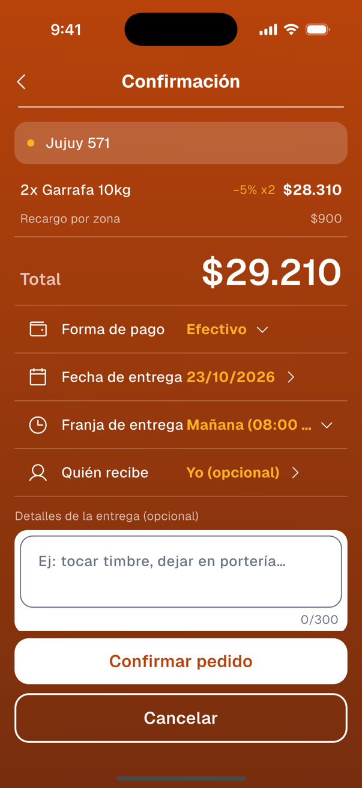

**Figura 3 — CU-005 Crear un Pedido — Interfaz Gráfica**

Pantalla «Confirmación» de la App Cliente: el renglón del pedido con su promoción por cantidad, el recargo por zona, el total, la forma de pago (efectivo), la fecha de entrega y la franja elegida. Al pie, «Confirmar pedido» crea el pedido y «Cancelar» vuelve al carrito. Captura de la app corriendo contra la API.

#### Especificación del CU Real

| Campo | Detalle |
|-------|---------|
| **Código** | CU-005 |
| **Caso de Uso** | Crear un Pedido |
| **Actor Principal** | ACT-01 (Cliente); ACT-03 (Administrador), que lo carga por teléfono desde el panel |
| **Objetivos asociados** | OBJ-01, OBJ-02, OBJ-06, OBJ-07 |
| **Requisitos asociados** | IRQ-02, IRQ-04, IRQ-05, IRQ-07, IRQ-08, IRQ-10 |
| **Descripción** | El cliente revisa el carrito en la pantalla «Confirmación», elige la dirección, la franja horaria, la fecha y el medio de pago, y confirma. El sistema valida el pedido, reserva el stock de todos los ítems a la vez, guarda el pedido como pendiente y, según el medio de pago, lo ofrece a un chofer (CU-013). El administrador puede cargar el mismo pedido desde el panel («Nuevo pedido telefónico»), a nombre de un cliente y con los ítems que este le informa. El total que el cliente ve antes de confirmar lo calcula el sistema (CU-302). |
| **Precondición** | El solicitante —el cliente o un administrador— está identificado. |

**Secuencia normal**

| Paso | Acción |
|------|--------|
| 1 | El cliente abre la pantalla «Confirmación» con los ítems del carrito y completa la dirección, la franja horaria, la fecha de entrega y el medio de pago. |
| 2 | Cada vez que cambia algo que mueve el precio (dirección, medio de pago, franja), la aplicación pide la cotización al sistema (CU-302) y muestra el total que este devuelve: la aplicación no calcula promociones ni recargos. |
| 3 | El cliente presiona «Confirmar pedido». La aplicación valida los campos y envía el pedido; los ítems los toma el sistema del carrito del cliente y el total lo calcula el sistema. Si la conexión se corta y la aplicación reintenta, no se crea un segundo pedido. |
| 4 | El sistema valida el cliente, la dirección, la cobertura de la zona y la franja elegida. |
| 5 | Por cada ítem, el sistema comprueba que el producto sea de la distribuidora y que haya stock suficiente, y lo reserva; si un ítem no alcanza, no reserva nada. |
| 6 | El sistema calcula el precio de cada renglón con las promociones por volumen, suma el recargo de la zona de cobertura y, si el pago es en línea (MercadoPago o transferencia), el recargo del 10 %. Es el mismo cálculo de la cotización: el total cotizado y el del pedido no pueden diferir. |
| 7 | El sistema guarda el pedido como pendiente, con sus ítems, el precio con el que se vendió cada uno y una copia de la zona y de los recargos aplicados, y vacía el carrito. Todo lo de los pasos 5 a 7 se confirma junto. |
| 8 | Si el pago no es por MercadoPago (efectivo, transferencia o cuenta corriente), el sistema ofrece el pedido al chofer disponible más cercano (CU-013). Si es por MercadoPago, prepara el enlace de pago y el pedido se ofrece recién cuando la pasarela confirme el cobro (CU-048). Después avisa al cliente y al panel. |
| 9 | La aplicación muestra el pedido creado con su total y, si corresponde, abre el pago de MercadoPago; si el total difiere del que se mostró, avisa el total real. |
| 10 | La aplicación pasa a la pantalla de seguimiento del pedido. |

**Postcondición:** Existe un pedido pendiente con sus ítems. El stock de cada producto disminuyó en la cantidad pedida. Si el pago es en efectivo, por transferencia o a cuenta corriente, el pedido ya fue ofrecido a un chofer; si es por MercadoPago, se ofrece cuando se confirme el cobro.

**Excepciones**

| Paso | Acción |
|------|--------|
| 3 | Si el pedido no tiene ítems, repite una misma garrafa en dos renglones o trae una fecha anterior a hoy, el sistema lo rechaza con el motivo («El pedido necesita al menos un renglón», «sumá las cantidades en un solo renglón», «la fecha no puede ser pasada»). |
| 3 | Si un cliente intenta cargar un pedido a nombre de otro, el sistema lo rechaza («No autorizado a crear pedidos para otro cliente»). |
| 3 | Si el pedido es express y se le eligió franja o fecha, el sistema lo rechaza («Un pedido express no se agenda»); si la modalidad express dejó de estar disponible para la dirección, informa el motivo. |
| 3 | Si la aplicación reintenta el mismo envío con datos distintos, el sistema no lo procesa. |
| 4 | Si el cliente o la dirección no existen, el sistema informa «Cliente no encontrado» o «Dirección no encontrada». |
| 4 | Si la dirección está fuera de todas las zonas de la distribuidora, informa «La dirección está fuera de la zona de cobertura de la distribuidora». |
| 4 | Si la franja no existe o está inactiva, no tiene cupo para la fecha o es de hoy y ya terminó, informa que la franja no está disponible («La franja ya terminó, elegí otra»). |
| 5 | Si un producto no existe, informa «Garrafa no encontrada»; si es de otra distribuidora, informa que no pertenece a la distribuidora elegida. El pedido no se crea. |
| 5 | Si el stock de algún ítem no alcanza, informa «Stock insuficiente para» el producto: el pedido no se crea y el stock no cambia. |
| 5 | Si dos pedidos compiten por el mismo stock, el sistema reintenta la operación completa y, agotados los reintentos, informa el conflicto. |
| 7 | Si el pedido no se puede guardar, se deshace todo y el stock no cambia. |

| Campo | Detalle |
|-------|---------|
| **Rendimiento** | Paso 8: 5 segundos. |
| **Frecuencia** | Variable según la demanda de la distribuidora (estimado: 10 a 50 pedidos por día en la Fase 1). |
| **Estabilidad** | Alta |

#### Flujo de Pantallas

```
[Tienda]
  └─▶ El cliente agrega garrafas al carrito
      └─▶ [Confirmación del pedido]
            ├─ Sección 1: Resumen de ítems con descuentos aplicados
            ├─ Sección 2: Dirección de entrega (mapa o lista de direcciones)
            ├─ Sección 3: Franja horaria (las franjas activas de la distribuidora con cupo)
            ├─ Sección 4: Medio de pago
            │             Efectivo | MercadoPago | Transferencia (+10 % de recargo)
            ├─ Sección 5: Fecha solicitada (calendario)
            └─ [Botón «Confirmar pedido»] ─▶ [Seguimiento del pedido]
```

**Comentarios.** La cotización (CU-302) y el alta comparten el cálculo de precios y recargos, de modo que no hay dos copias de las reglas. El cálculo no controla que el descuento configurado en una promoción no supere el total, lo que puede producir un subtotal negativo. Un producto desactivado no se vende: el carrito no deja agregarlo (CU-122) y el alta lo rechaza como inexistente también cuando los ítems los informa el administrador; al modificar un pedido (CU-341) no se pueden sumar unidades de un producto desactivado, aunque sí devolver las que ya tenía. La reserva con fecha agendada y seña es otro caso de uso (CU-072).

---

### 1.4 CU-008 Importante — Cancelar un Pedido (Cliente)

**Actor:** Cliente (ACT-01)
**Pantalla:** Seguimiento del pedido (App Cliente) — botón «Cancelar»

#### Interfaz Gráfica

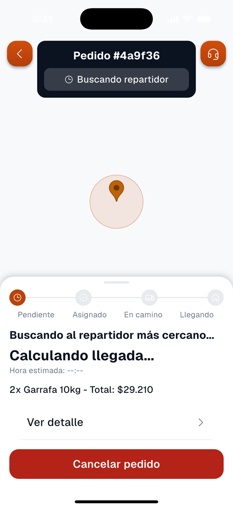

**Figura 4 — CU-008 Cancelar un Pedido (Cliente) — Interfaz Gráfica**

El botón rojo «Cancelar pedido» está al pie del seguimiento y la app lo ofrece mientras el pedido está pendiente, es decir, «Buscando repartidor». Al tocarlo la app pide el motivo («¿Por qué querés cancelar?») y recién con «Confirmar cancelación» se cancela. Captura de la App Cliente corriendo contra la API.

#### Especificación del CU Real

| Campo | Detalle |
|-------|---------|
| **Código** | CU-008 |
| **Caso de Uso** | Cancelar un Pedido (Cliente) |
| **Actor Principal** | ACT-01 (Cliente) |
| **Objetivos asociados** | OBJ-01, OBJ-06 |
| **Requisitos asociados** | IRQ-02, IRQ-04 |
| **Descripción** | El cliente cancela, desde la pantalla de seguimiento del pedido, un pedido propio que todavía no salió hacia su domicilio. El sistema comprueba que el pedido se pueda cancelar, lo deja cancelado con su motivo y devuelve al inventario el stock de todos sus ítems, todo en una sola operación. |
| **Precondición** | El cliente está identificado en su aplicación. |

**Secuencia normal**

| Paso | Acción |
|------|--------|
| 1 | El cliente presiona «Cancelar» en la pantalla de seguimiento del pedido y la aplicación le pide el motivo: no deja confirmar sin elegir uno (y, si elige «Otro», sin escribirlo). |
| 2 | La aplicación envía la cancelación con el motivo. Si la conexión se corta y la aplicación reintenta, el sistema no la procesa dos veces. |
| 3 | El sistema toma el pedido con sus ítems y lo reserva mientras opera, para que nadie lo cambie a la vez. |
| 4 | El sistema comprueba, en este orden, que el pedido sea del cliente, que no esté entregado ni cancelado y que no esté en camino. |
| 5 | El sistema pasa el pedido a cancelado, guarda el motivo y devuelve al stock la cantidad de cada ítem. El cambio de estado y la devolución del stock se confirman juntos. |
| 6 | El sistema cierra la oferta de despacho, si la había, y avisa al cliente, al panel y, si el pedido ya tenía chofer, a ese chofer, que deja de seguirlo. |
| 7 | La aplicación muestra el pedido como cancelado, con quién lo canceló. |

**Postcondición:** El pedido está cancelado con su motivo. El stock de todos los ítems volvió al inventario. Los dos efectos se confirmaron juntos y con el pedido reservado: dos cancelaciones simultáneas no devuelven el stock dos veces.

**Excepciones**

| Paso | Acción |
|------|--------|
| 1 | Si el motivo falta, está en blanco o supera los 500 caracteres, el sistema rechaza la cancelación («Para cancelar el pedido hay que indicar el motivo»). |
| 2 | Si la misma solicitud ya se procesó, el sistema devuelve el resultado anterior sin volver a cancelar. |
| 3 | Si el pedido no existe, el sistema informa que no lo encontró. |
| 4 | Si el pedido es de otro cliente, el sistema responde lo mismo que si no existiera, sin revelar que existe. |
| 4 | Si el pedido ya está entregado o cancelado, la aplicación informa «No se puede cancelar un pedido finalizado». |
| 4 | Si el pedido ya está en camino, informa «El pedido ya está en camino. Contacte al soporte.». |

| Campo | Detalle |
|-------|---------|
| **Rendimiento** | Paso 5: 3 segundos. |
| **Frecuencia** | Baja: solo cuando el cliente necesita cancelar un pedido de manera excepcional. |
| **Estabilidad** | Alta |

**Comentarios.** La devolución del stock y el guardado del pedido cancelado se confirman juntos, con el pedido reservado: si algo falla, se deshace todo. El sistema no envía una notificación al teléfono al cancelar: el aviso llega sólo a las aplicaciones abiertas, de modo que un chofer o un cliente con la aplicación cerrada no se entera hasta reabrirla.

---

### 1.5 CU-015 Crítico — Aceptar un Pedido

**Actor:** Chofer (ACT-02)
**Pantalla:** OrderInfoBottomSheet (App Chofer)

#### Interfaz Gráfica

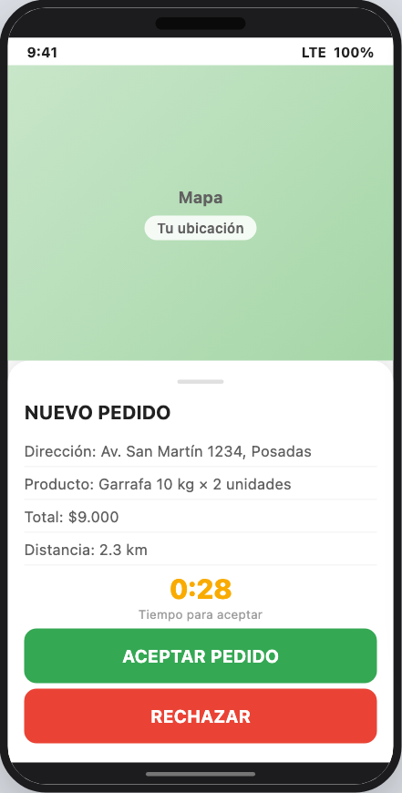

**Figura 5 — CU-015 Aceptar un Pedido — Interfaz Gráfica**

La hoja inferior muestra los ítems, el total y el tiempo que queda para aceptar (30 segundos por omisión), con los botones «Aceptar» y «Rechazar».

#### Especificación del CU Real

| Campo | Detalle |
|-------|---------|
| **Código** | CU-015 |
| **Caso de Uso** | Aceptar un Pedido |
| **Actor Principal** | ACT-02 (Chofer) |
| **Objetivos asociados** | OBJ-02, OBJ-03 |
| **Requisitos asociados** | IRQ-02, IRQ-03 |
| **Descripción** | El chofer que recibió una oferta la acepta desde la aplicación. El sistema le asigna el pedido, cierra la oferta, avisa al cliente y deja de ofrecer el pedido al resto de los choferes. |
| **Precondición** | El chofer está identificado en su aplicación y recibió la oferta del pedido. |

**Secuencia normal**

| Paso | Acción |
|------|--------|
| 1 | El chofer presiona «Aceptar» en la hoja de detalle de la oferta. |
| 2 | La aplicación envía la aceptación del pedido. |
| 3 | El sistema comprueba que el pedido no esté asignado a otro chofer y que todavía se pueda aceptar (no está entregado ni cancelado). |
| 4 | El sistema comprueba que el chofer sea de la misma distribuidora que el pedido, que esté habilitado y validado, que tenga un vehículo en uso y que ni su licencia ni ese vehículo tengan documentación vencida. No exige que esté en línea: aceptar una oferta es un acto explícito. |
| 5 | El sistema asigna el chofer al pedido, lo pasa a aceptado, registra el momento, guarda una copia de la patente, la marca y el modelo del vehículo en uso y genera el código de entrega (CU-078 y CU-079). |
| 6 | El sistema cierra la oferta del chofer como aceptada, retira las ofertas abiertas a otros choferes y les avisa que ya no están vigentes. |
| 7 | El sistema avisa al cliente que su pedido fue aceptado, con el nombre y el teléfono del chofer, y al panel. El seguimiento en el mapa empieza recién cuando el pedido sale en camino. |
| 8 | La aplicación muestra al chofer el pedido con los datos de entrega. |

**Postcondición:** El pedido está aceptado y con chofer asignado. La oferta quedó cerrada y el cliente fue avisado.

**Excepciones**

| Paso | Acción |
|------|--------|
| 3 | Si el pedido ya fue tomado por otro chofer, la aplicación informa «Este pedido no está asignado a tu usuario». |
| 3 | Si el pedido fue cancelado o entregado, la aplicación informa que el pedido ya no se puede aceptar. |
| 4 | Si el chofer es de otra distribuidora, la aplicación informa que no se encontró al repartidor; si está deshabilitado, «El repartidor está deshabilitado»; si no está validado, «El repartidor no está validado». |
| 4 | Si el chofer no tiene un vehículo en uso, o su licencia o ese vehículo tienen documentación vencida, la aplicación informa «No se puede asignar» con el motivo. |
| 4 | Si el chofer no puede recibir pedidos por la carga de su camión, la aplicación informa el motivo. |

| Campo | Detalle |
|-------|---------|
| **Rendimiento** | Paso 5: 3 segundos. |
| **Frecuencia** | Alta por chofer: se repite cada vez que le llega una oferta, varias veces por jornada. |
| **Estabilidad** | Alta |
| **Comentarios** | Un pedido que ya tiene chofer sólo lo puede aceptar ese mismo chofer, de modo que un segundo chofer no puede desplazar al primero ni regenerar el código de entrega que el cliente ya tenía; si acepta el mismo chofer, no cambia nada. La copia del vehículo queda en el pedido y se borra si el pedido vuelve a pendiente. El sistema no comprueba que la oferta del chofer siga vigente: una aceptación sobre una oferta ya vencida se admite igual si el pedido sigue pendiente y sin chofer. |

---

### 1.6 CU-078 Crítico — Consultar el Código de Entrega (QR del chofer)

**Actor:** Chofer (ACT-02), Administrador (ACT-03), Administrador General (ACT-05)
**Pantalla:** Código de entrega (App Chofer) — «Finalización», con el QR de entrega

#### Interfaz Gráfica

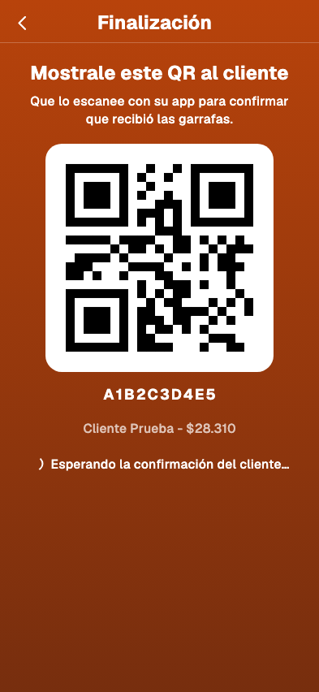

**Figura 6 — CU-078 Consultar el Código de Entrega (QR del chofer) — Interfaz Gráfica**

Pantalla «Finalización» de la App Chofer: el código de entrega del pedido representado como QR, con el código de seis dígitos en texto debajo, grande y agrupado («482 913») para dictarlo, el botón «Generar código nuevo», el cliente y el monto, y el aviso «Esperando la confirmación del cliente». Captura del golden de la app, con datos de prueba.

#### Especificación del CU Real

| Campo | Detalle |
|-------|---------|
| **Código** | CU-078 |
| **Caso de Uso** | Consultar el Código de Entrega (QR del chofer) |
| **Actor Principal** | ACT-02 (Chofer), ACT-03 (Administrador), ACT-05 (Administrador General) |
| **Objetivos asociados** | OBJ-04 |
| **Requisitos asociados** | IRQ-02 |
| **Descripción** | El chofer obtiene el código de entrega de seis dígitos del pedido que lleva, para mostrarlo como QR al cliente al llegar y dictarlo si hace falta. El código se genera al aceptarse el pedido y es la mitad emisora de la prueba de entrega que completa CU-079. Consultarlo no lo cambia. Con el pedido en camino, el chofer asignado o un administrador puede generar uno nuevo. |
| **Precondición** | El solicitante está identificado como chofer o como administrador. |

**Secuencia normal**

| Paso | Acción |
|------|--------|
| 1 | El chofer toca «Entregar» en la pantalla del pedido y la aplicación abre la pantalla del código QR. |
| 2 | La aplicación pide al sistema el código de entrega del pedido. |
| 3 | El sistema comprueba que el pedido sea de la distribuidora del solicitante y, si lo pide un chofer, que sea el asignado al pedido. |
| 4 | El sistema comprueba que el pedido tenga código de entrega, generado al aceptarse, y lo devuelve sin modificar nada. |
| 5 | La aplicación dibuja el código como QR y lo repite en texto, grande y agrupado de a tres dígitos; el chofer se lo muestra o se lo dicta al cliente, que lo escanea o lo escribe en su aplicación (CU-079). |
| 6 | Si hace falta otro código, el chofer toca «Generar código nuevo» y confirma. |
| 7 | El sistema comprueba que el pedido esté en camino y sea del chofer (o que lo pida un administrador), reemplaza el código por uno nuevo y pone en cero los intentos fallidos del cliente; la auditoría registra el hecho, sin el valor del código. |
| 8 | La aplicación muestra el código nuevo al instante. |

**Postcondición:** El chofer dispone del código de seis dígitos del pedido y lo muestra como QR o lo dicta. Consultarlo no cambia el pedido; si generó uno nuevo, el anterior dejó de valer, los intentos fallidos del cliente volvieron a cero y el pedido ya no está bloqueado.

**Excepciones**

| Paso | Acción |
|------|--------|
| 2 | Si lo pide un cliente, el sistema lo rechaza: el cliente nunca recibe el código del sistema, sólo escanea el QR que le muestra el chofer. |
| 3 | Si el pedido no existe o es de otra distribuidora, el sistema informa que no lo encontró, sin revelar que existe. |
| 3 | Si el pedido está asignado a otro chofer, la aplicación informa «Este pedido no está asignado a tu usuario». |
| 4 | Si el pedido todavía no fue aceptado, la aplicación informa «El pedido todavía no tiene código de entrega (debe estar aceptado)». |
| 7 | Si el pedido está asignado a otro chofer o no está en camino, el sistema no genera el código nuevo. |

| Campo | Detalle |
|-------|---------|
| **Rendimiento** | Paso 4: 1 segundo. |
| **Frecuencia** | Una vez por cada pedido que llega al domicilio; el chofer puede repetirla si la pantalla se cierra. |
| **Estabilidad** | Alta |

**Comentarios.** Consultar el código no lo cambia aunque el chofer lo pida varias veces: es siempre el mismo hasta que se genere uno nuevo, para que el QR sea estable durante todo el trayecto. Es la mitad emisora de la prueba de entrega: el cliente lo valida al confirmar la entrega (CU-079).

---

### 1.7 CU-079 Crítico — Confirmar una Entrega Escaneando el QR (cliente)

**Actor:** Cliente (ACT-01); también Administrador (ACT-03) y Administrador General (ACT-05), con el motivo
**Pantalla:** Seguimiento del pedido (App Cliente) — lector de código QR

#### Interfaz Gráfica

La cámara lectora no se captura (el simulador no tiene cámara). La acción se dispara desde el seguimiento del pedido mientras el estado es «En camino» (figura siguiente): el cliente abre el lector de cámara para leer el QR que el chofer le muestra en su pantalla (obtenido en CU-078), y la app extrae del contenido leído el código de seis dígitos. Si no puede escanear, el cliente escribe los seis dígitos que el chofer le dicta, con un teclado numérico.


**Figura 7 — CU-079 Confirmar una Entrega Escaneando el QR (cliente) — Interfaz Gráfica**

Seguimiento del pedido en camino de la App Cliente: el botón «Confirmar entrega (escanear QR)» abre el lector de cámara. Captura de la app corriendo contra la API.

#### Especificación del CU Real

| Campo | Detalle |
|-------|---------|
| **Código** | CU-079 |
| **Caso de Uso** | Confirmar una Entrega Escaneando el QR (cliente) |
| **Actor Principal** | ACT-01 (Cliente) |
| **Objetivos asociados** | OBJ-03, OBJ-04, OBJ-07 |
| **Requisitos asociados** | IRQ-02, IRQ-08 |
| **Descripción** | El cliente escanea, desde la pantalla de seguimiento del pedido, el QR que le muestra el chofer al llegar al domicilio. Si el código coincide con el del pedido, el sistema da la entrega por realizada. Es el camino normal de cierre: confirma quien recibe, no quien entrega, y esa es la prueba de que el chofer estuvo presente. Un administrador puede confirmar con el mismo código si el cliente no puede escanear, dejando el motivo por escrito. |
| **Precondición** | El solicitante está identificado: el cliente en su aplicación, o un administrador o el Administrador General en el panel. |

**Secuencia normal**

| Paso | Acción |
|------|--------|
| 1 | El chofer muestra en su pantalla el QR del pedido (CU-078). |
| 2 | El cliente abre el lector de la cámara desde la pantalla de seguimiento y escanea el QR; si no puede escanear, escribe el código de seis dígitos con el teclado. |
| 3 | La aplicación envía el código leído. Si la conexión se corta y reintenta, la entrega no se procesa dos veces. |
| 4 | El sistema comprueba que el pedido sea del cliente y que esté en camino. |
| 5 | El sistema comprueba que el pedido no esté bloqueado por intentos fallidos y compara el código con el del pedido; cada código rechazado que envía un cliente suma un intento fallido. |
| 6 | Con el código correcto, el sistema pasa el pedido a entregado y registra el momento. Si confirma un administrador, guarda además su motivo. El cobro no cambia: un pedido en efectivo sigue pendiente de cobro (CU-292). |
| 7 | El sistema deja de seguir al chofer en el mapa, pasa los envases del pedido a poder del cliente y descuenta del stock lo entregado. |
| 8 | El sistema avisa al cliente y al panel. |
| 9 | La aplicación muestra el pedido como «Entregado». |

**Postcondición:** El pedido está entregado, con el momento de la entrega y la prueba de que el cliente validó el código. Si el pago era en efectivo, sigue pendiente de cobro. El chofer salió del seguimiento en vivo y los envases del pedido figuran en poder del cliente.

**Excepciones**

| Paso | Acción |
|------|--------|
| 3 | Si el código falta o viene vacío, la aplicación pide escanearlo de nuevo. |
| 4 | Si el pedido no existe, el sistema informa que no lo encontró; si es de otro cliente, informa «No autorizado a confirmar la entrega de otro cliente». |
| 4 | Si el pedido ya está entregado, no es un error: se muestra tal cual, sin pedir de nuevo el código (tolera el doble escaneo). |
| 4 | Si el pedido está en otro estado, la aplicación informa «El pedido no está en camino, no se puede confirmar la entrega». |
| 5 | Si el código está mal leído, es el de otro pedido del cliente o no coincide, la aplicación informa «Código de entrega inválido» y se suma un intento fallido. |
| 5 | Si el pedido ya sumó cinco intentos fallidos, la aplicación informa «Demasiados intentos: pedile al chofer un código nuevo», aun con el código correcto. |
| 6 | Si confirma un administrador y el motivo falta o no tiene entre 10 y 500 caracteres, el panel lo rechaza. |

| Campo | Detalle |
|-------|---------|
| **Rendimiento** | Paso 6: 3 segundos. |
| **Frecuencia** | Una vez por pedido entregado, en el pico de la franja horaria de entrega. |
| **Estabilidad** | Alta |

**Comentarios.** La confirmación con el código y la entrega que registra el chofer (CU-020) comparten los mismos efectos: no hay dos copias de la lógica. El código tiene un millón de combinaciones y cada cliente puede equivocarse a lo sumo cinco veces antes de que el pedido se bloquee, por lo que adivinarlo es inviable. El administrador y el Administrador General también pueden confirmar, para las entregas asistidas desde soporte.

---

### 1.8 CU-301 Importante — Confirmar una Transferencia

**Actor:** Administrador (ACT-03), Administrador General (ACT-05)
**Pantalla:** Detalle del pedido (Panel Admin), acciones de cobro

#### Interfaz Gráfica

La interfaz es el detalle de un pedido del Panel Admin. En su sección de cobro, un pedido pagado por transferencia ofrece el botón «Confirmar transferencia recibida» y, si el pedido ya fue entregado y el pago sigue pendiente, también «Marcar como no recibida»; lo que el estado del pedido no admite no se ofrece. Al elegir una acción el panel abre un cuadro con el título de la acción, su descripción, el campo «Motivo» con su contador de caracteres y los botones «Volver» y «Confirmar transferencia» (o «Marcar como no recibida»).

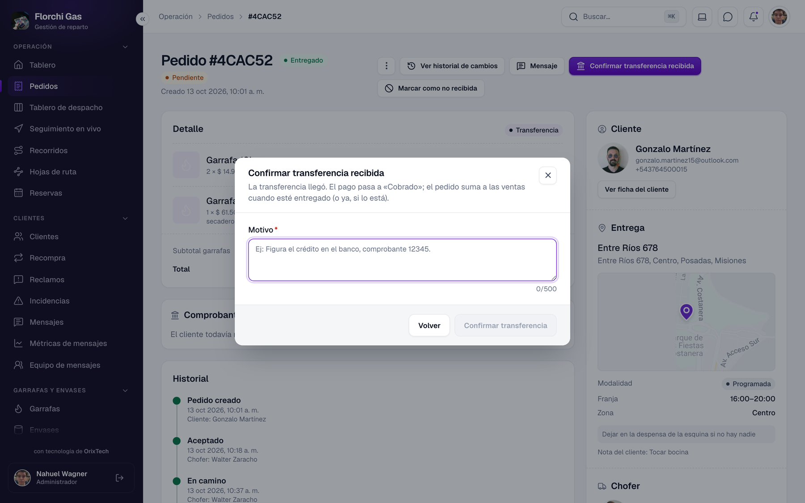

**Figura 8 — CU-301 Confirmar una Transferencia — Interfaz Gráfica**


Detalle de un pedido entregado con la transferencia pendiente: arriba, las acciones «Confirmar transferencia recibida» y «Marcar como no recibida»; al frente, el cuadro de confirmación con el campo «Motivo» todavía vacío, por lo que «Confirmar transferencia» sigue deshabilitado. Captura del Panel Admin corriendo contra la API.

#### Especificación del CU Real

| Campo | Detalle |
|-------|---------|
| **Código** | CU-301 |
| **Caso de Uso** | Confirmar una Transferencia |
| **Actor Principal** | ACT-03 (Administrador); ACT-05 (Administrador General), que indica la distribuidora |
| **Objetivos asociados** | OBJ-04, OBJ-07 |
| **Requisitos asociados** | IRQ-02, IRQ-08 |
| **Descripción** | El administrador resuelve el cobro de un pedido pagado por transferencia: confirmarla pasa el pago a pagado, desde pendiente o desde fallido —la transferencia llegó después de marcarla no recibida—; marcarla no recibida lo deja fallido, solo desde pendiente y solo sobre un pedido entregado. Exige el motivo, que queda en la nota de resolución, en el historial de estados y en la auditoría. Una transferencia sin confirmar no suma a las ventas. |
| **Precondición** | El solicitante es administrador o Administrador General y está identificado en el panel. |

**Secuencia normal**

| Paso | Acción |
|---|---|
| 1 | El administrador abre el detalle de un pedido pagado por transferencia y elige «Confirmar transferencia recibida» o «Marcar como no recibida». |
| 2 | El panel abre el cuadro de la acción; el administrador escribe el motivo, de 10 a 500 caracteres, y confirma. El panel valida el motivo antes de enviar. |
| 3 | El panel envía la decisión con el motivo; si se repite el envío por un corte de conexión, el sistema no lo procesa dos veces. |
| 4 | El sistema comprueba que el pedido sea de la distribuidora y lo lee con bloqueo de la fila mientras opera, para que nadie lo cambie a la vez. |
| 5 | Comprueba que el pedido se pague por transferencia y no esté cancelado. |
| 6 | Si el pago ya estaba en lo que se pide, devuelve el pedido tal cual. Si no, comprueba que el cambio sea válido: confirmar vale desde pendiente o desde fallido; marcar como no recibida vale solo desde pendiente y con el pedido entregado. |
| 7 | Pasa el pago a pagado o a fallido y registra el momento y al administrador como quien lo resolvió, con el motivo; si fue pagado, registra también la confirmación del cobro. |
| 8 | Deja en el historial de estados una nota con el mismo estado de origen y de destino y el texto «Transferencia confirmada (o marcada como no recibida) por un administrador: motivo»; la auditoría registra el cambio. |
| 9 | Devuelve el pedido; el panel informa «Transferencia confirmada» o «Transferencia marcada como no recibida» y actualiza el detalle. |

**Postcondición:** El pago del pedido está pagado o fallido según la decisión, con quién, cuándo y por qué; el historial tiene la nota del motivo.

**Excepciones**

| Paso | Acción |
|---|---|
| 4 | Si el pedido no existe o es de otra distribuidora, el sistema informa que no lo encontró. |
| 4 | Si el Administrador General no indica la distribuidora, el sistema rechaza la operación e informa que falta indicar la distribuidora. |
| 2 | Si no se indica si llegó o no, o el motivo falta o no tiene entre 10 y 500 caracteres, el sistema rechaza la operación; el panel no deja enviar un motivo fuera de ese largo. |
| 3 | Si se reintenta el mismo envío con datos distintos, el sistema lo rechaza. |
| 5 | Si el pedido no es una transferencia, o está cancelado, el sistema rechaza la operación. |
| 6 | Si el pago ya estaba en lo que se pide, no es un error: el sistema muestra el pedido tal cual y el panel avisa que no se registró el motivo. |
| 6 | Si la transferencia ya estaba pagada y se la quiere marcar como no recibida, o el pago ya no está pendiente, el sistema rechaza la operación e informa «La transferencia ya se confirmó: no se cambia»; el panel lo muestra dentro del cuadro. |
| 6 | Si se quiere marcar como no recibida un pedido que todavía no se entregó, el sistema rechaza la operación: marcarla antes no frenaría nada. |

| Campo | Detalle |
|-------|---------|
| **Rendimiento** | Paso 9: 2 segundos. |
| **Frecuencia** | Media: una vez por pedido pagado por transferencia. |
| **Estabilidad** | Alta |

**Comentarios.** Una transferencia sin confirmar no suma a las ventas: el reporte de cobros pendientes (CU-304) la informa como pendiente de confirmar o como no recibida. Si la transferencia se confirma y el pedido se cancela después, la cancelación no se bloquea, pero el dinero ya está en la distribuidora: el reporte lo informa como reintegro pendiente y el sistema no gestiona el reintegro. La nota del historial no es una transición: tiene el mismo estado de origen y de destino.

---

### 1.9 CU-048 Crítico — Procesar el Pago con MercadoPago

**Actor:** MercadoPago (ACT-06)
**Pantalla:** Sin pantalla propia dentro del sistema — confirmación de servidor a servidor

#### Interfaz Gráfica

CU sin pantalla propia (lo inicia el aviso de resultado del pago que envía MercadoPago). La pantalla visible asociada es la selección del método de pago dentro del checkout — ver la figura siguiente, que es una pantalla relacionada (CU-005), opción "MercadoPago" del selector de método de pago (parte de CU-005). El pago en sí se completa en el Checkout Pro de MercadoPago, fuera de las aplicaciones del sistema: ninguna pantalla de la App Cliente, la App Chofer ni el Panel Admin interviene en la confirmación que describe este CU.

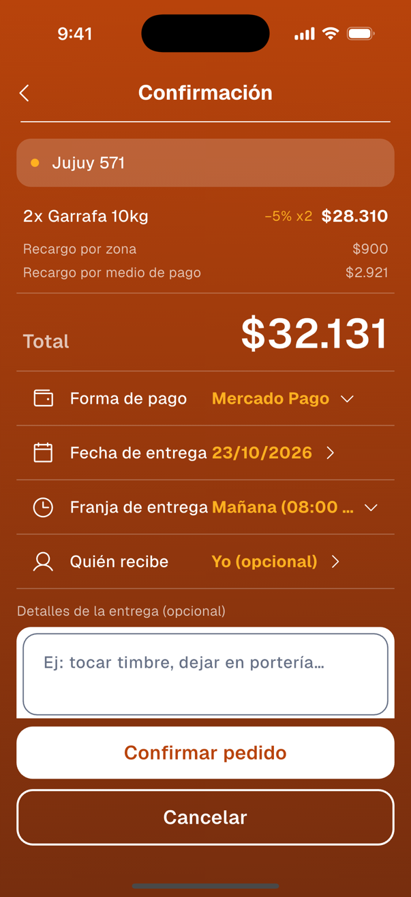

**Figura 9 — CU-048 Procesar el Pago con MercadoPago — pantalla relacionada (CU-005)**

Pantalla «Confirmación» con «Mercado Pago» como forma de pago, tal como la ve el cliente antes de confirmar. Al tocar «Confirmar pedido» la app abre el Checkout Pro de MercadoPago; esa pantalla y el pago quedan fuera de la captura. Captura de la App Cliente corriendo contra la API.

#### Especificación del CU Real

| Campo | Detalle |
|-------|---------|
| **Código** | CU-048 |
| **Caso de Uso** | Procesar el Pago con MercadoPago |
| **Actor Principal** | ACT-06 (MercadoPago) |
| **Objetivos asociados** | OBJ-02, OBJ-07 |
| **Requisitos asociados** | IRQ-02, IRQ-08 |
| **Descripción** | Cuando un pedido se paga con MercadoPago, la pasarela avisa al sistema el resultado del pago. El sistema comprueba que el aviso sea auténtico, consulta a la pasarela el estado real del pago sin confiar en el contenido del aviso, actualiza el pago y, si fue aprobado, da el pedido por pagado y recién entonces lo ofrece a un chofer. |
| **Precondición** | Ninguna: el aviso llega sin sesión, y su autenticidad y el pedido al que se refiere se comprueban dentro del caso. |

**Secuencia normal**

| Paso | Acción |
|------|--------|
| 1 | MercadoPago envía al sistema el aviso del pago, con el tipo de aviso, el identificador del pago y su firma. |
| 2 | El sistema comprueba la firma del aviso con la clave acordada con la pasarela. |
| 3 | El sistema descarta el aviso si no es de un pago o no trae el identificador. |
| 4 | El sistema consulta a MercadoPago el estado real del pago, con un tiempo máximo de espera de 5 segundos. |
| 5 | El sistema actualiza el pago con el estado informado: aprobado, rechazado, cancelado, devuelto o pendiente. |
| 6 | El sistema busca el pedido al que se refiere el pago y, si el pago fue aprobado, lo reserva mientras opera para que dos avisos del mismo pago no lo procesen dos veces. |
| 7 | Si el pedido ya estaba cerrado o ya tenía registrado ese pago, no cambia nada. |
| 8 | Si el pedido es una reserva, marca la seña como pagada y no lo despacha: la reserva se activa el día agendado (CU-075). |
| 9 | En el caso general, da el pedido por pagado y registra el identificador del pago. |
| 10 | El sistema ofrece el pedido al chofer disponible más cercano (como en CU-013). |
| 11 | El sistema responde a MercadoPago que recibió el aviso. |

**Postcondición:** El pago refleja el estado real que informó la pasarela. Si fue aprobado, el pedido quedó pagado —o con la seña pagada, si era una reserva— y se ofreció a un chofer una sola vez. Repetir el mismo aviso no vuelve a marcar el pedido ni a despacharlo.

**Excepciones**

| Paso | Acción |
|------|--------|
| 2 | Si la firma no es válida, falta o no hay clave configurada, el sistema no procesa el aviso y responde igual que siempre, para no revelar si el pago o el pedido existen. |
| 4 | Si la consulta a MercadoPago falla o tarda más de lo permitido, el sistema registra el error y no toca el pedido. |
| 6 | Si el pago no corresponde a ningún pedido, el sistema registra la advertencia y termina. |
| 6–9 | Si algo falla mientras actualiza el pedido, se deshace lo hecho y el sistema igual responde que recibió el aviso, para que la pasarela no reintente sin fin. |
| 5 | Si el pago llega rechazado o cancelado, el sistema lo registra y el pedido sigue pendiente (ver Comentarios). |
| 10 | Si no se puede ofrecer el pedido a un chofer, el sistema registra el error; el pedido queda pagado y el pago no se revierte. |

| Campo | Detalle |
|-------|---------|
| **Rendimiento** | Paso 11: 5 segundos. |
| **Frecuencia** | Una o más notificaciones por cada pedido pagado con MercadoPago; la pasarela reintenta el mismo aviso si no recibe respuesta. |
| **Estabilidad** | Alta |

**Comentarios.** Un mismo pago nunca se aplica dos veces: el sistema lo identifica por el identificador de la pasarela y reserva el pedido mientras lo actualiza. **Pago rechazado, cancelado y contracargo.** Si la pasarela informa un pago rechazado o cancelado, el pago del pedido queda «fallido» con su motivo y el pedido sigue vivo: el cliente reintenta con otro medio mientras el enlace de pago no venza. Si nunca se cobra, el proceso temporal de CU-077 cancela el pedido vencido y devuelve el stock. Un contracargo se registra en el pago, genera un egreso en la caja por lo cobrado menos lo ya devuelto y avisa al administrador; el reintegro por cancelación es CU-168.

---

### 1.10 CU-025 Importante — Resolver un Reclamo

**Actor:** Administrador (ACT-03)
**Pantalla:** «Reclamos» → detalle del reclamo (Panel Admin)

#### Interfaz Gráfica


**Figura 10 — CU-025 Resolver un Reclamo — Interfaz Gráfica**

Reclamos de la distribuidora de demostración: contadores por estado —pendiente, en proceso, resuelto y rechazado—, buscador y listado con cliente, pedido, motivo, fecha y estado. Al abrir un reclamo, el cajón de detalle muestra el motivo, la descripción y la foto, y ofrece tomarlo, resolverlo, rechazarlo o reabrirlo. Captura del panel contra la API de desarrollo.

#### Especificación del CU Real

| Campo | Detalle |
|-------|---------|
| **Código** | CU-025 |
| **Caso de Uso** | Resolver un Reclamo |
| **Actor Principal** | ACT-03 (Administrador) |
| **Objetivos asociados** | OBJ-04, OBJ-05 |
| **Requisitos asociados** | IRQ-06 |
| **Descripción** | El administrador resuelve un reclamo pendiente o en proceso desde el panel, dejándolo resuelto o rechazado, con una nota de resolución obligatoria. Un reclamo ya resuelto o rechazado no admite esta operación sin reabrirlo antes (CU-167). |
| **Precondición** | El solicitante es administrador o Administrador General y está identificado en el panel. |

**Secuencia normal**

| Paso | Acción |
|------|--------|
| 1 | El administrador abre un reclamo desde «Reclamos»: el panel lo muestra en un cajón lateral con su motivo, su descripción y su foto. Si ya lo tomó (CU-166) está en proceso; también puede resolver uno pendiente sin tomarlo antes. |
| 2 | Elige «Resolver» o «Rechazar», escribe la nota de resolución y confirma. |
| 3 | El sistema valida que la nota no esté vacía y que el estado elegido sea resuelto o rechazado. |
| 4 | El sistema busca el reclamo en la distribuidora del administrador y lo reserva mientras opera. |
| 5 | El sistema comprueba que el cambio sea válido: un reclamo pendiente o en proceso puede pasar a resuelto o rechazado. |
| 6 | El sistema guarda el estado y la nota. Dos resoluciones simultáneas se ordenan: la segunda se valida contra el estado que dejó la primera. |
| 7 | El panel muestra el reclamo con su nuevo estado. |

**Postcondición:** El reclamo quedó con el estado elegido y su nota de resolución. El cliente no fue avisado: se entera si vuelve a consultar sus reclamos.

**Excepciones**

| Paso | Acción |
|------|--------|
| 3 | Si la nota falta, está vacía o sólo tiene espacios, el panel informa que es obligatoria. |
| 3 | Si el estado elegido no es resuelto ni rechazado, el sistema lo rechaza; pasar un reclamo a en proceso es CU-166. |
| 3 | Si el Administrador General no indica la distribuidora, el sistema informa que falta indicarla. |
| 4 | Si el reclamo no existe o es de otra distribuidora, el panel informa «Reclamo no encontrado», sin distinguir los dos casos. |
| 5 | Si el reclamo ya está resuelto o rechazado, el sistema informa que la transición no es válida y no pisa la nota anterior: hay que reabrirlo primero (CU-167). Repetir el mismo estado también se rechaza. |

| Campo | Detalle |
|-------|---------|
| **Rendimiento** | Paso 6: 1 segundo. |
| **Frecuencia** | Media: acompaña la frecuencia de ingreso de reclamos nuevos. |
| **Estabilidad** | Alta |

**Comentarios.** Los cambios de estado del reclamo siguen reglas explícitas (CU-025, CU-166 y CU-167): pendiente y en proceso admiten resolución directa; resuelto y rechazado sólo se modifican reabriéndolos antes. El reclamo no guarda en sus datos quién ni cuándo lo resolvió: eso queda en el registro de auditoría, como todo cambio (NFR-10). El sistema no avisa al cliente el resultado de su reclamo.

---

## 2. Diagrama de Interacción

El diagrama de interacción (en Larman, diagrama de secuencia de diseño) muestra los objetos que colaboran para realizar una operación del sistema: el controlador que la recibe, los expertos que saben lo que se necesita y los creadores de cada objeto nuevo. Hay uno por cada operación de los 20 casos dinámicos, que son los 21 casos esenciales menos CU-152. Para los diez casos con interacción del actor son las operaciones de sus diagramas de secuencia del sistema (Documento 2, «Diagramas de Secuencia a Nivel de Sistema»), incluidas las dos consultas que no llevan contrato; para los otros diez es la operación que dispara el caso, ya sea por un evento del actor o por el reloj del sistema. Cada diagrama coincide con la ficha del caso (Documento 1) y con el contrato de su operación (Documento 2, «Contratos de Operaciones del Sistema»).

### 2.1 Operaciones

| Operación | Caso de uso | Actor iniciador |
|---|---|---|
| `iniciarSesion(correo, contrasena)` | CU-001 Iniciar Sesión | Cliente (ACT-01), Chofer (ACT-02), Administrador (ACT-03) |
| `registrarse(nombreCompleto, correo, telefono, contrasena, datosDelCliente)` | CU-002 Registrarse como Cliente | Cliente (ACT-01) |
| `crearPedido(items, direccionId, franjaId, fechaAgendada, metodoDePago)` | CU-005 Crear un Pedido | Cliente (ACT-01), Administrador (ACT-03) |
| `cancelarMiPedido(pedidoId, motivo)` | CU-008 Cancelar un Pedido (Cliente) | Cliente (ACT-01) |
| `activarDisponibilidad(usuarioId)` | CU-022 Activar la Disponibilidad | Chofer (ACT-02) |
| `ofrecerAlSiguienteChofer(pedidoId)` | CU-013 Asignar un Pedido Automáticamente por Proximidad | Sistema Automático (ACT-04) |
| `vencerOfertasExpiradas()` | CU-014 Vencer la Oferta y Ofrecer al Siguiente Chofer | Sistema Automático (ACT-04) |
| `aceptarPedido(pedidoId)` | CU-015 Aceptar un Pedido | Chofer (ACT-02) |
| `actualizarUbicacion(usuarioId, latitud, longitud)` | CU-017 Modificar la Ubicación GPS del Chofer | Chofer (ACT-02) |
| `obtenerCodigoDeEntrega(pedidoId)` | CU-078 Consultar el Código de Entrega (QR del chofer) | Chofer (ACT-02), Administrador (ACT-03) |
| `confirmarEntregaConCodigo(pedidoId, codigo, motivo)` | CU-079 Confirmar una Entrega Escaneando el QR (cliente) | Cliente (ACT-01), Administrador (ACT-03) |
| `confirmarCobroEnEfectivo(pedidoId)` | CU-292 Confirmar el Cobro en Efectivo | Chofer (ACT-02) |
| `confirmarTransferencia(pedidoId, recibida, motivo)` | CU-301 Confirmar una Transferencia | Administrador (ACT-03) |
| `notificarResultadoDePago(tipoDeNotificacion, identificadorDelPago, firma)` | CU-048 Procesar el Pago con MercadoPago | MercadoPago (ACT-06) |
| `registrarReclamo(pedidoId, motivo, evidencia)` | CU-023 Registrar un Reclamo | Cliente (ACT-01) |
| `resolverReclamo(reclamoId, resolucion, estadoFinal)` | CU-025 Resolver un Reclamo | Administrador (ACT-03) |
| `planificarMantenimientoDeFlota()` | CU-105 Planificar el Mantenimiento y las Habilitaciones de la Flota | Chofer (ACT-02), Administrador (ACT-03), Sistema Automático (ACT-04) |
| `anticiparRecompras()` | CU-106 Anticipar la Recompra por Consumo Estimado | Cliente (ACT-01), Sistema Automático (ACT-04) |
| `agruparPedidosPorRecorrido()` | CU-107 Agrupar Pedidos por Recorrido | Chofer (ACT-02), Sistema Automático (ACT-04) |
| `gestionarEnvasesNoDevueltos()` | CU-108 Recuperar Envases No Devueltos | Cliente (ACT-01), Administrador (ACT-03), Sistema Automático (ACT-04) |

#### Operación: iniciarSesion(correo, contrasena)

**Caso de uso:** CU-001 Iniciar Sesión  
**Actor iniciador:** Cliente (ACT-01), Chofer (ACT-02), Administrador (ACT-03)

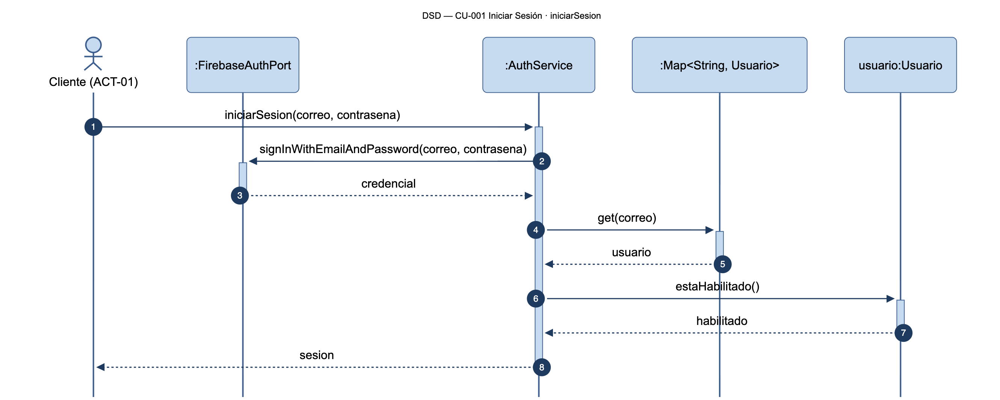

**Figura 11 — DSD CU-001: Iniciar Sesión — Operación: iniciarSesion(correo, contrasena)**

<details><summary>Ver código del diagrama</summary>

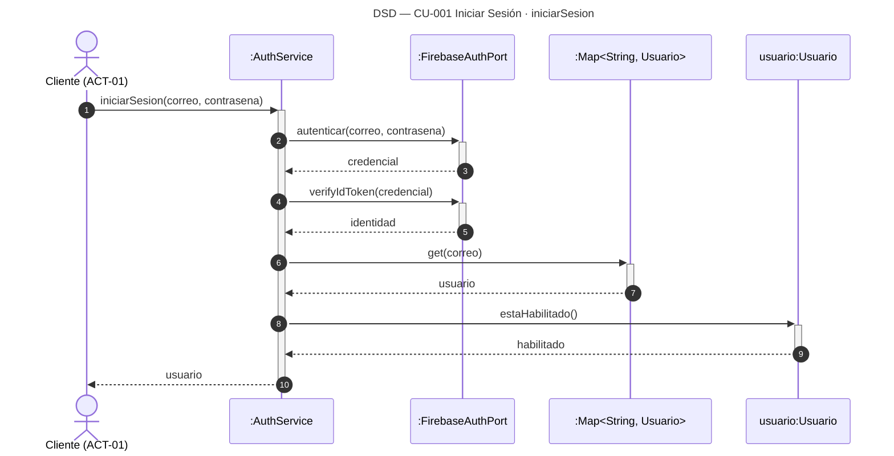

</details>

**Clases participantes:** `AuthService` (controlador de fachada del módulo de acceso), `FirebaseAuthPort` (el puerto hacia Firebase, el sistema externo que autentica con correo y contraseña y verifica la credencial), la colección `Map<String, Usuario>` y el objeto de dominio `Usuario`. El diagrama vale igual para el Chofer y el Administrador.

**GRASP.** *Controlador*: `AuthService` recibe la operación y coordina. *Experto*: `Usuario` sabe si su cuenta está habilitada (ni bloqueada ni dada de baja), de modo que el controlador no mira sus atributos. La contraseña no la conoce el sistema: se la pasa al puerto, y es el proveedor de identidad quien la verifica y devuelve la credencial. `correo` y `contrasena` los trae el actor; `credencial` la devuelve el puerto; el `Usuario` se busca por el `correo`.

**No se dibuja:** la aplicación de origen (`X-Client-Source`) y la correspondencia del rol con esa aplicación, que comprueba `AuthGuard`; la distribuidora de la solicitud; y la decisión final de la aplicación según el rol recibido (el panel exige administrador o administrador general).

| Operación de diseño | Implementación |
|---|---|
| `AuthService.iniciarSesion(...)` | En el sistema real el ingreso se reparte entre la aplicación y el servidor: la aplicación autentica con Firebase y desde ahí manda solo el token; el servidor lo recibe en `AuthGuard.canActivate` (guard global, en cada solicitud) → `AuthService.decodeToken`, y entrega el perfil por `UsersController.findOneByEmail` (`GET /users/email/:email`). `AuthController.login` (`POST /auth/login`) y `AuthController.dashboardLogin` (`POST /auth/login/dashboard`) hacen todo el ingreso desde el servidor, pero ni el panel ni las apps los llaman |
| `FirebaseAuthPort.autenticar(...)` | No es un método del puerto del servidor: la implementa el SDK de Firebase de cada aplicación, con `signInWithEmailAndPassword` (panel: `firebase/providers.ts`; apps Flutter: `signInWithEmailAndPassword` de `firebase_auth`). `AuthService.login` llama a la misma función de `firebase/auth` para `POST /auth/login` |
| `FirebaseAuthPort.verifyIdToken(...)` | `AuthService.decodeToken`: verifica el token de identidad con Firebase; responde 401 si venció o es inválido |
| `Map<String, Usuario>.get(...)` | `UsersService.findOneByEmail`, que llama `AuthGuard.getUser`: una cuenta dada de baja no se encuentra |
| `Usuario.estaHabilitado()` | `AuthGuard.assertCuentaHabilitada`: lee `User.blocked` y responde 401 «La cuenta está bloqueada. Comuníquese con la distribuidora.» |

**Observaciones de diseño**

- `AuthGuard` es global y corre en todas las rutas. En una ruta `@Public()` devuelve de inmediato, sin revisar el encabezado ni el rol; en una `@PublicIdentificable()` identifica al usuario si hay token y lo deja anónimo si no. Con una ruta común exige el token y `x-client-source`, y el rol tiene que corresponder a la aplicación (panel: administrador o administrador general; app del cliente: cliente; app del chofer: chofer).
- `AuthService` no conoce `firebase-admin`: verifica tokens contra `FirebaseAuthPort`. El SDK **cliente** (`firebase/auth`) vive en las aplicaciones.
- La cookie de `POST /auth/login/dashboard` dura 1 h, pero el panel no la usa: guarda el token en `localStorage` y vence su sesión a la hora.

#### Operación: registrarse(nombreCompleto, correo, telefono, contrasena, datosDelCliente)

**Caso de uso:** CU-002 Registrarse como Cliente  
**Actor iniciador:** Cliente (ACT-01)


**Figura 12 — DSD CU-002: Registrarse como Cliente — Operación: registrarse(nombreCompleto, correo, telefono, contrasena, datosDelCliente)**

<details><summary>Ver código del diagrama</summary>

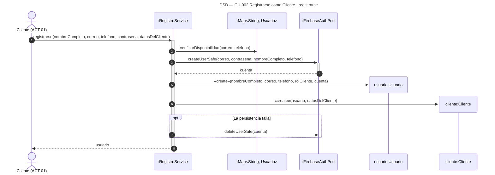

</details>

**Clases participantes:** `RegistroService` (controlador de fachada del alta de usuarios), la colección `Map<String, Usuario>`, `FirebaseAuthPort` (fabricación pura: el puerto hacia el proveedor de identidad) y los objetos de dominio `Usuario` y `Cliente`.

**GRASP.** *Controlador*: `RegistroService` recibe la operación y coordina las dos altas. *Creador*: el controlador crea el `Usuario` y el `Cliente`, porque es quien tiene los datos con que se inicializan; el `Cliente` nace asociado al `Usuario` recién creado. *Bajo Acoplamiento*: la cuenta de acceso se pide a un puerto, no al SDK del proveedor.

**No se dibuja:** la autorización del alta (`autorizarAlta`: sin sesión solo se registra un cliente), la búsqueda del rol, la transacción que guarda las dos filas y el cupo de diez altas por minuto por origen. Tampoco el evento `usuario.registrado`, que dispara el correo de bienvenida una vez confirmada el alta. El alta común es CU-082, caso incluido.

| Operación de diseño | Implementación |
|---|---|
| `RegistroService.registrarse(...)` | `RegistroController.registrarCliente` → `RegistroService.registrar`, con el solicitante anónimo |
| `Map<String, Usuario>.verificarDisponibilidad(...)` | `UsersService.assertDisponible`: busca un `User` con ese `User.email` o ese `User.phoneNumber`, también entre los dados de baja; responde 409 si lo hay |
| `Usuario.«create»` | `UsersService.crearEnTransaccion`: guarda el `User` dentro de la transacción del alta, con el rol que devuelve `RoleService.findByType` |
| `Cliente.«create»` | `CustomersService.crearPerfil`: guarda el `Customer` en la misma transacción |

**Observaciones de diseño**

- El correo de bienvenida **escucha** el evento `usuario.registrado` en lugar de que el alta llame al correo: `registro` no depende de `email`, y un correo que no sale nunca deshace un alta ya confirmada.
- El cupo de altas es más estricto que el global porque cada alta crea una cuenta en el proveedor de identidad y manda un correo.
- La respuesta sale por `UserMapper`: no incluye `firebase_uid` ni el token de notificaciones.
- El perfil de cliente guarda la ubicación en `location`, un punto PostGIS. La API la sigue recibiendo como texto "latitud,longitud" en `lat_lang`, y el DTO rechaza (400) lo que no sea un par de coordenadas válido.
- `POST /users/customer-registration` responde con el mismo método mientras las versiones publicadas de la app lo usen.

#### Operación: crearPedido(items, direccionId, franjaId, fechaAgendada, metodoDePago)

**Caso de uso:** CU-005 Crear un Pedido  
**Actor iniciador:** Cliente (ACT-01), Administrador (ACT-03)


**Figura 13 — DSD CU-005: Crear un Pedido — Operación: crearPedido(items, direccionId, franjaId, fechaAgendada, metodoDePago)**

<details><summary>Ver código del diagrama</summary>

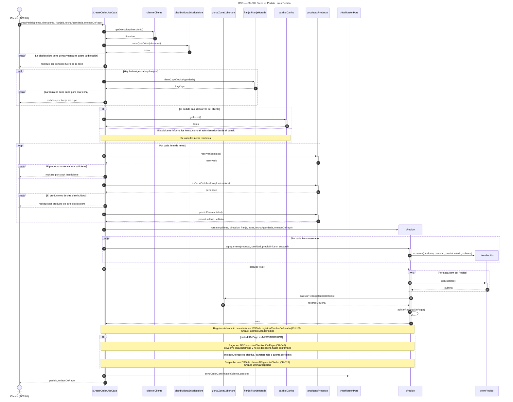

</details>

**Clases participantes:** `CreateOrderUseCase` (controlador de caso de uso), los objetos de dominio `Cliente`, `Distribuidora`, `ZonaCobertura`, `FranjaHoraria`, `Carrito`, `Producto`, `Pedido` e `ItemPedido`, y `NotificationPort` (fabricación pura: el aviso al cliente). El diagrama sirve también a CU-044, que es la elección de la franja dentro de la misma operación, y al administrador que carga el pedido por teléfono: es la misma operación, con los ítems informados en lugar de los del carrito (la rama del `alt`).

**GRASP.** *Controlador*: `CreateOrderUseCase` recibe la operación y coordina. La navegación se resuelve por las asociaciones del modelo conceptual: el `Cliente` entrega su dirección, la `Distribuidora` dice qué zona la cubre, la `FranjaHoraria` si tiene cupo, el `Carrito` entrega los ítems y el `Producto` reserva su stock, dice si es de la distribuidora y da su precio. *Creador*: el controlador crea el `Pedido` una vez reservados todos los renglones, porque recién entonces tiene los datos con que se inicializa; el `Pedido` crea sus `ItemPedido` (los contiene, composición). *Experto*: `Pedido` calcula su total pidiéndole el subtotal a cada `ItemPedido` y el recargo a la `ZonaCobertura`; `Producto` sabe su precio y su promoción por volumen.

**Referencias.** El registro del cambio de estado es la operación `registrarCambioDeEstado` (CU-169, incluido): crea el `CambioEstadoPedido`. El pago con MercadoPago es la operación `crearCheckoutDePago` (CU-048) y el ofrecimiento al chofer más cercano, que crea la `OfertaDespacho`, es `ofrecerAlSiguienteChofer` (CU-013): cada una tiene su propio diagrama y, en el `alt`, se indica con una nota «ver DSD de …». El aviso al cliente es síncrono: el código espera el envío antes de responder.

**Rechazos.** Los rechazos que cambian el recorrido terminan la operación con un `break`: `domicilioNoCubierto` (ninguna zona de la distribuidora cubre la dirección), `franjaSinCupo`, `stockInsuficiente` y el producto de otra distribuidora; después de cada uno no se crea el `Pedido`. El producto inexistente, el cliente o la dirección inexistentes y los errores de validación (sin ítems, ítems repetidos, fecha pasada, clave de idempotencia reutilizada) se rechazan al buscar o validar y no se dibujan: están en el DSS.

**No se dibuja:** la transacción y el bloqueo de stock y del carrito (`QueryRunner`), la persistencia, los servicios que el código usa para buscar al cliente, la dirección, la zona y la franja, la modalidad express (CU-148, que se evalúa antes de reservar el stock), el crédito de la cuenta corriente, el aviso en vivo al panel (`notifyAdmins`) y la lectura final del pedido. La reserva con seña es otra operación (`crearReserva`, CU-072).

| Operación de diseño | Implementación |
|---|---|
| `CreateOrderUseCase.crearPedido(...)` | `OrderController.create` → `OrderService.create` → `CreateOrderUseCase.execute` |
| `Cliente.getDireccion(...)` | `UserAddressService.buscarDelUsuario`; el cliente se obtiene con `CustomersService.buscarComprador` |
| `Distribuidora.zonaQueCubre(...)` | `CoverageZoneService.checkCoverage`, que `CreateOrderUseCase.resolverZona` usa para buscar, entre las zonas de la distribuidora, la que cubre el punto de la dirección; sin zonas definidas o sin punto en la dirección no hay control |
| `FranjaHoraria.tieneCupo(...)` | `TimeSlotService.assertSlotAvailableTx`, con bloqueo de la franja |
| `Carrito.getItems()` | `CartService.itemsParaPedido`: lee los ítems del carrito del cliente con el carrito bloqueado hasta el commit; el carrito se vacía en la misma transacción (`CartService.vaciarEnTransaccion`) |
| `Producto.reservar(...)` | `GasCylinderService.reservarStock`: bloquea la fila y resta de `GasCylinder.stock` |
| `Producto.esDeLaDistribuidora(...)` | `CreateOrderUseCase.valorizarRenglon`: compara `GasCylinder.distributorId` con la distribuidora del pedido |
| `Producto.precioPara(...)` | `OrderPricingService.priceItem`: precio de lista y promociones por volumen |
| `Pedido.«create»` | `CreateOrderUseCase.execute`: arma la entidad `Order` con los renglones ya reservados, el cliente, la dirección, la franja y la copia de la zona (`Order.coverageZoneId`, `Order.zoneName`, `Order.zoneSurchargeType`, `Order.zoneSurchargeValue`) |
| `Pedido.agregarItem(...)` | `CreateOrderUseCase.execute`: acumula los `OrderItem` en `Order.items` |
| `ItemPedido.«create»` | `CreateOrderUseCase.execute`: crea cada `OrderItem` con su precio unitario y su subtotal |
| `ItemPedido.getSubtotal()` | `OrderItem.subtotal` |
| `Pedido.calcularTotal()` | `CreateOrderUseCase.execute`: suma los subtotales con `Decimal` y aplica los dos recargos; el resultado queda en `Order.totalAmount` |
| `ZonaCobertura.calcularRecargo(...)` | `CoverageZonePricingService.zoneSurcharge` |
| `Pedido.aplicarRecargoDePago()` | `OrderPricingService.applyPaymentSurcharge` |

#### Operación: cancelarMiPedido(pedidoId, motivo)

**Caso de uso:** CU-008 Cancelar un Pedido (Cliente)  
**Actor iniciador:** Cliente (ACT-01)


**Figura 14 — DSD CU-008: Cancelar un Pedido (Cliente) — Operación: cancelarMiPedido(pedidoId, motivo)**

<details><summary>Ver código del diagrama</summary>

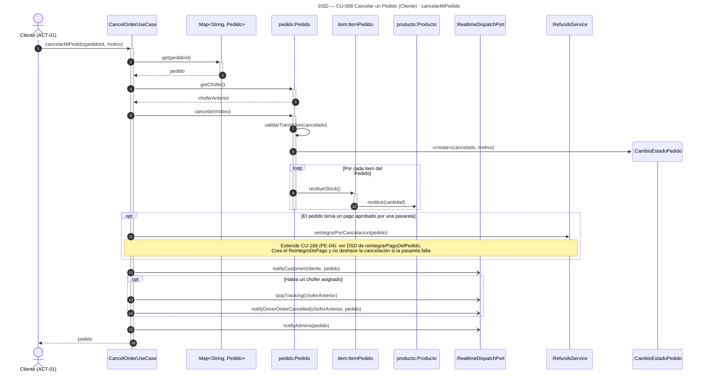

</details>


**Clases participantes:** `CancelOrderUseCase` (controlador de caso de uso), la colección `Map<String, Pedido>`, los objetos de dominio `Pedido`, `ItemPedido`, `Producto` y `CambioEstadoPedido`, `RefundsService` (fabricación pura: el pedido de devolución del pago) y `RealtimeDispatchPort` (fabricación pura: los avisos en vivo). El actor sale siempre del token y nunca del cuerpo de la solicitud. El administrador cancela con CU-010, que sigue la misma colaboración.

**GRASP.** *Controlador*: `CancelOrderUseCase` recibe la operación y coordina. *Experto*: `Pedido` sabe en qué estado está y quién es su chofer, valida la transición a «cancelado» y registra el motivo; no se le asigna el estado desde afuera. *Creador*: `Pedido` crea el `CambioEstadoPedido` que asienta la transición en el historial de estados. La devolución del pago es una extensión (CU-168): una vez confirmada la cancelación, si el pedido tenía un pago aprobado por una pasarela, el controlador le pide el reintegro a `RefundsService`, que no deshace la cancelación si la pasarela falla. El stock vuelve a su dueño por navegación: el `Pedido` le pide a cada `ItemPedido` que restituya, y el `ItemPedido` conoce su `Producto` y su cantidad.

**No se dibuja:** la transacción con bloqueo pesimista de la fila, que cubre la lectura, el cambio de estado, la restitución del stock y el guardado, de modo que dos cancelaciones simultáneas no devuelven el stock dos veces; que un cliente solo encuentra sus pedidos y, si el pedido ya está en camino, recibe un rechazo que lo manda a contactar al soporte; que un chofer que pide cancelar no cancela sino que libera (`liberarPedido`, CU-009).

| Operación de diseño | Implementación |
|---|---|
| `CancelOrderUseCase.cancelarMiPedido(...)` | `OrderController.cancel` → `OrderService.cancelOrder` → `CancelOrderUseCase.execute` |
| `Map<String, Pedido>.get(...)` | `CancelOrderUseCase.execute`: lee el `Order` con su chofer y sus ítems, con bloqueo pesimista de la fila (`FOR UPDATE`), dentro de una transacción |
| `Pedido.getChofer()` | `CancelOrderUseCase.execute`: toma el usuario de `Order.delivery` antes de cambiar el estado |
| `Pedido.cancelar(...)` | `CancelOrderUseCase.execute`: rechaza el pedido entregado o cancelado, aplica `transitionOrder()` y asigna `Order.cancellationReason`, con «Cancelado por» y el actor si no hay motivo |
| `Pedido.validarTransicion(...)` | `transitionOrder()` |
| `ItemPedido.restituirStock()` | `GasCylinderService.restituirStock`: recorre los `Order.items` |
| `Producto.restituir(...)` | `GasCylinderService.restituirStock`: bloquea la fila y suma `OrderItem.quantity` a `GasCylinder.stock` |
| `CambioEstadoPedido.«create»` | `OrderStatusHistorySubscriber.asentar`: inserta el `OrderStatusHistory` de la transición a cancelado, con el estado de origen, el de destino y el usuario, con el motivo de la cancelación |
| `RefundsService.reintegrarPorCancelacion(...)` | `CancelOrderUseCase.reintegrarPago` → `RefundsService.reintegrarPorCancelacion`: después de confirmar la cancelación, si el pedido tenía un pago aprobado por una pasarela, pide la devolución; si la pasarela falla queda registrado para reintentarlo y la cancelación no se deshace (CU-168) |

**Observaciones de diseño**

- La lectura del pedido con bloqueo pesimista, la transición de estado, la restitución de stock y el
  guardado corren en **una única transacción**: dos cancelaciones simultáneas no pueden devolver el stock
  dos veces, porque la segunda lee el estado cancelado que dejó la primera y corta con 400.
- La App Cliente invoca `PATCH /orders/:id/cancel`: `PATCH /orders/:id/status` está reservado al chofer y
  al administrador y hace lo mismo por el mismo código.
- `transitionOrder` es el único punto autorizado para mutar `order.status`; nadie asigna
  el estado a mano.

#### Operación: activarDisponibilidad(usuarioId)

**Caso de uso:** CU-022 Activar la Disponibilidad  
**Actor iniciador:** Chofer (ACT-02)


**Figura 15 — DSD CU-022: Activar la Disponibilidad — Operación: activarDisponibilidad(usuarioId)**

<details><summary>Ver código del diagrama</summary>

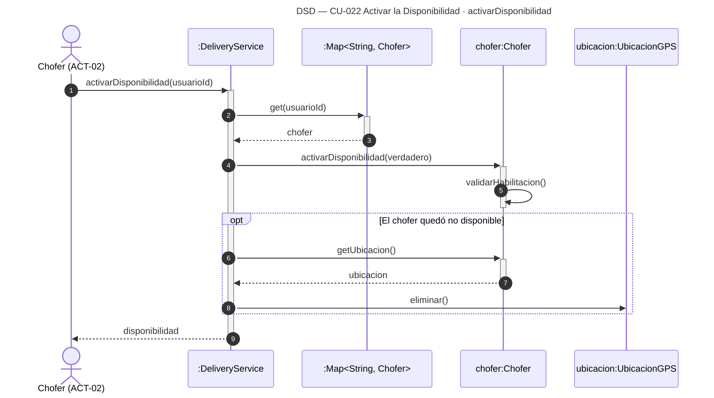

</details>


**Clases participantes:** `DeliveryService` (controlador de fachada del módulo de choferes), la colección `Map<String, Chofer>` y los objetos de dominio `Chofer` y `UbicacionGPS`.

**GRASP.** *Controlador*: `DeliveryService` recibe la operación. *Experto*: `Chofer` conoce su habilitación, su validación y su disponibilidad: al ponerse en línea verifica que esté habilitado y validado, y desconectarse siempre se permite. Al quedar no disponible, su `UbicacionGPS` se elimina, para que el despacho no le ofrezca pedidos. La disponibilidad es independiente de la activación administrativa (CU-033) y de la validación (CU-032).

**No se dibuja:** el control de que el chofer sea de la distribuidora del contexto, el guardado y la salida del chofer del radar cuando se cae la conexión (`DriversGateway.handleDisconnect`).

| Operación de diseño | Implementación |
|---|---|
| `DeliveryService.activarDisponibilidad(...)` | `DeliveryController.toggleAvailability` → `DeliveryService.toggleAvailability` |
| `Map<String, Chofer>.get(...)` | `DeliveryService.toggleAvailability`: busca el `Delivery` por `Delivery.userId` |
| `Chofer.activarDisponibilidad(...)` | `DeliveryService.toggleAvailability`: asigna `Delivery.isAvailable` |
| `Chofer.validarHabilitacion()` | `DeliveryService.toggleAvailability`: al ponerse en línea exige `Delivery.isEnabled` y `Delivery.validated` |
| `Chofer.getUbicacion()` | `Delivery.userId`: la ubicación se indexa por el usuario del chofer |
| `UbicacionGPS.eliminar()` | `RedisService.removeDriver`: saca al chofer del índice `drivers:locations` |

**Observaciones de diseño**

- El `member` del set GEO es el **`user_id`**, no el `delivery_id`: lo escribe
  `driver:update-location` vía `updateDriverLocation(userId, ...)`. Sacarlo por
  `delivery_id` era un `ZREM` no-op y dejaba choferes fantasma recibiendo ofertas.
- Ponerse en línea **no** vuelve a insertar al chofer en el radar: eso pasa recién con el
  primer `driver:update-location` que mande la app.
- Ponerse en línea exige estar habilitado (`isEnabled`) y validado: es un campo
  (`isAvailable`) distinto del que usa CU-033 (alta/baja administrativa, `isEnabled`), así
  que un chofer deshabilitado por el admin ya no puede "reactivarse" solo con este
  ruta. Desconectarse siempre se permite, esté habilitado o no.

#### Operación: ofrecerAlSiguienteChofer(pedidoId)

**Caso de uso:** CU-013 Asignar un Pedido Automáticamente por Proximidad  
**Actor iniciador:** Sistema Automático (ACT-04)

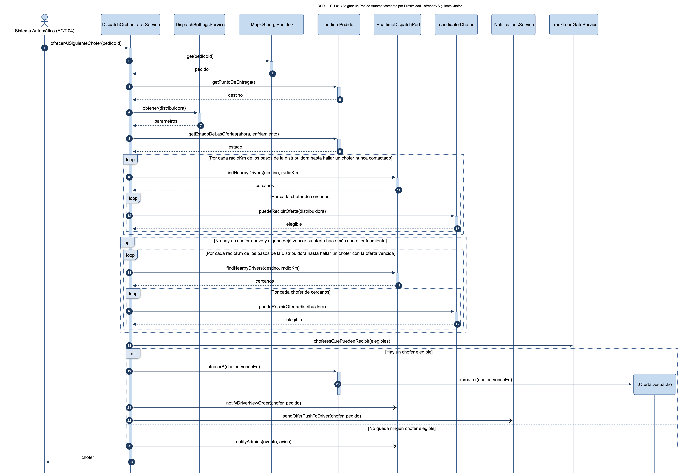

**Figura 16 — DSD CU-013: Asignar un Pedido Automáticamente por Proximidad — Operación: ofrecerAlSiguienteChofer(pedidoId)**

<details><summary>Ver código del diagrama</summary>

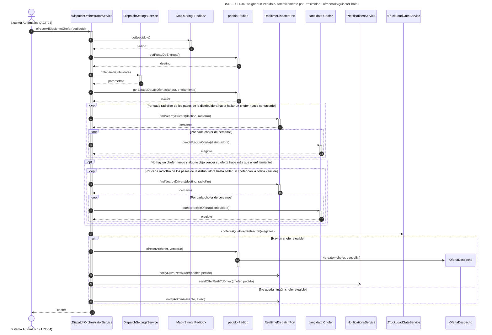

</details>

**Clases participantes:** `DispatchOrchestratorService` (controlador del despacho secuencial), `DispatchSettingsService` (fabricación pura: los pasos de radio y la ventana de la distribuidora), la colección `Map<String, Pedido>`, los objetos de dominio `Pedido`, `Chofer` y `OfertaDespacho`, `RealtimeDispatchPort` (fabricación pura: el radar de choferes por cercanía y el aviso en vivo) y `NotificationsService` (fabricación pura: el aviso al dispositivo).

**GRASP.** *Controlador*: `DispatchOrchestratorService` recibe la operación y coordina la búsqueda. *Experto*: `Pedido` conoce su punto de entrega, el estado de las ofertas que hizo a cada chofer (bloqueados y re-ofertables) y sus ofertas; `Chofer` sabe si puede recibir la oferta (habilitado, validado, de la distribuidora, con vehículo en uso y documentación vigente). *Creador*: el `Pedido` crea sus `OfertaDespacho`, porque las contiene (composición); el controlador no las crea. *Fabricación pura*: el radar y los avisos quedan fuera de los objetos de dominio (Bajo Acoplamiento): el orquestador no conoce Redis ni Socket.IO.

**No se dibuja:** el bloqueo distribuido que serializa la oferta de cada pedido, la persistencia de la oferta, el cálculo de la vigencia a partir del reloj y de la ventana de la distribuidora, y el caché de elegibilidad dentro de un mismo intento.

| Operación de diseño | Implementación |
|---|---|
| `Map<String, Pedido>.get(...)` | `OrderRepositoryPort.findByIdFull`: quien dispara el despacho lee el `Order` y se lo pasa a `DispatchOrchestratorService.offerToNextDriver` |
| `DispatchOrchestratorService.ofrecerAlSiguienteChofer(...)` | `DispatchOrchestratorService.offerToNextDriver` |
| `Pedido.getEstadoDeLasOfertas(...)` | `DispatchOfferRepositoryPort.findDriverOfferState`: clasifica a los choferes que ya tuvieron una `DispatchOffer` de ese pedido en bloqueados (rechazaron, ya lo tuvieron, tienen una oferta vigente, la dejaron vencer hace menos que el enfriamiento de 3 minutos o acumulan tres ofertas vencidas para ese pedido) y re-ofertables (menos de tres ofertas, todas vencidas hace más que el enfriamiento) |
| `Pedido.getPuntoDeEntrega()` | `Order.deliveryPoint`, convertido con `coordenadasDePunto()` |
| `Chofer.puedeRecibirOferta(...)` | `DeliveryService.choferesElegibles` (habilitado, validado y de la distribuidora del pedido) y `FleetDispatchLockService.choferesInhabilitados` (licencia y vehículo con documentación vigente) |
| `DispatchSettingsService.obtener(...)` | `DispatchSettingsService.obtener`: devuelve `radiusStepsKm` y `offerTtlSeconds` de la distribuidora, o los de omisión, con una copia en memoria de un minuto; el orquestador la lee en cada oferta |
| `Pedido.ofrecerA(...)` | `DispatchOrchestratorService.offerToNextDriver`: calcula `DispatchOffer.expiresAt` con `offerTtlSeconds` y llama a `DispatchOfferRepositoryPort.create` |
| `OfertaDespacho.«create»` | `DispatchOfferRepositoryPort.create`: inserta la `DispatchOffer` en estado `OFFERED` |
| `RealtimeDispatchPort.notifyAdmins(...)` | `RealtimeDispatchPort.notifyAdmins`: el aviso `order:no-drivers` al panel (`orderId`, `distributorId`, `reason` y `at`), con el motivo (`no_drivers_in_range`, `all_drivers_exhausted` o `no_delivery_point`); una sola vez por agotamiento, con una marca en Redis que se borra al conseguir una oferta |

**Observaciones de diseño**

- El orquestador **no conoce Redis ni Socket.io**: habla contra `RealtimeDispatchPort`; el `RealtimeDispatchAdapter` traduce a `RedisService` (GEO) y a los gateways.
- La oferta es **durable** (fila en `dispatch_offer`, no una clave en memoria): sobrevive reinicios y es multi-instancia.
- El push FCM es **complementario y de mejor esfuerzo** (`void`, no se espera): cubre al chofer con la app en background, donde el socket no llega.
- Multidistribuidora: `filterByDistributor` restringe los candidatos a los choferes de la distribuidora del pedido.

#### Operación: vencerOfertasExpiradas()

**Caso de uso:** CU-014 Vencer la Oferta y Ofrecer al Siguiente Chofer  
**Actor iniciador:** Sistema Automático (ACT-04)


**Figura 17 — DSD CU-014: Vencer la Oferta y Ofrecer al Siguiente Chofer — Operación: vencerOfertasExpiradas()**

<details><summary>Ver código del diagrama</summary>

```mermaid
sequenceDiagram
    title DSD — CU-014 Vencer la Oferta y Ofrecer al Siguiente Chofer · vencerOfertasExpiradas
    autonumber
    actor SIS as Sistema Automático (ACT-04)
    participant TIK as :DispatchService
    participant ORQ as :DispatchOrchestratorService
    participant FRC as :ScheduledTasksSettingsService
    participant OFR as :DispatchOfferRepositoryPort
    participant OFE as oferta:OfertaDespacho
    participant PED as pedido:Pedido
    participant ORS as :OrderService

    SIS->>+TIK: vencerOfertasExpiradas()
    TIK->>+ORQ: distribuidorasConOfertasVencidas()
    ORQ-->>-TIK: conOfertas
    TIK->>+ORS: distribuidorasConPedidosDisponibles()
    ORS-->>-TIK: conPendientes
    TIK->>+FRC: distribuidorasQueCorren(tareaProgramada, distribuidoras)
    FRC-->>-TIK: corren
    TIK->>+ORQ: handleExpiredOffers(corren)
    ORQ->>+OFR: findExpired(ahora)
    OFR-->>-ORQ: ofertas
    loop Por cada oferta vencida
        ORQ->>OFE: vencer()
        ORQ->>+OFE: getPedido()
        OFE-->>-ORQ: pedido
        ORQ->>+PED: esReofertable()
        PED-->>-ORQ: reofertable
        opt El pedido sigue pendiente y sin chofer
            ORQ->>ORQ: ofrecerAlSiguienteChofer(pedido)
            Note over ORQ,PED: Re-oferta: ver DSD de ofrecerAlSiguienteChofer (CU-013).<br/>Crea la OfertaDespacho
        end
    end
    deactivate ORQ
    loop Por cada distribuidora que corre
        TIK->>+ORS: findAvailableOrders(distribuidora)
        ORS-->>-TIK: pendientes
        loop Por cada pedido pendiente de más de 60 segundos
            TIK->>+ORQ: ensureOffered(pedido)
            ORQ->>+PED: tieneOfertaVigente()
            PED-->>-ORQ: vigente
            opt El pedido no tiene oferta vigente
                ORQ->>ORQ: ofrecerAlSiguienteChofer(pedido)
                Note over ORQ,PED: Oferta: ver DSD de ofrecerAlSiguienteChofer (CU-013).<br/>Crea la OfertaDespacho
            end
            deactivate ORQ
        end
    end
    deactivate TIK
```

</details>

**Clases participantes:** `DispatchService` (controlador: el reloj del proceso), `DispatchOrchestratorService`, `ScheduledTasksSettingsService` (fabricación pura: a qué distribuidoras les toca el ciclo), `DispatchOfferRepositoryPort` (fabricación pura: la búsqueda de ofertas vencidas atraviesa todos los pedidos), `OrderService` (consulta de los pedidos pendientes) y los objetos de dominio `OfertaDespacho` y `Pedido`.

**GRASP.** *Controlador*: `DispatchService` recibe la operación del proceso temporal y la reparte; no decide a quién ofrecer. *Experto*: `OfertaDespacho` sabe vencer; `Pedido` sabe si todavía es re-ofertable (pendiente y sin chofer) y si tiene una oferta vigente. *Alta Cohesión*: la decisión de a quién ofrecer vive en `DispatchOrchestratorService` y el reloj en `DispatchService`.

**Referencias.** La nueva `OfertaDespacho`, que crea el `Pedido` y se avisa al chofer elegido, es la operación `ofrecerAlSiguienteChofer` (CU-013), con su propio diagrama.

**No se dibuja:** el bloqueo distribuido de cada ciclo (`RedisService.acquireLock`, una sola instancia procesa cada ciclo de 15 segundos), la marca de última ejecución de cada distribuidora, la lectura del pedido de cada oferta y la persistencia.

| Operación de diseño | Implementación |
|---|---|
| `DispatchService.vencerOfertasExpiradas(...)` | `DispatchService.tick`: corre en un ciclo fijo de 15 segundos con el bloqueo distribuido, decide con `ScheduledTasksSettingsService.distribuidorasQueCorren` a qué distribuidoras les toca (CU-173) y llama a `DispatchOrchestratorService.handleExpiredOffers` y a `DispatchService.bootstrapPendingWithoutOffer` con ese conjunto |
| `OfertaDespacho.vencer(...)` | `DispatchOrchestratorService.handleExpiredOffers`: llama a `DispatchOfferRepositoryPort.updateStatus` con el estado `EXPIRED` |
| `OfertaDespacho.getPedido()` | `DispatchOffer.order`, que `DispatchOrchestratorService.handleExpiredOffers` lee con `OrderRepositoryPort.findByIdFull` |
| `Pedido.esReofertable()` | `DispatchOrchestratorService.isReofferable`: `Order.status` pendiente y sin `Order.deliveryId` |
| `Pedido.tieneOfertaVigente()` | `DispatchOfferRepositoryPort.hasActiveOffer` |
| `DispatchOrchestratorService.ofrecerAlSiguienteChofer(...)` | `DispatchOrchestratorService.offerToNextDriver`: la llaman `DispatchOrchestratorService.handleExpiredOffers` y `DispatchOrchestratorService.ensureOffered` |

**Observaciones de diseño**

- El cron aporta **el reloj y el lock**; la lógica de a-quién-ofrecer vive íntegra en el orquestador (SRP).
- TTL del lock 12 s < período 15 s: si la instancia muere sin liberar, el lock expira antes del tick siguiente.
- `bootstrapPendingWithoutOffer` es la red de seguridad para pedidos creados cuando no había ningún chofer conectado.

#### Operación: aceptarPedido(pedidoId)

**Caso de uso:** CU-015 Aceptar un Pedido  
**Actor iniciador:** Chofer (ACT-02)

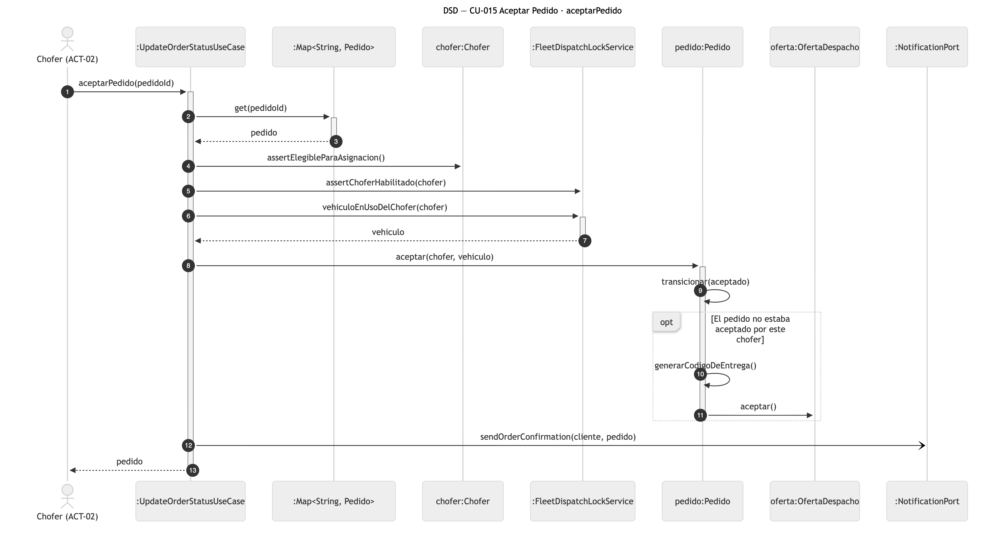

**Figura 18 — DSD CU-015: Aceptar un Pedido — Operación: aceptarPedido(pedidoId)**

<details><summary>Ver código del diagrama</summary>

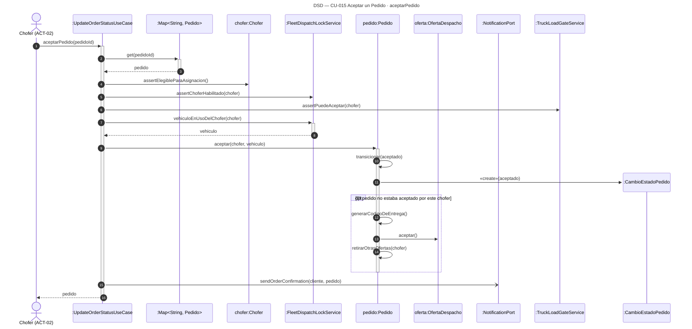

</details>

**Clases participantes:** `UpdateOrderStatusUseCase` (controlador de caso de uso), la colección `Map<String, Pedido>`, los objetos de dominio `Pedido`, `Chofer`, `OfertaDespacho` y `CambioEstadoPedido`, `FleetDispatchLockService` (fabricación pura: reúne la documentación vencida de la flota) y `NotificationPort` (fabricación pura: el aviso al cliente).

**GRASP.** *Controlador*: `UpdateOrderStatusUseCase` recibe la operación y coordina. *Experto*: `Chofer` sabe si está habilitado y validado; `Pedido` conoce su estado y es quien se asigna el chofer, guarda la copia del vehículo, pasa a «aceptado», genera su código de entrega, crea el `CambioEstadoPedido` que asienta la transición en el historial de estados, cierra la oferta que el chofer tenía y retira las que estaban abiertas a otros choferes. El controlador no le asigna atributos. *Alta Cohesión*: `FleetDispatchLockService` es el único lugar que conoce las reglas de la flota (Bajo Acoplamiento con el despacho). La aceptación es idempotente: si el mismo chofer ya había aceptado, el `Pedido` no regenera el código ni cierra otra oferta.

**No se dibuja:** la transacción con el bloqueo del pedido y del chofer, el guardado, la verificación de que el pedido sea de la distribuidora del chofer y, si ya tiene otro chofer, el rechazo con acceso denegado, el aviso a los choferes cuya oferta se retiró, el aviso en vivo al cliente y al panel (`notifyCustomer`, `notifyAdmins`) y la obtención del chofer a partir del usuario autenticado (`DeliveryService.buscarPorIdOUsuario`).

| Operación de diseño | Implementación |
|---|---|
| `UpdateOrderStatusUseCase.aceptarPedido(...)` | `OrderController.updateStatus` → `OrderService.updateStatus` → `UpdateOrderStatusUseCase.execute` con el estado aceptado |
| `Map<String, Pedido>.get(...)` | `UpdateOrderStatusUseCase.execute`: lee el `Order` con bloqueo pesimista dentro de una transacción |
| `Chofer.assertElegibleParaAsignacion()` | `DeliveryService.assertElegibleParaAsignacion`: verifica `Delivery.isEnabled` y `Delivery.validated` |
| `Pedido.aceptar(...)` | `UpdateOrderStatusUseCase.applyStatusEffects`: asigna `Order.deliveryId` y `Order.delivery`, copia `Order.vehiclePatent`, `Order.vehicleBrand` y `Order.vehicleModel`, y registra `Order.acceptedAt` |
| `Pedido.transicionar(...)` | `transitionOrder()` |
| `Pedido.generarCodigoDeEntrega()` | `generateDeliveryCode()`, que queda en `Order.deliveryCode` |
| `OfertaDespacho.aceptar()` | `DispatchOrchestratorService.onDriverAccepted`: llama a `DispatchOfferRepositoryPort.closeActiveOffer` con el estado `ACCEPTED` |
| `Pedido.retirarOtrasOfertas(...)` | `DispatchOfferRepositoryPort.withdrawOtherActiveOffers`: pasa a `superseded`, dentro de la transacción de la aceptación, las ofertas abiertas de los demás choferes; el aviso a esos choferes (`notifyDriverOrderCancelled`) sale después del commit |
| `CambioEstadoPedido.«create»` | `OrderStatusHistorySubscriber.asentar`: inserta el `OrderStatusHistory` de la transición a aceptado, con el estado de origen, el de destino y el usuario |

#### Operación: actualizarUbicacion(usuarioId, latitud, longitud)

**Caso de uso:** CU-017 Modificar la Ubicación GPS del Chofer  
**Actor iniciador:** Chofer (ACT-02)

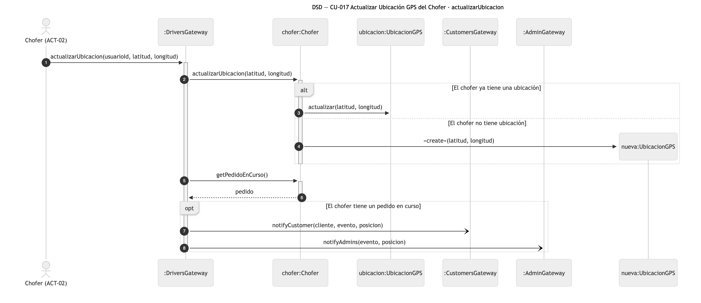

**Figura 19 — DSD CU-017: Modificar la Ubicación GPS del Chofer — Operación: actualizarUbicacion(usuarioId, latitud, longitud)**

<details><summary>Ver código del diagrama</summary>

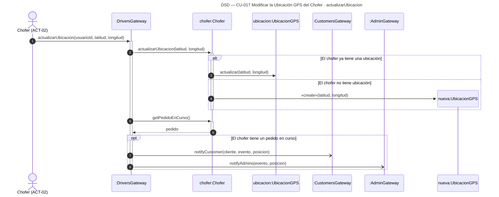

</details>

**Clases participantes:** `DriversGateway` (controlador: recibe el evento del chofer y coordina), los objetos de dominio `Chofer` y `UbicacionGPS`, `CustomersGateway` y `AdminGateway` (fabricación pura: el reenvío en vivo al cliente y al panel).

**GRASP.** *Controlador*: `DriversGateway` recibe la operación; el chofer se identifica por el token del handshake y no por el cuerpo del mensaje. *Experto*: `Chofer` conoce su ubicación y su pedido en curso, y es quien la actualiza o la crea; la `UbicacionGPS` toma las coordenadas. *Bajo Acoplamiento*: el reenvío al cliente y al panel queda en los gateways, que no conocen al chofer.

**No se dibuja:** el descarte del evento cuando faltan las coordenadas, el índice geoespacial donde se guarda la posición y el nombre de cada evento en vivo.

| Operación de diseño | Implementación |
|---|---|
| `DriversGateway.actualizarUbicacion(...)` | `DriversGateway.handleDriverLocation`: evento `driver:update-location`; el usuario sale de la identidad resuelta en el handshake |
| `Chofer.actualizarUbicacion(...)` | `DriversGateway.handleDriverLocation`: llama a `RedisService.updateDriverLocation` con el `Delivery.userId` del chofer |
| `UbicacionGPS.actualizar(...)` | `RedisService.updateDriverLocation`: reemplaza la posición del miembro en el índice `drivers:locations` |
| `UbicacionGPS.«create»` | `RedisService.updateDriverLocation`: la primera posición agrega el miembro al índice |
| `Chofer.getPedidoEnCurso()` | `RedisService.getDriverActiveOrder`: el pedido y el cliente que dejó `RealtimeDispatchPort.startTracking` |

#### Operación: obtenerCodigoDeEntrega(pedidoId)

**Caso de uso:** CU-078 Consultar el Código de Entrega (QR del chofer)  
**Actor iniciador:** Chofer (ACT-02), Administrador (ACT-03)

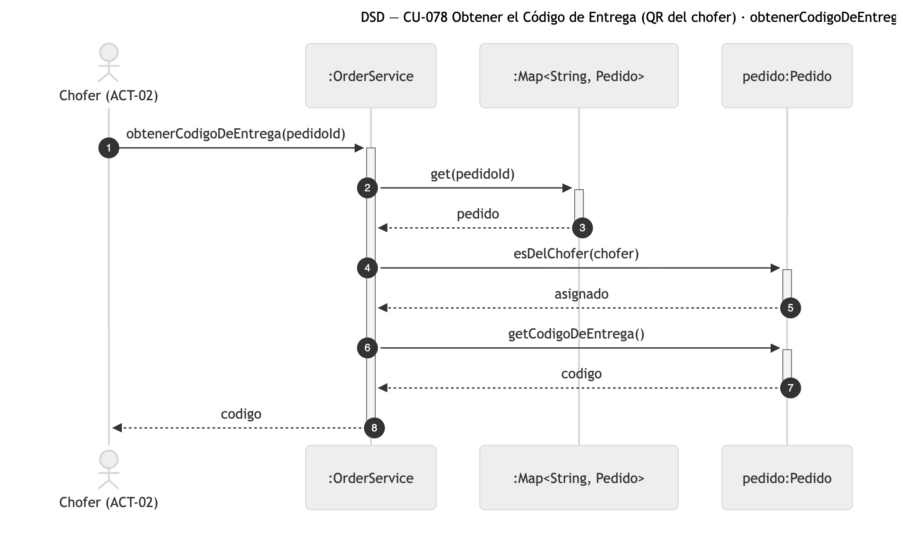

**Figura 20 — DSD CU-078: Consultar el Código de Entrega (QR del chofer) — Operación: obtenerCodigoDeEntrega(pedidoId)**

<details><summary>Ver código del diagrama</summary>

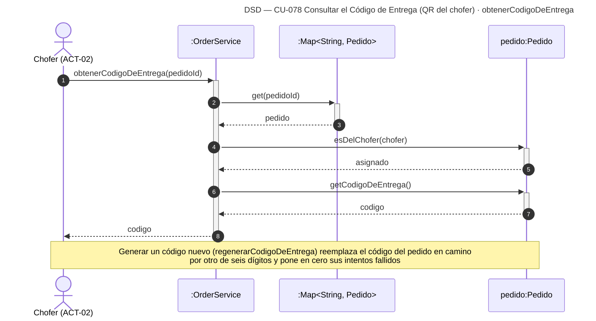

</details>

**Clases participantes:** `OrderService` (controlador de fachada del módulo de pedidos), la colección `Map<String, Pedido>` y el objeto de dominio `Pedido`.

**GRASP.** *Controlador*: `OrderService` recibe la operación. *Experto*: `Pedido` conoce su código de entrega, que generó al aceptarse (CU-015), y sabe si el chofer que lo pide es el asignado. Es una consulta: no cambia el estado del pedido. Generar un código nuevo con el pedido en camino (`OrderService.regenerateDeliveryCode`) reemplaza el código del pedido y pone en cero su contador de intentos fallidos; se muestra como nota del diagrama.

**No se dibuja:** la verificación de que el pedido sea de la distribuidora, el error si el pedido todavía no tiene código porque no fue aceptado, el rechazo de la generación de un código nuevo si el pedido no está en camino o es de otro chofer, y el asiento del hecho en la auditoría (sin el valor del código).

| Operación de diseño | Implementación |
|---|---|
| `OrderService.obtenerCodigoDeEntrega(...)` | `OrderController.getDeliveryCode` → `OrderService.getDeliveryCode` |
| `Map<String, Pedido>.get(...)` | `OrderService.findOne`: lee el `Order` con `OrderRepositoryPort.findByIdFull` |
| `Pedido.esDelChofer(...)` | `OrderService.assertPedidoDelChofer`: el chofer tiene que ser el asignado; un administrador puede verlo |
| `Pedido.getCodigoDeEntrega()` | `Order.deliveryCode` |

#### Operación: confirmarEntregaConCodigo(pedidoId, codigo, motivo)

**Caso de uso:** CU-079 Confirmar una Entrega Escaneando el QR (cliente)  
**Actor iniciador:** Cliente (ACT-01), Administrador (ACT-03)

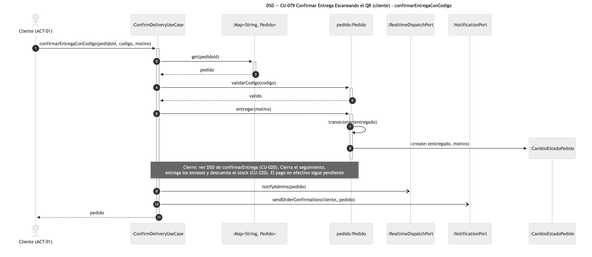

**Figura 21 — DSD CU-079: Confirmar una Entrega Escaneando el QR (cliente) — Operación: confirmarEntregaConCodigo(pedidoId, codigo, motivo)**

<details><summary>Ver código del diagrama</summary>

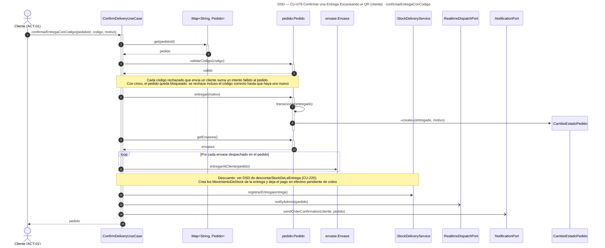

</details>

**Clases participantes:** `ConfirmDeliveryUseCase` (controlador de caso de uso), la colección `Map<String, Pedido>`, los objetos de dominio `Pedido`, `Envase` y `CambioEstadoPedido`, `StockDeliveryService` (fabricación pura: el descuento del stock físico de lo entregado), `RealtimeDispatchPort` y `NotificationPort` (fabricación pura: los avisos).

**GRASP.** *Controlador*: `ConfirmDeliveryUseCase` recibe la operación. *Experto*: `Pedido` conoce su código de entrega y es quien lo compara con el que escaneó o escribió el cliente, cuenta los intentos fallidos —cuando el cliente se equivoca se suman, y con cinco queda bloqueado— y pasa a «entregado». La comparación se hace en tiempo constante y la operación es idempotente: un pedido ya entregado se devuelve sin reprocesar. *Creador*: `Pedido` crea el `CambioEstadoPedido` de la transición a «entregado», siempre; solo el motivo depende de quién confirma: lo trae el administrador y el cliente no lo manda (CU-020). El pago no se toca: un pedido en efectivo sigue pendiente de cobro (CU-292).

**Referencias.** Los envases despachados pasan a poder del cliente y se descuenta el stock físico de lo entregado con la misma colaboración de la operación `confirmarEntrega` (CU-020); el descuento (CU-220) tiene su propio diagrama y acá sólo se muestra el llamado.

**No se dibuja:** el cierre del seguimiento en vivo del chofer que entregó, la verificación de que el pedido sea del cliente que lo confirma, el rechazo si el pedido no está en camino o el código no coincide (mal leído, de otro pedido o incorrecto), el rechazo de un pedido bloqueado, la exigencia del motivo al administrador (de 10 a 500 caracteres, posterior a la del código) y la transacción con el bloqueo del pedido que resuelve `UpdateOrderStatusUseCase.execute`.

| Operación de diseño | Implementación |
|---|---|
| `ConfirmDeliveryUseCase.confirmarEntregaConCodigo(...)` | `OrderController.confirmDelivery` → `OrderService.confirmDelivery` → `ConfirmDeliveryUseCase.execute` |
| `Map<String, Pedido>.get(...)` | `ConfirmDeliveryUseCase.execute`: lee el `Order` con `OrderRepositoryPort.findByIdFull` |
| `Pedido.validarCodigo(...)` | `compareDeliveryCode()`, contra `Order.deliveryCode`; antes comprueba que el contador de intentos fallidos del pedido no haya llegado al máximo (5) y, si el código es incorrecto y lo envió un cliente, suma un intento con un UPDATE atómico |
| `Pedido.entregar(...)` | `ConfirmDeliveryUseCase.execute`: delega en `UpdateOrderStatusUseCase.execute`, que registra `Order.deliveredAt` |
| `Pedido.transicionar(...)` | `transitionOrder()` |
| `CambioEstadoPedido.«create»` | `OrderStatusHistorySubscriber.asentar`: inserta el `OrderStatusHistory` de la transición, con el motivo si lo hay (el del administrador; el cliente no manda motivo) |
| `RealtimeDispatchPort.notifyAdmins(...)` | `UpdateOrderStatusUseCase.execute`: avisa a los administradores de la distribuidora |
| `Pedido.getEnvases()` | `CylinderLifecyclePort.onOrderDelivered`: busca por `Order.orderId` los envases despachados en el pedido |
| `Envase.entregarAlCliente(...)` | `CylinderLifecyclePort.onOrderDelivered`: pasa los envases del pedido a «en poder del cliente» |

**Observaciones de diseño**

- Es el camino de la entrega en el que confirma quien recibe, no quien entrega. El código lo posee el chofer; que el cliente lo conozca prueba que el chofer estuvo presente.
- `compareDeliveryCode` usa `timingSafeEqual` (comparación de tiempo constante) para no filtrar el secreto por timing.
- La **validación** vive en `ConfirmDeliveryUseCase`; los **efectos** de pasar a `DELIVERED` se delegan en `UpdateOrderStatusUseCase`, el mismo que usa `PATCH :id/status`: cero duplicación de lógica.
- Doble idempotencia: el encabezado `Idempotency-Key` (`IdempotencyInterceptor`, que responde 422 si la misma clave llega con otros datos) y el chequeo de `status === DELIVERED` dentro del caso de uso.

#### Operación: confirmarCobroEnEfectivo(pedidoId)

**Caso de uso:** CU-292 Confirmar el Cobro en Efectivo  
**Actor iniciador:** Chofer (ACT-02)


**Figura 22 — DSD CU-292: Confirmar el Cobro en Efectivo — Operación: confirmarCobroEnEfectivo(pedidoId)**

<details><summary>Ver código del diagrama</summary>

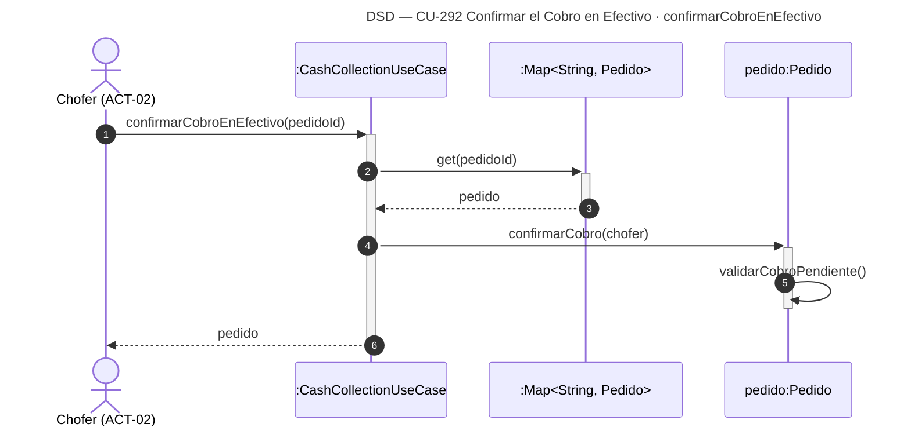

</details>

**Clases participantes:** `CashCollectionUseCase` (controlador de caso de uso del cobro en efectivo), la colección `Map<String, Pedido>` y el objeto de dominio `Pedido`.

**GRASP.** *Controlador*: `CashCollectionUseCase` recibe la operación. *Experto*: `Pedido` conoce su estado, su método de pago y su cobro, y es quien comprueba que el cobro esté pendiente y pasa a «pagado» con el momento y el chofer que lo confirmó.

**No se dibuja:** la verificación de que el pedido sea de la distribuidora, de que sea del chofer que confirma, de que esté entregado y se haya pagado en efectivo, la transacción con el bloqueo del pedido, el guardado con la entidad cargada para que la auditoría registre el cambio, y que repetir la confirmación sobre un pedido ya pagado no cambia nada.

| Operación de diseño | Implementación |
|---|---|
| `CashCollectionUseCase.confirmarCobroEnEfectivo(...)` | `OrderController.confirmCashReceived` → `CashCollectionUseCase.confirmReceived` |
| `Map<String, Pedido>.get(...)` | `CashCollectionUseCase.lock`: lee el `Order` con bloqueo pesimista dentro de una transacción |
| `Pedido.confirmarCobro(...)` | `CashCollectionUseCase.confirmReceived`: asigna `Order.paymentStatus` pagado, `Order.paymentConfirmedAt` y `Order.paymentConfirmedBy` |
| `Pedido.validarCobroPendiente(...)` | `CashCollectionUseCase.lockPedidoDelChofer`: pertenencia al chofer (403), pedido entregado y en efectivo (400); el pago pendiente lo comprueba `CashCollectionUseCase.confirmReceived` (409 si ya es impago) |

**Observaciones de diseño**

- Entregar no es cobrar: la entrega deja el pago pendiente y esta operación lo cierra.
- La respuesta del pedido ya pagado es la misma que la de la primera confirmación: la operación es idempotente, también por el encabezado `Idempotency-Key`.

#### Operación: confirmarTransferencia(pedidoId, recibida, motivo)

**Caso de uso:** CU-301 Confirmar una Transferencia  
**Actor iniciador:** Administrador (ACT-03)


**Figura 23 — DSD CU-301: Confirmar una Transferencia — Operación: confirmarTransferencia(pedidoId, recibida, motivo)**

<details><summary>Ver código del diagrama</summary>

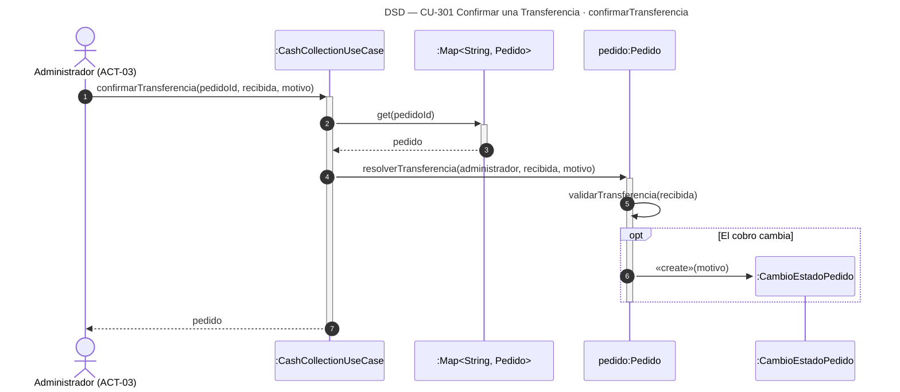

</details>

**Clases participantes:** `CashCollectionUseCase` (controlador de caso de uso del cobro), la colección `Map<String, Pedido>` y los objetos de dominio `Pedido` y `CambioEstadoPedido`.

**GRASP.** *Controlador*: `CashCollectionUseCase` recibe la operación. *Experto*: `Pedido` conoce su medio de pago, su estado y su cobro, y es quien valida que la decisión sea posible y pasa el cobro a «pagado» o «fallido». *Creador*: `Pedido` crea el `CambioEstadoPedido` que deja el motivo en el historial.

**No se dibuja:** la verificación de que el pedido sea de la distribuidora, la transacción con el bloqueo del pedido y que repetir la misma decisión no cambia nada.

| Operación de diseño | Implementación |
|---|---|
| `CashCollectionUseCase.confirmarTransferencia(...)` | `OrderController.confirmTransfer` → `CashCollectionUseCase.confirmTransfer` |
| `Map<String, Pedido>.get(...)` | `CashCollectionUseCase.lock`: lee el `Order` con bloqueo pesimista, filtrado por distribuidora |
| `Pedido.resolverTransferencia(...)` | `CashCollectionUseCase.confirmTransfer`: asigna `Order.paymentStatus`, `Order.paymentResolvedAt`, `Order.paymentResolvedBy` y `Order.paymentResolutionNote`; con la transferencia recibida también `Order.paymentConfirmedAt` y `Order.paymentConfirmedBy` |
| `Pedido.validarTransferencia(...)` | `CashCollectionUseCase.confirmTransfer`: medio transferencia y pedido no cancelado (400); transiciones del pago permitidas y pedido entregado para marcarla no recibida (409) |
| `CambioEstadoPedido.«create»` | `CashCollectionUseCase.asentarEnElHistorial`: inserta el `OrderStatusHistory` con el mismo estado de origen y destino y el motivo |

#### Operación: notificarResultadoDePago(tipoDeNotificacion, identificadorDelPago, firma)

**Caso de uso:** CU-048 Procesar el Pago con MercadoPago  
**Actor iniciador:** MercadoPago (ACT-06)


**Figura 24 — DSD CU-048: Procesar el Pago con MercadoPago — Operación: notificarResultadoDePago(tipoDeNotificacion, identificadorDelPago, firma)**

<details><summary>Ver código del diagrama</summary>

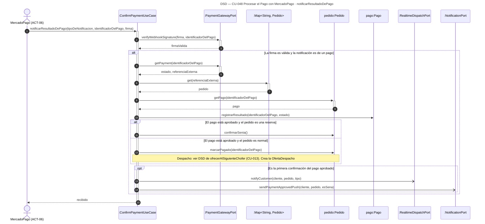

</details>

**Clases participantes:** `ConfirmPaymentUseCase` (controlador de caso de uso), `PaymentGatewayPort` (fabricación pura: la pasarela de pago), la colección `Map<String, Pedido>`, los objetos de dominio `Pedido` y `Pago`, y `RealtimeDispatchPort` y `NotificationPort` (fabricaciones puras: el aviso al Cliente por tiempo real y por notificación push).

**GRASP.** *Controlador*: `ConfirmPaymentUseCase` recibe la notificación y coordina. *Experto*: `Pago` registra lo que informó la pasarela; `Pedido` conoce su pago y es quien pasa a pagado, o a seña paga si es una reserva. El sistema no confía en el cuerpo de la notificación: valida la firma y consulta el pago real a la pasarela. Si el pedido ya está cancelado o entregado, se registra el pago y no se lo reactiva. El aviso al Cliente sale una sola vez, en la primera confirmación del pago aprobado, sea de un pedido o de la seña de una reserva; un pago rechazado o cancelado no se avisa (limitación conocida).

**Referencias.** El ofrecimiento al chofer más cercano, que crea la `OfertaDespacho`, es `ofrecerAlSiguienteChofer` (CU-013). Una reserva no se ofrece: la activa `activarReservasDelDia` (CU-075) el día agendado.

**No se dibuja:** la transacción con bloqueo pesimista del pedido, que impide que dos notificaciones del mismo pago lo procesen a la vez; el evento (`PagoNotificadoEvent`) con el que el módulo de pagos le pasa la notificación al de pedidos; el descarte silencioso de las notificaciones con firma inválida, de otro tipo o sin identificador, y la respuesta siempre 200 hacia la pasarela.

| Operación de diseño | Implementación |
|---|---|
| `ConfirmPaymentUseCase.notificarResultadoDePago(...)` | `MercadoPagoWebhookController.handle` verifica la firma y publica el evento `PagoNotificadoEvent`; `PagoNotificadoListener.handle` llama a `ConfirmPaymentUseCase.execute` |
| `PaymentGatewayPort.verifyWebhookSignature(...)` | `MercadoPagoWebhookController.handle` la invoca por `PaymentsService.verifyWebhookSignature`, antes de publicar el evento |
| `PaymentGatewayPort.getPayment(...)` | `PaymentsService.confirmFromGateway`: consulta el pago real en la pasarela |
| `Map<String, Pedido>.get(...)` | `ConfirmPaymentUseCase.execute`: `OrderRepositoryPort.findByIdFull` con la referencia externa del pago |
| `Pedido.getPago(...)` | `PaymentsService.confirmFromGateway`: busca el `Payment` por `Payment.gatewayPaymentId` y, si es la primera notificación, el pendiente de esa referencia |
| `Pago.registrarResultado(...)` | `PaymentsService.confirmFromGateway`: asigna `Payment.gatewayPaymentId` y `Payment.status`, traducido del estado de la pasarela |
| `Pedido.confirmarSenia()` | `ConfirmPaymentUseCase.handleApproved`: asigna `Order.depositPaid` y `Order.gatewayPaymentId` |
| `Pedido.marcarPagado(...)` | `ConfirmPaymentUseCase.handleApproved`: asigna `Order.paymentStatus` pagado y `Order.gatewayPaymentId` |
| `RealtimeDispatchPort.notifyCustomer(...)` | `ConfirmPaymentUseCase.handleApproved`, después del commit: emite al Cliente el evento `order:payment-approved`; solo en la primera confirmación, no en los reintentos de la pasarela |
| `NotificationPort.sendPaymentApprovedPush(...)` | `ConfirmPaymentUseCase.notificarPagoAprobado`, después del commit y del despacho: el push al Cliente («pago recibido» o «seña recibida»), una sola vez; un fallo se registra y no revierte el pago |

**Observaciones de diseño**

- El dominio de pedidos **no conoce MercadoPago**: `ConfirmPaymentUseCase` consume el resultado *normalizado* de `PaymentsService`, y solo `MercadoPagoAdapter` toca el SDK. Sumar otra pasarela es agregar un adapter, no tocar `order`.
- El sistema **nunca confía en el contenido del webhook**: valida la firma HMAC y después consulta el pago real con `getPayment`.
- Idempotencia por triple guarda: firma, `gateway_payment_id` ya asignado en el ledger, y lock pesimista sobre el `Order` antes de marcar `PAID`. Nunca se despacha dos veces el mismo pedido.
- El webhook **siempre responde 200**, incluso ante firma inválida o error interno, para que MercadoPago no entre en bucle de reintentos con 5xx.
- El camino de pago `rejected` / `cancelled` no libera el stock ni cancela el pedido: solo deja registro en el registro de eventos; el pedido queda pendiente y lo cancela el proceso de CU-077 al vencer el plazo. Es una limitación del sistema y no una funcionalidad.

#### Operación: registrarReclamo(pedidoId, motivo, evidencia)

**Caso de uso:** CU-023 Registrar un Reclamo  
**Actor iniciador:** Cliente (ACT-01)

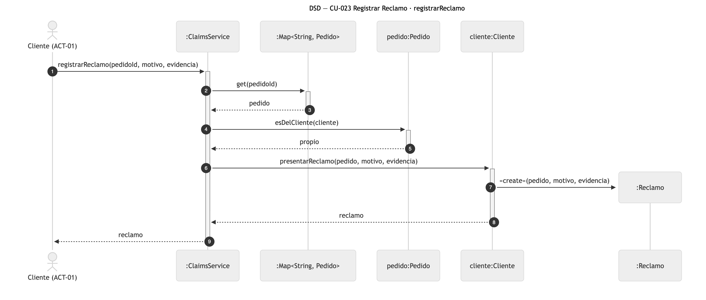

**Figura 25 — DSD CU-023: Registrar un Reclamo — Operación: registrarReclamo(pedidoId, motivo, evidencia)**

<details><summary>Ver código del diagrama</summary>

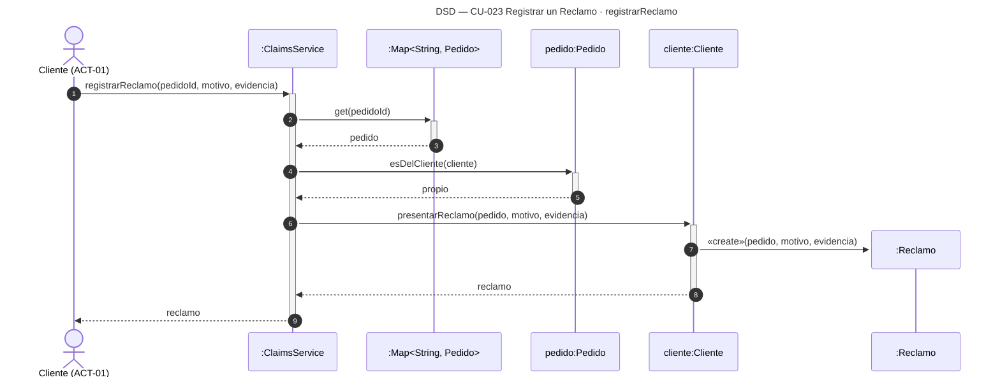

</details>

**Clases participantes:** `ClaimsService` (controlador de fachada del módulo de reclamos), la colección `Map<String, Pedido>` y los objetos de dominio `Pedido`, `Cliente` y `Reclamo`.

**GRASP.** *Controlador*: `ClaimsService` recibe la operación. *Experto*: `Pedido` sabe de qué cliente es. *Creador*: el `Cliente` presenta y crea su `Reclamo`, que queda asociado al `Pedido` reclamado; el reclamo nace «pendiente». El cliente no elige la distribuidora: el reclamo la hereda del pedido.

**No se dibuja:** la verificación de que el pedido sea de la distribuidora del contexto, la identidad del cliente, que sale de la sesión y no del cuerpo para el rol Cliente, y la persistencia.

| Operación de diseño | Implementación |
|---|---|
| `ClaimsService.registrarReclamo(...)` | `ClaimsController.create` → `ClaimsService.create` |
| `Map<String, Pedido>.get(...)` | `OrderService.findOne`, después de `OrderService.assertDeLaDistribuidora` |
| `Pedido.esDelCliente(...)` | `ClaimsService.create`: compara `Order.customerId` con `Claim.customerId`; si no coincide responde un error de solicitud |
| `Cliente.presentarReclamo(...)` | `ClaimsService.create`: arma el `Claim` con `Claim.orderId`, `Claim.customerId` y `Claim.distributorId` copiado de `Order.distributorId` |
| `Reclamo.«create»` | `ClaimsService.create`: crea el `Claim` con `Claim.reason`, `Claim.description` y `Claim.photoUrl`; `Claim.status` queda pendiente por el valor por omisión de la columna |

**Observaciones de diseño**

- El `distributor_id` del reclamo **no sale del encabezado `X-Distributor`**: se copia de `order.distributor_id`. Un reclamo siempre queda en la distribuidora del pedido, aunque el cliente esté navegando otra distribuidora.
- `ClaimStatus.PENDING` es el `default` de la columna (`claim.entity.ts`), no lo asigna el servicio.
- La validación de pertenencia (`order.customer_id !== dto.customerId`) es redundante para un CUSTOMER (el controller ya forzó el id) pero **necesaria** para el camino ADMIN, donde el body sí manda.

#### Operación: resolverReclamo(reclamoId, resolucion, estadoFinal)

**Caso de uso:** CU-025 Resolver un Reclamo  
**Actor iniciador:** Administrador (ACT-03)


**Figura 26 — DSD CU-025: Resolver un Reclamo — Operación: resolverReclamo(reclamoId, resolucion, estadoFinal)**

<details><summary>Ver código del diagrama</summary>

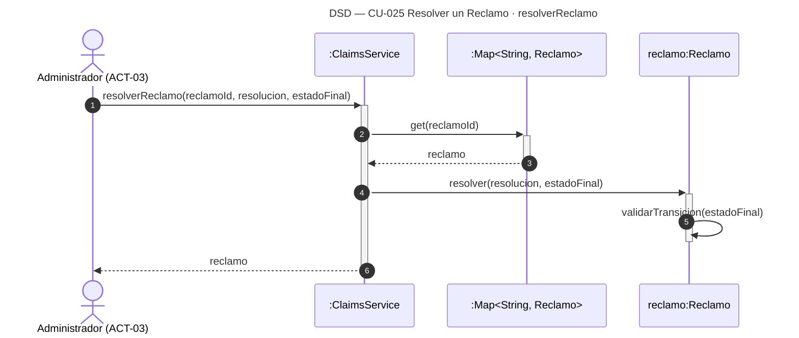

</details>

**Clases participantes:** `ClaimsService` (controlador de fachada del módulo de reclamos), la colección `Map<String, Reclamo>` y el objeto de dominio `Reclamo`.

**GRASP.** *Controlador*: `ClaimsService` recibe la operación. *Experto*: `Reclamo` conoce su estado y es quien valida la transición y toma la resolución; el controlador no le asigna atributos. La máquina de estados es una regla del propio `Reclamo`: no se pasa de «resuelto» o «rechazado» a otro estado sin reabrirlo.

**No se dibuja:** la transacción con bloqueo de la fila y el guardado, que resuelve `ClaimsService.modificar`; la distribuidora del contexto filtra la lectura, y un reclamo de otra distribuidora no se encuentra.

| Operación de diseño | Implementación |
|---|---|
| `ClaimsService.resolverReclamo(...)` | `ClaimsController.resolve` → `ClaimsService.resolve` |
| `Map<String, Reclamo>.get(...)` | `ClaimsService.modificar`: lee el `Claim` con bloqueo pesimista de la fila, filtrado por distribuidora |
| `Reclamo.resolver(...)` | `ClaimsService.resolve`: asigna `Claim.resolutionNote` y `Claim.status`, y `ClaimsService.modificar` guarda |
| `Reclamo.validarTransicion(...)` | `assertClaimTransition()` |

**Observaciones de diseño**

- El servicio lee el reclamo con bloqueo pesimista de la fila (`FOR UPDATE`) dentro de una transacción: dos administradores que resuelven, toman o reabren el mismo reclamo a la vez se serializan, y el segundo valida la transición contra el estado que dejó el primero y no contra una lectura vieja.
- La lectura filtra por la distribuidora (**guardia de distribuidora**): un admin de otra distribuidora recibe 404 (no 403), para no filtrar la existencia del reclamo.
- El Administrador General debe indicar la distribuidora con `X-Distributor`; sin ella recibe 400 "Falta la distribuidora: enviá el header X-Distributor (slug o id)".
- El `ResolveClaimDto` valida `resolution` con `@TextoNoVacio`: un texto hecho solo de espacios cuenta como vacío y responde 400.
- El `ResolveClaimDto` acepta solo `resolved` y `rejected` en `status` **antes** de llegar al servicio (`@IsIn`): pasar a en proceso es `take` (CU-166). Así el `save` nunca escribe un estado inválido.
- La máquina de estados tampoco admite repetir el estado actual ni volver a pendiente: la segunda rechaza `assertClaimTransition` con 400.
- `assertClaimTransition` (`claim-status.machine.ts`) es la única regla de negocio del módulo, extraída del servicio: `resolve` no acepta cualquier `status` del enum: valida el estado de partida.

#### Operación: planificarMantenimientoDeFlota()

**Caso de uso:** CU-105 Planificar el Mantenimiento y las Habilitaciones de la Flota  
**Actor iniciador:** Chofer (ACT-02), Administrador (ACT-03), Sistema Automático (ACT-04)

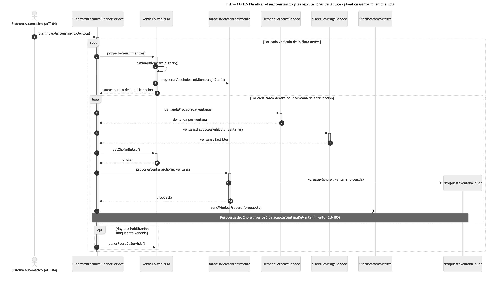

**Figura 27 — DSD CU-105: Planificar el Mantenimiento y las Habilitaciones de la Flota — Operación: planificarMantenimientoDeFlota()**

<details><summary>Ver código del diagrama</summary>

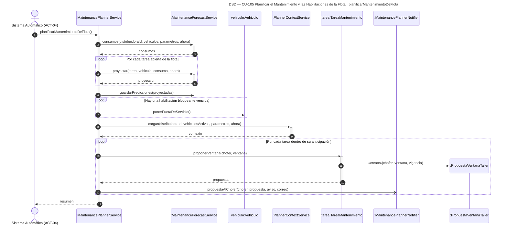

</details>

**Clases participantes:** `MaintenancePlannerService` (controlador del proceso temporal), `MaintenanceForecastService` y `PlannerContextService` (fabricaciones puras: la proyección de los vencimientos y el contexto de cobertura y demanda de la zona), `MaintenancePlannerNotifier` (fabricación pura: el aviso al chofer y al administrador) y los objetos de dominio `Vehiculo`, `TareaMantenimiento` y `PropuestaVentanaTaller`.

**GRASP.** *Controlador*: `MaintenancePlannerService`, que el planificador del sistema dispara una vez por día para cada distribuidora. *Experto*: `MaintenanceForecastService` estima el consumo de kilómetros de cada vehículo y proyecta el vencimiento de cada tarea; `PlannerContextService` conoce la demanda de la zona y cuántas unidades quedan disponibles cada día. *Creador*: `TareaMantenimiento` crea las `PropuestaVentanaTaller` que origina (composición del modelo conceptual). *Alta Cohesión*: la proyección y el contexto de cobertura viven en servicios propios, no en el planificador.

**No se dibuja:** la actualización del uso de la flota antes de estimar (`VehicleUsageFeedService`), el historial de uso y el promedio de la flota como respaldo, la negociación de las ventanas alternativas una por vez, el escalamiento al administrador cuando no hay ventana, cobertura o chofer, y el bloqueo de la agenda, que ocurre al confirmar (ver CU-105: `confirmarVentanaDeTaller`).

| Operación de diseño | Implementación |
|---|---|
| `MaintenancePlannerService.planificarMantenimientoDeFlota(...)` | `MaintenancePlannerService.ejecutar`: lo dispara `MaintenancePlannerCron.planificar` una vez por día para cada distribuidora con tareas; es idempotente, porque una tarea con un caso abierto o con el taller ya programado no se vuelve a planificar |
| `Vehiculo.ponerFueraDeServicio(...)` | `MaintenancePlannerService.apagarVencidos`: con una habilitación bloqueante vencida, por fecha o por kilometraje, pasa `Car.fleetStatus` de ACTIVE a GROUNDED con `CarService.cambiarEstadoDeFlota`, libera al chofer con `VehicleAssignmentService.liberarDelVehiculo` en la misma transacción y avisa al administrador con `MaintenancePlannerNotifier.alAdminVehiculoFueraDeServicio` |
| `TareaMantenimiento.proponerVentana(...)` | `MaintenancePlannerService.planificar`: arma las ventanas candidatas con `enumerarVentanas()`, las evalúa contra la demanda y las unidades disponibles de la zona con `evaluarVentanas()`, abre el `MaintenancePlanningCase` y ofrece la primera con `MaintenancePlannerService.ofrecerSiguiente`; si no hay ventana, cobertura o chofer, el caso queda escalado al administrador |
| `PropuestaVentanaTaller.«create»` | `MaintenancePlannerService.ofrecerSiguiente`: inserta la `MaintenanceWindowProposal` en estado PENDING, con la ventana (`MaintenanceWindowProposal.windowStart` y `MaintenanceWindowProposal.windowEnd`) y una vigencia (`MaintenanceWindowProposal.expiresAt`) que no pasa del inicio de la ventana |

#### Operación: anticiparRecompras()

**Caso de uso:** CU-106 Anticipar la Recompra por Consumo Estimado  
**Actor iniciador:** Cliente (ACT-01), Sistema Automático (ACT-04)


**Figura 28 — DSD CU-106: Anticipar la Recompra por Consumo Estimado — Operación: anticiparRecompras()**

<details><summary>Ver código del diagrama</summary>

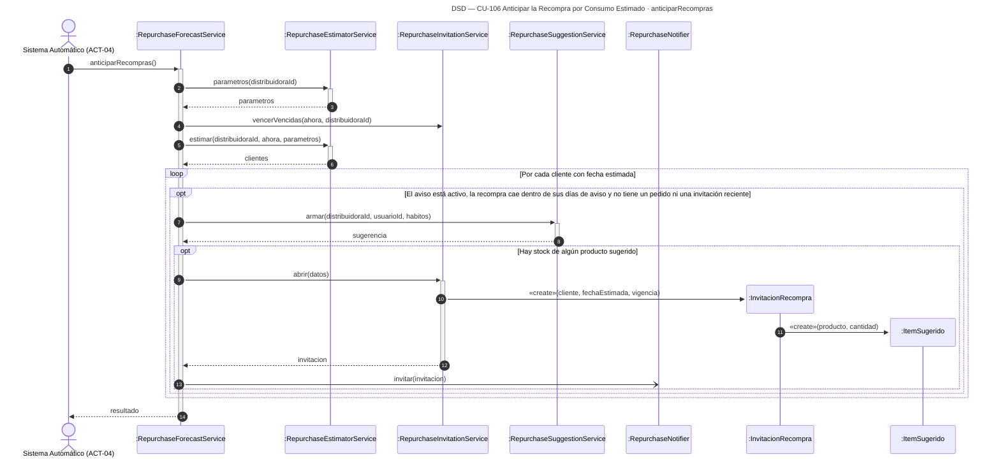

</details>

**Clases participantes:** `RepurchaseForecastService` (controlador del proceso diario), `RepurchaseEstimatorService` (fabricación pura: el cálculo de la fecha en que se le termina el gas a cada cliente), `RepurchaseInvitationService` (fabricación pura: vencimiento y alta de las invitaciones), `RepurchaseSuggestionService` (fabricación pura: el pedido sugerido según los hábitos del cliente), `RepurchaseNotifier` (fabricación pura: el aviso al cliente) y los objetos de dominio `InvitacionRecompra` e `ItemSugerido`.

**GRASP.** *Controlador*: `RepurchaseForecastService` recibe la ejecución programada. *Creador*: `RepurchaseInvitationService` abre la `InvitacionRecompra` con los datos que le pasa el controlador, y la `InvitacionRecompra` crea sus `ItemSugerido` (los contiene, composición del modelo conceptual). *Experto*: el estimador conoce el historial de compras y calcula cuándo se le termina el gas al cliente; el servicio de invitaciones sabe cuáles vencieron y las pasa a «vencida». El cliente que no llega al mínimo de pedidos, o con una serie demasiado irregular, queda fuera de la corrida, y si no hay stock del producto sugerido no se emite la invitación.

**No se dibuja:** el cierre de las invitaciones a las que el cliente se adelantó con un pedido propio, el motivo por el que se omite a cada cliente (aviso desactivado, recompra lejana, pedido reciente, intervalo mínimo o mismo ciclo de consumo), la simulación con `dryRun` y el guardado.

| Operación de diseño | Implementación |
|---|---|
| `RepurchaseForecastService.anticiparRecompras(...)` | `RepurchaseForecastService.ejecutar`: lo dispara `RepurchaseCron.anticipar` a la hora configurada para cada distribuidora; con `enabled` en 0 responde 409, porque el proceso viene apagado, y es idempotente, ya que no invita a quien tiene una invitación abierta ni a quien la tuvo hace menos del intervalo mínimo |
| `InvitacionRecompra.«create»` | `RepurchaseInvitationService.abrir`: inserta la `RepurchaseInvitation` en estado PENDING, con la fecha proyectada (`RepurchaseInvitation.projectedDepletionAt`) y la vigencia (`RepurchaseInvitation.expiresAt`); devuelve nulo si otra corrida ya abrió una al cliente |
| `ItemSugerido.«create»` | `RepurchaseSuggestionService.armar`: arma los ítems sugeridos (producto y cantidad de sus últimas compras, solo los que tienen stock) que la invitación guarda en `RepurchaseInvitation.suggestedItems` |

**Observaciones de diseño**

- La invitación se emite con el pedido ya armado: el cliente la acepta o la deja vencer, y no vuelve a elegir los productos.
- El proceso viene apagado: cada distribuidora lo habilita desde los parámetros de la recompra (`/module-config/repurchase`, `enabled`).

#### Operación: agruparPedidosPorRecorrido()

**Caso de uso:** CU-107 Agrupar Pedidos por Recorrido  
**Actor iniciador:** Chofer (ACT-02), Sistema Automático (ACT-04)

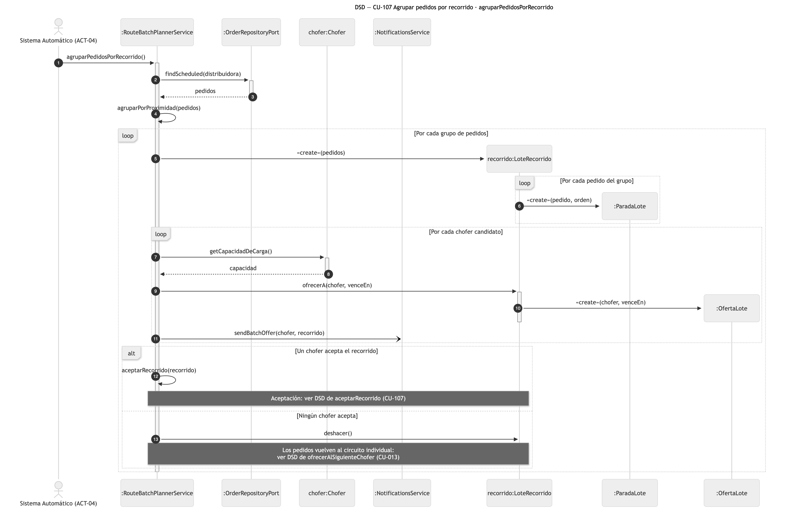

**Figura 29 — DSD CU-107: Agrupar Pedidos por Recorrido — Operación: agruparPedidosPorRecorrido()**

<details><summary>Ver código del diagrama</summary>

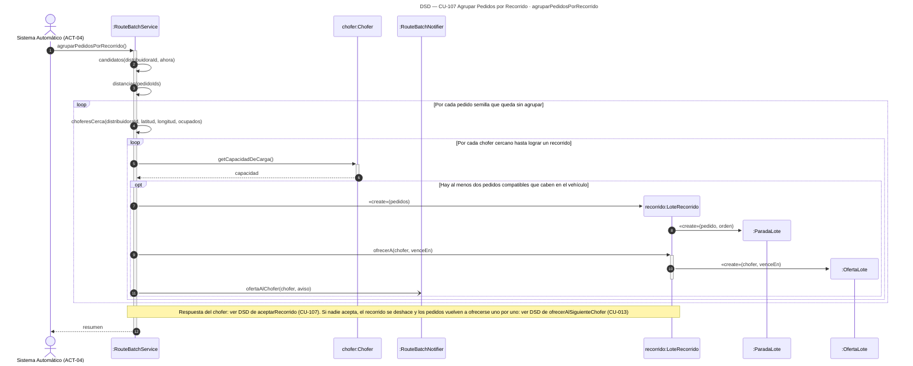

</details>

**Clases participantes:** `RouteBatchService` (controlador del proceso temporal), `RouteBatchNotifier` (fabricación pura: el aviso de la oferta al chofer) y los objetos de dominio `Chofer`, `LoteRecorrido`, `ParadaLote` y `OfertaLote`. La agrupación se construye por encima del despacho vigente y no lo modifica, salvo por la guarda de no ofrecer un pedido que ya está dentro de un lote con oferta activa.

**GRASP.** *Controlador*: `RouteBatchService` recibe la operación del proceso temporal. *Creador*: el controlador crea el `LoteRecorrido`, que es la raíz del agregado y se inicializa con los pedidos agrupados; el `LoteRecorrido` crea sus `ParadaLote` y sus `OfertaLote`, porque los contiene (composición). *Experto*: el `Chofer` conoce la capacidad de carga de su vehículo; el lote respeta el compromiso horario de cada pedido. El lote nunca se impone: ante el silencio o el rechazo generalizado, el lote se deshace y los pedidos siguen su camino individual.

**Referencias.** La aceptación del recorrido por el chofer es la operación `aceptarRecorrido` (CU-107) y la vuelta de los pedidos al circuito individual es `ofrecerAlSiguienteChofer` (CU-013): cada una tiene su propio diagrama.

**No se dibuja:** la lectura de los pedidos programados y de las distancias entre ellos, el orden de las paradas, el recorte del lote según la capacidad, el cerrojo por pedido que comparte con el despacho individual, la transacción de alta y el recálculo si un pedido se cancela mientras corre la oferta.

| Operación de diseño | Implementación |
|---|---|
| `RouteBatchService.agruparPedidosPorRecorrido(...)` | `RouteBatchService.evaluar`: lo dispara `RouteBatchCron.armar` para cada distribuidora con pedidos programados, con un cerrojo de Redis por distribuidora; con `enabled` en 0 el proceso no corre y, si otra instancia tiene el cerrojo, no hace nada |
| `Chofer.getCapacidadDeCarga(...)` | `RouteBatchService.capacidadDelChofer`: lee `Car.carCapacity` del vehículo que el chofer tiene en uso; sin vehículo o sin capacidad cargada no limita el peso |
| `LoteRecorrido.«create»` | `RouteBatchService.crearLoteOfrecido`: inserta el `RouteBatch` en estado OFFERED con `RouteBatch.totalWeightKg`, después de bloquear los pedidos con `FOR UPDATE` y comprobar que siguen pendientes y sin chofer |
| `ParadaLote.«create»` | `RouteBatchService.crearLoteOfrecido`: inserta una `RouteBatchStop` por pedido con `RouteBatchStop.sequence`, `RouteBatchStop.etaAt` y `RouteBatchStop.legDistanceKm`, en el orden que calcula `ordenarParadas()` |
| `LoteRecorrido.ofrecerA(...)` | `RouteBatchService.crearOferta`: ofrece el recorrido al chofer que eligió `RouteBatchService.choferesCerca` entre los habilitados más cercanos al punto de partida que no están ocupados con otro lote |
| `OfertaLote.«create»` | `RouteBatchService.crearOferta`: inserta la `RouteBatchOffer` pendiente, con `RouteBatchOffer.expiresAt` igual al momento actual más `offerTtlSeconds` |

#### Operación: gestionarEnvasesNoDevueltos()

**Caso de uso:** CU-108 Recuperar Envases No Devueltos  
**Actor iniciador:** Cliente (ACT-01), Administrador (ACT-03), Sistema Automático (ACT-04)


**Figura 30 — DSD CU-108: Recuperar Envases No Devueltos — Operación: gestionarEnvasesNoDevueltos()**

<details><summary>Ver código del diagrama</summary>

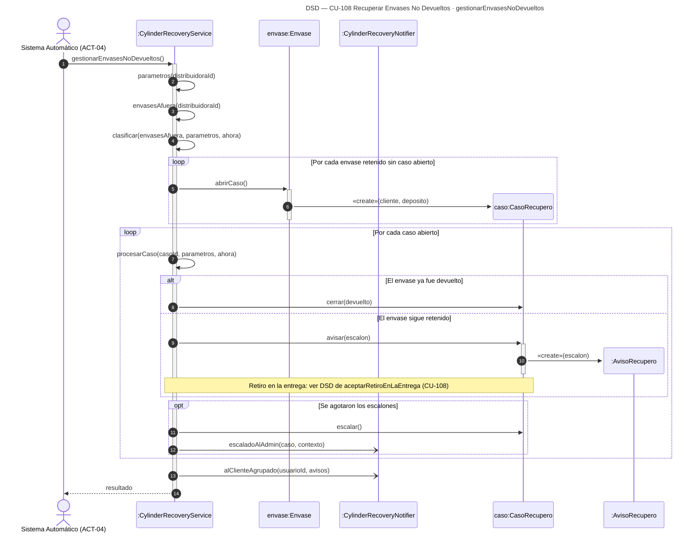

</details>

**Clases participantes:** `CylinderRecoveryService` (controlador del proceso temporal), `CylinderRecoveryNotifier` (fabricación pura: los avisos al cliente y al administrador) y los objetos de dominio `Envase`, `CasoRecupero` y `AvisoRecupero`. La detección del envase retenido no necesita una fuente de datos nueva: sale del estado del envase y de sus movimientos de despacho y devolución.

**GRASP.** *Controlador*: `CylinderRecoveryService` recibe la operación del proceso temporal. *Creador*: el `Envase` que motiva el caso crea el `CasoRecupero`, y el `CasoRecupero` crea sus `AvisoRecupero` por cada escalón ejecutado, porque los contiene (composición). *Experto*: el `Envase` sabe si volvió; el `CasoRecupero` conoce su escalón y es quien se cierra o se escala. El caso se reevalúa antes de cada paso, porque el envase puede haber vuelto, y el sistema nunca cobra un depósito por su cuenta: agotada la secuencia, el caso queda a resolución del administrador.

**Referencias.** El retiro del envase en una entrega ya programada es la operación `aceptarRetiroEnLaEntrega` (CU-108) y la decisión final sobre el depósito o la baja es `resolverCasoDeRecupero` (CU-108): cada una tiene su propio diagrama.

**No se dibuja:** los plazos de cada escalón, la oferta de retiro en la entrega programada del cliente (`CylinderRecoveryService.ofrecerRetiro`), el marcado para revisión manual si el último movimiento del envase no permite saber en poder de quién está, el cierre del caso por importe bajo el umbral como envase perdido y la persistencia.

| Operación de diseño | Implementación |
|---|---|
| `CylinderRecoveryService.gestionarEnvasesNoDevueltos(...)` | `CylinderRecoveryService.ejecutar`: lo dispara `CylinderRecoveryCron.recuperar` a la hora configurada para cada distribuidora; con `enabled` en 0 responde 409, porque el proceso viene apagado, y es idempotente, ya que hay un solo caso vivo por envase y un solo aviso por escalón |
| `Envase.abrirCaso(...)` | `CylinderRecoveryService.abrirCaso`: lo hace para cada envase en poder de un cliente cuya antigüedad supera `toleranceDays`, según `CylinderRecoveryService.envasesAfuera` y `CylinderRecoveryService.clasificar` |
| `CasoRecupero.«create»` | `CylinderRecoveryService.abrirCaso`: inserta el `CylinderRecoveryCase` en estado OPEN, en el escalón 1, con `CylinderRecoveryCase.depositAmount` y `CylinderRecoveryCase.deliveredAt`; el índice único evita un segundo caso vivo del mismo envase |
| `CasoRecupero.cerrar(...)` | `CylinderRecoveryService.cerrar`: dentro de `CylinderRecoveryService.procesarCaso`, si el envase volvió o se dio de baja por otra vía, pasa `CylinderRecoveryCase.status` a RETURNED o CLOSED_NO_CHARGE y fija `CylinderRecoveryCase.closedAt` |
| `CasoRecupero.avisar(...)` | `CylinderRecoveryService.procesarCaso`: sube `CylinderRecoveryCase.step` cuando venció el plazo del escalón y fija `CylinderRecoveryCase.stepDueAt` con el plazo del escalón siguiente |
| `AvisoRecupero.«create»` | `CylinderRecoveryService.procesarCaso`: inserta el `CylinderRecoveryNotice` del escalón, con su tipo según `avisoDelEscalon()` |
| `CasoRecupero.escalar(...)` | `CylinderRecoveryService.procesarCaso`: agotados los escalones, pasa `CylinderRecoveryCase.status` a ESCALATED o LOST según `destinoAlAgotarse()` y el umbral `escalationAmountThreshold` |

### 2.2 Casos sin diagrama de interacción

| Caso de uso | Tipo | Motivo |
|---|---|---|
| CU-152 Consultar el Registro de Auditoría | Estático | es una consulta que no modifica nada: la resuelve una sola clase y no hay colaboración que diseñar. |

---

<!-- dc:inicio -->
## 3. Diagrama de Clase

El diagrama de clases de diseño **se deriva de los diagramas de interacción** (ver «Diagrama de Interacción»), como pide Larman en *UML y patrones*: cada mensaje que recibe un objeto es una operación de su clase, y la visibilidad entre dos objetos que se mandan mensajes decide la relación que los une. Se construye a partir de los 20 diagramas de interacción y del modelo conceptual (Documento 2, «Modelo Conceptual»): lleva las clases que aparecen en esos diagramas, y todo lo que muestra sale de alguno de ellos.

**Cómo se deriva.**

| Del DSD | Al diagrama de clases |
|---|---|
| Un mensaje `A->>B: operacion(parametro)` | La operación `+ operacion(parametro: Tipo): Retorno` en la clase de `B`, con el retorno que el DSD muestra. Una operación aparece una sola vez aunque varios DSD la usen |
| `«create»` hacia un objeto | Un constructor `+ «create» Clase(...)` y, si quien crea no es el agregado que lo contiene, una dependencia `«create»` |
| Dos objetos de dominio que se mandan mensajes y tienen asociación en el modelo conceptual | Esa asociación, con su nombre y su multiplicidad, **navegable** en el sentido del mensaje (visibilidad por atributo) |
| Un objeto de dominio que llega por parámetro o variable local (controlador a objeto, objeto a objeto sin asociación) | **Dependencia** (línea punteada) |
| Servicio, puerto o colección que colabora con otro | Asociación navegable de multiplicidad 1: el colaborador se inyecta como atributo. Si el código real no lo inyecta, dependencia |
| Primer receptor del mensaje del actor | `«controlador»` (clase `…UseCase` del módulo) o `«fachada»` (servicio fachada del módulo): el controlador de aplicación |
| Objeto de infraestructura que solo recibe mensajes de otros | `«fabricación pura»` |
| Puerto (`…Port`) | `interface` con `«puerto»`; el adaptador que lo realiza se dibuja con la flecha punteada de punta hueca solo si aparece en un DSD |
| `:Map<String, X>` y `:List<X>` | `«colección»` agregada a su clase `X` (el DSD las usa para buscar por identificador) |

**Notación.** Atributos `- nombre: Tipo` (privados; `/` marca un atributo derivado); operaciones `+ nombre(parametro: Tipo): Retorno`; `X[*]` es una colección de `X`; una línea sin punta no dice nada de la navegabilidad o es navegable en los dos sentidos (la composición se dibuja así cuando los DSD la recorren en ambos). Los nombres están en el idioma del DSD: las clases de dominio son las del modelo conceptual (`Pedido`, `ItemPedido`) y los controladores, fabricaciones puras y puertos llevan su nombre real (`CreateOrderUseCase`, `OrderPricingService`, `NotificationPort`). Una operación sin retorno es una que el DSD no muestra devolviendo nada. Una operación tiene una sola firma por clase y un solo retorno: cuando el DSD devuelve varios valores, el retorno es un `Registro`; un argumento que no todas las llamadas pasan se marca opcional (`= ninguno`). Los argumentos son variables con su tipo, nunca valores literales; los importes son `Moneda` y las horas, `Hora` o `FechaHora`.

**Tipos.** Los primitivos son los de las operaciones del sistema del Documento 2; los de los atributos de dominio salen de las columnas del backend, y los de los argumentos y retornos, de esas operaciones o del modelo conceptual.

| Tipo | Significado |
|---|---|
| `Cadena` | texto |
| `Identificador` | identificador único de un objeto (UUID) |
| `Entero` | número sin decimales |
| `Decimal` | número con decimales |
| `Moneda` | importe en pesos |
| `Booleano` | verdadero o falso |
| `Fecha` | día calendario |
| `Hora` | hora del día |
| `FechaHora` | instante: día y hora |
| `Coordenada` | punto geográfico (latitud y longitud) |
| `Poligono` | área geográfica cerrada |
| `Archivo` | contenido binario con su tipo |
| `Registro` | conjunto de campos con nombre |

| Enumeración | Enumeración del backend |
|---|---|
| `EstadoDeDistribuidora` | `DistributorStatus` |
| `EstadoDeLaTarea` | `MaintenanceTaskStatus` |
| `EstadoDelCasoDeRecupero` | `RecoveryCaseStatus` |
| `EstadoDelCobroEnPasarela` | `LedgerPaymentStatus` |
| `EstadoDelEnvase` | `CylinderState` |
| `EstadoDelLote` | `RouteBatchStatus` |
| `EstadoDelPago` | `PaymentStatus` |
| `EstadoDelReclamo` | `ClaimStatus` |
| `EstadoEnLaFlota` | `FleetStatus` |
| `EstadoPedido` | `OrderStatus` |
| `MetodoDePago` | `PaymentMethod` |
| `ModalidadDeEntrega` | `OrderDeliveryMode` |
| `MotivoDeMovimiento` | `StockMovementReason` |
| `Pasarela` | `PaymentGateway` |
| `TipoDeAviso` | `RecoveryNoticeKind` |
| `TipoDeCombustible` | `FuelType` |
| `TipoDeRecargo` | `CoverageZoneSurchargeType` |
| `TipoDeRol` | `RoleType` |

En total el diagrama tiene **71 clases** y **158 operaciones**: 26 clases de dominio (las del modelo conceptual que aparecen en los diagramas) y 45 de diseño (4 colección, 6 controlador, 18 fabricación pura, 12 fachada, 5 puerto). Las 47 asociaciones del modelo conceptual están todas; 15 resultan navegables según los mensajes de los DSD, y 40 pares de clases quedan unidos por una dependencia.

### 3.1 Clases del Dominio

Las clases del modelo conceptual, con sus atributos tipados y las operaciones que reciben en los DSD. La vista general no lleva miembros; las vistas por área llevan todos y dibujan en gris, solo como referencia, las clases de otra área. Cada asociación del modelo conceptual está en alguna vista, con su multiplicidad.


**Figura 31 — Diagrama de Clase: dominio, vista general**

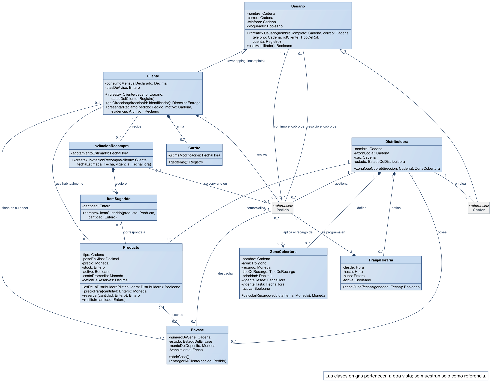

**Figura 32 — Diagrama de Clase: dominio, cuentas, clientes y catálogo**


**Figura 33 — Diagrama de Clase: dominio, pedido, pago y reclamo**

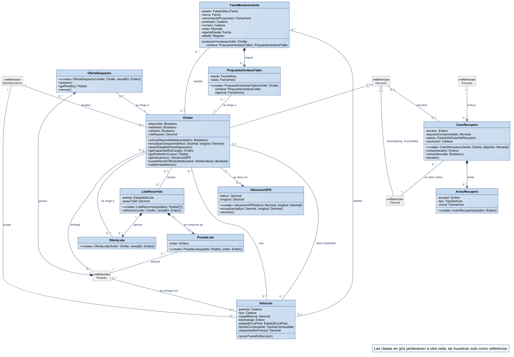

**Figura 34 — Diagrama de Clase: dominio, despacho, flota y recupero de envases**

### 3.2 Clases de Diseño

Los controladores, las fabricaciones puras, los puertos y las colecciones de los DSD, agrupados por la parte del sistema en la que colaboran. Cada vista dibuja con todas sus operaciones las clases de su módulo y, en gris, las clases con las que colabora. Las clases de dominio de cada diagrama están en 3.1.

| Papel | Clases |
|---|---|
| `«colección»` | `Map<String, Chofer>`, `Map<String, Pedido>`, `Map<String, Reclamo>`, `Map<String, Usuario>` |
| `«controlador»` | `CancelOrderUseCase`, `CashCollectionUseCase`, `ConfirmDeliveryUseCase`, `ConfirmPaymentUseCase`, `CreateOrderUseCase`, `UpdateOrderStatusUseCase` |
| `«fabricación pura»` | `AdminGateway`, `CustomersGateway`, `CylinderRecoveryNotifier`, `DispatchSettingsService`, `FleetDispatchLockService`, `MaintenanceForecastService`, `MaintenancePlannerNotifier`, `NotificationsService`, `PlannerContextService`, `RefundsService`, `RepurchaseEstimatorService`, `RepurchaseInvitationService`, `RepurchaseNotifier`, `RepurchaseSuggestionService`, `RouteBatchNotifier`, `ScheduledTasksSettingsService`, `StockDeliveryService`, `TruckLoadGateService` |
| `«fachada»` | `AuthService`, `ClaimsService`, `CylinderRecoveryService`, `DeliveryService`, `DispatchOrchestratorService`, `DispatchService`, `DriversGateway`, `MaintenancePlannerService`, `OrderService`, `RegistroService`, `RepurchaseForecastService`, `RouteBatchService` |
| `«puerto»` | `DispatchOfferRepositoryPort`, `FirebaseAuthPort`, `NotificationPort`, `PaymentGatewayPort`, `RealtimeDispatchPort` |

Ningún DSD llega hasta un adaptador (los diagramas terminan en el puerto), así que el diagrama no dibuja realizaciones; cuando un DSD nombre un adaptador, la realización se dibuja sola.

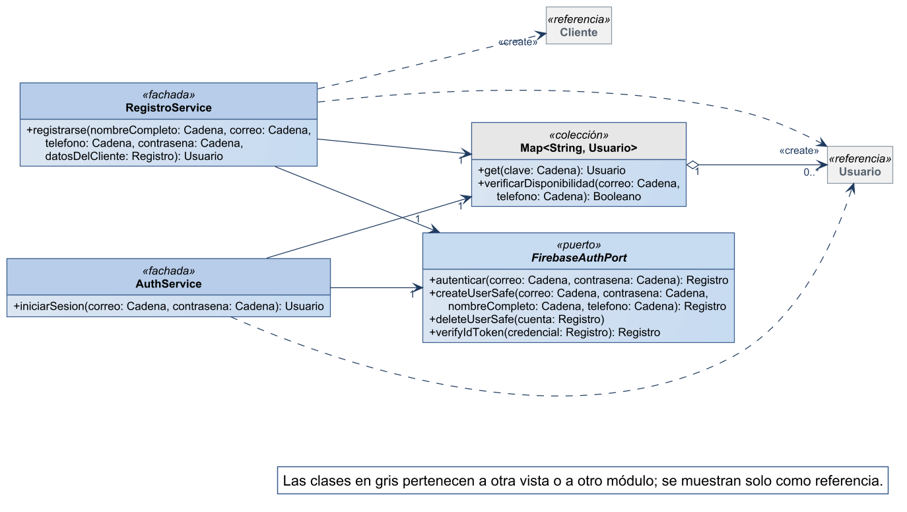

**Figura 35 — Diagrama de Clase: diseño, acceso, registro y clientes**

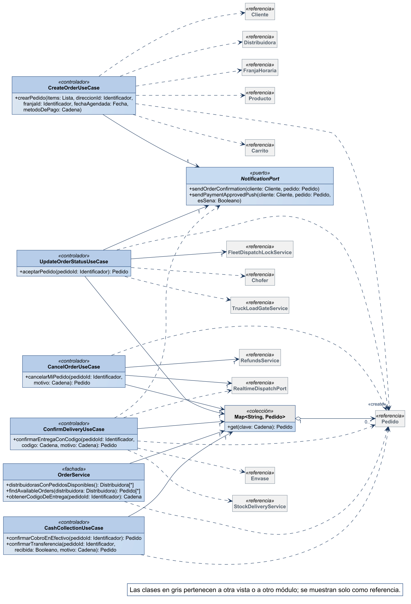

**Figura 36 — Diagrama de Clase: diseño, pedido: alta, cancelación y entrega**

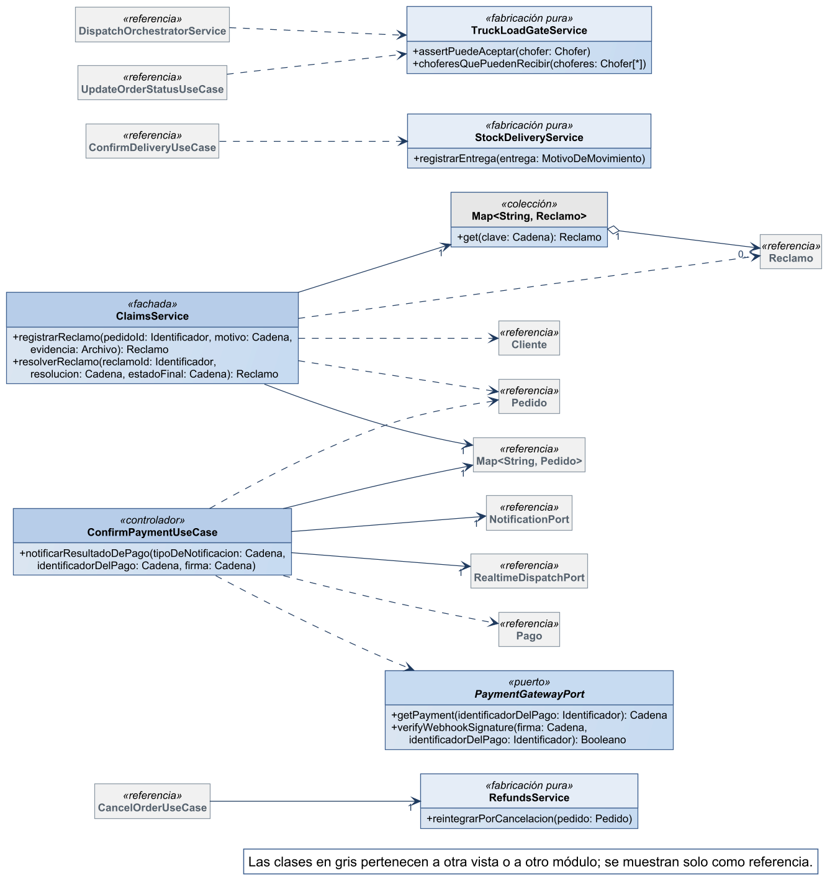

**Figura 37 — Diagrama de Clase: diseño, pagos, stock y reclamos**

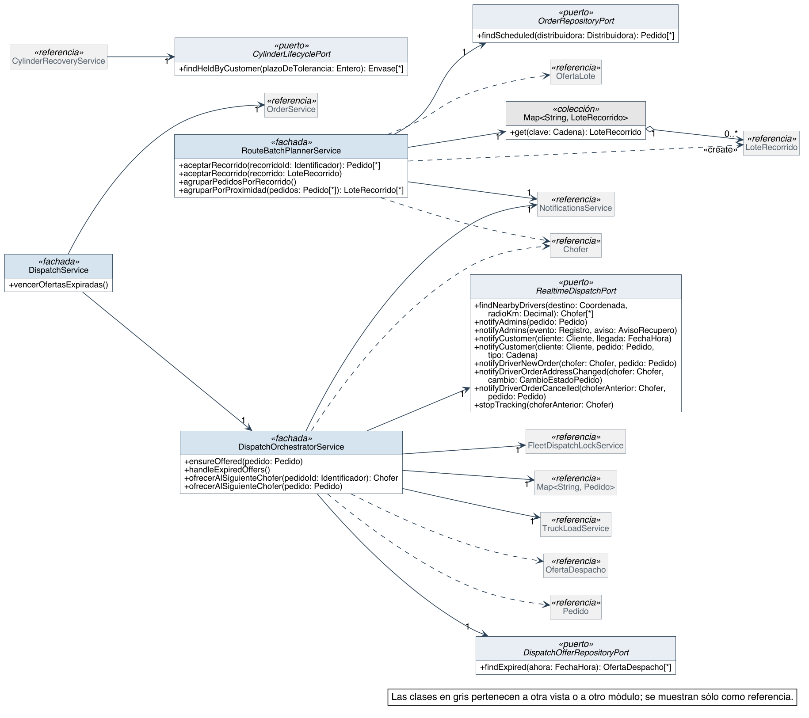

**Figura 38 — Diagrama de Clase: diseño, despacho y seguimiento en tiempo real**

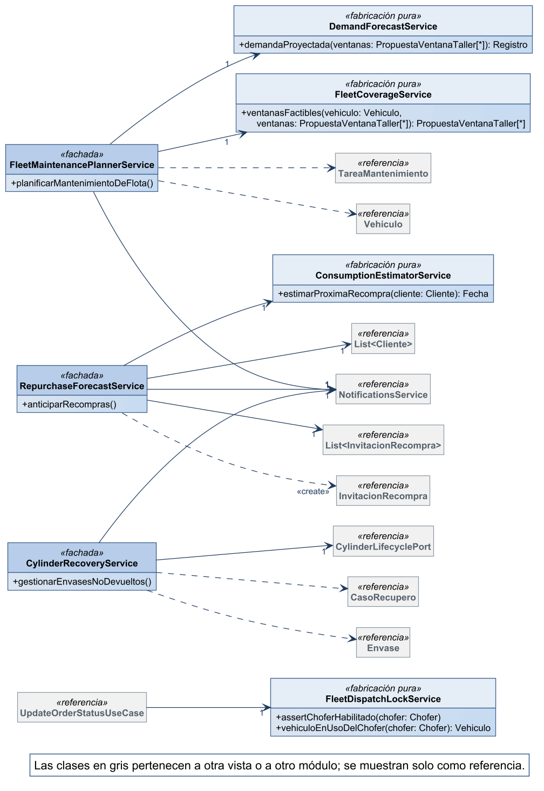

**Figura 39 — Diagrama de Clase: diseño, flota, recompra y recupero de envases**


<!-- dc:fin -->
