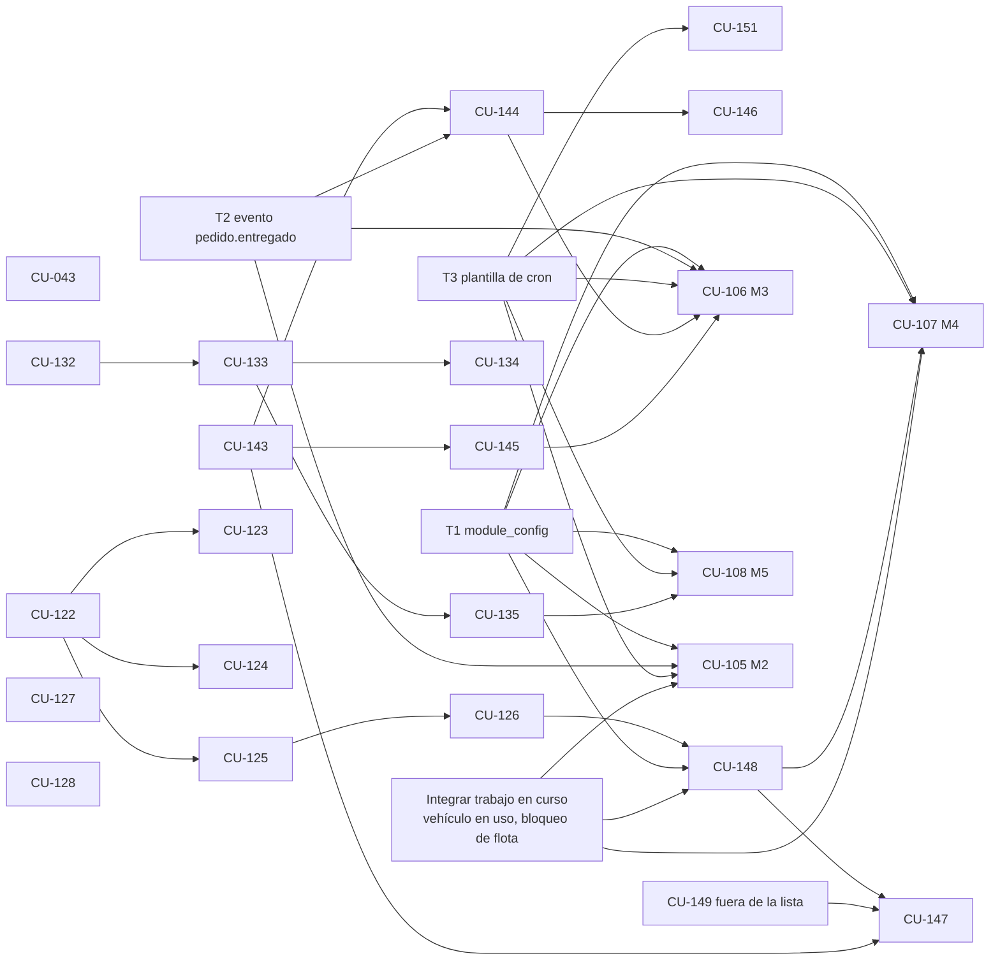

# Plan de desarrollo de los casos de uso planificados

> Alcance: los 23 casos de uso especificados y no construidos (CU-043, CU-105 a CU-108,
> CU-122 a CU-128, CU-132 a CU-135, CU-143 a CU-148 y CU-151).
> Fecha del relevamiento: 01/10/2026.
> El diseño a seguir es el DSD de cada caso (Documento 3, §4 y apéndice); cuando el
> código vigente obliga a apartarse de él, se indica en el caso y en la sección 7.

---

## 1. Resumen

| Iteración | Casos de uso | Tamaño | Qué se puede mostrar al cerrarla |
|---|---|:---:|---|
| **C-07** Cimientos y huecos cortos | CU-043, CU-151 y las piezas transversales T1 a T5 | M | La franja se edita sin darla de baja; una zona vencida se desactiva sola; la configuración de procesos se edita desde el panel. |
| **C-11** Vigencia de envases | CU-132, CU-133, CU-134, CU-135 | M | Un envase con la revisión vencida no puede asignarse a ningún pedido. |
| **C-12** Carrito persistente | CU-122, CU-123, CU-124, CU-125, CU-126 | L | El cliente arma el carrito, cierra la app, la vuelve a abrir y el carrito sigue ahí. |
| **C-10** Pedido en curso | CU-127, CU-128 | M | El cliente cambia la dirección de un pedido en curso y el chofer lo ve, con quién recibe. |
| **C-13** Consumo declarado | CU-143, CU-144, CU-145, CU-146 | M | El administrador ve qué clientes se quedan sin gas esta semana. |
| **C-16** Módulo M3: recompra | CU-106 | L | Un cliente recibe la invitación a reponer y, al aceptarla, el pedido entra al despacho. |
| **C-17** Compra express | CU-148, CU-147 (más CU-149, que no está en la lista pero es su condición) | L | Un pedido express sale a un chofer en moto o se degrada a programado avisándole al cliente. |
| **C-15** Módulo M5: recupero de envases | CU-108 | L | Un envase retenido abre su caso, escala y el administrador lo resuelve. |
| **C-19** Módulo M4: agrupación por recorrido | CU-107 | L | Tres pedidos programados cercanos se ofrecen como un solo recorrido ordenado. |
| **C-14** Módulo M2: flota | CU-105 | L+ | El planificador propone una ventana de taller al chofer y escala si se agotan. |

**Iteración recomendada para empezar: C-07.** Es chica, no depende de nada y deja
construidas tres cosas que después usan casi todos los demás grupos:

1. **La configuración de procesos (`module_config`)**: la tabla y la entidad ya existen
   pero ningún servicio las lee. Sin ella, la compra express y los cuatro módulos
   inteligentes quedan con parámetros fijos en el código, que es justamente el criterio C4
   ("parametrizable") que la cátedra exige y que hoy ya incumple el despacho M1
   (`MODULOS-INTELIGENTES.md`, Parte I §2).
2. **El evento de dominio de pedido entregado**, que hoy no existe y que necesitan el
   recálculo de la recompra (CU-144, CU-106), el registro de uso de la flota (CU-105) y el
   recupero de envases (CU-108).
3. **La plantilla del proceso temporal con cerrojo**, que CU-151 estrena con el caso más
   simple posible (un solo `UPDATE` condicional) y que repiten CU-106, CU-107, CU-108 y
   CU-105.

Además cierra CU-043, que el Documento 3 §10.1 lista como hueco **Crítico** desde antes de
la ampliación: es el único de los 23 que la documentación daba por construido y no lo
estaba.

Si se prefiere arrancar por el grupo funcional de más peso en la defensa, la alternativa
es **C-11**: tiene dos casos Críticos (CU-132 y CU-135), vive entero en el backend y el
panel, toca un solo módulo y cumple uno de los hitos de cierre de C-06.

**Sobre los plazos.** La iteración C-06 cierra el 20/10/2026, en 19 días. La suma de las
diez iteraciones ronda las 55 a 60 jornadas de trabajo de una persona (sección 5.11). No
entra completa en C-06 ni aun repartiendo en worktrees: las metas de C-06 cubren C-07 a C-13
y la express, y los cuatro módulos inteligentes no figuran entre ellas. La sección 5.12
propone cómo repartir en carriles paralelos y qué recortar si el tiempo no alcanza.

---

## 2. Punto de partida verificado

### 2.1 Estado de los repositorios al relevar

| Repositorio | Rama | Estado |
|---|---|---|
| `splg-app-backend` | `fix/zonas-y-baja-de-chofer` | 80 archivos modificados y 30 nuevos **sin commitear** (asignación de vehículo en uso, bloqueo de despacho por flota, liberación de pedidos, estados de reclamo, migraciones `VehiculoEnUso` y `BackfillVehiculoEnUsoInicial`). Cinco worktrees `agent/engineer/*` abiertos sobre el mismo commit. |
| `splg-app-admin` | `feat/panel-flota-documentacion` | 188 cambios sin commitear. |
| `splg-app-cliente`, `splg-app-chofer`, `splg-lib` | `develop` | Limpios. |

Este plan se armó contra el árbol de trabajo tal como está, incluido lo no commiteado.
**Condición previa a C-07:** integrar a `develop` (con el ok de nahue) el trabajo en curso
del backend y del panel, porque C-07 toca `order` y `coverage-zone`, que hoy tienen cambios
pendientes, y CU-105, CU-107 y CU-147 dependen del vehículo en uso del chofer, que está en
esa misma tanda sin integrar.

### 2.2 Lo que ya está construido

La migración `1790347058466-ModeloPropuesto` (25/09/2026) dejó en la base las tablas y
columnas de los 23 casos, y cada una tiene su entidad de TypeORM registrada en su módulo.
Lo que falta en todos los casos son los servicios, los endpoints, las pantallas y los
procesos.

| Pieza | Dónde | Observación verificada |
|---|---|---|
| `cart`, `cart_item` | `src/cart/entities/` | `CartModule` sólo registra las entidades: `controllers: []`, `providers: []`. Restricciones únicas `(user_id, distributor_id)` y `(cart_id, gas_cylinder_id)`. |
| `order_address_change` | `src/order/entities/` | Registrada en `OrderModule`; nadie la escribe. Sin índice por `order_id`. |
| `order.receiver_name`, `receiver_document`, `receiver_relationship` | `Order` | Existen en la entidad; `OrderMapper` no las expone. |
| `order.delivery_mode` (`standard`/`express`) | `Order` | Default `standard`; sólo aparece en un spec del mapper. `order.time_slot_id` ya es nulo-admisible y `CreateOrderDto.timeSlotId` ya es opcional. |
| `cylinder_inspection` | `src/cylinder/entities/` | Resultado `approved`/`conditional`/`rejected`, `inspected_at`, `next_due_at`, `notes`. Nadie la escribe. |
| `cylinder.manufactured_at`, `last_inspection_at`, `expires_at` | `Cylinder` | Existen. **`CylinderMapper` expone las dos primeras pero no `expires_at`.** Sin índice sobre `expires_at`. |
| `customer.avg_monthly_consumption_kg`, `declared_cylinder_type_id`, `repurchase_notice_days` (default 3), `next_repurchase_estimate_at` | `Customer` | Sin uso. Sin índice sobre la fecha estimada. |
| `coverage_zone.valid_until` | `CoverageZone` | Alta y edición validan la vigencia; **`checkCoverage` ya filtra `valid_until IS NULL OR valid_until > now()`**, de modo que el recargo de una zona vencida ya no se aplica. Ningún proceso pone `isActive` en falso. El panel ya edita `validUntil` (CU-150 construido). |
| `module_config` y `configurable_process_enum` (`fleet_planner`, `repurchase`, `route_batching`, `cylinder_recovery`, `express_dispatch`) | `src/distributor/entities/` | Registrada en `DistributorModule`; sin servicio ni endpoint. |
| `repurchase_invitation` | `src/customer/entities/` | Con `suggested_items` en jsonb, `status`, `expires_at`, `order_id`. |
| `route_batch`, `route_batch_stop`, `route_batch_offer` | `src/order/entities/` | Estados del lote `forming`/`offered`/`assigned`/`dissolved`/`completed`. |
| `cylinder_recovery_case`, `cylinder_recovery_notice` | `src/cylinder/entities/` | **El aviso no tiene `order_id`**: no hay dónde atar la oferta de retiro a la entrega programada. |
| `maintenance_window_proposal`, `vehicle_usage_log` | `src/fleet/entities/` | Sin servicio. Nada alimenta el registro de uso. |
| Módulo `fleet` (CU-136 a CU-142) | `src/fleet/` | Construido: planes con disparador por km, por tiempo o por fecha, criticidad bloqueante, anticipación por plan, tareas con `dueKm`, `predictedDueAt`, `scheduledAt`, y `FleetAlertsCron` diario. `FleetDispatchLockService` (sin commitear) ya excluye del despacho a los choferes con una tarea bloqueante vencida. |
| `Car.odometer_km`, `fleet_status`, `max_load_kg` | `Car` | Existen. `Car.typeCar` es **texto libre** (`'Moto'`, `'Auto'`...). |
| Control de cupo de franja | `TimeSlotService.assertSlotAvailableTx` | Ya se valida al crear el pedido, dentro de la transacción. La fila "Validación de capacidad de franja" de Documento 3 §10.1 quedó desactualizada. |
| Precio del ítem | `CreateOrderUseCase` | Sale del catálogo (`gasCylinder.price`), no de lo que manda la app. |
| Procesos temporales | `DispatchService` (15 s, con cerrojo), `ReservationService` (3 crons), `FleetAlertsCron` (diario, **sin cerrojo**) | `ScheduleModule` y `RedisService.acquireLock` (Redlock) disponibles. |
| Eventos de dominio | `@nestjs/event-emitter` | Existen `pago.notificado`, `chofer.dado-de-baja`, `distribuidora.creada`, `usuario.registrado`. **No existe uno de pedido entregado.** |

### 2.3 Lo que no existe en las apps

- **App Cliente**: el carrito es un `CartService` de Stacked en memoria (`ReactiveValue<Order?>`),
  que además sostiene el flujo de "editar pedido". No hay pantalla de consumo, modalidad,
  express, cambio de dirección, quién recibe, invitaciones ni avisos de recupero. Tiene
  `firebase_messaging` pero no maneja eventos de datos propios.
- **App Chofer**: asigna envases con `POST /cylinders/assign` desde la vista de entrega. No
  muestra quién recibe, ni ofertas de lote, ni propuestas de ventana de taller.
- **`splg-lib`**: los modelos `Order` y `Customer` no tienen los campos nuevos.
- **Panel**: la franja se crea y se borra pero no se edita; el detalle del envase muestra
  fabricación y última inspección pero no vencimiento; no hay pantallas de consumo,
  recompra, recupero, lotes ni configuración de procesos.

---

## 3. Piezas transversales

Se construyen en C-07, salvo que se indique otra cosa, y las reutilizan las iteraciones
siguientes.

**T1. Configuración de procesos por distribuidora.** `ModuleConfigService` en
`distributor` (lo exporta), con `obtener<T>(distributorId, modulo)` que mezcla lo guardado
con los valores por omisión del módulo, y un DTO de validación por módulo (el `params` es
jsonb: sin validación por módulo, un parámetro mal escrito se guarda igual). Endpoints
`GET /module-config`, `GET /module-config/:module` y `PUT /module-config/:module`
(ADMIN y SUPER_ADMIN, acotados por `@CurrentDistributor({ required: true })`). Panel:
sección "Procesos automáticos" dentro de Configuración, un formulario por módulo.
Cada iteración que agrega un módulo agrega su DTO y su formulario.

**T2. Evento `pedido.entregado`.** Constante en el módulo `order`, emitido después del
commit en el camino que pasa el pedido a `DELIVERED` (`UpdateOrderStatusUseCase` y
`ConfirmDeliveryUseCase`), con `orderId`, `distributorId`, `customerId`, `deliveryId`,
`deliveredAt` y el kilaje entregado. Lo escuchan `customer`/recompra (C-13, C-16), `fleet`
(C-14) y, si se decide, el recupero (C-15). Sigue la regla de CONVENCIONES §4: lo que otro
módulo tiene que enterarse va por evento, no por llamada.

**T3. Plantilla de proceso temporal.** El patrón de `DispatchService`: `@Cron`, cerrojo con
`RedisService.acquireLock(clave, ttl)` con TTL menor que el intervalo, liberación en
`finally`, y la regla de negocio en una función pura testeable sin base. Para los procesos
cuya frecuencia u hora tiene que ser configurable por distribuidora (criterio C4), el
`@Cron` es un tic fijo y la hora de cada distribuidora se evalúa adentro contra
`module_config` y la última corrida: el decorador no admite una expresión distinta por
distribuidora.

**T4. Índices y columnas.** Cada iteración trae su propia migración generada
(`migration:generate`), nunca `synchronize`. Las que hacen falta están listadas en cada
caso.

**T5. Datos de demostración.** `scripts/seed-demo.ts` se amplía en cada iteración con lo
que el caso necesita para verse: envases vencidos y por vencer, clientes con consumo
declarado y fechas estimadas dentro de la semana, zonas con `valid_until` pasado, etc. Hoy
el seed deja **cero choferes a propósito**: la express (C-17) y los módulos M4 y M2 necesitan
choferes en línea, así que requieren un guion de simulación aparte, no un cambio en el seed.

**T6. Contratos.** Todo endpoint nuevo con Swagger completo y claves en camelCase; los
existentes conservan sus claves (CONVENCIONES §2). Después de cada cambio de contrato, el
panel corre `npm run api:types` y `splg-lib` se actualiza si cambian `Order` o `Customer`.

**T7. Documentación en el mismo cambio** (DoD §6). Por cada clase u operación que pasa a
existir: sacarla de `PROPUESTAS_CLASE` o `EXCEPCIONES_OP` en
`material-de-trabajo/cruzar-dsd-clases.py` (si no, el script falla con "excepción que ya
no es cierta"), volver a correr `extraer-clases-codigo.py`, `generar-clases-diseno.py --documento` y
`numerar-figuras.py --aplicar`,
actualizar el campo **Estado** del CUE en `1-Requisitos.md`, la nota "todavía no existe"
de las clases participantes del DSD, la fila de Documento 3 §10.5 y los artefactos de
C-06 en `0.1-Planificacion_Iteraciones.md`.

---

## 4. Ficha por caso de uso

Tamaño relativo, para una persona, incluyendo backend, panel, apps y la prueba contra la
app corriendo: **S** hasta un día, **M** dos a tres días, **L** cuatro a siete días,
**L+** más de siete.

### 4.1 Otros

#### CU-043 Modificar Capacidad de Franja Horaria — S

- **Existe.** Entidad `TimeSlot` con `capacity`; alta, listado, disponibilidad y baja; el
  cupo se controla al crear el pedido. Panel: `TimeSlotsManager` y `TimeSlotFormModal`
  (sólo alta); `services/api/timeSlots.ts` sin operación de edición.
- **Falta, backend.** `UpdateTimeSlotDto` (propuesto en el DSD) con `capacity` entero
  `@Min(1)`; `TimeSlotService.update(id, dto, distributorId)` con 404 para la franja de
  otra distribuidora, validación de `endTime > startTime` y conteo de pedidos agendados
  por fecha futura. Agregar `@Min(1)` también a `CreateTimeSlotDto`: hoy acepta 0 o un
  negativo (el CUE pide compartir la regla).
- **Falta, panel.** Modo edición en `TimeSlotFormModal`, `updateTimeSlot` y su mutación.
- **Apps.** Nada.
- **Migración.** No. Opcional: `CHECK (capacity > 0)`.
- **Endpoint.** `PATCH /time-slot/:id` (ADMIN, SUPER_ADMIN).
- **Jobs.** No.
- **Depende de.** Nada.
- **Riesgos.** El DSD y el CUE se contradicen: el DSD responde **400** si la capacidad
  nueva es menor que lo comprometido; el CUE dice que **advierte la sobrecarga y no
  bloquea**, y la postcondición conserva los pedidos ya agendados. Se recomienda el CUE
  (la respuesta incluye las fechas sobrecargadas) y ajustar el DSD; lo decide nahue.

#### CU-151 Desactivar las Zonas de Cobertura Vencidas — S

- **Existe.** `valid_until`, su validación en alta y edición, el filtro en `checkCoverage`
  y la edición en el panel (`ZoneFormPanel`).
- **Falta, backend.** `CoverageZoneCronService` (propuesto en el DSD) con
  `@Cron('0 */5 * * * *')`, cerrojo `zonas:vencimiento` con TTL menor a 5 minutos, un solo
  `UPDATE coverage_zone SET "isActive" = false WHERE "isActive" AND valid_until < now()
  RETURNING ...` y registro en el log de las zonas desactivadas.
- **Falta, panel.** Opcional: distinguir "vencida" de "inactiva" en `ZoneList`.
- **Apps.** Nada.
- **Migración.** Índice parcial sobre `valid_until` con `WHERE "isActive"` (el CUE afirma
  que la consulta va por índice y hoy no hay ninguno).
- **Endpoint.** No.
- **Jobs.** El propio barrido, cada 5 minutos, fijo (como los demás crons de §10.2).
- **Depende de.** T3.
- **Riesgos.** (1) El interceptor de auditoría registra escrituras HTTP, no las del cron:
  el rastro queda sólo en el log de la aplicación. (2) Si el administrador reactiva una
  zona sin mover `valid_until` a futuro, el barrido la vuelve a apagar en 5 minutos: la
  edición tiene que rechazar `isActive = true` con `valid_until` pasado.

### 4.2 Carrito (CU-122 a CU-126)

Decisiones comunes del grupo:

- **Módulo de soporte** `cart` (CONVENCIONES §3), dueño de `Cart` y `CartItem`; valida el
  tipo de garrafa con el servicio que exporta `gascylinder`, sin registrar su entidad.
- El carrito es **por cliente y por distribuidora** (restricción única existente): todo
  endpoint exige distribuidora en contexto.
- El total se calcula en cada lectura con `decimal.js` y no se guarda (DSD CU-123, CU-125).
- La app deja de mandar los ítems al crear el pedido. Para no romper las versiones
  instaladas, `CreateOrderDto` suma `fromCart?: boolean`: si viene en `true`, el caso de
  uso lee los ítems del carrito **dentro de la transacción** y lo vacía en la misma
  transacción (DSD CU-126); si no viene, se comporta como hoy.
- El carrito **no reserva stock**: el stock se sigue controlando al crear el pedido, con
  el bloqueo pesimista que ya existe.

#### CU-122 Agregar Ítem al Carrito — M

- **Falta, backend.** `CartController`, `CartService.agregarItem(usuario, gasCylinderId,
  cantidad, distributorId)`: `findOrCreate` del carrito, validación de que el tipo esté
  activo y sea de la distribuidora, y *upsert* atómico que suma la cantidad
  (`ON CONFLICT (cart_id, gas_cylinder_id) DO UPDATE SET quantity = cart_item.quantity +
  excluded.quantity`) con el precio unitario copiado del catálogo. `AgregarItemDto`
  (`gasCylinderId`, `quantity >= 1`), `CartResponseDto`, `CartMapper`, tests.
- **Falta, App Cliente.** Datasource y repositorio remotos del carrito; el catálogo llama
  a la API en lugar de modificar el estado en memoria.
- **Endpoint.** `POST /cart/items` (CUSTOMER).
- **Riesgos.** El DSD dice que el carrito conserva el precio que vio el cliente, pero
  `CreateOrderUseCase` cobra el precio vigente del catálogo. Hay que decidir una de dos:
  cobrar el vigente y avisar la diferencia en el checkout (recomendado), o respetar el del
  carrito (abre la puerta a comprar con un precio viejo indefinidamente).

#### CU-123 Modificar la Cantidad de un Ítem del Carrito — S

- **Falta.** `CartService.modificarCantidad`, con la pertenencia comprobada contra
  `cart.userId` del ítem y no contra lo que mande la app. `ModificarCantidadDto`.
- **Endpoint.** `PATCH /cart/items/:itemId`.
- **App Cliente.** Selector de cantidad en el checkout.

#### CU-124 Quitar Ítem del Carrito — S

- **Falta.** `CartService.quitarItem`, borrado físico (DSD); el carrito vacío se conserva.
- **Endpoint.** `DELETE /cart/items/:itemId`.

#### CU-125 Consultar el Carrito — S

- **Falta.** `CartService.consultar`: carrito con ítems, tipo, peso, precio unitario,
  subtotal y total; si no hay carrito, uno vacío. Marcar los ítems cuyo tipo se desactivó
  después de agregarlo, en lugar de ocultarlos.
- **Endpoint.** `GET /cart`.
- **App Cliente.** El checkout lee de acá.

#### CU-126 Vaciar el Carrito — M

- **Falta, backend.** `CartService.vaciar` (borra los ítems, conserva el carrito) y
  `CartService.vaciarEnTransaccion(manager, userId, distributorId)`, que usa
  `CreateOrderUseCase` cuando llega `fromCart`. `OrderModule` importa `CartModule`; no hay
  ciclo (`cart` sólo depende de `gascylinder`).
- **Endpoint.** `DELETE /cart/items`.
- **App Cliente.** Botón "Vaciar" y refresco del carrito después de confirmar.
- **Riesgos.** El `CartService` actual de la app también sostiene "editar pedido"
  (`startEditingOrder`): reemplazarlo sin desarmar ese flujo es el punto más delicado del
  grupo.

**Grupo completo.** Migraciones: ninguna. Jobs: ninguno (opcional: purga de carritos sin
movimiento en N días). Depende de: nada en backend; la App Cliente, de que el contrato
esté cerrado. Tamaño del grupo: **L**, por la reescritura del estado del carrito en la app.

### 4.3 Pedido (CU-127, CU-128, CU-147, CU-148)

#### CU-127 Cambiar la Dirección de Entrega del Pedido — M

- **Falta, backend.** `ChangeOrderAddressUseCase` en `order/application/` (módulo núcleo),
  que el DSD nombra como `OrderService.cambiarDireccion`. Comprueba que el pedido sea del
  cliente y esté en `PENDING` o `ACCEPTED` (el CUE no incluye `RESERVED`; confirmar), que la
  dirección sea suya (`UserAddressService`), y la cobertura con
  `CoverageZoneService.checkCoverage` sobre la distribuidora del pedido. En una
  transacción: fila en `order_address_change` y actualización de `addressId`,
  `deliveryPoint` y el snapshot de zona. Después del commit, aviso al chofer asignado por
  `RealtimeDispatchPort` y al panel por su gateway.
- **Falta, panel.** Historial de cambios en el detalle del pedido.
- **Falta, App Cliente.** Acción "Cambiar dirección" en el seguimiento, reutilizando la
  hoja `address_list`.
- **Falta, App Chofer.** Escuchar el evento de cambio y refrescar el detalle y la ruta.
- **Migración.** Índice sobre `order_address_change(order_id)`.
- **Endpoints.** `PATCH /orders/:id/address` (CUSTOMER) y
  `GET /orders/:id/address-changes` (ADMIN, SUPER_ADMIN, chofer asignado).
- **Jobs.** No.
- **Depende de.** Nada. Comparte con CU-005 la consulta de cobertura.
- **Riesgos.** (1) **El recargo de zona puede cambiar** con la dirección nueva y el pedido
  puede estar pagado por MercadoPago: hay que decidir si se rechaza el cambio cuando el
  recargo difiere, si se mantiene el precio original o si se recalcula sólo para efectivo.
  Es una decisión de dinero, la toma nahue. (2) `deliveryPoint` es el punto contra el que
  se compara la llegada del chofer: si no se actualiza, el aviso de llegada queda mal.

#### CU-128 Indicar Quién Recibe el Pedido — S

- **Falta, backend.** `OrderService.indicarQuienRecibe` (o caso de uso propio) con
  `IndicarQuienRecibeDto` (`receiverName`, `receiverDocument` con formato de DNI,
  `receiverRelationship`); rechaza si el pedido está entregado o cancelado. Agregar los
  mismos campos, opcionales, a `CreateOrderDto` (el CUE permite indicarlo al armar el
  pedido). Exponerlos en `OrderResponseDto` sólo al cliente dueño, al chofer asignado y al
  administrador de la distribuidora.
- **Falta, App Cliente.** Formulario en el checkout y en el detalle del pedido.
- **Falta, App Chofer.** Mostrarlos en la vista de entrega, junto al código QR (DSD).
- **Falta, panel.** Mostrarlos en el detalle.
- **`splg-lib`.** Campos nuevos en `Order`.
- **Migración.** No.
- **Endpoint.** `PATCH /orders/:id/receiver` (CUSTOMER).
- **Jobs.** Opcional, según la decisión de retención.
- **Riesgos.** (1) **El documento de un tercero quedaría en `audit_log`**, que es inmutable
  por trigger: hay que agregar `receiverdocument` a `SENSIBLES` en
  `audit/depurar-cambios.ts` en el mismo cambio. (2) El DSD pide guardar los datos sólo
  hasta el cierre del pedido, pero el CUE quiere que "quede asentado quién recibió" y un
  reclamo posterior lo necesita: se recomienda conservarlos hasta que vence el plazo de
  reclamo y después anularlos con un barrido diario. Decisión de nahue.

#### CU-148 Elegir la Modalidad de Entrega del Pedido — M

- **Falta, backend.** Un servicio de disponibilidad express en `order/application/`
  (`verificarCoberturaExpress` del DSD) que evalúa tres condiciones: cobertura de la
  dirección, horario de servicio y al menos un chofer en moto disponible, habilitado y
  dentro del radio express (`RealtimeDispatchPort.findNearby` más el filtro por tipo de
  vehículo y por `FleetDispatchLockService`). Parámetros en `module_config.express_dispatch`:
  recargo, radio, horario de servicio, tiempo estimado y vigencia de la oferta.
  `CreateOrderDto` suma `deliveryMode`; si es `express`, rechaza `timeSlotId`, vuelve a
  evaluar la disponibilidad dentro del caso de uso y suma el recargo en
  `OrderPricingService`.
- **Falta, App Cliente.** Paso de modalidad en el checkout, con las dos opciones, precio,
  tiempo estimado y el motivo cuando la express no está.
- **Falta, panel.** Formulario de `express_dispatch` (T1) y distintivo express en el listado.
- **Migraciones.** (1) `order.express_surcharge_amount` (numeric, default 0), para poder
  explicar el total después, igual que el snapshot de la zona. (2) Tipo de vehículo
  normalizado: `Car.typeCar` es texto libre y la express depende de reconocer una moto; se
  recomienda una columna enum con *backfill* desde `typeCar`.
- **Endpoint.** `GET /orders/delivery-modes?addressId=` (CUSTOMER).
- **Depende de.** T1; el vehículo en uso del chofer (trabajo sin integrar, §2.1); C-12, porque
  la elección ocurre dentro del checkout del carrito.
- **Riesgos.** (1) El DSD guarda el pedido dentro de `modalidadesDisponibles`; una consulta
  previa a crear el pedido no tiene qué guardar: la modalidad se persiste al crear el
  pedido. Ajustar el DSD. (2) El DSD de CU-147 dice que la cobertura express puede ser "otra
  zona sobre la misma tabla", pero el modelo construido no tiene cómo distinguirla y
  §10.5 pone el **radio** express en `module_config`. Se recomienda el radio (sin
  migración) y dejar constancia. (3) Hoy la app calcula un recargo por transferencia del 10 %
  del lado del cliente (`CheckoutViewModel.transferSurcharge`): el recargo express no
  puede repetir ese patrón, se calcula en el servidor.

#### CU-147 Realizar una Compra Express — L (incluye CU-149)

- **Falta, backend.** `CreateExpressOrderUseCase` (el DSD lo ubica como
  `OrderService.compraExpress`): toma la dirección predeterminada (CU-121, existe), el tipo
  de garrafa habitual del cliente (CU-143) o el que mande la app, verifica disponibilidad
  con el servicio de CU-148 y **delega en `CreateOrderUseCase`** con `deliveryMode =
  express`, cantidad 1 y sin franja, para no duplicar el bloqueo de stock, el precio, el
  pago ni la idempotencia. Si no hay disponibilidad, responde 409 con el motivo, y la app
  ofrece el flujo con franja.
- **CU-149 Despachar un Pedido Express a un Chofer en Moto.** No está entre los 23 pero
  CU-147 lo incluye en su paso 8 y sin él el pedido express no tiene quién lo lleve. Variante
  de `DispatchOrchestratorService` con candidatos filtrados por moto, radio y vigencia de
  `express_dispatch`; agotados los candidatos, el pedido pasa a `standard` y se avisa al
  cliente en el momento. Se agrega al alcance de esta iteración y se anota.
- **Falta, App Cliente.** Botón "Compra express" en el inicio y hoja de confirmación con
  precio y tiempo estimado.
- **Falta, App Chofer.** Distintivo express y vigencia más corta en la oferta.
- **Endpoint.** `POST /orders/express` (CUSTOMER), con el interceptor de idempotencia.
- **Jobs.** El tic de despacho existente (15 s) atiende también la política express.
- **Depende de.** CU-148 (servicio de disponibilidad, columnas y parámetros), CU-143 (tipo
  habitual; sin él la app tiene que mandar el tipo), CU-121 (existe), T1.
- **Riesgos.** (1) **Degradar a programado un pedido que pagó recargo express** obliga a
  devolver o descontar el recargo: decisión de dinero, la toma nahue. (2) La disponibilidad
  se comprueba antes de cobrar (DSD), pero entre la comprobación y el pago el último chofer
  se puede ocupar: la degradación con aviso es el camino previsto, no un caso raro.
  (3) Para probarlo hacen falta choferes en moto en línea; el seed deja cero choferes (T5).

### 4.4 Envases (CU-132 a CU-135)

`cylinder` es módulo núcleo: los casos van en `cylinder/application/`, las reglas puras en
`cylinder/domain/`.

#### CU-132 Registrar la Revisión Periódica de un Envase — M

- **Falta, backend.** `RegistrarRevisionUseCase` (`CylinderService.registrarRevision` en el
  DSD): en una transacción, alta en `cylinder_inspection` y actualización de
  `last_inspection_at` y `expires_at` del envase (DSD: las dos escrituras juntas). DTO con
  `inspectedAt` no futura, `result`, `nextDueAt` posterior a `inspectedAt` y obligatoria si
  el resultado no es `rejected`, y `notes`. Agregar `expires_at` a `CylinderResponseDto`
  (en snake_case, como el resto de ese DTO existente) y aceptar `manufactured_at` en el alta.
- **Falta, panel.** Sección "Revisiones" en `CylinderDetailModal`, con el historial y el
  formulario.
- **Migración.** No.
- **Endpoints.** `POST /cylinders/:id/inspections` y `GET /cylinders/:id/inspections`
  (ADMIN, SUPER_ADMIN).
- **Riesgos.** El modelo no dice qué pasa con un envase **rechazado** en la revisión. Se
  recomienda fijar `expires_at = inspectedAt` para que el bloqueo de CU-135 lo alcance sin
  otra regla. La periodicidad legal de la prueba hidráulica no se cita como número en la
  documentación: la fecha la carga el administrador.

#### CU-133 Consultar la Vigencia de un Envase — S

- **Falta.** `CylinderService.consultarVigencia` y la función pura `diasHastaElVencimiento`
  en `cylinder/domain/` (análoga a `fleet/domain/expiration-status.ts`), que clasifica en
  vigente, por vencer, vencido o sin dato. Consulta por id y por número de serie (DSD: usa
  el único por distribuidora que ya existe).
- **Endpoints.** `GET /cylinders/:id/validity` y `GET /cylinders/by-serial/:serial/validity`
  (ADMIN, SUPER_ADMIN, DELIVERY).
- **Panel.** La vigencia en el detalle del envase.

#### CU-134 Consultar los Envases Próximos a Vencer — S

- **Falta.** `CylinderService.proximosAVencer(dias, distributorId)`, que devuelve tres
  listas: vencidos, por vencer y sin dato (DSD).
- **Panel.** Pestaña o filtro "Vigencia" en `PhysicalCylinders`, con la ventana elegible.
- **Migración.** Índice `cylinder(distributor_id, expires_at)` (el DSD lo exige).
- **Endpoint.** `GET /cylinders/expiring?days=` (ADMIN, SUPER_ADMIN), paginado: la lista
  "sin dato" es todo el parque el día que se activa.
- **Riesgos.** El DSD dice que este listado "alimenta el módulo M2 (CU-105)"; M2 planifica
  la flota de vehículos, no los envases. Es un error de la documentación.

#### CU-135 Bloquear el Despacho de un Envase Vencido — M

- **Existe.** `CylinderService.assignToOrder(orderId, serials)`, que llaman la App Chofer
  (vista de entrega) y el panel (`AssignCylindersModal`): **el envase lo elige una persona
  por número de serie**, no el sistema.
- **Falta, backend.** Antes de transicionar, cargar todos los envases pedidos y rechazar la
  operación completa si alguno tiene `expires_at` pasado, con la lista de series vencidas
  en el error. Los envases sin fecha pasan y quedan registrados (excepción deliberada del
  CUE). Aviso al administrador por el canal de notificaciones del panel. Hacer la
  asignación **transaccional**: hoy recorre las series de a una y, si la tercera falla, las
  dos primeras ya quedaron despachadas.
- **Falta, App Chofer.** Mostrar qué series están vencidas y pedir otras.
- **Falta, panel.** El selector de `AssignCylindersModal` excluye o marca los vencidos.
- **Endpoint.** Ninguno nuevo; cambia el contrato de error de `POST /cylinders/assign`.
  Para "buscar otro del mismo tipo", filtro `vigentes=true` y `gasCylinderId` en
  `GET /cylinders`.
- **Depende de.** CU-132 y CU-133.
- **Riesgos.** (1) **El DSD modela una selección automática** (busca disponibles, filtra,
  registra el movimiento) que el sistema no hace. El plan respeta la regla del caso sobre
  el flujo real, y el DSD hay que ajustarlo o anotarlo; lo decide nahue. (2) La descripción
  de CU-132 dice que un envase vencido tampoco se puede **llenar**; CU-135 sólo habla de
  despacho. Bloquear también la transición a `FILLED` queda fuera del alcance literal: se
  anota, no se hace sin decisión.

### 4.5 Consumo (CU-143 a CU-146)

**Problema de diseño del grupo.** El DSD pone el recálculo de la fecha estimada en
`CustomersService`, que tiene que leer el último pedido entregado. Pero `order` ya depende
de `customer` (`CreateOrderUseCase` usa `CustomersService`), y CONVENCIONES §4 prohíbe el
ciclo y el `forwardRef`. Se propone un **módulo núcleo `repurchase`** que depende de
`customer` y de la consulta de pedidos, y que aloja el estimador, el listado de CU-146, el
listener de `pedido.entregado` y, en C-16, el proceso de CU-106. `CustomersService` queda
como dueño de los campos (persistir, validar rango) y `estimarProximaRecompra` pasa a ser
una función pura que recibe la fecha de la última compra. Los nombres del DSD se conservan;
cambia dónde vive cada operación, y eso se refleja en el DSD.

#### CU-143 Declarar el Consumo Promedio al Registrarse — M

- **Falta, backend.** Campos opcionales en el DTO de registro (`declaredCylinderTypeId`,
  `cylindersPerMonth`, `confirmado`); `RegistroService.crearPerfil` llama a
  `CustomersService.declararConsumo` **dentro de la transacción del registro**.
  `aKilosPorMes` multiplica por `GasCylinder.weight`. Fuera de rango, responde 422 con un
  código propio salvo que llegue `confirmado: true` (es el "se pide confirmación" del DSD).
  Calcula la primera fecha estimada.
- **Falta, App Cliente.** Paso opcional en `signup`.
- **Migración.** No.
- **Endpoint.** El de registro existente, con campos opcionales nuevos.
- **Riesgos.** (1) `declared_cylinder_type_id` apunta a un producto del catálogo **de una
  distribuidora**, pero el cliente se registra sin distribuidora y los clientes se
  comparten entre distribuidoras. Se recomienda que la app ofrezca los tipos de la
  distribuidora en contexto y que el cálculo se haga con el peso, que es lo que se guarda
  en kilos (DSD). (2) Sin compra previa no hay "última compra": la primera estimación tiene
  que suponer una fecha de inicio (la del registro, con la garrafa llena). Es una
  suposición; se documenta.

#### CU-144 Actualizar el Consumo Promedio Declarado — M

- **Falta, backend.** `PATCH /customers/me/consumption`, con el último pedido entregado leído
  desde `repurchase` y la fecha recalculada. Listener de `pedido.entregado` que recalcula en
  cada compra (DSD: "el campo se mantiene al día desde dos lugares").
- **Falta, App Cliente.** Edición en el perfil.
- **Falta, panel.** Consumo y fecha estimada, de sólo lectura, en el detalle del cliente.
- **Migración.** Índice sobre `customer(next_repurchase_estimate_at)` (DSD de CU-146).
- **Depende de.** CU-143, T2.

#### CU-145 Configurar los Días de Aviso Previo a la Recompra — S

- **Falta.** `PATCH /customers/me/repurchase-notice` (`days` entre 0 y un máximo; 0
  desactiva, según el DSD). App Cliente: preferencia en el perfil.
- **Riesgos.** La columna es nulo-admisible con default 3: definir qué significa `null`
  (se recomienda tratarlo como el default de la distribuidora en `module_config.repurchase`).

#### CU-146 Consultar la Fecha Estimada de Recompra — M

- **Falta, backend.** `GET /customers/repurchase-estimates?days=` (ADMIN de la
  distribuidora; el DSD excluye al Administrador General sin distribuidora en contexto),
  con consumo declarado, fecha estimada y última compra.
- **Falta, panel.** Pantalla "Recompras estimadas" con la ventana elegible.
- **Riesgos.** La pertenencia de un cliente a una distribuidora se define en
  `common/tenancy/pertenencia.ts` como "le compró al menos una vez". **Un cliente que sólo
  declaró consumo y nunca compró no aparece en ninguna distribuidora**, que es justo el caso
  que CU-143 quiere cubrir. Hay que decidir si se acepta (aparece desde la primera compra) o
  si el registro con distribuidora en contexto lo asocia. Decisión de nahue.

### 4.6 Módulos inteligentes (CU-105 a CU-108)

Decisiones comunes:

- **La espera de respuesta no es una llamada bloqueante.** Los cuatro DSD dibujan
  `awaitAnswer` dentro del bucle del proceso temporal. En el código, la propuesta se guarda
  con su estado y su vencimiento, la respuesta entra por un endpoint, y un barrido periódico
  vence las que nadie contestó y pasa a la alternativa siguiente: el mismo esquema que
  `DispatchOrchestratorService.handleExpiredOffers`. La semántica del DSD se conserva; la
  forma de ejecutarla, no, y se anota en cada DSD.
- **Todo parámetro sale de `module_config`** (T1), con valores por omisión documentados.
- **La lógica de decisión es pura** (estimadores, secuenciadores, políticas de escalón) y se
  prueba sin base ni Redis, como pide `MODULOS-INTELIGENTES.md` Parte II §7.
- La numeración de los módulos en Documento 3 §10.5 (M1 a M4) no coincide con la de §6 y la
  tabla de trazabilidad (M2 a M5). Este plan usa la de §6.

#### CU-106 Anticipar la recompra por consumo estimado (M3) — L

- **Existe.** `repurchase_invitation`, los campos de consumo del cliente,
  `CreateOrderUseCase`, `DispatchOrchestratorService`, `NotificationsService` y `FcmPort`.
- **Falta, backend (módulo `repurchase`).** `ConsumptionEstimatorService` (puro: intervalo
  medio ponderado por kilaje, corrección estacional, y el consumo declarado como valor
  inicial cuando el historial no alcanza el mínimo); `RepurchaseForecastService` (proceso
  diario con cerrojo, hora por distribuidora); exclusiones (pedido activo, entrega
  reciente, intervalo mínimo); alta de la invitación con los ítems sugeridos;
  `NotificationsService.sendRepurchaseInvitation` con evento de datos
  `REPURCHASE_INVITATION`; aceptación que crea el pedido **por `CreateOrderUseCase`** (DSD:
  no se duplican stock, promociones ni despacho), con transición condicional
  `pending → accepted` para que dos toques no creen dos pedidos; rechazo; vencimiento.
- **Falta, App Cliente.** Manejo del evento de datos y pantalla de la invitación con el
  pedido precargado.
- **Falta, panel.** Formulario de parámetros `repurchase` y listado de invitaciones.
- **Migración.** Índice `(user_id, status)` y único parcial: una sola invitación `pending`
  por cliente y distribuidora.
- **Endpoints.** `GET /repurchase-invitations/mine`, `POST /repurchase-invitations/:id/accept`,
  `POST /repurchase-invitations/:id/reject` (CUSTOMER); `GET /repurchase-invitations` (ADMIN).
- **Jobs.** Estimación e invitaciones, diario; vencimiento de invitaciones, horario.
- **Parámetros.** Mínimo de pedidos, anticipación (la del cliente, CU-145, tiene prioridad;
  0 desactiva), vigencia, intervalo mínimo de reiteración, coeficientes por mes, hora.
- **Depende de.** CU-143, CU-144, CU-145 (C-13), T1, T2, T3.
- **Riesgos.** (1) La invitación necesita una distribuidora y el cliente se comparte: se
  toma la de la última compra; sin compras, no hay invitación (ver CU-146). (2) Los
  coeficientes estacionales no tienen datos reales detrás: van en 1 por omisión y se
  presentan como configurables. (3) Al aceptar, el precio y el stock son los del momento,
  no los de la invitación: el error de falta de stock tiene que llegar claro a la app.
  (4) Falta decidir si el pedido aceptado lleva franja o sale inmediato.

#### CU-108 Recuperar envases no devueltos (M5) — L

- **Existe.** El ciclo del envase con `WITH_CUSTOMER`, `current_customer_id`, `deposit` y
  el historial `cylinder_movement`; `cylinder_recovery_case` y `cylinder_recovery_notice`.
  `CylinderLifecyclePort` sólo tiene `onOrderDelivered`.
- **Falta, backend (módulo `cylinder`).** `CylinderRecoveryService` (diario, con cerrojo);
  política de escalones pura (recordatorio, oferta de retiro, aviso de depósito,
  escalamiento); `CylinderLifecyclePort.findHeldByCustomer` y `findLastMovement`; cierre del
  caso **en el momento** en que `recordTransition` registra `EMPTY_RETURNED`, y no en la
  próxima corrida; resolución del administrador.
- **Falta, App Cliente.** Avisos de recupero y respuesta a la oferta de retiro.
- **Falta, App Chofer.** "Retirar envase N.º ..." en la entrega a la que se sumó el retiro.
- **Falta, panel.** Casos escalados con el legajo (historial del envase, avisos, importe) y
  la resolución.
- **Migraciones.** (1) `cylinder_recovery_notice.order_id` (FK nulo-admisible): sin ella la
  oferta de retiro no se puede atar a la entrega programada. (2) Único parcial: un solo caso
  abierto o escalado por envase. (3) **La baja del envase no existe en `CylinderState`**:
  hace falta un estado o una baja lógica para que "dar el envase de baja" sea posible.
- **Endpoints.** `GET /cylinder-recovery/cases`, `GET /cylinder-recovery/cases/:id`,
  `POST /cylinder-recovery/cases/:id/resolve` (ADMIN); `GET /cylinder-recovery/notices/mine`,
  `POST /cylinder-recovery/notices/:id/accept`, `POST /cylinder-recovery/notices/:id/reject`
  (CUSTOMER).
- **Parámetros.** Tolerancia, plazo de cada escalón, umbral de importe, vigencia de la
  oferta de retiro, hora.
- **Depende de.** C-11 (mismo módulo y mismo ciclo; deja la vigencia expuesta), T1, T3.
- **Riesgos.** (1) **El rubro trabaja con canje de envase por envase.** Si el chofer no
  registra el vacío que se lleva en cada entrega, todos los clientes aparecen reteniendo un
  envase y el módulo produce ruido. Sin registro sistemático de devoluciones, el módulo no
  sirve; conviene medirlo sobre los datos antes de construirlo. (2) `deposit` es 0 por
  omisión: con el umbral de escalamiento, ningún caso escala. (3) `DepositLedgerService` no
  tiene ledger detrás: se recomienda que "cobrar el depósito" registre la decisión y el
  importe, sin disparar un cobro por pasarela. Decisión de nahue.

#### CU-107 Agrupar pedidos por recorrido (M4) — L

- **Existe.** `route_batch`, `route_batch_stop`, `route_batch_offer`; `Order.deliveryPoint`
  (PostGIS); `TimeSlot`; `Car.maxLoadKg`; `GasCylinder.weight`; el índice GEO de choferes
  en Redis; el tic de despacho de 15 s con cerrojo.
- **Falta, backend (módulo `order`).** `RouteBatchPlannerService` (frecuencia por
  distribuidora); funciones puras de agrupamiento por radio, tolerancia de franja,
  capacidad de carga y secuencia (con lotes de hasta 6 paradas, la permutación exhaustiva
  es viable y exacta; si no, vecino más cercano más 2-opt); ciclo de vida de la oferta del
  lote; aceptación que asigna todos los pedidos **con `UPDATE` condicional por pedido**
  (`delivery_id IS NULL`) y deshace el lote si alguno ya fue tomado; disolución que
  devuelve los pedidos a M1; y la guarda en `DispatchOrchestratorService` para no ofrecer
  por separado un pedido que está en un lote ofrecido (único cambio en el núcleo de M1).
- **Falta, App Chofer.** Oferta de lote (paradas, peso total, vigencia) y el recorrido
  ordenado en el inicio.
- **Falta, panel.** Parámetros `route_batching` y vista de lotes.
- **Migración.** Índices `route_batch_offer(status, expires_at)` y `route_batch_stop(order_id)`.
- **Endpoints.** `GET /route-batches/offers/mine`, `POST /route-batches/offers/:offerId/accept`,
  `POST /route-batches/offers/:offerId/reject` (DELIVERY); `GET /route-batches` (ADMIN).
- **Parámetros.** Tamaño máximo, radio, tolerancia de franja, vigencia, frecuencia.
- **Depende de.** CU-148 (los express no se agrupan), el vehículo en uso del chofer (para la
  capacidad), T1, T3.
- **Riesgos.** (1) **Carrera con M1**: un pedido `PENDING` se ofrece individualmente apenas
  se crea, antes de que el agrupador lo vea. Se recomienda agrupar sólo pedidos programados
  (con franja futura) y dejar los inmediatos a M1; decisión de nahue. (2) Es el único módulo
  que modifica el despacho vigente; la revisión cruzada tiene que mirar la concurrencia.
  (3) La demostración necesita varios choferes en línea y pedidos programados cercanos:
  guion de simulación (T5).

#### CU-105 Planificar el mantenimiento y las habilitaciones de la flota (M2) — L+

- **Existe.** Todo el módulo `fleet` de CU-136 a CU-142 (planes por km, tiempo o fecha,
  criticidad, anticipación por plan, tareas con `dueKm` y `predictedDueAt`, aviso diario);
  `FleetDispatchLockService` excluye del despacho al chofer con una tarea bloqueante vencida
  (cubre parte del `groundVehicle`/`isVehicleFit` del DSD); `Car.odometerKm` y
  `fleetStatus`; `maintenance_window_proposal` y `vehicle_usage_log`; la asignación del
  vehículo en uso (sin integrar).
- **Falta, backend (módulo `fleet`).** (1) **La fuente de kilómetros**: nada calcula hoy la
  distancia recorrida. Acumular la distancia entre pings de ubicación del chofer durante la
  entrega, por vehículo en uso y por día, y volcarla a `vehicle_usage_log`; la lectura
  manual del odómetro como ancla (`MODULOS-INTELIGENTES.md` Parte II §8.2). (2) Funciones
  puras `estimateDailyKm` (media con decaimiento y factor estacional) y `projectDueDate`.
  (3) `DemandForecastService` sobre el historial de pedidos por franja y zona;
  `FleetCoverageService` con el mínimo de vehículos por zona. (4) Ciclo de la propuesta de
  ventana, escalamiento al administrador y confirmación del gasto. (5) Extender
  `FleetDispatchLockService` para excluir también al vehículo durante una ventana de taller
  programada (`blockVehicleWindow`).
- **Falta, App Chofer.** Propuesta de ventana con aceptar o rechazar; carga de odómetro.
- **Falta, panel.** Parámetros `fleet_planner`, propuestas escaladas y confirmación.
- **Migración.** Índice `maintenance_window_proposal(status, expires_at)`.
- **Endpoints.** `GET /fleet/window-proposals/mine`,
  `POST /fleet/window-proposals/:id/accept`, `POST /fleet/window-proposals/:id/reject`
  (DELIVERY); `GET /fleet/window-proposals` y `POST /fleet/tasks/:id/confirm-window`
  (ADMIN); `PATCH /car/:id/odometer` (DELIVERY con el vehículo en uso, ADMIN).
- **Jobs.** Planificador diario (03:00 por omisión, configurable); vencimiento de
  propuestas, horario; acumulación de kilómetros por evento.
- **Parámetros.** Los diez de `MODULOS-INTELIGENTES.md` Parte II §6.
- **Depende de.** CU-136 a CU-142 (construidos), vehículo en uso (sin integrar), T1, T2, T3.
- **Riesgos.** (1) **"La zona del vehículo" no está definida**: los vehículos no pertenecen a
  una zona de cobertura; hay que derivarla de dónde entregó en los últimos días, y esa
  decisión condiciona la restricción de mínimo por zona. (2) El error del odómetro derivado
  de GPS (mitigado con el ancla manual). (3) Arranque en frío sin historial. (4) El DSD hace
  que el chofer acepte la ventana y la tabla de trazabilidad dice que el administrador
  confirma el gasto: hay que fijar si la aceptación del chofer deja la tarea pendiente de
  confirmación o programada. (5) Es el módulo más grande y el de más dependencias.

---

## 5. Iteraciones

Cada iteración cierra con la Definition of Done: gate `npm run verify` verde corrido por quien
integra, prueba contra la API levantada (incluido el caso de error y el de otra
distribuidora), pantallas vistas en Chrome con la paleta SPLG, revisión cruzada del diff,
documentación actualizada (T7) y ok de nahue antes de commitear.

### 5.1 C-07 Cimientos y huecos cortos — M

- **Casos.** CU-043, CU-151.
- **Transversales.** T1 (servicio y endpoints; el formulario del panel con un primer módulo,
  `express_dispatch` o el que corresponda), T2 (evento `pedido.entregado`), T3 (plantilla,
  estrenada por CU-151), T5 (zonas vencidas en el seed).
- **Migración.** Índice parcial de `coverage_zone.valid_until`.
- **Hito.** La franja se edita y avisa la sobrecarga; una zona con fecha de fin pasada queda
  inactiva sola en menos de 5 minutos y sigue visible en el panel.
- **Por qué primero.** Ver sección 1.

### 5.2 C-11 Vigencia de envases — M

- **Casos.** CU-132 → CU-133 → CU-134 → CU-135, en ese orden.
- **Migración.** Índice `cylinder(distributor_id, expires_at)`.
- **Hito de C-06.** "Un envase con la revisión vencida no puede asignarse a ningún pedido",
  probado desde la App Chofer y desde el panel.
- **Paralelizable** con C-12 o C-10: toca `cylinder`, el panel y una pantalla de la App Chofer.

### 5.3 C-12 Carrito persistente — L

- **Casos.** CU-122, CU-125, CU-123, CU-124, CU-126 (primero lo que permite ver el carrito).
- **Contrato.** `fromCart` en `CreateOrderDto`; vaciado en la transacción del pedido.
- **Hito de C-06.** "El cliente arma su carrito, cierra la aplicación, la vuelve a abrir y el
  carrito sigue ahí."

### 5.4 C-10 Pedido en curso — M

- **Casos.** CU-128 (chico, abre el camino en la App Chofer) y CU-127.
- **Hito de C-06.** "El cliente cambia la dirección de un pedido en curso y el chofer lo ve."
- **Paralelizable** con C-12 en backend; en la App Cliente conviene hacerlas en serie, porque
  las dos tocan el checkout y el detalle del pedido.

### 5.5 C-13 Consumo declarado — M

- **Casos.** CU-143, CU-145, CU-144, CU-146.
- **Estructura.** Abre el módulo `repurchase` (sección 4.5).
- **Migración.** Índice `customer(next_repurchase_estimate_at)`.
- **Hito.** El administrador consulta los clientes que se quedan sin gas en los próximos 7 días.

### 5.6 C-16 Módulo M3: recompra por consumo estimado — L

- **Caso.** CU-106.
- **Por qué acá y no al final.** Es el módulo inteligente que se apoya en lo que ya quedó
  hecho (consumo, `CreateOrderUseCase`, FCM, `pedido.entregado`) y el único que no depende
  del vehículo en uso ni de cambiar el despacho. Llegar a la defensa con al menos un módulo
  inteligente funcionando de punta a punta es el mayor reductor de riesgo del plan.
- **Hito de C-06 (adaptado).** "Un cliente sin historial recibe el aviso de recompra en la
  fecha que corresponde a su consumo declarado."
- **Alternativa.** Si la compra express (Crítico y meta de C-06) tiene prioridad sobre
  adelantar un módulo, se intercambian C-16 e C-17; no hay dependencia entre ellas.

### 5.7 C-17 Compra express — L

- **Casos.** CU-148 → CU-147, con CU-149 como condición.
- **Migraciones.** `order.express_surcharge_amount`; tipo de vehículo normalizado.
- **Requiere.** El vehículo en uso integrado; guion con choferes en moto en línea.
- **Hito de C-06.** "Un pedido express se entrega dentro de la hora, o se degrada a
  programado avisándole al cliente."

### 5.8 C-15 Módulo M5: recupero de envases — L

- **Caso.** CU-108.
- **Antes de construir.** Medir sobre la base cuántos envases quedan en `WITH_CUSTOMER` sin
  devolución registrada (riesgo 1 de CU-108). Si el número no tiene sentido operativo, el
  módulo se construye sobre datos que no lo sostienen.
- **Migraciones.** `cylinder_recovery_notice.order_id`; único parcial de caso abierto; baja
  del envase.

### 5.9 C-19 Módulo M4: agrupación por recorrido — L

- **Caso.** CU-107.
- **Decisión previa.** Qué pedidos se agrupan (riesgo 1 de CU-107).
- **Migraciones.** Índices de oferta y parada.

### 5.10 C-14 Módulo M2: flota — L+

- **Caso.** CU-105.
- **Decisiones previas.** Zona del vehículo; aceptación del chofer frente a confirmación
  del gasto.
- **Se puede partir en dos entregas:** (a) captura de kilómetros, estimador y proyección,
  que ya alimentan `predictedDueAt` en las tareas existentes y se pueden mostrar solas; (b)
  negociación de ventana, restricción de cobertura y bloqueo del vehículo.

### 5.11 Carga estimada

| Iteración | Jornadas aproximadas |
|---|:---:|
| C-07 | 3 |
| C-11 | 4 a 5 |
| C-12 | 5 a 6 |
| C-10 | 3 |
| C-13 | 4 a 5 |
| C-16 | 6 |
| C-17 | 6 a 7 |
| C-15 | 6 |
| C-19 | 7 a 8 |
| C-14 | 9 a 10 |
| **Total** | **53 a 59** |

### 5.12 Carriles paralelos y recorte

Después de C-07, el trabajo se reparte en cuatro carriles que tocan módulos distintos del
backend y pueden ir en worktrees separados (`orq nuevo`):

| Carril | Secuencia | Módulos del backend | App que toca |
|---|---|---|---|
| A — Envases | C-11 → C-15 | `cylinder` | Chofer, panel |
| B — Pedido | C-12 → C-10 → C-17 → C-19 | `cart`, `order` | Cliente, chofer |
| C — Cliente | C-13 → C-16 | `customer`, `repurchase` | Cliente, panel |
| D — Flota | C-14 | `fleet` | Chofer, panel |

Conflictos a vigilar: B y C tocan `CreateOrderUseCase` (B por el carrito y la express; C
sólo lo llama al aceptar la invitación) y los dos tocan la App Cliente, que conviene
integrar en serie. D no arranca hasta que el vehículo en uso esté integrado.

Si el tiempo no alcanza antes de la defensa, el orden de recorte recomendado, de lo primero
que se posterga a lo último: C-14 parte (b), C-19, C-15, C-14 parte (a). Lo que no conviene
postergar: C-07, C-11 (dos Críticos), C-17 (Crítico) e C-16 (el módulo inteligente más barato
de mostrar funcionando).

---

## 6. Dependencias

---

## 7. Decisiones pendientes y discrepancias

Ninguna de estas se resuelve en el código sin la decisión de nahue. Las que son
discrepancias de documentación se corrigen en el doc, no se "arreglan" en el código.

| # | Tema | Caso | Opciones | Recomendación |
|---|---|---|---|---|
| D1 | Capacidad menor que lo comprometido | CU-043 | DSD: rechaza con 400. CUE: advierte y no bloquea. | CUE; ajustar el DSD. |
| D2 | Precio del carrito frente al del catálogo | CU-122, CU-126 | Cobrar el vigente o respetar el del carrito. | Cobrar el vigente y avisar la diferencia. |
| D3 | Recargo de zona al cambiar la dirección | CU-127 | Rechazar si cambia; mantener el precio; recalcular sólo efectivo. | Rechazar si el recargo cambia en un pedido pagado en línea. |
| D4 | Retención del documento de quien recibe | CU-128 | Hasta el cierre (DSD) o hasta el fin del plazo de reclamo. | Plazo de reclamo y anulación posterior; excluirlo de la auditoría. |
| D5 | Selección del envase | CU-135 | DSD: automática. Código: manual por serie. | Mantener la manual con el bloqueo; ajustar el DSD. |
| D6 | Bloquear también el llenado de un vencido | CU-132, CU-135 | Sólo despacho (literal) o también `FILLED`. | Anotar; no ampliar sin decisión. |
| D7 | Envase rechazado en la revisión | CU-132 | Sin regla. | `expires_at = inspectedAt`. |
| D8 | Dónde vive el recálculo de la recompra | CU-144, CU-146, CU-106 | `CustomersService` (DSD, crea ciclo con `order`) o módulo `repurchase`. | Módulo `repurchase`; ajustar el DSD. |
| D9 | Cliente sin compras en el listado y en las invitaciones | CU-146, CU-106 | Aparece desde la primera compra, o se asocia en el registro. | Desde la primera compra, para no tocar la pertenencia. |
| D10 | Cobertura express | CU-147, CU-148 | Radio en `module_config` (§10.5) o zona propia (observación del DSD). | Radio. |
| D11 | Persistencia en `modalidadesDisponibles` | CU-148 | El DSD guarda el pedido en una consulta. | Guardar la modalidad al crear el pedido; ajustar el DSD. |
| D12 | Recargo express de un pedido degradado | CU-147, CU-149 | Devolver, descontar o conservar. | Descontarlo del total; decisión de dinero. |
| D13 | Pedidos que entran a un lote | CU-107 | Todos los pendientes o sólo los programados. | Sólo programados con franja futura. |
| D14 | Cobro del depósito | CU-108 | Registrar la decisión o cobrar por pasarela. | Registrar la decisión y el importe. |
| D15 | Zona del vehículo | CU-105 | Derivada de las entregas, asignada a mano, o sin restricción por zona. | Derivada de las entregas de los últimos N días. |
| D16 | Quién programa la ventana de taller | CU-105 | El chofer al aceptar, o el administrador al confirmar el gasto. | Chofer acepta, administrador confirma. |
| D17 | CU-149 fuera de la lista | CU-147 | Incluirlo o dejar la express sin despacho propio. | Incluirlo en C-17. |

Discrepancias de documentación halladas al relevar (para corregir en el doc):

- Documento 3 §10.1, fila "Validación de capacidad de franja": el cupo ya se valida al crear
  el pedido (`assertSlotAvailableTx`).
- Documento 3 §10.5, fila "Módulos inteligentes": numera M1 a M4 lo que §6 y la tabla de
  trazabilidad numeran M2 a M5.
- DSD de CU-134, observaciones: dice que el listado de envases alimenta M2, que planifica
  vehículos.
- DSD de CU-132 a CU-135, clases participantes: dicen que las fechas de fabricación,
  revisión y vencimiento "todavía no existen"; existen desde el 25/09/2026. Lo mismo los
  DSD de CU-143 a CU-148 sobre los campos de consumo, quién recibe y modalidad.
- `MODULOS-INTELIGENTES.md` Parte II §8.1 plantea que `Car` pertenece a un chofer; el trabajo
  en curso del vehículo en uso ya cambia esa premisa.

---

## 8. Riesgos transversales

| Riesgo | Impacto | Mitigación |
|---|---|---|
| Trabajo sin commitear en backend y panel sobre los mismos módulos | Conflictos al integrar cada iteración | Condición previa de §2.1. |
| Plazo de C-06 (20/10) frente a 53 a 59 jornadas | No entra todo | Carriles paralelos y orden de recorte de §5.12. |
| Datos de demostración sin choferes | La express, M4 y M2 no se pueden mostrar | Guion de simulación de choferes en línea (T5). |
| Parámetros fijos en el código | Incumple C4 de la cátedra | T1 en C-07; todo parámetro nuevo nace en `module_config`. |
| Crons duplicados con varias instancias | Invitaciones, avisos o lotes repetidos | Cerrojo en todo proceso nuevo (T3). Fuera de alcance: `FleetAlertsCron` hoy no toma cerrojo; se anota. |
| Notificaciones push sin token | El cliente no se entera de la invitación o del recupero | Las invitaciones y avisos también se consultan por endpoint (`/mine`) desde la app. |
| `cruzar-dsd-clases.py` con excepciones obsoletas | El script falla al construir lo propuesto | T7 en el mismo cambio que el código. |
| Datos personales nuevos (documento del receptor) | Quedan en la auditoría inmutable | Ampliar `SENSIBLES` antes de exponer el endpoint. |

---

## 9. Fuentes

- Documentación: `Casos-de-Uso.md`, `1-Requisitos.md` (CUE), `3-Diseño.md` (DSD de §4 y del
  apéndice, §6, §10), `0.1-Planificacion_Iteraciones.md` (C-06),
  `material-de-trabajo/MODULOS-INTELIGENTES.md`, `material-de-trabajo/cruzar-dsd-clases.py`.
- Código: `splg-app-backend/src` (en particular `cart/`, `cylinder/`, `customer/`,
  `coverage-zone/`, `time-slot/`, `order/`, `fleet/`, `distributor/`, `registro/`, `audit/`,
  `common/tenancy/` y la migración `1790347058466-ModeloPropuesto`), `splg-app-admin/src`,
  `splg-app-cliente/lib`, `splg-app-chofer/lib`, `splg-lib/lib`.
