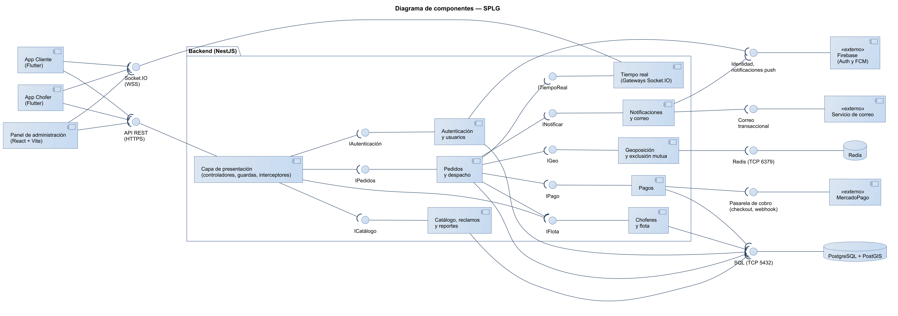
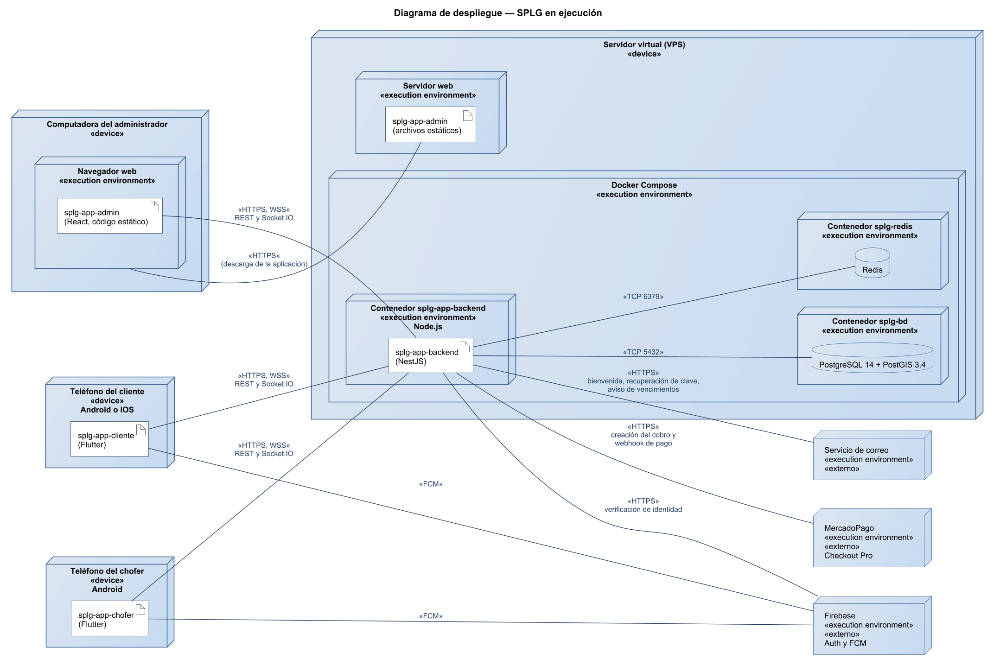
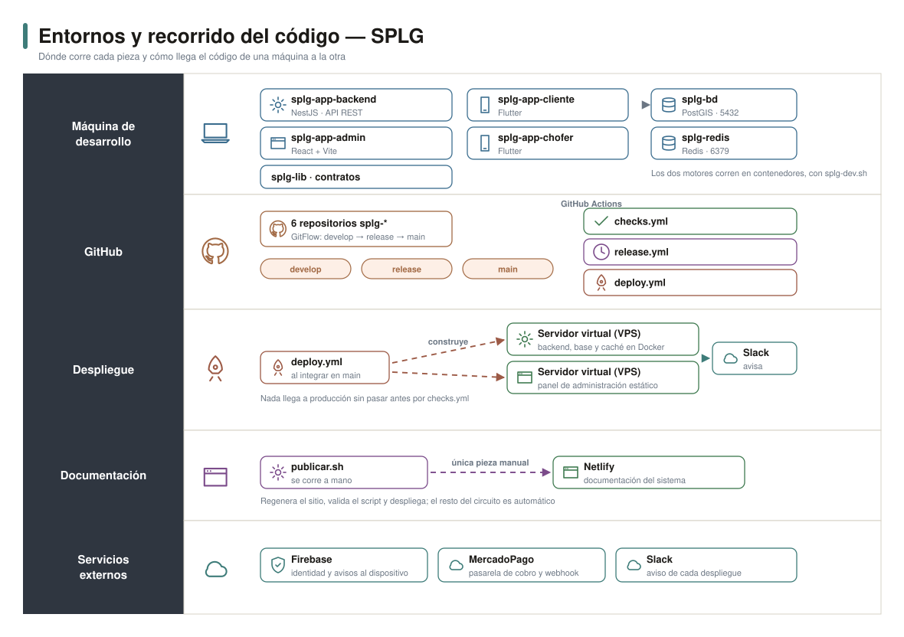

# Arquitectura y despliegue

Documentación técnica del diseño del sistema. No forma parte del Documento 3 de la cátedra, que lleva sólo lo que pide su plantilla; el sitio la publica.

## Arquitectura del Sistema

### 2.1 Vista de Capas

```
┌─────────────────────────────────────────────────────────────┐
│                    CLIENTES (Frontends)                      │
│  App Cliente (Flutter)  │  App Chofer (Flutter)  │ Panel (React) │
└────────────┬────────────┴──────────┬─────────────┴──────┬────┘
             │ REST / HTTP           │ WebSocket           │ REST
             ▼                       ▼                     ▼
┌─────────────────────────────────────────────────────────────┐
│                     API GATEWAY (NestJS)                     │
│  Guarda de Autenticación │ Guarda de Roles │ Interceptores  │
├─────────────────────────────────────────────────────────────┤
│                   MÓDULOS DE NEGOCIO                         │
│  Orders  │  Dispatch  │  Delivery  │  Products  │  Claims    │
├─────────────────────────────────────────────────────────────┤
│                   MÓDULOS DE INFRAESTRUCTURA                 │
│  Redis Service  │  FCM Notifications  │  WebSocket Gateways  │
├─────────────────────────────────────────────────────────────┤
│                   PERSISTENCIA                               │
│  PostgreSQL (TypeORM)  │  Redis (Geo + Cache)               │
└─────────────────────────────────────────────────────────────┘
```

### 2.2 Módulos NestJS

| Módulo | Responsabilidad principal |
|--------|--------------------------|
| `AuthModule` | Verificación del token de identidad de Firebase en cada solicitud, inicio de sesión y guardas de autenticación y de rol |
| `RegistroModule` | Alta de cuentas: registro del cliente, alta administrativa de usuarios y política de registro |
| `UsersModule` | Usuarios, rol asignado y búsqueda |
| `RoleModule` | Catálogo de roles y su alta inicial |
| `AdminModule` | Cuentas de los administradores |
| `DistributorModule` | Distribuidoras (multi-tenancy) y su configuración |
| `CustomersModule` | Clientes y su validación |
| `UserAddressModule` | Direcciones de entrega del cliente y dirección predeterminada |
| `OrderModule` | Alta y ciclo de vida del pedido, máquina de estados, despacho por proximidad con oferta al siguiente chofer, reservas programadas y recargo por pago en línea |
| `CartModule` | Entidades del carrito de compras (carrito e ítems); todavía no expone rutas propias |
| `GasCylinderModule` | Catálogo de productos, stock y promociones |
| `CylinderModule` | Trazabilidad del envase físico: estados, movimientos y recuperación |
| `TimeSlotModule` | Franjas horarias y sus cupos |
| `CoverageZoneModule` | Zonas de cobertura geográfica y recargo por zona |
| `DeliveryModule` | Choferes, disponibilidad y asignación de vehículo |
| `CarModule` | Vehículos |
| `FleetModule` | Documentación y vencimientos de la flota, planes y tareas de mantenimiento, bloqueo de choferes y vehículos inhabilitados |
| `PaymentsModule` | Cobro con MercadoPago, recepción del webhook y registro de pagos |
| `ClaimsModule` | Reclamos y su resolución |
| `IncidentModule` | Incidencias de la entrega |
| `RatingModule` | Calificaciones del servicio |
| `ReportsModule` | Estadísticas y panel de indicadores |
| `AuditModule` | Registro de auditoría de las acciones administrativas |
| `NotificationsModule` | Notificaciones push (FCM) y registro del token de dispositivo |
| `EmailModule` | Correo transaccional: bienvenida, recuperación de contraseña, aviso de vencimientos |
| `FirebaseModule` | Acceso a Firebase Authentication y Cloud Messaging |
| `S3Module` | Archivos en Amazon S3 (único proveedor): subida, URL firmada de descarga y limpieza de archivos sin dueño |
| `GatewaysModule` | WebSocket `/drivers`, `/customers` y `/admin` |
| `RedisModule` | GEOADD, GEORADIUS y cerrojos de los procesos programados |
| `HealthModule` | Sondas de estado del servicio |

---

### 2.3 Criterios de Diseño de la API REST

El backend expone una interfaz HTTP bajo el prefijo `api`, consumida por las dos aplicaciones
Flutter y por el Panel Web. Esta sección revisa esa interfaz contra las prácticas de diseño
que se consideran estándar, y deja asentado dónde el sistema las cumple y dónde no.

Conviene distinguir dos cosas que suelen confundirse. Una **API REST** usa HTTP con sus
métodos; una **API RESTful** además respeta los principios del estilo: recursos identificados
por su dirección, verbos HTTP con su semántica, ausencia de estado entre peticiones y uso
correcto de los códigos de respuesta. La diferencia se ve en la dirección: `GET /obtenerUsuarios`
es lo primero, `GET /users` es lo segundo.

| Criterio | Estado | Cómo está resuelto |
|---|:---:|---|
| Nomenclatura de recursos | Parcial | Los recursos se nombran por sustantivo y las operaciones por método HTTP. Quedan tres inconsistencias, detalladas más abajo. |
| Idempotencia | Cumple | Encabezado `Idempotency-Key` en las escrituras que no son naturalmente idempotentes —las del pedido, los cobros, las incidencias, los reclamos, las direcciones, los envases, el personal, las tareas de flota, las compras y el stock—, resuelta por un interceptor propio; en las escrituras de stock y compras que crean movimientos es obligatoria. |
| Paginación | Parcial | Por desplazamiento, con `limit` y `offset`. Sirve al panel y se degrada con el volumen. |
| Orden y filtrado | Parcial | Hay búsqueda por término (`term`) en usuarios, clientes, choferes, pedidos y compras, filtro por estado en pedidos, clientes y choferes y por rango de fechas en pedidos; el orden está fijo en el código en la mayoría de las consultas. |
| Referencias entre recursos | Cumple | Se usa el camino anidado —`GET /customers/user/:userId`— y no parámetros de consulta. |
| Límite de tasa | Cumple | Cien peticiones por minuto por dirección, configurable, con el contador compartido en Redis. |
| Versionado | Trabajo futuro | El prefijo es `api`, sin número de versión. |
| Seguridad | Cumple | Token de identidad de Firebase en el encabezado de autorización, verificado en cada solicitud (el sistema no emite un token propio), control por rol y aislamiento por distribuidora. La consulta de un usuario por correo y la prueba del servicio de correo exigen autenticación y rol. |

#### Nomenclatura: las tres inconsistencias

La primera es de **número**: la mayoría de los recursos está en plural —`/orders`, `/customers`,
`/coverage-zones`, `/claims`, `/users`, `/cylinders`— y otros en singular —`/car`, `/delivery`,
`/distributor`, `/role`, `/time-slot`, `/gascylinder`, `/user-address`—. La convención pide plural,
porque la dirección nombra la colección y no un elemento.

La segunda es de **separador y de forma**: conviven `/time-slot`, `/coverage-zones` y `/user-address`,
que usan guion, con `/gascylinder`, que escribe dos palabras juntas. A eso se suma que los vehículos
están en `/car` pero su documentación cuelga de `/cars/:carId/documents`, y que los choferes están
en `/delivery` y su documentación en `/delivery/:id/documents`.

La tercera, y la que más se aleja del estilo, son los **verbos en el camino**: `PATCH /:id/validate`,
`PATCH /:id/invalidate`, `PATCH /:id/set-default`, `PATCH /:id/cancel`, `PATCH /:id/resolve`,
`PATCH /:id/block`. Son transiciones de estado escritas como acciones. La forma que respeta el
estilo es modificar el atributo que cambia —`PATCH /delivery/:id` con el campo de validación—,
o modelar la transición como un sub-recurso.

Ninguna de las tres se corrige en el alcance actual: las direcciones publicadas ya están en dos
aplicaciones distribuidas y en el panel, y cambiarlas sin versionado rompe a los clientes
instalados. Es justamente lo que el versionado resuelve, y es la razón por la que la ausencia de
versionado se registra como trabajo futuro y no como un detalle.

#### Idempotencia

Los métodos `GET`, `PUT` y `DELETE` son idempotentes por definición: repetirlos deja el sistema
en el mismo estado. `POST` y `PATCH` no lo son, y en este sistema eso importa: un corte de red
al confirmar un pedido, seguido de un reintento de la aplicación, generaría dos pedidos y dos
cobros. El backend resuelve el problema con un encabezado `Idempotency-Key` que la aplicación
manda en cada intento; el interceptor guarda la respuesta de la primera ejecución y devuelve esa
misma respuesta ante cualquier repetición de la clave.

Está aplicada en el alta del pedido, el cambio de estado, el rechazo de la oferta, la
confirmación de entrega, la cancelación, la asignación manual, los cobros del pedido, las incidencias, los reclamos, los adjuntos, las tareas de flota, las direcciones, los envases y el personal. En stock y compras es **obligatoria** en las escrituras que crean movimientos (transferencias, ajustes, conteos iniciales, contraasientos, ajustes de conciliación, ajuste relativo del catálogo, recepciones y su anulación, y la reposición de la carga): sin la clave el sistema responde 400. La clave se ata al usuario, a la distribuidora, al método, a la ruta y a los parámetros, y a la huella del cuerpo —en un archivo, al contenido—: la misma clave con otros datos responde 422. Si algo falla después de confirmada la operación, el sistema responde con lo ya confirmado y guarda esa respuesta cinco minutos, en vez de veinticuatro horas. **No** está aplicada en el módulo de pagos, donde la
idempotencia se resuelve de otra forma: el webhook de la pasarela consulta el estado real del
pago antes de actuar y no reprocesa un pedido en estado terminal.

#### Paginación

La paginación es por desplazamiento: `limit` con diez elementos por omisión y `offset` desde cero.
Es la forma más simple y la que le sirve al panel, que necesita saltar a una página concreta.

Tiene dos límites conocidos. El primero es de rendimiento: la base descarta las filas salteadas
antes de devolver las pedidas, de modo que el costo crece con el número de página. El segundo es
de consistencia: si entran filas nuevas mientras alguien pagina, un mismo registro puede
aparecer dos veces o no aparecer nunca. Para el historial de movimientos de envases y para el
listado de pedidos, que crecen sin techo y se ordenan por fecha, conviene la paginación por
cursor, que toma como referencia el último registro leído en lugar de una posición.

#### Límite de tasa

El límite está puesto por dirección de origen, con una ventana configurable por variable de
entorno y cien peticiones por minuto por omisión. El contador vive en Redis y no en memoria del
proceso: con más de una instancia corriendo, un contador por proceso daría un límite efectivo de
N veces el configurado. El webhook de la pasarela y las sondas de estado quedan excluidos, porque
no son tráfico de usuario final y un límite ahí produciría reintentos en cascada.

#### Versionado

Es el único criterio que el sistema todavía no resuelve de ninguna forma. El prefijo global es `api`, sin
número de versión, de modo que cualquier cambio incompatible en una respuesta rompe a las
aplicaciones ya instaladas, que no se actualizan solas. La corrección es de bajo costo mientras el
sistema no esté en producción con usuarios reales: pasar el prefijo a `api/v1` y publicar los
cambios incompatibles bajo `api/v2`. Después de la puesta en producción, el costo es otro.

---

### 2.4 Diagrama de Componentes

El diagrama muestra los componentes de ejecución del sistema y las interfaces por las que se
conectan. Cada interfaz provista se dibuja como un círculo unido al componente que la ofrece; cada
interfaz requerida, como un semicírculo en el componente que la usa. El Backend se descompone en
sus módulos principales; los nombres de los módulos de NestJS que agrupa cada uno figuran en la
sección 2.2.



**Figura 1 — Diagrama de componentes**


| Interfaz | La provee | La requieren | Qué ofrece |
|----------|-----------|--------------|------------|
| API REST (HTTPS) | Capa de presentación | App Cliente, App Chofer, Panel | Las operaciones de negocio bajo el prefijo `api`, con las guardas de autenticación, de rol y de distribuidora |
| Socket.IO (WSS) | Tiempo real | App Cliente, App Chofer, Panel | Ofertas, estados del pedido y posición del chofer, en los espacios `/drivers`, `/customers` y `/admin` |
| IAutenticación | Autenticación y usuarios | Capa de presentación | Identidad, rol y distribuidora de quien invoca |
| IPedidos | Pedidos y despacho | Capa de presentación, Catálogo, reclamos y reportes | Alta, ciclo de vida y despacho del pedido |
| IPago | Pagos | Pedidos y despacho | Checkout y confirmación del pago |
| IFlota | Choferes y flota | Capa de presentación, Pedidos y despacho | Habilitación del chofer y de su vehículo |
| ICatálogo | Catálogo, reclamos y reportes | Capa de presentación | Productos, franjas, cobertura, reclamos y reportes |
| INotificar | Notificaciones y correo | Pedidos y despacho | Aviso al dispositivo y por correo |
| IGeo | Geoposición y exclusión mutua | Pedidos y despacho | Búsqueda de choferes cercanos y cerrojos de los procesos programados |
| ITiempoReal | Tiempo real | Pedidos y despacho | Emisión de eventos a cada espacio |
| SQL (TCP 5432) | PostgreSQL con PostGIS | Los módulos con persistencia | Almacenamiento transaccional y consultas geográficas |
| Redis (TCP 6379) | Redis | Geoposición y exclusión mutua | Índice geográfico, adaptador de Socket.IO y cerrojos |
| Identidad y notificaciones push | Firebase | Autenticación y usuarios, Notificaciones y correo | Verificación de identidad y envío de FCM |
| Pasarela de cobro | MercadoPago | Pagos | Creación del cobro y aviso del resultado por webhook |
| Correo transaccional | Servicio de correo | Notificaciones y correo | Envío de la bienvenida, de la recuperación de contraseña y del aviso de vencimientos |

### 2.5 Diagrama de Despliegue

El diagrama de despliegue describe el sistema en ejecución: los nodos físicos o de ejecución, los
artefactos que corren en cada uno y los caminos de comunicación con su protocolo. El sistema se
despliega en un servidor virtual (VPS) con Docker Compose; el backend, la base de datos y Redis
corren en contenedores del mismo servidor.



**Figura 2 — Diagrama de despliegue**


| Nodo | Tipo | Artefactos | Comunicación |
|------|------|------------|--------------|
| Teléfono del cliente | «device» Android o iOS | `splg-app-cliente` | HTTPS / REST y WSS / Socket.IO hacia el backend; recibe FCM de Firebase |
| Teléfono del chofer | «device» Android | `splg-app-chofer` | HTTPS / REST y WSS / Socket.IO hacia el backend; recibe FCM de Firebase |
| Computadora del administrador | «device» con navegador web | `splg-app-admin` (código estático descargado del servidor web) | HTTPS / REST y WSS / Socket.IO hacia el backend |
| Servidor virtual (VPS) | «device» | Docker Compose con los contenedores `splg-app-backend`, `splg-bd` (PostgreSQL 14 con PostGIS 3.4) y `splg-redis`, y el servidor web que sirve el panel | El backend usa TCP 5432 y TCP 6379 dentro del servidor |
| Firebase | «execution environment» «externo» | Authentication y Cloud Messaging | HTTPS desde el backend para verificar la identidad; FCM hacia las aplicaciones móviles |
| MercadoPago | «execution environment» «externo» | Checkout Pro | HTTPS desde el backend para crear el cobro; MercadoPago llama por webhook al backend con el resultado del pago |
| Servicio de correo | «execution environment» «externo» | — | HTTPS desde el backend: bienvenida, recuperación de contraseña y aviso de vencimientos |

El recorrido del código desde la máquina de desarrollo hasta el servidor es otra vista, que no
forma parte del despliegue en ejecución: la lámina siguiente la muestra como ilustración
complementaria.



**Figura 3 — Entornos y recorrido del código**


> Las líneas punteadas se mueven en la versión en pantalla, para que el sentido del recorrido se
> lea sin buscar la etiqueta. La documentación es la única pieza que se publica a mano.

---
