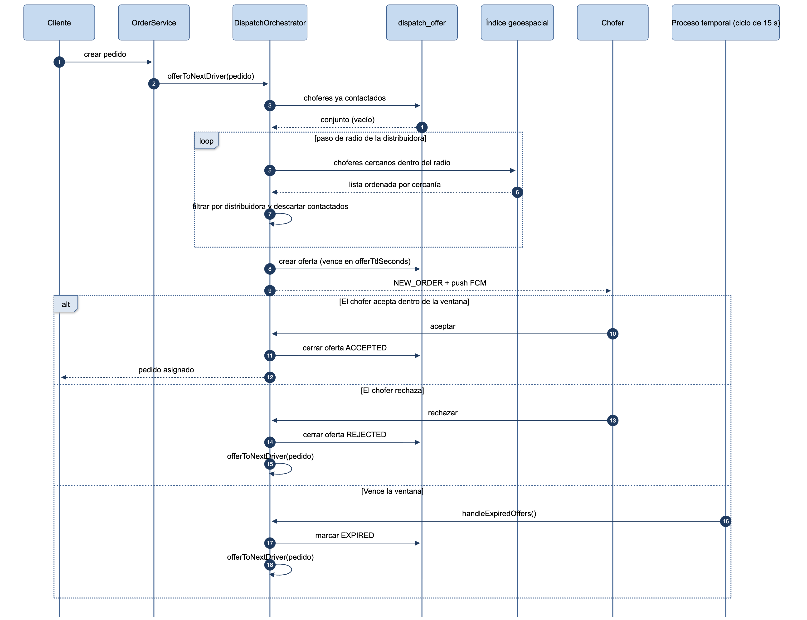
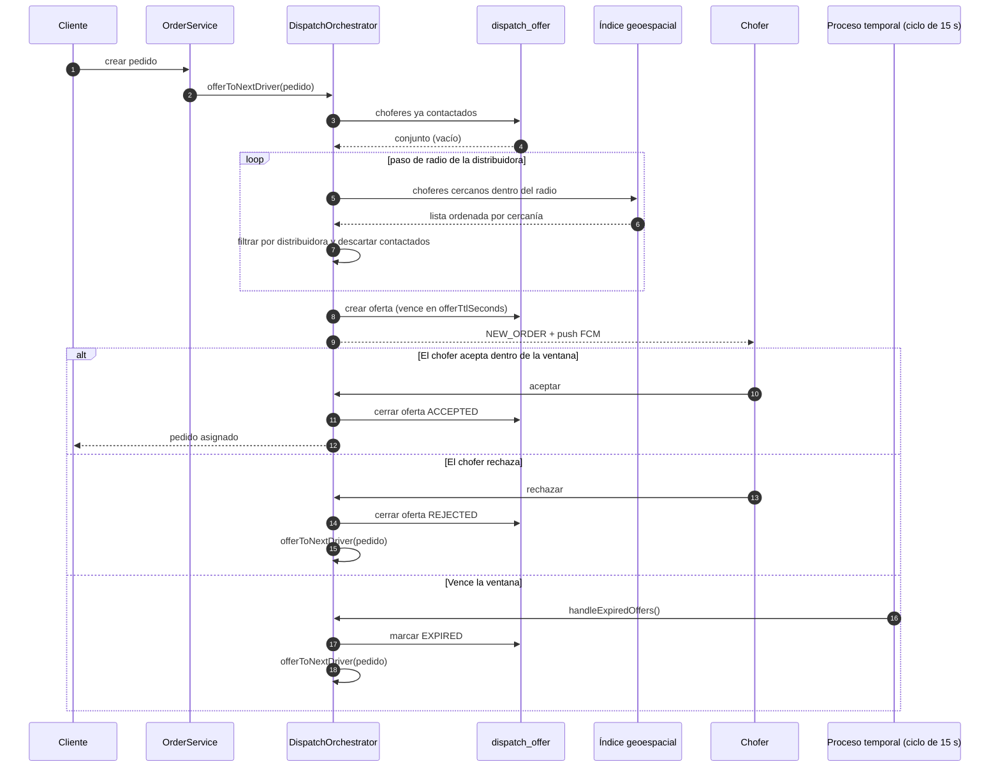

# Módulos inteligentes — especificación de diseño

Documentación técnica del diseño del sistema. No forma parte del Documento 3 de la cátedra, que lleva sólo lo que pide su plantilla; el sitio la publica.

## Módulos Inteligentes — Especificación Detallada

### Criterio de selección

Se denomina **módulo inteligente** al proceso que el sistema dispara y ejecuta por
iniciativa propia, que agrega valor económico —genera ingresos o reduce costos— y que
excede tanto lo que el producto mínimo viable necesita para funcionar como lo que se
resuelve con una única consulta a la base de datos.

Bajo ese criterio quedan fuera de la selección los automatismos que el sistema debe
ejecutar sí o sí para operar: la reserva y restitución de stock, el cálculo de
promociones y recargos, la emisión de notificaciones y la limpieza del índice
geoespacial. Son obligaciones funcionales, no inteligencia; se documentan como parte
del comportamiento normal del sistema en las secciones 3 y 4.

Los siete módulos seleccionados comparten una misma forma: **recorren una lista de
candidatos de a uno, ofrecen algo con vigencia limitada, esperan respuesta, pasan al
siguiente ante rechazo o vencimiento, y reservan a una persona la decisión que
compromete dinero.**

| # | Módulo | CU | Aporte al negocio | Estado |
|---|--------|-----|-------------------|--------|
| **M1** | Negociación secuencial de asignación de pedidos | CU-013, CU-014 | Opera el presente | ● Implementado |
| **M2** | Planificación predictiva de mantenimiento y habilitaciones de flota | CU-105 | Protege el activo vehículo — costos | Planificado (C-14); tablas en la base, servicio sin construir |
| **M3** | Anticipación de recompra por consumo estimado | CU-106 | Genera demanda — **ingresos** | Planificado (C-16); tablas en la base, servicio sin construir |
| **M4** | Agrupación inteligente de pedidos por recorrido | CU-107 | Reduce el costo por entrega — costos | Planificado (C-19); tablas en la base, servicio sin construir |
| **M5** | Recuperación de envases no devueltos | CU-108 | Protege el activo envase — costos | Planificado (C-15); tablas en la base, servicio sin construir |
| **M6** | Lectura y conciliación inteligente de documentos | A definir | Elimina la carga manual y detecta errores y fraudes — costos | En construcción |
| **M7** | Venta asistida por WhatsApp | A definir | Suma un canal de venta y recupera compras — **ingresos** | Planificado |

---

### 6.1 Módulo M1 — Negociación secuencial de asignación de pedidos
**Casos de uso propios:** CU-013, CU-014, CU-015, CU-016

**Casos de uso que intervienen:**

| Relación | Casos de uso |
|---|---|
| Lo dispara | CU-005 Crear un Pedido |
| Se alimenta de | CU-058 Validar la Cobertura de una Dirección, CU-035 Consultar el Listado de Choferes, CU-109 Consultar el Detalle del Chofer |
| Alternativa manual | CU-012 Asignar un Chofer Manualmente |
| Desemboca en | CU-081 Consultar los Pedidos Asignados al Chofer, CU-017 Modificar la Ubicación GPS del Chofer, CU-018 Marcar un Pedido "En Camino" |
| Comparte mecánica con | CU-149 Despachar un Pedido Express a un Chofer en Moto |

**Componentes:** `DispatchOrchestratorService` (orquestador), `DispatchService` (proceso temporal), `DispatchSettingsService` y `ScheduledTasksSettingsService` (configuración de la distribuidora) y la entidad `DispatchOffer`.

#### Descripción

Al crearse un pedido, el sistema abre un proceso de negociación con los choferes
disponibles en lugar de notificar a todos a la vez. Ofrece el pedido **al chofer más
cercano** dentro del radio inicial y le otorga una **ventana de aceptación acotada**.
Si el chofer rechaza o no responde, la oferta vence y el pedido pasa automáticamente
al siguiente candidato más cercano que todavía no fue contactado. Agotados los
candidatos de un radio, la búsqueda se amplía al paso siguiente y el recorrido se
reanuda.

El estado de cada oferta es **durable**: se persiste en la tabla `dispatch_offer`, de
modo que el proceso sobrevive a reinicios del servidor, funciona con varias instancias
en paralelo y queda auditable.

#### Entradas

- Pedido recién creado en estado `PENDING` sin chofer asignado — creación del pedido (CU-005)
- Choferes ya contactados para el pedido — tabla `dispatch_offer`
- Choferes activos y su posición — índice geoespacial (GEORADIUS)
- Distribuidora dueña del pedido — filtro de aislamiento multidistribuidora
- Pasos de radio de búsqueda y vigencia de la oferta — configuración de la distribuidora (`radiusStepsKm`, `offerTtlSeconds`; CU-171), o sus valores por omisión

#### Algoritmo — `offerToNextDriver(order)`

```
1. Recuperar el conjunto de choferes YA contactados para este pedido
   (dispatch_offer WHERE order_id = ?)

2. Buscar el siguiente candidato:
     Para cada paso de radio de la distribuidora (por omisión 5, 10, 15 y 20 km):
         a. GEORADIUS sobre el índice de choferes activos  → ordenados por cercanía ASC
         b. Filtrar por distribuidora del pedido            → aislamiento multidistribuidora
         c. Descartar los ya contactados
         d. Si queda alguno → es el candidato; cortar la búsqueda
     Si ningún radio arroja candidato → avisar a los administradores (order:no-drivers, una vez)
     y no crear oferta (el proceso temporal reintentará)

3. Crear la oferta con vigencia = ahora + offerTtlSeconds (30 s por omisión)  (estado OFFERED)

4. Notificar al chofer:
     · WebSocket  'NEW_ORDER'  con el detalle del pedido y la hora de vencimiento
     · Push FCM complementario (de mejor esfuerzo, por si la app está cerrada)
```

#### Algoritmo — `handleExpiredOffers()` — proceso temporal (ciclo de 15 s, por distribuidora)

```
Para cada oferta OFFERED cuya vigencia ya pasó:
    1. Marcarla EXPIRED
    2. Recargar el pedido desde la base
       (pudo haber sido aceptado o cancelado por otra vía mientras tanto)
    3. Si sigue siendo re-ofrecible → ofrecer al siguiente chofer
```

#### Transiciones de la oferta

| Evento | Método | Estado final de la oferta | Efecto sobre el pedido |
|--------|--------|---------------------------|------------------------|
| El chofer acepta | `onDriverAccepted()` | `ACCEPTED` | Queda asignado |
| El chofer rechaza | `onDriverRejected()` | `REJECTED` | Se ofrece al siguiente **de inmediato**, sin esperar el vencimiento |
| Vence la ventana | `handleExpiredOffers()` | `EXPIRED` | Se ofrece al siguiente |
| Pedido sin oferta activa | `ensureOffered()` | — | Se abre una oferta nueva |

#### Condición de re-oferta

Un pedido solo se re-ofrece si cumple `status = PENDING` **y** no tiene chofer
asignado (`delivery_id` nulo). Esta guarda evita que un pedido ya tomado vuelva a
entrar al circuito. A un mismo chofer se le ofrece el pedido como máximo tres veces
(la oferta original y dos re-ofertas, separadas por el enfriamiento de 3 minutos);
agotados los candidatos, se avisa una vez a los administradores con `order:no-drivers`.

#### Salidas

- Oferta `OFFERED` persistida en `dispatch_offer` para un único chofer, con la vigencia de la distribuidora (30 segundos por omisión)
- Notificación WebSocket `NEW_ORDER` y push FCM complementario al chofer ofertado
- Pedido asignado (`delivery_id` cargado) cuando el chofer acepta
- Pedido `PENDING` a la espera de asignación manual del administrador si se agotan los radios sin candidatos, con el aviso `order:no-drivers` al panel

#### Aislamiento multidistribuidora

`filterByDistributor()` restringe los candidatos a los choferes de la distribuidora
dueña del pedido, preservando el orden por cercanía. Un chofer nunca recibe ofertas
de otra distribuidora.

#### Parámetros

Son configuración de cada distribuidora (CU-171 y CU-173); los valores por omisión son los que regían cuando eran constantes del programa.

| Parámetro | Campo de la configuración | Valor por omisión | Rango admitido |
|-----------|---------------------------|-------------------|----------------|
| Pasos de radio de búsqueda | `radiusStepsKm` | `[5, 10, 15, 20]` km | de 1 a 8 pasos, cada uno de 1 a 100 km y estrictamente creciente |
| Ventana de aceptación | `offerTtlSeconds` | 30 segundos | de 10 a 300 segundos |
| Frecuencia de revisión de vencimientos | `dispatchRetrySeconds` | cada 15 segundos (`@Cron('*/15 * * * * *')` es el ciclo de base) | múltiplo de 15, hasta 300 segundos |

> Se leen en cada oferta a través de `DispatchSettingsService`, con una copia en memoria de
> un minuto por distribuidora; guardar la descarta en la instancia que atiende el `PUT`.
> Las ofertas ya enviadas conservan su vencimiento.

#### Por qué no es una consulta

La elección del chofer no se resuelve con un ordenamiento: es una negociación. El sistema ofrece el pedido a un candidato por vez, espera su respuesta dentro de una ventana acotada, y ante un rechazo o un vencimiento pasa al siguiente, ampliando el radio de búsqueda cuando se agotan los candidatos cercanos. El resultado depende de la secuencia de respuestas, no del estado de la base en un instante.

#### Decisión humana

El sistema no fuerza la asignación. Si se agotan los radios sin que ningún chofer acepte, el pedido permanece pendiente y queda a criterio del administrador asignarlo manualmente (CU-012). La decisión con consecuencia económica —comprometer una entrega sin chofer disponible— la toma una persona.

#### Precondiciones
- El pedido existe en estado `PENDING` y sin chofer asignado.
- Sus coordenadas de entrega están cargadas.

#### Postcondiciones
- Existe una oferta `OFFERED` vigente para un único chofer, **o**
- No había candidatos nuevos y el pedido queda a la espera del proceso temporal.

#### Diagrama de secuencia



**Figura 503 — Módulo M1 — Negociación secuencial de asignación de pedidos — Diagrama de secuencia**

<details><summary>Ver código del diagrama</summary>



</details>

---

### 6.2 Módulo M2 — Planificación predictiva de mantenimiento y habilitaciones de flota

**Entidades:** `Car`, `Delivery`, `Order`, `CoverageZone`
**Casos de uso propios:** CU-105

**Casos de uso que intervienen:**

| Relación | Casos de uso |
|---|---|
| Se alimenta de | CU-136 Registrar el Seguro del Vehículo, CU-137 Registrar la Verificación Técnica Vehicular, CU-138 Registrar la Licencia de Conducir del Chofer, CU-141 Registrar un Mantenimiento Realizado, CU-051 Consultar el Listado de Vehículos, CU-113 Consultar el Detalle del Vehículo |
| Consulta | CU-139 Consultar los Vencimientos de la Flota |
| Desemboca en | CU-140 Programar un Mantenimiento de Vehículo |
| Condiciona | CU-013 Asignar un Pedido Automáticamente por Proximidad |
| Convive con | CU-142 Avisar los Vencimientos Próximos de la Flota |

#### Descripción

A partir del recorrido GPS que el sistema ya registra en cada entrega, estima el
**consumo diario de kilómetros** de cada vehículo y proyecta el vencimiento de cada
mantenimiento por kilometraje (service, cubiertas) y de cada habilitación por fecha
(**RTO**, seguro, matafuegos, licencia del conductor).

Con la anticipación configurada para cada tipo, selecciona las **ventanas de taller de
menor impacto operativo** —las de menor demanda histórica, y únicamente aquellas que
no dejan la zona de cobertura por debajo del mínimo de vehículos activos— y las propone
**secuencialmente** al chofer asignado con vigencia limitada. Si rechaza o no responde,
ofrece la siguiente alternativa; agotadas las opciones, escala al administrador con el
cuadro completo para que resuelva.

Los vehículos con una habilitación vencida quedan **excluidos automáticamente** de la
asignación de pedidos: M2 alimenta a M1.

#### Modelo conceptual


| Concepto | Rol |
|---|---|
| `Car` | No hay una clase `Vehicle` aparte: los campos de flota se agregaron directo a `Car` (`car.entity.ts`) — `odometer_km`, `fleet_status` (`active` / `in_service` / `grounded`), `in_service_since`, más `tare_weight_kg` y `max_load_kg` para el peso del lote de M3 |
| `MaintenancePlan` | La **regla**: nombre, disparo (`BY_KM` / `BY_TIME` / `BY_FIXED_DATE`), intervalo, ventana de anticipación, criticidad **BLOCKING** vs **NON_BLOCKING** |
| `MaintenanceTask` | La **instancia**: `FORECAST → SCHEDULED → IN_PROGRESS → DONE / OVERDUE`, con `predicted_due_date`, ventana asignada, taller y costo |
| `VehicleUsageLog` | Append-only: km, cantidad de pedidos y horas en ruta por vehículo y día. Alimenta al predictor |

##### Decisión de diseño: una sola abstracción para mantenimiento y documentación

**No se modela la documentación como entidad aparte.** La RTO, el seguro, la
licencia habilitante del chofer y la recarga del matafuegos son todos
`MaintenancePlan` con disparo `BY_FIXED_DATE` y criticidad `BLOCKING`.

Una única abstracción cubre *"el aceite se cambia cada 10.000 km"* y *"el seguro
vence el 30/11"*. Queda más limpio en el diagrama de clases y es un punto
defendible en la presentación.

`VehicleUsageLog` es append-only por la misma razón que `cylinder_movement`:
auditabilidad y trazabilidad del insumo que alimenta la predicción.

#### Entradas


- `VehicleUsageLog` — historial de km/día por vehículo (últimos N días)
- `MaintenancePlan` — reglas activas por vehículo o tipo de vehículo
- `MaintenanceTask` en estado `FORECAST`
- `Car.odometer_km` — última lectura conocida
- Demanda histórica por franja horaria (`time-slot`) y zona (`coverage-zone`)

#### Proceso


##### Etapa ① — Estimación de consumo

Media móvil ponderada de km/día, con más peso a las semanas recientes.

```typescript
estimateDailyKm(vehicleId: string, days = 90): number {
  const logs = await this.usageRepo.findRecent(vehicleId, days);

  if (logs.length < MIN_SAMPLE_DAYS) {
    // Arranque en frío: promedio de la flota del mismo tipo de vehículo
    return await this.usageRepo.fleetAverageByType(vehicle.type_car);
  }

  // Ponderación exponencial: las semanas recientes pesan más
  const weighted = logs.reduce((acc, log, i) => {
    const weight = Math.exp(-DECAY * i);
    return { sum: acc.sum + log.km * weight, weights: acc.weights + weight };
  }, { sum: 0, weights: 0 });

  const baseKmDay = weighted.sum / weighted.weights;

  // Ajuste estacional: el consumo de garrafas en Misiones tiene pico invernal
  return baseKmDay * this.seasonalFactor(currentMonth);
}
```

> El ajuste estacional no es cosmético: un promedio plano subestima el desgaste
> de julio, que es el mes de mayor demanda del rubro.

##### Etapa ② — Proyección de vencimiento

```typescript
projectDueDate(task: MaintenanceTask, car: Car): Date {
  if (task.plan.trigger === 'BY_FIXED_DATE') return task.plan.fixed_date;

  const kmPerDay = this.estimateDailyKm(car.carId);
  const kmRemaining = task.due_km - car.odometerKm;
  const daysRemaining = Math.floor(kmRemaining / kmPerDay);

  return addDays(today, daysRemaining);
}

// Se alerta cuando entra en la ventana de anticipación del plan
// (ej: 60 días para RTO, 15 para cambio de aceite)
shouldAlert(task): boolean {
  return daysBetween(today, task.predicted_due_date) <= task.plan.lead_time_days;
}
```

##### Etapa ③ — Planificación con restricciones

Es el núcleo del módulo: no alcanza con avisar, hay que elegir **cuándo**.

```typescript
scheduleTask(task: MaintenanceTask): ScheduledWindow | null {
  const candidates = this.enumerateWindows(today, task.predicted_due_date);

  const feasible = candidates.filter(w =>
    // Restricción dura: antes del vencimiento proyectado
    w.date <= task.predicted_due_date &&
    // Restricción dura: no dejar la zona bajo el mínimo operativo
    this.fleetCoverage.remainingActive(task.vehicle.zone, w) >= MIN_VEHICLES_PER_ZONE
  );

  if (feasible.length === 0) return null;  // escala al admin

  // Objetivo: la franja de menor demanda histórica proyectada
  return feasible.reduce((best, w) =>
    this.demandForecast(w) < this.demandForecast(best) ? w : best
  );
}
```

La demanda proyectada sale de los pedidos históricos por `time-slot`, y el
mínimo operativo se evalúa por `coverage-zone`. Ambos módulos ya existen.

##### Etapa ③bis — Negociación secuencial de la ventana

Es la etapa que le da al módulo la forma de flujo que la cátedra valora. El
sistema **no impone** la ventana: la ofrece, espera, y ante silencio o rechazo
pasa a la siguiente. El patrón es el de la lista de espera de biblioteca.

```typescript
async negotiateWindow(task: MaintenanceTask): Promise<void> {
  const candidates = this.scheduleTask(task, TOP_N_WINDOWS);  // las N mejores

  for (const window of candidates) {
    const proposal = await this.proposals.create({
      task_id: task.id,
      window,
      recipient: task.vehicle.assigned_driver_id,
      expires_at: addHours(now, PROPOSAL_TTL_HOURS),   // parametrizable
    });

    await this.notifications.sendWindowProposal(proposal);

    const answer = await this.proposals.awaitAnswer(proposal);  // por cron

    if (answer === 'ACCEPTED') {
      return this.confirmAndBlockAgenda(task, window);
    }
    // RECHAZADA o VENCIDA -> se ofrece la siguiente ventana
  }

  // Se agotaron las ventanas: decide un humano (criterio de la catedra:
  // las decisiones onerosas no las toma el sistema)
  await this.notifications.escalateToAdmin(task, candidates);
}
```

**Extensión opcional — cotización a talleres.** Antes de confirmar, el sistema
puede solicitar presupuesto a una lista de talleres registrados y presentarle
al administrador el cuadro comparativo. Es el ejemplo de presupuestos a
proveedores de la cátedra, aplicado a flota. El sistema reúne la información;
la contratación la decide una persona.

**Estados del flujo:** `PROPOSED -> ACCEPTED | REJECTED | EXPIRED -> ESCALATED`

##### Etapa ④ — Realimentación al despacho

```typescript
// Puerto que el módulo `order` consume
abstract class FleetAvailabilityPort {
  abstract isVehicleFit(vehicleId: string, at: Date): Promise<boolean>;
}

// En DispatchOrchestratorService.findNearestAvailable(), junto al filtro por distribuidora:
const eligible = await this.filterByDistributor(drivers, distributorId);
const fit = await this.filterByVehicleFitness(eligible);   // ← nuevo
```

Un vehículo `GROUNDED` (RTO vencida, seguro vencido) o dentro de su ventana de
taller deja de recibir ofertas. **Acá el módulo deja de ser un recordatorio y
pasa a gobernar la operación.**

#### Salidas


- `MaintenanceTask` en `SCHEDULED` con ventana asignada
- Notificación FCM/email al administrador con la anticipación configurada
- `Car.fleet_status` actualizado
- Exclusión efectiva del vehículo en el despacho

#### Parámetros

| Parámetro | Descripción |
|-----------|-------------|
| Anticipación por tipo de mantenimiento | Cuántos km antes del vencimiento se dispara la propuesta |
| Anticipación por tipo de habilitación | Cuántos días antes del vencimiento se dispara |
| Mínimo de vehículos activos por zona | Restricción que ninguna ventana puede violar |
| Vigencia de la propuesta al chofer | Ventana de aceptación de cada alternativa |
| Frecuencia de evaluación | Cada cuánto corre el proceso |

#### Parametrización completa


La cátedra exige que un proceso automatizado sea configurable desde el sistema.
Todos estos valores son editables por el administrador de la distribuidora:

| Parámetro | Qué controla |
|---|---|
| `cron_hour` | Hora de ejecución diaria del planificador |
| `lead_time_days` (por plan) | Anticipación con la que se empieza a planificar (ej. 60 días RTO, 15 aceite) |
| `interval_km` / `interval_months` (por plan) | Cada cuánto se repite la tarea |
| `criticality` (por plan) | `BLOCKING` (inhabilita el vehículo) vs `NON_BLOCKING` |
| `PROPOSAL_TTL_HOURS` | Vigencia de la propuesta de ventana enviada al chofer |
| `TOP_N_WINDOWS` | Cuántas ventanas alternativas se ofrecen antes de escalar |
| `MIN_VEHICLES_PER_ZONE` | Mínimo operativo por zona de cobertura |
| `MIN_SAMPLE_DAYS` | Días de historial exigidos antes de confiar en la predicción propia |
| `DECAY` | Peso relativo de las semanas recientes en la media móvil |
| `seasonal_factors` | Coeficiente por mes del ajuste estacional |

#### Disparadores y tiempos


| Disparador | Frecuencia | Acción |
|---|---|---|
| Cron diario | 03:00 | Recalcula predicciones y replanifica |
| Evento `order.delivered` | Por entrega | Acumula km del viaje en `VehicleUsageLog` |
| Evento `maintenance.completed` | Por tarea | Reinicia contador y proyecta la siguiente |

**Grado de automatización:** autónomo con supervisión. El sistema planifica
solo; el administrador confirma o reprograma la ventana propuesta.

**Impacto en los registros:** crea `MaintenanceTask` y `VehicleUsageLog`,
actualiza `Car.odometer_km` y `Car.fleet_status`, y modifica
indirectamente el conjunto de choferes candidatos de cada pedido.

#### Por qué no es una consulta

La fecha de vencimiento por kilometraje no está en la base: se **proyecta** cruzando el
kilometraje actual con el ritmo de consumo estimado del recorrido histórico. Sobre esa
proyección se resuelve una selección de ventanas sujeta a una restricción de cobertura
—no dejar la zona bajo el mínimo de vehículos— y recién entonces se abre la negociación
secuencial con el chofer.

#### Decisión humana

**El administrador confirma el gasto del taller.** El sistema arma el cuadro de
opciones y lo presenta; la contratación la asume siempre una persona.

---

#### Precondiciones

- El vehículo existe y pertenece a una distribuidora activa
- Existe al menos un `MaintenancePlan` aplicable
- Hay historial de uso suficiente, o promedio de flota disponible como respaldo

#### Postcondiciones

- Toda tarea en ventana de anticipación tiene `predicted_due_date` calculada
- Toda tarea alertada quedó `SCHEDULED` con ventana, o escalada al admin si no
  había ninguna ventana factible
- Ningún vehículo con habilitación vencida (`BLOCKING`) recibe ofertas

#### Diagrama de secuencia

Diagrama de secuencia del sistema: **DSS — CU-105**, documento 2 sección 2.1.  
Diagrama de interacción de diseño: **DSD — CU-105**, sección 4.22 de este documento.

### 6.3 Módulo M3 — Anticipación de recompra por consumo estimado

**Entidades:** `Customer`, `Order`, `OrderItem`, `GasCylinder`, `Notification`
**Casos de uso propios:** CU-106

**Casos de uso que intervienen:**

| Relación | Casos de uso |
|---|---|
| Se alimenta de | CU-143 Declarar el Consumo Promedio al Registrarse, CU-144 Modificar el Consumo Promedio Declarado, CU-007 Consultar el Historial de Pedidos, CU-041 Consultar el Catálogo de Productos |
| Respeta | CU-145 Configurar los Días de Aviso Previo a la Recompra |
| Se consulta por | CU-146 Consultar la Fecha Estimada de Recompra |
| Desemboca en | CU-005 Crear un Pedido |

#### Descripción

A partir del historial de compras de cada cliente, el sistema estima su **ritmo de
consumo** —días promedio entre pedidos, ponderado por el tamaño de garrafa y ajustado
por estacionalidad— y proyecta la fecha en que se le agotaría el gas.

Con la anticipación configurada, le envía una **invitación a reponer con vigencia
limitada y el pedido precargado**. Si acepta, el pedido queda creado e ingresa al
circuito normal de despacho (entra por M1). Si no responde dentro de la vigencia, la
invitación caduca y se registra para no reiterarla antes del intervalo mínimo
configurado.

Los clientes con un pedido activo o reciente quedan excluidos del envío.

#### Entradas

- Historial de pedidos del cliente — fechas de pedido y kilaje entregado en cada uno (`Order`, `OrderItem`)
- Estado del pedido activo o de la entrega reciente del cliente — para aplicar la exclusión
- Registro de invitaciones previas y su fecha de caducidad — para respetar el intervalo mínimo de reiteración
- Coeficientes de estacionalidad por mes — configuración
- Mínimo de pedidos para estimar, anticipación, vigencia de la invitación e intervalo mínimo — parámetros configurados

#### Algoritmo

```
Proceso temporal diario:

1. Para cada cliente con al menos N pedidos en el historial:
     a. Serie de fechas de pedido y kilaje entregado en cada uno
     b. Intervalo medio entre compras, ponderado por kilaje
     c. Corrección estacional según el mes en curso
     d. Fecha proyectada de agotamiento = última entrega + intervalo corregido

2. Filtrar los que caen dentro de la ventana de anticipación configurada

3. Excluir:
     · clientes con un pedido activo (no entregado)
     · clientes con una entrega reciente
     · clientes con una invitación dentro del intervalo mínimo de reiteración

4. Emitir la invitación con el pedido precargado y vigencia limitada

5. Al vencer sin respuesta → marcar caducada y registrar la fecha
   para respetar el intervalo mínimo antes de reiterar
```

#### Salidas

- Invitación a reponer con el pedido precargado y vigencia limitada, notificada al cliente
- Pedido creado e ingresado al circuito normal de despacho (entra por M1), si el cliente acepta
- Rechazo registrado para no reiterar la invitación antes del intervalo mínimo, si el cliente rechaza
- Invitación marcada caducada y fecha registrada para el intervalo mínimo, si vence sin respuesta

#### Parámetros

| Parámetro | Descripción |
|-----------|-------------|
| Mínimo de pedidos para estimar | Cuántas compras hacen falta antes de proyectar |
| Anticipación | Cuántos días antes del agotamiento proyectado se invita |
| Vigencia de la invitación | Cuánto dura la oferta con el pedido precargado |
| Intervalo mínimo de reiteración | Cuánto esperar antes de volver a invitar al mismo cliente |
| Coeficientes de estacionalidad | Ajuste del consumo estimado por mes |

#### Por qué no es una consulta

La fecha de agotamiento no está almacenada: se estima a partir de la serie de pedidos
del cliente, ponderando el kilaje de cada compra y corrigiendo por estacionalidad —el
consumo de gas en invierno no es el de verano—. Sobre esa estimación se abre un ciclo
de oferta con vigencia, caducidad y período de enfriamiento.

#### Decisión humana

Ninguna de gestión: el cliente es el destinatario y decide por sí mismo. El sistema no
crea el pedido hasta que el cliente acepta.

---

#### Precondiciones

El cliente tiene historial de compras suficiente para estimar su ritmo de consumo, y no tiene un pedido activo ni reciente.

#### Postcondiciones

El cliente recibió una invitación a reponer con vigencia limitada y el pedido precargado, o la invitación caducó y quedó registrada para no reiterarla antes del intervalo mínimo configurado.

#### Diagrama de secuencia

Diagrama de secuencia del sistema: **DSS — CU-106**, documento 2 sección 2.1.  
Diagrama de interacción de diseño: **DSD — CU-106**, sección 4.22 de este documento.

### 6.4 Módulo M4 — Agrupación inteligente de pedidos por recorrido

**Entidades:** `Order`, `Delivery`, `Car`, `CoverageZone`, `TimeSlot`
**Casos de uso propios:** CU-107

**Casos de uso que intervienen:**

| Relación | Casos de uso |
|---|---|
| Se alimenta de | CU-011 Consultar Todos los Pedidos, CU-045 Consultar las Franjas Horarias Disponibles, CU-057 Consultar los Polígonos de Cobertura, CU-051 Consultar el Listado de Vehículos, CU-113 Consultar el Detalle del Vehículo |
| Comparte mecánica con | CU-015 Aceptar un Pedido, CU-016 Rechazar un Pedido Ofrecido |
| Devuelve a | CU-013 Asignar un Pedido Automáticamente por Proximidad |

#### Descripción

En lugar de asignar cada pedido de forma individual, el sistema **agrupa los pedidos
compatibles** —misma zona de cobertura, franjas horarias cercanas y capacidad de carga
disponible del vehículo— en un único recorrido, y se lo propone al chofer como un
**lote ordenado por secuencia de entrega**.

Evalúa periódicamente los pedidos pendientes y programados, arma los lotes candidatos
respetando la capacidad del vehículo y el compromiso de entrega de cada pedido, y ofrece
el recorrido completo con vigencia limitada. Si el chofer no lo acepta, el lote pasa al
siguiente disponible; si ninguno lo toma, los pedidos **vuelven al circuito de
asignación individual** (M1).

#### Entradas

- Pedidos pendientes y programados sin chofer asignado — `Order` acotados a la distribuidora y a su zona de cobertura
- Franja horaria comprometida de cada pedido — `TimeSlot`
- Ubicación de las paradas y límites de la zona — `CoverageZone`
- Capacidad de carga y posición del vehículo del chofer candidato — `Car`
- Choferes ya contactados por el lote en curso — para no repetir la oferta
- Tamaño máximo de lote, radio de agrupación, tolerancia de franja horaria, vigencia de la oferta y frecuencia de evaluación — parámetros configurados

#### Algoritmo

1. El proceso temporal se ejecuta con la frecuencia que fija la configuración de la distribuidora.
2. Recuperar los pedidos programados con franja futura que no tienen chofer asignado, acotados a la distribuidora y a su zona de cobertura.
3. Agrupar los candidatos por proximidad geográfica, sin superar el radio de agrupación configurado entre paradas del mismo lote.
4. Dentro de cada grupo, descartar las combinaciones cuyas franjas horarias comprometidas difieren más que la tolerancia configurada.
5. Armar los lotes candidatos respetando el tamaño máximo configurado y la capacidad de carga del vehículo del chofer al que se le va a ofrecer.
6. Ordenar las paradas de cada lote por secuencia de entrega, cumpliendo las franjas comprometidas y minimizando la distancia entre paradas.
7. Ofrecer el lote completo al primer chofer candidato — el más cercano al punto de partida del recorrido que todavía no fue contactado por este lote — con el detalle de las paradas, el peso total y la vigencia configurada.
8. Si el chofer acepta dentro de la vigencia, asignarle los pedidos del lote en el orden establecido; cada uno sigue su ciclo de entrega normal.
9. Si el chofer rechaza, cerrar la oferta y ofrecer el lote al siguiente candidato de inmediato, sin esperar el vencimiento.
10. Si la vigencia pasa sin respuesta, dar la oferta por vencida y pasar al siguiente candidato.
11. Agotados los candidatos, deshacer el lote y devolver los pedidos al circuito de asignación individual, donde cada uno se ofrece por separado (M1).

#### Salidas

- Lote ofrecido al chofer candidato, con las paradas ordenadas por secuencia de entrega y vigencia limitada
- Pedidos del lote asignados al chofer en el orden establecido, cuando acepta
- Lote deshecho y pedidos devueltos al circuito de asignación individual (M1), cuando ningún chofer lo toma

#### Parámetros

| Parámetro | Descripción |
|-----------|-------------|
| Tamaño máximo de lote | Cuántos pedidos como máximo entran en un recorrido |
| Radio de agrupación | Distancia máxima entre paradas del mismo lote |
| Tolerancia de franja horaria | Cuánto pueden diferir las franjas comprometidas |
| Vigencia de la oferta del lote | Ventana de aceptación del recorrido completo |
| Frecuencia de evaluación | Cada cuánto se arman los lotes |

#### Por qué no es una consulta

Armar el lote es un problema de asignación con restricciones —capacidad de carga,
ventana horaria comprometida con cada cliente, proximidad geográfica entre paradas— y
requiere ordenar las entregas dentro del recorrido. No se obtiene agrupando por zona
con un `GROUP BY`.

#### Decisión humana

Ninguna de gestión: el chofer acepta o rechaza el recorrido.

---

#### Precondiciones

Existen pedidos pendientes o programados en una misma zona de cobertura, con franjas horarias cercanas y capacidad de carga disponible en el vehículo.

#### Postcondiciones

Quedó ofrecido al chofer un recorrido como lote ordenado por secuencia de entrega, con vigencia limitada. Si ningún chofer lo tomó, los pedidos volvieron al circuito de asignación individual de M1.

#### Diagrama de secuencia

Diagrama de secuencia del sistema: **DSS — CU-107**, documento 2 sección 2.1.  
Diagrama de interacción de diseño: **DSD — CU-107**, sección 4.22 de este documento.

### 6.5 Módulo M5 — Recuperación de envases no devueltos

**Entidades:** `Cylinder`, `CylinderMovement`, `Customer`, `Order`, `Notification`
**Casos de uso propios:** CU-108

**Casos de uso que intervienen:**

| Relación | Casos de uso |
|---|---|
| Se alimenta de | CU-067 Dar de Alta un Envase Físico, CU-068 Asignar los Envases a un Pedido, CU-070 Registrar un Movimiento de Envase (cambio de estado), CU-071 Consultar el Historial de Movimientos de un Envase, CU-069 Consultar el Parque de Envases |
| Ofrece la devolución en | CU-081 Consultar los Pedidos Asignados al Chofer |
| Escala a | CU-011 Consultar Todos los Pedidos |

#### Descripción

El sistema detecta los **envases que permanecen en poder de un cliente por encima del
plazo previsto**, tomando como fuente el historial de movimientos del ciclo de envase.
Sobre cada caso ejecuta una **secuencia escalonada de gestión**:

1. Un recordatorio de devolución.
2. Un aviso con el detalle del depósito comprometido.
3. Si al cabo de los plazos configurados el envase sigue sin regresar, **escala el caso
   al administrador** con el legajo del cliente, el historial del envase y el importe en
   juego.

El sistema puede además ofrecer la devolución en la **siguiente entrega programada** del
cliente, aprovechando un recorrido ya planificado.

#### Entradas

- Historial de movimientos del ciclo del envase — `CylinderMovement` por `Cylinder`
- Plazo de tolerancia de devolución configurado — para detectar los envases retenidos
- Entregas programadas del cliente — `Order`/`Delivery`, para ofrecer la devolución en el próximo viaje
- Escalón actual y avisos ya enviados del caso de recupero abierto
- Plazo de cada escalón, umbral de importe para escalar y vigencia de la oferta de retiro — parámetros configurados

#### Algoritmo

1. El proceso temporal se ejecuta con la frecuencia que fija la configuración de la distribuidora.
2. Recorrer el historial de movimientos de envases y seleccionar los que permanecen en poder de un cliente por encima del plazo de tolerancia configurado.
3. Para cada envase retenido, abrir un caso de recupero con el cliente, el envase, la fecha de entrega y el importe del depósito comprometido, o retomar el caso abierto si ya existe.
4. Antes de cada escalón, releer el estado del envase: si registró su devolución mientras el caso corría, cerrarlo sin más gestión.
5. Primer escalón: enviar al cliente un recordatorio de devolución, con la vigencia que corresponde a ese escalón.
6. Si el cliente tiene una entrega programada dentro de la ventana del caso, ofrecerle devolver el envase en ese mismo viaje, con la vigencia de oferta de retiro configurada.
7. Cumplido el plazo del escalón sin devolución, pasar al siguiente: un aviso con el detalle del depósito comprometido y las consecuencias de no devolver.
8. Si el cliente acepta la devolución en la próxima entrega, sumarla al recorrido del chofer y esperar la confirmación del movimiento de retorno.
9. Confirmado el retorno del envase, cerrar el caso y liberar el depósito.
10. Agotados los escalones sin devolución, si el importe en juego supera el umbral configurado para escalar, armar el legajo con el cliente, el historial completo del envase, los avisos enviados y el importe, y escalarlo al administrador.
11. El administrador revisa el legajo y decide: ejecuta el cobro del depósito, da el envase de baja del inventario o cierra el caso sin cargo; el sistema registra la resolución.

#### Salidas

- Recordatorio de devolución enviado al cliente — `Notification`
- Aviso con el detalle del depósito comprometido enviado al cliente
- Oferta de devolución en la próxima entrega programada, sumada al recorrido del chofer
- Caso de recupero cerrado por devolución confirmada, con el depósito liberado
- Legajo escalado al administrador con el cliente, el historial del envase, los avisos enviados y el importe en juego

#### Parámetros

| Parámetro | Descripción |
|-----------|-------------|
| Plazo de tolerancia de devolución | A partir de cuándo un envase se considera retenido |
| Plazo de cada escalón | Cuánto espera el sistema entre un aviso y el siguiente |
| Umbral de importe para escalar | Desde qué monto el caso va al administrador |
| Vigencia de la oferta de retiro | Cuánto dura la propuesta de devolución en la próxima entrega |

#### Por qué no es una consulta

Detectar el envase retenido sí es una consulta; el módulo es la **secuencia de gestión
que se abre después**: escalones con plazos propios, reevaluación del caso en cada paso,
aprovechamiento de una entrega ya programada como oportunidad de recupero, y escalamiento
con el legajo armado cuando la secuencia se agota.

#### Decisión humana

**El administrador decide el cobro del depósito o la baja del envase.** El sistema
prepara el legajo completo; la ejecución del cobro la asume siempre una persona.


#### Precondiciones

Existe al menos un envase cuyo historial de movimientos indica que permanece en poder de un cliente por encima del plazo previsto.

#### Postcondiciones

El cliente recibió el paso de gestión que le correspondía en la secuencia escalonada, o el caso quedó escalado al administrador con el legajo del cliente, el historial del envase y el importe en juego.

#### Diagrama de secuencia

Diagrama de secuencia del sistema: **DSS — CU-108**, documento 2 sección 2.1.  
Diagrama de interacción de diseño: **DSD — CU-108**, sección 4.22 de este documento.

---

### 6.6 Módulo M6 — Lectura y conciliación inteligente de documentos

**Entidades:** `Attachment`, `InsuranceInstallment`, `InsurancePolicy`, `TrafficFine`, `PurchaseReceipt`, `PurchaseOrder`, `Car`, `Employee`, `CashMovement`, `AdminNotification`
**Casos de uso propios:** a definir con los artefactos del Proceso Unificado de las funcionalidades nuevas

**Casos de uso que intervienen:**

| Relación | Casos de uso |
|---|---|
| Se alimenta de | CU-136 Registrar el Seguro del Vehículo, CU-113 Consultar el Detalle del Vehículo, la carga de multas, de comprobantes de compra y de la documentación del personal |
| Alimenta a | CU-139 Consultar los Vencimientos de la Flota y el módulo M2 (planificación de mantenimiento y habilitaciones) |
| Desemboca en | El registro del egreso en Caja y la habilitación del vehículo o del empleado, siempre con confirmación del administrador |

#### Descripción

Todo documento que entra al sistema —un comprobante de pago de una multa o de una cuota
de seguro, una factura o remito de un proveedor, una póliza, la revisión técnica o la
cédula de un vehículo, la licencia o el apto médico de un empleado— **lo lee el sistema
por su cuenta**: reconoce de qué tipo es, extrae sus datos y los **cruza con lo que el
sistema espera encontrar**. No es una lectura aislada: el módulo **propone** la acción
que corresponde (asentar el pago, aceptar el documento, actualizar un vencimiento),
**espera la confirmación** del administrador con una vigencia, la recuerda si nadie
responde y **escala** cuando el plazo se vence o cuando lo leído no coincide.

Con cada corrección del administrador **aprende**: guarda cómo leyó mal un campo para un
tipo de documento o un proveedor y usa esos casos en las lecturas siguientes, de modo que
la cantidad de correcciones baja con el uso.

#### Entradas

- Documentos pendientes de lectura — `Attachment` (PDF o imagen) con el registro al que pertenecen
- Lo que el sistema espera de cada uno — la cuota de seguro impaga (`InsuranceInstallment`), la multa (`TrafficFine`), la orden de compra y su recepción (`PurchaseOrder`, `PurchaseReceipt`), el vehículo (`Car`) o el empleado (`Employee`)
- Correcciones anteriores del administrador para ese tipo de documento y ese emisor
- Umbrales de confianza, tolerancias, vigencias y tope mensual de lecturas — parámetros configurados

#### Algoritmo

1. El proceso temporal se ejecuta con la frecuencia configurada y toma los documentos que esperan lectura, más los que se suben en el momento.
2. Descartar duplicados: si el documento ya fue leído (mismo archivo, o mismo número, emisor e importe), marcarlo como repetido y avisar sin volver a procesarlo.
3. Reconocer el tipo de documento cuando no viene declarado: comprobante de pago, factura o remito, póliza, revisión técnica, cédula, licencia o apto médico.
4. Extraer los campos del tipo —fecha, importe, número, emisor y su CUIT, vencimiento, patente, aseguradora y póliza, documento de identidad— con un nivel de confianza por campo, apoyándose en las correcciones anteriores para ese tipo y ese emisor.
5. Si algún campo obligatorio queda por debajo del umbral de confianza o el documento es ilegible, pedir una nueva imagen a quien lo subió, con una vigencia; agotados los reintentos configurados, pasarlo a carga manual.
6. Cruzar lo leído con lo esperado: el importe y la fecha contra la cuota o la multa (dentro de la tolerancia configurada), los ítems y el total contra la orden de compra y su recepción, la patente contra el vehículo, el documento de identidad contra el empleado.
7. Si todo coincide, armar la propuesta con los datos ya cargados: asentar el egreso en Caja, dar por pagada la cuota o la multa, aceptar el documento con su nuevo vencimiento.
8. Si algo no coincide —importe distinto, patente de otro vehículo, documento vencido, comprobante de una fecha anterior a la deuda—, armar la propuesta marcada con cada diferencia y su detalle.
9. Avisar al administrador en la bandeja con la propuesta y su vigencia; vencida la vigencia sin respuesta, enviar un recordatorio; vencido el segundo plazo, escalar con el impacto: la cuota que sigue impaga, el vehículo que quedaría sin habilitación, el empleado con documentación vencida.
10. El administrador confirma, corrige o rechaza. Si corrige, el sistema guarda cada campo corregido como ejemplo para ese tipo de documento y ese emisor.
11. Confirmada la propuesta, registrar la acción y, si el documento trae un vencimiento, actualizarlo para que el módulo M2 lo tenga en cuenta en su planificación.
12. Respetar el tope mensual de lecturas configurado: alcanzado el tope, los documentos quedan en espera y se avisa al administrador.

#### Salidas

- Datos extraídos del documento, con su nivel de confianza por campo
- Propuesta de acción lista para confirmar, o marcada con las diferencias encontradas — `AdminNotification`
- Pedido de una nueva imagen a quien subió el documento ilegible
- Recordatorio y escalamiento de la propuesta sin confirmar
- Egreso en Caja y cuota o multa dada por pagada, con el comprobante asociado — `CashMovement`
- Vencimiento actualizado del vehículo o del empleado, que alimenta al módulo M2
- Corrección del administrador guardada como ejemplo para las lecturas siguientes

#### Parámetros

| Parámetro | Descripción |
|-----------|-------------|
| Frecuencia del proceso | Cada cuánto revisa los documentos pendientes |
| Tipos de documento habilitados | Qué documentos lee el sistema y cuáles quedan para carga manual |
| Umbral de confianza por campo | Desde qué nivel un dato leído se propone sin pedir otra imagen |
| Tolerancia de importe y de fecha | Cuánto puede diferir lo leído de lo esperado sin marcarlo como diferencia |
| Vigencia de la propuesta y plazo del recordatorio | Cuánto espera la confirmación antes de recordar y antes de escalar |
| Reintentos de lectura | Cuántas veces pide una nueva imagen antes de pasar a carga manual |
| Tope mensual de lecturas | Límite de documentos leídos por mes, para acotar el costo del servicio de lectura |

#### Por qué no es una consulta

Leer un documento no se resuelve con la base de datos: hay que **interpretar** un PDF o una
foto. Pero el módulo no termina en la lectura: **cruza** lo leído con lo que el sistema
espera, detecta duplicados y diferencias, **propone** la acción con una vigencia, insiste y
escala, y **mejora con cada corrección** del administrador.

#### Decisión humana

**El administrador confirma todo lo que mueve dinero o habilita.** Asentar un egreso en
Caja, dar por pagada una deuda o aceptar un documento que habilita a un vehículo o a un
empleado lo decide siempre una persona; el sistema le deja la propuesta armada y le
marca las diferencias.

#### Precondiciones

Hay al menos un documento cargado que espera lectura, y el servicio de lectura está habilitado y dentro del tope mensual.

#### Postcondiciones

El documento quedó leído y conciliado, con su propuesta confirmada, corregida o rechazada por el administrador, o escalado con su impacto; o quedó a la espera de una nueva imagen o de carga manual.

---

### 6.7 Módulo M7 — Venta asistida por WhatsApp

**Entidades:** `Customer`, `UserAddress`, `Order`, `Cart`, `CoverageZone`, `RepurchaseInvitation`, `AdminNotification`
**Casos de uso propios:** a definir con los artefactos del Proceso Unificado de las funcionalidades nuevas

**Casos de uso que intervienen:**

| Relación | Casos de uso |
|---|---|
| Desemboca en | CU-005 Crear un Pedido, CU-002 Registrarse como Cliente |
| Es el canal de | CU-106 Anticipar la Recompra por Consumo Estimado (módulo M3) |
| Escala a | La bandeja del operador en el panel |

#### Descripción

Muchos clientes de una distribuidora de gas prefieren pedir por mensaje. El módulo atiende
esa conversación por su cuenta: **reconoce al cliente por su teléfono**, le ofrece repetir
su último pedido o elegir productos, usa su dirección guardada y le muestra el total que
calcula el sistema —con el cobro del envase cuando corresponde—. Confirmado, crea el
pedido con el medio de pago elegido: efectivo al chofer o un **enlace de Mercado Pago con
vigencia**. A quien todavía no es cliente lo **da de alta en el chat** con su nombre y la
ubicación, verificando que esté dentro de la zona de cobertura.

El módulo también **toma la iniciativa**: es el canal por el que salen las invitaciones de
recompra del módulo M3, con su vigencia, su recordatorio y su cierre. Lo que no encaja en
las reglas —un pedido fuera de lo habitual, un pedido a cuenta, un reclamo, un mensaje
que no entiende— **pasa a un operador** con la conversación completa.

#### Entradas

- Mensajes entrantes del cliente y su número de teléfono
- Ficha del cliente, sus direcciones y su último pedido — `Customer`, `UserAddress`, `Order`
- Catálogo, precios y total calculado por el sistema, con el cobro del envase si corresponde
- Zonas de cobertura de la distribuidora — `CoverageZone`
- Invitaciones de recompra abiertas por el módulo M3 — `RepurchaseInvitation`
- Horario de atención, vigencias, recordatorios y tope de pedido sin operador — parámetros configurados

#### Algoritmo

1. Ante un mensaje, identificar al cliente por su teléfono; si no existe, iniciar el alta: pedir el nombre y la ubicación, verificar la zona de cobertura y crear la cuenta, o informar que la zona no se atiende.
2. Fuera del horario de atención configurado, tomar el pedido y avisar cuándo se procesa, o derivarlo al operador.
3. Ofrecer repetir el último pedido o elegir productos; armar el carrito con vigencia y mostrar el total que calcula el sistema, con el envase si corresponde.
4. Sin respuesta dentro de la vigencia del carrito, enviar un recordatorio; vencido el segundo plazo, cerrar la conversación y liberar lo reservado.
5. Confirmado el pedido, crearlo con la dirección elegida y el medio de pago: efectivo al chofer, o un enlace de Mercado Pago con la vigencia configurada.
6. Si el enlace vence sin pago, recordarlo una vez; vencido el segundo plazo, cancelar el pedido y avisar al cliente.
7. Por iniciativa del sistema, enviar las invitaciones de recompra que abre el módulo M3, con su vigencia; aceptar la respuesta del cliente como confirmación del pedido sugerido y, sin respuesta, enviar el recordatorio y dejar que la invitación venza.
8. Derivar al operador, con la conversación completa, todo lo que excede las reglas: un pedido por encima del tope configurado, un pedido a cuenta o con descuento, un reclamo, o un mensaje que el sistema no logra interpretar tras los reintentos configurados.
9. El operador responde desde el panel, toma la decisión y la conversación vuelve al módulo cuando la resuelve.

#### Salidas

- Pedido creado por el canal WhatsApp, marcado con ese canal — `Order`
- Cliente dado de alta desde el chat, con su dirección verificada en la zona de cobertura
- Enlace de pago con vigencia, recordatorio y cancelación del pedido impago
- Invitación de recompra enviada, recordada, aceptada o vencida
- Conversación derivada a la bandeja del operador — `AdminNotification`

#### Parámetros

| Parámetro | Descripción |
|-----------|-------------|
| Horario de atención | Cuándo procesa pedidos y cuándo sólo los toma o deriva |
| Vigencia del carrito y del enlace de pago | Cuánto espera respuesta o pago antes de recordar y antes de cerrar |
| Recordatorios | Cuántos envía y con qué separación |
| Tope de pedido sin operador | Desde qué cantidad o importe el pedido lo revisa una persona |
| Reintentos de interpretación | Cuántas veces pide aclaración antes de derivar al operador |
| Mensajes | Los textos de bienvenida, confirmación, recordatorio y cierre |

#### Por qué no es una consulta

Atender una conversación no es leer datos: el módulo **interpreta** lo que el cliente
escribe, **lleva el pedido de punta a punta** con vigencias, recordatorios y cierres,
**toma la iniciativa** para recuperar compras con el módulo M3 y **sabe cuándo no decidir**:
deriva al operador lo que excede sus reglas.

#### Decisión humana

**El operador decide todo lo que sale de las reglas.** Un pedido a cuenta, un descuento,
un pedido por encima del tope o una dirección fuera de la zona los resuelve una persona;
el sistema le deja la conversación completa y el pedido armado.

#### Precondiciones

La distribuidora tiene el canal de WhatsApp habilitado y configurado, y el cliente escribe o tiene una invitación de recompra abierta.

#### Postcondiciones

La conversación terminó con un pedido creado por el canal WhatsApp, con un cliente dado de alta, con una invitación respondida o vencida, o derivada al operador con su contexto.

---

### 6.8 Automatismos que NO se presentan como módulos inteligentes

Se documentan aquí para dejar constancia de que fueron evaluados y descartados, con el
motivo del descarte.

| Automatismo | Motivo del descarte |
|-------------|---------------------|
| Reserva y restitución atómica de stock | Es atomicidad transaccional (ACID): una obligación del sistema, no un valor agregado. Sin ella el sistema es incorrecto. |
| Aplicación de promociones por volumen | Es la ejecución de una regla configurada por el administrador. Un cálculo, no una decisión. |
| Recargo por método de pago | Ídem: aplica un porcentaje fijo configurado. |
| Actualización del estado de pago en efectivo | Cambio de estado derivado de la confirmación de entrega. |
| Notificaciones WebSocket y FCM | Medio de comunicación del sistema, transversal a todos los procesos. |
| Limpieza del índice geoespacial | Mantenimiento de una estructura interna. |

---
